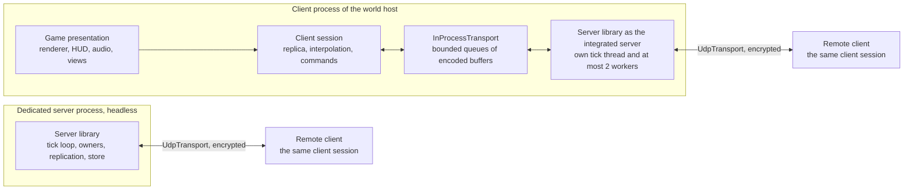
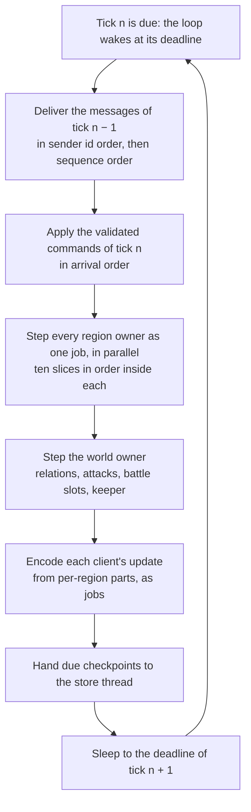

# Solution strategy

> Status: Draft · Rationale: `../rationale/A2.md` · Related: [architecture](README.md) · [ADR index](../ADR/README.md) · [vision, pillars and core loops](../gdd/00_vision_pillars_and_core_loops.md) · [world and regions](../gdd/01_world_and_regions/README.md) · [owner decisions](../decisions/owner_decisions.md) · [deferred decisions](../decisions/deferred/README.md) · [adoption ledger 12](../gdd/adoption_ledger/12_simulation_model_ledger.md)

This chapter states how Species is built and how it grows: the technology decisions, the processes and libraries and the transport between them, the approach to each quality goal, the path from 16 to 200 stewards and more, and the budgets that come out of the area model. The decisions themselves are the architecture decision records ADR-079 to ADR-088, which this chapter summarises and ties together; every number of §4.5 comes from `Tools/DesignModels/A2ServerBudget.py`, whose `check` mode reproduces each of them (`python3 -I Tools/DesignModels/A2ServerBudget.py check`). The chapter rests on the owner decisions O1, O3, O4, O5, O10, O35 and O40 above all, and on the world that area A1 sized: 26 settlements in 8 regions at 16 stewards and 256 in 77 at 200, with the battle load of WLD-284.

The records are Proposed until owner gate B; each states the default that holds meanwhile and the evidence that confirms it. Persistence has no record of its own here: §4.3.1 states the approach that area D4 builds on, and gate B is asked about its technology.

## 4.1 Technology decisions

| Topic | Decision | Record | Resolves |
|---|---|---|---|
| Client platform | Windows 11 x64, minimum 24H2; AVX2 CPU floor | [ADR-050](../ADR/ADR-050-client-platform-and-minimum-os.md) | — |
| Language and build | C++23 (`/std:c++latest`), MSVC toolset v145, one MSBuild solution, `/fp:precise` and `/arch:AVX2` in every project | [ADR-051](../ADR/ADR-051-windows-toolchain-and-compiler-policy.md), [ADR-052](../ADR/ADR-052-cpp23-language-standard.md), [ADR-054](../ADR/ADR-054-build-system-msbuild-solution.md) | — |
| Dependencies | The Windows SDK, the MSVC standard library and three Microsoft NuGet packages; nothing third-party in the client or the server (R14) | [ADR-055](../ADR/ADR-055-dependencies-three-nuget-packages.md) | — |
| Tick rate | 10 ticks per second for the world and for skirmish; every tick run whole on the server with its ten slices in order; the abstract economy steps every 10 ticks | [ADR-079](../ADR/ADR-079-simulation-tick-rate.md) | DEC-227 |
| Budgets and caps | Per-figure cost budgets, a 10 ms region step and a 4,000-body region budget, battles of at most 1,000 figures, battle caps of 2 per region and max(8, 10 % of settlements) per world, named host specifications | [ADR-080](../ADR/ADR-080-per-tick-budgets-and-population-caps.md) | DEC-228 |
| Numeric model | Strict binary64 under `/fp:precise` without contraction, own deterministic transcendental functions, a three-level determinism scope, a canonical state hash per owner | [ADR-081](../ADR/ADR-081-numeric-model-and-determinism-scope.md) | DEC-240, DEC-241, DEC-206 |
| Random draws | Counter-based values keyed by seed, purpose, subject, tick and ordinal, one function for the simulation and for world generation | [ADR-082](../ADR/ADR-082-counter-based-simulation-random-draws.md) | DEC-242 |
| Server process | One headless, portable server library; composition roots and lifetime scopes; state owners per region, world and match; region steps as parallel jobs; a deadline-paced tick loop; checkpoints at tick boundaries | [ADR-083](../ADR/ADR-083-server-process-ownership-and-threading.md) | DEC-221, DEC-223, DEC-224, DEC-225, DEC-226 |
| Client boundary | The client reaches the server only through the transport, even in-process; it draws a replica, interpolated one tick behind | [ADR-084](../ADR/ADR-084-client-boundary-through-the-transport.md) | DEC-222 |
| Region partitioning | Region owners step the same tick and affect each other only by messages at the next tick boundary; battles run in their anchor region with a lent battlefield | [ADR-085](../ADR/ADR-085-region-partitioned-world-simulation.md) | WLD-282 (with B4) |
| Replication | Server-authoritative state replication with three interest tiers, a 48 KB/s per-client cap and snapshot joins; battle replays as recorded state streams | [ADR-086](../ADR/ADR-086-replication-and-interest-management.md) | DEC-200, DEC-201, DEC-205 |
| Commands | One validated path for every source, checked on arrival and on execution, executed at the next tick, with coalescing and rate limits | [ADR-087](../ADR/ADR-087-command-path-validation-and-timing.md) | DEC-202, DEC-203 |
| Transport | One `Transport` interface with an in-process and an own encrypted datagram implementation, schema-defined messages, a build and content handshake, network diagnostics and a command journal | [ADR-088](../ADR/ADR-088-transport-messages-identity-and-diagnostics.md) | DEC-204, DEC-207, DEC-208 |
| Persistence | A transactional, region-keyed record store per world; checkpoints and a final checkpoint at every freeze; migration by data, never by re-simulation; the store engine is area D4's | §4.3.1; gate B | DEC-250, DEC-251 (D4) |
| Version and content identity | One generated build identity; content identified by SHA-256 over cooked content | [ADR-057](../ADR/ADR-057-version-identity.md), [ADR-060](../ADR/ADR-060-content-identity-by-hash.md) | — |
| Data and messages | One schema per record type, versioned binary at run time; schemas and code generation | [ADR-061](../ADR/ADR-061-data-schemas-and-versioning.md), [ADR-062](../ADR/ADR-062-authoring-syntax-and-schema-language.md) | — |
| Time | One monotonic clock behind an injectable source; the simulation reads only its tick counter | [ADR-074](../ADR/ADR-074-platform-clock-with-injectable-time.md) | — |
| Operations | Asynchronous logging, crash reporting, telemetry with consent, profiling markers, the test framework and CI | [ADR-065](../ADR/ADR-065-crash-reporting.md), [ADR-066](../ADR/ADR-066-telemetry-with-consent.md), [ADR-067](../ADR/ADR-067-logging.md), [ADR-068](../ADR/ADR-068-profiling-and-gpu-timing.md), [ADR-069](../ADR/ADR-069-test-framework.md), [ADR-070](../ADR/ADR-070-continuous-integration.md) | — |
| Compression | The in-box Windows Compression API, XPRESS with Huffman encoding, for packs, replays and backups | [ADR-058](../ADR/ADR-058-pack-files-and-mount-policy.md) | — |
| Online services | Identity, entitlement, server listing, rendezvous and relay are area D5's, with the storefronts of ADR-072; HTTPS through the in-box WinHTTP | [ADR-072](../ADR/ADR-072-distribution-channels-and-package-formats.md), [ADR-077](../ADR/ADR-077-client-http-stack.md) | DEC-248, DEC-249 (D5) |
| Dedicated-server operating systems | A Windows dedicated server first; a second operating system is an owner decision at gate B, and the server library is portable C++23 from the first line so that it needs no rewrite (ADR-083 item 1) | gate B; area D1 | DEC-220 (D1) |

*Table 1 — The technology decisions of Species, one line each, with the record that states each and the decisions it resolves. ADR-079 to ADR-088 are this area's, Proposed until gate B.*

## 4.2 Top-level decomposition

### 4.2.1 Processes

| Process | Stage | What it runs | Transport to its clients |
|---|---|---|---|
| Client | 1 to 3 | Presentation (renderer, audio, input, UI, camera), the client session (replica, interpolation, command builder) and, when it hosts a world or a skirmish match, the server library as the integrated server on its own threads | `InProcessTransport` to its own session; `UdpTransport` to remote clients when it hosts |
| Dedicated server | 2 and 3 | The server library, headless: every state owner of one world (or one skirmish match), the tick loop, replication, the record store, the administration interface and the server API (O6) | `UdpTransport` |
| Test runner | 1 to 3 | The server library with recorded inputs and presentation stubs: soak runs, hash tests, defect reproduction from a command journal, the abstract model's calibration | none, or `InProcessTransport` to a test client |
| Front process and region hosts | 3, if measured | The dedicated server's executable in two roles: the front process holds the world owner, the client connections and the store's coordination; each region host holds some region owners (ADR-085 item 8) | `UdpTransport` to clients; messages between processes at tick boundaries |

*Table 2 — The processes of Species. The integrated server and the dedicated server are the same library; only the composition root and the transport differ (O10).*

Process roles and the headless build are area D1's (DEC-220); this chapter assumes its option A, separate build targets of one codebase in which the server library links no presentation code.

### 4.2.2 Libraries and their edges

| Library | Namespace | Responsibility | May depend on |
|---|---|---|---|
| Platform layer and maths (PLT) | `Engine` | Operating-system services (files, threads, sockets, the clock, cryptography, the window on the client), the engine maths library with its deterministic functions (ADR-081 item 3) | the Windows SDK and the standard library only |
| Client engine components (renderer, audio, input, UI, camera, asset pipeline, animation and VFX) | `Engine` | Presentation services of the baseline components | the platform layer, the three NuGet packages |
| Simulation | `Species` | The rules of the world game and of skirmish, the state owners (`RegionSimulation`, `WorldSimulation`, `MatchWorld`), the step, the keyed draws (ADR-082) | the platform layer's portable parts (maths, containers) and the data schemas |
| Messages and transport | `Species` | The message schemas and their generated codecs, `Transport`, `InProcessTransport`, `UdpTransport` (ADR-088) | the platform layer |
| Server | `Species` | The tick loop and worker pool, command validation, interest management and replication encoding, the record-store interface, the server API, the AI runtime, administration (ADR-083) | simulation, messages and transport, the platform layer |
| Client session | `Species` | The replica, decoding, interpolation, the presentation snapshot (RND-018), the command builder and local feedback (ADR-084) | messages and transport, the platform layer |
| Game presentation | `Species` | Game renderers, the HUD, the front end, the audio binding, the strategic and settlement views | client session, client engine components |

*Table 3 — The libraries and the edges allowed between them. Edges run one way (AGENTS.md §2, R9): nothing depends on the server library except the composition roots of the executables, and the client session and the game presentation never include a header of the simulation's owners or of the server's internals. The project names are for areas D1 and E1 to set.*

The executables compose them: the client links game presentation, the client session and the server library, and composes the integrated server as a child of its root (ADR-083 item 2); the dedicated server links the server library alone; the test runner links the server library with the test harness. `Build\CheckProjectFiles.py` enforces the include allow-lists in both directions (ADR-084 item 2), and the dedicated server is built and run with no presentation library linked.

### 4.2.3 Integrated and dedicated, behind one transport

*Figure 1 — The integrated server in the host's client and a dedicated server run the same server library; every client, the host's own included, reaches it only through a `Transport` of encoded messages (O10; ADR-083, ADR-084, ADR-088).*

The host's own client is a client like any other: it sends commands and receives replicated state through `InProcessTransport`, with the same sequencing, channels and budgets as a remote client, and it draws one tick behind the server. Closing the host's client stops the integrated server, writes the final checkpoint and freezes the world for every steward (O4, PIL-077, PIL-131); keeping it open with its presentation suspended keeps an always-on world running (O35). Moving a world from an integrated host to a dedicated server moves its records, which the record store holds in one portable, exact encoding (§4.3.1); nothing is re-simulated.

### 4.2.4 One server tick

*Figure 2 — One tick of a server: messages from the previous tick, commands, the region steps in parallel, the world owner, replication and checkpoints, then a sleep to the next deadline (ADR-079, ADR-083, ADR-085, ADR-087).*

Every region steps the same tick; a region reads no other owner's state during it, and every effect across a region border takes exactly one tick (ADR-085 item 2). A tick's whole work finishes within half the tick period on the host's hardware (ADR-080 item 6); a tick that overruns lets the next start at once, owed ticks catch up at most twice per period up to 20, and a stall of 10 s or more is recorded as a freeze (ADR-083 item 7).

### 4.2.5 What the next areas build on this decomposition

| Area | Builds | On |
|---|---|---|
| D1 | The build targets, the headless server and the integrated mode, server configuration and administration, the dedicated-server operating systems (gate B) | Tables 2 and 3; ADR-083 items 1 to 3 |
| D2 | The world simulation component: the owners, the step, battles inside regions, the lent battlefield and the border band, the fidelity switch; the remaining rows of ledger 12 and the `adapt` form of A2's drop rows | ADR-079, ADR-082, ADR-083, ADR-085 |
| D3 | The replication component: the tiers, the encoding, the budgets, joins and reconnects, the replay recorder | ADR-084, ADR-086, ADR-088 |
| D4 | The persistence component: the record store, schema versions and migration, checkpoints, backups, rollback, ended-world archives | §4.3.1; ADR-081 item 7; ADR-083 item 9 |
| D5 | Identity across servers, the server listing, rendezvous and relay for hosts at home, storefronts | ADR-088 items 1 and 4 |
| D6 | The server API of O6 through the command path | ADR-087 items 1 and 6 |
| D7 | The AI runtime within ADR-080's AI budgets, reading the server-side seen layer | ADR-080 item 2, ADR-086 item 1 |
| D8 | Terrain chunks by digest, coordinates, path-finding between regions | ADR-081 item 1, ADR-085 |
| D9 | Server authority, the seen layer, the community host's trust, the handshake's review | ADR-084, ADR-086, ADR-087, ADR-088 |
| D10 | Telemetry of the diagnostics of ADR-088 item 7, with consent; the reference test machine (DEC-971) | ADR-080 item 1, ADR-088 item 7 |
| B1, B4 | The population limit within 750 per settlement; battles of at most 1,000 figures and a battlefield at a crossing between its mouths | ADR-080 items 3 and 4; ADR-085 item 4 |
| B2, B7 | The abstract step and the AI within their cost budgets | ADR-079 item 3; ADR-080 item 2 |

*Table 4 — What the following areas build on this chapter.*

## 4.3 Approaches to the quality goals

| Quality goal | Approach | Records | Evidence (§4.5) |
|---|---|---|---|
| Scale: 2 to 16 stewards, then 50 to 200 and more, without a rewrite (O1) | Regions are the unit of simulation, persistence, hashing and hand-over from the first world; owners step one tick and exchange messages at tick boundaries, in one process or in many; a client's bandwidth depends on its view, not on the world's size; the cost of a world grows with its watched settlements and battles, not with its area | ADR-083, ADR-085, ADR-086, ADR-080 | A world of 200 at its stress case takes 1.67 reference cores; a battle view costs 22.8 KB/s at 16 and at 200 stewards |
| Cost: community hosts first, small machines (O5) | Per-figure cost budgets and hard caps on a named host; abstract fidelity for unwatched settlements (O3); storage bounded by retention | ADR-080, ADR-079 item 3 | A world of 16 at its worst takes 0.28 reference cores and 32 MB of memory; 146 MB of storage after 84 world days |
| Cheating and fair information (PIL-084, PIL-133) | The server is the only writer; a client receives only its interest set, so hidden state is never sent; every command is validated on arrival and on execution, from every source; rate limits; encrypted, authenticated connections; administration and debug commands recorded in the world record; a restored or edited save is visible (D4, D9) | ADR-084, ADR-086, ADR-087, ADR-088 | A replica holds nothing outside its interest set (ADR-084 confirmation) |
| Persistence across downtime and patches (O1, O4, seed challenge 11) | §4.3.1 | ADR-083 item 9; ADR-081 item 7 | 2.0 MB of growth per world week at 200 stewards; checkpoints of 216 KB/s |
| Operability (O5) | A headless server with a deadline loop; diagnostics for developers and world hosts alike; a command journal and the checkpoint before it for every crash; a stall recorded as a freeze; named host specifications | ADR-083, ADR-088 item 7, ADR-080 item 8 | Hosts: 2 vCPU at 16 stewards, 8 vCPU at 200 |
| Reproducibility and testability | Strict binary64 with own deterministic maths functions; counter-based draws; the serial result at any thread count; a canonical hash per owner; Level 1 always, Level 2 for world generation and tested for the step | ADR-081, ADR-082, ADR-083 | Confirmed at the simulation-core milestone on two CPU generations of two vendors |
| Responsiveness (pillar 1) | 10 ticks per second with immediate local feedback and interpolation one tick behind; commands execute at the next tick, never delayed further | ADR-079, ADR-084, ADR-087 | 187 ms mean from command to display on the integrated host, 267 ms at a 50 ms round trip |
| Separability of the integrated server (O10, seed challenge 1) | The transport is the only interface, in-process included; include allow-lists both ways; the server builds without presentation | ADR-084, ADR-088 item 1, ADR-083 item 1 | The hash test with and without an integrated client attached |
| Battles always in full (O3, pillar 1) | Every battle runs whole in one region at full fidelity, watched or not; battle size and battle caps from the budget; attacks beyond a cap wait at their gate | ADR-080 items 4 and 5, ADR-085 item 4 | 27 battles of 400 fit within a quarter of the integrated budget |

*Table 5 — The approach to each quality goal, the records that carry it and the model's evidence.*

### 4.3.1 Persistence

Persistence follows option B of DEC-251, and area D4 specifies it within these constraints:

1. **A record store, not a save file** (O1). Each world has a transactional store of records: one record set per region owner, one for the world owner, and one per settlement that is dormant (O34). A record set is written whole or not at all, and the store keeps the last two complete checkpoints of every owner, so a write cut short loses at most the checkpoint in progress.
2. **Checkpoints at tick boundaries.** A dirty region's owner serialises itself every 600 ticks (60 s of world time), staggered by region id, and the store thread writes the buffer (ADR-083 item 9); the world owner does so at the same period. A crash loses at most 60 s of world time and one write; a clean stop, and every freeze, writes a final checkpoint of every owner and loses nothing (O4, PIL-076). The model's checkpoint writes are 23 KB/s at 16 stewards and 216 KB/s at 200.
3. **One record for both fidelities** (O3, DEC-251 item 10). A settlement's record is the same whether the full simulation or the abstract model last advanced it; a region at full fidelity also stores its figures (96 bytes each, exact), so a battle frozen by a stop resumes exactly where it stopped (PIL-076).
4. **Exact and portable.** Every stored value uses the exact encoding of ADR-081 item 7, so a world moves from an integrated host to a dedicated server, and in stage 3 a region between processes, by copying its records; the store names the world's template and generator versions (WLD-009) and refers to terrain chunks and content by digest (WLD-166, ADR-060).
5. **Migration by data, never by re-simulation.** A patch that changes a record type ships a forward migration of its schema version (ADR-061); a server refuses a world written by a newer schema; nothing is rebuilt by replaying commands, because ADR-081 provides no agreement across releases (Level 3).
6. **Backups and rollback.** The store keeps 7 daily backups of every owner's last checkpoint, compressed with XPRESS (ADR-058); a rollback restores a whole world, never one region, because cross-region effects (an attack, a hand-over) would leave it inconsistent (DEC-251 item 6); every restore is recorded and shown to every steward when they next join (PIL-133).
7. **Bounded growth.** The world record (battle results, contacts, claims, freezes and settings changes) grows for the world's life; away reports are kept 30 world days and battle replays 7 world days (ADR-086 item 6); dormant settlements are kept until their steward returns. Everything else is overwritten by the next checkpoint.
8. **Technology.** The record store for stages 1 and 2 is Species' own journaled record format in plain C++ over the platform layer's files, which R14 allows and every server operating system can build; a hosted world of stage 3 may put a server database behind the same store interface, by a later record and an owner decision on R14. Gate B is asked to confirm this approach.

## 4.4 Scale path

| | Stage 1: integrated | Stage 2: community dedicated | Stage 3: hosted large worlds |
|---|---|---|---|
| Stewards per world | 1 to 16 (WLD-005) | 1 to 16 (O40) | 1 to 200; formulas to 256 (WLD-007) |
| Regions | 3 to 8 | 3 to 8 | up to 77 at 200, 98 at 256 |
| Server | the server library in the host's client, at most 1 reference core and 2 workers | the server library headless on 2 vCPU | the server library headless on 8 vCPU, one process per world; front process and region hosts when measured |
| Pace | session or always-on (PIL-100) | always-on | always-on |
| Clients | the host through `InProcessTransport`, up to 15 remote through `UdpTransport`, 4 Mbit/s of upload by default | up to 16 remote | 47 present at the evening peak, 200 at most |
| Store | own record store, local files | own record store | own record store, or a server database by a later record |
| Battles in progress | at most 8 (world cap), 2 per region | at most 8 | at most 26 at 200 |

*Table 6 — The three stages of the scale path, at the budgets of ADR-080.*

**What is true at 16 stewards so that 200 needs no rewrite.** Each of these holds from the first world-game milestone (PIL-110); none is deferred to stage 3:

1. The world is partitioned into region owners, each holding everything inside its region, with one world owner for world-level state (ADR-085 item 1).
2. Every region steps the same tick and reads no other owner's state; every cross-region effect is a message delivered at the next tick boundary, in a canonical order (ADR-085 item 2).
3. Every object has a stable 64-bit id unique in its world; messages, records, replication and draws name objects by it, never by a pool slot (ADR-083 item 5).
4. Every random draw is keyed, never sequential, so no region's state depends on another's draws (ADR-082).
5. Each owner serialises canonically, hashes its state and checkpoints alone (ADR-081 item 8, ADR-083 item 9).
6. Region steps run as parallel jobs, and the result is the serial one at any thread count (ADR-083 item 6).
7. The client reaches the server only through a `Transport`, in-process included, so a remote server changes nothing in the client (ADR-084).
8. Each client's update is assembled from per-region parts, and its interest is computed from views and the seen layer, never from the world's size (ADR-085 item 7, ADR-086 items 1 and 2).
9. Every command from every source passes one validation path (ADR-087).
10. Every budget is a per-region or per-client figure, so it does not change with the number of regions, and every cap is enforced by the engine (ADR-080).
11. The server library includes no operating-system header outside the platform layer (ADR-083 item 1).
12. World state lives in a record store keyed by owner, never in a single save file (§4.3.1).

**What changes at 200.** The host machine (8 vCPU instead of 2), the store's backing (a server database becomes possible), official operation (O5), the strategic view's level of detail (WLD-240) and the battle caps' world value (26). The rules, the owners, the messages, the replication model, the command path and the client stay as they are.

**What 200 does not need.** The model shows that a world of 200 stewards at its stress case takes 1.67 reference cores at the cost budgets, 35 % of an 8-vCPU host, and 300 MB of memory, so one server process per world serves stage 3. Distributing region owners over region hosts (ADR-085 item 8) is a capacity reserve: for worlds above 200, for several worlds per machine, and for measured costs above about twice the budgets, at which a world of 200 needs 3.35 reference cores. Its protocol between processes is a later record of stage 3, and nothing built at 16 waits for it.

**Gate B confirms** the budgets that make this path hold: the population limit per settlement (at most 750), the battle size (at most 1,000 figures), the battle caps, the region body budget and the host specifications (ADR-080); the world sizes per capacity are A1's (WLD-004).

## 4.5 Model results

The model `Tools/DesignModels/A2ServerBudget.py` computes the budgets from the per-figure cost budgets of ADR-080 item 2, the replication encoding of ADR-086, the persistence constraints of §4.3.1 and A1's world figures, which it reads from `Tools/DesignModels/A1WorldDensity.py`: settlements and regions per capacity (WLD-004), stewards present at the evening peak (4 at 16, 47 at 200), watched settlements at the peak (the upper ends of A1's ranges: 11 typical and 16 at most at 16; 118 and 177 at 200; WLD-244, WLD-280), the battles in progress of the planning and the stress case (WLD-284) and A1's placeholder plateau population of 600 Workers and Leaders (B1). Its CPU figures are budgets, not measurements: the simulation-core milestone measures the costs (ADR-080), and the sensitivity at four times the budgets is shown beside them. Its modes `cpu`, `bandwidth`, `storage`, `latency`, `caps` and `tables` print the figures by topic; `check` compares 37 figures and 10 tables with the values below and exits with status 1 on any difference.

**CPU per settlement and per battle.**

| Load | ms per tick | ms of CPU per second | % of one reference core |
|---|---|---|---|
| settlement at full fidelity, 600 Workers | 0.72 | 7.20 | 0.72 |
| settlement at abstract fidelity, with its AI | 0.025 | 0.25 | 0.025 |
| battle of 400 figures | 0.91 | 9.08 | 0.91 |
| battle of 1,000 figures (the cap) | 2.18 | 21.80 | 2.18 |
| busiest region: 4 settlements at full fidelity, 2 battles | 4.73 | 47.26 | 4.73 |
| region at its body budget of 4,000, all in battle | 8.43 | 84.30 | 8.43 |

*Table 7 — Server CPU per settlement, per battle and per region at 10 ticks per second, on one reference core (`A2ServerBudget.py cpu`). Both the busiest region and a region at its body budget stay within the 10 ms region step budget.*

**CPU per world at 16 and at 200 stewards.**

| Stewards | Case | Settlements at full fidelity | Battles in progress | Clients | Settlements ms | Battles ms | Other ms | Total ms per tick | Reference cores | Cores at 4 x cost | Of the stage host |
|---|---|---|---|---|---|---|---|---|---|---|---|
| 16 | evening peak, planning | 11 | 4 | 4 | 8.1 | 3.6 | 1.2 | 13.0 | 0.13 | 0.52 | 13 % |
| 16 | evening peak, stress | 16 | 8 | 4 | 11.8 | 7.3 | 1.3 | 20.4 | 0.20 | 0.82 | 20 % |
| 16 | session pace, planning | 16 | 6 | 4 | 11.8 | 5.4 | 1.1 | 18.4 | 0.18 | 0.73 | 18 % |
| 16 | all 16 present, stress | 26 | 8 | 16 | 19.2 | 7.3 | 1.8 | 28.3 | 0.28 | 1.13 | 28 % |
| 200 | evening peak, planning | 118 | 16 | 47 | 87.3 | 14.5 | 11.2 | 113.1 | 1.13 | 4.52 | 24 % |
| 200 | evening peak, stress | 177 | 26 | 47 | 131.0 | 23.6 | 12.7 | 167.3 | 1.67 | 6.69 | 35 % |

*Table 8 — Server CPU per world per tick (`A2ServerBudget.py cpu`). The stage host is the integrated budget of 1 reference core at 16 stewards and the 8-vCPU host of 4.8 reference cores at 200. "Other" holds the abstract settlements, expeditions, region and world fixed costs, replication and persistence. The stress case at 200 is A1's 28 battles held at the world cap of 26; "all 16 present" makes every settlement of a world of 16 watched.*

**Bandwidth per client with crowds in view.**

| View | Tier-1 figures | Tier-2 figures | KB/s at 10 Hz | KB/s at 20 Hz | Within the 48 KB/s cap |
|---|---|---|---|---|---|
| home view: own settlement | 400 | 800 | 17.0 | 24.7 | yes |
| battle view: 400 in battle | 600 | 600 | 22.8 | 36.2 | yes |
| valley war: 2 battles, 4 settlements | 1,500 | 2,000 | 62.3 | 96.3 | no: 806 stay at tier 1 |
| strategic view, 16 stewards | 0 | 0 | 2.0 | 2.6 | yes |
| strategic view, 200 stewards | 0 | 0 | 2.9 | 3.5 | yes |

*Table 9 — Downstream bandwidth per client by view (`A2ServerBudget.py bandwidth`), the same at 16 and at 200 stewards except for the strategic view's marks. Upstream is 0.9 KB/s per client. The 20 Hz column shows the cost of option B of ADR-079.*

| Link | Mbit/s |
|---|---|
| integrated host, 3 remote stewards at the evening peak, battle views | 0.5 |
| integrated host, 15 remote stewards, battle views | 2.7 |
| integrated host, 15 remote stewards, valley-war views at the cap | 5.8 |
| community server of 16, all present, battle views | 2.9 |
| hosted world of 200, 47 present at the evening peak, battle views | 8.6 |
| hosted world of 200, 47 present, valley-war views | 18.0 |

*Table 10 — Upload of a server by case. An integrated host above its 4 Mbit/s budget sends each remote client less than its cap (ADR-086 item 4). A hosted world sends about 46 GB per 30 days at 16 stewards and 575 GB at 200, at the mean presence of the typical pattern (PIL-102).*

**Storage and memory.**

| Stewards | Terrain MB | Live state MB | Backups MB | World record MB | Away reports MB | Replays MB | Dormant MB | Total MB | Growth MB per world week | Checkpoint KB/s |
|---|---|---|---|---|---|---|---|---|---|---|
| 16 | 6.6 | 1.4 | 10.1 | 2.2 | 4.6 | 120.7 | 0.2 | 146 | 0.2 | 23 |
| 200 | 63.1 | 13.3 | 93.0 | 22.0 | 57.6 | 1188.7 | 1.4 | 1439 | 2.0 | 216 |

*Table 11 — The storage of a world after a lifetime of 84 world days (O39) (`A2ServerBudget.py storage`): baked terrain heights in binary64 (WLD-166), the live state at the stress case, 7 daily backups, the world record, away reports kept 30 world days (200 entries a day per steward, a placeholder of B6), replays kept 7 world days for 60 % of battles (a placeholder of B6) and dormant settlements. Only the world record and dormant settlements grow with the world's age.*

| Stewards | Figures MB | Terrain heights and normals MB | Replication baselines MB | Records and checkpoint buffer MB | Total MB |
|---|---|---|---|---|---|
| 16 | 3.3 | 26.2 | 0.9 | 1.7 | 32 |
| 200 | 29.8 | 252.3 | 2.6 | 15.4 | 300 |

*Table 12 — Server memory of a world at its stress case (`A2ServerBudget.py storage`): 256 bytes per simulated figure, binary64 heights and normals of the land samples (WLD-166, Table 5 of A1), one 16-byte baseline per replicated figure per client, and the records with one checkpoint buffer. Terrain dominates; area D8 decides whether normals are held or derived (DEC-246).*

**Battle sizes and replays.**

| Battle bodies | ms per tick | Battles within 25 % of the integrated budget | Battles within 25 % of the stage-3 host |
|---|---|---|---|
| 200 | 0.48 | 51 | 247 |
| 400 | 0.91 | 27 | 132 |
| 1,000 | 2.18 | 11 | 55 |

*Table 13 — The battle sizes of PIL-021: the floor of 200, the typical 400 and the cap of 1,000, and how many battles of each fit in a quarter of each stage's budget. Neither value of PIL-021 is at risk at 16 or at 200 stewards.*

| Replay form | MB per battle of 8 minutes | Viewable by |
|---|---|---|
| state stream at 5 Hz (chosen) | 2.6 | any client of a release that reads the stream format |
| command stream from the region checkpoint | 0.4 | the same release only, Level 2 |

*Table 14 — The two forms of a battle replay (PIL-140; ADR-086 item 6). The state stream costs 6 times the storage and needs no agreement between builds.*

**Latency.**

| Client | 10 Hz, ms | 20 Hz, ms |
|---|---|---|
| integrated host | 187 | 102 |
| remote, 50 ms round trip | 267 | 182 |
| remote, 150 ms round trip | 367 | 282 |

*Table 15 — Mean command-to-display latency (`A2ServerBudget.py latency`): half a tick of waiting, the round trip, 20 ms of the server's step at 10 Hz, the interpolation delay of one tick, a 30 ms jitter allowance for a remote client and one frame at 60 frames per second. Local feedback is immediate (ADR-084 item 6).*

**Battle caps.**

| Stewards | Pace | World cap | At the cap, planning | At the cap, stress | Battle CPU at the cap, ms per tick |
|---|---|---|---|---|---|
| 16 | evening peak | 4 | 4 % | 23 % | 3.6 |
| 16 | evening peak | 6 | 0 % | 3 % | 5.4 |
| 16 | evening peak | 8 | 0 % | 3 % | 7.3 |
| 16 | session | 4 | 11 % | 37 % | 3.6 |
| 16 | session | 6 | 2 % | 8 % | 5.4 |
| 16 | session | 8 | 0 % | 8 % | 7.3 |
| 200 | evening peak | 20 | 0 % | 11 % | 18.2 |
| 200 | evening peak | 26 | 0 % | 1 % | 23.6 |
| 200 | evening peak | 32 | 0 % | 0 % | 29.1 |

*Table 16 — The share of the evening peak during which the world's battle cap holds a new attack at its gate (WLD-285), in A1's planning case (6 battles per settlement per week) and stress case (10 a week), for candidate world caps (`A2ServerBudget.py caps`, from A1's battle model). A world cap of 8 at 16 stewards costs 3.6 ms per tick more than A1's 4 and removes the waiting of the planning case at both paces.*

**What the results mean.** At the cost budgets, no case uses more than 35 % of its stage's hardware: the integrated worst case takes 0.28 of its 1 reference core, and a world of 200 at its stress case 35 % of its host. Settlements at full fidelity are 58 % to 78 % of the CPU in every case, so the budget responds first to B1's population limit and to how many settlements are watched (WLD-244). If the measured costs reach four times the budgets, the integrated worst case needs 1.13 reference cores and a world of 200 needs 6.69, so ADR-080's confirmation lowers the region body budget and the battle size by the ratio before content is tuned to them. A client's bandwidth depends on its view, not on the world's size, and a valley war is the only view that the 48 KB/s cap trims. Storage is dominated by battle replays and bounded by their retention; the world's lasting growth is 0.2 MB per world week at 16 stewards and 2.0 MB at 200.
