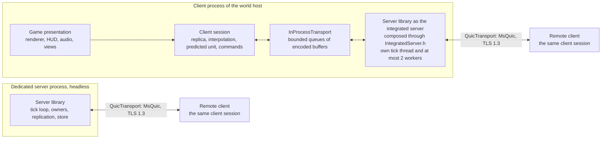
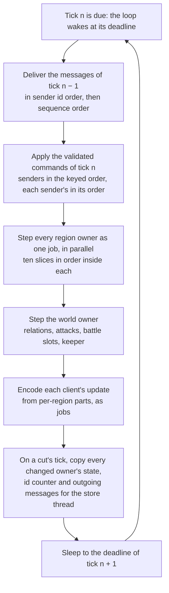

# Solution strategy

> Status: Final · Rationale: [A2](../rationale/A2.md) · Related: [architecture](README.md) · [ADR index](../ADR/README.md) · [vision, pillars and core loops](../gdd/00_vision_pillars_and_core_loops.md) · [world and regions](../gdd/01_world_and_regions/README.md) · [owner decisions](../decisions/owner_decisions.md) · [deferred decisions](../decisions/deferred/README.md) · [adoption ledger 12](../gdd/adoption_ledger/12_simulation_model_ledger.md)

This chapter states how Species is built and how it grows: the technology decisions, the processes and libraries and the transport between them, the approach to each quality goal, the path from 16 to 200 stewards and more, and the budgets that come out of the area model. The decisions themselves are the architecture decision records ADR-079 to ADR-089, which this chapter summarises and ties together; every number of §4.5 comes from `Tools/DesignModels/A2ServerBudget.py`, whose `check` mode reproduces each of them (`python3 -I Tools/DesignModels/A2ServerBudget.py check`). The chapter rests on the owner decisions O1, O3, O4, O5, O10, O21, O33, O35 and O40 above all, on the answers of owner gate B (O41 to O49, 2026-10-18), and on the world that area A1 sized: 26 settlements in 8 regions at 16 stewards and 256 in 77 at 200, with the battle load of WLD-284.

Gate B closed the owner's choices of this area: a Windows dedicated server with a portable core (O41), Species' own journaled record store (O42), the budgets as provisional values with ranges (O43), MsQuic as the transport, recorded with its package in ADR-089 (O44), the R14-clean identity baseline (O45), the battle caps (O46), the overload lever (O47), the host sizes (O48), and the storefront and publisher deferred to before the first external build (O49); §4.4 lists what each changed. ADR-089 is Accepted, because the owner took its decision and nothing remains to measure before it binds. ADR-079 to ADR-088 stay Proposed, because their evidence comes from code: since O51 and O55 that code is the MVP of [the MVP scope](../implementation/mvp_scope.md), whose milestones produce it (the per-figure costs at M1, the first playable's latency at M3, the MsQuic transport at M4), and each record's "Confirmed when" names the milestone, or the milestone after the MVP, that confirms it. Persistence has no record of its own here: §4.3.1 states the approach that area D4 builds on.

## 4.1 Technology decisions

| Topic | Decision | Record | Resolves |
|---|---|---|---|
| Client platform | Windows 11 x64, minimum 24H2; AVX2 CPU floor | [ADR-050](../ADR/ADR-050-client-platform-and-minimum-os.md) | — |
| Language and build | C++23 (`/std:c++latest`), MSVC toolset v145, one MSBuild solution, `/fp:precise` and `/arch:AVX2` in every project | [ADR-051](../ADR/ADR-051-windows-toolchain-and-compiler-policy.md), [ADR-052](../ADR/ADR-052-cpp23-language-standard.md), [ADR-054](../ADR/ADR-054-build-system-msbuild-solution.md) | — |
| Dependencies | The Windows SDK, the MSVC standard library and four Microsoft NuGet packages, the fourth being MsQuic (O44); nothing else third-party in the client or the server (R14) | [ADR-055](../ADR/ADR-055-dependencies-three-nuget-packages.md), [ADR-089](../ADR/ADR-089-msquic-transport-package.md) | — |
| Tick rate | 10 ticks per second for the world and for skirmish; every tick run whole on the server with its ten slices in order; the abstract economy steps every 10 ticks; the 20 Hz budgets stated beside every gate-B budget | [ADR-079](../ADR/ADR-079-simulation-tick-rate.md) | DEC-227 |
| Budgets and caps | Per-figure cost budgets that the first task of the MVP's M1 measures; provisional values with ranges (O43): a reserved region body budget of 4L + 2S (3,600 at L = S = 600; L 450 to 700, S 200 to 600) and a 12.5 ms region step; at most 600 figures per side in a battle; battle caps of 2 per region and max(8, 10 % of settlements) per world (O46); a 50 ms tick wall budget and a 100 ms deadline; hosts chosen by a margin rule, 16 vCPU at stage 3 and 4 vCPU (2 at the minimum) at stage 2 (O48) | [ADR-080](../ADR/ADR-080-per-tick-budgets-and-population-caps.md) | DEC-228 |
| Numeric model | Strict binary64 under `/fp:precise` without contraction, own deterministic transcendental functions, fixed-width types and total orders, a three-level determinism scope, a canonical state hash per owner | [ADR-081](../ADR/ADR-081-numeric-model-and-determinism-scope.md) | DEC-240, DEC-241, DEC-206 |
| Random draws | SipHash-2-4 values of a secret 128-bit simulation key over the purpose, the subject's stable id, the tick and the ordinal; world generation keyed by the public world seed (WLD-161) | [ADR-082](../ADR/ADR-082-counter-based-simulation-random-draws.md) | DEC-242 |
| Server process | One headless server library, a Windows build with a portable core (O21, O41) that reaches the operating system only through the platform layer; composition roots and lifetime scopes, with `IntegratedServer.h` the client's only server header; state owners per region, world and match; region steps as parallel jobs; a deadline-paced tick loop; consistent cuts | [ADR-083](../ADR/ADR-083-server-process-ownership-and-threading.md) | DEC-221, DEC-223, DEC-224, DEC-225, DEC-226 |
| Client boundary | The client reaches the server only through the transport, even in-process; it draws a replica interpolated one tick behind, predicts only the unit that its steward directly controls, and the trust model is stated | [ADR-084](../ADR/ADR-084-client-boundary-through-the-transport.md) | DEC-222 |
| Region partitioning | Region owners step the same tick and affect each other only by messages at the next tick boundary; battles run in their anchor region with a lent battlefield; a 60 s fidelity hold; the overload lever that spares battles and a steward's own settlement (O47) | [ADR-085](../ADR/ADR-085-region-partitioned-world-simulation.md) | WLD-282 (with B4) |
| Replication | Server-authoritative state replication with three interest tiers, self-decodable datagrams, per-client caps of 48 KB/s (64 KB/s in skirmish), snapshot joins; battle replays as recorded state streams served filtered by side | [ADR-086](../ADR/ADR-086-replication-and-interest-management.md) | DEC-200, DEC-201, DEC-205 |
| Commands | One validated path for every source, checked on arrival and on execution, executed at the next tick in a keyed sender order, with control states sent at once on a change, coalescing and rate limits | [ADR-087](../ADR/ADR-087-command-path-validation-and-timing.md) | DEC-202, DEC-203 |
| Transport | One `Transport` interface with an in-process implementation and one on MsQuic (O44): reliable streams for commands and blobs, QUIC datagrams for state updates, TLS 1.3 through Schannel; schema-defined messages, a player identity key, a build and content handshake, network diagnostics, an administration interface and a command journal | [ADR-088](../ADR/ADR-088-transport-messages-identity-and-diagnostics.md), [ADR-089](../ADR/ADR-089-msquic-transport-package.md) | DEC-204, DEC-207, DEC-208 |
| Persistence | Species' own journaled, owner-keyed record store per world in plain C++ over the platform layer's files (O42), written in consistent cuts every 60 s (every 10 s in an integrated world while a battle runs) and at every freeze; a hash chain over the world record; a pre-migration copy | §4.3.1 | DEC-250, DEC-251 (D4) |
| Version and content identity | One generated build identity; content identified by SHA-256 over cooked content | [ADR-057](../ADR/ADR-057-version-identity.md), [ADR-060](../ADR/ADR-060-content-identity-by-hash.md) | — |
| Data and messages | One schema per record type, versioned binary at run time; schemas and code generation | [ADR-061](../ADR/ADR-061-data-schemas-and-versioning.md), [ADR-062](../ADR/ADR-062-authoring-syntax-and-schema-language.md) | — |
| Time | One monotonic clock behind an injectable source; the simulation reads only its tick counter | [ADR-074](../ADR/ADR-074-platform-clock-with-injectable-time.md) | — |
| Operations | Asynchronous logging, crash reporting, telemetry with consent, profiling markers, the test framework and CI | [ADR-065](../ADR/ADR-065-crash-reporting.md), [ADR-066](../ADR/ADR-066-telemetry-with-consent.md), [ADR-067](../ADR/ADR-067-logging.md), [ADR-068](../ADR/ADR-068-profiling-and-gpu-timing.md), [ADR-069](../ADR/ADR-069-test-framework.md), [ADR-070](../ADR/ADR-070-continuous-integration.md) | — |
| Compression | The in-box Windows Compression API, XPRESS with Huffman encoding, for the client's content packs only; records, backups and replays are stored uncompressed in the exact encoding (§4.3.1) | [ADR-058](../ADR/ADR-058-pack-files-and-mount-policy.md) | — |
| Online services | For the first world-game milestone the R14-clean baseline (O45): a player identity key in the CNG key store, a port mapping through the in-box UPnP NAT API, IPv6 and a manual address; no relay, so a host behind carrier-grade NAT is unreachable, and no identity across servers; a provider of identity, listing and relay is chosen with the storefront and the publisher before the first external build (O49); HTTPS through the in-box WinHTTP | [ADR-088](../ADR/ADR-088-transport-messages-identity-and-diagnostics.md), [ADR-072](../ADR/ADR-072-distribution-channels-and-package-formats.md), [ADR-077](../ADR/ADR-077-client-http-stack.md) | DEC-248, DEC-249 (D5) |
| Dedicated-server operating systems | A Windows dedicated server in stage 2 with a portable core (O41). The server and simulation libraries reach the operating system only through the platform layer, use fixed-width types and total orders and store or send nothing in a Windows-only format, so a server for another operating system replaces the platform layer, the in-box services it wraps and MsQuic's build for that system, never the simulation; whether and when there is one is a later ADR | ADR-083 item 1; area D1 | DEC-220 (D1) |

*Table 1 — The technology decisions of Species, one line each, with the record that states each and the decisions it resolves. ADR-079 to ADR-089 are this area's: ADR-089 is Accepted, and ADR-079 to ADR-088 are Proposed with the gate-B answers applied, each confirmed by the MVP milestone or the later milestone its "Confirmed when" names.*

## 4.2 Top-level decomposition

### 4.2.1 Processes

| Process | Stage | What it runs | Transport to its clients |
|---|---|---|---|
| Client | 1 to 3 | Presentation (renderer, audio, input, UI, camera), the client session (replica, interpolation, the predicted unit, command builder) and, when it hosts a world or a skirmish match, the server library as the integrated server on its own threads, composed through `IntegratedServer.h` | `InProcessTransport` to its own session; `QuicTransport` (MsQuic) to remote clients when it hosts |
| Dedicated server | 2 and 3 | The server library, headless, as a Windows build (O41): every state owner of one world (or one skirmish match), the tick loop, replication, the record store, the administration interface and the server API (O6) | `QuicTransport` |
| Test runner | 1 to 3 | The server library with recorded inputs and presentation stubs: soak runs, hash tests, forced-kill tests, defect reproduction from a command journal, the abstract model's calibration | none, or `InProcessTransport` to a test client |
| Front process and region hosts | 3, beyond the margin of one host | The dedicated server's executable in two roles: the front process holds the world owner, the client connections and the store's coordination; each region host holds some region owners (ADR-085 item 8) | `QuicTransport` to clients; messages between processes at tick boundaries |

*Table 2 — The processes of Species. The integrated server and the dedicated server are the same library; only the composition root and the transport differ (O10).*

Process roles and the headless build are area D1's (DEC-220); this chapter assumes its option A, separate build targets of one codebase in which the server library links no presentation code.

### 4.2.2 Libraries and their edges

| Library | Namespace | Responsibility | May depend on |
|---|---|---|---|
| Platform layer and maths (PLT) | `Engine` | Operating-system services (files with write-through and atomic replacement for the record store, threads, the clock, cryptography and the key store in CNG, the window on the client), the engine maths library with its deterministic functions (ADR-081 item 3) and SipHash-2-4 (ADR-082); no sockets, because the transport reaches the network through MsQuic (ADR-089) | the Windows SDK and the standard library only |
| Client engine components (renderer, audio, input, UI, camera, asset pipeline, animation and VFX) | `Engine` | Presentation services of the baseline components | the platform layer, the Agility SDK, GameInput and PIX packages |
| Simulation | `Species` | The rules of the world game and of skirmish, the state owners (`RegionSimulation`, `WorldSimulation`, `MatchWorld`), the step, the keyed draws (ADR-082), and the pure movement and terrain-query functions that hold no state | the platform layer's portable parts (maths, containers) and the data schemas |
| Messages and transport | `Species` | The message schemas and their generated codecs, `Transport`, `InProcessTransport`, `QuicTransport` (ADR-088) | the platform layer; the MsQuic package, which no other library reaches (ADR-089) |
| Server | `Species` | The tick loop and worker pool, command validation, interest management and replication encoding, the record-store interface, Species' journaled record store (O42) and consistent cuts, the server API, the AI runtime, the administration interface (ADR-083), `IntegratedServer.h` | simulation, messages and transport, the platform layer |
| Client session | `Species` | The replica, decoding, interpolation, the predicted unit (ADR-084 item 6), the presentation snapshot (RND-018), the command builder and local feedback | messages and transport, the simulation's pure functions, the platform layer |
| Game presentation | `Species` | Game renderers, the HUD, the front end, the audio binding, the strategic and settlement views | client session, client engine components |

*Table 3 — The libraries and the edges allowed between them. Edges run one way (AGENTS.md §2, R9): nothing depends on the server library except the composition roots of the executables, which include only `IntegratedServer.h`; the client session and the game presentation never include a header of the simulation's owners or of the server's internals. The project names are for areas D1 and E1 to set.*

The executables compose them: the client links game presentation, the client session and the server library, and composes the integrated server as a child of its root through `IntegratedServer.h`, which offers start, stop and a `Transport` endpoint and nothing else (ADR-083 item 2); every host tool reaches the integrated server through the administration interface (ADR-088 item 7), as a remote operator does. The dedicated server links the server library alone; the test runner links the server library with the test harness. `Build\CheckProjectFiles.py` enforces the include allow-lists in both directions (ADR-084 item 2), and the dedicated server is built and run with no presentation library linked.

### 4.2.3 Integrated and dedicated, behind one transport

*Figure 1 — The integrated server in the host's client and a dedicated server run the same server library; every client, the host's own included, reaches it only through a `Transport` of encoded messages, in-process or over MsQuic (O10, O44; ADR-083, ADR-084, ADR-088, ADR-089).*

The host's own client is a client like any other: it sends commands and receives replicated state through `InProcessTransport`, with the same sequencing, channels and interest tiers as a remote client and no bandwidth cap, and it draws one tick behind the server. Closing the host's client stops the integrated server, writes the final cut and freezes the world for every steward (O4, PIL-077, PIL-131); keeping it open with its presentation suspended keeps an always-on world running (O35; for the MVP, O54 runs an always-on world in a background headless server process instead, reached over MsQuic on the loopback interface). Moving a world from an integrated host to a dedicated server moves its records, which the record store holds in one portable, exact encoding (§4.3.1); nothing is re-simulated.

### 4.2.4 One server tick

*Figure 2 — One tick of a server: messages from the previous tick, commands in the keyed sender order, the region steps in parallel, the world owner, replication and, when a cut is due, the copy of a consistent cut, then a sleep to the next deadline (ADR-079, ADR-083, ADR-085, ADR-087).*

Every region steps the same tick; a region reads no other owner's state during it, and every effect across a region border takes exactly one tick (ADR-085 item 2). A tick's whole work finishes within the 50 ms wall budget, half the tick period, on the host's hardware, and 100 ms is its deadline (ADR-080 item 6); a tick that overruns lets the next start at once, owed ticks catch up at most twice per period up to 20, and a stall of 10 s or more is recorded as a freeze (ADR-083 item 7). A region step that exceeds half its 12.5 ms budget is first split into parallel jobs inside the region, which restores it without changing a rule (ADR-083 item 6).

### 4.2.5 What the next areas build on this decomposition

| Area | Builds | On |
|---|---|---|
| D1 | The build targets, the headless server and the integrated mode through `IntegratedServer.h`, server configuration and the administration interface, the Windows dedicated server with its portable core (O41) and the stage-2 host requirements (O48) | Tables 2 and 3; ADR-083 items 1 to 3; ADR-080 item 8 |
| D2 | The world simulation component: the owners, the step, battles inside regions, the lent battlefield and the border band, the fidelity switch and its 60 s hold, the overload lever (O47); the remaining rows of ledger 12 and the `adapt` form of A2's drop rows | ADR-079, ADR-082, ADR-083, ADR-085 |
| D3 | The replication component: the tiers, the self-decodable encoding in QUIC datagrams, the caps, joins and reconnects, the replay recorder and its side filter; the transport on MsQuic | ADR-084, ADR-086, ADR-088, ADR-089 |
| D4 | The persistence component: Species' own journaled record store (O42) with its write-ahead journal, torn-write detection and restore, and its torn-write and power-loss tests; consistent cuts and the write protocol, schema versions, migration on a copy and the pre-migration copy, backups, rollback, the hash chain, ended-world archives | §4.3.1; ADR-081 item 7; ADR-083 item 9 |
| D5 | The identity key and its registry as the baseline (O45); identity across servers, the server listing, rendezvous and relay for hosts at home, chosen with the storefront and the publisher before the first external build (O49) | ADR-088 items 1 and 4 |
| D6 | The server API of O6 through the command path | ADR-087 items 1 and 6 |
| D7 | The AI runtime within ADR-080's AI budgets, reading the server-side seen layer | ADR-080 item 2, ADR-086 item 1 |
| D8 | Terrain chunks by digest and the client's 16-bit heights by level of detail, coordinates, path-finding between regions | ADR-081 item 1, ADR-085, ADR-086 item 5 |
| D9 | Server authority, the seen layer and its cost, the trust model of the integrated host and of a dedicated server's operator, the deliberate-kill case, the body-budget and battle-cap scenarios, the hash chain's wording, the review of the identity flow | ADR-084 item 8, ADR-086, ADR-087, ADR-088, §4.3.1 |
| D10 | Telemetry of the diagnostics of ADR-088 item 7, with consent; the reference test machine (DEC-971) | ADR-080 item 1, ADR-088 item 7 |
| B1, B4, B6 | The population limit L, at most 600 per settlement (O43's range 450 to 700); at most 600 figures per side in a battle and the counting inside a battlefield; a battlefield at a crossing between its mouths; the defender's advantage as balance, never as a cap | ADR-080 items 3 and 4; ADR-085 item 4 |
| B2, B7 | The abstract step and the AI within their cost budgets; the abstract model's accuracy for the watched neighbours that the overload lever moves (O47) | ADR-079 item 3; ADR-080 item 2; ADR-085 item 9 |
| B9, C2, C3 | The skirmish host-delay option's default; the join page's statement of the world host's full view; the predicted unit's blend and the overload lever's stand-in presentation (O47) | ADR-087 item 4; ADR-084 items 6 and 8; ADR-085 item 9 |

*Table 4 — What the following areas build on this chapter.*

## 4.3 Approaches to the quality goals

| Quality goal | Approach | Records | Evidence (§4.5) |
|---|---|---|---|
| Scale: 2 to 16 stewards, then 50 to 200 and more, without a rewrite (O1) | Regions are the unit of simulation, hashing and hand-over from the first world, and every owner is part of every consistent cut; owners step one tick and exchange messages at tick boundaries, in one process or in many; a client's bandwidth depends on its view, not on the world's size; the cost of a world grows with its watched settlements and battles, not with its area | ADR-083, ADR-085, ADR-086, ADR-080 | A world of 200 at its stress case takes 1.85 reference cores and 22.7 ms of wall time per tick on 16 vCPU, 2.22 times inside the 50 ms budget; a battle view costs 23.4 KB/s at 16 and at 200 stewards |
| Cost: community hosts first, small machines (O5) | Per-figure cost budgets and hard caps; hosts chosen by a margin rule (twice the cost budgets within the wall budget, four times within the deadline); abstract fidelity for unwatched settlements (O3); storage bounded by retention | ADR-080, ADR-079 item 3 | A world of 16 at its worst takes 0.32 reference cores, 12.0 ms of the integrated host's wall time and 60 MB of memory; 207 MB of storage after 84 world days |
| Cheating and fair information (PIL-084, PIL-133) | The server is the only writer; a remote client receives only its interest set, live and in replays; every command is validated on arrival and on execution, from every source; same-tick commands run in a keyed sender order; simulation draws come from a key that no client sees; rate limits; TLS 1.3 on every remote connection, through MsQuic's QUIC (ADR-089); growth reserved per site and battle caps per side, so neither a rival's waiting bodies nor a defender's size block anyone; administration and debug commands recorded in the world record | ADR-082, ADR-084, ADR-086, ADR-087, ADR-088, ADR-080 items 3 and 4 | A replica holds nothing outside its interest set (ADR-084 confirmation); 1.35 ms per tick for keyed draws at 200 |
| Trust: who sees what | A remote client sees only what its settlement may see; the integrated host and a dedicated server's operator hold the server and its store and are trusted with full information about their world, which the join page states (PIL-130); attacks between stewards are off by default in integrated worlds (O33); the world record and every cut extend a hash chain that each client checks on rejoin | ADR-084 item 8, §4.3.1 item 8 | 32 bytes per world on each client |
| Persistence across downtime, crashes and patches (O1, O4, seed challenge 11) | §4.3.1 | ADR-083 item 9; ADR-081 item 7 | Cuts of 1.4 MB at 16 and 12.7 MB at 200; 23 and 216 KB/s at one cut per 60 s, 141 KB/s at 16 with a cut every 10 s during battles; 2.0 MB of growth per world week at 200 |
| Operability (O5) | A headless server with a deadline loop; diagnostics for developers and world hosts alike, through one administration interface; a command journal and the cut before it for every crash; a stall recorded as a freeze; named host specifications | ADR-083, ADR-088 item 7, ADR-080 item 8 | Hosts: 4 vCPU (2 at the minimum) at stage 2, 16 vCPU at stage 3 (O48) |
| Reproducibility and testability | Strict binary64 with own deterministic maths functions; fixed-width types and total orders; keyed draws; the serial result at any thread count; a canonical hash per owner; Level 1 always, Level 2 for world generation and between the integrated and the dedicated server by construction, tested for the step | ADR-081, ADR-082, ADR-083 | Level 1 on one machine at the MVP's M1 (MVP-093); on two CPU generations of two vendors once the own maths functions exist, after the MVP |
| Responsiveness (pillar 1) | 10 ticks per second with immediate local feedback, interpolation one tick behind, the prediction of the directly controlled unit, control states sent at once on a change; commands execute at the next tick, never delayed further | ADR-079, ADR-084, ADR-087 | Orders 212 / 258 ms (mean / 95th percentile) on the integrated host and 302 / 350 ms at a 50 ms round trip; predicted direct control 42 / 53 ms on every client |
| Separability of the integrated server (O10, seed challenge 1) | The transport is the only interface, in-process included; include allow-lists both ways, with `IntegratedServer.h` the client's only server header; the server builds without presentation | ADR-084, ADR-088 item 1, ADR-083 items 1 and 2 | The hash test with and without an integrated client attached |
| Battles always in full (O3, pillar 1) | Every battle runs whole in one region at full fidelity, watched or not; the side cap and battle caps come from the budget; attacks beyond a cap wait at their gate; an overrun is answered by splitting a region step, then a larger host, then the settlements' cost, and battles shrink last, never below 200 per side without the owner | ADR-080 items 4 and 5 and its confirmation, ADR-085 item 4 | 21 battles of 400 fit within a quarter of the integrated budget, 209 within a quarter of the 16-vCPU host |

*Table 5 — The approach to each quality goal, the records that carry it and the model's evidence.*

### 4.3.1 Persistence

Persistence follows option B of DEC-251 with the store that the owner chose at gate B (O42), and area D4 specifies it within these constraints:

1. **A record store, not a save file** (O1). Each world has a transactional store of records: one record set per region owner, one for the world owner, and one per settlement that is dormant (O34). Each record set carries a checksum, and the store keeps the last two complete cuts.
2. **Consistent cuts at tick boundaries** (ADR-083 item 9). At the end of a cut's tick, every owner whose state changed copies its state, its id counter and the messages it produced for the next tick into a buffer on the tick's workers; the store thread serialises the buffers and writes them, with the unchanged owners' earlier record sets, as one transaction whose manifest names the tick and is written last. A restore loads the newest complete manifest and re-delivers its messages, so no cross-owner event is half-restored and no stable id is issued twice. A cut is due every 600 ticks (60 s of world time), and in an integrated world every 100 ticks (10 s) while a battle runs. A crash loses at most 60 s of world time, and a host who ends the process during a battle winds it back at most 10 s; a clean stop and every freeze write a final cut and lose nothing (O4, PIL-076). Every restore after an unclean stop is recorded in the world record with the world time it lost and whether a battle ran (PIL-131, PIL-132). A cut is 1.4 MB at 16 stewards and 12.7 MB at 200; its copy takes 0.1 ms and 1.3 ms in reference cores on the tick's workers, and its serialisation 1.4 ms and 13.0 ms on the store thread.
3. **The write protocol.** A cut is one transaction of Species' journaled store (item 10): its record sets are appended to the write-ahead journal with their checksums and flushed with write-through, the manifest is written last, and the store's files are then updated from the journal and replaced atomically on the same volume; a restore at start-up replays every complete transaction of the journal, discards a torn one by its checksum, and opens the newest complete manifest. The store lives in the user-data folder of ADR-071; the world host is warned when that folder is synchronised by a cloud client, because a synchronised store can arrive torn on another machine.
4. **One record for both fidelities** (O3, DEC-251 item 10). A settlement's record is the same whether the full simulation or the abstract model last advanced it; a region at full fidelity also stores its figures (96 bytes each, exact), so a battle frozen by a stop resumes exactly where it stopped (PIL-076).
5. **Exact, portable and uncompressed.** Every stored value uses the exact encoding of ADR-081 item 7, so a world moves from an integrated host to a dedicated server, and in stage 3 a region between processes, by copying its records; the store names the world's template and generator versions (WLD-009) and refers to terrain chunks and content by digest (WLD-166, ADR-060). Records, backups and replays are stored uncompressed, so no codec of one operating system is needed to read them.
6. **Migration by data, never by re-simulation.** A patch that changes a record type ships a forward migration of its schema version (ADR-061); a server refuses a world written by a newer schema; nothing is rebuilt by replaying commands, because ADR-081 provides no agreement across releases (Level 3). Before a migration the store keeps a pre-migration copy of the whole world for 14 real days (156 MB at 200 stewards); every migration runs first on a copy and compares the record counts and owner hashes before the store switches to it; a server of the previous release opens the pre-migration copy, losing the world days since the patch, which the world record says.
7. **Backups and rollback.** The store keeps 7 daily backups of the newest cut; a rollback restores a whole world, never one region, because cross-region effects (an attack, a hand-over) would leave it inconsistent (DEC-251 item 6); every restore is recorded and shown to every steward when they next join (PIL-133).
8. **A hash chain.** Every world-record entry and every cut's manifest extends a SHA-256 hash chain of the world. Each client keeps, per world, the newest chain hash it was shown (32 bytes) and, on rejoin, requires a chain that extends it, so a rollback, a restore or a rewritten entry that the steward saw is detected and shown to that steward. The chain cannot detect an edit of state that no client was shown, or an edit followed by a new entry before any client rejoins; area D9 words what the chain promises.
9. **Bounded growth.** The world record (battle results, contacts, claims, freezes, unclean stops and settings changes) grows for the world's life; away reports are kept 30 world days and battle replays 7 world days (ADR-086 item 6); dormant settlements are kept until their steward returns. Everything else is overwritten by the next cut.
10. **Technology** (O42). The store is Species' own journaled record store, in plain C++ in the server library over the platform layer's files: a write-ahead journal, torn-write detection by checksum and restore at start-up, portable to any operating system whose platform layer offers write-through and atomic replacement, with no R14 exception; not the in-box Extensible Storage Engine, which A2 had recommended for a Windows-only server, and not an embedded database library. Area D4 builds it, 3 to 4 engineer-weeks with its tests, and its confirmation includes torn-write and power-loss tests. A hosted world of stage 3 may put a server database behind the same store interface by a later ADR. The MVP saves a versioned snapshot instead until worlds are shared (MVP-075, MVP-095), which loses at most a minute of a solo world.

## 4.4 Scale path

| | Stage 1: integrated | Stage 2: community dedicated | Stage 3: hosted large worlds |
|---|---|---|---|
| Stewards per world | 1 to 16 (WLD-005) | 1 to 16 (O40) | 1 to 200; formulas to 256 (WLD-007) |
| Regions | 3 to 8 | 3 to 8 | up to 77 at 200, 98 at 256 |
| Server | the server library in the host's client, at most 1 reference core averaged and its tick thread with 2 workers (O48) | the server library headless, a Windows build with a portable core (O41), on 4 vCPU (2 at the minimum; O48) | the server library headless on 16 vCPU and 4 GB, one process per world (O48); front process and region hosts beyond that host's margin |
| Pace | session or always-on (PIL-100) | always-on | always-on |
| Clients | the host through `InProcessTransport`, up to 15 remote through `QuicTransport`, 4 Mbit/s of upload by default | up to 16 remote, 3.0 Mbit/s in battle views | 47 present at the evening peak, 200 at most; 8.8 Mbit/s at the peak |
| Store | Species' own journaled record store (O42), local files in the user-data folder | the same | the same, or a server database by a later ADR |
| Battles in progress | at most 8 (world cap, O46), 2 per region, 600 per side | at most 8 | at most 26 at 200 |

*Table 6 — The three stages of the scale path, at the budgets of ADR-080 and the host sizes of O48.*

**What is true at 16 stewards so that 200 needs no rewrite.** Each of these holds from the first world-game milestone (PIL-110); none is deferred to stage 3. The MVP builds them within its one region and one steward as MVP-090 to MVP-099 state, and its §5.1 names the parts it defers:

1. The world is partitioned into region owners, each holding everything inside its region, with one world owner for world-level state (ADR-085 item 1).
2. Every region steps the same tick and reads no other owner's state; every cross-region effect is a message delivered at the next tick boundary, in a canonical order (ADR-085 item 2).
3. Every object has a stable 64-bit id unique in its world; messages, records, replication and draws name objects by it, never by a pool slot (ADR-083 item 5).
4. Every random draw is a keyed value of a secret key, never a sequential stream, so no region's state depends on another's draws and no player can predict one (ADR-082).
5. Each owner serialises canonically, hashes its state and takes part in every consistent cut, so a world restores consistently and a region moves alone (ADR-081 item 8, ADR-083 item 9).
6. Region steps run as parallel jobs, a slow one splits inside itself, and the result is the serial one at any thread count (ADR-083 item 6).
7. The client reaches the server only through a `Transport`, in-process included, so a remote server changes nothing in the client (ADR-084).
8. Each client's update is assembled from per-region parts in self-decodable datagrams, and its interest is computed from views and the seen layer, never from the world's size (ADR-085 item 7, ADR-086 items 1 to 3).
9. Every command from every source passes one validation path and executes in one keyed order (ADR-087).
10. Every budget is a per-region, per-side or per-client figure, so it does not change with the number of regions; every cap is enforced by the engine and never drops a body; each site reserves its population limit (ADR-080).
11. The tick's wall time is measured against its budget and its deadline on the host, and the remedies for an overrun come in a fixed order that shrinks battles last (ADR-080).
12. The server and simulation libraries include no operating-system header outside the platform layer, and nothing persisted or sent uses an operating-system-specific format (ADR-083 item 1).
13. World state lives in a record store keyed by owner, never in a single save file (§4.3.1).

**What changes at 200.** The host machine (16 vCPU instead of 4), the store's backing (a server database becomes possible), official operation (O5), the strategic view's level of detail (WLD-240), the first join's terrain stream (62 s at 200 against 6 s at 16, the strategic level first) and the battle caps' world value (26). The rules, the owners, the messages, the replication model, the command path and the client stay as they are.

**What 200 does not need.** At the cost budgets a world of 200 stewards at its stress case takes 1.85 reference cores per tick and 382 MB of memory. On the 16-vCPU host its tick's wall time is 22.7 ms, so it stays within the 50 ms wall budget up to 2.22 times the cost budgets and within the 100 ms deadline up to 4.46 times; one server process per world therefore serves stage 3 with the margin of ADR-080 item 8. On an 8-vCPU host the same world reaches the wall budget at 1.02 times, which is why that host is not recommended. Distributing region owners over region hosts (ADR-085 item 8) is the reserve beyond the 16-vCPU host's margin: for worlds above 200, for several worlds per machine, and for measured costs above about 2.2 times the budgets, beside the overload lever of O47 (up to 101.0 ms of the stress case's 185.5 ms per tick). Its protocol between processes is a later record of stage 3, and nothing built at 16 waits for it. At six times the budgets, the per-frame reading of DBG-205, no host and no lever keeps a region's step within its budget except settlements of 150 Workers, which is why the costs are measured before content is tuned (ADR-080 confirmation).

**What gate B decided** (2026-10-18, owner decisions O41 to O49), and where each answer is applied:

1. **Dedicated-server operating system (O41).** A Windows dedicated server in stage 2, with a portable core: the server and simulation libraries reach the operating system only through the platform layer, use fixed-width types and total orders, and store or send nothing in a Windows-only format, so a server for another operating system replaces the platform layer only, with MsQuic's build for that system since O44. Whether and when there is one is a later ADR; O21 stands. Applied in Table 1, Table 6 and ADR-083 item 1; area D1 specifies the Windows server (DEC-220).
2. **World store (O42).** Species' own journaled record store in plain C++ over the platform layer's files, not the in-box ESE and not an embedded database library: §4.3.1 items 3 and 10. Area D4 builds it with torn-write and power-loss tests.
3. **Scale budgets (O43).** Provisional values with ranges: the population limit L = 600 per settlement (450 to 700), the battle side cap S = 600 (200 to 600), the region body budget 4L + 2S = 3,600, the 12.5 ms region step and A1's world sizes; the first task of the simulation-core milestone, the MVP's M1 since O55, measures the costs and fixes them before content is tuned (ADR-080).
4. **Transport (O44).** MsQuic, Schannel build: reliable streams for commands and blobs, QUIC datagrams (RFC 9221) for state updates, TLS 1.3; R14's allow-list gains `Microsoft.Native.Quic.MsQuic.Schannel`, recorded with its pinned version in ADR-089; ADR-088 is revised on it, and ADR-055 and PLT-100 carry amendment notes. A state datagram costs 89 bytes besides its records on IPv6 (69 on IPv4), computed from the framing of RFC 9000 and RFC 9221 and measured at the MVP's M4, against the 77 bytes of the DTLS design it replaces.
5. **Identity, listing and relay (O45).** The R14-clean baseline for the first world-game milestone: a player identity key in the CNG key store, a port mapping through the in-box UPnP NAT API, IPv6 and a manual address; no relay, so a host behind carrier-grade NAT is unreachable, and no identity across servers. A provider is chosen later with the storefront (ADR-088 items 1 and 4); DEC-248 and DEC-249 stay area D5's.
6. **Battle caps (O46).** 2 battles per region and max(8, ⌈10 % of settlements⌉) per world, 8 at 16 and 26 at 200 (ADR-080 item 5); WLD-285's world minimum `wld.scale.battles_per_world_min` is amended from 4 to 8, for up to 4.6 ms more per tick at 16.
7. **Overload lever (O47).** Approved: ADR-085 item 9 is in force, and PIL-057 and WLD-244 carry its amendment; C3 and the renderer specify the stand-in presentation.
8. **Host sizes (O48).** Stage 3 on 16 vCPU and 4 GB; stage 2 recommended on 4 vCPU, with 2 vCPU the minimum; the integrated server within 1 reference core and 2 workers (ADR-080 items 7 and 8, ADR-085 item 8); D1 publishes the stage-2 host requirements.
9. **Storefront and publisher (O49).** Deferred to before the first external build: ADR-072 and ADR-073 stay Proposed with their defaults, the identity provider of O45 is revisited with the storefront, and nothing is signed or distributed externally until they are decided.

## 4.5 Model results

The model `Tools/DesignModels/A2ServerBudget.py` computes the budgets from the per-figure cost budgets of ADR-080 item 2, the replication encoding of ADR-086, the persistence constraints of §4.3.1 and A1's world figures, which it reads from `Tools/DesignModels/A1WorldDensity.py`: settlements and regions per capacity (WLD-004), stewards present at the evening peak (4 at 16, 47 at 200), watched settlements at the peak (the upper ends of A1's ranges: 11 typical and 16 at most at 16; 118 and 177 at 200; WLD-244, WLD-280), the battles in progress of the planning and the stress case (WLD-284) and A1's placeholder plateau population of 600 Workers and Leaders (B1). Its CPU figures are budgets, not measurements: the simulation-core milestone, the MVP's M1, measures the costs first (ADR-080), and the sensitivity at 1.25, 2, 4 and 6 times the budgets is shown beside them. A vCPU of a rented host counts as 0.6 reference cores, with 0.4 shown beside it. Its modes `cpu`, `wall`, `bandwidth`, `storage`, `latency`, `caps` and `tables` print the figures by topic; `check` compares 33 figures and 12 tables with the values below and exits with status 1 on any difference.

**CPU per settlement, per battle and per region.**

| Load | ms per tick | ms of CPU per second |
|---|---|---|
| settlement at full fidelity, 600 Workers | 0.80 | 8.02 |
| settlement at abstract fidelity, with its AI | 0.025 | 0.25 |
| battle of 400 figures | 1.15 | 11.48 |
| battle at the side cap: 1,200 figures | 3.32 | 33.23 |
| busiest region: 4 settlements at full fidelity, 2 battles of 400 | 5.53 | 55.32 |
| region bound: 2 battles of 1,200, 2 settlements at work (3,600 bodies) | 8.05 | 80.50 |

*Table 7 — Server CPU per settlement, per battle and per region at 10 ticks per second, on one reference core, with the seen layer and the keyed draws counted (`A2ServerBudget.py cpu`). The region bound under the caps is 8.05 ms against the 12.5 ms region step budget, a headroom of 1.55 times, so a cost 25 % above the budgets still fits (10.06 ms).*

**CPU per world at 16 and at 200 stewards.**

| Stewards | Case | Settlements at full fidelity | Battles in progress | Clients | Settlements ms | Battles ms | Other ms | Total ms per tick | Reference cores | Reference cores at 20 Hz |
|---|---|---|---|---|---|---|---|---|---|---|
| 16 | evening peak, planning | 11 | 4 | 4 | 8.8 | 4.6 | 1.3 | 14.7 | 0.15 | 0.29 |
| 16 | evening peak, stress | 16 | 8 | 4 | 12.8 | 9.2 | 1.4 | 23.4 | 0.23 | 0.47 |
| 16 | session pace, planning | 16 | 6 | 4 | 12.8 | 6.9 | 1.2 | 20.9 | 0.21 | 0.42 |
| 16 | all 16 present, stress | 26 | 8 | 16 | 20.8 | 9.2 | 2.0 | 32.0 | 0.32 | 0.64 |
| 200 | evening peak, planning | 118 | 16 | 47 | 94.6 | 18.4 | 12.3 | 125.2 | 1.25 | 2.50 |
| 200 | evening peak, stress | 177 | 26 | 47 | 141.9 | 29.8 | 13.7 | 185.5 | 1.85 | 3.71 |

*Table 8 — Server CPU per world per tick (`A2ServerBudget.py cpu`). "Other" holds the abstract settlements, expeditions, region and world fixed costs, fidelity switches, replication and persistence. The stress case at 200 is A1's 28 battles held at the world cap of 26; "all 16 present" makes every settlement of a world of 16 watched. With an AI pass of 100 µs per settlement per tick instead of 20, the 200 stress case is 206.0 ms per tick; with 200 µs, 231.6 ms.*

**The tick's wall time on each host.**

| Host and threads | Wall ms per tick at the budgets | Multiple at the 50 ms budget | Multiple at the 100 ms deadline | Multiple at the 25 ms budget of 20 Hz | Multiple at 0.4 per vCPU |
|---|---|---|---|---|---|
| integrated, reference test machine: tick thread and 2 workers | 12.0 | x4.20 | x8.42 | x2.09 | — |
| community, 2 vCPU: 2 workers | 28.7 | x1.75 | x3.52 | x0.87 | x1.17 |
| community, 4 vCPU: 3 workers, 1 for tick, I/O and store | 20.1 | x2.51 | x5.05 | x1.25 | x1.67 |
| stage 3, 8 vCPU: 7 workers, 1 for tick, I/O and store | 49.2 | x1.02 | x2.04 | x0.50 | x0.68 |
| stage 3, 16 vCPU: 15 workers | 22.7 | x2.22 | x4.46 | x1.10 | x1.48 |

*Table 9 — The wall time of one tick of each stage's stress case (`A2ServerBudget.py wall`): every region step as a single-threaded job, scheduled longest first over the workers with the watched settlements and battles packed into the fewest regions, then the serial world step, the replication jobs and the copy of a consistent cut; and the multiple of the cost budgets at which it reaches the 50 ms wall budget, the 100 ms deadline and the 25 ms wall budget of 20 ticks per second. The integrated row is the world of 16 with every steward present, the community rows the same world on a dedicated server, the stage-3 rows the world of 200.*

| Measured cost | 16 all present, reference cores | Integrated wall ms | 200 stress, reference cores | 8 vCPU wall ms | 16 vCPU wall ms | Population limit, side cap equal | Population limit, side cap 600 |
|---|---|---|---|---|---|---|---|
| x1 | 0.32 | 12.0 | 1.85 | 49.2 | 22.7 | 900 | 1,150 |
| x1.25 | 0.40 | 15.0 | 2.32 | 61.4 | 28.3 | 700 | 800 |
| x2 | 0.64 | 23.9 | 3.71 | 98.1 | 45.1 | 450 | 350 |
| x4 | 1.28 | 47.6 | 7.42 | 195.9 | 89.8 | 200 | 0 |
| x6 | 1.92 | 71.3 | 11.13 | 293.6 | 134.5 | 150 | 0 |

*Table 10 — What a measured cost multiple does (`A2ServerBudget.py wall`): the CPU and the wall time of the stress cases, and the largest population limit, in steps of 50, whose region bound fits the 12.5 ms region step, with the side cap equal to the limit and with the side cap held at 600. ×6 is the per-frame reading of DBG-205.*

**Bandwidth per client with crowds in view.**

| View | Tier-1 figures | Tier-2 figures | KB/s, 1-tick baseline | KB/s, 2-tick baseline | KB/s at 20 Hz | Cap KB/s | Within the cap at a 2-tick baseline |
|---|---|---|---|---|---|---|---|
| home view: own settlement | 400 | 800 | 17.6 | 18.4 | 25.2 | 48 | yes |
| battle view: 400 in battle | 600 | 600 | 23.4 | 24.7 | 37.4 | 48 | yes |
| battle at the side cap: 1,200 in battle | 1,200 | 600 | 42.9 | 45.5 | 69.1 | 48 | yes |
| valley war: 2 battles, 4 settlements | 1,500 | 2,000 | 63.8 | 68.0 | 98.6 | 48 | no: 747 stay at tier 1 |
| skirmish, design population 2,000 | 1,500 | 500 | 51.0 | 55.1 | 85.0 | 64 | yes |
| skirmish, stress population 4,000 | 1,500 | 2,500 | 70.5 | 73.7 | 104.6 | 64 | no: 1,198 stay at tier 1 |
| strategic view, 16 stewards | 0 | 0 | 2.3 | 2.3 | 3.2 | 48 | yes |
| strategic view, 200 stewards | 0 | 0 | 3.2 | 3.2 | 4.1 | 48 | yes |

*Table 11 — Downstream bandwidth per client by view (`A2ServerBudget.py bandwidth`), the same at 16 and at 200 stewards except for the strategic view's marks, with 89 bytes per state datagram besides its records: IPv6 40 and UDP 8, the QUIC short header 14 (a flags byte, MsQuic's 9-byte connection id and its 4-byte packet number), the DATAGRAM frame's type and length 3, the AEAD tag 16 and Species' header 8; on IPv4 it is 69. The figure is computed from RFC 9000 and RFC 9221 framing, not measured, and the MVP's M4 measures it on MsQuic (ADR-088 item 3). The two-tick baseline is the case after a lost acknowledgement; the cap check uses it. Upstream is 1.1 KB/s per client. The 20 Hz column shows the cost of option B of ADR-079.*

| Link | Mbit/s at 10 Hz | Mbit/s at 20 Hz |
|---|---|---|
| integrated host, 3 remote stewards at the evening peak, battle views | 0.6 | 0.9 |
| integrated host, 15 remote stewards, battle views | 2.8 | 4.5 |
| integrated host, 15 remote stewards, valley-war views at the cap | 5.8 | 5.8 |
| integrated skirmish host, 1 remote player at the design population | 0.4 | 0.5 |
| community server of 16, all present, battle views | 3.0 | 4.8 |
| hosted world of 200, 47 present at the evening peak, battle views | 8.8 | 14.1 |
| hosted world of 200, 47 present, valley-war views | 18.0 | 18.0 |

*Table 12 — Upload of a server by case (`A2ServerBudget.py bandwidth`). An integrated host above its 4 Mbit/s budget sends each remote client less than its cap (ADR-086 item 4). A hosted world sends about 47 GB per 30 days at 16 stewards and 590 GB at 200, at the mean presence of the typical pattern (PIL-102). A first join streams its terrain in about 6 s at 16 stewards and 62 s at 200 at the 256 KB/s blob budget.*

**Storage and memory.**

| Stewards | Terrain MB | Live state MB | Backups MB | Pre-migration copy MB | World record MB | Away reports MB | Replays MB | Dormant MB | Total MB | Growth MB per world week | Cut writes KB/s |
|---|---|---|---|---|---|---|---|---|---|---|---|
| 16 | 6.6 | 1.4 | 10.1 | 14.8 | 2.2 | 4.6 | 167.1 | 0.2 | 207 | 0.2 | 23 |
| 200 | 63.1 | 13.3 | 93.0 | 156.0 | 22.0 | 57.6 | 1645.3 | 1.4 | 2052 | 2.0 | 216 |

*Table 13 — The storage of a world after a lifetime of 84 world days (O39) (`A2ServerBudget.py storage`), uncompressed: baked terrain heights in binary64 (WLD-166), the live state at the stress case, 7 daily backups, one pre-migration copy, the world record, away reports kept 30 world days (200 entries a day per steward, a placeholder of B6), replays kept 7 world days for 60 % of battles (a placeholder of B6) and dormant settlements; the write rate of one consistent cut per 60 s. Only the world record and dormant settlements grow with the world's age.*

| Stewards | Figures MB | Terrain heights and normals MB | Baseline history MB | Records and cut buffer MB | Total MB |
|---|---|---|---|---|---|
| 16 | 3.3 | 26.2 | 28.7 | 1.7 | 60 |
| 200 | 29.8 | 252.3 | 84.2 | 15.4 | 382 |

*Table 14 — Server memory of a world at its stress case (`A2ServerBudget.py storage`): 256 bytes per simulated figure, binary64 heights and normals of the land samples (WLD-166, Table 5 of A1), 32 ticks of sent states per client in valley-war views (16 clients at 16 stewards, 47 at 200), and the records with one cut buffer. Terrain dominates; area D8 decides whether normals are held or derived (DEC-246).*

**Battle sizes and replays.**

| Battle bodies | ms per tick | Battles within 25 % of the integrated budget | Battles within 25 % of a 16-vCPU host |
|---|---|---|---|
| 200 | 0.60 | 41 | 397 |
| 400 | 1.15 | 21 | 209 |
| 1,200 | 3.32 | 7 | 72 |

*Table 15 — The battle sizes of PIL-021 and the side cap: the floor of 200, the typical 400 and the cap of 1,200, and how many battles of each fit in a quarter of each budget. Neither value of PIL-021 is at risk at 16 or at 200 stewards.*

| Replay form | MB per battle of 8 minutes | Viewable by |
|---|---|---|
| state stream at 5 Hz with side masks and the decision track (chosen) | 3.6 | each side, filtered by its seen layer; any client of a release that reads the format |
| command stream from the cut before the battle | 0.4 | the same release only, Level 2 |

*Table 16 — The two forms of a battle replay (PIL-140; ADR-086 item 6). The state stream costs about 10 times the storage and needs no agreement between builds; its side masks let the server send each side only what that side saw.*

**Latency.**

| Client | Order, 10 Hz | Order, 20 Hz | Direct control without prediction, 10 Hz | The same, 20 Hz | Predicted direct control, 10 Hz | Predicted, 20 Hz |
|---|---|---|---|---|---|---|
| integrated host | 212 / 258 | 127 / 152 | 212 / 258 | 127 / 152 | 42 / 53 | 42 / 53 |
| remote, 50 ms round trip | 302 / 350 | 217 / 245 | 302 / 350 | 217 / 245 | 42 / 53 | 42 / 53 |
| remote, 150 ms round trip | 402 / 450 | 317 / 345 | 402 / 450 | 317 / 345 | 42 / 53 | 42 / 53 |
| remote at 50 ms, world of 200 | 304 / 352 | 229 / 258 | 304 / 352 | 229 / 258 | 42 / 53 | 42 / 53 |

*Table 17 — Command-to-display latency, mean / 95th percentile in ms (`A2ServerBudget.py latency`), a Monte Carlo of 100,000 samples from a seeded generator: the input sampled at the next frame at 60 frames per second, half the round trip with exponential jitter of 5 ms mean, the wait for the next tick, the server's step (20 ms at 16 stewards, the 16-vCPU host's 22.7 ms at 200), the return half with its jitter, the interpolation delay of one tick and a 30 ms jitter allowance for a remote client, then the client's next frame, one queued frame and half a scan-out. A control state is sent at once on a change (ADR-087 item 5), so unpredicted direct control has an order's latency; the predicted unit (ADR-084 item 6) skips the server.*

**Battle caps.**

| Stewards | Pace | World cap | At the cap, planning | At the cap, stress | Battle CPU at the cap, ms per tick |
|---|---|---|---|---|---|
| 16 | evening peak | 4 | 4 % | 23 % | 4.6 |
| 16 | evening peak | 6 | 0 % | 3 % | 6.9 |
| 16 | evening peak | 8 | 0 % | 3 % | 9.2 |
| 16 | session | 4 | 11 % | 37 % | 4.6 |
| 16 | session | 6 | 2 % | 8 % | 6.9 |
| 16 | session | 8 | 0 % | 8 % | 9.2 |
| 200 | evening peak | 20 | 0 % | 11 % | 23.0 |
| 200 | evening peak | 26 | 0 % | 1 % | 29.8 |
| 200 | evening peak | 32 | 0 % | 0 % | 36.7 |

*Table 18 — The share of the evening peak during which the world's battle cap holds a new attack at its gate (WLD-285), in A1's planning case (6 battles per settlement per week) and stress case (10 a week), for candidate world caps (`A2ServerBudget.py caps`, from A1's battle model). A world cap of 8 at 16 stewards costs 4.6 ms per tick more than A1's 4 and removes the waiting of the planning case at both paces.*

**What the results mean.** At the cost budgets every recommended host keeps its stage's stress case within its wall budget at twice the costs: the integrated worst case takes 0.32 of its 1 reference core and 12.0 ms of wall time (×4.20), a community server of 16 on 4 vCPU 20.1 ms (×2.51), and a world of 200 on 16 vCPU 22.7 ms (×2.22). The margin is what the cost budgets are worth until they are measured: at twice the costs the population limit that keeps a region's step within its budget falls to 450, and at six times to 150, so the simulation-core milestone (the MVP's M1) measures the costs before content is tuned to them, and an overrun is answered in the order of ADR-080's confirmation, with battles last. Settlements at full fidelity are 55 % to 77 % of the CPU in every case, so the budget responds first to B1's population limit and to how many settlements are watched (WLD-244). A client's bandwidth depends on its view, not on the world's size; a valley war and a skirmish at its stress population are the only views that their caps trim. Orders reach the display in 258 ms at the 95th percentile on the integrated host and 350 ms for a remote client at a 50 ms round trip, and the directly controlled unit answers in 53 ms on every client. Storage is dominated by battle replays (80 % at both sizes) and bounded by their retention; the world's lasting growth is 0.2 MB per world week at 16 stewards and 2.0 MB at 200.
