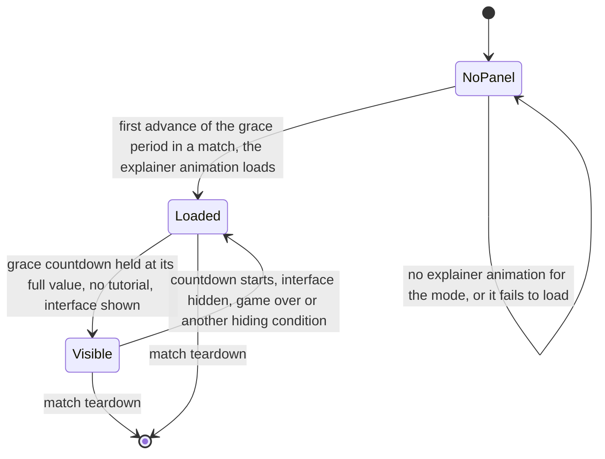
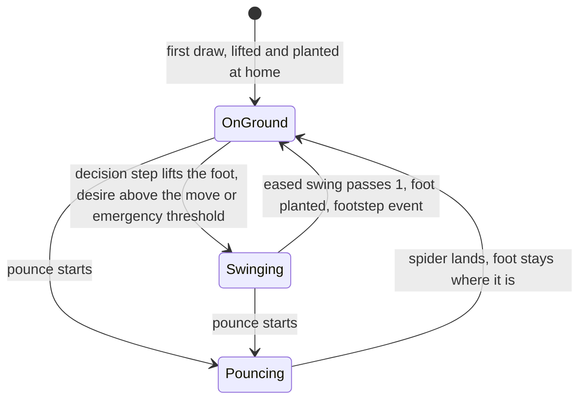

# Explainers, sprites and procedural animation

> Status: Engine baseline · Prefix: VFX · ADRs: [ADR-035](../../../ADR/ADR-035-procedural-animation-runtime.md) · [ADR-036](../../../ADR/ADR-036-effect-events-and-presentation-clock.md) · [ADR-009](../../../ADR/ADR-009-instanced-crowds-sprite-cards-and-shadows.md) · [ADR-018](../../../ADR/ADR-018-texture-import-manifest.md) · [ADR-020](../../../ADR/ADR-020-flat-shading-and-team-tint.md) · [ADR-021](../../../ADR/ADR-021-mesh-socket-schema.md) · [ADR-030](../../../ADR/ADR-030-ui-framework-build-or-buy.md) · [ADR-031](../../../ADR/ADR-031-batched-ui-rendering.md) · [ADR-033](../../../ADR/ADR-033-ui-layout-scaling-and-dpi.md) · [ADR-059](../../../ADR/ADR-059-content-build-and-validators.md) · Related: [Animation and VFX](README.md) · [Particles, shatter and screen effects](particles_shatter_and_screen_effects.md) · [Entity and overlay renderers](../renderer/entity_and_overlay_renderers.md) · [Creatures](../../../reference/02_units/creatures.md) · [Worker](../../../reference/02_units/worker.md)

This document specifies the explainer player, the conventions of sprite cards and billboards, the animation of Worker cards and their overlays, the seasonal theme's presentation, team colour in effects, the other animated billboards, the damage flicker, the procedural legs and the spider gait, segment chains, trails and tails, cloth flags and the other procedural motions. The clocks, the presentation generators and the frame step are those of the [folder README](README.md).

## 1 Responsibilities and boundaries

**VFX-100** (MUST) This document owns the presentation behaviour of the explainer animations, the sprite and billboard recipes, the Worker overlays and ground shadow, the damage flicker, the procedural legs, the segment chains, trails and tails, and the cloth flags. Every motion here reads only the presentation snapshot and the presentation clock and writes only presentation state, instance data and GPU buffers; it never changes a simulated body, a simulated timer or a draw of the simulation generator (VFX-005, VFX-011, ADR-035).

**VFX-101** (MUST) The states, timers and decisions that select a recipe (a Worker's state, a spider's pounce, a Leader's order, a Crawler's samples) are simulation rules of the reference documents named in each requirement; this document only draws and animates them.

## 2 Interfaces

The interface below is a C++23 declaration sketch, not an implementation. The foot states and the leg tuning of the procedural legs are engine code in namespace `Engine`. The animator reads the game's presentation snapshot and draws game objects (actors, Crawler strips, cloth flags), so it is game-layer presentation code in `Species`, built on the engine's clocks, the renderer's instanced batches (`CrowdRenderer`, `MeshRenderer`) and the pass context (`AGENTS.md` R9).

```cpp
namespace Engine
{

enum class FootState : std::uint8_t
{
  OnGround,
  Swinging,
  Pouncing
};

struct LegTuning // from the active gait of the creature (SpiderGait)
{
  float lift;
  float idealSlope;
  float swingDuration;
  float lookAhead;
};

} // namespace Engine

namespace Species
{

class ProceduralAnimator
{
public:
  void Update(const PresentationSnapshot& _snap, const Engine::PresentationTime& _now); // flicker, legs, cloth
  // 7a, 7b and 7d bodies and overlays, into the renderer's instanced batches (ADR-009)
  void WriteActorInstances(std::string_view _passId, Engine::CrowdRenderer& _crowds, Engine::MeshRenderer& _meshes) const;
  void WriteCrawlerStrips(Engine::CrowdRenderer& _crowds) const;                                       // pass 7c (RND-319)
  void RecordClothFlags(std::string_view _passId, Engine::PassContext& _context) const;                // 7b, 8, 16
  [[nodiscard]] std::optional<float> PickClothFlag(const Engine::Ray& _ray, SimObjectId _owner) const; // local picking
  [[nodiscard]] bool Flickering(SimObjectId _object) const;
};

} // namespace Species
```

**Events.** The animator raises the spider footstep presentation event at each foot plant (R-UNIT-578). The explainer player raises none.

**Data contracts.** The animator reads the snapshot fields of [README.md](README.md) §2 and the match's seasonal state; the explainer player reads the `anim.explainer` record of the mode and the local team's colours.

**Threading contract.** Everything here runs on the frame thread. The strip, tail and cloth vertices MAY be built in a vertex or compute shader from the history buffers (ADR-035).

## 3 Data model

### 3.1 Procedural state

**VFX-102** (MUST) Procedural state is presentation state of this component, keyed by the handle of the object it belongs to and created and deleted only from the snapshot and from presentation events (R-SIM-636, RND-307):

| State | Key | Content | Lifetime |
|---|---|---|---|
| procedural legs and feet (`ProceduralLeg`, `ProceduralFoot`) | spider handle | the fields of R-UNIT-581, the active spider gait (`SpiderGait`) and the lift lock-out time | from the spider's first draw to its removal |
| cloth flag (`ClothFlag`) | owner handle and flag slot | 6 × 6 vertex positions, bounding sphere | from the owner's first draw to its removal |
| damage flicker | actor or structure handle | the flag, the chosen axis and the time of the last evaluation | while the object exists |
| Reaper Serpent eaten-orb display | Reaper Serpent handle | up to `ref.unit.reaper_serpent.max_eaten` (50) entries: offset, start time | while the Reaper Serpent exists |
| shared Brood Drifter tail velocity | none (one value) | the smoothed velocity of VFX-138 | the match |
| Worker colour cross-fade | Worker handle | owned by the renderer (RND-317) | — |

Trail histories are simulation state that this component reads: the Crawler trail samples (R-UNIT-535), the Reaper Serpent's tail positions (R-UNIT-594) and the centipede's three samples per segment (R-UNIT-551). Their GPU copies (`TrailPoint` buffers) are rebuilt from the snapshot every frame and never written back.

### 3.2 Explainer animation data

**VFX-103** (MUST) An explainer animation (`ExplainerAnimation`, asset `anim.explainer`) has the data model of [front_end_presentation.md](../../../reference/09_front_end_and_match_flow/front_end_presentation.md) R-META-226: a canvas, a loop start and end, a playback time, and objects in draw order, each with its keys in authored order and the key fields of R-META-226 with their defaults, the `ref.meta.explainer.key_default.<field>` keys. The player maps it one to one onto a UI timeline: one track per object and property, with the transform properties (x, y, scale) eased by the curve of VFX-012, the angle and the alpha linear (the alpha truncated to an integer), and the picture (`help.explainer_picture`), the colour role and the horizontal flip held from the earlier key. Its schema is the explainer schema `panels.explainer` of [data schemas](../data_schemas/README.md) (GameAssets §12).


## 4 Behaviour and algorithms

### 4.1 Explainer animations

**VFX-104** (MUST) The explainer animation of the mode explainer panel ([front_end_presentation.md](../../../reference/09_front_end_and_match_flow/front_end_presentation.md) R-META-220, [reference/11](../../../reference/11_tutorial_and_help.md) R-TUT-020) is played by the explainer player, a UI timeline component hosted by the UI framework (ADR-030, ADR-035) and drawn by the hint overlay in pass 17 (RND-070). The match's mode selects the `anim.explainer` of that mode (R-META-221); each of the six modes has one, and a mode without one shows no panel.

**VFX-105** (MUST) The panel's lifecycle follows this diagram, with the creation, visibility and teardown conditions of R-META-222 and R-META-223:



Caption: the explainer panel exists at most once per match and shows while the players ready up.

**VFX-106** (MUST) The state of an object at playback time t is evaluated by R-META-228 with the curve of VFX-012: the left key is the key with the greatest time at or before t and the right key the key with the smallest time at or after t, ties going to the first key in authored order; an object with no left key is not drawn, so an object never exists before its first key; an object with only a left key holds that key; keys closer than `ref.meta.explainer.key_merge_tolerance` (0.01 s) count as one key.

**VFX-107** (MUST) The playback clock runs on the real clock and ignores pause and game speed (R-META-229). On the first draw the playback time is 0, not the loop start, and the timer is set to now; on every draw the playback time grows by now − timer and the timer becomes now; when the playback time exceeds the loop end it is set to the loop start and the excess is discarded. The timer is refreshed only by a draw, so after a hidden span the first draw adds the whole span and the playback restarts at the loop start. These are the rules of the Open DEC-750; its default is the reference behaviour stated here.

**VFX-108** (MUST) The panel's place and size are those of R-META-224. The reference lays the panel out again by these formulas whenever the screen mode changes; the Species panel is a widget of the UI framework and is also laid out again when the DPI or the text scale changes (DEC-961, ADR-033).

**VFX-109** (MUST) The panel draws its background, frame, objects, title and caption by R-META-230 to R-META-233, through the batched UI renderer (ADR-031) with standard alpha blending: each object is one textured quad of its picture, rotated about its centre by its angle, mirrored when its flip is on, inside the panel's clip rectangle. Colour roles are resolved at draw time against the local player's team colour (R-META-227, ADR-035).

**VFX-110** (MUST) An explainer animation is validated against its schema by the content build; a malformed record, an over-long name or an unknown picture role is a build error, never a run-time fault (DEC-015). At run time an explainer animation that is missing or fails to load gives no panel for that match (R-META-222).

**VFX-111** (MAY) The player MAY expose an editing interface to an authoring tool: create and delete an object, insert a key at time t whose values are the object's evaluated state at t, find the key of an object within a time tolerance of t, delete a key, and write the animation. No game path uses it.

### 4.2 Sprite and billboard conventions

**VFX-112** (MUST) No sprite is animated frame by frame from a sheet. Every sprite is one image whose quad is transformed procedurally; the "frames" of a figure are state textures chosen by a condition, such as the hurt variants of `sprite.worker.hurt` (§4.3).

**VFX-113** (MUST) Sprites carry authored alpha by the alpha modes of ADR-018. Additive sprites carry their intensity on black; under the additive blend black adds nothing ([GameAssets](../../../assets/GameAssets.md) §2.4).

**VFX-114** (MUST) A billboard is a `CameraFacing` quad (RND-306). A square billboard of half-extent s has half-width and half-height s; a diamond billboard, whose corners lie at p ± U × s and p ± R × s on the camera up and right vectors, is the square billboard of half-size s ÷ √2 rotated by π ÷ 4 about the view axis. The bottom-anchored, horizontally mirrored billboard is that of RND-329.

**VFX-115** (MUST) Unless a rule states otherwise: a pulse is |sin(k × t)| of the unscaled presentation time t, with the floor that the rule names; a blink compares the remainder of t divided by a period with a threshold; a fade is linear in the remaining life; and a figure is drawn at its extrapolated position (RND-081), with the figures that are drawn one tick behind or ahead named in their rules.

### 4.3 Worker cards and overlays

**VFX-116** (MUST) The Worker card's texture, size, distance scaling, card-to-billboard blend, colour and cross-fade are those of RND-314 to RND-318 and [worker.md](../../../reference/02_units/worker.md) R-UNIT-142 to R-UNIT-148. A Worker that is destroyed, disabled or inside a Transport is not drawn.

**VFX-117** (MUST) This component sets the card's position and axes before the renderer builds the quad, with T the scaled presentation time, *hd* the high-detail factor and the far distance of RND-314 (1300 wu):

| Condition | Rule |
|---|---|
| *hd* > 0, closer than the far distance, on the ground | the card's foot point lies on the terrain height at its drawn position |
| *hd* > 0, closer than the far distance, airborne and neither Drowning nor InAbductionBeam | the foot point is raised by `vfx.worker.airborne_lift` (3 wu) |
| Manning, OpeningCrate, or watching an Essence orb (R-BLDG-203) | the up vector is turned about the front by sin(T) × `ref.unit.worker.sway_angle` (0.3 rad) |
| airborne, not Drowning, not of the Visitor faction | the up vector is turned about the front by T × (unit id mod 10) × `ref.unit.worker.tumble_rate` (0.1) rad, positive for an even unit id and negative for an odd one |
| Carrying | right = Normalize(carryable position − card position) × up, and up is tilted about right by `vfx.worker.carry_lean` (0.3 rad) towards the load |
| CarriedByAnt | up = −Normalize(velocity), right = the previous up, and the card is raised by `vfx.worker.ant_carry_lift` (4 wu) |
| beyond `ref.unit.worker.card_face_start` (300 wu) | in the card-to-billboard blend the camera right vector enters with a positive sign when the Worker's front · the camera front < 0 and with a negative sign otherwise, so the card never shows mirrored |

**VFX-118** (MUST) A Worker draws these layers in this order. "Current card" is the texture of RND-316; s is the card size of RND-314; t is the unscaled presentation time; every glow is additive with no depth test unless stated.

| Layer | Condition | Texture | Colour and blend | Geometry |
|---|---|---|---|---|
| ground shadow | *hd* > 0, alive, not InAbductionBeam, within `ref.unit.worker.shadow_range` (2000 wu) | current card | black at alpha `ref.unit.worker.shadow_alpha` (150) × *hd*, × `ref.unit.worker.shadow_rogue_factor` (0.3) for the Rogue faction, at most 255; `worker_ground_shadow`, no depth write (RND-221, RND-241, RND-315) | a flat quad `vfx.worker.shadow_lift` (0.3 wu) above the terrain, spanning the card's right vector and world +z by 2 × s |
| body | every Worker except the Rogue and Visitor factions, alive or airborne | current card | the colour of RND-317; `worker_card` | the card |
| Visitor body | Visitor faction | `sprite.visitor.front` | (0.5, 0.5, 0.5) (`vfx.worker.visitor_grey`) × the health factor of R-UNIT-146 | the card at s × `vfx.worker.visitor_scale` (1.3) |
| Visitor glow | Visitor faction | `fx.glow_round` | the saturated team colour (§4.5), alpha \|sin(`vfx.worker.glow_pulse_slow` × t)\| × `vfx.worker.visitor_glow_alpha` (0.3) | camera billboard of half-extent 2 × s |
| control glow | local team, controlled or selected, alive | current card | (0.1, 0.1, 1.0) (`vfx.worker.control_glow_colour`), alpha max(\|sin(`vfx.worker.glow_pulse_fast` × t)\|, `ref.unit.worker.control_glow_min` (0.3)) | `vfx.worker.control_glow_layers` (10) identical stacked cards, ten times the brightness of one |
| Fury glow | Fury, alive | current card; for the Rogue faction `sprite.worker.hurt` variant 04 at s × `vfx.worker.rogue_scale` | white, alpha max(\|sin(`vfx.worker.glow_pulse_slow` × t)\|, `vfx.worker.fury_glow_min` (0.3)) | the card |
| Sickness bubble | sick, alive | `fx.glow_round` | `ref.unit.worker.sickness_bubble_colour` (90, 130, 10), alpha \|sin(`vfx.worker.glow_pulse_slow` × t)\| × `vfx.worker.sickness_bubble_alpha` (0.8) | camera billboard of half-extent 2 × s, raised by s |
| Rogue body | Rogue faction | `sprite.worker.hurt` variant 04 | white, alpha blend with no cut-out, drawn twice | the card at s × `vfx.worker.rogue_scale` (1.5) |
| Shield bubble | Shield, alive | `fx.bubble_sphere` | the saturated team colour (§4.5), alpha \|sin(`vfx.worker.glow_pulse_slow` × t)\| × `vfx.worker.shield_bubble_alpha` (0.5) | camera billboard of half-extent 2 × s |
| side card | edge-on view, c = \|front × direction to the camera\| above `ref.unit.worker.side_view_threshold` (0.95) | `sprite.worker.side` | the team colour, alpha 255 × `vfx.worker.side_alpha_gain` (20) × (c − 0.95), at most 255 | a strip ± `vfx.worker.side_half_width` (0.25 wu) along the camera right vector, the card's height high |
| seasonal hat | R-UNIT-148 | `sprite.worker.seasonal_hat` | white | the card at s × `vfx.worker.hat_scale` (0.65), raised `vfx.worker.hat_raise` (0.95) × the card's up extent, moved `vfx.worker.hat_forward` (0.01) × front |
| Convert overlay | a Convert link, alive | `sprite.worker.state_overlay` | the team colour, alpha 255 × (1 − frac(t)), no cut-out, no depth write | the card at s × (`vfx.worker.convert_overlay_scale` (2.8) + frac(t)), so it expands once per second, lowered `vfx.worker.convert_overlay_drop` (0.4) × the up extent |
| crate-capture beam | OpeningCrate, within `ref.unit.worker.crate_spark_factor` (1.1) × the crate scan range | `fx.beam_short` | the team colour, alpha \|sin(`vfx.worker.capture_beam_pulse` × (t + unit id))\| × 255 | a `Segment` of half-width `vfx.worker.capture_beam_half_width` (0.5 wu) from the card position + `vfx.worker.capture_beam_lift` (4 wu) × up to the crate |
| corpse fragments | dead | current card | black, alpha health × `vfx.worker.fragment_alpha` (2.55) | `ref.unit.worker.corpse_fragments` (3) cards of half the size, drifting apart along ±x and ±z by `vfx.worker.fragment_spread` (10) − h ÷ `vfx.worker.fragment_spread_divisor` (10) wu and rising with their height, where h is a display health that falls by `vfx.worker.fragment_fade_ground` (40) per s of scaled presentation time on the ground and `vfx.worker.fragment_fade_air` (20) per s airborne |

A dead Worker's body is drawn in its colour × `ref.unit.worker.corpse_colour` (0.2) at alpha `ref.unit.worker.corpse_alpha_per_health` (2.5) × health (R-UNIT-146), and a paralysed Worker in `ref.unit.worker.paralysed_colour` (150, 150, 150). The glow pulse rates are `vfx.worker.glow_pulse_fast` (5 rad/s) and `vfx.worker.glow_pulse_slow` (2 rad/s). The launch-spectacle shadow of a watching Worker is never drawn: the spectacle is inactive in matches (DEC-009).

### 4.4 Seasonal theme

**VFX-119** (MUST) Whether the seasonal theme is active is match state, decided once in the match setup and identical for every participant (DEC-118, R-SIM-726); whether Species keeps it and who chooses it is the Open DEC-101, whose default is that the host's match setup applies the reference date window `ref.meta.seasonal.first_day` to `ref.meta.seasonal.last_day` of `ref.meta.seasonal.month` once. This component reads the state from the match setup and never from a local date. While it is active:

| Effect | Specified in |
|---|---|
| seasonal hats on every Worker whose unit id is divisible by `ref.unit.worker.seasonal_hat_period` (3) | R-UNIT-148, VFX-118 |
| snow on every map, from the presentation generator | R-SIM-234, R-CRATE-500, [particles](particles_shatter_and_screen_effects.md) VFX-224 |
| trees with branches of `ref.bldg.tree.seasonal_branch_rgb` (180, 100, 50) and no leaves | [trees_and_crate_structures.md](../../../reference/03_buildings_and_world_objects/trees_and_crate_structures.md), [renderer/world_renderers.md](../renderer/world_renderers.md) |
| the seasonal terrain ramp, sea tile and shore-wave gradient | [terrain](../terrain/README.md) TER-042 |
| every light colour replaced by `rnd.light.seasonal_colour` (1.3, 1.2, 1.2); the light's alpha keeps its map value | RND-013 |

No other seasonal theme exists.

### 4.5 Team colour in effects

**VFX-120** (MUST) Effects take team colour from these sources:

| Source | Users |
|---|---|
| the team colour of the colour table (RND-016), as 8-bit RGBA | sprites, laser bolts, Essence orbs, rings, beams, cloth flags, particles given an explicit colour |
| the team palette index of a mesh instance (ADR-020) | shatter debris, which keeps the tinted facet colours of the mesh it came from ([particles](particles_shatter_and_screen_effects.md) §4.10) |
| the team area that the companion tint mask of a cloth-flag texture marks (`marker.leader_banner`, `marker.flag_post_state`; [asset pipeline](../asset_pipeline_and_resources.md) AST-022) | cloth flags (§4.10) |

The Rogue faction's colour is near black, so its additive figures are drawn instead with the darkening or ink blend, or in white with alpha 0: Rogue faction Essence orbs, Crawler strips and laser bolts follow RND-327, RND-319 and RND-339.

**VFX-121** (MUST) The Shield bubble and the Visitor-faction glow take a saturated team colour: each channel of the 8-bit team colour is fully on when its value is at least 1 and fully off when it is 0, so most team colours give a white bubble, orange a yellow one and purple a magenta one (RND-408). This is the reference look and the default of the Open DEC-328. The Fury glow's colour (200, 200, 200) saturates to white by the same rule.

### 4.6 Other billboards and sprites

**VFX-122** (MUST) Each live entry of a Reaper Serpent's eaten-orb display (R-UNIT-591) is drawn, while its age is below `ref.unit.reaper_serpent.eaten_display_ticks` (600 ticks of presentation time), at the head position + its offset, drawn when the entry is made as `FxRng::NextSigned`(2 × `vfx.serpent.eaten_offset`) per axis (± 10 wu, DEC-962 item 3), as two diamond billboards of `fx.glow_round` in `vfx.serpent.eaten_colour` (100, 50, 50) with a = 1 − age ÷ that span and d the camera distance: an inner one of half-extent `vfx.serpent.eaten_inner_size` (4) × a ÷ d^¼ at alpha `vfx.serpent.eaten_inner_alpha` (200) × a, and an outer one of half-extent `vfx.serpent.eaten_outer_size` (12) × a ÷ d^¼ at alpha `vfx.serpent.eaten_outer_alpha` (100) × a, additive with no depth test (`actor_glow_nodepth`). When the display is full, a new entry overwrites a slot chosen by `FxRng::NextUint` mod 50. An entry whose span has passed is removed by this component; the list is presentation state.

**VFX-123** (MUST) A Wisp's two cards (R-UNIT-597) are drawn along the Wisp's own right and up axes, not facing the camera.

**VFX-124** (removed: no rule of a match breaks an Essence orb, so no orb is drawn broken; DEC-871)

**VFX-125** (MUST) The thrown weapon's tumble and fuse-blink flash (R-CRATE-414), the barrage missile's warhead, launcher and ground marker ([hazards_and_projectiles.md](../../../reference/02_units/hazards_and_projectiles.md), RND-324), the dust object (R-CRATE-505) and the snowflake (R-CRATE-501) are drawn as their owners state; the fuse blink's sound is a presentation event of the blink, never a sound started by drawing (DEC-007).

### 4.7 Damage flicker

**VFX-126** (MUST) An object's damage-flicker flag is presentation state of this component, evaluated once per `vfx.flicker.step` (one `ref.sim.tick_period`, 0.1 s of scaled presentation time), the cadence of the reference (DEC-963 item 2), never inside a tick and never stored in a simulated object (R-UNIT-051, R-SIM-636). With t the unscaled presentation time and s = sin(t + `ref.unit.flicker.phase_per_id` (10) × unit id), the flag of an actor is set when `FxRng::NextUnit`(`ref.unit.flicker.chance_scale` (0.75)) × (1 − \|s\| × `ref.unit.flicker.sine_weight` (0.8)) > its health fraction. A Spitter Plant's flag is set when `FxRng::NextUnit`(`ref.unit.flicker.chance_scale`) × (1 − \|s\| × `vfx.flicker.structure_sine_weight` (1.2)) > its damage ÷ `vfx.flicker.spitter_damage_divisor` (50), and it flickers only while its damage is above 0; a Hive's flag uses the same expression with its health ÷ `vfx.flicker.hive_health_divisor` (100). An object at full health never flickers; at low health it flickers on most steps, modulated by its slow sine.

**VFX-127** (MUST) While its flag is set, the object's body draw is replaced by a draw in which one axis of its mesh transform, chosen at each evaluation by a presentation draw, is scaled, with the catalogue entry that RND-324 gives (`actor_flicker_additive` for additive one-one blending; `actor_flicker_darkening` for the spider). Because the world is black, an additive flicker shows a brighter, briefly stretched ghost of the object, and only the spider darkens:

| Object (pass) | Axis choice | Scale of the chosen axis | Blend |
|---|---|---|---|
| spider (7b) | right or up, each with probability `vfx.flicker.spider_axis_share` (0.5) | 1 + s × `vfx.flicker.spider_gain` (0.5) | darkening, for the body only |
| Leader (7b), Trooper (7a) | front, up or right with probabilities `vfx.flicker.axis_shares` (0.3, 0.3, 0.4) | front and right: 1 − s × `vfx.flicker.gain` (0.5); up: 1 − s × `vfx.flicker.up_gain` (0.2) | additive |
| Brood Drifter (7b) | as the Leader | 1 − s × `vfx.flicker.gain` (0.5) on whichever axis is chosen | additive |
| Spitter Plant (6) | as the Leader | as the Leader | additive |
| Hive (6) | as the Leader | front and right: 1 − s × `vfx.flicker.hive_gain` (0.7); up: 1 − s × `vfx.flicker.gain` (0.5) | additive |
| Transport (7b) | right or front, each with probability `vfx.flicker.transport_axis_share` (0.5) | 1 + sin(t) × `vfx.flicker.gain` (0.5), with no unit-id term | additive |

The Collector, the Builder, the Worker, the Crawler and every other object never flicker; the centipede's flag has no visible effect and is not evaluated.

### 4.8 Procedural legs and the spider gait

**VFX-128** (MUST) The spider's eight procedural legs run on the client from the spider's presentation transform, entirely in presentation (DEC-007, ADR-035, R-UNIT-578); their state is that of VFX-102. Each leg's root is a socket `leg_01` to `leg_08` of `mesh.creature.spider_body`, in leg order, and each segment's length is the distance from its mesh origin to the `segment_end` socket of `mesh.creature.spider_thigh` or `mesh.creature.spider_shin` (R-UNIT-580, R-UNIT-581, ADR-021); the content build rejects a spider mesh without these sockets (ADR-059).

**VFX-129** (MUST) With H the spider's hover height `ref.unit.spider.hover_height` (3 wu), positions in world space and t the unscaled presentation time, a leg works as follows (R-UNIT-582 to R-UNIT-585):

```text
hip     = root socket under the frame (spider front, world up, spider position)   # ignores body pitch and roll
home(H) = hip + HorizontalNormalize(hip - body) * TerrainNormal(body).y * (idealSlope * H)
          then home.y -= H
desire  = |foot - home(H)|
Lift(H):
    target   = home(H) + RotateY(body velocity, 0.5 * ref.unit.spider.leg.yaw_prediction * angularVelocity.y) * lookAhead
    target.y = TerrainHeight(target)
    state = Swinging; liftTime = t; lastGround = foot
Swing (each frame while Swinging):
    f = ease((t - liftTime) / swingDuration)          # VFX-012, completion value ref.unit.spider.leg.swing_done
    if f > 1: foot = target; state = OnGround; raise the footstep event (R-UNIT-578)
    else:     foot = lerp(lastGround, target, f) + (0, arc(f), 0)
arc(f) = vfx.leg.arc_rise * f * lift          for f < vfx.leg.arc_knee_low
       = vfx.leg.arc_rise * (1 - f) * lift    for f > vfx.leg.arc_knee_high
       = lift                                 otherwise
```

The lift profile is a trapezoid that rises with slope `vfx.leg.arc_rise` (3) up to `vfx.leg.arc_knee_low` (0.33), holds the lift and falls from `vfx.leg.arc_knee_high` (0.67); at its knees it reaches 0.99 × the lift. The swing is re-evaluated every frame, so feet move smoothly between decision steps.

**VFX-130** (MUST) The knee is placed by a two-bone solve that keeps both segment lengths (ADR-035). With thigh length a, shin length b, L = |hip − foot| clamped to [|a − b|, a + b], the bend axis k = Normalize(HorizontalNormalize(hip − body centre) × world up), the axis of the reference knee rule (R-UNIT-584), and α = acos(clamp((b² + L² − a²) ÷ (2 × b × L), −1, 1)), the knee is foot + rotate(Normalize(hip − foot) × b, k, −α), which bends the knee outward and upward as the reference does. When the foot lies beyond a + b from the hip, the leg is drawn straight from the hip towards the foot with its full length a + b, and the foot's planned position is unchanged. The reference rule, in which the shin keeps its length and the thigh stretches to reach the hip, is not reproduced (ADR-035).

**VFX-131** (MUST) While the spider is not pouncing, the gait's decision step runs once per `ref.sim.tick_period` (0.1 s) of scaled presentation time, the cadence of the reference tick:

1. the foot selection runs `ref.unit.spider.max_lifts_per_tick` (2) times; each run selects nothing while the scaled time is before the lift lock-out; otherwise it lifts at once every planted foot whose desire exceeds `ref.unit.spider.foot_emergency` (12 wu), which neither counts as the run's choice nor sets the lock-out; then, among the remaining planted feet, the one with the highest desire, if that desire exceeds `ref.unit.spider.foot_move` (5 wu), is lifted and the lock-out is set to now + the active set's delay between lifts. A step therefore makes at most one regular lift, plus any number of emergency lifts, and regular lifts are at least the delay apart; the second run lifts a foot only when the first found no regular candidate;
2. the active spider gait (`SpiderGait`) is the set of R-UNIT-579 whose ideal speed is nearest the spider's speed |v|, a tie keeping the lower set;
3. every leg takes the active set's lift, swing duration and look-ahead, and its ideal slope × `ref.unit.spider.gait_slope_factor` (2.5).

**VFX-132** (MUST) On the spider's first draw, its legs take the values of set `ref.unit.spider.gait_start_set` (2) without the slope factor, and every foot is lifted and at once planted at its home, so the feet start in place; the slope factor applies from the first decision step on.

**VFX-133** (MUST) When the spider starts a pounce (R-UNIT-574), every leg becomes Pouncing with body-to-foot = body − foot, last ground = foot, target = foot + (pounce target − body), and the pounce start time is the scaled presentation time. While it pounces, the decision step does not run and each leg takes the pounce pose of R-UNIT-585 with f = `ref.unit.spider.pounce_pose_rate` (2) × (scaled time − pounce start), so the feet tuck in and extend again over 0.5 s. When the spider lands (R-UNIT-575), every foot becomes OnGround where it is, and the desires of the next steps pull the feet back to their homes.

**VFX-134** (MUST) The spider's body is drawn at its extrapolated position with up = the terrain normal, right = up × front and front = right × up, with the damage flicker of VFX-127. Its legs are drawn after the body with the same extrapolation: the hip from the extrapolated body; the foot at its position when OnGround, at the swing re-evaluated for the frame's time when Swinging, and at its position + the body's extrapolated movement when Pouncing; the knee by VFX-130. The shin `mesh.creature.spider_shin` is drawn with front = up × world up, up = Normalize(knee − foot) and position foot; the thigh `mesh.creature.spider_thigh` with up = Normalize(hip − knee) and position knee; both with the object lighting (RND-324).



Caption: the states of one procedural foot; the transitions run in presentation and never change the spider's simulated body.

### 4.9 Segment chains, trails and tails

**VFX-135** (MUST) A centipede segment's position follows its leader in the simulation (R-UNIT-551). It is drawn only while it is alive and linked into its chain, at its extrapolated position snapped to the terrain height, with up = the terrain normal, right = up × front and front = right × up, all three axes scaled by the segment's size, as `mesh.creature.centipede_head_segment` for a head and `mesh.creature.centipede_segment` otherwise, with the scaled normals of RND-326. A dying segment shatters at its size and unlinks (R-UNIT-557), so the chain visibly splits.

**VFX-136** (MUST) A Reaper Serpent is drawn one tick behind: with the extrapolation time t′ = t − `ref.sim.tick_period`. Its head is drawn at its position extrapolated by t′ with its front and up orthonormalised. For each pair of tail samples h[i − 1] and h[i] (R-UNIT-594), newest first, with i ≥ 1, the tail segment i is drawn at h[i − 1] + (h[i − 1] − h[i]) ÷ `ref.sim.tick_period` × t′ with front = Normalize(h[i − 1] − h[i]), right = front × world up and up = right × front, at the scale of R-UNIT-594, with renormalised normals (RND-324). Every registered hit shatters every tail segment with fraction 1.0 (R-UNIT-593).

**VFX-137** (MUST) Each Crawler of a Crawler group or of a team's Crawler crowd pass is drawn as a worm strip and a glow strip (R-UNIT-539, RND-319 to RND-322), built every frame from its trail samples:

```text
p = the Crawler's position at the slice-aware time of RND-082
if detail == 1: p.y = TerrainHeight(p) + ref.unit.crawler.hover_height
alphaWorm = ref.unit.crawler.worm_alpha; alphaGlow = ref.unit.crawler.glow_alpha; v = 0; carried = 0
for each sample s of the drawn share of the history, newest first (R-UNIT-539):
    if detail > 1 and s is not required: carried += s.distance; continue
    len = s.distance + carried; carried = 0
    worm segment from p to s.position: half-width ref.unit.crawler.worm_half_width along the previous
        sample's width direction (built on the terrain normal only at detail 1); the trail column of
        RND-320 across its width; v from v to v + len * vfx.crawler.worm_v_per_wu; colour alpha alphaWorm
    if detail < 4: glow segment over the same span extended by s's glow step at both ends,
        half-width ref.unit.crawler.glow_half_width, the whole of fx.glow_round; colour alpha alphaGlow
    alphaWorm = max(0, alphaWorm - len); alphaGlow = max(0, alphaGlow - len)   # one alpha per wu
    p = s.position; v += len * vfx.crawler.worm_v_per_wu
```

The worm texture coordinate advances by `vfx.crawler.worm_v_per_wu` (6 ÷ 512, six pixels of the 512 px trail column per wu). The worm reaches alpha 0 after 200 wu and the glow after 150 wu, so with the 175 wu history (`ref.unit.crawler.tail_length`) the worm's tail ends near alpha 25. The worm colour is the team colour × the health fraction; the glow takes the worm colour. A Rogue faction Crawler uses the colours of R-UNIT-539 in the ink batch; a dead one is drawn in the additive batch. A dead Crawler has RGB `vfx.crawler.dead_rgb` (250, 250, 250), worm alpha = its health and glow alpha = `vfx.crawler.dead_glow_factor` (2.5) × its health.

**VFX-138** (MUST) A Brood Drifter's body is drawn at its extrapolated position with a fixed orientation, front (0, 0, 1) and up the world up: it never turns. Its four tails (R-UNIT-547) start at the sockets `tail_01` to `tail_04` of `mesh.creature.brood_drifter_body` and share one smoothed velocity *u* for all Brood Drifters (DEC-856 item 4), updated once per drawn Brood Drifter at every step of VFX-018 as *u* = `vfx.brood.tail_smoothing` (0.95) × *u* + (1 − 0.95) × the Brood Drifter's velocity. With t the unscaled presentation time, tail i (0 to 3) is one strip of `ref.unit.brood_drifter.tail_segments` (3) segments:

```text
p0  = socket i; dir = HorizontalNormalize(socket i - body position)
for j in 1..3:
    pj  = p(j-1) + dir * vfx.brood.tail_step
    pj += sin(t + i + j + unit id * 10) * vfx.brood.tail_sway      on each of x, y and z
    pj += u scaled to the length vfx.brood.tail_drag * j / 3
    pj.y -= vfx.brood.tail_droop * j / 3
    if panicking: pj += cos(vfx.brood.panic_rate * t + i + j) * vfx.brood.panic_sway   on each of x, y and z
    halfWidth(j) = vfx.brood.tail_half_width * (1 - j / 3) + vfx.brood.tail_width_wobble * sin(t + i + j)
segments face the camera ray; normal = (segment x world up) x segment
```

with `vfx.brood.tail_step` (15 wu), `vfx.brood.tail_sway` (10 wu), `vfx.brood.tail_drag` (10 wu), `vfx.brood.tail_droop` (10 wu), `vfx.brood.panic_rate` (5), `vfx.brood.panic_sway` (5 wu), `vfx.brood.tail_half_width` (2 wu) and `vfx.brood.tail_width_wobble` (0.3 wu). The strips take the team colour with the object lighting (`actor_strip_lit`, RND-324).

### 4.10 Cloth flags

**VFX-139** (MUST) A cloth flag (`ClothFlag`, R-BLDG-271 to R-BLDG-273) is created on its owner's first draw as a grid of `ref.bldg.cloth_flag.resolution` (6) × 6 vertices, vertex[x][z] = position + (x ÷ 6) × front + (z ÷ 6) × up, and is advanced every frame on the unscaled presentation clock. With size its size, t the unscaled presentation time and Δ the unscaled frame step, which is 0 while the world is held (VFX-016), so that a flag holds its shape during a pause (DEC-955 item 4); a large, highlighted or selected flag relaxes with a fixed factor that replaces the per-column factor (DEC-963 item 1), converted to the frame step (DEC-960):

```text
for x in 0..5, z in 0..5:
    k = Δ * ref.bldg.cloth_flag.relax_rate * (6 - x) / 6
    if x == 0: k = 1
    if size > ref.bldg.cloth_flag.damped_size_wu or the flag is highlighted or selected:
        k = ref.bldg.cloth_flag.damped_factor                    # replaces k (DEC-963), converted by VFX-018
    w = ref.bldg.cloth_flag.highlight_wobble if highlighted or selected, else 1
    target = position + up * size / 2 + (z / 5) * up * size     if x == 0
           = vertex[x - 1][z] + front * size / 5                otherwise
    target += (w * cos(t + p1 * x) * x / 6,
               vfx.cloth.lift_gain * w * sin(t + p2 * x) * x / 6,
               w * cos(t + p3 * x) * x / 6)                      # (p1, p2, p3) = vfx.cloth.wobble_phases
    vertex[x][z] = vertex[x][z] * (1 - k) + target * k
    if x > 0: the link from vertex[x - 1][z] is shortened to at most size / 2
```

with `vfx.cloth.wobble_phases` (1.5, 1.1, 1.3) and `vfx.cloth.lift_gain` (3). A flag larger than 40 wu, such as a Flag post's, therefore relaxes with the fixed factor 0.7 and looks stiffer.

**VFX-140** (MUST) Each frame the flag's bounding sphere is recomputed: its centre is the mean of the 36 vertices and its radius the largest distance from the centre to a vertex. The local picking ray test of a Leader's or Transport's flag uses it as a pre-test before testing two triangles per cell (R-BLDG-273); picking is presentation and input, never simulation (DEC-008).

**VFX-141** (MUST) A flag draws, with the entries of VFX-014 for its pass: its pole, a white quad of half-width `ref.bldg.cloth_flag.pole_width_wu` ÷ 2 (0.2 wu) turned perpendicular to up × the camera front and size × `ref.bldg.cloth_flag.pole_height_factor` (1.5) high; then its 5 × 5 cells as 25 textured quads, filtered linearly through all mip levels. The team area that the texture's companion tint mask marks (`marker.leader_banner_tint`, `marker.flag_post_state_tint`; AST-022) takes the team colour × `vfx.cloth.team_tint` (0.5), the full team colour while the owner is selected, and the grey `vfx.cloth.no_team_grey` (128, 128, 128) with no team (R-BLDG-273); the renderer's tint function applies that colour in the shader as the draw's tint, so no recoloured copy of the texture exists and each texture keeps one cache entry per declared variant (ADR-020, AST-030, DEC-098). When the owner has a target, the pointer `marker.flag_pointer` is drawn over the flag with `cloth_pointer`, its texture coordinates turned so that the arrow points from the flag towards the target's screen position (RND-216).

**VFX-142** (MUST) The owners of cloth flags are:

| Owner | Size | Rules |
|---|---|---|
| Leader banner | `ref.unit.leader.banner_size` (20 wu), growing with camera distance by R-UNIT-191 | front = −the Leader's horizontal heading; while its order is not None, up turns about front by `vfx.cloth.banner_wobble` (0.4 rad) × sin(`vfx.cloth.banner_wobble_rate` (2) × (t + unit id × 10)); it turns towards the camera by R-UNIT-191, flipping its texture when the turn would show it mirrored; texture variant by order (R-UNIT-191); target: the order position, or the first route waypoint after the start of the order route; the local team's banners are drawn by the world markers in pass 16 with `cloth_overlay` (RND-358), every other banner in pass 7b |
| Transport | `vfx.cloth.transport_size` (20 wu) | its flag and its deploy flag, placed at the `flag` socket of `mesh.unit.transport_hull` every frame, pass 7b |
| Flag post | `ref.bldg.flag_post.flag_size_wu` (50 wu) | created on its first draw; its picture follows the post's state (R-BLDG-267); pass 8, with the level fog |

### 4.11 Other procedural motions

**VFX-143** (MUST) The remaining procedural motions are specified by their owners and evaluated on the clocks of VFX-009:

| Motion | Rule |
|---|---|
| tree breathing sway, regrowth, burn-down, blighting and the Essence Grove leaf pulse | [renderer/world_renderers.md](../renderer/world_renderers.md) (`rnd.tree.*`) |
| Collector harvesting beam: `ref.unit.collector.beam_ring_count` (5) team-coloured rings rising from the ground to the hover height, and its bubble | R-UNIT-444, RND-324 |
| Abductor beam rings of `fx.abductor_beam_ring` scrolling up or down, and its hull's yaw | R-UNIT-710 |
| order markers: a travelling `fx.starburst` card of `vfx.motion.order_marker_flare` (15 wu) that fades over its last `ref.unit.leader.marker_fade_ticks` (10 ticks); order trail marks | R-UNIT-185, R-UNIT-186 |
| Allegiance Scrambler: two muzzle-flash particles at the ends of a turning arm, at each step of VFX-018 | R-BLDG-654 |
| shell casing spin and bounce | R-CRATE-456 |
| thrown-weapon tumble and fuse blink | R-CRATE-414 |
| Essence orb hover and wobble (simulation) | [essence_orbs.md](../../../reference/02_units/essence_orbs.md) |
| snowflake and Wisp wobble | R-CRATE-501, R-UNIT-596 |

## 5 Concurrency and performance budget

**VFX-144** (MUST) The CPU work of this document per frame is: the Worker and actor instance data (written with the renderer's instance types, RND-311); one gait decision step per spider per 0.1 s of scaled presentation time and eight leg poses per spider per frame; one 6 × 6 relaxation per visible cloth flag; and the explainer's one batched draw. Crawler strips, Brood Drifter tails and cloth vertices MAY move to the GPU (ADR-035). Their cost belongs to the actor and effect pass groups of RND-454.

## 6 Failure modes, diagnostics and telemetry

| Failure | Behaviour | Requirement |
|---|---|---|
| a spider mesh without its leg sockets, or a leg mesh without `segment_end` | a content-build error | VFX-128 |
| a foot farther from its hip than the leg's length | the leg is drawn straight towards it; the planned foot is kept | VFX-130 |
| an explainer animation that is malformed or missing | a content-build error; at run time no panel for the match | VFX-110 |
| a cloth flag whose vertices coincide (zero size) | the flag is not drawn and is not pickable | VFX-139, VFX-140 |
| a snapshot object without its procedural state (first frame) | the state is created on that frame with the start rules (VFX-132, VFX-139) | VFX-102 |

Diagnostics: the development overlay can draw each spider's foot homes, targets and states, each cloth flag's bounding sphere and each Crawler's trail samples.

## 7 Acceptance tests

The golden-image tests compare with the default tolerance and on the pinned reference configuration of the test harness ([diagnostics, test and performance](../diagnostics_test_and_performance/README.md) §4.8), unless a test states its own tolerance.

| Test | Kind | Checks | Requirements |
|---|---|---|---|
| T1 explainer sampling | unit | an object is hidden before its first key and holds after its last; x, y and scale follow the ease, angle and alpha are linear, the alpha truncated; ties take the first key; keys 0.005 s apart count as one | VFX-103, VFX-106 |
| T2 explainer loop | unit | with a loop of 2 to 10 s, the first pass starts at 0, the next ones at 2; an advance past 10 s restarts at 2 with the excess discarded; after a hidden span the first draw restarts at the loop start | VFX-107 |
| T3 explainer panel | golden-image | the six explainer panels at 1080p and at 4K match their reference images; a resize while shown lays the panel out again; friendly and enemy roles take the local and the first enemy team's colours | VFX-108, VFX-109 |
| T4 explainer content | build check | a malformed explainer animation fails the content build; deleting a cooked one at run time gives no panel and no fault | VFX-110 |
| T5 Worker layers | golden-image | each layer of VFX-118 appears exactly under its condition, in its order, with its colour and geometry, and the card never shows mirrored | VFX-117, VFX-118 |
| T6 seasonal | integration | with the seasonal state on, every third unit id wears a hat, trees lose their leaves and lights take the seasonal colour; two clients with different local dates draw the same | VFX-119 |
| T7 saturation | unit | each team colour gives the saturated bubble colour of VFX-121 | VFX-121 |
| T8 eaten orbs | unit | the 51st entry overwrites a slot; an entry disappears 600 ticks of presentation time after its start | VFX-122 |
| T9 flicker | property | a full-health object never flickers; the share of flickering steps follows the expression of VFX-126; the evaluation runs every 0.1 s of scaled presentation time at 30 and 144 frames per second | VFX-126, VFX-127 |
| T10 two-bone solve | unit | over reachable and unreachable targets the thigh and the shin keep their lengths, the foot lies at the target when reachable, and the knee bends outward and upward | VFX-130 |
| T11 gait decisions | unit | recorded desires give at most one regular lift per step, every emergency lift, the lock-out spacing of the active set, the nearest set with ties to the lower, and the start set without the slope factor | VFX-131, VFX-132 |
| T12 swing | unit | the foot height is 0.99 × lift at f = 0.33 and f = 0.67 and lift at f = 0.5; the foot plants when f passes 1 and one footstep event is raised | VFX-129 |
| T13 pounce | unit | f reaches 1 after 0.5 s of scaled time; on landing every foot stays where it is | VFX-133 |
| T14 Crawler strips | unit | the worm alpha reaches 0 after 200 wu and the glow after 150 wu; detail 4 draws no glow; a dead Crawler takes the dead colours | VFX-137 |
| T15 Reaper Serpent | unit | the tail frames are those of VFX-136 at the one-tick-behind time | VFX-136 |
| T16 tails and flags | golden-image | Brood Drifter tails and a Leader banner, a Transport flag and a Flag-post flag in still air and while moving match their reference images; a still flag settles to its rest shape | VFX-138, VFX-139, VFX-141, VFX-142 |

## 8 Open decisions

| Reference | Status | Where it applies |
|---|---|---|
| DEC-007 | Resolved | leg, foot, flicker and eaten-orb state are presentation (VFX-100, VFX-126, VFX-128) |
| DEC-008 | Resolved | flag picking is local (VFX-140) |
| DEC-009 | Resolved | the launch spectacle is inactive (VFX-118) |
| DEC-015 | Resolved | explainer animations are validated at build time (VFX-110) |
| DEC-098 | Resolved | flag textures keep one cache entry per asset and variant; team looks are tint values (VFX-141) |
| DEC-101 | Open | whether Species keeps the seasonal theme (VFX-119) |
| DEC-118 | Resolved | the seasonal state is match state (VFX-119) |
| DEC-328 | Open | saturated bubble colours (VFX-121) |
| DEC-750 | Open | the explainer loop and visibility rules (VFX-107) |
| DEC-856 | Open | one tail velocity shared by every Brood Drifter (VFX-138) |
| DEC-871 | Dropped | no match breaks an Essence orb, so no orb is drawn broken (VFX-124, removed; R-UNIT-308) |
| DEC-955 | Resolved | a cloth flag holds its shape while the world is held (VFX-139) |
| DEC-960 | Resolved | per-frame blend factors and emission run in fixed steps (VFX-138, VFX-139, VFX-143) |
| DEC-961 | Resolved | the explainer panel is laid out again on every screen change (VFX-108) |
| DEC-962 | Open | the eaten-orb offset range (VFX-122) |
| DEC-963 | Open | the fixed factor of large and selected flags; the per-tick flicker cadence (VFX-126, VFX-139) |
| ADR-035 | Accepted | client-side procedural animation, two-bone legs, explainer timelines |

The design-phase inputs of this component are listed in the [folder README](README.md) §8.

## 9 Tuning table

| key | value | unit | range or notes | requirement | DEC |
|---|---|---|---|---|---|
| `vfx.worker.airborne_lift` | 3 | wu | card foot point of an airborne Worker | VFX-117 | |
| `vfx.worker.carry_lean` | 0.3 | rad | lean towards a carried structure | VFX-117 | |
| `vfx.worker.ant_carry_lift` | 4 | wu | card raised while carried by an ant | VFX-117 | |
| `vfx.worker.shadow_lift` | 0.3 | wu | ground shadow above the terrain | VFX-118 | |
| `vfx.worker.visitor_grey` | 0.5, 0.5, 0.5 | RGB factor | × the health factor | VFX-118 | |
| `vfx.worker.visitor_scale` | 1.3 | × card size | Visitor faction body | VFX-118 | |
| `vfx.worker.visitor_glow_alpha` | 0.3 | alpha | × the pulse | VFX-118 | DEC-328 |
| `vfx.worker.glow_pulse_fast` | 5 | rad/s of unscaled presentation time | control glow | VFX-118 | |
| `vfx.worker.glow_pulse_slow` | 2 | rad/s of unscaled presentation time | Fury, Sickness, Shield and Visitor glows | VFX-118 | |
| `vfx.worker.control_glow_colour` | 0.1, 0.1, 1.0 | RGB | | VFX-118 | |
| `vfx.worker.control_glow_layers` | 10 | quads | identical stacked cards | VFX-118 | |
| `vfx.worker.fury_glow_min` | 0.3 | alpha | floor of the Fury pulse | VFX-118 | |
| `vfx.worker.sickness_bubble_alpha` | 0.8 | alpha | × the pulse | VFX-118 | |
| `vfx.worker.rogue_scale` | 1.5 | × card size | Rogue faction body and Fury glow | VFX-118 | |
| `vfx.worker.shield_bubble_alpha` | 0.5 | alpha | × the pulse | VFX-118 | DEC-328 |
| `vfx.worker.side_alpha_gain` | 20 | × (c − 0.95) | side-card alpha ramp, × 255 | VFX-118 | |
| `vfx.worker.side_half_width` | 0.25 | wu | side-card strip | VFX-118 | |
| `vfx.worker.hat_scale` | 0.65 | × card size | seasonal hat | VFX-118 | DEC-101 |
| `vfx.worker.hat_raise` | 0.95 | × up extent | seasonal hat | VFX-118 | DEC-101 |
| `vfx.worker.hat_forward` | 0.01 | × front | seasonal hat | VFX-118 | DEC-101 |
| `vfx.worker.convert_overlay_scale` | 2.8 | × card size | + frac(t) | VFX-118 | |
| `vfx.worker.convert_overlay_drop` | 0.4 | × up extent | | VFX-118 | |
| `vfx.worker.capture_beam_pulse` | 3 | rad/s of unscaled presentation time | | VFX-118 | |
| `vfx.worker.capture_beam_half_width` | 0.5 | wu | | VFX-118 | |
| `vfx.worker.capture_beam_lift` | 4 | wu | × up from the card position | VFX-118 | |
| `vfx.worker.fragment_alpha` | 2.55 | alpha per health | corpse fragments | VFX-118 | |
| `vfx.worker.fragment_spread` | 10 | wu | drift = 10 − h ÷ 10 | VFX-118 | |
| `vfx.worker.fragment_spread_divisor` | 10 | display health per wu | drift = 10 − h ÷ 10 | VFX-118 | |
| `vfx.worker.fragment_fade_ground` | 40 | display health per s | on the ground | VFX-118 | |
| `vfx.worker.fragment_fade_air` | 20 | display health per s | airborne | VFX-118 | |
| `vfx.serpent.eaten_offset` | 10 | wu per axis | orbit offset range; the reference range is not recorded | VFX-122 | DEC-962 |
| `vfx.serpent.eaten_colour` | 100, 50, 50 | RGB | eaten-orb display | VFX-122 | |
| `vfx.serpent.eaten_inner_size` | 4 | × a ÷ d^¼ | inner diamond half-extent | VFX-122 | |
| `vfx.serpent.eaten_inner_alpha` | 200 | × a, of 255 | | VFX-122 | |
| `vfx.serpent.eaten_outer_size` | 12 | × a ÷ d^¼ | outer diamond half-extent | VFX-122 | |
| `vfx.serpent.eaten_outer_alpha` | 100 | × a, of 255 | | VFX-122 | |
| `vfx.flicker.step` | 0.1 | s of scaled presentation time | one `ref.sim.tick_period` | VFX-126 | DEC-007, DEC-963 |
| `vfx.flicker.structure_sine_weight` | 1.2 | — | Spitter Plant and Hive | VFX-126 | |
| `vfx.flicker.spitter_damage_divisor` | 50 | damage | | VFX-126 | |
| `vfx.flicker.hive_health_divisor` | 100 | health | | VFX-126 | |
| `vfx.flicker.spider_axis_share` | 0.5 | probability | right, otherwise up | VFX-127 | |
| `vfx.flicker.spider_gain` | 0.5 | × s | spider scale 1 + s × 0.5 | VFX-127 | |
| `vfx.flicker.axis_shares` | 0.3, 0.3, 0.4 | probabilities | front, up, right | VFX-127 | |
| `vfx.flicker.gain` | 0.5 | × s | front and right | VFX-127 | |
| `vfx.flicker.up_gain` | 0.2 | × s | up axis of Leaders, Troopers, Spitter Plants | VFX-127 | |
| `vfx.flicker.hive_gain` | 0.7 | × s | Hive front and right | VFX-127 | |
| `vfx.flicker.transport_axis_share` | 0.5 | probability | right, otherwise front | VFX-127 | |
| `vfx.leg.arc_rise` | 3 | × f × lift | trapezoid slope | VFX-129 | |
| `vfx.leg.arc_knee_low` | 0.33 | f | end of the rise | VFX-129 | |
| `vfx.leg.arc_knee_high` | 0.67 | f | start of the fall | VFX-129 | |
| `vfx.crawler.worm_v_per_wu` | 6 ÷ 512 | texture v per wu | 6 px of the 512 px trail column per wu | VFX-137 | |
| `vfx.crawler.dead_rgb` | 250, 250, 250 | RGB | dead Crawler | VFX-137 | |
| `vfx.crawler.dead_glow_factor` | 2.5 | alpha per health | dead Crawler glow | VFX-137 | |
| `vfx.brood.tail_smoothing` | 0.95 | per step | shared smoothed velocity | VFX-138 | |
| `vfx.brood.tail_step` | 15 | wu | segment step along the tail direction | VFX-138 | |
| `vfx.brood.tail_sway` | 10 | wu | sine offset on each axis | VFX-138 | |
| `vfx.brood.tail_drag` | 10 | wu | × j ÷ 3 along the smoothed velocity | VFX-138 | |
| `vfx.brood.tail_droop` | 10 | wu | × j ÷ 3 downward | VFX-138 | |
| `vfx.brood.panic_rate` | 5 | rad/s | panic sway rate | VFX-138 | |
| `vfx.brood.panic_sway` | 5 | wu | panic sway on each axis | VFX-138 | |
| `vfx.brood.tail_half_width` | 2 | wu | × (1 − j ÷ 3) | VFX-138 | |
| `vfx.brood.tail_width_wobble` | 0.3 | wu | × sin(t + i + j) | VFX-138 | |
| `vfx.cloth.wobble_phases` | 1.5, 1.1, 1.3 | rad per column | x, y and z wobble phases | VFX-139 | |
| `vfx.cloth.lift_gain` | 3 | × | vertical wobble amplitude | VFX-139 | |
| `vfx.cloth.team_tint` | 0.5 | × team colour | the team area of the tint mask | VFX-141 | DEC-098 |
| `vfx.cloth.no_team_grey` | 128, 128, 128 | RGB | flag with no team | VFX-141 | |
| `vfx.cloth.banner_wobble` | 0.4 | rad | Leader banner wobble | VFX-142 | |
| `vfx.cloth.banner_wobble_rate` | 2 | rad/s of unscaled presentation time | | VFX-142 | |
| `vfx.cloth.transport_size` | 20 | wu | Transport flags | VFX-142 | |
| `vfx.motion.order_marker_flare` | 15 | wu | order-marker card | VFX-143 | |
