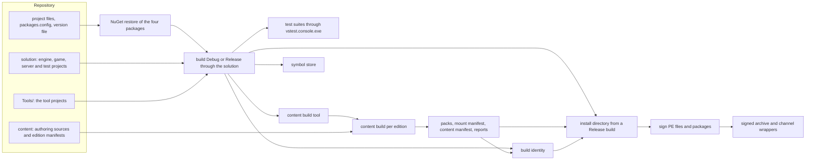
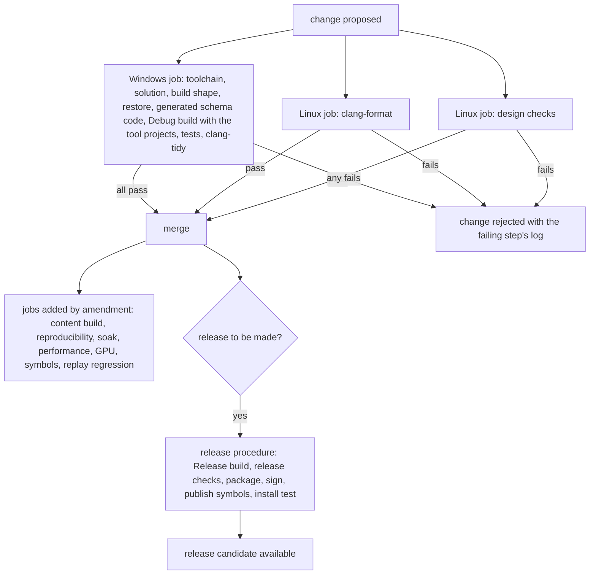

# Build tooling and distribution

> Status: Engine baseline · Prefix: BLD · ADRs: [ADR-051](../../../ADR/ADR-051-windows-toolchain-and-compiler-policy.md) · [ADR-052](../../../ADR/ADR-052-cpp23-language-standard.md) · [ADR-053](../../../ADR/ADR-053-modules-and-import-std.md) · [ADR-054](../../../ADR/ADR-054-build-system-msbuild-solution.md) · [ADR-055](../../../ADR/ADR-055-dependencies-three-nuget-packages.md) · [ADR-056](../../../ADR/ADR-056-products-configurations-and-feature-flags.md) · [ADR-057](../../../ADR/ADR-057-version-identity.md) · [ADR-059](../../../ADR/ADR-059-content-build-and-validators.md) · [ADR-060](../../../ADR/ADR-060-content-identity-by-hash.md) · [ADR-065](../../../ADR/ADR-065-crash-reporting.md) · [ADR-070](../../../ADR/ADR-070-continuous-integration.md) · [ADR-071](../../../ADR/ADR-071-install-layout-runtime-files-and-user-data.md) · [ADR-072](../../../ADR/ADR-072-distribution-channels-and-package-formats.md) · [ADR-073](../../../ADR/ADR-073-code-signing.md) · also [ADR-001](../../../ADR/ADR-001-direct3d-12-renderer-on-the-agility-sdk.md), [ADR-003](../../../ADR/ADR-003-shader-language-compiler-and-material-shaders.md), [ADR-017](../../../ADR/ADR-017-texture-container-and-block-compression.md), [ADR-050](../../../ADR/ADR-050-client-platform-and-minimum-os.md), [ADR-058](../../../ADR/ADR-058-pack-files-and-mount-policy.md), [ADR-061](../../../ADR/ADR-061-data-schemas-and-versioning.md), [ADR-062](../../../ADR/ADR-062-authoring-syntax-and-schema-language.md), [ADR-063](../../../ADR/ADR-063-localisation.md), [ADR-066](../../../ADR/ADR-066-telemetry-with-consent.md), [ADR-067](../../../ADR/ADR-067-logging.md), [ADR-068](../../../ADR/ADR-068-profiling-and-gpu-timing.md), [ADR-069](../../../ADR/ADR-069-test-framework.md) · Related: [Asset pipeline and resources](../asset_pipeline_and_resources.md) · [Data schemas](../data_schemas/README.md) · [Platform layer](../platform_layer.md) · [Diagnostics, test and performance](../diagnostics_test_and_performance/README.md) · [Maps: rules and conventions](../../../reference/08_maps_and_level_design/rules_and_conventions.md) · [Map editor hooks](../../../reference/08_maps_and_level_design/map_editor_hooks.md) · [Options, localisation and hooks](../../../reference/09_front_end_and_match_flow/options_localisation_and_hooks.md) · [Game assets](../../../assets/GameAssets.md)

This component specifies how Species is built, checked and delivered. It covers the toolchain and its pins; the build definition, which is one MSBuild solution of `.vcxproj` projects with the two configurations Debug and Release, the development tools among them; the four allow-listed NuGet packages; the shaders that the build compiles into the executable; the generated build identity; the **content build** program, which runs the stages of the asset pipeline and the data schemas for each edition and adds its reports and the map-identity listing; the localisation build and the translation workflow; the hooks that a map tool uses; continuous integration; the release build, the client install directory, its packages and channel wrappers; code signing; and the build side of crash reporting. The rules of each content stage (import records, cookers, placeholders, validators, the pack format, entry hashes and the content manifest) belong to the [asset pipeline](../asset_pipeline_and_resources.md) and the [data schemas](../data_schemas/README.md); this document cites them and never restates them.

Notation used throughout:

- A **product** is one of the programs of ADR-056, each built from one project: the **client** (`Species.exe`, which can also host the integrated server), the **server** (`SpeciesServer.exe`, the headless dedicated server) and the **content build tool** (`SpeciesContentBuild.exe`), a development tool. A **tool project** is a project of a development tool, in `Tools/<Project>/` and in the `Tools` solution folder (`AGENTS.md` §2, ADR-054). Every product, every library, the test projects `<Project>Tests` (ADR-069) and every tool project are projects of the one solution.
- A **configuration** is `Debug|x64` or `Release|x64`, the only two (ADR-054). **Debug builds** compile the development facilities in; **Release builds** are what players and testers run (ADR-056).
- An **edition** is one selection of content with its runtime feature flags, described by one **edition manifest** (ADR-056, ADR-059). An edition **marked for release** is one whose manifest sets the release flag (§3.2).
- A **channel** is a distribution channel, and a **channel wrapper** is the package that one channel delivers (ADR-072).
- The **repository layout** is that of `AGENTS.md` §2 and ADR-054: the solution `<Solution>.slnx` at the repository root, with one flat folder per project and the shader subfolders `<Lib>/Shader/` and `<Lib>/CompiledShader/`; `GameData/`, the authoring sources of the content build (ADR-059); `Tools/`, the tool projects and the design tools; `Build/`, the checker scripts; and `.github/workflows/build.yml`, the CI workflow.
- A **CI job** is a job of `.github/workflows/build.yml`, committed or added by amendment of ADR-070.
- The **release procedure** is the Release build, the release checks, packaging, signing and symbol publication that whoever ships runs before a release (BLD-122).

## Folder index

| File | Holds | Requirement IDs |
|---|---|---|
| [README.md](README.md) (this file) | responsibilities and boundaries, the interfaces, the data model, the toolchain and its dependencies, products, configurations and binary checks, editions and feature flags, version identity, continuous integration, the tuning table, the budgets, failure modes, acceptance tests and open decisions | the BLD ids not listed below |
| [content_and_localisation_build.md](content_and_localisation_build.md) | §4.5 to §4.8: the content build, map identity from the content build, the localisation build and the map-editor tooling hooks | the BLD ids of §4.5 to §4.8 |
| [packaging_signing_and_crash_reporting.md](packaging_signing_and_crash_reporting.md) | §4.10 to §4.12: client packaging and distribution, code signing and crash reporting integration | the BLD ids of §4.10 to §4.12 |

Section numbers are those of the whole component: a section cited as §4.5 is in the file that the index names for it. The component was one file until 2026-10-19, when it reached the size limit and was split without a change to any requirement.

## 1 Responsibilities and boundaries

**BLD-001** (MUST) The build tooling owns: the toolchain definition and its pins (§4.1); the build definition, which is the one solution with its projects, tool projects included, filters, configurations and compile-time switches (§2.1, §3.1, §4.2); the project-file checker and its rules (table 4.1-B); the package list and its restore (§4.1); the shader compilation of the solution build (§4.1); the drift check of the committed generated schema code (O28, ADR-062, table 4.9-A); the edition-manifest semantics and the release flag (§3.2, §4.3); the build-identity generator (§3.3, §4.4); the content build program, which is its command line, its run modes, the order of its stages, its edition handling, its reports and the map-identity listing (§2.2, §4.5, §4.6); the localisation build and the translation export and import (§4.7); the build-side hooks of map tools (§4.8); the CI workflow and its jobs (§4.9); the release procedure, the install directory, the packages, the channel wrappers and the repair function (§4.9, §4.10); code signing (§4.11); and symbol publication with the build side of crash reporting (§4.12).

**BLD-002** (MUST NOT) The build tooling restates no rule of a content stage. The import records, cookers, derived variants, placeholders, asset validators, pack format, pack writer, entry hashes, content manifest and simulation content identity are the asset pipeline's (AST-001). The schemas, the authoring parser, the record validators, the cooked record format, the canonical writer and the schema migration are the data schemas' (DAT-001). The content build program runs those stages in the order of §4.5 and never changes what they produce.

**BLD-003** (MUST NOT) No build is configured by editing a source file. The product is chosen by building its project, the configuration by the solution configuration, and the edition, the version and every pin come from the edition manifests, the version file, the project files and the `packages.config` files (ADR-054, ADR-056, ADR-057). No number that identifies a build or a map is typed by hand in more than one place, and no source file holds a table of map identities (ADR-060).

**BLD-004** (MUST NOT) No build step writes into an install directory after packaging has finished, and no Species program writes into its own install directory at run time (ADR-071). The crash path itself is not part of this component: the [platform layer](../platform_layer.md) installs the crash handlers and registers the files and memory that a crash report carries, and the [diagnostics](../diagnostics_test_and_performance/README.md) component owns the contents of the black box, the soak-test harness, the test harness and the performance tests. This component provides the symbols, signatures, version resources and test-machine settings that make those reports usable (§4.12).

**BLD-005** (MUST) The one solution builds the products of ADR-056: the client, the server, the libraries they link, the test projects and the tool projects, the content build tool among them. A tool project may reference the engine projects it shares code with; no game or engine project references a tool project or a tool-only package, and nothing from a tool project links into the executable (`AGENTS.md` §2, O29). The server is headless and links no graphics, audio, input or text-rendering library (ADR-056, ADR-001). Which process roles the client and the server play is DEC-220; until it is decided, the build provides both programs, and the integrated server is the same library that the server links (DEC-220 item 1).

Table 1-A Boundaries.

| Neighbour | Gives the build tooling | Takes from it |
|---|---|---|
| [asset pipeline](../asset_pipeline_and_resources.md) (`AST`) | the content stages, the packs, the asset indexes, the mount manifests, the content manifest, the placeholder flags and the asset diagnostics | the edition manifests and their release flag, the products and configurations, the CI jobs that run the content build, the installation of the packs (AST-056) |
| [data schemas](../data_schemas/README.md) (`DAT`) | the edition-manifest schema, the record diagnostics (DAT-051), the canonical writer and the migration step | the content build program that runs them, CI |
| [platform layer](../platform_layer.md) (`PLT`) | the crash path and its registrations, the user-data folders, the start-up checks and the start-up message path | the build identity, the install layout, the channel tag, the test-machine dump settings |
| [diagnostics](../diagnostics_test_and_performance/README.md) (`DBG`) | the black box, the test harness, the soak harness, the performance tests and their budgets | the CI jobs and their artefacts, the build identity, the symbol store, the soak edition |
| [renderer](../renderer/README.md) (`RND`) | the use of the Agility SDK runtime, the shader sources and the version string drawn in the front end (RND-076) | the exported Agility SDK constants, taken from the package pin (§4.1); the compiled shader byte arrays (BLD-121) |
| [UI framework](../ui_framework/README.md) (`UI`) | the string-table merge (UI-222) and the caption markup (UI-223, UI-224) | the localisation report and the translation export (§4.7) |
| maps ([reference/08](../../../reference/08_maps_and_level_design/rules_and_conventions.md)) | the map id, the map catalogue, the per-mode map rules | the map-identity listing (§4.6), the validators that map tools call (§4.8) |
| front end ([reference/09](../../../reference/09_front_end_and_match_flow/options_localisation_and_hooks.md)) | the reference language set (R-META-461) and the language test (R-META-473) | the localisation report (§4.7) |
| simulation ([reference/12](../../../reference/12_simulation_model/README.md)) | none | the build settings of the simulation libraries (§4.1, §4.2) |



*Figure 1-A: from the repository to signed packages and the symbol store. CI builds `Debug|x64` on every change; the Release path is the release procedure (§4.9).*

## 2 Interfaces

### 2.1 The build definition

**BLD-006** (MUST) The build definition is one MSBuild solution `<Solution>.slnx` at the repository root, of `.vcxproj` projects with functional `.filters` files (ADR-054, `AGENTS.md` §2); its name, projects and edges are recorded in an ADR when the first project is created, and that ADR adds to this section the project table: each project's name, namespace, kind (static library, executable, test DLL), the components it implements and the projects it references. The table is acyclic, obeys R9 and the edges of BLD-041 and BLD-045, and puts what the server and the tools link (simulation, content reading, records) in libraries apart from what only the client links (rendering, audio, input, UI, the client resource caches); the client project is the composition root of the start-up sequence (DEC-221). The solution has exactly the two configurations of table 2.1-A and the platform x64; no project or solution has a Win32 platform or a third configuration. The solution is always built from the repository root through the solution file: one project is built with `/t:<ProjectName>` on the solution and never by building its `.vcxproj` directly, because output paths and cross-project include directories are anchored on `$(SolutionDir)`, which MSBuild defines only for a solution build (`AGENTS.md` §3). Build output goes to `x64\<Configuration>\`. The tool projects follow the same rules except R14 (BLD-043); one of them is built with `/t:Tools\<ProjectName>`, because the target switch names a project of a solution folder by its folder path (ADR-054).

Table 2.1-A Configurations of the solution.

| Configuration | Use | Built by |
|---|---|---|
| `Debug\|x64` | developer debugging; every CI build and test run; the development facilities of ADR-056 compiled in | developers and CI (§4.9) |
| `Release\|x64` | everything that players and testers run; optimised, with the development facilities compiled out | whoever ships, in the release procedure (BLD-122) |

**BLD-007** (MUST) A build is selected by exactly the inputs of table 2.1-B; no other property, environment variable or source edit changes what a project compiles (ADR-054). The commands of table 2.1-C are the build paths.

Table 2.1-B Inputs that select a build.

| Input | Values | Set by | Meaning |
|---|---|---|---|
| `Configuration` | `Debug`, `Release` | the developer, CI (`Debug` only) or the release procedure | the configuration of table 2.1-A |
| `Platform` | `x64` | always | the only platform |
| `/t:<ProjectName>` | a project of the solution (`Tools\<ProjectName>` for a tool project), or none | the developer | builds that project and what it references; none builds the whole solution, tool projects included |
| `EngineBuildNumber` | an integer from 0 to `bld.version.part_max` | CI, which passes `/p:EngineBuildNumber=${{ github.run_number }}` (ADR-070); 0 in a local build | the CI build number of the build identity (§4.4) |

> **Amendment 2026-10-20 (owner decision O66, ADR-094).** `Platform` is also `ARM64`: a development build for the owner's Windows on Arm PC, which no player receives. CI and the release procedure build `x64` only.

Table 2.1-C Build commands, from the repository root.

| Purpose | Command |
|---|---|
| restore the packages of every project: the allow-list for game and engine projects, the recorded packages of the tool projects (BLD-037, BLD-043) | `msbuild <Solution>.slnx /t:Restore /p:RestorePackagesConfig=true /nologo` |
| build everything | `msbuild <Solution>.slnx /p:Configuration=Debug /p:Platform=x64 /m /v:minimal /nologo` |
| build one project | `msbuild <Solution>.slnx /t:<ProjectName> /p:Configuration=Debug /p:Platform=x64 /m /nologo` |
| build Release | `msbuild <Solution>.slnx /p:Configuration=Release /p:Platform=x64 /m /v:minimal /nologo` |
| run the tests | `vstest.console.exe` over every `<Project>Tests.dll` that the build produced (ADR-069) |

### 2.2 The content build command line

**BLD-008** (MUST) The content build is one command-line program, `SpeciesContentBuild.exe`, built by the content build tool's project under `Tools/` (ADR-059, `AGENTS.md` §2). It takes the commands of table 2.2-A, each with the options of table 2.2-B. Every path is a separate argument, and a path that contains spaces is valid.

Table 2.2-A Commands of the content build.

| Command | What it runs | What it writes |
|---|---|---|
| `build` | every stage of §4.5 for the named editions | packs, asset indexes, mount manifests, the content manifest and every report of §2.4, per edition |
| `validate` | the stages of §4.5 up to and including validation, for the named editions; it writes no pack | the validation report, the localisation report and the placeholder report |
| `loose` | an incremental cook of the changed sources and their dependants into the loose-content directory of a development checkout (AST-105) | cooked entries laid out by key, and the validation report |
| `strings-export` | the translation export of §4.7 for the named languages | one translator pack per language and the base-language strings file |
| `strings-import` | the translation import of §4.7 for the named translator files | the string tables, through the canonical writer (DEC-800) |

Table 2.2-B Options of the content build.

| Option | Meaning | Default |
|---|---|---|
| `--edition <id>` (repeatable) or `--all-editions` | the editions to build or validate | every edition |
| `--content-root <dir>` | the content root | `GameData/` of the checkout |
| `--out <dir>` | the output directory (§3.4) | `out\content\` under the repository root, which is build output |
| `--clean` | removes the output directory first, so every output is rebuilt | off: incremental |
| `--jobs <n>` | the number of worker threads | the hardware thread count |
| `--language <tag>` (repeatable) | the languages of `strings-export` | every non-base language of the content set |
| `--previous <dir>` | the outputs of an earlier build to compare the map-identity listing with (§4.6) | the last outputs in `--out`, when present |

**BLD-009** (MUST) The content build ends with the exit codes of table 2.2-C. A run with only warnings succeeds; a run with any error fails, and CI fails the change (ADR-059).

Table 2.2-C Exit codes of the content build.

| Code | Meaning |
|---|---|
| `bld.cb.exit_ok` (0) | every stage passed; warnings may be present |
| `bld.cb.exit_content_errors` (1) | at least one content error; the validation report lists every error |
| `bld.cb.exit_usage` (2) | an unknown command, option, edition or language |
| `bld.cb.exit_tool_failure` (3) | a tool or I/O failure (a missing tool input, a full disk, an internal error); the log names the stage |

### 2.3 Interface sketch

The sketch is a C++23 declaration outline, not an implementation (ADR-052). Every type is in namespace `Engine`. Diagnostics are those of the data schemas (`Diagnostic`, DAT-051); packs and hashes are those of the asset pipeline (`Sha256Digest`).

```cpp
namespace Neuron
{

// The products of table 3.1-A (ADR-056) and the two configurations (ADR-054).
enum class BuildProduct : std::uint8_t
{
  Client,
  Server,
  ContentBuildTool
};
enum class BuildConfiguration : std::uint8_t
{
  Debug,
  Release
};

struct SemanticVersion
{
  std::uint16_t major;
  std::uint16_t minor;
  std::uint16_t patch;
};

// ADR-057, §3.3
struct BuildIdentity
{
  SemanticVersion version;
  std::uint32_t buildNumber;        // CI build number, 0 for developer builds
  std::string sourceRevision;       // source-control revision id
  bool modifiedTree;                // built from a modified working tree
  Sha256Digest contentManifestHash; // the content manifest of the mounted packs
  BuildProduct product;
  BuildConfiguration configuration;
};

// The code fields come from the generated BuildIdentityFields.h (BLD-020), the content hash from the mounted content manifest.
const BuildIdentity& CurrentBuildIdentity() noexcept;
std::string DisplayVersion(const BuildIdentity& _identity);                       // "MAJOR.MINOR.PATCH+build.<number>"
std::string FullIdentityText(const BuildIdentity& _identity);                     // build details screen, log header (§4.4)
std::array<std::uint16_t, 4> VersionResourceQuad(const BuildIdentity& _identity); // MAJOR.MINOR.PATCH.build
std::string_view ChannelTag() noexcept;                                           // §3.3; "unknown" when no channel file exists

// The content build tool (a tool project, §2.2)
using EditionId = std::string; // stable id of an edition manifest
struct ContentBuildError;      // stage, input and reason of a tool or I/O failure

// The commands of table 2.2-A.
enum class ContentBuildCommand : std::uint8_t
{
  Build,
  Validate,
  Loose,
  StringsExport,
  StringsImport
};

// The stages of §4.5; the order carries meaning.
enum class ContentBuildStage : std::uint8_t
{
  ResolveEditions,
  ReadInputs,
  CheckSources,
  Cook,
  Derive,
  Placeholders,
  CookRecordsAndGenerate,
  CheckReferences,
  SelectEditions,
  Localization,
  MapIdentities,
  WritePacks,
  WriteManifestsAndReports
};

struct RunOptions
{
  std::vector<EditionId> editions; // empty: every edition
  std::filesystem::path contentRoot;
  std::filesystem::path outDir;
  std::optional<std::filesystem::path> previousOutDir;
  bool clean = false;
  std::uint32_t jobs = 0; // 0: the hardware thread count
};

// §4.6
struct MapIdentityEntry
{
  std::string mapId;              // map_<mode>_<players>p_<nn>
  Sha256Digest hash;              // AST-099
  std::vector<std::string> modes; // the header's mode list, in its order
  std::uint8_t players;
  std::string packId;
};

// §4.7
struct LanguageFindings
{
  std::string tag; // BCP 47
  std::vector<std::string> missing;
  std::vector<std::string> untranslated;
  std::vector<std::string> unknown;
  std::uint32_t baseIds;
  std::uint32_t presentIds;
};

struct RunResult
{
  int exitCode;                                // table 2.2-C
  std::vector<Diagnostic> diagnostics;         // every diagnostic of the run, grouped by file
  std::vector<MapIdentityEntry> mapIdentities; // per edition
  std::vector<LanguageFindings> localization;  // per edition
};

class ContentBuild
{
public:
  std::expected<RunResult, ContentBuildError> Run(ContentBuildCommand _command, const RunOptions& _options); // table 2.2-A
  // Map tools validate a map definition with the same code as the build (§4.8, R-MAP-400).
  std::vector<Diagnostic> ValidateMapFile(const std::filesystem::path& _authoringFile) const;
};

} // namespace Neuron
```

**BLD-010** (MUST) The interfaces are those above in substance. Every operation that can fail returns `std::expected` or a list of diagnostics, never a partial result without an error. `ContentBuild::ValidateMapFile` runs exactly the validators that the `validate` command runs on a map definition, so a map tool and the content build accept and reject the same maps (§4.8).

### 2.4 Data contracts: the outputs

**BLD-011** (MUST) The build writes the outputs of table 2.4-A, and only those. Every output is canonical: entries and records in byte-wise order of their keys or ids, with no timestamp, no host path and no user name (AST-066, ADR-059).

Table 2.4-A Outputs of the build.

| Output | Written by | Content owned by | Consumers |
|---|---|---|---|
| packs, asset indexes, mount manifest | content build | asset pipeline (AST-053 to AST-058) | client, server, packaging |
| content manifest | content build | asset pipeline (AST-059) | client, server, packaging, the build identity, the soak harness (DEC-804) |
| validation report | content build | data schemas (DAT-051) and asset pipeline (§6 of that document) | developers, CI |
| placeholder report | content build | asset pipeline (AST-083) | producers, CI |
| localisation report | content build | this document (§4.7) | translators, the release sign-off, CI |
| map-identity listing | content build | this document (§4.6) | CI, the soak harness, release notes |
| residency lists | content build | asset pipeline (AST-067) | the asset cache, the audio engine's budget check |
| dependency graph | content build | this document (§4.5) | the next incremental run |
| compiled shader headers | the solution build (`FXCompile`) | this document (BLD-121) | the projects that bind pipeline states |
| build identity: generated header and data file | a build step of the solution and packaging | this document (§4.4) | every program, every package, the symbol store |
| licence notices | packaging | this document (§4.1) | the install directory, release review |
| install directory, signed archive, channel wrappers | packaging | this document (§4.10) | testers, players, channels |
| symbols | the release procedure and CI (§4.12) | this document (§4.12) | the symbol store, crash analysis |

### 2.5 Threading contract

**BLD-012** (MUST) The content build runs each stage as tasks on `--jobs` worker threads, one authoring file or one member per task, and merges the results of a stage in byte-wise key order before the next stage starts. Its outputs and its reports do not depend on the number of threads or on the order in which tasks finish (DAT-048, AST-066). Cross-file checks run only after every file of the content set has passed the per-file stages (DAT-048).

## 3 Data model

### 3.1 Products, configurations and compile-time switches

**BLD-013** (MUST) The products are those of table 3.1-A. Each is built by building its project through the solution (`/t:<ProjectName>`); no property, macro or source file selects a product (ADR-056).

Table 3.1-A Products.

| Product | Project folder | Programs | Links | Never links | Content it mounts |
|---|---|---|---|---|---|
| client | a folder of its own at the repository root | `Species.exe`, the game client, which can host the integrated server | the engine, the game, the server library, the renderer, the client resource library of AST-127, audio, input, the UI framework, the platform crash path, the four packages of table 4.1-A | any tool project or tool-only package | the packs of one client edition |
| server | a folder of its own at the repository root | `SpeciesServer.exe`, the headless dedicated server | the engine core, the content library of AST-127, the game rules, the server library, the platform layer without a window | `d3d12`, `dxgi`, any renderer, audio, input, UI or text-rendering code, the GameInput and Agility SDK packages (ADR-001, ADR-056) | the packs of one server edition: data records, maps, collision assets and simulation data records only (AST-007) |
| content build tool | `Tools/<Project>/`, one per tool, in the `Tools` solution folder | `SpeciesContentBuild.exe` and its importers; the schema code generator is a tool project of its own (ADR-062) | the engine projects it shares code with (the schema and record code of the data schemas, the cookers of the asset pipeline), a software or GPU renderer for thumbnails (AST-087), and its own pinned dependencies (BLD-043) | nothing beyond what its project declares (BLD-041) | none: it reads authoring sources |
| test projects | a folder of its own beside the library's | one `<Project>Tests.dll` per library, its fuzz harnesses included (ADR-069) | the library under test and the Microsoft C++ Unit Test Framework that ships with Visual Studio | any product's entry point | its test data |

> **Amendment 2026-10-19 (owner decision O60, ADR-090).** The client is the program `Species` (`Species.exe`), the server the program `SpeciesServer` (`SpeciesServer.exe`), each a thin entry point over the static libraries of ADR-090 table 1: the client links GameClient, NeuronClient, GameShared and NeuronCore, and GameLogic with NeuronServer for the integrated server through `IntegratedServer.h` only; the server links GameLogic, NeuronServer, GameShared and NeuronCore. The content build tool is `SpeciesContentBuild.exe` in `Tools/ContentBuild/`.

**BLD-014** (MUST) The compile-time switches are those of table 3.1-B. One engine header derives the development switch `ENGINE_DEVELOPMENT` from `NDEBUG`: 1 in Debug, where `NDEBUG` is not defined, and 0 in Release; every switch of the table except optimisation follows from it (ADR-056). No project, property or source file sets `ENGINE_DEVELOPMENT` or any other switch by hand, and `Build\CheckProjectFiles.py` fails a project that defines it. The switches exist only for code that must not be present in a binary.

Table 3.1-B Compile-time switches by configuration.

| Switch | `Debug` | `Release` | Owner of the code |
|---|---|---|---|
| developer console and debug commands, including the cheats as sequenced debug commands and the network statistics window (DEC-041); the development overlay, the development windows and development drawing | compiled in | compiled out | [diagnostics](../diagnostics_test_and_performance/README.md) |
| development checks (`ENGINE_ASSERT`) | compiled in | compiled out | diagnostics; release checks stay in both (DBG-070) |
| debug-level and trace log records | compiled in | compiled out | diagnostics (ADR-067) |
| PIX markers (`ENGINE_PROFILE_SCOPE`) and `WinPixEventRuntime.dll` | compiled in | compiled in | diagnostics (ADR-068) |
| loose-content mount, opt-in by a start-up option | compiled in | compiled out | asset pipeline (AST-105) |
| test hooks and hot reload of definitions | compiled in | compiled out | diagnostics and the owning components |
| optimisation | off | on | this document (BLD-031) |

### 3.2 Edition manifests

**BLD-015** (MUST) An edition manifest is a record of type `edition.manifest`, authored under `GameData/Records/editions/` in the schema of the [data schemas](../data_schemas/README.md) (`import_and_build_records.md`, DAT table 1-A). Its fields have the meanings of table 3.2-A; this document owns those meanings, and the schema owns the field types.

Table 3.2-A Edition-manifest fields.

| Field | Meaning | Rule |
|---|---|---|
| `id` | the edition id, a lower-case stable id | unique among the edition manifests (DEC-801) |
| `product` | `client` or `server` | exactly one product (BLD-050) |
| `release` | the release flag: the edition is marked for release | BLD-054; set only by a release change (BLD-055) |
| `server_edition` | for a client edition, the server edition it plays with | BLD-051 |
| `languages` | BCP 47 tags, or one language group of table 4.7-A | the base language `ref.meta.lang.base` ([reference/09](../../../reference/09_front_end_and_match_flow/options_localisation_and_hooks.md)) is always included (BLD-078) |
| `select` | asset ids, folders under the content root and asset tags (the manifest's `priority` values among them) | positive selection only (BLD-049) |
| `maps` | `all`, or a list of map ids: the permitted maps of the edition | BLD-053 |
| `features` | the runtime feature flags of table 3.2-B | every flag named; an unknown flag is an error (ADR-056) |

**BLD-016** (MUST) The runtime feature flags are those of table 3.2-B. The client and the server read them once at start-up, from the edition's flag record in the packs, and never change them while the process runs (ADR-056). The flags marked "yes" change simulation behaviour and enter the simulation content identity (AST-100, ADR-060).

Table 3.2-B Runtime feature flags. The value in the "Reference edition" column is the **reference feature set**: the edition `full` of table 3.2-D has exactly these values.

| Flag | Values | Reference edition | Simulation-relevant | Meaning |
|---|---|---|---|---|
| `modes` | a list of mode ids from `spawn_control`, `zone_control`, `relic_run`, `siege`, `launch_race`, `flag_chain` | all six, in the catalogue order of [reference/01](../../../reference/01_skirmish_rules_and_modes/README.md) R-MODE-029 | no | the modes that match setup offers |
| `crate_classes` | a list from `basic`, `advanced` | `basic`, `advanced` | yes | the Supply-crate outcome classes of [reference/04](../../../reference/04_supply_crates_powers_and_weapons/README.md) table 2.2-A that exist in the edition |
| `tutorial` | `on`, `off` | `on` | no | the two tutorials of [reference/11](../../../reference/11_tutorial_and_help.md) are offered |
| `play_local_network` | `on`, `off` | `on` | no | sessions on the local network are offered; the session model is a design-phase decision (DEC-243 to DEC-245) |
| `play_internet` | `on`, `off` | `on` | no | sessions over the internet are offered; same design-phase dependency |
| `map_editor` | `on`, `off` | `off` | no | the map-editor entry exists in the edition; no player edition offers it (R-MAP-301, DEC-045) |

> **Amendment 2026-10-18 (O55; MVP-001).** The six ids are skirmish modes; the world game is none of them and is offered whatever `modes` holds. An MVP edition, which has no skirmish, sets `modes` to the empty list.

**BLD-018** (MUST) The baseline editions are those of table 3.2-D. The design phase adds or replaces editions; every edition follows §4.3.

Table 3.2-D Baseline editions.

| Edition | Product | Release flag | Selects | Languages |
|---|---|---|---|---|
| `full` | client | set by the release change of a release (BLD-055) | the reference feature set of table 3.2-B and every asset its maps, records and engine asset table reference | the languages that are complete (BLD-081) |
| `full_server` | server | as `full` | the content of `full` that the server loads (AST-007) | none |
| `development` | client | never | every manifest row, the test maps of DEC-802 and every placeholder | every language of the content set |
| `soak` | server | never | every mode and map of `full`, and the test maps that the soak sequence and the stress population name (DEC-804, DEC-228) | none |

### 3.3 Build identity

**BLD-019** (MUST) The build identity has the fields of table 3.3-A, each from exactly one source (ADR-057).

Table 3.3-A Build-identity fields.

| Field | Source | Form |
|---|---|---|
| semantic version | the version file `species_version.json` at the repository root, changed only by release changes | `MAJOR.MINOR.PATCH`, each from 0 to `bld.version.part_max` |
| build number | `EngineBuildNumber`, passed by the CI service (table 2.1-B); 0 in developer builds | 0 to `bld.version.part_max` |
| source revision | the source-control revision id of the working tree, read by the build step of BLD-020 | the full revision id, followed by the modified marker `-modified` when the working tree differs from that revision |
| content manifest hash | the SHA-256 of the content manifest of the packs built with it (AST-059) | 32 bytes; displayed as `ast.hash.display_hex_digits` hexadecimal digits |
| product | the project being built | `client`, `server` or `contentbuild` |
| configuration | the solution configuration | `Debug` or `Release` |

**BLD-020** (MUST) A build step of each product's project generates the header `BuildIdentityFields.h` with every field except the content manifest hash, as constants of namespace `Engine` that `CurrentBuildIdentity` (§2.3) reads, so that a content change never recompiles code (ADR-057). The header holds no type, so its name differs from `BuildIdentity.h`, the hand-written header of the `BuildIdentity` type (`AGENTS.md` R7). It is build output, never committed or edited, written to `x64\<Configuration>\Generated\<Project>\`, which only that product's project lists on its include path; `Build\CheckProjectFiles.py` does not register it and neither `Build\CheckFormat.py` nor `Build\RunClangTidy.py` checks it (ADR-054). The packaging step writes the data file `build_identity.json` into the install directory with every field, the content manifest hash included. At start-up the client and the server read the content manifest hash from the content manifest they mount, compose the full identity with the generated fields, and log a mismatch with `build_identity.json` as a modified installation (§6).

**BLD-021** (MUST) The **channel tag** names the channel that delivered an install. A channel wrapper writes it as the first line of `channel_tag.txt` in the install directory: lower-case ASCII letters, digits, `_` and `-`, at most `bld.channel.tag_max_chars` characters. A missing file, an empty first line or a tag that breaks these rules reads as `unknown`. The tag is written into the log header next to the build identity (ADR-067); it never changes behaviour, and it is not a field of the build identity, because one build is wrapped for several channels. Whether it reaches an online service is a design-phase input (DEC-249).

### 3.4 The output directory

**BLD-022** (MUST) The content build writes under its output directory (`--out`) exactly this layout:
- `editions/<edition id>/packs/`: the packs, the mount manifest and the content manifest of the edition (AST-056, AST-059), which packaging copies unchanged into the install directory's `packs\` folder;
- `editions/<edition id>/reports/`: `validation_report.json`, `placeholder_report.json`, `localisation_report.json` and `map_identities.json`, each with a plain-text rendering beside it;
- `loose/`: the loose-content directory of the `loose` command, laid out by key (AST-105);
- `graph/`: the dependency graph of the incremental build (BLD-066);
- `translation/`: the translator packs of `strings-export` (§4.7).

### 3.5 The install directory

**BLD-023** (MUST) A client install directory holds the files of table 3.5-A and nothing else. It is relocatable and read-only, and the client runs from it as a standard user (ADR-071).

Table 3.5-A Install-directory contents.

| Path | Content | From | Present |
|---|---|---|---|
| `Species.exe` | the client, with its shaders compiled in (BLD-121) | the client project, Release configuration, for every channel package | always |
| first-party DLLs | the client's own libraries, if any | the client project | as built |
| `WinPixEventRuntime.dll` | the PIX event runtime, because the markers stay in Release (ADR-068) | the pinned `WinPixEventRuntime` package (BLD-038) | always |
| `msquic.dll` | the QUIC transport of the client and the headless server, beside both executables (ADR-089) | the pinned MsQuic package (BLD-038) | always |
| `D3D12\D3D12Core.dll` | the Agility SDK runtime `bld.pin.agility_sdk` | the pinned Agility SDK package (BLD-042) | always |
| `packs\` | the packs, the mount manifest and the content manifest of exactly one edition | the content build (BLD-022) | always |
| `build_identity.json` | the full build identity | packaging (BLD-020) | always |
| `channel_tag.txt` | the channel tag | the channel wrapper (BLD-021) | channel packages only |
| `licences\` | the licence notices of the four packages and of every licensed content file | packaging (BLD-039) | always |
| Visual C++ runtime DLLs | the runtime of the toolset | the Visual C++ redistributable of the toolset | only for a channel that cannot run prerequisites (ADR-071) |

**BLD-024** (MUST NOT) An install directory never holds: `D3D12SDKLayers.dll` or any file of a preview Agility SDK (ADR-001); a shader source, a compiled shader object, a compiled-shader header or a shader-compiler library, such as `dxcompiler.dll` or `d3dcompiler_47.dll` (ADR-003); the GameInput redistributable, which the installer runs as a prerequisite (BLD-099); PDB files or other symbol files; a crash-dump helper library, a support or crash-upload tool, an updater, a copy helper or a profile locator (ADR-065, ADR-071, ADR-072); loose content files; any file that table 3.5-A does not list.

**BLD-025** (MUST) User data never lives in the install directory. Its folders are those of ADR-071 under `%LOCALAPPDATA%\<Studio>\Species\` (`settings\`, `logs\`, `crashes\`), resolved by the [platform layer](../platform_layer.md) (PLT-016, PLT-017), which also holds the `diagnostics\` and `maps\` folders; `<Studio>` is the publisher-name parameter (CONVENTIONS §8.11).

### 3.6 The symbol store

**BLD-026** (MUST) The symbol store holds, for every Release build that the release procedure packages, and for every CI build once the symbol job of table 4.9-B exists, every PE file that the build produced for any product and the PDB of each, filed under the build identity and also indexed by the PE and PDB signatures that debuggers use (ADR-065). A publication is immutable: publishing the same build identity again with different files fails. How long the store keeps builds that were never release candidates is an infrastructure choice; release-candidate and release builds are kept permanently.

## 4 Behaviour and algorithms

### 4.1 Toolchain and dependencies

**BLD-027** (MUST) Every project names the platform toolset `bld.pin.msvc_toolset` (`v145`, Visual Studio 2026) as its `PlatformToolset`, for the platform x64 only (ADR-051, ADR-054). Developers use Visual Studio 2026, version `bld.pin.visual_studio` (18.10) or later, the version CI's runner image carries and so proves builds the tree (owner decision O67); CI uses the Visual Studio of its runner image. The MSVC minor version under the toolset is not pinned: every CI run prints the toolchain it got (BLD-091), so that a pin can be taken from that record when one is needed, and a build error is never solved by changing the toolset (ADR-051, ADR-070).

**BLD-028** (MUST) Every project compiles with the language switch `bld.pin.cxx_switch` (`/std:c++latest`), stated in the project file and identical in both configurations, and the code is written to C++23; a facility of a newer standard needs an amendment of ADR-052 before it is used. No extended floating-point type is used (ADR-052).

**BLD-029** (MUST) One Windows SDK release, `bld.pin.windows_sdk` (10.0.26100.9457), the latest release of the 10.0.26100 series, which serves the OS floor of ADR-050, is the SDK of every project; `WindowsTargetPlatformVersion` names it (technology baseline item 2.4, ADR-051). Its `dxc` compiles the shaders (BLD-121). The Agility SDK package's include directory precedes the Windows SDK's on the include path, so `d3d12.h` resolves to the package's copy; the order of the `#include` lines is that of `AGENTS.md` §4 (ADR-051, ADR-001).

**BLD-030** (MUST) The compiler settings of every project, identical in Debug and Release, are `/std:c++latest`, `/permissive-`, `/W4` with warnings as errors (`TreatWarningAsError`, `/WX`) in every build, `/fp:precise`, `/arch:AVX2`, `/Zc:__cplusplus`, `/Zc:preprocessor`, `/utf-8`, `/EHsc`, `/Zi` (never `/ZI`, which `/guard:cf` excludes), `/guard:cf`, `/GS` and one precompiled header `pch.h` per project; the runtime library is `/MDd` in Debug and `/MD` in Release. The linker settings of both configurations are `/DEBUG:FULL`, `/DYNAMICBASE`, `/HIGHENTROPYVA`, `/NXCOMPAT`, `/CETCOMPAT` and `/GUARD:CF`; Release adds `/OPT:REF`, `/OPT:ICF` and link-time code generation, and Debug links incrementally. Every configuration writes a PDB for every binary. No warning is silenced with a pragma (ADR-051, `AGENTS.md` §3, §4).

**BLD-031** (MUST) Debug and Release differ in exactly the optimisation settings of `AGENTS.md` §3: `Optimization`, `_DEBUG` against `NDEBUG`, `FunctionLevelLinking` and `IntrinsicFunctions`, and the linker's folding and whole-program switches, spelled in MSBuild as `UseDebugLibraries`, `RuntimeLibrary`, `LinkIncremental`, `WholeProgramOptimization`, `EnableCOMDATFolding` and `OptimizeReferences`. Every other setting, among them the language standard, conformance, the warning level, the include directories, the precompiled header, the floating-point model, the instruction set and the shader compilation, reads identically in both. Because CI builds Debug only, `Build\CheckProjectFiles.py` checks this alignment statically on every change (ADR-054, ADR-070).

**BLD-032** (MUST) Every first-party project is built from source in one solution with one toolset: no binary built by one toolset is linked with code built by another, so the lack of ABI stability of `/std:c++latest` never mixes binaries, and the only prebuilt binaries in the executable are those of the three packages of table 4.1-A (ADR-052, ADR-055).

**BLD-033** (SHOULD) The server project and every library it links stay within the portable subset of ADR-052, as guidance for a later non-Windows server: no `std::stacktrace`, `std::generator`, `std::move_only_function` or constexpr `<cmath>`. The subset is reviewed, not enforced by a build: the baseline has one compiler and no analysis build, and clang-tidy parses the whole tree with Clang (ADR-051, ADR-070). Client-only code may use the full MSVC C++23 library.

**BLD-034** (MUST NOT) No project uses C++ modules: there are no module interface units, no header units and no `import std`. Source files are `.h` and `.cpp` only, named for their primary type, and the standard headers are included by hand in the order of `AGENTS.md` §4 (ADR-053; `AGENTS.md` R7).

**BLD-035** (MUST) The solution is built by MSBuild `bld.pin.msbuild_min` (17.12) or later, the first version that builds the `.slnx` format. There is no CMake, no Ninja, no preset file and no generated solution: the checked-in `.slnx` and `.vcxproj` files are the build definition that Visual Studio, the command line and CI use alike (ADR-054).

**BLD-036** (MUST) The executable is built from the Windows SDK, the MSVC standard library and the four allow-listed packages of table 4.1-A, and nothing else (`AGENTS.md` R14, ADR-055). Each project that uses a package lists it, at its exact version, in a `packages.config` file in its project folder; `msbuild <Solution>.slnx /t:Restore /p:RestorePackagesConfig=true` restores the packages into `packages\` before the build. `packages\` is build output and is never committed. There is no other package manager, no vendored SDK and no submodule (`AGENTS.md` §2).

Table 4.1-A The allow-listed packages.

| Package (NuGet) | What it provides | Pinned version | Decided in |
|---|---|---|---|
| `Microsoft.Direct3D.D3D12` (DirectX Agility SDK) | the Direct3D 12 runtime `D3D12Core.dll`, installed beside the executable, and its headers | `bld.pin.agility_sdk` | ADR-001 |
| `Microsoft.GameInput` | the GameInput header and library, and `GameInputRedist.msi`, which the installer runs | `bld.pin.gameinput` | ADR-028 |
| `WinPixEventRuntime` | `pix3.h` and `WinPixEventRuntime.dll`, the PIX markers | `bld.pin.pix_event_runtime` | ADR-068 |
| `Microsoft.Native.Quic.MsQuic.Schannel` (MsQuic) | `msquic.h` and `msquic.dll` on the operating system's Schannel TLS 1.3, the transport of ADR-088 | `bld.pin.msquic` | ADR-089 |

**BLD-037** (MUST) `Build\CheckProjectFiles.py` fails a change when a `packages.config` of a game or engine project names a package outside table 4.1-A or a version other than its pin, when a `packages.config` of a tool project names a package or version that no ADR records with its licence (BLD-043), when a game or engine project references a tool project or restores a package that only a tool project may use, when a `packages\` folder is committed, or when an include directory lies outside the Windows SDK, the toolset, `packages\` and the solution's own projects (ADR-055). Whatever a package carries beyond what the component specifications use stays out of the executable, and so does every library that R14 excludes, as ADR-055 lists them; resource barriers and heap descriptions are written by hand (`AGENTS.md` R14).

**BLD-038** (MUST) Each package version is pinned once, in the `packages.config` files of the projects that use it, and `Build\CheckProjectFiles.py` compares every pin of a game or engine project with the technology baseline, and every pin of a tool project with the ADR that records it: `Microsoft.Direct3D.D3D12` at `bld.pin.agility_sdk` (1.619.6), `Microsoft.GameInput` at `bld.pin.gameinput` (3.5.283) and `WinPixEventRuntime` at `bld.pin.pix_event_runtime` (1.0.240308001) (ADR-055, ADR-001, ADR-028, ADR-068). A package moves to another version only in a reviewed change that also moves the baseline.

**BLD-123** (MUST) `Build\CheckProjectFiles.py` enforces exactly the rules of table 4.1-B, over every project of the solution, and each rule has a failing fixture (T39).

Table 4.1-B Rules of the project-file checker.

| # | The change fails when | Source |
|---|---|---|
| 1 | there is not exactly one solution at the root, or a project has a Win32 platform, a third configuration or a toolset other than `v145` | BLD-006, BLD-027 |
| 2 | Debug and Release differ outside the settings of `AGENTS.md` §3, or a project lacks the settings of BLD-028, BLD-030 and BLD-040 | BLD-031 |
| 3 | a source file is missing from its `.vcxproj` or `.filters`, a filter is a file-kind default, or a `.h` sits in another filter than its `.cpp` | `AGENTS.md` §2 |
| 4 | a header or source lies in a subfolder other than `Shader/` and `CompiledShader/`, or `CompiledShader/` is committed | `AGENTS.md` §2, BLD-121 |
| 5 | a file kind other than `.h` and `.cpp` (and the R7 exceptions) exists, a file is not named for its primary type, or a unit uses `import std` | `AGENTS.md` R7, BLD-034 |
| 6 | a type name carries an R2 affix, or an identifier an R11 spelling | `AGENTS.md` R2, R11 |
| 7 | a shader file breaks the names of BLD-121, a `.hlsl` is not an `FXCompile` item, or an `.hlsli` is compiled | BLD-121 |
| 8 | a project defines `ENGINE_DEVELOPMENT`, another switch or the Windows macro family | BLD-014, `AGENTS.md` §4 |
| 9 | a package or pin breaks BLD-037 or BLD-038 | BLD-037, BLD-038 |
| 10 | an include directory breaks BLD-037 or BLD-041 | BLD-037, BLD-041 |
| 11 | a reference breaks the edges of BLD-041, or the server's those of BLD-045 | BLD-041, BLD-045 |
| 12 | a library has no `<Project>Tests` project, or a test project another name or namespace | ADR-069 |
| 13 | a source file includes a header of a project that its project does not reference, which is every library's include allow-list until DEC-222 decides otherwise | BLD-041, DEC-222 |
| 14 | a source file breaks a source rule of a component: a platform service of PLT-003 used outside the platform layer's project; `<windows.h>` included, or the Windows macro family defined, outside `WindowsHeaders.h` (PLT-132); a map hash embedded (BLD-076); a mesh socket looked up by name text (DAT-277); an allocator, lock, logger or voice-creation call in an audio callback unit, or an XAudio2 or X3DAudio include outside the voice back-end (AEN-025, AEN-003); a mutable namespace-scope, class-static or function-static variable in a simulation-library source (R-SIM-019); an include of `SimRng.h`, or of a simulation header with write access, outside the simulation library (VFX-005, UI-002, AEN-003, DEC-222); a test method whose `Requirement` names no requirement id of the design (DBG-140) | PLT-003, PLT-132, BLD-076, DAT-277, AEN-025, R-SIM-019, VFX-005, UI-002, DBG-140 |

**BLD-039** (MUST) Packaging writes into `licences\` the licence notices of the four packages, taken from the restored packages, and of every licensed content file, whose licence text travels with its bytes; a release is not packaged when the licence notices name anything else or lack one of these (ADR-055, ADR-071). The GameInput redistributable's licence terms are read and recorded before the first external build (ADR-071).

**BLD-040** (MUST) Every project states `/fp:precise` and `/arch:AVX2` in its project file, identical in Debug and Release, and never inherits either from a compiler default (`AGENTS.md` R16, ADR-051). `/arch:AVX2` sets the CPU floor of ADR-050 and lets MSVC contract a·b + c into a fused multiply-add even under `/fp:precise`, which can contract differently at different optimisation levels; no code that must give bit-identical results across builds relies on float arithmetic that may be contracted. The simulation's numeric model is DEC-240 and DEC-241.

> **Amendment 2026-10-20 (owner decision O66, ADR-094).** The ARM64 development build keeps BLD-030 and BLD-040 with two differences, stated in the ARM64 configurations of every project: `/arch:armv8.7` in place of `/arch:AVX2`, and no `/CETCOMPAT`, which the linker refuses for ARM64. Every other setting is the x64 one, and `Build\CheckProjectFiles.py` rule 2 checks that.

**BLD-041** (MUST) Each project lists the projects it references, and the build uses only declared references. A project includes the headers of another project only through `$(SolutionDir)<Project>` on its include path, `$(SolutionDir)Tools\<Project>` for a tool project, and never lists its own folder there (`AGENTS.md` §3). Edges run one way: engine projects never reference game projects, two libraries at one level share what is below them and never reference each other, the simulation and server libraries never reference the renderer, audio, input or UI projects, a tool project may reference the engine projects it shares code with, and no game or engine project references a tool project (`AGENTS.md` §2, ADR-054, ADR-056). `Build\CheckProjectFiles.py` can also check a project's includes against an allow-list; whether the simulation library uses one to enforce the simulation and presentation boundary is DEC-222 (item 3).

**BLD-042** (MUST) The Agility SDK is pinned once, as the package version `bld.pin.agility_sdk`. The constants that `Species.exe` exports, `D3D12SDKVersion` = `bld.pin.d3d12_sdk_version` and `D3D12SDKPath` = `bld.pin.d3d12_sdk_path`, are taken from that package, and packaging copies its `D3D12Core.dll`, and nothing else of it, into `D3D12\`. The client project's build copies `D3D12Core.dll` and `D3D12SDKLayers.dll` from the restored package into `x64\<Configuration>\D3D12\`, so that a client run from the build output finds the runtime and, in Debug, the debug layer. A build check fails when the exported version differs from the minor version of the packaged `D3D12Core.dll`. No preview SDK and no `D3D12SDKLayers.dll` is packaged; the debug layer runs in Debug builds, on developer machines and in the GPU validation job (ADR-001, ADR-068, ADR-071). The server exports neither constant.

**BLD-043** (MUST) A tool project may use pinned third-party code that the executable may not, each dependency recorded with its licence in an ADR and restored by NuGet for that project only; nothing is downloaded from another source and no third-party binary is committed (`AGENTS.md` §2, R14, ADR-055, O30). The content build tool's texture encoder is DirectXTex at the release of technology baseline item 5.2, the NuGet package `directxtex_desktop_win10` (ADR-017), which never links into the executable; its CMO importer reads and validates the mesh sources itself (ADR-019, O64). The content build tool needs no shader compiler, because the solution build compiles every shader (BLD-121). Authors export meshes as CMO files of the Visual Studio mesh content pipeline (ADR-019, O64), and Species ships no exporter plug-in. The code that the tool and the engine share, the geometry and maths code, the schema and record code and the cookers, is in engine projects with their own `<Project>Tests` projects, which the tool projects reference through the same `$(SolutionDir)` paths (ADR-054, ADR-069).

**BLD-121** (MUST) The solution build compiles the shaders into the executable (`AGENTS.md` §2, ADR-003). Each shader stage is one hand-written source `<Lib>/Shader/<Shader><Stage>.hlsl` for the default permutation and `<Lib>/Shader/<Shader><Permutation><Stage>.hlsl` for any other ([renderer](../renderer/README.md) RND-261; for example `SkyVS.hlsl` and `TerrainInvertedPS.hlsl`), and the code that a shader's stages and permutations share is one include file `<Lib>/Shader/<Shader>.hlsli`, never compiled on its own. Every `.hlsl` is an `FXCompile` item of its project, compiled by the `dxc` of the pinned Windows SDK (BLD-029) to Shader Model 6.6 with settings that are identical in Debug and Release, into the header `<Lib>/CompiledShader/<Shader><Permutation><Stage>.h` (no permutation part for the default), which declares the byte array `g_<Shader><Permutation><Stage>`; the `.cpp` that binds the pipeline state includes it, and nothing else does. `CompiledShader/` is build output, never edited or committed and skipped by every checker. No `.cso` is written beside the executable, no shader is loaded from disk or compiled at run time, and a shader change is a rebuild.

### 4.2 Products, configurations and binary checks

**BLD-044** (MUST) Each product is one project, built through the solution: `msbuild <Solution>.slnx /t:<ProjectName>` builds one product (`/t:Tools\<ProjectName>` for the content build tool), and a build of the whole solution builds every product and every tool project (table 2.1-C). No build selects a product by a property, a macro or a source edit, and building a `.vcxproj` on its own is not a build path (ADR-054, ADR-056).

**BLD-045** (MUST) `Build\CheckProjectFiles.py` fails a change when the server project references, or lists among its linker inputs, `d3d12`, `dxgi`, a renderer, audio, input, UI or text-rendering project or library, or the GameInput or Agility SDK package (ADR-001, ADR-056).

**BLD-046** (MUST) In the release procedure, a check scans every Release binary and fails when it holds a developer-console, debug-command, development-overlay, development-check, loose-file-mount or test-hook symbol, or embeds a key or token (ADR-056, ADR-066, AST-105). The PIX markers and their import of `WinPixEventRuntime.dll` are expected in Release (ADR-068).

**BLD-047** (MUST) In the release procedure, a check reads every distributed PE file and fails when it lacks Control Flow Guard, CET shadow-stack compatibility, ASLR with high-entropy addresses or data-execution prevention, or when the symbol store holds no matching PDB (ADR-051).

**BLD-048** (MUST) The server project is built for Windows x64 with the same toolset and settings as the client (ADR-051). A dedicated server for another host operating system needs a later ADR, which chooses its compiler and build definition; the portable subset of BLD-033 is guidance for it (ADR-051, ADR-054, DEC-220).

### 4.3 Editions and runtime feature flags

**BLD-049** (MUST) An edition selects content positively, by asset id, folder or tag, and the content build adds the closure of everything that the selected maps, records, scripts and engine asset table reference (AST-089, AST-090). Nothing is selected by exclusion, and no rule selects every remaining file of a kind: an entry is in an edition only because the edition's manifest selects it, directly or through references (ADR-059). An unknown asset id, folder, tag, map id, mode, flag or language is a content error naming the edition and the field (ADR-056).

**BLD-050** (MUST) An edition names exactly one product. A server edition holds only the content types that the server loads (AST-007); a selection that would put any other content type into a server edition is a content error.

**BLD-051** (MUST) A client edition names its server edition, and the content build fails when the simulation content identities (AST-100) of the two editions differ, naming the first key that differs. The simulation-relevant flags of table 3.2-B are therefore equal in both. When and how a client and a server compare identities at run time is DEC-204.

**BLD-052** (MUST) An install directory, and every package made from it, holds the packs, the mount manifest and the content manifest of exactly one edition; packaging fails for zero editions or several. The client and the server read the feature flags of that edition only.

**BLD-053** (MUST) The `maps` field fixes the **permitted maps** of an edition at build time: `all` permits every map of the edition, and a list permits only the listed map ids, each of which must be a map of the edition. A match-start command that names a map outside the permitted set does not start a match, and the refusal is logged with the map id. The permitted set is never changed or supplied at run time; trial and full access are separated by the platform entitlement, never by an in-game list of maps or modes (DEC-248 item 5).

**BLD-054** (MUST) An edition marked for release obeys these rules in addition, each a content error when broken: it holds no placeholder (AST-085); every asset it selects is referenced (AST-090); every language that it lists is complete, so that no listed language is withheld unnoticed (BLD-081); a package of it is made only from a Release build whose identity carries no modified marker; and every package of it is signed (§4.11). An edition not marked for release may hold placeholders and unreferenced assets, which its reports list (AST-090, DAT-032).

**BLD-055** (MUST) The release flag of an edition, like the semantic version, changes only in a reviewed release change. The content build job, which an amendment of ADR-070 adds to CI, builds and validates every edition on every change, whether or not it is marked for release, so the reports of an edition that is to be released show its remaining placeholders and fallback ids throughout production.

**BLD-056** (MUST) Every generated index ships in the same edition and pack as the data it indexes: the map index with the maps it lists (AST-086, DEC-563), and each asset index with its pack (AST-058). No edition holds an index without its data, or data without its index.

**BLD-057** (MUST) Test, stress and benchmark maps are selected by their own tag into the `development` and `soak` editions (DEC-228, DEC-804). Whether a player edition may also hold such maps is DEC-802; under its default, a map whose mode list is empty may be selected into any edition and is listed under no mode ([maps: rules and conventions](../../../reference/08_maps_and_level_design/rules_and_conventions.md) R-MAP-014).

### 4.4 Version identity

**BLD-058** (MUST) The build step of BLD-020 reads the version file, the build number, the source revision with its modified marker, the product (the project being built) and the configuration, and generates `BuildIdentityFields.h`; no other source of any of these values exists, and no source file states a version number (ADR-057). A build from a modified working tree carries the marker in every artefact.

**BLD-059** (MUST) Every distributed PE file carries a version resource generated from the identity: `FileVersion` and `ProductVersion` are the four parts `MAJOR.MINOR.PATCH.<build number>`, `ProductName` is the product name (`PRODUCT_NAME`, Species), and `FileDescription` names the program: the client, the dedicated server or the tool. The build step fails when a part exceeds `bld.version.part_max` (65535), the largest value of a version-resource part (ADR-057).

**BLD-060** (MUST) Every version field of a package (the archive name, an MSIX identity version, an installer version, a depot build description) is generated from the same identity by a mapping that is unit-tested for each package format (ADR-057, ADR-072).

**BLD-061** (MUST) The display form of the identity is `MAJOR.MINOR.PATCH+build.<number>` (ADR-057). The full identity text adds the source revision with its marker, the first `ast.hash.display_hex_digits` (16) hexadecimal digits of the content manifest hash, the product and the configuration. It is the first line of every log file (ADR-067), the build details of the options screen, and the version string that the front end draws (RND-076). Every comparison of two identities compares every field and all 32 bytes of the hash (AST-100).

**BLD-062** (MUST) The crash black box (ADR-065), the log header (ADR-067), telemetry submissions (ADR-066), the symbol store (§4.12), the soak log (DEC-804) and every package read the identity from the generated header or from `build_identity.json`; none of them keeps its own version number. Compatibility checks between a client and a server, and between stored data and a build, are design-phase decisions that read this identity and no other number (DEC-204).

**BLD-063** (MUST) Every Species executable accepts the start-up switch `--write-build-identity <file>`: it writes its full identity, in the form of `build_identity.json`, to `<file>` and ends at once, before any other initialisation, as the [platform layer](../platform_layer.md) handles it (PLT-023, with the exit code `plt.lifecycle.exit_code.normal`). Packaging uses it to check that every executable it packages agrees with `build_identity.json` (BLD-097).

### 4.5 to 4.8 The content build, map identity, localisation build and map-editor hooks

These sections are in [content_and_localisation_build.md](content_and_localisation_build.md): the content build (§4.5), map identity from the content build (§4.6), the localisation build (§4.7) and the map-editor tooling hooks (§4.8).

### 4.9 Continuous integration

**BLD-090** (MUST) CI is the committed workflow `.github/workflows/build.yml` (ADR-070, `AGENTS.md` §6). Every step that has something to run blocks, and no step is `continue-on-error`; a step whose input does not exist yet is guarded on the file it needs and is skipped with a notice, never faked. A guard is removed once its input is permanently present and is never added to get past a red build.

**BLD-091** (MUST) CI runs the jobs and steps of table 4.9-A on every push and pull request to `main` and on manual runs. A change merges only when every job passes (ADR-070).

Table 4.9-A Jobs and steps of the committed workflow, in order.

| Job | Step | Guarded on | What it does | Requirements |
|---|---|---|---|---|
| Windows (`Debug\|x64`) | install the pinned clang-tidy and record the toolchain | — | installs clang-tidy `bld.pin.clang_tidy` (22.1.8) from pip and prints the runner image, Visual Studio, MSBuild, clang-tidy and Python | BLD-027 |
| | locate the solution | — | exactly one `.slnx` or `.sln` at the root, or none while the tree is empty; two fail the job | BLD-006 |
| | check the build shape and the project registries (`Build\CheckProjectFiles.py`) | the script | every rule of table 4.1-B | table 4.1-B |
| | restore the NuGet packages | the solution and a `packages.config` file | `/t:Restore /p:RestorePackagesConfig=true` | BLD-036 |
| | check the generated schema code (`Build\CheckGeneratedSchemas.py`) | the script | builds the schema code generator through the solution, regenerates the schema headers into a temporary tree and fails on any difference from the committed ones | ADR-062, ADR-070, O28 |
| | build `Debug\|x64` through the solution | the solution | every project, the tool projects included; `/m`, with MSBuild warnings as errors (`/warnaserror`); the compiler's `/WX` is set in the projects; the build log is written | BLD-030, BLD-044, BLD-121 |
| | run the tests | the solution | one suite per `*Tests.vcxproj`, each of whose DLLs must exist, run by `vstest.console.exe` with a `.trx` log | the tests of every component (ADR-069) |
| | run clang-tidy (`Build\RunClangTidy.py`) | the script | the whole tree, after the build | BLD-033 |
| | upload the build log and the test results | — | artefacts, also after a failure | BLD-092 |
| Linux (clang-format) | check formatting (`Build/CheckFormat.py`) | the script | the layout of `.clang-format`, with clang-format `bld.pin.clang_format` (18, the Ubuntu package 18.1.3) | — |
| Linux (design checks) | check the design (`Tools/DesignCheck/CheckDesign.py Design`) | the checker and the design library | the design gates of `AGENTS.md` §6 | — |

**BLD-092** (MUST) Every job publishes its artefacts: the build log and the test results now; and the validation, placeholder, localisation and map-identity reports, the soak reports, the performance results and the crash dumps of test machines (ADR-065) with the jobs of table 4.9-B that produce them. A crash in the soak job opens a defect automatically once that job exists (ADR-070).

**BLD-093** (MUST) The committed jobs run on the hosted runners, whose image must provide the projects' toolset (BLD-027) and SDK (BLD-029); the toolchain record of every run names what it used. The golden-image and validation jobs and the content build's thumbnail rendering need an agent with a GPU, which is added with the first job that needs it (ADR-070, AST-087, ADR-059).

**BLD-094** (MUST) The workflow runs from the first change of the repository, whatever build order the design phase chooses (DEC-229): its guards pass an empty tree and gate each input the moment it lands. The first build milestone is the design phase's (DEC-229).

**BLD-095** (MUST) Further CI jobs are added by amendment of ADR-070 and of the workflow, each guarded on the file it needs, in the order of table 4.9-B; none is faked before its amendment lands.

Table 4.9-B CI jobs that amendments of ADR-070 add.

| Job | Runs | Guarded on | Requirements |
|---|---|---|---|
| content build | `SpeciesContentBuild build --all-editions`, incremental from the kept graph, with every validator; it publishes the reports | the content build tool and `GameData/` | §4.5, BLD-055 |
| reproducibility (scheduled) | two clean content builds of one revision on different agents, compared byte for byte | the content build job | BLD-067 |
| soak (scheduled) | the headless bot soak of the diagnostics component: the server with the `soak` edition on every mode and map at maximum speed | the server project and the `soak` edition | DBG-160, DEC-804, DEC-220 item 3 |
| performance (scheduled) | the performance tests in Release builds against the component budgets, and the budgets of §5 | the performance test projects | BLD-117, DBG-208 |
| golden images and GPU validation | on a GPU agent: the golden-image tests, and a Debug client pass with the debug layer and GPU-based validation | the GPU agent | ADR-068, ADR-069 |
| symbols | publish the PE files and PDBs of each CI build to the symbol store | the symbol store | BLD-026, BLD-111 |
| replay regression | recorded matches replayed to compare their end-of-match state hashes | reproducible replays (DEC-046) | ADR-070 |

**BLD-122** (MUST) CI does not build Release (`AGENTS.md` §6, ADR-070). Before a release, whoever ships runs the release procedure: builds `Release|x64` of every product through the solution and says so; runs the release checks of BLD-046, BLD-047 and BLD-059 on the binaries; packages the install directory and checks it (BLD-096, BLD-097); signs it (§4.11); publishes its symbols (§4.12); and tests the release-candidate archive (BLD-105). The static alignment check of BLD-031 stands in on every change for the Release build that CI does not run, and a change that could plausibly break only under optimisation is built in Release by its author.



*Figure 4.9-A: the committed CI jobs, the jobs that amendments add, and the release procedure.*

### 4.10 to 4.12 Packaging, code signing and crash reporting

These sections are in [packaging_signing_and_crash_reporting.md](packaging_signing_and_crash_reporting.md): client packaging and distribution (§4.10), code signing (§4.11) and crash reporting integration (§4.12).

### 4.13 Tuning table

Every value that a rule of this document owns. The pins restate the technology baseline of the [ADR index](../../../ADR/README.md#technology-baseline) and the CI workflow as checked on 2026-10-17; a pin changes only with its ADR.

| key | value | unit | range or notes | requirement | DEC |
|---|---|---|---|---|---|
| `bld.pin.msvc_toolset` | `v145` | MSBuild platform toolset | Visual Studio 2026, MSVC Build Tools 14.50 or later; the minor version is printed by CI, not pinned (ADR-051) | BLD-027 | — |
| `bld.pin.visual_studio` | 18.10 | Visual Studio 2026 version | minimum for developers; CI's runner image carries it (O67) | BLD-027 | — |
| `bld.pin.windows_sdk` | 10.0.26100.9457 | Windows SDK release | September 2026, the latest release of the 10.0.26100 series; technology baseline item 2.4 (ADR-051) | BLD-029 | — |
| `bld.pin.cxx_switch` | `/std:c++latest` | compiler switch | every project and configuration; code written to C++23 (ADR-052) | BLD-028 | — |
| `bld.pin.msbuild_min` | 17.12 | MSBuild version | the first version that builds `.slnx` (ADR-054) | BLD-035 | — |
| `bld.pin.agility_sdk` | 1.619.6 | `Microsoft.Direct3D.D3D12` package version | no preview SDK (ADR-001) | BLD-038, BLD-042 | — |
| `bld.pin.d3d12_sdk_version` | 619 | exported `D3D12SDKVersion` | taken from `bld.pin.agility_sdk` | BLD-042 | — |
| `bld.pin.d3d12_sdk_path` | `.\D3D12\` | exported `D3D12SDKPath` | relative to `Species.exe` | BLD-042 | — |
| `bld.pin.gameinput` | 3.5.283 | `Microsoft.GameInput` package version | technology baseline item 6 (ADR-028) | BLD-038, BLD-099 | — |
| `bld.pin.pix_event_runtime` | 1.0.240308001 | `WinPixEventRuntime` package version | markers and the DLL in Debug and Release (ADR-068) | BLD-038 | — |
| `bld.pin.msquic` | 2.6.3 | `Microsoft.Native.Quic.MsQuic.Schannel` package version | the Schannel build; the newest release that nuget.org does not mark deprecated, re-checked before the MVP's M4 (ADR-089) | BLD-038 | — |
| `bld.pin.clang_tidy` | 22.1.8 | clang-tidy version | installed from pip; pinned in `build.yml` (ADR-070) | BLD-091 | — |
| `bld.pin.clang_format` | 18 | clang-format major version | the Ubuntu package 18.1.3; pinned in `build.yml` (ADR-070) | BLD-091 | — |
| `bld.version.part_max` | 65535 | per version part | largest value of a version-resource part | BLD-019, BLD-059 | — |
| `bld.channel.tag_max_chars` | 32 | characters | longest channel tag | BLD-021 | — |
| `bld.cb.exit_ok` | 0 | exit code | content build: success | BLD-009 | — |
| `bld.cb.exit_content_errors` | 1 | exit code | content build: content errors | BLD-009 | DEC-015 |
| `bld.cb.exit_usage` | 2 | exit code | content build: usage error | BLD-009 | — |
| `bld.cb.exit_tool_failure` | 3 | exit code | content build: tool or I/O failure | BLD-009 | — |
| `bld.l10n.typo_max_edit_distance` | 2 | characters | Levenshtein distance of a typo-level change | BLD-083 | — |
| `bld.repair.exit_failed` | 1 | exit code | repair check: at least one pack failed | BLD-103 | — |
| `bld.crash.local_dump_type` | 0 | WER `DumpType` | 0 is a custom dump | BLD-113 | — |
| `bld.crash.local_dump_count` | 10 | dumps per program | WER `DumpCount` on test machines | BLD-113 | — |
| `bld.perf.incremental_one_source_s` | 10 | s | starting value; §5 | BLD-117 | — |
| `bld.perf.per_change_pipeline_min` | 30 | min | starting value; §5 | BLD-117 | — |
| `bld.perf.nightly_window_h` | 8 | h | starting value for the scheduled jobs; §5 | BLD-117 | — |

Values that the rules above use and other documents own: `ast.hash.display_hex_digits` and the 32-byte digest `ast.hash.digest_bytes` ([asset pipeline](../asset_pipeline_and_resources.md)); `ref.meta.lang.base` ([options, localisation and hooks](../../../reference/09_front_end_and_match_flow/options_localisation_and_hooks.md)); `dat.perf.full_build_s` ([data schemas](../data_schemas/README.md)); `plt.lifecycle.exit_code.normal` ([platform layer](../platform_layer.md)).

## 5 Concurrency and performance budget

**BLD-116** (MUST) The content build parallelises within a stage only (BLD-012): per-file and per-member tasks run on `--jobs` worker threads, and cross-file checks, edition selection, the localisation report and the map-identity listing run after the stage before them has finished for every file. Packaging, signing and symbol publication of one build run after its Release build and its content build; separate products and editions package in parallel.

**BLD-117** (MUST) The budgets of table 5-A are starting values, measured on every run and tracked by the performance job (table 4.9-B, ADR-070); a run above a budget is reported with the stage times of DAT-053, and a budget changes only after measurement. The developer machine class of the table is the diagnostics component's reference class, whose hardware is not yet named (see DEC-971).

Table 5-A Build budgets.

| Budget | Key | Measured |
|---|---|---|
| an incremental `loose` run after one changed source, from start to the loose entries written | `bld.perf.incremental_one_source_s` (10 s) | on a developer machine of the diagnostics component's reference class |
| a clean validation and cook of one edition | `dat.perf.full_build_s` ([data schemas](../data_schemas/README.md)) | on a CI agent |
| the wall time of the committed workflow on one change, with a warm content graph once the content build job exists | `bld.perf.per_change_pipeline_min` (30 min) | on the CI runners |
| the scheduled jobs of table 4.9-B together | `bld.perf.nightly_window_h` (8 h) | on the CI agents, GPU agent included |

**BLD-118** (MUST) The content build job, once added, keeps the content build's dependency graph of the main branch between runs, so that a per-change run rebuilds only what the change affects; the reproducibility job (BLD-067) is the check that cached and clean results agree. No package cache beyond NuGet's own is kept (ADR-055).

## 6 Failure modes, diagnostics and telemetry

| Failure | Detected | Behaviour | Requirement |
|---|---|---|---|
| two solutions at the repository root | CI, locate step | the job fails | BLD-006 |
| a project with another toolset, a Win32 platform or a third configuration, or Debug and Release that differ outside the settings of `AGENTS.md` §3 | `Build\CheckProjectFiles.py` | the change fails | BLD-027, BLD-031 |
| `ENGINE_DEVELOPMENT` or another compile-time switch set by a project | `Build\CheckProjectFiles.py` | the change fails | BLD-014 |
| a module interface unit, a `.hpp` or `.ixx` file, or `import std` | `Build\CheckProjectFiles.py` and review | the change fails | BLD-034 |
| a package outside the allow-list, a pin that differs from the baseline, or a committed `packages\` folder | `Build\CheckProjectFiles.py` | the change fails | BLD-037, BLD-038 |
| a server project that references a presentation library or package | `Build\CheckProjectFiles.py` | the change fails | BLD-045 |
| a game or engine project that references a tool project or restores a tool-only package | `Build\CheckProjectFiles.py` | the change fails | BLD-037, BLD-041 |
| committed schema code that differs from a regeneration | CI, generated schema code step | the change fails | BLD-001 |
| a compiler warning, an MSBuild warning or a compile error | CI build step | the change fails | BLD-030 |
| a test project that produced no DLL, or a failing test | CI test step | the change fails | BLD-091 |
| a version part above `bld.version.part_max` | the identity build step | the build fails | BLD-059 |
| a Release binary with development code or an embedded key | release check | the release is not packaged | BLD-046 |
| a PE file without its mitigations or without a PDB in the store | release check | a release is blocked | BLD-047, BLD-111 |
| an exported Agility SDK version that differs from the packaged runtime | build check | the build fails | BLD-042 |
| a content error of any validator class | content build | exit code `bld.cb.exit_content_errors`; every error in the validation report | BLD-068 |
| a missing tool input, a full disk or an internal error | content build | exit code `bld.cb.exit_tool_failure`; the log names the stage | BLD-065 |
| an edition-manifest error, or paired editions with different simulation identities | content build | content error naming the edition and the field or key | BLD-049, BLD-051 |
| a placeholder, an unreferenced asset or an incomplete listed language in an edition marked for release | content build | content error | BLD-054 |
| a map source whose name is not a canonical map id | content build | content error | BLD-072 |
| a source file that embeds a map hash | `Build\CheckProjectFiles.py` | the change fails | BLD-076 |
| a translated file that fails validation | `strings-import` | nothing is written; diagnostics listed | BLD-084 |
| a file in the install directory that table 3.5-A does not list, or that BLD-024 forbids | packaging | packaging fails | BLD-097 |
| an executable whose identity differs from `build_identity.json` | packaging | packaging fails | BLD-097 |
| `build_identity.json` that differs from the identity a program composes at start-up | start-up | logged as a modified installation; the program runs | BLD-020 |
| a missing or invalid channel tag | start-up | the tag reads `unknown` | BLD-021 |
| a damaged or missing pack | start-up or repair check | the messages of AST-102; the repair check lists the packs and ends with `bld.repair.exit_failed` | BLD-103 |
| a match-start command for a map that is not permitted | match start | no match starts; the refusal is logged with the map id | BLD-053 |
| an unsigned, wrongly signed or untimestamped file in a release candidate | signature check | the release candidate is not published | BLD-108 |

**BLD-119** (MUST) The content build logs in the tools log category (ADR-067): each stage's start, end and time, the counts of DAT-053, every tool failure, and the run's summary of errors, warnings, placeholders and offered languages per edition. Packaging and signing log every file they add, check and sign. Every log of a build tool starts with the tool's own build identity (BLD-061).

**BLD-120** (MUST) The build sends no telemetry. A client's telemetry submissions carry the build identity of the client, within the fixed data set of ADR-066; the channel tag reaches the log header only (BLD-021).

## 7 Acceptance tests

Each test carries the requirement id it verifies (ADR-069).

| Test | Kind | Checks | Requirements |
|---|---|---|---|
| T1 products | build | building each product's project with `/t:<ProjectName>` through the solution produces exactly that program, and `/t:Tools\<ProjectName>` the content build tool; a game or engine project that references a tool project fails the checker | BLD-044, BLD-013, BLD-005 |
| T2 switches | build and checker fixture | a Debug build has `ENGINE_DEVELOPMENT` at 1 and a Release build at 0; a project that defines it by hand fails the check; each configuration compiles in the switches of table 3.1-B | BLD-014 |
| T3 configuration alignment | checker fixture | a project whose Debug and Release differ in an include directory, the language standard or `/arch` fails; one that differs only in the settings of `AGENTS.md` §3 passes; a toolset other than `v145`, a Win32 platform and a third configuration each fail | BLD-027, BLD-030, BLD-031 |
| T4 package pins | checker fixture | in a game or engine project, a `packages.config` with a fifth package or a pinned package at another version fails; in a tool project, a package that no ADR records fails and the DirectXTex package at its recorded version passes; a game or engine project that restores the DirectXTex package fails; a committed `packages\` folder fails; a restore of the game and engine projects brings exactly the three packages | BLD-036, BLD-037, BLD-038, BLD-043 |
| T5 file rules | checker fixture | a `.ixx` file, a `.hpp` file and a translation unit with `import std` each fail | BLD-034 |
| T6 release checks | release fixture | a Release binary with a debug-command symbol and a PE file without CET compatibility each fail; a Release binary that holds PIX markers passes; a server project that references the renderer fails the checker | BLD-046, BLD-047, BLD-045, BLD-122 |
| T7 Agility SDK | build fixture | an exported version that differs from the packaged `D3D12Core.dll` fails; a matching pair passes; no install holds `D3D12SDKLayers.dll` | BLD-042, BLD-024 |
| T8 identity generation | unit | the generated `BuildIdentityFields.h` and `build_identity.json` hold every field of table 3.3-A; a modified working tree carries the marker; the display and full texts have the forms of BLD-061 | BLD-019, BLD-020, BLD-058, BLD-061 |
| T9 version resources | unit and release check | `MAJOR.MINOR.PATCH.build` maps into `FileVersion` and `ProductVersion`; a part of 65536 fails the build step; every distributed PE file's resource matches the identity | BLD-059, BLD-060 |
| T10 identity switch | integration | `--write-build-identity` writes the identity and ends with `plt.lifecycle.exit_code.normal` without creating a window or mounting a pack | BLD-063 |
| T11 channel tag | unit | a valid tag reads back; a missing file, an empty line, upper-case letters and a 33-character tag read `unknown` | BLD-021 |
| T12 edition selection | build fixture | an unknown asset id, folder, tag, flag, mode, language and map id each fail; nothing outside the closure of the selection enters an edition | BLD-049, BLD-016 |
| T13 server editions | build fixture | a server edition that selects a texture fails; a client and server pair with different simulation-relevant flags fails and names the key | BLD-050, BLD-051 |
| T14 release editions | build fixture | an edition marked for release with a placeholder, with an unreferenced asset or with an incomplete listed language fails; the same edition without the flag builds and lists them | BLD-054, BLD-055 |
| T15 permitted maps | integration | with a list of permitted maps, a match-start command for an unlisted map starts no match and logs the map id; with `all` every map of the edition starts | BLD-053 |
| T16 indexes | build | the map index and every asset index sit in the pack of the data they index | BLD-056 |
| T17 stage order | integration | a run records the stages in the order of table 4.5-A; an error in stage 3 stops the run before stage 4 and every file's errors of that stage are reported | BLD-064, BLD-065 |
| T18 incremental build | integration | changing one texture rebuilds only its entry and its dependants; an unchanged output keeps its file time; a clean and an incremental run give identical outputs | BLD-066 |
| T19 reproducibility | CI | two clean builds on two agents, and builds with 1 job and with every hardware thread, give byte-identical outputs | BLD-067, BLD-012 |
| T20 validator classes | build fixture | one failing fixture per class of table 4.5-B, each reported with its class, file, line, column and field | BLD-068 |
| T21 reference audit | build fixture | two files with one base name in different folders stay distinct; an asset named only by an asset-id constant is referenced; an unreferenced asset is a warning in `development` and an error in an edition marked for release | BLD-069 |
| T22 map identity | unit and build | reformatting a map source leaves its hash and listing entry unchanged; moving one structure changes both; a map larger than any reference map hashes without truncation; a source named outside the map-id form fails | BLD-072, BLD-073, BLD-074 |
| T23 listing comparison | build | adding, removing and changing a map are each reported against the previous build; an unchanged listing is not rewritten | BLD-075 |
| T24 no hash in code | checker fixture | a source file with an embedded map hash fails | BLD-076 |
| T25 localisation report | build fixture | a language with one missing id is withheld and listed; an untranslated id and an unknown id are warnings; the base language is in every client edition | BLD-078, BLD-080, BLD-081 |
| T26 language test file | integration | in a Debug client with the language test on, loading a language writes `language_report.json` into the `diagnostics\` folder and replaces it at the next load | BLD-082 |
| T27 translation export | unit | vectors for inserted, deleted, changed and renamed ids; a change of two letters inside one word is typo-level, and a change of the first letter is not | BLD-083 |
| T28 translation import | unit | a file with one invalid message changes nothing; a valid file is written canonically and atomically | BLD-084 |
| T29 map-tool validation | integration | `ValidateMapFile` and the `validate` command give the same diagnostics for every map fixture of the content build | BLD-010, BLD-087 |
| T30 install directory | packaging fixture | an extra file, a PDB, a shader file beside the executable, a missing `WinPixEventRuntime.dll` and a second edition's packs each fail packaging | BLD-023, BLD-024, BLD-097, BLD-052 |
| T31 install test | release procedure | the release-candidate archive installs on a clean image, the client runs as a standard user from a read-only directory, and nothing is written outside the user-data folders | BLD-105, BLD-025 |
| T32 repair check | integration | a corrupted pack is listed and the check ends with `bld.repair.exit_failed`; an intact install ends with `plt.lifecycle.exit_code.normal`; the install directory is unchanged | BLD-103 |
| T33 signing | release check | every PE file and package of a release candidate is signed and timestamped; an unsigned file blocks publication | BLD-106, BLD-108 |
| T34 symbols | release check | every distributed PE file has its PDB in the store under the build identity; republishing an identity with other files fails | BLD-026, BLD-111 |
| T35 local dumps | QA | with the registry file applied, the crash commands of ADR-065's confirmation produce custom dumps in the `crashes\` folder, and with `--user-data` set they still go to the default `crashes\` folder | BLD-113 |
| T36 budgets | performance | the budgets of table 5-A hold | BLD-117 |
| T37 workflow guards | CI fixture | on a tree without a solution the restore, build and test steps are skipped with a notice and the job passes; adding a solution makes them run; two solutions fail the locate step; a `*Tests.vcxproj` without its DLL fails the test step | BLD-090, BLD-091, BLD-006 |
| T38 embedded shaders | build | each `.hlsl` of a `Shader/` folder yields its `CompiledShader/<Shader><Permutation><Stage>.h` with `g_<Shader><Permutation><Stage>`, compiled with the same settings in Debug and Release; changing a shader rebuilds the executable | BLD-121 |
| T39 checker rules | checker fixture | one fixture per row of table 4.1-B fails with that rule named; the tree without the fixtures passes | BLD-123 |

## 8 Open decisions

| Reference | Status | Where it applies |
|---|---|---|
| DEC-015 | Resolved | build-time validation and loads that are never fatal; the content build is the gate (BLD-068, BLD-065) |
| DEC-204 | Resolved (ADR-088) | content and version identity: the build produces them; their exchange and comparison are the design phase's (BLD-051, BLD-062, BLD-073, BLD-077) |
| DEC-220 | Open | process roles and the headless server build; both programs are built now (BLD-005, BLD-048) |
| DEC-222 | Resolved (ADR-084) | whether the simulation library's include allow-list enforces the boundary (BLD-041) |
| DEC-229 | Open | the build order; CI runs from the first change under every option (BLD-094) |
| DEC-240, DEC-241 | Resolved (ADR-081) | the numeric model and whether the simulation core is deterministic under `/fp:precise` and `/arch:AVX2` (BLD-040) |
| DEC-248 | Open | entitlement and the trial product; no in-game map or mode lists gate access (BLD-053) |
| DEC-802 | Open | whether player editions may hold maps with an empty mode list (BLD-057) |
| DEC-971 | Resolved (O58) | the developer machine class of table 5-A is the reference test machine with a local solid-state disk, its hardware not yet named (BLD-117) |
| DEC-561 | Resolved | per-mode map validation in the content build and in map tools (BLD-068, BLD-087) |
| DEC-563 | Resolved | thumbnails and the map index are build outputs; no unreferenced asset is packaged (BLD-056, BLD-068) |
| DEC-800 | Resolved | lossless, canonical and atomic writers: map tools and the translation import (BLD-088, BLD-084, BLD-072) |
| DEC-801 | Resolved | duplicate keys, repeated fields and over-long values are build errors (table 4.5-B) |
| DEC-804 | Resolved | the soak sequence names maps by map id and checks their hashes (table 4.6-A, table 4.9-B) |
| DEC-332, DEC-340 | Dropped | Species defines its own editions (ADR-056, §3.2), packs (ADR-058), content build (§4.5), packages (§4.10) and crash path (§4.12) |
| DEC-041, DEC-099 | Resolved | development tooling only in Debug builds (table 3.1-B); only complete languages are offered (BLD-081) |
| DEC-045, DEC-047, DEC-243 to DEC-245, DEC-249, DEC-317, DEC-329 | Open | the map editor (§4.8); the map index (table 4.6-A); sessions (table 3.2-B); online services (BLD-021); voice per language (§8 item 10); assets that only rules create (BLD-069) |
| ADR-051 to ADR-057, ADR-059, ADR-060, ADR-069 to ADR-071 | Accepted | the toolchain, language, headers only with no modules (BLD-034), the MSBuild solution with its tool projects, packages, products and configurations, identity, content build, content identity, tests, CI and install layout this component implements |
| ADR-001, ADR-003, ADR-017, ADR-019, ADR-050, ADR-058, ADR-061, ADR-063, ADR-066, ADR-067, ADR-068 | Accepted | the Agility SDK, the embedded shaders, the tools' texture encoder and CMO validation, the OS floor, packs, schemas, localisation, telemetry, logging and profiling, which this component builds, packages or checks |
| ADR-062, ADR-065, ADR-072, ADR-073 | Proposed | the authoring syntax, crash reporting, channels and signing: the defaults this component follows until each is confirmed |

**Design-phase inputs.**

1. **Dedicated-server build for other hosts** (DEC-220, "Hosting" in the [ADR index](../../../ADR/README.md#deferred-to-the-design-phase)): whether to add a dedicated-server build for Linux, which most community hosts run (vision brief §6 item 10), with its build definition and compiler (a later ADR: the baseline is MSBuild and MSVC only), CI agents, packaging, crash path and artefact signing (ADR-051, ADR-054, ADR-065, ADR-073). Until then the server is built for Windows only (BLD-048).
2. **Channels** (ADR-072): which storefronts Species uses; whether a channel delivers languages as separate packages, which would need per-language `locale` packs (AST-057); and whether packages carry a player manual.
3. **Entitlement and trial** (DEC-248): the trial product and the platform services that replace any in-game gating.
4. **Identity exchange** (DEC-204, DEC-245, DEC-249): what a client, a server and a session record compare, and whether the channel tag reaches an online service.
5. **Map editor** (DEC-045): the product that carries it, its in-editor play test on the real simulation, and whether it may keep an unfinished map.
6. **Test maps in player editions** (DEC-802).
7. **Simulation build settings** (DEC-240, DEC-241, DEC-222): whether the simulation core is deterministic and which float rules it keeps under `/fp:precise` and `/arch:AVX2`, and the include allow-list of the simulation library.
8. **Optimised development builds** (ADR-056): whether the team needs an optimised build with the development tools, which the two configurations do not provide; meanwhile an optimised build is measured through PIX captures, the telemetry data set and the repeatable performance scene.
9. **Player content** (ADR-058; [asset pipeline](../asset_pipeline_and_resources.md) §8): whether a Release build mounts mod packs or community maps, and how such content enters the content identity.
10. **Languages** (R-META-461, DEC-317): the language set of the first release, the region of Portuguese, and whether voice is recorded per language.
11. **Infrastructure** (ADR-070, ADR-065): agents beyond the hosted runners (the GPU agent), the machine and access of the release procedure, the symbol-store host and how long it keeps builds that were never release candidates.
