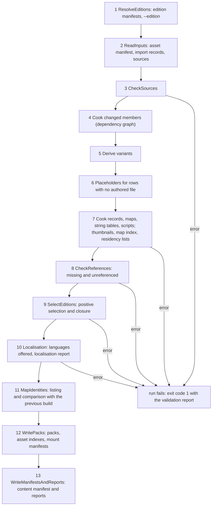
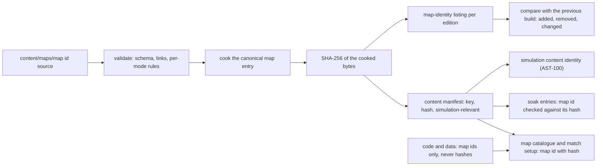
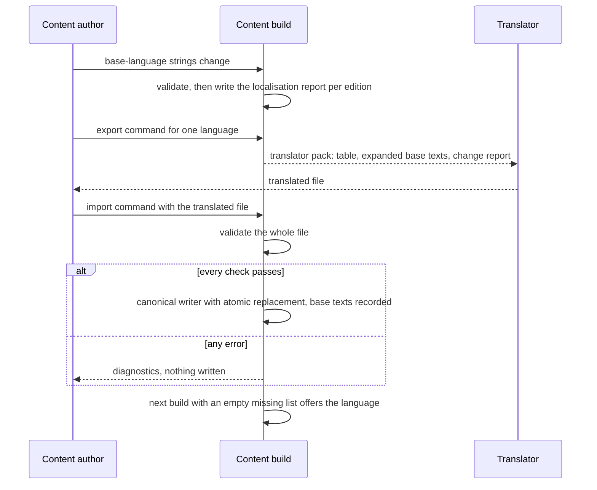

# Content build and localisation build

> Status: Engine baseline · Prefix: BLD · ADRs: [ADR-051](../../../ADR/ADR-051-windows-toolchain-and-compiler-policy.md) · [ADR-052](../../../ADR/ADR-052-cpp23-language-standard.md) · [ADR-053](../../../ADR/ADR-053-modules-and-import-std.md) · [ADR-054](../../../ADR/ADR-054-build-system-msbuild-solution.md) · [ADR-055](../../../ADR/ADR-055-dependencies-three-nuget-packages.md) · [ADR-056](../../../ADR/ADR-056-products-configurations-and-feature-flags.md) · [ADR-057](../../../ADR/ADR-057-version-identity.md) · [ADR-059](../../../ADR/ADR-059-content-build-and-validators.md) · [ADR-060](../../../ADR/ADR-060-content-identity-by-hash.md) · [ADR-065](../../../ADR/ADR-065-crash-reporting.md) · [ADR-070](../../../ADR/ADR-070-continuous-integration.md) · [ADR-071](../../../ADR/ADR-071-install-layout-runtime-files-and-user-data.md) · [ADR-072](../../../ADR/ADR-072-distribution-channels-and-package-formats.md) · [ADR-073](../../../ADR/ADR-073-code-signing.md) · also [ADR-001](../../../ADR/ADR-001-direct3d-12-renderer-on-the-agility-sdk.md), [ADR-003](../../../ADR/ADR-003-shader-language-compiler-and-material-shaders.md), [ADR-017](../../../ADR/ADR-017-texture-container-and-block-compression.md), [ADR-050](../../../ADR/ADR-050-client-platform-and-minimum-os.md), [ADR-058](../../../ADR/ADR-058-pack-files-and-mount-policy.md), [ADR-061](../../../ADR/ADR-061-data-schemas-and-versioning.md), [ADR-062](../../../ADR/ADR-062-authoring-syntax-and-schema-language.md), [ADR-063](../../../ADR/ADR-063-localisation.md), [ADR-066](../../../ADR/ADR-066-telemetry-with-consent.md), [ADR-067](../../../ADR/ADR-067-logging.md), [ADR-068](../../../ADR/ADR-068-profiling-and-gpu-timing.md), [ADR-069](../../../ADR/ADR-069-test-framework.md) · Related: [Asset pipeline and resources](../asset_pipeline_and_resources.md) · [Data schemas](../data_schemas/README.md) · [Platform layer](../platform_layer.md) · [Diagnostics, test and performance](../diagnostics_test_and_performance/README.md) · [Maps: rules and conventions](../../../reference/08_maps_and_level_design/rules_and_conventions.md) · [Map editor hooks](../../../reference/08_maps_and_level_design/map_editor_hooks.md) · [Options, localisation and hooks](../../../reference/09_front_end_and_match_flow/options_localisation_and_hooks.md) · [Game assets](../../../assets/GameAssets.md)

This document holds §4.5 to §4.8 of the build tooling and distribution component ([README](README.md)); section numbers are those of the whole component, and the requirements keep their ids (BLD-064 to BLD-089).

## 1 Responsibilities and boundaries

As [README](README.md) §1 states for the whole component.

## 2 Interfaces

The build definition, the content build command line and the data contracts are in [README](README.md) §2.

## 3 Data model

Products, edition manifests, build identity and the install directory are in [README](README.md) §3.

## 4 Behaviour and algorithms

### 4.5 The content build

*Figure 4.5-A: the stages of one content-build run. Stages 2 to 9 and 12 to 13 are the asset pipeline's and the data schemas' (AST-065); stages 1, 10 and 11 are this document's.*

**BLD-064** (MUST) A `build` run executes the stages of table 4.5-A in that order, each with the rules of the document named. A stage starts only when the previous stage has finished for every edition of the run (BLD-012). `validate` runs stages 1 to 11 and writes the reports of stage 13 without packs; `loose` runs stages 2 to 8 for the changed sources and their dependants and writes cooked entries into `loose/`.

Table 4.5-A Stage order of a content-build run.

| # | Stage | What happens | Rules |
|---|---|---|---|
| 1 | `ResolveEditions` | read the edition manifests, resolve `--edition`, check every manifest field | §4.3 |
| 2 | `ReadInputs` | read the asset manifest, every import record and the authoring sources | AST-065 step 1 |
| 3 | `CheckSources` | check every source | AST-065 step 2 |
| 4 | `Cook` | cook every member whose inputs changed | AST-065 step 3, BLD-066 |
| 5 | `Derive` | produce the derived variants | AST-065 step 4 |
| 6 | `Placeholders` | generate a placeholder for every manifest row with no authored file | AST-065 step 5, AST-082 to AST-085 |
| 7 | `CookRecordsAndGenerate` | cook data records, maps, string tables and explainer scripts; render thumbnails; generate the map index and the residency lists | AST-065 step 6, DAT-033 |
| 8 | `CheckReferences` | check every reference and the unreferenced assets | AST-065 step 7, BLD-069 |
| 9 | `SelectEditions` | select the entries of each edition | AST-065 step 8, BLD-049 |
| 10 | `Localization` | decide the offered languages of each edition, write the localisation report | §4.7 |
| 11 | `MapIdentities` | write the map-identity listing and compare it with the previous build | §4.6 |
| 12 | `WritePacks` | write the packs, the asset indexes and the mount manifests | AST-065 step 9 |
| 13 | `WriteManifestsAndReports` | write the content manifest, the validation report, the placeholder report and the files of §3.4 | AST-065 step 10 |

**BLD-065** (MUST) An error in any stage fails the run with the stage and the input named (AST-065). Every input that a stage declares must exist: a missing tool, list, record or source is a tool failure or a content error, never a skipped step, and the run never continues past a failed stage. An error in one file does not stop the per-file checks of the other files, so one run reports every error of a stage (DAT-024).

**BLD-066** (MUST) An incremental run keeps a dependency graph: each output records the hashes of its inputs, the content build's tool version and the hash of its cook options, and is rebuilt when any of them changes (ADR-059). An output whose new bytes equal its old bytes is not rewritten, so its dependants are not rebuilt and its file time does not change. A `--clean` run removes the output directory first. A clean run and an incremental run of the same inputs give byte-identical outputs.

**BLD-067** (MUST) Identical inputs give byte-identical packs, manifests and reports on any build agent and with any `--jobs` value (AST-066, BLD-012). The reproducibility job, a scheduled CI job that an amendment of ADR-070 adds, builds one revision twice, on different agents and with clean output directories, and compares every output byte for byte (ADR-059).

**BLD-068** (MUST) The content build runs every validator class of table 4.5-B. The document named owns the rule of each class; the content build reports every diagnostic in the validation report with its class, file, line, column and field (DAT-051), and each class has a failing fixture in the content build's test suite (AST-093, DAT-031).

Table 4.5-B Validator classes of the content build.

| Class | Catches | Severity | Rule |
|---|---|---|---|
| schema errors | malformed text, unknown or missing fields, wrong types, out-of-range or over-long values, positional tables, unknown or unmigrated schema versions | error | DAT-019 to DAT-027, DAT-046; DEC-015 |
| duplicates | a key twice in one object; two records of one type with one stable id; a repeated field | error | DAT-022, DAT-025; DEC-801 |
| missing references | an asset, record or string id that does not resolve, or that resolves to the wrong kind | error | AST-089, DAT-028 to DAT-030; DEC-015 |
| case mismatches | keys or ids that differ only in case; a key or id that is not canonical | error | AST-014, AST-015, DAT-026 |
| stray files | a file under the content root that belongs to no manifest row, import record or data record | error | AST-013 |
| unreferenced assets | an asset that an edition selects and nothing references | error in an edition marked for release, warning otherwise | AST-090, BLD-069; DEC-563 |
| placeholders | a manifest row with no authored file | error in an edition marked for release, listed otherwise | AST-083, AST-085 |
| map rules | the per-mode rules of Relic Run, Flag Chain, Siege and Launch Race, and the other rules of R-MAP-400 | error | DEC-561, R-MAP-400 |
| asset rules | the texture, mesh, collision and audio rules and budgets | error | AST-068 to AST-081, AST-092 |
| font coverage | a character of an edition's language that no bundled font covers | error | AST-088 |
| string coverage | base-language ids that a language lacks | listed; decides whether the language is offered | BLD-081, DEC-099 |
| edition manifests | the errors of §4.3 | error | ADR-056, §4.3 |

**BLD-069** (MUST) The missing-reference and unreferenced-asset checks work on the reference graph of the content, never on a text search of the code of the solution's projects: code names assets only through asset-id constants and enumeration tables, which the engine asset table carries into the graph (AST-017). Assets are compared by full canonical key and asset id, never by base file name, so two files of one name in different folders stay distinct. No list of exceptions exists: an asset that only a rule creates during a match counts as referenced through the record of its object (AST-090, DEC-329), and every other asset is referenced or reported. The validation report lists missing references and unreferenced assets separately, each with the referring file or the asset's manifest row.

**BLD-070** (MUST) The content build applies the placeholder rule of the asset pipeline (AST-082 to AST-085; [assets README](../../../assets/README.md)): it generates a placeholder for every manifest row that has no authored file, so that every edition builds and runs at every stage of production. The placeholder report lists the placeholders grouped by priority with their count per category, and the run's summary states the total.

**BLD-071** (MUST) Pack production and content hashing follow the asset pipeline: chunking, alignment and codecs (AST-094, AST-095), the table of contents, its hash and the header (AST-096), entry hashes (AST-097), simulation relevance (AST-098), map identity (AST-099) and the simulation content identity (AST-100). Packs are not encrypted (AST-053). The content build hands the SHA-256 of each edition's content manifest to packaging, where it enters the build identity (BLD-019, ADR-057).

### 4.6 Map identity from the content build

**BLD-072** (MUST) The identity of a map is its map id together with the SHA-256 entry hash of its cooked map (AST-099, ADR-060). The map id is the stable name `map_<mode>_<players>p_<nn>` ([maps: rules and conventions](../../../reference/08_maps_and_level_design/rules_and_conventions.md) R-MAP-010); a map source whose file name is not a canonical map id is a content error, and the build never renames or rewrites a name to make it canonical. The hash is taken over the canonical cooked bytes, so a change of line endings or formatting in the authoring file, and a load-and-save round trip through the canonical writer, leave it unchanged (AST-097, DEC-800 item 2); every change of content changes it.

**BLD-073** (MUST) Hashing reads an entry as a stream and has no size limit: no map of any size is truncated, padded or copied into a fixed-size buffer to be hashed (DEC-204 item 8).

**BLD-074** (MUST) For every edition the content build writes the **map-identity listing** `map_identities.json`: one entry per map of the edition, in byte-wise order of map id, with the map id, the full hash, the header's mode list in its order, the player count and the pack that holds the map (`MapIdentityEntry`). It covers every cooked map of the edition, maps with an empty mode list included (R-MAP-014). It serves CI, the soak harness and release review; the client and the server take map hashes from the content manifest, never from this listing.

**BLD-075** (MUST) The content build compares each listing with the listing of the previous build (`--previous`) and reports the maps added, removed and changed, or reports that no map changed. The listing file is rewritten only when its content changes (BLD-066).

**BLD-076** (MUST NOT) No source file, generated header or compiled table holds a map hash. Code refers to a map only by its map id, taken from data (for example the tutorial maps of [reference/11](../../../reference/11_tutorial_and_help.md) R-TUT-051), and `Build\CheckProjectFiles.py` rejects any source file that embeds a map hash (table 4.1-B row 14, ADR-060). Editing a map therefore never requires a code build.

**BLD-077** (MUST) The map identity serves the uses of table 4.6-A. How processes exchange and compare identities before a session, and what a mismatch does, is a design-phase decision (DEC-204).

Table 4.6-A Uses of the map identity.

| Use | Rule | Owner |
|---|---|---|
| match-setup map lists | the map catalogue lists maps by map id, in the base order and sort of the catalogue; lists are keyed by the map id together with its hash | R-MAP-010 to R-MAP-016, AST-086 |
| finding a map in a mode's list | a look-up of a map id in a mode's map list gives its position, or "absent" when no map of the list has the id | R-MAP-013 |
| custom maps | a map id that no mounted content set holds is read from the player's map folder as a custom map; its identity and transfer are design-phase inputs | R-MAP-015, R-MAP-040, DEC-204 |
| permitted maps | a match starts only on a permitted map of the edition | BLD-053 |
| tutorials | each tutorial names its map by map id; its entry is inactive while that map is not in the Zone Control map list | R-TUT-051; [screen flow and match setup](../../../reference/09_front_end_and_match_flow/screen_flow_and_match_setup.md) |
| soak and test runs | each soak entry names its map by map id, and the map is checked against its hash in the content manifest before the match runs | DEC-804 |
| the map index | the map ids that the Completionist hook counts, packaged with the maps | AST-086, DEC-563, DEC-047 |
| session records and identity exchange | what a hosted session advertises and what joining processes compare | design phase: DEC-204, DEC-245 |

*Figure 4.6-A: a map's identity, from its authoring source to the places that read it.*

### 4.7 Localisation build

**BLD-078** (MUST) An edition's languages are the BCP 47 tags of its manifest, or one language group of table 4.7-A. The base language `ref.meta.lang.base` (`en-GB`, [reference/09](../../../reference/09_front_end_and_match_flow/options_localisation_and_hooks.md)) is part of every client edition, because every other language falls back to it per string id (ADR-063).

Table 4.7-A Language groups.

| Group | Languages, in this order |
|---|---|
| `all` | the reference language set of R-META-461: `en-GB`, `fr-FR`, `de-DE`, `es-ES`, `it-IT`, `ru-RU`, `ja-JP`, `ko-KR`, `pt-BR` |
| `efigs` | `en-GB`, `fr-FR`, `de-DE`, `it-IT`, `es-ES` |

**BLD-079** (MUST) For each language of an edition the content build merges the language's string sources into one table (UI-222), checks its message syntax and its arguments (ADR-063), its caption markup and its lengths (UI-224, UI-225), and checks the coverage of the bundled fonts (AST-088). The `locale` pack of the edition holds the tables and fonts of exactly the edition's offered languages (AST-057).

**BLD-080** (MUST) The content build writes the **localisation report** of each client edition. For every language of the edition other than the base language it holds three lists, each sorted by string id: `missing`, the base-language ids of the edition that the language lacks; `untranslated`, the ids whose value equals the base-language value; and `unknown`, the ids of the language that the base language lacks. It also holds the number of base-language ids of the edition and the number that the language covers. `missing` decides whether the language is offered (BLD-081); `untranslated` and `unknown` are warnings, because a value may rightly equal its base text and an id may be awaiting removal.

**BLD-081** (MUST) A language is offered in an edition only when its `missing` list for that edition is empty (DEC-099, R-META-463). A language that is not offered is left out of the edition's `locale` pack and is listed in the report as withheld. The report lists every id that would fall back to the base language at run time (R-META-464, ADR-063).

**BLD-082** (MUST) The development setting language test (R-META-473, hidden from players by R-META-457) makes a Debug client write, for each language it loads, the same three lists in the form of the localisation report to `language_report.json` in the user-data `diagnostics\` folder of the [platform layer](../platform_layer.md) (PLT-017, ADR-071). The file is replaced at each language load; it is never written to the working directory or the install directory.

**BLD-083** (MUST) `strings-export` writes, for each named language, a translator pack holding: the language's current table; the base-language strings, each with its text expanded in each input mode (UI-223, UI-224), so that the translator sees what players read; and a change report against the base-language text of the language's last import. The change report classifies each id as inserted, deleted, changed or renamed:
- an id is **renamed** when it disappears while a new id appears with the same base-language text; both ids are listed;
- a change is **typo-level**, and is not reported as changed, when the old and the new base texts have the same number of words, the same first character, the same last character and a Levenshtein distance over characters of at most `bld.l10n.typo_max_edit_distance` (2).

The export also writes the base-language strings file once per run and a summary of the counts per language and class. Every file is UTF-8 (ADR-063).

**BLD-084** (MUST) `strings-import` validates each translated file with the string-table validators (message syntax, declared arguments, caption markup, maximum lengths and duplicate ids). Only when the whole file passes does it write the language's string table, through the canonical writer with atomic replacement (DEC-800, DAT-040); a file that fails changes nothing and is reported with its diagnostics. The import records the base-language text that the language was translated from, which the next export compares with.

**BLD-085** (MUST) The validation report holds the markup preview of every string: its expansion in each input mode, with an error for an input-mode passage that is not closed, a binding argument that names no action, an embedded id that does not exist and a cycle of embedded ids (UI-224). Reviewers read it as plain text or as an HTML page.

*Figure 4.7-A: the translation round trip.*

### 4.8 Map-editor tooling hooks

**BLD-086** (MUST) The map editor is designed fresh in the design phase (DEC-045), together with the product that carries it (R-MAP-302). Until then no player edition sets the `map_editor` flag (R-MAP-301), and the content build tool provides the editor's hooks of this section.

**BLD-087** (MUST) A map tool validates a map when it saves it with the content build's own validators, through `ContentBuild::ValidateMapFile`, and rejects the map with the diagnostics of the validation report (R-MAP-400, DEC-561, DEC-015). Whether a tool may keep an unfinished map that fails these rules is a design-phase input ([map editor hooks](../../../reference/08_maps_and_level_design/map_editor_hooks.md) §8).

**BLD-088** (MUST) A map tool writes authoring files only, through the canonical writer with atomic replacement (DEC-800, DAT-040): under the content root of a development checkout, or into the player's map folder for a custom map (AST-106). It never writes a pack, a thumbnail, a map index or a map hash; the content build generates those (AST-086, AST-087, BLD-072).

**BLD-089** (MUST) In a development checkout, a save followed by the `loose` command cooks the changed map and its dependants into the loose-content directory, which a Debug client mounts last (AST-105) and reloads ([asset pipeline](../asset_pipeline_and_resources.md) §4.14). A session that runs with loose content reports a modified content identity (AST-105). The round trip from a save to a reload needs no code build.

## 5 Concurrency and performance budget

As [README](README.md) §5 states.

## 6 Failure modes, diagnostics and telemetry

As [README](README.md) §6 states.

## 7 Acceptance tests

The tests of these sections are in [README](README.md) §7.

## 8 Open decisions

The decisions of these sections are in [README](README.md) §8.
