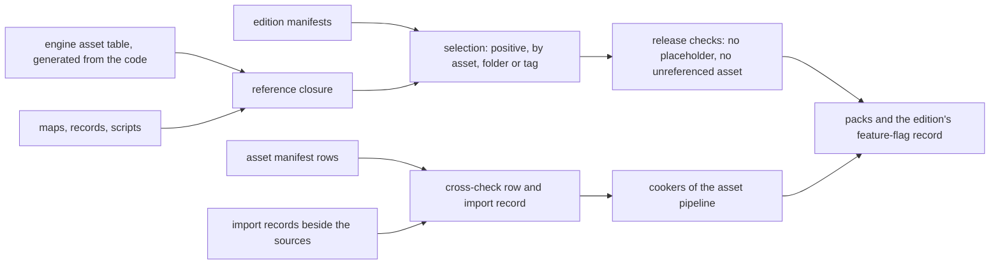

# Import records and build records

> Status: Engine baseline · Prefix: DAT · ADRs: [ADR-018](../../../ADR/ADR-018-texture-import-manifest.md) · [ADR-019](../../../ADR/ADR-019-mesh-source-format-and-cooked-meshes.md) · [ADR-020](../../../ADR/ADR-020-flat-shading-and-team-tint.md) · [ADR-025](../../../ADR/ADR-025-audio-formats-codecs-and-residency.md) · [ADR-056](../../../ADR/ADR-056-products-configurations-and-feature-flags.md) · [ADR-059](../../../ADR/ADR-059-content-build-and-validators.md) · [ADR-061](../../../ADR/ADR-061-data-schemas-and-versioning.md) · [ADR-062](../../../ADR/ADR-062-authoring-syntax-and-schema-language.md) · Folder: [data schemas](README.md) · Related: [asset pipeline and resources](../asset_pipeline_and_resources.md) · [build tooling and distribution](../build_tooling_and_distribution/README.md) · [asset manifest](../../../assets/asset_manifest.csv)

This document specifies the schemas of the records that the content build reads and that no runtime loads as such: the import record beside each texture, mesh and audio source, the engine asset table that the code contributes, and the edition manifests. The meaning of every field belongs to the [asset pipeline](../asset_pipeline_and_resources.md) for the import records and the engine asset table, and to [build tooling and distribution](../build_tooling_and_distribution/README.md) for the edition manifests; this document gives the fields their keys, types, presence rules and checks.

## 1 Responsibilities and boundaries

**DAT-350** (MUST) This document owns the record types `import.texture`, `import.mesh`, `import.audio`, `assets.engine_table` and `edition.manifest` (README table 1-A): their keys, logical types, presence rules, ranges and the checks that the content build applies to them.

**DAT-351** (MUST NOT) This document defines no cooking step, no texture or audio format, no edition and no feature flag: those are the [asset pipeline](../asset_pipeline_and_resources.md)'s (AST-018 to AST-050), the texture and audio ADRs' (ADR-017, ADR-018, ADR-025) and [build tooling and distribution](../build_tooling_and_distribution/README.md)'s (BLD-015 to BLD-018).

## 2 Interfaces

The interface below is a C++23 declaration sketch, not an implementation. The record types and their enumerations are generated from the schemas (README DAT-054, ADR-062), and this section holds their only declaration: the [asset pipeline](../asset_pipeline_and_resources.md), whose cookers read them in the content build tool, cites it. `AssetId` and `VariantId` are the asset pipeline's (AST §2.1); `ColorRgba` is the RGBA colour of the engine types.

```cpp
namespace Neuron
{

// ---- generated from import.texture: table 3.1-A, with the meanings of AST table 3.3-A ----
enum class TextureKind : std::uint8_t
{
  Color,
  Ui,
  Normal,
  Mask,
  ExactData,
  CpuTable
};
enum class ColorSpace : std::uint8_t
{
  Srgb,
  Linear
};
enum class AlphaMode : std::uint8_t
{
  Opaque,
  Straight,
  Premultiplied,
  Additive,
  Cutout
};
enum class MipPolicy : std::uint8_t
{
  Full,
  None
};
// The closed set of ADR-018, in the order of the fixed sampler-heap indices (ADR-006, AST-025).
enum class SamplerId : std::uint8_t
{
  LinearClamp,
  LinearWrap,
  PointClamp,
  PointMagnifyClamp
};
// AST table 3.5-A.
enum class Derivation : std::uint8_t
{
  BlurredShadow,
  StackedCopies,
  Grayscale,
  ToColor,
  ReplaceColor
};
// Table 3.1-B: each derivation reads only its own parameters.
struct DerivationParameters
{
  std::optional<ColorRgba> color;        // Derivation::ToColor
  std::optional<std::uint8_t> threshold; // Derivation::ToColor
  std::optional<ColorRgba> oldColor;     // Derivation::ReplaceColor
  std::optional<ColorRgba> newColor;     // Derivation::ReplaceColor
};
struct DerivedVariant
{
  VariantId variant;
  Derivation derivation;
  DerivationParameters parameters;
};
struct TextureView
{
  VariantId variant;
  std::uint32_t firstLevel;
  std::uint32_t levelCount;
  SamplerId sampler;
};
struct TextureImportRecord
{
  AssetId asset;
  std::uint32_t member; // the source's member number in its manifest row (AST-016)
  TextureKind kind;
  ColorSpace colorSpace;
  AlphaMode alphaMode;
  std::optional<double> cutoutThreshold; // present exactly with AlphaMode::Cutout
  MipPolicy mipPolicy;
  SamplerId sampler;
  std::optional<AssetId> tintMask; // companion single-channel mask (ADR-020)
  bool pixelExact;
  std::uint32_t authoringScale;
  std::vector<DerivedVariant> derivedVariants;
  std::vector<TextureView> views;
};

// ---- generated from import.mesh: table 3.2-A ----
enum class MeshRole : std::uint8_t
{
  Render,
  Collision
};
// AST-034.
enum class TintMarking : std::uint8_t
{
  None,
  VertexWeight,
  MaterialFlag
};
// A primitive declared smooth-shaded, an exception of ADR-020 (AST-036).
struct SmoothPrimitive
{
  std::string node;
  std::uint32_t primitive;
};
struct MeshImportRecord
{
  AssetId asset;
  std::uint32_t member;
  MeshRole role;                         // a collision source is cooked into a Collision entry (AST-044)
  std::optional<std::string> assetClass; // present exactly with MeshRole::Render; selects the socket schema (ADR-021)
  double unitScale;                      // wu per glTF metre
  TintMarking tintMarking;
  double tintScale; // RND-161; defaulted: rnd.tint.factor
  std::vector<SmoothPrimitive> smoothPrimitives;
  std::optional<AssetId> collision; // required for a collidable render mesh
};

// ---- generated from import.audio: table 3.3-A ----
struct AudioImportRecord
{
  AssetId asset;
  std::uint32_t member;
  bool positional;
  std::uint64_t loopStart;              // sample frames
  std::optional<std::uint64_t> loopEnd; // sample frames; absent: the end of the file
};

struct EngineAssetTable; // table 3.4-A, generated by the engine build from the code (DAT-357)
struct EditionManifest;  // table 3.5-A

// The content build tool only.
class ImportRecordReader
{
public:
  std::expected<TextureImportRecord, std::vector<Diagnostic>> ReadTexture(const JsonDocument& _document) const;
  std::expected<MeshImportRecord, std::vector<Diagnostic>> ReadMesh(const JsonDocument& _document) const;
  std::expected<AudioImportRecord, std::vector<Diagnostic>> ReadAudio(const JsonDocument& _document) const;
};

} // namespace Neuron
```

**Data contracts.** The cookers of the [asset pipeline](../asset_pipeline_and_resources.md) read the import records (AST-018); the content build's selection and validation steps read the engine asset table and the edition manifests (AST-017, AST-089, AST-090, BLD-049). The runtime reads none of these records, except the feature flags of an edition, which the content build writes into the packs as a record (BLD-016).

**Threading contract.** The records are read by the content build's worker threads, one record per task (README DAT-048).

## 3 Data model

### 3.1 The texture import record

**DAT-352** (MUST) Every texture source has one import record beside it, sharing its stem, with the fields of table 3.1-A, whose meanings and closed value sets are AST table 3.3-A, ADR-018 and AST-025 to AST-031. The content tools create the record from the source's manifest row and the defaults per kind; an author edits only the fields that the row leaves open (AST-018). A texture without an import record is a build error (ADR-018).

Table 3.1-A Fields of a texture import record.

| Field | Key | Type | Presence and default | Rules |
|---|---|---|---|---|
| asset | `asset` | asset reference | required | must equal the asset id of the source's manifest row |
| member | `member` | asset member | required | must equal the source's member number in its row |
| kind | `kind` | enumeration `color`, `ui`, `normal`, `mask`, `exact_data`, `cpu_table` | defaulted: from the row's `target_format` (AST table 3.3-B) | must agree with the row (AST-012) |
| colour space | `color_space` | enumeration `srgb`, `linear` | defaulted: from the row's `colour_space` column | must agree with the row |
| alpha mode | `alpha_mode` | enumeration `opaque`, `straight`, `premultiplied`, `additive`, `cutout` | defaulted: from the row's `alpha_mode` through AST table 3.3-C | must agree with the row |
| cut-out threshold | `cutout_threshold` | presentation decimal, an alpha from 0 to 1 | required with `cutout`, absent otherwise | 0 or more and below 1; a texel is kept when its alpha is greater; the threshold of the pipeline-state entry that draws the art (AST-019, RND-060) |
| mip policy | `mip_policy` | enumeration `full`, `none` | defaulted: from the row's `target_format` | — |
| sampler | `sampler` | enumeration `linear_clamp`, `linear_wrap`, `point_clamp`, `point_magnify_clamp` | defaulted: `linear_clamp`; `linear_wrap` where the row says "wrap repeat"; `point_clamp` when pixel-exact; `point_magnify_clamp` for art that is magnified into hard-edged blocks and minified smoothly (AST-025) | the closed set of ADR-018 |
| tint mask | `tint_mask` | asset reference to a single-channel mask | absence-meaningful: none | ADR-020 |
| pixel-exact | `pixel_exact` | boolean | defaulted: false | — |
| authoring scale | `authoring_scale` | integer: 1 or `ast.texture.ui_authoring_scale` | defaulted: `ast.texture.ui_authoring_scale` where the row says "author at 2x", otherwise 1 | — |
| derived variants | `derived_variants` | list of objects: `variant` (stable id), `derivation` (enumeration `blurred_shadow`, `stacked_copies`, `grayscale`, `to_color`, `replace_color`), `parameters` (object of table 3.1-B) | defaulted: none | variant ids unique within the record; each variant has its own manifest row (AST-028) |
| views | `views` | list of objects: `variant` (stable id), `first_level` (count), `level_count` (count of at least 1), `sampler` (as above) | defaulted: none | variant ids unique within the record, and distinct from the derived variants (AST-026) |

Table 3.1-B Parameters of a derived variant (the `parameters` object), by derivation; their meanings are AST table 3.5-A.

| Derivation | Field | Key | Type | Presence and rules |
|---|---|---|---|---|
| `blurred_shadow`, `stacked_copies`, `grayscale` | none | — | — | the object is empty: these derivations take their parameters from the tuning keys of AST table 3.5-A |
| `to_color` | colour *C* | `color` | RGBA8 colour | required; its alpha is not read |
| | threshold *t* | `threshold` | integer, 0 to 255 | required; compared with the mean of a texel's red, green and blue values |
| `replace_color` | old colour *O* | `old_color` | RGBA8 colour | required; its alpha is not read |
| | new colour *N* | `new_color` | RGBA8 colour | required; its alpha is not read, and each replaced texel keeps its own alpha |

**DAT-353** (MUST) An unknown kind, alpha mode, sampler, derivation or variant is a build error (AST-019), and so is a derivation parameter that table 3.1-B does not give its derivation, or a parameter that it requires and the record omits. A field that the row fixes and the record contradicts is a build error that names the asset id, the member and the column (AST-012); a record never overrides its row.

### 3.2 The mesh import record

**DAT-354** (MUST) Every mesh source, and every collision source, has one import record beside it with the fields of table 3.2-A (AST-033, ADR-019).

Table 3.2-A Fields of a mesh import record.

| Field | Key | Type | Presence and default | Rules |
|---|---|---|---|---|
| asset | `asset` | asset reference | required | must equal the asset id of the source's manifest row |
| member | `member` | asset member | required | must equal the source's member number in its row |
| role | `role` | enumeration `render`, `collision` | defaulted: `render` | a collision source is cooked into `geometry.collision` (AST-044) |
| asset class | `asset_class` | stable id | required for `render` | selects the socket schema of the row's `spec` (AST-040) |
| unit scale | `unit_scale` | presentation decimal, wu per glTF metre | required | above 0; applied once at cook time (ADR-016) |
| tint marking | `tint_marking` | enumeration `none`, `vertex_weight`, `material_flag` | defaulted: `none` | AST-034, AST-035 |
| tint scale | `tint_scale` | presentation decimal, × | defaulted: `rnd.tint.factor` (RND-161) | 0 or more; the Transport hull's record holds `ref.unit.transport.hull_tint` and the Collector body's `ref.unit.collector.tint_scale` (RND-161, AST-033) |
| smooth primitives | `smooth_primitives` | list of objects: `node` (the glTF node name), `primitive` (count) | defaulted: none | each names a primitive that carries normals (AST-036) |
| collision asset | `collision` | asset reference to a collision asset | required for a collidable render mesh, absent otherwise | AST-044; DEC-012 |

### 3.3 The audio import record

**DAT-355** (MUST) An audio source has an import record only where the source cannot state what the cooker needs, with the fields of table 3.3-A (AST-050); a source without a record takes the defaults. Looping, gain, pitch and envelopes are sound data ([entity_audio_geometry_and_panel_schemas.md](entity_audio_geometry_and_panel_schemas.md)), never import-record fields (AST table 3.10-A).

Table 3.3-A Fields of an audio import record.

| Field | Key | Type | Presence and default | Rules |
|---|---|---|---|---|
| asset | `asset` | asset reference | required | must equal the asset id of the source's manifest row |
| member | `member` | asset member | required | must equal the source's member number in its row |
| positional | `positional` | boolean | defaulted: from the layers that name the group | true makes mono mandatory (AST-050, AST-079) |
| loop start | `loop_start` | count, sample frames | defaulted: 0 | streamed members only |
| loop end | `loop_end` | count, sample frames | absence-meaningful: the end of the file | after the loop start; streamed members only |

**DAT-356** (MUST) Audio is language-neutral: an audio import record has no per-language field. If the voice decision gives spoken lines one recording set per language (DEC-317), each set becomes a member list keyed by its BCP 47 tag, with a minor version of this record type (README DAT-017; AST-050).

### 3.4 The engine asset table

**DAT-357** (MUST) The engine asset table (`assets.engine_table`) is generated by the engine build from the code's declarations, never written by hand, and holds the fields of table 3.4-A (AST-017). The content build reads it as a source of references: every constant and every enumerator of a table must map to an existing asset id of the expected category, and every enumerator of a table's enumeration must have a row (AST-017, README DAT-027).

Table 3.4-A Fields of the engine asset table.

| Field | Key | Type | Rules |
|---|---|---|---|
| constants | `constants` | list of objects: `name` (the code constant's stable id), `asset` (asset reference), `category` (the expected manifest category) | names unique |
| tables | `tables` | list of objects: `table` (stable id), `enumeration` (the enumeration's name), `category`, `entries` (list of objects: `enumerator`, `asset`) | one entry per enumerator; enumerators unique within a table |

### 3.5 Edition manifests

**DAT-358** (MUST) An edition manifest (`edition.manifest`) is authored under `content/records/editions/` with the fields of table 3.5-A, which are the fields of [build tooling and distribution](../build_tooling_and_distribution/README.md) table 3.2-A; their meanings, the release flag's among them, are BLD-015 to BLD-018, BLD-049 to BLD-055 and BLD-078, and this document owns their types.

Table 3.5-A Field types of an edition manifest.

| Field | Key | Type | Presence and default | Rules |
|---|---|---|---|---|
| edition id | `id` | stable id | required | unique among the edition manifests (DEC-801) |
| product | `product` | enumeration `client`, `server` | required | exactly one product (BLD-050) |
| release flag | `release` | boolean | defaulted: false | its meaning and the rules of an edition marked for release are BLD-054 and BLD-055 (AST-085, AST-090) |
| server edition | `server_edition` | record reference to an edition manifest whose product is `server` | required for a client edition, absent for a server edition | BLD-051 |
| languages | `languages` | either a list of distinct BCP 47 tags or one language-group enumerator, `all` or `efigs` (BLD table 4.7-A) | required | the base language `ref.meta.lang.base` is always included, whether or not it is listed (BLD-078) |
| selection | `select` | list of selectors, each an object with exactly one of `asset` (asset reference), `folder` (a folder under the content root) or `tag` (an asset tag, among them the manifest's `priority` values) | required | positive selection only (BLD-049) |
| maps | `maps` | either the enumerator `all` or a list of distinct map ids | required | each listed map id must be a map of the edition (BLD-053) |
| feature flags | `features` | object with exactly the six fields of table 3.5-B | required: every flag named | an unknown or missing flag is a build error (ADR-056, BLD-016) |

Table 3.5-B Types of the runtime feature flags of BLD table 3.2-B.

| Flag | Key | Type | Simulation-relevant (BLD table 3.2-B) |
|---|---|---|---|
| modes | `modes` | list of distinct mode enumerators: `spawn_control`, `zone_control`, `relic_run`, `siege`, `launch_race`, `flag_chain`; cooked in the catalogue order of R-MODE-029 | no |
| Supply-crate classes | `crate_classes` | enumeration set of `basic`, `advanced` | yes |
| tutorial | `tutorial` | enumeration `on`, `off` | no |
| local-network play | `play_local_network` | enumeration `on`, `off` | no |
| internet play | `play_internet` | enumeration `on`, `off` | no |
| map editor | `map_editor` | enumeration `on`, `off` | no |

**DAT-359** (MUST) The content build writes the feature flags of each edition into its packs as the edition's flag record, the cooked `Record` of README table 1-A, which the client and the server read once at start-up and never change while the process runs (BLD-016, ADR-056). The flags that BLD table 3.2-B marks simulation-relevant are part of that record's simulation-relevant entry and of the simulation content identity (ADR-060, AST-100); a client edition and its server edition have equal values of those flags (BLD-051).

## 4 Behaviour and algorithms

**DAT-360** (MUST) The content build reads the manifest rows, the edition manifests, the engine asset table and every import record before any cooker runs (AST §4.1 step 1), validates each record with README DAT-024 and the checks of this document, and fails before cooking on any error, so that no cooker runs on a record that contradicts its row.



Caption: Figure 4-A, how the build records feed the content build (DAT-352 to DAT-360; AST-012, AST-089, AST-090, BLD-049).

## 5 Concurrency and performance budget

**DAT-361** (MUST) Import records and build records are small and are read once per content-build run; their validation is part of the content-build budgets `dat.perf.full_build_s` and `dat.perf.incremental_s` of the [README](README.md), and a change to one import record rebuilds only the entries of its source (ADR-059).

## 6 Failure modes, diagnostics and telemetry

| Condition | Result | Requirement |
|---|---|---|
| a texture source without an import record | build error | DAT-352 |
| an import record that contradicts its manifest row | build error naming asset, member and column | DAT-353 |
| an unknown kind, alpha mode, sampler, derivation, parameter or variant | build error | DAT-353 |
| an import record whose asset or member differs from its row; a collidable mesh without a collision asset | build error | DAT-352, DAT-354, DAT-355 |
| a loop end before its loop start | build error | DAT-355 |
| an engine-asset-table entry that maps to no asset, or to the wrong category; an enumerator without a row | build error | DAT-357 |
| an edition with an unknown flag, a missing flag, a duplicate id, an unknown language group or a client edition without a server edition | build error | DAT-358 |

## 7 Acceptance tests

| Test | Kind | Checks | Requirements |
|---|---|---|---|
| T60 texture records | unit | a record created from each manifest category's defaults validates; each closed value set rejects an unknown value; a record contradicting its row fails | DAT-352, DAT-353 |
| T61 mesh records | unit | asset and member mismatches fail; a collidable mesh without `collision` fails | DAT-354 |
| T62 audio records | unit | loop points out of order fail; a record with a per-language field fails until the record type gains one | DAT-355, DAT-356 |
| T63 engine table | unit | removing an enumerator's row and pointing a constant at an asset of another category each fail | DAT-357 |
| T64 editions | unit | the baseline editions `full`, `full_server`, `development` and `soak` of BLD table 3.2-D validate; an unknown flag, a missing flag and an unknown language group each fail; the flag record of `full` holds the six flags of table 3.5-B with the reference feature set's values | DAT-358, DAT-359 |

## 8 Open decisions

### 8.1 Decisions and architecture records

| Reference | Status | Where it applies |
|---|---|---|
| DEC-012 | Resolved | collision assets named by the mesh import record (DAT-354) |
| DEC-317 | Open | per-language audio sets (DAT-356) |
| DEC-801 | Resolved | unique ids, variant ids and edition ids (DAT-352, DAT-358) |
| ADR-018, ADR-019, ADR-020, ADR-025 | Accepted (ADR-025 Proposed) | the import manifests of textures, meshes and audio |
| ADR-056, ADR-059 | Accepted | editions, feature flags and the validating content build |

### 8.2 Design-phase inputs

1. **Editions of the world game**: the editions, products and feature flags beyond the baseline of BLD table 3.2-D, and whether a server edition carries per-region content selections.
2. **Voice localisation** (DEC-317): the per-language member lists of DAT-356.

## 9 Tuning table

This document owns no tuning key.

| owner | keys cited |
|---|---|
| [asset pipeline](../asset_pipeline_and_resources.md) | `ast.texture.ui_authoring_scale` |
| [renderer world renderers](../renderer/world_renderers.md) | `rnd.tint.factor` |
| [units](../../../reference/02_units/README.md) | `ref.unit.transport.hull_tint`, `ref.unit.collector.tint_scale` |
| [reference/09 options](../../../reference/09_front_end_and_match_flow/options_localisation_and_hooks.md) | `ref.meta.lang.base` |
| [data schemas](README.md) | `dat.perf.full_build_s`, `dat.perf.incremental_s` |
