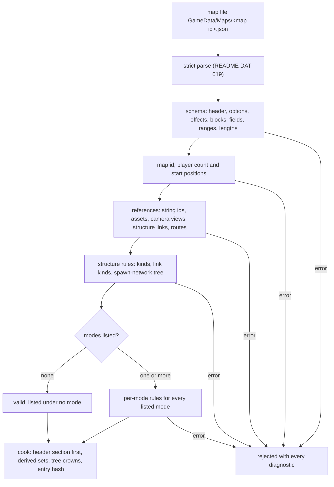

# Map definition and match-option schemas

> Status: Engine baseline · Prefix: DAT · ADRs: [ADR-061](../../../ADR/ADR-061-data-schemas-and-versioning.md) · [ADR-062](../../../ADR/ADR-062-authoring-syntax-and-schema-language.md) · [ADR-059](../../../ADR/ADR-059-content-build-and-validators.md) · [ADR-060](../../../ADR/ADR-060-content-identity-by-hash.md) · [ADR-058](../../../ADR/ADR-058-pack-files-and-mount-policy.md) · [ADR-063](../../../ADR/ADR-063-localisation.md) · [ADR-071](../../../ADR/ADR-071-install-layout-runtime-files-and-user-data.md) · Folder: [data schemas](README.md) · Related: [maps: rules and conventions](../../../reference/08_maps_and_level_design/rules_and_conventions.md) · [map editor hooks](../../../reference/08_maps_and_level_design/map_editor_hooks.md) · [skirmish rules and modes](../../../reference/01_skirmish_rules_and_modes/README.md) · [terrain](../terrain/README.md) · [camera and sequences](../camera_and_sequences.md) · [structure records](map_structure_records.md)

This document specifies the schema of the map definition (`MapDefinition`, schema id `maps.definition`): its blocks, its map header with the match options of the map, the map options and map effects, the terrain records, the map lights, the start-position records, the camera views and camera animations, the starting forces and the routes. It also specifies the generated map index (`maps.index`), the match-option schema of the modes (`mode.options`), and two hooks: the custom-map container and the map ids that the achievement hooks count. The structure records of a map are [map_structure_records.md](map_structure_records.md). The meaning of every field is the owning document's: [maps: rules and conventions](../../../reference/08_maps_and_level_design/rules_and_conventions.md) for the map, [reference/01](../../../reference/01_skirmish_rules_and_modes/README.md) for the match options of the modes, and [terrain](../terrain/README.md) for the terrain records.

## 1 Responsibilities and boundaries

**DAT-070** (MUST) This document owns the record types `maps.definition`, `maps.index` and `mode.options`: their field keys, logical types, presence rules, ranges, the validation of every map and the cooked layout of the map entry. A map is one authoring file, `GameData/Maps/<map id>.json`, a member of one of the map assets `mapfile.spawn_control`, `mapfile.zone_control`, `mapfile.relic_run`, `mapfile.siege`, `mapfile.launch_race` and `mapfile.flag_chain`, and one cooked `Map` entry flagged simulation-relevant (README table 1-A).

**DAT-071** (MUST NOT) This document defines no map rule. The rules of maps and their per-mode conventions are [maps: rules and conventions](../../../reference/08_maps_and_level_design/rules_and_conventions.md)'s, the generator that reads the terrain records is [terrain](../terrain/README.md)'s, the camera that uses the camera views is [camera and sequences](../camera_and_sequences.md)'s, the meaning of the structure fields is [reference/03](../../../reference/03_buildings_and_world_objects/README.md)'s, and the match options' effects are [reference/01](../../../reference/01_skirmish_rules_and_modes/README.md)'s.

**DAT-072** (MUST) A map's map id is the stem of its authoring file and follows `map_<mode>_<players>p_<nn>` (R-MAP-010, CONVENTIONS §8.11); the content build rejects a stem that does not follow the pattern, whose `<players>` differs from the header's player count, or that two files of the content set share (DEC-801). The map id is never a field of the file, so it can never disagree with the file name.

**DAT-073** (MUST) Every map is authored new. No terrain, layout, display name or identity of a reference map is part of any Species content set, and no schema field exists to hold one (DEC-063).

## 2 Interfaces

The interface below is a C++23 declaration sketch, not an implementation. The record types and their enumerations are generated from the schemas (README DAT-054, ADR-062), and this section holds their only declaration: the [terrain](../terrain/README.md) component cites the terrain records (TER §2.1) and [camera and sequences](../camera_and_sequences.md) the camera records (CAM §2.1). The terrain and camera records name no game concept, so they are generated into `Engine`; the other records of a map are game records in `Species` (CONVENTIONS §8).

```cpp
namespace Neuron
{

// README DAT-008, DEC-120.
struct Limit
{
  enum class Form : std::uint8_t
  {
    Absent,
    None,
    Value,
    Unlimited
  } form;
  std::uint32_t value; // meaningful only for Form::Value
};

// ---- generated from maps.definition: the terrain records of tables 3.4-A to 3.4-C (TER-030 to TER-035) ----
// The stored values carry meaning (TER-100, TER-035); keep the order.
enum class TileMethod : std::uint8_t
{
  Average = 0,
  RandomPair = 1,
  CopyOne = 2
};
enum class FlattenOp : std::uint8_t
{
  Absolute = 0,
  Add = 1,
  Subtract = 2,
  Smooth = 3,
  Subtract2 = 4
};
struct TerrainDefinition // the block terrain, table 3.4-A
{
  std::int32_t worldSizeX; // wu
  std::int32_t worldSizeZ;
  double cellSize;             // wu per sample, binary32-rounded (README DAT-010)
  double outsideHeight;        // wu, binary32-rounded
  float maxHeight;             // wu, held as binary32
  std::uint32_t landColorRamp; // asset members; 1 is the map default
  std::uint32_t shoreWaveGradient;
  std::uint32_t seaTile;
};
struct TerrainTile // the block terrain_tiles, table 3.4-B, in the generator's order of R-MAP-081
{
  std::int32_t positionX;
  double positionY;
  std::int32_t positionZ;
  std::int32_t size;
  double fractalDimension;
  double heightScale;
  double desiredHeight;
  TileMethod generationMethod;
  std::int32_t seed;
  double lowlandSmoothing;
  std::uint8_t guidePower;             // p; 0: no guide grid
  std::vector<std::uint8_t> guideGrid; // (2^p - 1)^2 cells, z outer and x inner (TER-036)
};
struct TerrainFlattenArea // the block flatten_areas, table 3.4-C
{
  Vec3 center; // center.y is the operand of the flatten type (TER-034)
  double size; // the half-width of the square
  FlattenOp flattenType;
  double threshold;
};

// ---- generated from maps.definition: the camera records of tables 3.7-A and 3.7-B (CAM-014, CAM-020) ----
enum class CameraTransition : std::uint8_t // authoring order only
{
  Move,
  Cut
};
struct CameraView // front and up normalised at cook time, not orthogonalised
{
  std::string name;
  Vec3 position;
  Vec3 front;
  Vec3 up;
};
struct CameraAnimationStep
{
  CameraTransition transition;
  std::string view; // a camera view of the map, or previous_view
  double duration;  // s of the camera clock, [0, ref.map.camera.animation_duration_max_s)
};
struct CameraAnimationDef
{
  std::string name;
  std::vector<CameraAnimationStep> steps; // may be empty; an empty animation never plays
};

} // namespace Neuron

namespace Species
{

// The six modes of R-MODE-029, in their order.
enum class MatchMode : std::uint8_t;
// The canonical order of R-MAP-070.
enum class MapOption : std::uint8_t
{
  NoCatchUpBonus,
  InstantSpawnNodeCapture,
  GateReinforcementCount,
  GateTransportCap,
  NoGunTurrets,
  AttackerReinforcementCount,
  DefenderReinforcementCount,
  DefenderReinforcementPower,
  AttackerReinforcementPower,
  SameTeamBeamDishLinks,
  NoBeamDishAiming,
  AirstrikeThreshold,
  VisitorFactionPosition,
  AttackerReinforcementPowerOption,
  DefenderReinforcementPowerOption
};
// R-MAP-073.
enum class MapEffect : std::uint8_t
{
  Snow,
  Lightning,
  DustVortices,
  EssenceOrbRain,
  SpecialLightRig
};
enum class MapDifficulty : std::uint8_t
{
  Basic,
  Intermediate,
  Advanced
};
enum class SiegeSide : std::uint8_t
{
  Defending,
  Attacking
};
enum class CoopGroup : std::uint8_t
{
  None,
  One,
  Two
};

struct MatchOptions; // the map header, table 3.2-A
struct StartPosition
{
  std::uint8_t position;
  std::string cameraView;
  SiegeSide siegeSide;
  CoopGroup coopGroup;
};
// The front is normalised at cook time.
struct MapLight
{
  Neuron::Vec3 front;
  Neuron::Vec3 color;
};
struct StartingForcesRecord; // table 3.8-A
// RoutePoint and RoutePointKind are the simulation's (R-SIM-333); table 3.9-A gives the cooking (DAT-093).
struct RouteRecord
{
  std::uint16_t id;
  std::vector<RoutePoint> points;
};

class MapHeaderView;     // the header section alone (README DAT-038)
class MapDefinitionView; // every block of table 3.1-A

class MapLoader
{
public:
  std::expected<MapHeaderView, Neuron::LoadError> ReadHeader(const Neuron::PackEntry& _entry) const; // the catalogue
  std::expected<MapDefinitionView, Neuron::LoadError> Load(const Neuron::PackEntry& _entry) const;   // match entry
};

} // namespace Species
```

**Data contracts.** The map catalogue ([maps](../../../reference/08_maps_and_level_design/rules_and_conventions.md) R-MAP-011) reads `MapHeaderView` only. Match entry ([reference/12](../../../reference/12_simulation_model/02_match_lifecycle_and_state_reset.md)) reads `MapDefinitionView`; the terrain component reads its terrain records (TER-030 to TER-036), the camera its camera data (CAM-014), the renderer its lights (RND-013) and the simulation its structures, start positions and starting forces. A map tool reads and writes the authoring form through the canonical writer (README DAT-040).

**Threading contract.** Map headers and maps are loaded on the loading thread (DEC-226); the views are read-only and shared by the readers named above for the lifetime of the match's load group.

## 3 Data model

### 3.1 Blocks of the map definition

**DAT-074** (MUST) A map definition is one JSON object whose fields are the blocks of table 3.1-A, each at most once (R-MAP-030, R-MAP-031); a block listed twice is the duplicate key of README DAT-022. Its cooked entry stores the header as the first section, with its own length, followed by the other blocks in the order of the table, so that the catalogue reads the header alone (README DAT-038).

Table 3.1-A Blocks of a map definition, in schema order.

| Block | Key | Presence | Holds | Fields |
|---|---|---|---|---|
| map header | `header` | required | the match options of the map (`MatchOptions`) | table 3.2-A |
| terrain definition | `terrain` | defaulted: every field takes its default | the terrain definition (`TerrainDefinition`) | table 3.4-A |
| terrain tiles | `terrain_tiles` | defaulted: none | an ordered list of terrain tiles (`TerrainTile`) | table 3.4-B |
| terrain flatten areas | `flatten_areas` | defaulted: none | an ordered list of flatten areas (`TerrainFlattenArea`), applied in list order | table 3.4-C |
| map lights | `lights` | defaulted: none | an ordered list of map lights (`MapLight`) | table 3.5-A |
| start positions | `start_positions` | required | one start-position record per player position | table 3.6-A |
| structures | `structures` | defaulted: none | an ordered list of structure records; the list order is the structure order (R-MAP-104) | [map_structure_records.md](map_structure_records.md) |
| camera views | `camera_views` | defaulted: none | an ordered list of camera views | table 3.7-A |
| camera animations | `camera_animations` | defaulted: none | an ordered list of camera animations | table 3.7-B |
| starting forces | `starting_forces` | defaulted: none | an ordered list of starting-forces records | table 3.8-A |
| routes | `routes` | defaulted: none | routes keyed by route id | table 3.9-A |
| baked collision data | `tree_crowns` | derived | the crown centre and radius of every map-placed tree (AST-047) | DAT-096 |

**DAT-075** (MUST) A map definition has no block for campaign content: a record of running powers, a created-at-difficulty record, a statistics record and every other block not in table 3.1-A is an unknown field and a build error (R-MAP-032, DEC-052).

### 3.2 The map header

**DAT-076** (MUST) The map header holds the fields of table 3.2-A, in this schema order. Their meanings, their effects on the modes and their reference census are [maps](../../../reference/08_maps_and_level_design/rules_and_conventions.md) table 2.6-A and R-MAP-060 to R-MAP-064, and [reference/01](../../../reference/01_skirmish_rules_and_modes/README.md) R-MODE-084.

Table 3.2-A Fields of the map header (`MatchOptions`).

| Field | Key | Type | Presence and default | Range and rules |
|---|---|---|---|---|
| display name | `display_name` | text | required for a custom map; for a map of a content set the name shown is the string id `map.<map id>.name` (R-MAP-020), and the field, when present, is a working title for tools only | at most `ref.map.header.name_max_chars` (511) characters |
| display-name string id | `name_id` | string id | derived: `map.<map id>.name`, which must exist in the base language (README DAT-030) | — |
| modes | `modes` | list of mode enumerators (`spawn_control`, `zone_control`, `relic_run`, `siege`, `launch_race`, `flag_chain`) | defaulted: empty, which lists the map under no mode (R-MAP-014) | an unknown mode is a build error (DEC-802); a mode listed twice is accepted and lists the map twice under that mode (R-MAP-013) |
| player count | `player_count` | integer | required | `ref.map.players.min` (2) to `ref.sim.team.player_slots` (4) |
| population cap | `population_cap` | limit | required: `0`, a number of bodies or `"unlimited"`; a map without a cap states `"unlimited"` (R-MAP-061, DEC-079) | 0 or more |
| defender population cap | `defender_population_cap` | count | absence-meaningful: absent, Siege uses the population cap ÷ the open slots for both sides (R-MAP-062) | 0 or more |
| play time | `play_time` | integer, whole minutes | absence-meaningful: absent, the mode's default time limit applies; 0 also leaves it (R-MAP-021) | within the range of the time-limit option of [reference/01](../../../reference/01_skirmish_rules_and_modes/README.md) R-MODE-074 |
| difficulty | `difficulty` | enumeration `basic`, `intermediate`, `advanced` | absence-meaningful: absent, rank `ref.map.catalog.rank.none` (0) | R-MAP-016, R-MAP-023 |
| map effects | `map_effects` | enumeration set of `MapEffect` (`snow`, `lightning`, `dust_vortices`, `essence_orb_rain`, `special_light_rig`) | defaulted: none | cooked in the canonical order of R-MAP-073 |
| map options | `map_options` | object of table 3.3-A | defaulted: every option absent or off | each option at most once |
| excluded outcomes | `excluded_outcomes` | enumeration set of Supply-crate outcome identifiers of [reference/04](../../../reference/04_supply_crates_powers_and_weapons/README.md) table 2.2-A, written in snake_case (`strike_team`, `turret_gun`, `meteor_shower`) | defaulted: none | an identifier outside the catalogue is a build error (R-CRATE-029); cooked in the canonical outcome order (R-CRATE-007) |
| attacking positions | `attacking_positions` | set of start positions | derived from the Siege side of the start-position records (DAT-088) | — |
| group-1 positions, group-2 positions | `group_one_positions`, `group_two_positions` | lists of start positions | derived from the co-op group of the start-position records, in ascending position order (DAT-088) | — |
| co-op allowed | `coop_allowed` | boolean | defaulted: false | R-MAP-063 |
| co-op forced | `coop_forced` | boolean | defaulted: false | a map that forces co-op also allows it: forced with allowed absent reads as allowed, and forced with allowed `false` is a build error |
| official | `official` | boolean | defaulted: false | R-MAP-015 |
| author | `author` | text | defaulted: none | at most `ref.map.header.author_max_chars` (63) characters; never displayed |
| description | `description` | text | defaulted: none; for a map of a content set the description shown is the string id `map.<map id>.description` (R-MAP-020) | at most `ref.map.header.description_max_chars` (511) characters |
| description string id | `description_id` | string id | derived: `map.<map id>.description`, which must exist in the base language | — |
| thumbnail | `thumbnail` | asset member | derived: the member of the mode's thumbnail asset (`thumb.spawn_control`, `thumb.zone_control`, `thumb.relic_run`, `thumb.siege`, `thumb.launch_race` or `thumb.flag_chain`) that the content build renders for this map (DEC-563); none for a custom map | — |
| map visibility | — | — | not a field under the default of DEC-802 | DAT-104 |

**DAT-077** (MUST) No header field holds a placeholder value. A field that the reference sets to a marker value when absent (−1 for a cap, a player count or a play time; a fixed placeholder text for the name, the author and the description) is absent in Species, and the absent value's meaning is the presence rule of table 3.2-A (DEC-120, README DAT-008).

### 3.3 Map options and map effects

**DAT-078** (MUST) The field `map_options` holds the 15 map options of table 3.3-A, keyed by name, in the canonical order of R-MAP-070; their effects are [maps](../../../reference/08_maps_and_level_design/rules_and_conventions.md) table 2.7-A and R-MAP-071, R-MAP-072. Every option is independent of every other: no option's presence depends on another's, and an option is never read from the position of a word in a list.

Table 3.3-A Map options (`MapOption`), in canonical order.

| # | Map option | Key | Type | Presence and default | Range and rules |
|---|---|---|---|---|---|
| 1 | no Catch-up bonus | `no_catch_up_bonus` | boolean | defaulted: false | — |
| 2 | instant Spawn Node capture | `instant_spawn_node_capture` | boolean | defaulted: false | — |
| 3 | Transit Gate reinforcement count | `gate_reinforcement_count` | count | absence-meaningful: absent runs no waves from this option | 0 is a value, never an absence (DEC-065) |
| 4 | Transit Gate Transport cap | `gate_transport_cap` | limit | absence-meaningful | `0`, a number or `"unlimited"` (DEC-120) |
| 5 | no gun turrets | `no_gun_turrets` | boolean | defaulted: false | — |
| 6 | attacker reinforcement count | `attacker_reinforcement_count` | count | absence-meaningful: absent, the Transit Gate reinforcement count | 0 is a value |
| 7 | defender reinforcement count | `defender_reinforcement_count` | count | absence-meaningful: absent, the Transit Gate reinforcement count | 0 is a value |
| 8 | defender reinforcement power | `defender_reinforcement_power` | enumeration: a Supply-crate outcome identifier whose delivery is a Power | absence-meaningful: none | any other outcome is a build error (R-MAP-072) |
| 9 | attacker reinforcement power | `attacker_reinforcement_power` | as above | absence-meaningful: none | as above |
| 10 | same-team Beam Dish links | `same_team_beam_dish_links` | boolean | defaulted: false | — |
| 11 | no Beam Dish aiming | `no_beam_dish_aiming` | boolean | defaulted: false | — |
| 12 | airstrike threshold | `airstrike_threshold` | count, Flag posts | absence-meaningful | — |
| 13 | Visitor-faction position | `visitor_faction_position` | integer, a start position | absence-meaningful: none | 0 to `ref.sim.team.visitor_slot` (5); compared with a team's start position, not its team slot |
| 14 | attacker reinforcement power option | `attacker_reinforcement_power_option` | integer | absence-meaningful: none | the option range of the power kind ([reference/05](../../../reference/05_population_flow.md) R-ECON-103); given only with the attacker reinforcement power |
| 15 | defender reinforcement power option | `defender_reinforcement_power_option` | integer | absence-meaningful: none | as above, with the defender reinforcement power |

**DAT-079** (MUST) A map option that the map sets to 0 keeps 0: a cooked option has an explicit present flag, a reader that finds the flag set reads the value, 0 included, and a map tool writes it back (R-MAP-075, DEC-065, DEC-800). A power option whose power is absent is a build error, because it would have nothing to apply to.

**DAT-080** (MUST) The field `map_effects` holds a set of the five map effects of R-MAP-073 in their canonical order; an unknown effect name is a build error, and an effect listed twice is the duplicate of README DAT-025. Whether a map selects named lighting and weather presets instead of setting its lights and effects one by one is DEC-562, whose default is the per-map values of this schema.

### 3.4 Terrain records

**DAT-081** (MUST) The terrain definition holds the fields of table 3.4-A (R-MAP-080, TER-030). The precision column gives the cook-time rounding of README DAT-010.

Table 3.4-A Fields of the terrain definition (`TerrainDefinition`).

| Field | Key | Type and precision | Presence and default | Range and rules |
|---|---|---|---|---|
| world size x | `world_size_x` | integer, wu | defaulted: `ref.map.terrain.world_size_default` (2,000 wu) | 1 or more, within the signed 32-bit range (TER-250) |
| world size z | `world_size_z` | integer, wu | defaulted: `ref.map.terrain.world_size_default` | as above |
| cell size | `cell_size` | simulation decimal, binary32-rounded, wu per sample | defaulted: `ref.map.terrain.cell_size_default` (12.0 wu) | finite and above 0; the grid within `ter.grid.max_samples_per_side` of [terrain](../terrain/README.md) per side (TER-250) |
| outside height | `outside_height` | simulation decimal, binary32-rounded, wu | defaulted: `ref.map.terrain.outside_height_default` (−10 wu) | finite |
| maximum height | `max_height` | presentation decimal, held as binary32, wu | defaulted: `ref.map.terrain.max_height_default` (0.0 wu) | finite; the colour-ramp normaliser only (TER-030) |
| land colour ramp | `land_color_ramp` | asset member of `terrain.ramp` | defaulted: 1, the map default | a member the manifest holds |
| shore-wave gradient | `shore_wave_gradient` | asset member of `terrain.shore_wave_gradient` | defaulted: 1 | a member the manifest holds |
| sea tile | `sea_tile` | asset member of `terrain.sea_tile` | defaulted: 1 | a member the manifest holds |

**DAT-082** (MUST) Each terrain tile holds the fields of table 3.4-B; every field is required (TER-032). The tiles are kept and generated in list order, and composited by maximum, so the result does not depend on that order (R-MAP-082).

Table 3.4-B Fields of a terrain tile (`TerrainTile`), in the generator's order of R-MAP-081 and TER-032.

| Field | Key | Type and precision | Range and rules |
|---|---|---|---|
| position x | `position_x` | integer, wu | signed 32-bit |
| position y | `position_y` | simulation decimal, binary32-rounded, wu | finite |
| position z | `position_z` | integer, wu | signed 32-bit |
| size | `size` | integer, wu | at least 2 cell sizes (TER-250) |
| fractal dimension | `fractal_dimension` | simulation decimal, binary32-rounded | finite |
| height scale | `height_scale` | simulation decimal, binary32-rounded | finite |
| desired height | `desired_height` | simulation decimal, binary32-rounded, wu | finite |
| generation method | `generation_method` | enumeration `average`, `random_pair`, `copy_one`, cooked as the stored values 0, 1 and 2 of `TileMethod` (TER-100) | any other value is a build error (TER-112) |
| seed | `seed` | integer | signed 32-bit |
| lowland smoothing factor | `lowland_smoothing` | simulation decimal, binary32-rounded | finite |
| guide-grid power | `guide_power` | integer | 0 or more; 0 means no guide grid (TER-036) |
| guide grid | `guide_grid` | list of integers, each 0 to 255 | present exactly when the power is above 0, with (2^p − 1)² cells in row-major order, z outer and x inner (TER-036); any other length is a build error (TER-250) |

**DAT-083** (MUST) A guide-grid cell is one integer from 0 to 255, the absolute height in tile space that TER-036 reads.

**DAT-084** (MUST) Each flatten area holds the fields of table 3.4-C (R-MAP-083, TER-034). The flatten type and the threshold are independent optional fields; the threshold is used by the types that TER-143 says use it, and ignored by the others.

Table 3.4-C Fields of a terrain flatten area (`TerrainFlattenArea`).

| Field | Key | Type and precision | Presence and default | Range and rules |
|---|---|---|---|---|
| centre | `center` | vector of simulation decimals, binary32-rounded, wu | required | x, y, z; y is the operand of the flatten type (TER-034) |
| size | `size` | simulation decimal, binary32-rounded, wu | required | the half-width of the square; finite |
| flatten type | `flatten_type` | enumeration `absolute`, `add`, `subtract`, `smooth`, `subtract2`, cooked as the stored values 0 to 4 of `FlattenOp` (TER-035) | defaulted: `absolute` | any other value is a build error |
| threshold | `threshold` | simulation decimal, binary32-rounded, wu | defaulted: `ref.map.terrain.flatten_threshold_default` (40.0 wu) | finite |

**DAT-085** (MUST) Under the default of DEC-246 the terrain records are the generator's inputs, and every participant generates the height field from them at load (TER-060). If the design phase chooses to bake the height field, the cooked map gains a derived height-grid section, written by the content build from these records, and the authoring form of table 3.4-A to table 3.4-C does not change.

> **Amendment 2026-10-18 (WLD-160; MVP-011).** A world has no map definition: its terrain records are those that the world generator places from its template and seed (WLD-160), the server bakes the field into chunks (WLD-166), and in the MVP the client also generates it from the seed and compares a terrain hash (MVP-011). Generation from the records at load stays the skirmish map's.

### 3.5 Map lights

**DAT-086** (MUST) Each map light holds the fields of table 3.5-A (R-MAP-087). Map lights are presentation values: the renderer uses the first two of the list (RND-013) and the simulation never reads one. A map has one list of lights, so no rule decides between two blocks of lights.

Table 3.5-A Fields of a map light (`MapLight`).

| Field | Key | Type | Presence and default | Rules |
|---|---|---|---|---|
| direction | `front` | direction | defaulted: `rnd.light.default_front` of the [renderer](../renderer/README.md) | normalised at cook time; the light is directional, at an infinite distance |
| colour | `color` | colour multiplier | defaulted: `rnd.light.default_color` | unclamped |

### 3.6 Start positions

**DAT-087** (MUST) A map holds exactly one start-position record for each player position 0 to (player count − 1), keyed by its position (DEC-560, R-MAP-042); a missing position, a position at or above the player count and a position listed twice are build errors. Each co-op group holds at most two start positions, and a position belongs to at most one group (see DEC-969).

Table 3.6-A Fields of a start-position record.

| Field | Key | Type | Presence and default | Rules |
|---|---|---|---|---|
| position | `position` | integer | required | 0 to (player count − 1) |
| start camera view | `camera_view` | stable id, a camera view name | defaulted: `spawn_view_<position>` | a name given explicitly must be a camera view of the map; with the default name and no such view, the position has no start view and the camera stays at the pose it last reached (R-MAP-048, R-MAP-128) |
| Siege side | `siege_side` | enumeration `defending`, `attacking` | defaulted: `defending` | read only in Siege |
| co-op group | `coop_group` | enumeration `none`, `one`, `two` | defaulted: `none` | at most 2 positions in each group, because alliance assignment addresses the members of a group as its first and second position ([reference/01](../../../reference/01_skirmish_rules_and_modes/README.md) R-MODE-020) |

**DAT-088** (MUST) The header's attacking positions are derived from the start positions whose Siege side is `attacking`, and its group-1 and group-2 positions from the start positions in group `one` and group `two`, each list in ascending position order (see DEC-969). The derived sets are cooked into the header section so that match setup reads them without the rest of the map; an authoring file that also states them is the derived-field error of README DAT-011. Start positions name their structures, starting forces and camera view through these records, and at load each start position is remapped to a match team (R-MAP-043, R-MAP-044; DEC-560).

### 3.7 Camera views and camera animations

**DAT-089** (MUST) Each camera view holds the fields of table 3.7-A (R-MAP-125). Camera views are presentation values.

Table 3.7-A Fields of a camera view (`CameraView`).

| Field | Key | Type | Presence | Rules |
|---|---|---|---|---|
| name | `name` | stable id | required | at most `ref.map.camera.view_name_max_chars` (62) characters; unique within the map; `previous_view` is reserved and cannot be defined (R-MAP-126) |
| position | `position` | vector of presentation decimals, wu | required | — |
| front | `front` | direction | required | normalised at cook time, not orthogonalised against the up vector (CAM-014) |
| up | `up` | direction | required | normalised at cook time |

**DAT-090** (MUST) A camera view name is lower case, so the look-up without regard to case of R-MAP-125 and CAM-065 has exactly one match, and two views whose names differ only in case cannot exist. The reserved names `spawn_view_<n>`, `default_view` and `previous_view` have the meanings of R-MAP-126.

**DAT-091** (MUST) Each camera animation holds the fields of table 3.7-B (R-MAP-127). Under the default of DEC-803 the record type exists and no content needs it; an animation with no steps is valid and is never played (CAM-065).

Table 3.7-B Fields of a camera animation (`CameraAnimationDef`) and of its steps (`CameraAnimationStep`).

| Field | Key | Type | Presence and default | Rules |
|---|---|---|---|---|
| name | `name` | stable id | required | unique within the map, at most `ref.map.camera.view_name_max_chars` characters |
| steps | `steps` | ordered list of steps | defaulted: none | played in list order |
| step transition | `transition` | enumeration `move`, `cut` | required | any other word is a build error |
| step view | `view` | stable id | required | a camera view of the map, or `previous_view` |
| step duration | `duration` | presentation decimal, s of the camera clock | required | from 0 up to, but not including, `ref.map.camera.animation_duration_max_s` (60 s) |

### 3.8 Starting forces

**DAT-092** (MUST) Each starting-forces record holds the fields of table 3.8-A (R-MAP-130), each independent of the others, so an optional field is never read from the count of tokens that follow another. "Starting forces" are the map's records; "starting units" are everything present at match start, starting forces and port seeding together ([reference/05](../../../reference/05_population_flow.md)).

Table 3.8-A Fields of a starting-forces record.

| Field | Key | Type and precision | Presence and default | Range and rules |
|---|---|---|---|---|
| actor kind | `actor_kind` | enumeration of the actor kinds of [reference/02](../../../reference/02_units/README.md) table 2.1-A, in snake_case (`worker`, `trooper`, `transport`) | required | a kind marked "not allowed" there, or a kind of campaign or debug content, is a build error (R-MAP-131) |
| start position | `position` | integer | required | 0 to `ref.sim.team.visitor_slot` (5); positions 4 and 5 address the Rogue and Visitor factions (R-MAP-045) |
| x, z | `x`, `z` | simulation decimals, binary32-rounded, wu | required | finite |
| count | `count` | count | required | — |
| in-group flag | `in_group` | boolean | required | — |
| state | `state` | enumeration: an actor state of the actor kind, by its name in the kind's unit document | defaulted: the kind's default state | an unknown state is a build error |
| spread | `spread` | simulation decimal, binary32-rounded, wu | defaulted: `ref.map.starting_forces.spread_default` (200 wu) | 0 or more |
| waypoint | `waypoint` | x and z, simulation decimals, binary32-rounded, wu | defaulted: (0, 0) | — |
| route | `route` | integer, a route id | absence-meaningful: none | indexes the match's route table, not the map's routes (R-MAP-121) |
| route point | `route_point` | count | absence-meaningful: none | — |
| run as a power | `run_as_power` | boolean | defaulted: false | R-MAP-132 item 1 |

### 3.9 Routes

**DAT-093** (MUST) Each route holds an id from 0 to `ref.map.route.id_limit` − 1 (0 to 9,999) and an ordered list of route points (R-MAP-120). A route point is an object with exactly one of the fields of table 3.9-A; an object with none, with two, or with an unknown field is a build error, so no point is ever created at a default position from an unknown type. A route point cooks to the simulation's `RoutePoint` ([reference/12](../../../reference/12_simulation_model/05_space_routing_and_physics.md) R-SIM-333): the field `position` to `RoutePointKind::Position`, `ground` to `RoutePointKind::GroundPosition` and `structure` to `RoutePointKind::Structure`.

Table 3.9-A Route points.

| Kind | Key | Type |
|---|---|---|
| 3-D position | `position` | vector of simulation decimals, binary32-rounded, wu |
| ground position | `ground` | x and z, simulation decimals, binary32-rounded, wu |
| structure | `structure` | record reference to a structure id of the map |

**DAT-094** (MUST) Two routes with one id in a map are a build error (README DAT-025). A map route is data that no match rule follows (R-MAP-121); the record type exists so that a map tool keeps the routes it loads (DEC-800).

### 3.10 Derived data

**DAT-096** (MUST) The content build derives the field `tree_crowns`: for every map-placed tree, its structure id, its crown centre in world units and its crown radius, computed by the tree generator of [trees and crate structures](../../../reference/03_buildings_and_world_objects/trees_and_crate_structures.md) R-BLDG-603 to R-BLDG-605 from the tree's record, with every centre stated explicitly (AST-047, DEC-012). The section is part of the cooked map and of its content hash; an authoring file never holds it. Trees that a match creates are computed by the simulation (R-BLDG-603).

### 3.11 The map index

**DAT-097** (MUST) The map index (`maps.index`) is generated by the content build for each edition: one entry per map that the edition lists and whose header sets `official`, each entry holding the map id and the entry hash of the cooked map, in byte-wise order of map id (R-MAP-015, AST-086, DEC-563). A map id that would appear twice is a build error (R-META-488, DEC-801). The index is packaged in the same pack as the maps it lists, and its entry is simulation-relevant.

### 3.12 The match-option schema of the modes

**DAT-098** (MUST) The record type `mode.options` holds, in one record, the option catalogue of table 3.12-A and, for each of the six modes of R-MODE-029, the ordered option list of table 3.12-B. The mode order is the enumeration order of `MatchMode` (R-MODE-029); a map, a match setup and a command name a mode by its enumerator, never by the position of a record in a file, so adding a mode renumbers nothing. The record is required in every edition whose `modes` flag offers a mode ([import_and_build_records.md](import_and_build_records.md) table 3.5-B); an edition without it fails the content build (ADR-059).

> **Amendment 2026-10-18 (O55; MVP-001).** The six modes are skirmish modes; the world game is not a mode of R-MODE-029 and has no `mode.options` record. An MVP edition offers no skirmish mode (build tooling table 3.2-B amendment), so it needs none.

Table 3.12-A The option catalogue. Each option's type and unit come from [reference/01](../../../reference/01_skirmish_rules_and_modes/README.md) R-MODE-074; its typed default, which a mode that lacks the option reads, is R-MODE-076's (DEC-073).

| Option | Key | Value type | Unit |
|---|---|---|---|
| score mode | `score_mode` | enumeration of the mode's score modes | — |
| time limit | `time_limit` | integer, or the explicit value `"none"` (DEC-120) | minutes; `"none"` is no limit, offered where the mode's range starts with none (R-MODE-074), and is never written as 0; `"none"` is this option's own explicit value (R-MODE-074), not the limit form of DAT-008 |
| Catch-up bonus | `catch_up_bonus` | integer | % |
| crate drop period | `crate_drop_period` | integer, or the explicit value `"none"` (DEC-120) | s; `"none"` is no Supply crates (R-MODE-074), and is never written as 0; `"none"` is this option's own explicit value (R-MODE-074), not the limit form of DAT-008 |
| starting powers | `starting_powers` | count | powers |
| Comeback Bonus | `comeback_bonus` | boolean | — |
| sudden death | `sudden_death` | boolean | — |
| crate placement | `crate_placement` | enumeration `random`, `weighted` | — |
| reinforcement interval | `reinforcement_interval` | integer | mode seconds |
| reinforcement count | `reinforcement_count` | count | Workers per owned Transit Gate per wave |
| Transport cap | `transport_cap` | count | Transport powers |
| turret frequency | `turret_frequency` | count | waves; 0 means never |
| turret cap | `turret_cap` | count | turret powers |

Table 3.12-B Fields of one option of a mode's option list.

| Field | Key | Type | Presence | Rules |
|---|---|---|---|---|
| option | `option` | enumeration of table 3.12-A | required | each option at most once per mode (DEC-801) |
| control | `control` | enumeration `switch`, `list`, `spinner` | required | the control of R-MODE-074; replaces any numeric code for the control kind |
| minimum, maximum | `minimum`, `maximum` | integers of the option's value type | required for `spinner` | the numeric range of R-MODE-074 for this mode; a range that starts with none states its lowest number here and its none label in `none_label` |
| step | `step` | of the option's value type | required for `spinner` | the step of R-MODE-074; above 0 |
| default | `default` | of the option's value type, `"none"` included where the mode's range starts with none | required | this mode's default: the owner's key of R-MODE-074, for example `ref.mode.zone_control.option.time_limit` or `ref.econ.gate.turret_frequency` |
| items | `items` | ordered list of string ids | required for `list` | one label per value, in value order (R-MODE-074) |
| label | `label` | string id | derived: `match.options.<option>` | — |
| label of none | `none_label` | string id | absence-meaningful: absent, the mode's range of the option has no value none | present exactly when the spinner's lowest step is the explicit value `"none"` below `minimum`: `match.options.time_limit.none` and `match.options.crate_drop_period.none` (R-MODE-074, DEC-120) |

**DAT-099** (MUST) The order of a mode's option list is its display order on the host's options page (R-MODE-073). A value outside the option's range, an option outside the mode's list and a list control without one label per value are build errors; at run time an option index outside the mode's list is rejected (R-MODE-081). The schema states no dependency between options: the rule that sudden death is forced off while the time limit is none is [reference/01](../../../reference/01_skirmish_rules_and_modes/README.md) R-MODE-074's, applied by match setup. The help text of a focused option is the string id of R-META-050, `ui.advanced_options.help.<option>.<mode>` when it exists, else `ui.advanced_options.help.<option>`, and the second form must exist for every option of every mode's list (README DAT-030).

> **Amendment 2026-10-18 (O55; MVP-103).** This holds for skirmish only; the choices of a new run (pace, seed and site, MVP-103) are not mode options.

**DAT-100** (MUST) The match-setup options outside the per-mode lists (bot difficulty, co-op, basic crates only, the password, single-round Siege; R-MODE-082) are match-setup state, not part of `mode.options`; who may change an option is the lobby authority model (DEC-243).

> **Amendment 2026-10-18 (O55; MVP-005).** A world has no match setup ([skirmish maps and map tools](../../../gdd/01_world_and_regions/skirmish_maps_and_map_tools.md)): its seed, its pace and the steward's site (MVP-005, MVP-012, MVP-103) are world state that the server holds from the world's creation.

### 3.13 Hooks

**DAT-101** (MUST) **Custom-map container.** A custom map, one read from the player's own map folder, travels as one container that holds its map definition and the images it embeds (R-MAP-391). This document defines no Species format for it: the format, its identity, its listing and its transfer belong to the typed container family of DEC-207 and to DEC-204, whose defaults specify none. An image is embedded only when it is not an asset of a content set, and the thumbnail only when the map names one other than the default (R-MAP-392). Whatever format is chosen, its reader checks every length and every result, rejects a stream that does not end where its length says, never trusts a stored length for a buffer, reports a malformed file with a diagnostic and is fuzz-tested (R-MAP-393, DEC-015).

**DAT-102** (MUST) **Map ids for achievements.** The achievement hooks count maps by their map ids through the map index (DAT-097; R-META-488, R-META-489), so a map's place in the index never decides what is recorded, and a map that the index does not list is never recorded. How achievement progress is stored is DEC-047's and DEC-250's.

## 4 Behaviour and algorithms

### 4.1 Validation of a map

**DAT-103** (MUST) The content build, and every map tool when it saves (R-MAP-400), validates each map with the rules of README DAT-024 and these map rules, each failure a `family_rule` diagnostic that names the rule (DEC-015, DEC-561):

1. the map id of DAT-072, and the string ids `map.<map id>.name` and `map.<map id>.description` for a map of a content set (DEC-802);
2. the header of table 3.2-A, the map options of table 3.3-A and the map effects of DAT-080, with the forms of DEC-120;
3. the start positions of DAT-087, with at most two positions per co-op group;
4. the terrain records of table 3.4-A to table 3.4-C, with the checks of TER-250;
5. the structure records and their links ([map_structure_records.md](map_structure_records.md)), the spawn-network tree of DEC-456 and the typed links of DEC-457;
6. the camera views and animations of table 3.7-A and table 3.7-B;
7. the starting forces of table 3.8-A and the routes of table 3.9-A;
8. for every mode the header lists, the per-mode rules of DEC-561: Relic Run (R-MAP-161), Flag Chain (R-MAP-176), Siege (R-MAP-166) and Launch Race (R-MAP-170); a map validated for several modes passes each mode's rules.

**DAT-104** (MUST) A map whose mode list is empty is valid and loadable and is listed under no mode; it is reached only through test and tool paths. This is the reference default of DEC-802, whose option B would add an explicit visibility field to the header, and whose option C would forbid such maps in player content sets (R-MAP-014).

**DAT-105** (MUST) The flow of figure 4.1-A is the order of the checks; a map that fails any of them is rejected with every diagnostic of the run, and no partial map is cooked.



Caption: Figure 4.1-A, the validation of one map (DAT-103, DAT-104; DEC-561).

### 4.2 Loading

**DAT-106** (MUST) The map catalogue reads only the header section of each map (README DAT-038). Match entry reads the whole map; reading it creates no simulated object and makes no random draw (R-MAP-041). A map that fails to load is refused with a diagnostic, its match does not start, and the program goes on (R-MAP-040, DEC-015).

**DAT-107** (MUST) One loader reads the header for the catalogue and the whole map for play, with the same keys and rules (DEC-045).

**DAT-108** (MUST) A map is identified by its map id together with the hash of its cooked entry: the catalogue, the map index and every other list of maps key their entries by both (DEC-204, ADR-060). No code holds a compiled-in table of map hashes (ADR-060).

### 4.3 Writing a map

**DAT-109** (MUST) A map tool writes a map with the canonical writer (README DAT-040 to DAT-044) and the rules of R-MAP-388 to R-MAP-390: every record that the loaded map holds, camera animations, routes and starting forces included; every per-map value in its form, so 0 stays 0, absent stays absent and unlimited stays `"unlimited"`; each field once, in schema order; every number in its shortest exact form; and the derived fields never (DEC-800, DEC-120).

## 5 Concurrency and performance budget

**DAT-110** (MUST) The header section is small and has a bounded size: it holds no terrain and no structure data, so reading every header of the map catalogue costs one read of each header section, within the budget `dat.perf.catalog_ms` of the [README](README.md). A whole map is read once per match entry on the loading thread; maps of world-region size stream their blocks instead of holding the file in one buffer (DEC-204 item 8).

## 6 Failure modes, diagnostics and telemetry

| Condition | Result | Requirement |
|---|---|---|
| a block or field twice, an unknown block or field, a campaign block | build error naming the location | DAT-074, DAT-075 |
| a stem that breaks the map-id pattern, disagrees with the player count or repeats | build error | DAT-072 |
| a missing or extra start position, a co-op group of more than two positions | build error | DAT-087 |
| an unknown mode, map effect, map option, outcome or power kind | build error | DAT-076, DAT-078, DAT-080 |
| a power option without its power | build error | DAT-079 |
| a guide grid of the wrong length, a tile method or flatten type outside its set | build error | DAT-082, DAT-084 |
| a camera view name reserved or repeated, a step to an unknown view, a duration out of range | build error | DAT-089, DAT-091 |
| a starting-forces kind that is not allowed, an unknown state | build error | DAT-092 |
| an unknown route-point kind, a route id out of range or repeated | build error | DAT-093, DAT-094 |
| a per-mode rule that fails | build error naming the mode and the rule | DAT-103 |
| a map that cannot be loaded at run time | diagnostic; the match does not start | DAT-106 |

The content build's report lists, for every map, its id, its modes, its player count, its record counts per block and its entry hash; the log of match entry writes the map id and the first 16 hexadecimal digits of the hash (ADR-060).

## 7 Acceptance tests

| Test | Kind | Checks | Requirements |
|---|---|---|---|
| T20 map fixtures | unit | one failing fixture for each row of the table of §6 | DAT-072 to DAT-094, DAT-103 |
| T21 forms | property | for each limit and option field: absent, 0, a number and `"unlimited"` (where allowed) survive cook, load and a canonical save and reload unchanged | DAT-078, DAT-079, DAT-109 |
| T22 header only | integration | a map whose terrain section is corrupted still lists in the catalogue, and fails only at match entry | DAT-074, DAT-106 |
| T23 derived sets | unit | start positions with sides and groups give the header's attacking positions and group lists in ascending order; a file that also states them fails | DAT-088 |
| T24 per-mode rules | unit | the four maps of AC-MAP-10 of [maps](../../../reference/08_maps_and_level_design/rules_and_conventions.md) fail with the named rule; a map listing two modes is checked against both | DAT-103 |
| T25 map index | unit | the index lists exactly the official maps of an edition, sorted, with their hashes; a duplicate map id fails the build | DAT-097 |
| T26 mode options | unit | each mode's list matches R-MODE-073 in order; a value outside R-MODE-074's range and an option twice each fail | DAT-098, DAT-099 |
| T27 guide grid | unit | powers 0 to 5 accept exactly 0, 1, 9, 49, 225 and 961 cells, and every cell value from 0 to 255 reaches the generator unchanged | DAT-082, DAT-083 |

## 8 Open decisions

### 8.1 Decisions and architecture records

| Reference | Status | Where it applies |
|---|---|---|
| DEC-045 | Open | one loader for the header and the map; the header readable alone (DAT-107, DAT-074) |
| DEC-120 | Resolved | the forms of every per-map value (DAT-077, DAT-078, DAT-079) |
| DEC-204 | Resolved (ADR-088) | maps identified by map id and content hash (DAT-108) |
| DEC-207 | Resolved (ADR-088) | the custom-map container belongs to the typed container family; no format here (DAT-101) |
| DEC-246 | Open | terrain records as generator inputs; a baked height grid would be a derived section (DAT-085) |
| DEC-560 | Resolved | typed start-position records (DAT-087, DAT-088) |
| DEC-561 | Resolved | per-mode map validation (DAT-103) |
| DEC-562 | Open | per-map lights and effects; presets would be a design-phase addition (DAT-080) |
| DEC-563 | Resolved | the generated map index and thumbnails (DAT-076, DAT-097) |
| DEC-802 | Open | maps without modes are valid and unlisted (DAT-104) |
| DEC-803 | Open | camera animations keep their record type with no content (DAT-091) |
| DEC-065, DEC-073, DEC-079, DEC-456, DEC-457, DEC-800, DEC-801 | Resolved | map values over lobby values; typed option defaults; the explicit population cap; the spawn-network tree; typed links; the canonical writer; duplicates as errors |
| DEC-047, DEC-250 | Open | how achievement progress is stored (DAT-102) |
| DEC-243 | Open | who may change the match options (DAT-100) |
| ADR-059, ADR-060, ADR-061, ADR-062 | Accepted, Accepted, Accepted, Proposed | the validation, the map identity, the schema and its syntax |

### 8.2 Design-phase inputs

1. **Baked terrain** (DEC-246): the derived height-grid section of DAT-085, its element type (binary32, or 16-bit quantised with a scale and an offset) and whether the normal grid is baked too.
2. **Large maps and world regions** (DEC-247, DEC-204): streaming the blocks of a map, and whether a world region is a map definition, a set of map definitions or a record type of its own.
3. **Custom maps** (DAT-101; DEC-204, DEC-207): the container format, the player's map folder, the identity and transfer of a custom map and its thumbnail.
4. **Lighting and weather presets** (DEC-562): a preset record type that a map selects and overrides value by value.
5. **Map visibility** (DEC-802): an explicit visibility field in the header, and test maps outside player content sets.
6. **Co-op group order**: the derived group lists are in ascending position order (DAT-088); if the design keeps alliance assignment, whether a map may order a group's positions otherwise.

## 9 Tuning table

This document owns no tuning key; the defaults and limits of its fields are the owners' keys below.

| owner | keys cited |
|---|---|
| [maps: rules and conventions](../../../reference/08_maps_and_level_design/rules_and_conventions.md) | `ref.map.header.name_max_chars`, `ref.map.header.author_max_chars`, `ref.map.header.description_max_chars`, `ref.map.players.min`, `ref.map.catalog.rank.none`, `ref.map.terrain.world_size_default`, `ref.map.terrain.cell_size_default`, `ref.map.terrain.outside_height_default`, `ref.map.terrain.max_height_default`, `ref.map.terrain.flatten_threshold_default`, `ref.map.camera.view_name_max_chars`, `ref.map.camera.animation_duration_max_s`, `ref.map.starting_forces.spread_default`, `ref.map.route.id_limit` |
| [reference/12 teams](../../../reference/12_simulation_model/06_teams_and_player_commands.md) | `ref.sim.team.player_slots`, `ref.sim.team.visitor_slot` |
| [reference/01](../../../reference/01_skirmish_rules_and_modes/README.md) | `ref.mode.zone_control.option.time_limit` and the other option defaults of R-MODE-074 |
| [reference/05](../../../reference/05_population_flow.md) | `ref.econ.gate.turret_frequency` |
| [terrain](../terrain/README.md) | `ter.grid.max_samples_per_side` |
| [renderer](../renderer/README.md) | `rnd.light.default_front`, `rnd.light.default_color` |
| [data schemas](README.md) | `dat.perf.catalog_ms` |
