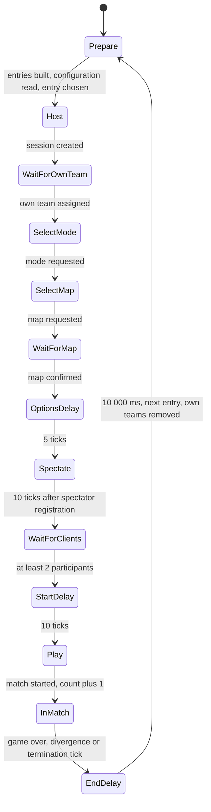
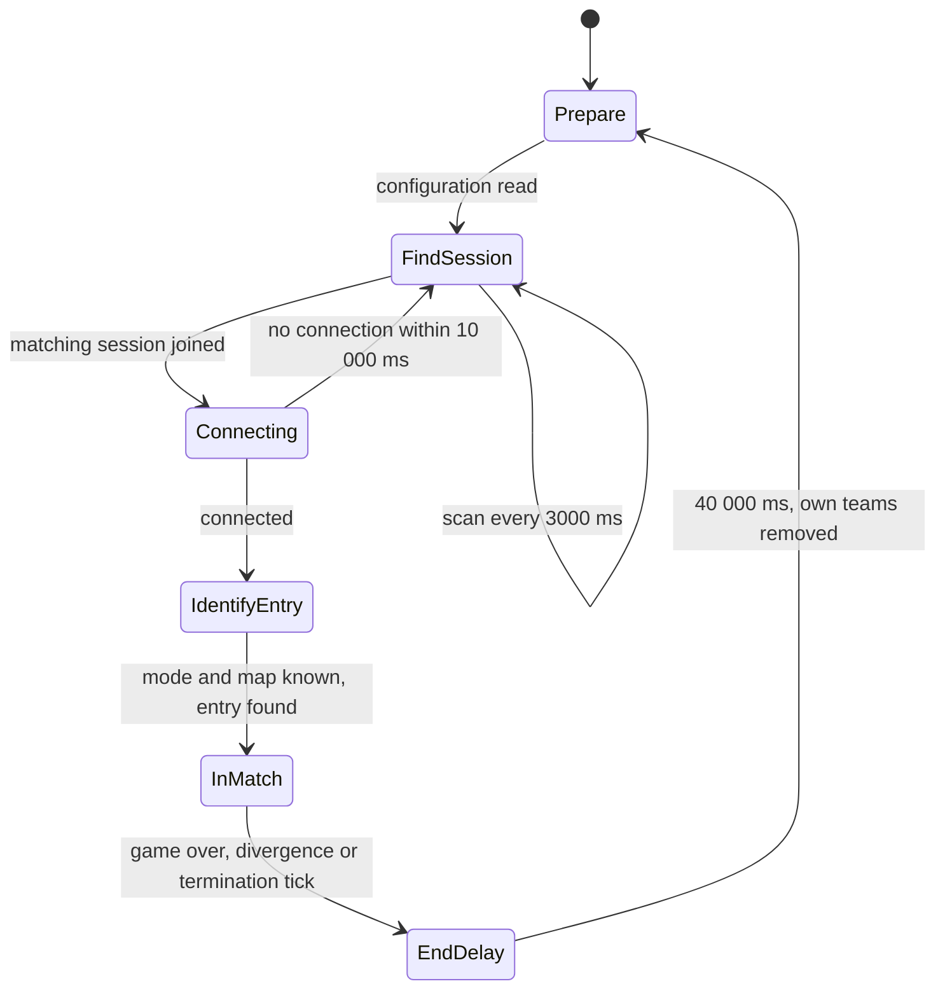

# Test harness, soak test and telemetry

> Status: Engine baseline · Prefix: DBG · ADRs: [ADR-069](../../../ADR/ADR-069-test-framework.md) · [ADR-070](../../../ADR/ADR-070-continuous-integration.md) · [ADR-066](../../../ADR/ADR-066-telemetry-with-consent.md) · [ADR-060](../../../ADR/ADR-060-content-identity-by-hash.md) · [ADR-074](../../../ADR/ADR-074-platform-clock-with-injectable-time.md) · Folder: [diagnostics, test and performance](README.md) · Related: [randomness and integrity](../../../reference/12_simulation_model/07_randomness_and_integrity.md) · [build tooling and distribution](../build_tooling_and_distribution.md) · [test and telemetry records](../data_schemas/test_and_telemetry_records.md) · [platform layer](../platform_layer.md)

This document specifies the test harness with its headless simulation tests and per-tick checks, the headless soak test, the opt-in telemetry data set and the replay hooks. The responsibilities of the component, the interface sketch (Listing 2.1-A) and the soak and telemetry data contracts (DBG-025, DBG-026) are in the [README](README.md).

## 1 Responsibilities and boundaries

This document holds items 9 to 11 of DBG-001 ([README](README.md) §1) and the replay hooks of §8.2. The record schemas of the soak configuration, the soak report and the telemetry session record are the data schemas' ([test and telemetry records](../data_schemas/test_and_telemetry_records.md)).

## 2 Interfaces

The soak and telemetry declarations are those of Listing 2.1-A ([README](README.md) §2.1). The soak runner, the headless simulation tests and the telemetry sender run on threads they own (DBG-031).

## 3 Data model

The soak report and the telemetry session record are the data contracts DBG-025 and DBG-026 ([README](README.md) §2.3).

## 4 Behaviour and algorithms

### 4.8 Test harness

**DBG-140** (MUST) Tests use the Microsoft C++ Unit Test Framework that ships with Visual Studio, run by `vstest.console.exe` over every test DLL the build produced (ADR-069). Each library has one test project `<Project>Tests`, whose code is in `namespace <Project>Tests`. Every test method carries the requirement id it verifies, in its PascalCase name (for example `Dbg143FiniteStateAfterTick`) and as the test-method attribute `Requirement` (value `DBG-143`), and the rules of `Build\CheckProjectFiles.py` ([build tooling](../build_tooling_and_distribution.md) table 4.1-B) reject a test method whose attribute names no requirement id that the design defines (the ids of `REQUIREMENTS_INDEX.md`). Because `vstest.console.exe` reports a run that finds no test as a pass, every test project keeps the placeholder test class `SuiteSmoke` until its first real test lands, and the CI test step fails when a `<Project>Tests` project produced no DLL (ADR-070).

**DBG-141** (MUST) The test kinds are:

| Kind | Rule |
|---|---|
| unit | fixtures and mocks per library; deterministic time through the manual clock source (ADR-074) |
| property | parameterised over seeded generators; a failing seed is printed and added as a permanent regression case |
| golden-hash | output hashes compared with checked-in expectations: the content build (ADR-059, ADR-060) and the simulation (DBG-145) |
| golden-image | fixed scenes rendered on the pinned reference configuration, the WARP adapter of the Windows SDK until the GPU agent of ADR-070 exists, and compared with a tolerance: by default each 8-bit channel of every pixel within one code value of the reference image; a test may state another tolerance only in its own row. A reference image is produced by the test's own scene on the reference configuration and is reviewed and committed with the change that alters it; they run in CI once the job on a GPU agent is added by amendment of ADR-070 (ADR-069) |
| fuzz | harnesses for the pack-file reader, every binary record loader and the authoring parser, test methods of the library's `<Project>Tests` project that replay a committed seed corpus and every input that has ever failed, in the Debug test run; a coverage-guided fuzzing project needs an owner decision and an `AGENTS.md` change (O27, ADR-069) |
| performance | fixed scenes on the reference test machine against the budgets of the component specifications; results are artefacts of the performance job (§5.4, DBG-208) |
| headless simulation | DBG-142 |

**DBG-142** (MUST) A **headless simulation test** runs the simulation step with the transport, renderer, audio and UI replaced by stubs (R-SIM-673), in the headless server product (DEC-220), from a match setup, a seed and a command stream, on the fixed-step or manual clock source (ADR-074), at maximum speed. The same runner serves the soak test (§4.9), replay validation (DEC-046) and the performance scenes of §5.4.

**DBG-143** (MUST) In test builds, after every tick, the harness runs these checks and fails the test with the tick, the object handle and the field on the first violation: no simulation field holds NaN or an infinity (R-SIM-107, R-SIM-717, DEC-653); every actor-grid entry names a live actor whose recorded cell set contains that cell (DEC-650); every handle lies within `ref.sim.handle.max_slots` and `ref.sim.handle.max_group_slots` (R-SIM-131, R-SIM-144); every pool received its slices in ascending order (R-SIM-214); no grid look-up was outside its grid (R-SIM-306).

**DBG-144** (MUST) The **simulation state hash** of a tick is a 64-bit hash of one canonical serialisation of all simulation state: every field of every simulation object, the generator state, the teams, the match rules and the tick clock, in container order. Test builds compute it after every tick. When two runs differ, the harness compares the two states field by field at the first differing tick and names the first differing object and field. Whether Species also hashes state at run time, and what it does on a mismatch, is DEC-206; which builds must produce identical hashes is DEC-240.

**DBG-145** (MUST) The golden-hash targets of the simulation are the integrity acceptance criteria of [randomness and integrity](../../../reference/12_simulation_model/07_randomness_and_integrity.md): A3 (same setup, seed and frames give the same per-tick hashes), A4 (presentation changes leave the hashes unchanged), A6 (constructing objects outside a step leaves the stream unchanged), A8 (presentation fields changed between ticks), A9 (rendering never writes simulation state), A10 (local state, preferences and clocks change nothing), A11 (no state survives between matches), A12 (tree hit volumes), A13 (no non-finite values), A14 (draw tracking changes no draw), A15 (one command per Leader toggle), A16 (seasonal state from the match setup), A17 (the command-history hook) and A18 (bot inputs and draws). The determinism corpus starts with the areas of R-SIM-708: terrain heights and trees, Barrier Emitters, Relics, the dust vortex, and Leaders that direct Workers into Beam Dishes.

**DBG-146** (MUST) A draw-tracking test build records every simulation draw with its call site and a running count and keeps the most recent `dbg.trace.draw_log_capacity` (100 000); its draw values equal those of an untracked build (R-SIM-613). When two runs' hashes differ, the harness reports the first differing draw. The generator algorithm and stream derivation are DEC-242; the harness treats the generator as opaque.

**DBG-147** (MUST) A golden hash changes only with a reviewed change that names the rule it implements. Until DEC-240 fixes the determinism scope, the golden hashes must agree across the CI agents of one build; the cross-machine corpus run of DEC-240 item 9 (two CPU generations of two x64 vendors, and every server build) is a design-phase input (§8.3).

**DBG-148** (MUST) Soak and stress maps are test maps: loadable in Debug builds and by the headless test and soak runs, and never listed in match setup or packed into a player edition (DEC-802, ADR-056). The reference's own sandbox, benchmark and stress maps are not reproduced (DEC-334); Species test maps are authored new.

**DBG-149** (MUST) When the design phase defines persisted data (DEC-250, DEC-251), the harness checks that saving and reloading a state reproduces its simulation state hash, and that a settings file round-trips losslessly (DEC-800).

**DBG-150** (MUST) A Debug client test pass runs with the Direct3D 12 debug layer and GPU-based validation, on developer machines and in the CI job on a GPU agent that ADR-070 adds by amendment (ADR-001, ADR-068); `D3D12SDKLayers.dll` is never distributed.

**DBG-151** (MUST) The test harness hosts the test suites of the other components, each in the `<Project>Tests` project of its library (DBG-140). Among them: the terrain's golden grid digests, cross-build determinism and generation-time tests (terrain T22, T23 and T26), which compare the canonical grid digest (TER-252), use the per-tile trace of a Debug build to locate a difference (TER-253), and record the generation time as part of the load timing (TER-254); the page tests T1 to T37 and the defect suite DT-01 to DT-33 of the UI framework's [pages and screen recipes](../ui_framework/pages_and_screen_recipes.md), whose repeat test DT-13 runs at 30 and at 144 frames per second on the manual clock source (ADR-074); and the input tests, which record every frame's events and replay them through the input router (INP-243).

### 4.9 Soak test

**DBG-160** (MUST) The soak test is an unattended test of complete matches between bot teams (DEC-041, DEC-804, ADR-070). The host walks through the soak entries and takes part as a spectator, so bot teams play every match to its end, and crashes and failed checks are counted and logged per match. The baseline pass runs in one process: the headless server program runs every entry with no client participant (the configuration's `clients` is 0), and the soak runner drives its session and match through the soak host interface (`SoakHost`, Listing 2.1-A) that the game's server implements, with no user interface (DEC-804 item 3 applies wherever a soak drives a UI). Once the networking model exists (DEC-200, DEC-206), a pass may also run with client participants, which join as spectators, and divergences are then counted too; the client steps of DBG-163 and DBG-164 and the divergence handling of DBG-165 apply only to such a pass. A scheduled CI job, added by amendment of ADR-070 and guarded like the committed jobs, runs the soak at maximum speed on the headless server program with the `soak` edition, which holds every mode and map of the full edition and the soak and stress test maps ([build tooling](../build_tooling_and_distribution.md) tables 3.2-D and 4.9-B, BLD-057; DEC-220 item 3); once clients exist, a developer can also run rendered clients.

> **Amendment 2026-10-18 (ADR-081; ADR-084; O55).** No client simulates (ADR-084), so a pass with client participants counts no divergence between participants: its clients exercise the transport and the replica under the link simulator (ADR-088 item 7), and a divergence is a per-tick state hash that differs between two runs of one entry on one build (ADR-081 items 6 and 8). The MVP has no bot match (O55), so its soak runs worlds of MVP-010 on the test runner of the [solution strategy](../../04_solution_strategy.md) (the server library with recorded inputs and presentation stubs), with the AI settlements (MVP-056) and, from M4, the deputy (MVP-073) issuing the commands.

**DBG-161** (MUST) A soak pass follows the rules of DEC-804: each entry names a map by stable map id, a mode, its automated participants and a seed. An entry's automated participants are the bot teams that the game layer creates for it (`SoakEntry::automatedParticipants`): for a test map, the key `automated_participants` of its test-map item ([test and telemetry records](../data_schemas/test_and_telemetry_records.md) table 3.1-C); for an entry built from the edition, the map's player count, so every slot is played by a bot team (DEC-079). The map's content hash is checked against the content manifest before the match runs (ADR-060); a pass runs every entry exactly once, from the first to the last; delays and timeouts are counted in ticks or in integer milliseconds of the platform clock; the soak state belongs to the `SoakRunner`, which creates and resets it; and each match logs its seed, map id, content hash and build identity, so a failing match can be replayed.

**DBG-162** (MUST) The entries are built from the edition: one entry for every pair of a mode the edition enables (ADR-056) and a map that match setup lists for it, plus the test maps the soak configuration names (DBG-148). The progression orders them: `Linear` in declared order; `Random` as a permutation drawn from `progression_seed`, which is logged; `Sequence` as the configuration's explicit list, each item naming an entry and, optionally, a forced seed. An entry without a forced seed keeps the authority's own seed, so any seed, 0 included, can be forced. The configuration also names: the soak session name, which replaces `debug.soak_session_name`; an optional termination tick at which every match ends, none meaning that a match ends only by game over or a divergence; the number of client participants, 0 by default, which gives the single-process pass of DBG-160, and once the networking model exists at least the number that reaches `dbg.soak.min_participants` together with the host; and, for each test map it adds, the mode and the number of automated participants of its entry (test and telemetry records, DAT-372 to DAT-374).

**DBG-163** (MUST) Before every step of the host, the authority's seed is set to the current entry's forced seed when it has one, and every participant sets its team name to the soak session name. The runner owns these steps and drives the server through `SoakHost` (Listing 2.1-A): one call per step as the listing's comments name, `AdvanceTick` for every tick of a delay and of the match, and `MatchRunning`, `CurrentTick`, `StateHash` and `LivePopulation` read after each tick. In a single-process pass, step 8 waits only for its start delay. The host runs:

1. **Prepare**: reset the step timer and the participant count.
2. **Host**: create a session under the soak session name.
3. **Wait for own team**: until the host's participant has a team.
4. **Select mode** and **select map**: request the entry's mode, then its map.
5. **Wait for map**: until the session confirms the requested map; remember the current tick.
6. **Options delay**: wait `dbg.soak.options_delay_ticks` (5 ticks, 0.5 s).
7. **Spectate**: register the host's participant as a spectator; then wait `dbg.soak.spectator_delay_ticks` (10 ticks).
8. **Wait for clients**: in a pass with client participants, until at least `dbg.soak.min_participants` (2) participants are connected; then wait `dbg.soak.start_delay_ticks` (10 ticks).
9. **Play**: start the match; the ready checks of the lobby do not apply to a soak session; when the match starts, the match count rises by 1.
10. **In match**: until DBG-165 ends the match.
11. **End delay**: wait `dbg.soak.host_end_delay_ms` (10 000 ms); then advance to the next entry, remove the host's teams, clear its spectator state and return to Prepare.

Caption: Diagram 4.9-A, the soak host (DBG-163). In a single-process pass the host leaves WaitForClients at once.

**DBG-164** (MUST) A soak client exists only in a pass with client participants, once the networking model exists (DBG-160, DEC-200); it runs:

1. **Prepare**: reset its timers.
2. **Find session**: every `dbg.soak.discovery_period_ms` (3000 ms), scan the session list for the first session whose name equals the soak session name and whose map is known; join it and raise the match count by 1. A full session does not refuse a soak client, and the host registers every soak client as a spectator when it joins.
3. **Connecting**: when no connection is established within `dbg.soak.connect_timeout_ms` (10 000 ms) of the start of the attempt, return to Find session.
4. **Identify entry**: once the session's mode and map are known, find the matching entry index.
5. **In match**: until DBG-165 ends the match.
6. **End delay**: wait `dbg.soak.client_end_delay_ms` (40 000 ms); then remove its teams, clear its spectator state and return to Prepare.

A disconnection by the host returns the client to Prepare at any step.

Caption: Diagram 4.9-B, the soak client (DBG-164).

**DBG-165** (MUST) In a soak match, each participant:

1. sends its ready command on every tick of the grace period while its team is not ready;
2. in a pass with client participants, when a divergence is detected (DEC-206): leaves the match, raises the pass's divergence count unless it is already in its end delay, writes a report row and enters its end delay;
3. when the termination tick is set and reached: leaves the match, writes a report row and enters its end delay;
4. at game over: leaves the match, writes a report row unless it is already in its end delay, and enters its end delay.

> **Amendment 2026-10-18 (ADR-081; ADR-084).** Item 2 is the runner's, not a participant's: a divergence is found by comparing the per-tick hashes of two runs of the entry (DBG-160 amendment), and a client never detects one.

**DBG-166** (MUST) The soak report has one row per match, after a header row, with these columns in this order: the UTC date and time; the pass's divergence count so far; the mode; the map id; the entry index; the seed; the previous entry index, empty for the first match of the pass; the match time in ticks; the tick of the first divergence, empty when the match did not diverge (no cell holds a marker value, DAT-377); then the content hash and the build identity (DEC-804); the crashes and the failed checks of the match; the simulation update-time percentiles of `dbg.telemetry.percentiles`; and the peak population (ADR-070). In a single-process pass the divergence count is 0 and the first-divergence cell is empty.

**DBG-167** (MUST) A crashed participant's dump is collected ([platform layer](../platform_layer.md)), its row records the crash, and the runner continues with the next entry in a new process. Soak participants start with rendering and sound off; a rendered client toggles them with `action.debug.soak_rendering`. Once the transport exists, the soak runs with the link simulator of DEC-208 at the soak target that DEC-208 names.

### 4.10 Telemetry

**DBG-180** (MUST) Telemetry is opt-in and off by default (ADR-066): the first-run screen and the options screen ask, the choice is stored in the settings and can be withdrawn at any time, and withdrawing deletes the unsent records. With consent off, no request is made and nothing is queued.

**DBG-181** (MUST) The data set per session is fixed (ADR-066): frame-time percentiles (`dbg.telemetry.percentiles`: 50th, 95th and 99th) rather than a frame-rate integer; simulation update-time percentiles; the peak and the mean of the total live entity count, not counts per type; network bytes in and out per second and the round-trip latency, each as percentiles; the build identity (ADR-057); the active renderer settings and preset (RND-457); and a hardware summary read in-process (the adapter description and driver version, the processor and memory information of the operating system, and the display mode). Frame time, simulation update time, network traffic and round-trip latency are sampled every `dbg.telemetry.sample_period_ms` (1000 ms) and each reduced to the percentiles at the end of the session; the entity count is sampled at the same period for its peak and mean. The data set holds no session start time, duration, sample count or operating-system version, and no player name, chat, account id or IP address (test and telemetry records, table 3.3-A).

**DBG-182** (MUST) Records are sent over HTTPS through the platform layer's HTTPS client (PLT-099, ADR-077), batched and retried with back-off; at most `dbg.telemetry.queue_max_records` (16) unsent records are kept, the oldest dropped first. Whether the queue is kept across runs is part of DEC-250; until that is decided, the queue lives in memory, and the records that are unsent when the process ends are dropped (DBG-040). The client embeds no credential: a record carries the build identity and a random per-installation id that the player can reset. The collection service is a design-phase decision.

**DBG-183** (MUST) The repeatable performance scene of ADR-066 is a recorded match that the client runs headless or rendered and that reports the data set of DBG-181. Until the replay decision (DEC-046) gives Species recorded command streams, the scene is a bot-only match from a fixed match setup and seed on a test map.

## 5 Concurrency and performance budget

The per-tick checks exist in test builds only and stay outside the simulation budget (DBG-200).

## 6 Failure modes, diagnostics and telemetry

The failures of the test harness, the soak test and telemetry are rows of the failure table of DBG-220 ([README](README.md) §6).

## 7 Acceptance tests

| # | Kind | Test | Requirements |
|---|---|---|---|
| T20 | unit | A fixture test method whose `Requirement` attribute names no existing requirement id fails `Build\CheckProjectFiles.py`; a `<Project>Tests` project that produced no DLL fails the CI test step; a test project with only `SuiteSmoke` runs it and passes. | DBG-140 |
| T21 | integration | The per-tick checks report a NaN written into a test field, a stale actor-grid entry, a handle beyond the slot bound and a skipped slice, each with tick, handle and field. | DBG-143 |
| T22 | golden-hash | Every target of DBG-145 passes in CI; a seeded difference in one field is named by the field-level diff at its first tick. | DBG-144, DBG-145 |
| T23 | unit | A draw-tracking build and an untracked build give identical draw values for a recorded match; a seeded extra draw is reported as the first differing draw. | DBG-146 |
| T24 | integration | A soak pass over a linear sequence of 5 entries runs each entry once in order; a random pass with a logged seed runs each once in the logged order; a sequence entry runs with its forced seed, a forced seed of 0 included, and an entry without one runs with the authority's own seed. | DBG-161, DBG-162 |
| T25 | integration | A soak map whose content hash differs from the manifest fails its entry and the pass continues. | DBG-161 |
| T26 | integration | In a single-process pass with a recording `SoakHost`, the runner makes the calls of DBG-163 in step order and reaches Play after 5 + 10 + 10 ticks of delay with no client; once the networking model exists, a pass with clients reaches Play only with 2 participants connected, and a client that cannot connect retries after 10 000 ms. | DBG-160, DBG-163, DBG-164 |
| T27 | integration | In a single-process pass, a soak match ended by the termination tick and one ended by game over each write exactly one report row with every column of DBG-166, a divergence count of 0 and empty first-divergence cells; the first match's row holds an empty previous-entry cell, never −1; once the networking model exists, a match ended by an injected divergence writes one row too. | DBG-165, DBG-166 |
| T31 | integration | The terrain, UI and input suites of DBG-151 run in their test projects; DT-13 gives equal steps and value changes at 30 and at 144 frames per second. | DBG-151 |
| T28 | unit | With consent off no telemetry request is made and nothing is queued; withdrawing consent deletes the queue; a record with a field outside the data set is rejected. | DBG-180 to DBG-182 |
| T30 | unit | A settings file and, once defined, a persisted state round-trip with an unchanged hash. | DBG-149 |

## 8 Open decisions

### 8.2 Replay hooks

**DBG-240** (MUST) No player-facing replay exists in the reference. Its development hook is the command-history recording of [randomness and integrity](../../../reference/12_simulation_model/07_randomness_and_integrity.md) R-SIM-740 to R-SIM-742, switched by `debug.command_history` (DBG-041): mode 1 saves, when a match hosted on this machine shuts down, a file holding the number of command frames and then every frame in sequence order, lobby commands and match start included; mode 2 loads such a file after a map has loaded and replaces the host's history, which the normal sending path then streams to the participants. The file has no version header and plays back only with identical code and data, the same team and participant layout, the same seed and no conflicting live commands; it holds no seed, so it does not reproduce a match (R-SIM-741). Species defines its own recording format with the replay decision (DEC-046).

**DBG-241** (MUST) While `debug.command_history` is 1 or 2, every presentation frame advances by 1 ÷ `dbg.replay.capture_frame_rate` (1 ÷ 25 s) through the fixed-step clock source of ADR-074, and the match is not held by pause. Every clock that reads the platform clock follows the fixed step, the real clock and the real-time schedules of R-SIM-740 included (PLT-050, DEC-041). Late joining by re-simulating the command stream from its first frame belongs to the networking model (DEC-200). Video capture uses external tools on the fixed-step source (ADR-076), and no other recording exists (DEC-060).

The decisions and design-phase inputs of the whole component are in the [README](README.md) §8.

## 9 Tuning table

A value whose notes say "Species" is a Species engine-baseline value; every other value is the reference tool's value, kept as the starting value (DEC-004).

| key | value | unit | range or notes | requirement | DEC |
|---|---|---|---|---|---|
| `dbg.trace.draw_log_capacity` | 100 000 | draws | | DBG-146 | DEC-206, DEC-242 |
| `dbg.soak.options_delay_ticks` | 5 | ticks | 0.5 s | DBG-163 | DEC-804 |
| `dbg.soak.spectator_delay_ticks` | 10 | ticks | 1.0 s | DBG-163 | DEC-804 |
| `dbg.soak.min_participants` | 2 | participants | reference: more than one connected | DBG-163 | DEC-804 |
| `dbg.soak.start_delay_ticks` | 10 | ticks | 1.0 s | DBG-163 | DEC-804 |
| `dbg.soak.host_end_delay_ms` | 10 000 | ms | | DBG-163 | DEC-804 |
| `dbg.soak.discovery_period_ms` | 3000 | ms | | DBG-164 | DEC-804 |
| `dbg.soak.connect_timeout_ms` | 10 000 | ms | | DBG-164 | DEC-804 |
| `dbg.soak.client_end_delay_ms` | 40 000 | ms | | DBG-164 | DEC-804 |
| `dbg.telemetry.percentiles` | 50, 95, 99 | percentiles | Species; ADR-066 | DBG-096, DBG-166, DBG-181 | — |
| `dbg.telemetry.sample_period_ms` | 1000 | ms | reference: one sample per second | DBG-181 | — |
| `dbg.telemetry.queue_max_records` | 16 | session records | Species; oldest dropped | DBG-182 | DEC-250 |
