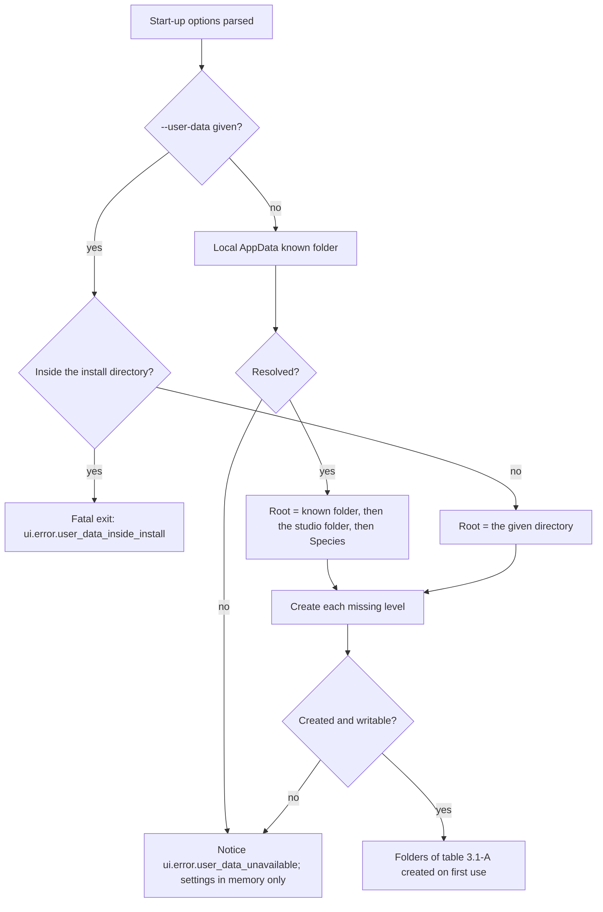
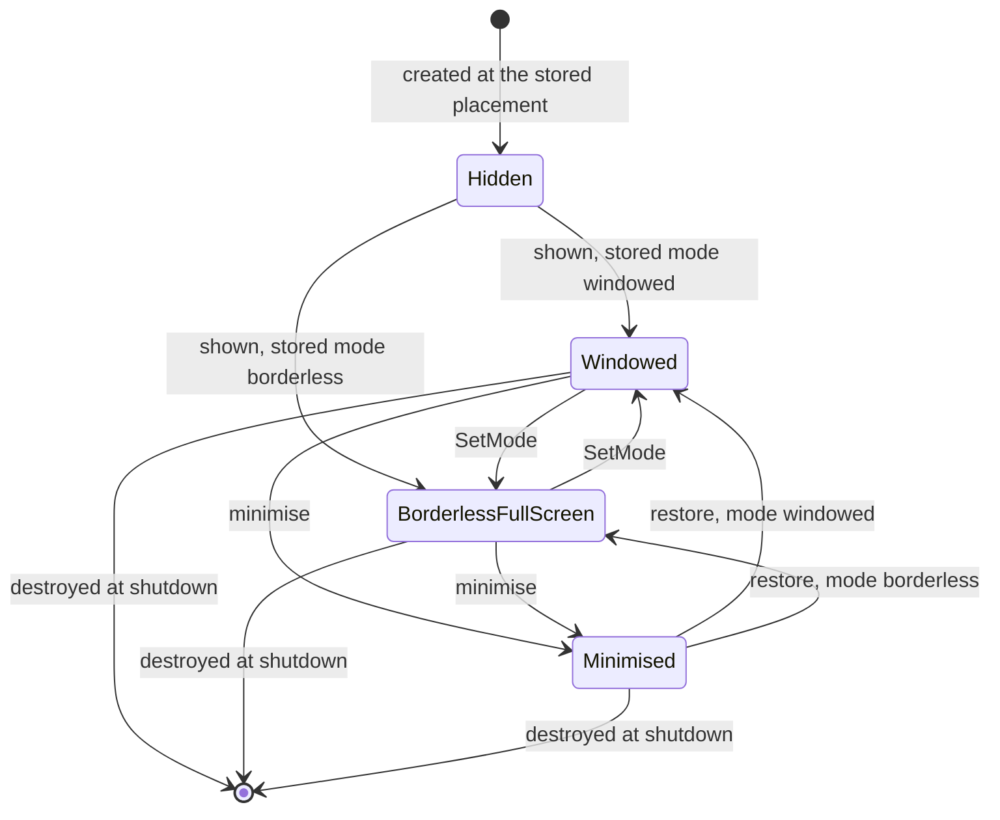
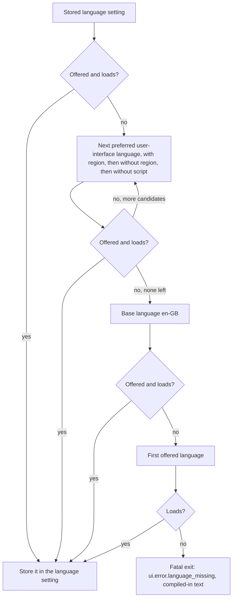
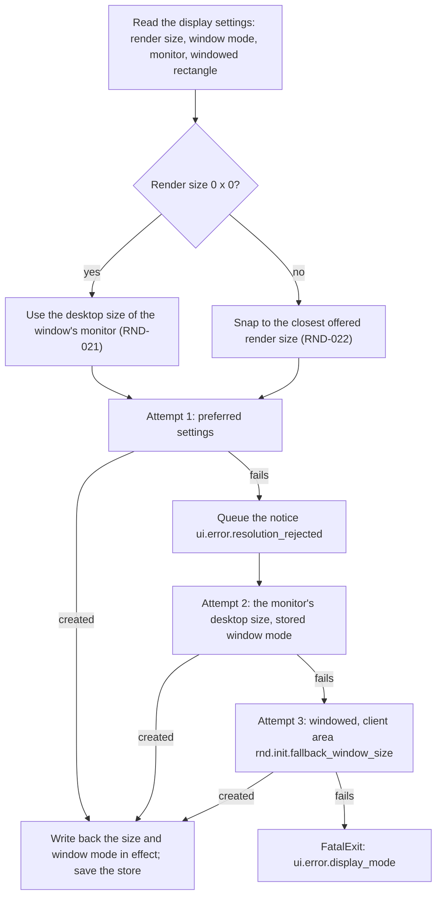
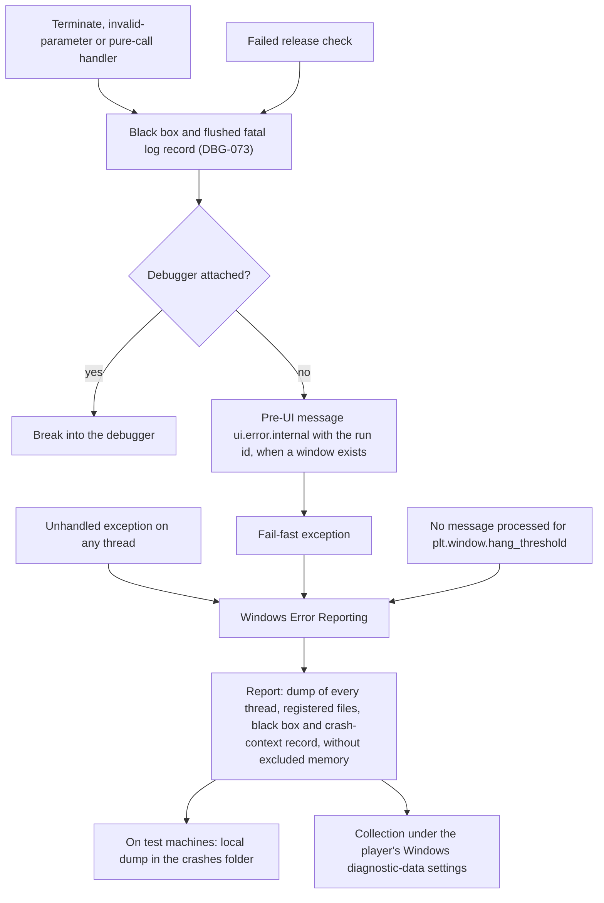

# Platform layer

> Status: Engine baseline · Prefix: PLT · ADRs: [ADR-050](../../ADR/ADR-050-client-platform-and-minimum-os.md) · [ADR-074](../../ADR/ADR-074-platform-clock-with-injectable-time.md) · [ADR-075](../../ADR/ADR-075-application-window-and-dpi-awareness.md) · [ADR-071](../../ADR/ADR-071-install-layout-runtime-files-and-user-data.md) · [ADR-065](../../ADR/ADR-065-crash-reporting.md) · [ADR-066](../../ADR/ADR-066-telemetry-with-consent.md) · [ADR-077](../../ADR/ADR-077-client-http-stack.md) · [ADR-057](../../ADR/ADR-057-version-identity.md) · [ADR-056](../../ADR/ADR-056-products-configurations-and-feature-flags.md) · [ADR-076](../../ADR/ADR-076-screenshot-encoding.md) · [ADR-012](../../ADR/ADR-012-swap-chain-presentation-and-frame-pacing.md) · [ADR-028](../../ADR/ADR-028-input-device-back-ends.md) · [ADR-033](../../ADR/ADR-033-ui-layout-scaling-and-dpi.md) · [ADR-063](../../ADR/ADR-063-localisation.md) · [ADR-067](../../ADR/ADR-067-logging.md) · [ADR-008](../../ADR/ADR-008-gpu-memory-uploads-and-device-removal.md) · [ADR-078](../../ADR/ADR-078-gpu-resource-factory.md) · Related: [renderer](renderer/README.md) · [input](input/README.md) · [UI framework](ui_framework/README.md) · [data schemas](data_schemas/README.md) · [build tooling](build_tooling_and_distribution/README.md) · [diagnostics](diagnostics_test_and_performance/README.md) · [tick timing](../../reference/12_simulation_model/01_tick_timing_and_main_loop.md) · [options and localisation](../../reference/09_front_end_and_match_flow/options_localisation_and_hooks.md)

This component is the Species engine's contact with Windows 11. It owns the application window and its message loop, the display information, the platform clock, the process lifecycle from entry to exit, the install directory and the user-data folders, the settings store and its file, threads and the floating-point environment of each thread, the crash-context registration with Windows Error Reporting, system information, the start-up options, the HTTPS client, the clipboard, web-address opening, audio-endpoint notices and the screenshot file output. Every other component reaches the operating system through it.

Notation used throughout:

- **Platform time** is a reading of the platform clock: a signed 64-bit count of nanoseconds since the clock origin, shown in seconds where that reads better. It is presentation and scheduling time. Simulation durations are ticks, defined in [tick timing and main loop](../../reference/12_simulation_model/01_tick_timing_and_main_loop.md), and never platform time.
- **Pixels** are physical pixels of the window's client area unless a rule says otherwise; "desktop coordinates" are the virtual-desktop coordinates of Windows.
- `<Studio>` is the publisher-name parameter (CONVENTIONS §8.11) and `Species` is the product name `PRODUCT_NAME`. The user-data root is `%LOCALAPPDATA%\<Studio>\Species\`.
- A **pre-UI message** is a message box that the platform layer shows itself, before the UI framework exists or when it cannot draw (§4.1).

## 1 Responsibilities and boundaries

**PLT-001** (MUST) The platform layer provides exactly the services of table 1-A. Each row names the decision that fixes its technology and the section that specifies it.

Table 1-A: platform services.

| # | Service | Decided in | Specified in |
|---|---|---|---|
| 1 | platform clock: one process-relative monotonic clock behind an injectable time source; high-resolution waits; calendar time | ADR-074 | §4.2 |
| 2 | application window and message loop: per-monitor DPI awareness v2, windowed and borderless full screen | ADR-075 | §4.3 |
| 3 | input event source: the window's input messages, forwarded to the keyboard and mouse back-end of [input](input/README.md) | ADR-028 | §2.2, §4.3 |
| 4 | display information: monitors, DPI, desktop modes and mode sizes; the display mode is never changed | ADR-075, ADR-012 | §4.4 |
| 5 | threads and job queues, and the floating-point environment of every thread | ADR-065, DEC-224, DEC-240 | §4.8 |
| 6 | diagnostic output through the log sink that the logger of [diagnostics](diagnostics_test_and_performance/README.md) implements | ADR-067 | §2.1, §6.5 |
| 7 | crash handling: no crash-swallowing filter, the fatal handlers, the fatal path and the crash-context registration | ADR-065 | §6.3 |
| 8 | install and user-data locations | ADR-071 | §3.1 |
| 9 | files: whole-file reads, read-only mapping, atomic replacement, UTF-8 and UTF-16 conversion | ADR-071, ADR-063, DEC-800 | §4.9 |
| 10 | settings store | DEC-100, DEC-800, DEC-250 | §3.5, §4.7 |
| 11 | system information | ADR-066, ADR-067 | §3.6, §4.10 |
| 12 | start-up options | ADR-056, ADR-057 | §3.3 |
| 13 | language detection: the preferred user-interface languages as BCP 47 tags | ADR-063 | §4.6 |
| 14 | pre-UI messages | ADR-050 | §4.1 |
| 15 | HTTPS client | ADR-066, ADR-077 | §4.12 |
| 16 | clipboard text and web-address opening | ADR-032 | §4.13 |
| 17 | audio-endpoint notices | ADR-022 | §4.14 |
| 18 | screenshot and poster output | ADR-076 | §4.11 |
| 19 | process lifecycle: the platform steps of start-up and shutdown that the composition root calls, the lifecycle hooks, quit, end of session, exit codes | DEC-221 | §4.1 |

**PLT-002** (MUST NOT) The platform layer never steps the simulation and never reads or writes simulation state. It gives simulation code no clock: the simulation reads time only as tick counts from the tick clock (`TickClock`), never from the platform clock, the calendar or a render-frame clock (DEC-009; [randomness and integrity](../../reference/12_simulation_model/07_randomness_and_integrity.md) R-SIM-660). The platform clock drives only the scheduling of ticks and presentation (ADR-074).

**PLT-003** (MUST NOT) No other component calls an operating-system service of table 1-A directly. The rules of `Build\CheckProjectFiles.py` ([build tooling](build_tooling_and_distribution/README.md) table 4.1-B) reject, in every source file outside the platform layer's project, a direct call of the performance counter, the tick-count and multimedia timers or a standard-library clock (ADR-074), a window creation, a known-folder look-up, a Windows Error Reporting registration and a thread created other than through `PlatformThread`; each rule has a failing fixture (T6).

**PLT-004** (MUST NOT) The platform layer does not own: the swap chain, presentation and the frame-rate cap's policy ([renderer](renderer/README.md), ADR-012); input decoding, bindings and gamepads ([input](input/README.md), ADR-028, ADR-029); layout, DPI-scaled sizes and text ([UI framework](ui_framework/README.md), ADR-033); the logger, the black-box contents, profiling and telemetry ([diagnostics](diagnostics_test_and_performance/README.md), ADR-065 to ADR-068); the symbol store, the crash-data collection programme, the version resource and packaging ([build tooling](build_tooling_and_distribution/README.md), ADR-057, ADR-065, ADR-071, ADR-072); the preferences schema, the settings-file grammar and the content of the defaults table ([data schemas](data_schemas/README.md), DEC-100); which settings exist and what the options pages show ([options, localisation and hooks](../../reference/09_front_end_and_match_flow/options_localisation_and_hooks.md)); pack files and mounting ([asset pipeline](asset_pipeline_and_resources.md), ADR-058). Section 2 states what each neighbour receives.

**PLT-005** (MUST) The headless server (the server project, ADR-056) is a Windows build with the toolset of the client (ADR-051) and uses only the portable platform services: the clock, threads and job queues, the floating-point environment, files and text conversion, the system summary without its display and audio parts, its own start-up options and the HTTPS client. It links no window, display, input-forwarding, clipboard, screenshot or audio-endpoint code. Windows Error Reporting covers its crashes; its process roles, its data locations and where its crash reports go are design-phase decisions (DEC-220, ADR-065, §8.2).

**PLT-132** (MUST) The platform layer's project owns the one header that includes `<windows.h>`, `WindowsHeaders.h` (`AGENTS.md` §4): it defines `NOMINMAX`, `WIN32_LEAN_AND_MEAN`, `NOMCX`, `NOSERVICE` and `NOHELP` and then includes `<windows.h>`. No project file and no other header defines any of these macros. Every source file of any project that needs a Windows declaration includes `WindowsHeaders.h` instead of `<windows.h>`, before any Direct3D 12, DXGI, XAudio2 or GameInput header, in the include order of `AGENTS.md` §4. The rules of `Build\CheckProjectFiles.py` ([build tooling](build_tooling_and_distribution/README.md) table 4.1-B) reject a direct include of `<windows.h>` and a definition of one of these macros anywhere else (T35).

## 2 Interfaces

### 2.1 Interface sketch

The sketch is a C++23 declaration outline, not an implementation. Every type is in namespace `Engine`; strings are UTF-8 and converted to UTF-16 only inside the platform layer (ADR-063).

```cpp
namespace Neuron
{

enum class PlatformError : std::uint8_t
{
  Unsupported,
  AccessDenied,
  NotFound,
  Other
};

// ---- Platform clock (ADR-074) ----
using Nanoseconds = std::chrono::duration<std::int64_t, std::nano>; // since the clock origin
enum class TimeSourceKind : std::uint8_t
{
  Real,
  FixedStep,
  Manual
};
class TimeSource
{
public:
  virtual ~TimeSource() = default;
  [[nodiscard]] virtual Nanoseconds Now() const noexcept = 0;
  virtual void FrameBoundary() noexcept {} // the fixed-step source advances here
};
// Tests only.
class ManualTimeSource final : public TimeSource
{
public:
  void Advance(Nanoseconds _step) noexcept; // _step >= 0
  [[nodiscard]] Nanoseconds Now() const noexcept override;
};
class PlatformClock
{
public:
  [[nodiscard]] Nanoseconds Now() const noexcept; // any thread; lock-free; never decreases
  [[nodiscard]] Nanoseconds Resolution() const noexcept;
  [[nodiscard]] TimeSourceKind SourceKind() const noexcept;
  void FrameBoundary() noexcept;                                           // the frame loop, once per rendered frame
  void WaitUntil(Nanoseconds _deadline) const;                             // returns at once under an injected source
  [[nodiscard]] std::chrono::system_clock::time_point CalendarUtc() const; // logs, reports, display
  [[nodiscard]] std::chrono::minutes LocalUtcOffset() const;               // display only
  void ReplaceSource(std::unique_ptr<TimeSource> _source);                 // start-up and Debug tests only
};

// ---- Window and displays (ADR-075) ----
using NativeWindowHandle = struct HWND__*;
struct PointPx
{
  std::int32_t x = 0;
  std::int32_t y = 0;
};
struct SizePx
{
  std::uint32_t width = 0;
  std::uint32_t height = 0;
};
// Left, top, right, bottom: the Windows rectangle order.
struct RectPx
{
  std::int32_t left = 0;
  std::int32_t top = 0;
  std::int32_t right = 0;
  std::int32_t bottom = 0;
};
enum class WindowMode : std::uint8_t
{
  Windowed,
  BorderlessFullScreen
};
enum class Permanence : std::uint8_t
{
  Permanent,
  Temporary
};
struct DesktopMode
{
  std::uint32_t width;
  std::uint32_t height;
  std::uint32_t refreshHz;
};
// A monitor record (§3.4); both rectangles are in desktop coordinates.
struct MonitorInfo
{
  std::string deviceName;
  RectPx bounds;
  RectPx workArea;
  std::uint32_t dpi;
  float dpiScale;
  bool primary;
  DesktopMode desktop;
  std::vector<SizePx> modeSizes; // PLT-070: filtered, merged by size, in reported order
};
[[nodiscard]] std::vector<MonitorInfo> EnumerateMonitors();

struct WindowPlacement
{
  WindowMode mode;
  std::string monitorDeviceName;
  std::optional<RectPx> windowedClientRect;
};
struct WindowMessage
{
  std::uint32_t id;
  std::uintptr_t wParam;
  std::intptr_t lParam;
  Nanoseconds time;
};
// The keyboard and mouse back-end of input.
class WindowInputSink
{
public:
  virtual ~WindowInputSink() = default;
  virtual void OnWindowMessage(const WindowMessage& _message) = 0; // main thread
};
struct Resized
{
  SizePx client;
};
struct DpiChanged
{
  float dpiScale;
  RectPx suggestedWindowRect;
};
struct FocusChanged
{
  bool hasFocus;
};
struct Minimized
{
};
struct Restored
{
};
struct ModeChanged
{
  WindowMode mode;
};
struct MonitorChanged
{
  std::string deviceName;
};
struct DisplayConfigurationChanged
{
};
struct KeyboardLayoutChanged
{
  std::string languageTag; /* BCP 47 */
};
struct EndOfSession
{
};
using WindowEvent = std::variant<Resized, DpiChanged, FocusChanged, Minimized, Restored, ModeChanged, MonitorChanged,
                                 DisplayConfigurationChanged, KeyboardLayoutChanged, EndOfSession>;

class AppWindow
{
public:
  [[nodiscard]] static std::expected<AppWindow, PlatformError> Create(const WindowPlacement& _placement, SizePx _renderSize);
  [[nodiscard]] NativeWindowHandle Native() const noexcept; // swap-chain creation only
  [[nodiscard]] SizePx ClientSize() const noexcept;
  [[nodiscard]] float DpiScale() const noexcept;
  [[nodiscard]] bool HasFocus() const noexcept;
  [[nodiscard]] bool IsMinimized() const noexcept;
  [[nodiscard]] const MonitorInfo& Monitor() const noexcept;
  [[nodiscard]] WindowPlacement Placement() const;
  [[nodiscard]] std::string ActiveKeyboardLayoutTag() const; // BCP 47
  void Show();
  void SetMode(WindowMode _mode, Permanence _permanence);
  void PumpMessages();                       // once per frame; never blocks
  void ConfinePointer(bool _on);             // INP-159
  void WarpPointer(PointPx _clientPosition); // INP-158; no movement event
  void SetInputSink(WindowInputSink* _sink);
  void AddListener(std::function<void(const WindowEvent&)> _listener);
};

// ---- Locations, files and settings (ADR-071, DEC-100, DEC-800) ----
enum class UserFolder : std::uint8_t
{
  Root,
  Settings,
  Logs,
  Crashes,
  Maps,
  Diagnostics
};
class PlatformPaths
{
public:
  [[nodiscard]] const std::filesystem::path& InstallDirectory() const noexcept;
  [[nodiscard]] const std::filesystem::path& Folder(UserFolder _folder) const noexcept;
  [[nodiscard]] const std::filesystem::path& ScreenshotFolder() const noexcept;
  [[nodiscard]] bool UserDataAvailable() const noexcept;
};
enum class FileError : std::uint8_t
{
  NotFound,
  AccessDenied,
  DiskFull,
  Other
};
// A read-only view of a whole file, for the asset pipeline's packs (PLT-090). Move-only; unmapped when destroyed.
class MappedFile
{
public:
  MappedFile(MappedFile&& _other) noexcept;
  MappedFile& operator=(MappedFile&& _other) noexcept;
  MappedFile(const MappedFile&) = delete;
  MappedFile& operator=(const MappedFile&) = delete;
  ~MappedFile();
  [[nodiscard]] std::span<const std::byte> Bytes() const noexcept; // valid until the view is destroyed
  [[nodiscard]] std::uint64_t SizeBytes() const noexcept;
};
[[nodiscard]] std::expected<std::vector<std::byte>, FileError> ReadWholeFile(const std::filesystem::path& _path);
[[nodiscard]] std::expected<MappedFile, FileError> MapReadOnly(const std::filesystem::path& _path);
[[nodiscard]] std::expected<void, FileError> ReplaceFileAtomically(const std::filesystem::path& _path, std::span<const std::byte> _bytes);
[[nodiscard]] std::wstring ToUtf16(std::string_view _utf8); // operating-system boundary only
[[nodiscard]] std::string ToUtf8(std::wstring_view _utf16);

using SettingValue = std::variant<bool, std::int64_t, double, std::string>;
class SettingsStore
{
public:
  [[nodiscard]] SettingValue Get(std::string_view _key) const; // the schema type; the default when unset
  template <class T> [[nodiscard]] T GetAs(std::string_view _key) const;
  void Set(std::string_view _key, SettingValue _value); // checked against the schema
  void Subscribe(std::string_view _keyPrefix, std::function<void(std::string_view)> _onChange);
  std::future<std::expected<void, FileError>> Save(); // the save events of R-META-406 only
  [[nodiscard]] bool LoadedFromFile() const noexcept; // false on the first run
};

// ---- Start-up options, lifecycle and messages ----
// The composition root calls the platform steps of start-up in the order of PLT-038.
void InstallFatalHandlers() noexcept; // step 1 (PLT-118)
void CheckOperatingSystem();          // step 8 (PLT-040)
// Table 3.3-A.
struct StartupOptions
{
  std::optional<std::filesystem::path> writeBuildIdentity;
  std::optional<std::filesystem::path> userDataRoot;
  std::optional<std::filesystem::path> looseContentDirectory;
  std::optional<std::uint32_t> fixedStepFramesPerSecond;
  bool verifyContent = false;
  std::vector<std::string> ignoredArguments;
};
[[nodiscard]] StartupOptions ParseCommandLine();
enum class MessageSeverity : std::uint8_t
{
  Notice,
  Error,
  Fatal
};
struct MessageArgument
{
  std::string_view name;
  std::string value;
};
void ShowPlatformMessage(std::string_view _stringId, std::span<const MessageArgument> _arguments, MessageSeverity _severity);
// Implemented by the application (DEC-221).
class LifecycleHooks
{
public:
  virtual ~LifecycleHooks() = default;
  virtual void OnQuitRequested() = 0;
  virtual void OnFocusChanged(bool _hasFocus) = 0;
  virtual void OnMinimizedChanged(bool _minimized) = 0;
};
[[noreturn]] void ExitAfterTeardown(int _exitCode);
[[noreturn]] void EndWithMessage(std::string_view _stringId, std::span<const MessageArgument> _arguments); // FatalExit, DBG-074
[[noreturn]] void FailFast(std::string_view _reason);                                                      // fatal path, DBG-073

// ---- Log sink (PLT-133): the platform layer's only way to the diagnostics component, which implements it ----
enum class PlatformLogLevel : std::uint8_t
{
  Debug,
  Info,
  Warning,
  Error
};
class PlatformLogSink
{
public:
  virtual ~PlatformLogSink() = default;
  virtual void Write(PlatformLogLevel _level, std::string_view _message) noexcept = 0; // any thread; never blocks on I/O
  virtual void RecordFatal(std::string_view _reason) noexcept = 0;                     // DBG-073 steps 1 and 2; FailFast follows
};
void SetPlatformLogSink(PlatformLogSink* _sink); // start-up step 7; nullptr at shutdown

// ---- Threads and the floating-point environment (ADR-065, DEC-224, DEC-240) ----
// Requests stop and joins on destruction.
class PlatformThread
{
public:
  template <class Body> static PlatformThread Start(std::string_view _name, Body&& _body); // _body(std::stop_token)
  void RequestStop() noexcept;
  void Join();
};
// One serial first-in-first-out worker.
class JobQueue
{
public:
  explicit JobQueue(std::string_view _threadName);
  template <class Job> auto Post(Job&& _job) -> std::future<std::invoke_result_t<Job>>;
  void Stop();
};
[[nodiscard]] bool IsDefaultFloatEnvironment() noexcept;
void ApplyDefaultFloatEnvironment() noexcept;

// ---- Crash context (ADR-065) ----
enum class CrashFileKind : std::uint8_t
{
  CurrentLog,
  Settings,
  DeviceRemovalData
};
class CrashContext
{
public:
  void RegisterFile(const std::filesystem::path& _path, CrashFileKind _kind);
  void RegisterMemoryBlock(std::span<const std::byte> _block); // the black box, the crash-context record
  void ExcludeMemoryBlock(std::span<const std::byte> _block);  // any thread; personal data
  void RemoveExclusion(std::span<const std::byte> _block);
};

// ---- System information and services ----
struct SystemSummary;                                 // table 3.6-A
[[nodiscard]] const SystemSummary& System() noexcept; // immutable after collection
struct HttpsRequest
{
  std::string url;
  std::string contentType;
  std::vector<std::byte> body;
  Nanoseconds timeout;
};
// A redirect status is a result and is never followed (PLT-099).
struct HttpsResponse
{
  std::uint16_t status;
  std::vector<std::byte> body;
};
enum class HttpsError : std::uint8_t
{
  NotHttps,
  Offline,
  Timeout,
  CertificateRejected,
  Other
};
class HttpsClient
{
public:
  [[nodiscard]] std::future<std::expected<HttpsResponse, HttpsError>> Post(HttpsRequest _request);
};
[[nodiscard]] std::optional<std::string> ClipboardText();
void SetClipboardText(std::string_view _text);
[[nodiscard]] bool OpenWebAddress(std::string_view _httpsAddress);
enum class AudioEndpointChange : std::uint8_t
{
  DefaultChanged,
  Added,
  Removed,
  StateChanged
};
void SetAudioEndpointListener(std::function<void(AudioEndpointChange)> _listener); // main thread
struct ScreenshotImage
{
  SizePx size;
  std::span<const std::byte> rgba8TopDown;
  std::size_t rowPitch;
};
// PNG through WIC (ADR-076).
class ScreenshotWriter
{
public:
  [[nodiscard]] std::future<std::expected<std::filesystem::path, FileError>> Save(ScreenshotImage _image);
  void BeginPoster(SizePx _size); // then one tile row at a time
  void AppendPosterRows(std::span<const std::byte> _rgba8TopDown, std::uint32_t _rowCount, std::size_t _rowPitch);
  [[nodiscard]] std::future<std::expected<std::filesystem::path, FileError>> FinishPoster();
};

} // namespace Neuron
```

### 2.2 Events and data contracts

**PLT-007** (MUST) The window raises the events of the `WindowEvent` set on the main thread, inside `PumpMessages`, in the order of the messages that cause them, to its listeners in registration order. The renderer, the UI framework, the input router and the application are its listeners; a listener never re-enters `PumpMessages`.

**PLT-008** (MUST) Every keyboard, system-key, pointer, button, wheel, raw-mouse, character and input-method message reaches the keyboard and mouse back-end as a `WindowMessage`, in arrival order, stamped with the platform time at which the pump retrieved it (ADR-028; [input](input/README.md) INP-105, INP-108). Characters and input-method composition travel the same path; the input router hands them to the UI framework's text service (INP-112). The platform layer interprets none of these messages except for pointer capture (PLT-068) and the close request (PLT-009).

**PLT-009** (MUST) A close request of the window, which Alt+F4 also produces, raises `action.app.quit` through the input router (INP-076; [actions and bindings](../../reference/06_controls_camera_and_commands/actions_and_bindings.md) R-CTRL-047 row M8). The window is not destroyed and the process does not end: the application runs its teardown (PLT-042).

**PLT-010** (MUST) The keyboard-layout notice carries the BCP 47 language tag of the newly active keyboard layout (ADR-063), and `ActiveKeyboardLayoutTag` gives the tag of the layout active at window creation, so the input router can choose its layout layer (INP-164, INP-166).

**PLT-011** (MUST) Audio-endpoint notices reach the audio engine's listener on the main thread, once per frame, in arrival order (PLT-103). The operating system's notification thread only places them in a single-producer, single-consumer mailbox and touches nothing else.

### 2.3 Threading contract

**PLT-012** (MUST) These run on the main thread only: start-up and shutdown; window creation, `PumpMessages`, `SetMode`, `Show` and the pointer services; the clipboard and web-address opening; the settings store; pre-UI messages; the delivery of window events and audio-endpoint notices. The main thread is the thread that enters the process.

**PLT-013** (MUST) These are safe on any thread: `PlatformClock::Now`, `Resolution`, `SourceKind`, `WaitUntil` and `CalendarUtc`; thread creation and `JobQueue::Post`; `ReadWholeFile`, `MapReadOnly` and `ReplaceFileAtomically` for distinct files; reading the system summary, which is immutable once collected; `CrashContext::ExcludeMemoryBlock` and `RemoveExclusion`; `HttpsClient::Post`; `ScreenshotWriter::Save`; the platform's records through `PlatformLogSink::Write` (PLT-133). `PlatformClock::FrameBoundary` is called by the frame loop only, and `ReplaceSource` only as PLT-049 and PLT-051 allow.

**PLT-014** (MUST) The platform layer runs these threads of its own: one HTTPS worker, which performs requests and completes their futures; one file writer, which writes the settings file for the store (PLT-081); one screenshot encoder, which maps read-back images after their fences and encodes them (ADR-076); and the operating system's audio-notification thread, which only fills the mailbox of PLT-011. Each is created through `PlatformThread` and stopped and joined at shutdown (PLT-043).

## 3 Data model

### 3.1 Install directory and user-data folders

**PLT-015** (MUST) The install directory is the directory of the running executable, resolved from the executable's own module path, never from the working directory. It holds `Species.exe`, the first-party libraries, `D3D12\`, `packs\` and the licence notices (ADR-071). Content opens relative to it, so the working directory has no effect on the client. Nothing is written to the install directory or to the registry at run time, and the client runs as a standard user (ADR-071).

**PLT-016** (MUST) The user-data root is `%LOCALAPPDATA%\<Studio>\Species\`: the Local AppData known folder, from `SHGetKnownFolderPath` with `FOLDERID_LocalAppData`, then the folder `<Studio>`, the publisher name compiled into the build, then the folder `Species`, the product name `PRODUCT_NAME` (ADR-071). Each level is created when it is missing. Debug and Release builds use the same root; only the start-up option `--user-data` replaces it (PLT-025). No configuration and no option writes user files to the working directory or beside the executable.

**PLT-017** (MUST) The user-data root holds the folders of table 3.1-A, each created on first use, except `crashes\`, which is created at start-up (PLT-122). Screenshots go to the Pictures known folder (`FOLDERID_Pictures`) under `Species\` (ADR-071, ADR-076).

Table 3.1-A: user-data folders.

| Folder | Holds | Written by | Specified by |
|---|---|---|---|
| `settings\` | the settings file | the settings store | §3.5, §4.7; DEC-250 |
| `logs\` | one log file per run, rotated | the logger | ADR-067 |
| `crashes\` | local dumps on development and test machines; device-removal data | Windows Error Reporting under the local-dump registry file that the build provides ([build tooling](build_tooling_and_distribution/README.md) BLD-113); the renderer | ADR-065, ADR-008, [renderer](renderer/README.md) RND-034 |
| `maps\` | the player's map folder: custom maps | the map editor hooks | [map editor hooks](../../reference/08_maps_and_level_design/map_editor_hooks.md) R-MAP-391 |
| `diagnostics\` | development outputs: command-history recordings, language-test reports, divergence dumps and binding dumps | development features, in Debug builds only | [randomness and integrity](../../reference/12_simulation_model/07_randomness_and_integrity.md) R-SIM-740; [options, localisation and hooks](../../reference/09_front_end_and_match_flow/options_localisation_and_hooks.md) R-META-473; DEC-206; [input](input/README.md) INP-242 |
| Pictures `Species\` | screenshots and posters | the screenshot writer | ADR-076, §4.11 |

**PLT-018** (MUST) When the Local AppData known folder cannot be resolved, or the user-data root cannot be created or written, the client shows the pre-UI notice `ui.error.user_data_unavailable` with the folder's path, logs to the debugger and the ETW sink only (ADR-067), keeps its settings in memory, and continues; `UserDataAvailable` reports `false`, and every save reports its failure (R-META-407).

**PLT-019** (MUST) Uninstalling removes the install directory only; the user-data root stays until the player deletes it (ADR-071). Saved worlds and replays, when the design phase specifies them, follow the same rule: never in the install directory (DEC-251, DEC-046).

**PLT-020** (MUST NOT) No credential, entitlement key or identity token is ever written to a user-data file; identity tokens belong in the operating system's credential store (DEC-248, DEC-250).



Diagram 3-A: resolution of the user-data root (PLT-016, PLT-018, PLT-025).

### 3.2 Runtime files

**PLT-021** (MUST) Table 3.2-A lists every kind of file that the client writes, or reads outside its content (ADR-071). The client writes no other file, and no file goes to the working directory (PLT-016).

Table 3.2-A: runtime files.

| # | File | Rule |
|---|---|---|
| 1 | the settings file | `settings\settings.txt`, UTF-8 (ADR-063), handled by the settings store (§4.7) |
| 2 | the player's key bindings | the user layer of the binding sets, kept as settings-store entries ([input](input/README.md) INP-023), so there is no binding file |
| 3 | the log file | `logs\`: one asynchronous log file per run, named with the run id and rotated ([diagnostics](diagnostics_test_and_performance/README.md) DBG-049, ADR-067); no file is opened and closed per line (DEC-224) |
| 4 | the crash report and the dump | the Windows Error Reporting report; local dumps in `crashes\` on test machines ([build tooling](build_tooling_and_distribution/README.md) BLD-113, ADR-065); a failed check is recorded in the black box and the fatal log record ([diagnostics](diagnostics_test_and_performance/README.md) DBG-047, DBG-048, DBG-073), and its stack comes from the dump |
| 5 | device-removal data | `crashes\` ([renderer](renderer/README.md) RND-034, ADR-008) |
| 6 | screenshots and posters | Pictures `Species\`, named by UTC date and time (ADR-076, §4.11) |
| 7 | custom maps | `maps\` ([map editor hooks](../../reference/08_maps_and_level_design/map_editor_hooks.md) R-MAP-391) |
| 8 | the command-history recording | `diagnostics\`, Debug builds ([randomness and integrity](../../reference/12_simulation_model/07_randomness_and_integrity.md) R-SIM-740; DEC-046) |
| 9 | divergence dumps | `diagnostics\`, Debug builds; their content is DEC-206 |
| 10 | the language-test report | `diagnostics\`, Debug builds (R-META-473) |
| 11 | the binding dump | `diagnostics\`, Debug builds (INP-242); rejected binding lines are log records of the input category (INP-240) |
| 12 | the channel tag | read from `channel_tag.txt` in the install directory ([build tooling](build_tooling_and_distribution/README.md) BLD-021) into the system summary and the log header; it reaches no online service (DEC-249) |
| 13 | the build identity | read from `build_identity.json` in the install directory (PLT-105); written only to the file that `--write-build-identity` names (PLT-023, ADR-057) |

### 3.3 Start-up options

**PLT-022** (MUST) The command line is split into arguments by the Windows rules (`CommandLineToArgvW`). An option is recognised only as a whole argument, in any position and in any combination with the others; an option that takes a value takes the next argument. An unknown argument is written to the log and ignored. Table 3.3-A lists every option.

Table 3.3-A: start-up options.

| Option | Effect | Builds | Owner |
|---|---|---|---|
| `--write-build-identity <file>` | writes the generated build identity (ADR-057) to the file and exits with `plt.lifecycle.exit_code.normal`, before any other initialisation (PLT-023, BLD-063) | Debug and Release | [build tooling](build_tooling_and_distribution/README.md) |
| `--user-data <directory>` | replaces the user-data root (PLT-025) | Debug and Release | platform layer |
| `--fixed-step [<frames per second>]` | selects the fixed-step time source; the rate defaults to `dbg.replay.capture_frame_rate` (25, [diagnostics](diagnostics_test_and_performance/README.md) DBG-041) (PLT-049) | Debug and Release | platform layer |
| `--verify-content` | runs the repair check of the install's packs and exits ([build tooling](build_tooling_and_distribution/README.md) BLD-103) | Debug and Release | build tooling |
| `--loose-content <directory>` | mounts a loose-content directory last ([asset pipeline](asset_pipeline_and_resources.md) AST-105) | Debug | asset pipeline |
| `--seed <number>` | a new world's seed, a decimal number of at most 64 bits, in place of one the server draws (MVP-005); at M1 the battle sandbox's ([ADR-109](../../ADR/ADR-109-battle-sandbox-command-journal-and-seed-switch.md)) | Debug | the game |
| `--render-check <frames>` | draws that many world frames of the battle sandbox on the WARP adapter with the debug layer and GPU-based validation, shows no dialog, and ends with `plt.lifecycle.exit_code.normal` only when every frame was drawn and the debug layer raised no warning or error, else with `plt.lifecycle.exit_code.fatal`; 1 to 10,000 frames ([ADR-117](../../ADR/ADR-117-render-check-on-warp.md)) | Debug | renderer |
| `--watch` | the battle sandbox's AI commands both sides and the session commands neither, so a run watches two AI sides fight (O77, [ADR-121](../../ADR/ADR-121-workers-and-orbs-drawn-at-m1.md)); takes no value | Debug | the game |

*Amendment 2026-10-20 (M1 task T9, [ADR-109](../../ADR/ADR-109-battle-sandbox-command-journal-and-seed-switch.md)): `--seed` is added. `ParseArguments` reads it with `--loose-content` ([ADR-108](../../ADR/ADR-108-content-build-loose-content-and-cooked-formats.md)), in Debug builds only (PLT-107).*

*Amendment 2026-10-20 (M1 task T13, [ADR-117](../../ADR/ADR-117-render-check-on-warp.md)): `--render-check` is added, in Debug builds only (PLT-107), for CI's render check.*

*Amendment 2026-10-21 (M1 task T16, owner decision O77, [ADR-121](../../ADR/ADR-121-workers-and-orbs-drawn-at-m1.md)): `--watch` is added, in Debug builds only (PLT-107).*

**PLT-023** (MUST) `--write-build-identity` is handled before the clock, the user-data root, the logger or any other service is created: the process writes the file in the form of [build tooling](build_tooling_and_distribution/README.md) BLD-063, ends with `plt.lifecycle.exit_code.normal` (0) and leaves no log file, window or user-data folder behind. A failed write ends the process with `plt.lifecycle.exit_code.fatal`.

**PLT-024** (MUST) `--verify-content` runs start-up steps 1 to 10 of PLT-038 unchanged, then hands over to the repair check of [build tooling](build_tooling_and_distribution/README.md) BLD-103 instead of steps 11 to 17: the packs are mounted for checking only, so a damaged pack does not stop the start-up as AST-102 would, and no window, renderer, audio engine or UI is created. The platform layer shows the result as a pre-UI message, `ui.repair.passed` or `ui.repair.failed` with the names of the failed packs (BLD table 4.10-B), using their compiled-in text when no string table could be loaded, and the process ends with BLD-103's exit code.

**PLT-025** (MUST) `--user-data <directory>` makes the given directory the user-data root for every user file: settings, logs, custom maps and development outputs. Every consumer, the crash-context registration included, reads the root only after the command line has been parsed, so all of them follow the option. A directory inside the install directory is refused with the fatal message `ui.error.user_data_inside_install` (ADR-071). Screenshots still go to the Pictures folder, and local dumps still go to the folder that the registry file of [build tooling](build_tooling_and_distribution/README.md) BLD-113 names.

**PLT-026** (MUST) In Release builds the `--loose-content` option is not compiled in (ADR-056, AST-105, AST-006) and is therefore an unknown argument. No start-up option selects a product, a configuration or a feature flag: those are fixed by the build and the edition manifest (ADR-056).

### 3.4 Display data and display settings

**PLT-027** (MUST) A monitor record (`MonitorInfo`) holds: the monitor's device name, which identifies it in the window-placement setting; its bounds and its work area in desktop coordinates; its DPI and DPI scale (PLT-060); whether it is the primary monitor; its desktop mode, which is its current width, height and refresh rate (PLT-071); and its mode sizes (PLT-070).

**PLT-028** (MUST) The window placement is kept in the settings store as three settings: the window mode `render.window_mode`, whose default is the renderer's `rnd.option.window_mode.default` (borderless full screen; [renderer options](renderer/options_and_budgets.md) RND-442); and two platform settings, the monitor's device name `window.monitor`, absent by default (the primary monitor), and the windowed client rectangle `window.client_rect`, four integers in desktop coordinates in the order left, top, right, bottom, the Windows client-rectangle order (`RectPx`; [data schemas](data_schemas/config_input_and_strings.md) table 3.1-A), absent by default. The platform layer sets the monitor and the rectangle whenever the window settles in a new place, and they are saved with the next save event of R-META-406.

**PLT-029** (MUST) The screen settings that the store holds are the render size and the window mode ([renderer options](renderer/options_and_budgets.md) RND-442; [options, localisation and hooks](../../reference/09_front_end_and_match_flow/options_localisation_and_hooks.md) R-META-414, R-META-424), with the monitor and the windowed client rectangle of PLT-028; the render size defaults to `rnd.option.render_size.default` (0 × 0, the desktop size of the window's monitor) and the window mode to borderless full screen (ADR-075). There is no other screen setting (RND-443).

### 3.5 Settings store

**PLT-030** (MUST) Each client process has one settings store (`SettingsStore`). It is created after the start-up options and the user-data root and before the window, the renderer and the audio engine (R-META-402), and it is destroyed after every reader at shutdown (PLT-043). It holds named, typed values. Keys, types, ranges and defaults are the preferences schema's ([data schemas](data_schemas/README.md)); the defaults come from the one defaults table, compiled into the executable and available before any pack is mounted (DEC-100).

**PLT-031** (MUST) The store is backed by one settings file, `settings\settings.txt` in the user-data root, in the text form of [data schemas](data_schemas/config_input_and_strings.md) DAT-196 (UTF-8, one line per entry, comment or blank line). The file carries no schema version and is never migrated (R-META-409); versioning, forward migration and synchronisation are DEC-250.

**PLT-032** (MUST NOT) No simulation rule reads the settings store, and the simulation library has no access to it: settings are presentation and process state, and a setting that would change simulation results exists only as a match option (DEC-010; R-META-401).

**PLT-033** (MUST) A value is read with the type that the schema declares; `GetAs` with another type is a defect that a development check (`ENGINE_ASSERT`) reports ([diagnostics](diagnostics_test_and_performance/README.md) DBG-070). A stored value is data: no character of a text value, a percent sign included, is ever read as a formatting directive (DEC-800 items 4 and 5).

**PLT-034** (MUST) `Set` changes the value in memory at once and then calls, on the main thread, every subscriber whose key prefix matches the key, in subscription order; a value equal to the stored one notifies nobody. Each setting's apply scope, which says what its readers do on a change, is the data schemas' ([data schemas](data_schemas/config_input_and_strings.md) table 3.1-A; [UI framework](ui_framework/pages_and_screen_recipes.md) UI-441).

### 3.6 System summary and crash-context record

**PLT-035** (MUST) The system summary (`SystemSummary`) holds the fields of table 3.6-A. It never holds the Windows user name, and every path in it is written relative to the install directory or the user-data root, with the root itself shown as a placeholder, so no account name appears (PLT-125; see DEC-970).

Table 3.6-A: system summary.

| Group | Fields | Source |
|---|---|---|
| operating system | name, display version, and major, minor, build and update revision numbers | the version information that the manifest's supported-OS entries make accurate (ADR-050) |
| processors | logical processor count, physical core count, architecture, brand string | `GetSystemInfo`, `GetLogicalProcessorInformationEx`, the processor identification instruction |
| memory | memory load in per cent; physical, page-file and virtual totals and free amounts, each in units of `plt.sysinfo.memory_unit`, rounded up | `GlobalMemoryStatusEx` |
| displays | the monitor records of PLT-027; the window's monitor | §4.4 |
| graphics adapters | for every adapter: description, vendor and device ids, driver version, dedicated video memory | DXGI adapter enumeration, without creating a device |
| audio | the number of active audio output endpoints and the default endpoint's friendly name | the audio endpoint enumerator |
| languages | the preferred user-interface languages in order, and the user locale, each as a BCP 47 tag | `GetUserPreferredUILanguages`, `GetUserDefaultLocaleName` (ADR-063) |
| process | the run id, the process start in UTC, the product and configuration, the build identity (ADR-057), the channel tag (BLD-021), whether user data is available | §4.1, §4.15 |

**PLT-036** (MUST) The run id is a 64-bit random value drawn from the operating system's cryptographic generator at start-up and written as 16 hexadecimal digits. It names the run's log file and appears in the crash-context record and in the message of a failed release check, so a player's report, a log and a dump can be matched. It is not an installation id and identifies no player.

**PLT-037** (MUST) The crash-context record is a memory block registered with Windows Error Reporting (PLT-119) that holds the process group of the system summary, the operating-system and processor groups, the memory group as read at start-up, and the description of the adapter that the renderer chose. The black box that sits beside it is the diagnostics component's (ADR-065).

## 4 Behaviour and algorithms

### 4.1 Process lifecycle

**PLT-038** (MUST) Client start-up runs these steps in this order. The client's composition root, the entry code of the client project (DEC-221), runs the sequence. The platform layer provides the platform steps 1 to 6 and 8 to 10 as the functions and objects of §2.1 and never creates or calls a component that builds on it; steps 7 and 11 to 17 create those components. No step uses a service that a later step creates.

1. **Process entry.** The application manifest has already applied per-monitor DPI awareness v2, the UTF-8 process code page and the supported-OS entries (ADR-075, ADR-063, ADR-050); no call changes the DPI awareness at run time. The composition root calls `InstallFatalHandlers` before anything else, which installs the terminate, invalid-parameter and pure-call handlers of PLT-118, so every later failure is captured.
2. **Start-up options.** The command line is parsed (PLT-022). `--write-build-identity` ends the process here (PLT-023, [build tooling](build_tooling_and_distribution/README.md) BLD-063); `--verify-content` replaces steps 11 to 17 by the repair check (PLT-024).
3. **Platform clock.** The clock is created with the time source that the options select (PLT-049); its origin is latched here (PLT-046).
4. **Floating-point environment.** The main thread takes the default floating-point environment (PLT-087).
5. **Locations.** The install directory and the user-data root are resolved, and the root is created (PLT-015, PLT-016).
6. **Run id and system summary.** The run id is drawn (PLT-036), the channel tag is read (PLT-106) and the system summary is collected (PLT-092).
7. **Logger.** The composition root creates the logger of the diagnostics component, which opens this run's file in `logs\`; its header holds the build identity, the channel tag, the operating-system build and the adapter description from the summary (ADR-067; [diagnostics](diagnostics_test_and_performance/README.md) DBG-044). The logger is then set as the platform's log sink, which receives the records that steps 1 to 6 held (PLT-133).
8. **Operating-system check** (`CheckOperatingSystem`, PLT-040).
9. **Crash-context registration** (PLT-119).
10. **Settings store.** The store is created and loads the settings file (§4.7); where PLT-049 says so, the fixed-step source replaces the real one.
11. **Packs.** The asset pipeline mounts the packs and its asset cache starts its CPU loads; it creates no GPU resource yet ([asset pipeline](asset_pipeline_and_resources.md)). A missing or damaged pack stops the start-up through the pre-UI message path (AST-102), and the loose-content option is applied where it exists (AST-105). The full build identity is then composed and checked (PLT-105).
12. **Language.** The language is chosen and its string table loaded (§4.6).
13. **Window and renderer.** The window is created hidden with the stored placement (PLT-057); the renderer creates its device, the GPU resource factory through which every client GPU resource is created (`GpuResourceFactory`, [renderer](renderer/README.md) §2) and the swap chain at the window's client size (RND-020), through the fallback chain of §6.1. The asset cache is then attached to the factory (`AssetCache::AttachGpu`, ADR-078), from which point it creates and uploads its GPU resources, and the window is shown. From window creation on, keyboard and pointer messages are forwarded to the keyboard and mouse back-end ([input](input/README.md) INP-100 step 1).
14. **Audio.** The platform layer registers for audio-endpoint notices (PLT-103) and the audio engine is created.
15. **Input router** ([input](input/README.md) INP-100 steps 2 to 6).
16. **UI framework**, created with the client size and the DPI scale ([UI framework](ui_framework/README.md) UI-009).
17. **Application.** The application enters its first state, the front end, and the frame loop starts. The composition of the application and its state machine are DEC-221.

The order is a requirement on the composition root; T32 checks it.

**PLT-039** (MUST) A pre-UI message is a modal task dialog owned by the window when it exists, or by no window before it. Its text is the string table's text for the string id when the table is loaded, and otherwise the base-language text of that id compiled into the executable; table 6.4-A marks the ids that need compiled-in text. The system pointer is visible while a pre-UI message is open, and every pre-UI message is also written to the log through the log sink (PLT-133). A `Notice` lets start-up continue, an `Error` lets the caller decide, and a `Fatal` message is followed by the end of the process (PLT-044). A headless or test run with no interactive desktop writes the message to the log only.

**PLT-040** (MUST) At start-up the platform layer reads the operating-system build number. Below `plt.os.minimum_build` (26100) it shows the pre-UI notice `ui.error.os_unsupported` with the build found and the minimum, logs it and continues: hard failures come only from the capability checks of the renderer (ADR-050; [renderer](renderer/README.md) RND-020).

**PLT-041** (MUST) The client makes no single-instance check: several clients may run at once on one machine and share the user-data root. Atomic replacement (PLT-089) keeps every shared file whole, the last save wins, and each run writes its own log file, named with its run id, so two runs never share a log file.

**PLT-042** (MUST) Every way of leaving the process runs one teardown. A close request raises `action.app.quit` (PLT-009); an end-of-session notice from Windows (the user signs out or shuts down) calls `LifecycleHooks::OnQuitRequested` directly, because no further frame may run. The application accepts a quit in every state, runs its teardown (DEC-221) and then calls `ExitAfterTeardown`, which runs the platform part of PLT-043 and ends the process with the given exit code.

**PLT-043** (MUST) Shutdown runs in the reverse order of start-up, run by the composition root: the application's teardown (it ends or leaves the match and stops and joins every thread it owns, DEC-221); the UI framework; the input router; the audio engine, after which the audio-endpoint registration is removed; the asset cache's detachment from the GPU resource factory (ADR-078); the renderer, which releases its swap chain and device; the window, which is destroyed only after the renderer has released the swap chain; the packs; the settings store, which does not save (it saves only on the events of R-META-406); the platform's own threads (PLT-014); the crash-context registrations; the logger, which flushes, stops its thread and is removed as the log sink (PLT-133); and last the platform services of steps 1 to 6. Platform services are created first and destroyed last, so no component outlives the services it uses. Every wait during teardown has a bound stated by its owner (DEC-221).

**PLT-044** (MUST) The process ends with `plt.lifecycle.exit_code.normal` (0) after a quit, and with `plt.lifecycle.exit_code.fatal` (−1) after a fatal exit. A fatal exit (`FatalExit`, [diagnostics](diagnostics_test_and_performance/README.md) DBG-074) serves failures of the environment, which are not defects: no supported display mode, no loadable language, a missing or damaged pack, an unsupported graphics adapter, a refused `--user-data` directory. The diagnostics component writes the black box and the log; the platform layer's part, `EndWithMessage`, shows the message as a pre-UI message and ends the process with the fatal exit code, without a crash report. Defects end through the fatal path instead (PLT-127).

**PLT-045** (MUST) The platform layer calls the application's lifecycle hooks on the main thread: `OnQuitRequested` (PLT-042), `OnFocusChanged` on every focus change (PLT-064) and `OnMinimizedChanged` on minimise and restore (PLT-063). The application combines window focus with its own state into the focus that its rules read; for example, it treats itself as unfocused while the gamepad is disconnected in gamepad mode ([actions and bindings](../../reference/06_controls_camera_and_commands/actions_and_bindings.md) R-CTRL-047 row M7).

### 4.2 Platform clock

**PLT-046** (MUST) The real time source reads the Windows performance counter (`QueryPerformanceCounter`, with the frequency from `QueryPerformanceFrequency`). The clock latches the counter value *c₀* when it is created (PLT-038 step 3), so platform time starts at 0 and no reading exists before the clock does. A reading converts the elapsed count to nanoseconds with integer arithmetic that neither overflows nor loses precision:

```
elapsed = counter_now − c₀                               // 64-bit, never negative
whole   = elapsed ÷ frequency                              // integer division
rest    = elapsed mod frequency
now_ns  = whole × 1 000 000 000 + (rest × 1 000 000 000) ÷ frequency
now_ns  = max(now_ns, last_returned_ns)                    // atomic maximum: readings never decrease
last_returned_ns = now_ns
```

The term *rest* × 1 000 000 000 stays below *frequency* × 10⁹, which fits a signed 64-bit integer for every counter frequency up to 9.2 GHz. The 64-bit count of nanoseconds covers centuries of uptime, so no run wraps or loses resolution.

**PLT-047** (MUST) `Resolution` returns one counter period, 10⁹ ÷ *frequency* nanoseconds rounded up. The atomic maximum of PLT-046 makes readings monotonic on every thread even if the counter misbehaves; a reading that the maximum corrects is counted, and the count is written to the log at shutdown.

**PLT-048** (MUST) Two injectable sources replace the real source; the process-relative clock with injectable time for capture and replays is the resolved diagnostics rule of DEC-041 (ADR-074):

- the **fixed-step source** advances by one step at every `FrameBoundary` and stands still between two frame boundaries; its step is 10⁹ ÷ *rate* nanoseconds, rounded to the nearest nanosecond, where *rate* is the frames per second of `--fixed-step` or of the development setting `debug.capture_frame_rate`, by default `dbg.replay.capture_frame_rate` (25, a step of 40 ms; [diagnostics](diagnostics_test_and_performance/README.md) DBG-041);
- the **manual source** advances only when a test calls `Advance`.

**PLT-049** (MUST) The platform layer selects the time source at start-up: the fixed-step source when `--fixed-step` is given, otherwise the real source; tests create the manual source in-process. In Debug builds, when the development setting `debug.command_history` is 1 or 2 (record or play back), the platform layer replaces the real source by the fixed-step source right after the settings store has loaded (PLT-038 step 10), with the continuity of PLT-051 ([diagnostics](diagnostics_test_and_performance/README.md) DBG-241). Components receive time only through the platform clock and never know which source runs (ADR-074).

**PLT-050** (MUST) Under the fixed-step source every reader sees platform time advance by exactly one step per rendered frame, whatever the real duration of the frame. Every schedule that reads the platform clock follows it, including the tick schedule, the control-state send schedule, UI timers and audio envelopes, so a capture or replay run produces the same frame times on every machine (ADR-074; [tick timing and main loop](../../reference/12_simulation_model/01_tick_timing_and_main_loop.md) R-SIM-573). Under the command-history hook of R-SIM-740 this includes the real clock and every real-time schedule, not only the presentation frame delta (DEC-041). Video capture is done by external tools on the fixed-step source (ADR-076).

**PLT-051** (MUST) `ReplaceSource` swaps the source while the process runs: at start-up for PLT-049, and in tests of Debug builds. The clock adds a fixed offset to the new source so that its first reading equals the last reading of the old source, and time never jumps backwards.

**PLT-052** (MUST) `WaitUntil(deadline)` under the real source sleeps on a high-resolution waitable timer (`CreateWaitableTimerExW` with `CREATE_WAITABLE_TIMER_HIGH_RESOLUTION`) until the platform time reaches the deadline, and returns at once when the deadline has passed. It never changes the system-wide timer resolution. Under an injected source it returns at once, because time advances only as the source says. The frame-rate cap of ADR-012 and the loading view's frame period (`ref.sim.frame.loading_frame_period`, 1/60 s; R-SIM-570) wait through it.

**PLT-053** (MUST) Calendar time is UTC from the operating system. It serves log and report timestamps, screenshot names and display, and the local offset serves only display (for example the date of the seasonal theme); calendar time never feeds a timing decision (ADR-074).

**PLT-054** (MUST) The platform clock never clamps, pauses or scales. The presentation frame delta and its clamp `ref.sim.frame.delta_clamp` (0.25 s), the rules while the world is held and the game speed belong to the frame loop and the tick clock ([tick timing and main loop](../../reference/12_simulation_model/01_tick_timing_and_main_loop.md) R-SIM-570 to R-SIM-573).

**PLT-055** (MUST) The simulation never reads the platform clock, the calendar or any per-participant time: simulation time is the tick count alone (DEC-009, R-SIM-660, PLT-002). The scheduling of ticks reads the platform clock; how ticks are scheduled, and whether the client frame and the server tick are decoupled, are DEC-225.

**PLT-056** (MUST) The platform layer gives the frame loop explicit pacing tools and no implicit pacing: client frames are paced by the swap chain's present interval and the optional frame-rate cap of ADR-012, which waits through `WaitUntil` ([tick timing and main loop](../../reference/12_simulation_model/01_tick_timing_and_main_loop.md) R-SIM-575), and the loading views wait for their frame period (PLT-052). How the Species frame loop and the server tick loop are structured is DEC-225.

### 4.3 Application window

**PLT-057** (MUST) The platform layer registers one window class with the wide-character Win32 API and creates one window from it on the main thread (ADR-075). The class has no background brush, because the renderer fills the client area, and no class pointer, because the system pointer is hidden over the client area (PLT-068). The window's title is the product name `PRODUCT_NAME` and its icon is the executable's icon resource, which uses `uitex.app_icon` in its six sizes. The window is created hidden, at the stored placement (PLT-059), and is shown once the renderer has created its swap chain (PLT-038 step 13). When it is created, the platform layer registers it for raw mouse input (`RegisterRawInputDevices`, ADR-028).

**PLT-058** (MUST) The window has two modes (ADR-075, ADR-012):

- **windowed**: a captioned window with a system menu, minimise and maximise boxes and a sizing frame;
- **borderless full screen**: a pop-up window without border or caption covering the full bounds of one monitor, not the work area only; it is not a top-most window.

The default is the renderer's `rnd.option.window_mode.default` (borderless full screen). The display mode is never changed in either mode: a lower rendering resolution comes from the render size, which the renderer scales to the client area ([renderer](renderer/README.md) RND-025). Exclusive full screen does not exist (ADR-012).

**PLT-059** (MUST) The window opens on the stored monitor when a monitor with that device name exists, otherwise on the primary monitor, in the stored mode (ADR-075). In windowed mode it takes the stored windowed client rectangle when one exists; otherwise its client area is the render size, clamped to the monitor's work area, centred on the monitor ([renderer](renderer/README.md) RND-029). A restored window larger than the work area is clamped to it (ADR-075). The client area of a windowed window is never smaller than `rnd.init.min_render_width` × `rnd.init.min_render_height` (640 × 480; RND-026).

**PLT-060** (MUST) The window is per-monitor DPI aware v2 (ADR-075). Its DPI scale is the window's DPI divided by `plt.window.dpi_base` (96 DPI, the 100 % scale of Windows). Window rectangles are converted to and from client rectangles at the window's DPI (`AdjustWindowRectExForDpi`). When Windows reports a DPI change (`WM_DPICHANGED`), the window takes the suggested rectangle and raises `DpiChanged`; the UI framework combines the new DPI scale with the player's scale settings ([UI framework](ui_framework/README.md) UI-009, ADR-033), and the renderer receives the resulting size change as a resize.

**PLT-061** (MUST) `SetMode(mode, permanence)` does nothing when the window is already in that mode. Otherwise it changes the window's style and rectangle in place, on the same monitor, and raises `ModeChanged` and a resize; the renderer resizes its swap chain and size-dependent targets without re-creating its device or reloading content ([renderer](renderer/README.md) RND-030, ADR-012, ADR-075). A permanent change writes the window-mode setting and saves the store; a temporary change leaves the stored setting unchanged, so the next start-up uses the stored mode. The window, the renderer and every GPU resource survive every mode change.

**PLT-062** (MUST) Size changes are coalesced: the window raises at most one `Resized` event per `PumpMessages` call, carrying the latest client size, and raises none while the window is minimised. While the player drags or sizes the window, Windows runs its own message loop and no frame runs; the next frame receives the final size as one resize.

**PLT-063** (MUST) Minimising the window raises `Minimized` and restoring it raises `Restored`. While it is minimised, the renderer stops rendering and polls at a low rate ([renderer](renderer/README.md) RND-032), the frame loop keeps pumping messages, and the simulation is unaffected (ADR-012).

**PLT-064** (MUST) The window has focus while it is the foreground window. The platform layer evaluates this on every activation and focus message and raises `FocusChanged` on every change. On a focus loss the input back-ends release every held key and button, including an Alt key held through Alt+Tab ([input](input/README.md) INP-111); the pointer confinement is suspended until focus returns (INP-159); and the match camera stops advancing ([camera](../../reference/06_controls_camera_and_commands/camera.md) R-CTRL-453). Focus never pauses a match or holds the world ([randomness and integrity](../../reference/12_simulation_model/07_randomness_and_integrity.md) R-SIM-675).

**PLT-065** (MUST) The platform layer never captures Alt+Tab: it registers no hot key, so switching to another application is an ordinary focus loss (INP-109 item 4). Alt+F4 produces the close request of PLT-009. Alt and F10 never open the window menu: the platform layer consumes the window-menu activation by keyboard (`WM_SYSCOMMAND` with `SC_KEYMENU`), so both keys reach the input router as ordinary keys (INP-109 item 1) and the frame loop never stops in a menu loop.

**PLT-066** (MUST) The window procedure handles the messages of table 4.3-A as stated; every other message goes to the default window procedure.

Table 4.3-A: window messages.

| Message | Handling |
|---|---|
| activation and focus (`WM_ACTIVATEAPP`, `WM_ACTIVATE`, `WM_SETFOCUS`, `WM_KILLFOCUS`) | evaluate focus and raise `FocusChanged` on a change (PLT-064); default handling |
| `WM_SIZE` | minimised: `Minimized`; restored from minimised: `Restored`; otherwise record the client size for the coalesced `Resized` (PLT-062) |
| `WM_DPICHANGED` | take the suggested rectangle; raise `DpiChanged` (PLT-060) |
| `WM_GETMINMAXINFO` | in windowed mode, the minimum client size of PLT-059 |
| `WM_MOVE`, `WM_WINDOWPOSCHANGED` | update the window's monitor and raise `MonitorChanged` when it changes; re-apply the pointer confinement; record the placement (PLT-028) |
| `WM_SETCURSOR` | over the client area, no system pointer; elsewhere default handling (PLT-068) |
| `WM_SYSCOMMAND` with `SC_KEYMENU` | consumed (PLT-065) |
| `WM_CLOSE` | raise `action.app.quit` (PLT-009); the window stays |
| `WM_QUERYENDSESSION`, `WM_ENDSESSION` | allow the session to end; when it ends, raise `EndOfSession` and request the quit (PLT-042) |
| `WM_INPUTLANGCHANGE` | raise `KeyboardLayoutChanged` with the new layout's BCP 47 tag (PLT-010); log it at information level |
| `WM_DISPLAYCHANGE` | enumerate the monitors again; raise `DisplayConfigurationChanged` (PLT-072) |
| `WM_CANCELMODE` | release the pointer capture and suspend the confinement; default handling |
| `WM_ERASEBKGND` | consumed: the renderer fills the client area |
| keyboard and system-key messages, pointer and button messages, wheel messages, `WM_INPUT`, `WM_CHAR` and input-method messages | forwarded with their timestamps (PLT-008); a button press captures the pointer (PLT-068); default handling where Windows needs it, such as input-method composition and Alt+F4 |

**PLT-067** (MUST) `PumpMessages` retrieves and dispatches every pending message without blocking, translating key messages into character messages, and returns when the queue is empty. The frame loop calls it once per frame, at the frame's platform event-pump step ([tick timing and main loop](../../reference/12_simulation_model/01_tick_timing_and_main_loop.md) R-SIM-581 step 3; DEC-225), and never from inside the input update. Every loading-view frame calls it too, so no input is lost and the window stays responsive while content loads ([input](input/README.md) INP-027, INP-103). Windows treats a window that processes no message for `plt.window.hang_threshold` (5 s) while the user interacts with it as not responding, and Windows Error Reporting records a hang (ADR-065); no main-thread step may block that long, and long work runs on worker threads.

**PLT-068** (MUST) The pointer services of the window are:

1. the system pointer is hidden over the client area, where the game draws its own cursors, and shown outside it, while a pre-UI message is open and while a failed release check shows its message;
2. a button press captures the pointer to the window and the release of the last held button ends the capture, so a release outside the window still arrives ([input](input/README.md) INP-110 item 1);
3. `ConfinePointer(true)` clips the system pointer to the client area, in desktop coordinates; the clip is applied again after every move, resize and return of focus, suspended while the window has no focus and removed by `ConfinePointer(false)` (INP-159);
4. `WarpPointer(position)` clamps the position to the client area and moves the system pointer there; the movement message that the move causes is not forwarded, so the warp produces no movement event and no delta (INP-158).

**PLT-069** (MUST) At window creation and on every keyboard-layout change, the platform layer converts the active keyboard layout's language identifier to its BCP 47 tag and reports it (PLT-010). A layout whose language has no tag is reported as the empty tag, which the input router treats as an unlisted layout (INP-164).



Diagram 4-B: window states (PLT-058, PLT-061, PLT-063). Focus is independent of these states (PLT-064).

### 4.4 Displays

**PLT-070** (MUST) The platform layer enumerates the monitors (`EnumDisplayMonitors`) and matches each to its DXGI output, the output whose description names the same monitor, among the outputs of every adapter, without creating a device. A monitor's mode sizes come from its output's display modes in the swap-chain format of ADR-012 (`IDXGIOutput1::GetDisplayModeList1` with `DXGI_FORMAT_R8G8B8A8_UNORM`, progressive modes only). The platform layer keeps a mode only when it is at least `rnd.init.min_render_width` (640) wide and `rnd.init.min_render_height` (480) high, and merges the modes of equal width and height, whatever their refresh rates, into one mode size. Mode sizes keep the order in which the output reports them and are not sorted.

**PLT-071** (MUST) A monitor's desktop mode is its current mode (`EnumDisplaySettingsExW` with `ENUM_CURRENT_SETTINGS`): its width, its height and its refresh rate in whole hertz. It gives the first-run render size ([renderer](renderer/README.md) RND-021) and the size of a borderless full-screen window. The display mode is never changed (ADR-075), so nothing ever restores it.

**PLT-072** (MUST) When the display configuration changes, the platform layer enumerates the monitors again, refreshes the system summary's display group and raises `DisplayConfigurationChanged`; the renderer then recomputes its offered render sizes (RND-026). A window whose monitor no longer exists moves to the primary monitor in its current mode.

**PLT-073** (MUST) The monitor records feed the renderer's offered render sizes and first-run size (RND-021, RND-026), the size list of the screen-options page (R-META-415) and the system summary.

### 4.5 Presentation policy

**PLT-074** (MUST) The platform layer applies no presentation policy of its own: the swap chain, the present modes, vertical sync, the frame-rate cap, multisampling and brightness are the renderer's under ADR-012. Table 4.5-A states the Species rule for each.

Table 4.5-A: presentation features.

| Feature | Species rule |
|---|---|
| vertical sync | a present-mode setting, vertical sync or uncapped ([renderer options](renderer/options_and_budgets.md) RND-442, ADR-012) |
| multisampling | no multisampled back buffer; anti-aliasing in the scene targets (ADR-012, ADR-015) |
| gamma | a brightness setting applied in the final pass; the system gamma ramp is never changed (ADR-012) |
| frame cap | an optional engine frame-rate cap through `WaitUntil` (PLT-052, ADR-012); the loading views wait for `ref.sim.frame.loading_frame_period` |
| full screen | borderless full screen with render-size scaling; the display mode is never changed (ADR-075) |
| options | which of these the options pages expose is DEC-044 |

### 4.6 Language detection at start-up

**PLT-075** (MUST) The platform layer reads the operating system's preferred user-interface languages, in preference order, as BCP 47 tags (`GetUserPreferredUILanguages` with language names), and the user locale's tag (ADR-063). These replace any language name read from the locale.

**PLT-076** (MUST) At start-up the client chooses the language by trying, in order, until one loads ([options, localisation and hooks](../../reference/09_front_end_and_match_flow/options_localisation_and_hooks.md) R-META-465, DEC-099):

1. the stored language setting, whose first-run value is `ref.meta.settings.language.default` (unset);
2. each preferred user-interface language of PLT-075, falling back along its tag, first without the region and then without the script;
3. the base language `ref.meta.lang.base` (`en-GB`);
4. the first offered language.

A candidate loads only when it is an offered language: one whose string table the mounted packs hold and which is complete (R-META-463, ADR-063). The language that loads is stored in the language setting. When none loads, start-up ends through a fatal exit with `ui.error.language_missing`, using its compiled-in text (PLT-039).

**PLT-077** (MUST) Only the languages that the edition's packs contain can be chosen, so an edition that contains the base language only always starts in the base language, whatever the operating-system languages are (ADR-063 release rule).

**PLT-078** (MUST) Case mapping, collation and number formatting use the in-box ICU with the chosen language's locale (ADR-063); the process-wide C locale is never changed. Changing the language at run time and handing over from one string table to the next are the UI framework's (DEC-099; R-META-466); string overlays for mods are not specified (DEC-061).



Diagram 4-C: language choice at start-up (PLT-076).

### 4.7 Settings store

**PLT-079** (MUST) Loading reads the settings file with the reader of [data schemas](data_schemas/config_input_and_strings.md) DAT-198 to DAT-200 and checks each entry against the settings schema: an entry that does not parse, or whose value lies outside its type or range, is written to the log and takes its default, and every other entry keeps its stored value (DEC-800 item 5); when a key occurs more than once, the first occurrence is used and every later one is written to the log and ignored; comment lines and blank lines are kept in place for the next save (R-META-404). No line, the first included, makes the store discard the file.

**PLT-080** (MUST) When the settings file cannot be opened, which is the first run, the store takes every default from the one defaults table (DEC-100), then the forced value of R-META-405 applies, and the renderer's start-up writes the display settings back and saves the store (R-META-424). The defaults table is compiled into the executable and needs no pack, so a packaged install and a development tree start with the same defaults; there is no separate defaults file that a first run could miss.

**PLT-081** (MUST) The store saves only on the events of R-META-406. `Save` copies the current values on the main thread; the platform's file writer then forms the file with the writer of [data schemas](data_schemas/config_input_and_strings.md) DAT-201 (every comment and blank line in its place, each loaded key once with its current value, then the keys the loaded file did not hold; DEC-800 items 1 and 2) and writes it through atomic replacement (PLT-089). A save that fails leaves the previous file in place, is written to the log, and its result reaches the main thread, which shows `ui.dialog.settings_save_failed` (DEC-800 item 3; R-META-407). Saves are written in the order in which they were requested.

**PLT-082** (MUST) The settings store is used on the main thread only; only the file write of a save runs on the platform's file writer. A component that needs a setting on another thread receives the value from its owner on the main thread.

### 4.8 Threads, job queues and the floating-point environment

**PLT-083** (MUST) Every thread of the client and of the server is created through `PlatformThread`, which names it (`SetThreadDescription`) so that dumps and profilers show thread names (ADR-065), applies the default floating-point environment as its first action (PLT-087), and requests stop and joins when it is destroyed, so no thread outlives its owner or the objects it uses. A thread's body receives a stop token and returns when stop is requested.

**PLT-084** (MUST) The platform layer sets no processor affinity mask and no thread priority above normal by default. Which threads exist, which work runs on which thread and how simulation work is parallelised are DEC-224; the platform layer provides only the means.

**PLT-085** (MUST) A job queue (`JobQueue`) is one serial first-in-first-out worker on its own named thread. `Post` returns a future that completes when the job has run, so completion is always signalled explicitly and never inferred from an idle queue (DEC-226). `Stop` cancels the jobs not yet started, whose futures report cancellation, lets the running job finish and joins the thread. A job never issues graphics work to another thread through a blocking request (DEC-224).

**PLT-086** (MUST) Synchronisation uses the standard library: mutexes, condition variables, semaphores and atomics with an explicit memory order; the platform layer adds no lock or event type of its own. An object published from one thread to another is published through a completion signal, never through a pointer that the other thread polls (DEC-221).

**PLT-087** (MUST) The default floating-point environment is: rounding to nearest, ties to even; flush-to-zero off; denormals-are-zero off; every floating-point exception masked. On x64 it is the state of the SSE control and status register. `ApplyDefaultFloatEnvironment` sets it, `IsDefaultFloatEnvironment` checks it, and every platform thread starts with it (PLT-083), so every thread that may run simulation arithmetic has the same environment (DEC-224). Which environment the simulation requires, and whether it is asserted at every tick entry and in every simulation worker, is DEC-240; the check of this rule is the tool for it, and it also detects third-party code that changes the environment.

### 4.9 Files and text

**PLT-088** (MUST) Paths are `std::filesystem::path` values. Species strings are UTF-8, and the platform layer converts to UTF-16 only at Win32 calls (ADR-063); the manifest enables long paths, so no path length below the system maximum is refused.

**PLT-089** (MUST) `ReplaceFileAtomically(path, bytes)` writes the bytes to a new temporary file in the same folder, flushes it to the device, and then replaces the target with it in one step (`ReplaceFileW`, or a write-through move when the target does not exist yet). If any step fails, the target keeps its previous content, the temporary file is deleted and the error is returned; the caller reports it (DEC-800 item 3). Every writer of settings, custom maps and development outputs uses it.

**PLT-090** (MUST) `ReadWholeFile` reads a file into memory and `MapReadOnly` maps one read-only, for the asset pipeline's packs ([asset pipeline](asset_pipeline_and_resources.md)); both are safe for concurrent use on distinct files. A `MappedFile` is a move-only view of the whole file: `Bytes` gives its contents and `SizeBytes` its length, the view stays valid until the `MappedFile` is destroyed, which unmaps it and closes the file, and a moved-from `MappedFile` holds an empty view. An empty file gives an empty view. No file is opened and closed once per line of output (DEC-224).

**PLT-091** (MUST) The platform layer offers no case-insensitive file look-up. Windows file names are case-insensitive, and content is addressed by pack keys, not by file paths (ADR-058); the content build rejects keys that differ only in case (ADR-059).

### 4.10 System information

**PLT-092** (MUST) The platform layer collects the system summary once at start-up (PLT-038 step 6), and again only for its display group when the display configuration changes (PLT-072). It reads everything in-process and launches no external program (ADR-066). It probes no graphics-runtime version: Direct3D 12 is part of the operating system and the Agility SDK runtime travels beside the executable (ADR-071), and the renderer's capability checks decide whether the adapter can run Species (RND-020).

**PLT-093** (MUST) A query that fails leaves its field marked unknown and is written to the log; it is never fatal (see DEC-970).

**PLT-094** (MUST) The summary reports the audio endpoints and scores none of them: the audio engine plays on the default device (ADR-022), and the platform layer only reports changes (PLT-103).

**PLT-095** (MUST) The system summary feeds: the log header (ADR-067); the crash-context record (PLT-037); the hardware summary of telemetry, only with the player's consent ([diagnostics](diagnostics_test_and_performance/README.md), ADR-066); the operating-system check (PLT-040); and the language choice (PLT-076). The user locale's region is reported only inside its BCP 47 tag; no consumer reads a country on its own.

### 4.11 Screenshots

**PLT-096** (MUST) The screenshot writer encodes images with the Windows Imaging Component PNG encoder as 8-bit sRGB RGBA (ADR-076). The renderer delivers the read-back image after the frame's fence has completed ([renderer](renderer/frame_graph_and_passes.md) RND-112), and the writer encodes it on its own thread, so encoding never blocks the main thread or the render thread. An HDR frame is tone-mapped to SDR by the renderer before it reaches the writer (ADR-076).

**PLT-097** (MUST) A screenshot or poster is written to the Pictures folder under `Species\`, created when missing, as `species_<date>-<time>.png`, where *date* is the UTC date as `YYYYMMDD` and *time* the UTC time as `HHMMSS` (ADR-076). When a file of that name exists, the writer appends `_2`, then `_3`, counting upwards until the name is free. A write that fails is logged and the image is dropped.

**PLT-098** (MUST) A poster is one PNG of *N* × render width by *N* × render height pixels, written through the screenshot writer's poster calls (`BeginPoster`, `AppendPosterRows`, `FinishPoster`) one tile row at a time with the encoder's frame interface, so memory stays bounded by one tile row ([renderer](renderer/frame_graph_and_passes.md) RND-113, RND-114; ADR-076).

### 4.12 Network services

**PLT-099** (MUST) The HTTPS client is built on the in-box WinHTTP (ADR-077) and sends requests on its own worker thread, completing a future for each; it never blocks the main thread. It refuses every address that is not `https` before any connection is made, opens every request as a secure request, and never sets an option that ignores certificate errors. A redirect status is returned to the caller as the result and never followed. Server certificates are validated through the operating system, revocation checking is enabled on every request, and a revoked certificate, or a revocation check that cannot complete, fails the request with `CertificateRejected`: the client fails closed. The TLS versions are the operating system's default. The session uses the system and per-user proxy settings, and Species has no proxy setting. Cookies are disabled, and default Windows credentials are never sent (automatic logon at the high security level), so no credential and no cookie travels that the caller did not supply; no credential, key or token is embedded in the binary (ADR-066, ADR-077). The caller's timeout bounds the whole request. Its consumers are telemetry, which sends only with the player's consent ([diagnostics](diagnostics_test_and_performance/README.md), ADR-066), and the online services that the design phase specifies (DEC-248, DEC-249).

**PLT-100** (MUST) The baseline has no game transport, socket service, session discovery, online-service client or HTTP listener, and links no third-party HTTP or TLS library (ADR-077): the replication model, the transport, identity and the directory services are DEC-200, DEC-207, DEC-248 and DEC-249. Service endpoints, when they exist, are configuration with separate development and production values, never addresses built into the binary (DEC-249); credentials for such a service are passed per request by its client.

*Amendment 2026-10-19 (O44, [ADR-089](../../ADR/ADR-089-msquic-transport-package.md)): the transport library reaches the network through MsQuic behind ADR-088's `Transport`, and MsQuic owns its sockets, so the platform layer stays socket-free.*

### 4.13 Clipboard and web addresses

**PLT-101** (MUST) `ClipboardText` returns the clipboard's Unicode text converted to UTF-8, or nothing when the clipboard holds no text; `SetClipboardText` replaces it. Both run on the main thread for the text fields of the UI framework (ADR-032), whose fields set the length limits.

**PLT-102** (MUST) `OpenWebAddress` opens an `https` address in the default browser through the shell and refuses every other scheme. It never changes the window mode; the focus loss that follows is an ordinary one (PLT-064).

### 4.14 Audio-endpoint notices

**PLT-103** (MUST) Before the audio engine is created, the platform layer registers for audio-endpoint notifications with the system's endpoint enumerator. It turns each notification into an `AudioEndpointChange`: the default output device changed, a device was added, a device was removed, or a device's state changed. It delivers each change to the audio engine's listener on the main thread (PLT-011), and the audio engine rebuilds its graph on the default device when the default changes or a device arrives ([audio engine](audio_engine/README.md) AEN-259). The registration is removed after the audio engine is destroyed.

### 4.15 Build identity, products and configurations

**PLT-104** (MUST) The platform layer reads the build identity that the build generates (ADR-057): every field except the content manifest hash comes from the generated header `BuildIdentityFields.h` ([build tooling](build_tooling_and_distribution/README.md) BLD-020). It places the identity in the crash-context record and the system summary, and the logger writes it at the top of every log (ADR-067). The platform layer keeps no version number of its own.

**PLT-105** (MUST) Once the packs are mounted (PLT-038 step 11), the platform layer reads the content manifest hash from the mounted content manifest, composes the full build identity with the generated fields, and compares it with `build_identity.json` in the install directory. A mismatch, or a missing or unreadable `build_identity.json`, is logged as a warning that the installation is modified, and start-up continues; the composed identity replaces the earlier one in the crash-context record (BLD-020).

**PLT-106** (MUST) At start-up the platform layer reads the channel tag from the first line of `channel_tag.txt` in the install directory, with the rules and the `unknown` fallback of [build tooling](build_tooling_and_distribution/README.md) BLD-021, and places it in the system summary's process group, from which the logger writes it into the log header next to the build identity. The tag never changes behaviour.

**PLT-107** (MUST) The platform features that depend on the build configuration are: the `--loose-content` option (PLT-026); the `diagnostics\` outputs and the test use of `ReplaceSource`, present in Debug builds only; and the check levels of PLT-126. Each is compiled under the development switch `ENGINE_DEVELOPMENT`, which one engine header derives from `NDEBUG` (ADR-056), never a run-time setting.

### 4.16 Tuning table

Platform times are seconds of real time or platform time, never simulation durations. Values owned by other documents are cited by their keys in the requirements that use them.

| key | value | unit | range or notes | requirement | DEC |
|---|---|---|---|---|---|
| `plt.os.minimum_build` | 26100 | Windows build number | Windows 11 24H2; below it a notice, not a failure | PLT-040 | — |
| `plt.window.dpi_base` | 96 | DPI | the 100 % scale of Windows | PLT-060 | — |
| `plt.window.hang_threshold` | 5 | s of real time | set by Windows, not by Species; a window that processes no message for this long while the user interacts is not responding | PLT-067 | — |
| `plt.lifecycle.exit_code.normal` | 0 | exit code | after a quit, and after `--write-build-identity` | PLT-044, PLT-023 | — |
| `plt.lifecycle.exit_code.fatal` | −1 | exit code | after `FatalExit` | PLT-044 | — |
| `plt.sysinfo.memory_unit` | 1 048 576 | bytes | one mebibyte; memory amounts are rounded up to whole units | PLT-035 | — |
| `plt.math.degenerate_length_squared` | 10⁻¹⁰ | wu² | a 3-vector with a squared length at or below it normalises to (0, 0, 1) | PLT-137 | DEC-241 |
| `plt.math.set_length_epsilon` | 10⁻⁶ | wu | a vector whose length is within it of 0 has only its x component set | PLT-137 | DEC-241 |
| `plt.math.equality_tolerance` | 10⁻⁶ | per component | absolute tolerance of tolerance equality | PLT-137 | DEC-241 |

### 4.17 Maths library

**PLT-134** (MUST) The platform layer's project also holds the engine maths library: the vector, transform, ray and 2-D grid types that every component and every tool project uses, each in a header named for it (`AGENTS.md` R7). It is plain C++ with no operating-system call, so it is not a service of table 1-A, PLT-003 does not apply to it, and the headless server and the tool projects use it unchanged (PLT-005, BLD-043).

```cpp
// The engine maths library (PLT-134): each type in a header named for it; declarations only.
#include <array>
#include <cstdint>
#include <optional>
#include <vector>

namespace Neuron
{

struct Vec2
{
  double x;
  double y;
};

struct Vec3
{
  double x;
  double y;
  double z;
};

struct Mat3x4 // affine transform from local to world space (PLT-136)
{
  Vec3 axisX;       // image of the local x axis
  Vec3 axisY;       // image of the local y axis
  Vec3 axisZ;       // image of the local z axis
  Vec3 translation; // image of the local origin
};

struct Mat4 // views and projections; the layout of DirectX::XMFLOAT4X4 (PLT-135)
{
  std::array<float, 16> elements; // row-major
};

struct Ray
{
  Vec3 origin;
  Vec3 direction; // any non-zero length
};

struct RayTriangleHit
{
  double t; // the ray parameter; may be negative (PLT-138)
  double u;
  double v;
};

[[nodiscard]] Vec2 Normalize(const Vec2& _v) noexcept;                   // PLT-137 item 1
[[nodiscard]] Vec3 Normalize(const Vec3& _v) noexcept;                   // PLT-137 item 1
[[nodiscard]] Vec3 NormalizeHorizontal(const Vec3& _v) noexcept;         // PLT-137 item 6
[[nodiscard]] Vec3 WithLength(const Vec3& _v, double _length) noexcept;  // PLT-137 item 2
[[nodiscard]] Vec3 operator/(const Vec3& _v, double _divisor) noexcept;  // PLT-137 item 3
[[nodiscard]] bool NearlyEqual(const Vec3& _a, const Vec3& _b) noexcept; // PLT-137 item 5
[[nodiscard]] Vec3 TransformPoint(const Mat3x4& _transform, const Vec3& _point) noexcept;
[[nodiscard]] Vec3 TransformDirection(const Mat3x4& _transform, const Vec3& _direction) noexcept;
[[nodiscard]] Mat3x4 operator*(const Mat3x4& _first, const Mat3x4& _second) noexcept; // _first applies first
[[nodiscard]] std::optional<Mat3x4> Inverse(const Mat3x4& _transform) noexcept;       // PLT-138
[[nodiscard]] std::optional<RayTriangleHit> IntersectTriangle(const Ray& _ray, const Vec3& _a, const Vec3& _b, const Vec3& _c,
                                                              double _range) noexcept; // PLT-138

template <typename T> class Grid2D // TER-039: columns x rows elements and an outside value, indexed by TER-072
{
public:
  Grid2D(std::int32_t _columns, std::int32_t _rows, const T& _outside);

  [[nodiscard]] std::int32_t Columns() const noexcept;
  [[nodiscard]] std::int32_t Rows() const noexcept;
  [[nodiscard]] T At(std::int32_t _column, std::int32_t _row) const;  // the outside value outside the grid
  void Set(std::int32_t _column, std::int32_t _row, const T& _value); // does nothing outside the grid

private:
  std::int32_t m_columns = 0;
  std::int32_t m_rows = 0;
  T m_outside{};
  std::vector<T> m_elements;
};

} // namespace Neuron
```

**PLT-135** (MUST) The types are those of the sketch above. Vectors, transforms and rays hold binary64 components, the precision of the simulation's decimals (DEC-241). `Mat4`, which the renderer and the camera use for views and projections, holds binary32 elements, row-major, in the layout of `DirectX::XMFLOAT4X4`, so the renderer loads it into DirectXMath without a conversion (ADR-016). No type of the library appears in a header shared by C++ and HLSL: a shared header uses the `Float` types of [renderer](renderer/shaders.md) RND-262, and presentation code converts a binary64 value into them by rounding each component once to the nearest binary32 value when it writes GPU data; a `Mat3x4` is written transposed, as the `Float3x4` of RND-262.

**PLT-136** (MUST) **Conventions.** Points and directions are row vectors (ADR-016). A `Mat3x4` maps a point (*x*, *y*, *z*) of local space to world space as *x* × `axisX` + *y* × `axisY` + *z* × `axisZ` + `translation`, and a direction without the translation. The product *A* × *B* of two transforms applies *A* first and then *B*. `Mat4` follows the row-vector convention of DirectXMath, with the right-handed, reversed-Z projection of ADR-016. The library has this one convention (DEC-241 item 9).

**PLT-137** (MUST) **Numeric baseline.** Until DEC-241 is decided, the library has these semantics, on which reference rules depend (DEC-241 items 1, 6, 7 and 8):

1. normalising a `Vec3` whose squared length is at or below `plt.math.degenerate_length_squared` (10⁻¹⁰) gives (0, 0, 1), and normalising a `Vec2` whose squared length is 0 gives (0, 1);
2. setting the length of a vector whose length is within `plt.math.set_length_epsilon` (10⁻⁶) of 0 sets its x component to the requested length and leaves the other components as they are, so the push of [space, routing and physics](../../reference/12_simulation_model/05_space_routing_and_physics.md) R-SIM-382 keeps a non-zero direction;
3. a vector divided by a scalar *s* is multiplied by 1 ÷ *s*: one division, then one multiplication per component;
4. converting a value to an integer truncates toward zero;
5. tolerance equality compares each component with the absolute tolerance `plt.math.equality_tolerance` (10⁻⁶); it is never used for ordering, sorting, hashing or set membership, because it is not transitive;
6. no operation gives a non-finite component for finite input: normalising the horizontal part of a vertical vector gives (0, 0, 1), as item 1 does, and the finiteness check rejects NaN and both infinities.

**PLT-138** (MUST) **Geometric queries.** `IntersectTriangle` returns the ray parameter *t* and the barycentric coordinates *u* and *v* of a hit inside the triangle; it reports no hit when the ray is parallel to the triangle's plane or misses the triangle, rejects a hit whose (*t*, *u*, *v*) vector is longer than the caller's range, and does not require *t* ≥ 0, the semantics on which terrain picking relies ([terrain](terrain/README.md) TER-017, DEC-241 item 10). `Inverse` of a singular transform gives no result, and no operation of the library gives a non-finite value for finite input (DEC-241 items 6 and 10). A `Grid2D<T>` is the 2-D grid of [terrain](terrain/README.md) TER-039, read and written by the index rules of TER-072.

## 5 Concurrency and performance budget

**PLT-108** (MUST) `PlatformClock::Now` costs one counter read, integer arithmetic and one atomic maximum: it takes no lock, allocates nothing and makes no other system call, so any component may read it as often as it needs.

**PLT-109** (MUST) `PumpMessages` does work proportional to the number of pending messages and never blocks. Resize, DPI and mode handling inside it only record state and raise events; the renderer's resize work runs in the renderer's own frame step.

**PLT-110** (MUST) The platform layer's main-thread work outside the frame is limited to: start-up (PLT-038); the settings saves of R-META-406, which are rare: the values are copied on the main thread and written by the file writer (PLT-081); monitor enumeration after a display configuration change; and pre-UI messages. Screenshot encoding and HTTPS requests run on the platform's own threads (PLT-014), and no platform service waits for the GPU.

**PLT-111** (MUST) The platform layer has no frame budget of its own in the baseline: its main-thread cost is measured by the profiling markers of ADR-068 inside the frame budget, and the per-frame and per-tick budgets are DEC-228.

## 6 Failure modes, diagnostics and telemetry

### 6.1 Window and display creation fallback chain

**PLT-112** (MUST) When the window or the swap chain cannot take the preferred settings, at start-up or when the screen options apply a new render size or window mode ([options, localisation and hooks](../../reference/09_front_end_and_match_flow/options_localisation_and_hooks.md) R-META-423), the client tries these attempts in order ([renderer](renderer/README.md) RND-023). At start-up an attempt creates a new window and a new swap chain only where the previous attempt left none; an apply makes every attempt in place on the existing window and swap chain (PLT-114).

1. the preferred settings: at start-up the stored render size (the desktop size of the window's monitor when it is 0 × 0, `rnd.option.render_size.default`, RND-021), snapped to the closest offered render size (RND-022), the stored window mode and the stored monitor; for an apply, the requested render size and window mode;
2. the desktop size of the window's monitor, in the stored window mode;
3. windowed, with a client area of `rnd.init.fallback_window_size` (800 × 600).

A failed first attempt queues the non-fatal notice `ui.error.resolution_rejected`, which the UI shows once it exists. When every attempt fails, the client ends through `FatalExit` with `ui.error.display_mode`. After any successful attempt the size and the window mode in effect are written back and the store is saved (RND-023, R-META-424); a fallback never changes the present-mode setting.



Diagram 6-A: window and swap-chain creation fallback chain at start-up (PLT-112); a screen-options apply enters it at attempt 1 with the requested values.

**PLT-114** (MUST) The window and the renderer's device are created once per process. Applying the screen options changes the window mode and the render size in place (PLT-061; [renderer](renderer/README.md) RND-030) and creates no new window and no new device; when the in-place change cannot take the requested values, the attempts of PLT-112 continue in place. No temporary window exists between two modes.

### 6.2 Settings and first-run defaults

**PLT-115** (MUST) First-run defaults never depend on the order in which packs are mounted or on the layout of the install: they come from the one compiled-in defaults table (DEC-100, PLT-080), and an invalid entry takes its own default without discarding the rest of the file (DEC-800, PLT-079).

**PLT-116** (MUST) A settings failure never stops the client: invalid entries and repeated keys follow PLT-079, a missing file is a first run (PLT-080), a failed save keeps the previous file (PLT-081), and an unavailable user-data root keeps the settings in memory (PLT-018).

### 6.3 Crash handling

**PLT-117** (MUST NOT) The client installs no top-level unhandled-exception filter that handles fatal exceptions: an unhandled exception on any thread, the main thread and every worker alike, reaches Windows Error Reporting (ADR-065).

**PLT-118** (MUST) The terminate handler (`std::set_terminate`), the C runtime's invalid-parameter handler and its pure-call handler each enter the fatal path with their reason: the black box and a flushed fatal log record, through the log sink's `RecordFatal` (PLT-133; [diagnostics](diagnostics_test_and_performance/README.md) DBG-073 steps 1 and 2), then PLT-127, which ends the process with a fail-fast exception that Windows Error Reporting captures (ADR-065).

**PLT-119** (MUST) At start-up (PLT-038 step 9) the platform layer registers with Windows Error Reporting: the current log file and the settings file (`WerRegisterFile`); the black box of the diagnostics component and the crash-context record of PLT-037 (`WerRegisterMemoryBlock`) (ADR-065). Owners of memory that may hold personal data, such as chat text and account tokens, register it as excluded through `CrashContext::ExcludeMemoryBlock` (`WerRegisterExcludedMemoryBlock`). The renderer registers the device-removal data that it writes to `crashes\` ([renderer](renderer/README.md) RND-034, ADR-008). The registrations are removed at shutdown (PLT-043).

**PLT-120** (MUST) The client uploads no crash data itself and shows no send dialog: collection follows the player's Windows diagnostic-data settings, and reports reach the publisher through the Windows Desktop Application Program, or the Partner Center health report for a Store package (ADR-065). Any later uploader, for example for a dedicated server, needs explicit opt-in, uses HTTPS only and carries no credential in the binary or the report (ADR-065).

**PLT-121** (MUST) With a debugger attached, the debugger receives every exception first, and a failed check breaks into it (PLT-127; DBG-070).

**PLT-122** (MUST) On development and test machines, the local-dump registry file that the build provides makes Windows Error Reporting write a dump of every crash of a Species executable to `crashes\` in the user-data root, as a custom dump with data segments and thread data ([build tooling](build_tooling_and_distribution/README.md) BLD-113; ADR-065, ADR-071). The platform layer creates the `crashes\` folder at start-up so that the dump folder exists.

**PLT-123** (MUST) A window that stops processing messages for `plt.window.hang_threshold` while the user interacts produces a hang report with the same registered context (PLT-067, ADR-065).

**PLT-124** (MUST) A Species crash report holds at least the items of table 6.3-A. Its stacks are symbolised from the private symbol store, keyed by the build identity, which the build tooling component fills for every distributed binary (ADR-065, ADR-057).

Table 6.3-A: crash report contents.

| Item | Source |
|---|---|
| program, exception description and code, faulting module and address | the exception record and module list of the dump |
| a reference that matches the report to a log | the run id in the crash-context record (PLT-036) and the report id of Windows Error Reporting |
| date and time | the report time; the process start in UTC in the crash-context record |
| program path | the module list; the Windows user name is never recorded (PLT-125) |
| operating-system name and version | the crash-context record and the dump's system information |
| processor count and type | the crash-context record |
| memory load, and physical, page-file and virtual totals and free amounts | the crash-context record, in units of `plt.sysinfo.memory_unit` |
| the read or write and the address of an access violation | the exception record of the dump |
| registers | the context of every thread in the dump |
| code bytes at the instruction pointer | the binary of that build in the symbol store |
| the full stack of every thread | the dump's thread data |
| module list with path, base, size, checksum, timestamp, file size and time, and version resource | the module list of the dump; every Species binary carries an accurate version resource (ADR-057) |
| memory, with indirectly referenced memory and without excluded blocks | the dump itself (ADR-065, PLT-119) |
| thread names | PLT-083 |
| the current log file and the settings file | the registered files (PLT-119) |
| the record of a failed check | the black box ([diagnostics](diagnostics_test_and_performance/README.md) DBG-047, DBG-048), with its ring of recent markers and checks, whose check message is truncated to `dbg.blackbox.check_message_max_chars` (DBG-047 item 7) |
| device-removal data | the renderer's registered file (ADR-008, RND-034) |

**PLT-125** (MUST NOT) The crash-context record and the system summary never contain the Windows user name, chat text, passwords or account tokens, and the black box follows the same rule (DBG-047); memory that may hold them is excluded from dumps (PLT-119, ADR-065; see DEC-970).

**PLT-126** (MUST) The check levels, the configurations in which each is compiled in, and what a failure records are the diagnostics component's ([diagnostics](diagnostics_test_and_performance/README.md) DBG-070 to DBG-075). A failed development check follows DBG-070. The platform layer provides the last step of the fatal path (DBG-073 step 3) and of a fatal exit (DBG-074), with the pointer and message behaviour of both.

**PLT-127** (MUST) The platform's fatal path (`FailFast`), which a failed release check, a container bounds check, an abort and the handlers of PLT-118 reach after the black box and the flushed fatal log record (DBG-073 steps 1 and 2), runs these steps:

1. if a debugger is attached, break into it;
2. otherwise, when a window exists, show the system pointer and the pre-UI message `ui.error.internal` with the run id; the check's own text is not shown to the player;
3. end the process with a fail-fast exception, which Windows Error Reporting captures with the registered context.

A second entry into the fatal path while one is running fails fast at once.



Diagram 6-B: crash, check-failure and hang handling (PLT-117, PLT-118, PLT-127, PLT-123).

### 6.4 Start-up and run-time failures

**PLT-128** (MUST) The platform layer reacts to the failures of table 6.4-A as stated. "Compiled-in text" marks the messages that can appear before the string table is loaded and therefore carry their base-language text in the executable (PLT-039).

Table 6.4-A: failures.

| Failure | Reaction | Message | Compiled-in text |
|---|---|---|---|
| the operating-system build is below `plt.os.minimum_build` | notice, start-up continues (PLT-040) | `ui.error.os_unsupported` | yes |
| the user-data root is unavailable | notice, settings in memory (PLT-018) | `ui.error.user_data_unavailable` | yes |
| `--user-data` names a directory inside the install directory | `FatalExit` (PLT-025) | `ui.error.user_data_inside_install` | yes |
| the build-identity file cannot be written | exit with `plt.lifecycle.exit_code.fatal`, no message (PLT-023) | — | — |
| a required pack is missing or damaged | `FatalExit` ([asset pipeline](asset_pipeline_and_resources.md) AST-102) | `ui.error.content_missing`, `ui.error.content_damaged` | yes |
| no language loads | `FatalExit` (PLT-076) | `ui.error.language_missing` | yes |
| no graphics adapter passes the capability checks | `FatalExit` ([renderer](renderer/README.md) RND-020) | `ui.error.gpu_unsupported` | no |
| the first window or swap-chain attempt fails | notice, next attempt (PLT-112) | `ui.error.resolution_rejected` | no |
| every window or swap-chain attempt fails | `FatalExit` (PLT-112) | `ui.error.display_mode` | no |
| a settings save fails | previous file kept, logged (PLT-081) | `ui.dialog.settings_save_failed` | no |
| a system-summary query fails | field unknown, logged (PLT-093) | — | — |
| the audio-endpoint registration fails | logged; the audio engine still plays on the default device, without change notices | — | — |
| a screenshot cannot be written | logged, image dropped (PLT-097) | — | — |
| a release check fails | fail fast with a report (PLT-127) | `ui.error.internal` | yes |

### 6.5 Diagnostics and telemetry

**PLT-129** (MUST) The platform layer logs in the `platform` category of ADR-067: at information level, the start-up options, the operating-system version and the check result, the user-data root and its availability, the monitors and every display configuration change, every window-mode and DPI change, every keyboard-layout change, each attempt of the fallback chain, the chosen language and why each earlier candidate was rejected, and at shutdown the clock's count of corrected readings; at debug level, focus changes, minimise and restore, and the start and end of every platform thread; warnings for ignored start-up arguments, invalid settings entries and repeated keys; errors for failed saves, failed system-summary queries and failed registrations.

**PLT-130** (MUST) The platform layer provides the logger with the `logs\` folder, the run id for the file name and, in Debug builds, the debugger output (ADR-067). The logger's file rotation is ADR-067's.

**PLT-133** (MUST) The platform layer depends on no other engine component. It writes its records (PLT-129, PLT-039) and enters the first steps of the fatal path (PLT-118) only through the log sink (`PlatformLogSink`), an interface that it declares and that the [diagnostics](diagnostics_test_and_performance/README.md) component implements with its logger and black box (DBG-001 item 1). The diagnostics component builds on the platform layer, its threads, files and clock, and the platform layer never calls it by name. The composition root sets the sink with `SetPlatformLogSink` at start-up step 7 and clears it at shutdown (PLT-038, PLT-043). Before the sink is set, the platform layer keeps its records in memory in their order and hands them to the sink when it is set; in Debug builds it also writes them to the debugger output. While no sink is set, a fatal handler goes straight to `FailFast` (PLT-127). The sink's `Write` is safe on any thread and never blocks on I/O (DBG-027).

**PLT-131** (MUST) Telemetry's hardware summary is taken from the system summary and is sent only with the player's consent, through the HTTPS client (ADR-066). Crash data never travels through telemetry; it uses its own operating-system-consented path (PLT-120).

## 7 Acceptance tests

Tests run under the test framework of ADR-069; clock tests use the manual time source (ADR-074).

| Test | Kind | Checks | Requirements |
|---|---|---|---|
| T1 clock monotonicity | unit | the first reading is 0 or more; one million reads on each of eight threads never decrease | PLT-046, PLT-047 |
| T2 clock arithmetic | property | random counts and frequencies from 1 kHz to 9.2 GHz match a 128-bit reference | PLT-046 |
| T3 fixed step | unit | `--fixed-step` without a rate: 100 frame boundaries advance exactly 4 s; `WaitUntil` returns at once; `debug.command_history` 1 selects the source after the settings load | PLT-048, PLT-049, PLT-050, PLT-052 |
| T4 source replacement | unit | a replaced source continues from the last reading | PLT-051 |
| T5 calendar independence | integration | changing the time zone and the calendar time during a run changes no timing decision | PLT-053, PLT-055 |
| T6 source rules | static | each rule of PLT-003 fails its fixture under `Build\CheckProjectFiles.py`: a direct clock call outside the platform layer, a platform-clock include in the simulation library, a window creation, a known-folder look-up, a Windows Error Reporting registration and a thread created other than through `PlatformThread`; the same calls inside the platform layer's project pass | PLT-002, PLT-003, PLT-055 |
| T7 DPI | integration | moving between a 100 % and a 200 % monitor gives the suggested rectangle, the new scale and no device re-creation | PLT-060, PLT-007 |
| T8 mode switching | integration | 50 toggles log no device re-creation or reload; a temporary change keeps the stored mode, a permanent one saves it | PLT-061, PLT-058, PLT-114 |
| T9 resize coalescing | unit | 50 size messages in one pump give one `Resized` with the last size, none while minimised | PLT-062, PLT-063 |
| T10 focus and keys | integration | Alt held through Alt+Tab is released; Alt or F10 alone opens no window menu; Alt+F4 raises `action.app.quit` and the window stays | PLT-064, PLT-065, PLT-009, PLT-008 |
| T11 pointer | integration | a warp gives no movement event; confinement is suspended without focus; a release outside the window arrives | PLT-068 |
| T12 keyboard layout | integration | a layout switch raises one notice with the BCP 47 tag; the creation tag matches the active layout | PLT-010, PLT-069 |
| T13 display enumeration | unit | a synthetic output mode list is filtered at 640 × 480, merged by size and kept in reported order, and reaches the renderer's render-size list; the desktop mode gives width, height and refresh rate | PLT-070, PLT-071, PLT-073 |
| T14 display change | integration | removing the window's monitor moves the window to the primary monitor | PLT-072 |
| T15 fallback chain | unit | forced failures at start-up and in a screen-options apply give each attempt, the notice, the write-back of the size and window mode in effect with the present-mode setting unchanged, and the fatal exit; an apply creates no new window and no new device | PLT-112, PLT-114 |
| T17 first run | integration | packaged and development layouts start with identical settings from the compiled-in table | PLT-080, PLT-115 |
| T18 settings file | unit | an invalid entry takes its default; a repeated key keeps its first value; comments survive a save; a save interrupted after the temporary write leaves the old file | PLT-079, PLT-081, PLT-089, PLT-116 |
| T19 install and user data | integration | a read-only install run as a standard user writes nothing outside the user-data folders and Pictures; `--user-data` moves every user file, the crash registrations included, and is refused inside the install directory | PLT-015, PLT-016, PLT-017, PLT-025 |
| T20 start-up options | unit | options in any order are recognised and unknown ones logged; `--write-build-identity` exits 0 without a log file; `--verify-content` with a damaged pack creates no window, shows `ui.repair.failed` and exits with BLD-103's failure code; `--loose-content` is unknown in Release | PLT-022, PLT-023, PLT-024, PLT-026 |
| T21 operating-system check | unit | builds 26099, 26100 and 28000 give the notice, a pass and a pass | PLT-040 |
| T22 crashes | integration | crashes on the main thread, on a worker, through the terminate, invalid-parameter and pure-call handlers, and a hang each give a report with the log, the settings file, the black box, the crash-context record and thread names; seeded chat text and an account token are absent | PLT-117, PLT-118, PLT-119, PLT-123, PLT-124, PLT-125, PLT-083 |
| T23 fatal path and fatal exit | integration | a failed release check breaks into a debugger, or shows `ui.error.internal` and fails fast with a report; a fatal exit ends with −1 without a report | PLT-126, PLT-127, PLT-044 |
| T24 system summary | unit | every field is filled or unknown; no user name; a failing query is not fatal; no process is launched | PLT-035, PLT-092, PLT-093, PLT-036 |
| T25 language choice | unit | synthetic settings, preference lists and offered sets give the language of R-META-465; none offered ends with the compiled-in message | PLT-075, PLT-076, PLT-077, PLT-039 |
| T26 floating-point environment | unit | every `PlatformThread` starts in the default environment; flush-to-zero fails the check | PLT-087, PLT-083 |
| T27 job queue | unit | jobs run in posting order; futures complete; `Stop` cancels unstarted jobs and joins | PLT-085 |
| T28 screenshots | integration | two screenshots in one second get distinct names; a 4 × 4 poster at 4K stays within one tile row of memory; encoding runs off the main thread | PLT-096, PLT-097, PLT-098 |
| T29 HTTPS | unit and integration | an `http` address is refused; a redirect is returned as the result and not followed; a timeout gives `Timeout`; self-signed, expired, wrong-name and revoked certificates, and one whose revocation check cannot complete, each give `CertificateRejected`; a configured system proxy is used; no request carries a cookie or a credential that the caller did not supply, against a server that challenges with NTLM and Negotiate; the binary holds no embedded key | PLT-099, PLT-100 |
| T30 audio endpoints | integration | a default-device change reaches the audio engine on the main thread and playback continues (AEN-259) | PLT-103, PLT-011 |
| T31 two clients | integration | concurrent saves never leave a partial file; each client has its own log | PLT-041, PLT-089 |
| T32 lifecycle order | integration | an instrumented run of the composition root records the steps of start-up and shutdown in order, the asset cache attached to the GPU resource factory only after the device exists; quits from the front end, loading and a match, and an end of session, run one teardown | PLT-038, PLT-043, PLT-042, PLT-044, PLT-045 |
| T33 message pump | integration | input during a loading view arrives in the next frame; a 10 s load keeps the window responsive | PLT-067 |
| T34 identity and channel tag | integration | a content hash that differs from `build_identity.json` logs the modified-installation warning; a valid, a missing and an invalid tag give the tag, `unknown` and `unknown` | PLT-104, PLT-105, PLT-106 |
| T35 Windows header | static | a source file outside the platform layer's project that includes `<windows.h>`, and a header or project file that defines `NOMINMAX` or another macro of the family, each fail `Build\CheckProjectFiles.py`; `WindowsHeaders.h` passes | PLT-132 |
| T36 log sink | unit | with a recording sink: the records of start-up steps 1 to 6 arrive in order when the sink is set; a terminate-handler failure calls `RecordFatal` and then fails fast; with no sink set it fails fast directly; the platform library links no diagnostics code | PLT-133, PLT-118 |
| T37 mapped file | unit | a mapped pack gives its bytes and size; a moved-from view is empty; destroying the view unmaps the file, so it can be replaced; an empty file maps to an empty view | PLT-090 |
| T38 maths baseline | unit | the degenerate results of PLT-137 items 1, 2 and 6; division by the reciprocal; truncation toward zero; tolerance equality at the tolerance; a transform product that applies its left operand first; a singular inverse with no result; a ray–triangle hit behind the ray start, and a hit beyond the range rejected | PLT-136, PLT-137, PLT-138 |

## 8 Open decisions

### 8.1 Decisions and architecture records

| Reference | Status | Where it applies |
|---|---|---|
| DEC-009, DEC-010 | Resolved | the simulation reads only tick counts and no setting (PLT-002, PLT-055, PLT-032) |
| DEC-041 | Resolved | the process-relative clock with injectable time for capture and replays (PLT-048, PLT-050) |
| DEC-099 | Resolved | the language choice and per-key fallback (PLT-076, PLT-078) |
| DEC-100 | Resolved | one compiled-in defaults table, available before any pack is mounted (PLT-030, PLT-080, PLT-115) |
| DEC-800 | Resolved | lossless, typed and atomic settings writing (PLT-033, PLT-079, PLT-081, PLT-089) |
| DEC-200, DEC-207 | Resolved (ADR-084, ADR-088) | no replication model or transport in the baseline (PLT-100) |
| DEC-220 | Open | process roles and the headless server's platform subset (PLT-005) |
| DEC-221 | Resolved (ADR-083) | the composition root, the client project's entry code until decided, which runs the start-up and shutdown sequences, and the application state machine behind the lifecycle hooks (PLT-038, PLT-042, PLT-043, PLT-045, PLT-086) |
| DEC-224 | Resolved (ADR-083) | the threading model on top of the platform threads (PLT-084, PLT-083, PLT-085, PLT-087, PLT-090) |
| DEC-225 | Resolved (ADR-083) | the frame loop, pacing and catch-up (PLT-067, PLT-056, PLT-055) |
| DEC-226 | Resolved (ADR-083) | explicit completion of asynchronous work (PLT-085) |
| DEC-228 | Resolved (ADR-080) | frame and tick budgets (PLT-111) |
| DEC-240 | Resolved (ADR-081) | the floating-point environment that the simulation requires (PLT-087) |
| DEC-241 | Resolved (ADR-081) | the numeric semantics of the maths library; the reference semantics are the baseline (PLT-137, PLT-138) |
| DEC-248, DEC-249 | Open | identity tokens in the credential store; service endpoints as configuration (PLT-020, PLT-100, PLT-099) |
| DEC-250, DEC-251 | Open | settings-file versioning and the persistence of worlds and replays (PLT-031, PLT-019) |
| DEC-044, DEC-046 | Open | the options set; replays (PLT-074, PLT-017) |
| DEC-206 | Resolved (ADR-081) | divergence dumps (PLT-074, PLT-017) |
| DEC-061 | Dropped | no string overlays for mods (PLT-078) |
| ADR-050, ADR-074, ADR-075, ADR-071 | Accepted | client platform, clock, window, install layout and user data |
| ADR-065, ADR-028, ADR-077 | Proposed | crash reporting; input back-ends; the HTTPS client on WinHTTP (defaults applied as stated) |
| ADR-076 | Accepted | screenshot encoding with the in-box WIC PNG encoder; video by external tools |
| ADR-078 | Proposed | the GPU resource factory: the asset cache attaches to it after the device exists (PLT-038 steps 11 and 13) and detaches before the renderer goes (PLT-043) |
| ADR-012, ADR-033, ADR-051, ADR-056, ADR-057, ADR-063, ADR-066, ADR-067, ADR-008 | Accepted | presentation, UI scaling, the toolchain, products and configurations, build identity, localisation, telemetry, logging, device removal |
| DEC-970 | Resolved | system-summary queries are never fatal; no user name and placeholder paths (PLT-035, PLT-093, PLT-125) |

### 8.2 Design-phase inputs

1. **Process roles** (DEC-220): which of the platform services a dedicated server needs, its start-up options and configuration, and whether the client and the integrated server share one process with separate threads (DEC-225).
2. **Dedicated-server host:** the vision recommends a Linux dedicated-server build for community hosts (vision brief §6 item 10); the baseline server is a Windows build (ADR-051), and another host needs a later ADR. Choosing it requires a second implementation of the portable services of PLT-005, the HTTPS back-end among them (ADR-077): the clock, threads, files, data locations, the system summary and a crash path (ADR-065). The client stays Windows 11 x64 only (ADR-050).
3. **Server data locations:** where a dedicated server keeps its world database, configuration, logs and crash data (DEC-251, ADR-065).
4. **Composition and lifecycle** (DEC-221): the application's state machine, its lifetime scopes and the bounds of each teardown wait, built on the hooks of PLT-045.
5. **Threads** (DEC-224): which threads exist, the job system on top of `PlatformThread`, priorities and affinity.
6. **Frame loop and pacing** (DEC-225): the loop structure, whether loops sleep between frames, and how the integrated server paces its ticks with `WaitUntil`.
7. **Persistence** (DEC-250, DEC-251): a schema version and migration for the settings file, settings synchronisation between devices, and the location of world saves and replays.
8. **Identity and services** (DEC-248, DEC-249, ADR-072): use of the operating system's credential store, service endpoints and their configuration, and whether a storefront or platform service needs start-up or overlay hooks in the platform layer.
9. **Transport** (DEC-200, DEC-207): sockets, network I/O threads and their place in the platform layer.
10. **Numeric model** (DEC-240): which floating-point environment the simulation requires and where it is asserted.
11. **Power and session behaviour:** whether a client keeps the display awake during a match, and how a client of a persistent world behaves across system sleep and resume.
12. **Several clients on one machine:** whether more than one client may run at once in the world game, and whether they need separate user-data roots by default (PLT-041).
