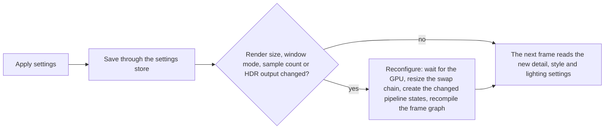

# Options and budgets

> Status: Engine baseline · Prefix: RND · ADRs: [ADR-002](../../../ADR/ADR-002-minimum-gpu-capability.md) · [ADR-005](../../../ADR/ADR-005-pipeline-state-catalogue.md) · [ADR-009](../../../ADR/ADR-009-instanced-crowds-sprite-cards-and-shadows.md) · [ADR-010](../../../ADR/ADR-010-gpu-particles-and-shatter-debris.md) · [ADR-011](../../../ADR/ADR-011-world-surface-rendering.md) · [ADR-012](../../../ADR/ADR-012-swap-chain-presentation-and-frame-pacing.md) · [ADR-014](../../../ADR/ADR-014-hdr-output.md) · [ADR-015](../../../ADR/ADR-015-scene-anti-aliasing.md) · [ADR-017](../../../ADR/ADR-017-texture-container-and-block-compression.md) · [ADR-034](../../../ADR/ADR-034-text-rendering-and-glyph-cache.md) · [ADR-064](../../../ADR/ADR-064-accessibility-baseline-xag.md) · [ADR-066](../../../ADR/ADR-066-telemetry-with-consent.md) · [ADR-068](../../../ADR/ADR-068-profiling-and-gpu-timing.md) · [ADR-075](../../../ADR/ADR-075-application-window-and-dpi-awareness.md) · Related: [Renderer](README.md) · [Frame graph and passes](frame_graph_and_passes.md) · [World renderers](world_renderers.md) · [Entity and overlay renderers](entity_and_overlay_renderers.md) · [Visual language](visual_language.md) · [Platform layer](../platform_layer.md) · [Data schemas](../data_schemas/README.md) · [Diagnostics, test and performance](../diagnostics_test_and_performance/README.md)

This document specifies every graphics setting of the renderer (its default, its values and what it changes), the quality presets, how a change of settings is applied, and the renderer's performance budgets: its caps and costs, and the provisional pass-group budgets of the Species engine baseline.

## 1 Responsibilities and boundaries

**RND-440** (MUST) This document owns the renderer's settings: their identifiers, defaults, value ranges and effects, and the quality presets. The settings are stored by the settings store (`SettingsStore`, [platform_layer.md](../platform_layer.md)) in the preferences schema ([README.md](../data_schemas/README.md)), with their defaults in the one defaults table of DEC-100, and shown on the options pages of [reference/09_front_end_and_match_flow/options_localisation_and_hooks.md](../../../reference/09_front_end_and_match_flow/options_localisation_and_hooks.md) and [ui_framework/pages_and_screen_recipes.md](../ui_framework/pages_and_screen_recipes.md). Each setting is stored under the setting key `render.<setting>` of the settings table ([config_input_and_strings.md](../data_schemas/config_input_and_strings.md)), named after its `rnd.option.<setting>.default` key; the render size is stored as `render.render_width` and `render.render_height`.

**RND-441** (MUST) Renderer settings are presentation: no simulation rule reads one (see DEC-010), and changing one during a match changes no simulation state, re-snaps no structure and rebuilds no port (R-BLDG-047, R-SIM-367).

## 2 Interfaces

The interface below is a C++23 declaration sketch, not an implementation.

```cpp
namespace Engine
{

enum class DetailLevel : std::uint8_t // a lower number is more detail (RND-444)
{
  None = 0, // sea detail only: the flat layer without a wave mesh; accepted and never offered (RND-442)
  High = 1,
  Medium = 2,
  Low = 3
};
enum class AntiAliasing : std::uint8_t
{
  Off,
  Msaa2x,
  Msaa4x
};
enum class QualityPreset : std::uint8_t
{
  High,
  Medium,
  Low,
  Custom
};

// WindowMode (Windowed, BorderlessFullScreen) is the platform layer's (platform_layer.md §2).

struct RenderSettings // defaults: §9 keys rnd.option.*
{
  std::optional<std::uint32_t> renderWidth; // absent: the desktop resolution on first run (DAT-008)
  std::optional<std::uint32_t> renderHeight;
  WindowMode windowMode = WindowMode::BorderlessFullScreen;
  PresentMode presentMode = PresentMode::VerticalSync;
  std::optional<float> frameRateCap; // frames per second; none by default
  bool lowLatency = false;
  AntiAliasing antiAliasing = AntiAliasing::Msaa4x;
  bool hdr = false;
  std::optional<float> hdrHighlightLimit; // nits; none: the display's maximum
  float brightness = 1.0f;                // final-pass constant; 1 = unchanged
  DetailLevel seaDetail = DetailLevel::High;
  DetailLevel skyDetail = DetailLevel::High;
  DetailLevel decorationDetail = DetailLevel::High; // the structure-detail setting, read by the game's structure renderers (RND-445)
  DetailLevel entityDetail = DetailLevel::High;
  std::uint8_t treeDetail = 1; // 1 or more: the exponent of the leaf-alpha boost (RND-191), not a DetailLevel
  bool specialLighting = false;
  std::uint32_t posterResolution = 1;
  bool invertedStyle = false;
  float crowdCardDistanceScale = 2.0f; // the growth of crowd cards with camera distance; the game maps it (RND-442)
};

[[nodiscard]] QualityPreset PresetOf(const RenderSettings& _settings); // RND-450
void ApplyPreset(RenderSettings& _settings, QualityPreset _preset);    // RND-450
[[nodiscard]] RenderSettings Validated(const RenderSettings& _stored); // RND-451

// FrameRenderer::ApplySettings(const RenderSettings&) maps the settings onto RenderConfig
// (README §2) and the per-frame detail state (RND-449).

} // namespace Engine
```

**Data contract.** The renderer reads the player's accessibility settings that bound the look (the flash-reduction and motion settings of ADR-064 and ADR-036, RND-248) from the settings store; it does not own them.

## 3 Data model

### 3.1 The settings

**RND-442** (MUST) The renderer has exactly these settings. "Reference UI" says where the reference options pages expose the setting; the Species options pages are decided by DEC-044.

| Setting | Default | Values | Reference UI | What it changes | Specified in |
|---|---|---|---|---|---|
| render size | `rnd.option.render_size.default` (absent: the desktop resolution of the window's monitor on first run, then written back; DAT-008) | the offered render sizes (RND-026), snapped to the closest (RND-022) | screen options: resolution | the scene-target size and aspect, and every screen-scaled overlay | RND-021, RND-025, RND-028 |
| window mode | `rnd.option.window_mode.default` (borderless full screen) | windowed, borderless full screen | screen options: windowed | the window style; the display mode is never changed | ADR-012, ADR-075, RND-029 |
| present mode | `rnd.option.present_mode.default` (vertical sync) | vertical sync, uncapped | none | the present interval and tearing | ADR-012 |
| frame-rate cap | `rnd.option.frame_rate_cap.default` (none) | none, or a rate in frames per second | none | an engine-timed cap before each frame | ADR-012 |
| low latency | `rnd.option.low_latency.default` (off) | on, off | none | the maximum frame latency, 1 instead of 2 | ADR-012 |
| anti-aliasing | `rnd.option.anti_aliasing.default` (4x, falling back to 2x, then Off, where a sample count is not supported) | Off, 2x, 4x | none | the scene sample count and alpha-to-coverage; Off is the reference edge look | ADR-015, RND-062, RND-433 |
| HDR output | `rnd.option.hdr.default` (off) | on, off; offered only where the output supports it | none | the scene and swap-chain formats and the final-pass conversion | ADR-014 |
| HDR highlight limit | `rnd.option.hdr_highlight_limit.default` (the display's maximum) | a luminance up to the display's maximum, capped by the photosensitivity rule | none | the tone-mapping ceiling | ADR-014, ADR-064 |
| brightness | `rnd.option.brightness.default` (1, unchanged) | a final-pass multiplier | none | the final pass; the system gamma ramp is never changed | ADR-012, RND-246 |
| sea detail (`seaDetail`) | `rnd.option.sea_detail.default` (1) | 1, 2, 3; the value 0 (`DetailLevel::None`) is accepted and never offered | graphics options: water detail | the coastline wave mesh: a cell of detail × max(*X*, *Z*) ÷ 100 ([terrain](../terrain/edges_normals_colours_and_sea.md#414-sea-derivations) TER-200), so 200, 100 or about 67 cells across the twice-size sea plane; 0 draws the flat layer only | RND-144 |
| sky detail (`skyDetail`) | `rnd.option.sky_detail.default` (1) | 1, 2, 3 | graphics options: sky detail | blobby cloud layers 3, 2, 1; flat layers 2, 1, 1; flat-layer alpha 0.3, 0.3, 0.5 | RND-153 |
| structure detail (`decorationDetail`) | `rnd.option.structure_detail.default` (1) | 1, 2, 3 | graphics options: building detail | the decorative counts and layers of RND-445 | RND-163, RND-445 |
| entity detail (`entityDetail`) | `rnd.option.entity_detail.default` (1) | 1, 2, 3 | graphics options: entity detail | the Worker high-detail distance and the Crawler detail levels of RND-446 | RND-446 |
| tree detail (`treeDetail`) | `rnd.option.tree_detail.default` (1) | 1 or more | none | the leaf alpha × `ref.bldg.tree.leaf_alpha_boost` to the power of the level, above level 1, at generation | RND-191 |
| special lighting | `rnd.option.special_lighting.default` (off) | on, off | none; a debug command toggles it in Debug builds ([developer_tools.md](../diagnostics_test_and_performance/developer_tools.md#46-debug-commands-and-the-debug-command-window)) | the warm single light on every structure of pass 6 | RND-229 |
| poster resolution | `rnd.option.poster_resolution.default` (1) | *N* ≥ 1 | none | screenshots as *N* × *N* tiles | RND-110 |
| inverted style | `rnd.option.inverted_style.default` (off) | on, off | none | the ink-on-paper look | RND-434 (see DEC-040) |
| Worker distance scale factor (`crowdCardDistanceScale`) | `rnd.option.worker_scale_factor.default` (2.0) | 0 or more | none | the growth of crowd cards with camera distance; the game's renderers map it onto the Worker cards, the Leader banner growth (R-UNIT-191) and the Control Zone drawing ([mode_objects.md](../../../reference/03_buildings_and_world_objects/mode_objects.md)) | RND-314, RND-412 |

The member names are engine vocabulary (`AGENTS.md` R9): `decorationDetail` holds the structure-detail setting and `crowdCardDistanceScale` the Worker distance scale factor, and the `Species` renderers that read them give them their game meaning. The setting keys and tuning keys keep their names (`render.structure_detail`, `render.worker_scale_factor`), because they are data names.

**RND-443** (MUST NOT) The renderer has no setting beyond those of RND-442 (see DEC-059). The display mode is never changed and depth is always `D32_FLOAT` (ADR-012, RND-055); the terrain is always drawn at full resolution (RND-138); fog always follows RND-222. The bot priority overlay is a development setting of Debug builds ([developer_tools.md](../diagnostics_test_and_performance/developer_tools.md#47-development-drawing)), and no renderer setting controls the seasonal theme (see DEC-101).

### 3.2 Detail levels

**RND-444** (MUST) Every detail setting counts down in quality: 1 is the highest detail, 2 medium and 3 the lowest (`DetailLevel`). Each defaults to 1. The tree-detail setting is a level count of 1 or more instead (RND-191).

**RND-445** (MUST) The structure-detail setting (`RenderSettings::decorationDetail`), which the game's structure renderers read, changes exactly these elements; whether Species keeps these branches or defines its own quality levels with the same intent is decided by the design phase (see DEC-327):

| Element | Detail 1 | Detail 2 | Detail 3 | Specified in |
|---|---|---|---|---|
| Spawn Node glow blobs | 20 | 10 | 3 | `ref.bldg.spawn_node.glow_blobs_by_detail`, RND-169 |
| spawn-network outer beam glow | drawn | not drawn | not drawn | RND-169 |
| Supply crate trail cards | 10 | 5 | 2 | `ref.crate.render.trail_cards`, R-CRATE-142 |
| Supply crate glow blobs | 20 | 10 | 0 | `ref.crate.render.glow_blobs`, R-CRATE-142 |
| Core Device glow blobs | `ref.bldg.core_device.glow_blob_max` (20) | 10 | 2 | `rnd.detail.core_device_glow_blobs`, R-BLDG-316 |
| Launch Vessel glow blobs | 50 | 20 | 10 | `rnd.detail.launch_vessel_glow_blobs` |
| Launch Vessel exhaust loops | 3 | 2 | 1 | `rnd.detail.launch_vessel_exhaust_loops`: clamp(4 − detail, 1, 3) |
| burning-tree fire particles per tick | ⌊height ÷ 12⌋ | ÷ 2 | ÷ 3 | RND-190 |
| structure port pads | drawn | drawn | not drawn | `ref.bldg.port.pad_detail_limit`, RND-168 |
| Barrier Emitter textured curtain | drawn | drawn | not drawn | RND-199 |
| Transit Gate surface grid | 16 cells per side | 16 ÷ 2 | 16 ÷ 3 | R-BLDG-144 |
| fuel-line flow loops | by detail level | by detail level | by detail level | R-BLDG-196 |

**RND-446** (MUST) The entity-detail setting changes exactly the Worker high-detail distance `rnd.crowd.worker_detail_distance` (99 999.9, 1000 and 500 wu at levels 1, 2 and 3), which gates terrain-following cards, hurt cards and Worker ground shadows ([entity_and_overlay_renderers.md](entity_and_overlay_renderers.md) RND-314, RND-315), and the Crawler detail levels of RND-322.

## 4 Behaviour and algorithms

### 4.1 Applying settings

**RND-447** (MUST) Applying settings saves them through the settings store and takes effect without a loading view and without leaving the match. A change of render size, window mode, sample count or HDR output reconfigures the renderer (RND-030); every other change takes effect on the next frame and rebuilds no terrain, sea or tree geometry (RND-031).

**RND-448** (MUST) The renderer builds, at match-world initialisation, the coastline wave mesh of every sea-detail level the options offer (1, 2 and 3), so a change of the sea-detail setting selects another mesh and rebuilds nothing (RND-144, RND-031); the level 0, which builds no wave mesh, draws the flat layer only.

**RND-449** (MUST) The structure-detail, entity-detail and sky-detail settings are read when each frame is drawn: a change applies to every structure, actor and cloud layer from the next frame, and no structure re-runs any set-up for it. The tree-detail setting applies when tree geometry is next generated (RND-191).

Diagram — applying settings:



Caption: no settings change rebuilds terrain, sea or tree geometry, and none touches simulation state.

### 4.2 Quality presets

**RND-450** (MUST) The renderer defines three quality presets over the four detail settings that the reference options pages offer: `rnd.preset.high` sets the sea, sky, structure and entity detail to 1, `rnd.preset.medium` to 2 and `rnd.preset.low` to 3; any other combination is the custom preset. A preset changes no other setting. The reference offers no named preset, only the four independent settings, each defaulting to 1, so the default settings are the high preset; whether the Species options pages show presets is decided with DEC-044.

**RND-451** (MUST) A stored setting outside its range is replaced by its default and logged; a stored render size that the monitor does not offer snaps to the closest offered size (RND-022); an anti-aliasing setting that the GPU does not support falls back as RND-442 states; HDR output that the output no longer supports falls back to SDR (ADR-014).

### 4.3 The options pages

**RND-452** (MUST) The reference graphics options page shows exactly four choices, sea detail, sky detail, structure detail and entity detail, each with the values high, medium and low, plus apply and back actions; the screen options page shows the render size and the window mode ([options_localisation_and_hooks.md](../../../reference/09_front_end_and_match_flow/options_localisation_and_hooks.md) R-META-414). Besides these, the Species engine provides the present mode, the frame-rate cap, low latency, anti-aliasing, HDR output and brightness (RND-442). The Species options pages expose at least the settings of the reference pages; whether they also expose the engine settings of RND-442 and further commonly expected options is decided by the design phase (see DEC-044).

### 4.4 Caps and costs

**RND-453** (MUST) The renderer's caps and costs are those of the table below; the frame budgets are RND-454 (see DEC-225, DEC-106).

| Item | Species rule |
|---|---|
| frame pacing | the present modes and the frame-rate cap of ADR-012 |
| frame-delta clamp | `ref.sim.frame.delta_clamp` (0.25 s, R-SIM-573); the fade advances at most `rnd.fade.max_step` per frame (RND-085) |
| minimum render period | presentation renders at least once per `rnd.budget.min_render_period` (1.0 s), in every state including catch-up (DEC-225) |
| terrain | chunked, culled and drawn in one pass at full resolution (RND-138, ADR-011) |
| particles and shatter debris | hard pool caps with level of detail (ADR-010; [particles](../animation_and_vfx/particles_shatter_and_screen_effects.md) VFX-212, VFX-230) |
| meshes | at least 100 nodes and 100 sockets per mesh, the minimum the cooked format supports (RND-156) |
| texture size | the content build rejects a texture larger than `rnd.budget.max_texture_dimension` (16 384 px, the feature-level 12_1 limit of ADR-002) |
| fonts | the glyph cache of ADR-034 |
| quality settings | the settings of RND-442 |
| profiling | a marker and GPU timestamps per pass (ADR-068, RND-041) |
| frame cost | the provisional pass-group budgets of RND-454, confirmed or changed by the prototype measurement (see DEC-106) |

### 4.5 Species budgets

**RND-454** (MUST) The renderer's client target is `rnd.budget.target_frame_rate` (60 frames per second, 16.7 ms per frame) on the reference test machine ([performance baseline](../diagnostics_test_and_performance/performance_baseline.md) DBG-209, see DEC-971), in a local Spawn Control match with the design population of 2,000 units (see DEC-228 item 6, DEC-106). The frame's CPU and GPU time at that population MUST fit the target. The GPU time of each pass group has a provisional budget, which the prototype measurement of DEC-106 confirms or changes: the world passes 3 to 6 and 8, `rnd.budget.world_ms` (3.0 ms); the actor passes 7a to 7d, `rnd.budget.actors_ms` (4.0 ms); the effect passes 10a to 11, 14 and 15 with their compute work, `rnd.budget.effects_ms` (3.0 ms); the overlay and UI passes 12, 13 and 16 to 34, `rnd.budget.overlays_ms` (2.0 ms). Together they take 12.0 ms and leave 4.7 ms of the frame for the frame constants, the clears, the resolve, the final pass, the present and frame-to-frame variation. The development overlay of Debug builds shows each pass's GPU time against its group's budget (RND-041, ADR-068).

**RND-455** (MUST) The number of draw and dispatch calls per frame is bounded by the pass table and the instance types, never by the population: crowds cost a fixed number of calls per instance type and pass (ADR-009, DEC-228 item 5), structures and trees are instanced per mesh, terrain chunks are drawn with one instanced or indirect draw (RND-138), and particles with one draw per particle batch (ADR-010).

**RND-456** (MUST) The renderer is tested at the stress population of DEC-228 item 2 (twice the design population, 4,000 units, on the uncapped stress map), where it draws every figure (RND-302) and reports its frame-time percentiles; instance buffers are sized at start-up for that population and grow by the upload-ring overflow rule (README RND-017).

**RND-457** (MUST) With the player's consent, telemetry carries the frame-time distribution, the adapter and capability summary and the active settings and preset (ADR-066), so budgets can be checked against the hardware players have.

## 5 Concurrency and performance budget

**RND-458** (MUST) Settings are read on the frame thread at the start of a frame and applied between frames; a reconfiguration waits for the GPU (RND-030) and creates any changed pipeline states behind a loading indicator, never during a frame (ADR-005). The budgets of §4.5 are this component's performance budget.

## 6 Failure modes, diagnostics and telemetry

| Failure | Behaviour | Requirement |
|---|---|---|
| a stored setting is out of range or of the wrong type | the default, and a log entry naming the setting | RND-451 |
| the stored render size is not offered | the closest offered size | RND-022, RND-451 |
| the chosen sample count is not supported for the scene format | 2x, then Off; the setting shown is the one in effect | RND-442, ADR-015 |
| HDR output becomes unavailable (output change) | SDR output; the setting stays on and applies again when HDR returns | RND-451, ADR-014 |
| a frame exceeds its budget | no behaviour change; in Debug builds the development overlay marks the pass group; telemetry records the frame time | RND-454, RND-457 |

## 7 Acceptance tests

The golden-image tests compare with the default tolerance and on the pinned reference configuration of the test harness ([diagnostics, test and performance](../diagnostics_test_and_performance/README.md) §4.8), unless a test states its own tolerance.

| Test | Kind | Checks | Requirements |
|---|---|---|---|
| T1 defaults | unit | a fresh settings store gives every default of §9, and the first run writes back the desktop resolution | RND-442, RND-444 |
| T2 detail effects | golden-image | each structure-detail level draws the counts of RND-445; each sky-detail level the layers of RND-153; each sea-detail level its wave mesh | RND-445, RND-442 |
| T3 entity detail | unit | the Worker high-detail distance and the Crawler levels at each entity-detail level | RND-446 |
| T4 apply | integration | changing every setting during a match keeps the per-tick state hash unchanged; render size, window mode, sample count and HDR reconfigure; the others take effect on the next frame without a geometry rebuild | RND-441, RND-447 to RND-449 |
| T5 presets | unit | each preset sets the four detail settings, changes nothing else, and is recognised back by `PresetOf`; a mixed combination is custom | RND-450 |
| T6 validation | unit | out-of-range values, an unsupported sample count and an unavailable HDR output give the documented fallbacks | RND-451 |
| T7 frame budget | performance | the design-population Spawn Control match reaches the target frame rate on the reference test machine (DBG-209), and each pass group's GPU time stays within its provisional budget (a miss is reported, and fails the test once DEC-106 and DEC-971 are decided); the stress map runs and reports percentiles | RND-454, RND-456 |
| T8 call bound | performance | the number of draw and dispatch calls per frame is the same at 500 and at 4,000 units on the same map and camera path | RND-455 |
| T9 texture limit | build check | a texture above the dimension limit fails the content build | RND-453 |

## 8 Open decisions

| Reference | Status | Where it applies |
|---|---|---|
| DEC-010 | Resolved | settings never feed the simulation (RND-441) |
| DEC-040 | Open | the inverted style setting has no user interface; whether it becomes an option (RND-442) |
| DEC-044 | Open | which settings and commonly expected options the Species options pages expose, and presets (RND-442, RND-450, RND-452) |
| DEC-059 | Dropped | no pixelation, deform or reflection settings (RND-443) |
| DEC-100 | Resolved | one defaults table (RND-440) |
| DEC-101 | Open | the seasonal theme, which no renderer setting controls (RND-443) |
| DEC-106 | Open | the frame budgets: provisional until the prototype measurement (RND-453, RND-454) |
| DEC-225 | Open | frame pacing and catch-up (RND-453) |
| DEC-228 | Open | the design and stress populations and the client target (RND-454 to RND-456) |
| DEC-327 | Open | the structure-detail branches (RND-445) |
| DEC-971 | Open | the reference test machine and the minimum-specification hardware of the client target (RND-454) |

**Design-phase inputs.**

1. **Reference test machine.** The machine of DBG-209 on which the target of RND-454 is measured, beyond the GPU capability of ADR-002 (DEC-971).
2. **Budgets.** The per-pass-group millisecond budgets, confirmed or changed by the prototype measurement (DEC-106), and the budgets for the integrated-server case, where the server tick and the client frame share one machine (DEC-228 item 6).
3. **Options pages.** Which settings the Species options pages show, whether presets cover the engine settings (anti-aliasing, HDR) as well as the detail settings, and whether the inverted style becomes an accessibility option (DEC-044, DEC-040).
4. **World scale.** Detail and level-of-detail settings for a world larger than an arena map: terrain and sea levels of detail, crowd impostors and culling distances (DEC-247).

## 9 Tuning table

| key | value | unit | range or notes | requirement | DEC |
|---|---|---|---|---|---|
| `rnd.option.render_size.default` | absent | px | the desktop resolution of the window's monitor on first run (DAT-008); stored as `render.render_width` and `render.render_height` | RND-442 | DEC-100 |
| `rnd.option.window_mode.default` | borderless full screen | mode | windowed or borderless full screen | RND-442 | |
| `rnd.option.present_mode.default` | vertical sync | mode | vertical sync or uncapped | RND-442 | DEC-044 |
| `rnd.option.frame_rate_cap.default` | none | frames per s | | RND-442 | DEC-044 |
| `rnd.option.low_latency.default` | off | flag | | RND-442 | |
| `rnd.option.anti_aliasing.default` | 4x | samples | 4x, then 2x, then Off where unsupported | RND-442 | DEC-044 |
| `rnd.option.hdr.default` | off | flag | | RND-442 | |
| `rnd.option.hdr_highlight_limit.default` | the display's maximum | nits | capped by the photosensitivity rule | RND-442 | |
| `rnd.option.brightness.default` | 1 | × | final-pass multiplier | RND-442 | DEC-044 |
| `rnd.option.sea_detail.default` | 1 | level | 1 to 3 offered; 0 accepted | RND-442 | DEC-100 |
| `rnd.option.sky_detail.default` | 1 | level | 1 to 3 | RND-442 | |
| `rnd.option.structure_detail.default` | 1 | level | 1 to 3 | RND-442 | DEC-327 |
| `rnd.option.entity_detail.default` | 1 | level | 1 to 3 | RND-442 | |
| `rnd.option.tree_detail.default` | 1 | level | 1 or more; no user interface | RND-442 | |
| `rnd.option.special_lighting.default` | off | flag | no user interface | RND-442 | |
| `rnd.option.poster_resolution.default` | 1 | tiles per side | no user interface | RND-442 | |
| `rnd.option.inverted_style.default` | off | flag | no user interface | RND-442 | DEC-040 |
| `rnd.option.worker_scale_factor.default` | 2.0 | × | 0 disables card growth; no user interface | RND-442 | |
| `rnd.preset.high` | 1 | detail level | the four detail settings | RND-450 | DEC-044 |
| `rnd.preset.medium` | 2 | detail level | | RND-450 | DEC-044 |
| `rnd.preset.low` | 3 | detail level | | RND-450 | DEC-044 |
| `rnd.detail.core_device_glow_blobs` | 10, 2 | blobs | at structure detail 2 and 3; 20 at detail 1 is `ref.bldg.core_device.glow_blob_max` | RND-445 | DEC-327 |
| `rnd.detail.launch_vessel_glow_blobs` | 50, 20, 10 | blobs | at structure detail 1, 2, 3 | RND-445 | DEC-327 |
| `rnd.detail.launch_vessel_exhaust_loops` | 3, 2, 1 | loops | clamp(4 − detail, 1, 3) | RND-445 | DEC-327 |
| `rnd.budget.min_render_period` | 1.0 | s of real time | longest gap between rendered frames | RND-453 | DEC-225 |
| `rnd.budget.max_texture_dimension` | 16384 | px | feature level 12_1 | RND-453 | |
| `rnd.budget.target_frame_rate` | 60 | frames per s | 16.7 ms; design population 2,000 units | RND-454 | DEC-228 |
| `rnd.budget.world_ms` | 3.0 | ms of GPU time per frame | provisional: passes 3 to 6 and 8 | RND-454 | DEC-106 |
| `rnd.budget.actors_ms` | 4.0 | ms of GPU time per frame | provisional: passes 7a to 7d | RND-454 | DEC-106 |
| `rnd.budget.effects_ms` | 3.0 | ms of GPU time per frame | provisional: passes 10a to 11, 14 and 15 with their compute work | RND-454 | DEC-106 |
| `rnd.budget.overlays_ms` | 2.0 | ms of GPU time per frame | provisional: passes 12, 13 and 16 to 34 | RND-454 | DEC-106 |
