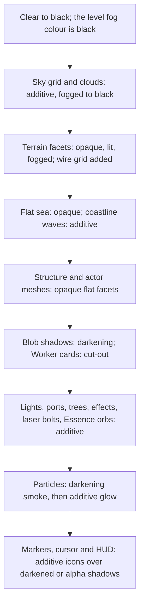

# Visual language

> Status: Engine baseline · Prefix: RND · ADRs: [ADR-003](../../../ADR/ADR-003-shader-language-compiler-and-material-shaders.md) · [ADR-005](../../../ADR/ADR-005-pipeline-state-catalogue.md) · [ADR-009](../../../ADR/ADR-009-instanced-crowds-sprite-cards-and-shadows.md) · [ADR-010](../../../ADR/ADR-010-gpu-particles-and-shatter-debris.md) · [ADR-011](../../../ADR/ADR-011-world-surface-rendering.md) · [ADR-013](../../../ADR/ADR-013-working-colour-space-and-blending.md) · [ADR-014](../../../ADR/ADR-014-hdr-output.md) · [ADR-015](../../../ADR/ADR-015-scene-anti-aliasing.md) · [ADR-018](../../../ADR/ADR-018-texture-import-manifest.md) · [ADR-020](../../../ADR/ADR-020-flat-shading-and-team-tint.md) · [ADR-064](../../../ADR/ADR-064-accessibility-baseline-xag.md) · Related: [Renderer](README.md) · [Frame graph and passes](frame_graph_and_passes.md) · [World renderers](world_renderers.md) · [View, lighting and fog](view_lighting_and_fog.md) · [Shaders](shaders.md) · [Entity and overlay renderers](entity_and_overlay_renderers.md) · [Options and budgets](options_and_budgets.md) · [Art and audio briefs](../../../assets/art_and_audio_briefs.md)

This document states the look and feel that Species keeps, precisely and testably: flat-faceted low-poly geometry, glowing wire grids, additive neon glow on a black world, darkening layers, a fixed team palette, crowds of tiny figures drawn as cards that turn into billboards, and the camera's sense of scale. The look stays exactly as specified here (see DEC-029); every asset that carries it is newly authored. This document specifies the **style**, never the reference art: the style guide that artists work from is [art_and_audio_briefs.md](../../../assets/art_and_audio_briefs.md) §2, and the per-file specifications are in [asset_manifest.csv](../../../assets/asset_manifest.csv).

## 1 Responsibilities and boundaries

**RND-390** (MUST) This document is the specification of record for the look of the Species renderer (see DEC-029). Every other renderer document implements it, and a change to any rule here is a change of the look that needs a decision entry; a change of technique that keeps every rule here and every golden image of §7 is not.

**RND-391** (MUST) The look is reproduced from the techniques and values of this folder only. No reference texture, mesh, icon, cursor, panel, font or screenshot is traced, re-coloured, resampled or used as a template; every asset is authored new for its role, under the briefs of [art_and_audio_briefs.md](../../../assets/art_and_audio_briefs.md) §1 and §2.8 (see DEC-342).

**RND-392** (MUST) The look is defined on display-encoded colour values in clamping 8-bit targets, the working colour space of ADR-013: every colour constant of the tuning tables and every colour texel is an sRGB-encoded value, blends combine encoded values, and each blend result is clamped to [0, 1] per channel as it is written (RND-058). The SDR image is the reference image of every rule here; HDR output keeps it at and below SDR white and differs only for over-range glow (ADR-014).

## 2 Interfaces

The look has no runtime interface of its own. Its contracts are the asset import rules that carry it (table below, ADR-018) and the golden-image scenes that verify it (§7), which the test harness renders through this interface. Its scenes name game concepts (the team palette, the seasonal theme), so the interface is game code in namespace `Species`, built on the engine's `FrameRenderer` and `RenderConfig` (`AGENTS.md` R9):

```cpp
namespace Species
{

enum class LookScene : std::uint8_t
{
  GlowStack,
  DarkeningStack,
  InkText,
  TeamPalette,
  FogRamp,
  OverBrightFacet,
  CrowdAtDistance,
  CardToBillboard,
  InvertedStyle,
  SeasonalTheme
};

struct LookCheck
{
  LookScene scene;
  Engine::RenderConfig config; // README §2; sample count 1 for the reference edge look
  std::uint8_t tolerance = 1;  // largest allowed difference per 8-bit channel
};

std::expected<Engine::ImageRgba8, LookError> RenderLookScene(Engine::FrameRenderer& _renderer, const LookCheck& _check);

} // namespace Species
```

**RND-393** (MUST) Each asset family carries the look through these import-record values (ADR-018); markers, cursors and icons are straight-alpha art that their passes also draw with the `Additive` blend (RND-423), a pairing that ADR-018 allows for glowing icons, markers and cursors. The single-channel families hold intensity, not colour: their colour comes from the draw colour. Where a pass reads mip level 0 only it requests the view `level0`, and where it magnifies with point filtering the view `point` (AST-026, AST-027):

| Asset family | Colour space | Alpha mode | Mip policy | Look it carries |
|---|---|---|---|---|
| glow, beam, flare and grid textures (`fx.*` except `fx.tree_canopy` and `fx.shard_edges`) | `linear` (`BC4_UNORM`, AST-020, ADR-017) | `additive` | full, except the view `level0` that the passes name (RND-153, RND-339) | greyscale intensity, tinted by the draw colour, added to the frame |
| darkening masks (`icon.hud.icon_halo`, `sprite.missile_barrage.launcher_shadow`, the blurred shadow variants `cursor.*.shadow`, `marker.crate_landing.shadow` and `marker.barrage_target.shadow`) | `linear` (`BC4_UNORM`, AST-020, ADR-017) | darkening: the destination × (1 − texel) | full | white means full darkening |
| crowd cards (`sprite.worker.*`) | sRGB | `cutout` at the consumer threshold | full | hard-edged white or light-grey figures, tinted by the draw colour |
| markers, cursors and icons (`marker.*`, `cursor.*`, `icon.*`) | sRGB | straight alpha, white art tinted by the draw colour | full; the view `level0` of the compasses (RND-378) | drawn additively or alpha-blended as their pass states |
| meshes (`mesh.*`) | facet colours converted to sRGB-encoded values by the cooker (ADR-013) | opaque | — | flat facets; team regions marked for the tint (RND-406) |

## 3 Data model

### 3.1 The team palette

**RND-400** (MUST) A match has the ten colours of the colour table of [reference/12_simulation_model/06_teams_and_player_commands.md](../../../reference/12_simulation_model/06_teams_and_player_commands.md) R-SIM-415, in this order, which carries meaning (colour ids): 0 green, 1 red, 2 yellow, 3 blue, 4 orange, 5 purple, 6 cyan, 7 pink, 8 the Rogue faction (near black, `ref.sim.team_colour.rogue.base`) and 9 the Visitor faction (light grey, `ref.sim.team_colour.visitor.base`). Each player colour has a base colour and the two co-op shades `ref.sim.team_colour.<name>.shade_1` and `shade_2`; a co-op group with no colour takes `ref.sim.team_colour.no_group_shade` (R-SIM-421). The palette is one constant buffer, written once per match (RND-016). The values are the encoded values of the tuning keys `ref.sim.team_colour.*`, used without conversion (RND-392).

### 3.2 The world palette

**RND-401** (MUST) The colours of the world are the constants of the renderer documents, listed here as the palette that art is judged against:

| Element | Colour | Key |
|---|---|---|
| background and fog of a match | black | `rnd.frame.clear_colour` |
| background outside a match | (0.05, 0, 0.05) | `rnd.frame.clear_colour_no_match` |
| sky grid | (0.5, 0.5, 1.0, alpha 0.3), additive | `rnd.sky.grid_colour` |
| blobby and flat clouds | (0.7, 0.7, 0.9) with alphas 0.6 and 0.3, additive | `rnd.sky.blobby_colour`, `rnd.sky.flat_colour` |
| map lights | per map, up to 2.0 per channel, no ambient term | RND-226 |
| special light | (2.0, 1.5, 0.75) | `rnd.lighting.special_colour` |
| occupied and empty ports | (0.3, 1.0, 0.3) and (1.0, 0.3, 0.3) | `ref.bldg.port.status_occupied_rgb`, `ref.bldg.port.status_empty_rgb` (R-BLDG-046) |
| burning-tree flames | (0.8, 0.2, 0.1), additive | `rnd.tree.burning.flame_colour` |
| shockwave blast | (1, 0.5, 0.2) | `rnd.shockwave.blast_colour` |
| no-team objects | an opaque grey | RND-405 |

### 3.3 The seasonal palette

**RND-402** (MUST) While a match's seasonal state is active (see DEC-101, DEC-118), the look swaps palettes and accessories and keeps its geometry: the frost terrain ramp, sea tile and wave gradient (RND-134, RND-142, RND-144); warm white light colours `rnd.light.seasonal_colour` (RND-013); leafless trees with the branch colour `rnd.tree.seasonal_branch_colour` (RND-191); and the seasonal hat on every third Worker (R-UNIT-148).

### 3.4 The UI palette

**RND-403** (MUST) The UI keeps the token structure of the reference look (an accent panel, a neutral panel, a highlight beam, positive and negative captions, glowing fill boxes) with a new Species palette and new layout ([ui_framework/README.md](../ui_framework/README.md), [art_and_audio_briefs.md](../../../assets/art_and_audio_briefs.md) §5); this document fixes the token roles, not their colours.

## 4 Behaviour and algorithms

### 4.1 Team tint

**RND-404** (MUST) Team identity is applied by tint, never painted into art. Cards, glows, lights, laser bolts, Essence orbs, Crawler strips, markers and icons are white or light-grey art (or greyscale glow) whose texel is multiplied by the draw colour, the team colour where the element belongs to a team (README RND-015, [entity_and_overlay_renderers.md](entity_and_overlay_renderers.md) RND-318). World art in general is authored as greyscale or near-white textures that the vertex colour tints.

**RND-405** (MUST) The colour of an object of no team is an opaque grey, `ref.match.colour.no_group` (153, 153, 153, alpha 255) of [reference/01_skirmish_rules_and_modes/README.md](../../../reference/01_skirmish_rules_and_modes/README.md) and R-BLDG-048 (see DEC-078); the specific no-team greys of individual elements stay their owners' (for example `rnd.structure.spawn.orb_neutral_grey`, `rnd.barrier.neutral_colour`).

**RND-406** (MUST) Meshes are tinted by the tint function of [shaders.md](shaders.md) RND-271 (ADR-020): team regions are marked per facet with an explicit tint weight, by the tint attribute `_SPECIES_TINT` or the material flag `species_team_tint` ([asset_pipeline_and_resources.md](../asset_pipeline_and_resources.md) AST-034, ADR-020), and key-colour art reaches the cooker only as explicit weights written by the authoring helper (RND-162); only the root node and its direct children are tinted (RND-161); the tinted colour keeps the facet's brightness and is scaled by the mesh's tint scale, `rnd.tint.factor` by default (RND-161). The special tint rules (convert-all meshes, the Transport hull, the Collector body, the Worker figure's palette entry 0) are those of RND-162. Cloth art carries the team area as grey levels with a companion tint mask (AST-022; [art_and_audio_briefs.md](../../../assets/art_and_audio_briefs.md) §2.5). The look is unchanged by the way the regions are marked.

**RND-407** (MUST) The two factions have their own looks: the Rogue faction draws its laser bolts in white (`rnd.laser.rogue_colour`), its Crawlers, barrage missiles and any Essence orbs as darkening layers (RND-319, RND-324, RND-327), and its Workers with the hurt pose (R-UNIT-145); the Visitor faction draws its Workers with their own card and glow (RND-316) and takes the light grey of colour id 9 elsewhere.

**RND-408** (MUST) The Shield bubble and the Visitor faction bubble take a saturated team colour: each channel of the team colour, read as an 8-bit value, is fully on when that value is at least 1 and fully off when it is 0, so most team colours draw a white bubble, orange (255, 150, 0) a yellow one and purple (150, 0, 255) a magenta one. This is the reference look and the default of the Open DEC-328 ([README.md](../animation_and_vfx/README.md) draws the bubbles).

**RND-409** (MUST) Colour is never the only team cue: the team palette index that selects the tint also selects any per-team pattern or marker shape that the accessibility rules add (ADR-020, ADR-064, XAG 103).

### 4.2 Crowds and the camera's sense of scale

**RND-410** (MUST) The world is read at a scale ladder in which the crowd figure is the unit: a Worker card is `ref.unit.worker.card_height` (6 wu) tall at the camera, an Essence orb's glow quads are `ref.unit.essence_orb.inner_size` (0.5 wu) and `ref.unit.essence_orb.outer_size` (1.5 wu), a structure's ownership light has at most the half-size `ref.bldg.structure.light_size_wu` (6 wu), the sky grid lies at `rnd.sky.grid_height` (1200 wu) with lines every `rnd.sky.grid_spacing` (80 wu), the clouds between `rnd.sky.layer3_height` (800 wu) and 1200 wu, the near plane at `rnd.view.near_plane` (5 wu), the fog end at least `rnd.fog.min_end` (4000 wu) and the far plane at `rnd.view.far_plane` (15000 wu). The free camera's vertical field of view is 60°, narrowing to 15° when zoomed (DEC-024, [camera_and_sequences.md](../camera_and_sequences.md)), and the horizontal field of view widens with the aspect ratio (RND-027).

**RND-411** (MUST) Small figures are drawn as flat cards, not meshes: near the camera a Worker card faces the Worker's own direction and lies along the terrain normal; from `ref.unit.worker.card_face_start` (300 wu) it turns progressively towards the camera, and from 300 + `ref.unit.worker.card_scale_divisor` = 1300 wu it is a pure billboard ([entity_and_overlay_renderers.md](entity_and_overlay_renderers.md) RND-314, ADR-009).

**RND-412** (MUST) Beyond `ref.unit.worker.card_scale_start` (100 wu) a Worker card grows linearly with camera distance by the player's distance scale factor *k* (default `rnd.option.worker_scale_factor.default`, [options_and_budgets.md](options_and_budgets.md)): its world height is 2 × `ref.unit.worker.card_half_width` × (1 + *k* × (*d* − 100) ÷ `ref.unit.worker.card_scale_divisor`) at distance *d*, before the per-individual variation of R-UNIT-142.

**RND-413** (MUST) Crowd cards have hard cut-out edges, never soft alpha, so crowds stay crisp, need no sorting and write depth (RND-060); larger units (Troopers, Leaders, Transports, Collectors, Builders and creatures) are flat-shaded meshes that sit in the crowd at a small scale.

**RND-414** (MUST) The on-screen height of a Worker card at distance *d* (*d* > 100 wu), with render height *H* in pixels and vertical field of view *φ*, is *h*(*d*) = *H* × 2*s*(*d*) ÷ (2*d* × tan(*φ* ÷ 2)), where 2*s*(*d*) is the world height of RND-412. With the default scale factor the card's screen height falls with distance only towards the limit *H* × `ref.unit.worker.card_height` × *k* ÷ (`ref.unit.worker.card_scale_divisor` × 2 tan(*φ* ÷ 2)): at the default field of view of 60° and 1080 lines, 56 px at 100 wu, 26 px at 300 wu, 16 px at 1000 wu, 13 px at 2000 wu and never less than 11 px. A Worker therefore reads as a figure of a few pixels at play distance and stays visible across the whole map, which is the crowd's sense of scale.

**RND-415** (MUST) Crowds are drawn as instanced cards whose cost does not grow per figure (ADR-009), so the look holds at the reference peak of about 2,000 bodies per map (see DEC-106) and at the stress populations of [options_and_budgets.md](options_and_budgets.md).

### 4.3 Blend modes

**RND-416** (MUST) Each element family of the look has one blend state of the catalogue (RND-058):

| Family | Blend state | Elements |
|---|---|---|
| solid facets | `Opaque` | the terrain surface, structure meshes, actor meshes, debris |
| glow | `Additive` (source alpha, one; or one, one) | the sky grid, clouds, the terrain wire grid, coastline waves, structure lights and ports, trees, effects, laser bolts, Essence orbs, particle glow, cursors, icons, normal text |
| darkening | `Darkening` (the destination × (1 − source colour)) | smoke particles, the Rogue faction's Crawlers and orbs, text outlines and shadows, cursor and icon shadows, logo and icon halos, blob shadows |
| ink | `Ink` (source alpha, one minus source colour, with source alpha above 0) | ink text in the front end (RND-425), the Rogue faction's Crawler glow, barrage marker shadows |
| translucent | `Alpha` | Worker cards and their ground shadows, translucent structure layers, route lines, marker and panel shadows, HUD panels |
| premultiplied | `Premultiplied` | textures whose alpha mode is premultiplied (ADR-018) |
| ghost | `Ghost` (one, source colour) | placement ghost models (RND-365) |

**RND-417** (MUST) Non-solid layers never write depth (RND-059). Additive layers saturate towards white where they overlap, and their order among themselves does not change the image; darkening layers multiply and are equally order-independent; both are therefore drawn unsorted. Only translucent alpha layers that the pass table marks as sorted are drawn back to front (RND-166).

Diagram — the families of the look in the order a match frame draws them:



Caption: the pass order of RND-070 grouped by blend family; within an additive or darkening family the order of draws does not change the image.

### 4.4 Additive glow on black

**RND-418** (MUST) Glow is additive textured geometry on a black world and nothing else: there is no bloom, no glow or blur post-process, no light shafts and no screen-space distortion (RND-247). The glow textures and their users are: `fx.starburst` for ownership lights, port stars, spawn-network stars, shockwave blasts, burning-tree flames and snowflakes; `fx.glow_round` for blob shadows (as a darkening layer), the lightning cloud, the shockwave halo, Essence orbs and Solar Array glows; `fx.glow_cloudy` for spawn-network glow blobs and dust vortices.

**RND-419** (MUST) Glow art is greyscale intensity with a soft falloff that reaches pure black, or zero alpha, before the texture edge, so no tile edge ever shows; its colour comes from the draw colour ([art_and_audio_briefs.md](../../../assets/art_and_audio_briefs.md) §2.2).

**RND-420** (MUST) Brightness is built by stacking, not by over-range colour: a laser bolt is drawn five times (RND-338), a structure light is ten nested quads (RND-167), and a shockwave blast is ten stacked quads (RND-334); each stack saturates at white in SDR.

### 4.5 The darkening layer

**RND-421** (MUST) A darkening layer multiplies the destination by one minus its colour: with a source colour *c* and alpha 0, the result is *dst* × (1 − *c*). Its art is greyscale in which white means full darkening; the layer needs no sorting.

**RND-422** (MUST) Shadows of cursors, crate landing markers and the barrage marker are blurred copies of their icons, derived offline by the cooker (`cursor.world.shadow`, `cursor.highlight.shadow`, `cursor.place.shadow`, `cursor.unavailable.shadow`, `marker.crate_landing.shadow`, `marker.barrage_target.shadow`; RND-243, ADR-018), with a separable five-tap kernel whose weights (2, 4, 7, 4, 2) are multiplied by `rnd.look.blur_normaliser` (0.0526, so that they sum to about 1) and by the blur gain `rnd.shadow.icon_blur_radius` (10), applied once horizontally and once vertically, with the vertical weights doubled (`ast.derive.blur_vertical_gain`, [asset_pipeline_and_resources.md](../asset_pipeline_and_resources.md) AST-073); an artist MAY author such a shadow instead as greyscale art ([art_and_audio_briefs.md](../../../assets/art_and_audio_briefs.md) §2.3). A shadow is drawn first with source alpha 0 and its icon over it (RND-366).

**RND-423** (MUST) Icons, markers and cursors drawn with the `Additive` blend carry real alpha channels: the blend weights each texel by its alpha, so transparent texels add nothing and no black background stands in for transparency (ADR-018). Their look on screen is that of glowing art over a darkened halo.

**RND-424** (MUST) Unit blob shadows are `fx.glow_round` drawn as a darkening layer in the colour of R-UNIT-050; they are the only shadows of units apart from the flattened sprite shadows of Workers (RND-240).

### 4.6 Ink text

**RND-425** (MUST) Ink text in the front end is drawn with the `Ink` blend (source alpha, one minus source colour) over the menu highlight gradient and the fill boxes; with a text colour *c* and alpha *a* the result is *c* × *a* + *dst* × (1 − *c*). This is the reference default of the Open DEC-316, whose on-screen look is confirmed visually in the working colour space of ADR-013; the page transition that accompanies it is RND-095 and RND-096.

### 4.7 Flat-shaded low-poly

**RND-426** (MUST) Every lit triangle has one facet normal and one facet colour, baked by the cooker (ADR-020); terrain triangles take their facet colour from the map's ramp by slope and height (RND-134). No mesh is smooth-lit and none has a normal map, so the faceted image never depends on a vertex-ordering convention (RND-276). The gradients of the look (the shockwave ring, the highlight and area cylinders, the pop-up box) are unlit vertex-colour gradients, not smooth-lit meshes.

**RND-427** (MUST) Meshes are low-poly, built from a few large shapes that read at a distance; each mesh's budget is its manifest row ([asset_manifest.csv](../../../assets/asset_manifest.csv)), and the cooked format supports the node and socket counts of RND-156. Authored colours are final colours as seen through the engine's attenuation (`rnd.mesh.colour_attenuation`), the mesh's tint scale (`rnd.tint.factor` by default) and the Worker-figure factor (RND-160 to RND-162).

**RND-428** (MUST) Thin bright lines carry the wire look: the terrain wire grid, one outline per height-field cell drawn additively over the lit terrain (RND-135, `fx.terrain_grid`); the edge lines of shatter shards ([README.md](../animation_and_vfx/README.md), ADR-010); and the Barrier Emitter's top edge line (RND-201).

### 4.8 Black world, fog and light

**RND-429** (MUST) The world sits on black: the clear colour and the level fog colour are black, linear fog fades terrain and structures to black from a third of the fog end to the fog end, the larger of `rnd.fog.min_end` and the world size + `rnd.fog.edge_margin` (RND-222), and the deep sea is not drawn (RND-140). Objects emerge from darkness as the camera approaches.

**RND-430** (MUST) Map lights are over-bright (up to 2.0 per channel) with no ambient term, so facets turned away from both lights fall to black (RND-226); the warm special lighting lights Relics, the Abductor and, where it applies, every structure (RND-229).

**RND-431** (MUST) The sky is additive light over black, fogged to black by its own ranges (RND-151, RND-153): a grid of blue lines and drifting cloud layers whose brightness the black fog takes away towards the horizon.

### 4.9 Deliberate crispness

**RND-432** (MUST) World textures are filtered linearly through all their mip levels unless a rule names otherwise (RND-055). Point filtering is deliberate in exactly these places, for a blocky pixel look: the particle dot `fx.particle_dot` ([README.md](../animation_and_vfx/README.md)) and the front-end backdrop sprite `sprite.worker.front`, which are sampled through their view `point` with the point-magnify clamp-to-edge sampler of ADR-018 (point filtering under magnification, linear under minification; AST-027); the flat cloud layers, which wrap their coordinates in the shader and sample with the point clamp-to-edge sampler (RND-154); and the captured frame of the screen transition, which is sampled with the point clamp-to-edge sampler (RND-096). Cloud layers and the views that the passes name read mip level 0 only, through the view `level0` (AST-026).

**RND-433** (MUST) Multisampling follows ADR-015, and its Off setting is the reference appearance of polygon edges; cut-out cards use alpha-to-coverage when multisampling is on (RND-060), so crowds keep their hard edges at every setting.

### 4.10 The inverted style

**RND-434** (MUST) The inverted style is an alternative "ink on paper" look with no user interface in the reference (see DEC-040; the setting is in [options_and_budgets.md](options_and_budgets.md)): the background and the level fog are white (`rnd.frame.clear_colour_inverted`), and the terrain and the flat sea switch to darkening entries with zero vertex alpha, so they print dark on white (RND-137, RND-143); every other element keeps its blend state.

### 4.11 Accessibility limits on the look

**RND-435** (MUST) The look meets the accessibility baseline (ADR-064): flash intensity and HDR highlight levels are capped by the photosensitivity rule and camera shake follows the motion setting (RND-248); gameplay-relevant text and icons keep the contrast of XAG 102 against their background, which dim glow on black can fail; the minimum text size of XAG 101 applies to every overlay ([art_and_audio_briefs.md](../../../assets/art_and_audio_briefs.md) §2.9).

## 5 Concurrency and performance budget

**RND-436** (MUST) The look costs no frame-wide post-process: every technique of §4 is a draw of the pass table with its own catalogue entry, and the only full-screen passes are the fade, the screen transition, the shockwave flash and the final pass (RND-246). Its costs are the pass budgets of [options_and_budgets.md](options_and_budgets.md).

## 6 Failure modes, diagnostics and telemetry

| Failure | Behaviour | Requirement |
|---|---|---|
| an asset's import record pairs its alpha mode with another blend state | a content-build error (ADR-018) | RND-393 |
| a faceted mesh triangle has corners of different colours | a content-build error (ADR-020) | RND-426 |
| a glow texture has non-black texels at its border | a content-build warning | RND-419 |
| a golden image of §7 differs by more than its tolerance | a test failure naming the scene and the largest difference | RND-390 |

A development view of Debug builds toggles each element family of RND-416 off and on, so reviewers can inspect each layer of the look on its own.

## 7 Acceptance tests

| Test | Kind | Checks | Requirements |
|---|---|---|---|
| T1 glow stack | golden-image | over black, an additive layer (0.3, 0.5, 0.7) with alpha 1 over a destination of (0.6, 0.6, 0.6) reads (0.9, 1.0, 1.0); three layers in any order give the same image | RND-392, RND-416, RND-417 |
| T2 darkening stack | golden-image | a destination of 0.8 under darkening layers of 0.25 and then 0.5 reads 0.3, and in the reverse order also 0.3 | RND-417, RND-421 |
| T3 ink text | golden-image | a text texel of colour 0.5 and alpha 0.5 over 0.8 reads 0.65 | RND-425 |
| T4 ghost | golden-image | a ghost texel of 0.4 over 0.5 reads 0.6 | RND-416 |
| T5 team palette | golden-image | a reference mesh in each of the ten colours, including a facet of colour (0.8, 0.1, 0.1) with tint weight 1 in green (100, 255, 100), which reads (0.154, 0.392, 0.154) before lighting at the default tint scale | RND-400, RND-406 |
| T6 no-team grey | golden-image | an unowned structure's team-coloured parts read (153, 153, 153) | RND-405 |
| T7 bubbles | unit | the saturated bubble colours: red (255, 50, 50) and blue (120, 180, 255) give white, orange gives (255, 255, 0), purple gives (255, 0, 255) | RND-408 |
| T8 fog ramp | golden-image | on a 2000 × 2000 wu map (fog end 4000 wu) a white facet at view depth 2667 wu reads 0.5 and at 4000 wu reads 0 | RND-429 |
| T9 over-bright facet | golden-image | a facet of colour 0.5 facing a light of colour 2.0 reads 1.0; a facet facing away from both lights reads 0 | RND-430 |
| T10 crowd at distance | golden-image | with the default scale factor, a field of view of 60° and 1080 lines, a Worker card is 56, 26, 16 and 13 px tall at 100, 300, 1000 and 2000 wu, within one pixel; with the scale factor 0 it is 6 px tall at 1000 wu | RND-412, RND-414 |
| T11 card to billboard | golden-image | the card faces the Worker's front at 200 wu, is half-turned at 800 wu and is a billboard at 1300 wu | RND-411 |
| T12 crisp textures | golden-image | the flat clouds and a magnified particle show hard texel edges; the blobby clouds do not | RND-432 |
| T13 inverted style | golden-image | the terrain and the sea print dark on a white background; the sky stays additive | RND-434 |
| T14 seasonal palette | golden-image | the frost ramps, warm lights, leafless trees and hats on every third Worker; identical geometry with the state off | RND-402 |
| T15 photosensitivity | capture check | no full-screen luminance change of the look exceeds the XAG 118 limit at the default flash setting | RND-435 |

## 8 Open decisions

| Reference | Status | Where it applies |
|---|---|---|
| DEC-029 | Resolved | the look is kept (RND-390 to RND-435) |
| DEC-040 | Open | the inverted style (RND-434) |
| DEC-078 | Resolved | the no-team colour is an opaque grey (RND-405) |
| DEC-101, DEC-118 | Open, Resolved | the seasonal palette (RND-402) |
| DEC-106 | Open | the crowd population the look must hold (RND-415) |
| DEC-316 | Open | the ink text blend and the page transition (RND-425) |
| DEC-328 | Open | saturated bubble colours (RND-408) |
| DEC-342 | Dropped | reference art and audio: every asset is new (RND-391) |
| ADR-013 | Proposed | the display-referred working colour space (RND-392) |

**Design-phase inputs.**

1. **Strategic zoom.** Whether the card growth of RND-412 and the constant-size limit of RND-414 hold at the world game's largest camera distances, or whether far crowds switch to an aggregated look.
2. **Fog of war.** How hidden regions are drawn within this look (the reference has no fog of war): for example as a darkening layer, which keeps the black-world rule.
3. **Day, night and weather.** Whether a persistent world varies light colours, fog and sky over time, which this document fixes per map.
4. **Team identity at scale.** The second identity channel (pattern or shape) for more than eight teams, beyond the ten-colour palette of RND-400.

## 9 Tuning table

| key | value | unit | range or notes | requirement | DEC |
|---|---|---|---|---|---|
| `rnd.look.blur_normaliser` | 0.0526 | × weight | the weights 2, 4, 7, 4, 2 sum to about 1 | RND-422 | |
