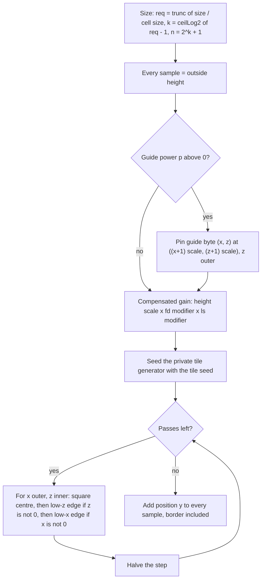

# Height-field generation

> Status: Engine baseline · Prefix: TER · ADRs: [ADR-052](../../../ADR/ADR-052-cpp23-language-standard.md) · [ADR-061](../../../ADR/ADR-061-data-schemas-and-versioning.md) · [ADR-069](../../../ADR/ADR-069-test-framework.md) · Related: [Terrain](README.md) · [Edges, normals, colours and sea](edges_normals_colours_and_sea.md) · [Maps: rules and conventions](../../../reference/08_maps_and_level_design/rules_and_conventions.md) · [Randomness and integrity](../../../reference/12_simulation_model/07_randomness_and_integrity.md)

This document specifies how the terrain component generates the height field from the terrain records of a map: the numeric primitives and grid reads, the private tile generator, the generation of one tile, the generation methods, the noise, the tile edge cases, the composition of tiles and the flatten areas; and the vector sets that every implementation reproduces. The pipeline that runs these steps in order is [README](README.md) §4.1, and the notation is that of the README. Section numbers are shared by the files of this folder.

## 1 Responsibilities and boundaries

The responsibilities and boundaries of the terrain component are [README](README.md) §1 (TER-001 to TER-009). This document specifies steps 1 to 3 of the pipeline of TER-060 and the grid primitives that the queries of README §2.2 use.

## 2 Interfaces

This document specifies `SurfaceGrid` and `TerrainField::Generate` of the interface sketch of [README](README.md) §2.1, and uses the maths library's `Grid2D` ([platform layer](../platform_layer.md) §4.17) and the generated records `TerrainTile` and `TerrainFlattenArea` ([data schemas](../data_schemas/map_schema.md) §2). The private tile generator (§4.3) has no public interface.

## 3 Data model

The records that generation reads are [README](README.md) §3: the terrain definition (table 3.1-A), the terrain tiles (table 3.2-A), the flatten areas (table 3.3-A) and the guide grid (table 3.4-A).

## 4 Behaviour and algorithms

### 4.2 Numeric primitives

**TER-065** (MUST) The generator uses the rounded functions of table 4.2-A. Each rounds the binary64 result of the maths library's function to binary32 (*r32*), as the reference model does (DEC-240, DEC-241); their arguments are binary64.

Table 4.2-A Rounded functions of the generator.

| Function | Definition | Used for |
|---|---|---|
| pow32(*x*, *y*) | *r32*(*x*^*y*), with pow32(0, 0) = 1 | the noise amplitude, the noise envelope, the tile size 2^*k* |
| exp32(*x*) | *r32*(e^*x*) | the two gain modifiers |
| log32(*x*) | *r32*(ln *x*) | log2r |
| sqrt32(*x*) | *r32*(√*x*) | normalisation (TER-077) |
| sin32(*x*) | *r32*(sin *x*) | the coastline waves (presentation; binary32 GPU arithmetic is acceptable, TER-205) |
| log2r(*x*) | log32(*x*) × *c*, with *c* = 1 ÷ log32(2) computed once in binary64 | ceilLog2 |
| ceilLog2(*x*) | trunc(⌈log2r(*x*)⌉), an integer | the tile size and the pass count |
| abs32(*b*) | \|*r32*(*b*)\|: the single-precision absolute value rounds its argument to binary32 first | the noise envelope |

A result that lies within one binary64 unit in the last place of a binary32 rounding midpoint rounds the same on every platform only if every maths library returns the same binary64 value for it; an exact square does when *x*^2.0 returns the exact square. This is the agreement condition of DEC-246 item 5.

> **Amendment 2026-10-18 (ADR-081; MVP-011; MVP-093).** ADR-081 item 3 keeps this rounding over the deterministic functions of the engine maths library (PLT-134), never the CRT's, whose results can differ between computers. The MVP defers those functions (MVP-093), so until they exist the generator rounds the CRT's results, and the terrain hash of MVP-011 refuses a world on which a client and its server, on one computer in the MVP (MVP-071), disagree.

**TER-066** (MUST) Every decimal field of the terrain records is parsed to binary64 by one platform-independent, correctly rounded parser and then rounded once to binary32 (DEC-241 item 12); the maximum height stays binary32. The rounding is observable: a tile at position z = 985 on a terrain of cell size 15.76 has 985 ÷ 15.760000228881836 = 62.4999991, so its footprint starts at world row trunc(62.9999991) = 62, whereas the unrounded 15.76 gives 62.5 and row 63, shifting the footprint by one world cell (vector set A, §7.2). Whole-number fields are 32-bit signed integers; the content build rejects malformed and out-of-range tokens (DEC-015).

**TER-067** (MUST) ceilLog2(*x*) equals the exact ⌈log₂ *x*⌉ for every integer 1 ≤ *x* < `ter.test.log2_check_limit` (70 000), exact powers of two included (test T3).

**TER-068** (MUST) The private tile generator computes in unsigned 32-bit integers that wrap modulo 2³² (TER-080), which C++ defines for unsigned types; no signed integer takes part in the computation.

**TER-070** (MUST) A grid's sample position is `PositionX`(*i*) = *i* × *c*ₓ + *x*₀ and `PositionZ`(*j*) = *j* × *c*_z + *z*₀, with the integer index converted to binary64.

**TER-071** (MUST) The conversion of a binary64 coordinate fraction to a sampler index truncates toward zero, so a value in (−1, 0) gives index 0, never ⌊*v*⌋ = −1 (TER-121, TER-230).

**TER-072** (MUST) An integer read `At`(*i*, *j*) whose column is outside [0, columns) or whose row is outside [0, rows) returns the grid's outside value, and `Set` with such an index does nothing. The indices are first reduced modulo 2^`ter.grid.index_bits` (2¹⁶) to unsigned 16-bit values; for every grid of at most `ter.grid.max_samples_per_side` (32 768) samples per side, which the content build enforces (TER-250), every index from −32 768 to 65 535 that lies outside the grid reads the outside value with or without the reduction.

**TER-073** (MUST) `Sample`(*x*, *z*), the bilinear read of a grid, is:

```text
fx := (x - x0) * invX ;  fz := (z - z0) * invZ
i1 := trunc(fx) mod 2^16 ;  i2 := (i1 + 1) mod 2^16        # TER-071; the reduction is TER-072's
j1 := trunc(fz) mod 2^16 ;  j2 := (j1 + 1) mod 2^16
fx := fx - floor(fx) ;  fz := fz - floor(fz)               # taken before the index reset
if i1 >= columns: i1 := 0 ;  if i2 >= columns: i2 := 0      # the far-edge reset
if j1 >= rows:    j1 := 0 ;  if j2 >= rows:    j2 := 0
w11 := (1 - fx) * (1 - fz) ;  w12 := (1 - fx) * fz         # weights first, one product each
w21 := fx * (1 - fz)       ;  w22 := fx * fz
result := ((v(i1, j1) * w11 + v(i1, j2) * w12) + v(i2, j1) * w21) + v(i2, j2) * w22
```

The sum runs left to right. Evaluating v × (1 − fx) × (1 − fz) left to right instead rounds differently and changes the heights. An index whose truncation is −1 or below converts by the reduction modulo 2¹⁶ of TER-072: the result is the low 16 bits of the truncated integer, a defined value for every finite input. The edge consequences are TER-121 for tiles and TER-153 for the world grid.

**TER-074** (MUST) `IndexX`(*r*) = trunc((*r* − *x*₀) × *invX*) as a signed integer, so −0.5 gives 0; `IndexZ` likewise.

**TER-075** (MUST) `Nearest`(*x*, *z*) = `At`(⌊*x* × *invX*⌋, ⌊*z* × *invZ*⌋); it ignores the grid's origin, so it serves only grids with origin (0, 0). The terrain does not use it.

**TER-076** (MUST) `Highest`() starts with `At`(0, 0) and scans *z* from 0 to rows − 1 (outer) and *x* from 0 to rows − 1 (inner), the row count bounding both loops. On a square grid this is the highest sample of the grid. Tiles are always square; on a grid with more columns than rows the scan ignores the last columns, and with fewer columns it reads the outside value beyond the last column (see DEC-966 item 2).

**TER-077** (MUST) `Normalize`(*v*) computes *l* = *v.x* × *v.x* + *v.y* × *v.y* + *v.z* × *v.z*, summed left to right. If *l* > `ter.math.normalise_min_length_sq` (10⁻¹⁰), it multiplies each component by *s* = 1 ÷ sqrt32(*l*); otherwise the result is `ter.math.normalise_fallback` (0, 0, 1) (DEC-241 item 6).

**TER-078** (MUST) The cross product is *a* × *b* = (*a.y* *b.z* − *a.z* *b.y*, *a.z* *b.x* − *a.x* *b.z*, *a.x* *b.y* − *a.y* *b.x*), each component evaluated as written.

### 4.3 The private tile generator

**TER-080** (MUST) Each tile owns a private generator whose state is an unsigned 32-bit integer (TER-068). `Seed`(*s*) sets the state to *s* modulo 2³². `Next`() sets state := state × `ter.generator.lcg.multiplier` (214013) + `ter.generator.lcg.increment` (2531011), modulo 2³², and returns (state shifted right by `ter.generator.lcg.output_shift` (16) bits) AND `ter.generator.lcg.output_mask` (0x7FFF), a value from 0 to 32 767. `Signed`(*R*) returns (0.5 − `Next`() ÷ 32 767) × *R*, the divisor being the output mask's value: uniform over [−*R*/2, *R*/2], with `Next`() = 0 giving +*R*/2. The tile generator is independent of the simulation generator and of every presentation generator; nothing but the tile's own generation draws from it (R-SIM-609, DEC-242 item 5). Its algorithm is fixed by this rule because it determines the heights; the algorithm of the simulation generator is DEC-242.

**TER-081** (MUST) After `Seed`(1), the first eight `Next`() results are 41, 18467, 6334, 26500, 19169, 15724, 11478 and 29358 (test T1).

### 4.4 Tile generation

**TER-090** (MUST) A tile's generation reads the tile's fields (table 3.2-A), the terrain's cell size and the outside height, which is copied into the tile immediately before the generation (TER-060 step 2). The output depends on nothing else.

**TER-091** (MUST) A tile is generated by these steps, in this order:

1. **Size the tile grid.** *req* = trunc(size ÷ cell size), an integer divided by a binary64 value; *k* = ceilLog2(*req* − 1); *n* = trunc(pow32(2, *k*)) + 1, which is exact. The tile grid has *n* × *n* samples, cell size 1, origin (0, 0) and the outside height as its outside value.
2. **Initialise.** Every sample is the outside height.
3. **Pin the guide grid**, only when *p* > 0: *r* = 2^*p* − 1; *scale* = (*n* − 1) div (*r* + 1), an integer division, which is 2^(*k* − *p*) when *k* ≥ *p*. For *z* from 0 to *r* − 1 (outer) and *x* from 0 to *r* − 1 (inner): sample ((*x* + 1) × *scale*, (*z* + 1) × *scale*) := guide(*x*, *z*), the byte value as a binary64 height.
4. **Compensated gain.** *fdm* = `ter.generator.gain.fd_coefficient` (30.7) × exp32(`ter.generator.gain.fd_exponent` (−6.5) × *fd*); *lsm* = `ter.generator.gain.ls_coefficient` (15.353) × exp32(`ter.generator.gain.ls_exponent` (−3.1) × *ls*); *comp* := *hs*; *comp* := *comp* × *fdm*; *comp* := *comp* × *lsm*: two separate multiplications, in this order.
5. **Pass plan.** *iterations* = ceilLog2(*n*) − *p*, which is *k* + 1 − *p* because ⌈log₂(2^*k* + 1)⌉ = *k* + 1; *step* = (*n* − 1) shifted right by *p* bits, which is 2^(*k* − *p*).
6. **Midpoint displacement**, with *x* the **outer** loop and *z* the inner loop:

   ```text
   Seed(seed)                               # the tile's private generator, TER-080
   repeat iterations times:
       for x := 0; x < n - 1; x += step:
           for z := 0; z < n - 1; z += step:
               h := step >> 1
               mx := x + h ;  mz := z + h
               Square(mx, mz, h)            # the centre of the cell
               if z != 0: Diamond(mx, z, h) # the midpoint of the cell's low-z edge
               if x != 0: Diamond(x, mz, h) # the midpoint of the cell's low-x edge
       step := step >> 1
   ```

   Each `Square` and `Diamond` call computes a base value *b* from its parents (TER-100), adds Noise(*h*, *b*) (TER-105) and writes the sample.
7. **Height shift.** Every sample, the border included, with *x* outer and *z* inner: sample := sample + position y.

**TER-092** (MUST) These properties follow from TER-091, and an implementation keeps them:

- **The border never moves during step 6.** Edge midpoints on *x* = 0 and *z* = 0 are skipped explicitly, and midpoints on *x* = *n* − 1 and *z* = *n* − 1 are never visited, because they would belong to cells beyond the tile. After step 7 the whole border equals outside height + position y.
- **Every parent exists when it is read.** Because *z* ascends inside *x*, the square centres of the cell below (*x*, *z* − *step*) and of the cell to the left (*x* − *step*, *z*) are already written in the current pass, and no parent read falls outside the tile.
- **The final pass changes nothing but still draws.** When *step* = 1, *h* = 0: every call reads the sample itself, and Noise(0, *b*) is ±0 for *fd* > 0. The pass visits the samples with *x*, *z* < *n* − 1, row and column 0 included, and leaves them unchanged. Its draws do not matter, because nothing draws from the tile generator afterwards.
- **Determinism.** The output depends only on the tile's fields, the cell size (through *n*) and the outside height; re-seeding at step 6 makes every regeneration identical.
- **Call counts.** A pass with *c* = (*n* − 1) ÷ *step* cells per side makes *c*² square calls and 2*c*(*c* − 1) diamond calls.

**TER-093** (MUST) Table 4.4-A gives the pass plan for every combination of *k* and *p* up to 8 and 5: the number of passes, the first step, and the half-steps of the displacement passes without the final pass of half-step 0. A cell marked "—" (*p* > *k*) is the case of TER-111.

Table 4.4-A Pass plans (passes; first step; half-steps).

| *k* (*n*) | *p* = 0 | *p* = 1 | *p* = 2 | *p* = 3 | *p* = 4 | *p* = 5 |
|---|---|---|---|---|---|---|
| 3 (9) | 4; 8; 4, 2, 1 | 3; 4; 2, 1 | 2; 2; 1 | 1; 1; none | — | — |
| 4 (17) | 5; 16; 8, 4, 2, 1 | 4; 8; 4, 2, 1 | 3; 4; 2, 1 | 2; 2; 1 | 1; 1; none | — |
| 5 (33) | 6; 32; 16, 8, 4, 2, 1 | 5; 16; 8, 4, 2, 1 | 4; 8; 4, 2, 1 | 3; 4; 2, 1 | 2; 2; 1 | 1; 1; none |
| 6 (65) | 7; 64; 32, 16, 8, 4, 2, 1 | 6; 32; 16, 8, 4, 2, 1 | 5; 16; 8, 4, 2, 1 | 4; 8; 4, 2, 1 | 3; 4; 2, 1 | 2; 2; 1 |
| 7 (129) | 8; 128; 64, 32, 16, 8, 4, 2, 1 | 7; 64; 32, 16, 8, 4, 2, 1 | 6; 32; 16, 8, 4, 2, 1 | 5; 16; 8, 4, 2, 1 | 4; 8; 4, 2, 1 | 3; 4; 2, 1 |
| 8 (257) | 9; 256; 128, 64, 32, 16, 8, 4, 2, 1 | 8; 128; 64, 32, 16, 8, 4, 2, 1 | 7; 64; 32, 16, 8, 4, 2, 1 | 6; 32; 16, 8, 4, 2, 1 | 5; 16; 8, 4, 2, 1 | 4; 8; 4, 2, 1 |

Because *n* − 1 = 2^*k* with *req* − 1 ≤ 2^*k* < 2 (*req* − 1), the ratio (*n* − 1) ÷ *req* lies from (*req* − 1) ÷ *req* up to below 2, so a tile is sampled at roughly one to two tile samples per world cell.



Caption: the generation of one tile (TER-091).

### 4.5 Parents and the generation methods

**TER-100** (MUST) `Square`(*x*, *z*, *h*) has the parents **A** = (*x* − *h*, *z* − *h*), **B** = (*x* − *h*, *z* + *h*), **C** = (*x* + *h*, *z* − *h*) and **D** = (*x* + *h*, *z* + *h*). `Diamond`(*x*, *z*, *h*) has the parents **W** = (*x* − *h*, *z*), **E** = (*x* + *h*, *z*), **N** = (*x*, *z* + *h*) and **S** = (*x*, *z* − *h*). The base value and the draws of each method are those of table 4.5-A; the choice draw always comes before the noise draw.

Table 4.5-A Generation methods.

| Method | Square base | Diamond base | Draws per call, in order |
|---|---|---|---|
| 0 `Average` | (A + B + C + D) × 0.25, summed in that order | (W + E + S + N) × 0.25, summed W, E, S, N | 1: the noise |
| 1 `RandomPair` | if `Next`() AND 1 is 1: (A + D) × 0.5, else (B + C) × 0.5 | if `Next`() AND 1 is 1: (W + E) × 0.5, else (N + S) × 0.5 | 2: the choice, then the noise |
| 2 `CopyOne` | with *c* = `Next`() AND `ter.generator.method2.choice_mask` (0xFFFF): *c* below the first threshold of `ter.generator.method2.thresholds` (0x3FFF) gives A, below the second (0x7FFF) gives B, below the third (0xBFFF) gives C, otherwise D | the same thresholds give W, E, N, S | 2: the choice, then the noise |

**TER-101** (MUST) Method 2 keeps its bias (DEC-324). Because `Next`() never exceeds 0x7FFF, a choice from 0 to 16 382 selects A or W (probability 16 383 ÷ 32 768), 16 383 to 32 766 selects B or E (16 384 ÷ 32 768), 32 767 selects C or N (1 ÷ 32 768), and D or S is never selected. Square midpoints therefore copy almost only from the two low-x corners and diamond midpoints from the two x neighbours, which gives method-2 tiles a directional, streaky character along z. Whether the map editor also offers unbiased variants is DEC-324.

**TER-102** (MUST) Method 1's coin is bit 0 of the 15-bit output, which is bit 16 of the generator state.

### 4.6 Noise

**TER-105** (MUST) Noise(*h*, *b*) for the half-step *h* and the base value *b* is, in this order:

```text
L     := ter.generator.noise.length_scale * h / n          # 256.0 * h, then / n
R     := pow32(L * ter.generator.noise.length_multiplier, fd)    # L * 10.0
noise := (0.5 - Next() / 32767) * R                        # Signed(R), TER-080
noise := noise * comp
noise := noise * (ter.generator.noise.envelope_floor + pow32(abs32(b), ls) * ter.generator.noise.envelope_gain)
                                                           # 0.1 + pow32(|b|, ls) * 0.15
```

and the call writes *b* + noise. *L* measures the half-step as if the tile were 256 units wide; the amplitude *R*(*h*) = pow32(10 *L*, *fd*); the envelope *E*(*b*) = 0.1 + 0.15 × pow32(abs32(*b*), *ls*), with pow32(0, 0) = 1.

**TER-106** (SHOULD) The parameters have these effects, which follow from the formulae (DEC-324):

- **Roughness across scales.** Successive passes differ by the factor 2^(−*fd*) in amplitude, so *fd* behaves like a spectral exponent: a larger *fd* gives smoother terrain dominated by the coarsest pass, a smaller one more fine detail. This is the opposite of the usual meaning of a fractal dimension; the map editor labels the field accordingly ([map editor hooks](../../../reference/08_maps_and_level_design/map_editor_hooks.md) R-MAP-330).
- **Gain compensation.** At the coarsest pass 10 *L* ≈ 1280, and 1280^*fd* × e^(−6.5 *fd*) ≈ e^(0.655 *fd*), so the fd modifier keeps the coarse amplitude within one order of magnitude whatever *fd* is. The ls modifier 15.353 × e^(−3.1 *ls*) likewise cancels the growth of \|*b*\|^*ls* for \|*b*\| ≈ e^3.1 ≈ 22 wu.
- **Height-dependent roughness.** *E* grows with \|*b*\|: samples whose tile-space height is near 0 get the 0.1 floor and stay smooth; high or deeply negative samples get more noise. Tiles start at the negative outside height and guide values are 0 or more, so "lowland" means tile-space heights near 0, not sea level after the rescale.
- **Absolute scale.** The peak rescale (TER-122) maps the tile's highest sample to its desired height, so what matters is the size of the noise relative to the guide values and position y, and the non-linear envelope.

Representative magnitude, from vector set A (§7.2), tile 2 (*n* = 65, *fd* = 1.2, *hs* = 1, *ls* = 1): *comp* = 0.00870004745734159; *R*(32) = pow32(1260.3077, 1.2000000477) = 5254.9917; *E*(−15.39) = 2.4085001; the first displacement, with the draw 41, is (0.5 − 41 ÷ 32 767) × 5254.9917 × 0.008700047 × 2.4085001 = +54.918937744622255 wu in tile space.

**TER-107** (MUST) In a pass of step *s*, the writes come in this order: for every multiple *x* of *s* below *n* − 1, ascending, and inside it for every multiple *z* of *s* below *n* − 1, ascending: the square centre (*x* + *s*/2, *z* + *s*/2); then the low-z edge (*x* + *s*/2, *z*) if *z* > 0; then the low-x edge (*x*, *z* + *s*/2) if *x* > 0. For methods 1 and 2 every call draws its choice before its noise. The vectors of §7.2 give the first writes of real tiles with every intermediate value.

### 4.7 Tile edge cases

**TER-110** (MUST) The generator gives the results of table 4.7-A in these cases.

Table 4.7-A Tile edge cases.

| Case | Result |
|---|---|
| *k* = *p*: the guide grid is as dense as the tile | *scale* = 1, every interior sample is a guide point; *iterations* = 1 with step 1, the pass that changes nothing: the tile is its guide grid inside a border at the outside height |
| *heightScale* = 0 | *comp* = 0, every noise is ±0: the tile is the pure method-0, method-1 or method-2 interpolation of its guide points and border |
| *heightScale* = 0, *p* = 0, position y > 0 | the tile is flat at outside height + position y; after the rescale it is a plateau at about the desired height over the whole footprint, a level-design technique |
| *ls* = 0 | *E*(*b*) = 0.25 for every *b* (pow32(*x*, 0) = 1, pow32(0, 0) included); the ls modifier is 15.353 |
| *fd* = 0 | *R* = 1 in every pass, the final half-step-0 pass included (pow32(0, 0) = 1), so that pass adds noise of amplitude *comp* × *E* ÷ 2 to every sample with *x*, *z* < *n* − 1, **border row and column 0 included** |
| *req* = 2 (size from 2 to under 3 cell sizes) | *k* = 0, *n* = 2, one pass that changes nothing: a flat tile |

**TER-111** (MUST) Two guide-grid cases have defined results that are not equivalent to the absence of a guide grid. With *p* > 0 and an all-zero guide grid, the guide points are pinned at height 0, above the negative border, which raises the tile's interior before any noise (vector set A, tiles 0 and 1). With *k* < *p*, *scale* is 0, so every guide value is written to sample (0, 0) and the last one (*x* = *z* = *r* − 1) remains; *iterations* ≤ 0, so there is no displacement, and the tile is flat at the outside height except that corner.

**TER-112** (MUST) The content build rejects, with a diagnostic, a tile whose result the generator does not define (DEC-015; see DEC-968 item 1): a size below 2 cell sizes (*req* ≤ 1, where ceilLog2(0) is −∞ and its integer conversion is undefined); a generation method other than 0, 1 or 2 (the base value is never set); and a guide grid whose cell count is not *r*².

### 4.8 Composition of tiles

**TER-120** (MUST) A generated tile is merged into the height grid by:

```text
MergeTile(tile):
    posXi := trunc(posX / cellSize + ter.merge.index_rounding)    # + 0.5: the nearest world sample; TER-124 for negatives
    posZi := trunc(posZ / cellSize + ter.merge.index_rounding)
    numCells := trunc(size / cellSize)                           # world samples covered per side
    range := tile.Highest() - outside + ter.merge.range_epsilon   # after the position-y shift; + 0.001
    heightFactor := (desiredHeight - outside) / range
    # re-target the tile grid from tile-sample space to world space:
    tile.x0 := posX ;  tile.z0 := posZ
    tile.cellX := size / n ;  tile.cellZ := size / n              # divided by n, not by n - 1
    tile.invX := 1 / tile.cellX ;  tile.invZ := 1 / tile.cellZ
    for z := 0 .. numCells - 1:                                  # z outer
        wz := world.PositionZ(z + posZi)                         # an integer index, not reduced
        for x := 0 .. numCells - 1:
            wx := world.PositionX(x + posXi)
            h := tile.Sample(wx, wz)                             # TER-073, TER-121
            h := h - outside ;  h := h * heightFactor ;  h := h + outside
            if h > world.At(x + posXi, z + posZi):              # off the grid: the outside height
                world.Set(x + posXi, z + posZi, h)               # off the grid: dropped
```

The integers posX, posZ and size are converted to binary64 where they meet a binary64 operand; the cell size and the outside height are the terrain's rounded values.

**TER-121** (MUST) The tile sampler meets the cases of table 4.8-A, with *fx* = (*wx* − posX) ÷ tile cell and the same on z. Every case is reproduced exactly.

Table 4.8-A Tile-sampler cases.

| Case | Result | Required |
|---|---|---|
| 0 ≤ *fx* < *n* − 1 | bilinear between tile columns ⌊*fx*⌋ and ⌊*fx*⌋ + 1 | yes |
| −1 < *fx* < 0: the first world sample lies slightly before the tile origin, because posXi rounds to the nearest sample | truncation gives *i*1 = 0, *i*2 = 1, and the weight *fx* + 1 on column 1: the value is mirrored into the tile (at *fx* = −0.3 the result is 0.3 × column 0 + 0.7 × column 1) | **yes**: a sampler based on ⌊*fx*⌋ = −1 that clamps or returns the outside value gives different heights, and the difference survives the maximum wherever the tile border lies above the existing terrain |
| *fx* ≤ −1 | cannot occur for a tile with a non-negative origin: the first world sample lies at most half a world cell before the origin, and half a world cell is less than one tile cell, because cell size ÷ tile cell ≤ *n* ÷ *req* < 2 (*n* = 2^*k* + 1 with 2^*k* < 2 (*req* − 1)) | — |
| *fx* ≥ *n* − 1: the far edge of the footprint, because the tile's last sample lies at size × (*n* − 1) ÷ *n*, short of the footprint edge | *i*1 or *i*2 reaches *n* and is reset to column 0 (TER-073); columns 0 and *n* − 1 both hold the border value outside height + position y, so the result equals clamping to the border for every position y | its value: clamping to the border is equivalent; returning the bare outside height off the tile is not |

**TER-122** (MUST) The merge remaps every tile linearly about the outside height, so that its highest sample becomes its desired height and a sample at the outside height stays there: *h*_world = outside + (*h*_tile − outside) × (desired − outside) ÷ (highest − outside + `ter.merge.range_epsilon`); the epsilon (0.001) only prevents a division by zero for a flat tile. Consequences:

- the absolute output of TER-091 matters only through its shape; the desired height sets the tile's peak;
- the peak is measured **after** the position-y shift, so position y changes the relief, not the peak: the border moves to outside + position y × heightFactor, above the sea floor when position y > 0 (the whole footprint becomes a plinth) and below it when position y < 0 (the border never wins the maximum and the tile blends into the terrain already there), and the interior is compressed or stretched accordingly;
- the world peak can be lower than the desired height, because no world sample need coincide with the tile's highest sample (vector set A: tile 2 has the desired height 300 and the world maximum is 273.38014287056404).

**TER-123** (MUST) The composition follows these rules:

- **Per-sample maximum.** A tile can only raise world samples, and overlapping tiles combine by maximum, so the order of the tiles changes no height; the flatten areas come afterwards (R-MAP-082).
- **No smoothing between tiles.** The seams between overlapping tiles are creases of the maximum.
- **Footprint quantisation.** The footprint starts at the world sample nearest to (posX, posZ) and is trunc(size ÷ cell size) samples wide, so tile edges snap to the world grid, while the tile itself is sampled at its true, unsnapped position.

**TER-124** (MUST) A tile may hang off the map edge: its writes to samples outside the grid are dropped. The conversion of posX ÷ cell size + 0.5 (and the same on z) to an index truncates toward zero and is defined for values above −1. A tile whose footprint lies wholly outside the grid has no effect and is skipped. The content build rejects a tile whose index value is −1 or below while its footprint overlaps the grid (DEC-015; see DEC-968 item 1): there the destination index would wrap back onto the grid while the sampling coordinate does not, and the tile would write only its border value.

### 4.9 Flatten areas

**TER-140** (MUST) A flatten area with centre (*cx*, *t*, *cz*) and half-width *s* visits the integer world samples *i* from *i*1 = `IndexX`(*cx* − *s*) + 1 to *i*2 − 1, with *i*2 = `IndexX`(*cx* + *s*) + 1, and *j* likewise on z with `IndexZ`. With truncation toward zero this is, for positive coordinates, the set of samples whose world position lies in (*cx* − *s*, *cx* + *s*] × (*cz* − *s*, *cz* + *s*]: an axis-aligned square of half-width *s*, hard-edged, with no falloff or blending at its boundary. The indices are not clamped: reads outside the grid return the outside height and writes there are dropped (TER-072).

**TER-141** (MUST) The areas are applied after all tiles, in record order. Within an area *z* is the outer loop and *x* the inner loop, and every update is written in place, so the neighbours at *x* − 1 and *z* − 1 are already updated when the smooth operation reads them.

**TER-142** (MUST) One area is applied by:

```text
ApplyFlattenArea(area):                       # t = centre y, T = threshold, s = half-width
    passes := ter.flatten.smooth_passes if op == Smooth else 1     # 2 for Smooth
    repeat passes times:
        for j := j1 .. j2 - 1:                  # z outer
            for i := i1 .. i2 - 1:              # x inner; writes are in place
                cur := At(i, j) ;  v := t        # Absolute writes t
                if   op == Add:       v := t + cur
                elif op == Subtract:  v := (cur - t) if cur > T else cur
                elif op == Subtract2: v := (cur - t) if cur < T else cur
                elif op == Smooth:
                    if cur > T:
                        v := cur * (t / cur)         # t / cur first, then the product
                        v := v + At(i - 1, j)        # one rounding per addition, in this order
                        v := v + At(i + 1, j)
                        v := v + At(i, j + 1)
                        v := v + At(i, j - 1)
                        v := v / ter.flatten.smooth_divisor     # 6.0
                    if v > cur: v := cur
                Set(i, j, v)
```

**TER-143** (MUST) Per sample, with *cur* the current height, the operations give the values of table 4.9-A.

Table 4.9-A Flatten operations.

| Value | Operation | New value | Passes | Effect |
|---|---|---|---|---|
| 0 | Absolute | *t* | 1 | levels an area, such as a building pad, at *t* |
| 1 | Add | *t* + *cur* | 1 | raises an area by *t* |
| 2 | Subtract | *cur* − *t* where *cur* > *T*, else *cur* | 1 | cuts the samples above *T* down by *t*; with *t* > *T* a pit reaches below the sea |
| 3 | Smooth | where *cur* > *T*: *v* = *cur* × (*t* ÷ *cur*), about *t* after two roundings, then the four neighbours W (*i* − 1), E (*i* + 1), N (*j* + 1) and S (*j* − 1) added **one at a time, starting from the centre term** (never *v* + (the sum of the neighbours)), then ÷ 6.0; elsewhere *v* = *t*; finally min(*v*, *cur*) | 2 | softens and lowers hilltops (TER-144) |
| 4 | Subtract2 | *cur* − *t* where *cur* < *T*, else *cur* | 1 | lowers every sample below *T* by *t* |

**TER-144** (MUST) The smooth operation keeps its arithmetic, biases included (DEC-324): it never raises terrain (min(*v*, *cur*)); samples at or below *T* are capped at *t*, so with *t* ≥ *T* they are unchanged; samples above *T* become (*t* + the sum of the four neighbours) ÷ 6, five terms over a divisor of six, so a plateau of height *H* much above *t* is pulled down to about (*t* + 4*H*) ÷ 6 per pass, about 0.44 *H* plus *t* terms after the two passes, as well as smoothed. Whether the map editor also offers a true blur and a separate lowering operation is DEC-324.

**TER-145** (MUST) The order of the four additions matters: the smooth area of vector set C (§7.2), over the generated terrain of set A, makes 2 888 above-threshold evaluations in its two passes, and 377 of them give a different binary64 value when the neighbours are summed first.

## 5 Concurrency and performance budget

The cost of generation and its place outside every tick and frame budget are [README](README.md) §5 (TER-240 to TER-242).

## 6 Failure modes, diagnostics and telemetry

The content-build rejections of TER-112 and TER-124 are part of the validation of [README](README.md) TER-250; the generation log and the per-tile trace are TER-253.

## 7 Acceptance tests

The tests are [README](README.md) §7.1 (T1 to T16 and T22 to T26 use the vector sets below), and the conformance procedure is README §7.3.

### 7.2 Vector sets

Each set is a self-contained parameter set. The expected values below are exact binary64 values, printed so that they parse back to the same value, and are checked by exact equality; they were produced by a conformance generator, an implementation of §4 written from this text alone, and every implementation is accepted only when it reproduces all of them. New vectors are produced the same way: the expected values of a new set come from the conformance generator kept with the test suite (ADR-069), never from a reference map, whose shapes and digests are not reproduced (DEC-063).

**Vector set A** is a terrain of three tiles: world size 2700 × 2700 wu, cell size 15.76 wu, outside height −15.39 wu, maximum height absent (0), no flatten areas, and the tiles of table 7.2-A.

Table 7.2-A Set A tiles.

| Tile | Position x | Position y | Position z | Size | *fd* | *hs* | Desired height | Method | Seed | *ls* | *p* | Guide grid |
|---|---|---|---|---|---|---|---|---|---|---|---|---|
| 0 | 204 | −3.98 | 260 | 2264 | 1.20 | 4.00 | 220 | 1 | 269491 | 1.00 | 2 | 3 × 3, every cell 0 |
| 1 | 1274 | 1.57 | 132 | 1014 | 1.20 | 4.00 | 220 | 1 | 904945 | 1.00 | 2 | 3 × 3, every cell 0 |
| 2 | 1129 | 0.00 | 985 | 834 | 1.20 | 1.00 | 300 | 0 | 1 | 1.00 | 0 | — |

Table 7.2-B Set A derived values and result.

| Quantity | Tile 0 | Tile 1 | Tile 2 |
|---|---|---|---|
| *req* = trunc(size ÷ cell size) | 143 (143.65) | 64 (64.34) | 52 (52.92) |
| *k* = ceilLog2(*req* − 1), *n* | 8, 257 | 6, 65 | 6, 65 |
| guide points | at 64, 128, 192 (scale 64), all 0 | at 16, 32, 48 (scale 16), all 0 | none |
| passes, first step | 7, 64 | 5, 16 | 7, 64 |
| *comp* | 0.03480018982936636 | 0.03480018982936636 | 0.00870004745734159 |
| highest sample after the position-y shift | 11.67633525289311 | 27.39792619447322 | 39.5289374012995 |
| range = highest − outside + 0.001 | 27.067335596215866 | 42.78892653779597 | 54.91993774462225 |
| height factor | 8.696459963951211 | 5.501189662596465 | 5.742723194805618 |
| posXi = trunc(posX ÷ cell size + 0.5) | 13 (12.944 + 0.5) | 81 (80.84 + 0.5) | 72 (71.64 + 0.5) |
| posZi | 16 (16.497 + 0.5) | 8 (8.376 + 0.5) | **62** (62.4999991 + 0.5, TER-066) |
| numCells | 143 | 64 | 52 |
| tile cell = size ÷ *n* | 8.809338521400779 | 15.6 | 12.830769230769231 |
| square and diamond calls | 261 112 | 16 120 | 16 129 |

Terrain values: cell size 15.760000228881836 and outside height −15.390000343322754 after rounding; *fd* rounds to 1.2000000476837158, giving the fd modifier 0.012578859674977138, and *ls* = 1 gives the ls modifier 0.6916403936557471; the grid is 172 × 172 samples with the extent 2710.720039367676 wu. The heights range from −15.390000343322754 to 273.38014287056404, below tile 2's desired height of 300 because no world sample coincides with tile sample (32, 32) (TER-122). Probe samples: *h*(0, 0) = −15.390000343322754, *h*(43, 43) = 64.11465376675797, *h*(86, 86) = 99.71780778328521, *h*(129, 57) = 80.84683847539341. 259 merge reads hit the case −1 < *fx* < 0 of TER-121.

Table 7.2-C Set A, tile 2 (method 0, seed 1, *n* = 65, *p* = 0): the first ten calls. Pass 1 (step 64) has one cell; pass 2 (step 32) has four. Each call is one draw, one noise and one write, so the tile's 16 129 calls are 48 387 events.

| # | Call | Draw | Base | Noise | Written |
|---|---|---|---|---|---|
| 1 | Square(32, 32, 32) | 41 | −15.390000343322754 (the four corners) | +54.918937744622255 | 39.5289374012995, the tile's highest sample |
| 2 | Square(16, 16, 16) | 18467 | −1.6602659071671901 = (3 × outside + 39.5289374012995) ÷ 4 | −0.4416614889824001 | −2.1019273961495903 |
| 3 | Square(16, 48, 16) | 6334 | −1.6602659071671901 | +2.1302986002057267 | 0.47003269303853656 |
| 4 | Diamond(16, 32, 16) | 26500 | 5.626760588716423 = (W + E + S + N) ÷ 4 | −5.800023064758535 | −0.17326247604211176 |
| 5 | Square(48, 16, 16) | 19169 | −1.6602659071671901 | −0.5904718394818702 | −2.2507377466490603 |
| 6 | Diamond(32, 16, 16), the low-x edge of the cell at *x* = 32 | 15724 | 4.9465679787945245 | +0.3372408885970395 | 5.2838088673915635 |
| 7 | Square(48, 48, 16) | 11478 | −1.6602659071671901 | +1.0398706187680178 | −0.6203952883991724 |
| 8 | Diamond(48, 32, 16) | 29358 | 5.316951005732128 | −7.072397743527255 | −1.7554467377951273 |
| 9 | Diamond(32, 48, 16) | 26962 | 5.9971436156540285 | −6.421832127879571 | −0.4246885122255426 |
| 10 | Square(8, 8, 8) | 24464 | −12.067982106529463 | −4.0803875962216285 | −16.14836970275109 |

Table 7.2-D Set A, tile 0 (method 1, seed 269491, *n* = 257, *p* = 2, first step 64, half-step 32). The nine guide pins come first, at (64, 64), (128, 64), (192, 64), (64, 128), (128, 128), (192, 128), (64, 192), (128, 192) and (192, 192), each 0; then:

| # | Call | Choice draw and base | Noise draw and noise | Written |
|---|---|---|---|---|
| 1 | Square(32, 32, 32) | 28114, even: (B + C) ÷ 2 = (*h*(0, 64) + *h*(64, 0)) ÷ 2 = −15.390000343322754 | 13609: +7.16513913931825 | (32, 32) = −8.224861204004505 |
| 2 | Square(32, 96, 32) | 12878, even: (*h*(0, 128) + *h*(64, 64)) ÷ 2 = −7.695000171661377 | 28951: −16.901538996064705 | (32, 96) = −24.596539167726082 |
| 3 | Diamond(32, 64, 32) | 17157, odd: (W + E) ÷ 2 = (*h*(0, 64) + *h*(64, 64)) ÷ 2 = −7.695000171661377 | 20365: −5.354563557814331 | (32, 64) = −13.049563729475707 |
| 4 | Square(32, 160, 32) | 23403, odd: (A + D) ÷ 2 = (*h*(0, 128) + *h*(64, 192)) ÷ 2 = −7.695000171661377 | 14881: +2.020653458650265 | (32, 160) = −5.674346713011111 |

The tile makes 261 112 calls of four events each (choice draw, noise draw, noise, write) after its 9 pins: 1 044 457 events.

**Vector set B** is one method-2 tile on a terrain of world size 1000 × 1000 wu, cell size 20.0 wu and outside height −26.13 wu (−26.1299991607666 after rounding), no flatten areas: position (100, 0.0, 100), size 344 (so *req* = 17, *k* = 4, *n* = 17), *fd* 5.0, *hs* 1.0, desired height 391, method 2, seed 1, *ls* 1.0, *p* = 2, and the guide grid of table 7.2-E. Any cell size that gives 10 ≤ *req* ≤ 17 gives the same tile values.

Table 7.2-E Set B guide grid and tile values.

| Guide row | *x* = 0 (tile x 4) | *x* = 1 (tile x 8) | *x* = 2 (tile x 12) |
|---|---|---|---|
| *z* = 0 (tile z 4) | 0 | 0 | 255 |
| *z* = 1 (tile z 8) | 0 | 255 | 255 |
| *z* = 2 (tile z 12) | 0 | 255 | 0 |

*comp* = 1.6309778697705958e-13; 3 passes with the first step 4; 952 calls, 3 817 events with the 9 pins; the highest sample after the position-y shift is 263.7423632514278 and the height factor 1.4390076952556121.

Table 7.2-F Set B: the first five calls (first step 4, half-step 2).

| # | Call | Choice draw and parent | Noise draw and noise | Written |
|---|---|---|---|---|
| 1 | Square(2, 2, 2) | 41, below 0x3FFF: A = *h*(0, 0) = −26.1299991607666 | 18467: −0.10329567230285541 | (2, 2) = −26.233294833069458 |
| 2 | Square(2, 6, 2) | 6334: A = *h*(0, 4) = −26.1299991607666 | 26500: −0.5015553966171525 | (2, 6) = −26.631554557383755 |
| 3 | Diamond(2, 4, 2) | 19169, from 0x3FFF to below 0x7FFF: E = *h*(4, 4) = 0.0 | 15724: +0.0008134510092106354 | (2, 4) = 0.0008134510092106354 |
| 4 | Square(2, 10, 2) | 11478: A = *h*(0, 8) = −26.1299991607666 | 29358: −0.6432491962051347 | (2, 10) = −26.773248356971735 |
| 5 | Diamond(2, 8, 2) | 26962: E = *h*(4, 8) = 0.0 | 24464: −0.009966779196249498 | (2, 8) = −0.009966779196249498 |

**Vector set C** is one smooth area applied to the generated terrain of set A: centre (1350, 45.0, 1350), half-width 300 wu and threshold 18.3 (18.299999237060547 after rounding), which visits columns and rows 67 to 104. Its two passes make 2 888 above-threshold evaluations, 377 of which differ when the neighbours are summed first (TER-145). Table 7.2-G is its first such evaluation in pass 1, at sample (68, 68): *cur* = 89.06810992480656 (above *T*), with the neighbours W = 62.64300369864562 and S = 62.691642555223666, already rewritten earlier in the same pass, and E = 91.00231727471159 and N = 90.58030110349861, still at their merged heights.

Table 7.2-G Set C.

| Quantity | Value |
|---|---|
| *v* = *cur* × (*t* ÷ *cur*) | 45.0 |
| after + W, + E, + N, + S | 107.64300369864563, 198.64532097335723, 289.22562207685587, 351.91726463207954 |
| ÷ 6.0, written because it is below *cur* | **58.65287743867992** |
| the neighbours summed first (wrong) | 58.652877438679916 |

**Vector set D** applies five flatten areas, in this order, to a terrain of world size 120 × 120 wu, cell size 12 wu and outside height −10 wu with no tiles (10 × 10 samples, all −10): (1) Absolute, centre (60, 5, 60), half-width 20; (2) Add, centre (60, 18.7, 60), half-width 8; (3) Subtract, centre (60, 4, 60), half-width 20, threshold 10; (4) Subtract2, centre (60, 3, 60), half-width 20, threshold 6; (5) Smooth, centre (60, 1, 60), half-width 20, threshold 0.5. The half-width 20 covers columns and rows 4 to 6 (world 48 to 72); the half-width 8 covers only sample (5, 5).

Table 7.2-H Set D: samples (*i*, *j*) for *i*, *j* from 4 to 6 after each step; every other sample stays −10.

| After | Row *j* = 4 | Row *j* = 5 | Row *j* = 6 |
|---|---|---|---|
| (1) Absolute | 5, 5, 5 | 5, 5, 5 | 5, 5, 5 |
| (2) Add | 5, 5, 5 | 5, 23.700000762939453, 5 | 5, 5, 5 |
| (3) Subtract | 5, 5, 5 | 5, 19.700000762939453, 5 | 5, 5, 5 |
| (4) Subtract2 | 2, 2, 2 | 2, 19.700000762939453, 2 | 2, 2, 2 |
| (5) Smooth | −2.5, −2.1083333227369523, −2.5499999788072376 | −2.1083333227369523, −0.9888888818246349, −1.358333322736952 | −2.549999978807237, −1.358333322736952, −3.619444440912318 |

The asymmetry of step (5) comes from the in-place order (TER-141): sample (4, 4) is (1 − 10 + 2 + 2 − 10) ÷ 6 = −2.5 in the first pass and is kept by the second, while sample (6, 6) reads its W and S neighbours after they were lowered.

## 8 Open decisions

The decisions are [README](README.md) §8.1; the generator variants and the numeric model are README §8.3 items 3 and 9.
