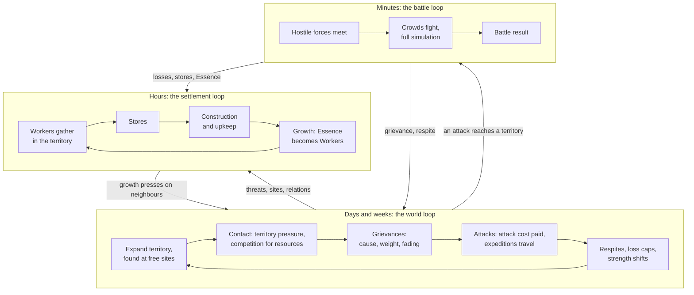
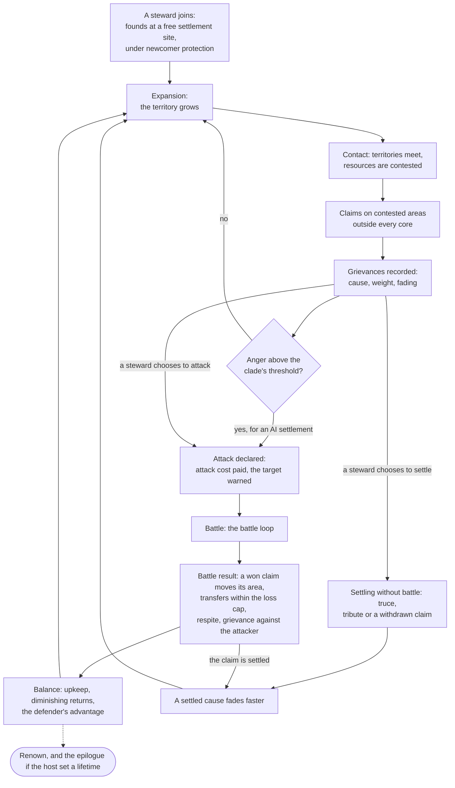
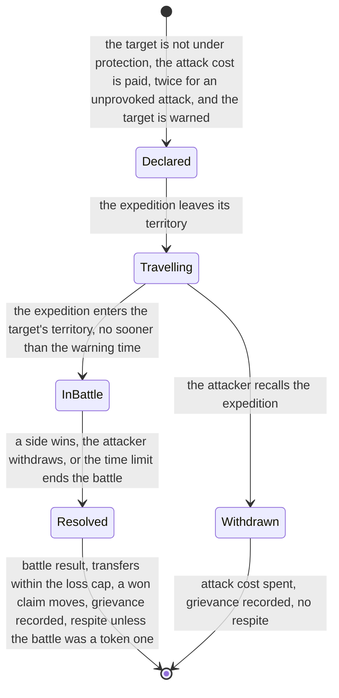
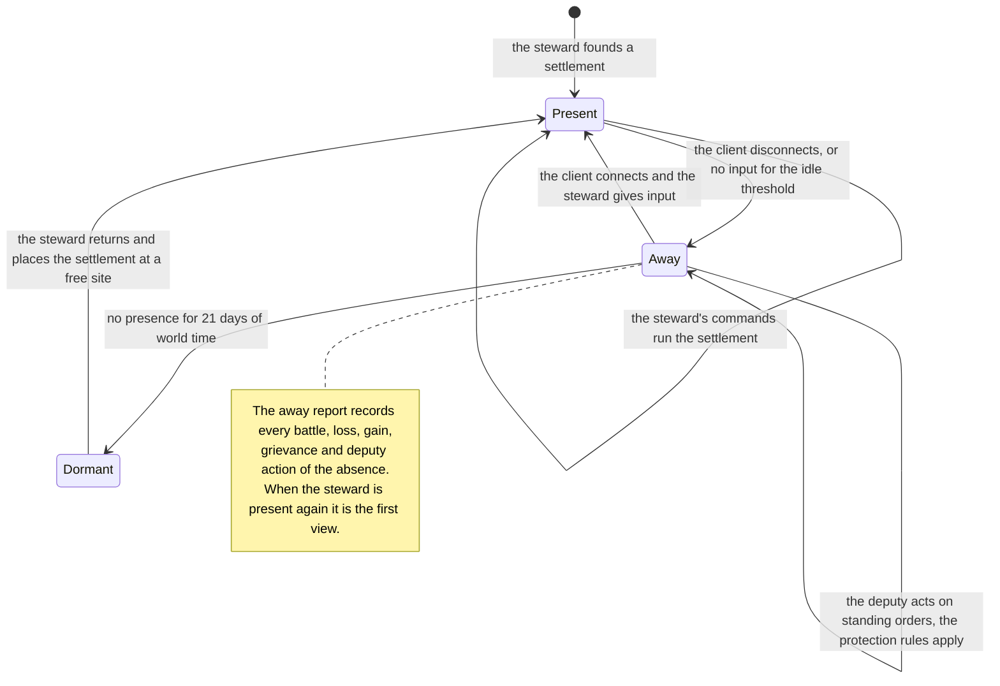
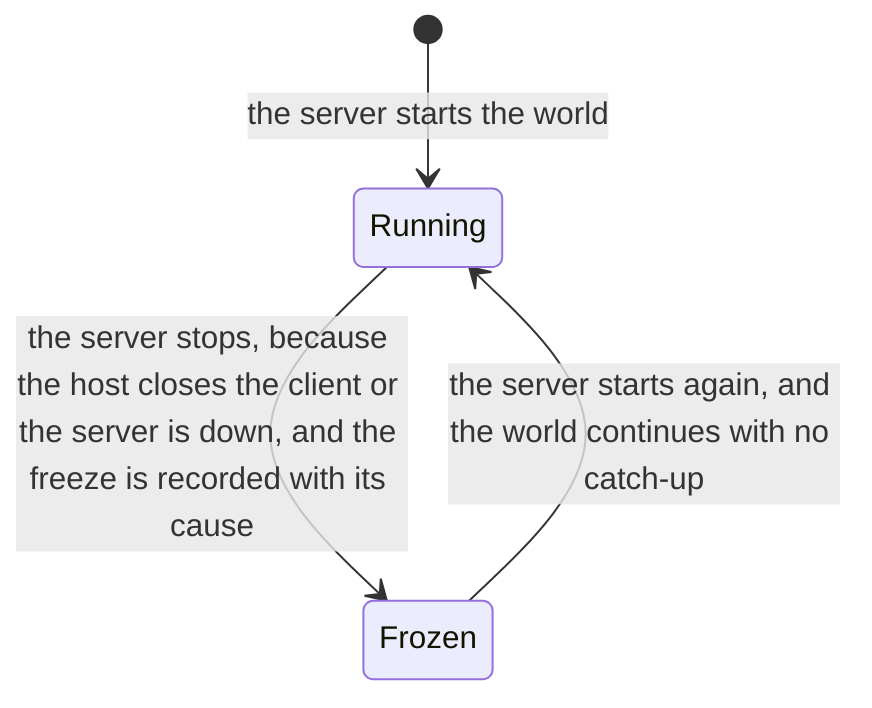
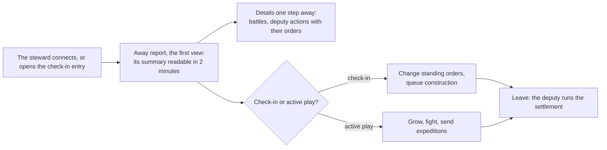

# Vision, pillars and core loops

> Status: Draft · Prefix: PIL · Rationale: `../rationale/A0.md` · Related: [vision brief](../../vision/species-vision-brief.md) · [owner decisions](../decisions/owner_decisions.md) · [reference overview](../reference/00_reference_overview.md) · [adoption ledger 00](adoption_ledger/00_reference_overview_ledger.md) · [GDD index](README.md) · [conventions](../CONVENTIONS.md)

## 1 Purpose and player experience

### 1.1 What this document decides

This document is the root of the Species game design. It states what Species is, the pillars that every later design choice serves, the core loops at three timescales, the session patterns and the audience, and the vocabulary of the world game. It binds every later area; the owner confirms or changes its pillars, its loops and its vocabulary at owner gate A.

It specifies no mechanic in full. Each loop names the area that owns its mechanics (§8), and every number in it is a target that the owning area meets with its own rules and tuning keys (§4). Where this document says that an area decides something, the behaviour is that area's to specify, inside the limits stated here.

### 1.2 Species in one paragraph

Species is a persistent, shared world of settlements on a server. Each settlement belongs to a clade and is run either by its steward, a player, or by AI. Its Workers act on their own: they gather, carry and build, they grow in number as Essence becomes new Workers, and they fight. The steward steers through Leaders, orders, priorities and standing orders, never figure by figure. Clades grow aggrieved for reasons a steward can see, and aggrieved clades attack. Battles are real-time crowd battles of hundreds of small glowing figures, and they always run as the full simulation. When a steward is away, the deputy runs the settlement on the steward's standing orders, the protection rules bound what the settlement can lose, and the steward comes back to a report of what happened. Beside the world, skirmish offers the reference crowd match on a small map, on the same server and netcode.

### 1.3 Player fantasy

**The steward of a living people.** The player never commands a soldier. They shape the will of a crowd (where it gathers, what it builds, whom it fears and whom it fights) and they come back to find that their people lived while they were gone.

| Timescale | Fantasy | What the player feels |
|---|---|---|
| Minutes: a battle | The crowd general | Hundreds of Workers pour into a fight; the steward bends the flow with Leaders, formations and a few special units, and reads the battle from the shape and the glow of the crowd |
| Hours: the settlement | The founder | A settlement grows from a Wellspring and a handful of Workers into a town with territory, stores, structures and defences, in steps the steward sees in every session |
| Days and weeks: the world | The neighbour with a memory | Clades remember what was done to them; a steward earns peace or provokes war, and every war has a reason on record |

*Table A — The player fantasy at the three timescales of the core loops (§2.5 to §2.7).*

### 1.4 Audience

| Segment | Who | What they need from Species | Stage and pace |
|---|---|---|---|
| Groups of friends and communities (first audience) | 2 to 16 people who know each other or share a community, on an integrated server or a community server (O1, O5) | A world they return to several times a week; battles they can fight together or against each other; absence that does not ruin them | Stage 1 at either pace (PIL-100), stage 2 always-on |
| Solo players | One steward in a world of AI settlements (O1) | Every loop with AI neighbours that behave for reasons they can read | Stage 1, session pace by default; always-on while the host keeps the world running (PIL-077) |
| Strategy players with bounded time | Players of colony building and real-time strategy with sessions of 30 to 120 minutes a few times a week, plus short check-ins | Progress in every session; a deputy they can trust between sessions, which needs an always-on world | Stage 1 always-on, stage 2 |
| Larger community worlds | Worlds of 50 to 200+ stewards (O1) | The same loops at a larger scale, which the architecture keeps possible without a rewrite | Stage 3, always-on |

*Table B — The audience of Species, first audience first, with the stage and the world pace (§2.10) that serve each segment.*

Species is not designed for players who want a competitive real-time strategy game measured in actions per minute, for players who want unbounded conquest of other players' settlements, or for players who want to play only from a phone: v1 has no companion application (O6; vision §7).

### 1.5 Session patterns

| Pattern | Presence | Typical length | What the steward does | What Species guarantees | Exists in |
|---|---|---|---|---|---|
| Active play | present | `pil.session.active_minutes` (30 to 120 minutes); the typical pattern is 60 minutes and 2 check-ins a day (PIL-102) | Reads the away report, grows the settlement, fights battles in person, sends expeditions, adjusts standing orders | A growth step at least every 20 minutes of a session early in a settlement's life (PIL-055); battles of 4 to 12 minutes (PIL-047) | Both paces, every stage |
| Check-in | present, briefly | `pil.session.check_in_minutes` (2 to 10 minutes) | Opens the check-in entry, reads the away report, changes standing orders, queues construction, leaves | The away report first, its summary readable in 2 minutes (PIL-073, PIL-141); every check-in action is a server API call (PIL-075) | Always-on worlds; in a session-paced world only while its host plays |
| Away | away | minutes to days; the design cases are 8 hours, 24 hours and 7 days, and dormancy after 21 days (PIL-074, PIL-078) | Nothing: the deputy runs the settlement on standing orders | The protection rules bound the loss (O2); after 8 or 24 hours the settlement regains its strength within 2 days at the typical pattern (PIL-022) | Always-on worlds: dedicated servers, and integrated worlds whose host keeps them running (PIL-077) |
| Frozen world | nobody | while the server is not running | Nothing can be done in the world | No world time passes, no catch-up simulation follows, and every steward's away report records the freeze (O4; PIL-076, PIL-131) | Every stage |

*Table C — The session patterns of the world game. Durations are world time at the always-on pace unless they say "of active play"; at the session pace the conversion of PIL-103 applies.*

A session-paced world runs only while its host plays, so in it the pattern "away" holds only for the other stewards, and only while the host's world runs (PIL-100, PIL-077).

### 1.6 Comparables and their lessons

Species borrows lessons from genres, never content. The rationale file names the titles behind each lesson.

| Genre | Lesson | Where Species applies it |
|---|---|---|
| Persistent online strategy games with attackable bases | A period of protection after an attack, protection for beginners and a cost to attacking are the norm; losses while offline are the most common reason players leave | The protection rules (O2; PIL-022, PIL-080; B6) |
| Survival sandboxes with raids on absent players | Protection that players can predict matters more than protection that is strong; losing everything overnight ends a player's interest | The loss cap and the respite are fixed and shown in advance (PIL-082; B6) |
| Colony and settlement simulations with autonomous inhabitants | Priorities beat orders to single inhabitants at population scale; players need to see why an inhabitant stands idle | Pillar 1 (PIL-010, PIL-020); C3 shows why a Worker is idle |
| Grand strategy games with opinion modifiers and justified wars | AI aggression reads as fair when every modifier shows its cause, its size and how it fades | Grievances (PIL-064; B5) |
| Games with delegated governors and managers | A delegate that is opaque erodes trust; a delegate that plays better than the player makes the player stay away | The order language and the away-yield band (PIL-023, PIL-083; B6, B2) |
| Seasonal and resetting worlds | A reset cures a runaway leader but erases investment; a world that never resets needs upkeep and a defender's advantage | The world lifetime is a setting, and pillar 6 holds without a reset (PIL-065, PIL-067) |
| Crowd battle games | Crowds read at a distance through simple shapes, colour and motion; bounded battle lengths keep sessions bounded | Pillar 5 (PIL-014); the battle length band (PIL-047) |

*Table D — Comparable genres and the lesson Species takes from each.*

### 1.7 How to read this document

- **World time and pace.** Every duration is world time, the time that passes while a world's server runs (O4). Targets are stated for the always-on pace; a world at the session pace converts them by PIL-103. "Of active play" counts only the time in which the steward is present; a guard is written in world time at a stated session pattern (PIL-102), never in a mix of the two clocks.
- **Targets, not timers.** The durations of §4 are experience targets that the design must meet. They are not simulation timers: an area that turns one into a rule writes its timer in ticks, through `ref.sim.tick_period`, under its own tuning key.
- **Guards.** Each pillar has a guard (§2.3), a measurable check that a model or a playtest runs at a named pace. A guard that fails means the pillar is at risk; the coordinator then re-opens the owning area or escalates to the owner.
- **New terms** are defined in §2.12. A term used before its definition there has the meaning that Table 3 gives it.

## 2 Rules

### 2.1 Forms of play and scope

**PIL-001** (MUST) Species has two forms of play: the **world game**, a persistent world of settlements that this design specifies, and **skirmish**, a short match on a small map that is separate from every world (O8). Both run on one server codebase, behind one transport interface, with the same netcode (O8, O10).

**PIL-002** (MUST) Skirmish runs the reference match loop as reference/00 states it: no build queue and no currency, an army that the held Spawn Nodes produce, autonomous Workers steered through crowd orders and Leaders, Supply crates and Power slots, and bots (R-VIS-001, R-VIS-002, R-VIS-004 to R-VIS-006; DEC-001). It is the first playable and the combat balance test bed (O8, O20): the crowd rules that B4 adopts for world battles are the rules that skirmish tests.

**PIL-003** (MUST) In v1, skirmish offers `pil.scope.skirmish_mode_count` (1) mode, Spawn Control (O8, O20). The other five reference modes stay specified in reference/01 as candidates for later stages, which B9 and the roadmap schedule; until a mode is scheduled, its rules, maps, options and complexity label are not built. The match options of skirmish are those of the modes it offers. A reference requirement that the ledger adapts to this requirement keeps binding the skirmish in its clauses for Spawn Control or for every mode, and its clauses for another mode wait until that mode is scheduled. Every skirmish map is authored new and carries no reference map name, shape or layout (DEC-063). B9 sets the skirmish map set, its player counts and, with A1, its population caps (DEC-866); B9 decides the tutorial of the first playable (DEC-123), and C5 specifies the tutorials of Species.

**PIL-004** (MUST) The world game replaces the reference loop's absence of a build queue and of a currency: its settlements gather resources, store them, build and maintain structures and grow, on top of essence-driven growth, in which deaths yield Essence orbs and Essence becomes new Workers (DEC-001, option B). B1 specifies growth and population, B2 the resources and the economy, and B3 construction.

**PIL-005** (MUST) The main page of the front end leads to the world game (joining a world, or hosting one) and to skirmish, beside the tutorials, the help and the options. C2 specifies the pages; the reference front end supplies the skirmish pages (R-VIS-171 to R-VIS-180, as C2 adopts them).

**PIL-006** (MUST) A player is the steward of at most `pil.scope.settlements_per_player` (1) settlement in a world (vision §1). A player may be a steward in several worlds, with one settlement in each.

**PIL-007** (MUST) Every settlement belongs to exactly one clade for its whole life, and is either run by its steward or is an AI settlement, which has no steward. In v1 every clade has the same rules, and clades differ in looks, colour and temperament only (O7); the data model gives each clade a place for the modifiers that B8 defines later (O7, O11).

**PIL-008** (MUST) A world has no team slots; this is how the world game maps O14 onto settlements. A steward who leaves a world, or is away, keeps the settlement, and the deputy runs it, as a bot takes over a leaver's team in skirmish. A place for a further steward is a free settlement site (PIL-068), and AI settlements populate the world from its start. B6 and C2 specify what happens to a settlement whose steward does not return (PIL-078).

**PIL-009** (MUST) The loops of this document work without the non-goals of v1 (vision §7): a web or mobile companion application, asymmetric clades, research and training content, official hosting, a client on a platform other than Windows, and modding support.

**PIL-110** (MUST) Each stage delivers at least the smallest world game of Table 10, which meets the pillars and guards named there; E3 schedules the first world-game milestone after the skirmish first playable (O20), and tests it with 1 and 4 stewards without capping the 2 to 16 of O1.

| Stage | Servers and pace | The smallest world game | Pillars and guards met |
|---|---|---|---|
| 1 Integrated | The in-process server in the host's client (O10); the session pace, and the always-on pace while the host keeps the world running (PIL-077) | The regions that A1 sizes for up to 16 stewards; AI settlements; the default standing orders plus the three priorities of PIL-052; grievances from territory pressure and attacks, with one way to ease them; claims on resource sites; the loss cap, the respite and the attack cost; the abstract model at its smallest (O3); the away report with the record of freezes (PIL-131); attacks between stewards off by default (PIL-063) | Pillars 1, 3, 4 and 5; pillar 2 at the always-on pace; pillar 6 without renown or a lifetime. Guards PIL-020, PIL-021, PIL-024 to PIL-027 and PIL-057; PIL-022 and PIL-023 at the always-on pace |
| 2 Community dedicated | Headless dedicated servers that communities run (O5); the always-on pace | Every rule of this document: the protection rules in full (defender's advantage, newcomer protection, dormancy), every cause of grievance, claims on border territory, renown, the world lifetime, and replays if A2's reproducibility allows them (PIL-140) | All six pillars and every guard, at 16 stewards |
| 3 Hosted large worlds | Official hosting, regions in separate processes (O1, O5) | The same rules at 50 to 200+ stewards | Every guard at 200 stewards |

*Table 10 — The smallest world game of each stage (PIL-110).*

### 2.2 Pillars

Species has six pillars. Pillars 1 to 5 are the vision's five, confirmed or revised with the case that Table 2 states; pillar 6 is new, and the owner confirms or rejects it at gate A.

**PIL-010** (MUST) **Pillar 1, Living crowds.** Workers act on their own, in battle and at home: they fight, gather, carry and build without an order per figure, and they re-plan as their surroundings change (B1 and B4 specify the task search, from reference/02's). The steward steers crowds through Leaders, crowd orders, settlement priorities and standing orders, never single Workers; direct control is kept for special units (C1, from reference/06's).

**PIL-011** (MUST) **Pillar 2, A world that runs while you are away.** The server owns the world; the world runs whenever its server runs and freezes when it stops (O4). Being away is a normal way to play: the deputy runs the settlement on standing orders, the protection rules bound what the settlement can lose (O2), and a steward who returns reads first what happened.

**PIL-012** (MUST) **Pillar 3, Conflict with a cause.** Clades and stewards come into conflict for reasons a steward can see: territory pressure, competition for resources, claims and past attacks. Every grievance shows its cause, its weight and how it fades; AI attacks are motivated by grievances or claims and never random; every attack has a cost and leaves a record, and an attack with no cause on record is named unprovoked and costs more (PIL-063); and a conflict can be settled (PIL-122; O2; B5). World events are hazards, not conflict, and follow PIL-049.

**PIL-013** (MUST) **Pillar 4, Delegation you can trust.** The deputy follows standing orders that its steward understands and can predict, acts only within them and only on what the settlement can see, and reports every action with the standing order that permitted it (B6, B7).

**PIL-014** (MUST) **Pillar 5, The reference style, a distinct game.** Species keeps the visual and audio language of the reference library: flat-shaded low-poly facets with additive glow on a black background, the darkening layer and black fog, crowds of small figures drawn as camera-facing sprite cards that scale with distance ([renderer visual language](../architecture/components/renderer/visual_language.md)), and sound that game events drive through the audio binding model (R-VIS-009). Every asset is newly authored, with Species' own silhouettes, textures, interface layout and logo, and nothing is traced, recoloured or edited from the reference game's art, audio or text (O9; vision §5). The strategic view is drawn in the same language. The two sides of every battle are distinguishable to every viewer at every zoom: in the strategic view a clade's colour is its identity, and in a battle the sides use a friend-and-foe palette, so that two settlements of one clade can fight readably; in skirmish a team's colour is one of the team colours of R-VIS-034. B5 and E2 set the clade colours, `pil.world.clade_count` (6) clades as a first guess, and the battle palette.

**PIL-015** (MUST) **Pillar 6, Always a way back** (new; the owner confirms it at gate A). A world stays open to everyone in it: no settlement becomes unassailable, a steward who joins late finds a place and a path to matter, and a lost battle is a setback, never the end of a settlement.

**PIL-016** (MUST) A design choice that falls under a "rules out" entry of Table 1 is rejected, or escalated to the owner with the pillar it breaks. The rationale of every later area names, for each of its significant choices, the pillar that the choice serves.

| Pillar | Rules in | Rules out | A design it rejects |
|---|---|---|---|
| 1 Living crowds | A task search for every Worker that covers fighting, gathering, carrying and building; crowd-scale verbs (gather and send, Leaders, formations); settlement priorities among gathering, construction and guard duty; crowds of hundreds in view; direct control of special units only | Assigning a job, a tool, a place or a target to one Worker; production queues in which the steward orders Workers one at a time (Workers come from essence-driven growth); screens of needs, equipment or inventory per figure | *A farm that waits for the steward to pick which three Workers tend it*; *a barracks that trains Workers one click at a time* |
| 2 A world that runs while you are away | Server authority; the deputy; the loss cap, respite, attack cost, defender's advantage and newcomer protection (O2); the away report; check-ins of minutes; world time as server uptime (O4) | Catch-up simulation after downtime (O4); a loss while away that the loss cap does not bound; play that requires presence at set times, such as a daily log-in window or an event that rewards only those online at a fixed hour; absence that pays better than presence (PIL-023) | *Settlements that lose a share of their stores for every hour their steward is offline*; *a nightly world event at a fixed hour that is worth a week of growth* |
| 3 Conflict with a cause | Grievances with a cause, a weight and a fading; anger thresholds set by temperament; claims that a battle or a settlement can resolve; a warning before every attack; an attack cost, doubled for an unprovoked attack; at least one way to ease anger that is not an attack; the grievance entry of every battle result | Aggression by a clade from a random draw or a hidden timer; an AI attack on a settlement against which the attacker's clade holds no grievance or claim; anger the steward cannot inspect; attacks that cost the attacker nothing; conflicts that no outcome can settle; grievances that Workers create by their own task choices | *Each night the AI picks a random settlement and raids it*; *an AI that always targets the weakest settlement in reach, whatever the history* |
| 4 Delegation you can trust | A small order language of priorities, limits and response rules (B6); safe default orders (PIL-079); hard limits; a complete audit trail in the away report; one AI for AI settlements and the deputy, under fog of war (B7; PIL-084) | A deputy that chooses its own goals; strategic actions without an explicit order (declaring attacks, changing relations, demolishing, spending past a limit); a deputy that sees what its settlement cannot; a deputy that plays better than an attentive steward (PIL-023) | *A governor AI that attacks a weak neighbour overnight because its scoring rated the raid profitable* |
| 5 The reference style, a distinct game | The renderer's visual language; the audio binding model (R-VIS-009); new art and audio; a strategic view in the same style; crowds readable at a distance; colour as the main identity cue | Traced, recoloured or edited reference art, audio or text (vision §5); the reference silhouettes, interface layout or logo; a second art style for the strategic view, such as a painted map, photoreal terrain or textured physically based materials | *A strategic map drawn as painted parchment with textured castles*; *Workers drawn as recoloured copies of the reference figures* |
| 6 Always a way back | Upkeep and diminishing returns that grow with size (B2); the defender's advantage (O2); respites; a Wellspring that no battle takes (PIL-080); free settlement sites for late joiners (PIL-068); newcomer protection; the world lifetime as a host setting, as one lever among several (PIL-067) | Unbounded compounding growth; removal of a steward from a world by another settlement; capturing or absorbing a settlement; first sites so much richer than later ones that the first week decides the world; a world that ends for everyone because one settlement leads | *Capturing a settlement's Wellspring absorbs its Workers and territory and ends its steward's game*; *yields that compound by a percentage every hour with no upkeep* |

*Table 1 — The pillars: what each rules in, what it rules out, and an example of a design it rejects (PIL-010 to PIL-016).*

| Pillar | Vision brief §2 | Species | The case for the change |
|---|---|---|---|
| 1 | Living crowds | Living crowds: autonomy extended from battles to settlement work; priorities and standing orders named as steering verbs | The world game adds gathering and construction. Without the extension, construction would drift into jobs assigned to single Workers, which the pillar exists to prevent |
| 2 | A world that keeps running | A world that runs while you are away | Read literally, the vision's name contradicts O4: a world freezes while its server is down, and in the integrated stage it runs only while the host's client runs. The new name states the promise exactly, and adds the return, the away report, which the vision's pitch implies |
| 3 | Conflict with a cause | Confirmed; binds stewards as well as clades; adds legibility, claims that conflicts can settle, at least one way to ease anger, and the cost of attacking | The vision's seed challenge 9 asks for a relations model that players can read and influence, and O2 asks for a cost to attacking; both belong to the pillar, not only to B5. A pillar that bound only the AI would let a steward's attack be the random aggression it forbids |
| 4 | Delegation you can trust | Confirmed; adds the audit trail and the information rule | Trust needs a record of what the deputy did and why (vision seed challenge 8) and a deputy that knows no more than its steward (vision §5) |
| 5 | The reference look and feel | The reference style, a distinct game | "Stays as it is" could be read as copying the reference look, which O9 and vision §5 forbid. The new wording states both halves of O9: the same visual and audio language, and every asset new (vision seed challenge 11) |
| 6 | (none) | Always a way back | Runaway leaders, late joiners and ruinous losses (vision seed challenges 1 and 2) are the most common ways persistent strategy worlds fail, and none of the five vision pillars rules on them. Without a pillar, B2, B5 and B6 would trade them away one rule at a time |

*Table 2 — How the pillars change from the vision brief, with the case for each change.*

### 2.3 Pillar guards

Each pillar has a guard: a measurable check that tells whether the design still meets the pillar, at a named world pace (§2.10) and session pattern (PIL-102). Most targets are first guesses; the owning area's model or a playtest confirms or retunes them (§4).

**PIL-020** (MUST) Guard of pillar 1: a settlement whose steward is present and gives no new order for `pil.guard.unattended_minutes` (60 minutes of world time) keeps gathering, finishes its queued construction and defends itself, and none of its Workers stands idle for want of an order addressed to that Worker. No settlement or battle command of the world game addresses one Worker, except promoting a Worker to a Leader, scrapping a unit (reference/06, as C1 adopts it) and the direct control of special units (C1); demoting a Leader addresses a Leader and is allowed.

**PIL-021** (MUST) Guard of pillar 1: a typical world battle shows `pil.battle.bodies_typical` (400) figures of both sides together, the vision's hundreds. If the scale budgets of A2 and B4 at owner gate B cannot afford at least `pil.battle.bodies_floor` (200), the pillar is at risk, and the conflict goes to the owner; A2's and B4's models report both values at 16 and at 200 stewards.

**PIL-022** (MUST) Guard of pillar 2, at the always-on pace: after an absence of `pil.session.away_short_hours` (8 hours) or `pil.session.away_day_hours` (24 hours) of world time, in which its settlement was attacked as often as the protection rules allow, a returning steward finds the settlement in the world with its Wellspring (PIL-080), and by playing the typical pattern (PIL-102) brings it back to its strength before the absence within `pil.guard.regain_days` (2 days) of world time. B6's protection rules and B2's economy model show it.

**PIL-023** (MUST) Guard of pillars 2 and 4, at the always-on pace: under the default orders (PIL-079) and a construction queue of `pil.guard.queue_hours` (8 hours), a steward who plays the typical pattern grows at least `pil.guard.presence_gain_share` (25 %) more per day of world time than one who checks in once a day, and the check-in steward grows at least `pil.guard.check_in_floor_share` (70 %) as much as the typical one (B2's model, at full fidelity; the abstract model is held to PIL-057). Presence pays through the decisions that only a present steward takes (placing and queueing construction, expansion and claims, founding, declaring attacks), through battles fought in person and through the aide; the deputy's own rate is an input of B2's model, and the deputy never plays better than its steward.

**PIL-024** (MUST) Guard of pillar 3: in playtest, at least `pil.guard.attack_cause_share` (80 %) of the stewards whose settlement was attacked name the cause of the attack correctly from what Species showed them.

**PIL-025** (MUST) Rule of pillar 3: an AI settlement attacks a settlement only while its clade holds a grievance against that settlement or a claim on its territory (PIL-120). Every attack, by an AI settlement or by a steward, warns its target at least `pil.conflict.warning_minutes` (10 minutes of world time) before the attacking expedition reaches the target's territory; while the steward is away, the warning goes to the deputy and into the away report (B5, B6).

**PIL-026** (MUST) Guard of pillar 4: in playtest, stewards predict the deputy's action correctly in at least `pil.guard.deputy_prediction_share` (80 %) of the scripted situations that B6 defines, and `pil.guard.deputy_report_share` (100 %) of the deputy's actions appear in the away report, each with the standing order that permitted it.

**PIL-027** (MUST) Guard of pillar 5: every asset of Species carries a record of its new authorship (E2). At each art milestone of E2, people allowed to see the reference game (the owner or counsel, outside the clean room) review the assets for likeness against the features that must differ (the Worker and Leader silhouettes, the structure silhouettes, the HUD layout and the logo), and the result is recorded in E2's asset manifest (O9; O13's legal check). The strategic view uses only the features of the renderer's visual language.

**PIL-028** (MUST) Guard of pillar 6, at the always-on pace: in B2's economy model, extended with B4's battle transfer, B5's choice of targets and A1's site richness, of a world of `pil.guard.check_steward_count` (16) stewards and its AI settlements, in which the strongest settlement plays an always-attacking strategy and every other one the typical pattern, the strongest settlement's strength (PIL-058) in week `pil.guard.check_world_week` (4) of world time is at most `pil.guard.leader_strength_ratio` (3) times the median settlement's strength (B2, B4, B5, A1).

**PIL-029** (MUST) Guard of pillar 6, at the always-on pace: a steward who founds a settlement in week `pil.guard.check_world_week` (4) of a world's life and plays the typical pattern reaches `pil.guard.late_joiner_strength_share` (50 %) of the median settlement's strength within `pil.guard.late_joiner_days` (3 days) of world time, and newcomer protection keeps the settlement from being attacked for the period that B6 sets, once per person per world (PIL-088; B6, A1).

### 2.4 Audience and the two forms of play

**PIL-030** (MUST) Every loop of the world game works for one steward in a world of AI settlements, and for 2 to 16 stewards with AI settlements (O1). No loop needs a second human to start, to progress or to end.

**PIL-031** (MUST) The first audience is groups of up to 16 stewards on an integrated server or a community server (O1, O5; Table B). A feature that serves only worlds of 50 to 200+ stewards is scheduled for the hosted stage (O1, O5), and nothing built for 2 to 16 stewards may block that tier (A2).

**PIL-032** (MUST) A world battle uses the verbs of skirmish (R-VIS-151 to R-VIS-161, as C1 adopts them) plus the world verbs that C1 adds, so that a player who can play skirmish can fight a world battle.

### 2.5 Minutes: the battle loop

**PIL-040** (MUST) A battle is a real-time crowd fight between hostile sides on a bounded battlefield. It always runs as the full crowd simulation, whether or not any steward watches it (O3), with the reference crowd rules of Workers, Leaders, formations, special units, creatures and hazards that B4 adopts.

**PIL-041** (MUST) A battle starts only when hostile forces meet: an expedition enters a settlement's territory, two hostile expeditions meet, or a world event that B4 defines brings hostile creatures into a territory (PIL-049). B4 specifies the triggers, the battlefield bounds, the reinforcements and the end conditions.

**PIL-042** (MUST) A battle at a settlement has an attacker and a defender. The defender fights with the defender's advantage inside its own territory (O2), which B4 and B6 specify.

**PIL-043** (MUST) Each side of a battle is commanded by its steward while the steward is present, with the verbs of PIL-032; by the deputy while the steward is away; and by the AI for an AI settlement. The deputy and the AI command with the information that their side can see (PIL-084).

**PIL-044** (MUST) A steward who becomes present during a battle takes command of their side from the tick at which their first command arrives, and the deputy stops commanding that side at that tick. A steward who becomes away during a battle hands the side to the deputy at once.

**PIL-045** (MUST) A battle moves bodies, Essence, damage and stores: the sides send in Workers, Leaders and special units, deaths leave Essence orbs, structures take damage, and stores can be taken. The net transfer of a battle to either side (stores, Workers and Essence together) is bounded by the loss cap that would apply to the losing side as a defender, whether that side attacked or defended, and Essence beyond the bound is lost to both sides. B1 and B4 specify who collects Essence within the bound, and B6 the loss cap (O2).

**PIL-046** (MUST) Every battle ends in a battle result that records the sides, the losses, the stores and the Essence that moved, the grievance that the battle created (B5) and the respite that started (B6). The battle result feeds the settlement loop (§2.6) and the world loop (§2.7), and it appears in the away report of every away steward on either side.

**PIL-047** (MUST) A battle lasts `pil.battle.typical_minutes` (4 to 12 minutes of world time) in `pil.battle.typical_share` (90 %) of battles, and never longer than `pil.battle.max_minutes` (20 minutes); B4's end conditions guarantee the maximum.

**PIL-048** (MUST) The failure states of the battle loop are bounded for both sides. A defender that loses keeps its settlement and loses no more than the loss cap allows (PIL-080; B6). An attacker that loses keeps its settlement and loses the dead of its expedition and the attack cost it paid; an attacker may withdraw, and its withdrawal ends the battle.

**PIL-049** (MUST) A world event (hostile creatures that the world brings into a territory, which B4 defines) is a hazard, not an attack: it is announced at least `pil.conflict.event_warning_minutes` (5 minutes of world time) before it reaches a territory, its losses count against the loss cap, it starts no respite, and its creatures belong to the Rogue faction, which in the world game holds no grievance and never wins (B4, B6).

### 2.6 Hours: the settlement loop

**PIL-050** (MUST) The settlement loop is the life of one settlement over hours of world time. Its Workers gather resources in its territory and carry them to its stores; the stores pay for construction and upkeep; structures raise what the settlement can hold, make and defend; and Essence becomes new Workers up to the settlement's population limit (B1, B2, B3).

**PIL-051** (MUST) The actors of the settlement loop are the settlement's Workers and Leaders, its structures and its Wellspring, and whoever runs it: its steward while present, the deputy while the steward is away, or the AI of an AI settlement.

**PIL-052** (MUST) The steward's settlement verbs are: set the priorities among gathering, construction and guard duty; place and queue construction; promote and direct Leaders; send expeditions; and set standing orders. No settlement verb assigns a job, a tool or a place to one Worker (PIL-020); C1 specifies the verbs.

**PIL-053** (MUST) The positive feedback of the settlement loop is growth: more Workers gather more, more stores build more, and more structures raise the limits. Its negative feedback is upkeep that rises with size, diminishing returns (B2), and the territory pressure that growth puts on neighbours, which creates grievances (B5); that pressure couples the settlement loop to the world loop.

**PIL-054** (MUST) The failure states of the settlement loop are decline, when upkeep exceeds income; a lost battle, which the loss cap bounds; and over-extension, when expeditions leave the settlement too thin to defend. Species shows each one to the steward, with its cause, before it turns into a loss (B2, C3).

**PIL-055** (MUST) At the always-on pace, a settlement whose steward plays the typical pattern (PIL-102) shows a growth step, such as a finished structure, a population milestone or a gain of territory, at least every `pil.settlement.growth_step_minutes` (20 minutes) of each session of active play during its first `pil.settlement.early_days` (10 days) of world time, and reaches the plateau of its growth no sooner than `pil.settlement.plateau_days` (14 days) of world time (B1, B2).

**PIL-056** (MUST) A settlement at peace grows: Essence has at least one source that needs no death in battle, so that growth never forces a settlement into war (pillar 3). B1 specifies the sources of Essence.

**PIL-057** (MUST) A settlement is watched while any client's settlement view covers part of its territory; the strategic view never makes a settlement watched. Over a day of world time and under the same orders, the abstract model's yield for a settlement is within `pil.guard.fidelity_yield_gap` (3 %) of the full simulation's, so that no steward gains by choosing, or by forcing on a rival, whether a settlement is watched (B2, D2).

**PIL-058** (MUST) A settlement's strength is its Workers, plus its stores at their construction value, plus its structures at their construction cost; B2 owns the weights, and every model and guard that compares settlements uses this one measure.

### 2.7 Days and weeks: the world loop

**PIL-060** (MUST) The world loop is the life of a world over days and weeks of world time. Settlements expand their territory and come into contact, compete for sites and resources, accumulate grievances, attack and defend, and the balance of strength between them shifts.

**PIL-061** (MUST) The actors of the world loop are every settlement, steward-run or AI; the clades, which hold grievances; the world host, who sets the world's settings and its lifetime; and the stewards who join late.

**PIL-062** (MUST) The world verbs are: found a settlement at a free settlement site; expand the territory; make or withdraw a claim (PIL-120); send expeditions to attack or to reinforce; ease a grievance by a way that is not an attack (PIL-064); and set standing orders before leaving. C1 specifies the verbs; B5 specifies attacks and the easing of grievances.

**PIL-063** (MUST) A steward may send an attack against any settlement that is not under protection (owner question Q3 at gate A). Every attack pays its attack cost when it is declared, and the defender's clade records a grievance against the attacker (O2; B5, B6). An attack with no cause on record (no grievance of the attacker's clade against the target and no claim on the target's territory) is an unprovoked attack: it costs `pil.conflict.unprovoked_cost_factor` (2) times the attack cost, it records a heavier grievance whose weight B5 sets, and the target's away report and the world's record name it as unprovoked. Attacks between stewards are a world setting, off by default in an integrated world and on by default on a dedicated server, and the join page shows it (PIL-130).

**PIL-064** (MUST) Every grievance shows its cause, its weight and how it fades. Anger, the sum of the grievances that a clade holds against a settlement, is visible to that settlement's steward, and B5 gives every steward at least one way to ease a grievance that is not an attack.

**PIL-065** (MUST) The world loop has three negative feedbacks against runaway growth that hold without any end of the world: upkeep and diminishing returns that grow with size (B2), the defender's advantage (O2), and claims that can reverse an early expansion (PIL-121). In a world in steady state at the always-on pace, from week 2 of world time on, a typical settlement takes part in `pil.world.battles_per_week` (2 to 10) battles per week of world time: below the band the world is static, and above it the world is at permanent war (B5).

**PIL-066** (MUST) World time is server uptime: the world loop advances only while the world's server runs, and the world is frozen while it does not (O4). Every duration of this document is world time unless it says "of active play".

**PIL-067** (MUST) A world has a lifetime that the world host sets, with a default and with unlimited allowed; A1 sets the default and what happens when a lifetime ends. Pillar 6 holds whether or not a world ends (PIL-065).

**PIL-068** (MUST) A steward can join a world at any point of its life and found a settlement at a free settlement site. A1 keeps at least as many free settlement sites as the world has places for further stewards, and never fewer than `pil.world.free_sites_min` (2).

**PIL-069** (MUST) No settlement captures, absorbs or removes another settlement (PIL-080); a world in which one settlement leads goes on until its lifetime ends.

**PIL-120** (MUST) Territory pressure and competition for resources between two settlements create a claim: a named contested area, either a resource site or a border area of territory outside a settlement's core, that one settlement holds and the other claims (A1, B5).

**PIL-121** (MUST) A battle that the claimant wins moves the claimed area to the claimant, within the loser's loss cap; a truce or tribute, if B5 defines them, or the claimant's withdrawal of the claim settles it without a battle. A settlement's core, the territory around its Wellspring that A1 and B1 size, is never claimable (PIL-080), and claimed and held areas pay upkeep (B2), so that claiming every border costs more than it yields.

**PIL-122** (MUST) A grievance whose cause has been removed, by a settled claim, a truce, a withdrawal or the end of territory contact, fades `pil.conflict.settled_fade_factor` (4) times faster than one whose cause remains. B5 gives every conflict between two settlements an end state: a settled claim, a truce or a faded grievance.

**PIL-123** (MUST) Guard of pillars 3 and 6, at the always-on pace: in B5's relations model, at least `pil.guard.conflict_resolution_share` (60 %) of the conflicts between two neighbouring settlements reach an end state within `pil.guard.conflict_resolution_days` (7 days) of world time.

**PIL-124** (MUST) A grievance arises only from a settlement-level action (an expansion, a claim, an expedition or an attack) of a steward, a deputy or an AI settlement, never from a Worker's own choice of task, so that pillar 1's autonomy never starts a war that nobody chose.

**PIL-125** (SHOULD) From stage 2, a world SHOULD keep a public standing of its settlements by renown, earned by defences held, grievances eased, claims settled and structures raised and never by stores taken, and SHOULD show an epilogue of the standing and of each settlement's history when its lifetime ends (A1, B5, C2; DEC-047).

### 2.8 Presence, sessions and the deputy

**PIL-070** (MUST) A steward's presence is either present or away. A steward is present while their client is connected to the world and they have given input within the idle threshold that B6 sets; at every other time they are away.

**PIL-071** (MUST) While the steward is present, the steward's commands run the settlement, and the deputy acts only within the standing orders that the steward has left active for present play; a command of the steward always takes precedence over the deputy.

**PIL-072** (MUST) While the steward is away, the deputy runs the settlement under the standing orders, and the protection rules apply (O2; B6).

**PIL-073** (MUST) A steward who becomes present after an absence sees the away report first: the battles and their results, the losses and the gains, the construction finished, the grievances recorded, and every deputy action with the standing order that permitted it. The steward reads its summary within `pil.session.report_read_minutes` (2 minutes), and the details are one step away (B6, C3).

**PIL-074** (MUST) Species is designed for the session patterns of Table C: active play of `pil.session.active_minutes` (30 to 120 minutes), check-ins of `pil.session.check_in_minutes` (2 to 10 minutes), and absences of `pil.session.away_short_hours` (8 hours), `pil.session.away_day_hours` (24 hours) and `pil.session.long_absence_days` (7 days) of world time as the design cases of the protection rules, at the always-on pace; a session-paced world converts them by PIL-103.

**PIL-075** (MUST) In v1 a check-in happens in the game client (O6), and every action of a check-in (reading the away report and the settlement status, changing standing orders, queueing construction) is a server API call that a later companion can make without a change to the server (O6; D6).

**PIL-076** (MUST) While a world is frozen nothing in it changes: no world time passes, and no timer of the world game advances, respites, loss-cap windows and the fading of grievances included. When the server runs again, the world continues from the state in which it stopped, with no catch-up simulation (O4).

**PIL-077** (MUST) In the integrated stage a world runs only while its world host's client runs it (O4, O10). A session-paced world runs while its host plays. A host may keep an always-on world running while not playing: the client stays open with its presentation suspended (no rendering and no audio, with an icon that shows the world is running), and closing the client freezes the world (owner question Q5 at gate A). A steward who plays in another steward's integrated world plays while that world runs and sees it frozen otherwise (C2, D1).

**PIL-078** (MUST) After an absence of `pil.session.long_absence_days` (7 days) a settlement stays in the world under the deputy and the protection rules, with any further protection for a long absence that B6 sets. After `pil.session.dormancy_days` (21 days) of world time without presence it becomes dormant: it leaves the map with its stores and structures kept, its site and territory become free, and its deputy stops. A steward who returns places it again at a free settlement site, under a respite (owner question Q4 at gate A; B6, C2).

**PIL-079** (MUST) A steward who sets no standing order has the default orders: defend the settlement, keep gathering, finish the queued construction, and never attack. B6 specifies the default set in full.

**PIL-140** (SHOULD) The away report SHOULD offer a replay of each battle of the absence, at up to `pil.report.replay_speed_max` (8) times speed, with the deputy's decisions marked on its timeline and each tied to the standing order that permitted it; A2 (reproducibility, DEC-240, DEC-241), D3 and D4 decide its feasibility and its cost.

**PIL-141** (MUST) The client offers a check-in entry that opens the away report and the standing-order editor without loading the settlement view, through the same server API calls that a later companion makes (PIL-075; C2, C3, D6).

### 2.9 Safety floor and fair information

**PIL-080** (MUST) No battle removes a settlement from the world. A settlement's Wellspring can be neither destroyed nor captured, and a settlement that loses a battle keeps at least the floor of Workers, stores and structures that B6's loss cap sets; dormancy (PIL-078) is the only way a settlement leaves the map, and it keeps the settlement (owner question Q4 at gate A).

**PIL-081** (MUST) A steward leaves a world only by their own choice or by the world host's moderation (D5); no action of another settlement removes a steward from a world.

**PIL-082** (MUST) The protection rules that apply to a battle are fixed when the battle starts. A change of presence during the battle changes who commands the side (PIL-044), never the loss cap or the other protection rules that apply to the battle (B6).

**PIL-083** (MUST) The deputy never declares an attack, except as a response that a standing order names explicitly; never changes relations (any truce, tribute or alliance that B5 defines); never demolishes or abandons a structure; and never spends past a limit that a standing order sets. When no standing order covers a situation, the deputy follows the default orders (PIL-079).

**PIL-084** (MUST) AI settlements, the deputy and the aide play under the same information rules as a steward: they act only on what their settlement can see, under fog of war (vision §5; B7, D9). The perfect information of the reference bots binds skirmish only (R-VIS-006).

**PIL-085** (MUST) Both forms of play advance in ticks of `ref.sim.tick_period`, whose rate A2 decides for both (DEC-227). The world game has no pause and no change of game speed: no steward, deputy, AI or effect stops or speeds world time, so the Time Dilation and Time Rush outcomes never act in a world (B4), and only a stopped server freezes a world (O4). Skirmish keeps its game-speed effects and its pause rule (R-VIS-163).

**PIL-086** (MUST) Protection may be stronger while a steward is away than while the steward is present only so far as the growth that the absence costs (PIL-023) outweighs the protection it gains. In B6's protection model at the always-on pace, an attacker's expected net gain from an attack on an away settlement is at most `pil.guard.away_target_premium` (1.2) times its gain from the same attack while the steward is present. B6 chooses the levers, among them a defence bonus while away, a smaller loss cap while away, and daily defence windows outside which stewards cannot attack each other.

**PIL-087** (MUST) A respite starts only after a battle that cost the defender at least the minimum loss that B6 sets; never after a battle that ended within `pil.battle.min_respite_minutes` (2 minutes) of its start; and never after an attack withdrawn before its battle, so that a friendly token attack cannot give a settlement protection (B6).

**PIL-088** (MUST) Newcomer protection and any catch-up that B2 or B6 gives a new settlement apply once per person per world: a steward who leaves a world and joins it again founds without them. D5 supplies the identity that makes a person, and a second account of a person, recognisable.

### 2.10 World pace

**PIL-100** (MUST) A world runs at one of two world paces. The **always-on pace** is for a world whose server keeps running whether or not anyone plays: a dedicated server, or an integrated world that its host keeps running (PIL-077). The **session pace** is for an integrated world that runs only while its host plays. World time is server uptime at both paces, and nothing is caught up (O4).

**PIL-101** (MUST) At the session pace, the timers of the economy, of relations and of protection (growth, gathering, construction, upkeep, the fading of grievances, claims, respites, loss-cap windows, newcomer protection and dormancy) advance `pil.pace.session_factor` (12) times faster per hour of world time than at the always-on pace. Battles, travel and the movement of Workers run at the tick rate at both paces. B2, B5 and B6 apply the factor to their timers; A1 sizes travel so that a session-paced world still meets PIL-025.

**PIL-102** (MUST) The typical pattern is `pil.session.typical_active_minutes` (60 minutes) of active play and `pil.session.typical_check_ins` (2) check-ins per real day; the check-in pattern is one check-in per real day. Guards and targets that name a pattern use these.

**PIL-103** (MUST) Every target of §4 is stated for the always-on pace. At the session pace, a target in world time of the settlement loop, the world loop or the protection rules is divided by `pil.pace.session_factor`; a battle target, and a target in minutes of active play, is unchanged. B2 and B5 run their models at both paces.

**PIL-104** (MUST) A world's pace is chosen when the world is created and is fixed for its life; a world on a dedicated server is always-on. The join page and the world show the pace (PIL-130).

### 2.11 The world host of an integrated world

In an integrated world the world host is also a steward who competes, with control of the world's clock and of its save. These rules bound that conflict in stage 1.

**PIL-130** (MUST) The join page of a world and the world itself show who its world host is, its pace, whether attacks between stewards are on (PIL-063), and the hours it ran in each of the last `pil.host.running_history_days` (7) days, so that a steward in another time zone sees when the world is alive before joining (C2).

**PIL-131** (MUST) Every freeze of a world is recorded with its cause and its world time, and appears in the away report of every steward of the world.

**PIL-132** (MUST) Closing the client of an integrated world while a battle runs in it, or while an expedition is inside its warning time of the host's own settlement, asks the host for confirmation, and the freeze is recorded as a freeze during a battle or during a warning in every steward's away report (C2, D1).

**PIL-133** (MUST) A world save carries a record that makes a restored or edited save visible to every steward when they next join, from stage 1 on; D4 and D9 specify the record.

### 2.12 Vocabulary and the reference baseline

**PIL-090** (MUST) Every Species document uses the terms of Table 3 with the meanings given there, and the identifiers and string-id prefixes of its columns. The mechanics of each term belong to the areas that its Mechanics column names. CONVENTIONS §8 and the glossary register the terms once owner gate A has confirmed them.

**PIL-091** (MUST) Where a reference term would mislead in the world game, Species documents use the Species term that Table 4 gives: a settlement's player is its steward, never its owner; the person who runs a world's server is the world host, never an operator; the protection period after an attack is a respite, never a shield; a world's span is its lifetime, never a season; construction is done by Workers, never by builders; and a people of Species is a clade (owner question Q2 at gate A).

**PIL-092** (MUST) The reference library is the specification of record for every reference requirement that Species keeps (DEC-005). The reference values are the starting baseline of every requirement that the ledger adopts or adopts for skirmish (O13, DEC-004); an adapted requirement starts from them only where its area says so, under Species keys; and a reference behaviour that looks accidental stays an explicit rule with a named key (DEC-006).

Table 3 gives each new term one meaning. Identifiers follow `AGENTS.md` §1 in the `Species` namespace (CONVENTIONS §8); a dash means no type of its own, or one that the owning area names. String-id prefixes are dotted data names (CONVENTIONS §8); the new roots are `aide`, `battle`, `clade`, `deputy`, `expedition`, `presence`, `protection`, `region`, `relation`, `report`, `settlement`, `skirmish`, `view` and `world`, none of which is an asset stem, a tuning-key root, a setting group or a schema family. The trademark screen checks each term against well-known game titles and game trademarks as general knowledge; a registry search in the target markets is still required before a commercial release, and it covers the product name too: a creature-evolution simulation released on PC in 2018 carries the word Species in its title.

| Species term | Kind | Meaning | Identifier | String-id prefix | Mechanics | Trademark screen |
|---|---|---|---|---|---|---|
| world | world game | One persistent, shared game on one server: its terrain, regions, settlement sites, settlements, clades and world time. The spatial sense of "world" in the reference (world units, world cursor, world markers) keeps its meaning | `World` (not `MatchWorld`, the world of a skirmish match) | `world` | A1 (shape), A2 (simulation) | generic |
| world game | form of play | The persistent-world form of play (PIL-001) | — | — | A0 | generic |
| skirmish | form of play | The short match on a small map, separate from every world, that runs the reference match rules (O8; PIL-002) | `Skirmish` | `skirmish` | B9 | generic |
| region | world game | A fixed part of a world's area: the unit of the world's simulation partitioning (vision §5) and of the strategic view; it holds settlement sites | `Region` | `region` | A1, A2 | generic |
| settlement site | world object | A place in a region where a settlement can be founded; it is free while no settlement stands on it | `SettlementSite` | `settlement.site` | A1 | generic |
| world time | world game | The time of a world, which passes only while its server runs (O4); every world-game duration is world time | `WorldTime` | — | A2 | generic |
| frozen | world game | The state of a world whose server is not running: nothing in it changes and no world time passes (O4). Skirmish's grace-period hold is "held" in player-facing text, never frozen | `WorldState::Frozen` | `world.frozen` | A2, D1 | generic |
| world pace | world game | How much the economy, relations and protection advance per hour of world time, fixed at a world's creation: the always-on pace or the session pace (PIL-100, PIL-101) | `WorldPace` (`WorldPace::AlwaysOn`, `WorldPace::Session`) | `world.pace` | A0, B2, B5, B6 | generic |
| world lifetime | world game | How long a world runs, in world time, before it ends: a world-host setting with a default, and unlimited is allowed. Not a season: that word belongs to the seasonal theme | — (a setting; A1 names its key) | `world.lifetime` | A1 | generic |
| world host | role | The person or community that runs a world's server: the player whose client runs an integrated world, or the administrator of a dedicated server | — | `world.host` | D1, D5 | generic |
| integrated server | server | A world's server running inside the world host's game client, behind the same transport interface as a dedicated server (O10) | `ServerMode::Integrated` | — | A2, D1 | generic |
| dedicated server | server | A world's server running as its own headless process (O5, O10); a community server is a dedicated server that a community runs | `ServerMode::Dedicated` | — | A2, D1 | generic |
| settlement | world game | A community of Workers and Leaders of one clade, with its Wellspring, structures, stores and territory, run by its steward or by AI | `Settlement` | `settlement` | B1 | generic word; a well-known game series is titled after the people who settle, so no title or label of Species uses that form |
| Wellspring | world object | The structure at a settlement's founding point that turns Essence into new Workers; no battle destroys or captures it (PIL-080). B1 decides whether it is built on the Spawn Node | `Wellspring` | `building.wellspring` | B1, B3, B6 | generic noun; no game title known |
| territory | world game | The area that a settlement holds around its Wellspring, where its Workers gather and its defences stand | `Territory` | `settlement.territory` | A1, B1 | generic |
| core | world game | The territory around a settlement's Wellspring that no claim can take (PIL-121) | `SettlementCore` | `settlement.core` | A1, B1 | generic |
| founding | world game | Creating a settlement at a free settlement site, with its Wellspring and its first Workers | — (a player command; C1 names it) | `settlement.founding` | B1, C2 | generic |
| steward | role | The player who runs a settlement; a settlement has at most one steward (PIL-006, PIL-007) | `Steward` | `settlement.steward` | B6, C2 | generic |
| AI settlement | world game | A settlement with no steward, which the AI runs under a steward's information rules (PIL-084) | `SettlementControl::Ai`, beside `SettlementControl::Steward` | `settlement.ai` | B7 | generic |
| strength | world game | A settlement's Workers, plus its stores at their construction value, plus its structures at their construction cost: the one measure that models and guards compare (PIL-058) | `SettlementStrength` | — | B2 | generic |
| watched | world game | A settlement is watched while any client's settlement view covers part of its territory; the strategic view never makes it watched (PIL-057) | — | — | B2, D2 | generic |
| dormant | world game | The state of a settlement whose steward has not been present for 21 days: it is off the map, with its stores and structures kept (PIL-078) | `SettlementState::Dormant` | `settlement.dormant` | B6, C2 | generic |
| expedition | world game | A group of a settlement's Workers and Leaders, with any special units, sent beyond its territory to attack, to reinforce or to gather; it travels through the world and fights as a crowd | `Expedition` | `expedition` | B4, B5, C1 | generic noun; a game series puts the plural at the head of its titles, so no title of Species uses the word |
| clade | relations | A people of Species, which the vision brief calls a race: its settlements share its looks, its colour and its temperament, and every clade has the same rules in v1 (O7) | `Clade` | `clade` | B5 | a word of biology; no game title known |
| temperament | relations | The AI personality of a clade: how fast it angers, how it weighs each cause, and how it answers anger | `Temperament` | `clade.temperament` | B5, B7 | generic |
| grievance | relations | One recorded cause of anger that a clade holds against a settlement: its cause (territory pressure, competition for resources, an attack, or a further cause that B5 lists), its weight and how it fades | `Grievance` | `relation.grievance` | B5 | generic |
| territory pressure | relations | The cause of grievance that arises when the territories of two settlements meet, or when they compete for the same resources | `GrievanceCause::TerritoryPressure` | — | B5, A1 | generic |
| anger | relations | The sum of the grievances that a clade holds against one settlement; above the threshold that the clade's temperament sets, the clade's AI settlements may attack that settlement | `Anger` | `relation.anger` | B5 | generic |
| relations | relations | The standing between a clade and a settlement, derived from grievances, in the states that B5 defines | `Relation` | `relation` | B5 | generic |
| truce (reserved) | relations | An agreement that suspends attacks between two parties for a time; B5 decides whether it exists | `Truce` | `relation.truce` | B5 | generic |
| tribute (reserved) | relations | Stores paid to a clade to ease a grievance; B5 decides whether it exists | `Tribute` | `relation.tribute` | B5 | generic |
| claim | relations | A contested area, a resource site or a border area outside a settlement's core, that one settlement holds and another claims; a battle won by the claimant moves it (PIL-120, PIL-121) | `Claim` | `relation.claim` | B5, A1 | generic |
| unprovoked attack | relations | An attack with no grievance of the attacker's clade against the target and no claim on record; it costs more and is named (PIL-063) | — | `battle.unprovoked` | B5 | generic |
| renown | relations | The standing a settlement earns by defences held, grievances eased, claims settled and structures raised, never by stores taken (PIL-125) | `Renown` | `world.renown` | B5, C2 | generic |
| attack | world game | Sending an expedition to fight at another settlement, from its declaration to its battle result; prose says attack, and the code names the declared world attack | `AttackDeclaration` | `battle.attack` | B5, B4 | generic |
| world event | battle | A hazard that the world brings into a territory, such as hostile creatures of the Rogue faction; it is not an attack (PIL-049) | `WorldEvent` | `world.event` | B4 | generic |
| battle | battle | A real-time crowd fight between hostile sides on a bounded battlefield, always run as the full simulation (O3) | `Battle` | `battle` | B4 | generic |
| battlefield | battle | The bounded area in which a battle runs | `Battlefield` | `battle.field` | B4 | generic |
| battle result | battle | The record that ends a battle: its sides, its losses, the stores and the Essence that moved, the grievance it created and the respite it started | `BattleResult` | `battle.result` | B4, B6 | generic |
| protection rules | protection | The rules that make an absence safe (O2): the loss cap, the respite, the attack cost, the defender's advantage and newcomer protection | — | `protection` | B6 | generic |
| loss cap | protection | The most that a settlement can lose to attacks in a window of world time while its steward is away (O2) | `LossCap` | `protection.loss_cap` | B6 | generic |
| respite | protection | A period of world time during which a settlement cannot be attacked: after an attack it suffered, and after its founding; the vision brief's shield period (O2). Not Shield, the Supply crate outcome that protects a crowd | `Respite` | `protection.respite` | B6 | generic |
| attack cost | protection | What an attack costs its attacker, paid when the attack is declared (O2) | `AttackCost` | `protection.attack_cost` | B5, B6 | generic |
| defender's advantage | protection | The edge that a settlement has when it fights inside its own territory (O2) | `DefenderAdvantage` | `protection.defender_advantage` | B4, B6 | generic |
| newcomer protection | protection | The protection of a newly founded settlement: its founding respite and any further limit that B6 sets | `NewcomerProtection` | `protection.newcomer` | B6 | generic |
| deputy | delegation | The AI that runs a settlement for its steward while the steward is away, within the standing orders and on what the settlement can see | `Deputy` | `deputy` | B6, B7 | generic |
| standing order | delegation | A rule that the steward gives the deputy and that stays in force until the steward changes it: a priority, a limit or a response rule | `StandingOrder` | `deputy.order` | B6, C1 | generic |
| away report | delegation | The account that a returning steward reads first: what happened while they were away, with every deputy action and the standing order that permitted it | `AwayReport` | `report.away` | B6, C3 | generic |
| aide | delegation | The AI role that helps a present steward with routine work on request: the third role of the one AI, beside AI settlements and the deputy (B7). Not Advisor, a name of the Dropped decision entries (CONVENTIONS §8.13) | `Aide` | `aide` | B7 | generic |
| presence | session | Whether a steward is present or away (PIL-070); it decides who runs the settlement | `StewardPresence` (not `Presence`, the field presence of the data schemas) | `presence` | B6 | generic |
| present | session | The presence of a steward whose client is connected to the world and who has given input within the idle threshold | `StewardPresence::Present` | `presence.present` | B6 | generic |
| away | session | The presence of a steward at every other time; the vision brief's AFK | `StewardPresence::Away` | `presence.away` | B6 | generic |
| check-in | session | A short visit to a world to read the away report, adjust standing orders and queue construction (O6), through the check-in entry of the client (PIL-141) | — | `presence.check_in` | B6, C2, D6 | generic |
| full fidelity | simulation | Simulating a settlement's day-to-day economy as the full crowd simulation; battles always run at full fidelity (O3) | `Fidelity::Full` | — | B2, D2 | generic |
| abstract fidelity | simulation | Simulating the day-to-day economy of a settlement that nobody watches by the abstract model (O3), within the gap of PIL-057 | `Fidelity::Modeled` | — | B2, D2 | generic |
| strategic view | view | The world drawn at strategic zoom: regions, settlements, territories and expeditions, in the reference visual language (O9) | `StrategicView` | `view.strategic` | A1, C1, D8 | generic |
| settlement view | view | The close view of one settlement and its battles, with the reference camera | `SettlementView` | `view.settlement` | C1 | generic |

*Table 3 — The vocabulary of the world game: one meaning per term, its identifier, its string-id prefix, the area that owns its mechanics and its trademark screen (PIL-090).*

| Term | Its meaning in the reference | Its use in the world game |
|---|---|---|
| Worker | The basic unit, a small soldier with a laser and grenades | A settlement's inhabitant: it gathers, carries, builds and fights; B1 and B4 specify what it does in the world |
| Leader | A promoted Worker that serves as a Waypoint beacon or leads a formation | The steering unit of battles and expeditions (B4, C1) |
| Essence orb | The orb that a dead unit leaves | The stuff of growth: Essence becomes new Workers at the Wellspring (B1) |
| Builder | The unit that carries Essence orbs to a Spawn Node | Keeps its reference meaning; construction is done by Workers, and no document calls them builders |
| operator | The Worker in a structure's port | Keeps its meaning; the person who runs a world's server is the world host |
| host | The participant whose process holds a session | In the world game, the world host |
| owner | The team that owns a structure in a match | A settlement's player is its steward; in the design documents, "the owner" is the product owner who takes the owner decisions |
| Shield | The Supply crate outcome that protects a crowd for 300 ticks | Keeps its meaning; the protection period after an attack is a respite |
| seasonal theme | The optional seasonal look of a match | Keeps its meaning; a world's span is its lifetime |
| Bot | A computer opponent in a match | Skirmish only; in the world game the AI runs AI settlements, the deputy and the aide |
| team, team slot, match | The sides and the frame of a reference match | Skirmish only; the world game has settlements, clades and world time (PIL-008) |
| alliance | Two teams sharing a colour family in co-op | Skirmish; B5 decides whether settlements can ally in the world game |
| population cap | A team's limit on bodies in a match | Skirmish; B1 names the limit of a settlement |
| Rogue faction | The hostile bot faction of a match | In the world game, the owner of the creatures of world events; it holds no grievance and never wins (PIL-049) |
| held | The world held during a match's grace period | Skirmish's player-facing word for the hold; frozen names only a world whose server is not running |
| Time Dilation, Time Rush | Supply crate outcomes that change game speed | Skirmish only; nothing changes game speed in a world (PIL-085) |

*Table 4 — Reference terms whose use changes in the world game (PIL-091).*

## 3 States and flows

### 3.1 The three loops and how they couple

*Figure 1 — The core loops at three timescales: the battle loop sits inside the settlement loop, which sits inside the world loop. Growth presses on neighbours, the world's grievances bring battles, and every battle result feeds both outer loops (PIL-040 to PIL-069).*

| Loop | Actors | Verbs | What flows | Feedback that closes the loop | Failure state | Owning areas |
|---|---|---|---|---|---|---|
| Battle (minutes) | The Workers, Leaders, special units and structures of each side; the steward, deputy or AI that commands each side | The skirmish verbs plus the world verbs (PIL-032): gather and send, promote and direct Leaders, select and drive special units, place powers, withdraw | Bodies sent in; deaths into Essence orbs; damage to structures; stores, Workers and Essence moved within the loser's loss cap (PIL-045) | The battle result: losses and gains into the settlement loop, grievance and respite into the world loop (PIL-046) | Bounded: a defender keeps its settlement and loses no more than the loss cap; an attacker loses its dead and the attack cost (PIL-048) | B4, C1, B6 |
| Settlement (hours) | The settlement's Workers, Leaders, structures and Wellspring; its steward, its deputy or its AI | Set priorities; place and queue construction; promote and direct Leaders; send expeditions; set standing orders (PIL-052) | Resources from territory to stores; stores into construction and upkeep; Essence into new Workers up to the population limit | Growth raises gathering and limits; upkeep, diminishing returns and territory pressure push back (PIL-053) | Decline, a lost battle, over-extension, each shown with its cause before it becomes a loss (PIL-054) | B1, B2, B3, C1 |
| World (days and weeks) | Every settlement; the clades; the world host; late joiners | Found; expand; make or withdraw claims; send expeditions to attack or reinforce; ease grievances; set standing orders (PIL-062) | Territory and claims; grievances with cause, weight and fading; respites; renown; world time | Contact creates claims and grievances, which bring attacks; a won claim moves its area and a settled cause fades faster (PIL-121, PIL-122); upkeep, diminishing returns and the defender's advantage stop runaways (PIL-065); renown is the standing a steward aims at (PIL-125) | A static world, permanent war, endless conflicts, a runaway leader, a world with no room for newcomers or full of abandoned settlements; the guards of PIL-028, PIL-029, PIL-065 and PIL-123 and dormancy (PIL-078) answer each | A1, B2, B5, B6 |

*Table 5 — The three loops: their actors, verbs, flows, feedback and failure states.*

### 3.2 The battle loop

*Figure 2 — The battle loop: hostile forces meet, each side is commanded by whoever runs it, deaths feed Essence back into the fight, and the battle result feeds the outer loops and the away reports (PIL-040 to PIL-048).*

### 3.3 The settlement loop

*Figure 3 — The settlement loop: priorities steer the Workers, stores pay for construction and upkeep, structures raise the limits, and Essence becomes Workers; growth presses on the neighbours, and upkeep above income leads to decline (PIL-050 to PIL-056).*

### 3.4 The world loop

*Figure 4 — The world loop: expansion brings contact, contact creates claims and grievances, anger above a threshold brings AI attacks, stewards attack or settle by choice, a won claim moves its area, settled causes fade faster, and the balancing feedbacks keep the world open (PIL-060 to PIL-069, PIL-120 to PIL-125).*

### 3.5 Attack lifecycle

*Figure 5 — The life of an attack, from its declaration to its battle result. B5 specifies the declaration, the attack cost and claims, B4 the travel and the battle, and B6 the warning, the protection checks and the respite (PIL-025, PIL-045, PIL-046, PIL-063, PIL-087).*

### 3.6 Presence and world state

*Figure 6 — A steward's presence and the dormancy of the settlement: present while connected and active, away otherwise, with the deputy and the protection rules in charge while away, and dormant after 21 days without presence (PIL-070 to PIL-073, PIL-078).*

*Figure 7 — A world's state: it runs while its server runs and is frozen otherwise; no world time and no timer advances while it is frozen, and every freeze appears in every steward's away report (PIL-066, PIL-076, PIL-077, PIL-131).*

### 3.7 A return to the world

*Figure 8 — A return: the away report comes first, then a check-in or a session of active play, and the deputy takes over again when the steward leaves (PIL-073 to PIL-075).*

## 4 Tuning table

These values are experience targets in world time at the always-on pace, not simulation timers (§1.7); a session-paced world converts them by PIL-103. An area that turns one into a rule writes the rule's timer in ticks under its own tuning key. Provisional values are first guesses that the named model or playtest confirms or retunes.

| key | value | unit | status | requirement | DEC | playtest note |
|---|---|---|---|---|---|---|
| `pil.scope.skirmish_mode_count` | 1 | modes in the v1 skirmish | final | PIL-003 | DEC-001 | — |
| `pil.scope.settlements_per_player` | 1 | settlements per steward per world | final | PIL-006 | — | — |
| `pil.pace.session_factor` | 12 | times the always-on rate of the economy, relations and protection timers | provisional | PIL-101, PIL-103 | — | B2's and B5's models at both paces: 12 brings a host who plays 2 hours a day to the plateau in 14 real days |
| `pil.session.typical_active_minutes` | 60 | minutes of active play per real day | provisional | PIL-102 | — | Playtest session logs |
| `pil.session.typical_check_ins` | 2 | check-ins per real day | provisional | PIL-102 | — | Playtest session logs |
| `pil.session.active_minutes` | 30–120 | minutes of a session of active play | provisional | PIL-074 | — | Playtest session logs |
| `pil.session.check_in_minutes` | 2–10 | minutes of a check-in | provisional | PIL-074 | — | Playtest of the check-in entry |
| `pil.session.report_read_minutes` | 2 | minutes to read the away report's summary | provisional | PIL-073 | — | C3 usability test |
| `pil.session.away_short_hours` | 8 | hours of world time | final | PIL-022, PIL-074 | — | — |
| `pil.session.away_day_hours` | 24 | hours of world time | provisional | PIL-022, PIL-074 | — | B6's protection model across time zones |
| `pil.session.long_absence_days` | 7 | days of world time | provisional | PIL-074, PIL-078 | — | B6's protection model |
| `pil.session.dormancy_days` | 21 | days of world time without presence | provisional | PIL-078 | — | B6 and C2: returns after 21 days |
| `pil.guard.unattended_minutes` | 60 | minutes of world time | provisional | PIL-020 | — | Playtest: queued construction, no new order, camera moving; no Worker idle for want of an order |
| `pil.guard.regain_days` | 2 | days of world time at the typical pattern | provisional | PIL-022 | — | B2's economy model with B6's loss cap |
| `pil.guard.queue_hours` | 8 | hours of queued construction | provisional | PIL-023 | — | B2's model; B3 may cap the queue |
| `pil.guard.presence_gain_share` | 25 | % more growth per day at the typical pattern than at the check-in pattern | provisional | PIL-023 | — | B2's model; playtest: whether play feels worth it |
| `pil.guard.check_in_floor_share` | 70 | % of the typical pattern's growth for the check-in pattern | provisional | PIL-023 | — | B2's model |
| `pil.guard.attack_cause_share` | 80 | % of attacked stewards who name the cause | provisional | PIL-024 | — | Playtest survey after attacks |
| `pil.guard.deputy_prediction_share` | 80 | % of correct predictions | provisional | PIL-026 | — | Playtest with B6's scripted deputy situations |
| `pil.guard.deputy_report_share` | 100 | % of deputy actions in the away report | final | PIL-026 | — | — |
| `pil.guard.check_steward_count` | 16 | stewards in the modelled world | final | PIL-028 | — | — |
| `pil.guard.check_world_week` | 4 | week of world time | provisional | PIL-028, PIL-029 | — | B2's economy model; repeat at week 8 |
| `pil.guard.leader_strength_ratio` | 3 | times the median settlement's strength | provisional | PIL-028 | — | The joint model of B2, B4, B5 and A1 |
| `pil.guard.late_joiner_strength_share` | 50 | % of the median settlement's strength | provisional | PIL-029 | — | B2's model; playtest with a late joiner |
| `pil.guard.late_joiner_days` | 3 | days of world time at the typical pattern | provisional | PIL-029 | — | B2's model; playtest with a late joiner |
| `pil.guard.away_target_premium` | 1.2 | times an attacker's expected net gain against the same settlement with its steward present | provisional | PIL-086 | — | B6's protection model at 16 stewards across 3 time zones |
| `pil.guard.fidelity_yield_gap` | 3 | % difference in a day's yield between the abstract model and the full simulation | provisional | PIL-057 | — | B2's calibration of the abstract model (D2) |
| `pil.guard.conflict_resolution_share` | 60 | % of conflicts between neighbours that reach an end state | provisional | PIL-123 | — | B5's relations model |
| `pil.guard.conflict_resolution_days` | 7 | days of world time | provisional | PIL-123 | — | B5's relations model |
| `pil.battle.bodies_typical` | 400 | figures in a typical battle, both sides together | provisional | PIL-021 | — | A2's and B4's battle budgets at owner gate B, at 16 and 200 stewards |
| `pil.battle.bodies_floor` | 200 | figures, both sides together, below which pillar 1 is at risk | provisional | PIL-021 | — | A2's and B4's battle budgets at owner gate B |
| `pil.battle.typical_minutes` | 4–12 | minutes of world time | provisional | PIL-047 | — | B4's battle model, then playtest |
| `pil.battle.typical_share` | 90 | % of battles | provisional | PIL-047 | — | B4's battle model, then playtest |
| `pil.battle.max_minutes` | 20 | minutes of world time | provisional | PIL-047 | — | Playtest; B4's end conditions enforce it |
| `pil.battle.min_respite_minutes` | 2 | minutes from a battle's start | provisional | PIL-087 | — | B6's protection model with token attacks |
| `pil.settlement.growth_step_minutes` | 20 | minutes of a session of active play | provisional | PIL-055 | — | B1's and B2's growth curves, then playtest |
| `pil.settlement.early_days` | 10 | days of world time at the typical pattern | provisional | PIL-055 | — | B2's growth curves |
| `pil.settlement.plateau_days` | 14 | days of world time | provisional | PIL-055 | — | B2's economy model at the typical pattern |
| `pil.world.battles_per_week` | 2–10 | battles per settlement per week of world time, from week 2 | provisional | PIL-065 | — | B5's relations model at 16 and 200 stewards |
| `pil.world.free_sites_min` | 2 | free settlement sites in a world | provisional | PIL-068 | — | A1's world-density model |
| `pil.world.clade_count` | 6 | clades in a world | provisional | PIL-014 | — | B5 and E2: colour families that read as distinct on black |
| `pil.conflict.warning_minutes` | 10 | minutes of world time before arrival | provisional | PIL-025 | — | B5 and B6, against A1's travel times |
| `pil.conflict.unprovoked_cost_factor` | 2 | times the attack cost | provisional | PIL-063 | — | B5's relations model and playtest |
| `pil.conflict.event_warning_minutes` | 5 | minutes of world time before a world event arrives | provisional | PIL-049 | — | B4 and B6 with A1's travel times |
| `pil.conflict.settled_fade_factor` | 4 | times the fading rate of a grievance whose cause remains | provisional | PIL-122 | — | B5's relations model |
| `pil.host.running_history_days` | 7 | days of running hours on the join page | provisional | PIL-130 | — | C2 usability test of the join page |
| `pil.report.replay_speed_max` | 8 | times real speed | provisional | PIL-140 | — | C3 usability test; A2 and D4 measure the replay cost |

## 5 Edge cases, exploits and interactions

| Situation | Behaviour | Requirements | Mechanics |
|---|---|---|---|
| A steward becomes present during a battle at their settlement | The steward commands the side from the tick at which their first command arrives; the deputy stops commanding it at that tick | PIL-044 | B4, B6 |
| Exploit: a defender disconnects during a battle to bring the protection rules of an absence into play | The protection rules of a battle are fixed when it starts; the disconnection only hands the side to the deputy | PIL-082 | B6 |
| Exploit: an attacker times attacks for the hours in which a defender sleeps, in another time zone | The loss cap and the respite bound the cost, and an attacker gains at most 1.2 times as much from an away target; B6 may add defence windows | PIL-022, PIL-086 | B6 |
| A steward stays connected but gives no input | After the idle threshold the steward is away, and the deputy runs the settlement under the protection rules | PIL-070, PIL-072 | B6 |
| A steward stays away to keep the protection of an absence | A priced choice: any extra protection of an absence is paid for by the growth the absence costs | PIL-023, PIL-086 | B2, B6 |
| Exploit: a settlement under respite attacks others without risk | The protection rules decide whether attacking ends the attacker's own respite; no settlement attacks from a protection that makes it immune to the answer | PIL-063, PIL-082 | B6 |
| Exploit: several settlements attack one settlement in turn | The respite after the first attack protects the defender, and the loss cap counts every attack in its window | PIL-022, PIL-080 | B6 |
| Exploit, feeding: a steward, or a second account, sends Workers to die at a friend's settlement so the friend collects their Essence | The friend gains at most what the loss cap of the losing side allows; the rest of the Essence is lost to both; D5 makes a second account recognisable | PIL-045, PIL-088 | B1, B4, B6, D5 |
| Exploit, respite gifting: a friend makes a token attack to give a settlement a respite before an enemy arrives | No respite after a battle shorter than 2 minutes, after one that cost the defender less than B6's minimum loss, or after a withdrawn attack | PIL-087 | B6 |
| The winner of every battle collects both sides' Essence and snowballs | The transfer is bounded by the loser's loss cap, and the leader guard runs with battle transfer in the model | PIL-045, PIL-028 | B1, B2, B4 |
| Exploit: a steward who falls behind leaves the world and joins again as a newcomer | Newcomer protection and any catch-up apply once per person per world | PIL-088 | B6, D5 |
| A strong settlement farms a weak neighbour for stores | Every attack pays its attack cost, twice when unprovoked, and records a grievance; the respite and the loss cap bound the take | PIL-063, PIL-080 | B5, B6 |
| A strong settlement claims every border around it | Claimed and held areas pay upkeep, and every claim's battle needs an attack cost, so over-claiming costs more than it yields | PIL-121 | B2, B5 |
| A claimant wins the battle for a claimed resource site | The site moves to the claimant within the loser's loss cap; the grievance's cause is removed and it fades 4 times faster | PIL-121, PIL-122 | A1, B5 |
| A settlement keeps growing without limit | Upkeep and diminishing returns grow with size, the defender's advantage protects its targets, claims can reverse an early expansion, and the guard of PIL-028 measures the gap | PIL-028, PIL-065, PIL-121 | B2, B4, B5 |
| A late joiner founds next to the strongest settlement | Newcomer protection covers the new settlement for B6's period, and A1 places free settlement sites | PIL-029, PIL-068 | A1, B6 |
| A steward stops playing for good | After 21 days the settlement becomes dormant, leaves the map with its stores and structures, and frees its site; a return places it again at a free site | PIL-078 | B6, C2 |
| The world host closes an integrated world while other stewards play | The world freezes for everyone, their clients show it frozen, and every away report records the freeze | PIL-077, PIL-131 | C2, D1 |
| Exploit: the world host closes the client to stop a battle or an attack on the host's settlement | The client asks for confirmation, and the freeze is recorded as a freeze during a battle or a warning in every steward's away report | PIL-132 | C2, D1 |
| Exploit: the world host copies the save before a battle and restores it after a loss | The restored save is visible to every steward when they next join | PIL-133 | D4, D9 |
| A steward in another time zone joins a session-paced world | The join page shows the world's pace and its running hours of the last 7 days before the steward joins | PIL-104, PIL-130 | C2 |
| A dedicated server stops in the middle of a battle | The battle freezes with the world and continues when the server runs again; no timer advances meanwhile | PIL-076 | A2, D1, D4 |
| Exploit: an expedition approaches a settlement whose economy runs at abstract fidelity | The battle runs at full fidelity; the hand-over between fidelities neither creates nor destroys stores, Workers or Essence (O3) | PIL-040, PIL-057 | B2, D2 |
| Exploit: a steward chooses, or forces on a rival, the fidelity that pays better | Watched is defined by settlement views only, and the two models' yields differ by at most 3 % | PIL-057 | B2, D2 |
| Two settlements of one clade fight | The sides use a friend-and-foe palette in the battle, so they are distinguishable at every zoom | PIL-014 | B5, E2 |
| The deputy meets a situation that no standing order covers | The deputy follows the default orders: defend, keep gathering, finish queued construction, never attack | PIL-079, PIL-083 | B6 |
| A standing order would need the deputy to declare an attack | The deputy declares one only as a response that a standing order names explicitly | PIL-083 | B6 |
| An AI settlement or the deputy could gain from information outside its settlement's view | It acts only on what its settlement can see; the server never gives it more | PIL-084 | B7, D9 |
| A clade whose settlements are all steward-run holds a grievance | The grievance is recorded and shown; only AI settlements attack on anger, and stewards decide for their own settlements | PIL-025, PIL-064 | B5 |
| Workers of two settlements gather in the same field | No grievance arises from the Workers' choices; only the settlements' expansion or claims create one | PIL-124 | B5 |
| A solo steward closes the client of an integrated world | The world freezes; at the session pace nothing was due while the steward was gone, and an always-on world that its host keeps running continues instead | PIL-030, PIL-077, PIL-100 | C2, D1 |
| A world with an unlimited lifetime | Upkeep, diminishing returns, the defender's advantage and claims keep the world open without a reset | PIL-065, PIL-067 | A1, B2 |
| Hostile creatures of a world event reach a settlement whose steward is away | The event was announced 5 minutes ahead; the deputy commands the defence; the losses count against the loss cap, and no respite follows | PIL-049, PIL-072 | B4, B6 |
| Settlements could gain Essence only from deaths | Not allowed: Essence has a source that needs no death in battle, so that growth never forces war | PIL-056 | B1 |
| A skirmish player presses pause, or a Supply crate changes game speed | Skirmish keeps both; the world game has neither | PIL-085 | B4, B9, C1 |
| The world host of a dedicated server changes a settlement through admin tools or an edited save | D9 specifies the trust model of community servers and what a steward sees of a host's action (vision seed challenge 10) | PIL-081, PIL-133 | D1, D9 |

*Table 6 — Edge cases, exploits and interactions of the pillars and the loops.*

## 6 Acceptance criteria

| Id | Given | When | Then | Requirements |
|---|---|---|---|---|
| AC-01 | The v1 build | A player opens skirmish | It offers Spawn Control and no other mode, with the reference match rules | PIL-002, PIL-003 |
| AC-02 | The main page of the front end | The player opens it | It leads to the world game, to skirmish, to the tutorials, to help and to the options | PIL-005 |
| AC-03 | A steward with a settlement in a world | The steward tries to found a second settlement in that world | The server refuses the command | PIL-006 |
| AC-04 | A world | Its settlements are listed | Each belongs to exactly one clade and is either steward-run or an AI settlement | PIL-007 |
| AC-05 | A present steward whose settlement has queued construction, and who moves the camera throughout so that they stay present | No order is given for 60 minutes of world time | The Workers keep gathering, the queue is finished, attacks are fought, and no Worker stands idle for want of an order addressed to it | PIL-010, PIL-020 |
| AC-06 | The command set of the world game | Every command is listed | None addresses one Worker, except promotion to a Leader, scrapping a unit and the direct control of special units; demoting a Leader addresses a Leader | PIL-020, PIL-052 |
| AC-07 | A battle in a region that no client watches | It runs | Server telemetry shows it at full fidelity for its whole length | PIL-040 |
| AC-08 | A battle whose defending steward is away | The steward connects and gives a command | The command applies from the tick at which it arrives, and the deputy issues no command for that side from that tick | PIL-043, PIL-044 |
| AC-09 | At least 100 world battles from B4's model or a playtest | Their lengths and sizes are measured | At least 90 % last 4 to 12 minutes, none lasts longer than 20, and a typical battle shows 400 figures | PIL-021, PIL-047 |
| AC-10 | A settlement attacked as often as the protection rules allow during an 8-hour absence, and again during a 24-hour absence | Its steward returns and plays the typical pattern | The settlement and its Wellspring are in the world, and B2's model shows its strength regained within 2 days of world time | PIL-022, PIL-080 |
| AC-11 | B2's model at the always-on pace, with the default orders and an 8-hour queue | A steward at the typical pattern and one at the check-in pattern are simulated for a day | The typical steward grows at least 25 % more, and the check-in steward at least 70 % as much | PIL-023, PIL-102 |
| AC-12 | A steward who becomes present after an absence | The client connects | The away report is the first view, and it lists every deputy action with the standing order that permitted it | PIL-026, PIL-073 |
| AC-13 | A deputy whose standing orders name no attack response | A neighbouring settlement is left undefended | The deputy declares no attack | PIL-079, PIL-083 |
| AC-14 | An AI clade that holds no grievance against a settlement and no claim on its territory | Its AI settlements choose targets | None of them attacks that settlement | PIL-025 |
| AC-15 | An attack by an AI settlement, and an attack by a steward | Each expedition sets out | The target's steward, or the deputy and the away report while the steward is away, is warned at least 10 minutes before the expedition reaches the target's territory | PIL-025 |
| AC-16 | An attack declared by a steward with no grievance or claim against the target | It is declared | It pays twice the attack cost, records a grievance of the defender's clade against the attacker, and is named unprovoked in the target's away report | PIL-063 |
| AC-17 | Any grievance | A steward inspects it | Its cause, its weight and how it fades are shown, and at least one way to ease it that is not an attack is offered | PIL-064 |
| AC-18 | A world whose server stops for 3 hours | The server runs again | World time continues from the stop; no respite, loss-cap window or grievance has advanced; no catch-up runs; the freeze is in every away report | PIL-066, PIL-076, PIL-131 |
| AC-19 | An integrated world with two stewards | The world host closes the client | The other steward sees the world frozen, and nothing changes until the host's client runs it again | PIL-077 |
| AC-20 | A steward who disconnects during a battle at their settlement | The battle continues | The protection rules that apply to it are those fixed at its start | PIL-082 |
| AC-21 | Any battle, of any result | It ends | No settlement has left the world and no Wellspring has been destroyed or captured | PIL-048, PIL-069, PIL-080 |
| AC-22 | An AI settlement or a deputy, with a settlement outside its view | Its decisions are logged | No decision uses state outside what its settlement can see | PIL-084 |
| AC-23 | A running world | A steward, an AI or a Supply crate outcome tries to pause it or change its game speed | No such command or effect exists in the world game | PIL-085 |
| AC-24 | A check-in | It is made through the check-in entry | The away report and the standing-order editor open without the settlement view, and every action is a server API call that works without the game client | PIL-075, PIL-141 |
| AC-25 | A world with one steward and AI settlements | A session of active play runs | Battles, settlement growth and grievances all occur, and none needs a second human | PIL-030 |
| AC-26 | Playtest of B6's scripted deputy situations | Stewards predict the deputy's action, then watch it | At least 80 % of predictions are correct | PIL-026 |
| AC-27 | Playtest after attacks | The attacked stewards are asked for the cause | At least 80 % name it correctly | PIL-024 |
| AC-28 | The joint model of B2, B4, B5 and A1 for 16 stewards, the strongest always attacking | It reaches week 4 of world time | The strongest settlement's strength is at most 3 times the median | PIL-028, PIL-058 |
| AC-29 | A steward who founds in week 4 and plays the typical pattern | 3 days of world time pass | The settlement reaches 50 % of the median strength, and no attack reached it during newcomer protection | PIL-029 |
| AC-30 | B5's relations model of a world in steady state | Weeks 2 to 6 of world time are simulated | A typical settlement takes part in 2 to 10 battles per week, and at least 60 % of conflicts between neighbours end within 7 days | PIL-065, PIL-123 |
| AC-31 | A world at any point of its life | Its free settlement sites are counted | They are at least the places for further stewards, and at least 2 | PIL-068 |
| AC-32 | A settlement at peace for a day of world time | Its Essence income is measured | It is above zero without any death in battle | PIL-056 |
| AC-33 | The Species documents of waves B to E | The design check and review H3 run | They use the terms of Table 3 with its meanings, and the terms of Table 4 as it states | PIL-090, PIL-091 |
| AC-34 | Every asset of the asset manifest at an art milestone | Its provenance and the likeness review are checked | It is newly authored, the review's result is recorded, and the strategic view uses only the renderer's visual-language features | PIL-014, PIL-027 |
| AC-35 | A world battle and a skirmish match | A player uses the battle verbs in each | Every skirmish verb works in the world battle | PIL-032 |
| AC-36 | B6's protection model at 16 stewards across 3 time zones | Attackers choose their targets | The expected net gain from an attack on an away settlement is at most 1.2 times that on the same settlement with its steward present | PIL-086 |
| AC-37 | A session-paced world whose host plays 1 hour | Growth, grievance fading and respites are measured | They advance as 12 hours do at the always-on pace, while a battle runs at the tick rate | PIL-100, PIL-101 |
| AC-38 | A world being created, and its join page | The host picks a pace, and later tries to change it | The pace is fixed; the join page shows the host, the pace, the attack setting and the last 7 days' running hours | PIL-104, PIL-130 |
| AC-39 | An integrated world with a battle running | The host closes the client | Confirmation is asked, and every steward's away report records a freeze during a battle | PIL-132 |
| AC-40 | A world save restored from a copy | A steward joins | The steward is shown that the save was restored | PIL-133 |
| AC-41 | A steward who sends 300 Workers to die at a friend's settlement | The battle ends | The friend's net gain is no more than the loss cap of the losing side allows | PIL-045 |
| AC-42 | A token attack that ends after 1 minute, and an attack withdrawn before its battle | Each ends | No respite starts | PIL-087 |
| AC-43 | A steward who leaves a world and joins it again | They found a settlement | It has no newcomer protection and no catch-up | PIL-088 |
| AC-44 | A world event | It sets out towards a territory | It is announced at least 5 minutes ahead, its losses count against the loss cap, and no respite follows it | PIL-049 |
| AC-45 | A battle between two settlements of one clade | It is watched at every zoom | The two sides are distinguishable | PIL-014 |
| AC-46 | B2's calibration of one settlement over a day under the same orders | It is run at both fidelities | The yields differ by at most 3 % | PIL-057 |
| AC-47 | A claim on a resource site | The claimant wins its battle | The site moves within the loser's loss cap, the settlement's core does not, and the grievance fades 4 times faster | PIL-120, PIL-121, PIL-122 |
| AC-48 | A settlement whose steward is not present for 21 days of world time | The 21st day ends | It is dormant and off the map with its stores and structures, its site is free, and a return places it at a free site | PIL-078 |
| AC-49 | Two settlements whose Workers gather in one field | Their task choices are logged | No grievance is recorded until a settlement-level action creates one | PIL-124 |

*Table 7 — Acceptance criteria. Criteria AC-09 to AC-11, AC-26 to AC-30, AC-36 and AC-46 are met by a model or a playtest; the others are tests of the build.*

## 7 Adoption from the reference

This document owns the adoption ledger of the reference overview, [00_reference_overview_ledger.md](adoption_ledger/00_reference_overview_ledger.md), which holds the verdicts by section and the exception rows. Almost every requirement of the reference overview restates a rule that another reference document owns (CONVENTIONS §3). Where a requirement of this document commits the world game to such a rule, the restatement is adapted into that requirement; the other restatements bind the skirmish summary only (`adopt-skirmish`), and what the world game does with the underlying rule is the verdict of the owning document's ledger. Where an owning area's verdict comes to differ from a row here, that area sends the row change to A0.

| Scope | Verdict | Species requirements | What changes and why |
|---|---|---|---|
| reference/00 §2.1, the core loop and its baseline | adopt-skirmish | PIL-002, PIL-004 | The reference loop is the skirmish loop; the world game replaces "no build queue and no currency" (DEC-001, option B) |
| R-VIS-003, R-VIS-090 | adapt | PIL-010 | Crowd autonomy and crowd steering become pillar 1, for the world game and skirmish alike |
| R-VIS-007 | adapt | PIL-092 | The reference values are the baseline of the adopted requirements only; adapted ones move to Species keys |
| R-VIS-008 | adapt | PIL-014, PIL-027 | The visual language becomes pillar 5; battles use a friend-and-foe palette, and the 8 team colours bind skirmish only |
| R-VIS-009 | adopt | — | The audio binding model serves the world game and skirmish as written |
| §2.2 and §2.3, modes, maps and player counts | adapt | PIL-003 | One skirmish mode in v1 (O8, O20); B9 sets the map set; every map is new (DEC-063) |
| R-VIS-011, R-VIS-017, R-VIS-022, R-VIS-026, R-VIS-027 | adopt-skirmish | — | Spawn Control, the match-clock minute, square maps, unlisted development maps and remapped start positions, as written |
| R-VIS-005, R-VIS-034, R-VIS-054, R-VIS-066, R-VIS-067, R-VIS-081, §2.15, R-VIS-142, R-VIS-173 | adapt | PIL-003 | Clauses for Spawn Control or for every mode bind the skirmish; clauses for other modes wait until each is scheduled |
| R-VIS-050 | adapt | PIL-085 | One tick for both forms, its rate A2's (DEC-227); no game-speed change in the world |
| §2.8 and §2.13, orders, combat and Leaders | adapt | PIL-010, PIL-032, PIL-040 | World battles use the same crowd rules and verbs as skirmish, as B4 and C1 adopt them; R-VIS-072, which ties combat to the Spawn Node loop, stays `adopt-skirmish` |
| §2.17, the player's verbs | adapt | PIL-032, PIL-085 | The same verbs in world battles; R-VIS-162 (ready) and R-VIS-163 (pause) stay `adopt-skirmish`, because a world has neither |
| §2.4 to §2.7, §2.9 to §2.12, §2.14, §2.16 and §2.18 | adopt-skirmish | — | Restatements that bind the skirmish summary; the world game takes the owning documents' verdicts (PIL-049 for the Rogue faction, PIL-084 for AI information) |
| R-VIS-170 | adapt | PIL-005 | The main page also leads to the world game |
| R-VIS-174 | adapt | PIL-003 | The reference tutorials run on Zone Control maps; B9 (DEC-123) and C5 decide whether Species keeps, re-authors or replaces them |

*Table 8 — The adoption of reference/00, mirrored from the ledger: 1 requirement adopted, 60 adopted for skirmish, 51 adapted, none dropped.*

## 8 Dependencies

**Areas.** Every later area starts from this document; the table gives what each takes and what it owes back.

| Area | Takes | Owes back |
|---|---|---|
| A1 | World, region, site, territory, core, claims, lifetime, strategic view (PIL-067, PIL-068, PIL-120) | Free sites; travel times that meet PIL-025 and PIL-049 at both paces; the default lifetime; core size |
| A2 | One server and one tick for both forms (PIL-001, PIL-085); world time, freezes, paces (PIL-066, PIL-076, PIL-100); fidelities; fair information (PIL-084) | Battle budgets for PIL-021; reproducibility for PIL-140; the scale path (PIL-031) |
| B1 | Workers as inhabitants; Wellspring and core; Essence growth (PIL-004, PIL-045, PIL-056) | Growth steps and plateau (PIL-055); the population limit |
| B2 | Upkeep, diminishing returns (PIL-053, PIL-065, PIL-121); fidelities (PIL-057); strength (PIL-058); the session factor (PIL-101) | The models of PIL-022, PIL-023, PIL-028 (with B4, B5, A1), PIL-029 and PIL-057, at both paces |
| B3 | Construction by Workers (PIL-091); the Wellspring structure; the queue of PIL-023 | Construction verbs (PIL-052) |
| B4 | The battle loop (PIL-040 to PIL-049); the transfer bound; world events; expeditions | Triggers, end conditions, lengths and sizes (PIL-021, PIL-047); battle transfer for PIL-028 |
| B5 | Clades, grievance, anger, relations; claims (PIL-120 to PIL-124); unprovoked attacks (PIL-063); renown (PIL-125); truce and tribute | Causes and easing of grievances; the models of PIL-065 and PIL-123; the clade count with E2 |
| B6 | Deputy, orders, away report, presence, protection (PIL-070 to PIL-088) | Idle threshold; loss cap and floor; respite and its minimum loss; the levers of PIL-086; newcomer protection; PIL-026's situations |
| B7 | AI settlements, deputy AI, aide; fair information (PIL-084) | AI that meets PIL-025 and PIL-084 |
| B8 | Per-clade modifiers later (PIL-007) | The modifier system |
| B9 | Skirmish scope and its clause rule (PIL-002, PIL-003) | The map set; DEC-123; confirmation of the rows adapted to PIL-003 |
| C1 | Verbs (PIL-032, PIL-052, PIL-062); strategic and settlement views | World verbs; the deputy-order interface |
| C2 | Main page, join page, check-in entry (PIL-005, PIL-130, PIL-141); frozen worlds (PIL-077, PIL-132); dormancy; renown | The world game's pages |
| C3 | Away report (PIL-073, PIL-131); warnings; failure causes (PIL-054); grievances and claims; replays (PIL-140) | A report readable in `pil.session.report_read_minutes` |
| C4, C5 | Audio binding model (R-VIS-009); tutorials (PIL-003) | Ambience and music brief (DEC-049); the tutorials |
| D1, D2 | Integrated and dedicated servers, keeping a world running (PIL-077); fidelities and the gap (PIL-057) | Hosting at both paces; a fidelity hand-over without exploits |
| D4, D5, D6 | The save record and dormant storage (PIL-133, PIL-078); moderation and one person, one newcomer protection (PIL-081, PIL-088); the API (PIL-075, PIL-141) | The record; replay storage; identity and second accounts; the API |
| D9, D10 | Server-side fog of war and the host's actions (PIL-084, PIL-133); the guards' measurements (§2.3) | The trust model of community servers; consent for playtest telemetry |
| E2, E3 | New assets and the likeness review (PIL-014, PIL-027); pillars, guards and stages (PIL-110) | Provenance and review records; the roadmap tasks and the first world-game milestone |

*Table 9 — What each area takes from this document and what it owes back.*

**Engine components.** The visual language of pillar 5 is the [renderer visual language](../architecture/components/renderer/visual_language.md); the audio binding model is the [audio engine](../architecture/components/audio_engine/README.md); the settlement view uses the [camera](../architecture/components/camera_and_sequences.md) and the verbs the [input](../architecture/components/input/README.md) component; the front end of PIL-005 is built on the [UI framework](../architecture/components/ui_framework/README.md).

**Assets.** This document cites no asset id. E2 adds the world game's assets to [GameAssets.md](../assets/GameAssets.md) and the manifest.

**Reference.** [reference/00](../reference/00_reference_overview.md) is the reference core loop that skirmish keeps (Figure 1 there).

## 9 Open decisions

| DEC | Topic | Position in this document | Requirements |
|---|---|---|---|
| DEC-001 | The reference core loop beyond skirmish | Open. Proposed resolution: Resolved with option B, to be entered in the register at Finalise: skirmish keeps the reference loop as written, and the world game adds settlements that gather resources, build and grow on top of essence-driven growth | PIL-002, PIL-003, PIL-004 |
| DEC-063 | Reference map shapes and identities | Dropped in the register; applied: every skirmish map is new | PIL-003 |
| DEC-123 | The tutorial for the first playable | Open; B9 decides it | PIL-003 |
| DEC-866 | The population-cap values of a map | Open; A1 decides it, with B9 for the skirmish maps | PIL-003 |
| DEC-049 | Music | Open; C4 decides it. Pillar 5 neither requires nor forbids music | PIL-014 |
| DEC-227 | The simulation tick rate | Open; A2 decides it for both forms of play | PIL-044, PIL-085 |
| DEC-047 | Achievements, statistics and leaderboards | Open; C2 decides it, and renown is one way to use it | PIL-125 |
| DEC-240, DEC-241 | The numeric model and reproducibility | A2's; they decide whether a battle replay can be a command stream | PIL-140 |

**Owner questions at gate A** (not decisions of the register; the coordinator records each answer as an owner decision):

- **Q1** whether pillar 6 is added, with claims (PIL-015, PIL-120);
- **Q2** whether a people of Species is called a clade or a race (PIL-091);
- **Q3** whether a steward may attack any settlement outside protection, with the unprovoked surcharge, and with attacks between stewards off by default in integrated worlds (PIL-063);
- **Q4** whether a settlement can ever be removed from a world: never by a battle, and by abandonment through dormancy (PIL-078, PIL-080);
- **Q5** how a stage-1 world keeps running while its host is not playing: in the open client with its presentation suspended, or as a background headless process, or not at all in stage 1 (PIL-077, PIL-100; O4, O10).
