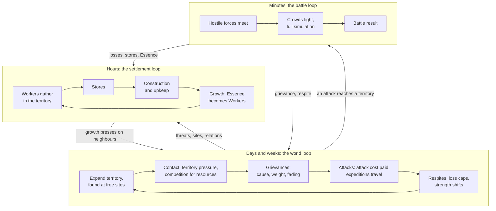
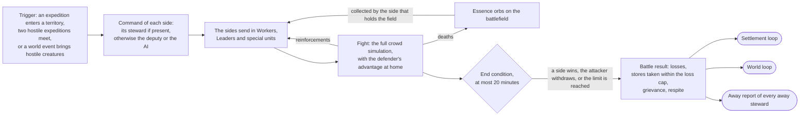
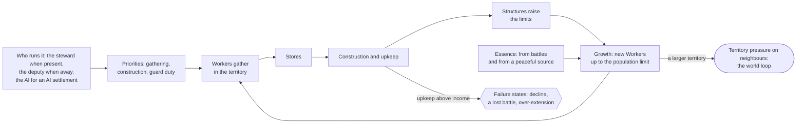
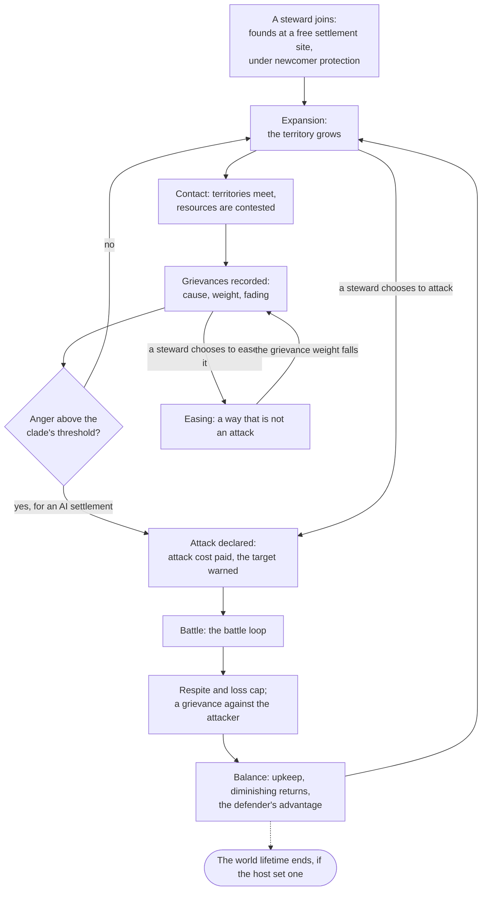
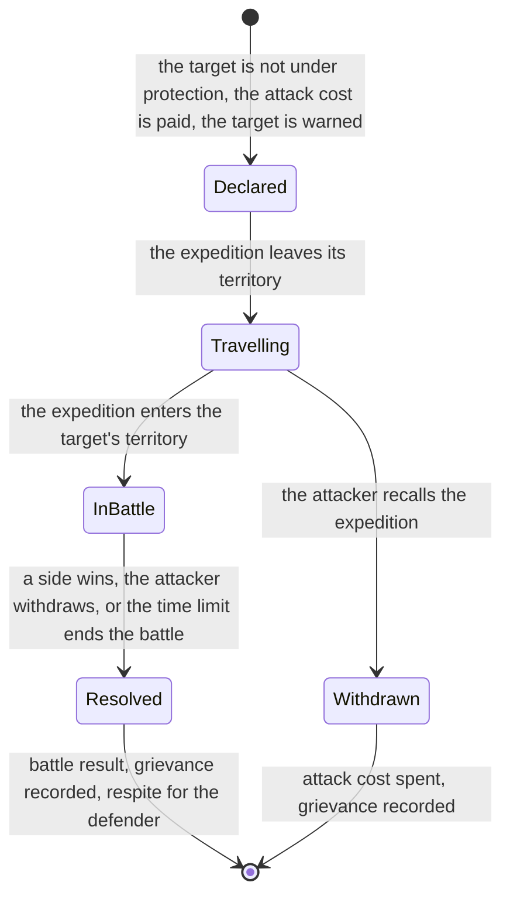
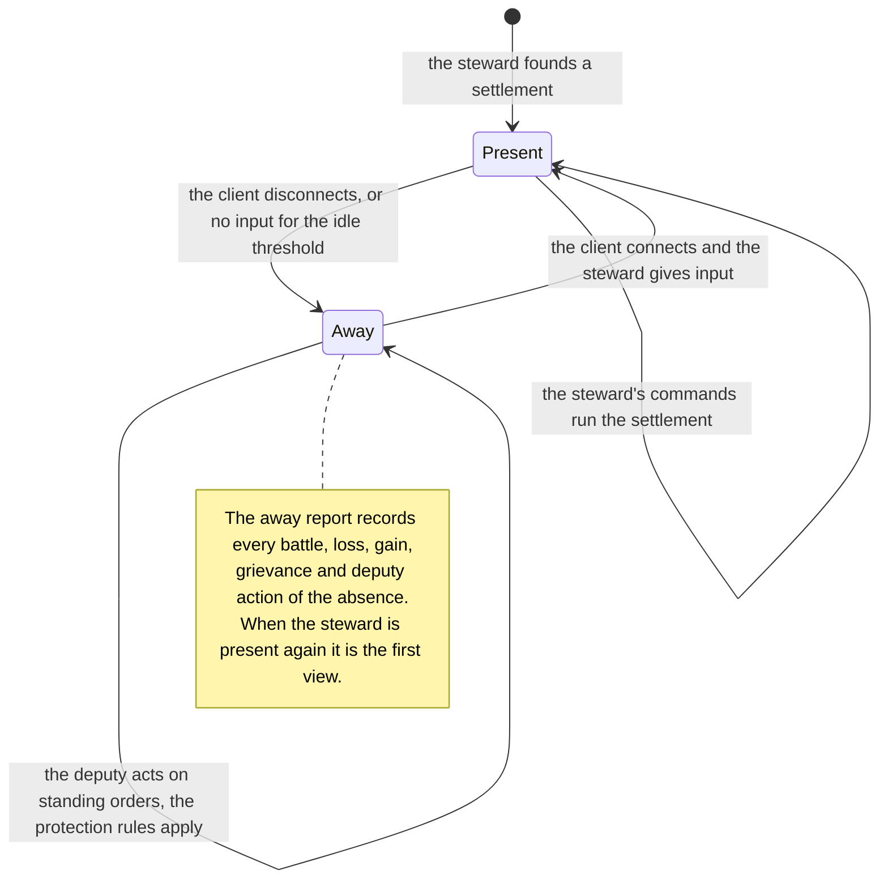
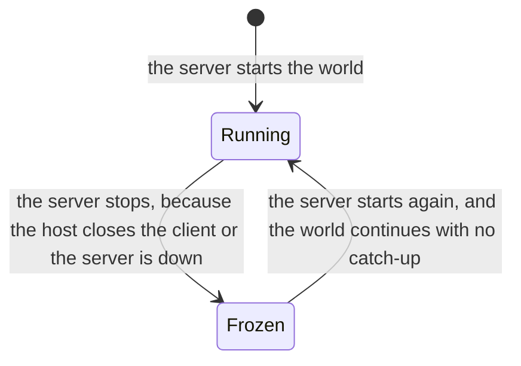
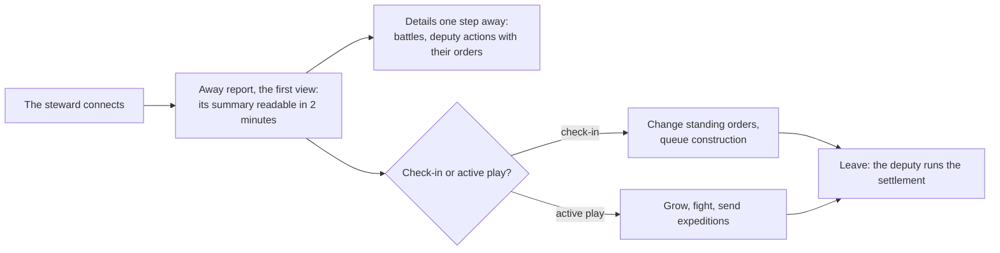

# Vision, pillars and core loops

> Status: Draft · Prefix: PIL · Rationale: `../rationale/A0.md` · Related: [vision brief](../../vision/species-vision-brief.md) · [owner decisions](../decisions/owner_decisions.md) · [reference overview](../reference/00_reference_overview.md) · [adoption ledger 00](adoption_ledger/00_reference_overview_ledger.md) · [GDD index](README.md) · [conventions](../CONVENTIONS.md)

## 1 Purpose and player experience

### 1.1 What this document decides

This document is the root of the Species game design. It states what Species is, the pillars that every later design choice serves, the core loops at three timescales, the session patterns and the audience, and the vocabulary of the world game. It binds every later area; the owner confirms or changes its pillars, its loops and its vocabulary at owner gate A.

It specifies no mechanic in full. Each loop names the area that owns its mechanics (§8), and every number in it is a target that the owning area meets with its own rules and tuning keys (§4). Where this document says that an area decides something, the behaviour is that area's to specify, inside the limits stated here.

### 1.2 Species in one paragraph

Species is a persistent, shared world of settlements on a server. Each settlement belongs to a clade and is run either by its steward, a player, or by AI. Its Workers act on their own: they gather, carry and build, they grow in number as Essence becomes new Workers, and they fight. The steward steers through Leaders, orders, priorities and standing orders, never figure by figure. Clades grow aggrieved for reasons a steward can see, and aggrieved clades attack. Battles are real-time crowd battles of hundreds of small glowing figures, and they always run as the full simulation. When a steward is away, the deputy runs the settlement on the steward's standing orders, the protection rules bound what the settlement can lose, and the steward comes back to a report of what happened. Beside the world, skirmish offers the reference crowd match on a small map, on the same server and netcode.

### 1.3 Player fantasy

**The steward of a living people.** The player never commands a soldier. They shape the will of a crowd (where it gathers, what it builds, whom it fears and whom it fights) and they come back to find that their people lived while they were gone.

| Timescale | Fantasy | What the player feels |
|---|---|---|
| Minutes: a battle | The crowd general | Hundreds of Workers pour into a fight; the steward bends the flow with Leaders, formations and a few special units, and reads the battle from the shape and the glow of the crowd |
| Hours: the settlement | The founder | A settlement grows from a Wellspring and a handful of Workers into a town with territory, stores, structures and defences, in steps the steward sees in every session |
| Days and weeks: the world | The neighbour with a memory | Clades remember what was done to them; a steward earns peace or provokes war, and every war has a reason on record |

*Table A — The player fantasy at the three timescales of the core loops (§2.5 to §2.7).*

### 1.4 Audience

| Segment | Who | What they need from Species | Stage |
|---|---|---|---|
| Groups of friends and communities (first audience) | 2 to 16 people who know each other or share a community, on an integrated server or a community server (O1, O5) | A world they return to several times a week; battles they can fight together or against each other; absence that does not ruin them | Stages 1 and 2 |
| Solo players | One steward in a world of AI settlements (O1) | Every loop with AI neighbours that behave for reasons they can read | Stage 1 |
| Strategy players with bounded time | Players of colony building and real-time strategy with sessions of 30 to 120 minutes a few times a week, plus short check-ins | Progress in every session; a deputy they can trust between sessions | Stages 1 and 2 |
| Larger community worlds | Worlds of 50 to 200+ stewards (O1) | The same loops at a larger scale, which the architecture keeps possible without a rewrite | Stage 3 |

*Table B — The audience of Species, first audience first.*

Species is not designed for players who want a competitive real-time strategy game measured in actions per minute, for players who want unbounded conquest of other players' settlements, or for players who want to play only from a phone: v1 has no companion application (O6; vision §7).

### 1.5 Session patterns

| Pattern | Presence | Typical length | What the steward does | What Species guarantees | Owning areas |
|---|---|---|---|---|---|
| Active play | present | `pil.session.active_minutes` (30 to 120 minutes) | Reads the away report, grows the settlement, fights battles in person, sends expeditions, adjusts standing orders | A growth step at least every 20 minutes early in a settlement's life (PIL-055); battles of 4 to 12 minutes (PIL-047) | B1, B2, B4, C1 |
| Check-in | present, briefly | `pil.session.check_in_minutes` (2 to 10 minutes) | Reads the away report, changes standing orders, queues construction, leaves | The away report first, its summary readable in 2 minutes (PIL-073); every check-in action is a server API call (PIL-075) | B6, C2, C3, D6 |
| Away | away | minutes to days; the design cases are 8 hours, 24 hours and 7 days (PIL-074) | Nothing: the deputy runs the settlement on standing orders | The protection rules bound the loss (O2); after 8 or 24 hours the settlement regains its strength in 2 hours of active play (PIL-022) | B6, B7 |
| Frozen world | nobody | while the server is not running | Nothing can be done in the world | No world time passes and no catch-up simulation follows (O4; PIL-076) | A2, D1 |

*Table C — The session patterns of the world game. Every duration is world time unless it says "of active play" (§1.7).*

In the integrated stage a world runs only while its world host's client runs it, so the pattern "away" holds for the other stewards of that world only while the host's world is running (PIL-077).

### 1.6 Comparables and their lessons

Species borrows lessons from genres, never content. The rationale file names the titles behind each lesson.

| Genre | Lesson | Where Species applies it |
|---|---|---|
| Persistent online strategy games with attackable bases | A period of protection after an attack, protection for beginners and a cost to attacking are the norm; losses while offline are the most common reason players leave | The protection rules (O2; PIL-022, PIL-080; B6) |
| Survival sandboxes with raids on absent players | Protection that players can predict matters more than protection that is strong; losing everything overnight ends a player's interest | The loss cap and the respite are fixed and shown in advance (PIL-082; B6) |
| Colony and settlement simulations with autonomous inhabitants | Priorities beat orders to single inhabitants at population scale; players need to see why an inhabitant stands idle | Pillar 1 (PIL-010, PIL-020); C3 shows why a Worker is idle |
| Grand strategy games with opinion modifiers and justified wars | AI aggression reads as fair when every modifier shows its cause, its size and how it fades | Grievances (PIL-064; B5) |
| Games with delegated governors and managers | A delegate that is opaque erodes trust; a delegate that plays better than the player makes the player stay away | The order language and the away-yield band (PIL-023, PIL-083; B6, B2) |
| Seasonal and resetting worlds | A reset cures a runaway leader but erases investment; a world that never resets needs upkeep and a defender's advantage | The world lifetime is a setting, and pillar 6 holds without a reset (PIL-065, PIL-067) |
| Crowd battle games | Crowds read at a distance through simple shapes, colour and motion; bounded battle lengths keep sessions bounded | Pillar 5 (PIL-014); the battle length band (PIL-047) |

*Table D — Comparable genres and the lesson Species takes from each.*

### 1.7 How to read this document

- **World time.** Every duration is world time, the time that passes while a world's server runs (O4), unless it says "of active play", which counts only the time in which the steward is present.
- **Targets, not timers.** The durations of §4 are experience targets that the design must meet. They are not simulation timers: an area that turns one into a rule writes its timer in ticks, through `ref.sim.tick_period`, under its own tuning key.
- **Guards.** Each pillar has a guard (§2.3), a measurable check that a model or a playtest runs. A guard that fails means the pillar is at risk; the coordinator then re-opens the owning area or escalates to the owner.
- **New terms** are defined in §2.10. A term used before its definition there has the meaning that Table 3 gives it.

## 2 Rules

### 2.1 Forms of play and scope

**PIL-001** (MUST) Species has two forms of play: the **world game**, a persistent world of settlements that this design specifies, and **skirmish**, a short match on a small map that is separate from every world (O8). Both run on one server codebase, behind one transport interface, with the same netcode (O8, O10).

**PIL-002** (MUST) Skirmish runs the reference match loop as reference/00 states it: no build queue and no currency, an army that the held Spawn Nodes produce, autonomous Workers steered through crowd orders and Leaders, Supply crates and Power slots, and bots (R-VIS-001, R-VIS-002, R-VIS-004 to R-VIS-006; DEC-001). It is the first playable and the combat balance test bed (O8, O20): the crowd rules that B4 adopts for world battles are the rules that skirmish tests.

**PIL-003** (MUST) In v1, skirmish offers `pil.scope.skirmish_mode_count` (1) mode, Spawn Control (O8, O20). The other five reference modes stay specified in reference/01 as candidates for later stages, which B9 and the roadmap schedule; until a mode is scheduled, its rules, maps, options and complexity label are not built. The match options of skirmish are those of the modes it offers. Every skirmish map is authored new and carries no reference map name, shape or layout (DEC-063). B9 sets the skirmish map set, its player counts and, with A1, its population caps (DEC-866); B9 decides the tutorial of the first playable (DEC-123), and C5 specifies the tutorials of Species.

**PIL-004** (MUST) The world game replaces the reference loop's absence of a build queue and of a currency: its settlements gather resources, store them, build and maintain structures and grow, on top of essence-driven growth, in which deaths yield Essence orbs and Essence becomes new Workers (DEC-001, option B). B1 specifies growth and population, B2 the resources and the economy, and B3 construction.

**PIL-005** (MUST) The main page of the front end leads to the world game (joining a world, or hosting one) and to skirmish, beside the tutorials, the help and the options. C2 specifies the pages; the reference front end supplies the skirmish pages (R-VIS-171 to R-VIS-180, as C2 adopts them).

**PIL-006** (MUST) A player is the steward of at most `pil.scope.settlements_per_player` (1) settlement in a world (vision §1). A player may be a steward in several worlds, with one settlement in each.

**PIL-007** (MUST) Every settlement belongs to exactly one clade for its whole life, and is either run by its steward or is an AI settlement, which has no steward. In v1 every clade has the same rules, and clades differ in looks, colour and temperament only (O7); the data model gives each clade a place for the modifiers that B8 defines later (O7, O11).

**PIL-008** (MUST) A world has no team slots; this is how the world game maps O14 onto settlements. A steward who leaves a world, or is away, keeps the settlement, and the deputy runs it, as a bot takes over a leaver's team in skirmish. A place for a further steward is a free settlement site (PIL-068), and AI settlements populate the world from its start. B6 and C2 specify what happens to a settlement whose steward does not return (PIL-078).

**PIL-009** (MUST) The loops of this document work without the non-goals of v1 (vision §7): a web or mobile companion application, asymmetric clades, research and training content, official hosting, a client on a platform other than Windows, and modding support.

### 2.2 Pillars

Species has six pillars. Pillars 1 to 5 are the vision's five, confirmed or revised with the case that Table 2 states; pillar 6 is new, and the owner confirms or rejects it at gate A.

**PIL-010** (MUST) **Pillar 1, Living crowds.** Workers act on their own, in battle and at home: they fight, gather, carry and build without an order per figure, and they re-plan as their surroundings change (R-VIS-090 in skirmish; B1 and B4 in the world). The steward steers crowds through Leaders, crowd orders, settlement priorities and standing orders, never single Workers; direct control is kept for special units (R-VIS-113 in skirmish; C1 in the world).

**PIL-011** (MUST) **Pillar 2, A world that runs while you are away.** The server owns the world; the world runs whenever its server runs and freezes when it stops (O4). Being away is a normal way to play: the deputy runs the settlement on standing orders, the protection rules bound what the settlement can lose (O2), and a steward who returns reads first what happened.

**PIL-012** (MUST) **Pillar 3, Conflict with a cause.** Clades grow angry for reasons a steward can see: territory pressure, competition for resources and past attacks. Every grievance shows its cause, its weight and how it fades; AI attacks are motivated by grievances and never random; and every attack has a cost and leaves a record (O2; B5).

**PIL-013** (MUST) **Pillar 4, Delegation you can trust.** The deputy follows standing orders that its steward understands and can predict, acts only within them and only on what the settlement can see, and reports every action with the standing order that permitted it (B6, B7).

**PIL-014** (MUST) **Pillar 5, The reference style, a distinct game.** Species keeps the visual and audio language of the reference library: flat-shaded low-poly facets with additive glow on a black background, the darkening layer and black fog, crowds of small figures drawn as camera-facing sprite cards that scale with distance ([renderer visual language](../architecture/components/renderer/visual_language.md)), and sound that game events drive through the audio binding model (R-VIS-009). Every asset is newly authored, with Species' own silhouettes, textures, interface layout and logo, and nothing is traced, recoloured or edited from the reference game's art, audio or text (O9; vision §5). The strategic view is drawn in the same language. In skirmish a team's colour is one of the team colours of R-VIS-034; in the world a clade's colour is the identity cue, and B5 and E2 set the clade colours.

**PIL-015** (MUST) **Pillar 6, Always a way back** (new; the owner confirms it at gate A). A world stays open to everyone in it: no settlement becomes unassailable, a steward who joins late finds a place and a path to matter, and a lost battle is a setback, never the end of a settlement.

**PIL-016** (MUST) A design choice that falls under a "rules out" entry of Table 1 is rejected, or escalated to the owner with the pillar it breaks. The rationale of every later area names, for each of its significant choices, the pillar that the choice serves.

| Pillar | Rules in | Rules out | A design it rejects |
|---|---|---|---|
| 1 Living crowds | A task search for every Worker that covers fighting, gathering, carrying and building; crowd-scale verbs (gather and send, Leaders, formations); settlement priorities among gathering, construction and guard duty; crowds of hundreds in view; direct control of special units only | Assigning a job, a tool, a place or a target to one Worker; production queues in which the steward orders Workers one at a time (Workers come from essence-driven growth); screens of needs, equipment or inventory per figure | *A farm that waits for the steward to pick which three Workers tend it*; *a barracks that trains Workers one click at a time* |
| 2 A world that runs while you are away | Server authority; the deputy; the loss cap, respite, attack cost, defender's advantage and newcomer protection (O2); the away report; check-ins of minutes; world time as server uptime (O4) | Catch-up simulation after downtime (O4); a loss while away that the loss cap does not bound; play that requires presence at set times, such as a daily log-in window or an event that rewards only those online at a fixed hour; absence that pays better than presence (PIL-023) | *Settlements that lose a share of their stores for every hour their steward is offline*; *a nightly world event at a fixed hour that is worth a week of growth* |
| 3 Conflict with a cause | Grievances with a cause, a weight and a fading; anger thresholds set by temperament; a warning before every AI attack; an attack cost; at least one way to ease anger that is not an attack; the grievance entry of every battle result | AI aggression from a random draw or a hidden timer; an AI attack on a settlement against which the attacker's clade holds no grievance; anger the steward cannot inspect; attacks that cost the attacker nothing | *Each night the AI picks a random settlement and raids it*; *an AI that always targets the weakest settlement in reach, whatever the history* |
| 4 Delegation you can trust | A small order language of priorities, limits and response rules (B6); safe default orders (PIL-079); hard limits; a complete audit trail in the away report; one AI for AI settlements and the deputy, under fog of war (B7; PIL-084) | A deputy that chooses its own goals; strategic actions without an explicit order (declaring attacks, changing relations, demolishing, spending past a limit); a deputy that sees what its settlement cannot; a deputy that plays better than an attentive steward (PIL-023) | *A governor AI that attacks a weak neighbour overnight because its scoring rated the raid profitable* |
| 5 The reference style, a distinct game | The renderer's visual language; the audio binding model (R-VIS-009); new art and audio; a strategic view in the same style; crowds readable at a distance; colour as the main identity cue | Traced, recoloured or edited reference art, audio or text (vision §5); the reference silhouettes, interface layout or logo; a second art style for the strategic view, such as a painted map, photoreal terrain or textured physically based materials | *A strategic map drawn as painted parchment with textured castles*; *Workers drawn as recoloured copies of the reference figures* |
| 6 Always a way back | Upkeep and diminishing returns that grow with size (B2); the defender's advantage (O2); respites; a Wellspring that no battle takes (PIL-080); free settlement sites for late joiners (PIL-068); newcomer protection; the world lifetime as a host setting, as one lever among several (PIL-067) | Unbounded compounding growth; removal of a steward from a world by another settlement; capturing or absorbing a settlement; first sites so much richer than later ones that the first week decides the world; a world that ends for everyone because one settlement leads | *Capturing a settlement's Wellspring absorbs its Workers and territory and ends its steward's game*; *yields that compound by a percentage every hour with no upkeep* |

*Table 1 — The pillars: what each rules in, what it rules out, and an example of a design it rejects (PIL-010 to PIL-016).*

| Pillar | Vision brief §2 | Species | The case for the change |
|---|---|---|---|
| 1 | Living crowds | Living crowds: autonomy extended from battles to settlement work; priorities and standing orders named as steering verbs | The world game adds gathering and construction. Without the extension, construction would drift into jobs assigned to single Workers, which the pillar exists to prevent |
| 2 | A world that keeps running | A world that runs while you are away | Read literally, the vision's name contradicts O4: a world freezes while its server is down, and in the integrated stage it runs only while the host's client runs. The new name states the promise exactly, and adds the return, the away report, which the vision's pitch implies |
| 3 | Conflict with a cause | Confirmed; adds legibility, at least one way to ease anger, and the cost of attacking | The vision's seed challenge 9 asks for a relations model that players can read and influence, and O2 asks for a cost to attacking; both belong to the pillar, not only to B5 |
| 4 | Delegation you can trust | Confirmed; adds the audit trail and the information rule | Trust needs a record of what the deputy did and why (vision seed challenge 8) and a deputy that knows no more than its steward (vision §5) |
| 5 | The reference look and feel | The reference style, a distinct game | "Stays as it is" could be read as copying the reference look, which O9 and vision §5 forbid. The new wording states both halves of O9: the same visual and audio language, and every asset new (vision seed challenge 11) |
| 6 | (none) | Always a way back | Runaway leaders, late joiners and ruinous losses (vision seed challenges 1 and 2) are the most common ways persistent strategy worlds fail, and none of the five vision pillars rules on them. Without a pillar, B2, B5 and B6 would trade them away one rule at a time |

*Table 2 — How the pillars change from the vision brief, with the case for each change.*

### 2.3 Pillar guards

Each pillar has a guard: a measurable check that tells whether the design still meets the pillar. Most targets are first guesses; the owning area's model or a playtest confirms or retunes them (§4).

**PIL-020** (MUST) Guard of pillar 1: a settlement whose steward is present and gives no new order for `pil.guard.unattended_minutes` (60 minutes of world time) keeps gathering, finishes its queued construction and defends itself, and none of its Workers stands idle for want of an order addressed to that Worker. No settlement or battle command of the world game addresses one Worker, except promoting a Worker to a Leader, scrapping a unit (R-VIS-159 as C1 adopts it) and the direct control of special units (C1).

**PIL-021** (MUST) Guard of pillar 1: a typical world battle shows at least `pil.battle.bodies_floor` (100) figures of both sides together. If the scale budgets of A2 and B4 at owner gate B cannot afford that, the pillar is at risk, and the conflict goes to the owner.

**PIL-022** (MUST) Guard of pillar 2: after an absence of `pil.session.away_short_hours` (8 hours) or `pil.session.away_day_hours` (24 hours) of world time, in which its settlement was attacked as often as the protection rules allow, a returning steward finds the settlement in the world with its Wellspring (PIL-080) and can bring it back to its strength before the absence within `pil.guard.regain_hours` (2 hours) of active play. B6's protection rules and B2's economy model show it.

**PIL-023** (MUST) Guard of pillars 2 and 4: over a day of world time, a settlement that the deputy runs grows by `pil.guard.away_yield_share` (50 to 80 %) of what the same settlement grows under a competent steward who is present. Below the band an absence is ruinous; above it an absence is the better strategy, and the deputy plays better than its steward. B2's model measures it.

**PIL-024** (MUST) Guard of pillar 3: in playtest, at least `pil.guard.attack_cause_share` (80 %) of the stewards whose settlement an AI settlement attacked name the cause of the attack correctly from what Species showed them.

**PIL-025** (MUST) Rule of pillar 3: an AI settlement attacks a settlement only while its clade holds a grievance against that settlement, and the target's steward is warned at least `pil.conflict.warning_minutes` (10 minutes of world time) before the attacking expedition reaches the target's territory. While the steward is away, the warning goes to the deputy and into the away report (B5, B6).

**PIL-026** (MUST) Guard of pillar 4: in playtest, stewards predict the deputy's action correctly in at least `pil.guard.deputy_prediction_share` (80 %) of the scripted situations that B6 defines, and `pil.guard.deputy_report_share` (100 %) of the deputy's actions appear in the away report, each with the standing order that permitted it.

**PIL-027** (MUST) Guard of pillar 5: every asset of Species carries a record of its new authorship (E2), and the strategic view uses only the features of the renderer's visual language.

**PIL-028** (MUST) Guard of pillar 6: in B2's economy model of a world of `pil.guard.check_steward_count` (16) stewards and its AI settlements, in week `pil.guard.check_world_week` (4) of world time the strongest settlement's strength is at most `pil.guard.leader_strength_ratio` (3) times the median settlement's strength (B2, B5).

**PIL-029** (MUST) Guard of pillar 6: a steward who founds a settlement in week `pil.guard.check_world_week` (4) of a world's life reaches `pil.guard.late_joiner_strength_share` (50 %) of the median settlement's strength within `pil.guard.late_joiner_hours` (6 hours) of active play, and newcomer protection keeps the settlement from being attacked for the period that B6 sets (B6, A1).

### 2.4 Audience and the two forms of play

**PIL-030** (MUST) Every loop of the world game works for one steward in a world of AI settlements, and for 2 to 16 stewards with AI settlements (O1). No loop needs a second human to start, to progress or to end.

**PIL-031** (MUST) The first audience is groups of up to 16 stewards on an integrated server or a community server (O1, O5; Table B). A feature that serves only worlds of 50 to 200+ stewards is scheduled for the hosted stage (O1, O5), and nothing built for 2 to 16 stewards may block that tier (A2).

**PIL-032** (MUST) A world battle uses the verbs of skirmish (R-VIS-151 to R-VIS-161, as C1 adopts them) plus the world verbs that C1 adds, so that a player who can play skirmish can fight a world battle.

### 2.5 Minutes: the battle loop

**PIL-040** (MUST) A battle is a real-time crowd fight between hostile sides on a bounded battlefield. It always runs as the full crowd simulation, whether or not any steward watches it (O3), with the reference crowd rules of Workers, Leaders, formations, special units, creatures and hazards that B4 adopts.

**PIL-041** (MUST) A battle starts only when hostile forces meet: an expedition enters a settlement's territory, two hostile expeditions meet, or a world event that B4 defines brings hostile creatures into a territory. B4 specifies the triggers, the battlefield bounds, the reinforcements and the end conditions.

**PIL-042** (MUST) A battle at a settlement has an attacker and a defender. The defender fights with the defender's advantage inside its own territory (O2), which B4 and B6 specify.

**PIL-043** (MUST) Each side of a battle is commanded by its steward while the steward is present, with the verbs of PIL-032; by the deputy while the steward is away; and by the AI for an AI settlement. The deputy and the AI command with the information that their side can see (PIL-084).

**PIL-044** (MUST) A steward who becomes present during a battle takes command of their side from the tick at which their first command arrives, and the deputy stops commanding that side at that tick. A steward who becomes away during a battle hands the side to the deputy at once.

**PIL-045** (MUST) A battle moves bodies, Essence, damage and stores: the sides send in Workers, Leaders and special units; every death leaves its Essence orb on the battlefield for the side that holds the field to collect (B1, B4); structures take damage; and an attacker that wins takes stores within the loss cap (B6).

**PIL-046** (MUST) Every battle ends in a battle result that records the sides, the losses, the stores and the Essence that moved, the grievance that the battle created (B5) and the respite that started (B6). The battle result feeds the settlement loop (§2.6) and the world loop (§2.7), and it appears in the away report of every away steward on either side.

**PIL-047** (MUST) A battle lasts `pil.battle.typical_minutes` (4 to 12 minutes of world time) in `pil.battle.typical_share` (90 %) of battles, and never longer than `pil.battle.max_minutes` (20 minutes); B4's end conditions guarantee the maximum.

**PIL-048** (MUST) The failure states of the battle loop are bounded for both sides. A defender that loses keeps its settlement and loses no more than the loss cap allows (PIL-080; B6). An attacker that loses keeps its settlement and loses the dead of its expedition and the attack cost it paid; an attacker may withdraw, and its withdrawal ends the battle.

### 2.6 Hours: the settlement loop

**PIL-050** (MUST) The settlement loop is the life of one settlement over hours of world time. Its Workers gather resources in its territory and carry them to its stores; the stores pay for construction and upkeep; structures raise what the settlement can hold, make and defend; and Essence becomes new Workers up to the settlement's population limit (B1, B2, B3).

**PIL-051** (MUST) The actors of the settlement loop are the settlement's Workers and Leaders, its structures and its Wellspring, and whoever runs it: its steward while present, the deputy while the steward is away, or the AI of an AI settlement.

**PIL-052** (MUST) The steward's settlement verbs are: set the priorities among gathering, construction and guard duty; place and queue construction; promote and direct Leaders; send expeditions; and set standing orders. No settlement verb assigns a job, a tool or a place to one Worker (PIL-020); C1 specifies the verbs.

**PIL-053** (MUST) The positive feedback of the settlement loop is growth: more Workers gather more, more stores build more, and more structures raise the limits. Its negative feedback is upkeep that rises with size, diminishing returns (B2), and the territory pressure that growth puts on neighbours, which creates grievances (B5); that pressure couples the settlement loop to the world loop.

**PIL-054** (MUST) The failure states of the settlement loop are decline, when upkeep exceeds income; a lost battle, which the loss cap bounds; and over-extension, when expeditions leave the settlement too thin to defend. Species shows each one to the steward, with its cause, before it turns into a loss (B2, C3).

**PIL-055** (MUST) A settlement whose steward plays in the session patterns of Table C shows a growth step, such as a finished structure, a population milestone or a new territory claim, at least every `pil.settlement.growth_step_minutes` (20 minutes) of active play during its first `pil.settlement.early_hours` (10 hours) of active play, and reaches the plateau of its growth no sooner than `pil.settlement.plateau_days` (14 days) of world time (B1, B2).

**PIL-056** (MUST) A settlement at peace grows: Essence has at least one source that needs no death in battle, so that growth never forces a settlement into war (pillar 3). B1 specifies the sources of Essence.

### 2.7 Days and weeks: the world loop

**PIL-060** (MUST) The world loop is the life of a world over days and weeks of world time. Settlements expand their territory and come into contact, compete for sites and resources, accumulate grievances, attack and defend, and the balance of strength between them shifts.

**PIL-061** (MUST) The actors of the world loop are every settlement, steward-run or AI; the clades, which hold grievances; the world host, who sets the world's settings and its lifetime; and the stewards who join late.

**PIL-062** (MUST) The world verbs are: found a settlement at a free settlement site; expand the territory; send expeditions to attack or to reinforce; ease a grievance by a way that is not an attack (PIL-064); and set standing orders before leaving. C1 specifies the verbs; B5 specifies attacks and the easing of grievances.

**PIL-063** (MUST) A steward may send an attack against any settlement that is not under protection (an owner question at gate A). Every attack pays its attack cost when it is declared, and the defender's clade records a grievance against the attacker (O2; B5, B6).

**PIL-064** (MUST) Every grievance shows its cause, its weight and how it fades. Anger, the sum of the grievances that a clade holds against a settlement, is visible to that settlement's steward, and B5 gives every steward at least one way to ease a grievance that is not an attack.

**PIL-065** (MUST) The world loop has two negative feedbacks against runaway growth that hold without any end of the world: upkeep and diminishing returns that grow with size (B2), and the defender's advantage (O2). In a world in steady state, from week 2 of world time on, a typical settlement takes part in `pil.world.battles_per_week` (2 to 10) battles per week of world time: below the band the world is static, and above it the world is at permanent war (B5).

**PIL-066** (MUST) World time is server uptime: the world loop advances only while the world's server runs, and the world is frozen while it does not (O4). Every duration of this document is world time unless it says "of active play".

**PIL-067** (MUST) A world has a lifetime that the world host sets, with a default and with unlimited allowed; A1 sets the default and what happens when a lifetime ends. Pillar 6 holds whether or not a world ends (PIL-065).

**PIL-068** (MUST) A steward can join a world at any point of its life and found a settlement at a free settlement site. A1 keeps at least as many free settlement sites as the world has places for further stewards, and never fewer than `pil.world.free_sites_min` (2).

**PIL-069** (MUST) No settlement captures, absorbs or removes another settlement (PIL-080); a world in which one settlement leads goes on until its lifetime ends.

### 2.8 Presence, sessions and the deputy

**PIL-070** (MUST) A steward's presence is either present or away. A steward is present while their client is connected to the world and they have given input within the idle threshold that B6 sets; at every other time they are away.

**PIL-071** (MUST) While the steward is present, the steward's commands run the settlement, and the deputy acts only within the standing orders that the steward has left active for present play; a command of the steward always takes precedence over the deputy.

**PIL-072** (MUST) While the steward is away, the deputy runs the settlement under the standing orders, and the protection rules apply (O2; B6).

**PIL-073** (MUST) A steward who becomes present after an absence sees the away report first: the battles and their results, the losses and the gains, the construction finished, the grievances recorded, and every deputy action with the standing order that permitted it. The steward reads its summary within `pil.session.report_read_minutes` (2 minutes), and the details are one step away (B6, C3).

**PIL-074** (MUST) Species is designed for the session patterns of Table C: active play of `pil.session.active_minutes` (30 to 120 minutes), check-ins of `pil.session.check_in_minutes` (2 to 10 minutes), and absences of `pil.session.away_short_hours` (8 hours), `pil.session.away_day_hours` (24 hours) and `pil.session.long_absence_days` (7 days) of world time as the design cases of the protection rules.

**PIL-075** (MUST) In v1 a check-in happens in the game client (O6), and every action of a check-in (reading the away report and the settlement status, changing standing orders, queueing construction) is a server API call that a later companion can make without a change to the server (O6; D6).

**PIL-076** (MUST) While a world is frozen nothing in it changes: no world time passes, and no timer of the world game advances, respites, loss-cap windows and the fading of grievances included. When the server runs again, the world continues from the state in which it stopped, with no catch-up simulation (O4).

**PIL-077** (MUST) In the integrated stage a world runs only while its world host's client runs it (O4, O10). A steward who plays in another steward's integrated world plays while that world runs and sees it frozen otherwise (C2, D1).

**PIL-078** (MUST) After an absence of `pil.session.long_absence_days` (7 days) a settlement stays in the world under the deputy and the protection rules. B6 decides any further protection for a long absence, and C2 what happens to a settlement whose steward does not return.

**PIL-079** (MUST) A steward who sets no standing order has the default orders: defend the settlement, keep gathering, finish the queued construction, and never attack. B6 specifies the default set in full.

### 2.9 Safety floor and fair information

**PIL-080** (MUST) No battle removes a settlement from the world. A settlement's Wellspring can be neither destroyed nor captured, and a settlement that loses a battle keeps at least the floor of Workers, stores and structures that B6's loss cap sets (an owner question at gate A).

**PIL-081** (MUST) A steward leaves a world only by their own choice or by the world host's moderation (D5); no action of another settlement removes a steward from a world.

**PIL-082** (MUST) The protection rules that apply to a battle are fixed when the battle starts. A change of presence during the battle changes who commands the side (PIL-044), never the loss cap or the other protection rules that apply to the battle (B6).

**PIL-083** (MUST) The deputy never declares an attack, except as a response that a standing order names explicitly; never changes relations (any truce, tribute or alliance that B5 defines); never demolishes or abandons a structure; and never spends past a limit that a standing order sets. When no standing order covers a situation, the deputy follows the default orders (PIL-079).

**PIL-084** (MUST) AI settlements, the deputy and the aide play under the same information rules as a steward: they act only on what their settlement can see, under fog of war (vision §5; B7, D9). The perfect information of the reference bots binds skirmish only (R-VIS-006).

**PIL-085** (MUST) The world game has no pause: no steward, deputy or AI stops world time, and only a stopped server freezes a world (O4). Skirmish keeps its pause rule (R-VIS-163).

**PIL-086** (MUST) Being present never leaves a settlement less protected than being away: the protection rules that apply to the settlement of a present steward are at least those that apply while the steward is away, so that no steward gains safety by staying away (B6).

### 2.10 Vocabulary

**PIL-090** (MUST) Every Species document uses the terms of Table 3 with the meanings given there, and the identifiers and string-id prefixes of its columns. The mechanics of each term belong to the areas that its Mechanics column names. CONVENTIONS §8 and the glossary register the terms once owner gate A has confirmed them.

**PIL-091** (MUST) Where a reference term would mislead in the world game, Species documents use the Species term that Table 4 gives: a settlement's player is its steward, never its owner; the person who runs a world's server is the world host, never an operator; the protection period after an attack is a respite, never a shield; a world's span is its lifetime, never a season; construction is done by Workers, never by builders; and a people of Species is a clade (an owner question at gate A).

Table 3 gives each new term one meaning. Identifiers follow `AGENTS.md` §1 and are game code in the `Species` namespace (CONVENTIONS §8); a dash means that the term needs no type of its own, or that the owning area names its code form. String-id prefixes are dotted data names (CONVENTIONS §8); the new roots are `battle`, `clade`, `deputy`, `expedition`, `presence`, `protection`, `region`, `relation`, `report`, `settlement`, `skirmish`, `view` and `world`, none of which is an asset stem, a tuning-key root, a setting group or a schema family. The trademark screen checks each term against well-known game titles and game trademarks as general knowledge; a registry search in the target markets is still required before a commercial release.

| Species term | Kind | Meaning | Identifier | String-id prefix | Mechanics | Trademark screen |
|---|---|---|---|---|---|---|
| world | world game | One persistent, shared game on one server: its terrain, regions, settlement sites, settlements, clades and world time. The spatial sense of "world" in the reference (world units, world cursor, world markers) keeps its meaning | `World` (not `MatchWorld`, the world of a skirmish match) | `world` | A1 (shape), A2 (simulation) | generic word |
| world game | form of play | The persistent-world form of play (PIL-001) | — | — | A0 | generic words |
| skirmish | form of play | The short match on a small map, separate from every world, that runs the reference match rules (O8; PIL-002) | `Skirmish` | `skirmish` | B9 | generic word |
| region | world game | A fixed part of a world's area: the unit of the world's simulation partitioning (vision §5) and of the strategic view; it holds settlement sites | `Region` | `region` | A1, A2 | generic word |
| settlement site | world object | A place in a region where a settlement can be founded; it is free while no settlement stands on it | `SettlementSite` | `settlement.site` | A1 | generic words |
| world time | world game | The time of a world, which passes only while its server runs (O4); every world-game duration is world time | `WorldTime` | — | A2 | generic words |
| frozen | world game | The state of a world whose server is not running: nothing in it changes and no world time passes (O4) | `WorldState::Frozen` | `world.frozen` | A2, D1 | generic word |
| world lifetime | world game | How long a world runs, in world time, before it ends: a world-host setting with a default, and unlimited is allowed. Not a season: that word belongs to the seasonal theme | — (a setting; A1 names its key) | `world.lifetime` | A1 | generic words |
| world host | role | The person or community that runs a world's server: the player whose client runs an integrated world, or the administrator of a dedicated server | — | `world.host` | D1, D5 | generic words |
| integrated server | server | A world's server running inside the world host's game client, behind the same transport interface as a dedicated server (O10) | `ServerMode::Integrated` | — | A2, D1 | generic words |
| dedicated server | server | A world's server running as its own headless process (O5, O10); a community server is a dedicated server that a community runs | `ServerMode::Dedicated` | — | A2, D1 | generic words |
| settlement | world game | A community of Workers and Leaders of one clade, with its Wellspring, structures, stores and territory, run by its steward or by AI | `Settlement` | `settlement` | B1 | generic word; a well-known game series is titled after the people who settle, so no title or label of Species uses that form |
| Wellspring | world object | The structure at a settlement's founding point that turns Essence into new Workers; no battle destroys or captures it (PIL-080). B1 decides whether it is built on the Spawn Node | `Wellspring` | `building.wellspring` | B1, B3, B6 | generic noun; no game title known |
| territory | world game | The area that a settlement claims around its Wellspring, where its Workers gather and its defences stand | `Territory` | `settlement.territory` | A1, B1 | generic word |
| founding | world game | Creating a settlement at a free settlement site, with its Wellspring and its first Workers | — (a player command; C1 names it) | `settlement.founding` | B1, C2 | generic word |
| steward | role | The player who runs a settlement; a settlement has at most one steward (PIL-006, PIL-007) | `Steward` | `settlement.steward` | B6, C2 | generic word |
| AI settlement | world game | A settlement with no steward, which the AI runs under a steward's information rules (PIL-084) | `SettlementControl::Ai`, beside `SettlementControl::Steward` | `settlement.ai` | B7 | generic words |
| strength | world game | The measure of a settlement's population, stores and structures that the models and the pillar guards compare | `SettlementStrength` | — | B2 | generic word |
| expedition | world game | A group of a settlement's Workers and Leaders, with any special units, sent beyond its territory to attack, to reinforce or to gather; it travels through the world and fights as a crowd | `Expedition` | `expedition` | B4, B5, C1 | generic noun; a game series puts the plural at the head of its titles, so no title of Species uses the word |
| clade | relations | A people of Species, which the vision brief calls a race: its settlements share its looks, its colour and its temperament, and every clade has the same rules in v1 (O7) | `Clade` | `clade` | B5 | a word of biology; no game title known |
| temperament | relations | The AI personality of a clade: how fast it angers, how it weighs each cause, and how it answers anger | `Temperament` | `clade.temperament` | B5, B7 | generic word |
| grievance | relations | One recorded cause of anger that a clade holds against a settlement: its cause (territory pressure, competition for resources, an attack, or a further cause that B5 lists), its weight and how it fades | `Grievance` | `relation.grievance` | B5 | generic word |
| territory pressure | relations | The cause of grievance that arises when the territories of two settlements meet, or when they compete for the same resources | `GrievanceCause::TerritoryPressure` | — | B5, A1 | generic words |
| anger | relations | The sum of the grievances that a clade holds against one settlement; above the threshold that the clade's temperament sets, the clade's AI settlements may attack that settlement | `Anger` | `relation.anger` | B5 | generic word |
| relations | relations | The standing between a clade and a settlement, derived from grievances, in the states that B5 defines | `Relation` | `relation` | B5 | generic word |
| truce (reserved) | relations | An agreement that suspends attacks between two parties for a time; B5 decides whether it exists | `Truce` | `relation.truce` | B5 | generic word |
| tribute (reserved) | relations | Stores paid to a clade to ease a grievance; B5 decides whether it exists | `Tribute` | `relation.tribute` | B5 | generic word |
| attack | world game | Sending an expedition to fight at another settlement, from its declaration to its battle result | `Attack` | `battle.attack` | B5, B4 | generic word |
| battle | battle | A real-time crowd fight between hostile sides on a bounded battlefield, always run as the full simulation (O3) | `Battle` | `battle` | B4 | generic word |
| battlefield | battle | The bounded area in which a battle runs | `Battlefield` | `battle.field` | B4 | generic word |
| battle result | battle | The record that ends a battle: its sides, its losses, the stores and the Essence that moved, the grievance it created and the respite it started | `BattleResult` | `battle.result` | B4, B6 | generic words |
| protection rules | protection | The rules that make an absence safe (O2): the loss cap, the respite, the attack cost, the defender's advantage and newcomer protection | — | `protection` | B6 | generic words |
| loss cap | protection | The most that a settlement can lose to attacks in a window of world time while its steward is away (O2) | `LossCap` | `protection.loss_cap` | B6 | generic words |
| respite | protection | A period of world time during which a settlement cannot be attacked: after an attack it suffered, and after its founding; the vision brief's shield period (O2). Not Shield, the Supply crate outcome that protects a crowd | `Respite` | `protection.respite` | B6 | generic word |
| attack cost | protection | What an attack costs its attacker, paid when the attack is declared (O2) | `AttackCost` | `protection.attack_cost` | B5, B6 | generic words |
| defender's advantage | protection | The edge that a settlement has when it fights inside its own territory (O2) | `DefenderAdvantage` | `protection.defender_advantage` | B4, B6 | generic words |
| newcomer protection | protection | The protection of a newly founded settlement: its founding respite and any further limit that B6 sets | `NewcomerProtection` | `protection.newcomer` | B6 | generic words |
| deputy | delegation | The AI that runs a settlement for its steward while the steward is away, within the standing orders and on what the settlement can see | `Deputy` | `deputy` | B6, B7 | generic word |
| standing order | delegation | A rule that the steward gives the deputy and that stays in force until the steward changes it: a priority, a limit or a response rule | `StandingOrder` | `deputy.order` | B6, C1 | generic words |
| away report | delegation | The account that a returning steward reads first: what happened while they were away, with every deputy action and the standing order that permitted it | `AwayReport` | `report.away` | B6, C3 | generic words |
| aide | delegation | The AI role that helps a present steward with routine work on request: the third role of the one AI, beside AI settlements and the deputy (B7). Not Advisor, a name of the Dropped decision entries (CONVENTIONS §8.13) | `Aide` | `deputy.aide` | B7 | generic word |
| presence | session | Whether a steward is present or away (PIL-070); it decides who runs the settlement | `StewardPresence` (not `Presence`, the field presence of the data schemas) | `presence` | B6 | generic word |
| present | session | The presence of a steward whose client is connected to the world and who has given input within the idle threshold | `StewardPresence::Present` | `presence.present` | B6 | generic word |
| away | session | The presence of a steward at every other time; the vision brief's AFK | `StewardPresence::Away` | `presence.away` | B6 | generic word |
| check-in | session | A short visit to a world to read the away report, adjust standing orders and queue construction (O6) | — | `report.check_in` | B6, C2, D6 | generic word |
| full fidelity | simulation | Simulating a settlement's day-to-day economy as the full crowd simulation; battles always run at full fidelity (O3) | `Fidelity::Full` | — | B2, D2 | generic words |
| abstract fidelity | simulation | Simulating the day-to-day economy of a settlement that nobody watches by the abstract model (O3) | `Fidelity::Abstract` | — | B2, D2 | generic words |
| strategic view | view | The world drawn at strategic zoom: regions, settlements, territories and expeditions, in the reference visual language (O9) | `StrategicView` | `view.strategic` | A1, C1, D8 | generic words |
| settlement view | view | The close view of one settlement and its battles, with the reference camera | `SettlementView` | `view.settlement` | C1 | generic words |

*Table 3 — The vocabulary of the world game: one meaning per term, its identifier, its string-id prefix, the area that owns its mechanics and its trademark screen (PIL-090).*

| Term | Its meaning in the reference | Its use in the world game |
|---|---|---|
| Worker | The basic unit, a small soldier with a laser and grenades | A settlement's inhabitant: it gathers, carries, builds and fights; B1 and B4 specify what it does in the world |
| Leader | A promoted Worker that serves as a Waypoint beacon or leads a formation | The steering unit of battles and expeditions (B4, C1) |
| Essence orb | The orb that a dead unit leaves | The stuff of growth: Essence becomes new Workers at the Wellspring (B1) |
| Builder | The unit that carries Essence orbs to a Spawn Node | Keeps its reference meaning; construction is done by Workers, and no document calls them builders |
| operator | The Worker in a structure's port | Keeps its meaning; the person who runs a world's server is the world host |
| host | The participant whose process holds a session | In the world game, the world host |
| owner | The team that owns a structure in a match | A settlement's player is its steward; in the design documents, "the owner" is the product owner who takes the owner decisions |
| Shield | The Supply crate outcome that protects a crowd for 300 ticks | Keeps its meaning; the protection period after an attack is a respite |
| seasonal theme | The optional seasonal look of a match | Keeps its meaning; a world's span is its lifetime |
| Bot | A computer opponent in a match | Skirmish only; in the world game the AI runs AI settlements, the deputy and the aide |
| team, team slot, match | The sides and the frame of a reference match | Skirmish only; the world game has settlements, clades and world time (PIL-008) |
| alliance | Two teams sharing a colour family in co-op | Skirmish; B5 decides whether settlements can ally in the world game |
| population cap | A team's limit on bodies in a match | Skirmish; B1 names the limit of a settlement |

*Table 4 — Reference terms whose use changes in the world game (PIL-091).*

## 3 States and flows

### 3.1 The three loops and how they couple

*Figure 1 — The core loops at three timescales: the battle loop sits inside the settlement loop, which sits inside the world loop. Growth presses on neighbours, the world's grievances bring battles, and every battle result feeds both outer loops (PIL-040 to PIL-069).*

| Loop | Actors | Verbs | What flows | Feedback that closes the loop | Failure state | Owning areas |
|---|---|---|---|---|---|---|
| Battle (minutes) | The Workers, Leaders, special units and structures of each side; the steward, deputy or AI that commands each side | The skirmish verbs plus the world verbs (PIL-032): gather and send, promote and direct Leaders, select and drive special units, place powers, withdraw | Bodies sent in; deaths into Essence orbs; damage to structures; stores taken within the loss cap | The battle result: losses and gains into the settlement loop, grievance and respite into the world loop (PIL-046) | Bounded: a defender keeps its settlement and loses no more than the loss cap; an attacker loses its dead and the attack cost (PIL-048) | B4, C1, B6 |
| Settlement (hours) | The settlement's Workers, Leaders, structures and Wellspring; its steward, its deputy or its AI | Set priorities; place and queue construction; promote and direct Leaders; send expeditions; set standing orders (PIL-052) | Resources from territory to stores; stores into construction and upkeep; Essence into new Workers up to the population limit | Growth raises gathering and limits; upkeep, diminishing returns and territory pressure push back (PIL-053) | Decline, a lost battle, over-extension, each shown with its cause before it becomes a loss (PIL-054) | B1, B2, B3, C1 |
| World (days and weeks) | Every settlement; the clades; the world host; late joiners | Found; expand; send expeditions to attack or reinforce; ease grievances; set standing orders (PIL-062) | Territory; grievances with cause, weight and fading; respites; world time | Contact creates grievance, grievance brings attacks, attacks bring respites and losses that shift strength; upkeep, diminishing returns and the defender's advantage stop runaways (PIL-065) | A static world, permanent war, a runaway leader or a world with no room for newcomers; the guards of PIL-028, PIL-029 and PIL-065 detect each | A1, B2, B5, B6 |

*Table 5 — The three loops: their actors, verbs, flows, feedback and failure states.*

### 3.2 The battle loop

*Figure 2 — The battle loop: hostile forces meet, each side is commanded by whoever runs it, deaths feed Essence back into the fight, and the battle result feeds the outer loops and the away reports (PIL-040 to PIL-048).*

### 3.3 The settlement loop

*Figure 3 — The settlement loop: priorities steer the Workers, stores pay for construction and upkeep, structures raise the limits, and Essence becomes Workers; growth presses on the neighbours, and upkeep above income leads to decline (PIL-050 to PIL-056).*

### 3.4 The world loop

*Figure 4 — The world loop: expansion brings contact, contact records grievances, anger above a threshold brings AI attacks, stewards attack by choice and can ease grievances, and every attack ends in respite, a grievance against the attacker and the balancing feedbacks (PIL-060 to PIL-069).*

### 3.5 Attack lifecycle

*Figure 5 — The life of an attack, from its declaration to its battle result. B5 specifies the declaration and the attack cost, B4 the travel and the battle, and B6 the warning, the protection checks and the respite (PIL-025, PIL-046, PIL-063).*

### 3.6 Presence and world state

*Figure 6 — A steward's presence: present while connected and active, away otherwise, with the deputy and the protection rules in charge while away (PIL-070 to PIL-073).*

*Figure 7 — A world's state: it runs while its server runs and is frozen otherwise; no world time and no timer advances while it is frozen (PIL-066, PIL-076, PIL-077).*

### 3.7 A return to the world

*Figure 8 — A return: the away report comes first, then a check-in or a session of active play, and the deputy takes over again when the steward leaves (PIL-073 to PIL-075).*

## 4 Tuning table

These values are experience targets in world time, not simulation timers (§1.7). An area that turns one into a rule writes the rule's timer in ticks under its own tuning key. Provisional values are first guesses that the named model or playtest confirms or retunes.

| key | value | unit | status | requirement | DEC | playtest note |
|---|---|---|---|---|---|---|
| `pil.scope.skirmish_mode_count` | 1 | modes in the v1 skirmish | final | PIL-003 | DEC-001 | — |
| `pil.scope.settlements_per_player` | 1 | settlements per steward per world | final | PIL-006 | — | — |
| `pil.guard.unattended_minutes` | 60 | minutes of world time | provisional | PIL-020 | — | Leave a settlement with queued construction and no new order; count Workers that stand idle for want of an order addressed to them (target: none) |
| `pil.battle.bodies_floor` | 100 | figures in a typical battle, both sides together | provisional | PIL-021 | — | Checked against A2's and B4's battle budgets at owner gate B; below this value pillar 1 is at risk |
| `pil.battle.typical_minutes` | 4–12 | minutes of world time | provisional | PIL-047 | — | B4's battle model, then playtest: battle lengths across attack sizes and defences |
| `pil.battle.typical_share` | 90 | % of battles | provisional | PIL-047 | — | B4's battle model, then playtest |
| `pil.battle.max_minutes` | 20 | minutes of world time | provisional | PIL-047 | — | Playtest: whether long battles feel decisive or tedious; B4's end conditions enforce it |
| `pil.settlement.growth_step_minutes` | 20 | minutes of active play | provisional | PIL-055 | — | B1's and B2's growth curves, then playtest: time between growth steps a steward notices |
| `pil.settlement.early_hours` | 10 | hours of active play | provisional | PIL-055 | — | B2's growth curves |
| `pil.settlement.plateau_days` | 14 | days of world time | provisional | PIL-055 | — | B2's economy model at the session patterns of Table C |
| `pil.world.battles_per_week` | 2–10 | battles per settlement per week of world time, from week 2 | provisional | PIL-065 | — | B5's relations model at 16 and 200 stewards: below the band the world is static, above it at permanent war |
| `pil.world.free_sites_min` | 2 | free settlement sites in a world | provisional | PIL-068 | — | A1's world-density model |
| `pil.session.active_minutes` | 30–120 | minutes of a session of active play | provisional | PIL-074 | — | Playtest session logs |
| `pil.session.check_in_minutes` | 2–10 | minutes of a check-in | provisional | PIL-074 | — | Playtest: time from connecting to leaving in check-ins |
| `pil.session.report_read_minutes` | 2 | minutes to read the away report's summary | provisional | PIL-073 | — | C3 usability test with reports of 8-hour and 24-hour absences |
| `pil.session.away_short_hours` | 8 | hours of world time | final | PIL-022, PIL-074 | — | — |
| `pil.session.away_day_hours` | 24 | hours of world time | provisional | PIL-022, PIL-074 | — | B6's protection model across time zones |
| `pil.session.long_absence_days` | 7 | days of world time | provisional | PIL-074, PIL-078 | — | B6's protection model; playtest of returns after a long absence |
| `pil.guard.regain_hours` | 2 | hours of active play | provisional | PIL-022 | — | B2's economy model with B6's loss cap: time to regain the strength held before the absence |
| `pil.guard.away_yield_share` | 50–80 | % of the growth of a present, competent steward | provisional | PIL-023 | — | B2's model of away yield against active yield |
| `pil.guard.attack_cause_share` | 80 | % of attacked stewards who name the cause | provisional | PIL-024 | — | Playtest survey after AI attacks |
| `pil.conflict.warning_minutes` | 10 | minutes of world time before arrival | provisional | PIL-025 | — | B5 and B6: whether the warning lets a present steward respond, against A1's travel times |
| `pil.guard.deputy_prediction_share` | 80 | % of correct predictions | provisional | PIL-026 | — | Playtest with B6's scripted deputy situations |
| `pil.guard.deputy_report_share` | 100 | % of deputy actions in the away report | final | PIL-026 | — | — |
| `pil.guard.check_steward_count` | 16 | stewards in the modelled world | final | PIL-028 | — | — |
| `pil.guard.check_world_week` | 4 | week of world time | provisional | PIL-028, PIL-029 | — | B2's economy model; repeat at week 8 once A1 sets the default world lifetime |
| `pil.guard.leader_strength_ratio` | 3 | times the median settlement's strength | provisional | PIL-028 | — | B2's economy model and B5's relations model |
| `pil.guard.late_joiner_strength_share` | 50 | % of the median settlement's strength | provisional | PIL-029 | — | B2's model; playtest with a late joiner in an established world |
| `pil.guard.late_joiner_hours` | 6 | hours of active play | provisional | PIL-029 | — | B2's model; playtest with a late joiner in an established world |

## 5 Edge cases, exploits and interactions

| Situation | Behaviour | Requirements | Mechanics |
|---|---|---|---|
| A steward becomes present during a battle at their settlement | The steward commands the side from the tick at which their first command arrives; the deputy stops commanding it at that tick | PIL-044 | B4, B6 |
| Exploit: a defender disconnects during a battle to bring the protection rules of an absence into play | The protection rules of a battle are fixed when it starts; the disconnection only hands the side to the deputy | PIL-082 | B6 |
| Exploit: an attacker times attacks for the hours in which a defender sleeps, in another time zone | The loss cap and the respite bound what the absence costs; the eight-hour absence is a design case of the protection rules | PIL-022, PIL-074 | B6 |
| A steward stays connected but gives no input | After the idle threshold the steward is away, and the deputy runs the settlement under the protection rules | PIL-070, PIL-072 | B6 |
| Exploit: a steward stays away to keep the protection of an absence | Presence never lowers protection, so staying away gains no safety; it only hands the settlement to the deputy, whose yield is below the steward's | PIL-023, PIL-086 | B6, B2 |
| Exploit: a settlement under respite attacks others without risk | The protection rules decide whether attacking ends the attacker's own respite; a settlement may not attack from a protection that makes it immune to the answer | PIL-063, PIL-082 | B6 |
| Exploit: several settlements attack one settlement in turn | The respite after the first attack protects the defender from the next attacks, and the loss cap counts every attack in its window | PIL-022, PIL-080 | B6 |
| Exploit: a strong settlement farms a weak neighbour for stores | Every attack pays its attack cost and records a grievance; the respite and the loss cap bound the take | PIL-063, PIL-080 | B5, B6 |
| A settlement keeps growing without limit | Upkeep and diminishing returns grow with size, and the defender's advantage protects its targets; the guard of PIL-028 measures the gap | PIL-028, PIL-065 | B2, B4 |
| A late joiner founds next to the strongest settlement | Newcomer protection covers the new settlement for B6's period, and A1 places free settlement sites | PIL-029, PIL-068 | A1, B6 |
| The world host closes an integrated world while other stewards play | The world freezes for everyone; the other stewards' clients show it frozen | PIL-077 | C2, D1 |
| A dedicated server stops in the middle of a battle | The battle freezes with the world and continues when the server runs again; no timer advances meanwhile | PIL-076 | A2, D1, D4 |
| A battle in a region that nobody watches | The battle runs as the full crowd simulation | PIL-040 | B4, D2 |
| Exploit: an expedition approaches a settlement whose economy runs at abstract fidelity | The battle runs at full fidelity; the hand-over between fidelities neither creates nor destroys stores, Workers or Essence (O3) | PIL-040, PIL-050 | B2, D2 |
| The deputy meets a situation that no standing order covers | The deputy follows the default orders: defend, keep gathering, finish queued construction, never attack | PIL-079, PIL-083 | B6 |
| A standing order would need the deputy to declare an attack | The deputy declares one only as a response that a standing order names explicitly | PIL-083 | B6 |
| An AI settlement or the deputy could gain from information outside its settlement's view | It acts only on what its settlement can see; the server never gives it more | PIL-084 | B7, D9 |
| A clade whose settlements are all steward-run holds a grievance | The grievance is recorded and shown; only AI settlements attack on anger, and stewards decide for their own settlements | PIL-025, PIL-064 | B5 |
| A steward attacks a settlement of the steward's own clade | The attack follows the same rules; the defender's clade, which is the attacker's own, records the grievance | PIL-063 | B5 |
| A world with one steward | Every loop runs with AI settlements as the steward's neighbours | PIL-030 | A1, B7 |
| A solo steward closes the client of an integrated world | The world freezes, so nothing attacks the settlement while the client is closed; the session pattern of an absence applies only while the client keeps the world running | PIL-030, PIL-077 | C2, D1 |
| A steward who does not return | The settlement stays under the deputy and the protection rules; after a long absence B6 and C2 decide what follows | PIL-078 | B6, C2 |
| A world with an unlimited lifetime | Upkeep, diminishing returns and the defender's advantage keep the world open without a reset | PIL-065, PIL-067 | A1, B2 |
| Hostile creatures of a world event reach a settlement whose steward is away | The fight is a battle, commanded by the deputy, under the protection rules that B6 sets for world events | PIL-041, PIL-072 | B4, B6 |
| Settlements could gain Essence only from deaths | Not allowed: Essence has a source that needs no death in battle, so that growth never forces war | PIL-056 | B1 |
| Two hostile expeditions meet outside every territory | They fight a battle; B4 decides its sides and whether either has an advantage | PIL-041, PIL-042 | B4 |
| A skirmish player presses pause | Skirmish keeps its pause rule; the world game has no pause | PIL-085 | B9, C1 |
| The world host changes a settlement through admin tools or an edited save | D9 specifies the trust model of community servers and what a steward sees of a host's action (vision seed challenge 10) | PIL-081 | D1, D9 |

*Table 6 — Edge cases, exploits and interactions of the pillars and the loops.*

## 6 Acceptance criteria

| Id | Given | When | Then | Requirements |
|---|---|---|---|---|
| AC-01 | The v1 build | A player opens skirmish | It offers Spawn Control and no other mode, with the reference match rules | PIL-002, PIL-003 |
| AC-02 | The main page of the front end | The player opens it | It leads to the world game, to skirmish, to the tutorials, to help and to the options | PIL-005 |
| AC-03 | A steward with a settlement in a world | The steward tries to found a second settlement in that world | The server refuses the command | PIL-006 |
| AC-04 | A world | Its settlements are listed | Each belongs to exactly one clade and is either steward-run or an AI settlement | PIL-007 |
| AC-05 | A present steward whose settlement has queued construction | No new order is given for 60 minutes of world time | The Workers keep gathering, the queue is finished, attacks are fought, and no Worker stands idle for want of an order addressed to it | PIL-010, PIL-020 |
| AC-06 | The command set of the world game | Every command is listed | None addresses one Worker, except promotion to a Leader and the direct control of special units | PIL-020, PIL-052 |
| AC-07 | A battle in a region that no client watches | It runs | Server telemetry shows it at full fidelity for its whole length | PIL-040 |
| AC-08 | A battle whose defending steward is away | The steward connects and gives a command | The command applies from the tick at which it arrives, and the deputy issues no command for that side from that tick | PIL-043, PIL-044 |
| AC-09 | A set of at least 100 world battles from B4's model or a playtest | Their lengths are measured | At least 90 % last 4 to 12 minutes of world time, and none lasts longer than 20 minutes | PIL-047 |
| AC-10 | A settlement attacked as often as the protection rules allow during an 8-hour absence, and again during a 24-hour absence | Its steward returns | The settlement and its Wellspring are in the world, and B2's model shows its strength regained within 2 hours of active play | PIL-022, PIL-080 |
| AC-11 | B2's model of a settlement run by its deputy and of the same settlement under a competent present steward | One day of world time is simulated for each | The deputy's growth is 50 to 80 % of the steward's | PIL-023 |
| AC-12 | A steward who becomes present after an absence | The client connects | The away report is the first view, and it lists every deputy action with the standing order that permitted it | PIL-026, PIL-073 |
| AC-13 | A deputy whose standing orders name no attack response | A neighbouring settlement is left undefended | The deputy declares no attack | PIL-079, PIL-083 |
| AC-14 | An AI clade that holds no grievance against a settlement | Its AI settlements choose targets | None of them attacks that settlement | PIL-025 |
| AC-15 | An AI attack | Its expedition sets out | The target's steward, or the deputy and the away report while the steward is away, is warned at least 10 minutes of world time before the expedition reaches the target's territory | PIL-025 |
| AC-16 | An attack declared by a steward | It is declared | Its attack cost is paid at declaration, and a grievance of the defender's clade against the attacker is recorded | PIL-063 |
| AC-17 | Any grievance | A steward inspects it | Its cause, its weight and how it fades are shown, and at least one way to ease it that is not an attack is offered | PIL-064 |
| AC-18 | A world whose server stops for 3 hours | The server runs again | World time continues from the stop; no respite, loss-cap window or grievance has advanced; no catch-up runs | PIL-066, PIL-076 |
| AC-19 | An integrated world with two stewards | The world host closes the client | The other steward sees the world frozen, and nothing in it changes until the host's client runs it again | PIL-077 |
| AC-20 | A steward who disconnects during a battle at their settlement | The battle continues | The protection rules that apply to it are those fixed at its start | PIL-082 |
| AC-21 | Any battle, of any result | It ends | No settlement has left the world and no Wellspring has been destroyed or captured | PIL-048, PIL-069, PIL-080 |
| AC-22 | An AI settlement or a deputy, with a settlement outside its view | Its decisions are logged | No decision uses state outside what its settlement can see | PIL-084 |
| AC-23 | A running world | A steward or an AI tries to pause it | No pause command exists; world time keeps running | PIL-085 |
| AC-24 | A check-in | Each of its actions is made | Each is a call of the server API, and the same calls work without the game client | PIL-075 |
| AC-25 | A world with one steward and AI settlements | A session of active play runs | Battles, settlement growth and grievances all occur, and none needs a second human | PIL-030 |
| AC-26 | Playtest of B6's scripted deputy situations | Stewards predict the deputy's action, then watch it | At least 80 % of predictions are correct | PIL-026 |
| AC-27 | Playtest after AI attacks | The attacked stewards are asked for the cause | At least 80 % name it correctly | PIL-024 |
| AC-28 | B2's economy model of a world of 16 stewards | It reaches week 4 of world time | The strongest settlement's strength is at most 3 times the median | PIL-028 |
| AC-29 | A steward who founds in week 4 of a world | The steward plays 6 hours of active play | The settlement reaches 50 % of the median strength, and no attack reached it during newcomer protection | PIL-029 |
| AC-30 | B5's relations model of a world in steady state | Weeks 2 to 6 of world time are simulated | A typical settlement takes part in 2 to 10 battles per week | PIL-065 |
| AC-31 | A world at any point of its life | Its free settlement sites are counted | They are at least the places for further stewards, and at least 2 | PIL-068 |
| AC-32 | A settlement at peace for a day of world time | Its Essence income is measured | It is above zero without any death in battle | PIL-056 |
| AC-33 | The Species documents of waves B to E | The design check and review H3 run | They use the terms of Table 3 with its meanings, and the terms of Table 4 as it states | PIL-090, PIL-091 |
| AC-34 | Every asset of the asset manifest | Its provenance is checked | It is newly authored, and the strategic view uses only the renderer's visual-language features | PIL-014, PIL-027 |
| AC-35 | A world battle and a skirmish match | A player uses the battle verbs in each | Every skirmish verb works in the world battle | PIL-032 |
| AC-36 | The same settlement under the same attack, once with its steward present and once away | The protection rules that apply are compared | Every protection that applies while away also applies while present | PIL-086 |

*Table 7 — Acceptance criteria. Criteria AC-09 to AC-11, AC-26 to AC-30 are met by a model or a playtest; the others are tests of the build.*

## 7 Adoption from the reference

This document owns the adoption ledger of the reference overview, [00_reference_overview_ledger.md](adoption_ledger/00_reference_overview_ledger.md), which holds the verdicts by section and the exception rows. Almost every requirement of the reference overview restates a rule that another reference document owns (CONVENTIONS §3). Those restatements bind the skirmish summary only (`adopt-skirmish`), and what the world game does with each underlying rule is the verdict of the owning document's ledger; where an owning area's verdict comes to differ from a row here, that area sends the row change to A0.

| Scope | Verdict | Species requirements | What changes and why |
|---|---|---|---|
| reference/00 §2.1, the core loop and its baseline | adopt-skirmish | PIL-002, PIL-004 | The reference loop is the skirmish loop; the world game replaces "no build queue and no currency" (DEC-001, option B) |
| R-VIS-003 | adapt | PIL-010 | Crowd autonomy and crowd steering become pillar 1, for the world game and skirmish alike |
| R-VIS-007 | adopt | — | The reference values are the starting baseline of every adopted rule (O13, DEC-004) |
| R-VIS-008 | adapt | PIL-014 | The visual language becomes pillar 5; the world's identity colour is the clade's, so the 8 team colours bind skirmish only (R-VIS-034) |
| R-VIS-009 | adopt | — | The audio binding model serves the world game and skirmish as written |
| §2.2, the six match modes | adapt | PIL-003 | The v1 skirmish has one mode, Spawn Control (O8, O20); the other modes are later candidates |
| R-VIS-011, R-VIS-017 | adopt-skirmish | — | Spawn Control and the match-clock minute bind the skirmish as written |
| §2.3, maps and player counts | adapt | PIL-003 | B9 sets the skirmish map set; every map is authored new (DEC-063); the reference counts do not carry |
| R-VIS-022, R-VIS-026, R-VIS-027 | adopt-skirmish | — | Square maps, the unlisted development maps and the remapped start positions bind the skirmish as written |
| §2.4 to §2.17 | adopt-skirmish | — | Match teams, hooks, clock, capture and production, orders and combat, Essence orbs, Supply crates, objectives, autonomy, Leaders, the rules skeleton, bots and verbs: restatements of the owning documents, binding the skirmish summary; the world game uses the owning documents' verdicts (PIL-032, PIL-040, PIL-084) |
| §2.18, match flow | adopt-skirmish | — | The reference match flow is the skirmish flow |
| R-VIS-170 | adapt | PIL-005 | The main page also leads to the world game |
| R-VIS-174 | adapt | PIL-003 | The reference tutorials run on Zone Control maps; whether Species keeps them at launch, re-authors one on Spawn Control or replaces them is decided by B9 (DEC-123) and C5 |

*Table 8 — The adoption of reference/00, mirrored from the ledger: 2 requirements adopted, 93 adopted for skirmish, 17 adapted, none dropped.*

## 8 Dependencies

**Areas.** Every later area starts from this document. The table states what each one takes from it and what it owes back.

| Area | Takes from this document | Owes back |
|---|---|---|
| A1 world and regions | World, region, settlement site, territory, world lifetime, strategic view; the late joiner (PIL-068) | Free settlement sites (`pil.world.free_sites_min`); travel times for the warning of PIL-025; the default world lifetime (PIL-067) |
| A2 architecture | Two forms of play on one server (PIL-001); world time and the frozen state (PIL-066, PIL-076); presence (PIL-070); full and abstract fidelity; fair information (PIL-084) | The battle budget that PIL-021 checks; the scale path for PIL-031 |
| B1 settlements and population | Workers as inhabitants; the Wellspring; growth through Essence (PIL-004, PIL-050); a peaceful Essence source (PIL-056) | Growth steps and the plateau (PIL-055); the settlement's population limit |
| B2 resources and economy | Resources, upkeep, diminishing returns (PIL-053, PIL-065); abstract fidelity; strength | The models for PIL-022, PIL-023, PIL-028 and PIL-029 |
| B3 building and construction | Construction by Workers (PIL-091); the Wellspring as a structure | Construction verbs for PIL-052 |
| B4 units, combat and battles | The battle loop (PIL-040 to PIL-048); expeditions; the defender's advantage | Battle triggers, end conditions and lengths for PIL-047; the battle size for PIL-021 |
| B5 races, relations and conflict | Clades, temperament, grievance, anger, relations (PIL-012, PIL-064); attacks (PIL-063); the reserved truce and tribute | The causes of grievance; the easing of grievances; the relations model for PIL-065 |
| B6 deputy, standing orders and away play | The deputy, standing orders, default orders, away report, presence, protection rules (PIL-070 to PIL-086) | The idle threshold; the loss cap, respite, newcomer protection and long-absence rules; the scripted situations of PIL-026 |
| B7 AI settlements | AI settlements, the deputy's AI, the aide; fair information (PIL-084) | The AI that meets PIL-025 and PIL-084 |
| B8 progression hooks | Per-clade modifiers later (PIL-007) | The modifier system |
| B9 skirmish | The skirmish scope (PIL-002, PIL-003) | The skirmish map set and the first playable's tutorial (DEC-123) |
| C1 controls, camera and commands | The verbs (PIL-032, PIL-052, PIL-062); the strategic view and the settlement view | The world verbs and the deputy-order interface |
| C2 front end and onboarding | The main page (PIL-005); joining and founding; the frozen integrated world (PIL-077); the long absence (PIL-078) | The pages of the world game |
| C3 HUD and information | The away report (PIL-073); warnings (PIL-025); failure causes (PIL-054); grievance display (PIL-064) | The report layout that meets `pil.session.report_read_minutes` |
| C4 audio design | The audio binding model (R-VIS-009) and pillar 5 | World ambience and the music brief (DEC-049) |
| C5 tutorial and help | The tutorials of Species (PIL-003) | The tutorials |
| D1 server and hosting | Integrated and dedicated servers; the world host (PIL-077) | Hosting a world |
| D2 world simulation | Full and abstract fidelity; battles at full fidelity (PIL-040) | A fidelity hand-over without exploits |
| D5 identity and services | Moderation by the world host (PIL-081) | Identity across community servers |
| D6 server API | Check-in through the server API (PIL-075) | The API |
| D9 security | Fog of war enforced on the server (PIL-084); the world host's actions | The trust model of community servers |
| D10 telemetry and privacy | The measurements of the pillar guards (§2.3) | Consent for playtest telemetry |
| E2 assets | Every asset new (PIL-014, PIL-027) | Provenance records |
| E3 implementation | The pillars, loops and guards | The roadmap tasks that run the guards |

*Table 9 — What each area takes from this document and what it owes back.*

**Engine components.** The visual language of pillar 5 is the [renderer visual language](../architecture/components/renderer/visual_language.md); the audio binding model is the [audio engine](../architecture/components/audio_engine/README.md); the settlement view uses the [camera](../architecture/components/camera_and_sequences.md) and the verbs the [input](../architecture/components/input/README.md) component; the front end of PIL-005 is built on the [UI framework](../architecture/components/ui_framework/README.md).

**Assets.** This document cites no asset id. E2 adds the world game's assets to [GameAssets.md](../assets/GameAssets.md) and the manifest.

**Reference.** [reference/00](../reference/00_reference_overview.md) is the reference core loop that skirmish keeps (Figure 1 there).

## 9 Open decisions

| DEC | Topic | Position in this document | Requirements |
|---|---|---|---|
| DEC-001 | The reference core loop beyond skirmish | Open. Proposed resolution: Resolved with option B, to be entered in the register at Finalise: skirmish keeps the reference loop as written, and the world game adds settlements that gather resources, build and grow on top of essence-driven growth | PIL-002, PIL-003, PIL-004 |
| DEC-063 | Reference map shapes and identities | Dropped in the register; applied: every skirmish map is new | PIL-003 |
| DEC-123 | The tutorial for the first playable | Open; B9 decides it | PIL-003 |
| DEC-866 | The population-cap values of a map | Open; A1 decides it, with B9 for the skirmish maps | PIL-003 |
| DEC-049 | Music | Open; C4 decides it. Pillar 5 neither requires nor forbids music | PIL-014 |
| DEC-227 | The simulation tick rate | Open; A2 decides it for both forms of play | PIL-044 |

**Owner questions at gate A** (not decisions of the register; the coordinator records each answer as an owner decision): whether pillar 6 is added (PIL-015); whether a people of Species is called a clade or a race (PIL-091); whether a steward may attack any settlement outside protection (PIL-063); and whether a settlement can ever be removed from a world (PIL-080).
