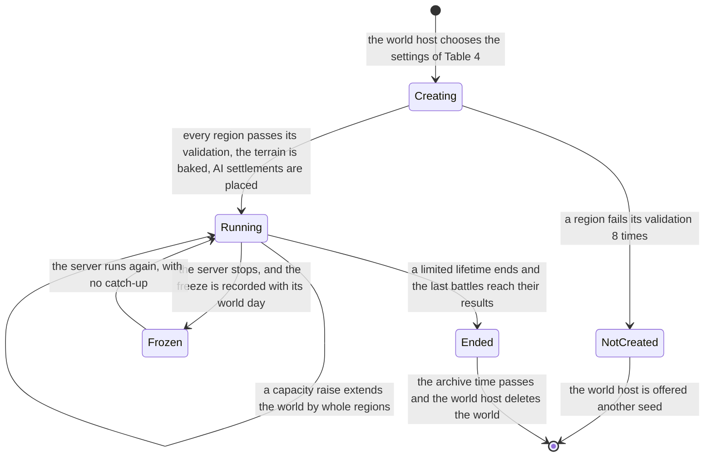
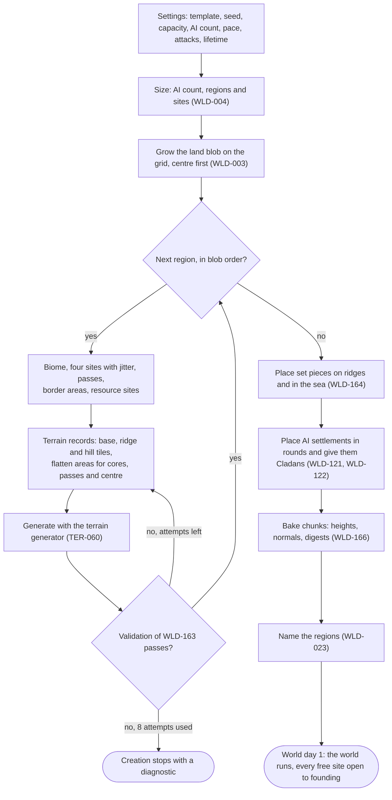
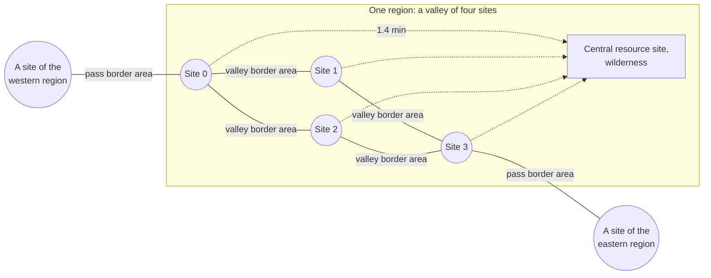
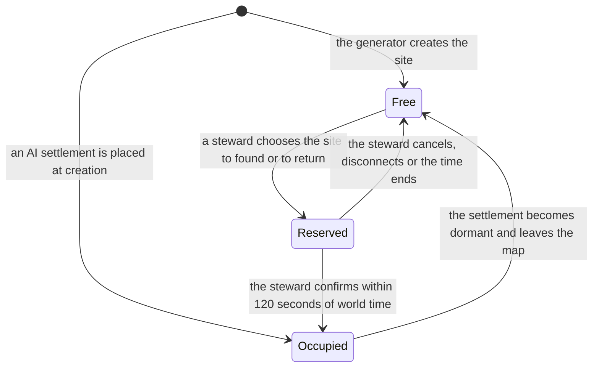
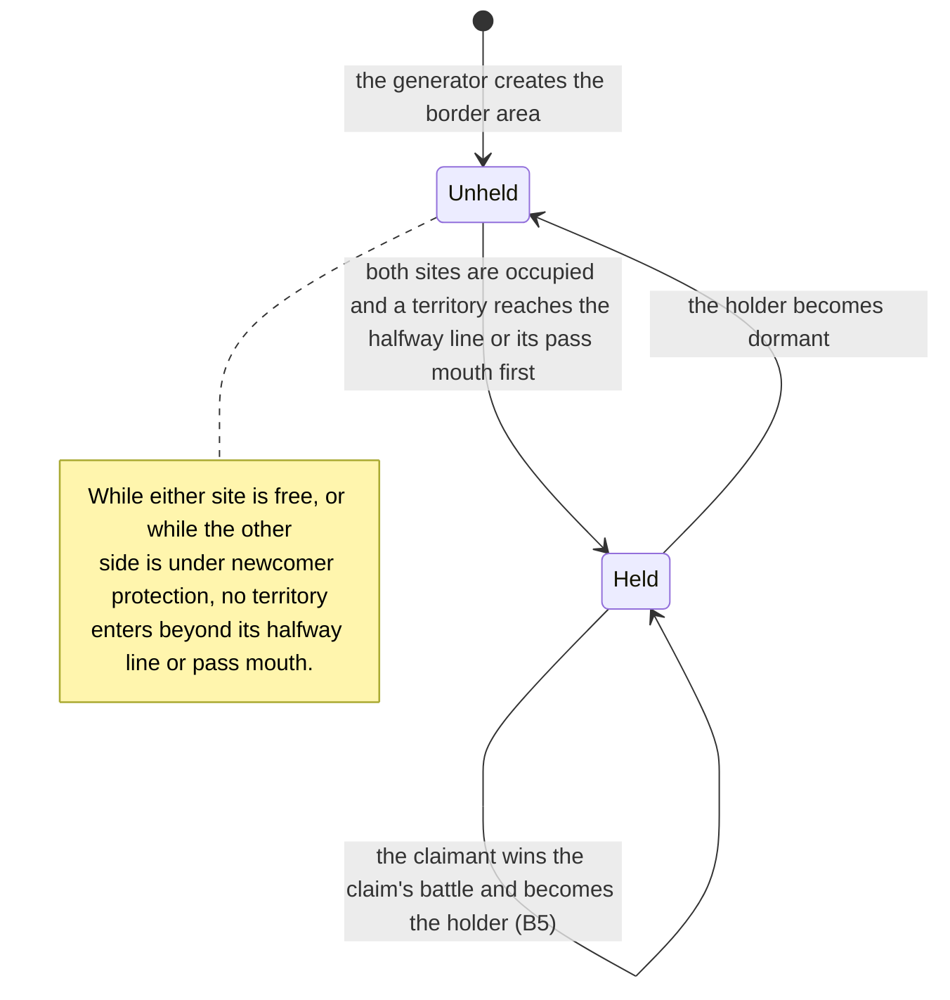
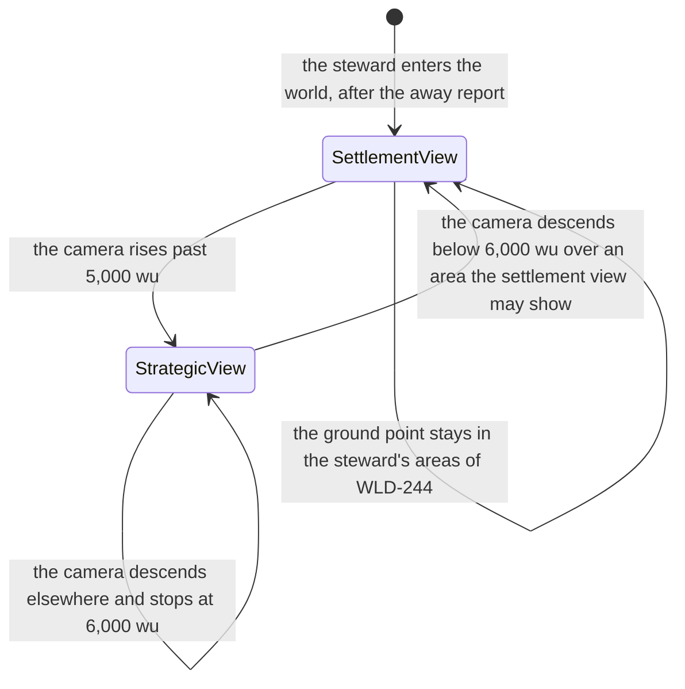

# World and regions

> Status: Draft · Prefix: WLD · Rationale: `../rationale/A1.md` · Related: [vision, pillars and core loops](00_vision_pillars_and_core_loops.md) · [owner decisions](../decisions/owner_decisions.md) · [adoption ledger 08](adoption_ledger/08_maps_and_level_design_ledger.md) · [maps: rules and conventions](../reference/08_maps_and_level_design/rules_and_conventions.md) · [map editor hooks](../reference/08_maps_and_level_design/map_editor_hooks.md) · [terrain](../architecture/components/terrain/README.md) · [conventions](../CONVENTIONS.md) · [GDD index](README.md)

## 1 Purpose and player experience

### 1.1 What this document decides

This document specifies the shape of a Species world: its size and extent for a given number of stewards, its regions, its settlement sites, the geometry of territories, cores, border areas and contact, where resources lie, how far apart things are and how long travel takes, how many AI settlements a world starts with and where they stand, how a steward finds a site, how the terrain is made, the biomes and their looks, the world calendar on top of world time (O4), the world lifetime (PIL-067), and the strategic view and the settlement view in the reference visual language (O9). It also decides the Open decisions of the reference map documents that the triage gives area A1 (§9), so it states the rules of skirmish maps and map tools where those decisions change them.

Every number of the world geometry comes from the world-density model `Tools/DesignModels/A1WorldDensity.py`, whose `check` mode reproduces every figure that §1.3, §2.6 and §2.15 state. The mechanics that live on top of this geometry belong to their areas: territory growth and the population limit to B1, resource kinds and yields to B2, construction to B3, expeditions, travel speed and battles to B4, grievances, claims and Cladans to B5, protection and dormancy to B6, AI settlements to B7, the server and its budgets to A2, and terrain streaming, coordinates and path-finding to D8. Where this document sets a target that another area meets, the target names the area.

### 1.2 The world in one paragraph

A Species world is one continent ringed by black-lit sea. The continent is a compact blob of square regions, and each region is a valley: a basin of open ground enclosed by a border ridge, holding four settlement sites in a two-by-two pattern. Two sites of one valley are valley neighbours, and the land between them is a border area that the first of them to grow into it holds. A pass crosses the ridge between two regions and links one site on each side; its corridor is a border area too. The centre of every valley holds a rich resource site that no territory covers, so the four settlements of a valley meet there with expeditions. A steward who joins founds at a free site; the world offers first the sites with neighbours, so nobody founds alone in an empty valley. Valley neighbours are two minutes apart on foot, the next valley six, and the far side of a world of 200 stewards an hour. From high above, the strategic view shows the whole continent in the same flat-shaded, glowing style as a battle: territories in their Cladan's colour, border areas and claims, expeditions as glowing marks; below a camera height of 5,000 wu the settlement view shows the crowds themselves.

### 1.3 The world at a glance

| | 1 steward (solo) | 16 stewards | 200 stewards |
|---|---|---|---|
| Regions (valleys) | 3 | 7 | 65 |
| Settlement sites | 12 | 28 | 260 |
| AI settlements at creation | 9 | 10 | 58 |
| Free sites at creation, of them spare | 3, 2 | 18, 2 | 202, 2 |
| World extent (square, sea included) | 20,480 wu | 25,600 wu | 61,440 wu |
| Land height samples at 16 wu | 0.31 million | 0.72 million | 6.66 million |
| Settlements per region at full occupancy | 3.3 | 3.7 | 4.0 |
| Valley neighbour, Wellspring to Wellspring, at 20 wu/s | 2.0 min | 2.0 min | 2.0 min |
| Across the world, at 20 wu/s | 14 min | 23 min | 66 min |
| First valley contact, always-on pace | day 5 | day 5 | day 5 |
| Mean territory contacts per settlement at full occupancy | 2.0 | 2.5 | 2.8 |
| Battles in progress, 99th percentile at the evening peak (6 battles per settlement per week) | 1 | 2 | 5 |

*Table 1 — The world at 1, 16 and 200 stewards, from the world-density model (§2.15). "Day" is a world day (WLD-200).*

### 1.4 Player experience

| Timescale | What the steward meets | What this document guarantees |
|---|---|---|
| Joining | A list of free sites, the best ones first, each with its region, its biome, its neighbours and its passes | No recommended site is alone in its valley (WLD-140); every site has the same core, the same home resources and two valley neighbours (WLD-042) |
| Days 1 to 5 | Growth in an uncontested home cell; the valley's other settlements visible across open ground | First valley contact on world day 5, at both paces (WLD-064) |
| Week 2 on | Border areas held and claimed; expeditions to the valley centre and over passes; attacks with a warning | Two or three territory contacts per settlement (WLD-065); every attack path short enough that the warning of PIL-025 comes from the attack's hold, never from a long march (WLD-102) |
| Weeks | A world that stays the same shape; a lifetime that ends it, or none | Terrain never changes during play (WLD-160); the lifetime is fixed in advance and only lengthened (WLD-221) |
| Every session | The strategic view of the whole continent, the settlement view of one's own settlement and battles | The same visual language at every height (WLD-245); the strategic view never shows what the steward's settlement cannot see (WLD-242) |

*Table 2 — The player experience of the world, by timescale.*

The world serves pillar 3 through geography: every conflict has a place on the map (a border area, a pass, a valley centre) that both sides can point at. It serves pillar 6 through equal sites and a founding order that seats a late joiner among neighbours of median strength. It serves pillar 5 by drawing the strategic view with the renderer's visual language and nothing else.

### 1.5 How to read this document

- **Units.** Distances are in world units (wu); one wu is about one metre (R-SIM-365). Simulation durations are in ticks of `ref.sim.tick_period`; this document writes travel in minutes of world time at a stated speed, and the area that owns each timer converts it to ticks under its own key.
- **World days.** A duration of the economy, relations or protection is written in world days of the world calendar (WLD-200), which already contains the conversion of PIL-103: one world day is 24 hours of world time at the always-on pace and 2 hours at the session pace. Travel, battles and the movement of Workers run at the tick rate at both paces (PIL-101).
- **Placeholders.** The model needs values that later areas set: the territory growth curve (B1), the population of a settlement at its plateau (B1), the expedition speed (B4), the share of attacks that present stewards declare (B5). Each is marked as a placeholder in the model and in §2.15, with the area that sets it; when that area sets the value, the model is run again and §2.15 and Table 1 follow.
- **Terms.** The terms of CONVENTIONS §8.15 are used with their meanings. This document also uses resource site and border area (PIL-120), and the terms that §8 proposes for registration: pass, home cell, biome, world template, set piece and world day.

## 2 Rules

### 2.1 The world: shape, extent and capacity

**WLD-001** (MUST) A world is one continent of land regions inside a square extent of sea. The extent is a square of side *G* × `wld.region.side` (5,120 wu), where *G* is the grid side of WLD-003, with its corner at (0, 0) and every coordinate of the world in [0, *G* × 5,120] on both horizontal axes. Every region cell of the grid that is not a land region is sea at the outside height `wld.terrain.outside_height` (−10 wu), and the land blob keeps a sea ring of `wld.world.sea_ring` (1) region cell on every side, so the world's whole border is sea, as the terrain mesh needs (R-MAP-198, RND-132).

**WLD-002** (MUST) Every settlement site, every pass and every resource site of a world is reachable from every other one over land, through the travel network of WLD-100. No Worker or Leader ever needs to cross water, which is impassable to them (R-SIM-365, R-SIM-377, R-SIM-378), and no rule of the world game depends on a Transport crossing the sea.

**WLD-003** (MUST) The land regions form a compact blob that the world generator grows on a square grid of *g* = ⌈√(`wld.world.blob_area_factor` (1.25) × *R*)⌉ cells per side, where *R* is the region count: the cells are ordered by their distance from the grid's centre plus a seeded jitter of up to `wld.world.blob_jitter` (0.35) cells, and the generator takes cells in that order, each one only if it shares a side with a cell already taken, until it has *R*. The grid side of the world is *G* = *g* + 2 × `wld.world.sea_ring`. The blob is connected by construction; its shape depends only on the world seed and *R* (WLD-161).

**WLD-004** (MUST) A world of steward capacity *S* (WLD-005) has *A*₀ = round(`wld.ai.base_count` (6) + `wld.ai.per_steward` (0.25) × *S*) AI settlements before the last region is filled, *R* = max(`wld.world.min_regions` (3), ⌈(*S* + *A*₀ + `pil.world.free_sites_min`) ÷ `wld.region.sites` (4)⌉) regions and 4 × *R* settlement sites. The AI count *A* of the world is then 4 × *R* − *S* − `pil.world.free_sites_min`, so the sites that rounding to whole regions adds go to AI settlements and the world starts with exactly the free sites that PIL-068 asks for (WLD-121). Table 3 gives the figures.

| Capacity *S* | AI settlements *A* | Sites | Regions *R* | Grid side *G* | Extent (wu) | Land samples at 16 wu |
|---|---|---|---|---|---|---|
| 1 | 9 | 12 | 3 | 4 | 20,480 | 307,200 |
| 4 | 10 | 16 | 4 | 5 | 25,600 | 409,600 |
| 8 | 10 | 20 | 5 | 5 | 25,600 | 512,000 |
| 16 | 10 | 28 | 7 | 5 | 25,600 | 716,800 |
| 50 | 20 | 72 | 18 | 7 | 35,840 | 1,843,200 |
| 100 | 34 | 136 | 34 | 9 | 46,080 | 3,481,600 |
| 200 | 58 | 260 | 65 | 12 | 61,440 | 6,656,000 |

*Table 3 — World size by steward capacity (WLD-003, WLD-004; `A1WorldDensity.py report`).*

**WLD-005** (MUST) The steward capacity of a world is the number of stewards it can hold at once. The world host sets it when the world is created: from 1 to `wld.world.capacity_max_integrated` (16) for an integrated world, from 1 to `wld.world.capacity_max_dedicated` (16) for a community dedicated server, and from 1 to `wld.world.capacity_max_hosted` (200) for a hosted world of stage 3 (O1, O5; PIL-110). The capacity counts stewards only, and AI settlements do not take a steward's place. A steward whose settlement is dormant (PIL-078) keeps a place for `wld.world.dormant_place_days` (42 world days) after the settlement became dormant, so that a return always finds a place (WLD-143); after that the place is released, and a later return needs a free place.

**WLD-006** (MUST) The world host chooses the settings of Table 4 when the world is created. The settings marked fixed never change for the life of the world; the others change only as their requirement allows, and every change is recorded with its world time and shown on the join page (PIL-130).

| Setting | Values | Default | Fixed | Requirement |
|---|---|---|---|---|
| world template | one entry of the template catalogue (WLD-160) | the first entry | yes | WLD-160 |
| world seed | an unsigned 64-bit number | drawn at creation, shown to the host | yes | WLD-161 |
| steward capacity | WLD-005 | 4 integrated, 16 dedicated, 200 hosted | raised only (WLD-008) | WLD-005 |
| AI settlements | from `wld.ai.min_count` (2) to the *A* of WLD-004 | *A* of WLD-004 | yes | WLD-120 |
| world pace | always-on or session (PIL-100) | session for an integrated world, always-on otherwise | yes (PIL-104) | PIL-104 |
| attacks between stewards | on or off (PIL-063) | off integrated, on dedicated (O33) | yes | PIL-063 |
| world lifetime | unlimited, or 28 to 364 world days | WLD-220 | lengthened only (WLD-221) | WLD-220 |
| seasonal theme | on or off, when DEC-101 keeps the theme | on | no | WLD-185 |

*Table 4 — The world settings that the world host chooses at creation.*

**WLD-007** (MUST) The formulas of WLD-003 and WLD-004 hold for every capacity up to `wld.world.capacity_limit` (256): at that capacity the extent is 66,560 wu, 4,160 height samples per side at the cell size of WLD-162, below the content-build limit `ter.grid.max_samples_per_side` (32,768) of TER-250. A capacity above the limit is refused at world creation with a diagnostic.

**WLD-008** (SHOULD) From stage 2, the world host SHOULD be able to raise the capacity of a running world. A raise that keeps the free sites of PIL-068 within the existing sites only lowers the spare count; a raise that needs more sites extends the world by whole regions, each grown onto a sea cell that touches the blob in the order of WLD-003 and generated from the same template and seed (WLD-161), keeping the sea ring of WLD-001 by growing the extent. An extension never moves, reshapes or regenerates an existing region, and the new regions' terrain chunks get new content digests (WLD-166). The capacity is never lowered below the number of stewards with a settlement in the world.

### 2.2 Regions

**WLD-020** (MUST) A region (`Region`) is one land cell of the world grid: a square of side `wld.region.side` (5,120 wu), aligned with the terrain chunks of side `wld.terrain.chunk_side` (1,024 wu), 5 × 5 chunks per region. A region holds `wld.region.sites` (4) settlement sites, one central resource site, its border areas and its share of the passes. Every settlement, its territory and its structures lie inside the region of its site; this is the unit of the world's simulation partitioning that A2 builds on (vision §5).

**WLD-021** (MUST) Every region is a valley enclosed by a border ridge. Along each side of the region, the band of half-width `wld.region.ridge_half_width` (320 wu) on each side of the region border is ridge: its crest stands at least `wld.region.ridge_rise_min` (160 wu) above the highest site plateau of the two regions it separates, and on every straight line that crosses the band outside a pass, at least one terrain sample within the band has a normal whose y component is below `ref.sim.walk.min_normal_y` (0.8), so the walkability test of R-SIM-335 fails and no land route crosses the ridge. Along a side that faces sea, the ridge band falls to the coast instead and is walkable nowhere into the water.

**WLD-022** (MUST) Each region has an id, its grid cell (*i*, *j*), its biome (WLD-181), its name, its four sites in a fixed local order (0 at low *x* and low *z*, 1 at high *x*, 2 at high *z*, 3 at high *x* and high *z*), its central resource site, its four valley border areas and the passes on its sides. These are world data, created once by the world generator and never changed, except by an extension of WLD-008, which adds regions and passes and changes no existing one.

**WLD-023** (MUST) A region's name is new text drawn at world creation, without repetition within a world, from a list of `wld.region.names` (120) names under the string ids `region.name.<nnn>`; the draw uses the world seed (WLD-161). A world of more regions than the list holds names the extra regions by a name of the list and a numeral.

**WLD-024** (MUST) Two land regions that share a side are joined by `wld.region.passes_per_side` (1) pass: a corridor of width `wld.pass.width` (384 wu) through the two ridge bands, straight across the shared side, whose floor has a terrain normal y component of at least `wld.pass.min_normal_y` (0.9) everywhere along its centre line and never lies at or below sea level. On a side along *x* between the regions (*i*, *j*) and (*i* + 1, *j*) the pass lies on the row of local sites 0 and 1 when *i* + *j* is even, and on the row of sites 2 and 3 when it is odd; on a side along *z* between (*i*, *j*) and (*i*, *j* + 1) it lies on the column of sites 0 and 2 when *i* + *j* is odd and on the column of sites 1 and 3 when it is even. A pass therefore links exactly one site of each region, the site of that row or column next to the shared side, and each site has between 0 and 2 passes.

### 2.3 Settlement sites

**WLD-040** (MUST) The four sites of a region stand in a two-by-two pattern: the site centres lie at the region's low corner plus (*o* + *a* × `wld.site.spacing`, *o* + *b* × `wld.site.spacing`) for (*a*, *b*) in (0, 0), (1, 0), (0, 1) and (1, 1), where `wld.site.spacing` is 2,080 wu and *o* = (5,120 − 2,080) ÷ 2 = 1,520 wu, each moved by a seeded jitter of up to ± `wld.site.jitter` (128 wu) on each axis (WLD-161). Valley neighbours (sites 0 and 1, 2 and 3, 0 and 2, 1 and 3) stand 2,080 wu apart before the jitter; the two diagonal pairs stand 2,942 wu apart and are not valley neighbours.

**WLD-041** (MUST) Every settlement site (`SettlementSite`) is a level plateau: the terrain inside its core, the disc of radius `wld.site.core_radius` (400 wu) around the site centre, is flattened to one height between `wld.site.height_min` (20 wu) and `wld.site.height_max` (120 wu) above sea level, every terrain normal inside the core has a y component of at least `wld.site.core_min_normal_y` (0.95), and no terrain sample within `wld.site.water_clearance` (600 wu) of the site centre is at or below sea level. The site's Wellspring stands at its centre (B1 decides the structure, PIL-004).

**WLD-042** (MUST) Every site of a world is equal in what it is given: the same core, the same home resource sites with the same yield within the tolerance of WLD-081, and two valley neighbours. Sites differ only in their position, biome and number of passes (0, 1 or 2; rim regions have fewer), and the founding choice shows each of these before the steward chooses (WLD-140), so that no first site is richer than a later one (PIL-015, Table 1 of PIL-016).

**WLD-043** (MUST) A site is in one of three states: **free** (no settlement stands on it), **reserved** (a steward is confirming a founding or a return there, for at most `wld.founding.reserve_seconds` (120 s of world time), WLD-141) and **occupied** (a settlement stands on it). A settlement that becomes dormant leaves its site, which becomes free at once (PIL-078). AI settlements occupy their sites from world creation and never leave them.

**WLD-044** (MUST) A site record holds: its id, its region and local index, its centre (*x*, *z*) and plateau height, its state and its settlement, its home cell (WLD-061), its two valley border areas and its pass border areas (WLD-062), and its home resource sites (WLD-082). Every field except the state and the settlement is world data that the generator writes once.

### 2.4 Territory, border areas and contact

**WLD-060** (MUST) A settlement's territory (`Territory`) is always inside the union of its core, its site's home cell and the border areas it holds. B1 grows it from a founding territory of radius `wld.territory.founding_radius` (500 wu) around the Wellspring up to the largest radius `wld.territory.max_radius` (1,400 wu), and on its way it stops at: the region's ridge band (WLD-021), except into a pass corridor that it holds; `wld.territory.site_clearance` (200 wu) outside the core of every other site, free or occupied, so that no territory ever covers a site that a steward could found on; `wld.resource.wild_clearance` (150 wu) short of every central resource site (WLD-083); and the near edge of a border area held by another settlement.

**WLD-061** (MUST) A site's home cell is the part of its region, outside the ridge bands, that is nearer to the site's centre than to the centre of either of its valley neighbours and within `wld.territory.max_radius` of its own centre, minus the site's two valley border areas. A home cell is never claimable: the only claimable areas of a world are its border areas and its contested resource sites (PIL-120), so a settlement's core and the rest of its home cell are never taken by a claim (PIL-121). At plateau in a full valley, a settlement that holds one of its two valley border areas covers 4.84 million wu², of which the core is 0.50 million.

**WLD-062** (MUST) A world has two kinds of border area (`BorderArea`), each named, static and created by the world generator: a **valley border area** for each pair of valley neighbours, the lens in which the two discs of radius `wld.territory.max_radius` around their site centres overlap, inside the region and outside the ridge bands, 720 wu wide on the line between the two sites before the jitter; and a **pass border area** for each pass, the corridor of WLD-024 between its two pass mouths. A border area belongs to the region that holds its centre; a pass border area's centre lies on the region border and it belongs to the region of the lower id.

**WLD-063** (MUST) A border area is unheld, or held by exactly one settlement. While the site of either side is free, it stays unheld, and neither side's territory enters it beyond the line halfway between the two site centres (valley) or beyond its own pass mouth (pass). While both sides are occupied, it is held by the first settlement whose territory reaches that halfway line (valley) or its own pass mouth (pass); on equal ticks, by the settlement whose site has the lower id. The held area joins the holder's territory, and the other settlement's territory stops at its near edge. It changes holder only by a claim (PIL-121, B5), and it becomes unheld when its holder becomes dormant. While one side is under newcomer protection (B6), the other side cannot come to hold it; when the protection ends, the first rule applies from that tick.

**WLD-064** (MUST) Two settlements are in contact while their territories meet: at a valley border area once each territory has reached its halfway line or one holds the area and the other's territory reaches its edge, and at a pass border area once both have reached their pass mouths. With the geometry of this section, contact needs a territory radius of 1,040 wu toward a valley neighbour and 1,200 wu toward a pass mouth. B1 grows the territory of a settlement founded at the start of a world so that it reaches 1,040 wu by world day `wld.contact.valley_day` (5) and 1,200 wu by world day `wld.contact.pass_day` (9) of the world calendar at the typical pattern (PIL-102); with a growth curve whose radius rises with the square root of time to the plateau of day 14 (PIL-055), the model meets both (day 5.0 and day 8.5), and with a growth that is linear in time, it does not (day 8.4 and day 10.9). A late joiner founding beside a neighbour at plateau comes into contact with it when its newcomer protection ends (WLD-063), because the neighbour then takes the shared border area at once and its edge lies 680 wu from the late joiner's site, which the late joiner's territory has reached by world day 0.6; B1 and B6 decide whether the late joiner's growth reaches the halfway line (1,040 wu) within its newcomer protection, which would give it the border area instead (PIL-029).

**WLD-065** (MUST) At full occupancy the mean number of territory contacts per settlement is between 2.5 and 3.0 at 16 and at 200 stewards (`wld.contact.degree_band`), and every steward's settlement founded at a recommended site (WLD-140) has at least `wld.contact.degree_min` (2) contacts once its valley is full. Table 5 gives the model's figures at lower occupancy; settlements of a valley also meet over its central resource site, which these counts leave out.

| Stewards present of capacity | 16: settlements per region | 16: mean contacts | 16: a steward's contacts | 200: settlements per region | 200: mean contacts | 200: a steward's contacts |
|---|---|---|---|---|---|---|
| 25 % | 2.0 | 1.7 | 3.0 | 1.7 | 1.9 | 2.0 |
| 50 % | 2.6 | 2.2 | 2.5 | 2.4 | 2.5 | 2.7 |
| 100 % | 3.7 | 2.5 | 2.5 | 4.0 | 2.8 | 2.8 |

*Table 5 — Density and territory contacts at plateau by occupancy, with AI settlements placed by WLD-121 and stewards founding by WLD-140 (`A1WorldDensity.py report`). With founding in random order instead of WLD-140, 12 % of the stewards of a world of 200 at 25 % occupancy found with no contact at all.*

**WLD-066** (MUST) The server records a contact event, with its world time, its two settlements and its border area, when two settlements come into contact, when a border area becomes held, and when a territory reaches the edge of a border area that another settlement holds. These events are the territory-pressure input of B5's grievances (PIL-120, PIL-124): they come from the growth of territories, which a settlement's growth decides, never from a Worker's choice of task.

### 2.5 Resource distribution

**WLD-080** (MUST) A resource site (`ResourceSite`) is a fixed place where Workers gather (PIL-120). A world has four classes of resource site, placed by the world generator and never moved: **home** resource sites inside each site's home cell; one **border** resource site at the centre of each valley border area; one **pass** resource site at the centre of each pass border area; and one **central** resource site at the centre of each valley, outside every territory. A region therefore holds 32 home, 4 border and 1 central resource site, and a share of the pass resource sites of its sides (0.84 per site on average in a world of 200, from 109 passes over 260 sites).

**WLD-081** (MUST) B2 sets the resource kinds and their yields; this document sets where they lie and how their values compare. With B2's weights: the home resource sites of every settlement site have the same mix of kinds and the same total yield within `wld.resource.home_yield_tolerance` (5 %); a border resource site yields `wld.resource.border_factor` (1) times a home resource site of the same kind, a pass resource site `wld.resource.pass_factor` (2) times and a central resource site `wld.resource.central_factor` (3) times. A border or pass resource site is held with its border area; a central resource site is held by no territory, and B2 and B5 say how a settlement gathers there and claims it (PIL-120).

**WLD-082** (MUST) Each site has `wld.resource.home_inner` (3) home resource sites at a distance of 250 to 480 wu from its centre (`wld.resource.inner_band`), inside its founding territory, and `wld.resource.home_outer` (5) at 600 to 1,100 wu (`wld.resource.outer_band`), all inside its home cell, at least 200 wu from each other, from the site's border areas and from the ridge band. Their directions are spread evenly (120° apart for the inner ones, 72° for the outer ones) from a seeded starting angle, and a direction that would leave the home cell turns, in steps of 5°, toward the site's outward corner until it fits.

**WLD-083** (MUST) A central resource site stands on a level area of radius 120 wu at the centre of its valley, 1,471 wu from each of the valley's four site centres before jitter, and every territory stops `wld.resource.wild_clearance` (150 wu) short of it (WLD-060), so it is always wilderness: land that no settlement's territory covers. Each of the valley's four settlements reaches it in 1.4 minutes at 20 wu/s.

**WLD-084** (MUST) Resource sites are world data: they keep their places for the life of the world. B2 may let a resource site deplete and renew in place; no rule of the world game creates, moves or removes a resource site during play, so that the equality of WLD-081 holds at every point of a world's life, for late joiners as for the first stewards (PIL-015).

### 2.6 Travel

**WLD-100** (MUST) The travel network of a world is a graph whose nodes are its settlement sites and its central resource sites, and whose edges are: each pair of valley neighbours, with a length of their distance × `wld.travel.valley_path_factor` (1.15); each pass, between the two sites it links, with a length of their distance × `wld.travel.pass_path_factor` (1.20); and each site with its valley's central resource site, with a length of their distance × 1.15. The factors are the ratio of a walkable path over the generated terrain to the straight line, and the generator's validation (WLD-163) checks that the land route of R-SIM-345 between the two ends of every edge is no longer than the edge. D8's world path-finding follows this network between regions; inside a region the land route graph of reference/12 applies.

**WLD-101** (MUST) The travel times of Table 6 hold at the march speed of 20 wu/s, the Worker's speed `ref.unit.worker.speed` (R-UNIT-011), and at the formation speed of 12 wu/s (the Leader's speed × the formation factor). The world meets these limits at the march speed: a valley neighbour within `wld.travel.valley_minutes_max` (2.5 minutes), a pass neighbour within `wld.travel.pass_minutes_max` (4 minutes), one region hop within `wld.travel.hop_minutes_max` (6.5 minutes), and the world's diameter within `wld.travel.diameter_minutes_16` (25 minutes) at a capacity of 16 and `wld.travel.diameter_minutes_200` (70 minutes) at 200.

| Leg | Distance (wu) | At 20 wu/s (min) | At 12 wu/s (min) |
|---|---|---|---|
| A Wellspring to the halfway line of a valley border area | 1,040 | 0.9 | 1.4 |
| A site to its valley's central resource site | 1,691 | 1.4 | 2.3 |
| Valley neighbour, Wellspring to Wellspring | 2,392 | 2.0 | 3.3 |
| Pass neighbour, Wellspring to Wellspring | 3,648 | 3.0 | 5.1 |
| One region hop, valley centre to valley centre | 7,100 | 5.9 | 9.9 |
| World diameter, capacity 16 | 27,423 | 22.9 | 38.1 |
| World diameter, capacity 200 | 79,132 | 65.9 | 109.9 |

*Table 6 — Travel distances and times over the travel network (`A1WorldDensity.py report`, seed 1). Travel runs at the tick rate at both paces (PIL-101).*

**WLD-102** (MUST) Between two settlements in contact, an attacking expedition reaches the target's territory 0.9 minutes after it leaves its Wellspring at 20 wu/s, so the warning of PIL-025 (`pil.conflict.warning_minutes`, 10 minutes) comes from the attack's hold, never from distance: the expedition enters the target's territory no sooner than the warning time after the warning went out (A0 Figure 5). The server estimates the remaining travel of an attacking expedition as its remaining path length over the travel network divided by the expedition's speed, and sends the warning at the later of the declaration and the estimated arrival minus the warning time; an expedition that would arrive sooner waits at the edge of its own territory or of the last area it may enter (B5 and B6 specify the hold, the warning and their texts). At the always-on pace the hold of an attack on a settlement in contact is 9.1 minutes; at the session pace, a warning that B6 converts by PIL-103 (50 seconds) is shorter than the 52 seconds of travel, and the attack needs no hold.

**WLD-103** (MUST) A journey takes the same world time at both paces, so at the session pace it is twelve times longer measured in world days: the 2 minutes to a valley neighbour are 0.0014 world days at the always-on pace and 0.017 at the session pace. B2 and B4 size what an expedition gathers or carries per journey with this ratio at both paces.

**WLD-104** (MUST) B4 sets the speed of an expedition. Where it differs from 20 wu/s, the times of Table 6 scale with it, and the model (`A1WorldDensity.py`, input `march_speed_wus`) is run again to check the limits of WLD-101 before B4's value is final.

### 2.7 AI settlements and free sites

**WLD-120** (MUST) A world starts with the AI settlements of WLD-004. The world host may lower their number at creation to no fewer than `wld.ai.min_count` (2); the sites it frees stay free and raise the spare count. AI settlements populate the world from its start (PIL-008), and the count never changes afterwards: AI settlements never found a settlement, move, take a free site or become dormant.

**WLD-121** (MUST) The world generator places the AI settlements at creation in rounds over the regions in the order of WLD-003 (the centre first): in the first round on local site 0 of each region, in the second on local site 3 (the site diagonal to it, so the two are not valley neighbours), in the third on local site 1 and in the fourth on local site 2, until the AI count is reached. When there are at least as many AI settlements as regions, every region holds one, so every valley has a settlement from day 1 and every free site has an AI settlement in its valley.

**WLD-122** (MUST) The generator gives the AI settlements their Cladans in placement order, in turn over the world's `pil.world.cladan_count` Cladans, passing over a Cladan that an AI valley neighbour already has whenever another one is available, so that the Cladans differ by at most one AI settlement in count and valley neighbours differ in Cladan where they can (B5 may replace this rule).

**WLD-123** (MUST) The free sites of a world number 4 × *R* − *A* minus the settlements of stewards on the map. With *S* + 2 = 4 × *R* − *A* (WLD-004), they are the places for further stewards plus `pil.world.free_sites_min` (2) plus the dormant settlements whose stewards keep a place (WLD-005), so never fewer than PIL-068 requires. A dormant settlement frees its site and so raises the count; its steward's return takes a free site (WLD-143). The server refuses a change of settings that would break the rule, and a raise of capacity that needs more sites extends the world (WLD-008).

### 2.8 Founding, returns and late joiners

**WLD-140** (MUST) The founding choice lists every free site of the world, ranked by its score, `wld.founding.valley_weight` (2) × its occupied valley neighbours + `wld.founding.pass_weight` (1) × its occupied pass neighbours, highest first, then by its region's place in the order of WLD-003, then by site id. The first `wld.founding.highlighted` (3) are highlighted and one of them is recommended (WLD-142). For each site it shows the region, the biome, the passes and the public facts of its neighbours (WLD-242); a site with a score of 0 is marked as having no neighbour yet. The steward may choose any free site. C2 specifies the page.

**WLD-141** (MUST) Choosing a site reserves it for that steward for `wld.founding.reserve_seconds` (120 seconds of world time), during which no other steward can choose it; confirming founds the settlement there, and cancelling, disconnecting or the end of the time frees it. A freeze stops the reservation's time with the world's (PIL-076). Two choices of one free site in one tick are taken in the order of the server's command sequence.

**WLD-142** (MUST) The recommended site is the highlighted site whose occupied valley neighbours have the mean strength (PIL-058) nearest to the median strength of the world's settlements; the server computes it, and the choice shows only that the site is recommended, never a strength, so the recommendation reveals nothing that the steward's settlement could not see (PIL-084). With it, a late joiner is seated among neighbours of median strength rather than next to the strongest settlement (PIL-029).

**WLD-143** (MUST) A steward whose settlement became dormant returns through the same choice and recommendation, and the settlement is placed again at the chosen free site with its stores and structures, as B1 and B3 specify, under a respite (PIL-078; B6). Newcomer protection and catch-up are not given again (PIL-088).

**WLD-144** (MUST) A steward may found at any point of a world's life until it ends (PIL-068), including its final notice period (WLD-222); an ended world takes no founding.

### 2.9 Terrain: the hybrid world generator

**WLD-160** (MUST) Species makes world terrain by a hybrid of procedure and authoring. The world generator takes an authored world template (WLD-167) and the world seed, lays the world out by the rules of this document, places the reference generator's terrain tiles and flatten areas (TER-003, TER-004) region by region from the template's parameter sets, and adds authored set pieces (WLD-164). It runs once, at world creation, and bakes the result into terrain chunks (WLD-166). The terrain of a world never changes during play: no rule of the world game raises, lowers or levels it, so TER-002 holds for a world as for a skirmish map. The first world-game milestone ships `wld.template.count_first` (1) world template, and launch `wld.template.count_launch` (3).

**WLD-161** (MUST) A world's layout and terrain records depend only on the content digest of its template, its world seed and its capacity and AI count. Every random choice of the generator is a counter-based value keyed by the world seed, the purpose of the draw, the region id and the item index (A2's random-generator decision, DEC-242), so a region's records depend on no other region's draws, an extension (WLD-008) leaves every existing region identical, and the same template, seed, capacity and AI count give the same world on any server.

**WLD-162** (MUST) The terrain records of a region are: one base tile over the region at the height band of WLD-041; ridge tiles along each side (WLD-021); hill tiles in the outer parts of the home cells and in the wilderness; and flatten areas for each site's core (Absolute, half-size at least `wld.site.core_radius`), for each pass corridor and for the central resource site. A region has at most `wld.terrain.tiles_per_region_max` (24) tiles and `wld.terrain.flatten_per_region_max` (12) flatten areas, each owned by the region and lying inside its square widened by the ridge half-width, with parameters inside the envelope of the reference maps (reference/08 table 2.8-B), except a tile size of up to 5,760 wu and peaks of up to `wld.terrain.peak_height_max` (900 wu). The world uses the cell size `wld.terrain.cell_size` (16 wu), the median of the reference maps, and the outside height `wld.terrain.outside_height` (−10 wu); its generation methods are 0, 1 and the unbiased method 3, and its flatten types 0, 1, 2, 4 and the unbiased smooth 5 (WLD-268).

**WLD-163** (MUST) After generating a region, the generator validates it: a sea border (WLD-001), reachability (WLD-002), ridges that the walkability test blocks along lines `wld.generation.ridge_probe_spacing` (64 wu) apart across every ridge band outside the passes (WLD-021), pass floors (WLD-024), site plateaus (WLD-041), home yields at B2's weights (WLD-081) and travel limits (WLD-100, WLD-101). A region that fails a check is generated again with the attempt number in the key of its draws (WLD-161), up to `wld.generation.max_attempts` (8) times; a region that still fails stops the world's creation with a diagnostic that names the region and the check, and the world host is offered another seed.

**WLD-164** (MUST) A set piece (`SetPiece`) is an authored terrain feature (terrain tiles and flatten areas, and the scenery meshes it places) with a footprint radius, which the generator places as a landmark: up to `wld.setpiece.per_region_max` (2) per region, only on a ridge band outside the passes or in the sea, at least `wld.setpiece.clearance` (800 wu) from every site centre and every pass centre line, so that no set piece changes what a site is given (WLD-042). Launch has `wld.setpiece.count_launch` (8) set pieces.

**WLD-165** (MUST) World generation runs on the world's server when the world is created, never inside a tick, as a background job in an integrated server, and shows its progress region by region to the world host. On the reference test machine (DEC-971) it takes no more than `wld.generation.budget_16_s` (20 seconds) at a capacity of 16 and `wld.generation.budget_200_s` (120 seconds) at 200, bake included.

**WLD-166** (MUST) The baked terrain of a world is a set of chunks of side `wld.terrain.chunk_side` (1,024 wu), aligned with the regions. Each chunk holds its heights and simulation normals and the canonical digest of TER-252 over its heights; a chunk that is all sea at the outside height is held as that one value. The world's terrain digest is the SHA-256 of its chunk digests in chunk order. This is A1's input to D8 under DEC-246 (option B with D: baked region chunks, delivered by the server and cached by the client by digest) and DEC-247 (option B: one continuous height field in chunks aligned with the regions).

**WLD-167** (MUST) A world template (`WorldTemplate`) is an authored, typed and versioned asset of the map schema family (proposed schema id `maps.world_template`, which D4 registers in the data schemas): its biome weights (WLD-181), its terrain parameter sets per biome, its list of set pieces, its world lighting preset and its region name list. The content build validates it with the rules of ADR-059 and ADR-061, and every map tool writes it by R-MAP-388 to R-MAP-390 and validates it on save by R-MAP-400.

### 2.10 Biomes, lighting and weather

**WLD-180** (MUST) A biome (`Biome`) is a look and a terrain shape, never a rule. A world draws on `wld.biome.count` (6) biomes; each names one land colour ramp of `terrain.ramp`, one shore-wave gradient of `terrain.shore_wave_gradient`, one sea tile of `terrain.sea_tile`, a lighting preset (WLD-183), a weather preset (WLD-184), a terrain parameter set (WLD-162) and a tree density, as Table 7 gives. Every biome gives every site the same resources (WLD-081), and E2's environment brief gives each file number its look.

| Biome id | Land colour ramp | Shore-wave gradient | Sea tile | Terrain shape |
|---|---|---|---|---|
| `temperate` | file 01 | file 01 | file 01 | rolling hills, medium ridges |
| `highland` | file 02 | file 02 | file 01 | high ridges, rough hills |
| `arid` | file 03 | file 03 | file 03 | flat floors, mesas |
| `marsh` | file 04 | file 06 | file 03 | low floors, smooth hills |
| `ember` | file 05 | file 05 | file 04 | steep ridges, cones |
| `frost` | file 06 | file 04 | file 02 | high ridges, smooth hills |

*Table 7 — The biomes of the world game and the terrain assets each names (file numbers of the asset manifest; the frost set is the one that the seasonal theme forces, R-MAP-086).*

**WLD-181** (MUST) The generator gives each region one biome, drawn with the world seed from the template's weights; then, in region order, a region whose land neighbours all share one biome other than its own takes that biome, so that biomes form patches. Biomes are presentation and terrain shape: the simulation reads no biome.

**WLD-182** (MUST) Within `wld.biome.blend` (256 wu) of a border between two regions of different biomes, the renderer blends the facet colours of the two land colour ramps by distance, so the seam falls on the ridge; this is presentation only and never feeds the simulation (TER-007).

**WLD-183** (MUST) Lighting comes from named lighting presets (DEC-562, option B). A preset is two directional lights in the key-and-fill pattern of the reference maps: a neutral grey fill light with equal colour components and a warm key light whose red component exceeds its green, which exceeds its blue (R-MAP-088). A skirmish map selects a preset and may override any of its values; a biome selects a preset; in a world, the renderer lights the settlement view with the preset of the biome under the camera's ground point, blending to a new one over `wld.light.blend_seconds` (2 seconds of presentation time), and the strategic view with the template's world preset. Launch has `wld.light.preset_count_launch` (6) lighting presets.

**WLD-184** (MUST) Weather in a world is presentation only: a weather preset names the look-only effects a biome shows (snow, drawn by the client from the presentation generator), and no weather object exists in the world simulation. The lightning strike and the dust vortex, which hurt and push units (R-MAP-090), never act in a world in v1, because an unannounced loss in a settlement whose steward is away would break PIL-049; the world's hazards are B4's world events. Skirmish maps keep the map effects of R-MAP-073 except the Essence-orb rain flag (WLD-265), grouped into weather presets, and an effect that changes play stays an explicit flag of the map (DEC-562).

**WLD-185** (MUST) A world has no time of day: its lights never change with world time, and no rule and no look depends on the hour, as no map expresses one (R-MAP-142) and as pillar 2 rules out play at set hours. If B4 keeps the seasonal theme (DEC-101), a world's seasonal state is world state: its server decides it once per real day from its own date by the date rule of R-META-102, records it in the world, and it changes presentation only (TER-042, DEC-118); the world host may switch it off.

### 2.11 World time and the world calendar

**WLD-200** (MUST) The world calendar counts world time (`WorldTime`, A2; O4) in world days and world weeks. A world day is `wld.calendar.day_hours` (24) hours of world time divided by the world's pace factor: 24 hours at the always-on pace and 2 hours at the session pace (`pil.pace.session_factor`, PIL-101); a world week is `wld.calendar.week_days` (7) world days. World day 1 begins when the world is created, and the calendar counts only time in which the world's server runs.

**WLD-201** (MUST) The world shows its calendar as the world day and the share of that day that has passed, as a dial, and never as a clock time of day (WLD-185). A duration of the economy, relations or protection (a respite, a claim, dormancy) is shown in world days; at the session pace it is also shown as the running time it takes (C3).

**WLD-202** (MUST) A duration that this document states in world days needs no further conversion at the session pace, because the world day contains it (PIL-103). An area that writes a timer of the economy, relations or protection in world days converts it to ticks as world days × `wld.calendar.day_hours` × 3,600 ÷ the pace factor ÷ `ref.sim.tick_period`.

**WLD-203** (MUST) While a world is frozen its calendar stops with world time (PIL-076); the record of each freeze (PIL-131) carries the world day and the share of the day at which the world froze, and the world day and share at which it ran again are the same.

### 2.12 World lifetime

**WLD-220** (MUST) A world's lifetime is unlimited, or a whole number of world weeks from `wld.lifetime.min_days` (28) to `wld.lifetime.max_days` (364) world days in steps of `wld.lifetime.step_days` (7). The default is unlimited for an integrated world (`wld.lifetime.default_integrated`) and `wld.lifetime.default_dedicated` (84 world days, 12 world weeks) for a dedicated server. Stage 1 builds the unlimited lifetime only (PIL-110, Table 10 of the vision document); limited lifetimes come with renown and the epilogue in stage 2 (PIL-125).

**WLD-221** (MUST) The world host may lengthen a limited lifetime, or make it unlimited, at any time before its final notice period begins (WLD-222); a lifetime is never shortened, and an unlimited lifetime never becomes limited. Every change is recorded with its world time, shown on the join page (PIL-130) and reported to every steward.

**WLD-222** (MUST) When `wld.lifetime.final_notice_days` (7) world days of a limited lifetime remain, every steward is told, in the client and in the away report. During the last `wld.lifetime.attack_close_days` (1) world day, no attack can be declared (B5 enforces it); an attack declared before then runs to its battle result.

**WLD-223** (MUST) When its lifetime ends, a world lets every battle in progress run to its end condition, which ends it within `pil.battle.max_minutes` (PIL-047), and then becomes ended: its simulation stops for good, the epilogue of PIL-125 is shown, and the world is read-only. Its stewards may open it and see the strategic view, the world record and their away reports for `wld.lifetime.archive_days` (30 real days) on a dedicated server, after which the world host may delete it; an integrated world's archive stays until its host deletes it. The world host may create a successor world with the same settings and a new seed and invite the ended world's stewards; nothing of a settlement's strength carries over to it.

**WLD-224** (MUST) No settlement leaves a world when its lifetime ends (PIL-069, PIL-080): the epilogue lists every settlement, dormant ones included, with its history.

### 2.13 The strategic view and the settlement view

**WLD-240** (MUST) One camera serves both views (C1 specifies its controls). The settlement view (`SettlementView`) is the reference camera up to its highest height, `ref.ctrl.camera.max_height` (5,000 wu, R-CTRL-461). The strategic view (`StrategicView`) covers camera heights from `wld.view.strategic_min_height` (6,000 wu) up to `wld.view.strategic_max_factor` (0.9) × the land extent (*g* × 5,120 wu; 13,824 wu at a capacity of 16 and 46,080 wu at 200), from which the whole continent is in view. Raising the camera past the top of the settlement view enters the strategic view and keeps the ground point under the screen centre; lowering it below 6,000 wu over an area that the settlement view may show (WLD-244) returns to the settlement view there, and elsewhere the camera stops at 6,000 wu.

**WLD-241** (MUST) The strategic view draws the elements of Table 8, and nothing else.

| Element | How it is drawn | Shown to |
|---|---|---|
| Terrain and sea | the world's terrain at a coarse level of detail (WLD-245), coloured by each region's land colour ramp; the sea and the black background beyond | everyone |
| Region borders and names | thin glowing lines along the ridge crests; the region name at the region's centre | everyone |
| Settlement sites | a free site as a hollow ring; a reserved site as a dashed ring | everyone |
| Settlements | an emblem at the site in its Cladan's colour, with the settlement's name; a steward's own settlement marked | everyone |
| Territories and cores | a translucent fill in the Cladan's colour with a glowing outline; the core as a brighter inner ring | everyone |
| Border areas | unheld: a neutral outline; held: the holder's colour; claimed: an outline pulsing between the two settlements' colours | everyone |
| Resource sites | a glyph by class (home, border, pass, central) | everyone |
| Expeditions | a glowing mark along its path, sized by a band of its body count | the settlement that sees it (WLD-242); the target from its warning (PIL-025) |
| Battles in progress | a flashing mark at the battlefield | its sides, and settlements that see it |
| World events | a mark from their announcement (PIL-049) | the settlements of the territory it approaches |
| Last-seen marks | a faded copy of what the settlement saw, with its age in world days | the settlement that saw it |

*Table 8 — What the strategic view draws, and to whom.*

**WLD-242** (MUST) The strategic view shows two layers. The public layer is the world's geography and its record, the same for every steward: terrain, regions, sites and their states, settlements with their names, Cladans and stewards, territories, cores, border areas and their holders, claims, battle results and, from stage 2, renown (PIL-125). The seen layer is what the steward's settlement sees, by B7's and D9's information rules (PIL-084): expeditions, battles in progress, Workers, structures and stores, and the strength band of another settlement. What the settlement saw once and no longer sees stays as a last-seen mark that fades out after `wld.view.last_seen_fade_days` (3 world days). The server sends each client the public layer and its own settlement's seen layer only; it never sends what that settlement cannot see (D9).

**WLD-243** (MUST) The strategic view reads a summary of the world that the server keeps per region (territories, border areas, sites and the visible marks), never the full simulation, and it never makes a settlement watched (PIL-057).

**WLD-244** (MUST) The settlement view shows only these areas: the steward's own territory and its surroundings up to `wld.view.settlement_margin` (800 wu) beyond it; the battlefield of every battle in which the steward's settlement is a side, for the battle's duration; and the area that the settlement's own expeditions see. The camera's ground point stays inside these areas. Outside battles, a present steward's settlement view therefore makes watched (PIL-057) at most `wld.scale.watched_max_per_present` (6) settlements, its own, its two valley neighbours, the diagonal site of its valley and its two pass neighbours, and typically `wld.scale.watched_per_present` (3), its own and its two valley neighbours.

**WLD-245** (MUST) The strategic view uses only the features of the renderer's visual language (pillar 5; PIL-014, PIL-027): flat-shaded facets, additive glow on a black background, the darkening layer and black fog. Its terrain is the height field at a coarse level of detail, one facet per `wld.view.terrain_lod_cells` (8) × 8 cells at the lowest strategic height and coarser above, with the facet colours of the land colour ramps; land that the steward's settlement does not see lies under the darkening layer. Crowds are never drawn as Worker cards in the strategic view, only as the marks of Table 8. No painted map, photographic texture or second art style appears in it (Table 1 of PIL-016).

**WLD-246** (MUST) Every point of the largest world extent (66,560 wu, WLD-007) renders and is picked without visible jitter: the screen-space error of a position is at most `wld.view.precision_wu` (0.01 wu) at the far corner of the extent. This is A1's input to D8 and the renderer for camera-relative coordinates (CAM-095, DEC-247 item 9).

### 2.14 Skirmish maps and map tools

**WLD-260** (MUST) Species has no map editor in its player builds in v1: no page, binding or menu of a player build opens one (DEC-045). Skirmish maps, world templates and set pieces are written as text assets of the map schema family, validated by the content build (ADR-059) and previewed in a Debug build of the client, which loads them without a match setup. After the skirmish first playable (O20), the roadmap (E3) schedules a development map editor for Debug builds, designed from the hooks of reference/08 map editor hooks §2.2 to §2.12 as its input, which has: undo and a warning about unsaved changes; selection by stable id; the lossless writers of WLD-262 and validation on save; a play test of the real simulation from the editor; Flag post and Command Console link tools with removal; generation of the terrain on demand with the unbiased variants of WLD-268; and authoring of world templates and set pieces with a preview of a generated region. A player-facing editor and player-made maps wait for modding support (vision §7).

**WLD-261** (MUST) Species has no custom-map container and no player map folder in v1. A Debug build reads plain map definitions from a development maps folder; a player build loads maps only from its mounted content sets, and a map id that no content set holds fails to load with a diagnostic (R-MAP-040, DEC-015).

**WLD-262** (MUST) Every map tool of Species, the content build, the development map editor and the world generator's writer included, uses the one parser of the map schema family for the header and for the whole asset, writes by R-MAP-388 to R-MAP-390, validates on save by R-MAP-400, and draws its randomness from a generator instance of its own (R-MAP-356).

**WLD-263** (MUST) Every skirmish map, world template, set piece and generated world of Species is authored or generated new: no terrain, layout, display name or identity of a reference map is reproduced (DEC-063), and no world template, set piece or generator parameter set recreates a reference map. The per-map figures of reference/08 describe the reference map set only as distributions.

**WLD-264** (MUST) A skirmish map header holds an explicit visibility field (DEC-802, option B), `listed` or `test`. A listed map names at least one mode and passes the per-mode map rules of every mode it names; a test map may name none and is reached only through test and tool paths; the edition manifests leave test maps out of player editions (ADR-056). World templates and set pieces are not maps of match setup: the world-creation page lists the world templates.

**WLD-265** (MUST) The content build rejects, with a diagnostic, map data that has no effect (DEC-865, option B): a mode named twice in a map's mode list, the Essence-orb rain map effect, a block of routes, a map that is not square, and a Trooper starting-forces record whose in-group flag is off. A reinforcement power option names an outcome whose delivery is a Power, as R-MAP-072 states (DEC-865 item 5).

**WLD-266** (MUST) A skirmish map's population cap has the forms absent, a number or unlimited, and the content build rejects a cap of 0, which would lock every Spawn Node and Transit Gate (DEC-866, option B for item 2); the Siege defender population cap keeps the forms absent, 0 or a number, with no unlimited form (DEC-866 item 1, as stated). B9 sets the cap of each skirmish map (PIL-003). The world game has no map population cap (O14, PIL-008): a settlement's population limit is B1's, and the sites of a region and that limit together stay within A2's body budget of a region (WLD-281).

**WLD-267** (MUST) Skirmish maps select lighting and weather presets by name, as WLD-183 and WLD-184 state, and may override a preset's values; a skirmish map without a preset name takes the first preset of the catalogue (DEC-562, option B).

**WLD-268** (MUST) The terrain generator keeps generation methods 0, 1 and 2 and flatten types 0 to 4 exactly, biases included, so the conformance vectors of the terrain component hold (DEC-324, option B), and adds two variants that skirmish maps and the world generator may use: generation method 3, which is method 2 with its parent chosen as ⌊`Next`() ÷ 8,192⌋, so that each of the four parents of a square or diamond step (TER-100) has the probability 1 ÷ 4 (TER-101 gives method 2's bias); and flatten type 5, which is the smooth type with the sum of its five terms divided by five instead of six, so that it smooths without lowering (TER-144). The world generator uses method 3 where a tile copies a parent and type 5 where it smooths. The parameter semantics that DEC-324 records (the fractal dimension acts as an exponent, so a larger value gives smoother terrain; the gain modifiers roughly normalise the amplitude) are stated for authors as TER-106 states them.

**WLD-269** (MUST) The level-design patterns of the reference maps are tools that the map schema and the per-mode validation accept (DEC-315, option A, the specified default): concentric Control Zones, duplicate Relic Spawn Zones, Control Zones owned by a start position at load, the key and fill pair of lights (WLD-183) and twin terrains, two maps built on one terrain. B9's playtests confirm the effect on play of each pattern that a Species skirmish map uses.

**WLD-270** (MUST) The terrain queries keep the default of DEC-966 item 1, option A: the grid walk of a ray whose x or z component is zero visits only the column or the row it lies in (TER-017). The highest-sample scan of TER-076 bounds its inner loop by the column count and its outer loop by the row count (DEC-966 item 2, option B), so it gives the highest sample of any grid, a world chunk's included; on a square grid, which every skirmish map is (WLD-265), its result is unchanged.

### 2.15 Scale figures for the server

**WLD-280** (MUST) The figures of Table 9 are A1's input to A2's server budgets and to the joint models of B2, B4, B5 and B6. They come from `Tools/DesignModels/A1WorldDensity.py` at its default inputs; four of the inputs are placeholders that later areas set (the plateau population of a settlement, 600 Workers and Leaders, B1; the territory growth curve, B1; the share of attacks that present stewards declare, 50 %, B5; the evening window in which present play falls, 5 hours, B6), and the battle rate is the band of PIL-065. When an input changes, the model is run again, and this table and Table 1 follow it.

| Figure | 16 stewards | 200 stewards |
|---|---|---|
| Settlements (stewards and AI) at full occupancy; regions | 26; 7 | 258; 65 |
| Settlements per region at 25 %, 50 % and 100 % steward occupancy | 2.0, 2.6, 3.7 | 1.7, 2.4, 4.0 |
| Bodies of a full region at the placeholder plateau population | 2,400 | 2,400 |
| Battles per week at 2, 6 and 10 battles per settlement per week | 26, 78, 130 | 258, 774, 1,290 |
| Battles in progress, mean over the week, at 6 a week | 0.06 | 0.61 |
| Battles in progress, 99th percentile at the evening peak of one time zone, at 2, 6 and 10 a week | 1, 2, 2 | 3, 5, 8 |
| The same per region | 0, 1, 1 | 0, 1, 1 |
| Battles in progress, 99th percentile, at the session pace, at 2, 6 and 10 a week | 2, 3, 4 | (no session pace) |
| Expeditions in progress, mean, at 6 a week (attacks and gathering) | 1.0 | 9.9 |
| Stewards present at the evening peak of one time zone (typical pattern) | 3.7 | 46.7 |
| Watched settlements outside battles at the evening peak, typical and at most | 11; 22 | 140; 258 (every settlement) |
| Land height samples at 16 wu; binary64 heights; binary64 normals; 16-bit heights | 0.72 M; 5.7 MB; 17.2 MB; 1.4 MB | 6.66 M; 53.2 MB; 159.7 MB; 13.3 MB |

*Table 9 — Scale figures at 16 and 200 stewards (`A1WorldDensity.py report`). At the session pace the world loop runs 12 times faster per hour of world time (PIL-101), so an integrated world at the session pace has more battles in progress at once than a dedicated one of the same size.*

**WLD-281** (MUST) The sites of a region and B1's population limit together fit A2's body budget of a region: four settlements at the population of their plateau take no more than `wld.scale.region_body_share` (75 %) of the budget, and the rest is the room for visiting expeditions and battles. If A2's budget cannot hold four settlements of B1's plateau population at that share, B1 lowers the population limit or A1 lowers `wld.region.sites`, and the conflict is raised at owner gate B with PIL-021's floor of 200 figures in a battle.

**WLD-282** (MUST) A battle never spans more than two regions. A battle at a settlement lies inside the defender's region, because the defender's territory does (WLD-020); a battle in a pass border area extends at most `wld.scale.pass_battle_reach` (320 wu), the ridge half-width, into the neighbouring region. A2 and B4 decide which region's simulation runs such a battle.

**WLD-283** (MUST) The world-density model is the record of every figure of §1.3, §2.4, §2.6 and §2.15: `python3 -I Tools/DesignModels/A1WorldDensity.py check` reproduces each of them and exits with status 1 when one differs. A change to a tuning value of this document that the model reads is made together with a run of the model and the update of the figures.

## 3 States and flows

### 3.1 The life of a world

*Figure 1 — The life of a world: it is created and validated once, runs and freezes with its server (O4), may grow by whole regions, and ends only when a limited lifetime ends, after which it is a read-only archive (WLD-163, WLD-008, WLD-203, WLD-223).*

### 3.2 World creation

*Figure 2 — World creation: the generator lays the world out region by region from the template and the seed, validates each region and generates it again on a failure, then places the AI settlements, bakes the terrain and opens the world (WLD-160 to WLD-167).*

### 3.3 A region and its links

*Figure 3 — A region and its links: four sites in a two-by-two valley, each with two valley neighbours and a border area with each; the central resource site that all four reach; and passes, each a border area that links one site of each region (WLD-024, WLD-040, WLD-062, WLD-080). Which sites carry a pass alternates with the region's grid position.*

### 3.4 Settlement sites

*Figure 4 — The states of a settlement site (WLD-043, WLD-141, PIL-078). An AI settlement never leaves its site.*

### 3.5 Border areas

*Figure 5 — The states of a border area (WLD-062, WLD-063). Contact begins when both territories meet at it (WLD-064), and every change of holder raises a contact event (WLD-066).*

### 3.6 The two views

*Figure 6 — The settlement view and the strategic view: one camera, two height ranges, and the settlement view limited to the steward's own areas (WLD-240, WLD-244).*

## 4 Tuning table

Every value is a value of the world game, under its Species key. Values that this document cites and does not own keep their owners' keys: `pil.world.free_sites_min`, `pil.world.cladan_count`, `pil.pace.session_factor`, `pil.conflict.warning_minutes` and `pil.battle.max_minutes` (the vision document), `ref.unit.worker.speed`, `ref.ctrl.camera.max_height`, `ref.sim.walk.min_normal_y` and `ref.sim.tick_period` (the reference), and `ter.grid.max_samples_per_side` (terrain). Provisional values are first guesses that the named model, measurement or playtest confirms or retunes; the values that the world-density model reads are checked by its `check` mode (WLD-283).

| key | value | unit | status | requirement | DEC | playtest note |
|---|---|---|---|---|---|---|
| `wld.world.sea_ring` | 1 | region cells of sea on every side of the land blob | provisional | WLD-001 | DEC-247 | Strategic-view playtest: whether the coast reads as the world's edge; D8 measures the cost of the sea chunks |
| `wld.world.blob_area_factor` | 1.25 | × the region count: the cells of the square in which the blob grows | provisional | WLD-003 | — | Model: compactness of the generated continents over 100 seeds |
| `wld.world.blob_jitter` | 0.35 | region cells: the largest seeded change of a cell's distance | provisional | WLD-003 | — | Strategic-view playtest: whether continents look varied without long spurs |
| `wld.world.min_regions` | 3 | regions | provisional | WLD-004 | — | Solo playtest: whether three valleys give a solo steward enough neighbours and variety |
| `wld.world.capacity_max_integrated` | 16 | stewards | final | WLD-005 | — | — |
| `wld.world.capacity_max_dedicated` | 16 | stewards | provisional | WLD-005 | — | A2's budgets at owner gate B; stage 2 load tests |
| `wld.world.capacity_max_hosted` | 200 | stewards | provisional | WLD-005 | — | A2's budgets at owner gate B; stage 3 load tests |
| `wld.world.dormant_place_days` | 42 | world days during which a dormant settlement's steward keeps a place | provisional | WLD-005 | — | B6 and C2: returns after long absences; how often worlds fill with absent stewards |
| `wld.world.capacity_limit` | 256 | stewards | provisional | WLD-007 | DEC-247 | D8: grid, chunk and coordinate limits |
| `wld.region.side` | 5,120 | wu | provisional | WLD-020, WLD-040 | DEC-247 | A2's region budget; playtest of the valley's size at 16 stewards |
| `wld.region.sites` | 4 | settlement sites per region | provisional | WLD-020, WLD-281 | DEC-228 | A2's region body budget against B1's population limit (WLD-281) |
| `wld.region.ridge_half_width` | 320 | wu on each side of a region border | provisional | WLD-021, WLD-282 | — | Generator validation over 100 seeds; playtest: ridges read as barriers |
| `wld.region.ridge_rise_min` | 160 | wu above the higher site plateau | provisional | WLD-021 | — | Strategic-view and settlement-view playtest: ridges visible as walls |
| `wld.region.names` | 120 | names in the region name list | provisional | WLD-023 | — | E2 writes the list; enough for a world of 200 without numerals |
| `wld.region.passes_per_side` | 1 | passes per shared region side | provisional | WLD-024 | — | Model and playtest: pass contacts against valley contacts |
| `wld.pass.width` | 384 | wu | provisional | WLD-024 | — | B4's battle playtest in a pass: formations fit, a defence holds |
| `wld.pass.min_normal_y` | 0.9 | terrain normal y component along a pass's centre line | provisional | WLD-024 | — | Generator validation; Leader formation movement through passes |
| `wld.site.spacing` | 2,080 | wu between valley neighbours, before jitter | provisional | WLD-040, WLD-064 | — | Model sweep: first contact on day 5; playtest of the first contact |
| `wld.site.jitter` | 128 | wu on each axis, at most | provisional | WLD-040 | — | Strategic-view playtest: whether the site pattern looks too regular |
| `wld.site.core_radius` | 400 | wu | provisional | WLD-041, WLD-162 | — | B1 and B3: the core holds the Wellspring and the first structures |
| `wld.site.height_min` | 20 | wu above sea level | provisional | WLD-041 | — | Generator validation over 100 seeds |
| `wld.site.height_max` | 120 | wu above sea level | provisional | WLD-041 | — | Generator validation over 100 seeds |
| `wld.site.core_min_normal_y` | 0.95 | terrain normal y component inside a core | provisional | WLD-041 | — | B3: placement of structures on the plateau |
| `wld.site.water_clearance` | 600 | wu from a site centre | provisional | WLD-041 | — | Generator validation; Workers never drown while gathering at home |
| `wld.territory.founding_radius` | 500 | wu | provisional | WLD-060, WLD-082 | — | B1's growth model |
| `wld.territory.max_radius` | 1,400 | wu | provisional | WLD-060, WLD-062 | — | Model sweep: lens width and wilderness at the valley centre; B1's plateau |
| `wld.territory.site_clearance` | 200 | wu outside another site's core | provisional | WLD-060 | — | Playtest of a late joiner founding beside a settlement at plateau |
| `wld.contact.valley_day` | 5 | world day of the first valley contact | provisional | WLD-064 | — | B1's growth model; playtest: the first week feels like growth, the second like contact |
| `wld.contact.pass_day` | 9 | world day of the first pass contact | provisional | WLD-064 | — | B1's growth model |
| `wld.contact.degree_min` | 2 | territory contacts of a steward's settlement in a full valley | provisional | WLD-065 | — | Model; B5's relations model |
| `wld.contact.degree_band` | 2.5–3.0 | mean territory contacts per settlement at full occupancy | provisional | WLD-065 | — | B5's relations model against the 2 to 10 battles a week of PIL-065 |
| `wld.resource.home_inner` | 3 | home resource sites per site, inner band | provisional | WLD-082 | — | B2's economy model |
| `wld.resource.home_outer` | 5 | home resource sites per site, outer band | provisional | WLD-082 | — | B2's economy model |
| `wld.resource.inner_band` | 250–480 | wu from the site centre | provisional | WLD-082 | — | B2's economy model; gathering trips in a settlement's first hour |
| `wld.resource.outer_band` | 600–1,100 | wu from the site centre | provisional | WLD-082 | — | B2's economy model |
| `wld.resource.home_yield_tolerance` | 5 | % between the home yields of two sites | provisional | WLD-081 | — | B2's weights; the leader model of PIL-028 |
| `wld.resource.border_factor` | 1 | × a home resource site of the same kind | provisional | WLD-081 | — | B2 and B5: whether border areas are worth a claim |
| `wld.resource.pass_factor` | 2 | × a home resource site of the same kind | provisional | WLD-081 | — | B2 and B5: whether passes are worth a claim |
| `wld.resource.central_factor` | 3 | × a home resource site of the same kind | provisional | WLD-081 | — | B2 and B5: the valley centre as the valley's prize |
| `wld.resource.wild_clearance` | 150 | wu between a territory and a central resource site | provisional | WLD-060, WLD-083 | — | Generator validation |
| `wld.travel.valley_path_factor` | 1.15 | × the straight distance | provisional | WLD-100 | — | Measured on generated terrain with the land route graph over 100 seeds |
| `wld.travel.pass_path_factor` | 1.20 | × the straight distance | provisional | WLD-100 | — | Measured on generated terrain with the land route graph over 100 seeds |
| `wld.travel.valley_minutes_max` | 2.5 | minutes at 20 wu/s | provisional | WLD-101 | — | B4's expedition speed; playtest of reinforcing a valley neighbour |
| `wld.travel.pass_minutes_max` | 4 | minutes at 20 wu/s | provisional | WLD-101 | — | B4's expedition speed |
| `wld.travel.hop_minutes_max` | 6.5 | minutes at 20 wu/s | provisional | WLD-101 | — | B4's expedition speed; B5's reach of an attack |
| `wld.travel.diameter_minutes_16` | 25 | minutes at 20 wu/s | provisional | WLD-101 | — | B5's reach of an attack; playtest of a distant attack |
| `wld.travel.diameter_minutes_200` | 70 | minutes at 20 wu/s | provisional | WLD-101 | — | B5's reach of an attack; stage 3 playtest |
| `wld.ai.base_count` | 6 | AI settlements | provisional | WLD-004 | — | Solo and 4-steward playtests: enough neighbours |
| `wld.ai.per_steward` | 0.25 | AI settlements per unit of capacity | provisional | WLD-004 | — | A2's AI budget at 200; B5's relations model |
| `wld.ai.min_count` | 2 | AI settlements | provisional | WLD-006, WLD-120 | — | Playtest of a world with few AI settlements |
| `wld.founding.valley_weight` | 2 | score per occupied valley neighbour | provisional | WLD-140 | — | Model: stewards who found alone; playtest of the founding page |
| `wld.founding.pass_weight` | 1 | score per occupied pass neighbour | provisional | WLD-140 | — | Model: stewards who found alone |
| `wld.founding.highlighted` | 3 | sites highlighted in the founding choice | provisional | WLD-140 | — | C2 usability test |
| `wld.founding.reserve_seconds` | 120 | seconds of world time | provisional | WLD-043, WLD-141 | — | C2 usability test of the founding page |
| `wld.terrain.cell_size` | 16 | wu per height sample | provisional | WLD-162 | DEC-247 | D8: memory and streaming; the median cell of the reference maps |
| `wld.terrain.chunk_side` | 1,024 | wu | provisional | WLD-020, WLD-166 | DEC-246 | D8: chunk size for streaming and for the renderer's chunks (RND-138) |
| `wld.terrain.outside_height` | −10 | wu | final | WLD-001, WLD-162 | — | — |
| `wld.terrain.tiles_per_region_max` | 24 | terrain tiles per region | provisional | WLD-162 | — | D8 and the generation budget of WLD-165 |
| `wld.terrain.flatten_per_region_max` | 12 | flatten areas per region | provisional | WLD-162 | — | The generation budget of WLD-165 |
| `wld.terrain.peak_height_max` | 900 | wu | provisional | WLD-162 | — | Strategic-view playtest; camera clearance in the settlement view |
| `wld.generation.ridge_probe_spacing` | 64 | wu between probe lines across a ridge band | provisional | WLD-163 | — | Validation cost against missed gaps, over 100 seeds |
| `wld.generation.max_attempts` | 8 | generations of one region | provisional | WLD-163 | — | Failure rate of the generator over 1,000 seeds |
| `wld.generation.budget_16_s` | 20 | seconds on the reference test machine | provisional | WLD-165 | DEC-971 | Measured once the generator exists |
| `wld.generation.budget_200_s` | 120 | seconds on the reference test machine | provisional | WLD-165 | DEC-971 | Measured once the generator exists |
| `wld.setpiece.per_region_max` | 2 | set pieces per region | provisional | WLD-164 | — | Strategic-view playtest: landmarks for orientation |
| `wld.setpiece.clearance` | 800 | wu from a site centre or a pass centre line | provisional | WLD-164 | — | Generator validation |
| `wld.setpiece.count_launch` | 8 | set pieces | provisional | WLD-164 | — | E2 asset plan |
| `wld.template.count_first` | 1 | world templates at the first world-game milestone | provisional | WLD-160 | — | E3 roadmap |
| `wld.template.count_launch` | 3 | world templates at launch | provisional | WLD-160 | — | E2 and E3: variety between worlds |
| `wld.biome.count` | 6 | biomes | provisional | WLD-180 | — | E2: six looks that read as distinct on black |
| `wld.biome.blend` | 256 | wu on each side of a region border | provisional | WLD-182 | — | Look review of the strategic view and the settlement view |
| `wld.light.blend_seconds` | 2 | seconds of presentation time | provisional | WLD-183 | DEC-562 | Look review of crossing a region border |
| `wld.light.preset_count_launch` | 6 | lighting presets | provisional | WLD-183 | DEC-562 | E2 look review |
| `wld.calendar.day_hours` | 24 | hours of world time at the always-on pace | final | WLD-200, WLD-202 | — | — |
| `wld.calendar.week_days` | 7 | world days | final | WLD-200 | — | — |
| `wld.lifetime.default_integrated` | unlimited | — | final | WLD-220 | — | — |
| `wld.lifetime.default_dedicated` | 84 | world days | provisional | WLD-220 | — | Stage 2 playtests: retention over a lifetime; community feedback |
| `wld.lifetime.min_days` | 28 | world days | provisional | WLD-220 | — | Stage 2 playtests |
| `wld.lifetime.max_days` | 364 | world days | provisional | WLD-220 | — | Stage 2 playtests |
| `wld.lifetime.step_days` | 7 | world days | final | WLD-220 | — | — |
| `wld.lifetime.final_notice_days` | 7 | world days | provisional | WLD-222 | — | Stage 2 playtest of a world's end |
| `wld.lifetime.attack_close_days` | 1 | world days | provisional | WLD-222 | — | Stage 2 playtest of a world's end: last-day attacks |
| `wld.lifetime.archive_days` | 30 | real days | provisional | WLD-223 | — | D4: storage of ended worlds |
| `wld.view.strategic_min_height` | 6,000 | wu | provisional | WLD-240 | — | C1 usability test of the zoom between the two views |
| `wld.view.strategic_max_factor` | 0.9 | × the land extent | provisional | WLD-240 | — | C1 usability test: the whole continent in view at 16:9 |
| `wld.view.settlement_margin` | 800 | wu beyond the territory | provisional | WLD-244 | — | A2: watched settlements; C1: camera freedom at home |
| `wld.view.terrain_lod_cells` | 8 | height cells per strategic facet side at 6,000 wu | provisional | WLD-245 | DEC-247 | The renderer and D8: level of detail and its cost |
| `wld.view.precision_wu` | 0.01 | wu of screen-space position error, at most | provisional | WLD-246 | DEC-247 | D8 and the renderer: camera-relative coordinates |
| `wld.view.last_seen_fade_days` | 3 | world days | provisional | WLD-242 | — | C3 usability test: stale marks help without misleading |
| `wld.scale.region_body_share` | 75 | % of A2's body budget of a region | provisional | WLD-281 | DEC-228 | A2's budgets at owner gate B |
| `wld.scale.pass_battle_reach` | 320 | wu into the neighbouring region | provisional | WLD-282 | — | A2 and B4: battles across a region border |
| `wld.scale.watched_max_per_present` | 6 | settlements watched per present steward outside battles, at most | provisional | WLD-244 | — | A2's CPU model of full fidelity; C1: the settlement view's highest camera |
| `wld.scale.watched_per_present` | 3 | settlements watched per present steward outside battles, typically | provisional | WLD-244 | — | A2's CPU model of full fidelity; telemetry of camera heights in playtests |

## 5 Edge cases, exploits and interactions

| Situation | Behaviour | Requirements | Mechanics |
|---|---|---|---|
| Two stewards choose the same free site in one tick | The first command in the server's command sequence reserves it; the second steward sees it reserved and chooses again | WLD-141 | C2 |
| A steward holds a reservation and the world freezes | The reservation's time stops with world time and resumes with it | WLD-141, PIL-076 | — |
| Exploit: a steward reserves sites over and over to keep them from others | A reservation lasts at most 120 seconds and a steward holds at most one at a time | WLD-141 | C2 |
| Every free site of a world lies in a valley without settlements | Only when the host lowered the AI count below the region count; those sites are listed with a score of 0 and marked as having no neighbour yet | WLD-120, WLD-140 | C2 |
| A world is at capacity and a dormant steward returns | The steward kept a place for 42 world days, and the spare sites guarantee a free site; after 42 world days the place is released and a return waits for a free place | WLD-005, WLD-123, PIL-078 | B6, C2 |
| The holder of a border area becomes dormant | The area becomes unheld, and stays unheld while its site is free; the next settlement founded there competes with the neighbour for it by WLD-063 | WLD-063 | B1 |
| A late joiner founds beside a settlement at plateau | Newcomer protection keeps the shared border area from the neighbour; when it ends, the first territory at the halfway line takes it | WLD-063, WLD-064, PIL-029 | B1, B6 |
| Exploit: a strong settlement grows its territory over a free site to keep newcomers away | No territory covers another site's core and the 200 wu around it, and no territory passes the halfway line toward a free site | WLD-060, WLD-063 | B1 |
| Exploit: two settlements reach the halfway line of a border area in the same tick | The settlement whose site has the lower id holds it; the rule is public and fixed | WLD-063 | B1 |
| A claim moves a border area while the loser's Workers gather inside it | The area joins the claimant's territory at once; B1 and B2 say what happens to Workers and stores there | WLD-063, PIL-121 | B1, B2, B5 |
| A site of a rim region has no pass | It has its two valley neighbours and its valley's central resource site; the founding choice shows its pass count before founding | WLD-024, WLD-042, WLD-140 | — |
| A region on a spur of the blob touches one land region only | It has one pass; its sites have the same core, home resources and valley neighbours as every other | WLD-003, WLD-042 | — |
| A battle is fought in a pass border area | It reaches at most 320 wu into the neighbouring region; A2 and B4 choose the region that simulates it | WLD-282 | A2, B4 |
| An expedition crosses a region border while travelling | It moves from one region's simulation to the next's; the travel network gives its remaining path for the warning | WLD-100, WLD-102 | A2, B4 |
| An attacking expedition would arrive before the warning time | It waits at the edge of its own territory, or of the last area it may enter, until the warning time has run | WLD-102, PIL-025 | B5, B6 |
| A distant attack across the world | The warning goes out at the estimated arrival minus the warning time, so the target is warned 10 minutes ahead however far the attacker came | WLD-102 | B5, B6 |
| A world fails generation | The failing region is generated again with a new attempt number up to 8 times; then creation stops with a diagnostic and the host is offered another seed | WLD-163 | D1 |
| Two servers use the same template, seed, capacity and AI count | They hold the same world, terrain digest included; stewards and history differ, so no one gains | WLD-161, WLD-166 | — |
| The world host raises the capacity of a running world | Within the spare sites the raise is accepted; beyond them the world grows by whole regions from stage 2, and in stage 1 the raise is refused | WLD-008, WLD-123 | D1 |
| The world host tries to shorten the lifetime or make an unlimited one limited | The server refuses; only lengthening is allowed, before the final notice period | WLD-221 | D1 |
| A lifetime ends while a battle runs | The battle reaches its end condition, within 20 minutes, and its result enters the epilogue | WLD-223, PIL-047 | B4 |
| A lifetime ends while a steward is away | The settlement stays in the world; the steward's away report and the archive hold the epilogue | WLD-223, WLD-224 | B6, C3 |
| An integrated world at the session pace is not played for months | It is frozen and its calendar stands still, so its lifetime does not run out (O4) | WLD-203, PIL-076 | — |
| Exploit: last-day attacks to change the final standing | No attack can be declared in the last world day, and renown never comes from stores taken (PIL-125) | WLD-222 | B5 |
| Exploit: a modified client tries to show what its settlement cannot see | The server never sends it; the strategic view's seen layer is computed on the server | WLD-242 | D9 |
| Exploit: a steward watches a rival settlement to change its fidelity | The settlement view reaches only the steward's own areas, the strategic view never makes a settlement watched, and the two fidelities differ by at most 3 % | WLD-243, WLD-244, PIL-057 | B2, D2 |
| The recommended site could reveal the neighbours' strength | Only the recommendation is shown, never a strength | WLD-142, PIL-084 | — |
| Exploit: a steward leaves and joins again to get a better site | The founding choice is the same for everyone, and newcomer protection is given once per person per world | WLD-140, PIL-088 | B6, D5 |
| Weather in a world whose steward is away | Weather is presentation only; no weather hurts or pushes a unit in a world | WLD-184, PIL-049 | B4 |
| The camera crosses from one biome to another | The facet colours blend within 256 wu of the border, and the light blends over 2 seconds; nothing in the simulation changes | WLD-182, WLD-183 | — |
| The seasonal theme starts while stewards are playing | It is world state set by the server, so every client shows it together; only the look changes | WLD-185, DEC-118 | B4 |
| A steward founds in the final notice period | It is allowed; the founding choice shows the world days left | WLD-144, WLD-222 | C2 |
| A world of 200 whose stewards live in several time zones | The battles in progress at its peak are fewer than the one-zone figures of Table 9, which are the upper bound | WLD-280 | A2 |
| B1's territory grows linearly in time instead of by the square root | First valley contact falls on day 8.4 instead of day 5, and B1 must meet WLD-064's target another way | WLD-064 | B1 |
| B4 sets an expedition speed other than 20 wu/s | The times of Table 6 scale with it, and the model checks WLD-101 again | WLD-104 | B4 |

*Table 10 — Edge cases, exploits and interactions of the world.*

## 6 Acceptance criteria

| Id | Given | When | Then | Requirements |
|---|---|---|---|---|
| AC-01 | World creation at capacities 1, 16 and 200 with default settings | Each world is created | Its regions, sites and AI settlements are those of Table 3 | WLD-004 |
| AC-02 | 100 worlds at capacity 16 and 10 at capacity 200, each with its own seed | Each is generated | Every one passes the validation of WLD-163: sea along the whole border, every site reachable by land, every site plateau level and dry | WLD-001, WLD-002, WLD-041, WLD-163 |
| AC-03 | A generated region | The walkability test runs along lines 64 wu apart across every ridge band, and along every pass's centre line | Every line outside a pass is blocked, and every pass centre line is clear | WLD-021, WLD-024 |
| AC-04 | Two servers with the same template, seed, capacity and AI count | Each creates the world | The world terrain digests and every chunk digest are equal | WLD-161, WLD-166 |
| AC-05 | A running world at capacity 16 on a stage-2 server | The host raises the capacity past its spare sites | New regions are added at the blob's edge, and every existing chunk digest is unchanged | WLD-008 |
| AC-06 | Every site of a generated world, with B2's weights | Its home resource sites are summed | Every sum is within 5 % of every other, and the mixes of kinds are equal | WLD-042, WLD-081 |
| AC-07 | A settlement grown to its largest radius | Its territory is compared with the world data | It covers no other site's core or the 200 wu around it, no central resource site or the 150 wu around it, and no ridge band outside a pass it holds | WLD-060, WLD-083 |
| AC-08 | Two valley neighbours, one site free | The occupied one grows to its largest radius | Its territory stops at the halfway line and the border area stays unheld | WLD-063 |
| AC-09 | Two valley neighbours whose territories reach the halfway line in the same tick | The tick is processed | The settlement of the lower site id holds the border area, and a contact event is recorded with its world time | WLD-063, WLD-066 |
| AC-10 | A late joiner under newcomer protection beside a settlement at plateau | Newcomer protection runs, then ends | The neighbour does not hold the shared border area during the protection and holds it from the tick the protection ends, unless the late joiner reached the halfway line first | WLD-063, WLD-064 |
| AC-11 | The world-density model | `A1WorldDensity.py check` runs | It reports no difference from the figures of this document | WLD-283 |
| AC-12 | 100 generated worlds at capacity 16 and 10 at 200 | The land route of every edge of the travel network is measured | No route is longer than its edge, and the limits of WLD-101 hold at 20 wu/s | WLD-100, WLD-101 |
| AC-13 | An attack declared on a settlement in contact, and, in a world of 200, one on a settlement 40 minutes away | Each expedition travels | The first waits at its territory's edge until 10 minutes after the warning; the second's target is warned when 10 minutes of estimated travel remain | WLD-102, PIL-025 |
| AC-14 | A new world at capacity 16 | Its AI settlements are listed | Every region has one, the first seven on local site 0, the rest on local site 3 of the first regions, and Cladan counts differ by at most one | WLD-121, WLD-122 |
| AC-15 | A world at capacity 16 through a sequence of foundings, dormancies and returns | The free sites are counted after each event | They are always at least the places for further stewards plus 2 | WLD-123, PIL-068 |
| AC-16 | A world with stewards founding one after another | Each opens the founding choice | The sites are ranked by WLD-140, three are highlighted, one is recommended, and no strength is shown | WLD-140, WLD-142 |
| AC-17 | A world at the session pace | 2 hours of world time pass | The calendar advances one world day, and a 2-day respite runs out after 4 hours of world time | WLD-200, WLD-202 |
| AC-18 | A world frozen for 3 hours | It runs again | The world day and its share are those at the freeze, and the freeze record carries them | WLD-203 |
| AC-19 | A dedicated world of 84 world days | The host tries to shorten it, then lengthens it by 14 days on day 70 | The shortening is refused; the lengthening is accepted and shown on the join page | WLD-220, WLD-221 |
| AC-20 | A dedicated world in its last world day, with one battle running | A steward declares an attack, then the lifetime ends | The attack is refused; the battle runs to its result; the world becomes ended and read-only, with every settlement in the epilogue | WLD-222, WLD-223, WLD-224 |
| AC-21 | A steward in the strategic view | They look at a valley where their settlement sees nothing | The public layer is drawn, no expedition, Worker, structure or store of another settlement is sent to the client, and no settlement there becomes watched | WLD-242, WLD-243 |
| AC-22 | A steward in the settlement view | They move the camera toward a rival settlement 3,000 wu outside their territory | The camera stops at the edge of their areas and the strategic view takes over above 6,000 wu | WLD-240, WLD-244 |
| AC-23 | The strategic view at every height and the settlement view, at an art milestone | The likeness and style review of PIL-027 runs | Only the renderer's visual-language features appear, and no Worker card is drawn above 6,000 wu | WLD-245, PIL-027 |
| AC-24 | A world of capacity 256 | The camera looks at its far corner | Positions render and are picked with no more than 0.01 wu of error | WLD-246 |
| AC-25 | A player build | Every page, binding and menu is searched for a map editor, and a map id that no content set holds is requested | No map editor opens, and the load fails with a diagnostic | WLD-260, WLD-261 |
| AC-26 | Map definitions with a repeated mode, the Essence-orb rain flag, a routes block, a non-square terrain, a Trooper record outside a group, and a population cap of 0 | The content build runs | Each is rejected with a diagnostic naming the rule | WLD-265, WLD-266 |
| AC-27 | A listed map that names no mode, and a test map | The content build packs a player edition | The listed map fails the build, and the test map is left out of the edition | WLD-264 |
| AC-28 | A tile with generation method 3, and a flatten area of type 5 over a raised plateau | Each is generated many times with different seeds | Each of the four parents is chosen with a frequency within 1 % of a quarter, and the plateau is smoothed without lowering its mean height | WLD-268 |
| AC-29 | A grid of 3 × 5 samples | The highest-sample scan runs | It reads every column and every row and never the outside value | WLD-270 |
| AC-30 | A world whose regions have snow in their weather preset | The world runs for a day of world time | No weather object exists in the world simulation, and no unit is hurt or pushed by weather | WLD-184 |
| AC-31 | A battle in a pass border area | Its battlefield is measured | It reaches at most 320 wu into the neighbouring region | WLD-282 |
| AC-32 | World creation at capacities 16 and 200 on the reference test machine | It is timed | It finishes within 20 and 120 seconds, bake included | WLD-165 |
| AC-33 | The camera moving from a frost region into a temperate one | The frames are recorded | The facet colours blend within 256 wu of the border and the light blends over 2 seconds | WLD-182, WLD-183 |

*Table 11 — Acceptance criteria. AC-11 is met by the model, AC-23 by a review; the others are tests of the build or of the world generator.*

## 7 Adoption from the reference

This document owns the ledger of reference/08, [08_maps_and_level_design_ledger.md](adoption_ledger/08_maps_and_level_design_ledger.md), which holds every verdict by section and the exception rows; B9 confirms the rows of the skirmish maps or sends a row change. Table 12 mirrors it.

| Scope | Verdict | Species requirements | What changes and why |
|---|---|---|---|
| map editor hooks §2.1 to §2.12, §2.16, §2.17 | adapt | WLD-260, WLD-261, WLD-183, WLD-265 | No map editor in player builds in v1; text authoring with a Debug-build preview, then a development editor after the first playable, for which the hooks and the reference editor's defects are the design input (DEC-045) |
| R-MAP-335 | adapt | WLD-268 | The biased arithmetic stays, and method 3 and flatten type 5 are added (DEC-324) |
| R-MAP-356, R-MAP-388, R-MAP-389, R-MAP-390, map editor hooks §2.15 | adopt | — | Every map tool, the world generator's writer included, writes losslessly, keeps the value forms, validates on save and uses its own generator (WLD-262) |
| map editor hooks §2.13 | adapt | WLD-260, WLD-262 | The reference editor's two writers are not built |
| map editor hooks §2.14 | adapt | WLD-261 | No custom-map container or player map folder in v1; player-made maps wait for modding |
| rules and conventions §2.1 to §2.8, §2.10, §2.11, §2.13 to §2.16, §2.23 | adopt-skirmish | — | The skirmish map model as written; the world has no map definition and builds its terrain through the world generator |
| R-MAP-007 | adapt | WLD-263 | New authorship extends to world templates, set pieces and generated worlds |
| R-MAP-013, R-MAP-073, R-MAP-080, R-MAP-092, R-MAP-131, §2.12 | adapt | WLD-265, WLD-267 | Map data with no effect is a build error (DEC-865, option B) |
| R-MAP-014, R-MAP-060 | adapt | WLD-264, WLD-266 | An explicit visibility field (DEC-802, option B); no population cap of 0 |
| R-MAP-062 | adapt | WLD-266 | A population cap of 0 is a build error (DEC-866 item 2, option B) |
| R-MAP-081, R-MAP-083 | adapt | WLD-268 | Two unbiased generator variants (DEC-324, option B) |
| R-MAP-085 | adapt | WLD-162 | The reference envelope bounds the world generator's parameters |
| R-MAP-086, R-MAP-198 | adopt | — | The terrain colour assets serve the biomes, and every world has sea along its border |
| rules and conventions §2.9 | adapt | WLD-183, WLD-267 | Named lighting presets (DEC-562, option B) |
| R-MAP-110, R-MAP-151, R-MAP-152, R-MAP-191, R-MAP-192, R-MAP-200, §2.17 to §2.22, §2.24, §2.25 | adapt | PIL-003, WLD-263, WLD-266, WLD-269 | The figures of the reference map set and the conventions of the five modes other than Spawn Control: B9 sets the map set, and a mode's clauses wait until it is scheduled |

*Table 12 — The adoption of reference/08, mirrored from the ledger: 7 requirements adopted, 70 adopted for skirmish, 108 adapted, none dropped.*

## 8 Dependencies

**Areas.** This document builds on A0 and hands its geometry and figures to the areas below.

| Area | Takes from this document | Owes back or decides |
|---|---|---|
| A0 | — (upstream) | The world meets PIL-025 through the attack's hold (WLD-102), PIL-068 by construction (WLD-123) and PIL-067 with WLD-220 |
| A2 | Regions as the partition, settlements inside one region, battles in at most two regions, Table 9 (WLD-020, WLD-280 to WLD-282); the counter-based draws of world generation (WLD-161) | The region body budget of WLD-281; the simulation of pass battles (WLD-282); DEC-242 |
| B1 | Cores, founding and largest territory radii, home cells, border-area holding (WLD-041, WLD-060 to WLD-064) | Territory growth that meets day 5 and day 9 (WLD-064); the population limit within WLD-281; returns of dormant settlements (WLD-143) |
| B2 | The classes, counts, places and value ratios of resource sites (WLD-080 to WLD-084); journey times at both paces (WLD-103) | Resource kinds, yields and weights; the home-yield check of WLD-081; gathering at central resource sites |
| B3 | Level site plateaus (WLD-041) | Structures on the plateau; structures of a returning settlement (WLD-143) |
| B4 | The travel network and its times (WLD-100 to WLD-104); pass battles (WLD-282); no weather hazard in a world (WLD-184) | The expedition speed (WLD-104); world events; DEC-101 |
| B5 | Border areas and contested resource sites as the claimable areas (WLD-061, WLD-062); contact events (WLD-066); AI Cladans (WLD-122); the last day without attacks (WLD-222) | Claims, the attack hold and the warning text (WLD-102); the reach of an attack; renown and the epilogue |
| B6 | Newcomer protection over border areas (WLD-063); the places of dormant stewards (WLD-005) | The newcomer protection period that WLD-063 and WLD-064 depend on; the warning (WLD-102) |
| B7 | AI placement (WLD-121); the seen layer (WLD-242) | AI information under fog of war |
| B9 | The skirmish map rules of WLD-260 to WLD-270 and the ledger rows of the skirmish maps | The skirmish map set and each map's population cap (PIL-003, WLD-266) |
| C1 | The two views and their heights (WLD-240, WLD-244) | Camera controls in both views |
| C2 | The founding choice and its ranking (WLD-140 to WLD-142); the world settings (Table 4); the end and archive (WLD-223) | The founding, world-creation and join pages |
| C3 | The calendar display (WLD-201); the strategic view's elements (Table 8) | The HUD of both views |
| D1 | World creation, its budget and its failure (WLD-163, WLD-165); capacity raises (WLD-008) | Server configuration of the world settings |
| D4 | Baked chunks and digests (WLD-166); the world template record type (WLD-167); ended-world archives (WLD-223) | The record-type registration of `maps.world_template`; storage of world data |
| D8 | The extent and limits (WLD-001, WLD-007), the chunks (WLD-166), the strategic view's level of detail and precision (WLD-245, WLD-246), the generator variants (WLD-268, WLD-270) | DEC-246 and DEC-247, for which WLD-166 is A1's recommendation; the amendment of the terrain component for method 3, flatten type 5 and the highest-sample scan |
| D9 | The information layers (WLD-242) | Server-side fog of war in the strategic view |
| E2 | Biomes and their files (Table 7), lighting presets, set pieces, region names (WLD-023, WLD-164, WLD-180, WLD-183) | The environment brief per file number; the set pieces and the name list |
| E3 | The first-milestone and launch counts (WLD-160, WLD-164); the development map editor (WLD-260) | Roadmap tasks for the generator, the editor and the templates |

*Table 13 — What other areas take from this document and what they owe back.*

**Engine components.** [Terrain](../architecture/components/terrain/README.md) (the generator, its records and queries, TER-002 to TER-009, TER-030 to TER-037, TER-100, TER-101, TER-106, TER-144, TER-250, TER-252); the [renderer](../architecture/components/renderer/README.md) (its visual language for the strategic view, [world renderers](../architecture/components/renderer/world_renderers.md) RND-132 and RND-138 for terrain chunks); [camera and sequences](../architecture/components/camera_and_sequences.md) (CAM-095 for precision); [data schemas](../architecture/components/data_schemas/README.md) (the map schema family).

**Assets.** The terrain colour assets `terrain.ramp`, `terrain.shore_wave_gradient` and `terrain.sea_tile` (Table 7); the map slots `mapfile.spawn_control` and the thumbnail `thumb.spawn_control` for the v1 skirmish maps (B9). E2 adds the world templates, the set pieces, the strategic-view glyphs and marks of Table 8 and the region name list as new assets and string ids.

**Model.** `Tools/DesignModels/A1WorldDensity.py` (WLD-283).

**Terms proposed for registration.** This document uses terms that CONVENTIONS §8.15 does not yet register, proposed for registration at A1's Finalise: resource site (`ResourceSite`, already used by PIL-120), border area (`BorderArea`, already used by PIL-120), pass (`RegionPass`), home cell, biome (`Biome`), world template (`WorldTemplate`), set piece (`SetPiece`) and world day. Wilderness and ridge are used as ordinary words.

## 9 Open decisions

| DEC | Topic | Position in this document | Requirements |
|---|---|---|---|
| DEC-045 | The map editor | Proposed Resolved: no editor in player builds in v1; text authoring, content-build validation and a Debug-build preview first; a development editor in Debug builds after the first playable, built from the hooks with undo, stable ids, lossless writers, validation and a play test; a player editor waits for modding | WLD-260, WLD-261, WLD-262 |
| DEC-315 | Level-design patterns of the reference maps | Proposed Resolved: option A, the specified default stands; every pattern is a tool, and B9's playtests confirm each one a Species map uses | WLD-269 |
| DEC-324 | Terrain generator parameter semantics and biases | Proposed Resolved: option B; the arithmetic stays exactly, and generation method 3 and flatten type 5 are added; the world generator uses them | WLD-162, WLD-268 |
| DEC-562 | Map lighting and weather presets | Proposed Resolved: option B; named lighting presets in the key-and-fill pattern and weather presets, selected by skirmish maps and biomes; a play-changing effect stays an explicit map flag, and in a world weather is presentation only | WLD-183, WLD-184, WLD-267 |
| DEC-802 | Maps that match setup does not list | Proposed Resolved: option B, an explicit visibility field; world templates are listed by the world-creation page | WLD-264 |
| DEC-865 | Map data without a reference case | Proposed Resolved: option B with item 5 as stated; the world game uses none of the six forms | WLD-265 |
| DEC-866 | Population-cap values of a map | Proposed Resolved: option A for item 1 and option B for item 2; B9 sets the values; the world has no map cap | WLD-266, WLD-281 |
| DEC-966 | Terrain query edge cases | Proposed Resolved: option A for item 1, option B for item 2 | WLD-270 |
| DEC-246, DEC-247 | Terrain runtime model; terrain scale and large-world terrain | D8's; A1 recommends baked region chunks delivered by the server and cached by digest (DEC-246 B with D) and one continuous field in region-aligned chunks (DEC-247 B), with the figures of Table 3 and Table 9 | WLD-160, WLD-166 |
| DEC-242 | The simulation random generator and stream derivation | A2's; world generation needs counter-based draws keyed by seed, purpose, region and index | WLD-161 |
| DEC-101 | The seasonal theme | B4's; a world's seasonal state is world state if the theme is kept | WLD-185 |
| DEC-971 | The reference test machine | D10's; the generation budgets are measured on it | WLD-165 |
| DEC-228 | Per-tick CPU budget and population caps | A2's; the region body budget of WLD-281 | WLD-281 |
| DEC-803 | Camera animations without content | C1's; camera-animation authoring in the development editor waits for it | WLD-260 |
| DEC-314 | The order of tied maps in the mode lists | C2's; unchanged here | — |

**Owner decisions applied.** O1 and O5 (capacities, WLD-005); O3 (battles at full fidelity, the strategic view never watching, WLD-243); O4 and O35 (world time, the calendar and freezes, WLD-200 to WLD-203); O8 and O20 (skirmish maps, WLD-260); O9 (the strategic view in the reference style, WLD-245); O14 (no team slots or map cap in a world, WLD-266); O19 (map value forms, R-MAP-389); O31 (claims on border areas and resource sites, WLD-061); O33 (the attack setting, Table 4); O34 (dormancy frees a site, WLD-043).
