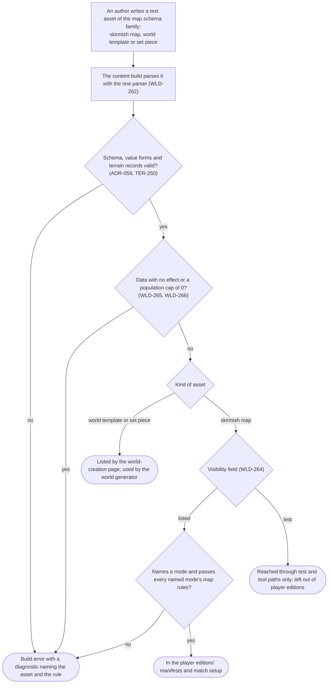
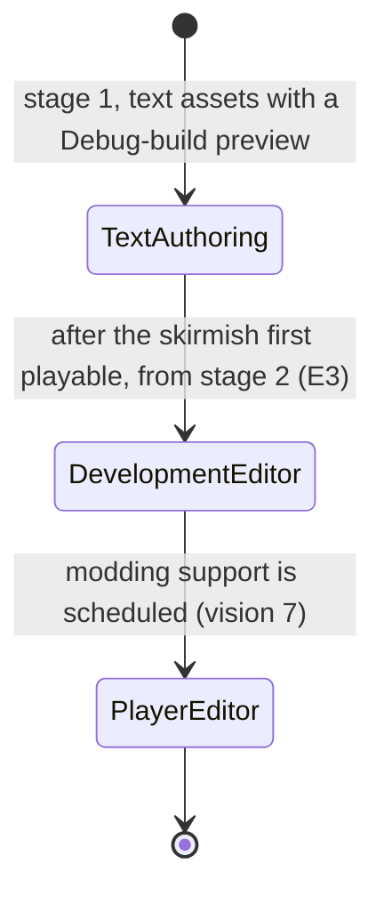

# World and regions: skirmish maps and map tools

> Status: Draft · Prefix: WLD · Rationale: `../../rationale/A1.md` · Related: [index](README.md) · [world and sites](world_and_sites.md) · [terrain, time and views](terrain_time_and_views.md) · [adoption ledger 08](../adoption_ledger/08_maps_and_level_design_ledger.md) · [maps: rules and conventions](../../reference/08_maps_and_level_design/rules_and_conventions.md) · [map editor hooks](../../reference/08_maps_and_level_design/map_editor_hooks.md) · [terrain](../../architecture/components/terrain/README.md) · [conventions](../../CONVENTIONS.md)

## 1 Purpose and player experience

### 1.1 What this file decides

This file states the rules of skirmish maps and map tools that the Open decisions given to area A1 change (DEC-045, DEC-315, DEC-324, DEC-562, DEC-802, DEC-865, DEC-866 and DEC-966), the two generator variants and the feathered flatten type that the world generator needs, and the adoption of reference/08, which A1 owns. Reference/08 specifies the maps of a match, so almost all of it binds the skirmish as written; the world game has no map definition, no match setup and no start positions, and builds its terrain through the world generator ([terrain, time and views](terrain_time_and_views.md) WLD-160 to WLD-167). B9 sets the skirmish map set and confirms the skirmish rows of the ledger.

### 1.2 Player and author experience

| Who | What they meet | What this file guarantees |
|---|---|---|
| A player | Skirmish maps in match setup; no map editor in a player build | Every listed map passes the rules of every mode it names, and no map holds data that does nothing (WLD-264, WLD-265) |
| A map author on the team | Text assets of the map schema family, validated by the content build and previewed in a Debug build; a development editor after the skirmish first playable | One parser, lossless writers and validation on save for every tool (WLD-262); the reference generator's arithmetic unchanged, with unbiased variants on request (WLD-268) |
| The world generator | The same records and the same generator as a skirmish map | The feathered flatten type that levels a plateau without a step (WLD-268) |

*Table 1 — Who meets the rules of this file.*

## 2 Rules

**WLD-260** (MUST) Species has no map editor in its player builds in v1: no page, binding or menu of a player build opens one (DEC-045). Skirmish maps, world templates and set pieces are written as text assets of the map schema family, validated by the content build (ADR-059) and previewed in a Debug build of the client, which loads them without a match setup. After the skirmish first playable (O20), the roadmap (E3) schedules a development map editor for Debug builds, from stage 2 (Table 5 of [world and sites](world_and_sites.md)), designed from the hooks of reference/08 map editor hooks §2.2 to §2.12 as its input, which has: undo and a warning about unsaved changes; selection by stable id; the lossless writers of WLD-262 and validation on save; a play test of the real simulation from the editor; Flag post and Command Console link tools with removal; generation of the terrain on demand with the variants of WLD-268; and authoring of world templates and set pieces with a preview of two generated regions and their crossing. A player-facing editor and player-made maps wait for modding support (vision §7).

**WLD-261** (MUST) Species has no custom-map container and no player map folder in v1. A Debug build reads plain map definitions from a development maps folder; a player build loads maps only from its mounted content sets, and a map id that no content set holds fails to load with a diagnostic (R-MAP-040, DEC-015).

**WLD-262** (MUST) Every map tool of Species, the content build, the development map editor and the world generator's writer included, uses the one parser of the map schema family for the header and for the whole asset, writes by R-MAP-388 to R-MAP-390, validates on save by R-MAP-400, and draws its randomness from a generator instance of its own (R-MAP-356).

**WLD-263** (MUST) Every skirmish map, world template, set piece and generated world of Species is authored or generated new: no terrain, layout, display name or identity of a reference map is reproduced (DEC-063), and no world template, set piece or generator parameter set recreates a reference map. The per-map figures of reference/08 describe the reference map set only as distributions.

**WLD-264** (MUST) A skirmish map header holds an explicit visibility field (DEC-802, option B), `listed` or `test`. A listed map names at least one mode and passes the per-mode map rules of every mode it names; a test map may name none and is reached only through test and tool paths; the edition manifests leave test maps out of player editions (ADR-056). World templates and set pieces are not maps of match setup: the world-creation page lists the world templates.

**WLD-265** (MUST) The content build rejects, with a diagnostic, map data that has no effect (DEC-865, option B): a mode named twice in a map's mode list, the Essence-orb rain map effect, a block of routes, a map that is not square, and a Trooper starting-forces record whose in-group flag is off. A reinforcement power option names an outcome whose delivery is a Power, as R-MAP-072 states (DEC-865 item 5).

**WLD-266** (MUST) A skirmish map's population cap has the forms absent, a number or unlimited, and the content build rejects a cap of 0, which would lock every Spawn Node and Transit Gate (DEC-866, option B for item 2); the Siege defender population cap keeps the forms absent, 0 or a number, with no unlimited form (DEC-866 item 1, as stated). B9 sets the cap of each skirmish map (PIL-003). The world game has no map population cap (O14, PIL-008): a settlement's population limit is B1's, and the sites of a region and that limit together stay within A2's body budget of a region ([terrain, time and views](terrain_time_and_views.md) WLD-281).

**WLD-267** (MUST) Skirmish maps select lighting and weather presets by name, as [terrain, time and views](terrain_time_and_views.md) WLD-183 and WLD-184 state, and may override a preset's values; a skirmish map without a preset name takes the first preset of the catalogue (DEC-562, option B).

**WLD-268** (MUST) The terrain generator keeps generation methods 0, 1 and 2 and flatten types 0 to 4 exactly, biases included, so the conformance vectors of the terrain component hold (DEC-324, option B), and adds three variants that skirmish maps and the world generator may use:

- **generation method 3**, which is method 2 with its parent chosen as ⌊`Next`() ÷ 8,192⌋, so that each of the four parents of a square or diamond step (TER-100) has the probability 1 ÷ 4 (TER-101 gives method 2's bias);
- **flatten type 5**, the smooth type with the sum of its five terms divided by five instead of six, so that it smooths without lowering (TER-144);
- **flatten type 6**, a feathered level square: with the area's centre (*cx*, *t*, *cz*), half-size *s* and threshold field *T* (TER-034), it visits every sample whose Chebyshev distance *d* = max(|*x* − *cx*|, |*z* − *cz*|) from the centre is below *s* + *T*; where *d* ≤ *s* it writes *t*, and elsewhere *cur* + (*t* − *cur*) × (1 − (*d* − *s*) ÷ *T*), so the terrain blends linearly from the level square to the existing height across the band; with *T* = 0 it is Absolute. It is applied in record order with the other types (TER-141).

The world generator uses method 3 where a tile copies a parent, type 5 where it smooths, and type 6 for the site cores, the valley centres and the crossing bridges ([terrain, time and views](terrain_time_and_views.md) WLD-162), where the prototype measured rim steps of 3 to 5 wu against 31 to 52 wu with Absolute. The parameter semantics that DEC-324 records (the fractal dimension acts as an exponent, so a larger value gives smoother terrain; the gain modifiers roughly normalise the amplitude) are stated for authors as TER-106 states them.

**WLD-269** (MUST) The level-design patterns of the reference maps are tools that the map schema and the per-mode validation accept (DEC-315, option A, the specified default): concentric Control Zones, duplicate Relic Spawn Zones, Control Zones owned by a start position at load, the key and fill pair of lights ([terrain, time and views](terrain_time_and_views.md) WLD-183) and twin terrains, two maps built on one terrain. B9's playtests confirm the effect on play of each pattern that a Species skirmish map uses.

**WLD-270** (MUST) The terrain queries keep the default of DEC-966 item 1, option A: the grid walk of a ray whose x or z component is zero visits only the column or the row it lies in (TER-017). The highest-sample scan of TER-076 bounds its inner loop by the column count and its outer loop by the row count (DEC-966 item 2, option B), so it gives the highest sample of any grid, a world chunk's included; on a square grid, which every skirmish map is (WLD-265), its result is unchanged.

## 3 States and flows

### 3.1 A map asset from text to edition

*Figure 1 — A map asset from its text to an edition: one parser, one validation, and a build error for every rule it breaks (WLD-262 to WLD-266).*

### 3.2 Map tools by stage

*Figure 2 — Map tools by stage (WLD-260, DEC-045).*

## 4 Tuning table

This file owns no tuning key. The values that its rules use are fields of the map records (the threshold field of a flatten area, TER-034) or keys of the terrain component and of [world and sites](world_and_sites.md) and [terrain, time and views](terrain_time_and_views.md).

## 5 Edge cases, exploits and interactions

| Situation | Behaviour | Requirements | Mechanics |
|---|---|---|---|
| A player build is asked for a map id that no content set holds | The load fails with a diagnostic, and no custom-map path is tried | WLD-261 | D4 |
| A Debug build loads a map from the development maps folder | It loads without a match setup, for preview and play tests | WLD-260, WLD-261 | D10 |
| A map names a mode twice, holds the Essence-orb rain flag, a routes block or a Trooper record outside a group, or is not square | The content build rejects it with a diagnostic naming the rule | WLD-265 | D4 |
| A map sets its population cap to 0 | The content build rejects it; absent, a number or unlimited are accepted | WLD-266 | B9 |
| A listed map names no mode | The build of the player edition fails | WLD-264 | D4 |
| A test map | It is left out of player editions and reached only through test and tool paths | WLD-264 | D4 |
| A skirmish map names no lighting preset | It takes the first preset of the catalogue | WLD-267 | E2 |
| A flatten area of type 6 has a threshold of 0 | It behaves as Absolute | WLD-268 | — |
| A skirmish map uses generation method 3 or flatten type 5 or 6 | Allowed; the conformance vectors of methods 0 to 2 and types 0 to 4 are unchanged | WLD-268 | D8 |
| A highest-sample scan over a world chunk that is not square | It reads every column and every row | WLD-270 | D8 |
| A ray cast straight along x or z | The grid walk visits only that column or row | WLD-270 | D8 |
| A world template that would recreate a reference map | Rejected in review; every template, set piece and parameter set is new | WLD-263 | E2 |
| Two map tools write the same asset | Both write by the same lossless rules, so the asset reads the same | WLD-262 | D4 |

*Table 2 — Edge cases of skirmish maps and map tools.*

## 6 Acceptance criteria

| Id | Given | When | Then | Requirements |
|---|---|---|---|---|
| AC-37 | A player build | Every page, binding and menu is searched for a map editor, and a map id that no content set holds is requested | No map editor opens, and the load fails with a diagnostic | WLD-260, WLD-261 |
| AC-38 | Map definitions with a repeated mode, the Essence-orb rain flag, a routes block, a non-square terrain, a Trooper record outside a group, and a population cap of 0 | The content build runs | Each is rejected with a diagnostic naming the rule | WLD-265, WLD-266 |
| AC-39 | A listed map that names no mode, and a test map | The content build packs a player edition | The listed map fails the build, and the test map is left out of the edition | WLD-264 |
| AC-40 | A tile with generation method 3, and a flatten area of type 5 over a raised plateau | Each is generated many times with different seeds | Each of the four parents is chosen with a frequency within 1 % of a quarter, and the plateau is smoothed without lowering its mean height | WLD-268 |
| AC-41 | A flatten area of type 6 of half-size 400 wu and threshold 320 wu over fractal terrain, and one with threshold 0 | Each is generated | Inside the half-size every sample equals the area's height, across the band each sample lies between the area's height and the generated height by the weight of WLD-268, and the area with threshold 0 gives the same samples as Absolute | WLD-268 |
| AC-42 | The conformance vectors of the terrain component | They run on a generator with the three variants | Methods 0 to 2 and flatten types 0 to 4 give the vectors' digests unchanged | WLD-268 |
| AC-43 | A grid of 3 × 5 samples | The highest-sample scan runs | It reads every column and every row and never the outside value | WLD-270 |
| AC-44 | The development editor and the content build | Each writes the same asset after a load | The two files are identical and pass validation on save, and each tool's random draws come from its own generator | WLD-262 |
| AC-45 | A skirmish map without a lighting preset name | It loads | It is lit by the first preset of the catalogue | WLD-267 |
| AC-46 | Every skirmish map, world template and set piece, at each content milestone | The likeness review of DEC-063 runs | None reproduces the terrain, layout, display name or identity of a reference map | WLD-263 |

*Table 3 — Acceptance criteria. AC-46 is met by a review; the others are tests of the build or the content build.*

## 7 Adoption from the reference

This file owns the ledger of reference/08, [08_maps_and_level_design_ledger.md](../adoption_ledger/08_maps_and_level_design_ledger.md), which holds every verdict by section and the exception rows; B9 confirms the rows of the skirmish maps or sends a row change. Table 4 mirrors it.

| Scope | Verdict | Species requirements | What changes and why |
|---|---|---|---|
| map editor hooks §2.1 to §2.12, §2.16, §2.17 | adapt | WLD-260, WLD-261, WLD-183, WLD-265 | No map editor in player builds in v1; text authoring with a Debug-build preview, then a development editor after the first playable, for which the hooks and the reference editor's defects are the design input (DEC-045) |
| R-MAP-335 | adapt | WLD-268 | The biased arithmetic stays, and method 3 and flatten types 5 and 6 are added (DEC-324) |
| R-MAP-356, R-MAP-388, R-MAP-389, R-MAP-390, map editor hooks §2.15 | adopt | — | Every map tool, the world generator's writer included, writes losslessly, keeps the value forms, validates on save and uses its own generator (WLD-262) |
| map editor hooks §2.13 | adapt | WLD-260, WLD-262 | The reference editor's two writers are not built |
| map editor hooks §2.14 | adapt | WLD-261 | No custom-map container or player map folder in v1; player-made maps wait for modding |
| rules and conventions §2.1 to §2.8, §2.10, §2.11, §2.13 to §2.16, §2.23 | adopt-skirmish | — | The skirmish map model as written; the world has no map definition and builds its terrain through the world generator |
| R-MAP-007 | adapt | WLD-263 | New authorship extends to world templates, set pieces and generated worlds |
| R-MAP-013, R-MAP-073, R-MAP-080, R-MAP-092, R-MAP-131, §2.12 | adapt | WLD-265, WLD-267 | Map data with no effect is a build error (DEC-865, option B) |
| R-MAP-014, R-MAP-060 | adapt | WLD-264, WLD-266 | An explicit visibility field (DEC-802, option B); no population cap of 0 |
| R-MAP-062 | adapt | WLD-266 | A population cap of 0 is a build error (DEC-866 item 2, option B) |
| R-MAP-081, R-MAP-083 | adapt | WLD-268 | The unbiased generation method 3 and the flatten types 5 and 6 (DEC-324, option B) |
| R-MAP-085 | adapt | WLD-162 | The reference envelope bounds the world generator's parameters, with a larger base tile and more flatten areas per region |
| R-MAP-086 | adapt | WLD-180 | The terrain colour assets and the seasonal replacement serve the biomes; the reference census of their use is dropped |
| R-MAP-198 | adopt | — | Every world has sea along its border (WLD-001), as every skirmish map does |
| rules and conventions §2.9 | adapt | WLD-183, WLD-267 | Named lighting presets (DEC-562, option B) |
| R-MAP-110, R-MAP-151, R-MAP-152, R-MAP-191, R-MAP-192, R-MAP-200, §2.17 to §2.22, §2.24, §2.25 | adapt | PIL-003, WLD-263, WLD-266, WLD-269 | The figures of the reference map set and the conventions of the five modes other than Spawn Control: B9 sets the map set, and a mode's clauses wait until it is scheduled |

*Table 4 — The adoption of reference/08, mirrored from the ledger: 6 requirements adopted, 70 adopted for skirmish, 109 adapted, none dropped.*

## 8 Dependencies

**Areas.**

| Area | Takes from this file | Owes back or decides |
|---|---|---|
| B9 | The skirmish map rules of WLD-260 to WLD-270 and the ledger rows of the skirmish maps | The skirmish map set and each map's population cap (PIL-003, WLD-266); the playtests of the level-design patterns (WLD-269); row changes to the ledger |
| C1 | The development editor's camera views (WLD-260) | DEC-803, camera animations without content |
| C2 | The world-creation page lists the world templates (WLD-264) | DEC-314, the order of tied maps in the mode lists |
| D4 | The map schema family, its one parser and its writers (WLD-262); the visibility field and the edition manifests (WLD-264); the build errors (WLD-265, WLD-266) | The schema changes and the record type `maps.world_template` |
| D8 | The generator variants and the query rules (WLD-268, WLD-270) | The amendment of the terrain component for method 3, flatten types 5 and 6 and the highest-sample scan, with conformance vectors for each |
| E2 | New authorship (WLD-263); the lighting preset catalogue (WLD-267) | The skirmish map art and the presets |
| E3 | The development map editor (WLD-260) | Its place on the roadmap |

*Table 5 — What other areas take from this file and what they owe back.*

**Engine components.** [Terrain](../../architecture/components/terrain/README.md) (TER-017, TER-034, TER-076, TER-100, TER-101, TER-106, TER-141, TER-144, TER-250); [data schemas](../../architecture/components/data_schemas/README.md) (the map schema family; ADR-056, ADR-059 and ADR-061).

**Assets.** The map slots `mapfile.spawn_control` and the thumbnail `thumb.spawn_control` for the v1 skirmish maps (B9).

## 9 Open decisions

The eight decisions that the triage gives A1, with their proposed resolutions; the register is edited at A1's Finalise.

| DEC | Topic | Proposed resolution | Requirements |
|---|---|---|---|
| DEC-045 | The map editor | Resolved: no editor in player builds in v1; text authoring, content-build validation and a Debug-build preview first; a development editor in Debug builds after the skirmish first playable, built from the hooks with undo, stable ids, lossless writers, validation and a play test; a player editor waits for modding | WLD-260, WLD-261, WLD-262 |
| DEC-315 | Level-design patterns of the reference maps | Resolved: option A, the specified default stands; every pattern is a tool, and B9's playtests confirm each one that a Species map uses | WLD-269 |
| DEC-324 | Terrain generator parameter semantics and biases | Resolved: option B; the arithmetic stays exactly, and generation method 3 and flatten types 5 and 6 are added; the world generator uses them | WLD-162, WLD-268 |
| DEC-562 | Map lighting and weather presets | Resolved: option B; named lighting presets in the key-and-fill pattern and weather presets, selected by skirmish maps and biomes; a play-changing effect stays an explicit map flag, and in a world weather is presentation only | WLD-183, WLD-184, WLD-267 |
| DEC-802 | Maps that match setup does not list | Resolved: option B, an explicit visibility field; world templates are listed by the world-creation page | WLD-264 |
| DEC-865 | Map data without a reference case | Resolved: option B with item 5 as stated; the world game uses none of the six forms | WLD-265 |
| DEC-866 | Population-cap values of a map | Resolved: option A for item 1 and option B for item 2; B9 sets the values; the world has no map cap | WLD-266, WLD-281 |
| DEC-966 | Terrain query edge cases | Resolved: option A for item 1, option B for item 2 | WLD-270 |
| DEC-803 | Camera animations without content | C1's; camera-animation authoring in the development editor waits for it | WLD-260 |
| DEC-314 | The order of tied maps in the mode lists | C2's; unchanged here | — |

**Owner decisions applied.** O8 and O20 (skirmish maps and the first playable, WLD-260); O14 (no map cap in a world, WLD-266); O19 (map value forms, R-MAP-389).
