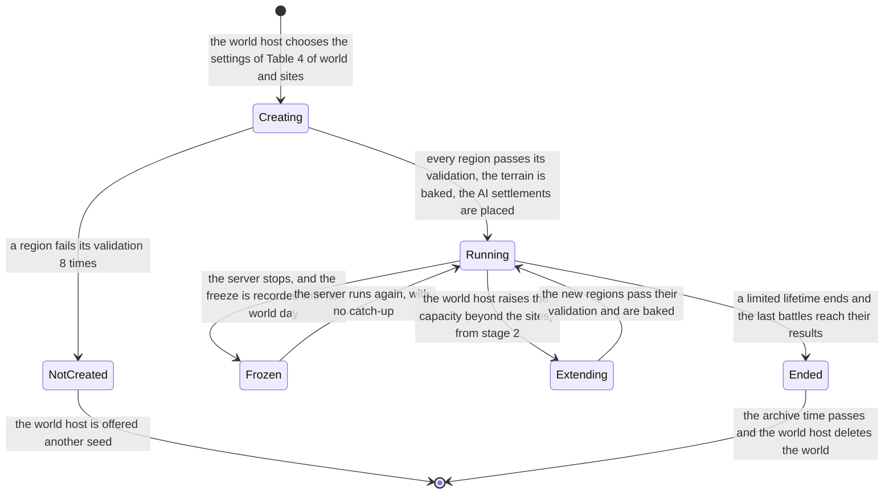
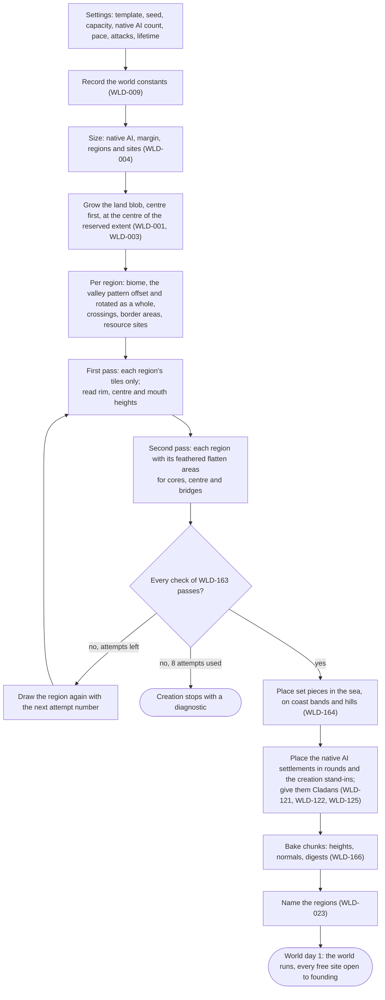
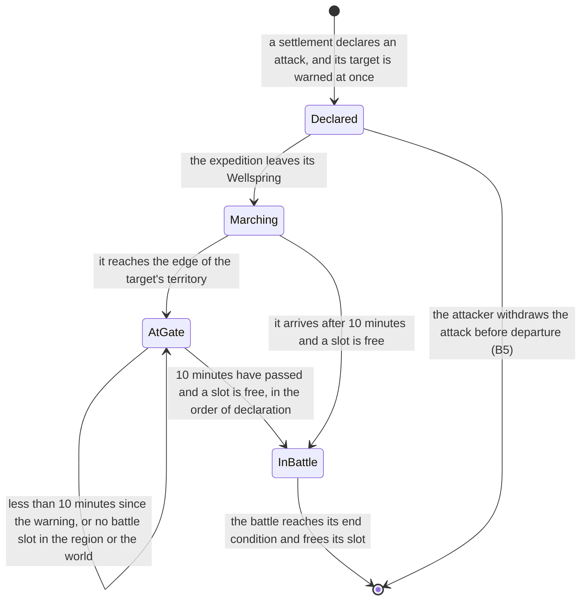
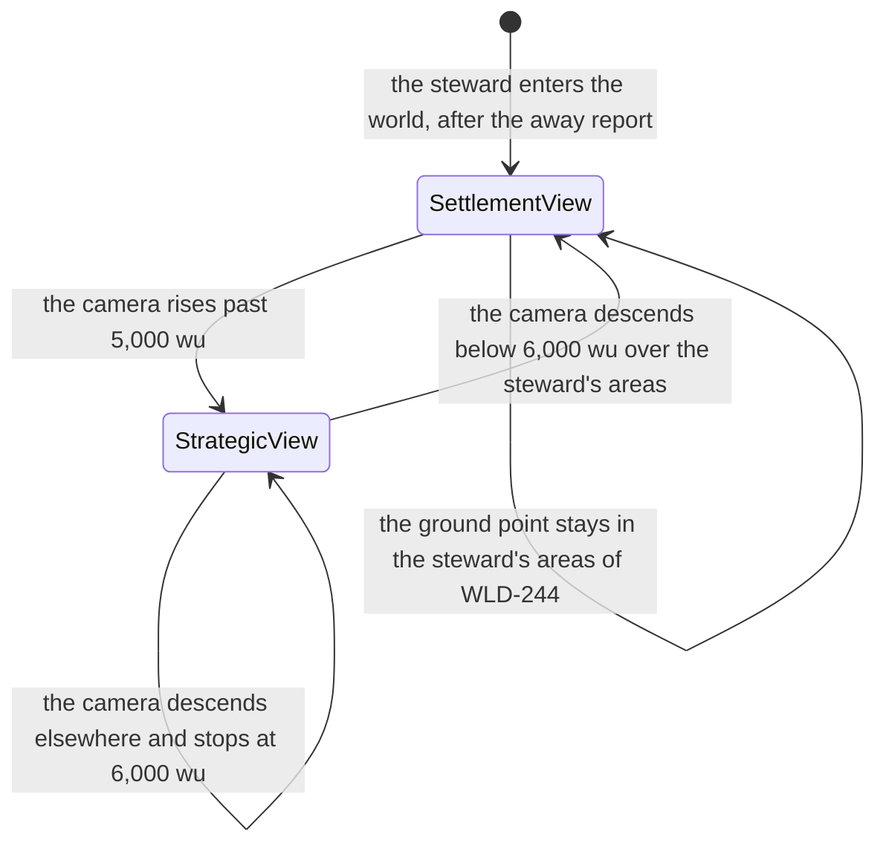

# World and regions: terrain, time and views

> Status: Final · Prefix: WLD · Rationale: [A1](../../rationale/A1.md) · Related: [index](README.md) · [world and sites](world_and_sites.md) · [skirmish maps and map tools](skirmish_maps_and_map_tools.md) · [vision, pillars and core loops](../00_vision_pillars_and_core_loops.md) · [owner decisions](../../decisions/owner_decisions.md) · [terrain](../../architecture/components/terrain/README.md) · [conventions](../../CONVENTIONS.md)

## 1 Purpose and player experience

### 1.1 What this file decides

This file specifies how a world's terrain is made and baked, the biomes and their looks, lighting and weather in a world, the world calendar on top of world time (O4, O35), the world lifetime (PIL-067), the strategic view and the settlement view in the reference visual language (O9), and the scale figures that A1 hands to A2's server budgets: the load of a world, the battles in progress at the evening peak with their range, and the caps that bound them. The geometry that the terrain carries (regions, sea channels, crossings, sites, border areas, resources and travel) is in [world and sites](world_and_sites.md); the skirmish map rules that A1's decisions change are in [skirmish maps and map tools](skirmish_maps_and_map_tools.md).

Every figure of §2.6 comes from the world-density model `Tools/DesignModels/A1WorldDensity.py` (WLD-283); the buildability of the terrain records of §2.1 comes from a prototype of two neighbouring regions on the conformance terrain generator `Tools/DesignModels/TerrainGenerator.py`, whose results the tuning table cites as "Prototype".

### 1.2 The terrain approach

| Option | What it is | Why it is or is not chosen |
|---|---|---|
| Procedural from the reference algorithm alone | The world as a seeded random set of the reference generator's tiles and flatten areas | Not chosen: nothing guarantees level sites, continuous sea channels, dry crossings, equal home resources or reachability, so pillar 6's equal sites and pillar 3's legible geography would be luck; it also spreads method 2's directional bias (TER-101) across a whole continent |
| Authored worlds | A fixed set of hand-made worlds per capacity band, as skirmish maps are made | Not chosen: 3 to 98 regions per world is beyond a small team, every community server would play the same solved map, and a fixed world cannot follow the host's capacity or a capacity raise (WLD-008) |
| **Hybrid** | An authored world template and set pieces; a layout laid out from the seed by the rules of [world and sites](world_and_sites.md); the reference generator for the terrain, in two passes per region with the feathered flatten type; validation with regeneration; baked once into chunks | **Chosen (WLD-160 to WLD-167):** it keeps the reference look (pillar 5), makes every world different from its seed, enforces fairness by construction and by validation (pillar 6), needs one template for stage 1, and bakes the terrain so that no client depends on reproducing the generator's floating-point arithmetic |

*Table 1 — The terrain approach: the options and the choice.*

### 1.3 Player experience

| Timescale | What the steward meets | What this file guarantees |
|---|---|---|
| Joining | A world of glowing island valleys on black-lit sea, each valley in its biome's colours | Every site stands on a level plateau, dry and reachable, in every world (WLD-163) |
| Every session | The strategic view of the whole continent and the settlement view of the steward's own settlement and battles | The same visual language at every camera height (WLD-245); the strategic view shows only what the steward's settlement may see (WLD-242) |
| Days and weeks | A calendar of world days that stops while the world's server stops | A world day is 24 hours at the always-on pace and 2 hours at the session pace (WLD-200); a freeze loses no world day (WLD-203) |
| A world's life | A world that keeps its shape; a lifetime that ends it, or none | Terrain never changes during play (WLD-160); a lifetime is only lengthened and is announced 7 world days before its end (WLD-221, WLD-222) |
| An evening of war | Battles at the busiest hour of a world of 200 | The server is sized for the planning case of the evening peak, and an attack beyond the caps waits at the gate where both sides see it (WLD-284, WLD-285) |

*Table 2 — The player experience of terrain, time and views.*

### 1.4 How to read this file

- **Units.** Distances are in world units (wu); heights are above sea level (0 wu). Presentation times are in seconds of presentation time; durations of the world are in world days (WLD-200).
- **Placeholders.** The scale figures need inputs that later areas set (WLD-280); each is named with its area, and the model is run again when it changes.
- **Terms.** As in [world and sites](world_and_sites.md) §1.5; this file also uses the terms biome, world template and set piece of CONVENTIONS §8.15.

## 2 Rules

### 2.1 Terrain: the hybrid world generator

**WLD-160** (MUST) Species makes world terrain by a hybrid of procedure and authoring. The world generator takes the world's template (WLD-167) and its seed, lays the world out by the rules of [world and sites](world_and_sites.md), places the terrain component's tiles and flatten areas (TER-003, TER-004) region by region from the template's parameter sets in the two passes of WLD-162, and adds the template's set pieces (WLD-164). It runs at world creation and at an extension (WLD-008), and bakes the result into terrain chunks (WLD-166). No rule of the world game raises, lowers or levels the terrain during play, so TER-002 holds for a world as for a skirmish map. Stage 1 has `wld.template.count_stage1` (1) world template and stage 2 `wld.template.count_stage2` (3) (Table 5 of world and sites).

**WLD-161** (MUST) A world's layout and terrain records depend only on its world constants (WLD-009), its seed, its capacity and its native AI count. Every random choice of the generator is a counter-based value keyed by the world seed, the purpose of the draw, the region id, the attempt number of WLD-163 and the item index (A2's random-generator decision, DEC-242), so a region's records depend on no other region's draws, an extension leaves every existing region's records unchanged, and the same constants, seed, capacity and AI count give the same world on any server.

**WLD-162** (MUST) The terrain records of a region are:

- one island base tile (TER-003) over the region inside its coast bands, from the biome's parameter set, with a guide grid of power 2 (TER-036) that raises the valley floor towards the centre, so the land falls to the sea in the coast bands (WLD-021);
- `wld.terrain.hills_per_region` (2) hill tiles of side `wld.terrain.hill_side` (640 wu), in two of the region's four corners chosen with the seed, at least 300 wu inside the region border and outside every core's level square, into whose feather band a hill may reach (O71), with peaks of at most `wld.terrain.peak_height_max` (400 wu);
- for each site's core, a feathered level square (flatten type 6, WLD-268) of half-size `wld.site.core_radius` (400 wu) and band `wld.terrain.core_feather` (320 wu);
- for the valley centre, a feathered level square of half-size `wld.terrain.center_half_size` (120 wu) and band `wld.terrain.center_feather` (200 wu), the level area of the central resource site (WLD-083);
- for each crossing on its sides, the crossing's bridge: a chain of feathered level squares of half-size half the crossing's width (192 wu) and band `wld.terrain.crossing_feather` (96 wu), from one mouth to the other, at most `wld.terrain.crossing_square_spacing` (192 wu) apart, whose heights rise linearly from the height at one mouth to the height at the other.

Generation runs in two passes over the world. The first generates each region with its tiles only and reads its base heights: for each core, the mean of `wld.terrain.rim_samples` (16) samples spaced evenly on the core's rim; for the valley centre and each crossing mouth, the height at that point; each clamped to `wld.site.height_min` (20 wu) to `wld.site.height_max` (120 wu). The second generates each region again with its tiles and its flatten areas at those heights, in the order cores, valley centre, crossings, set pieces (TER-141); `TerrainField::Generate` is a pure function of its records (TER-010), so the tiles give the same heights in both passes. Each region is generated on its own square. Its flatten areas include every square of the bridges on its sides whose square and band reach into its square, so the two regions of a crossing apply the same squares at the same heights, from the same two mouth heights, and their halves of the bridge meet: a feathered square reads and writes each sample on its own, so its result does not depend on where a region's field ends. A region has at most `wld.terrain.tiles_per_region_max` (16) tiles and `wld.terrain.flatten_per_region_max` (32) flatten areas. Over seeds 1 to 10 at capacities 16 and 200, crossing mouths lie 435 to 849 wu apart and 205 to 436 wu from the region border, a bridge has 4 to 6 squares, and a region's layout needs at most 24 flatten areas (4 cores, 1 centre and the bridge squares that reach into it); the set pieces have the rest. The parameters lie inside the envelope of the reference maps (reference/08 table 2.8-B), except a base tile of up to 4,608 wu (the region inside its coast bands, against 4,484 wu), up to 24 flatten areas per region (against 6 per map), generation method 3 and flatten types 5 and 6. The world uses the cell size `wld.terrain.cell_size` (16 wu), the median of the reference maps, and the outside height `wld.terrain.outside_height` (−10 wu); its generation methods are 0, 1 and the unbiased method 3, and its flatten types 0, 1, 2, 4, the unbiased smooth type 5 and the feathered type 6 (WLD-268). The first template's temperate parameter set is the prototype's: a base tile of generation method 1, fractal dimension 2.0, height scale 0.25, desired height 150 wu, lowland smoothing 2.0 and guide values of 70, 80 and 90 (of 255) from the rim to the centre; hill tiles of generation method 0, fractal dimension 1.2, height scale 1.0 and desired heights of 260 to 340 wu.

> **Amendment 2026-10-20 (M1 task T3; DAT-054; [ADR-102](../../ADR/ADR-102-region-terrain-and-the-terrain-check-at-connection.md)).** The keys of the valley centre's square are `wld.terrain.center_half_size` and `wld.terrain.center_feather`: a key that generates an identifier is spelt in American English (CONVENTIONS §8, DAT-054), and the keys spelt `centre` are retired and never reused. A hill tile of `wld.terrain.hill_side` (640 wu) whose edge stands 300 wu inside the region border reaches up to 204 wu into the feather band of the core in its corner at WLD-040's largest offset and rotation (21 to 194 wu over seeds 1 to 100), and never comes nearer than 63 wu to the core's level square, so the condition that a hill stays outside every core's feather band could not hold at these values. The owner kept the hills and the inset (O71): a hill stays outside every core's level square, as the text above now says, and the band blends the core into the hill. Over seeds 1 to 100 every region passes checks 1 and 3 to 6 at its first attempt (ADR-102).

**WLD-163** (MUST) After the second pass the generator validates each region on the samples of its square, with these checks:

1. **Channels.** Every sample of the strip of width `wld.region.channel_width` (256 wu) along each side of the region, outside the corridor of a crossing (the crossing's width and its feather band on each side), is at or below sea level (WLD-021).
2. **Crossings.** Every sample on the centre line of each of its crossings, from mouth to mouth, is above `ref.unit.worker.shore_height` (1 wu) and has a normal y component of at least `wld.crossing.min_normal_y` (0.9) (WLD-024).
3. **Plateaus.** Every sample within 0.9 × `wld.site.core_radius` of a site centre has a normal y component of at least `wld.site.core_min_normal_y` (0.95) and a height from `wld.site.height_min` to `wld.site.height_max` (WLD-041).
4. **Rims.** No two neighbouring samples across a core's rim differ by more than `wld.site.rim_step_max` (16 wu) (WLD-041).
5. **Dry sites.** No sample within `wld.site.water_clearance` (600 wu) of a site centre is at or below sea level (WLD-041).
6. **Reachability.** Every site centre, the central resource site and every crossing mouth is reached from local site 0 over samples above the shore height whose normal y component is at least `ref.sim.walk.min_normal_y` (0.8), in steps between neighbouring samples (WLD-002).
7. **Home yields.** The home resource sites of every site give B2's weights within `wld.resource.home_yield_tolerance` (WLD-081).
8. **Routes.** The land route of R-SIM-345 between the two ends of every edge of the travel network inside the region and over its crossings is no longer than the edge (WLD-100).

A region that fails a check is generated again with the next attempt number in the key of its draws (WLD-161), up to `wld.generation.max_attempts` (8) times; a region that still fails stops the world's creation with a diagnostic that names the region and the check, and the world host is offered another seed. In the prototype of two neighbouring regions on the conformance generator, at a cell of 32 wu, 100 seeds of 100 passed checks 1 to 6 at the first attempt with the feathered type, with plateau floors from 52 to 111 wu and rim steps of 3 to 5 wu; with the Absolute type in place of the feathered type, rim steps were 31 to 52 wu over 20 seeds and check 4 failed in every one, and a variant whose hill tiles overlapped the cores failed check 6 in every seed tried. Checks 7 and 8 need B2's weights and the land route graph, and are measured when the generator exists.

> **Amendment 2026-10-20 (M1 task T5; [ADR-104](../../ADR/ADR-104-navigation-nodes-land-route-graph-and-routes.md)).** Inside one region of the MVP, check 8 builds the route of each of the four valley-neighbour pairs and of each site with the central resource site, once, from the first end to the second, since a route depends on its direction (R-SIM-336). A route's length is the 3-D length of its polyline, and the edge's length is WLD-100's: the horizontal distance between the ends × `wld.travel.valley_path_factor`. Over seeds 1 to 100 every region passes check 8 at its first attempt, and the longest route measures 1.0017 times its ends' distance (ADR-104), so 1.15 bounds the routes this generator makes rather than measuring them. The owner kept 1.15, provisional (O71), until M1 measures how long the crowd takes to walk these edges, jitter, pushes and the slope's slow-down included, against the straight distance at the Worker's speed (M1 plan T10); the factor is then set from that ratio, which D8's travel times also read.

**WLD-164** (MUST) A set piece (`SetPiece`) is an authored terrain feature (terrain tiles and flatten areas, and the scenery meshes it places) with a footprint radius, which the generator places as a landmark: up to `wld.setpiece.per_region_max` (2) per region, only in the sea, on a coast band outside every crossing corridor, or on a hill tile, at least `wld.setpiece.clearance` (800 wu) from every site centre and every crossing's centre line, so that no set piece changes what a site is given (WLD-042); check 1 of WLD-163 keeps every channel open past it. Stage 2 has `wld.setpiece.count_stage2` (8) set pieces, and stage 1 none.

**WLD-165** (MUST) World generation runs on the world's server when the world is created or extended, never inside a tick, as a background job in an integrated server, and shows its progress region by region to the world host. On the reference test machine (DEC-971) it takes no more than `wld.generation.budget_16_s` (20 seconds) at a capacity of 16 and `wld.generation.budget_200_s` (120 seconds) at 200, both passes and the bake included. The prototype took 0.5 seconds of Python per region and pass pair at a cell of 32 wu, which is four times fewer samples than the world's cell; the budgets are measured on the C++ generator.

**WLD-166** (MUST) The baked terrain of a world is a set of chunks of side `wld.terrain.chunk_side` (1,024 wu), 5 × 5 per region and 70 × 70 over the reserved extent of 71,680 wu (WLD-001). Each chunk holds its heights and simulation normals and the canonical digest of TER-252 over its heights; a chunk that is all sea at the outside height is held as that one value, so a world of 16 stewards holds 200 land chunks and 4,700 sea chunks of one value each. The world's terrain digest is the SHA-256 of its chunk digests in chunk order. An extension (WLD-008) bakes the chunks of its new regions and bakes again only the chunks of an existing region that a new crossing's bridge touches, in that region's coast band; every other chunk keeps its digest. This is A1's input to D8 under DEC-246 (option B with D: baked region chunks, delivered by the server and cached by the client by digest) and DEC-247 (option B: one continuous height field in chunks aligned with the regions, inside the reserved extent).

**WLD-167** (MUST) A world template (`WorldTemplate`) is an authored, typed and versioned asset of the map schema family (proposed schema id `maps.world_template`, which D4 registers in the data schemas): its biome weights (WLD-181), its terrain parameter set per biome (WLD-162), its list of set pieces, its world lighting preset and its region name list (WLD-023). The content build validates it with the rules of ADR-059 and ADR-061, and every map tool writes it by R-MAP-388 to R-MAP-390 and validates it on save by R-MAP-400. A running world names the template version it was created from (WLD-009), and the server keeps that version for the world's life.

### 2.2 Biomes, lighting and weather

**WLD-180** (MUST) A biome (`Biome`) is a look and a terrain shape, never a rule. A world draws on `wld.biome.count` (6) biomes, `wld.biome.count_stage1` (2) of them in stage 1; each names one land colour ramp of `terrain.ramp`, one shore-wave gradient of `terrain.shore_wave_gradient`, one sea tile of `terrain.sea_tile`, a lighting preset (WLD-183), a weather preset (WLD-184), a terrain parameter set (WLD-162) and a tree density, as Table 3 gives. The asset manifest holds the 14 land colour ramps, 8 shore-wave gradients and 4 sea tiles of R-MAP-086, each with file 01 as the default, and while a world's seasonal state is active (WLD-185) one ramp, one gradient and one sea tile replace a biome's own, as R-MAP-086 states; the reference census of which maps use which file describes the reference set and binds nothing here. Every biome gives every site the same resources (WLD-081), and E2's environment brief gives each file its look.

| Biome id | Land colour ramp | Shore-wave gradient | Sea tile | Terrain shape |
|---|---|---|---|---|
| `temperate` | file 01 | file 01 | file 01 | rolling floors, rounded hills |
| `highland` | file 02 | file 02 | file 01 | high floors, rough hills |
| `arid` | file 03 | file 03 | file 03 | flat floors, mesas |
| `marsh` | file 04 | file 06 | file 03 | low floors, smooth hills |
| `ember` | file 05 | file 05 | file 04 | steep hills, cones |
| `frost` | file 06 | file 04 | file 02 | high floors, smooth hills |

*Table 3 — The biomes of the world game and the terrain assets each names (file numbers of the asset manifest). Stage 1 builds `temperate` and `arid`.*

**WLD-181** (MUST) The generator gives each region one biome, drawn with the world seed from the template's weights; then, in region order, a region whose land neighbours all share one biome other than its own takes that biome, so that biomes form patches. The simulation reads no biome.

**WLD-182** (MUST) Within `wld.biome.blend` (256 wu) of a border between two regions of different biomes, the renderer blends the facet colours of the two land colour ramps by distance, so the seam falls on the channel or on the crossing; this is presentation only and never feeds the simulation (TER-007).

**WLD-183** (MUST) Lighting comes from named lighting presets (DEC-562, option B). A preset is two directional lights in the key-and-fill pattern of the reference maps: a neutral grey fill light with equal colour components and a warm key light whose red component exceeds its green, which exceeds its blue (R-MAP-088). A skirmish map selects a preset and may override any of its values (WLD-267); a biome selects a preset; in a world, the renderer lights the settlement view with the preset of the biome under the camera's ground point, blending to a new one over `wld.light.blend_seconds` (2 seconds of presentation time), and the strategic view with the template's world preset. Stage 1 has `wld.light.preset_count_stage1` (2) lighting presets and stage 2 `wld.light.preset_count_stage2` (6).

**WLD-184** (MUST) Weather in a world is presentation only: a weather preset names the look-only effects that a biome shows (snow, drawn by the client from the presentation generator), and no weather object exists in the world simulation. The lightning strike and the dust vortex, which hurt and push units (R-MAP-090), never act in a world in v1, because an unannounced loss in a settlement whose steward is away would break PIL-049; the world's hazards are B4's world events. Skirmish maps keep the map effects of R-MAP-073 except the Essence-orb rain flag ([skirmish maps and map tools](skirmish_maps_and_map_tools.md) WLD-265), grouped into weather presets, and an effect that changes play stays an explicit flag of the map (DEC-562).

**WLD-185** (MUST) A world has no time of day: its lights never change with world time, and no rule and no look depends on the hour, as no map expresses one (R-MAP-142) and as pillar 2 rules out play at set hours. If B4 keeps the seasonal theme (DEC-101), a world's seasonal state is world state: its server decides it once per real day from its own date by the date rule of R-META-102, records it in the world, and it changes presentation only (TER-042, DEC-118); the world host may switch it off (Table 4 of world and sites).

### 2.3 World time and the world calendar

**WLD-200** (MUST) The world calendar counts world time (`WorldTime`, A2; O4) in world days and world weeks. A world day is `wld.calendar.day_hours` (24) hours of world time divided by the world's pace factor: 24 hours at the always-on pace and 2 hours at the session pace (`pil.pace.session_factor`, PIL-101); a world week is `wld.calendar.week_days` (7) world days. World day 1 begins when the world is created, and the calendar counts only time in which the world's server runs (O35).

**WLD-201** (MUST) The world shows its calendar as the world day and the share of that day that has passed, as a dial, and never as a clock time of day (WLD-185). A duration of the economy, relations or protection (a respite, a claim, dormancy) is shown in world days; at the session pace it is also shown as the running time it takes (C3).

**WLD-202** (MUST) A duration that these files state in world days needs no further conversion at the session pace, because the world day contains it (PIL-103). An area that writes a timer of the economy, relations or protection in world days converts it to ticks as world days × `wld.calendar.day_hours` × 3,600 ÷ the pace factor ÷ `ref.sim.tick_period`. Travel, battles and the warning of WLD-102 are written in minutes of world time and run at the tick rate at both paces (PIL-101).

**WLD-203** (MUST) While a world is frozen its calendar stops with world time (PIL-076); the record of each freeze (PIL-131) carries the world day and the share of the day at which the world froze, and the world day and share at which it runs again are the same.

### 2.4 World lifetime

**WLD-220** (MUST) A world's lifetime is unlimited, or a whole number of world weeks from `wld.lifetime.min_days` (28) to `wld.lifetime.max_days` (364) world days in steps of `wld.lifetime.step_days` (7). The default is unlimited for an integrated world (`wld.lifetime.default_integrated`), `wld.lifetime.default_dedicated` (84 world days, 12 world weeks) for a community dedicated server and `wld.lifetime.default_hosted` (84 world days) for a hosted world of stage 3 (O39). No era or other periodic reset of claims or border areas runs in a world in v1 (O39); B5 evaluates eras with renown for stage 2. Stage 1 builds the unlimited lifetime only (PIL-110, Table 10 of the vision document); limited lifetimes come with renown and the epilogue in stage 2 (PIL-125).

**WLD-221** (MUST) The world host may lengthen a limited lifetime, or make it unlimited, at any time before its final notice period begins (WLD-222); a lifetime is never shortened, and an unlimited lifetime never becomes limited. Every change is recorded with its world time, shown on the join page (PIL-130) and reported to every steward.

**WLD-222** (MUST) When `wld.lifetime.final_notice_days` (7) world days of a limited lifetime remain, every steward is told, in the client and in the away report. During the last `wld.lifetime.attack_close_days` (1) world day, no attack can be declared (B5 enforces it); an attack declared before then runs to its battle result.

**WLD-223** (MUST) When its lifetime ends, a world lets every battle in progress run to its end condition, which ends it within `pil.battle.max_minutes` (PIL-047), and then becomes ended: its simulation stops for good, the epilogue of PIL-125 is shown, and the world is read-only. Its stewards may open it and see the strategic view, the world record and their away reports for `wld.lifetime.archive_days` (30 real days) on a dedicated or hosted server, after which the world host may delete it; an integrated world's archive stays until its host deletes it. The world host may create a successor world with the same settings and a new seed and invite the ended world's stewards; nothing of a settlement's strength carries over to it.

**WLD-224** (MUST) No settlement leaves a world when its lifetime ends (PIL-069, PIL-080): the epilogue lists every settlement, dormant ones and stand-in AI settlements included, with its history.

### 2.5 The strategic view and the settlement view

**WLD-240** (MUST) One camera serves both views (C1 specifies its controls). The settlement view (`SettlementView`) is the reference camera up to its highest height, `ref.ctrl.camera.max_height` (5,000 wu, R-CTRL-461). The strategic view (`StrategicView`) covers camera heights from `wld.view.strategic_min_height` (6,000 wu) up to `wld.view.strategic_max_factor` (0.9) × the side of the land grid (*g* × 5,120 wu, WLD-003): 18,432 wu at a capacity of 16 and 46,080 wu at 200, from which the whole continent is in view. Raising the camera past the top of the settlement view enters the strategic view and keeps the ground point under the screen centre; lowering it below 6,000 wu over an area that the settlement view may show (WLD-244) returns to the settlement view there, and elsewhere the camera stops at 6,000 wu.

**WLD-241** (MUST) The strategic view draws the elements of Table 4, and nothing else.

| Element | How it is drawn | Shown to |
|---|---|---|
| Terrain and sea | the world's terrain at a coarse level of detail (WLD-245), coloured by each region's land colour ramp; the channels, the sea and the black background beyond | everyone |
| Region borders and names | a thin glowing line along each channel's centre line; the region name at the region's centre | everyone |
| Crossings | the bridge outlined in a thin glowing line | everyone |
| Settlement sites | a free site as a hollow ring; a reserved site as a dashed ring | everyone |
| Settlements | an emblem at the site in its Cladan's colour, with the settlement's name; a steward's own settlement marked; a stand-in AI settlement marked as a stand-in | everyone |
| Territories and cores | a translucent fill in the Cladan's colour with a glowing outline; the core as a brighter inner ring | everyone |
| Border areas | unheld: a neutral outline; held by its own side: the holder's colour; held by the other side after a claim: the holder's colour with the own side's outline; under a claim: an outline pulsing between the two settlements' colours | everyone |
| Resource sites | a glyph by class (home, border, crossing, central) | everyone |
| Expeditions | a glowing mark along its path, sized by a band of its body count | the settlement that sees it (WLD-242); the target from its warning (PIL-025) |
| Attacks waiting at a gate | the expedition's mark with a ring that shows the time left of its warning, or that it waits for a battle slot (WLD-285) | its two sides |
| Battles in progress | a flashing mark at the battlefield | its sides, and settlements that see it |
| World events | a mark from their announcement (PIL-049) | the settlements of the territory it approaches |
| Last-seen marks | a faded copy of what the settlement saw, with its age in world days | the settlement that saw it |

*Table 4 — What the strategic view draws, and to whom.*

**WLD-242** (MUST) The strategic view shows two layers. The public layer is the world's geography and its record, the same for every steward: terrain, regions, crossings, sites and their states, settlements with their names, Cladans and stewards, territories, cores, border areas and their holders, claims, battle results and, from stage 2, renown (PIL-125). The seen layer is what the steward's settlement sees, by B7's and D9's information rules (PIL-084): expeditions, battles in progress, Workers, structures and stores, and the strength band of another settlement. What the settlement saw once and no longer sees stays as a last-seen mark that fades out after `wld.view.last_seen_fade_days` (3 world days). The server sends each client the public layer and its own settlement's seen layer only; it never sends what that settlement cannot see (D9).

**WLD-243** (MUST) The strategic view reads a summary of the world that the server keeps per region (territories, border areas, sites and the visible marks), never the full simulation, and it never makes a settlement watched (PIL-057).

**WLD-244** (MUST) The settlement view shows only the steward's areas: the steward's own territory and its surroundings up to `wld.view.settlement_margin` (800 wu) beyond it, and the battlefield of every battle in which the steward's settlement is a side, for the battle's duration. The camera's ground point stays inside these areas. Beyond them the settlement view draws the terrain and the public layer under black fog, with no Worker, structure or expedition, so for PIL-057 the view covers only the steward's areas. An expedition outside a battle is followed in the strategic view (WLD-241) and never extends the settlement view, so it never makes a settlement watched. Outside battles, a present steward's settlement view therefore makes watched at most `wld.scale.watched_max_per_present` (6) settlements, whose territories come within 800 wu of its own: its own, its two valley neighbours, the diagonal site of its valley and the two sites that face it across the channels, its crossing neighbour among them; and typically `wld.scale.watched_per_present` (3), its own and its two valley neighbours. *Amendment 2026-10-19 (owner gate B, O47; ADR-085 item 9; PIL-057): while the overload lever holds a settlement that the view makes watched only as a neighbour at abstract fidelity, the settlement view draws that settlement with a stand-in presentation and says so (C3 and the renderer specify it); the steward's own territory and the battlefields of its battles are never drawn that way.*

**WLD-245** (MUST) The strategic view uses only the features of the renderer's visual language (pillar 5; PIL-014, PIL-027): flat-shaded facets, additive glow on a black background, the darkening layer and black fog. Its terrain is the height field at a coarse level of detail, one facet per `wld.view.terrain_lod_cells` (8) × 8 cells at the lowest strategic height and coarser above, with the facet colours of the land colour ramps; land that the steward's settlement does not see lies under the darkening layer. Crowds are never drawn as Worker cards in the strategic view, only as the marks of Table 4. No painted map, photographic texture or second art style appears in it (Table 1 of PIL-016).

**WLD-246** (MUST) Every point of the reserved extent (71,680 wu, WLD-001) renders and is picked without visible jitter: the world-space error of a rendered or picked position is at most `wld.view.precision_wu` (0.01 wu) at the far corner of the extent, where a binary32 coordinate has a spacing of 0.0078 wu, so the renderer transforms positions relative to the camera. This is A1's input to D8 and the renderer for camera-relative coordinates (CAM-095, DEC-247 item 9).

### 2.6 Scale figures for the server

**WLD-280** (MUST) The figures of Table 5 and Table 6 are A1's input to A2's server budgets and to the joint models of B2, B4, B5 and B6, from `Tools/DesignModels/A1WorldDensity.py` at its default inputs. The load of a world is never above its load at full occupancy, because the keeper never brings the settlements on the map above the capacity plus the native AI count (WLD-125), so Table 5 states that load. Its inputs that later areas set are placeholders: the plateau population of a settlement, 600 Workers and Leaders, and the territory growth curve (B1); the gathering expeditions, 6 a world day of 5 minutes each at the valley centre (B2); the share of attacks that present stewards declare and the evening window of present play (B5, B6); and the battle cases of WLD-284. When an input changes, the model is run again, and these tables follow it.

| Capacity | Settlements at full occupancy | Regions | Settlements per region | Expeditions in progress, mean, at 6 battles a week | Stewards present at the evening peak | Watched settlements at the peak, union, typical | The same, at most | Land height samples (millions) | Heights, binary64 (MB) | Normals, binary64 (MB) | Heights, 16-bit (MB) |
|---|---|---|---|---|---|---|---|---|---|---|---|
| 16 | 26 | 8 | 3.25 | 1.0 | 4 | 10 to 11 | 15 to 16 | 0.82 | 6.6 | 19.7 | 1.6 |
| 200 | 256 | 77 | 3.32 | 9.9 | 47 | 116 to 118 | 174 to 177 | 7.88 | 63.1 | 189.2 | 15.8 |

*Table 5 — Scale figures at full occupancy (`A1WorldDensity.py tables`). The watched settlements are the union over the stewards present at the evening peak, over seeds 1 to 10 (the typical pattern of PIL-102 in a 5-hour window), with WLD-244's typical and largest sets; the land samples are at 16 wu and exclude the sea chunks of one value.*

**WLD-281** (MUST) The sites of a region and B1's population limit together fit A2's body budget of a region: four settlements at the population of their plateau, 2,400 Workers and Leaders at the placeholder of WLD-280, take no more than `wld.scale.region_body_share` (75 %) of the budget, and the rest holds the visiting expeditions and the two battles of WLD-285. If A2's budget cannot hold four settlements of B1's plateau population at that share, B1 lowers the population limit or A1 lowers `wld.region.sites`, and the conflict is raised at owner gate B with PIL-021's floor of 200 figures in a battle.

**WLD-282** (MUST) A battle never spans more than two regions. A battle at a settlement lies inside the defender's region, because the defender's territory does (WLD-020); a battle in a crossing border area extends at most `wld.scale.crossing_battle_reach` (448 wu) into the neighbouring region, because B4 bounds a battlefield at a crossing to the land between the crossing's two mouths, which lie 205 to 436 wu from the region border (WLD-162). A2 and B4 decide which region's simulation runs such a battle.

**WLD-283** (MUST) The world-density model is the record of every figure of the three files of world and regions: `python3 -I Tools/DesignModels/A1WorldDensity.py check` reproduces each of them, every table of figures included, over the seeds that each table names, and exits with status 1 when one differs. A change to a tuning value that the model reads is made together with a run of the model and the update of the figures.

**WLD-284** (MUST) The battle load that A1 hands to A2 is the number of battles in progress at the evening peak of one time zone, with its range (Table 6). Battles start as a Poisson process of clusters at the rate of PIL-065's band, 2, 6 or 10 battles per settlement per week (each battle counts once for its two sides); the share of attacks that present stewards declare falls in the evening window, and the rest is spread over the day. Three cases give the range: the **base** case (battles of 8 minutes, half of all attacks declared by present stewards in a 5-hour window, each battle starting alone), the **planning** case (battles of 12 minutes, 80 % of attacks declared by present stewards in a 3-hour window, battles starting in pairs, as an attack and its answer) and the **stress** case (as the planning case, with battles starting in fours, as a valley war). For each case the model gives the 99th percentile of battles in progress and the weekly maximum, the count that one battle length of the week's evening windows reaches. A2 sizes the server for the planning case at 6 battles per settlement per week: 4 battles in progress at 16 stewards (6 at the session pace) and 16 at 200, which is 6,400 figures in battle at `pil.battle.bodies_typical` (400); the top of the range, the stress case at 10 a week, is 8 at 16 (12 at the session pace) and 28 at 200, which the caps of WLD-285 bound.

| Capacity | Pace or window | Battles per settlement per week | Base: p99 (weekly maximum) | Planning: p99 (weekly maximum) | Stress: p99 (weekly maximum) | World cap (WLD-285) | Share of the peak at the world cap, planning case |
|---|---|---|---|---|---|---|---|
| 16 | evening peak | 2 | 1 (1) | 2 (2) | 4 (4) | 4 | 0 % |
| 16 | evening peak | 6 | 2 (2) | 4 (4) | 8 (8) | 4 | 4 % |
| 16 | evening peak | 10 | 2 (2) | 6 (6) | 8 (8) | 4 | 9 % |
| 16 | session | 2 | 2 (3) | 4 (4) | 4 (8) | 4 | 2 % |
| 16 | session | 6 | 3 (5) | 6 (8) | 8 (12) | 4 | 11 % |
| 16 | session | 10 | 4 (6) | 8 (10) | 12 (16) | 4 | 24 % |
| 200 | evening peak | 2 | 3 (3) | 8 (8) | 12 (12) | 26 | 0 % |
| 200 | evening peak | 6 | 5 (6) | 16 (16) | 20 (20) | 26 | 0 % |
| 200 | evening peak | 10 | 8 (8) | 22 (22) | 28 (28) | 26 | 0 % |

*Table 6 — Battles in progress (`A1WorldDensity.py battles` and `tables`), without the caps of WLD-285. At the session pace the world loop runs 12 times faster per hour of world time (PIL-101) and the steward is present for the whole session, so the 16-steward integrated world has more battles in progress at once than a dedicated world of the same size. A world whose stewards live in several time zones spreads its evening peak and has fewer battles in progress at once than these one-zone figures; the one-zone figures are the planning figures. The world-cap column is A1's minimum of 4; O46 raised it to 8 (WLD-285).*

**WLD-285** (MUST) A region holds at most `wld.scale.battles_per_region_max` (2) battles in progress, and a world at most the larger of `wld.scale.battles_per_world_min` (8) and ⌈`wld.scale.battles_per_settlement` (0.1) × its settlements at full occupancy⌉: 8 at 16 stewards and 26 at 200. An attack whose battle would take its region or its world above a cap waits at the gate of WLD-102 once its warning time has passed, in the order of the attacks' declarations, until a battle of that region or world ends; both sides see that it waits for a battle slot and its place in the order (Table 4), and its target keeps every protection that applies to it meanwhile (B6). A battle in a crossing border area counts against the region whose simulation runs it (WLD-282); an expedition that joins a battle in progress takes no slot (B4). In the planning case at 6 battles per settlement per week, the world cap is reached during 0 % of the evening peak at 16 stewards, at the session pace and at 200; in the stress case at 10 a week, during 3 % at 16 stewards, 8 % at the session pace and 1 % at 200 (the solution strategy's Table 18, `A2ServerBudget.py caps`), and the region cap holds two of a valley war's four battles at their gates. The owner set both caps at gate B (O46). *Amendment 2026-10-19 (owner gate B, O46): the world minimum `wld.scale.battles_per_world_min` is 8 in place of A1's 4, which removes the waiting of the planning case at both paces (4 % and 11 % of the evening peak at the minimum of 4) for up to 4.6 ms more per tick at 16 stewards (ADR-080 item 5); Table 6's world-cap column and A1's model keep A1's minimum of 4 as the case that A1 compared.*

## 3 States and flows

### 3.1 The life of a world

*Figure 1 — The life of a world: it is created and validated once, runs and freezes with its server (O4, O35), may grow by whole regions inside its reserved extent, and ends only when a limited lifetime ends, after which it is a read-only archive (WLD-008, WLD-163, WLD-203, WLD-223).*

### 3.2 World creation

*Figure 2 — World creation: the generator records the constants, lays the world out from the template and the seed, generates the terrain in two passes, validates each region and draws it again on a failure, then places the AI settlements, bakes the terrain and opens the world (WLD-160 to WLD-167).*

### 3.3 An attack at the gate

*Figure 3 — An attack at the gate: the warning holds the expedition for 10 minutes of world time at either pace, whatever its route or speed, and the caps hold it while its region or world has no battle slot (WLD-102, WLD-285; B5 and B6 specify the texts).*

### 3.4 The two views

*Figure 4 — The settlement view and the strategic view: one camera, two height ranges, and the settlement view limited to the steward's own areas and battles (WLD-240, WLD-244).*

## 4 Tuning table

Values that this file cites and does not own keep their owners' keys: `pil.pace.session_factor`, `pil.battle.max_minutes` and `pil.battle.bodies_typical` (the vision document), `ref.ctrl.camera.max_height`, `ref.sim.walk.min_normal_y`, `ref.unit.worker.shore_height` and `ref.sim.tick_period` (the reference), and the keys of [world and sites](world_and_sites.md) §4. A world reads the layout and terrain values recorded at its creation (WLD-009).

| key | value | unit | status | requirement | DEC | playtest note |
|---|---|---|---|---|---|---|
| `wld.terrain.cell_size` | 16 | wu per height sample | provisional | WLD-162 | DEC-247 | D8: memory and streaming; the median cell of the reference maps |
| `wld.terrain.chunk_side` | 1,024 | wu | provisional | WLD-020, WLD-166 | DEC-246 | D8: chunk size for streaming and for the renderer's chunks (RND-138) |
| `wld.terrain.outside_height` | −10 | wu | final | WLD-001, WLD-162 | — | — |
| `wld.terrain.hills_per_region` | 2 | hill tiles per region | provisional | WLD-162 | — | Prototype: 100 of 100 seeds pass with two hills in outward corners; look review of the valleys |
| `wld.terrain.hill_side` | 640 | wu | provisional | WLD-162 | — | Prototype; look review of the valleys |
| `wld.terrain.peak_height_max` | 400 | wu | provisional | WLD-162 | — | Prototype: hill tiles of desired height 260 to 340 wu; camera clearance in the settlement view |
| `wld.terrain.core_feather` | 320 | wu of band around a core's level square | provisional | WLD-162 | — | Prototype: rim steps of 3 to 5 wu over 100 seeds |
| `wld.terrain.center_half_size` | 120 | wu, the level area of a central resource site | provisional | WLD-162, WLD-083 | — | B2: gathering at the valley centre |
| `wld.terrain.center_feather` | 200 | wu | provisional | WLD-162 | — | Prototype: 100 of 100 seeds pass with the valley centre levelled |
| `wld.terrain.crossing_feather` | 96 | wu of band along a bridge | provisional | WLD-162 | — | Prototype: 100 of 100 crossings dry with normal y of at least 0.9 |
| `wld.terrain.crossing_square_spacing` | 192 | wu between the squares of a bridge, at most | provisional | WLD-162 | — | Prototype: 160 wu spacing passes; B4's formation movement over crossings |
| `wld.terrain.rim_samples` | 16 | height samples on a core's rim for its plateau height | provisional | WLD-162 | — | Prototype: floors of 52 to 111 wu over 100 seeds |
| `wld.terrain.tiles_per_region_max` | 16 | terrain tiles per region | provisional | WLD-162 | — | The generation budget of WLD-165 |
| `wld.terrain.flatten_per_region_max` | 32 | flatten areas per region | provisional | WLD-162 | — | Model: the layout needs at most 24 over seeds 1 to 10; the generation budget of WLD-165 |
| `wld.generation.max_attempts` | 8 | generations of one region | provisional | WLD-163 | — | Failure rate of the generator over 1,000 seeds; the prototype failed none of 100 |
| `wld.generation.budget_16_s` | 20 | seconds on the reference test machine | provisional | WLD-165 | DEC-971 | Measured once the generator exists; the prototype took 0.5 s of Python per region at 32 wu |
| `wld.generation.budget_200_s` | 120 | seconds on the reference test machine | provisional | WLD-165 | DEC-971 | Measured once the generator exists |
| `wld.setpiece.per_region_max` | 2 | set pieces per region | provisional | WLD-164 | — | Strategic-view playtest: landmarks for orientation |
| `wld.setpiece.clearance` | 800 | wu from a site centre or a crossing's centre line | provisional | WLD-164 | — | Generator validation |
| `wld.setpiece.count_stage2` | 8 | set pieces | provisional | WLD-164 | — | E2 asset plan |
| `wld.template.count_stage1` | 1 | world templates in stage 1 | provisional | WLD-160 | — | E3 roadmap |
| `wld.template.count_stage2` | 3 | world templates from stage 2 | provisional | WLD-160 | — | E2 and E3: variety between worlds |
| `wld.biome.count` | 6 | biomes | provisional | WLD-180 | — | E2: six looks that read as distinct on black |
| `wld.biome.count_stage1` | 2 | biomes in stage 1 | provisional | WLD-180 | — | E3 roadmap; look review of two biomes side by side |
| `wld.biome.blend` | 256 | wu on each side of a region border | provisional | WLD-182 | — | Look review of the strategic view and the settlement view |
| `wld.light.blend_seconds` | 2 | seconds of presentation time | provisional | WLD-183 | DEC-562 | Look review of crossing a region border |
| `wld.light.preset_count_stage1` | 2 | lighting presets in stage 1 | provisional | WLD-183 | DEC-562 | E2 look review |
| `wld.light.preset_count_stage2` | 6 | lighting presets from stage 2 | provisional | WLD-183 | DEC-562 | E2 look review |
| `wld.calendar.day_hours` | 24 | hours of world time at the always-on pace | final | WLD-200, WLD-202 | — | — |
| `wld.calendar.week_days` | 7 | world days | final | WLD-200 | — | — |
| `wld.lifetime.default_integrated` | unlimited | — | final | WLD-220 | — | — |
| `wld.lifetime.default_dedicated` | 84 | world days (O39) | provisional | WLD-220 | — | Stage 2 playtests: retention over a lifetime |
| `wld.lifetime.default_hosted` | 84 | world days (O39) | provisional | WLD-220 | — | Stage 3 playtests: retention over a lifetime |
| `wld.lifetime.min_days` | 28 | world days | provisional | WLD-220 | — | Stage 2 playtests |
| `wld.lifetime.max_days` | 364 | world days | provisional | WLD-220 | — | Stage 2 playtests |
| `wld.lifetime.step_days` | 7 | world days | final | WLD-220 | — | — |
| `wld.lifetime.final_notice_days` | 7 | world days | provisional | WLD-222 | — | Stage 2 playtest of a world's end |
| `wld.lifetime.attack_close_days` | 1 | world days | provisional | WLD-222 | — | Stage 2 playtest of a world's end: last-day attacks |
| `wld.lifetime.archive_days` | 30 | real days | provisional | WLD-223 | — | D4: storage of ended worlds |
| `wld.view.strategic_min_height` | 6,000 | wu | provisional | WLD-240 | — | C1 usability test of the zoom between the two views |
| `wld.view.strategic_max_factor` | 0.9 | × the side of the land grid | provisional | WLD-240 | — | C1 usability test: the whole continent in view at 16:9 |
| `wld.view.settlement_margin` | 800 | wu beyond the territory | provisional | WLD-244 | — | A2: watched settlements; C1: camera freedom at home |
| `wld.view.terrain_lod_cells` | 8 | height cells per strategic facet side at 6,000 wu | provisional | WLD-245 | DEC-247 | The renderer and D8: level of detail and its cost |
| `wld.view.precision_wu` | 0.01 | wu of world-space position error, at most | provisional | WLD-246 | DEC-247 | D8 and the renderer: camera-relative coordinates |
| `wld.view.last_seen_fade_days` | 3 | world days | provisional | WLD-242 | — | C3 usability test: stale marks help without misleading |
| `wld.scale.region_body_share` | 75 | % of A2's body budget of a region | provisional | WLD-281 | DEC-228 | A2's budgets at owner gate B |
| `wld.scale.crossing_battle_reach` | 448 | wu into the neighbouring region | provisional | WLD-282 | — | Model: mouths 205 to 436 wu from the border; A2 and B4: battles across a region border |
| `wld.scale.watched_max_per_present` | 6 | settlements watched per present steward outside battles, at most | provisional | WLD-244 | — | A2's CPU model of full fidelity; C1: the settlement view's highest camera |
| `wld.scale.watched_per_present` | 3 | settlements watched per present steward outside battles, typically | provisional | WLD-244 | — | A2's CPU model of full fidelity; telemetry of camera positions in playtests |
| `wld.scale.battles_per_region_max` | 2 | battles in progress in one region | final | WLD-285 | DEC-228 | Set by the owner at gate B (O46) |
| `wld.scale.battles_per_settlement` | 0.1 | battles in progress per settlement at full occupancy, for the world cap | final | WLD-285 | DEC-228 | Set by the owner at gate B (O46) |
| `wld.scale.battles_per_world_min` | 8 | battles in progress, the smallest world cap | final | WLD-285 | DEC-228 | Set by the owner at gate B (O46), amended from A1's 4 |

## 5 Edge cases, exploits and interactions

| Situation | Behaviour | Requirements | Mechanics |
|---|---|---|---|
| A region fails its validation | It is drawn again with the next attempt number up to 8 times; then creation stops with a diagnostic naming the region and the check, and the host is offered another seed | WLD-163 | D1 |
| Two servers use the same constants, seed, capacity and AI count | They hold the same world, terrain digest included; stewards and history differ, so no one gains | WLD-161, WLD-166 | — |
| A world created in one patch is extended in a later one | The extension uses the recorded generator and template versions, so the new regions match the old ones | WLD-009, WLD-167 | D4 |
| An extension adds a crossing at an existing region's coast | Only that coast band's chunks are baked again and get new digests; the site, its core, home cell and resource sites are unchanged, and its settlement gains the new crossing border area as its territory reaches it | WLD-008, WLD-166 | B1 |
| A set piece would block a channel or a crossing | Check 1 or 2 of WLD-163 fails and the region is drawn again | WLD-163, WLD-164 | — |
| The world host tries to shorten the lifetime or make an unlimited one limited | The server refuses; only lengthening is allowed, before the final notice period | WLD-221 | D1 |
| A lifetime ends while a battle runs | The battle reaches its end condition, within 20 minutes, and its result enters the epilogue | WLD-223, PIL-047 | B4 |
| A lifetime ends while a steward is away | The settlement stays in the world; the steward's away report and the archive hold the epilogue | WLD-223, WLD-224 | B6, C3 |
| An integrated world at the session pace is not played for months | It is frozen and its calendar stands still, so its lifetime does not run out (O4) | WLD-203, PIL-076 | — |
| Exploit: last-day attacks to change the final standing | No attack can be declared in the last world day, and renown never comes from stores taken (PIL-125) | WLD-222 | B5 |
| A steward founds in the final notice period | It is allowed; the founding choice shows the world days left | WLD-222, WLD-144 | C2 |
| Exploit: a modified client tries to show what its settlement cannot see | The server never sends it; the seen layer is computed on the server | WLD-242 | D9 |
| Exploit: a steward parks small expeditions beside rival settlements to force them to full fidelity | An expedition never extends the settlement view, so it makes no settlement watched; the two fidelities differ by at most 3 % in any case | WLD-244, PIL-057 | B2, D2 |
| Exploit: a steward moves the settlement view toward a rival to watch it | The ground point stays within 800 wu of the steward's own territory, and beyond the areas the view draws only the public layer under black fog | WLD-244 | C1 |
| Weather in a world whose steward is away | Weather is presentation only; no weather hurts or pushes a unit in a world | WLD-184, PIL-049 | B4 |
| The camera crosses from one biome to another | The facet colours blend within 256 wu of the border, and the light blends over 2 seconds; nothing in the simulation changes | WLD-182, WLD-183 | — |
| The seasonal theme starts while stewards are playing | It is world state set by the server, so every client shows it together; only the look changes | WLD-185, DEC-118 | B4 |
| A Cladan launches attacks on five settlements of one valley at once | Two battles run in the region; the other attacks wait at their gates in the order of declaration, shown to both sides, and start as battles end | WLD-285 | B5 |
| A world reaches its world cap of battles at the evening peak | New attacks wait at their gates after their warning time; an expedition that joins a battle in progress is not held | WLD-285 | B4, B5 |
| A battle is fought in a crossing border area | It stays between the crossing's two mouths, at most 448 wu into the neighbouring region, and counts against the region whose simulation runs it | WLD-282, WLD-285 | A2, B4 |
| A world of 200 whose stewards live in several time zones | Its evening peaks are spread, so it has fewer battles in progress at once than Table 6; the server is still sized for the one-zone planning figure | WLD-284 | A2 |
| The camera looks at the far corner of a world of 256 | Positions are transformed relative to the camera and render without jitter | WLD-246 | D8 |

*Table 7 — Edge cases, exploits and interactions of terrain, time and views.*

## 6 Acceptance criteria

| Id | Given | When | Then | Requirements |
|---|---|---|---|---|
| AC-18 | 100 worlds at capacity 16 and 10 at 200, each with its own seed | Each is generated | Every region passes the checks of WLD-163 within 8 attempts, and the share of regions that needed a second attempt is reported | WLD-162, WLD-163 |
| AC-19 | A generated region | Its samples are read along the channel strips and along every crossing's centre line | Every channel sample outside a crossing corridor is at or below sea level, and every crossing sample is above 1 wu with a normal y component of at least 0.9 | WLD-021, WLD-024, WLD-163 |
| AC-20 | Every site of 100 generated worlds | The heights at its core's rim and inside its core are read | No step between neighbouring samples across the rim exceeds 16 wu, and the core is level within the normal limit of 0.95 | WLD-041, WLD-162, WLD-163 |
| AC-21 | Two servers with the same constants, seed, capacity and AI count | Each creates the world | The world terrain digests and every chunk digest are equal | WLD-161, WLD-166 |
| AC-22 | A running world at capacity 16 on a stage-2 server | The host raises the capacity to 50 | New regions are added inside the reserved extent, no stored position moves, and only the chunks of the new regions and of the coast bands where new crossings land change their digests | WLD-008, WLD-166 |
| AC-23 | A world at the session pace | 2 hours of world time pass | The calendar advances one world day, and a 2-day respite runs out after 4 hours of world time | WLD-200, WLD-202 |
| AC-24 | A world frozen for 3 hours | It runs again | The world day and its share are those at the freeze, and the freeze record carries them | WLD-203 |
| AC-25 | A dedicated world of 84 world days | The host tries to shorten it, then lengthens it by 14 days on day 70 | The shortening is refused; the lengthening is accepted and shown on the join page | WLD-220, WLD-221 |
| AC-26 | A dedicated world in its last world day, with one battle running | A steward declares an attack, then the lifetime ends | The attack is refused; the battle runs to its result; the world becomes ended and read-only, with every settlement in the epilogue | WLD-222, WLD-223, WLD-224 |
| AC-27 | A steward in the strategic view | They look at a valley where their settlement sees nothing | The public layer is drawn, no expedition, Worker, structure or store of another settlement is sent to the client, and no settlement there becomes watched | WLD-242, WLD-243 |
| AC-28 | A steward in the settlement view with an expedition beside a rival's territory 3,000 wu away | They move the camera toward the rival | The camera stops at the edge of their areas, the rival settlement is not watched, and the strategic view takes over above 6,000 wu | WLD-240, WLD-244 |
| AC-29 | The strategic view at every height and the settlement view, at an art milestone | The likeness and style review of PIL-027 runs | Only the renderer's visual-language features appear, and no Worker card is drawn above 6,000 wu | WLD-245, PIL-027 |
| AC-30 | A world of capacity 256 | The camera looks at its far corner | Positions render and are picked with no more than 0.01 wu of world-space error | WLD-246 |
| AC-31 | A world whose regions have snow in their weather preset | The world runs for a day of world time | No weather object exists in the world simulation, and no unit is hurt or pushed by weather | WLD-184 |
| AC-32 | A battle in a crossing border area | Its battlefield is measured | It lies between the crossing's two mouths and reaches at most 448 wu into the neighbouring region | WLD-282 |
| AC-33 | World creation at capacities 16 and 200 on the reference test machine | It is timed | It finishes within 20 and 120 seconds, both passes and the bake included | WLD-165 |
| AC-34 | The camera moving from a `frost` region into a `temperate` one | The frames are recorded | The facet colours blend within 256 wu of the border and the light blends over 2 seconds | WLD-182, WLD-183 |
| AC-35 | A world at capacity 16 with scripted attacks: five declared at once in one region, then attacks up to the world cap and one more | The expeditions arrive | Two battles run in the region and the other attacks wait at their gates in the order of declaration; at the world cap the next attack waits; both sides see each wait; no attack enters before 10 minutes after its warning | WLD-285, WLD-102 |
| AC-36 | A load test of a world of 200 driven at the planning case's battle starts for one week | Battles in progress are counted at the evening peak | The server runs the weekly maximum of 16 battles of 400 figures within A2's tick budget | WLD-284, WLD-281 |

*Table 8 — Acceptance criteria. AC-29 is met by a review and AC-36 by a load test; the others are tests of the build or of the world generator.*

## 7 Adoption from the reference

This file adapts R-MAP-085 and R-MAP-086 and adopts R-MAP-198, as the ledger records; the full mirror of reference/08 is in [skirmish maps and map tools](skirmish_maps_and_map_tools.md) §7.

| Scope | Verdict | Species requirements | What changes and why |
|---|---|---|---|
| R-MAP-085 | adapt | WLD-162 | The terrain envelope of the reference maps bounds the world generator's parameters, with a larger tile for a region's field; a skirmish map is not bound to it |
| R-MAP-086 | adapt | WLD-180 | The 14 land colour ramps, 8 shore-wave gradients and 4 sea tiles and the seasonal replacement serve the biomes; the reference census of which maps use which file is dropped |
| R-MAP-198 | adopt | — | Sea along the whole border, for skirmish maps and for every world (WLD-001) |

*Table 9 — The reference requirements that this file adapts or adopts.*

## 8 Dependencies

**Areas.**

| Area | Takes from this file | Owes back or decides |
|---|---|---|
| A2 | The scale figures, the battle load with its range and the caps (WLD-280 to WLD-285); the counter-based draws of world generation (WLD-161) | The region body budget (WLD-281); the battle caps at owner gate B (WLD-285); DEC-242; the simulation of battles at crossings (WLD-282) |
| B4 | Battles at crossings (WLD-282); no weather hazard in a world (WLD-184); the battle cases (WLD-284) | A battlefield at a crossing bounded by its two mouths (WLD-282); world events; DEC-101; whether an expedition joining a battle takes a slot (WLD-285) |
| B5 | The gate and the waiting attacks (WLD-285); the last day without attacks (WLD-222) | The texts of a waiting attack; renown and the epilogue; the share of attacks that present stewards declare (WLD-280) |
| B6 | The evening window as a placeholder (WLD-280); protection while an attack waits (WLD-285) | The evening window of present play; the warning at the session pace (WLD-102) |
| C1 | The two views and their heights (WLD-240, WLD-244) | Camera controls in both views |
| C2 | The lifetime settings and the end and archive (WLD-220 to WLD-223) | The world-creation and join pages |
| C3 | The calendar display (WLD-201); the strategic view's elements (Table 4) | The HUD of both views |
| D1 | World creation, its budget and its failure (WLD-163, WLD-165) | Server configuration of the world settings |
| D4 | Baked chunks and digests (WLD-166); the world template record type (WLD-167); ended-world archives (WLD-223) | The record-type registration of `maps.world_template`; storage of world data |
| D8 | The extent, the chunks, the level of detail and the precision (WLD-166, WLD-245, WLD-246); the two-pass generation and the region fields (WLD-162) | DEC-246 and DEC-247, for which WLD-166 is A1's recommendation |
| D9 | The information layers (WLD-242) | Server-side fog of war in the strategic view |
| E2 | Biomes and their files (Table 3), lighting presets, set pieces (WLD-164, WLD-180, WLD-183) | The environment brief per file; the set pieces |
| E3 | The counts per stage (WLD-160, WLD-164, WLD-180, WLD-183) | Roadmap tasks for the generator and the templates |

*Table 10 — What other areas take from this file and what they owe back.*

**Engine components.** [Terrain](../../architecture/components/terrain/README.md) (the generator, its records and queries: TER-002 to TER-010, TER-030 to TER-037, TER-100, TER-101, TER-106, TER-140 to TER-144, TER-250, TER-252, and the variants of WLD-268); the [renderer](../../architecture/components/renderer/README.md) (its visual language for the strategic view, [world renderers](../../architecture/components/renderer/world_renderers.md) RND-132 and RND-138 for terrain chunks); [camera and sequences](../../architecture/components/camera_and_sequences.md) (CAM-095 for precision); [data schemas](../../architecture/components/data_schemas/README.md) (the map schema family).

**Assets.** The terrain colour assets `terrain.ramp`, `terrain.shore_wave_gradient` and `terrain.sea_tile` (Table 3). E2 adds the world templates, the set pieces and the strategic-view glyphs and marks of Table 4 as new assets.

**Model.** `Tools/DesignModels/A1WorldDensity.py` (WLD-283), modes `battles`, `report` and `tables` for §2.6.

## 9 Open decisions

| DEC | Topic | Position in this file | Requirements |
|---|---|---|---|
| DEC-246 | Terrain runtime model | D8's; A1 recommends baked region chunks delivered by the server and cached by digest (option B with D) | WLD-160, WLD-166 |
| DEC-247 | Terrain scale and large-world terrain | D8's; A1 recommends one continuous field in region-aligned chunks inside the reserved extent (option B), with the figures of Table 5 | WLD-166, WLD-246 |
| DEC-242 | The simulation random generator and stream derivation | A2's; world generation needs counter-based draws keyed by seed, purpose, region, attempt and index | WLD-161 |
| DEC-101 | The seasonal theme | B4's; a world's seasonal state is world state if the theme is kept | WLD-185 |
| DEC-971 | The reference test machine | D10's; the generation budgets are measured on it | WLD-165 |
| DEC-228 | Per-tick CPU budget and population caps | A2's; the region body budget and the battle caps | WLD-281, WLD-285 |
| DEC-562 | Map lighting and weather presets | Resolved (2026-10-18, A1): option B, as [skirmish maps and map tools](skirmish_maps_and_map_tools.md) §9 records | WLD-183, WLD-184 |

**Owner decisions applied.** O3 (battles at full fidelity, the strategic view never watching, WLD-243); O4 and O35 (world time, the calendar and freezes, WLD-200 to WLD-203); O9 (the strategic view in the reference style, WLD-245); O1 and O5 (the capacities whose load WLD-280 states); O39 (the lifetime defaults and no eras in v1, WLD-220).
