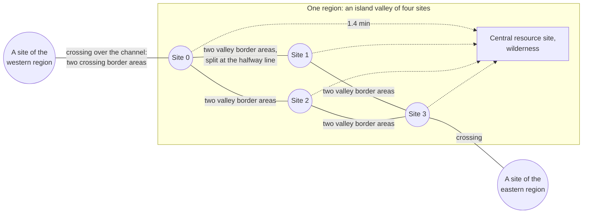
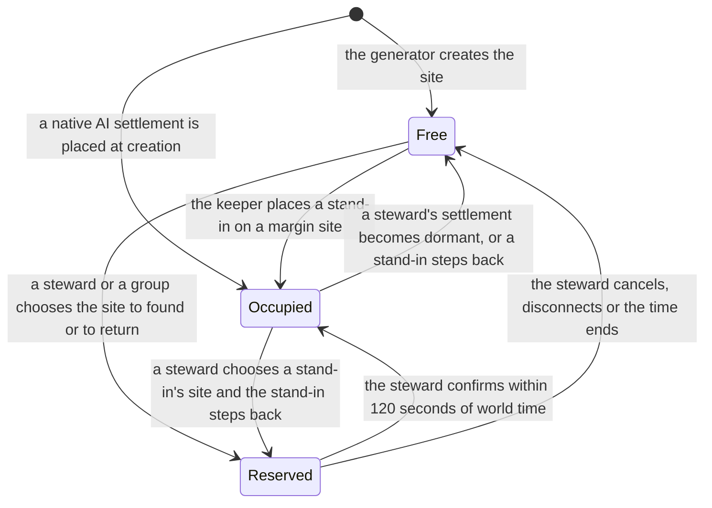
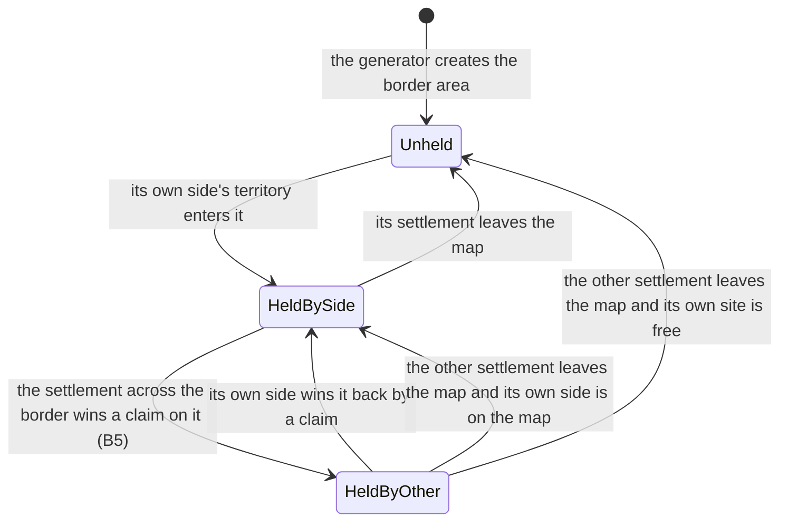
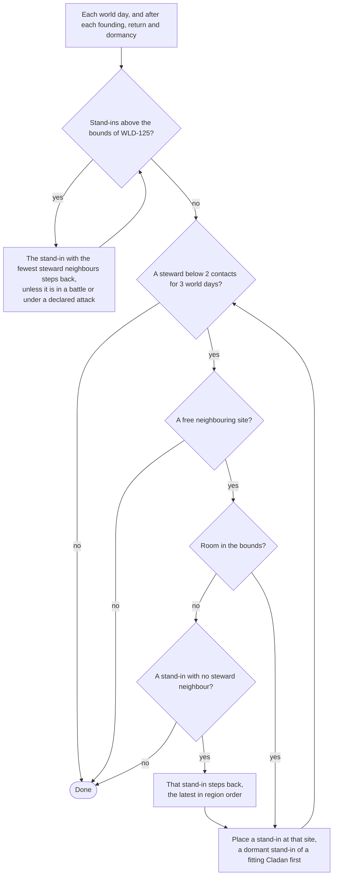

# World and regions: the world, its sites and its settlements

> Status: Final · Prefix: WLD · Rationale: [A1](../../rationale/A1.md) · Related: [index](README.md) · [terrain, time and views](terrain_time_and_views.md) · [skirmish maps and map tools](skirmish_maps_and_map_tools.md) · [vision, pillars and core loops](../00_vision_pillars_and_core_loops.md) · [owner decisions](../../decisions/owner_decisions.md) · [adoption ledger 08](../adoption_ledger/08_maps_and_level_design_ledger.md) · [conventions](../../CONVENTIONS.md)

## 1 Purpose and player experience

### 1.1 What this file decides

This file specifies the shape of a Species world and the life of the settlements on it: the world's size and extent for a given number of stewards, its regions, its settlement sites, the geometry of territories, cores, border areas and contact, where resources lie and how much every site is given, how far apart things are and how long travel takes, the native and stand-in AI settlements, and how a steward finds a site, leaves and returns. [Terrain, time and views](terrain_time_and_views.md) specifies how the terrain is made, the biomes, the world calendar, the lifetime, the strategic and settlement views and the scale figures for the server; [skirmish maps and map tools](skirmish_maps_and_map_tools.md) specifies the rules of skirmish maps and map tools that A1's decisions change. The [index](README.md) lists the files and their requirement ids.

Every number of the geometry and of the life of a world comes from the world-density model `Tools/DesignModels/A1WorldDensity.py`. Its `check` mode reproduces every figure that the three files state, over ten world seeds where a figure varies with the seed, and its `lifetime` mode runs a world for a year of world days with joining, leaving, dormancy and returns (WLD-283). The mechanics that live on top of this geometry belong to their areas: territory growth and the population limit to B1, resource kinds and yields to B2, construction to B3, expeditions and battles to B4, grievances, claims and Cladans to B5, protection and dormancy to B6, AI settlements to B7, the server and its budgets to A2, and terrain streaming, coordinates and path-finding to D8.

### 1.2 The world in one paragraph

A Species world is one continent of valleys ringed by black-lit sea. Each region is a valley: an island basin whose coast falls to a sea channel on every side, holding four settlement sites in a two-by-two pattern. A crossing, a land bridge over the channel, links one site of each of two neighbouring regions. Two sites of one valley are valley neighbours, and the land between them is split at its halfway line into two border areas, one for each side; a crossing's corridor is split the same way at the region border. Every site is given the same land and the same resources, so a late joiner starts as well placed as the first steward; land changes hands only by a claim between the two sides of a border. The centre of every valley holds a rich resource site that no territory covers, which the four settlements of the valley contest. A steward who joins founds at a free site; the world offers first the sites beside other stewards, and stand-in AI settlements keep every steward among neighbours while the world is thinly settled and step aside when a steward wants their site. Valley neighbours are two minutes apart on foot, the next valley six, and the far side of a world of 200 stewards a little over an hour.

### 1.3 The world at a glance

| | 1 steward (solo) | 16 stewards | 200 stewards |
|---|---|---|---|
| Regions (valleys) | 3 | 8 | 77 |
| Settlement sites | 12 | 32 | 308 |
| Native AI settlements | 9 | 10 | 56 |
| Site margin, for stand-in AI settlements | 0 | 4 | 50 |
| Free sites kept for stewards (PIL-068) | the free places + 2 | the free places + 2 | the free places + 2 |
| Settlements per region, fresh world at full occupancy | 3.3 | 3.25 | 3.32 |
| A steward's territory contacts, fresh world at 25 % / 100 % occupancy, over ten seeds | 2.0 (100 %) | 2.5 to 3.0 / 2.4 to 2.8 | 2.8 to 2.9 / 2.8 to 2.9 |
| Stewards with a steward neighbour, fresh world at 25 % / 100 % occupancy, over ten seeds | — | 75 to 100 % / 81 to 100 % | 100 % / 100 % |
| Stewards with fewer than 2 contacts after 180 world days (model scenarios) | — | 0 % | 1 % |
| Valley neighbour, Wellspring to Wellspring, at 20 wu/s | 2.0 min | 2.0 min | 2.0 min |
| Across the world, at 20 wu/s, over ten seeds | — | 23 to 25 min | 70 to 76 min |
| First contact with a valley neighbour, every settlement | world day 5 | world day 5 | world day 5 |
| Resource units every site holds by default; most a settlement can hold | 11; 17 | 11; 17 | 11; 17 |

*Table 1 — The world at 1, 16 and 200 stewards, from the world-density model (WLD-283). "World day" is the unit of the world calendar ([terrain, time and views](terrain_time_and_views.md) WLD-200). The battle load handed to the server is in WLD-284.*

### 1.4 Player experience

| Timescale | What the steward meets | What the world guarantees |
|---|---|---|
| Joining | The free sites, those beside other stewards first, each with its region, biome, crossing and neighbours; the option to found beside a named steward, or as a group | Every site is given the same land and resources (WLD-042, WLD-085); a returning steward is served before new ones (WLD-143) |
| Days 1 to 5 | Growth in an uncontested home cell; the valley's other settlements visible in the strategic view | First valley contact on world day 5 for every settlement, late joiners included (WLD-064) |
| Week 2 on | Border areas held, claimed and won; expeditions to the valley centre and over crossings; attacks with a warning | Two or three territory contacts per steward's settlement (WLD-065); a warning of at least 10 minutes that no route or speed effect can shorten (WLD-102) |
| Months | Friends who leave and new ones who join; a world that thins and fills | Stand-in AI settlements keep every steward among neighbours (WLD-124 to WLD-127); no place is held by a steward who has gone dormant (WLD-005) |

*Table 2 — The player experience of the world, by timescale.*

The world serves pillar 3 through geography: every conflict has a place on the map (a border area, a crossing, a valley centre) that both sides can point at. It serves pillar 6 through sites that are given the same land and resources whatever the order of arrival, a bound on what claims can add to any settlement, and a founding order that seats a late joiner among neighbours. It serves pillar 2 through stand-in AI settlements that keep a thinly settled world alive.

### 1.5 How to read this file

- **Units.** Distances are in world units (wu); one wu is about one metre (R-SIM-365). Simulation durations are in ticks of `ref.sim.tick_period`; this file writes travel in minutes of world time at a stated speed, and the area that owns a timer converts it to ticks under its own key.
- **World days.** A duration of the economy, relations or protection is written in world days of the world calendar, which already contains the conversion of PIL-103: one world day is 24 hours of world time at the always-on pace and 2 hours at the session pace (WLD-200). Travel, battles and the movement of Workers run at the tick rate at both paces (PIL-101).
- **Placeholders.** The model needs values that later areas set: the territory growth curve and the plateau population (B1), the share of attacks that present stewards declare (B5), the evening window of present play (B6), the demand and churn of a world over a year (B6, C2). Each is marked as a placeholder in the model, with the area that sets it; when that area sets the value, the model is run again and the figures follow.
- **Terms.** The terms of CONVENTIONS §8.15 are used with their meanings, among them those that A1 registers there: resource site, border area, crossing, home cell, biome, world template, set piece, stand-in AI settlement, native AI settlement, world day and region name.

## 2 Rules

### 2.1 The world: shape, extent and capacity

**WLD-001** (MUST) A world is one continent of land regions inside a square extent of sea. The extent is reserved for the largest capacity, `wld.world.capacity_limit` (256): it is a square of *G* × `wld.region.side` (5,120 wu) on a side, where *G* is the grid side of WLD-003 at that capacity plus 2 × `wld.world.sea_ring` (1), which gives 14 cells and 71,680 wu for every world. Its corner is at (0, 0), every coordinate of the world lies in [0, 71,680] on both horizontal axes, and the land blob of WLD-003 stands at the centre of the extent, so that a raise of capacity (WLD-008) never moves the origin or a stored position. Every cell that is not a land region is sea at the outside height `wld.terrain.outside_height` (−10 wu), so the world's whole border is sea, as the terrain mesh needs (R-MAP-198, RND-132), and an all-sea chunk is held as one value ([terrain, time and views](terrain_time_and_views.md) WLD-166).

**WLD-002** (MUST) Every settlement site, every crossing and every resource site of a world is reachable from every other one over land, through the crossings of WLD-024 and the travel network of WLD-100. Water separates the regions everywhere else: a Worker never walks into water (R-UNIT-112), other actors are pushed out of it (R-SIM-379), and a Leader that falls into it drowns within 50 ticks (R-UNIT-161), so no rule of the world game depends on an actor crossing the sea except over a crossing. Whether a Transport may cross a channel in a world is B4's (WLD-021).

**WLD-003** (MUST) The land regions form a compact blob that the world generator grows on a square grid of *g* = ⌈√(`wld.world.blob_area_factor` (1.25) × *R*)⌉ cells per side, where *R* is the region count: the cells are ordered by their distance from the grid's centre plus a seeded jitter of up to `wld.world.blob_jitter` (0.35) cells, and the generator takes cells in that order, each one only if it shares a side with a cell already taken, until it has *R*. The blob is connected by construction; its shape depends only on the world seed and *R* ([terrain, time and views](terrain_time_and_views.md) WLD-161).

**WLD-004** (MUST) A world of steward capacity *S* (WLD-005) has a site margin *M* = ⌊`wld.world.site_margin` (0.25) × *S* + 0.5⌋, a first count of native AI settlements *A*₀ = ⌊`wld.ai.base_count` (6) + `wld.ai.per_steward` (0.25) × *S* + 0.5⌋ (O38), *R* = max(`wld.world.min_regions` (3), ⌈(*S* + *A*₀ + `pil.world.free_sites_min` + *M*) ÷ `wld.region.sites` (4)⌉) regions and 4 × *R* settlement sites. The native AI count is then *A* = 4 × *R* − *S* − `pil.world.free_sites_min` − *M*, so the sites that rounding to whole regions adds go to native AI settlements. Rounding is half up, as written, on every server. Table 3 gives the figures.

| Capacity *S* | Native AI *A* | Margin *M* | Sites | Regions *R* | Land grid *g* | Land height samples at 16 wu |
|---|---|---|---|---|---|---|
| 1 | 9 | 0 | 12 | 3 | 2 | 307,200 |
| 4 | 9 | 1 | 16 | 4 | 3 | 409,600 |
| 8 | 8 | 2 | 20 | 5 | 3 | 512,000 |
| 16 | 10 | 4 | 32 | 8 | 4 | 819,200 |
| 50 | 19 | 13 | 84 | 21 | 6 | 2,150,400 |
| 100 | 33 | 25 | 160 | 40 | 8 | 4,096,000 |
| 200 | 56 | 50 | 308 | 77 | 10 | 7,884,800 |
| 256 | 70 | 64 | 392 | 98 | 12 | 10,035,200 |

*Table 3 — World size by steward capacity (WLD-003, WLD-004; `A1WorldDensity.py tables`). The extent is 71,680 wu at every capacity (WLD-001).*

**WLD-005** (MUST) The steward capacity of a world is the number of stewards whose settlements it can hold on its map at once. The world host sets it when the world is created: from 1 to `wld.world.capacity_max_integrated` (16) for an integrated world, from 1 to `wld.world.capacity_max_dedicated` (16) for a community dedicated server (O40), and from 1 to `wld.world.capacity_max_hosted` (200) for a hosted world of stage 3 (O1, O5; PIL-110). Only stewards whose settlement is on the map take a place, among them those who are away and whose settlement the deputy runs until it becomes dormant (PIL-078, O34); a steward whose settlement is dormant holds no place, and AI settlements never take one.

**WLD-006** (MUST) The world host chooses the settings of Table 4 when the world is created. The settings marked fixed never change for the life of the world; the others change only as their requirement allows, and every change is recorded with its world time and shown on the join page (PIL-130).

| Setting | Values | Default | Fixed | Requirement |
|---|---|---|---|---|
| world template | one entry of the template catalogue | the first entry | yes | WLD-160 |
| world seed | an unsigned 64-bit number | drawn at creation, shown to the host | yes | WLD-161 |
| steward capacity | WLD-005 | 4 integrated, 16 dedicated, 200 hosted | raised only (WLD-008) | WLD-005 |
| native AI settlements | from `wld.ai.min_count` (2) to the *A* of WLD-004 | the *A* of WLD-004 | yes | WLD-120 |
| world pace, integrated worlds only | always-on or session (PIL-100) | session | yes (PIL-104) | PIL-104 |
| attacks between stewards | on or off (PIL-063) | off integrated, on dedicated (O33) | yes | PIL-063 |
| world lifetime | unlimited, or 28 to 364 world days | WLD-220 | lengthened only (WLD-221) | WLD-220 |
| seasonal theme | on or off, when DEC-101 keeps the theme | on | no | WLD-185 |

*Table 4 — The world settings that the world host chooses at creation. A dedicated or hosted world is always-on (PIL-104).*

**WLD-007** (MUST) The formulas of WLD-003 and WLD-004 hold for every capacity up to `wld.world.capacity_limit` (256): the extent of 71,680 wu is 4,480 height samples per side at the cell size of WLD-162, below the content-build limit `ter.grid.max_samples_per_side` (32,768) of TER-250. A capacity above the limit is refused at world creation with a diagnostic.

**WLD-008** (SHOULD) From stage 2, the world host SHOULD be able to raise the capacity of a running world. A raise that the existing sites hold (WLD-004 for the new capacity needs no more regions) only lowers the margin and the spare sites; a raise that needs more sites extends the world by whole regions, each grown onto a sea cell that touches the blob in the order of WLD-003, inside the reserved extent, and generated from the world's recorded template, generator and constants (WLD-009) and its seed. The world then gains the native AI settlements and the margin of WLD-004 for the new capacity, placed in the new regions by the rounds of WLD-121. An extension never moves or reshapes an existing region: it bakes the chunks of the new regions and, of an existing region, only the chunks of the coast band where a new crossing lands ([terrain, time and views](terrain_time_and_views.md) WLD-166). The capacity is never lowered below the number of stewards whose settlements are on the map.

**WLD-009** (MUST) A world records, when it is created, its world constants: the generator version, the content digest of its world template, its seed, and the value of every tuning key of these files that shapes its layout (every `wld.world.*`, `wld.region.*`, `wld.site.*`, `wld.crossing.*`, `wld.territory.*`, `wld.resource.*` and `wld.terrain.*` value, and the native AI and margin counts). For its whole life it reads them, never the current tuning, so a patch that retunes one of these keys changes only worlds created after it; an extension (WLD-008) uses the recorded versions, and the server keeps every template version and generator version that a running world names. D4 specifies the migration of a world whose constants a later patch must change.

**WLD-010** (MUST) Each stage builds at least the world of Table 5, and E3 schedules its parts at the milestones of PIL-110.

| Stage | World size and life | Terrain and look | Views and tools |
|---|---|---|---|
| 1 Integrated | Capacities 1 to 16; the native AI settlements, the margin and the stand-in keeper of WLD-124 to WLD-127; the founding choice with "found beside" (WLD-140); the return queue (WLD-143); the unlimited lifetime only; no capacity raise | 1 world template; 2 biomes and 2 lighting presets; no set pieces; the validation checks of WLD-163 for the sea channels, the crossings, the plateaus, dry sites and reachability; generation at world creation and the bake | The strategic view with its two layers and the settlement view (WLD-240 to WLD-246); text authoring of maps and templates with a Debug-build preview (WLD-260) |
| 2 Community dedicated | Capacities 1 to 16 (O40); capacity raises by extension (WLD-008); limited lifetimes, the final notice and the archive (WLD-220 to WLD-224); group founding (WLD-141) | 3 world templates, 6 biomes and 6 lighting presets, 8 set pieces; every check of WLD-163 | The development map editor in Debug builds (WLD-260) |
| 3 Hosted large worlds | Capacities up to 200 and the formulas up to 256 | The stage-2 templates and any hosted template | The strategic view's level of detail at 46,080 wu of camera height (WLD-240) |

*Table 5 — The smallest world of each stage.*

### 2.2 Regions

**WLD-020** (MUST) A region (`Region`) is one land cell of the world grid: a square of side `wld.region.side` (5,120 wu), aligned with the terrain chunks of side `wld.terrain.chunk_side` (1,024 wu), 5 × 5 chunks per region. A region holds `wld.region.sites` (4) settlement sites, one central resource site, the border areas of its sites and its side of each of its crossings. Every settlement, its territory and its structures lie inside the region of its site; this is the unit of the world's simulation partitioning that A2 builds on (vision §5).

**WLD-021** (MUST) Every region is an island valley. Along each side of the region, in the band of half-width `wld.region.coast_band` (320 wu) on each side of the region border, the land falls to the sea: a strip of width `wld.region.channel_width` (256 wu) centred on the region border lies at or below sea level along the whole side, except where a crossing bridges it (WLD-024). A side that faces sea falls to the sea in the same way. Because no actor walks through water (WLD-002), the channels make the valleys the units of travel that the travel network and the warning rely on (WLD-100, WLD-102) without any change to the adopted movement rules. If B4 keeps Transports in the world game, B4 states whether a Transport may cross a channel outside a crossing, and the channels are at least as wide as that rule needs.

**WLD-022** (MUST) Each region has an id, its grid cell (*i*, *j*), its biome, its name, its four sites in a fixed local order (0 at low *x* and low *z*, 1 at high *x*, 2 at high *z*, 3 at high *x* and high *z*, before the valley's rotation of WLD-040), its central resource site, its eight valley border areas and its side of the crossings on its sides. These are world data, created once by the world generator and never changed, except by an extension of WLD-008, which adds regions and crossings and changes no existing one.

**WLD-023** (MUST) A region's name is new text drawn at world creation, without repetition within a world, from a list of `wld.region.names` (120) names under the string ids `region.name.<nnn>`; the draw uses the world seed. A world of more regions than the list holds names the extra regions by a name of the list and a numeral.

**WLD-024** (MUST) Two land regions that share a side are joined by `wld.region.crossings_per_side` (1) crossing (`RegionCrossing`): a land bridge of width `wld.crossing.width` (384 wu) over the channel, whose floor stands above `ref.unit.worker.shore_height` (1 wu) and has a terrain normal y component of at least `wld.crossing.min_normal_y` (0.9) everywhere along its centre line, between its two mouths, each `wld.crossing.mouth_distance` (1,200 wu) from its site's centre on the line between the two sites. On a side along *x* between the regions (*i*, *j*) and (*i* + 1, *j*) the crossing lies on the row of local sites 0 and 1 when *i* + *j* is even, and on the row of sites 2 and 3 when it is odd; on a side along *z* between (*i*, *j*) and (*i*, *j* + 1) it lies on the column of sites 0 and 2 when *i* + *j* is odd and on the column of sites 1 and 3 when it is even. A crossing therefore links exactly one site of each region, and each site has 0 or 1 crossing: over seeds 1 to 10, 12 to 16 of the 32 sites of a world of 16 and 40 to 44 of the 308 of a world of 200 have none (rim and spur sites).

### 2.3 Settlement sites

**WLD-040** (MUST) The four sites of a region stand in a two-by-two pattern of side `wld.site.spacing` (2,080 wu) around the valley's centre. The pattern moves as a whole: the generator offsets its centre from the region's centre by a seeded value of up to ± `wld.site.valley_offset` (64 wu) on each axis and rotates it by a seeded angle of up to ± `wld.site.valley_rotation` (3°) (WLD-161). Every pair of valley neighbours (sites 0 and 1, 2 and 3, 0 and 2, 1 and 3) therefore stands exactly 2,080 wu apart and every diagonal pair 2,942 wu apart in every world, so that every border area, home cell and contact day is the same at every site.

**WLD-041** (MUST) Every settlement site (`SettlementSite`) is a level plateau: the terrain inside its core, the disc of radius `wld.site.core_radius` (400 wu) around the site centre, is levelled to one height, the mean height of the generated base on the core's rim clamped to `wld.site.height_min` (20 wu) to `wld.site.height_max` (120 wu) above sea level, by the feathered flatten type of WLD-268, so that the terrain blends into the plateau without a step of more than `wld.site.rim_step_max` (16 wu) between neighbouring height samples at the core's rim. Every terrain normal inside the core has a y component of at least `wld.site.core_min_normal_y` (0.95), and no terrain sample within `wld.site.water_clearance` (600 wu) of the site centre is at or below sea level. The site's Wellspring stands at its centre (B1 decides the structure, PIL-004).

**WLD-042** (MUST) Every site of a world is given the same: the same core, the same home cell, the same two valley border areas and the same resource units (WLD-085). Sites differ only in their position, biome and whether they have a crossing (0 or 1, WLD-024); a site without a crossing has one contact fewer and, in its place, a home resource site of the same value (WLD-080), and the founding choice shows the difference as a contact, never as wealth (WLD-140). No first site is therefore given more than a later one (PIL-015, Table 1 of PIL-016).

**WLD-043** (MUST) A site is in one of three states: **free** (no settlement stands on it), **reserved** (a steward, or a group, is confirming a founding or a return there, for at most `wld.founding.reserve_seconds` (120 seconds of world time), WLD-141) and **occupied** (a settlement stands on it). A settlement that becomes dormant leaves its site, which becomes free at once (PIL-078). A native AI settlement occupies its site from world creation and never leaves it; a stand-in AI settlement occupies its site until a steward chooses it or the keeper's bounds shrink (WLD-126).

**WLD-044** (MUST) A site record holds: its id, its region and local index, its centre (*x*, *z*) and plateau height, its state and its settlement, its home cell (WLD-061), its two valley border areas and its crossing border area if any (WLD-062), and its home resource sites (WLD-082). Every field except the state and the settlement is world data that the generator writes once.

### 2.4 Territory, border areas and contact

**WLD-060** (MUST) A settlement's territory (`Territory`) is always inside the union of its core, its site's home cell, its site's own border areas and the border areas it has won by claims on the other side of its own borders (WLD-086). B1 grows it from a founding territory of radius `wld.territory.founding_radius` (500 wu) around the Wellspring up to the largest radius `wld.territory.max_radius` (1,400 wu), and on its way it stops at: the coast (WLD-021), except into its own crossing border area; `wld.territory.site_clearance` (200 wu) outside the core of every other site, free or occupied; `wld.resource.wild_clearance` (150 wu) short of every central resource site (WLD-083); and the edge of every border area that it does not hold. A territory is always one connected area.

**WLD-061** (MUST) A site's home cell is the part of its region, outside the coast bands, that is nearer to the site's centre than to the centre of either of its valley neighbours and within `wld.territory.max_radius` of its own centre, minus the site's two valley border areas. A home cell is never claimable: the only claimable areas of a world are its border areas and its central resource sites (PIL-120, WLD-086), so a settlement's core and the rest of its home cell are never taken by a claim (PIL-121). At plateau in a full valley, a settlement's home cell with its own two border areas covers 4.84 million wu², of which the core is 0.50 million.

**WLD-062** (MUST) A world has two kinds of border area (`BorderArea`), each named, static and created by the world generator, and each belonging to one side's site and to that site's region. Each pair of valley neighbours has two **valley border areas**: the lens in which the two discs of radius `wld.territory.max_radius` around their site centres overlap, inside the region and outside the coast bands, 720 wu wide on the line between the two sites, split at the line halfway between them into the half nearer each site. Each crossing has two **crossing border areas**: the bridge and its approaches from each mouth to the region border, one on each side.

**WLD-063** (MUST) A border area is held by its own side's settlement from the tick at which that settlement's territory enters it, and by nobody while its site is free; the settlement on the other side of the same border never enters it unless it wins it by a claim (WLD-086, PIL-121, B5). When a settlement leaves the map, every border area that it holds returns to its own side: to the settlement on that side if one is on the map, and otherwise to nobody. The order in which settlements arrived therefore never decides who holds a border area: a settlement founded in month 6 beside neighbours at plateau holds its own two border areas as soon as its territory reaches them, as the first settlements did.

**WLD-064** (MUST) Two settlements are in contact while their territories meet at a border: at the halfway line of a valley border pair once both territories have reached it (at a radius of 1,040 wu), and at the region border of a crossing once both settlements hold their crossing border areas (their territories having reached the mouths, at 1,200 wu). B1 grows the territory of every settlement, founded at the start of a world or later, so that it reaches 1,040 wu by world day `wld.contact.valley_day` (5) and 1,200 wu by world day `wld.contact.crossing_day` (9) after its founding at the typical pattern (PIL-102); with a growth curve whose radius rises with the square root of time to the plateau of day 14 (PIL-055), the model meets both (day 5.0 and day 8.5), and with a growth that is linear in time, it does not (day 8.4 and day 10.9).

**WLD-065** (MUST) At the default native AI count, with stand-in AI settlements kept by WLD-125, a steward's settlement in a fresh world has a mean of 2.4 to 3.0 territory contacts at 25 %, 50 % and 100 % steward occupancy over seeds 1 to 10 (`wld.contact.degree_band`), and no steward's settlement has fewer than `wld.density.contacts_min` (2) contacts for longer than the keeper's delay while the bounds of WLD-125 allow a stand-in beside it; over a year of the model's scenarios, the share of stewards below 2 contacts stays at or below `wld.density.below_min_share_max` (5 %) after the launch month. Table 6 gives the fresh-world figures; settlements of a valley also meet over its central resource site, which these counts leave out. The world-creation page shows the host the model's contact figure for a lowered native AI count before the host confirms it.

| Capacity | Steward occupancy | Settlements on the map | Of them stand-ins | Settlements per region | Mean contacts | A steward's contacts | Stewards below 2 contacts, most | Stewards with a steward neighbour |
|---|---|---|---|---|---|---|---|---|
| 16 | 25 % | 17 to 18 | 3 to 4 | 2.12 to 2.25 | 0.8 to 1.1 | 2.5 to 3.0 | 0 % | 75 to 100 % |
| 16 | 50 % | 20 to 21 | 2 to 3 | 2.50 to 2.62 | 1.4 to 1.7 | 2.5 to 2.9 | 0 % | 88 to 100 % |
| 16 | 100 % | 26 | 0 | 3.25 | 2.2 to 2.4 | 2.4 to 2.8 | 6 % | 81 to 100 % |
| 200 | 25 % | 144 to 147 | 38 to 41 | 1.87 to 1.91 | 1.2 to 1.3 | 2.8 to 2.9 | 0 % | 100 % |
| 200 | 50 % | 182 to 189 | 26 to 33 | 2.36 to 2.45 | 1.9 to 2.1 | 2.9 | 0 % | 100 % |
| 200 | 100 % | 256 | 0 | 3.32 | 2.8 | 2.8 to 2.9 | 1 % | 100 % |

*Table 6 — Density and territory contacts in a fresh world, stewards founding one after another by WLD-140, natives placed by WLD-121 and stand-ins kept by WLD-125, over seeds 1 to 10 (`A1WorldDensity.py tables`). The mean counts every settlement on the map, AI settlements included; a steward neighbour is a valley or crossing neighbour that is a steward's settlement. At full occupancy the bounds of WLD-125 allow no stand-in, so a steward next to free sites may keep one contact.*

**WLD-066** (MUST) The server records a contact event, with its world time, its two settlements and the border concerned, when two settlements come into contact, when a claim moves a border area, and when a border area returns to its side (WLD-063). These events are the territory-pressure input of B5's grievances (PIL-120, PIL-124): they come from the growth of territories and from claims, which settlement-level actions decide, never from a Worker's choice of task.

### 2.5 Resource distribution

**WLD-080** (MUST) A resource site (`ResourceSite`) is a fixed place where Workers gather (PIL-120). A world has four classes of resource site, placed by the world generator and never moved: **home** resource sites inside each site's home cell (8, and 1 more at a site without a crossing); one **border** resource site at the centre of each valley border area (2 per site); one **crossing** resource site in each crossing border area; and one **central** resource site at the centre of each valley, outside every territory.

**WLD-081** (MUST) B2 sets the resource kinds and their yields; these files set where they lie and how their values compare. With B2's weights: the home resource sites of every settlement site have the same mix of kinds and the same total yield within `wld.resource.home_yield_tolerance` (5 %); a border resource site and a crossing resource site each yield `wld.resource.border_factor` (1) and `wld.resource.crossing_factor` (1) times a home resource site of the same kind, and a central resource site `wld.resource.central_factor` (3) times.

**WLD-082** (MUST) Every site places its home resource sites in the same pattern, measured from its outward diagonal (the direction from the valley's centre through the site's centre): `wld.resource.home_inner` (3) at a distance of `wld.resource.inner_radius` (350 wu) at −60°, 0° and +60°; `wld.resource.home_outer` (5) at `wld.resource.outer_radius` (800 wu) at −72°, −36°, 0°, +36° and +72°; and, at a site without a crossing, one more at `wld.resource.extra_radius` (1,050 wu) on the diagonal. Every one of these places lies in the home cell, at least 200 wu from every other one, from the site's border areas and from the coast band, and every site therefore has the same gathering distances.

**WLD-083** (MUST) A central resource site stands on a level area of radius 120 wu at the centre of its valley, 1,471 wu from each of the valley's four site centres, and every territory stops `wld.resource.wild_clearance` (150 wu) short of it (WLD-060), so it is always wilderness: land that no settlement's territory covers. Each of the valley's four settlements reaches it in 1.4 minutes at 20 wu/s; B2 and B5 say how a settlement gathers there and claims it, within WLD-086.

**WLD-084** (MUST) Resource sites are world data: they keep their places for the life of the world. B2 may let a resource site deplete and renew in place; no rule of the world game creates, moves or removes a resource site during play, so that the equality of WLD-081 and WLD-085 holds at every point of a world's life, for late joiners as for the first stewards (PIL-015).

**WLD-085** (MUST) Every site holds by default `wld.resource.own_units` (11) resource units, a unit being the yield of one home resource site: its 8 home resource sites, the border resource sites of its own two valley border areas, and either the crossing resource site of its own crossing border area or, without a crossing, its ninth home resource site. A settlement founded at any point of a world's life holds the same 11 once its territory has grown over them.

**WLD-086** (MUST) Only the settlement on the other side of a border may claim a border area, and only the settlements whose sites lie in a valley may claim that valley's central resource site (PIL-120, B5). A settlement can therefore hold at most `wld.resource.holdable_units_max` (17) units: its own 11, the two valley border areas and the crossing border area on the other sides of its own borders (3), and its valley's central resource site (3), which is 1.55 times what every settlement is given. This bound is A1's input to the leader guard of PIL-028 (B2, B5).

### 2.6 Travel

**WLD-100** (MUST) The travel network of a world is a graph whose nodes are its settlement sites and its central resource sites, and whose edges are: each pair of valley neighbours, with a length of their distance × `wld.travel.valley_path_factor` (1.15); each crossing, between the two sites it links, with a length of their distance × `wld.travel.crossing_path_factor` (1.20); and each site with its valley's central resource site, with a length of their distance × 1.15. The factors are the ratio of a walkable path over the generated terrain to the straight line, and the generator's validation ([terrain, time and views](terrain_time_and_views.md) WLD-163) checks that the land route of R-SIM-345 between the two ends of every edge is no longer than the edge. D8's world path-finding follows this network between regions; inside a region the land route graph of reference/12 applies.

**WLD-101** (MUST) An expedition outside a battle travels at the march speed `wld.travel.march_speed` (20 wu/s, the Worker's speed `ref.unit.worker.speed`, R-UNIT-011), whatever its formation, and the travel times of Table 7 hold at it. B4 confirms the rule or sets another speed, and then the region side is rescaled with the model so that these limits still hold (WLD-104): a valley neighbour within `wld.travel.valley_minutes_max` (2.5 minutes), a crossing neighbour within `wld.travel.crossing_minutes_max` (4 minutes), one region hop within `wld.travel.hop_minutes_max` (6.5 minutes), and the world's diameter within `wld.travel.diameter_minutes_16` (26 minutes) at a capacity of 16 and `wld.travel.diameter_minutes_200` (80 minutes) at 200, over every seed.

| Leg | Distance (wu) | At 20 wu/s (min) | At 12 wu/s, the formation speed (min) |
|---|---|---|---|
| A Wellspring to the halfway line of a valley border pair | 1,040 | 0.9 | 1.4 |
| A site to its valley's central resource site | 1,691 | 1.4 | 2.3 |
| Valley neighbour, Wellspring to Wellspring | 2,392 | 2.0 | 3.3 |
| Crossing neighbour, Wellspring to Wellspring | 3,401 to 3,899 | 2.8 to 3.2 | 4.7 to 5.4 |
| One region hop, valley centre to valley centre | 6,971 to 7,111 | 5.8 to 5.9 | 9.7 to 9.9 |
| World diameter, capacity 16 | 27,541 to 29,907 | 23.0 to 24.9 | 38.3 to 41.5 |
| World diameter, capacity 200 | 84,583 to 91,349 | 70.5 to 76.1 | 117.5 to 126.9 |

*Table 7 — Travel distances and times over the travel network, over seeds 1 to 10 at capacities 16 and 200 where they vary (`A1WorldDensity.py tables`). Travel runs at the tick rate at both paces (PIL-101).*

**WLD-102** (MUST) The target of an attack is warned when the attack is declared (PIL-025, A0 Figure 5), and the simulation refuses the attacking expedition entry to the target's territory until `pil.conflict.warning_minutes` (10 minutes of world time) have passed since the warning, whatever its route, its speed or any effect on it; an expedition that reaches the edge sooner waits there, and the hold is shown to both sides (B5 and B6 specify the hold and its texts). The warning is 10 minutes at both paces, because it bounds the movement of expeditions, which runs at the tick rate at both paces (PIL-101, PIL-103); B6 confirms it. Between two settlements in contact the expedition reaches the edge 0.9 minutes after it leaves its Wellspring, so the hold is about 9 minutes. The server's estimate of an expedition's remaining travel, its remaining path over the travel network at the march speed, is shown to both sides and decides nothing.

**WLD-103** (MUST) A journey takes the same world time at both paces, so at the session pace it is twelve times longer measured in world days: the 2 minutes to a valley neighbour are 0.0014 world days at the always-on pace and 0.017 at the session pace. B2 and B4 size what an expedition gathers or carries per journey with this ratio at both paces.

**WLD-104** (MUST) Where B4 sets an expedition speed other than `wld.travel.march_speed`, the times of Table 7 scale with it, and the model (`A1WorldDensity.py`, input `march_speed_wus`) is run again before B4's value is final; if a limit of WLD-101 fails, `wld.region.side` and `wld.site.spacing` are scaled together so that it holds.

### 2.7 Native and stand-in AI settlements, and free sites

**WLD-120** (MUST) A world starts with the native AI settlements of WLD-004 (O38). The world host may lower their number at creation to no fewer than `wld.ai.min_count` (2); the sites it frees join the margin. Native AI settlements populate the world from its start (PIL-008), and their count changes only by an extension (WLD-008): they never found another settlement, move, take a free site or become dormant.

**WLD-121** (MUST) The world generator places the native AI settlements at creation in rounds over the regions in the order of WLD-003 (the centre first): in the first round on local site 0 of each region, in the second on local site 3 (the site diagonal to it, so the two are not valley neighbours), in the third on local site 1 and in the fourth on local site 2, until the count is reached.

**WLD-122** (MUST) The generator gives the AI settlements, native and stand-in, their Cladans in placement order, in turn over the world's `pil.world.cladan_count` Cladans, passing over a Cladan that an AI valley neighbour already has whenever another one is available, so that the Cladans differ by at most one AI settlement in count and valley neighbours differ in Cladan where they can (B5 may replace this rule).

**WLD-123** (MUST) The free sites of a world are always at least its places for further stewards plus `pil.world.free_sites_min` (2), as PIL-068 requires: by WLD-004 the sites are the capacity, the native AI settlements, the margin and these 2, and stand-in AI settlements only ever stand on margin sites (WLD-125). A dormant settlement frees its site and its place together; a steward's founding or return takes a free site or a stand-in's site (WLD-140, WLD-143).

**WLD-124** (MUST) A stand-in AI settlement (O38) is an AI settlement that stands on a margin site for a steward who is not there. While it is on the map it is an AI settlement in every rule (B7): it grows, gathers, holds its border areas and takes part in the world loop of its Cladan. It differs from a native AI settlement only in WLD-125 and WLD-126.

**WLD-125** (MUST) The server's keeper (O38) places and removes stand-in AI settlements within three bounds: their number never exceeds the margin *M*, never takes a free site from the reserve of WLD-123, and never brings the settlements on the map above the capacity plus the native AI count, so the full-occupancy load of WLD-280 is never exceeded. At world creation it places stand-ins first in every valley that has no settlement, one each in region order, then a second in valleys with one settlement, diagonal to it. During play, when a steward's settlement has had fewer than `wld.density.contacts_min` (2) territory contacts for `wld.density.standin_delay_days` (3 world days), the keeper places a stand-in at a free site that is its valley neighbour, or else its crossing neighbour; when the bounds leave no room, a stand-in that has no steward's settlement among its neighbours steps back first, the one latest in the region order of WLD-003, and the keeper places its stand-in beside the steward instead. Every world from 1 to 256 stewards therefore has a settlement in every valley on world day 1.

**WLD-126** (MUST) A stand-in steps back, becoming dormant with its stores and structures (PIL-078, PIL-080), when a steward chooses its site to found or to return, and when the keeper's bounds fall below the number of stand-ins, in which case the stand-in with the fewest steward neighbours steps back first. A stand-in that is a side in a battle or the target of a declared attack does not step back, and its site is not offered, until the battle or the attack has ended. A dormant stand-in keeps its Cladan, stores and structures and is the first that the keeper places again, at any margin site, when it next needs one of that Cladan.

**WLD-127** (MUST) Over a year of world days, a world keeps every steward among neighbours whether it fills or empties. Table 8 gives the model's scenarios, the means of five seeds each, with the keeper and, for the share of stewards below 2 contacts, without it.

| Scenario | World day | Stewards on the map | Refused of arrived | Settlements per region | AI share | A steward's contacts | Below 2 contacts, keeper on | Below 2 contacts, keeper off | With a steward neighbour |
|---|---|---|---|---|---|---|---|---|---|
| 200, strong demand | 30 | 195 | 22 / 234 | 3.26 | 22 % | 2.81 | 1 % | 2 % | 100 % |
| 200, strong demand | 90 | 175 | 22 / 356 | 3.09 | 26 % | 2.77 | 0 % | 1 % | 100 % |
| 200, strong demand | 180 | 167 | 22 / 532 | 3.04 | 29 % | 2.75 | 1 % | 2 % | 100 % |
| 200, strong demand | 365 | 169 | 25 / 903 | 3.06 | 28 % | 2.77 | 1 % | 1 % | 100 % |
| 200, weak demand | 30 | 117 | 0 / 128 | 2.54 | 40 % | 2.74 | 1 % | 2 % | 98 % |
| 200, weak demand | 90 | 67 | 0 / 155 | 2.16 | 60 % | 2.58 | 1 % | 14 % | 97 % |
| 200, weak demand | 180 | 50 | 0 / 201 | 2.02 | 68 % | 2.61 | 1 % | 11 % | 96 % |
| 200, weak demand | 365 | 49 | 0 / 297 | 1.92 | 67 % | 2.70 | 2 % | 2 % | 97 % |
| 16, a friend every 4 days | 30 | 15 | 4 / 21 | 3.10 | 41 % | 2.48 | 3 % | 5 % | 84 % |
| 16, a friend every 4 days | 90 | 15 | 8 / 36 | 3.12 | 42 % | 2.53 | 5 % | 5 % | 89 % |
| 16, a friend every 4 days | 180 | 14 | 12 / 57 | 3.08 | 44 % | 2.61 | 0 % | 4 % | 86 % |
| 16, a friend every 4 days | 365 | 15 | 30 / 106 | 3.15 | 41 % | 2.59 | 1 % | 1 % | 91 % |
| 16, a friend every 20 days | 30 | 10 | 0 / 12 | 2.70 | 54 % | 2.48 | 2 % | 13 % | 88 % |
| 16, a friend every 20 days | 90 | 8 | 0 / 15 | 2.60 | 65 % | 2.47 | 0 % | 4 % | 85 % |
| 16, a friend every 20 days | 180 | 6 | 0 / 20 | 2.40 | 68 % | 2.39 | 0 % | 14 % | 81 % |
| 16, a friend every 20 days | 365 | 6 | 0 / 30 | 2.25 | 69 % | 2.48 | 0 % | 18 % | 88 % |

*Table 8 — A year of world days (`A1WorldDensity.py lifetime`). Strong demand: 200 stewards in the first 14 days, then 2 a day; weak: 120, then 0.5 a day; the friends' worlds: 16 or 12 in the first week, then one every 4 or 20 days. Active lifetimes are exponential with a mean of 43 days (60 for the slow friends' world), every steward who stops stays on the map 21 days under the deputy (O34), a quarter of the dormant come back after 7 to 60 days, and no place is held for the dormant (WLD-005). All of these are placeholders of B6 and C2. Refusals happen only while every place is taken by a settlement on the map.*

### 2.8 Founding, returns and late joiners

**WLD-140** (MUST) The founding choice lists every free site and every site of a stand-in AI settlement, ranked by its score: `wld.founding.steward_weight` (6) × its neighbours, valley or crossing, that are stewards' settlements + `wld.founding.valley_weight` (2) × its valley neighbours that are AI settlements + `wld.founding.crossing_weight` (1) × its crossing neighbours that are AI settlements + `wld.founding.room_weight` (1) × its valley neighbour sites that are free or a stand-in's, where a later steward can found beside it, highest first; on an equal score a free site comes before a stand-in's site, then a site of a region earlier in the order of WLD-003, then the lower site id. A steward may name a steward of the world to found beside: the free and stand-in sites that are that steward's neighbours then come first. The first `wld.founding.highlighted` (3) are highlighted and one of them is recommended (WLD-142). For each site the choice shows its region, its biome, whether it has a crossing, as a contact, and the public facts of its neighbours ([terrain, time and views](terrain_time_and_views.md) WLD-242). The steward may choose any listed site. C2 specifies the page.

**WLD-141** (MUST) Choosing a site reserves it for that steward for `wld.founding.reserve_seconds` (120 seconds of world time), during which no other steward can choose it; a steward holds at most one reservation at a time. Confirming founds the settlement there, and cancelling, disconnecting or the end of the time frees it. A group of up to `wld.founding.group_max` (4) stewards may reserve neighbouring sites together (in stage 2, Table 5): the choice offers the valleys and crossings where enough listed sites lie next to each other, and the group's reservation holds until each member has confirmed or the time has ended for all. A freeze stops a reservation's time with the world's (PIL-076). Two choices of one site in one tick are taken in the order of the server's command sequence.

**WLD-142** (MUST) The recommended site is the highlighted site whose occupied valley neighbours have the mean strength (PIL-058) nearest to the median strength of the world's settlements; the server computes it, and the choice shows only that the site is recommended, never a strength, so the recommendation reveals nothing that the steward's settlement could not see (PIL-084). With it, a late joiner is seated among neighbours of median strength rather than next to the strongest settlement (PIL-029).

**WLD-143** (MUST) A steward whose settlement became dormant returns through the same choice and recommendation, and the settlement is placed again at the chosen site with its stores and structures, as B1 and B3 specify, under a respite (PIL-078; B6). When every place of the world is taken, a returning steward waits in a return queue, which the server serves before any new steward as places free; the join page shows the queue's length. Newcomer protection and catch-up are not given again (PIL-088).

**WLD-144** (MUST) A steward may found at any point of a world's life until it ends (PIL-068), including its final notice period ([terrain, time and views](terrain_time_and_views.md) WLD-222); an ended world takes no founding.

## 3 States and flows

### 3.1 A region and its links

*Figure 1 — A region and its links: four sites in a two-by-two valley, each with two valley neighbours and its own half of each border between them; the central resource site that all four reach; and crossings over the sea channel, each linking one site of each region (WLD-021, WLD-024, WLD-040, WLD-062, WLD-080). Which sites carry a crossing alternates with the region's grid position.*

### 3.2 Settlement sites

*Figure 2 — The states of a settlement site (WLD-043, WLD-125, WLD-126, WLD-141, PIL-078). A native AI settlement never leaves its site.*

### 3.3 Border areas

*Figure 3 — The states of a border area (WLD-062, WLD-063, WLD-086). The order of arrival never moves a border area; only a claim does, and only between the two sides of one border.*

### 3.4 The stand-in keeper

*Figure 4 — The stand-in keeper (WLD-124 to WLD-126).*

## 4 Tuning table

Values that this file cites and does not own keep their owners' keys: `pil.world.free_sites_min`, `pil.world.cladan_count`, `pil.conflict.warning_minutes` and `pil.pace.session_factor` (the vision document), `ref.unit.worker.speed`, `ref.unit.worker.shore_height` and `ref.sim.tick_period` (the reference), and `ter.grid.max_samples_per_side` (terrain). Provisional values are first guesses that the named model, measurement or playtest confirms or retunes; the values that the world-density model reads are checked by its `check` mode (WLD-283). A world reads the values recorded at its creation (WLD-009).

| key | value | unit | status | requirement | DEC | playtest note |
|---|---|---|---|---|---|---|
| `wld.world.sea_ring` | 1 | region cells of sea around the reserved grid's land | provisional | WLD-001 | DEC-247 | Strategic-view playtest: whether the coast reads as the world's edge |
| `wld.world.blob_area_factor` | 1.25 | × the region count: the cells of the square in which the blob grows | provisional | WLD-003 | — | Model: compactness of the generated continents over 100 seeds |
| `wld.world.blob_jitter` | 0.35 | region cells: the largest seeded change of a cell's distance | provisional | WLD-003 | — | Strategic-view playtest: whether continents look varied without long spurs |
| `wld.world.min_regions` | 3 | regions | provisional | WLD-004 | — | Solo playtest: whether three valleys give a solo steward enough neighbours and variety |
| `wld.world.site_margin` | 0.25 | margin sites per unit of capacity, rounded half up | final | WLD-004, WLD-125 | — | — |
| `wld.world.capacity_max_integrated` | 16 | stewards | final | WLD-005 | — | — |
| `wld.world.capacity_max_dedicated` | 16 | stewards | final | WLD-005 | — | — |
| `wld.world.capacity_max_hosted` | 200 | stewards | provisional | WLD-005 | — | A2's budgets at owner gate B; stage 3 load tests |
| `wld.world.capacity_limit` | 256 | stewards; the extent is reserved for it | provisional | WLD-001, WLD-007 | DEC-247 | D8: grid, chunk and coordinate limits |
| `wld.region.side` | 5,120 | wu | provisional | WLD-020, WLD-104 | DEC-247 | A2's region budget; playtest of the valley's size at 16 stewards |
| `wld.region.sites` | 4 | settlement sites per region | provisional | WLD-020, WLD-004 | DEC-228 | A2's region body budget against B1's population limit (WLD-281) |
| `wld.region.coast_band` | 320 | wu on each side of a region border | provisional | WLD-021 | — | Generator validation over 100 seeds; look review of the coasts |
| `wld.region.channel_width` | 256 | wu of sea along every region border outside crossings | provisional | WLD-021 | — | Prototype: 100 of 100 seeds keep the channel continuous; B4's Transport rule |
| `wld.region.names` | 120 | names in the region name list | provisional | WLD-023 | — | E2 writes the list; enough for a world of 256 without numerals |
| `wld.region.crossings_per_side` | 1 | crossings per shared region side | provisional | WLD-024 | — | Model and playtest: crossing contacts against valley contacts |
| `wld.crossing.width` | 384 | wu | provisional | WLD-024 | — | B4's battle playtest on a crossing: formations fit, a defence holds |
| `wld.crossing.min_normal_y` | 0.9 | terrain normal y component along a crossing's centre line | provisional | WLD-024 | — | Prototype: 100 of 100 seeds pass; Leader formation movement over crossings |
| `wld.crossing.mouth_distance` | 1,200 | wu from the site's centre | provisional | WLD-024, WLD-064 | — | B1's growth model: crossing contact on day 9 |
| `wld.site.spacing` | 2,080 | wu between valley neighbours | provisional | WLD-040, WLD-064, WLD-104 | — | Model sweep: first contact on day 5; playtest of the first contact |
| `wld.site.valley_offset` | 64 | wu on each axis, at most, for the whole valley | provisional | WLD-040 | — | Strategic-view playtest: whether the site pattern looks too regular |
| `wld.site.valley_rotation` | 3 | degrees, at most, for the whole valley | provisional | WLD-040 | — | Strategic-view playtest: whether the site pattern looks too regular |
| `wld.site.core_radius` | 400 | wu | provisional | WLD-041 | — | B1 and B3: the core holds the Wellspring and the first structures |
| `wld.site.height_min` | 20 | wu above sea level | provisional | WLD-041 | — | Prototype: plateau floors 52 to 111 wu over 100 seeds |
| `wld.site.height_max` | 120 | wu above sea level | provisional | WLD-041 | — | Prototype: plateau floors 52 to 111 wu over 100 seeds |
| `wld.site.rim_step_max` | 16 | wu between neighbouring height samples at a core's rim | provisional | WLD-041 | — | Prototype: 3 to 5 wu with the feathered flatten type over 100 seeds, 31 to 52 wu with Absolute only over 20 |
| `wld.site.core_min_normal_y` | 0.95 | terrain normal y component inside a core | provisional | WLD-041 | — | B3: placement of structures on the plateau |
| `wld.site.water_clearance` | 600 | wu from a site centre | provisional | WLD-041 | — | Prototype: 100 of 100 seeds pass |
| `wld.territory.founding_radius` | 500 | wu | provisional | WLD-060 | — | B1's growth model |
| `wld.territory.max_radius` | 1,400 | wu | provisional | WLD-060, WLD-062 | — | Model sweep: lens width and wilderness at the valley centre; B1's plateau |
| `wld.territory.site_clearance` | 200 | wu outside another site's core | provisional | WLD-060 | — | Generator validation |
| `wld.contact.valley_day` | 5 | world days after founding | provisional | WLD-064 | — | B1's growth model; playtest: the first week feels like growth, the second like contact |
| `wld.contact.crossing_day` | 9 | world days after founding | provisional | WLD-064 | — | B1's growth model |
| `wld.contact.degree_band` | 2.4–3.0 | a steward's mean territory contacts in a fresh world, at the default native AI count, over seeds 1 to 10 | provisional | WLD-065 | — | B5's relations model against the 2 to 10 battles a week of PIL-065 |
| `wld.density.contacts_min` | 2 | territory contacts that the keeper keeps for every steward | final | WLD-065, WLD-125 | — | — |
| `wld.density.standin_delay_days` | 3 | world days below the minimum before a stand-in is placed | provisional | WLD-125 | — | Lifetime model: thrash between returns and stand-ins; playtest |
| `wld.density.below_min_share_max` | 5 | % of stewards below the minimum, after the launch month | provisional | WLD-065 | — | Lifetime model over B6's and C2's churn figures |
| `wld.resource.home_inner` | 3 | home resource sites per site at the inner radius | provisional | WLD-082 | — | B2's economy model |
| `wld.resource.home_outer` | 5 | home resource sites per site at the outer radius | provisional | WLD-082 | — | B2's economy model |
| `wld.resource.inner_radius` | 350 | wu from the site centre | provisional | WLD-082 | — | B2's economy model; gathering trips in a settlement's first hour |
| `wld.resource.outer_radius` | 800 | wu from the site centre | provisional | WLD-082 | — | B2's economy model |
| `wld.resource.extra_radius` | 1,050 | wu from the site centre, for a site without a crossing | provisional | WLD-082 | — | B2's economy model |
| `wld.resource.home_yield_tolerance` | 5 | % between the home yields of two sites | provisional | WLD-081 | — | B2's weights; the leader model of PIL-028 |
| `wld.resource.border_factor` | 1 | × a home resource site of the same kind | provisional | WLD-081 | — | B2 and B5: whether border areas are worth a claim |
| `wld.resource.crossing_factor` | 1 | × a home resource site of the same kind | provisional | WLD-081 | — | B2 and B5: whether crossings are worth a claim |
| `wld.resource.central_factor` | 3 | × a home resource site of the same kind | provisional | WLD-081 | — | B2 and B5: the valley centre as the valley's prize |
| `wld.resource.own_units` | 11 | resource units every site holds by default | provisional | WLD-085 | — | B2's economy model |
| `wld.resource.holdable_units_max` | 17 | resource units a settlement can hold at most | provisional | WLD-086 | — | The joint leader model of PIL-028 (B2, B4, B5) |
| `wld.resource.wild_clearance` | 150 | wu between a territory and a central resource site | provisional | WLD-060, WLD-083 | — | Generator validation |
| `wld.travel.valley_path_factor` | 1.15 | × the straight distance | provisional | WLD-100 | — | Measured on generated terrain with the land route graph over 100 seeds |
| `wld.travel.crossing_path_factor` | 1.20 | × the straight distance | provisional | WLD-100 | — | Measured on generated terrain with the land route graph over 100 seeds |
| `wld.travel.march_speed` | 20 | wu/s, an expedition outside a battle | provisional | WLD-101, WLD-104 | — | B4 confirms; playtest of marching crowds |
| `wld.travel.valley_minutes_max` | 2.5 | minutes at the march speed | provisional | WLD-101 | — | B4's speed; playtest of reinforcing a valley neighbour |
| `wld.travel.crossing_minutes_max` | 4 | minutes at the march speed | provisional | WLD-101 | — | B4's speed |
| `wld.travel.hop_minutes_max` | 6.5 | minutes at the march speed | provisional | WLD-101 | — | B4's speed; B5's reach of an attack |
| `wld.travel.diameter_minutes_16` | 26 | minutes at the march speed | provisional | WLD-101 | — | B5's reach of an attack; playtest of a distant attack |
| `wld.travel.diameter_minutes_200` | 80 | minutes at the march speed | provisional | WLD-101 | — | B5's reach of an attack; stage 3 playtest |
| `wld.ai.base_count` | 6 | native AI settlements | final | WLD-004 | — | — |
| `wld.ai.per_steward` | 0.25 | native AI settlements per unit of capacity | final | WLD-004 | — | — |
| `wld.ai.min_count` | 2 | native AI settlements | provisional | WLD-006, WLD-120 | — | Playtest of a world with few AI settlements |
| `wld.founding.steward_weight` | 6 | score per neighbour, valley or crossing, that is a steward's settlement | provisional | WLD-140 | — | Model: stewards with a steward neighbour; playtest of the founding page |
| `wld.founding.valley_weight` | 2 | score per valley neighbour that is an AI settlement | provisional | WLD-140 | — | Model: stewards who found alone |
| `wld.founding.crossing_weight` | 1 | score per crossing neighbour that is an AI settlement | provisional | WLD-140 | — | Model: stewards who found alone |
| `wld.founding.room_weight` | 1 | score per valley neighbour site that is free or a stand-in's | provisional | WLD-140 | — | Model: with it, 75 to 100 % of the stewards of a fresh world of 16 at 25 % occupancy have a steward neighbour, against 0 to 50 % without it |
| `wld.founding.highlighted` | 3 | sites highlighted in the founding choice | provisional | WLD-140 | — | C2 usability test |
| `wld.founding.reserve_seconds` | 120 | seconds of world time | provisional | WLD-043, WLD-141 | — | C2 usability test of the founding page |
| `wld.founding.group_max` | 4 | stewards in one group reservation | provisional | WLD-141 | — | C2 usability test; friends' worlds in stage 2 playtests |

## 5 Edge cases, exploits and interactions

| Situation | Behaviour | Requirements | Mechanics |
|---|---|---|---|
| Two stewards choose the same site in one tick | The first command in the server's command sequence reserves it; the second steward sees it reserved and chooses again | WLD-141 | C2 |
| A steward holds a reservation and the world freezes | The reservation's time stops with world time and resumes with it | WLD-141, PIL-076 | — |
| Exploit: a steward reserves sites over and over to keep them from others | A steward holds one reservation at a time, for at most 120 seconds | WLD-141 | C2 |
| A world is at capacity and a dormant steward returns | The steward waits in the return queue, served before every new steward as places free; no place was held while the settlement was dormant | WLD-005, WLD-143 | B6, C2 |
| A steward who stopped playing is still on the map under the deputy | The settlement holds its place for the 21 days of PIL-078; then it becomes dormant and frees both its site and its place | WLD-005, PIL-078 | B6 |
| The holder of a border area becomes dormant | The area returns to its own side: to the settlement there, or to nobody while that site is free | WLD-063 | B1 |
| A late joiner founds beside a settlement at plateau that had won its border area by a claim while the site was occupied | When the old settlement left, the area returned to its own side, which is now the late joiner's | WLD-063 | B1, B5 |
| Exploit: a strong settlement grows its territory over a free site to keep newcomers away | No territory covers another site's core and the 200 wu around it, and no territory enters a border area that it does not hold | WLD-060, WLD-063 | B1 |
| Exploit: a strong settlement claims land in another valley | Only the settlement across a border claims a border area, and only a valley's settlements claim its central site; a settlement holds at most 17 units | WLD-086 | B5 |
| A claim moves a border area while the loser's Workers gather inside it | The area joins the claimant's territory at once; B1 and B2 say what happens to Workers and stores there | WLD-063, PIL-121 | B1, B2, B5 |
| A site of a rim region has no crossing | It has its two valley neighbours, its valley's central resource site and a ninth home resource site; the founding choice shows the missing crossing as a contact | WLD-024, WLD-042, WLD-085 | — |
| A region on a spur of the blob touches one land region only | It has one crossing; its sites are given the same as every other | WLD-003, WLD-042 | — |
| A crowd ordered straight at a site across a channel | It stops at the coast; Workers never walk into water, and the route goes over the crossing | WLD-002, WLD-021 | B4, D8 |
| An attacking expedition boosted by a speed effect after the warning | It reaches the target's territory sooner and waits at its edge until 10 minutes after the warning | WLD-102, PIL-025 | B5, B6 |
| A distant attack across the world | The target is warned at the declaration, so it has at least the warning time and usually the whole journey | WLD-102 | B5, B6 |
| A steward is the only steward of a thinly settled world | The keeper places stand-ins beside it until it has 2 contacts, within the margin | WLD-125 | B7 |
| The margin is used up and a steward has one contact | A stand-in with no steward neighbour steps back, and one is placed beside the steward instead | WLD-125 | B7 |
| Every place of a world is taken and a steward has one contact | The bounds allow no stand-in at full occupancy, so the steward keeps one contact until a neighbour founds | WLD-065, WLD-125 | — |
| Friends want to found side by side | One names the other, or the group reserves neighbouring sites together; stand-ins step aside for them | WLD-140, WLD-141, WLD-126 | C2 |
| A steward chooses the site of a stand-in that is under attack | The site is not offered until the attack has ended | WLD-126 | B5 |
| The world fills and the keeper's bounds shrink | Stand-ins with the fewest steward neighbours step back first; native AI settlements never do | WLD-125, WLD-126 | B7 |
| The world host lowers the native AI count | The creation page shows the model's contact figure first; the freed sites join the margin, which the keeper may use | WLD-065, WLD-120 | C2 |
| A patch retunes a layout value | Running worlds keep the values recorded at their creation | WLD-009 | D4 |
| The world host raises the capacity of a running world | Within the existing sites the raise lowers the margin; beyond them the world grows by whole regions inside the reserved extent, with new native AI settlements, from stage 2; in stage 1 the raise is refused | WLD-008 | D1 |
| B1's territory grows linearly in time instead of by the square root | First valley contact falls on day 8.4 instead of day 5, and B1 must meet WLD-064's target another way | WLD-064 | B1 |
| B4 sets an expedition speed other than 20 wu/s | The times of Table 7 scale with it, the model checks WLD-101 again, and the region is rescaled if a limit fails | WLD-104 | B4 |

*Table 9 — Edge cases, exploits and interactions of the world, its sites and its settlements.*

## 6 Acceptance criteria

| Id | Given | When | Then | Requirements |
|---|---|---|---|---|
| AC-01 | World creation at capacities 1, 16 and 200 with default settings | Each world is created | Its native AI settlements, margin, sites and regions are those of Table 3, and its extent is 71,680 wu with the land at its centre | WLD-001, WLD-004 |
| AC-02 | A generated world | Workers, Leaders and a crowd order are driven straight at a site across a channel that no crossing links | None of them enters the water or reaches the other region except over a crossing | WLD-002, WLD-021 |
| AC-03 | Ten generated worlds at capacities 16 and 200, on the server | Stewards found by WLD-140 at 25, 50 and 100 % occupancy | The contacts, settlements per region and the holders of every border area match the model's figures for those seeds | WLD-063, WLD-065, WLD-140 |
| AC-04 | Every site of a generated world, with B2's weights | Its home and own border resource sites are summed | Every site holds 11 units within 5 %, and every site's resource sites lie at the same distances from its centre | WLD-042, WLD-081, WLD-082, WLD-085 |
| AC-05 | A settlement grown to its largest radius | Its territory is compared with the world data | It covers no other site's core or the 200 wu around it, no central resource site or the 150 wu around it, no water, and no border area that it does not hold | WLD-060, WLD-083 |
| AC-06 | A settlement founded in world day 150 beside two settlements at plateau | It grows | It holds its own two valley border areas from the tick its territory enters each, and comes into contact with each neighbour on world day 5 after its founding | WLD-063, WLD-064 |
| AC-07 | A settlement that has won a neighbour's border area by a claim | It becomes dormant | The area returns to the neighbour if it is on the map, and to nobody otherwise | WLD-063 |
| AC-08 | A claim on a border area of another valley, and one on a central resource site by a settlement of another valley | Each is attempted | Both are refused | WLD-086 |
| AC-09 | An attack on a settlement in contact, and one boosted to 80 wu/s after its warning | Each expedition travels | Neither enters the target's territory until 10 minutes after the warning, at either pace | WLD-102 |
| AC-10 | A world at capacity 16, in a scripted sequence of foundings, dormancies and returns | The free sites and places are counted after each event | The free sites are always at least the free places plus 2, no stand-in stands on a reserved site, and a returning steward is served before any new one | WLD-123, WLD-125, WLD-143 |
| AC-11 | A steward with one contact in a thinly settled world, once with room in the margin and once with the margin used by stand-ins that have no steward neighbour | 3 world days pass | A stand-in is placed at its free neighbouring site, within the bounds; in the second case a stand-in without steward neighbours steps back first | WLD-125 |
| AC-12 | A steward who chooses a stand-in's site, and one who chooses the site of a stand-in under a declared attack | Each confirms | The first stand-in becomes dormant with its stores and the steward founds there; the second site is not offered until the attack ends | WLD-126 |
| AC-13 | A world created in one patch and run in the next, which retunes `wld.site.spacing` | Its layout is read | It uses the spacing recorded at its creation | WLD-009 |
| AC-14 | A new world at capacity 16 | Its AI settlements are listed | The ten native settlements stand on local site 0 of the first eight regions and local site 3 of the first two, every valley has a settlement, and Cladan counts differ by at most one | WLD-121, WLD-122, WLD-125 |
| AC-15 | Stewards founding one after another, one naming a friend | Each opens the founding choice | The sites are ranked by WLD-140, three are highlighted, one is recommended, no strength is shown, and the friend's neighbouring sites come first for the one who named it | WLD-140, WLD-142 |
| AC-16 | 100 generated worlds at capacity 16 and 10 at 200 | The land route of every edge of the travel network is measured | No route is longer than its edge, and the limits of WLD-101 hold at 20 wu/s | WLD-100, WLD-101 |
| AC-17 | The world-density model | `A1WorldDensity.py check` runs | It reports no difference from the figures of these files | WLD-283 |

*Table 10 — Acceptance criteria. AC-03 and AC-16 run on worlds generated by the server, AC-17 is met by the model; the others are tests of the build.*

## 7 Adoption from the reference

This file adapts no reference requirement of its own: the world game has no map definition, and its world rules replace none of reference/08's match rules. The reference movement rules that the channels rely on (R-UNIT-112, R-UNIT-161, R-SIM-379) are adopted by their owners' ledgers (B4, D2) and used here as written. The verdicts of reference/08 are in [skirmish maps and map tools](skirmish_maps_and_map_tools.md) §7 and in the [ledger](../adoption_ledger/08_maps_and_level_design_ledger.md).

## 8 Dependencies

**Areas.**

| Area | Takes from this file | Owes back or decides |
|---|---|---|
| A0 | — (upstream) | The world meets PIL-025 through the hold (WLD-102), PIL-068 by construction (WLD-123) and PIL-029 through equal sites and the recommended site (WLD-042, WLD-142) |
| A2 | Regions as the partition, settlements inside one region (WLD-020); the full-occupancy load and the keeper's bound on it (WLD-125); the scale figures of WLD-280 to WLD-285 | The region body budget (WLD-281) |
| B1 | Cores, radii, home cells, border-area holding and contact days (WLD-041, WLD-060 to WLD-064) | Territory growth that meets day 5 and day 9 after every founding; the population limit within WLD-281; returns of dormant settlements (WLD-143) |
| B2 | Resource classes, the fixed pattern, the 11 own units and the 17 at most (WLD-080 to WLD-086); journey times at both paces (WLD-103) | Kinds, yields and weights; gathering at central resource sites |
| B3 | Level site plateaus (WLD-041) | Structures on the plateau; structures of a returning settlement |
| B4 | The march speed and the travel network (WLD-100 to WLD-104); water channels (WLD-021) | The expedition speed (WLD-101); whether Transports cross channels (WLD-021) |
| B5 | Border areas and central resource sites as the only claimable areas, and who may claim them (WLD-061 to WLD-063, WLD-086); contact events (WLD-066); Cladans of AI settlements (WLD-122) | Claims, the attack hold and its texts (WLD-102); the reach of an attack |
| B6 | Places counted only for settlements on the map (WLD-005); the 10-minute warning at both paces (WLD-102) | Confirmation of the warning at the session pace; dormancy and churn figures for the lifetime model |
| B7 | Native and stand-in AI settlements (WLD-120 to WLD-126) | Stand-ins that step back and are placed again with their stores |
| C2 | The founding choice, "found beside" and group reservations (WLD-140 to WLD-142); the return queue (WLD-143); the contact figure on the creation page (WLD-065) | The founding, world-creation and join pages |
| D4 | The world constants (WLD-009) | Their storage and the migration of a world whose constants must change |
| E3 | The smallest world per stage (WLD-010) | Roadmap tasks |

*Table 11 — What other areas take from this file and what they owe back.*

**Model.** `Tools/DesignModels/A1WorldDensity.py` (WLD-283).

**Terms registered** in CONVENTIONS §8.15 and the glossary: resource site (`ResourceSite`; first used by PIL-120), border area (`BorderArea`; first used by PIL-120), crossing (`RegionCrossing`), home cell, native AI settlement and stand-in AI settlement (`AiSettlementRole::Native`, `AiSettlementRole::StandIn`), biome (`Biome`), world template (`WorldTemplate`), set piece (`SetPiece`), world day and region name. Wilderness, coast and channel are used as ordinary words.

## 9 Open decisions

| DEC | Topic | Position in this file | Requirements |
|---|---|---|---|
| DEC-242 | The simulation random generator and stream derivation | A2's; world generation needs counter-based draws keyed by seed, purpose, region and index | WLD-003, WLD-040 |
| DEC-228 | Per-tick CPU budget and population caps | A2's; the region body budget of WLD-281 | WLD-020 |
| DEC-247 | Terrain scale and large-world terrain | D8's; A1 recommends one continuous field in region-aligned chunks inside the reserved extent | WLD-001, WLD-007 |

The decisions that the triage gives A1 are in [skirmish maps and map tools](skirmish_maps_and_map_tools.md) §9. **Owner decisions applied.** O1 and O5 (capacities, WLD-005); O14 (no team slots in a world: sites and stand-ins, WLD-124); O31 (claims on border areas and central resource sites, WLD-086); O33 (the attack setting, Table 4); O34 (dormancy frees a site and its place, WLD-005, WLD-043); O38 (the native AI count, the site margin, stand-in AI settlements and the keeper, WLD-004, WLD-120, WLD-124 to WLD-127); O40 (the stage-2 capacity of 16, WLD-005, WLD-010).
