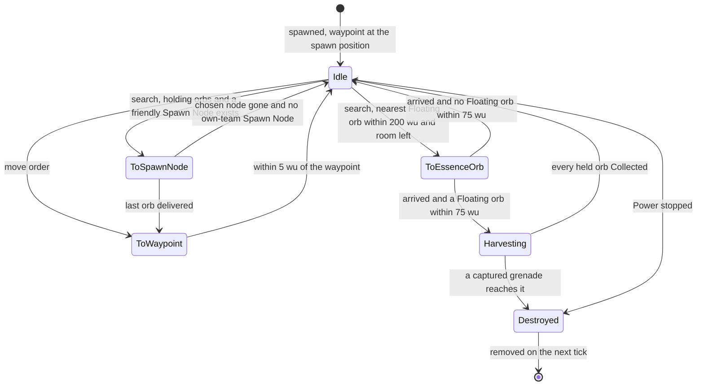
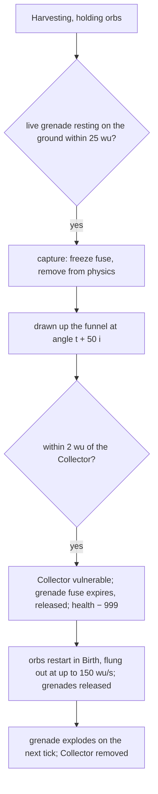

# Collector

> Status: Reference · Prefix: R-UNIT · Related: [Units](README.md) · [Essence orbs](essence_orbs.md) · [Builder](builder.md) · [Worker](worker.md) · [Population flow](../05_population_flow.md) · [Crates and powers](../04_supply_crates_powers_and_weapons/crates_and_powers.md) · [Weapons and projectiles](../04_supply_crates_powers_and_weapons/weapons_and_projectiles.md) · [Teams and player commands](../12_simulation_model/06_teams_and_player_commands.md) · [Bots](../07_bots/README.md)

## 1 Purpose and player experience

The Collector is a flying vacuum for Essence orbs. It hovers high over the battlefield, finds a cloud of floating orbs, stops above it and draws the orbs up in a spiralling funnel of team-coloured rings. Then it flies to the nearest friendly Spawn Node and releases them one per tick, each becoming a new Worker. It takes the orbs of any team, so the enemy's dead become the player's reinforcements. Nothing shoots it down. Its single weakness is a grenade lying on the ground under it while it harvests: the Collector sucks the grenade up with the orbs, and it explodes inside.

This document specifies the Collector (`Collector`, an actor): acquisition, stats, states, movement, the transport of orbs and grenades, damage and the grenade counter, control, the bot hook and presentation. The population-flow view (conversion ratio, the population cap at delivery, delivery ownership) is [population flow](../05_population_flow.md) §2.18.

## 2 Rules

### 2.1 Baseline

**R-UNIT-413** (MUST) The values of §4 are the reference tuning baseline (DEC-004), and the rules of this document are the specification of record for the Collector (DEC-005). Every reference behaviour that looks accidental and is kept is stated as an explicit rule with a named key (DEC-006). The Collector is part of the kept roster (DEC-019).

### 2.2 Role, acquisition and end

**R-UNIT-414** (MUST) A Collector is an ungrouped actor of its team and a special unit: it registers in its team's special-unit list when it starts and unregisters when it is removed ([teams and player commands](../12_simulation_model/06_teams_and_player_commands.md) R-SIM-400, DEC-117). It collects Floating Essence orbs of any team and converts each into one Worker at a friendly Spawn Node (DEC-080, DEC-018). It is not a combat unit.

**R-UNIT-415** (MUST) A Collector is created when the Collector outcome's Power is targeted at a ground position (`PlayerCommand::TargetPower`): it appears at the position raised by `ref.unit.collector.spawn_height` (50 wu) and is selected on its team inside the same simulation step. The outcome's validity (only on maps with at least one Spawn Node of any team) and its announcement sting belong to [crates and powers](../04_supply_crates_powers_and_weapons/crates_and_powers.md). A map may also place a Collector as a starting unit that runs as a Power; no reference map does.

**R-UNIT-416** (MUST) A Collector's Power ends when the Collector is dead or no longer exists. Stopping the Power, by cancelling it or by a stop of all of the team's Powers, makes the Collector vulnerable and changes its health by −`ref.unit.collector.stop_damage` (1000), which destroys it **without** releasing the orbs it holds: its Collected orbs float again and its Harvested orbs stay stranded ([essence_orbs.md](essence_orbs.md) R-UNIT-327, see DEC-307).

### 2.3 Stats

**R-UNIT-417** (MUST) A Collector has these stats:

| Stat | Value | Key |
|---|---|---|
| health | 255 | `ref.unit.collector.health` |
| speed | 28 wu/s, × `ref.econ.collector.idle_speed_factor` (0.25) while Idle, so 7 wu/s | `ref.unit.collector.speed` |
| capacity | 100 Essence orbs at the match power level 3 (`ref.sim.init.power_level_default`); 0, 25, 50, 100 and 200 for levels 0 to 4 | `ref.econ.collector.capacity` |
| orb search range | 200 wu | `ref.econ.collector.search_range_wu` |
| collection range | 75 wu, measured horizontally | `ref.econ.collector.collection_range_wu` |
| search interval while Idle | 11 ticks (nominal 1.0 s) | `ref.unit.collector.retarget_ticks` |
| orb-cloud threshold | more than 30 Floating orbs | `ref.econ.collector.cluster_threshold` |
| hover height | 50 wu above the ground level | `ref.econ.collector.hover_wu` |
| collector point | 15 wu above the Collector | `ref.econ.collector.collector_height_wu` |
| arrival distance | 5 wu, measured horizontally | `ref.unit.collector.arrival_distance` |
| idle wander distance | 30 wu | `ref.unit.collector.wander_distance` |

Actor stats are floating-point values (DEC-090).

**R-UNIT-418** (MUST) A Collector is drawn with the mesh `mesh.unit.collector_body`. Its engine sockets `engine_01` to `engine_04` are optional; each socket present emits engine exhaust (R-UNIT-443) (ADR-021).

### 2.4 States

**R-UNIT-419** (MUST) A Collector is in one of the states `CollectorState::Idle`, `ToWaypoint`, `ToEssenceOrb`, `Harvesting` and `ToSpawnNode`. It starts Idle with its waypoint at its spawn position. It holds the list of the orbs it has harvested, in harvest order, its chosen orb, its chosen Spawn Node, an orb-cloud flag and its search timer.

**R-UNIT-420** (MUST) Each tick, in every state, a Collector runs its state step (R-UNIT-421 to R-UNIT-426), then the orb transport (R-UNIT-430), the grenade transport (R-UNIT-433) and its engine exhaust (R-UNIT-443); if it did not move in this tick, it holds its hover height (R-UNIT-429); then it runs the base actor advance ([Units](README.md)).

**R-UNIT-421** (MUST) **Idle.** An Idle Collector releases every grenade it holds (R-UNIT-435) and moves towards its waypoint at its Idle speed. Every `ref.unit.collector.retarget_ticks` (11 ticks) it searches, in this order:

1. if it holds fewer orbs than its capacity, the nearest Floating Essence orb within `ref.econ.collector.search_range_wu` (200 wu); an orb in Birth is never chosen, and the orb's team is never tested (DEC-080, [essence_orbs.md](essence_orbs.md) R-UNIT-325). If one is found, the Collector clears its orb-cloud flag and becomes ToEssenceOrb;
2. otherwise, if it holds orbs, the nearest Spawn Node whose owner is a friend of the Collector's team (its own team or a co-op ally, [teams and player commands](../12_simulation_model/06_teams_and_player_commands.md) R-SIM-414). If one is found, the Collector becomes ToSpawnNode;
3. otherwise it wanders: its waypoint becomes the point `ref.unit.collector.wander_distance` (30 wu) away in the horizontal direction of a draw from `ref.unit.collector.wander_angle_range` (U[−π, π) rad).

**R-UNIT-422** (MUST) **ToWaypoint.** The Collector flies to its waypoint at full speed and becomes Idle within `ref.unit.collector.arrival_distance` (5 wu) of it.

**R-UNIT-423** (MUST) **ToEssenceOrb.** The Collector's target is its chosen orb's position. Once per trip, while its orb-cloud flag is clear, if more than `ref.econ.collector.cluster_threshold` (30) Floating orbs lie within the collection range of the Collector, its target becomes their centroid and it sets the flag. When it arrives within 5 wu of its target, it becomes Harvesting if a Floating orb lies within the collection range, and Idle otherwise.

**R-UNIT-424** (MUST) **Harvesting.** A Harvesting Collector stands still. Each tick it harvests every Floating Essence orb whose horizontal distance is below `ref.econ.collector.collection_range_wu` (75 wu) while it holds fewer orbs than its capacity ([essence_orbs.md](essence_orbs.md) R-UNIT-316), and it captures grenades (R-UNIT-434). It stays Harvesting while any orb it holds is still Harvested, and becomes Idle once every orb it holds is Collected.

**R-UNIT-425** (MUST) **ToSpawnNode.** The Collector's target is its chosen Spawn Node's position at its hover height. On arrival within 5 wu, it delivers on each tick on which that node may produce, that is, while the node's activation delay is 0 and the node is not population-locked under the receiving team's population cap ([population flow](../05_population_flow.md) R-ECON-052, DEC-079): it removes `ref.econ.collector.delivery_per_tick` (1) held orb, the first in its list, and the Spawn Node spawns one Worker of its current owner at its door ([population flow](../05_population_flow.md) R-ECON-043, R-ECON-074), with the drop sound event (R-UNIT-445). On any other tick it keeps its orbs and waits at the node, so no orb is lost and none becomes a Worker above the cap (DEC-080, DEC-453). A Spawn Node that now has no team spawns nothing, and the orb is still removed (R-ECON-075). A Collector at an active Spawn Node of a team below its cap therefore yields 1 Worker per tick, 10 per second at game speed 1. When it has delivered its last orb, it becomes ToWaypoint.

**R-UNIT-426** (MUST) If the chosen Spawn Node no longer exists, the Collector searches again, but this time accepts only a Spawn Node of its **own** team, not an ally's; if there is none, it becomes Idle.

**R-UNIT-427** (MUST) A held entry whose orb no longer exists is removed from the Collector's list without effect, so delivery and release each end after one pass over the list (DEC-014, [population flow](../05_population_flow.md) R-ECON-081).

**R-UNIT-428** (MUST) A Collector that holds orbs but finds no friendly Spawn Node stays Idle, wanders and keeps its orbs; Collected orbs never expire ([essence_orbs.md](essence_orbs.md) R-UNIT-317).

### 2.5 Movement

**R-UNIT-429** (MUST) A Collector moves by this law each tick, with its target per its state and dir the horizontal unit vector towards the target:

```
if horizontal distance to target > ref.unit.collector.arrival_distance:           # 5 wu
    cap   := ref.unit.collector.speed × (ref.econ.collector.idle_speed_factor if Idle else 1)
    speed := min(horizontal distance, cap)                                      # wu/s
    a     := (ref.unit.collector.idle_turn_rate if Idle else ref.unit.collector.turn_rate) × ref.sim.tick_period
    facing := facing × (1 − a) + dir × a                                        # a = 0.95, or 0.2 while Idle
    vel   := ref.unit.collector.velocity_keep × vel + (1 − ref.unit.collector.velocity_keep) × facing × speed
    pos   := pos + vel × ref.sim.tick_period
    pos.y := hover height
    facing := horizontal part of vel
else:
    pos.y := hover height                                                      # it did not move
```

The hover height is max(terrain height, `ref.sim.physics.sea_level`) + `ref.econ.collector.hover_wu` (50 wu) + `ref.unit.collector.bob_amplitude` (2.5 wu) × sin(t + `ref.unit.collector.bob_phase_factor` (20) × serial), with t the simulation time in seconds from the tick counter and serial the Collector's object serial (DEC-009).

**R-UNIT-430** (MUST) A Collector avoids nothing: it never calls the obstacle push, so it flies over and through structures, cliffs and water, and a Barrier Emitter neither stops nor kills it. Its x and z stay inside the map.

### 2.6 Transport of orbs and grenades

**R-UNIT-431** (MUST) **Orb transport.** Each tick, for each held orb i (its index in the list) that is Harvested, with t = the simulation time in seconds + 20 × the Collector's serial and s = (`ref.econ.collector.hover_wu` − (orb height − the ground height under the orb)) ÷ `ref.econ.collector.hover_wu`, the orb steers towards a point that circles the Collector at horizontal radius `ref.econ.collector.collection_range_wu` × s and angle t + i, a funnel that narrows as the orb rises. Its speed is `ref.unit.collector.suck_speed` (40 wu/s) × (1 − horizontal distance to the Collector ÷ `ref.unit.collector.suck_falloff_range` (150 wu)), and `ref.unit.collector.suck_speed_level` (20 wu/s) once its height differs from the collector point's by less than `ref.econ.orb.harvest_alt_dy_wu` (5 wu), the height test of the collection rule (see DEC-854). When it is within `ref.econ.orb.harvest_arrival_wu` (2 wu) of its orbit point, or within `ref.econ.orb.harvest_alt_range_wu` (50 wu) with a height difference below 5 wu, it becomes Collected ([essence_orbs.md](essence_orbs.md) R-UNIT-317) and is placed at the collector point displaced by three draws from `ref.unit.collector.collected_jitter` (U[−3.75, 3.75] wu), on x, y and z in that order.

**R-UNIT-432** (MUST) A Collected orb rides with the Collector (its velocity is the Collector's) and never expires; Harvested orbs still in the funnel when the Collector is removed without releasing them stay where they are ([essence_orbs.md](essence_orbs.md) R-UNIT-316, R-UNIT-317).

**R-UNIT-433** (MUST) **Grenade transport.** Each tick, each captured grenade i is drawn up the same funnel as R-UNIT-431, at angle t + `ref.unit.collector.grenade_orbit_spacing` (50) × i, at the speed of R-UNIT-431. A captured grenade whose distance to the Collector falls within `ref.unit.collector.grenade_hit_distance` (2 wu) destroys the Collector (R-UNIT-436).

### 2.7 Damage and the grenade counter

**R-UNIT-434** (MUST) **Grenade capture.** While Harvesting with at least one held orb, a Collector captures every live grenade, of any team, that rests on the ground (its height below the terrain height + `ref.unit.collector.grenade_rest_height` (2 wu)) within `ref.econ.collector.grenade_capture_wu` (25 wu, a third of the collection range) horizontally. Capture freezes the grenade's fuse and removes it from the thrown-weapon physics ([weapons and projectiles](../04_supply_crates_powers_and_weapons/weapons_and_projectiles.md)). Only grenades are captured: airstrike bombs and firebomb canisters are other effect kinds.

**R-UNIT-435** (MUST) **Grenade release.** Releasing a grenade unfreezes its fuse and returns it to the thrown-weapon physics. An Idle Collector releases every grenade it holds (R-UNIT-421).

**R-UNIT-436** (MUST) **Destruction by grenade.** When a captured grenade reaches the Collector (R-UNIT-433), the Collector becomes vulnerable; the grenade's fuse is set to expire and the grenade is released, so it explodes on the next tick with its own explosion ([weapons and projectiles](../04_supply_crates_powers_and_weapons/weapons_and_projectiles.md)); the Collector's health changes by −`ref.econ.collector.self_destruct_damage` (999), which destroys it; it releases every orb it holds (R-UNIT-437) and every other grenade it holds (R-UNIT-435).

**R-UNIT-437** (MUST) **Orb release.** Releasing the held orbs runs the start step of each orb again ([essence_orbs.md](essence_orbs.md) R-UNIT-307): it restarts in Birth with a new birth timer, new wobble draws and its ground height under its present position, and its velocity becomes the horizontal direction away from the Collector with a length drawn from U[0, `ref.econ.collector.release_speed_max_wu_s`) (150 wu/s). The list is then empty (R-UNIT-427).

**R-UNIT-438** (MUST) A Collector ignores every health change unless it is vulnerable **and** the damage type is unresistable. Lasers, explosions, turret rounds and fire therefore never harm it, and the elimination damage of its team does not remove it ([population flow](../05_population_flow.md) R-ECON-010). It becomes vulnerable only through R-UNIT-416 and R-UNIT-436.

**R-UNIT-439** (MUST) A Collector whose health reaches 0 dies: it raises the die event (unbound, DEC-565), releases **no** Essence orb of its own, has no corpse fade, and its advance on the next tick requests its removal. Whenever its health crosses a multiple of `ref.unit.collector.shatter_band` (50 health), and at death, its mesh sheds debris with fraction 1 − health ÷ `ref.unit.collector.shatter_reference_health` (255); the debris is presentation.

### 2.8 Targeting, control and bot hook

**R-UNIT-440** (MUST) A Collector targets only Essence orbs and resting grenades. Workers never choose a Collector as a threat ([worker.md](worker.md)), and no weapon of the reference aims at it.

**R-UNIT-441** (MUST) A player controls a Collector only by selecting it (`PlayerCommand::Select`) and giving it a move order: a team command state with `moveTarget` while the Collector is the team's selected actor ([teams and player commands](../12_simulation_model/06_teams_and_player_commands.md) R-SIM-442) sets its waypoint to `pointerPosition`, makes it ToWaypoint, sets its search timer to 0 and clears the team's selection inside the same step, so the Collector takes one move order per selection ([actions and bindings](../06_controls_camera_and_commands/actions_and_bindings.md) R-CTRL-104, R-CTRL-106). Everything else it does is autonomous. Cancelling its Power is R-UNIT-416.

**R-UNIT-442** (MUST) A bot team's Collector thinks every `ref.unit.collector.bot_think_ticks` (11 ticks): when it is Idle, its waypoint becomes the position of the nearest Essence orb anywhere on the map, in any state, a bot-only operation with no player command ([bots](../07_bots/README.md) R-BOT-015; see DEC-122). It then follows R-UNIT-421 to R-UNIT-426 like a player's Collector.

### 2.9 Presentation and sound

**R-UNIT-443** (MUST) A Collector's whole mesh takes its team colour: every facet has tint weight 1, with the team colour × `ref.unit.collector.tint_scale` (0.7) (ADR-020). Each tick each engine socket emits `ref.unit.collector.exhaust_fire_count` (5) blue fire particles of size `ref.unit.collector.exhaust_fire_size` (75) and colour `ref.unit.collector.exhaust_colour` (50, 50, 250) and one smoke trail particle, from the presentation generator ([animation and VFX](../../architecture/components/animation_and_vfx/README.md)).

**R-UNIT-444** (MUST) A Collector draws a collector bubble, `fx.bubble_sphere`, of size `ref.unit.collector.bubble_size` (16 wu), additive, at opacity `ref.unit.collector.bubble_alpha` (150 of 255), `ref.unit.collector.bubble_offset` (3 wu) above its collector point. While Harvesting it draws `ref.unit.collector.beam_ring_count` (5) animated rings in its team colour, each of radius `ref.econ.collector.collection_range_wu` × the funnel scale s at its height, cycling from the ground up to its hover height; and it casts the base blob shadow ([Units](README.md) R-UNIT-050) of half-size `rnd.shadow.blob.collector_size` (10 wu) ([renderer](../../architecture/components/renderer/entity_and_overlay_renderers.md) RND-324). These render paths read the presentation clock only (DEC-009, [randomness and integrity](../12_simulation_model/07_randomness_and_integrity.md) R-SIM-701).

**R-UNIT-445** (MUST) A Collector shows its activity with these string ids: `unit.collector.action.idle` (new text "Idle") while Idle, Harvesting or ToSpawnNode, a kept reference rule (DEC-006, see DEC-854); `unit.collector.action.to_waypoint` (new text "Moving to waypoint") while ToWaypoint; `unit.collector.action.to_essence_orb` (new text "Heading for Essence orbs") while ToEssenceOrb. It raises these sound events ([event catalogue](../10_audio_design/event_catalogue.md) table 2.2-E and R-AUD-141):

| Event | When | Binding |
|---|---|---|
| `collector.spawn` | while the Collector exists | three loops: layers 1 and 2 the engine groups `sfx.creature.abductor.presence_loop_b` and `sfx.creature.abductor.presence_loop_c`, layer 3 `sfx.unit.collector.presence_loop` |
| `collector.drop_essence` | each orb delivered (R-UNIT-425) | `sfx.unit.collector.drop_essence` |
| `collector.hurt`, `collector.die` | a health loss; death | silent (DEC-565) |
| `collector.selected` | the Collector is selected | silent (DEC-565) |

## 3 States and flows



*Figure 1 — Collector states (R-UNIT-419 to R-UNIT-426, R-UNIT-416, R-UNIT-436). A move order and a stopped Power act from every state.*



*Figure 2 — The grenade counter (R-UNIT-433 to R-UNIT-437).*

## 4 Tuning table

| key | value | unit | range or notes | requirement | DEC |
|---|---|---|---|---|---|
| `ref.unit.collector.spawn_height` | 50 | wu | above the targeted position | R-UNIT-415 | — |
| `ref.unit.collector.stop_damage` | 1000 | health | after the Power stop makes it vulnerable | R-UNIT-416 | DEC-307 |
| `ref.unit.collector.retarget_ticks` | 11 | ticks | nominal 1.0 s | R-UNIT-417, R-UNIT-421 | DEC-002 |
| `ref.unit.collector.arrival_distance` | 5 | wu | horizontal | R-UNIT-417, R-UNIT-422, R-UNIT-423, R-UNIT-425, R-UNIT-429 | DEC-111 |
| `ref.unit.collector.wander_distance` | 30 | wu | | R-UNIT-417, R-UNIT-421 | — |
| `ref.unit.collector.wander_angle_range` | [−π, π) | rad | one draw per wander | R-UNIT-421 | — |
| `ref.unit.collector.turn_rate` | 9.5 | per second | heading blend 0.95 per tick | R-UNIT-429 | DEC-111 |
| `ref.unit.collector.idle_turn_rate` | 2 | per second | heading blend 0.2 per tick while Idle | R-UNIT-429 | — |
| `ref.unit.collector.velocity_keep` | 0.92 | — | share of the old velocity kept per tick | R-UNIT-429 | DEC-111 |
| `ref.unit.collector.bob_amplitude` | 2.5 | wu | 5 % of the hover height | R-UNIT-429 | DEC-009 |
| `ref.unit.collector.bob_phase_factor` | 20 | rad per serial | | R-UNIT-429 | — |
| `ref.unit.collector.suck_speed` | 40 | wu/s | at the Collector | R-UNIT-431, R-UNIT-433 | — |
| `ref.unit.collector.suck_falloff_range` | 150 | wu | speed falls linearly to 0 here | R-UNIT-431 | — |
| `ref.unit.collector.suck_speed_level` | 20 | wu/s | once nearly level with the collector point | R-UNIT-431 | — |
| `ref.unit.collector.collected_jitter` | [−3.75, 3.75] | wu | one draw per axis on collection | R-UNIT-431 | — |
| `ref.unit.collector.grenade_orbit_spacing` | 50 | rad per index | | R-UNIT-433 | — |
| `ref.unit.collector.grenade_hit_distance` | 2 | wu | | R-UNIT-433, R-UNIT-436 | — |
| `ref.unit.collector.grenade_rest_height` | 2 | wu | resting means below terrain + 2 wu | R-UNIT-434 | — |
| `ref.unit.collector.shatter_band` | 50 | health | | R-UNIT-439 | — |
| `ref.unit.collector.shatter_reference_health` | 255 | health | the maximum health used for the debris fraction | R-UNIT-439 | — |
| `ref.unit.collector.bot_think_ticks` | 11 | ticks | nominal 1.0 s | R-UNIT-442 | DEC-002 |
| `ref.unit.collector.tint_scale` | 0.7 | × team colour | whole-mesh tint | R-UNIT-443 | DEC-029 |
| `ref.unit.collector.exhaust_fire_count` | 5 | particles per tick per engine socket | | R-UNIT-443 | DEC-013 |
| `ref.unit.collector.exhaust_fire_size` | 75 | particle size | | R-UNIT-443 | — |
| `ref.unit.collector.exhaust_colour` | (50, 50, 250) | RGB | | R-UNIT-443 | DEC-029 |
| `ref.unit.collector.bubble_size` | 16 | wu | | R-UNIT-444 | DEC-029 |
| `ref.unit.collector.bubble_alpha` | 150 | of 255 | additive | R-UNIT-444 | DEC-029 |
| `ref.unit.collector.bubble_offset` | 3 | wu | above the collector point | R-UNIT-444 | — |
| `ref.unit.collector.beam_ring_count` | 5 | rings | while Harvesting | R-UNIT-444 | DEC-029 |

Keys cited from other documents (their values are defined there):

| Owning document | Keys | Used by |
|---|---|---|
| [Units](README.md) §4.1 (the actor stat table) | `ref.unit.collector.health`, `ref.unit.collector.speed` | R-UNIT-417, R-UNIT-429 |
| [renderer](../../architecture/components/renderer/entity_and_overlay_renderers.md) | `rnd.shadow.blob.collector_size` | R-UNIT-444 |
| [population flow](../05_population_flow.md) | `ref.econ.collector.idle_speed_factor`, `ref.econ.collector.capacity`, `ref.econ.collector.search_range_wu`, `ref.econ.collector.collection_range_wu`, `ref.econ.collector.cluster_threshold`, `ref.econ.collector.hover_wu`, `ref.econ.collector.collector_height_wu`, `ref.econ.collector.delivery_per_tick`, `ref.econ.collector.grenade_capture_wu`, `ref.econ.collector.self_destruct_damage`, `ref.econ.collector.release_speed_max_wu_s` | R-UNIT-417, R-UNIT-421 to R-UNIT-437 |
| [population flow](../05_population_flow.md) | `ref.econ.orb.harvest_arrival_wu`, `ref.econ.orb.harvest_alt_range_wu`, `ref.econ.orb.harvest_alt_dy_wu` | R-UNIT-431 |
| [match lifecycle and state reset](../12_simulation_model/02_match_lifecycle_and_state_reset.md) | `ref.sim.init.power_level_default` | R-UNIT-417 |
| [tick timing](../12_simulation_model/01_tick_timing_and_main_loop.md) | `ref.sim.tick_period` | R-UNIT-429 |
| [space, routing and physics](../12_simulation_model/05_space_routing_and_physics.md) | `ref.sim.physics.sea_level` | R-UNIT-429 |

## 5 Edge cases and interactions

1. **Enemy dead.** A Collector parked over a battle converts both sides' dead into its own side's Workers (R-UNIT-421, DEC-080).
2. **Capped delivery.** A Collector delivers only while its Spawn Node may produce: at the population cap, or while the node's activation delay runs, it keeps its orbs and waits at the node, so it never raises a team above its cap (R-UNIT-425, DEC-080, DEC-453).
3. **Node changes hands.** A Spawn Node that turns enemy while the Collector delivers produces the enemy's Workers; one that turns neutral swallows each orb without a Worker (R-UNIT-425).
4. **Ally's node lost.** If the chosen ally's Spawn Node is destroyed, the re-search ignores allies and finds only own-team nodes (R-UNIT-426).
5. **Orb clouds.** A trip towards one orb turns into a stop at the centroid when the cloud around the Collector holds more than 30 Floating orbs, at most once per trip (R-UNIT-423).
6. **Birth orbs.** Orbs in Birth are not collected; a Collector over a fresh battle waits until the orbs have floated down and become Floating (R-UNIT-421, R-UNIT-424).
7. **Cancel versus grenade.** A cancelled Collector strands its Harvested orbs and leaves its Collected orbs floating; a grenade kill restarts every held orb in Birth and flings them out (R-UNIT-416, R-UNIT-436, R-UNIT-437, DEC-307).
8. **Own grenades.** The grenade capture tests no team, so a team's own grenades destroy its Collector just as enemy grenades do (R-UNIT-434).
9. **No obstacles.** A Collector cannot be blocked by walls or Barrier Emitters (R-UNIT-430).
10. **Elimination.** When its team is eliminated, the Collector survives the elimination damage (R-UNIT-438).

## 6 Acceptance criteria

**AC-CO-01 — Delivery yield** (R-UNIT-425). Given a Collector holding 40 Collected orbs at a friendly active Spawn Node of a team at least 40 Workers below its population cap, then exactly one Worker appears per tick for 40 ticks and the Collector then becomes ToWaypoint. Given the same Collector at a node that is population-locked, then no Worker appears, the Collector keeps its 40 orbs and waits at the node, and it delivers again on the first tick on which the node may produce.

**AC-CO-02 — Any team** (R-UNIT-421, R-UNIT-424). Given Floating orbs of teams 0, 1 and 2 within 75 wu of a Harvesting team-0 Collector with room, then all of them are harvested.

**AC-CO-03 — No Birth orbs** (R-UNIT-421). Given only orbs in Birth within 200 wu, an Idle Collector chooses none of them.

**AC-CO-04 — Invulnerability** (R-UNIT-438). Given a Collector that is not vulnerable, when it takes laser, explosive, fire, turret-round and unresistable damage of 1000 each, then its health stays 255.

**AC-CO-05 — Grenade counter** (R-UNIT-434, R-UNIT-436, R-UNIT-437). Given a Harvesting Collector holding 10 orbs and a live grenade resting 20 wu away horizontally, then the grenade's fuse stops, it rises to the Collector, the Collector is destroyed, the 10 orbs are in Birth with speeds below 150 wu/s, and the grenade explodes on the following tick.

**AC-CO-06 — Grenade too far** (R-UNIT-434). Given the same Collector and a grenade resting 30 wu away, then the grenade is not captured and explodes where it lies at the end of its fuse.

**AC-CO-07 — Movement law** (R-UNIT-429). Given a Collector at rest facing its target 500 wu away and not Idle, after one tick its velocity is 0.08 × 28 = 2.24 wu/s along the target direction.

**AC-CO-08 — Stop strands Harvested orbs** (R-UNIT-416, R-UNIT-432). Given a Harvesting Collector with 3 Harvested and 5 Collected orbs, when its Power is cancelled, then after the next tick the 5 orbs are Floating and the 3 orbs remain Harvested at their positions for the rest of the match.

**AC-CO-09 — Bot hook** (R-UNIT-442). Given an Idle bot Collector and a single orb in Ascent 1,000 wu away, its waypoint becomes that orb's position within 11 ticks.

## 7 Dependencies

- **Reference documents:** [Units](README.md) (base advance, blob shadow, actor stat table); [essence_orbs.md](essence_orbs.md); [builder.md](builder.md); [worker.md](worker.md) (threat search exclusion); [population flow](../05_population_flow.md) §2.18 (delivery, population cap, ownership); [actions and bindings](../06_controls_camera_and_commands/actions_and_bindings.md) (move order and deselection); [crates and powers](../04_supply_crates_powers_and_weapons/crates_and_powers.md) (the Collector outcome, validity, Power stop); [weapons and projectiles](../04_supply_crates_powers_and_weapons/weapons_and_projectiles.md) (grenades, fuse, thrown-weapon physics); [economy and spawn objects](../03_buildings_and_world_objects/economy_and_spawn_objects.md) (Spawn Node door spawn); [bots](../07_bots/README.md); [teams and player commands](../12_simulation_model/06_teams_and_player_commands.md); [randomness and integrity](../12_simulation_model/07_randomness_and_integrity.md); [event catalogue](../10_audio_design/event_catalogue.md) (audio events).
- **Engine components:** [renderer](../../architecture/components/renderer/README.md) (whole-mesh tint, ADR-020; bubble and rings); [animation and VFX](../../architecture/components/animation_and_vfx/README.md) (exhaust, debris); [audio engine](../../architecture/components/audio_engine/README.md).
- **Assets:** `mesh.unit.collector_body`; `fx.bubble_sphere` (the collector bubble); `icon.power.collector` (the Collector Power); `sfx.unit.collector.presence_loop`, `sfx.unit.collector.drop_essence`.

## 8 Open decisions

| DEC | Title | Default specified in §2 |
|---|---|---|
| DEC-080 | Collector collection of any team's Essence orbs | any team's orbs, delivered only while the node may produce and within the receiving team's population cap (R-UNIT-421, R-UNIT-425) |
| DEC-307 | Essence orbs held by a removed Collector | a stopped Power strands Harvested orbs (R-UNIT-416, R-UNIT-432) |
| DEC-453 | Population-cap enforcement points and uncapped sources | a Collector delivery is a cap enforcement point: at the cap the Collector keeps its orbs and waits (R-UNIT-425) |
| DEC-122 | Bot and deputy actions outside the player command catalogue | the bot's Collector waypoint is a bot-only operation (R-UNIT-442) |
| DEC-854 | Transport, Collector and Strike team rule details | the suck speed's height test and the idle status text are kept (R-UNIT-431, R-UNIT-445) |
| DEC-565 | Sounds for the other silent gameplay events | hurt, death and selection are silent (R-UNIT-439, R-UNIT-445) |
| DEC-111 | Values derived from flat-terrain calculation | the movement law is the specification; throughput is derived from it (R-UNIT-429) |
