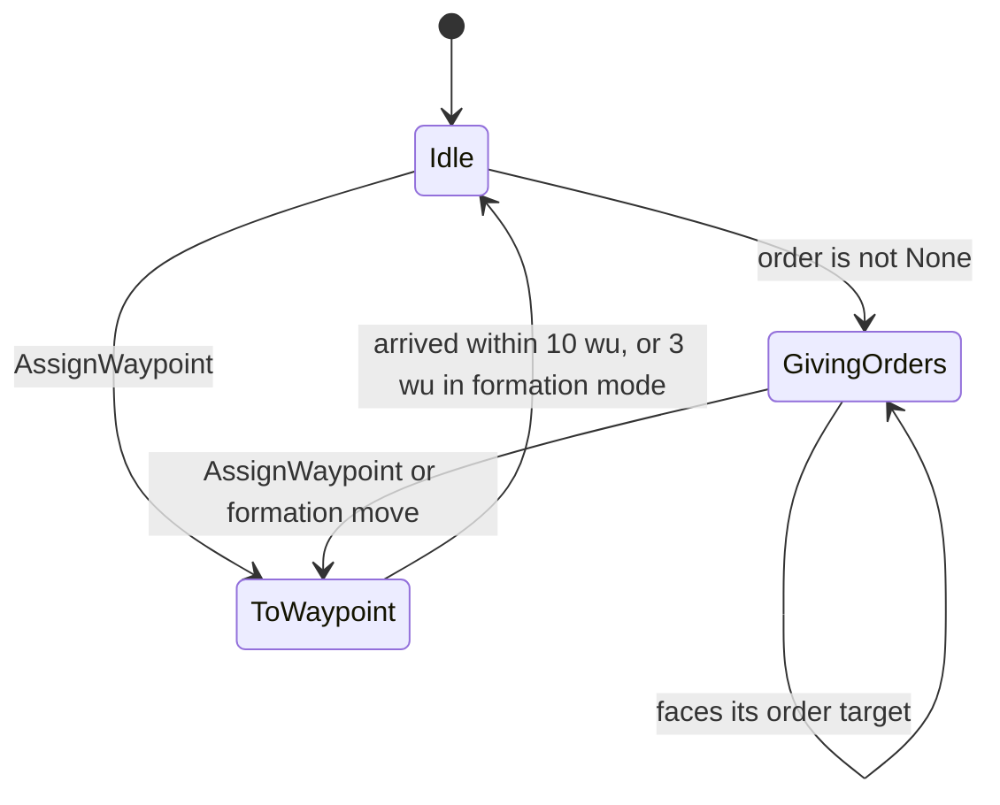
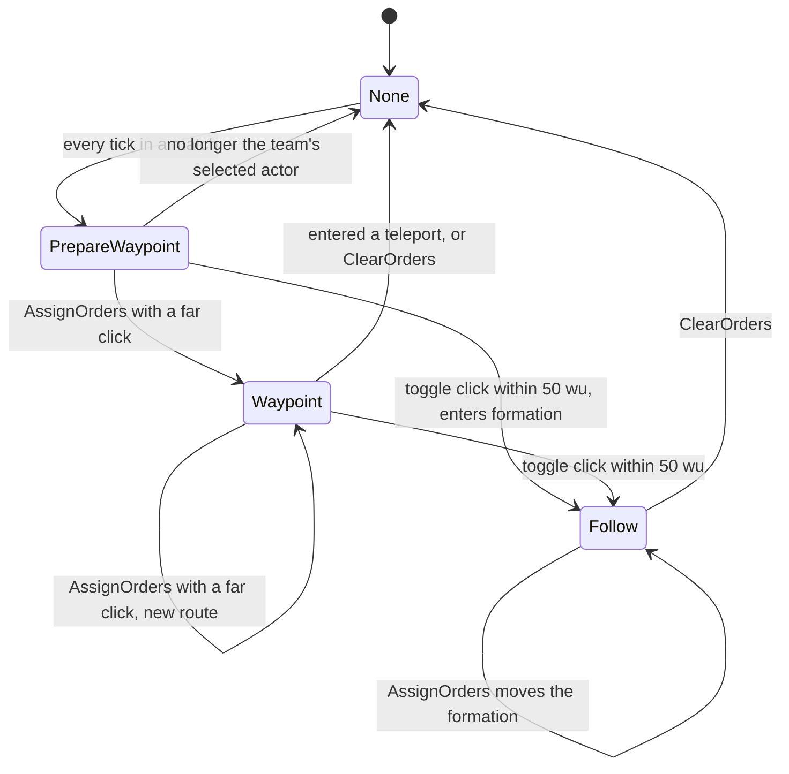
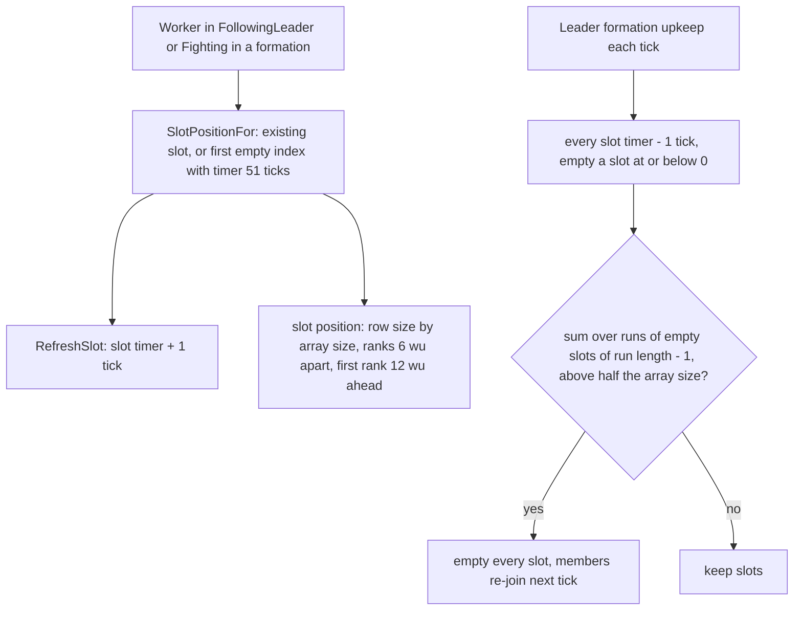
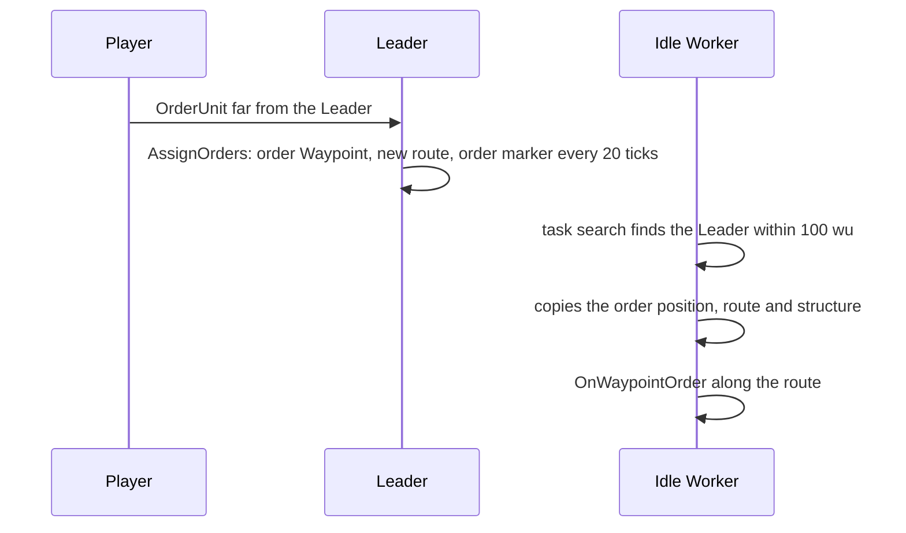

# Leader and formations

> Status: Reference · Prefix: R-UNIT · Related: [Units](README.md) · [Worker](worker.md) · [06 Controls, camera and commands](../06_controls_camera_and_commands/README.md) · [07 Bots](../07_bots/README.md) · [12 Simulation model](../12_simulation_model/README.md)

## 1 Purpose and player experience

A Leader is a Worker that a player or a bot has promoted. It is a **signpost** and a **rally banner**, not a fighter: it never shoots and never commands an individual Worker. Workers decide for themselves to obey it, through their own Leader search ([worker.md](worker.md)):

- a Leader with a **waypoint order** stays where it is and redirects every Idle Worker that passes within 100 wu of it towards its order point, along a route. Placed beside a Spawn Node, it turns the node's output into a conveyor towards the front;
- a Leader in **formation mode** gathers up to 90 Workers within 150 wu into a marching block in rows of 6 to 15 in front of it. The block moves with the Leader, fires in volleys, takes less explosive damage and throws no grenades. Its members search for threats only ahead of the Leader, so a formation is strong in front and weak from behind; the Leader's facing steers the formation's fire.

The Leader's stats are in the actor stat table of [README.md](README.md) §4.1: `ref.unit.leader.health` (255), `ref.unit.leader.speed` (30 wu/s) and `ref.unit.leader.rate` (unused).

## 2 Rules

### 2.1 Role, promotion and demotion

**R-UNIT-152** (MUST) A Leader never attacks and never gives an order to an individual Worker. Its effect on Workers comes only from the Workers' Leader search ([worker.md](worker.md), R-UNIT-096) and from formation membership (§2.6) (DEC-031).

**R-UNIT-153** (MUST) **Promotion.** `PlayerCommand::PromoteWorker(team, actor)` on a Worker of the team that is not Burning spawns a Leader of the team at the Worker's position with the Worker's velocity, emits control-flash particles (presentation), sets the Worker's promoted flag so that its next advance removes it without an Essence orb, registers a Leader marker for the local team in the world markers (presentation), and selects the new Leader in the same step ([reference/12](../12_simulation_model/06_teams_and_player_commands.md), R-SIM-454). A bot promotes Workers through the promotion Power, whose targeting uses this operation ([reference/07](../07_bots/03_decision_loop_and_leaders.md) R-BOT-090, [04](../07_bots/04_powers_and_unit_policies.md) R-BOT-107).

**R-UNIT-154** (MUST) **Demotion.** `PlayerCommand::DemoteLeader(team, actor)` on a Leader of the team sets its demoted flag, so that its next advance removes it without an Essence orb, spawns one Worker of the same team at its position with its velocity, and clears the team's selection. Demotion and scrapping are separate actions; the cancel action never kills a Leader (DEC-086; scrapping is `PlayerCommand::ScrapActor` in [reference/12](../12_simulation_model/06_teams_and_player_commands.md)).

**R-UNIT-155** (MUST) A Leader is an ungrouped actor of its team. Its spawn hook registers it in the team's special units, and its removal unregisters it (DEC-117). It cannot be placed by a map's instant units (README table 2.1-A).

### 2.2 Stats and movement

**R-UNIT-156** (MUST) A Leader's health is set by the spawn step from the actor stat table. Its speed is the stat-table speed, multiplied by `ref.unit.leader.idle_speed_factor` (0.2) in Idle, by `ref.unit.leader.formation_speed_factor` (0.4) in formation mode, by the slope factor of README table 2.11-A (`ref.unit.leader.slope_divisor` 3, clamped to [`ref.unit.leader.slope_min` 0.1, `ref.unit.leader.slope_max` 2.0]), and by d ÷ `ref.unit.leader.arrival_slow_radius` within that distance (10 wu) of its waypoint. It never shoots, so its rate is unused. It has no lifetime limit.

**R-UNIT-157** (MUST) A walking Leader has arrived when it is within `ref.unit.leader.arrival_distance` (10 wu) of its waypoint, or within `ref.unit.leader.formation_arrival_distance` (3 wu) in formation mode.

**R-UNIT-158** (MUST) A Leader turns its front towards a target direction by blending the front with that direction and renormalising, with these blend factors per tick:

| Situation | Factor | Key |
|---|---|---|
| walking, not in formation mode | 0.6 (6 × dt) | `ref.unit.leader.turn_walk` |
| walking in formation mode | 0.06 (0.6 × dt) | `ref.unit.leader.turn_formation` |
| turning in place before a formation move | 0.06 (0.6 × dt) | `ref.unit.leader.turn_pre_move` |
| facing its order target while it gives orders | 0.3 (3 × dt); × `ref.unit.leader.turn_order_formation_factor` (0.2) in formation mode, that is 0.06 | `ref.unit.leader.turn_order` |
| facing its bot target front while it is not walking | 0.06 (0.6 × dt) | `ref.unit.leader.turn_bot` |

**R-UNIT-159** (MUST) A Leader's actor-grid radius is its mesh radius × `ref.unit.leader.radius_factor` (2), and its centre is its mesh centre raised by `ref.unit.leader.center_lift` (1 wu).

**R-UNIT-160** (MUST) A Leader moves with the obstacle push of [reference/12](../12_simulation_model/05_space_routing_and_physics.md), where it is tested as a sphere of radius `ref.sim.push.contact_radius` (1 wu) rather than by its mesh; an enabled enemy Barrier Emitter kills it outright (R-SIM-381). It enters a teleport at its waypoint (R-UNIT-163 step 7).

**R-UNIT-161** (MUST) A Leader runs the water step of [reference/12](../12_simulation_model/05_space_routing_and_physics.md) twice per tick: once inside the base actor advance and once after it. Its in-water count therefore rises by 2 per tick, so its first drowning damage lands on its 51st tick in water (about 5 s), and its swimming displacement is applied twice per tick.

**R-UNIT-162** (MUST) A Leader's formation holds at most its team's formation size, `ref.sim.team.formation_size_upgrade` (90 members, [reference/12](../12_simulation_model/06_teams_and_player_commands.md)); no reference outcome changes it (DEC-057).

### 2.3 Leader state and per-tick pipeline

**R-UNIT-163** (MUST) A Leader advances once per tick in this order:

1. If it is not on the ground, run the airborne step. Run the base actor advance (README R-UNIT-024), which runs the water step while it is in water; then run the water step again (R-UNIT-161). If it is on the ground and alive, set its y to the terrain height.
2. In a match, replace the order None by PrepareWaypoint, every tick.
3. If it is alive, on the ground and not in water, run its behaviour state (§2.4).
4. If it is dead, lower its vertical velocity by `ref.unit.leader.corpse_sink_per_tick` (20 wu/s) per tick, so it sinks while its corpse fades.
5. While its order is Waypoint, create an order marker (§2.7) every `ref.unit.leader.marker_period` (20 ticks, 2.0 s of match time), counted from the last order marker it created, at its position + (0, `ref.unit.leader.marker_lift`, 0) (2 wu up), with its order position and route.
6. Run the formation upkeep (R-UNIT-178) while its formation flag is set.
7. If its waypoint names a teleport structure and the teleport entry for that structure succeeds, record that structure as its order structure, set its waypoint to the teleport's exit + the exit's front × `ref.unit.leader.teleport_exit_distance` (30 wu), and change a Waypoint order to None.
8. When it is not walking and has a bot target front, turn towards it (R-UNIT-158).
9. While its order is Waypoint and it is more than `ref.unit.leader.route_regen_distance` (50 wu) from the first waypoint of its order route, build a new route from its position to the end of the old route, which is kept as well (DEC-651), and highlight it for the local team.

The advance requests removal when the Leader's corpse has faded or its demoted flag is set.

**R-UNIT-164** (MUST) A Leader holds the fields of table 2.3-A. The order enumeration is `LeaderOrder` with the members None, PrepareWaypoint, Waypoint (`LeaderOrder::Waypoint`) and Follow; its order carries no meaning.

Table 2.3-A Leader state.

| Field | Initial value | Meaning |
|---|---|---|
| behaviour state | Idle | Idle, ToWaypoint or GivingOrders (§2.4) |
| order | None | the order state machine of §2.5, independent of the behaviour state |
| waypoint | its spawn position | where the Leader itself walks |
| waypoint teleport | none | a teleport structure to enter at the waypoint |
| bot target front, turn flag | zero vector, false | the facing that its bot hook sets; never reset to zero once set |
| demoted flag | false | its next advance removes it |
| no-formations flag | false | disables the formation toggle; set by the bot controller for some Leaders ([reference/07](../07_bots/README.md)) |
| order position | — | the destination of a waypoint order that it hands to Workers; in formation mode, the target it faces |
| order structure | none | the teleport structure at the destination, and also the teleport structure it last used, which its followers take |
| order route | none | the land route of a waypoint order |
| last order marker | 0 | the match time of its last order marker |
| formation flag | false | formation mode |
| formation slots | empty | an array of formation slots that may hold gaps (§2.6) |
| formation angle set | false | the formation has finished turning towards its waypoint |
| banner | a cloth flag of size `ref.unit.leader.banner_size` (20) | drawn at the mesh's flag socket |

### 2.4 Behaviour states

**R-UNIT-165** (MUST) **Idle.** If the order is not None, the Leader becomes GivingOrders. Its velocity is 0.

**R-UNIT-166** (MUST) **ToWaypoint.** In formation mode, while the formation angle is not set, the Leader turns in place towards its waypoint, without moving, until |direction to the waypoint × front| < `ref.unit.leader.pre_turn_tolerance` (0.1); then it sets the formation angle and walks. Otherwise it walks to its waypoint (R-UNIT-156 to R-UNIT-158). While the formation flag is set, its order position is its position + front × `ref.unit.leader.formation_face_distance` (100 wu). On arrival it becomes Idle.

**R-UNIT-167** (MUST) **GivingOrders.** Its velocity is 0, and by its order:

- **Waypoint:** it faces the first route waypoint after the start of its order route;
- **PrepareWaypoint:** if the team's selected actor is no longer this Leader, the order becomes None, and step 2 of R-UNIT-163 makes it PrepareWaypoint again on the next tick;
- **Follow:** while its order position is not the zero vector, it turns towards the order position until front · direction > `ref.unit.leader.follow_face_tolerance` (0.99), then clears the order position.

**R-UNIT-168** (MUST) A Leader that is the team's selected actor, has the order PrepareWaypoint and is not walking faces the team's current pointer position, as the team command state sets it ([reference/12](../12_simulation_model/06_teams_and_player_commands.md)). It is not walking while its speed is below `ref.ctrl.leader.face_pointer_speed` (5 wu/s, strict) ([actions and bindings](../06_controls_camera_and_commands/actions_and_bindings.md) R-CTRL-104).

### 2.5 Orders and formation operations

**R-UNIT-169** (MUST) `AssignWaypoint(_target)`: the Leader becomes ToWaypoint with the target as its waypoint. In formation mode it clears the formation angle, so the formation turns before it moves, unless the target is its own position. A connected Beam Dish whose entrance lies within `ref.unit.leader.beam_dish_radius` (5 wu) of the target becomes its waypoint teleport.

**R-UNIT-170** (MUST) A click is a **formation toggle** exactly when the match is not the first tutorial ([reference/11](../11_tutorial_and_help.md)), the Leader's no-formations flag is clear, no Beam Dish entrance lies within √`ref.unit.leader.toggle_teleport_radius_sq` (√5 wu) of the click, and the click is closer than `ref.unit.leader.formation_toggle_radius` (50 wu) to the Leader.

**R-UNIT-171** (MUST) `AssignOrders(_target, _straight)` acts in this order:

1. **Formation move.** If the Leader is already in formation mode: for a toggle click it moves one unit length towards the click, otherwise to the click; it runs `AssignWaypoint` and `FormUp` with that point, and the team's selection is cleared.
2. **Entering formation.** Otherwise, for a toggle click, it runs `AssignWaypoint(position + d)` and `FormUp(position + d)`, with d the unit vector towards the click.
3. **Waypoint order.** Otherwise its order position becomes the target and its order Waypoint; formation mode is switched off; its order route becomes a new land route from its position to the target, straight when the order says so, highlighted for the local team ([reference/12](../12_simulation_model/05_space_routing_and_physics.md)); a Beam Dish entrance within √5 wu of the target becomes its order structure and the order position becomes that entrance, and otherwise the order position is passed through the obstacle push; it raises `leader.order_waypoint`; and the team's selection is cleared. The Leader itself does not walk on a waypoint order: it stays and redirects the Workers that pass it.

**R-UNIT-172** (MUST) `FormUp(_target)` does nothing in the first tutorial. Otherwise, the first time it is called for the current formation, it clears the order position and turns the Leader to face the target; when the Leader is already in formation mode, the order position becomes the target. It sets the order Follow and the formation flag, and clears the formation angle. For the local team it shows a preview route from the Leader to the target, a local-only route that never enters the simulation (DEC-095), and two muzzle-flash particles of size `ref.unit.leader.preview_flash_size` (40) at each of the formation-size slot positions (presentation); it raises `leader.order_formation`.

**R-UNIT-173** (MUST) `ClearOrders()` sets the order None, switches formation mode off and sets the waypoint to the Leader's position.

**R-UNIT-174** (MUST) `EnterFollowMode()` sets the order Follow when the team's Leader research level is above `ref.unit.leader.follow_level` (2); the level is 3 in every match (README R-UNIT-009). Leader mode cycling (`PlayerCommand::NextMode`, `PlayerCommand::PreviousMode`) has no effect in a match ([reference/12](../12_simulation_model/06_teams_and_player_commands.md)).

**R-UNIT-175** (MUST) The commands reach a Leader as [reference/12](../12_simulation_model/06_teams_and_player_commands.md) states: `PlayerCommand::OrderUnit` with the move-only flag runs `AssignWaypoint(position)`, and without it `AssignOrders(position, straight)`; `PlayerCommand::ToggleUnit` cancels the orders of a Leader that is in formation mode or holds a waypoint order, and otherwise gives it orders to the point `ref.sim.command.leader_toggle_offset` (1 wu) in front of it, which enters formation, and selects it in the same step (R-SIM-454). The bindings are in [reference/06](../06_controls_camera_and_commands/README.md).

**R-UNIT-176** (MUST) The order state machine of diagram 3-B holds in a match: None becomes PrepareWaypoint on every tick; PrepareWaypoint becomes None when the Leader is no longer the team's selected actor; a far click from PrepareWaypoint, Waypoint or Follow-without-formation gives Waypoint with a new route; a toggle click gives Follow with formation mode; a click while in formation mode moves the formation and keeps Follow; entering a teleport at the waypoint turns Waypoint into None; and cancelling gives None.

### 2.6 Formations and formation slots

**R-UNIT-177** (MUST) A formation slot (`FormationSlot`) holds the handle of one member Worker and a timer in ticks. The slots form an array that keeps each slot's index, so it may hold gaps; a member's slot index is its formation index, which places it in the block and sets its volley phase ([worker.md](worker.md), R-UNIT-103).

**R-UNIT-178** (MUST) **Formation upkeep**, each tick while the formation flag is set: every slot's timer is counted down by one tick, and a slot whose timer is at or below 0 is emptied. Then a gap count adds, for every run of consecutive empty slots, the run's length minus 1; if the gap count is above `ref.unit.leader.gap_rule_fraction` (0.5) × the array size, every slot is emptied, and the members re-join on the next tick with new indices.

**R-UNIT-179** (MUST) `RefreshSlot(_member)` adds one tick to the member's slot timer. A member registers every tick in which it is FollowingLeader or Fighting in the formation, so its timer stays constant while it stays, and a member that stops registering drops out after its timer has run down.

**R-UNIT-180** (MUST) `SlotPositionFor(_member)` returns the position of the member's slot when it holds one. Otherwise, when the formation is not full, it creates a slot for the member in the first empty index, with the timer `ref.unit.leader.slot_timer_ticks` (51 ticks, nominal 5.0 s), and returns its position. When the formation is full it returns the zero vector.

**R-UNIT-181** (MUST) A formation is **full** when its number of occupied slots is at least the team's formation size (R-UNIT-162). In the first tutorial every formation counts as full.

**R-UNIT-182** (MUST) The position of formation index i, for a Leader at position p with front f, is:

```
FormationSlotPosition(_p, _i, _f, _arraySize):      # _arraySize counts gaps
    rowSize := row size of table 2.6-A for _arraySize
    column := _i mod rowSize
    row := _i div rowSize
    right := Normalize(_f x up)
    q := _p + _f * (ref.unit.leader.slot_spacing * row + ref.unit.leader.first_rank_offset)
           + right * (ref.unit.leader.slot_spacing * column - ref.unit.leader.lateral_offset_factor * rowSize)
    q.y := terrain height at q
    return q
```

The block forms in front of the Leader: its first rank stands 12 wu ahead, ranks are 6 wu apart and grow forward, and each rank is roughly centred on the Leader. The Leader's slot spacing is its own constant: the spacing `ref.sim.group.rect_spacing` (4.0 wu) and the airstrike rows of four of reference/12 place the members of actor groups, not formation members ([teams and player commands](../12_simulation_model/06_teams_and_player_commands.md) R-SIM-430).

Table 2.6-A Row size by slot-array size (`ref.unit.leader.row_size_table`).

| Slot-array size | Row size |
|---|---|
| 24 or fewer | 6 |
| 25 to 47 | 9 |
| 48 to 89 | 12 |
| 90 to 199 | 15 |
| 200 or more | 25 |

**R-UNIT-183** (MUST) A Leader is in **formation mode** when its order is Follow and its formation flag is set. A member is **in the formation** when it occupies a slot.

**R-UNIT-184** (MUST) Formation membership changes a Worker as follows ([worker.md](worker.md)): its explosive damage is × 0.6 unless it is a Visitor faction Worker (R-UNIT-116); it throws no grenades (R-UNIT-104); it fires by the volley rhythm, evaluated exactly in integer arithmetic (R-UNIT-103; DEC-104; DEC-241); its threat search uses the full 90 wu range centred 0.66 × 90 wu ahead of the Leader along the Leader's front (R-UNIT-098), so members hold their place and a formation is weak from behind; and its waypoint is pinned to its slot. While it is not walking, the Leader's facing turns towards its target facing at 0.06 per tick; that facing places the slots and centres the members' threat search, so the Leader's facing steers the formation's fire (DEC-031).

### 2.7 Order markers and order trail marks

**R-UNIT-185** (MUST) An **order marker** (`OrderMarker`) is an effect of the match world with the Leader's team. It follows the Leader's order route on the ground: it starts at route waypoint 1, steps to the next waypoint within `ref.unit.leader.marker_reach` (10 wu), and keeps its y on the terrain. Each tick its speed becomes clamp(|velocity| × (1 + dt), `ref.unit.leader.marker_speed_min`, `ref.unit.leader.marker_speed_max`) (between 30 and 100 wu/s). Every `ref.unit.leader.trail_period` (2 ticks, 0.2 s) it drops an order trail mark, for every team. It arrives when the route ends, then fades for `ref.unit.leader.marker_fade_ticks` (10 ticks, 1 s) and is removed. It is drawn only for the teams that are friends of the local team.

**R-UNIT-186** (MUST) An **order trail mark** (`OrderTrailMark`) is an effect of the match world: a ground-aligned arrow `marker.order_trail` at its position lowered by `ref.unit.leader.trail_lift` (1 wu), whose front is its carrier's velocity and whose right vector is front × terrain normal. Its size is max(`ref.unit.leader.trail_size_min`, `ref.unit.leader.trail_size_scale` × camera distance ÷ `ref.unit.leader.trail_size_divisor`) (max(5, 20 × distance ÷ 2000)) and its alpha `ref.unit.leader.trail_alpha` × (1 − age in seconds) (0.6 × (1 − age)). It is removed `ref.unit.leader.trail_life_ticks` (10 ticks, 1 s) after its creation, and it is drawn for the local team only.

**R-UNIT-187** (MUST) Order markers and order trail marks are simulated objects with handles, created at the same ticks on every participant, so their creation cadence is part of the simulation state ([reference/12](../12_simulation_model/03_entity_model_and_identity.md)). Their rendering is presentation.

### 2.8 Bot hook

**R-UNIT-188** (MUST) The bot controller of the Leader's team runs the Leader's bot hook ([reference/07](../07_bots/README.md)) every `ref.unit.leader.bot_think_ticks` (11 ticks, nominal 1 s):

1. **Waypoint order.** When the hook finds no nearest bot navigation node for the Leader, this item does nothing and the hook goes on with item 2. Otherwise the next think is set `ref.unit.leader.bot_waypoint_think_ticks` (101 ticks, nominal 10 s) ahead. The hook finds the bot navigation node nearest to the Leader and the target structure that node leads to for the team; if the chosen node is more than `ref.unit.leader.bot_reorder_distance` (60 wu) from the Leader's current order position, the Leader receives orders (`AssignOrders`) to the chosen node's position plus an offset of length `ref.unit.leader.bot_order_offset_base` + `NextUnit(ref.unit.leader.bot_order_offset_spread)` (20 + [0, 20) wu) at angle `NextUnit(2π)`; for a node that targets a Beam Dish, the order point is that Beam Dish's entrance. The hook then ends.
2. **Otherwise** the hook makes sure the Leader is in formation, by `FormUp(position + front × ref.unit.leader.bot_formation_ahead)` (50 wu) when it is not. If more than `ref.unit.leader.bot_enemy_count` (10) enemies are within `ref.unit.leader.bot_enemy_range` (270 wu, 3 × 90), the Leader stops (`AssignWaypoint(position)`) and its bot target front turns towards the enemies' mean position. If the Leader is walking, the hook ends.
3. With t the nearest bot navigation node: if t is important, the Leader walks to it when it is more than `ref.unit.leader.bot_node_reach` (20 wu) away; if t needs defending, the Leader holds there and faces from t towards the enemy-owned neighbour of t (DEC-087); otherwise it faces towards the first neighbour of t.
4. If it is not holding and its formation is full, it chooses the nearest walkable navigation node that is enemy-owned, or important and neutral, takes that node's structure by its id (DEC-087) and runs `AssignWaypoint` to it.

The hook's orders, waypoints and formations are bot-only operations with no player command ([reference/07](../07_bots/README.md) R-BOT-015; see DEC-122).

### 2.9 Damage and death

**R-UNIT-189** (MUST) A Leader uses the base health change (README R-UNIT-026): it takes every damage kind in full, and its death releases an Essence orb. On death its mesh shatters, and its corpse sinks (R-UNIT-163 step 4). Explosions and shockwave rings never knock it back (README R-UNIT-031, R-UNIT-033).

### 2.10 Team colouring, rendering and sounds

The rules of this section are presentation (DEC-007); their random choices draw from the presentation generator (DEC-013).

**R-UNIT-190** (MUST) A Leader is drawn with `mesh.unit.leader_figure` under the whole-model team tint (README R-UNIT-044), scaled with camera distance and turned towards the camera like a Worker card ([worker.md](worker.md), R-UNIT-142, with the player's distance scale factor), and with the damage flicker of README R-UNIT-051.

**R-UNIT-191** (MUST) A Leader's banner is a cloth flag (`ClothFlag`) of size `ref.unit.leader.banner_size` (20) at the mesh's flag socket. Its size grows with camera distance d by the factor 1 + scale factor × (d − 100) ÷ `ref.unit.leader.banner_growth_divisor` (1500), and it turns towards the camera by d ÷ `ref.unit.leader.banner_face_divisor` (200). It waves while the order is not None. It shows `marker.leader_banner` in the variant of the order: idle for None, PrepareWaypoint and Waypoint; follow for Follow; formation in formation mode. The banner's team colour is applied through its tint mask, which uses `marker.leader_banner_tint` (ADR-020). A Waypoint banner carries the pointer `marker.flag_pointer`, aimed at the first route waypoint after the start of the order route. The world markers draw the local team's banners ([cursor and markers](../06_controls_camera_and_commands/cursor_and_markers.md) R-CTRL-388), and the Leader renderer draws every other team's.

**R-UNIT-192** (MUST) A Leader's picking volume is a sphere centred `ref.unit.leader.pick_center_lift` (4 wu) above its centre, of radius `ref.unit.leader.pick_radius` (8 wu), scaled with camera distance. Picking is presentation and input ([reference/12](../12_simulation_model/05_space_routing_and_physics.md), R-SIM-387). The cursor badges near the pointer, `icon.power.leader` while a Leader is selected and `icon.power.workers` while Workers are selected, are drawn by [cursor and markers](../06_controls_camera_and_commands/cursor_and_markers.md) R-CTRL-366; `icon.power.leader` is also the promotion Power's icon.

**R-UNIT-193** (MUST) A Leader raises the presentation events of table 2.10-A ([reference/10](../10_audio_design/README.md)). Cancelling a Leader's orders stops all its order events.

Table 2.10-A Leader sound events.

| Event | Trigger | Sample groups |
|---|---|---|
| `leader.spawn` | the spawn hook | `sfx.unit.leader.spawn` |
| `leader.attack` | listed with the base events; never raised, because a Leader never attacks | none |
| `leader.hurt` | any damage | `sfx.unit.worker.hurt` |
| `leader.enter_gate` | a successful teleport entry | `sfx.unit.trooper.enter_gate` |
| `leader.exit_gate` | raised by the teleport at its exit | none (silent) |
| `leader.die` | death | `sfx.unit.worker.die` |
| `leader.selected` | selection by the local team | `sfx.unit.leader.spawn` |
| `leader.order_none` | the order becomes None | none (silent, DEC-565) |
| `leader.order_waypoint` | a waypoint order (R-UNIT-171) | `sfx.unit.leader.order_waypoint`, with `sfx.unit.leader.spawn` as a second layer |
| `leader.order_follow` | the order becomes Follow | none (silent, DEC-565) |
| `leader.order_formation` | `FormUp` (R-UNIT-172) | `sfx.unit.leader.order_waypoint`, with `sfx.unit.leader.spawn` as a second layer |

## 3 States and flows



Diagram 3-A Leader behaviour states (R-UNIT-165 to R-UNIT-167). In a match the order is never None for more than one tick, so an Idle Leader becomes GivingOrders on its next tick.



Diagram 3-B The Leader's order state machine (R-UNIT-176), independent of its behaviour state.



Diagram 3-C Formation slot life cycle (R-UNIT-177 to R-UNIT-182).



Diagram 3-D The signpost conveyor (R-UNIT-171, worker.md R-UNIT-096).

## 4 Tuning table

| key | value | unit | range or notes | requirement | DEC |
|---|---|---|---|---|---|
| `ref.unit.leader.idle_speed_factor` | 0.2 | × speed | | R-UNIT-156 | — |
| `ref.unit.leader.formation_speed_factor` | 0.4 | × speed | 12 wu/s | R-UNIT-156 | DEC-031 |
| `ref.unit.leader.slope_divisor` | 3 | wu | | R-UNIT-156, README R-UNIT-042 | — |
| `ref.unit.leader.slope_min` | 0.1 | × speed | | R-UNIT-156, README R-UNIT-042 | — |
| `ref.unit.leader.slope_max` | 2.0 | × speed | | R-UNIT-156, README R-UNIT-042 | — |
| `ref.unit.leader.arrival_slow_radius` | 10 | wu | speed × d ÷ 10 inside it | R-UNIT-156 | — |
| `ref.unit.leader.arrival_distance` | 10 | wu | | R-UNIT-157 | — |
| `ref.unit.leader.formation_arrival_distance` | 3 | wu | | R-UNIT-157 | — |
| `ref.unit.leader.turn_walk` | 0.6 | per tick | 6 × dt | R-UNIT-158 | DEC-092 |
| `ref.unit.leader.turn_formation` | 0.06 | per tick | 0.6 × dt | R-UNIT-158 | DEC-031 |
| `ref.unit.leader.turn_pre_move` | 0.06 | per tick | 0.6 × dt | R-UNIT-158, R-UNIT-166 | — |
| `ref.unit.leader.turn_order` | 0.3 | per tick | 3 × dt | R-UNIT-158, R-UNIT-167 | — |
| `ref.unit.leader.turn_order_formation_factor` | 0.2 | × factor | in formation mode | R-UNIT-158 | — |
| `ref.unit.leader.turn_bot` | 0.06 | per tick | 0.6 × dt | R-UNIT-158, R-UNIT-163 | DEC-031 |
| `ref.unit.leader.radius_factor` | 2 | × mesh radius | actor-grid footprint | R-UNIT-159 | DEC-650 |
| `ref.unit.leader.center_lift` | 1 | wu | | R-UNIT-159 | — |
| `ref.unit.leader.corpse_sink_per_tick` | 20 | wu/s per tick | | R-UNIT-163, README R-UNIT-037 | DEC-092 |
| `ref.unit.leader.marker_period` | 20 | ticks | 2.0 s of match time | R-UNIT-163 | DEC-002 |
| `ref.unit.leader.marker_lift` | 2 | wu | | R-UNIT-163 | — |
| `ref.unit.leader.teleport_exit_distance` | 30 | wu | | R-UNIT-163 | — |
| `ref.unit.leader.route_regen_distance` | 50 | wu | strict | R-UNIT-163 | DEC-651 |
| `ref.unit.leader.banner_size` | 20 | cloth-flag size | | R-UNIT-164, R-UNIT-191 | — |
| `ref.unit.leader.pre_turn_tolerance` | 0.1 | cross-product length | strict | R-UNIT-166 | — |
| `ref.unit.leader.formation_face_distance` | 100 | wu | | R-UNIT-166 | — |
| `ref.unit.leader.follow_face_tolerance` | 0.99 | dot product | strict | R-UNIT-167 | — |
| `ref.unit.leader.beam_dish_radius` | 5 | wu | | R-UNIT-169 | — |
| `ref.unit.leader.toggle_teleport_radius_sq` | 5 | wu² | a Beam Dish entrance within √5 wu | R-UNIT-170, R-UNIT-171 | — |
| `ref.unit.leader.formation_toggle_radius` | 50 | wu | strict | R-UNIT-170 | DEC-031 |
| `ref.unit.leader.preview_flash_size` | 40 | particle size | presentation; 2 per slot | R-UNIT-172 | DEC-007 |
| `ref.unit.leader.follow_level` | 2 | research level | Follow above this level | R-UNIT-174 | — |
| `ref.unit.leader.gap_rule_fraction` | 0.5 | × array size | strict | R-UNIT-178 | — |
| `ref.unit.leader.slot_timer_ticks` | 51 | ticks | nominal 5.0 s | R-UNIT-180 | DEC-002 |
| `ref.unit.leader.slot_spacing` | 6 | wu | between ranks and between columns | R-UNIT-182 | DEC-031 |
| `ref.unit.leader.first_rank_offset` | 12 | wu | ahead of the Leader | R-UNIT-182 | — |
| `ref.unit.leader.lateral_offset_factor` | 3 | wu per row slot | centres the rank | R-UNIT-182 | — |
| `ref.unit.leader.row_size_table` | ≤ 24: 6; 25–47: 9; 48–89: 12; 90–199: 15; ≥ 200: 25 | members per row | by slot-array size, gaps included | R-UNIT-182 | DEC-031 |
| `ref.unit.leader.marker_reach` | 10 | wu | | R-UNIT-185 | — |
| `ref.unit.leader.marker_speed_min` | 30 | wu/s | | R-UNIT-185 | — |
| `ref.unit.leader.marker_speed_max` | 100 | wu/s | | R-UNIT-185 | — |
| `ref.unit.leader.trail_period` | 2 | ticks | 0.2 s of game time | R-UNIT-185 | DEC-002 |
| `ref.unit.leader.marker_fade_ticks` | 10 | ticks | 1 s | R-UNIT-185 | DEC-002 |
| `ref.unit.leader.trail_lift` | 1 | wu | below the carrier | R-UNIT-186 | — |
| `ref.unit.leader.trail_size_min` | 5 | wu | presentation | R-UNIT-186 | — |
| `ref.unit.leader.trail_size_scale` | 20 | wu | presentation | R-UNIT-186 | — |
| `ref.unit.leader.trail_size_divisor` | 2000 | wu | presentation | R-UNIT-186 | — |
| `ref.unit.leader.trail_alpha` | 0.6 | alpha | presentation | R-UNIT-186 | — |
| `ref.unit.leader.trail_life_ticks` | 10 | ticks | 1 s | R-UNIT-186 | DEC-002 |
| `ref.unit.leader.bot_think_ticks` | 11 | ticks | nominal 1 s | R-UNIT-188 | DEC-002 |
| `ref.unit.leader.bot_waypoint_think_ticks` | 101 | ticks | nominal 10 s | R-UNIT-188 | DEC-002 |
| `ref.unit.leader.bot_reorder_distance` | 60 | wu | strict | R-UNIT-188 | DEC-087 |
| `ref.unit.leader.bot_order_offset_base` | 20 | wu | | R-UNIT-188 | — |
| `ref.unit.leader.bot_order_offset_spread` | 20 | wu | NextUnit(20) | R-UNIT-188 | — |
| `ref.unit.leader.bot_formation_ahead` | 50 | wu | | R-UNIT-188 | — |
| `ref.unit.leader.bot_enemy_count` | 10 | actors | more than | R-UNIT-188 | — |
| `ref.unit.leader.bot_enemy_range` | 270 | wu | 3 × the Worker threat range | R-UNIT-188 | — |
| `ref.unit.leader.bot_node_reach` | 20 | wu | | R-UNIT-188 | — |
| `ref.unit.leader.banner_growth_divisor` | 1500 | wu | presentation | R-UNIT-191 | — |
| `ref.unit.leader.banner_face_divisor` | 200 | wu | presentation | R-UNIT-191 | — |
| `ref.unit.leader.pick_center_lift` | 4 | wu | presentation and input | R-UNIT-192 | — |
| `ref.unit.leader.pick_radius` | 8 | wu | presentation and input | R-UNIT-192 | — |

## 5 Edge cases and interactions

- **A waypoint order keeps the Leader in place.** Only the Workers that pass it move; a player who wants the Leader to move uses the move-only order (R-UNIT-171, R-UNIT-175).
- **PrepareWaypoint while selected.** A selected Leader in a match flickers between PrepareWaypoint and None only on the tick its selection ends; while selected and still it faces the pointer (R-UNIT-167, R-UNIT-168).
- **Teleports end a waypoint order.** A Leader that enters a teleport at its waypoint drops its waypoint order and records the teleport, so followers that lose it walk into the same teleport ([worker.md](worker.md), R-UNIT-074; R-UNIT-163).
- **Old routes are kept.** Each route regeneration of a waypoint order creates a new route without deleting the old one (R-UNIT-163, DEC-651).
- **Gaps reset the block.** Members that die or wander leave gaps; once the gap count exceeds half the array, the whole formation re-forms with new indices, which also changes every member's volley phase (R-UNIT-178, R-UNIT-182).
- **Row size counts gaps.** A formation of 30 slots with 10 gaps still uses rows of 9 (R-UNIT-182).
- **Full formation.** A follow-mode Leader whose formation is full is ignored by Workers that look for a Leader to follow, and a following Worker without a slot gives up (R-UNIT-181, [worker.md](worker.md) R-UNIT-074, R-UNIT-096).
- **Drowning is twice as fast** for a Leader as for other swimming actors (R-UNIT-161).
- **Barrier Emitters kill Leaders**, while they only set Workers on fire (R-UNIT-160; [worker.md](worker.md) R-UNIT-113).
- **Explosions never move a Leader** (R-UNIT-189).
- **Order markers exist for every team** and are hidden from enemies only in rendering (R-UNIT-185, R-UNIT-187).

## 6 Acceptance criteria

**AC-UNIT-L01 — Promotion** (R-UNIT-153). Given a Worker of team 1 at (100, 0, 100) with velocity (2, 0, 0), when `PromoteWorker` executes, then a Leader of team 1 exists at that position with that velocity and is team 1's selected actor in the same tick, and on the next tick the Worker is removed and no Essence orb exists; given a Burning Worker, then nothing changes.

**AC-UNIT-L02 — Demotion** (R-UNIT-154). Given a selected Leader, when `DemoteLeader` executes, then a Worker of its team appears at its position, the team has no selection, and on its next advance the Leader is removed without an Essence orb.

**AC-UNIT-L03 — Formation slot positions** (R-UNIT-182). Given a Leader at (0, 0, 0) facing f = (0, 0, 1) on flat ground with a slot array of size 20, the row size is 6 and right = Normalize(f × up) = (−1, 0, 0). Then index 0 lies at f × 12 + right × (0 − 18) = (18, 0, 12), index 5 at f × 12 + right × (30 − 18) = (−12, 0, 12), and index 6 at f × 18 + right × (−18) = (18, 0, 18).

**AC-UNIT-L04 — Row sizes** (R-UNIT-182). The row size is 6 for array sizes 1 and 24, 9 for 25 and 47, 12 for 48 and 89, 15 for 90 and 199, and 25 for 200.

**AC-UNIT-L05 — Slot timeout** (R-UNIT-178, R-UNIT-179, R-UNIT-180). Given a member that takes a new slot and then stops registering, then its slot is emptied 51 Leader upkeeps later; given a member that registers every tick, then its slot is never emptied.

**AC-UNIT-L06 — Gap rule** (R-UNIT-178). Given a slot array of size 10 with empty runs of lengths 3 and 4, then the gap count is 2 + 3 = 5, which is not above 5, so the slots are kept; with runs of lengths 3 and 5, then the gap count is 6 and every slot is emptied.

**AC-UNIT-L07 — Formation toggle** (R-UNIT-170, R-UNIT-171). Given an idle Leader outside the first tutorial with no Beam Dish nearby, when a click lands 40 wu from it, then it enters formation mode with the order Follow; when a click lands 60 wu from it, then it gets a waypoint order with a new route and does not walk.

**AC-UNIT-L08 — Signpost** (R-UNIT-152, R-UNIT-171). Given a Leader with a waypoint order to point Q and an Idle Worker that passes within 100 wu with nothing better to do, then that Worker's pending order position equals Q and it follows the Leader's route.

**AC-UNIT-L09 — Full formation** (R-UNIT-180, R-UNIT-181). Given a formation with 90 occupied slots, when a further Worker asks for its formation position, then it receives the zero vector and holds no slot.

**AC-UNIT-L10 — Order markers** (R-UNIT-163, R-UNIT-185, R-UNIT-186). Given a Leader that holds a waypoint order for 100 ticks, then it creates an order marker every 20 ticks, each marker drops a trail mark every 2 ticks while it travels, and every trail mark is removed 10 ticks after its creation.

**AC-UNIT-L11 — Drowning** (R-UNIT-161). Given a Leader that comes down in water at tick t, so that tick t is its first tick in water, then its first drowning damage lands at tick t + 50, its 51st tick in water, and it dies then.

**AC-UNIT-L12 — Bot defence facing** (R-UNIT-188). Given a bot Leader holding at a navigation node that needs defending, with one enemy-owned neighbour to the east, then its bot target front points east.

**AC-UNIT-L13 — Volley rhythm through slots** (R-UNIT-177, R-UNIT-184). Given a formation whose slot array has 8 entries, then the member at index 3 fires on the ticks t where (4 × (t + 3)) mod 8 < 4, that is on every tick where t + 3 is even, when its reload allows.

## 7 Dependencies

- **Reference documents:** [README.md](README.md) (stats, base advance, health change, team tint, flicker); [worker.md](worker.md) (Leader search, formation membership, volley rhythm); [reference/06](../06_controls_camera_and_commands/README.md) (bindings, world markers, cursor badges, pointer facing: [actions and bindings](../06_controls_camera_and_commands/actions_and_bindings.md), [cursor and markers](../06_controls_camera_and_commands/cursor_and_markers.md)); [reference/07](../07_bots/README.md) (bot navigation nodes, bot promotion); [reference/10](../10_audio_design/README.md) (sound events); [reference/11](../11_tutorial_and_help.md) (first tutorial); [reference/12](../12_simulation_model/README.md) (commands, team command state, routes, obstacle push, water step, effects).
- **Engine components:** [../../architecture/components/renderer/entity_and_overlay_renderers.md](../../architecture/components/renderer/entity_and_overlay_renderers.md) (Leader mesh, banner, trail marks), [../../architecture/components/animation_and_vfx/README.md](../../architecture/components/animation_and_vfx/README.md) (cloth flag, particles).
- **ADRs:** ADR-020 (team tint), ADR-021 (mesh socket schema: the flag socket).
- **Assets:** `mesh.unit.leader_figure`, `marker.leader_banner`, `marker.leader_banner_tint`, `marker.flag_pointer`, `marker.order_trail`, `icon.power.leader`, `icon.power.workers`, `sfx.unit.leader.spawn`, `sfx.unit.leader.order_waypoint`, `sfx.unit.worker.hurt`, `sfx.unit.worker.die`, `sfx.unit.trooper.enter_gate`.

## 8 Open decisions

| DEC | Topic | Default specified in §2 |
|---|---|---|
| DEC-241 | Numeric semantics that reference rules depend on | the volley rhythm in integer arithmetic (R-UNIT-184) |
| DEC-651 | Lifetime of simulation routes | regenerated routes keep the old ones (R-UNIT-163) |
| DEC-565 | Sounds for the other silent gameplay events | `leader.order_none` and `leader.order_follow` are silent (R-UNIT-193) |
| DEC-122 | Bot and deputy actions outside the player command catalogue | the bot hook's Leader orders are bot-only operations (R-UNIT-188) |

Resolved and Dropped decisions applied here: DEC-002, DEC-007, DEC-013, DEC-031, DEC-057, DEC-086, DEC-087, DEC-092, DEC-095, DEC-104, DEC-117, DEC-650.
