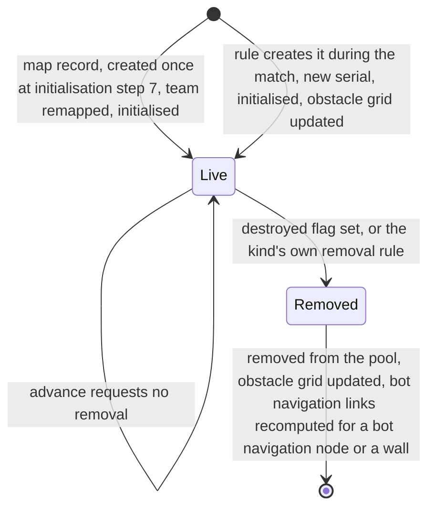
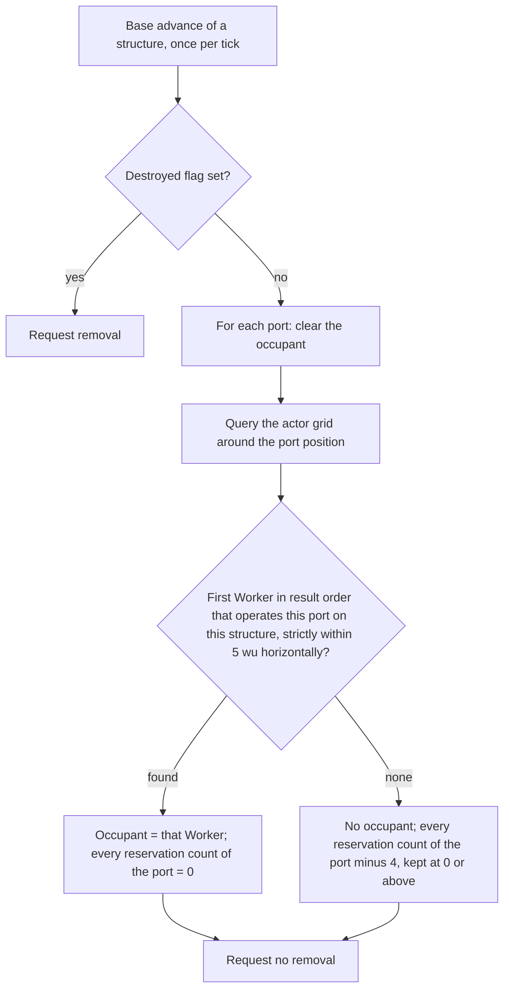

# Buildings and world objects

> Status: Reference · Prefix: R-BLDG · Related: [00 Reference overview](../00_reference_overview.md) · [01 Skirmish rules and modes](../01_skirmish_rules_and_modes/README.md) · [02 Units](../02_units/README.md) · [04 Supply crates, powers and weapons](../04_supply_crates_powers_and_weapons/README.md) · [05 Population flow](../05_population_flow.md) · [07 Bots](../07_bots/README.md) · [08 Maps and level design](../08_maps_and_level_design/README.md) · [10 Audio design](../10_audio_design/README.md) · [12 Simulation model](../12_simulation_model/README.md)

This folder specifies every structure of the reference game: the static and semi-static world objects that a map places or that a rule creates during a match. This README is the folder index and holds the rules that every structure shares: the time base, ownership, ports and capture, the lifecycle, damage, ownership changes, collision volumes, presentation and sound events. Each structure kind is specified in one of the files below.

| File | Scope | Requirement IDs |
|---|---|---|
| [README.md](README.md) | the structure kinds, shared structure rules, ports, capture model, lifecycle, damage, ownership changes, hit tests, meshes and sockets, presentation, sound events | R-BLDG-001 to R-BLDG-099 |
| [economy_and_spawn_objects.md](economy_and_spawn_objects.md) | the spawn network (Spawn Nodes, the Source Node, Relays and transit orbs), the Population Limiter, Transit Gates, Beam Dishes, the energy grid (Solar Arrays, grid pylons, grid terminals, grid splitters) and the fuel chain (fuel pumps, fuel lines, fuel depots) | R-BLDG-100 to R-BLDG-249 |
| [mode_objects.md](mode_objects.md) | Control Zones and the kinds that share their type (Relic Base, Relic Spawn Zone, Flag post, Home post), the cloth flag, carryable structures, Relics, Breach Charges, Command Consoles, the Core Device, the Launch Vessel and the mode usage matrix | R-BLDG-250 to R-BLDG-399 |
| [defences_and_props.md](defences_and_props.md) | turrets, Barrier Emitters, walls, scenery meshes, exclusion zones, jump pads, smoke columns and volcano vents, and the rules shared with its companion | R-BLDG-400 to R-BLDG-599 |
| [trees_and_crate_structures.md](trees_and_crate_structures.md) | trees, Hives, Spitter Plants and the Allegiance Scrambler effect | R-BLDG-600 to R-BLDG-799 |

## 1 Purpose and player experience

A reference match has no construction. Every structure is either placed by the map or created by a rule, and players change the world by **taking structures over**, almost always with the bodies of their Workers. A structure is a passive object with:

1. a mesh that is drawn and that gives the structure its collision volume;
2. zero or more **ports**, manning slots that a Worker stands on to operate the structure;
3. an owner, which is fixed by the map or recomputed from the Workers on its ports or near it;
4. optional links, by structure id, to other structures;
5. one advance per tick, which can request the structure's removal.

For the player, structures are the places worth fighting over. Spawn Nodes turn held ground into Workers; Solar Arrays charge the energy grid that keeps Barrier Emitters raised and fuel pumps pumping; Command Consoles hand their owner a Beam Dish or, in Siege, decide the fate of the Core Device; Control Zones, Flag posts and Relics are the scoring objects of their modes; and Transit Gates pour in fixed reinforcement waves.

The building layer of the reference game consists of these parts:

1. **Port-operated capture** in four variants: the Spawn Node (one team on at least 3 of 5 ports, no enemy on any port), the turret (the team with the most operators, no enemy among them), the Solar Array (the team with the most operators, enemies may share it) and the Command Console (the first team above a threshold, replaced only by a team with strictly more operators).
2. **The spawn network**: transit orbs that travel from the Source Node over Relays to owned Spawn Nodes in at most 10h + 1 ticks for h hops, about one second per hop, with a 300-tick activation delay after every capture ([05 Population flow](../05_population_flow.md)).
3. **Proximity capture**: Control Zones in Zone Control, Flag posts with capture progress in Flag Chain, and carryable structures (Relics and Breach Charges).
4. **The energy grid**: discrete energy surges tagged with the team of the Solar Array that emitted them, Barrier Emitters powered only by friendly surges, and grid splitters that route surges by team.
5. **Barriers**: Barrier Emitters (lethal and route-blocking), walls (destroyed only by a heavy single hit), scenery meshes and invisible exclusion zones ([defences and props](defences_and_props.md)), and trees (fire spread and regrowth, [trees and crate structures](trees_and_crate_structures.md)).
6. **Mode objects**: Transit Gates, the Core Device and its Command Consoles, Relics, Breach Charges, the fuel chain and the Launch Vessel state machine.
7. **Bot scaffolding**: bot navigation nodes, bot objectives and bot objective markers, which are structures that only bots read ([07 Bots](../07_bots/README.md)).

### 1.1 Conventions used in this folder

- **Ticks.** Every duration is an integer number of ticks (DEC-002). The tick period is `ref.sim.tick_period` of reference/12 (0.1 s, so 10 ticks per second at game speed 1). Seconds appear only as a derived value next to a tick count.
- **Draws.** `U[a, b)` is a uniform real draw from the simulation generator; `U{a..b}` is a uniform integer draw with both ends included. Every draw follows the stream discipline of reference/12 (DEC-013): one draw per statement, in the explicit step that the rule names (DEC-652). Cosmetic draws come from the presentation generator.
- **Team slots.** A match has `ref.sim.max_teams` (6) team slots, 0 to 5. Slot `ref.sim.team.rogue_slot` (4) is the Rogue faction and slot `ref.sim.team.visitor_slot` (5) the Visitor faction. A structure without an owner has **no team**, one value for every field (DEC-464).
- **Structure order.** "Structure order" is the stable structure-index order of the match world's structure pool (DEC-016).
- **Structure-detail level.** The structure-detail setting of [09 options, localisation and hooks](../09_front_end_and_match_flow/options_localisation_and_hooks.md) R-META-425 has three levels: 1 high, 2 medium and 3 low. A lower number is more detail, so "below 3" means high or medium.
- **Sockets.** Mesh sockets are named as in `assets/asset_manifest.csv` (for example `port_01`, `light_01`, `door`); the socket schema is ADR-021.
- **Keys.** Tuning keys of this folder are `ref.bldg.<object>.<parameter>`. A value that another document owns is cited by that document's key.

## 2 Rules

### 2.1 Time base and update order

**R-BLDG-001** (MUST) Every structure advances exactly once per tick (DEC-117). The structure pool is advanced in the structure step of each of the `ref.sim.update_slices` (10) update slices of a tick ([12 containers and update order](../12_simulation_model/04_containers_and_update_order.md) R-SIM-218 step 4). The slices are contiguous: slice s starts at the index after the last index of slice s − 1, and the last slice runs to the end of the pool, so that every structure in the pool at the start of the tick advances once, in one slice.

**R-BLDG-002** (MUST) A structure that a rule appends to the pool during a tick advances in that same tick exactly when its index falls in a slice range that has not yet been advanced; otherwise it first advances in the next tick (R-SIM-225; see DEC-455).

**R-BLDG-003** (MUST) Every structure timer is an integer number of ticks, read from the tick counter (DEC-002, DEC-009). A recount that a structure re-arms from the match clock with a period written as one second runs every `ref.mode.recount.one_second` (11 ticks), and one written as two seconds every `ref.mode.recount.two_second` (21 ticks), both keys of reference/01 (DEC-064). Every other structure timer, including the countdowns of the bot navigation node and the bot objective marker (20 ticks, reference/07), states its tick count with its own key in the file that owns the structure.

**R-BLDG-004** (MUST) Game speed is tick scheduling: every tick has the same length and the same arithmetic at every game speed (DEC-039). Every per-tick rule of a structure (a per-tick probability, a per-tick growth or decay, a transit step) therefore runs once per tick at every game speed and scales with game speed exactly like the timers (see DEC-092). Where a structure rule reads time, it reads match time, the number of ticks the world has run since match start × `ref.sim.tick_period` (R-SIM-547).

### 2.2 Teams, ownership and friendship

**R-BLDG-005** (MUST) A structure's owner is the team of its handle: one of the team slots 0 to 5, or no team. Every structure is created with no team (R-SIM-117); its map record or its creator then gives it its team.

**R-BLDG-006** (MUST) The team column of a structure's map record is a map position (0 to 5) or no team. At load each map position is remapped to the match team that holds that position, or to no team when no team holds it (DEC-025; R-SIM-411, R-SIM-418). A structure whose map record names no team starts with no team.

**R-BLDG-007** (MUST) Two teams are friends when they are the same team, or when the match is co-op and both belong to one co-op group (DEC-034; R-SIM-412). No team is never a friend of any team, itself included.

**R-BLDG-008** (MUST) The Rogue faction and the Visitor faction are bot teams in every match. Supply crate outcomes create actors and structures for them, and the structure rules that treat them specially say so in the owning file (for example the Relic's choice of goal, R-BLDG-286).

### 2.3 Damage sign convention

**R-BLDG-009** (MUST) A structure's damage operation takes a signed amount: a negative amount is harm, and an explosion passes −(damage × falloff) (R-BLDG-035). A positive amount heals a kind that adds the amount to its health, and every other kind ignores it, as each damageable kind specifies.

### 2.4 Structure kinds

**R-BLDG-010** (MUST) The structure-kind enumeration (`StructureKind`) holds exactly the 34 kinds of table 2.4-A. Species defines its own enumerator values, and no rule depends on their numeric values or their order (R-SIM-104). Structure kinds that only campaign or debug content uses are not specified (DEC-052, DEC-466).

**R-BLDG-011** (MUST) A map record names its structure kind. The content build rejects a map record whose kind is not one of table 2.4-A, and a map record that names a kind that only rules create: the Relic and the Supply crate (R-SIM-117, DEC-015). Every other kind of table 2.4-A may be placed by a map.

**R-BLDG-012** (MUST) Each kind's display name is new text with the string id `<prefix>.name`, where the prefix is the kind's string-id prefix of the Species vocabulary (for example `building.spawn_node.name`, "Spawn Node").

Table 2.4-A Structure kinds. "Maps" counts the reference maps of each mode that place the kind (Spawn Control 9 maps, Zone Control 9, Relic Run 9, Siege 8, Launch Race 7, Flag Chain 7; a map can be listed under more than one mode). "rt" means created by a rule at run time, "crate" by a Supply crate outcome and "wave" by a Transit Gate reinforcement wave. "Records" is the number of map records on all reference maps and, in brackets, the number of maps with at least one.

| Kind | Identifier | Spawn Control | Zone Control | Relic Run | Siege | Launch Race | Flag Chain | Records (maps) | Specified in |
|---|---|---|---|---|---|---|---|---|---|
| Spawn Node | `SpawnNode` | 9 | 8 | 9 | – | 2 | 4 | 258 (32) | [economy and spawn objects](economy_and_spawn_objects.md) |
| Source Node | `SourceNode` | 9 | 8 | 9 | – | 2 | 4 | 32 (32) | [economy and spawn objects](economy_and_spawn_objects.md) |
| Relay | `Relay` | 8 | 8 | 2 | – | – | 3 | 261 (21) | [economy and spawn objects](economy_and_spawn_objects.md) |
| Population Limiter | `PopulationLimiter` | 2 | 7 | 6 | 2 | – | 4 | 86 (21); without effect on every reference map | [economy and spawn objects](economy_and_spawn_objects.md) |
| Transit Gate | `TransitGate` | 2 | 4 | – | 8 | 7 | 7 | 109 (28) | [economy and spawn objects](economy_and_spawn_objects.md) |
| Beam Dish | `BeamDish` | 2 | 2 | – | 3 | – | – | 46 (7) | [economy and spawn objects](economy_and_spawn_objects.md) |
| Solar Array | `SolarArray` | 1 | – | – | 5 | 7 | 3 | 225 (16) | [economy and spawn objects](economy_and_spawn_objects.md) |
| grid pylon | `GridPylon` | 1 | – | – | 5 | 7 | 3 | 296 (16) | [economy and spawn objects](economy_and_spawn_objects.md) |
| grid terminal | `GridTerminal` | 1 | – | – | 5 | 7 | 3 | 86 (16) | [economy and spawn objects](economy_and_spawn_objects.md) |
| grid splitter | `GridSplitter` | – | – | – | – | 7 | – | 26 (7) | [economy and spawn objects](economy_and_spawn_objects.md) |
| fuel pump | `FuelPump` | – | – | – | – | 7 | – | 57 (7) | [economy and spawn objects](economy_and_spawn_objects.md) |
| fuel line | `FuelLine` | – | – | – | – | 7 | – | 178 (7) | [economy and spawn objects](economy_and_spawn_objects.md) |
| fuel depot | `FuelDepot` | – | – | – | – | 7 | – | 57 (7) | [economy and spawn objects](economy_and_spawn_objects.md) |
| Launch Vessel | `LaunchVessel` | – | – | – | – | 7 | – | 19 (7) | [mode objects](mode_objects.md) |
| Command Console | `CommandConsole` | – | 1 | – | 8 | – | – | 33 (9) | [mode objects](mode_objects.md) |
| Core Device | `CoreDevice` | – | – | – | 8 | – | – | 8 (8) | [mode objects](mode_objects.md) |
| Control Zone, also the Relic Base, the Relic Spawn Zone, the Flag post and the Home post | `ControlZone` | – | 9 | 9 | – | – | 7 | 152 (25) | [mode objects](mode_objects.md) |
| Relic | `Relic` | – | – | rt | – | – | – | 0 | [mode objects](mode_objects.md) |
| Breach Charge | `BreachCharge` | – | – | – | 1 | – | – | 3 (1) | [mode objects](mode_objects.md) |
| turret | `Turret` | 1 + crate | 1 + crate | crate | 8 + crate | 1 + crate + wave | 2 + crate + wave | 200 (13) | [defences and props](defences_and_props.md) |
| Barrier Emitter | `BarrierEmitter` | 2 | – | – | 6 | 1 | 5 | 677 (14) | [defences and props](defences_and_props.md) |
| wall | `WallObject` | – | 1 | – | 7 | – | 1 | 323 (9) | [defences and props](defences_and_props.md) |
| tree | `TreeObject` | 9 + crate | 9 + crate | 8 + crate | 5 + crate | 4 + crate | 4 + crate | 661 (39); trees also create offspring at run time | [trees and crate structures](trees_and_crate_structures.md) |
| scenery mesh | `SceneryMesh` | 6 | 5 | 1 | 6 | – | 1 | 193 (19) | [defences and props](defences_and_props.md) |
| exclusion zone | `ExclusionZone` | 1 | 1 | – | 6 | 4 | 2 | 35 (14) | [defences and props](defences_and_props.md) |
| jump pad | `JumpPadObject` | 1 | – | – | 1 | – | 1 | 23 (3) | [defences and props](defences_and_props.md) |
| smoke column | `SmokeColumn` | – | – | – | 1 | – | – | 6 (1) | [defences and props](defences_and_props.md) |
| volcano vent | `VolcanoVent` | – | – | – | – | – | 1 | 1 (1) | [defences and props](defences_and_props.md) |
| Hive | `Hive` | crate | crate | crate | crate | crate | crate | 0; a map may place one | [trees and crate structures](trees_and_crate_structures.md) |
| Spitter Plant | `SpitterPlant` | crate | crate | crate | crate | crate | crate | 0; a map may place one | [trees and crate structures](trees_and_crate_structures.md) |
| Supply crate | `SupplyCrate` | rt | rt | rt | rt | rt | rt | 0 | [04 crates and powers](../04_supply_crates_powers_and_weapons/crates_and_powers.md) |
| bot navigation node | `BotNavNode` | 9 + rt | 9 + rt | 9 + rt | 8 + rt | 7 + rt | 7 + rt | 1029 (49) | [07 Bots](../07_bots/README.md) |
| bot objective | `BotObjective` | – | – | – | 8 | – | – | 92 (8) | [07 Bots](../07_bots/README.md) |
| bot objective marker | `BotObjectiveMarker` | – | – | – | 8 | 7 | – | 330 (15) | [07 Bots](../07_bots/README.md) |

**R-BLDG-013** (MUST) The objects of table 2.4-B serve structures but have no structure-kind value.

Table 2.4-B Helper objects without a structure kind.

| Object | Identifier | Kind of object | Used by | Specified in |
|---|---|---|---|---|
| structure | `Structure` | base of every structure | every structure | this document |
| structure port | `StructurePort` | plain record | every structure whose mesh has port sockets | §2.6 |
| spawn-network structure | `SpawnStructure` | structure base; never created on its own | Relay, Source Node, Spawn Node | [economy and spawn objects](economy_and_spawn_objects.md) |
| spawn-network edge | `SpawnEdge` | plain record | the edge list of a spawn-network structure | [economy and spawn objects](economy_and_spawn_objects.md) |
| transit orb | `TransitOrb` | plain record, not a simulated object | orbs travelling on spawn-network edges | [economy and spawn objects](economy_and_spawn_objects.md) |
| teleport structure | `TeleportStructure` | structure base | the Beam Dish | [economy and spawn objects](economy_and_spawn_objects.md) |
| energy-grid structure | `GridStructure` | structure base | Solar Array, grid pylon, grid terminal, grid splitter | [economy and spawn objects](economy_and_spawn_objects.md) |
| fuel-chain structure | `FuelStructure` | structure base | fuel pump, fuel line, fuel depot, Launch Vessel | [economy and spawn objects](economy_and_spawn_objects.md), [mode objects](mode_objects.md) |
| carryable structure | `CarryableStructure` | structure base | Relic, Breach Charge | [mode objects](mode_objects.md) |
| cloth flag | `ClothFlag` | presentation primitive, not a simulated object | Flag posts, Leaders, Transports | [mode objects](mode_objects.md) |
| Allegiance Scrambler effect | `AllegianceScramblerEffect` | effect | the Allegiance Scrambler outcome | [trees and crate structures](trees_and_crate_structures.md) |
| turret aim marker | — | effect | the turret | [defences and props](defences_and_props.md) |

### 2.5 Structure state

**R-BLDG-014** (MUST) Every structure holds at least the state of table 2.5-A, in addition to the simulated-object fields of reference/12 (R-SIM-101).

Table 2.5-A Structure state.

| Field | Default | Meaning |
|---|---|---|
| handle | no team, structure pool, serial | the team is the owner (§2.2); the serial is the structure id of the map record, or a new serial for a structure created by a rule (R-SIM-018, R-SIM-137) |
| front | (1, 0, 0) | facing. The map record gives its x and z only; the front is normalised with y = 0 |
| up | world up (0, 1, 0) | up vector. The Solar Array and the carryable structures replace it with a terrain normal |
| centre and radius | the position and `ref.sim.structure.default_radius` (13 wu) | the bounding sphere: computed from the mesh at its transform, or the position and the default radius when the structure has no mesh (R-SIM-118) |
| destroyed flag | false | when set, the next base advance requests the structure's removal (R-BLDG-031) |
| mesh | none | the mesh asset that the kind assigns, drawn and used for the collision volume (DEC-012) |
| lights | empty | the light sockets of the mesh (R-BLDG-016) |
| ports | empty | one structure port per port socket of the mesh (§2.6) |
| global flag | false | read from the map record; see R-BLDG-015 |

**R-BLDG-015** (MUST) The global flag of a map record changes no match rule; it only selects whether a Source Node is drawn (see DEC-309). The content build rejects a Beam Dish or a Transit Gate record whose global flag is not set (DEC-015).

**R-BLDG-016** (MUST) A structure's lights are every light socket (`light_<nn>`) of every node of its mesh, and its ports are created from every port socket (`port_<nn>`) of every node of its mesh, both collected at initialisation.

**R-BLDG-017** (MUST) Every port is drawn on the port pad mesh `mesh.structure.structure_default`, whose `status` socket places the port's status star. The content build rejects a port pad mesh without that socket (DEC-015).

**R-BLDG-018** (MUST) A query that fills a list of neighbours for a structure uses storage that belongs to that call, never a shared buffer, and has no fixed limit (R-SIM-026, DEC-028).

### 2.6 Ports, occupancy and reservation

**R-BLDG-019** (MUST) A structure port (`StructurePort`) holds: the port socket it was created from; its occupant, the handle of the Worker operating it, or none; its world transform; and one reservation count for each team slot, from 0 to `ref.bldg.port.reservation_cap` (50).

**R-BLDG-020** (MUST) A port's world transform is the socket's transform in the structure's world frame. Its position is then pushed clear of the structure by the structure push of R-BLDG-033 with a radius of `ref.bldg.port.clearance_wu` (5 wu), and its height is set to the terrain height there. Every reservation count starts at 0. Ports are built once, at the structure's initialisation (R-SIM-118), and are rebuilt only where a structure's own rule says so (the Command Console, R-BLDG-299); a change of render detail never rebuilds them (DEC-007).

**R-BLDG-021** (MUST) Every tick, the port evaluation of the base advance (R-BLDG-031) clears each port's occupant and then sets it to the first Worker, in actor-grid result order, that is in the Manning state (the operating-port state of [02 Worker](../02_units/worker.md) table 2.4-A), operates that very port on that very structure, and lies strictly within `ref.bldg.port.radius_wu` (5 wu) of the port position, measured horizontally (dx² + dz² < 25). The occupant may belong to any team (see DEC-088; R-ECON-012). The result order is grid cell x ascending, then grid cell z ascending, then team slot 0 to 5, then actor serial ascending within the cell, an order that never depends on when the Workers registered in the cell (DEC-016, DEC-260; R-ECON-013).

**R-BLDG-022** (MUST) In the same evaluation, every reservation count of an occupied port is set to 0, and every reservation count of an unoccupied port is reduced by `ref.bldg.port.reservation_decay_per_tick` (4), and kept at 0 or above.

**R-BLDG-023** (MUST) A Worker approaching a port adds 1 to its team's reservation count for that port every tick, up to `ref.bldg.port.reservation_cap` (50). A port is available to a team when it has no occupant and that team's reservation count for it is below `ref.bldg.port.reservation_limit` (1). A port query with an index that names no port returns no occupant, no position and a reservation count of −1.

**R-BLDG-024** (MUST) A Worker finds ports as reference/05 R-ECON-014 and R-ECON-015 and the Worker document specify (restates R-ECON-014, R-ECON-015 and [02 Worker](../02_units/worker.md) R-UNIT-090): among the structures with at least one port, at least one unoccupied port and a walkable path, whose distance from the Worker minus the structure's radius is below `ref.unit.worker.port_search_range` (100 wu, [02 Worker](../02_units/worker.md) R-UNIT-090), it takes the nearest, and then picks one of that structure's ports that are available to its team, uniformly at random. On arrival it enters Manning (the operating-port state), and it stays there until it is no longer the port's occupant, the structure no longer exists, or it dies (R-ECON-017). Orders given to an operating Worker apply as reference/06 specifies (see DEC-308).

**R-BLDG-025** (MUST) These rules have the following consequences, which the acceptance criteria test. At most one Worker of a team walks to a given free port at a time, and a port's counts drain at 4 per tick once nobody approaches it. Workers of different teams may race for the same port, and the first Worker of any team that operates the port and stands within 5 wu of it is its occupant. Because occupancy is bound to the (structure, port) pair, two structures whose ports lie within 5 wu of each other never share an occupant (DEC-088).

**R-BLDG-026** (MUST) At team initialisation, every Spawn Node and every Solar Array that a team owns at match start receives `ref.econ.start.operators_per_port` (1) Worker on each port, directly in Manning (the operating-port state), and its ports and ownership are evaluated at once (R-ECON-108).

### 2.7 Capture model

**R-BLDG-027** (MUST) Exactly the kinds of table 2.7-A recompute their owner during a match, by the rule and period given there. Every other kind keeps the team that its map record or its creator gave it, except for the silent writes of R-BLDG-039: the Population Limiter, the Relay, the Source Node, the grid pylon, the grid terminal, the grid splitter, the fuel pump, the fuel line, the fuel depot, the Launch Vessel, the Core Device, the Transit Gate, the Barrier Emitter, the wall, the tree, the scenery mesh, the exclusion zone, the jump pad, the smoke column, the volcano vent, the Hive, the Spitter Plant, the bot objective and the Supply crate.

Table 2.7-A Capture model of every capturable kind.

| Kind | Ports (mesh) | Period | Rule | Result when no team qualifies | Specified in |
|---|---|---|---|---|---|
| Spawn Node | 5 (`mesh.structure.spawn_node`) | `ref.econ.spawn_node.evaluation_interval_ticks` (21 to 30 ticks); the first after `ref.econ.spawn_node.first_evaluation_ticks` (1 to 20 ticks) | the one team that operates at least 3 ports, and every other operator a friend of it | no team | [05](../05_population_flow.md) R-ECON-018 to R-ECON-022 |
| turret | 4 (`mesh.structure.turret_mount`) | `ref.bldg.turret.recount_ticks` (11 ticks) | the team with the most operators (at least 1; ties to the lowest team slot), and every operator a friend of it | no team | [defences and props](defences_and_props.md) R-BLDG-408 |
| Solar Array | 5 (`mesh.structure.solar_array`) | every tick | the team with the most operators (strictly most; ties to the lowest team slot); enemies may share the ports | no team when no port is occupied | [economy and spawn objects](economy_and_spawn_objects.md) R-BLDG-178 |
| Command Console | 5 (`mesh.structure.command_console`), or 3 when linked to the Core Device (`mesh.structure.command_console_linked`) | every tick | the first team in slot order with more than 2 operators (more than 1 when linked), replaced by a later team above the threshold with strictly more; enemies may share the ports; the owner is also given to the controlled structure | no team for the console; the controlled structure keeps its team | [mode objects](mode_objects.md) R-BLDG-301 |
| carryable structure (Relic, Breach Charge) | 0 (proximity) | `ref.mode.recount.one_second` (11 ticks) | the team with the most living Workers within 50 wu, if that count is at least the kind's minimum lifters; the team changes only to a team that is not a friend of the current one | no team | [mode objects](mode_objects.md) R-BLDG-275 |
| Control Zone in Zone Control | 0 (proximity) | `ref.mode.recount.one_second` (11 ticks) | the team with the strictly highest count of counted Workers within the zone's size (ties to the lowest team slot) | no team | [mode objects](mode_objects.md) R-BLDG-258 |
| Flag post and Home post in Flag Chain | 0 (proximity) | `ref.mode.recount.one_second` (11 ticks) | capture progress 0 to 100, accumulated by the leading team within 40 wu; owner at 100, no team at 0 | progress decays while no team leads | [mode objects](mode_objects.md) R-BLDG-262 |
| Beam Dish | 0 | — | no rule of its own: a Command Console that controls it gives it its owner | — | [economy and spawn objects](economy_and_spawn_objects.md) R-BLDG-152 |
| bot navigation node | 0 | `ref.bot.node.recount_ticks` (20 ticks) | the team with the strictly highest friend count within range; an owner for the bots only | no team | [07 Bots](../07_bots/README.md) |
| bot objective marker | 0 | `ref.bot.marker.period_ticks` (20 ticks) | the bound structure's team, or the majority in its scan range | no team | [07 Bots](../07_bots/README.md) |

The Control Zone keeps its team in Relic Run, where its map team makes it a Relic Base or, with no team, a Relic Spawn Zone (R-BLDG-260). The Transit Gate is never captured; its team becomes no team only through the silent writes of R-BLDG-039 (R-ECON-089).

### 2.8 Lifecycle

**R-BLDG-028** (MUST) Each structure that a map places is created once, at match-world initialisation step 7, directly from its map record, with no template object and no simulation draw outside its initialisation step (DEC-652; R-SIM-016, R-SIM-017). Its team is the remapped map position (R-BLDG-006), and it is then initialised (R-BLDG-029). After every map structure exists, the structure serial counter is set to the highest map structure id + 1 (R-SIM-018), and in Siege every Command Console that the Core Device lists is linked to the Core Device (R-BLDG-300), so the console shows its linked mesh during the grace period. The content build rejects a map in which two records share a structure id (DEC-015).

**R-BLDG-029** (MUST) Initialising a structure sets its id, position, front, up and global flag from its map record or from the values its creator gives; sets its height to the terrain height; computes its centre and radius (R-BLDG-014); collects its lights and builds its ports (§2.6); copies its kind-specific values; and emits its `<source>.spawn` presentation event (§2.14). Loading a map emits no team-change event (DEC-088).

**R-BLDG-030** (MUST) A rule that creates a structure during a match gives it its values, inserts it into the structure pool with a new serial, initialises it, and updates the obstacle grid incrementally, with the affected route-graph edges rebuilt (R-SIM-119, R-SIM-229; DEC-095).

**R-BLDG-031** (MUST) The base advance of a structure requests the structure's removal when its destroyed flag is set; otherwise it runs the port evaluation of §2.6 and requests no removal (R-SIM-120). A kind's advance normally runs the base advance as its last step. The advances of the jump pad, the wall, the smoke column, the volcano vent, the Control Zone and the Core Device never run the base advance, and the advance of the Population Limiter does not run it while the map sets a population cap.

**R-BLDG-032** (MUST) When a structure's advance requests its removal, the structure pool removes and destroys it. When it is a bot navigation node or a wall, the bot navigation links are recomputed at once, because a removed wall opens new routes; the obstacle grid is updated and the affected route-graph edges are rebuilt (R-SIM-121; DEC-095).

### 2.9 Behaviour hooks

**R-BLDG-033** (MUST) Every structure offers the behaviour of table 2.9-A. A kind that changes a hook specifies the change in its own file; the third column names the kinds that do.

Table 2.9-A Structure behaviour and the kinds that specialise it.

| Behaviour | Base behaviour | Kinds that specialise it |
|---|---|---|
| initialise | R-BLDG-029 | most kinds copy their own map fields |
| advance | R-BLDG-031 | every kind |
| assign mesh | stores the mesh | teleport structure (looks up the `gate_entrance` socket); carryable structures |
| collect lights, build ports | §2.5, §2.6 | — |
| in-view test (presentation) | the bounding sphere against the camera frustum | spawn-network structures (a sphere that covers the structure and every edge target); carryable structures (always in view); Barrier Emitter (in view during the grace period); tree (its position and height); Command Console (always in view when linked) |
| draw | the mesh at the transform (front, up, position) | most kinds |
| translucent pass | the lights (R-BLDG-045), then the ports (R-BLDG-046) | most kinds |
| depth sort of the translucent pass | not sorted | Spawn Node, tree, Barrier Emitter, Transit Gate, fuel depot |
| team assignment | R-BLDG-038; the single path that emits the team-change event | — |
| damage | emits `<source>.damaged` only; the structure is indestructible (R-BLDG-034) | turret, wall, tree, Hive, Spitter Plant, Launch Vessel |
| destroy with an intensity | R-BLDG-037 | fuel-chain structures (also shatter the line mesh); Hive (sets its health to 0 first); the Relic, the Breach Charge and the Core Device have their own destroy (mode objects) |
| structure push | while the sphere (p, r) hits the structure, move p by `ref.bldg.structure.push_step_wu` (2 wu) directly away from the structure's position | — |
| port queries | number of ports, number of occupied ports, occupant of port i, position and front of port i, reservation count of port i for a team (§2.6) | — |
| operate port | adds 1 to the team's reservation count, up to the cap (R-BLDG-023) | — |
| objective counter | no text | fuel pump, Launch Vessel (their HUD counters) |
| hit tests | R-BLDG-041 to R-BLDG-043 | table 2.12-A |
| sound events | R-BLDG-049 | most kinds add events |
| link get and set | no link (map editor link tool) | link get: bot navigation node, bot objective, bot objective marker, Command Console, energy-grid structures (the grid splitter included), Barrier Emitter, Control Zone, fuel-chain structures, wall. Link set: spawn-network structures append an edge; the Beam Dish appends a valid receiver; the Core Device appends a Command Console; the Control Zone appends a Flag post link ([mode objects](mode_objects.md) R-BLDG-253) |
| display name | `<prefix>.name` (R-BLDG-012) | — |

### 2.10 Damage and destruction

**R-BLDG-034** (MUST) The base damage operation only emits the structure's `<source>.damaged` event: a structure of a kind without its own damage rule is indestructible (R-SIM-123). The damageable kinds are exactly the turret, the wall, the tree, the Hive, the Spitter Plant ([defences and props](defences_and_props.md)) and the Launch Vessel ([mode objects](mode_objects.md) R-BLDG-323). Every other kind, the Supply crate included, cannot be destroyed by weapons.

**R-BLDG-035** (MUST) An explosion of range r and damage D (the explosion primitive of reference/12 R-SIM-388) damages every structure whose position, its base point, lies at a distance d < `ref.sim.explosion.structure_reach` × r (3r) from the explosion, with the amount −D × (1 − d ÷ 3r). The explosion applies no team filter to structures: a structure of the exploding team takes the damage too. Explosions are the main source of structure damage.

**R-BLDG-036** (MUST) The other damage paths to structures are exactly these, each specified with its values in its owning document:

| Source | Structures hit | Owning document |
|---|---|---|
| turret round | trees, Hives and Spitter Plants only | [04 weapons and projectiles](../04_supply_crates_powers_and_weapons/weapons_and_projectiles.md) |
| fireball | trees | [04 weapons and projectiles](../04_supply_crates_powers_and_weapons/weapons_and_projectiles.md) |
| firebomb canister | trees and Spitter Plants within its reach (its computed falloff is not applied) | [04 weapons and projectiles](../04_supply_crates_powers_and_weapons/weapons_and_projectiles.md) |
| lightning strike | trees in its obstacle-grid cell | [04 crates and powers](../04_supply_crates_powers_and_weapons/crates_and_powers.md) |
| turret removal | in modes with a turret cap (Launch Race, Flag Chain), a turret power that is removed destroys its own turret with a lethal hit of −`ref.bldg.turret.self_destruct_damage` (1000) | [defences and props](defences_and_props.md) R-BLDG-424 |
| Breach Charge breach | every wall within its break radius takes a lethal hit, beyond the wall's destruction threshold `ref.bldg.wall.destroy_threshold` (300) | [mode objects](mode_objects.md) R-BLDG-292 |

**R-BLDG-037** (MUST) Destroying a structure with an intensity i sets its destroyed flag; creates `ref.bldg.structure.destroy_shatter_count` (3) shatter explosions of its mesh; runs an explosion at its position with range i and damage i ÷ `ref.bldg.structure.destroy_damage_divisor` (4) (R-SIM-388); emits `<source>.explode`; and creates ⌊i ÷ `ref.bldg.structure.destroy_particle_divisor` (4)⌋ explosion-core particles (an integer conversion that truncates, DEC-241) of size `ref.bldg.structure.destroy_particle_size` (100), each with a velocity drawn per axis from `ref.bldg.structure.destroy_particle_speed` (U[−50, 50)) from the presentation generator (DEC-013). The fuel-chain structures also shatter their line mesh, and the Hive sets its health to 0 first. The Relic, the Breach Charge and the Core Device have their own destroy operation ([mode objects](mode_objects.md)).

### 2.11 Ownership change paths

**R-BLDG-038** (MUST) The team-assignment operation of a structure is its single mutation point for the owner: when the new team differs from the current one, it sets the team and emits `<source>.owner_changed` (R-SIM-122, R-SIM-410). Only the Control Zone and the Relic bind a sound to that event (DEC-117; [10 Audio design](../10_audio_design/README.md)). The structure keeps its serial, so every handle to it stays valid.

**R-BLDG-039** (MUST) These paths write a structure's team directly, with no team-change event:

1. the destruction and the detonation of the Core Device, which set Transit Gates to no team ([mode objects](mode_objects.md) R-BLDG-313, R-BLDG-314);
2. the elimination of a team, which sets the team's owned Transit Gates to no team ([01 Skirmish rules and modes](../01_skirmish_rules_and_modes/README.md); R-SIM-407);
3. a Solar Array whose ports are all unoccupied, which takes no team ([economy and spawn objects](economy_and_spawn_objects.md) R-BLDG-178);
4. the rules that create structures during a match, which give the new structure its team at creation.

**R-BLDG-040** (MUST) A Solar Array that already has no team and still has no operator keeps no team and raises no event (DEC-117, DEC-464).

### 2.12 Hit tests, collision volumes and meshes

**R-BLDG-041** (MUST) Every collision and hit volume of a structure is map or asset data (DEC-012), and a structure's sphere, mesh and ray tests are delegated to it (R-SIM-123). The users of these tests are: the obstacle grid, which registers every structure without a kind filter in each cell that its bounding sphere and hit volume cover (R-SIM-321, R-SIM-323); the push-out of actors from structures ([12 space, routing and physics](../12_simulation_model/05_space_routing_and_physics.md)); line-of-sight tests; and picking, which is local to one participant (DEC-008).

**R-BLDG-042** (MUST) A structure without an override answers: a sphere test exactly against its mesh, or, without a mesh, true when |p − position| ≤ r + radius; a mesh test exactly mesh against mesh, or, without a mesh, its bounding sphere against the other mesh; and a ray test exactly against its mesh, which reports no hit position or normal, or, without a mesh, as a ray against its bounding sphere.

**R-BLDG-043** (MUST) The kinds of table 2.12-A override the default tests as given there.

Table 2.12-A Hit-test overrides.

| Kind | Sphere test | Mesh test | Ray test | Values in |
|---|---|---|---|---|
| Population Limiter, carryable structures (Relic, Breach Charge), bot navigation node, bot objective, bot objective marker, exclusion zone, volcano vent, Control Zone, Launch Vessel | never hit | never hit | in the map editor only | — |
| jump pad | never hit | never hit | ray against a sphere of `ref.sim.structure.default_radius` (13 wu) | [defences and props](defences_and_props.md) |
| smoke column | see the smoke-column obstacle (DEC-089) | never hit | see DEC-089 | [defences and props](defences_and_props.md) |
| Beam Dish | mesh test with the probe radius multiplied by `ref.bldg.beam_dish.probe_radius_factor` (1.5), so that its door registers in the obstacle cells | mesh | mesh, with up (0, 1, 0) | [economy and spawn objects](economy_and_spawn_objects.md) |
| turret | mesh | mesh | the turret mesh, the barrel mesh, and a sphere of `ref.bldg.turret.ray_sphere_radius` (12 wu) centred `ref.bldg.turret.ray_sphere_height` (10 wu) above the turret's position | [defences and props](defences_and_props.md) R-BLDG-407 |
| wall | a rectangle `ref.bldg.wall.length` (100 wu) by `ref.bldg.wall.depth` (20 wu) flattened to y = 0 (an infinite vertical prism) | exact mesh | a vertical quad from the base up to the wall's ray height, `ref.bldg.wall.height` × `ref.bldg.wall.ray_height_fraction` (37.5 wu) | [defences and props](defences_and_props.md) R-BLDG-451, R-BLDG-452 |
| Barrier Emitter | the post when lowered; the field curtain (two rays of `ref.bldg.barrier_emitter.sphere_ray_factor` × r) and the post when raised | its root sphere | the curtain triangles and the post | [defences and props](defences_and_props.md) R-BLDG-441 |
| tree | the trunk sphere of `ref.bldg.tree.trunk_radius` (10 wu) and the crown sphere | the same | the same | [trees and crate structures](trees_and_crate_structures.md) R-BLDG-607 |
| Core Device | its scaled mesh | its scaled mesh | its scaled mesh | [mode objects](mode_objects.md) |

**R-BLDG-044** (MUST) The structure meshes carry the sockets of table 2.12-B, and the rules of each kind read the sockets they use by these names. The content build rejects a mesh that lacks a socket that its kind requires (DEC-015). Table 2.12-B also lists three sockets that no rule reads, the Transit Gate's `gate_exit_01` and `gate_exit_02` and the Spitter Plant's `stem`; they are part of their mesh's socket schema until DEC-330 decides whether such sockets stay ([asset pipeline and resources](../../architecture/components/asset_pipeline_and_resources.md) AST-041). The last column names the collision asset of each mesh: the sphere, mesh and ray tests of R-BLDG-041 to R-BLDG-043 read that asset, never the drawn geometry (DEC-012; [asset pipeline and resources](../../architecture/components/asset_pipeline_and_resources.md) AST-044). A mesh whose last cell is "none" belongs to a kind that no sphere, mesh or ray test of a match reads (table 2.12-A).

Table 2.12-B Structure meshes, their sockets and their collision assets (asset ids from `assets/asset_manifest.csv`).

| Mesh | Port sockets | Light sockets | Other sockets and nodes | Kind | Collision asset |
|---|---|---|---|---|---|
| `mesh.structure.spawn_node`, and its variant `mesh.structure.spawn_node_alt` | 5 | 3 | `door` (required), `essence_link` | Spawn Node | `mesh.collision.spawn_node`, `mesh.collision.spawn_node_alt` |
| `mesh.structure.source_node` | 0 | 0 | `essence_link` | Source Node | `mesh.collision.source_node` |
| `mesh.structure.relay_mast` | 0 | 0 | `essence_link` | Relay | `mesh.collision.relay_mast` |
| `mesh.structure.beam_dish` | 0 | 2 | `gate_entrance` (required), `beam_focus`; node `dish` (pitch) and node `upper_mount` (yaw) | Beam Dish | `mesh.collision.beam_dish` |
| `mesh.structure.command_console` | 5 | 0 | — | Command Console, unlinked | `mesh.collision.command_console` |
| `mesh.structure.command_console_linked` | 3 | 0 | `dish_direction` | Command Console linked to the Core Device | `mesh.collision.command_console_linked` |
| `mesh.structure.solar_array` | 5 | 0 | `status_01` to `status_05`, `glow_01` to `glow_04`, `grid_link` | Solar Array | `mesh.collision.solar_array` |
| `mesh.structure.grid_pylon` | 0 | 1 | `grid_link` (required) | grid pylon, grid terminal, grid splitter | `mesh.collision.grid_pylon` |
| `mesh.structure.structure_default` | 0 | 0 | `status` (required) | the port pad under every port | none |
| `mesh.structure.transit_gate`, and its variant `mesh.structure.transit_gate_alt` | 0 | 0; 2 on the variant | `gate_surface`; `gate_exit_01` and `gate_exit_02` (read by no rule, DEC-330) | Transit Gate | `mesh.collision.transit_gate`, `mesh.collision.transit_gate_alt` |
| `mesh.structure.core_device` | 0 | 0 | — (drawn scaled) | Core Device | `mesh.collision.core_device`, at the Core Device's scale |
| `mesh.structure.fuel_pump_housing`, `mesh.structure.fuel_pump_arm` | 0 | 0 | `fuel_point`; `arm_tip` | fuel pump | `mesh.collision.fuel_pump_housing`, for the housing |
| `mesh.structure.fuel_line_foot`, `mesh.structure.fuel_line_span` | 0 | 0 | `fuel_point`; the span mesh has none | fuel line and the line between fuel-chain structures | `mesh.collision.fuel_line_foot`, for the foot |
| `mesh.structure.fuel_depot` | 0 | 0 | `entrance`, `fuel_point` | fuel depot | `mesh.collision.fuel_depot` |
| `mesh.structure.launch_vessel` | 0 | 0 | `fuel_point`, `thruster`, `window_01` to `window_03` | Launch Vessel | none |
| `mesh.structure.breach_charge` | 0 | 0 | — | Breach Charge | none |
| `mesh.relic.variant` (8 variants) | 0 | 0 | — | Relic | none |
| `mesh.structure.turret_mount`, `mesh.structure.turret_head`, `mesh.structure.turret_barrel` | 4 | 0 | status sockets, barrel and muzzle sockets | turret ([defences and props](defences_and_props.md) R-BLDG-405) | `mesh.collision.turret_head`, and `mesh.collision.turret_barrel` with one member per barrel variant |
| `mesh.structure.barrier_emitter` | 0 | — | as [defences and props](defences_and_props.md) R-BLDG-432 specifies | Barrier Emitter | `mesh.collision.barrier_emitter` |
| `mesh.structure.wall_section` | 0 | — | — | wall ([defences and props](defences_and_props.md) R-BLDG-449) | `mesh.collision.wall_section` |
| `mesh.scenery.prop` (7 pieces), and `mesh.creature.abductor_hull` where a map places it as a scenery mesh | 0 | 0 | — | scenery mesh ([defences and props](defences_and_props.md) R-BLDG-459) | `mesh.collision.scenery_prop` with one member per piece, `mesh.collision.abductor_hull` |
| `mesh.structure.hive_mound` | 0 | — | — | Hive ([trees and crate structures](trees_and_crate_structures.md) R-BLDG-631) | `mesh.collision.hive_mound` |
| `mesh.structure.spitter_plant_head` | 0 | — | `launch_point`; `stem` (read by no rule, DEC-330) | Spitter Plant ([trees and crate structures](trees_and_crate_structures.md) R-BLDG-642) | `mesh.collision.spitter_plant_head` |

### 2.13 Presentation

**R-BLDG-045** (MUST) When a structure has a team and light sockets, the translucent pass draws at each light `ref.bldg.structure.light_quads` (10) nested additive camera-facing quads of `fx.starburst` in the team colour, quad i (0 to 9) of half-size `ref.bldg.structure.light_size_wu` (6 wu) × i ÷ 10. They are drawn only while ⌊(n mod `ref.bldg.structure.light_cycle_ticks`) ÷ `ref.bldg.structure.light_ticks_per_team`⌋ equals the team slot, with n the number of the latest command frame the participant has received ([reference/12](../12_simulation_model/01_tick_timing_and_main_loop.md) R-SIM-531), which can run ahead of the last completed tick; with the keys 10 and 2, teams 0 to 4 flash in 2 of every 10 command frames, and team slot 5 never flashes. In the map editor they are always drawn. The Barrier Emitter draws no lights.

**R-BLDG-046** (MUST) For each port the translucent pass draws the port pad mesh `ref.bldg.port.pad_height_wu` (0.5 wu) above the ground while the structure-detail setting is below `ref.bldg.port.pad_detail_limit` (3), that is at high or medium detail (the structure-detail setting of reference/09 R-META-425: 1 high, 2 medium, 3 low; §1.1), and a status star of `fx.starburst`, `ref.bldg.port.status_star_size_wu` (6 wu) across, at the pad's `status` socket: `ref.bldg.port.status_occupied_rgb` (0.3, 1.0, 0.3) when the port is occupied and `ref.bldg.port.status_empty_rgb` (1.0, 0.3, 0.3) when it is not. The Spawn Node ([economy and spawn objects](economy_and_spawn_objects.md) R-BLDG-131), the Solar Array (R-BLDG-183) and the Command Console ([mode objects](mode_objects.md) R-BLDG-303) draw their ports in their own way. A turret draws its four ports with this look, except that the status star of port i (1 to 4) sits at the socket `status_0i` of its mount, which carries the status sockets `status_01` to `status_04` ([defences and props](defences_and_props.md) R-BLDG-405), instead of at the pad's `status` socket (see DEC-860). The visual change of each structure-detail branch is decided with the renderer's quality levels (see DEC-327).

**R-BLDG-047** (MUST) Drawing, the in-view test, the depth sort and every other presentation step read simulation state and never write it (DEC-007). In particular, a change of the structure-detail setting never re-snaps a structure to the terrain and never rebuilds its ports (R-SIM-367).

**R-BLDG-048** (MUST) The no-team colour of structures is the opaque grey `ref.match.colour.no_group` (153, 153, 153, 255) of reference/01, the member shade of colour id none ([01 Skirmish rules and modes](../01_skirmish_rules_and_modes/README.md) R-MODE-017; DEC-078).

### 2.14 Sound events

**R-BLDG-049** (MUST) Structures raise sounds as presentation events named by source and event (DEC-007). The source of a structure is the stem of its kind's string-id prefix (for example `spawn_node` for `building.spawn_node`). Every structure kind has the base events of table 2.14-A, and each kind's file lists its further events and their triggers. A looping event is stopped by naming its source and event. The sample bindings are [10 Audio design](../10_audio_design/README.md).

Table 2.14-A Base sound events of every structure.

| Event | Raised by |
|---|---|
| `<source>.spawn` | initialisation (R-BLDG-029); a kind with a presence loop binds it to this event (Command Console `sfx.building.command_console.presence_loop`, Control Zone `sfx.building.control_zone.presence_loop`) |
| `<source>.owner_changed` | the team-assignment operation (R-BLDG-038) |
| `<source>.damaged` | the damage operation (R-BLDG-034) |
| `<source>.explode` | destroying with an intensity (R-BLDG-037) |

### 2.15 Map records

**R-BLDG-050** (MUST) Every map record of a structure gives, in this order of meaning: its structure id, its kind, its position (x, z), its team (a map position or no team), its facing (x, z) and its global flag, followed by the fields of its kind that its owning file lists. The typed record schema is [data schemas](../../architecture/components/data_schemas/README.md); the kind-specific fields keep the meanings and defaults that the owning files give.

## 3 States and flows

*Figure 1 — Structure lifecycle (R-BLDG-028 to R-BLDG-032).*

*Figure 2 — Port evaluation in the base advance (R-BLDG-021, R-BLDG-022, R-BLDG-031).*

## 4 Tuning table

Every value is a reference tuning value that Species may adopt as its baseline (DEC-004). Values that another document owns are cited in the rules by that document's key and are not repeated here: `ref.sim.tick_period`, `ref.sim.update_slices`, `ref.sim.max_teams`, `ref.sim.team.rogue_slot`, `ref.sim.team.visitor_slot`, `ref.sim.structure.default_radius` and `ref.sim.explosion.structure_reach` (reference/12); `ref.mode.recount.one_second`, `ref.mode.recount.two_second` and `ref.match.colour.no_group` (reference/01); `ref.unit.worker.port_search_range` (reference/02); `ref.econ.start.operators_per_port`, `ref.econ.spawn_node.evaluation_interval_ticks` and `ref.econ.spawn_node.first_evaluation_ticks` (reference/05); `ref.bot.node.recount_ticks` and `ref.bot.marker.period_ticks` (reference/07). The keys of the other files of this folder that the rules cite (the turret, wall, Barrier Emitter and tree keys of R-BLDG-036 and table 2.12-A) are defined in [defences and props](defences_and_props.md), [trees and crate structures](trees_and_crate_structures.md) and [mode objects](mode_objects.md).

| key | value | unit | range or notes | requirement | DEC |
|---|---|---|---|---|---|
| `ref.bldg.port.radius_wu` | 5 | wu | strict, horizontal: dx² + dz² < 25; the ports of every structure kind | R-BLDG-021 | DEC-094 |
| `ref.bldg.port.reservation_limit` | 1 | reservations | a port is available to a team below this count | R-BLDG-023 | — |
| `ref.bldg.port.reservation_cap` | 50 | reservations | per team and port | R-BLDG-019, R-BLDG-023 | — |
| `ref.bldg.port.reservation_decay_per_tick` | 4 | reservations per tick | applied to an unoccupied port | R-BLDG-022 | DEC-092 |
| `ref.bldg.port.clearance_wu` | 5 | wu | radius by which a port position is pushed clear of its structure | R-BLDG-020 | — |
| `ref.bldg.structure.push_step_wu` | 2 | wu | step of the structure push, directly away from the structure's position | R-BLDG-020, R-BLDG-033 | — |
| `ref.bldg.structure.destroy_shatter_count` | 3 | shatter explosions | of the structure's mesh | R-BLDG-037 | — |
| `ref.bldg.structure.destroy_damage_divisor` | 4 | — | explosion damage = intensity ÷ 4, range = intensity | R-BLDG-037 | — |
| `ref.bldg.structure.destroy_particle_divisor` | 4 | — | ⌊intensity ÷ 4⌋ explosion-core particles | R-BLDG-037 | DEC-013 |
| `ref.bldg.structure.destroy_particle_size` | 100 | particle size | explosion core | R-BLDG-037 | — |
| `ref.bldg.structure.destroy_particle_speed` | U[−50, 50) | wu/s per axis | presentation generator | R-BLDG-037 | DEC-013 |
| `ref.bldg.structure.light_quads` | 10 | quads | nested additive quads per light | R-BLDG-045 | — |
| `ref.bldg.structure.light_size_wu` | 6 | wu | half-size scale: quad i has the half-size 6 × i ÷ 10 wu, so the largest is 5.4 wu | R-BLDG-045 | — |
| `ref.bldg.structure.light_cycle_ticks` | 10 | command frames | flash cycle | R-BLDG-045 | DEC-007 |
| `ref.bldg.structure.light_ticks_per_team` | 2 | command frames | flash length per team slot; slot 5 never flashes | R-BLDG-045 | DEC-007 |
| `ref.bldg.port.pad_height_wu` | 0.5 | wu | port pad above the ground | R-BLDG-046 | — |
| `ref.bldg.port.pad_detail_limit` | 3 | structure-detail level | the pad is drawn below this level: at levels 1 (high) and 2 (medium) | R-BLDG-046 | DEC-327 |
| `ref.bldg.port.status_star_size_wu` | 6 | wu | status star | R-BLDG-046 | — |
| `ref.bldg.port.status_occupied_rgb` | (0.3, 1.0, 0.3) | linear RGB | occupied port | R-BLDG-046 | — |
| `ref.bldg.port.status_empty_rgb` | (1.0, 0.3, 0.3) | linear RGB | unoccupied port | R-BLDG-046 | — |

The Beam Dish key `ref.bldg.beam_dish.probe_radius_factor` of table 2.12-A is defined in [economy and spawn objects](economy_and_spawn_objects.md).

## 5 Edge cases and interactions

1. **Adjacent ports.** Two structures whose ports lie within 5 wu of each other each evaluate their own ports; a Worker that operates a port on one is never the occupant of a port on the other (R-BLDG-021, R-BLDG-025, DEC-088).
2. **Explosions and own structures.** A team's grenade or rocket damages its own damageable structures, because the structure part of an explosion has no team filter (R-BLDG-035).
3. **Created during a tick.** A turret or a tree that a rule creates during a tick, and that lands in a slice range not yet advanced, already evaluates its ports in that tick (R-BLDG-002, DEC-455).
4. **Wall removal.** Removing a wall recomputes the bot navigation links at once, in the slice of the removal, so bots see the opened route in the same tick (R-BLDG-032).
5. **Empty Solar Array.** An empty Solar Array keeps no team silently every tick; a Solar Array whose last operator leaves changes to no team without an event (R-BLDG-039, R-BLDG-040).
6. **Bad port index.** A port query with an index outside the port list returns none, no position and −1, and never fails (R-BLDG-023).
7. **Structure damage ceilings.** With the structure reach of 3r, the largest damage an explosion of range r and damage D deals to a structure is D, at the structure's base point, falling linearly to 0 at 3r. The explosion sources of a match give these ceilings; the range and damage of each are owned by the document named, and the table only derives the ceiling from them (R-BLDG-035):

   | Source | Range r (wu) | Damage D | Structure damage | Owning document |
   |---|---|---|---|---|
   | Worker grenade (power 25) | 12.5 | 50 | up to 50, within 37.5 wu | [04 weapons and projectiles](../04_supply_crates_powers_and_weapons/weapons_and_projectiles.md) |
   | rocket (turret and Strike team) | 15 | 25 | up to 25, within 45 wu | [04 weapons and projectiles](../04_supply_crates_powers_and_weapons/weapons_and_projectiles.md) |
   | Missile Barrage warhead | 50 | 100 | up to 100, within 150 wu | [04 Supply crates, powers and weapons](../04_supply_crates_powers_and_weapons/README.md) |
   | meteor | 50 | 100 | up to 100, within 150 wu | [04 Supply crates, powers and weapons](../04_supply_crates_powers_and_weapons/README.md) |
   | Transport destroyed | 20 | 50 | up to 50, within 60 wu | [02 Transport](../02_units/transport.md) |
   | Worker burst by Sickness | 5 | 25 | up to 25, within 15 wu | [04 Supply crates, powers and weapons](../04_supply_crates_powers_and_weapons/README.md) |
   | Breach Charge breach | 50 | 150 | up to 150, within 150 wu | [mode objects](mode_objects.md) R-BLDG-292 |
   | Breach Charge scuttle | 50 | 500 | up to 500, within 150 wu | [mode objects](mode_objects.md) R-BLDG-293 |
   | Core Device destroyed | 75 | 5 | up to 5, within 225 wu | [mode objects](mode_objects.md) R-BLDG-314 |
   | structure destroyed with intensity i | i | i ÷ 4 | up to i ÷ 4, within 3i | R-BLDG-037 |

8. **Aim at the base point.** Explosion distance is measured to a structure's position, its base point, not to its centre, so an explosion high on a tall structure (the Launch Vessel) deals less than one at its foot (R-BLDG-035; [mode objects](mode_objects.md) R-BLDG-326).

## 6 Acceptance criteria

All criteria run headless at game speed 1 with a fixed seed.

**AC-BLDG-01 Once per tick** (R-BLDG-001, R-BLDG-002). Given a match with 1,000 structures, every structure present at the start of a tick advances exactly once in that tick; a structure that a rule appends during slice 3 into a slice range after slice 3 advances in that tick, and one appended into an already advanced range first advances in the next tick.

**AC-BLDG-02 Port occupancy** (R-BLDG-021, R-BLDG-025). Given a Spawn Node and a Solar Array whose ports lie 4 wu apart, and one operating Worker for each, then each port's occupant is its own Worker. Given two operating Workers of teams 2 and 1 in the same grid cell, both within 5 wu of one port and both operating it, then the team-1 Worker is the occupant. A Worker at a horizontal distance of exactly 5.0 wu is never the occupant.

**AC-BLDG-03 Reservation counts** (R-BLDG-022, R-BLDG-023). Given an unoccupied port whose team-0 count is 50 and no approaching Worker, then the count is 46 after 1 tick and 0 after 13 ticks; given an approaching team-0 Worker, then the port is not available to a second team-0 Worker and is available to a team-1 Worker.

**AC-BLDG-04 Team remap** (R-BLDG-006). Given a 4-position map played by 3 teams on positions 0, 1 and 3, then a structure whose map team is position 2 starts with no team, and one whose map team is position 3 starts with the team at position 3.

**AC-BLDG-05 Explosion falloff** (R-BLDG-035). Given an explosion of range 10 wu and damage 100 at 15 wu from a turret's position, then the turret's damage operation receives −50; at 30 wu or more it receives nothing; a turret of the exploding team receives the same amount.

**AC-BLDG-06 Indestructible kinds** (R-BLDG-034). Given an explosion of range 50 wu and damage 1,000 centred on each kind of table 2.4-A that is not damageable, then every such structure still exists after the tick and has raised one `<source>.damaged` event.

**AC-BLDG-07 Team-change events** (R-BLDG-038 to R-BLDG-040). Over 1,000 ticks with every Solar Array empty, no `solar_array.owner_changed` event is raised; capturing a Control Zone raises exactly one `control_zone.owner_changed` event; detonating the Core Device sets Transit Gates to no team without any `transit_gate.owner_changed` event.

**AC-BLDG-08 Content validation** (R-BLDG-011, R-BLDG-015, R-BLDG-028, R-BLDG-044). The content build rejects, each with a diagnostic: a map record of kind Relic; a map with two records of id 7; a Transit Gate record with the global flag clear; a Spawn Node mesh without the `door` socket.

**AC-BLDG-09 Light flashing** (R-BLDG-045). Given owned structures of team slots 0 to 5 with light sockets, while the latest command frame received runs from 0 to 9 the team-k lights are drawn exactly in frames 2k and 2k + 1 for k = 0 to 4, and team-5 lights are never drawn; each light is 10 quads whose largest half-size is 5.4 wu.

**AC-BLDG-10 No presentation writes** (R-BLDG-047). Changing the structure-detail setting during a match changes no port, no occupant, no reservation count and no structure height, and the simulation state hash after 1,000 ticks equals that of a run without the change.

**AC-BLDG-11 Removal** (R-BLDG-032). Given a wall that a Breach Charge removes in tick t, the bot navigation links in tick t, after the removal, equal the links computed from scratch for the map without that wall.

## 7 Dependencies

- **Reference documents:** [economy and spawn objects](economy_and_spawn_objects.md), [mode objects](mode_objects.md), [defences and props](defences_and_props.md) and [trees and crate structures](trees_and_crate_structures.md) (the kinds of this folder); [01 Skirmish rules and modes](../01_skirmish_rules_and_modes/README.md) (recount periods, elimination, the no-team colour); [02 Units](../02_units/README.md) and [02 Worker](../02_units/worker.md) (the Worker's port search and operating state); [04 Supply crates, powers and weapons](../04_supply_crates_powers_and_weapons/README.md) (the Supply crate, weapon damage to structures); [05 Population flow](../05_population_flow.md) (Spawn Node capture, port seeding); [06 Controls, camera and commands](../06_controls_camera_and_commands/README.md) (orders to operating Workers); [07 Bots](../07_bots/README.md) (bot navigation nodes, objectives and markers, and their countdowns); [08 Maps and level design](../08_maps_and_level_design/README.md) (map records and validation); [10 Audio design](../10_audio_design/README.md) (sound bindings); [12 Simulation model](../12_simulation_model/README.md) (structure pool, slices, handles, the explosion primitive, the obstacle grid).
- **Engine components:** [data schemas](../../architecture/components/data_schemas/README.md) (map records); [renderer](../../architecture/components/renderer/README.md) (structure drawing, detail levels); [animation and VFX](../../architecture/components/animation_and_vfx/README.md) (shatter effects, particles); [asset pipeline and resources](../../architecture/components/asset_pipeline_and_resources.md) (mesh and socket validation, collision assets).
- **Assets:** `fx.starburst`, `mesh.structure.structure_default`, `sfx.building.command_console.presence_loop`, `sfx.building.control_zone.presence_loop`; the structure meshes of table 2.12-B (`mesh.structure.spawn_node`, `mesh.structure.spawn_node_alt`, `mesh.structure.source_node`, `mesh.structure.relay_mast`, `mesh.structure.beam_dish`, `mesh.structure.command_console`, `mesh.structure.command_console_linked`, `mesh.structure.solar_array`, `mesh.structure.grid_pylon`, `mesh.structure.transit_gate`, `mesh.structure.transit_gate_alt`, `mesh.structure.core_device`, `mesh.structure.fuel_pump_housing`, `mesh.structure.fuel_pump_arm`, `mesh.structure.fuel_line_foot`, `mesh.structure.fuel_line_span`, `mesh.structure.fuel_depot`, `mesh.structure.launch_vessel`, `mesh.structure.breach_charge`, `mesh.relic.variant`, `mesh.structure.turret_mount`, `mesh.structure.turret_head`, `mesh.structure.turret_barrel`, `mesh.structure.barrier_emitter`, `mesh.structure.wall_section`, `mesh.scenery.prop`, `mesh.creature.abductor_hull`, `mesh.structure.hive_mound`, `mesh.structure.spitter_plant_head`); and their collision assets (`mesh.collision.spawn_node`, `mesh.collision.spawn_node_alt`, `mesh.collision.source_node`, `mesh.collision.relay_mast`, `mesh.collision.beam_dish`, `mesh.collision.command_console`, `mesh.collision.command_console_linked`, `mesh.collision.solar_array`, `mesh.collision.grid_pylon`, `mesh.collision.transit_gate`, `mesh.collision.transit_gate_alt`, `mesh.collision.core_device`, `mesh.collision.fuel_pump_housing`, `mesh.collision.fuel_line_foot`, `mesh.collision.fuel_depot`, `mesh.collision.turret_head`, `mesh.collision.turret_barrel`, `mesh.collision.barrier_emitter`, `mesh.collision.wall_section`, `mesh.collision.scenery_prop`, `mesh.collision.abductor_hull`, `mesh.collision.hive_mound`, `mesh.collision.spitter_plant_head`).

## 8 Open decisions

Each default is the behaviour that §2 specifies.

- DEC-089 — the smoke-column obstacle (table 2.12-A; defences and props).
- DEC-094 — exact or approximate actor-grid queries; port occupancy is exact (R-BLDG-021).
- DEC-241 — numeric semantics that rules depend on, integer truncation included (R-BLDG-037).
- DEC-308 — orders to Workers that operate a port (R-BLDG-024).
- DEC-309 — the global flag on Source Nodes (R-BLDG-015).
- DEC-327 — structure render-detail variants (R-BLDG-046).
- DEC-330 — mesh sockets referenced only by data (R-BLDG-044).
- DEC-455 — same-tick advance of objects created during a tick (R-BLDG-002).
- DEC-860 — structure rule details: a turret's port status stars sit at the status sockets of its mount (R-BLDG-046).

Resolved decisions applied in this document: DEC-002, DEC-004, DEC-005, DEC-006, DEC-007, DEC-008, DEC-009, DEC-012, DEC-013, DEC-015, DEC-016, DEC-020, DEC-025, DEC-028, DEC-034, DEC-039, DEC-052, DEC-064, DEC-078, DEC-088, DEC-092, DEC-095, DEC-117, DEC-260, DEC-457, DEC-464 and DEC-652. DEC-466 is Dropped: the structures and fields it lists are not specified. Every value of this folder is a reference tuning value that Species may adopt as its baseline (DEC-004), the folder is the specification of record (DEC-005), and each kept quirk is an explicit rule (DEC-006).
