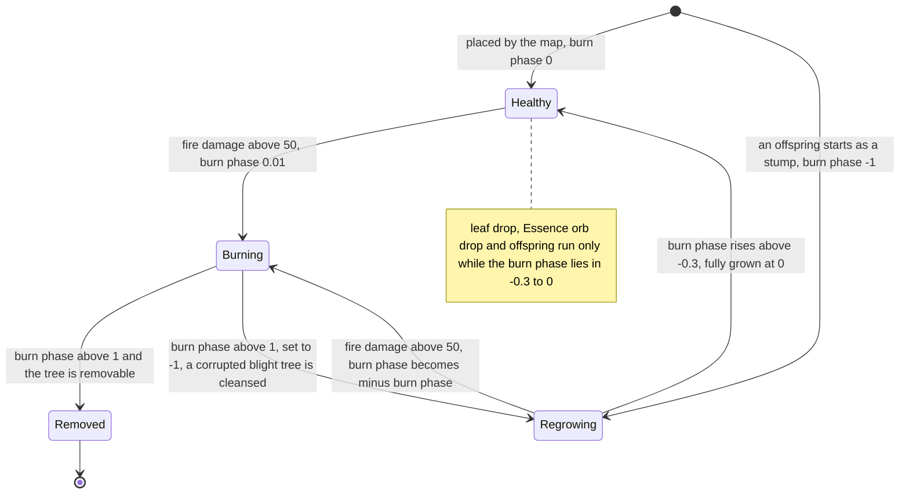
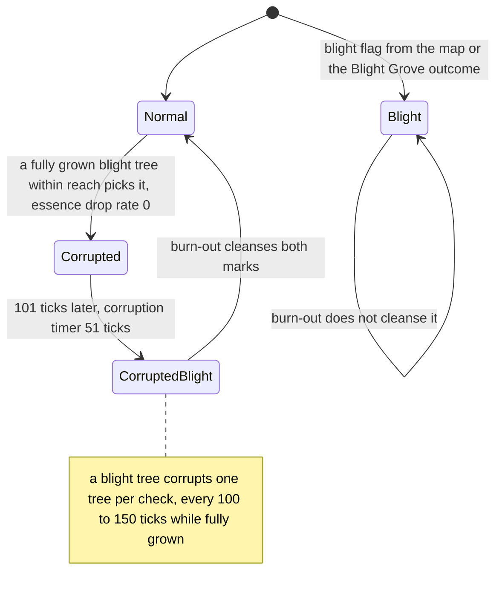
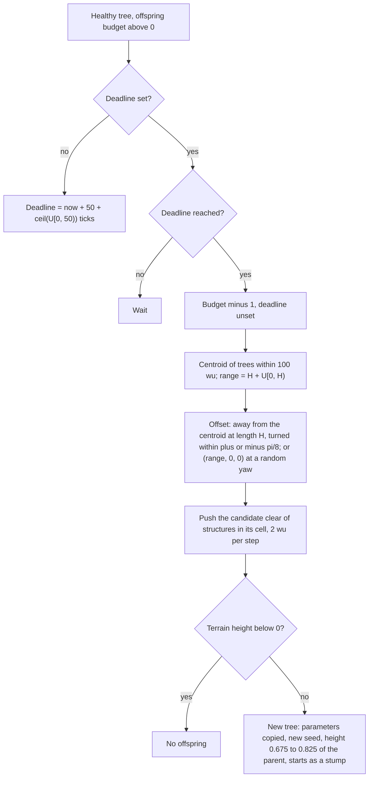
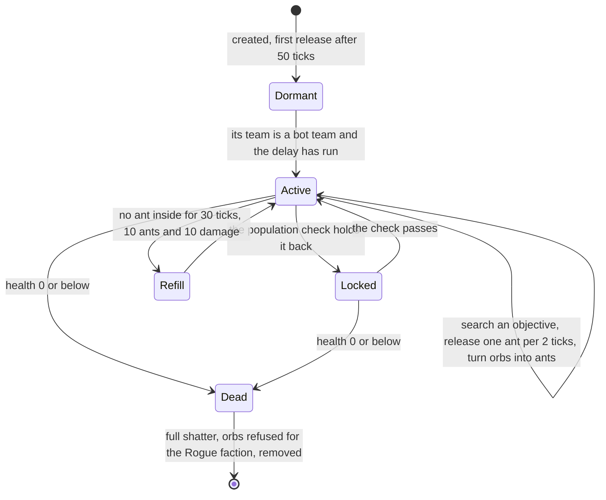
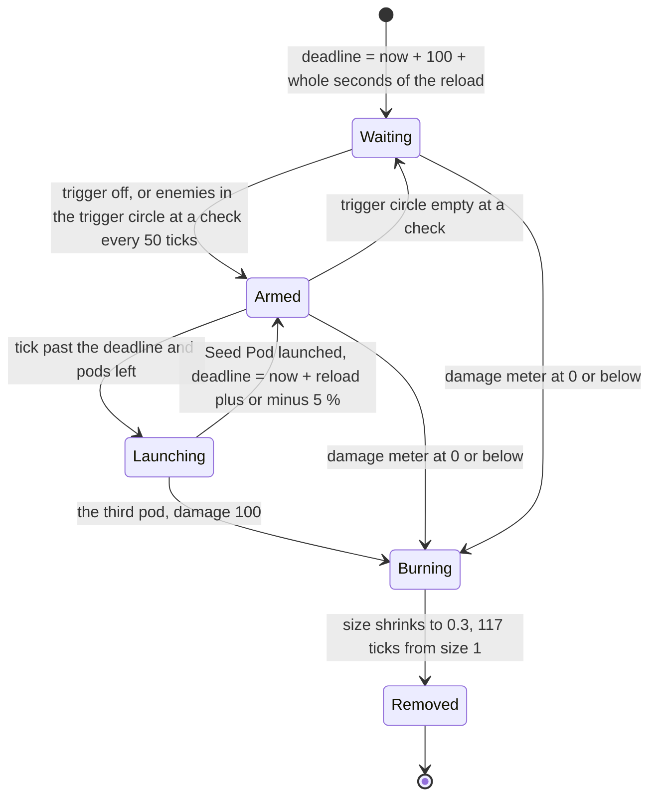
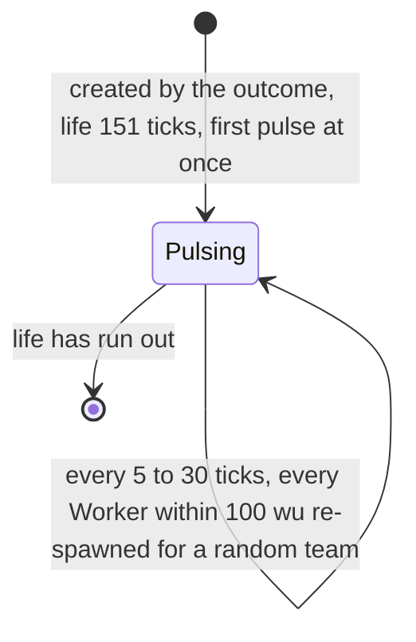

# Trees and crate structures

> Status: Reference · Prefix: R-BLDG · Related: [Defences and props](defences_and_props.md) · [Buildings and world objects](README.md) · [02 Worker](../02_units/worker.md) · [02 Creatures](../02_units/creatures.md) · [02 Essence orbs](../02_units/essence_orbs.md) · [04 Crates and powers](../04_supply_crates_powers_and_weapons/crates_and_powers.md) · [04 Weapons and projectiles](../04_supply_crates_powers_and_weapons/weapons_and_projectiles.md) · [05 Population flow](../05_population_flow.md) · [12 Simulation model](../12_simulation_model/README.md)

## 1 Purpose and player experience

This document is the companion of [defences and props](defences_and_props.md), which holds the rules shared by both files (its §2.1) and the index of their objects (its table 1-A). It specifies the living and crate-spawned world objects of the reference game: trees, including the trees that the Essence Grove and Blight Grove outcomes plant; Hives; Spitter Plants; and the Allegiance Scrambler effect. Its requirement IDs are R-BLDG-600 to R-BLDG-799.

| Object | Identifier | Kind of object | Placed by | Owner | Section |
|---|---|---|---|---|---|
| tree, essence tree, blight tree | `TreeObject` | structure | maps; the Essence Grove and Blight Grove outcomes; other trees (offspring) | no team | §2.2 |
| Hive | `Hive` | structure | the Hive outcome; a map may place one | the Rogue faction | §2.3 |
| Spitter Plant | `SpitterPlant` | structure | the Spitter Plants outcome; a map may place one | the Rogue faction | §2.4 |
| Allegiance Scrambler effect | `AllegianceScramblerEffect` | effect | the Allegiance Scrambler outcome | — | §2.5 |

**Player experience.**

- **Trees** are scenery that matters: they block movement and shots, catch fire, set nearby units alight, spread fire to their neighbours, burn down to a stump and regrow. Workers run from a burning tree. Essence trees drop Essence orbs for every team; blight trees kill Workers that come close, leaving ghostly Wisps, and slowly corrupt the trees around them until a whole wood turns black. Trees that a Supply crate plants also seed new trees, so a grove spreads.
- **Hives** are hostile nests of the Rogue faction. Their ants swarm out to steal Essence orbs and to carry Workers off to be killed, and every stolen orb becomes six more ants. Fire is the answer: a burning tree next to a Hive damages it and drives its ants out.
- **Spitter Plants** are hostile plants that lob three Seed Pods, each bursting into creatures of a random kind, before they burst into flame and wither.
- **The Allegiance Scrambler** hands every Worker near it to a random team, again and again, for 15 seconds.

## 2 Rules

### 2.1 Shared rules

The rules of [defences and props](defences_and_props.md) §2.1 (R-BLDG-400 to R-BLDG-404) apply to every object of this document: the reference baseline and its quirks, the shared structure rules of the [README](README.md), the draw notation and discipline, match time and tick conversion, and the guards against non-finite values.

### 2.2 Tree

#### 2.2.1 Role, map record and state

**R-BLDG-600** (MUST) A tree (`TreeObject`) is scenery with gameplay: it blocks movement and shots with two hit spheres, catches fire, burns down to a stump and regrows, sets nearby actors on fire, spreads fire to nearby trees, and in its variants drops Essence orbs (an **essence tree**) or kills Workers and corrupts nearby trees (a **blight tree**). Trees are placed by maps, created by the Essence Grove and Blight Grove outcomes ([04 Crates and powers](../04_supply_crates_powers_and_weapons/crates_and_powers.md)) and created by other trees as offspring (R-BLDG-618). A tree has no ports and is never captured; its map record may give it a team, which no tree rule reads, and a tree created during a match has no team.

**R-BLDG-601** (MUST) A tree's map record holds the base fields and then these fields, each with its default; the ranges are the map editor's input ranges, which the content build also enforces (DEC-015):

| Field | Default | Range | Meaning |
|---|---|---|---|
| height | `ref.bldg.tree.default_height` (50 wu) | 1 to 1000, step 1 | uniform scale of the whole tree; the geometry is generated at unit height |
| leaf width | `ref.bldg.tree.default_leaf_width` (1.0) | 0 to 50, step 0.05 | width multiplier of the leaf quads only |
| push out | `ref.bldg.tree.default_push` (1.0) | 0 to 5, step 0.01 | sideways reach of child branches |
| push up | `ref.bldg.tree.default_push` (1.0) | 0 to 5, step 0.01 | upward reach of child branches |
| iterations | `ref.bldg.tree.default_iterations` (6) | 1 to 10 | recursion depth N: the trunk is level 1 and the leaves level N |
| seed | 0 | 0 to 99999 | seed of the tree generator |
| branch colour | (255, 255, 255, 255) | RGBA8 | colour of the branches |
| leaf colour | (255, 255, 255, 255) | RGBA8 | colour of the leaves |
| leaf drop rate | 0 | 0 to 50 | 0 = off; the rate of cosmetic falling leaves (R-BLDG-615) |
| essence drop rate | 0 | 0 to 50 | above 0 makes an essence tree (R-BLDG-616) |
| blight | false | false or true | a blight tree (R-BLDG-620) |

**R-BLDG-602** (MUST) Besides the structure state, a tree holds:

| Field | Initial value | Meaning |
|---|---|---|
| burn phase | 0, or −1 for an offspring | 0 is fully grown and not burning; above 0 is burning, up to 1; below 0 is regrowing, from −1 (a stump) up to 0 |
| fire damage | 0 | the ignition meter, 0 to `ref.bldg.tree.fire_damage_max` (100) |
| offspring budget | 0 for a map tree; the creator's value otherwise | the number of offspring it may still create |
| offspring deadline | unset | the tick of its next offspring |
| removable | false for a map tree; true for crate trees and their offspring | whether it is removed at the end of a burn |
| corruption timer | `ref.bldg.tree.corruption_first_ticks` (51 ticks, nominal 5.0 s) | R-BLDG-621, R-BLDG-622 |
| corrupted | false | R-BLDG-621 |
| crown centre and crown radius | from collision data (R-BLDG-603) | the crown hit sphere at unit height |

#### 2.2.2 Generator and hit volumes

**R-BLDG-603** (MUST) A tree's geometry and its crown hit volume come from one deterministic generator that works in unit space, with the trunk from (0, 0, 0) to (0, 1, 0); the height is only a uniform scale applied at drawing and in the hit tests. The geometry is presentation. The crown centre and crown radius are collision data (DEC-012): for a tree that a map places they are baked by the content build, each centre stated explicitly; for a tree created during a match the simulation computes them once, at its creation, with the same generator and a generator state local to that tree, never a shared generator (reference/12 R-SIM-651). Every participant therefore holds the same crown volume for every tree.

**R-BLDG-604** (MUST) The tree generator uses its own 32-bit linear congruential generator: seeding sets the state s to the tree's seed; each draw sets s = (s × `ref.bldg.tree.rng_multiplier` + `ref.bldg.tree.rng_increment`) mod 2³² (214013 and 2531011) and returns (s >> 16) & `ref.bldg.tree.rng_mask` (0x7FFF), a value from 0 to 32767; and `Frand(r)` = r × draw ÷ 32767, from 0 to r inclusive. The generator is re-seeded with the tree's seed at the start of every pass, so every pass reproduces the same branching. The constants are pinned so that a map's tree seeds reproduce its baked crown volumes (DEC-012); the design phase may replace the generator only together with a re-bake.

**R-BLDG-605** (MUST) The generator runs three passes of this recursion over the same tree, written here in Species notation:

```
Branch(from, to, n, pass):
    if n == 0: return
    n = n - 1
    if n == 0:                                     # this segment is a leaf
        if pass == RADIUS: crownR = max(crownR, |to - crownC|)
        if pass == LEAF:   crownC = crownC + to; leafCount = leafCount + 1
    d = to - from
    A = Normalize(d x to); B = Normalize(A x d)    # Normalize(v) = (0, 0, 1) when |v|^2 <= 1e-10
    len = |d|
    w = ref.bldg.tree.branch_width * (leaf_width if n == 0 else 1)      # 0.1
    if (n == 0 and pass == LEAF) or (n != 0 and pass == BRANCH):
        emit quad (from - A*len*w, from + A*len*w, to + A*len*w, to - A*len*w), uv (0,0) (0,1) (1,1) (1,0)
        emit the same quad with B in place of A    # two crossed planes per segment
    for dir in (A, -A, B, -B):                     # always four children, even below a leaf
        t = ref.bldg.tree.child_start_min + Frand(ref.bldg.tree.child_start_spread)   # 0.3 + Frand(0.6)
        childFrom = from + d * t
        childTo = childFrom + dir * len * ref.bldg.tree.child_reach * push_out + d * (1 - t) * push_up   # 0.4
        Branch(childFrom, childTo, n, pass)        # returns at once when n == 0

Generate():
    crownC = (0, 0, 0); crownR = 0; leafCount = 0
    Seed(seed); Branch((0,0,0), (0,1,0), iterations, BRANCH)    # branch geometry
    Seed(seed); Branch((0,0,0), (0,1,0), iterations, LEAF)      # leaf geometry; sums the leaf tips
    crownC = crownC / leafCount
    Seed(seed); Branch((0,0,0), (0,1,0), iterations, RADIUS)    # no geometry
    crownR = crownR * ref.sim.integrity.tree_crown_radius_factor   # 0.8
```

The threshold 1e−10 is `ref.bldg.tree.normalise_epsilon`. For the trunk, d × to = 0, so A = (0, 0, 1) and B = (−1, 0, 0). At depth N there are 4^k segments at level k (k = 0 for the trunk to N − 1 for the leaves), 4^(N−1) leaf segments (1024 at N = 6) and (4^(N−1) − 1) ÷ 3 branch segments (341 at N = 6), two quads per segment, and each pass makes 4 draws per segment. The generator's arithmetic is bit-reproducible, so the content build and every participant compute the same crown volume for the same parameters (reference/12 R-SIM-651).

**R-BLDG-606** (MUST) After generation a tree's structure centre is its position + crown centre × height, and its structure radius is crown radius × height × `ref.bldg.tree.radius_factor` (1.5). The in-view test is the sphere (position, height). Drawing may reduce the iteration count by (structure-detail level − 1), to at least `ref.bldg.tree.min_draw_iterations` (3), for its geometry only; the crown volume is always that of the full iteration count (R-BLDG-047).

**R-BLDG-607** (MUST) A tree's actual height is height × (1 − |burn phase|), and at least `ref.bldg.tree.min_height_fraction` (0.01) × height. Its hit tests use the actual height hA (README table 2.12-A): a sphere, mesh or ray query hits the tree when it hits the trunk sphere, centre the position and radius `ref.bldg.tree.trunk_radius` (10 wu, whatever the height), or the crown sphere, centre position + crown centre × hA and radius crown radius × hA. The crown centre is not rotated by the tree's facing (DEC-012); the drawn crown is, so the crown sphere sits slightly off the drawn crown for a tree that does not face the default direction.

#### 2.2.3 Fire, burn-out and regrowth

**R-BLDG-608** (MUST) A tree's damage operation raises `tree.damaged` (R-BLDG-034) and then, while its fire damage is below `ref.bldg.tree.ignite_threshold` (50), adds −amount to its fire damage. When the fire damage then exceeds the threshold: a fully grown tree (phase 0) starts burning at phase `ref.bldg.tree.ignite_phase` (0.01); a regrowing tree (phase below 0) resumes burning at the same height, its phase becoming −phase; a burning tree is unaffected; and the `tree.burning` loop starts if it is not already playing. A fire damage of exactly 50 neither ignites the tree nor accumulates further until it has decayed below 50.

**R-BLDG-609** (MUST) Every tick a tree's fire damage falls by `ref.bldg.tree.fire_decay_per_tick` (0.1, 1.0 per second) and is clamped to [0, `ref.bldg.tree.fire_damage_max`].

**R-BLDG-610** (MUST) Every tick that a tree burns (phase above 0), with hA its actual height and R its crown radius:

1. its phase rises by `ref.bldg.tree.burn_rate_per_tick` (0.002, 0.02 per second);
2. every other tree whose distance from it is at most hA × R × `ref.bldg.tree.radius_factor` + its own hA′ × R′ × `ref.bldg.tree.radius_factor` takes −`ref.bldg.tree.spread_damage` (1) damage;
3. every Hive whose distance from it is at most hA × R × `ref.bldg.tree.radius_factor` + `ref.bldg.tree.hive_reach` (100 wu) is burnt (R-BLDG-640);
4. every actor of every team within its burn range, hA × `ref.bldg.tree.burn_range_factor` (half its actual height), is affected: a Worker is set on fire ([02 Worker](../02_units/worker.md) R-UNIT-121), and any other actor takes −`ref.bldg.tree.actor_fire_damage` (1) fire damage;
5. it releases fire particles (R-BLDG-629).

With one burning neighbour adding 1 per tick against the decay of 0.1, a tree ignites after 56 ticks of contact.

**R-BLDG-611** (MUST) When a burning tree's phase exceeds 1.0, the burn ends: the phase becomes `ref.bldg.tree.stump_phase` (−1.0), a stump at 1 % of the height; a tree that is both corrupted and blight loses both marks, so fire cleanses it; the fire is out, so the tree stops its `tree.burning` loop (R-BLDG-630); and a removable tree requests its removal. A tree that is not removable regrows. From ignition at 0.01 the burn lasts 495 ticks, about 49.5 s; this is the reference count, whose phase accumulates in binary64 arithmetic.

**R-BLDG-612** (MUST) Every tick that a tree regrows (phase below 0), its phase rises by `ref.bldg.tree.regrow_rate_per_tick` (0.005, 0.05 per second), up to 0, where it is fully grown again. From the stump the tree regrows in 200 ticks, about 20 s, and is healthy (R-BLDG-613) from its 140th tick.

**R-BLDG-613** (MUST) A tree is **healthy** while its phase lies in `ref.econ.essence_grove.healthy_burn_range` ((−0.3, 0], reference/05): fully grown and not burning, or at least 70 % regrown. Only a healthy tree drops leaves (R-BLDG-615), drops Essence orbs (R-BLDG-616) and creates offspring (R-BLDG-617).

**R-BLDG-614** (MUST) The damage sources that ignite trees are, each with its values in its owning document: explosions (R-BLDG-035); turret rounds, fireballs and firebomb canisters ([04 Weapons and projectiles](../04_supply_crates_powers_and_weapons/weapons_and_projectiles.md)); lightning strikes, which damage the trees of their obstacle-grid cell ([04 Crates and powers](../04_supply_crates_powers_and_weapons/crates_and_powers.md)); Workers under the Speed Boost power that touch a tree ([02 Worker](../02_units/worker.md) R-UNIT-123); and burning neighbours (R-BLDG-610). Workers flee a burning tree within twice its burn range ([02 Worker](../02_units/worker.md) R-UNIT-098 step 4).

#### 2.2.4 Healthy-tree behaviours

**R-BLDG-615** (MUST) Each tick a healthy tree with a leaf drop rate L above 0 drops a cosmetic leaf when a presentation-generator integer draw modulo (`ref.bldg.tree.leaf_drop_base` − L) (51 − L) is 0: one leaf particle in the leaf colour at position + (0, h, 0) + (U[−h ÷ 2, h ÷ 2], U[−v ÷ 2, v ÷ 2], U[−h ÷ 2, h ÷ 2]), with v = h × `ref.bldg.tree.leaf_spread_y_factor` (0.25), all drawn from the presentation generator, with h the actual height. Leaves never reach simulation state.

**R-BLDG-616** (MUST) Each tick a healthy tree that is not blight and whose essence drop rate E is above 0 makes one simulation draw U{0..2³² − 1} and, when it is divisible by (`ref.econ.essence_grove.drop_base` − E) (51 − E, reference/05), drops one Essence orb: it draws a distance U[0, h) and a yaw U[0, 2π), in this order, and spawns the orb at position + the point (distance, h, 0) rotated about the vertical by the yaw, with zero velocity, for a team slot drawn uniformly from `ref.econ.essence_grove.team_slots` (0 to 3, reference/05) by one draw U{0..3} ([02 Essence orbs](../02_units/essence_orbs.md); DEC-014). The slot may belong to no team in play (see DEC-305). The per-tick probability is 1 ÷ (51 − E), so a tree of rate 15 drops about 0.28 orbs per second at game speed 1; the probability is per tick and scales with game speed (DEC-092). A blight tree never drops orbs.

**R-BLDG-617** (MUST) Each tick a healthy tree whose offspring budget is above 0 and whose offspring deadline is unset sets the deadline to now + `ref.bldg.tree.offspring_delay_base_ticks` + ⌈U[0, `ref.bldg.tree.offspring_delay_spread_ticks`)⌉ ticks (50 to 100 ticks). When the tick count reaches the deadline, the tree lowers its budget by 1, unsets the deadline and creates one offspring (R-BLDG-618).

**R-BLDG-618** (MUST) Creating an offspring runs these steps in order:

1. It takes the centroid of the positions of every other tree within `ref.bldg.tree.offspring_neighbour_radius` (100 wu).
2. With H its actual height, it draws range = H + U[0, H); the draw is made whether or not it is used.
3. With at least one neighbour, the offset is (position − centroid) scaled to length H and rotated about the vertical by U[−`ref.bldg.tree.offspring_turn` ÷ 2, `ref.bldg.tree.offspring_turn` ÷ 2) (±π/8); with none, the offset is (range, 0, 0) rotated about the vertical by U[0, 2π). The candidate point is position + offset.
4. For each structure in the obstacle-grid cell of the candidate, while that structure's sphere test with radius `ref.bldg.tree.offspring_clearance` (1 wu) hits at the candidate, the candidate moves by the structure push of README table 2.9-A (`ref.bldg.structure.push_step_wu`, 2 wu, directly away from that structure's position). The push moves a fixed step away from a finite volume, so it ends; an implementation bounds it with a deterministic fallback that keeps the last candidate (DEC-014).
5. The candidate's height is set to the terrain height there; when that height is below 0, the candidate lies under the sea and no offspring is created.
6. Otherwise a tree is created with no team and a new serial, with every parameter of the parent copied (height, leaf width, push out, push up, iterations, seed, both colours, leaf drop rate, essence drop rate, blight flag, removable flag and the remaining offspring budget), and then, each its own draw in this order: its seed = ⌊U[0, `ref.bldg.tree.offspring_seed_max`)⌋ (99999) and its height = parent height × `ref.bldg.tree.offspring_height_factor` × (1 + U[−`ref.bldg.tree.offspring_height_spread` ÷ 2, `ref.bldg.tree.offspring_height_spread` ÷ 2)), that is 0.675 to 0.825 × the parent height. Its burn phase is set to −1, so it starts as a stump and regrows; its crown volume is computed (R-BLDG-603); it is initialised and the obstacle grid is updated incrementally (R-BLDG-030).

**R-BLDG-619** (MUST) The offspring budget of a tree is set only by its creator: map trees have none, and the grove outcomes give their trees a budget of ⌊`ref.crate.grove.offspring_base` + U[0, `ref.crate.grove.offspring_spread`)⌋ (2 to 4) ([04 Crates and powers](../04_supply_crates_powers_and_weapons/crates_and_powers.md) R-CRATE-188, R-CRATE-205). The grove outcomes set the other values of their trees with the keys of reference/04: `ref.crate.essence_grove.tree_count_base`, `ref.crate.essence_grove.tree_count_spread`, `ref.crate.essence_grove.template_iterations`, `ref.crate.essence_grove.drop_rate_base` and `ref.crate.essence_grove.drop_rate_spread`; `ref.crate.grove.scatter`, `ref.crate.grove.shape_factor_max`, `ref.crate.grove.shape_factor_spread`, `ref.crate.grove.colour_base`, `ref.crate.grove.colour_spread`, `ref.crate.grove.template_height`, `ref.crate.grove.seed_range` and `ref.crate.grove.height_cap`; and `ref.crate.blight_grove.tree_count_base`, `ref.crate.blight_grove.tree_count_spread`, `ref.crate.blight_grove.branch_colour`, `ref.crate.blight_grove.leaf_colour` and `ref.crate.blight_grove.template_iterations` (R-CRATE-186 to R-CRATE-188, R-CRATE-205). An offspring inherits the parent's remaining budget after the parent's decrement, so every tree of a grove spreads the grove further until the budgets run out.

#### 2.2.5 Blight trees and corruption

**R-BLDG-620** (MUST) Each tick a blight tree makes a draw U[0, `ref.bldg.tree.blight_roll_range`) (10) and, when it is below `ref.bldg.tree.blight_roll_below` (0.2), a 2 % chance per tick, takes `NearestEnemy(position, 0, hA × ref.bldg.tree.blight_reach_factor, Rogue faction)` (half its actual height; reference/12 R-SIM-311). When that actor is a Worker that is not operating a port, it takes −`ref.bldg.tree.blight_kill_damage` (999). When this kills it, the Essence orb that its death releases is removed at once, so it feeds no economy, and a Wisp is created at its position ([02 Creatures](../02_units/creatures.md) §2.11) with vertical speed `ref.bldg.tree.wisp_lift_base` + U[0, `ref.bldg.tree.wisp_lift_spread`) (20 to 45 wu/s) and its up vector tilted about its front by U[−`ref.bldg.tree.wisp_tilt` ÷ 2, `ref.bldg.tree.wisp_tilt` ÷ 2) rad, drawn in this order.

**R-BLDG-621** (MUST) While a blight tree is fully grown (phase 0), its corruption timer counts down by 1 tick per tick. At 0 the timer restarts at `ref.bldg.tree.corruption_check_base_ticks` + ⌈U[0, `ref.bldg.tree.corruption_check_spread_ticks`)⌉ ticks (100 to 150 ticks), and the first tree in structure order that is not blight, not corrupted and within the blight tree's actual height becomes corrupted: its essence drop rate becomes 0, its corrupted mark is set and its blight countdown starts at `ref.bldg.tree.blight_delay_ticks` (101 ticks). One tree at most is corrupted per check.

**R-BLDG-622** (MUST) Each tick a corrupted tree that is not yet blight counts its blight countdown down by 1; when it ends, the tree becomes a blight tree, and its corruption timer restarts at `ref.bldg.tree.corruption_first_ticks` (51 ticks), after which it corrupts trees itself (R-BLDG-621).

**R-BLDG-623** (MUST) The corruption marks form a cycle: normal, corrupted (101 ticks), blight, and, when a corrupted blight tree burns out, normal again (R-BLDG-611). A tree that a map places as blight, and a tree of the Blight Grove outcome, is blight without the corrupted mark, so burning never cleanses it.

**R-BLDG-624** (MUST) The blight flag of a map record or a creator makes a blight tree from its creation. A blight tree draws no leaves and plays the blight presence loop (R-BLDG-630).

#### 2.2.6 Tree presentation and sound events

**R-BLDG-625** (MUST) A tree draws nothing in the opaque pass; it is drawn in the translucent pass, depth-sorted at position + crown centre × height. The pass samples `fx.tree_canopy` with linear, mipmapped filtering, blends additively (source alpha, one), draws both faces and writes no depth. The transform is (front, up, position) with a uniform scale of the drawn height (R-BLDG-626). The branch geometry is drawn in the branch colour and then, unless the seasonal theme is active or the tree is blight, the leaf geometry in the leaf colour. The drawing reads simulation state only (DEC-007).

**R-BLDG-626** (MUST) The drawn height is the actual height × (1 + sin((t + serial × `ref.bldg.tree.sway_phase_per_serial`) × `ref.bldg.tree.sway_rate`) × `ref.bldg.tree.sway_amplitude`), with t the presentation time (a phase of serial × 2, a rate of 2 rad/s and an amplitude of 0.003, or `ref.bldg.tree.blight_sway_amplitude` (0.01) for a blight tree): the tree breathes as a whole, without per-branch motion.

**R-BLDG-627** (MUST) The drawing varies by the tree's state:

1. **Essence tree:** the leaf colour's blue channel pulses as B × f + 255 × (1 − f), with f = |sin(t + serial × `ref.bldg.tree.essence_pulse_phase_per_serial`)| (10).
2. **Blight tree:** the branches in `ref.bldg.tree.blight_branch_rgba` (0, 0, 0, 200) with ordinary alpha blending, and no leaves: a dark silhouette.
3. **Corrupted, not yet blight:** the tree is drawn twice. With f the fraction of the blight countdown already run (0 at corruption, 1 at blight, extrapolated over the presentation's extrapolation time), the first drawing darkens the branch colour and alpha by f and multiplies the leaf alpha by 1 − f, and the second draws the blight silhouette with branch alpha `ref.bldg.tree.blight_branch_rgba` alpha × f.
4. **Burning:** ordinary alpha blending; the branch colour is scaled towards black by min(phase × `ref.bldg.tree.burn_darken_factor`, 1) (10) at branch alpha 255; the leaves are black with alpha × (1 − phase). Over it, `ref.bldg.tree.burn_flare_count` (4) camera-facing `fx.starburst` quads i = 0 to 3 are drawn without depth test in colour `ref.bldg.tree.burn_flare_rgb` (0.8, 0.2, 0.1) with alpha `ref.bldg.tree.burn_flare_alpha` (0.5) × hA ÷ height, centred at position + (sin(2g + i) × i × `ref.bldg.tree.burn_flare_spread` (1.7), `ref.bldg.tree.burn_flare_height` (0.8) × hA + cos(2g + i), cos(2g + i) × i × 1.7), with g the match time, and half-size max(`ref.bldg.tree.burn_flare_size_factor` (2) × hA, `ref.bldg.tree.burn_flare_min_size` (5 wu)).
5. **Regrowing:** the leaves are invisible while |phase| is above `ref.bldg.tree.regrow_leaf_threshold` (0.5), and have alpha × (1 − 2 × |phase|) after that.
6. **Seasonal theme**, while the seasonal state of [09 screen flow and match setup](../09_front_end_and_match_flow/screen_flow_and_match_setup.md) R-META-102 is on: the branches in `ref.bldg.tree.seasonal_branch_rgb` (180, 100, 50) and no leaves.

**R-BLDG-628** (MUST) A tree-detail preference above 1, which the options screen does not expose (default 1), multiplies the leaf alpha by `ref.bldg.tree.leaf_alpha_boost`^detail (1.3^detail), capped at 255, when the geometry is built. It changes presentation only.

**R-BLDG-629** (MUST) Each tick a burning tree releases ⌊⌊hA ÷ `ref.bldg.tree.fire_particle_height_step`⌋ ÷ structure-detail level⌋ fire particles (hA ÷ 12), each from the presentation generator: at a horizontal distance U[0, `ref.bldg.tree.fire_particle_radius_factor` × hA] (0.6 hA) in a random direction, at a height `ref.bldg.tree.fire_particle_base_factor` × hA + `ref.bldg.tree.fire_particle_rise_factor` × U[0, hA] (0.7 hA + 0.3 × U[0, hA]), with size `ref.bldg.tree.fire_particle_size_factor` × hA × (1 + U[−`ref.bldg.tree.fire_particle_size_spread` ÷ 2, `ref.bldg.tree.fire_particle_size_spread` ÷ 2]) (2 hA ± 25 %). Particles never reach simulation state.

**R-BLDG-630** (MUST) A tree's sound events, besides the base events of README table 2.14-A, are: one presence loop chosen at initialisation, `tree.ambient_blight` for a blight tree, otherwise `tree.ambient_essence` for an essence tree, otherwise `tree.ambient_normal`; and the loop `tree.burning`, started once at ignition (R-BLDG-608) and stopped by its own stop event when the fire goes out at the end of the burn, which is also when a removable tree is removed (R-BLDG-611; [10 Audio design](../10_audio_design/event_model_and_sound_data.md) R-AUD-039; DEC-323). `tree.spawn` is the base spawn event (§2.6).

### 2.3 Hive

**R-BLDG-631** (MUST) A Hive (`Hive`) is a Rogue faction nest, `mesh.structure.hive_mound` with the collision asset `mesh.collision.hive_mound`, that sends ants out to capture Workers, collect Essence orbs, attack enemies and scout, and turns the orbs that they bring home into more ants. Its ants are specified in [02 Creatures](../02_units/creatures.md) §2.7. It holds an integer health of `ref.bldg.hive.health` (100), its ants inside, its orbs inside, its objectives and its ant group. Its team is fixed; it is never captured.

**R-BLDG-632** (MUST) The Hive outcome ([04 Crates and powers](../04_supply_crates_powers_and_weapons/crates_and_powers.md), which owns when it occurs and its validity limit) creates `ref.crate.hive.count` (2) Hives, always of the Rogue faction whoever triggered it (DEC-021, DEC-107); the outcome's values are keyed in reference/04 (R-CRATE-194). For each Hive, in this order: position = target point + (U[−100, 100), 0, U[−100, 100)) (`ref.crate.hive.scatter`, 200 wu); front = Normalize(U[−0.5, 0.5), 0, U[−0.5, 0.5)); ants inside = `ref.crate.hive.ants_max` − U{0..`ref.crate.hive.ants_spread` − 1} (75 − U{0..24}, so 51 to 75). Each Hive is snapped to the terrain, created with a new serial and initialised (R-BLDG-030), and shatters its mesh once as a build-in effect (presentation). The outcome then spawns one ant at the target point to wake the Rogue faction ([02 Creatures](../02_units/creatures.md) R-UNIT-559), shows the map marker `icon.power.hive` and shows its message (reference/04).

**R-BLDG-633** (MUST) A Hive's map record holds the base fields and its ants inside, an integer; a value outside [0, `ref.bldg.hive.map_ants_max`] (10,000) becomes 0, and the default is 0. The content build rejects such a value in an authored map ([data schemas](../../architecture/components/data_schemas/map_structure_records.md) DAT-159; DEC-968), so the replacement applies only to records that bypass validation. A map may place a Hive; no reference map does.

**R-BLDG-634** (MUST) A Hive acts only while its team is a bot team (`TeamKind::Bot`; the Rogue faction always is). Its first ant release comes `ref.bldg.hive.first_release_ticks` (50 ticks) after its initialisation. Before each sortie it applies the population check of [05 Population flow](../05_population_flow.md) R-ECON-056; while that check holds it back, the Hive is **locked**: it creates no objective and releases no ant, while its orb conversion continues. Its own ants are not counted (see DEC-084).

**R-BLDG-635** (MUST) An unlocked Hive keeps at most clamp(⌊ants inside ÷ `ref.bldg.hive.objective_divisor`⌋, `ref.bldg.hive.objective_min`, `ref.bldg.hive.objective_max`) objectives (⌊ants ÷ 10⌋, 1 to 6). While it has fewer and its search deadline has passed, it sets the next deadline to now + `ref.bldg.hive.search_step_ticks` × U{0..1} (0 or 10 ticks) and makes one search chosen by U{0..4}, within `ref.bldg.hive.search_range` (400 wu):

| Draw | Search | Objective |
|---|---|---|
| 0 or 1 | the nearest enemy Worker that is not captured and not yet an objective of this Hive | that Worker |
| 2 | the first enemy actor in result order that is not yet an objective of this Hive; a bot controller is not excluded (see DEC-311) | that actor |
| 3 | the first Essence orb in the Birth or Floating state that lies more than `ref.bldg.hive.orb_separation` (20 wu) from every existing objective | that orb |
| 4 | a scout point at distance `ref.bldg.hive.scout_base` + U[0, `ref.bldg.hive.scout_spread`) (200 to 400 wu) and angle U[0, 2π) from the Hive, accepted only when the terrain height there is above 0 | that point |

A search that finds nothing creates no objective. A new objective is to receive ⌊⌊`ref.bldg.hive.sortie_ants_base` + U[0, `ref.bldg.hive.sortie_ants_spread`)⌋ + ants inside ÷ `ref.bldg.hive.sortie_ants_divisor`⌋ ants (⌊⌊5 + U[0, 5)⌋ + ants ÷ 20⌋).

**R-BLDG-636** (MUST) An unlocked Hive with ants inside and at least one objective releases one ant every `ref.bldg.hive.release_interval_ticks` (2 ticks, 0.2 s): it chooses an objective by U{0..count − 1}; spawns an ant of its own team into its ant group, created on first use, at the Hive with spawn spread `ref.bldg.hive.release_spread` (10 wu); gives it the ScoutArea order with the waypoint objective position + an offset of length U[0, `ref.bldg.hive.waypoint_scatter`) (30 wu) at angle U[0, 2π), pushed clear of obstacles; and lowers its ants inside by 1 and the objective's count by 1, removing the objective at 0.

**R-BLDG-637** (MUST) A returning ant adds 1 to the Hive's ants inside, a carried orb adds 1 to its orbs inside, and a carried Worker is killed at the Hive so that its orb is released there ([02 Creatures](../02_units/creatures.md) R-UNIT-566). While orbs are inside, the Hive turns one orb into `ref.econ.hive.ants_per_orb` (6) ants every `ref.econ.hive.conversion_ticks` (10 ticks: one second of match time by the deadline rule of R-BLDG-403); the conversion restates reference/05 R-ECON-084.

**R-BLDG-638** (MUST) When a Hive's ants inside stay at or below 0 for `ref.bldg.hive.empty_ticks` (30) consecutive ticks, its ants inside become `ref.bldg.hive.refill_ants` (10) and it damages itself by −`ref.bldg.hive.refill_damage` (10). The count is per tick and scales with game speed (DEC-092).

**R-BLDG-639** (MUST) A Hive's damage operation raises `hive.damaged` and adds the signed amount to its integer health, truncating the sum towards 0. Each time the health falls past a multiple of `ref.bldg.hive.damage_band` (20), the Hive shatters part of its mesh, the fraction 1 − health ÷ 100, and raises `hive.damaged` again. At a health of 0 or below it shatters fully, releases (ants inside + orbs inside) Essence orbs of its own team in a disc of radius `ref.bldg.hive.burst_radius` (20 wu) at speeds U[0, `ref.bldg.hive.burst_speed`) (50 wu/s), raises `hive.explode` and requests its removal. Because every Hive belongs to the Rogue faction, whose orb spawns are refused, no orb appears (see DEC-084). Destroying a Hive with an intensity sets its health to 0 first (R-BLDG-037).

**R-BLDG-640** (MUST) A burning tree burns every Hive within its reach each tick (R-BLDG-610). Each burn damages the Hive by −`ref.bldg.hive.burn_damage` (1) with the chance `ref.bldg.hive.burn_damage_chance` (0.3), tested against U[0, 1), and, while its ants inside are above 0, releases one ant with the ScoutArea order towards the point `ref.bldg.hive.burn_flee_distance` (200 wu) from the Hive at angle U[0, 2π) and lowers its ants inside by 1; the count never falls below 0, and the empty-Hive rule of R-BLDG-638 applies unchanged (DEC-460).

**R-BLDG-641** (MUST) Enemy Workers attack a Hive through the structure check of their threat search, which names this Hive by its structure id (DEC-105; [02 Worker](../02_units/worker.md) R-UNIT-098 step 5). A Hive's damage sources are explosions (R-BLDG-035), turret rounds (README R-BLDG-036), burning trees (R-BLDG-640) and its own empty-Hive rule (R-BLDG-638). Its damage flicker is presentation and draws from the presentation generator. Its sound events, besides the base events of README table 2.14-A, are the `hive.damaged` repeats of R-BLDG-639 and `hive.explode`.

### 2.4 Spitter Plant

**R-BLDG-642** (MUST) A Spitter Plant (`SpitterPlant`) is a rooted plant, `mesh.structure.spitter_plant_head` (sockets `launch_point` and `stem`, the second read by no rule, see DEC-330; collision asset `mesh.collision.spitter_plant_head`), that lobs Seed Pods ([02 Creatures](../02_units/creatures.md) §2.2), each of which bursts into a group of creatures. Its team is fixed; it is never captured. The plants of the Spitter Plants outcome belong to the Rogue faction, so their creatures are hostile to everyone (DEC-021, DEC-107), unlike the creatures of the Brood outcome, whose owner is DEC-121.

**R-BLDG-643** (MUST) The Spitter Plants outcome, which only the bad branch of an opened Supply crate yields ([04 Crates and powers](../04_supply_crates_powers_and_weapons/crates_and_powers.md) R-CRATE-121, R-CRATE-126), creates `ref.crate.spitter_plants.count_base` + U{0..`ref.crate.spitter_plants.count_spread` − 1} (1 to 3) plants of the Rogue faction; the outcome's values are keyed in reference/04 (R-CRATE-222). For each plant, in this order: position = target point + (U[−25, 25), 0, U[−25, 25)) (`ref.crate.spitter_plants.scatter`, 50 wu), with its front pointing horizontally away from the target point; pitch = `ref.crate.spitter_plants.pitch_base` + U[0, `ref.crate.spitter_plants.pitch_spread`) (0.6 to 1.2); force = `ref.crate.spitter_plants.force_base` + U[0, `ref.crate.spitter_plants.force_spread`) (60 to 120); variance = U[0, `ref.crate.spitter_plants.variance_range`) (0 to 0.5); reload = `ref.crate.spitter_plants.reload_base_ticks` + ⌈U[0, `ref.crate.spitter_plants.reload_spread_ticks`)⌉ ticks (400 to 1000 ticks). Its size is 1, its trigger is off, and every kind of Seed Pod release is enabled except Essence orbs (kind 3) and Crawler eggs (kind 4). The outcome shows the map marker `icon.power.spitter_plants` and its message (reference/04).

**R-BLDG-644** (MUST) A Spitter Plant's map record holds the base fields and then, with the defaults that a map record uses:

| Field | Default | Meaning |
|---|---|---|
| size | `ref.bldg.spitter_plant.default_size` (1.0) | scale of the head and of the launch |
| pitch | `ref.bldg.spitter_plant.default_pitch` (0.6) | launch pitch |
| force | `ref.bldg.spitter_plant.default_force` (250) | launch speed |
| variance | `ref.bldg.spitter_plant.default_variance` (π/8) | thrash amplitude while burning |
| reload | `ref.bldg.spitter_plant.default_reload_ticks` (600 ticks) | ticks between launches |
| trigger | off | off: always armed; on: armed only while enemies are in the trigger circle |
| trigger x, trigger z | 0 | offset of the trigger circle from the plant |
| trigger radius | `ref.bldg.spitter_plant.default_trigger_radius` (100 wu) | radius of the trigger circle, and the roam range of its Seed Pods |
| kinds 0 to 9 | none enabled | the enabled Seed Pod kinds, in the kind order of [02 Creatures](../02_units/creatures.md) R-UNIT-519 |

A map may place a Spitter Plant; no reference map does. Besides these fields a plant holds a damage meter of `ref.bldg.spitter_plant.damage_meter` (50) and a pod budget of `ref.bldg.spitter_plant.pod_budget` (3).

**R-BLDG-645** (MUST) At initialisation a plant draws its first launch deadline, now + `ref.bldg.spitter_plant.first_delay_ticks` (100) + U{0..⌊reload × `ref.sim.tick_period`⌋ − 1} ÷ `ref.sim.tick_period` ticks (10 s plus whole seconds below the reload), and its first trigger check after ⌈U[0, `ref.bldg.spitter_plant.trigger_check_ticks`)⌉ ticks (0 to 50 ticks) (DEC-652). The content build rejects a reload for which ⌊reload × `ref.sim.tick_period`⌋ is below 1, so the first-deadline draw always has at least one value ([data schemas](../../architecture/components/data_schemas/map_structure_records.md) table 3.2-A; DEC-968).

**R-BLDG-646** (MUST) A plant is armed while its trigger is off or it is burning. Otherwise it checks every `ref.bldg.spitter_plant.trigger_check_ticks` (50 ticks) whether enemies are present in the trigger circle, by the cell-granular presence test `EnemiesInCells(position + trigger offset, trigger radius, team)` (reference/12 R-SIM-312); when it changes from unarmed to armed, its launch deadline is drawn again as R-BLDG-645 specifies.

**R-BLDG-647** (MUST) While a plant is armed, its tick count is past its launch deadline and its pod budget is above 0, it launches (R-BLDG-648), lowers its pod budget by 1 and sets its next deadline to now + ⌈reload × (1 + U[−`ref.bldg.spitter_plant.reload_jitter` ÷ 2, `ref.bldg.spitter_plant.reload_jitter` ÷ 2))⌉ ticks (±5 %). When the budget reaches 0, the plant damages itself by −`ref.bldg.spitter_plant.budget_damage` (100), which sets it burning (R-BLDG-650): a plant launches three pods and then withers.

**R-BLDG-648** (MUST) A launch chooses one enabled kind by U{0..count − 1} over the enabled kinds in kind order, and launches nothing when no kind is enabled. The Seed Pod starts at the head's `launch_point` socket, takes the plant's position + trigger offset as its spawn point and the trigger radius as its roam range, and draws its size, launch velocity (the socket's forward × force × size × a random factor) and burst timer by [02 Creatures](../02_units/creatures.md) R-UNIT-511 and R-UNIT-515. The launch raises `spitter_plant.launch` (silent, see DEC-565).

**R-BLDG-649** (MUST) The head pose is a simulation function of match time, because it sets the launch socket. With t = match time + serial × `ref.bldg.spitter_plant.phase_per_serial` (10): the head sits at position + up × `ref.bldg.spitter_plant.head_height` (30 wu) × size; it is pitched by pitch × `ref.bldg.spitter_plant.pitch_scale` (0.5) × (1 + `ref.bldg.spitter_plant.pose_wobble` (0.1) × sin t); it bobs by (4 sin(t ÷ 1.3), sin(t ÷ 1.5), 3 sin(t ÷ 1.2)) wu (`ref.bldg.spitter_plant.bob`); it recoils by −front × `ref.bldg.spitter_plant.recoil` (10 wu) × ((deadline − now) ÷ reload)^`ref.bldg.spitter_plant.recoil_exponent` (5); its scale is size × (1 + `ref.bldg.spitter_plant.pose_wobble` × sin t); and while it burns its front thrashes, rotated about the vertical by sin(`ref.bldg.spitter_plant.thrash_rate` × t) × variance (5 rad/s).

**R-BLDG-650** (MUST) A plant's damage operation raises `spitter_plant.damaged` and adds the amount to its damage meter; when the meter first falls to 0 or below, the plant starts burning and starts its `spitter_plant.burning` loop. Every tick while it burns, its size falls by `ref.bldg.spitter_plant.burn_shrink` (0.006) and its launch deadline moves `ref.bldg.spitter_plant.burn_deadline_advance_ticks` (5 ticks) earlier; at a size of `ref.bldg.spitter_plant.remove_size` (0.3) or below its head shatters and it requests its removal, 117 ticks after ignition from size 1. While it burns it also releases, from the presentation generator, `ref.bldg.spitter_plant.fire_particles` (2) fire particles per tick of size `ref.bldg.spitter_plant.fire_particle_size_base` + U[−s ÷ 2, s ÷ 2), s = `ref.bldg.spitter_plant.fire_particle_size_spread` × size (100 + U[−50 × size, 50 × size)), and debris with the chance `ref.bldg.spitter_plant.debris_chance` (0.1) per tick. Its damage sources are explosions, turret rounds and firebomb canisters (README R-BLDG-035, R-BLDG-036) and its own pod budget (R-BLDG-647); enemy Workers attack it by its structure id (DEC-105).

**R-BLDG-651** (MUST) A plant is drawn as yellow stem lines from its base to the head, the head mesh at its pose, and, during the last `ref.bldg.spitter_plant.held_pod_fraction` (25 %) of each reload, the next pod (`mesh.creature.seed_pod`) held at the launch socket. Its sound events, besides the base events, are `spitter_plant.burning` and `spitter_plant.launch`.

### 2.5 Allegiance Scrambler effect

**R-BLDG-652** (MUST) The Allegiance Scrambler effect (`AllegianceScramblerEffect`) is an effect in the match world's effect pool, not a structure, created at its target point by the Allegiance Scrambler outcome ([04 Crates and powers](../04_supply_crates_powers_and_weapons/crates_and_powers.md)); no map places it. It lives `ref.crate.allegiance_scrambler.life_ticks` (151 ticks, the 15 s countdown of DEC-002) and is then removed; its range, life and pulse values are keyed in reference/04 (R-CRATE-191). The team that triggered the outcome only receives the message and the fixed map marker `icon.power.allegiance_scrambler`.

**R-BLDG-653** (MUST) The effect pulses on its first tick and then every `ref.crate.allegiance_scrambler.pulse_base_ticks` + ⌈U[0, `ref.crate.allegiance_scrambler.pulse_spread_ticks`)⌉ ticks (5 to 30 ticks). A pulse visits every actor of every team within `ref.crate.allegiance_scrambler.range` (100 wu) (`InRange`, reference/12 R-SIM-311); for each Worker that is not inside a Transport, it draws a team U{0..P − 1}, with P the map's player count, spawns a new Worker of that team at the old Worker's position with its velocity, and sets the old Worker's destroyed flag. The drawn team may be the old one. Every slot below the player count holds a team in play, because empty slots are filled with bots (DEC-079, DEC-305). The new Worker is a new actor: its state, orders and health are those of a fresh spawn, no Essence orb is released and no population cap is checked ([05 Population flow](../05_population_flow.md)).

**R-BLDG-654** (MUST) Each step of [animation and VFX](../../architecture/components/animation_and_vfx/README.md) VFX-018 the effect draws two muzzle-flash particles (`fx.muzzle_flash`) of size `ref.bldg.allegiance_scrambler.flash_size` (60) at the two ends of an arm of radius `ref.crate.allegiance_scrambler.range` (100 wu) that turns at `ref.bldg.allegiance_scrambler.spin_rate` (3 rad/s) of presentation time, `ref.bldg.allegiance_scrambler.flash_height` (5 wu) above the ground, each in a team colour chosen by the presentation generator. These particles never reach simulation state, and their number follows the fixed step rate `vfx.emit.step_rate` (60 steps per second), never the frame rate (DEC-960).

### 2.6 Presentation events of these objects

**R-BLDG-655** (MUST) The objects of this document raise the presentation events of table 2.6-A besides the base events of README table 2.14-A. The sample bindings are those of `assets/asset_manifest.csv` ([10 Audio design](../10_audio_design/README.md)); an event marked silent has no binding (see DEC-565). The Allegiance Scrambler effect raises no events of its own.

Table 2.6-A Presentation events and their sample groups.

| Event | Trigger | Sample group |
|---|---|---|
| `tree.spawn` | initialisation | `sfx.building.tree.spawn` |
| `tree.ambient_normal`, `tree.ambient_essence`, `tree.ambient_blight` | the presence loop chosen at initialisation (R-BLDG-630) | `sfx.building.tree.ambient_normal` for the first two, `sfx.building.tree.ambient_blight` |
| `tree.burning` | loop from ignition (R-BLDG-608) | `sfx.building.tree.burning` |
| `tree.damaged` | each damage (R-BLDG-608) | none in the manifest |
| `hive.damaged` | each damage and each band crossing (R-BLDG-639) | `sfx.building.hive.damaged` |
| `hive.explode` | destruction (R-BLDG-639) | `sfx.weapon.grenade.explode` |
| `spitter_plant.damaged` | each damage (R-BLDG-650) | `sfx.creature.brood_drifter.hurt` |
| `spitter_plant.burning` | loop from ignition (R-BLDG-650) | `sfx.building.spitter_plant.burning` |
| `spitter_plant.launch` | a Seed Pod launch (R-BLDG-648) | silent |

### 2.7 Reference map usage

**R-BLDG-656** (MUST) The reference maps use these kinds as follows; the per-mode map counts are in README table 2.4-A, and no reference map name is carried ([08 Maps and level design](../08_maps_and_level_design/README.md)). Map content is data, so these facts constrain the reference map set, not the rules.

| Kind | Reference map facts |
|---|---|
| tree | 661 records on 39 maps; height 43.54 to 272.65 wu; leaf width 0 to 43.97; push out 0.34 to 1.31; push up 0.43 to 1.32; iterations 4 (24 records), 5 (165), 6 (516), 7 (50); 33 branch colours and 39 leaf colours; leaf drop rate 35 on 18 records; essence drop rate always 0; two Relic Run maps place only blight trees (45 and 59), all with white colours; some map records give trees a map position, which no rule reads |
| Hive, Spitter Plant | none; only the outcomes create them |

## 3 States and flows



*Figure 1 — Tree burn cycle (R-BLDG-608 to R-BLDG-613). "Healthy" includes the last 30 % of regrowth.*



*Figure 2 — Corruption marks of a tree (R-BLDG-620 to R-BLDG-624).*



*Figure 3 — Offspring of a tree (R-BLDG-617 to R-BLDG-619).*



*Figure 4 — Hive (R-BLDG-632 to R-BLDG-640).*



*Figure 5 — Spitter Plant (R-BLDG-645 to R-BLDG-650).*



*Figure 6 — Allegiance Scrambler effect (R-BLDG-652, R-BLDG-653).*

## 4 Tuning table

Every value is a reference tuning value that Species may adopt as its baseline (DEC-004). Durations are in ticks at `ref.sim.tick_period` (0.1 s); seconds are derived.

### 4.1 Tree: map defaults and generator

| key | value | unit | range or notes | requirement | DEC |
|---|---|---|---|---|---|
| `ref.bldg.tree.default_height` | 50 | wu | 1 to 1000 | R-BLDG-601 | — |
| `ref.bldg.tree.default_leaf_width` | 1.0 | — | 0 to 50 | R-BLDG-601 | — |
| `ref.bldg.tree.default_push` | 1.0 | — | push out and push up; 0 to 5 | R-BLDG-601 | — |
| `ref.bldg.tree.default_iterations` | 6 | levels | 1 to 10 | R-BLDG-601 | — |
| `ref.bldg.tree.fire_damage_max` | 100 | damage | clamp of the ignition meter | R-BLDG-602, R-BLDG-609 | — |
| `ref.bldg.tree.corruption_first_ticks` | 51 | ticks | nominal 5.0 s countdown | R-BLDG-602, R-BLDG-622 | DEC-002 |
| `ref.bldg.tree.rng_multiplier` | 214013 | — | generator multiplier | R-BLDG-604 | DEC-012 |
| `ref.bldg.tree.rng_increment` | 2531011 | — | generator increment | R-BLDG-604 | DEC-012 |
| `ref.bldg.tree.rng_mask` | 0x7FFF | — | 15-bit output | R-BLDG-604 | DEC-012 |
| `ref.bldg.tree.branch_width` | 0.1 | × segment length | × leaf width for leaves | R-BLDG-605 | — |
| `ref.bldg.tree.child_start_min` | 0.3 | × parent segment | | R-BLDG-605 | — |
| `ref.bldg.tree.child_start_spread` | 0.6 | × parent segment | child start 0.3 to 0.9 | R-BLDG-605 | — |
| `ref.bldg.tree.child_reach` | 0.4 | × parent length | × push out | R-BLDG-605 | — |
| `ref.bldg.tree.normalise_epsilon` | 1e−10 | squared length | below it a direction is (0, 0, 1) | R-BLDG-605 | DEC-653 |
| `ref.bldg.tree.radius_factor` | 1.5 | × crown radius | structure radius and fire reach | R-BLDG-606, R-BLDG-610 | — |
| `ref.bldg.tree.min_draw_iterations` | 3 | levels | drawing only | R-BLDG-606 | DEC-007 |
| `ref.bldg.tree.min_height_fraction` | 0.01 | × height | a stump | R-BLDG-607 | — |
| `ref.bldg.tree.trunk_radius` | 10 | wu | whatever the height | R-BLDG-607 | DEC-012 |

### 4.2 Tree: fire, healthy behaviours and blight

| key | value | unit | range or notes | requirement | DEC |
|---|---|---|---|---|---|
| `ref.bldg.tree.ignite_threshold` | 50 | damage | ignites when exceeded | R-BLDG-608 | — |
| `ref.bldg.tree.ignite_phase` | 0.01 | burn phase | | R-BLDG-608 | — |
| `ref.bldg.tree.fire_decay_per_tick` | 0.1 | damage per tick | 1.0 per second | R-BLDG-609 | DEC-092 |
| `ref.bldg.tree.burn_rate_per_tick` | 0.002 | burn phase per tick | 0.02 per second | R-BLDG-610 | DEC-092 |
| `ref.bldg.tree.spread_damage` | 1 | damage per tick | to each tree in reach | R-BLDG-610 | DEC-092 |
| `ref.bldg.tree.hive_reach` | 100 | wu | + the tree's fire reach | R-BLDG-610 | — |
| `ref.bldg.tree.burn_range_factor` | 0.5 | × actual height | burn range | R-BLDG-610 | — |
| `ref.bldg.tree.actor_fire_damage` | 1 | health per tick | actors other than Workers | R-BLDG-610 | DEC-092 |
| `ref.bldg.tree.stump_phase` | −1.0 | burn phase | | R-BLDG-611 | — |
| `ref.bldg.tree.regrow_rate_per_tick` | 0.005 | burn phase per tick | 0.05 per second | R-BLDG-612 | DEC-092 |
| `ref.bldg.tree.leaf_drop_base` | 51 | — | 1 in (51 − rate) per tick; presentation | R-BLDG-615 | DEC-013 |
| `ref.bldg.tree.leaf_spread_y_factor` | 0.25 | × height | vertical spread of a leaf | R-BLDG-615 | — |
| `ref.bldg.tree.offspring_delay_base_ticks` | 50 | ticks | offspring after 50 to 100 ticks | R-BLDG-617 | DEC-002 |
| `ref.bldg.tree.offspring_delay_spread_ticks` | 50 | ticks | | R-BLDG-617 | DEC-002 |
| `ref.bldg.tree.offspring_neighbour_radius` | 100 | wu | | R-BLDG-618 | — |
| `ref.bldg.tree.offspring_turn` | π/4 | rad | ±π/8 | R-BLDG-618 | — |
| `ref.bldg.tree.offspring_clearance` | 1 | wu | push probe radius | R-BLDG-618 | DEC-014 |
| `ref.bldg.tree.offspring_seed_max` | 99999 | — | | R-BLDG-618 | — |
| `ref.bldg.tree.offspring_height_factor` | 0.75 | × parent height | | R-BLDG-618 | — |
| `ref.bldg.tree.offspring_height_spread` | 0.2 | — | × (1 ± 0.1) | R-BLDG-618 | — |
| `ref.bldg.tree.blight_roll_range` | 10 | — | | R-BLDG-620 | DEC-092 |
| `ref.bldg.tree.blight_roll_below` | 0.2 | — | 2 % per tick | R-BLDG-620 | DEC-092 |
| `ref.bldg.tree.blight_reach_factor` | 0.5 | × actual height | | R-BLDG-620 | — |
| `ref.bldg.tree.blight_kill_damage` | 999 | health | | R-BLDG-620 | — |
| `ref.bldg.tree.wisp_lift_base` | 20 | wu/s | | R-BLDG-620 | — |
| `ref.bldg.tree.wisp_lift_spread` | 25 | wu/s | | R-BLDG-620 | — |
| `ref.bldg.tree.wisp_tilt` | 1 | rad | ±0.5 | R-BLDG-620 | — |
| `ref.bldg.tree.corruption_check_base_ticks` | 100 | ticks | checks every 100 to 150 ticks | R-BLDG-621 | DEC-002 |
| `ref.bldg.tree.corruption_check_spread_ticks` | 50 | ticks | | R-BLDG-621 | DEC-002 |
| `ref.bldg.tree.blight_delay_ticks` | 101 | ticks | nominal 10 s; from corruption to blight | R-BLDG-621, R-BLDG-622 | DEC-002 |

### 4.3 Tree: presentation

| key | value | unit | range or notes | requirement | DEC |
|---|---|---|---|---|---|
| `ref.bldg.tree.sway_phase_per_serial` | 2 | rad | | R-BLDG-626 | — |
| `ref.bldg.tree.sway_rate` | 2 | rad/s | presentation time | R-BLDG-626 | — |
| `ref.bldg.tree.sway_amplitude` | 0.003 | × height | | R-BLDG-626 | — |
| `ref.bldg.tree.blight_sway_amplitude` | 0.01 | × height | | R-BLDG-626 | — |
| `ref.bldg.tree.essence_pulse_phase_per_serial` | 10 | rad | | R-BLDG-627 | — |
| `ref.bldg.tree.blight_branch_rgba` | (0, 0, 0, 200) | RGBA8 | | R-BLDG-627 | — |
| `ref.bldg.tree.burn_darken_factor` | 10 | × burn phase | | R-BLDG-627 | — |
| `ref.bldg.tree.burn_flare_count` | 4 | quads | `fx.starburst` | R-BLDG-627 | — |
| `ref.bldg.tree.burn_flare_rgb` | (0.8, 0.2, 0.1) | linear RGB | | R-BLDG-627 | — |
| `ref.bldg.tree.burn_flare_alpha` | 0.5 | × actual ÷ full height | | R-BLDG-627 | — |
| `ref.bldg.tree.burn_flare_spread` | 1.7 | wu × index | | R-BLDG-627 | — |
| `ref.bldg.tree.burn_flare_height` | 0.8 | × actual height | | R-BLDG-627 | — |
| `ref.bldg.tree.burn_flare_size_factor` | 2 | × actual height | half-size | R-BLDG-627 | — |
| `ref.bldg.tree.burn_flare_min_size` | 5 | wu | half-size | R-BLDG-627 | — |
| `ref.bldg.tree.regrow_leaf_threshold` | 0.5 | \|burn phase\| | | R-BLDG-627 | — |
| `ref.bldg.tree.seasonal_branch_rgb` | (180, 100, 50) | RGB8 | seasonal theme | R-BLDG-627 | — |
| `ref.bldg.tree.leaf_alpha_boost` | 1.3 | per detail level | preference above 1 only | R-BLDG-628 | DEC-007 |
| `ref.bldg.tree.fire_particle_height_step` | 12 | wu | one particle per 12 wu of height | R-BLDG-629 | DEC-013 |
| `ref.bldg.tree.fire_particle_radius_factor` | 0.6 | × actual height | | R-BLDG-629 | — |
| `ref.bldg.tree.fire_particle_base_factor` | 0.7 | × actual height | | R-BLDG-629 | — |
| `ref.bldg.tree.fire_particle_rise_factor` | 0.3 | — | × U[0, actual height] | R-BLDG-629 | — |
| `ref.bldg.tree.fire_particle_size_factor` | 2 | × actual height | | R-BLDG-629 | — |
| `ref.bldg.tree.fire_particle_size_spread` | 0.5 | — | ±25 % | R-BLDG-629 | — |

### 4.4 Hive

| key | value | unit | range or notes | requirement | DEC |
|---|---|---|---|---|---|
| `ref.bldg.hive.health` | 100 | health | integer | R-BLDG-631, R-BLDG-639 | — |
| `ref.bldg.hive.map_ants_max` | 10000 | ants | larger map values become 0 | R-BLDG-633 | DEC-015 |
| `ref.bldg.hive.first_release_ticks` | 50 | ticks | 5.0 s | R-BLDG-634 | DEC-002 |
| `ref.bldg.hive.objective_divisor` | 10 | ants | | R-BLDG-635 | — |
| `ref.bldg.hive.objective_min` | 1 | objectives | | R-BLDG-635 | — |
| `ref.bldg.hive.objective_max` | 6 | objectives | | R-BLDG-635 | — |
| `ref.bldg.hive.search_step_ticks` | 10 | ticks | next search after 0 or 10 ticks | R-BLDG-635 | DEC-002 |
| `ref.bldg.hive.search_range` | 400 | wu | | R-BLDG-635 | DEC-311 |
| `ref.bldg.hive.orb_separation` | 20 | wu | from existing objectives | R-BLDG-635 | — |
| `ref.bldg.hive.scout_base` | 200 | wu | | R-BLDG-635 | — |
| `ref.bldg.hive.scout_spread` | 200 | wu | scout points 200 to 400 wu away | R-BLDG-635 | — |
| `ref.bldg.hive.sortie_ants_base` | 5 | ants | | R-BLDG-635 | — |
| `ref.bldg.hive.sortie_ants_spread` | 5 | ants | | R-BLDG-635 | — |
| `ref.bldg.hive.sortie_ants_divisor` | 20 | ants | + ants inside ÷ 20 | R-BLDG-635 | — |
| `ref.bldg.hive.release_interval_ticks` | 2 | ticks | 0.2 s | R-BLDG-636 | DEC-084 |
| `ref.bldg.hive.release_spread` | 10 | wu | spawn spread | R-BLDG-636 | — |
| `ref.bldg.hive.waypoint_scatter` | 30 | wu | | R-BLDG-636 | — |
| `ref.bldg.hive.empty_ticks` | 30 | ticks | consecutive | R-BLDG-638 | DEC-092 |
| `ref.bldg.hive.refill_ants` | 10 | ants | | R-BLDG-638 | — |
| `ref.bldg.hive.refill_damage` | 10 | health | | R-BLDG-638 | — |
| `ref.bldg.hive.damage_band` | 20 | health | partial shatter per band | R-BLDG-639 | — |
| `ref.bldg.hive.burst_radius` | 20 | wu | Essence orb disc on destruction | R-BLDG-639 | DEC-084 |
| `ref.bldg.hive.burst_speed` | 50 | wu/s | U[0, 50) | R-BLDG-639 | DEC-084 |
| `ref.bldg.hive.burn_damage` | 1 | health | | R-BLDG-640 | — |
| `ref.bldg.hive.burn_damage_chance` | 0.3 | — | per burn | R-BLDG-640 | — |
| `ref.bldg.hive.burn_flee_distance` | 200 | wu | | R-BLDG-640 | DEC-460 |

### 4.5 Spitter Plant

| key | value | unit | range or notes | requirement | DEC |
|---|---|---|---|---|---|
| `ref.bldg.spitter_plant.default_size` | 1.0 | — | | R-BLDG-644 | — |
| `ref.bldg.spitter_plant.default_pitch` | 0.6 | rad | | R-BLDG-644 | — |
| `ref.bldg.spitter_plant.default_force` | 250 | wu/s | | R-BLDG-644 | — |
| `ref.bldg.spitter_plant.default_variance` | π/8 | rad | | R-BLDG-644 | — |
| `ref.bldg.spitter_plant.default_reload_ticks` | 600 | ticks | 60 s | R-BLDG-644 | DEC-002 |
| `ref.bldg.spitter_plant.default_trigger_radius` | 100 | wu | also the pods' roam range | R-BLDG-644, R-BLDG-648 | — |
| `ref.bldg.spitter_plant.damage_meter` | 50 | damage | | R-BLDG-644, R-BLDG-650 | — |
| `ref.bldg.spitter_plant.pod_budget` | 3 | Seed Pods | | R-BLDG-644, R-BLDG-647 | — |
| `ref.bldg.spitter_plant.first_delay_ticks` | 100 | ticks | 10 s | R-BLDG-645 | DEC-652 |
| `ref.bldg.spitter_plant.trigger_check_ticks` | 50 | ticks | 5 s; first check 0 to 50 ticks | R-BLDG-645, R-BLDG-646 | DEC-094 |
| `ref.bldg.spitter_plant.reload_jitter` | 0.1 | — | ±5 % | R-BLDG-647 | — |
| `ref.bldg.spitter_plant.budget_damage` | 100 | damage | sets the plant burning | R-BLDG-647 | — |
| `ref.bldg.spitter_plant.phase_per_serial` | 10 | s | pose phase | R-BLDG-649 | — |
| `ref.bldg.spitter_plant.head_height` | 30 | wu × size | | R-BLDG-649 | — |
| `ref.bldg.spitter_plant.pitch_scale` | 0.5 | × pitch | | R-BLDG-649 | — |
| `ref.bldg.spitter_plant.pose_wobble` | 0.1 | — | pitch and scale wobble | R-BLDG-649 | — |
| `ref.bldg.spitter_plant.bob` | (4, 1, 3) wu with periods (1.3, 1.5, 1.2) s | wu | x, y, z | R-BLDG-649 | — |
| `ref.bldg.spitter_plant.recoil` | 10 | wu | | R-BLDG-649 | — |
| `ref.bldg.spitter_plant.recoil_exponent` | 5 | — | | R-BLDG-649 | — |
| `ref.bldg.spitter_plant.thrash_rate` | 5 | rad/s | while burning | R-BLDG-649 | — |
| `ref.bldg.spitter_plant.burn_shrink` | 0.006 | size per tick | | R-BLDG-650 | DEC-092 |
| `ref.bldg.spitter_plant.burn_deadline_advance_ticks` | 5 | ticks per tick | 0.5 s per tick | R-BLDG-650 | DEC-092 |
| `ref.bldg.spitter_plant.remove_size` | 0.3 | size | | R-BLDG-650 | — |
| `ref.bldg.spitter_plant.fire_particles` | 2 | particles per tick | presentation | R-BLDG-650 | DEC-222 |
| `ref.bldg.spitter_plant.fire_particle_size_base` | 100 | particle size | presentation | R-BLDG-650 | DEC-222 |
| `ref.bldg.spitter_plant.fire_particle_size_spread` | 100 | × size | ±50 × size; presentation | R-BLDG-650 | DEC-222 |
| `ref.bldg.spitter_plant.debris_chance` | 0.1 | per tick | presentation | R-BLDG-650 | DEC-222 |
| `ref.bldg.spitter_plant.held_pod_fraction` | 0.25 | of the reload | the pod is drawn held | R-BLDG-651 | — |

### 4.6 Allegiance Scrambler effect

| key | value | unit | range or notes | requirement | DEC |
|---|---|---|---|---|---|
| `ref.bldg.allegiance_scrambler.flash_size` | 60 | particle size | presentation | R-BLDG-654 | DEC-007 |
| `ref.bldg.allegiance_scrambler.spin_rate` | 3 | rad/s | presentation time | R-BLDG-654 | DEC-007 |
| `ref.bldg.allegiance_scrambler.flash_height` | 5 | wu | | R-BLDG-654 | — |

### 4.7 Derived values

These follow from the keys above and are given for tests and balance; they are not tuning keys.

| Value | Derivation |
|---|---|
| tree geometry at 6 iterations | 1024 leaf segments, 341 branch segments, 2730 quads, 5460 generator draws per pass (R-BLDG-605) |
| burn-out | 495 ticks from ignition at 0.01, binary64 accumulation (R-BLDG-611) |
| regrowth | 200 ticks from a stump; healthy from its 140th tick (R-BLDG-612, R-BLDG-613) |
| fire spread | 56 ticks of one burning neighbour ignite a tree (R-BLDG-610) |
| Essence orb drops | 1 in (51 − E) per tick: about 0.28 orbs per second at E = 15 and 0.45 at E = 29 (R-BLDG-616) |
| offspring height | 0.675 to 0.825 × the parent height (R-BLDG-618) |
| blight kill rate | 2 % per tick: a Worker that stays in reach dies after 50 ticks on average (R-BLDG-620) |
| Hive objectives of the outcome | 5 or 6 objectives for 51 to 75 ants; 7 to 12 ants per objective at 51 to 75 ants (R-BLDG-635) |
| Hive release rate | 5 ants per second at game speed 1 (R-BLDG-636) |
| Spitter Plant life | an outcome plant launches its three pods between about 86 s and 319 s after its creation (first deadline 10 to 109 s, then two reloads of 400 to 1000 ticks ± 5 %), then burns for 117 ticks (R-BLDG-645, R-BLDG-647, R-BLDG-650) |
| Allegiance Scrambler pulses | about 9 pulses on average in its 151 ticks (first at once, then a mean gap of 17.5 ticks) (R-BLDG-653) |

### 4.8 Keys cited here and defined elsewhere

| Owner | Keys |
|---|---|
| [12 tick timing](../12_simulation_model/01_tick_timing_and_main_loop.md) | `ref.sim.tick_period` |
| [12 randomness and integrity](../12_simulation_model/07_randomness_and_integrity.md) | `ref.sim.integrity.tree_crown_radius_factor` |
| [README](README.md) | `ref.bldg.structure.push_step_wu` |
| [05 Population flow](../05_population_flow.md) | `ref.econ.essence_grove.healthy_burn_range`, `ref.econ.essence_grove.drop_base`, `ref.econ.essence_grove.team_slots`, `ref.econ.hive.ants_per_orb`, `ref.econ.hive.conversion_ticks` |
| [04 Crates and powers](../04_supply_crates_powers_and_weapons/crates_and_powers.md) | the grove values of R-BLDG-619 (`ref.crate.essence_grove.*`, `ref.crate.grove.*`, `ref.crate.blight_grove.*`); the outcome values `ref.crate.hive.count`, `ref.crate.hive.scatter`, `ref.crate.hive.ants_max`, `ref.crate.hive.ants_spread`; `ref.crate.spitter_plants.count_base`, `ref.crate.spitter_plants.count_spread`, `ref.crate.spitter_plants.scatter`, `ref.crate.spitter_plants.pitch_base`, `ref.crate.spitter_plants.pitch_spread`, `ref.crate.spitter_plants.force_base`, `ref.crate.spitter_plants.force_spread`, `ref.crate.spitter_plants.variance_range`, `ref.crate.spitter_plants.reload_base_ticks`, `ref.crate.spitter_plants.reload_spread_ticks`; `ref.crate.allegiance_scrambler.range`, `ref.crate.allegiance_scrambler.life_ticks`, `ref.crate.allegiance_scrambler.pulse_base_ticks`, `ref.crate.allegiance_scrambler.pulse_spread_ticks` |
| [02 Creatures](../02_units/creatures.md) | the Seed Pod launch keys `ref.unit.seed_pod.launch_size_spread`, `ref.unit.seed_pod.launch_speed_spread`, `ref.unit.seed_pod.launch_burst_base`, `ref.unit.seed_pod.launch_burst_spread` |

## 5 Edge cases and interactions

1. **A fire damage of exactly 50.** The meter stops accumulating at 50 without igniting the tree, so the tree waits for the meter to decay below 50 before further fire can ignite it (R-BLDG-608).
2. **Regrowing trees catch fire at their current height.** A regrowing tree that ignites resumes burning from the same phase, so a half-grown tree burns out sooner (R-BLDG-608).
3. **Fire chains.** Fire spreads tree to tree through the crowns' reach, so a dense wood burns down in waves; each burning tree also burns every actor and Hive in reach, of every team (R-BLDG-610).
4. **Level trees regrow; crate trees die.** A map tree regrows after every fire, while the trees of the grove outcomes and their offspring are removed when they burn out (R-BLDG-611).
5. **Orbs for teams not in play.** An essence tree's orbs may belong to a team slot with no team in play on a map for fewer than 4 players (R-BLDG-616, DEC-305).
6. **Offspring over water.** An offspring candidate pushed onto terrain below 0 is lost, and the parent's budget is still spent (R-BLDG-618).
7. **Corruption is one tree at a time.** A blight tree corrupts at most one tree per check, so a wood darkens slowly from its blight trees outward; burning a corrupted tree back to normal is the counter (R-BLDG-621 to R-BLDG-623).
8. **Map blight trees stay blight.** A map's blight trees, and the Blight Grove's, never lose the flag (R-BLDG-623).
9. **Manning Workers are safe from blight.** A Worker that operates a port is never killed by a blight tree (R-BLDG-620).
10. **No Essence orbs from Hives.** A destroyed Hive tries to release orbs of the Rogue faction, which are refused, so killing a Hive feeds nobody (R-BLDG-639, DEC-084).
11. **A Hive that never empties.** The empty-Hive rule refills a Hive to 10 ants at the cost of 10 health, so an empty Hive dies slowly on its own: ten refills destroy it if it gains nothing in between (R-BLDG-638).
12. **Burning an empty Hive.** A burning tree damages an empty Hive but releases no ants from it (R-BLDG-640, DEC-460).
13. **Hive objectives can be a bot controller.** The Hive's enemy search does not skip a bot controller, which its ants cannot kill (R-BLDG-635, DEC-311).
14. **Spitter Plants are on a timer.** A plant of the outcome launches exactly three pods and then sets itself on fire; damage speeds this up, because burning pulls its deadline forward by 5 ticks per tick (R-BLDG-647, R-BLDG-650).
15. **Kinds of a plant's pods.** An outcome plant never launches Essence orbs or Crawler eggs, but it can launch Workers of the Rogue faction and Reaper Serpents (R-BLDG-643; [02 Creatures](../02_units/creatures.md) R-UNIT-519).
16. **Scrambled Workers are new Workers.** A scrambled Worker loses its orders, its Power links and its health state, may come back for its own team, and releases no Essence orb (R-BLDG-653).
17. **Workers inside Transports are safe.** The Allegiance Scrambler skips Workers inside a Transport (R-BLDG-653).

## 6 Acceptance criteria

All criteria run headless at game speed 1 with a fixed seed, unless they test presentation.

**AC-TC-01 Tree generator** (R-BLDG-604, R-BLDG-605). Given a tree of seed 0 and 6 iterations, then the generator makes 1024 leaf segments and 341 branch segments, each pass makes 5460 draws, two runs give bit-identical geometry and crown volume, and the crown radius is 0.8 × the largest leaf-tip distance from the crown centre.

**AC-TC-02 Crown data** (R-BLDG-603). Given a map tree and an offspring, then the map tree's crown centre and radius equal its baked collision data, and the offspring's computed crown volume is bit-identical on two participants while a presentation thread draws from its own generator.

**AC-TC-03 Ignition threshold** (R-BLDG-608, R-BLDG-609). Given a fully grown tree, when it takes −51 in one tick, then it burns at phase 0.01; when it takes −50, then it does not burn and its meter reads 50 until it decays; when it takes −30 and then −30 two ticks later, then it burns.

**AC-TC-04 Burn and regrowth** (R-BLDG-611 to R-BLDG-613). Given a map tree that ignites, then its burn ends on its 495th burning tick with phase −1 and its burning loop stops in that tick, it is healthy 140 ticks later and fully grown 200 ticks after the end of the burn; given a removable tree, then it is removed on its 495th burning tick and its burning loop stops.

**AC-TC-05 Fire spread** (R-BLDG-610). Given two trees whose crown reaches overlap and one burning, then the other ignites after 56 ticks; given a Worker and an ant within half the burning tree's actual height, then the Worker is set on fire and the ant loses 1 health per tick.

**AC-TC-06 Essence orbs** (R-BLDG-616). Given a healthy essence tree of rate 15 for 36,000 ticks, then it drops 1000 ± 95 orbs, each team slot 0 to 3 receives 25 % ± 4 % of them, and no slot 4 or 5 orb appears; given a blight tree of rate 15, then no orb appears.

**AC-TC-07 Offspring** (R-BLDG-617 to R-BLDG-619). Given a crate tree with budget 2, then it creates its first offspring 50 to 100 ticks after its first healthy tick, each offspring has height 0.675 to 0.825 × the parent's and budget 1, starts at phase −1 and is removable; a candidate on terrain below 0 creates no tree and spends the budget.

**AC-TC-08 Blight kill** (R-BLDG-620). Given a blight tree and an enemy Worker in reach for 10,000 ticks, then it is killed, its Essence orb does not exist at the end of that tick and a Wisp of its team exists at its position; given a Worker that operates a port in reach, then it is never killed.

**AC-TC-09 Corruption** (R-BLDG-621 to R-BLDG-623). Given a fully grown blight tree and two normal trees in reach, then the first in structure order is corrupted at the first check, 51 ticks after creation, becomes blight 101 ticks later, and the second is corrupted at a later check; when the corrupted blight tree burns out, it is normal again; a map blight tree that burns out stays blight.

**AC-TC-10 Hive outcome** (R-BLDG-632). Given the Hive outcome opened by team 1, then 2 Hives of the Rogue faction exist within ±100 wu of the target point on each axis, each holding 51 to 75 ants, and one ant of the Rogue faction exists at the target point.

**AC-TC-11 Hive release** (R-BLDG-635, R-BLDG-636). Given a Hive with 75 ants and enemy Workers within 400 wu, then it never holds more than 6 objectives, its first ant leaves 50 ticks after creation, and further ants leave one every 2 ticks while it is unlocked and has objectives.

**AC-TC-12 Hive economy** (R-BLDG-637, R-BLDG-638). Given a Hive with 3 orbs inside, then it gains 18 ants over 3 conversions of 10 ticks each; given a Hive with 0 ants for 30 ticks, then it holds 10 ants and has lost 10 health.

**AC-TC-13 Hive damage** (R-BLDG-639, R-BLDG-640). Given a Hive at 100 health, when it takes −2.5, then its health is 97; when it falls from 61 to 59, then it shatters 41 % of its mesh and raises `hive.damaged` twice; at 0 health it is removed and no Essence orb appears; given a burning tree next to a Hive with 0 ants, then the Hive releases no ant and its count stays 0.

**AC-TC-14 Spitter Plant life** (R-BLDG-643, R-BLDG-647, R-BLDG-650). Given the Spitter Plants outcome, then 1 to 3 plants of the Rogue faction exist, none of their launches is of kind 3 or 4, each launches exactly 3 Seed Pods, then burns, and is removed 117 ticks after it starts burning.

**AC-TC-15 Spitter Plant pose** (R-BLDG-649). Given two runs of the same match, the launch socket's position and direction of every plant are bit-identical on every tick, and a plant drawn at a different frame rate launches the same pods.

**AC-TC-16 Allegiance Scrambler** (R-BLDG-652, R-BLDG-653). Given the effect on a 4-player map with 40 Workers of 4 teams within 100 wu, then it pulses on its first tick and then every 5 to 30 ticks, every pulse replaces every one of those Workers by a new Worker of a team drawn uniformly from slots 0 to 3, no Essence orb is released, a Worker inside a Transport is unchanged, and the effect is gone after 151 ticks.

## 7 Dependencies

- **Reference documents:** [defences and props](defences_and_props.md) (shared rules R-BLDG-400 to R-BLDG-404, exclusion zones); [README](README.md) (shared structure rules, the structure push, destroy with an intensity); [02 Worker](../02_units/worker.md) (fire, threat search, Speed Boost); [02 Creatures](../02_units/creatures.md) (ants, Seed Pods, Wisps); [02 Essence orbs](../02_units/essence_orbs.md) (orb spawn and removal); [04 Crates and powers](../04_supply_crates_powers_and_weapons/crates_and_powers.md) (the Essence Grove, Blight Grove, Hive, Spitter Plants and Allegiance Scrambler outcomes, lightning strikes); [04 Weapons and projectiles](../04_supply_crates_powers_and_weapons/weapons_and_projectiles.md) (turret rounds, fireballs, firebomb canisters); [05 Population flow](../05_population_flow.md) (Essence Grove orbs, Hive conversion, the population check); [07 Bots](../07_bots/README.md); [12 Simulation model](../12_simulation_model/README.md) (actor-grid queries, obstacle grid, randomness tables, crown volumes as data).
- **Engine components:** [renderer](../../architecture/components/renderer/README.md) (translucent passes, the tree draw); [animation and VFX](../../architecture/components/animation_and_vfx/README.md) (shatter effects, fire, leaf and muzzle-flash particles); [audio engine](../../architecture/components/audio_engine/README.md); [asset pipeline and resources](../../architecture/components/asset_pipeline_and_resources.md) (baked tree crown volumes); [data schemas](../../architecture/components/data_schemas/README.md) (map records). ADR-059 (content build validators).
- **Assets:** `fx.tree_canopy`, `fx.starburst`, `fx.muzzle_flash`, `mesh.structure.hive_mound`, `mesh.collision.hive_mound`, `mesh.structure.spitter_plant_head`, `mesh.collision.spitter_plant_head`, `mesh.creature.seed_pod`, `icon.power.hive`, `icon.power.spitter_plants`, `icon.power.allegiance_scrambler`, `sfx.building.tree.spawn`, `sfx.building.tree.ambient_normal`, `sfx.building.tree.ambient_blight`, `sfx.building.tree.burning`, `sfx.building.hive.damaged`, `sfx.weapon.grenade.explode`, `sfx.building.spitter_plant.burning`, `sfx.creature.brood_drifter.hurt`.

## 8 Open decisions

Each default is the behaviour that §2 specifies.

- DEC-084 — Hive Essence orbs and Hive ants: a destroyed Hive yields no orb and its ants are not counted (R-BLDG-634, R-BLDG-639).
- DEC-094 — approximate actor-grid presence, used by the Spitter Plant's trigger (R-BLDG-646).
- DEC-121 — ownership of Brood creatures, which Spitter Plant creatures do not share (R-BLDG-642).
- DEC-222 — the simulation and presentation boundary; the cosmetic draws of this document are presentation draws (R-BLDG-615, R-BLDG-629, R-BLDG-650).
- DEC-305 — Essence orbs of team slots not in play (R-BLDG-616).
- DEC-311 — bot controller as a target; the Hive's enemy search does not skip it (R-BLDG-635).
- DEC-453 — population-cap enforcement points; the Hive checks the cap at each sortie (R-BLDG-634).
- DEC-565 — silent gameplay events: the Seed Pod launch (R-BLDG-648).
- DEC-330 — mesh sockets that no rule reads: the Spitter Plant's `stem` socket (R-BLDG-642).

Resolved decisions applied in this document: DEC-002, DEC-004, DEC-005, DEC-006, DEC-007, DEC-012, DEC-013, DEC-014, DEC-015, DEC-021, DEC-079, DEC-092, DEC-095, DEC-105, DEC-107, DEC-323, DEC-460, DEC-652, DEC-653, DEC-960 (effects in fixed steps) and DEC-968 (content-build validation of Hive and Spitter Plant records).
