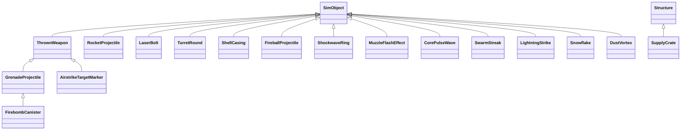
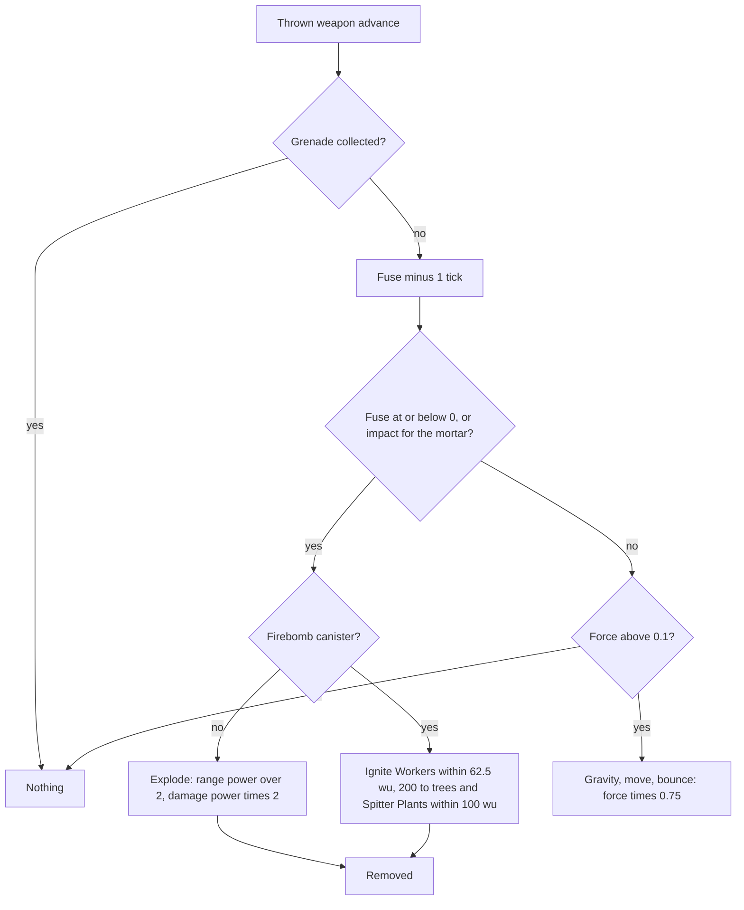
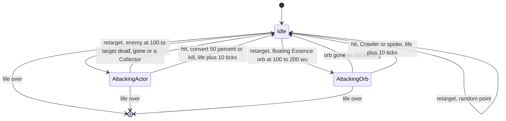
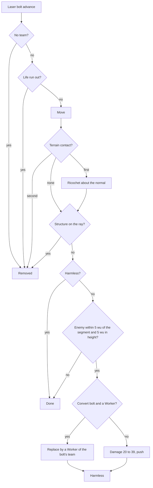
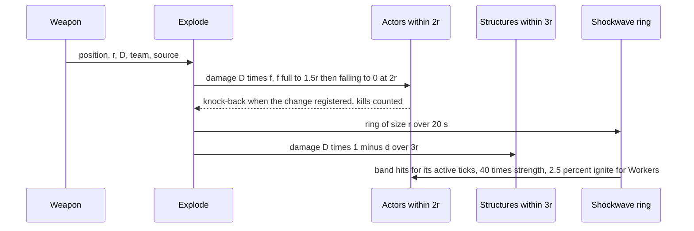

# Weapons and projectiles

> Status: Reference · Prefix: R-CRATE · Related: [folder README](README.md) · [crates and powers](crates_and_powers.md) · [02 Units](../02_units/README.md) · [worker.md](../02_units/worker.md) · [hazards and projectiles](../02_units/hazards_and_projectiles.md) · [defences and props](../03_buildings_and_world_objects/defences_and_props.md) · [mode objects](../03_buildings_and_world_objects/mode_objects.md) · [12 Space, routing and physics](../12_simulation_model/05_space_routing_and_physics.md) · [12 Containers and update order](../12_simulation_model/04_containers_and_update_order.md)

This file specifies every weapon, projectile and effect object of a match: the shot helpers that create them, the parameters of the shared explosion, and the behaviour of each object from its creation to its removal. The explosion primitive itself, `Explode()`, is specified in [reference/12](../12_simulation_model/05_space_routing_and_physics.md) R-SIM-388; this file gives its per-weapon parameters, its team rules and its presentation. The units that fire these weapons are in [reference/02](../02_units/README.md), the turrets in [defences and props](../03_buildings_and_world_objects/defences_and_props.md), and the outcomes that release them in [crates and powers](crates_and_powers.md).

## 1 Purpose and player experience

Weapons are where the crowd battle becomes visible. Workers trade team-coloured laser bolts at short range, two or three hits killing a Worker; soldiers lob grenades that bounce, roll and explode with a flash and an expanding shockwave ring; Rocket Troops fire accelerating rockets that fall short at long range. Turrets add piercing tracer rounds, short-lived rockets and fireballs that set Workers alight. Airstrike bombs, firebombs, the Missile Barrage and meteors bring the same explosion model at a larger scale, and every explosion hurts every team in reach, the attacker's own units included. Map weather adds lightning strikes that set Workers on fire, harmless snow and dust storms whose vortices hurl Workers into the air.

## 2 Rules

### 2.1 Conventions

**R-CRATE-400** (MUST) Every object of this file except the laser bolt is an **effect**: it lives in the match world's effect pool, takes a handle (its team or no team, the effect pool, its slot, a serial), advances once per tick in the weapons step of its update slice, and is removed when its advance requests removal ([reference/12](../12_simulation_model/04_containers_and_update_order.md) R-SIM-124, R-SIM-218). A laser bolt lives in the laser-bolt pool (R-SIM-125). The effect kinds are those of [reference/12](../12_simulation_model/03_entity_model_and_identity.md) table 2.3-B; Species defines its own enumerator values.

**R-CRATE-401** (MUST) An object created during a tick advances again in that tick exactly when its slot lies after the last slot already advanced in that tick; this is the reference default of DEC-455, and it decides the move counts of the rocket and of the airstrike target marker that this file gives as alternatives.

**R-CRATE-402** (MUST) Every health change that a weapon makes carries one of the damage kinds of [reference/02](../02_units/README.md) R-UNIT-025 (unresistable, laser, explosive, turret round or fire), and each actor kind resists it by table 2.8-A there. Every amount is an integer, truncated toward zero (DEC-241).

**R-CRATE-403** (MUST) A thrown weapon's vertical velocity falls by `ref.sim.physics.thrown_gravity` (98 wu/s² of game time, 9.8 wu/s per tick) each tick ([reference/12](../12_simulation_model/05_space_routing_and_physics.md) R-SIM-364), and a bounce reflects its velocity about the terrain normal with restitution `ref.sim.physics.restitution` (0.85) (R-SIM-385).

**R-CRATE-404** (MUST) Every particle, flash, ribbon, tracer, billboard and camera shake of this file is presentation and draws only from a presentation generator (DEC-007, DEC-013). The draws that the reference makes from the simulation stream for such effects, the thrown-weapon trail, the airstrike target marker's smoke, the rocket's smoke and the shell casings, are presentation draws (DEC-222, DEC-461).

### 2.2 Shot helpers

**R-CRATE-405** (MUST) The match world offers these shot helpers; each creates its object and also the shot's muzzle flash ([reference/12](../12_simulation_model/04_containers_and_update_order.md) R-SIM-228):

| Helper | Arguments (defaults) | Behaviour |
|---|---|---|
| throw a weapon | position, target, kind (grenade or airstrike target marker), team, force (none), fuse (none), explode on impact (false) | force = `ref.weapon.throw.force_factor` (8) × √|target − position|, capped at the maximum force of R-CRATE-412 for the team's grenade level; a force given by the caller replaces it, uncapped. The front is Normalize(target − position) with its y then set to `ref.weapon.throw.front_lift` (1) and normalised again, 45° up on level ground and steeper toward a higher target. The object takes the team's handle and raises its spawn event; a fuse given by the caller replaces a grenade's fuse. Muzzle flash `ref.weapon.muzzle_flash.throw_size` (20), life `ref.weapon.muzzle_flash.throw_life` (3) |
| fire a rocket | position, target, team, life (the rocket level's), source structure (none), spiral flag (false) | a rocket (R-CRATE-430) for the team; a life given by the caller replaces the level's; spawn event; muzzle flash as for a throw |
| fire a turret round | position, velocity, team, source structure | a turret round (R-CRATE-450) with the match lifetime; muzzle flash at position + velocity × dt ÷ 2, size `ref.weapon.muzzle_flash.round_size` (60), life `ref.weapon.muzzle_flash.round_life` (2), with no team |
| launch a fireball | position, velocity, life (`ref.bldg.turret.flame.fireball_life_ticks`), source structure (none) | a fireball (R-CRATE-460) with **no team**, so it harms every team |
| fire a laser | position, velocity, team, converting (false) | a laser bolt (R-CRATE-440) with the lifetime of the team's laser level, × `ref.unit.worker.convert_life_factor` (2) for a Convert bolt; its spawn event, bound to `sfx.weapon.laser_bolt.spawn` (DEC-564); muzzle flash of size `ref.weapon.muzzle_flash.laser_size_factor` (25) × the bolt's lifetime in seconds and life `ref.weapon.muzzle_flash.laser_life` (1.5) |
| create a shockwave ring | position, size, team (no team), source structure (none) | a shockwave ring (R-CRATE-470); a team value outside the team slots means no team |

### 2.3 Explosion parameters

**R-CRATE-406** (MUST) `Explode(position, range r, damage D, team, source structure)` ([reference/12](../12_simulation_model/05_space_routing_and_physics.md) R-SIM-388) applies, in this order:

1. **Presentation:** r × D × `ref.weapon.explosion.particle_factor` (0.01) explosion cores, plus a presentation-random share of that count, at position + (0, `ref.weapon.explosion.core_lift` (0.3) × r, 0); and clamp(r × D × 0.01, `ref.weapon.explosion.debris_min` (2), `ref.weapon.explosion.debris_max` (30)) debris particles in a ring.
2. **Actors:** every actor of every team, the exploding team's own included, at a horizontal distance below `ref.sim.explosion.actor_reach` × r (2r) is a candidate; with d its 3-D distance, its damage factor is f = clamp(`ref.sim.explosion.actor_gain` × (2r − d) ÷ r, 0, 1), so full damage up to d = 1.5r and a linear falloff to 0 at d = 2r (DEC-093). It takes a health change of −D × f of the explosive kind. Candidates are visited in actor-grid result order (R-SIM-389).
3. **Knock-back:** when the health change returned true and the actor is neither a Trooper nor a Leader, the actor is knocked back by R-SIM-374 with dir = actor position − explosion position: Normalize((dir.x, k, dir.z)) × f is added to its velocity, with k = D while it is on the ground and −1 while it is airborne, and it becomes airborne. The push is at most 1 wu/s; its effect is to make the actor airborne.
4. **Kill count:** the actors that died in this call and whose team differs from the exploding team are counted; with no team, every death counts. The number of Workers among them is added to the exploding team's kill counter when that team is a team slot ([reference/02](../02_units/README.md) R-UNIT-032). The count is returned to the caller, which credits a source turret ([defences and props](../03_buildings_and_world_objects/defences_and_props.md) R-BLDG-427).
5. **Shockwave ring:** a shockwave ring of size r ÷ `ref.weapon.shockwave.size_divisor` (20) s, with the explosion's team and source structure (R-CRATE-470).
6. **Structures:** every structure whose centre lies within a 3-D distance below `ref.sim.explosion.structure_reach` × r (3r) takes structure damage of −D × (1 − d ÷ 3r).

**R-CRATE-407** (MUST) The weapons of this folder and of the units explode with these parameters. The team column is the team passed to `Explode()`.

Table 2.3-A Explosions.

| Source | Range r (wu) | Damage D | Full damage within | Zero at | Kills a 50-health Worker within | Structures within | Shockwave ring | Team | Owner of the values |
|---|---|---|---|---|---|---|---|---|---|
| grenade, power 25 | power × `ref.weapon.grenade.range_factor` = 12.5 | power × `ref.weapon.grenade.damage_factor` = 50 | 18.75 | 25 | 18.75 (it needs the full 50) | 37.5 | 0.625 s, 6 active ticks, radius 39 to 59 wu | the thrower | this file |
| airstrike bomb, power 50 | 25 | 100 | 37.5 | 50 | 43.75 | 75 | 1.25 s, 12 active ticks, 39 to 83 wu | the Bomber's team | this file |
| rocket | `ref.weapon.rocket.range` = 15 | `ref.weapon.rocket.damage` = 25 | 22.5 | 30 | — (25 < 50) | 45 | 0.75 s, 7 active ticks, 39 to 63 wu | the firer; a source turret is credited | this file |
| meteor | 50 | 100 | 75 | 100 | 87.5 | 150 | 2.5 s, 24 active ticks, 39 to 131 wu | the Power's team | [hazards and projectiles](../02_units/hazards_and_projectiles.md) R-UNIT-734 |
| barrage missile | 50 | 100 | 75 | 100 | 87.5 | 150 | 2.5 s, 24 active ticks, 39 to 131 wu | no team; deaths credited by the missile | [hazards and projectiles](../02_units/hazards_and_projectiles.md) R-UNIT-726 |
| Sickness explosion | 5 | 25 | 7.5 | 10 | — | 15 | 0.25 s, 2 active ticks | no team | [worker.md](../02_units/worker.md) R-UNIT-130 |
| Transport death | 20 | 50 | 30 | 40 | 35 | 60 | 1.0 s | the Transport's team | [transport.md](../02_units/transport.md) R-UNIT-375 |

The radii are derived from R-CRATE-406 (DEC-093); the tuning of every explosive rests on this falloff curve.

### 2.4 Thrown weapon

**R-CRATE-410** (MUST) A **thrown weapon** (`ThrownWeapon`) is the base of the grenade, the airstrike bomb, the firebomb canister and the airstrike target marker. It is drawn as `mesh.projectile.thrown_weapon`. At creation its position is the start, its velocity front × force, its bounce force f = `ref.weapon.thrown.initial_force` (1.0), its birth time the match time and its up axis its front.

**R-CRATE-411** (MUST) Each tick, while f > `ref.weapon.thrown.rest_force` (0.1):

```
v.y -= ref.sim.physics.thrown_gravity * dt
p += v * dt
if p.y < TerrainHeight(p) + ref.weapon.thrown.bounce_clearance:          # 1 wu
    Bounce()                                                              # R-SIM-385, restitution 0.85
    f *= ref.weapon.thrown.bounce_force_factor                            # 0.75
    v *= f
    p.y = max(p.y, TerrainHeight(p) + ref.weapon.thrown.bounce_clearance)
    emit the bounce sound event
```

After bounce k its speed is 0.85 × 0.75^k of its incoming speed (0.64 after the first bounce, 0.48 after the second, 0.36 after the third); it comes to rest after its 9th bounce, because 0.75⁹ ≈ 0.075 < 0.1. A thrown weapon never removes itself; its kinds decide when it ends. At rest it stays where it lies.

**R-CRATE-412** (MUST) The maximum throw force by grenade level is `ref.weapon.throw.max_force`: 50, 80, 110, 140 and 170 at levels 0 to 4; in a match the grenade level is `ref.sim.init.power_level.grenade` (2), so the cap is 110. With F the force, the approximate maximum range on flat ground is F × `ref.unit.strike_team.bot_range_factor` (2.3125), about 254 wu for F = 110; bots use it ([strike_team.md](../02_units/strike_team.md), DEC-111).

**R-CRATE-413** (MUST) A Collector that captures a grenade sets its force to 0, which freezes it in place, and releases it with force 1 ([collector.md](../02_units/collector.md) R-UNIT-434).

**R-CRATE-414** (MUST) Presentation: every thrown weapon except the airstrike target marker leaves a trail, a particle of size `ref.weapon.thrown.trail_size` (60) at p − v × dt with velocity v ÷ 4 plus `FxRng::NextSigned`(`ref.weapon.thrown.trail_jitter` (5)) per axis, emitted on a tick with presentation probability 1 − `ref.weapon.thrown.trail_skip` (0.1) ÷ game speed, guarded for a game speed of 0 (DEC-653). The mesh tumbles. Once per second of its age the weapon emits its fuse-blink event and is drawn with an `fx.starburst` flash in its colour at alpha `ref.weapon.thrown.flash_alpha` (200), plus a white inner flash during the last `ref.weapon.thrown.inner_flash_fraction` (20 %) of each second, of size `ref.weapon.thrown.flash_size_factor` (1000) ÷ √(distance to the camera). A grenade and an airstrike target marker use the grenade sounds (`sfx.weapon.grenade.spawn`, `sfx.weapon.grenade.bounce`, `sfx.weapon.grenade.fuse_blink`, `sfx.weapon.grenade.explode`); an airstrike bomb and a firebomb canister use the airstrike-bomb sounds (`sfx.weapon.airstrike_bomb.explode` and the shared fuse blink) and raise no spawn event.

### 2.5 Grenade

**R-CRATE-415** (MUST) A **grenade** (`GrenadeProjectile`) has a fuse of `ref.weapon.grenade.fuse_ticks` (30 ticks, 3.0 s), a power of `ref.weapon.grenade.power` (25), the colour `ref.weapon.thrown.color` (255, 100, 100), an explode-on-impact flag (false) and a collected flag (false). Each tick:

1. when it is collected, it does nothing (a Collector carries it);
2. otherwise its fuse counts down by one tick, before the throw physics; when the fuse is at or below 0, or when it explodes on impact and its height is below the terrain height + `ref.weapon.grenade.impact_clearance` (2 wu), it emits its explode sound, explodes with `Explode(position, power × 0.5, power × 2, its team)` (range 12.5 wu and damage 50 at power 25) and is removed;
3. otherwise it runs the thrown-weapon step (R-CRATE-411).

**R-CRATE-416** (MUST) Grenades are thrown by Workers ([worker.md](../02_units/worker.md)) and by Troopers ([strike_team.md](../02_units/strike_team.md)), and by the mortar turret with explode on impact and a fuse that never runs out in practice ([defences and props](../03_buildings_and_world_objects/defences_and_props.md) R-BLDG-420). No reference map places a mortar turret.

**R-CRATE-417** (MUST) An **airstrike bomb** is a grenade of the airstrike-bomb kind with fuse `ref.weapon.airstrike_bomb.fuse_ticks` (15 ticks, 1.5 s) and power `ref.weapon.airstrike_bomb.power` (50), so it explodes with range 25 wu and damage 100. A Bomber creates it without the throw helper ([hazards and projectiles](../02_units/hazards_and_projectiles.md) R-UNIT-717).

**R-CRATE-418** (MUST) On flat ground a grenade thrown by the throw helper lands at about 0.6 of the target distance and rolls on to about 0.75 to 0.9 of it before its fuse ends; its practical maximum is about 170 wu. These values are derived by calculation (DEC-111):

| Target distance (wu) | Force | First impact (wu) | Position when the fuse ends (wu) |
|---|---|---|---|
| 25 | 40.0 | 14.1 | 19.0 |
| 50 | 56.6 | 28.0 | 37.5 |
| 75 | 69.3 | 44.1 | 63.4 |
| 100 | 80.0 | 62.2 | 88.1 |
| 125 | 89.4 | 75.9 | 110.8 |
| 150 | 98.0 | 90.1 | 128.3 |
| 189 or more (force capped at 110) | 110.0 | 116.7 | 171.6 |

Workers throw only at targets beyond their grenade minimum distance and flee every grenade and airstrike target marker of any team within `ref.unit.worker.projectile_threat_range` (60 wu) unless they have Fury ([worker.md](../02_units/worker.md) R-UNIT-098).

### 2.6 Firebomb canister

**R-CRATE-420** (MUST) A **firebomb canister** (`FirebombCanister`) is a grenade kind with the colour `ref.weapon.thrown.color`, fuse `ref.weapon.firebomb.fuse_ticks` (15 ticks, 1.5 s) and power `ref.weapon.firebomb.power` (50). Only a Bomber of a Firebomb Run creates it. It ignores the collected and explode-on-impact flags. Each tick its fuse counts down by one tick; when the fuse is at or below 0 it bursts, and otherwise it runs the thrown-weapon step.

**R-CRATE-421** (MUST) A burst emits the explode sound and makes **no explosion**. Instead:

1. every Worker of any team within power × `ref.weapon.firebomb.ignite_factor` (1.25), that is 62.5 wu horizontally, is set on fire by [worker.md](../02_units/worker.md) R-UNIT-121, which refuses a Worker with a Shield, inside a Transport or of the Rogue faction;
2. every tree and every Spitter Plant whose centre lies within power × `ref.weapon.firebomb.structure_reach_factor` (2), that is 100 wu, takes structure damage of −power × `ref.weapon.firebomb.structure_damage_factor` (4), that is −200, with no falloff, which sets trees alight;
3. it shows `ref.weapon.firebomb.burst_particles` (80) particles, split `vfx.emit.firebomb.split` (51 fireball flames, 20 fire, 9 missile trails), of size `vfx.emit.firebomb.size` (150 to 250), the `FirebombBurst` effect of [particles, shatter and screen effects](../../architecture/components/animation_and_vfx/particles_shatter_and_screen_effects.md) table 4.7-A (presentation);
4. it is removed.

### 2.7 Airstrike target marker

**R-CRATE-422** (MUST) An **airstrike target marker** (`AirstrikeTargetMarker`) is a thrown weapon of the colour `ref.weapon.thrown.color`, thrown by the airstrike Power ([crates and powers](crates_and_powers.md) R-CRATE-157). It carries the firebomb flag of its run and the handle of its airstrike flight, invalid until summoned. Each tick it runs the thrown-weapon step without a trail and emits one smoke particle of size `ref.weapon.marker.smoke_size` (100) with velocity v ÷ 4 plus presentation jitter, so that the run is visible (presentation).

**R-CRATE-423** (MUST) When its age is at least `ref.hazard.airstrike.marker_summon_delay` (20 ticks) and its force is at most `ref.hazard.airstrike.marker_rest_force` (0.1), a marker that has not yet summoned creates one airstrike flight of `ref.sim.init.power_level.airstrike` (2) Bombers of its team at its position, holding the marker's handle and the firebomb flag ([hazards and projectiles](../02_units/hazards_and_projectiles.md) R-UNIT-713). Once it has summoned, it removes itself when its flight no longer exists or is Leaving.

**R-CRATE-424** (MUST) Workers of every team flee an airstrike target marker within `ref.unit.worker.projectile_threat_range` (60 wu) unless they have Fury.

### 2.8 Rocket

**R-CRATE-430** (MUST) A **rocket** (`RocketProjectile`) starts at the given position + (0, `ref.weapon.rocket.start_lift` (2 wu), 0) with velocity Normalize(target − start) × `ref.weapon.rocket.launch_speed` (50 wu/s), records its creation time and is drawn as `mesh.projectile.thrown_weapon`. Each tick:

1. while |v| < `ref.weapon.rocket.accel_limit` (150 wu/s), v *= `ref.weapon.rocket.accel_factor` (1.2), before the move: 50, 60, 72, 86.4, 103.7, 124.4, 149.3, then 179.2 wu/s, constant from then on;
2. p += v × dt;
3. with the spiral flag (a rocket fired by a sick Worker), for x and for z: v += sign(Δ) × min(Δ², `ref.weapon.rocket.spiral_cap` (16)), with Δ that axis's displacement in this tick, so the rocket spirals outward;
4. it explodes when its age, in ticks since its creation tick, has reached its life (R-CRATE-431), when the terrain height at its position is at or above its height, or when a structure of its obstacle-grid cell meets a sphere of `ref.weapon.rocket.structure_hit_radius` (3 wu) at its position.

**R-CRATE-431** (MUST) A rocket's life by rocket level is `ref.weapon.rocket.life_ticks`: 3, 6, 8, 11 and 16 ticks at levels 0 to 4, the first tick on which its age exceeds 0.25, 0.5, 0.75, 1.0 and 1.5 s; in a match the rocket level is `ref.sim.init.power_level.rocket` (2), so 8 ticks. A life given by the caller replaces it: the rocket turret's `ref.bldg.turret.rocket.life_ticks` ([defences and props](../03_buildings_and_world_objects/defences_and_props.md) R-BLDG-420).

**R-CRATE-432** (MUST) A rocket explodes with `Explode(position, ref.weapon.rocket.range (15 wu), ref.weapon.rocket.damage (25), its team, its source structure)`; a source turret is credited with the returned kill count. A spiralling rocket adds explosion cores in a random colour (presentation). It emits `sfx.weapon.rocket.spawn` and the presence loop `sfx.weapon.rocket.presence_loop` from its creation, stops the loop when it explodes and emits `sfx.weapon.rocket.explode`.

**R-CRATE-433** (MUST) Presentation: a rocket emits a fire particle on a tick with presentation probability `ref.weapon.rocket.trail_chance` (0.8) and `ref.weapon.rocket.render_trail_particles` (5) missile-fire particles per step of the fixed presentation step rate `vfx.emit.step_rate`, which stands for one reference frame ([animation and VFX](../../architecture/components/animation_and_vfx/README.md) VFX-018; DEC-960).

**R-CRATE-434** (MUST) A rocket of life 8 makes 8 moves after its creation tick, plus one more when it also advances in its creation tick (R-CRATE-401): 8 moves cover 95.4 wu (60 + 72 + 86.4 + 103.7 + 124.4 + 149.3 + 179.2 + 179.2 = 954 wu/s × 0.1 s) and a 9th adds 17.9 wu, so a Worker's rocket reaches about 95 or 113 wu. A rocket of life 11 makes 11 or 12 moves, about 149 or 167 wu. Both cases occur in normal play. These reaches are derived (DEC-111, DEC-455).

### 2.9 Laser bolt

**R-CRATE-440** (MUST) A **laser bolt** (`LaserBolt`) moves on each of its first `ref.weapon.laser.life_ticks` advances and is removed on the next. Its life by laser level is 2, 4, 6, 8 and 10 ticks at levels 0 to 4 (0.2 to 1.0 s); in a match the laser level is `ref.sim.init.power_level.laser` (2), so 6 ticks, and 12 ticks for a Convert bolt (DEC-115). Its velocity is the shooter's:

| Shooter | Speed | Reach at laser level 2 | Owner of the speed |
|---|---|---|---|
| Worker, base attack | `ref.unit.attack.laser_speed` (150 wu/s) | about 90 wu | [reference/02](../02_units/README.md) R-UNIT-052 |
| Trooper | `ref.unit.trooper.laser_speed` (200 wu/s) | about 120 wu | [strike_team.md](../02_units/strike_team.md) |
| Worker with a convert tag | `ref.unit.worker.convert_speed` (75 wu/s), life × 2 | about 90 wu | [worker.md](../02_units/worker.md) |
| Convert Turret, and a gun-turret barrel whose occupant carries a convert tag | `ref.bldg.turret.convert.bolt_speed` (125 wu/s), life × 2 | about 150 wu | [defences and props](../03_buildings_and_world_objects/defences_and_props.md) R-BLDG-420 |

The base attack's aim jitter and muzzle height are reference/02's (R-UNIT-052).

**R-CRATE-441** (MUST) Each advance of a laser bolt:

1. a bolt of no team is removed;
2. a bolt whose life has run out is removed (R-CRATE-440);
3. it moves by v × dt;
4. **terrain:** on its first contact with the terrain it ricochets: a ray from its previous position finds the terrain hit, its velocity is reflected about the terrain normal there, and it continues the rest of its step from the hit point; on its second contact it is removed;
5. outside the map bounds it is removed;
6. **structures:** when its step's ray meets a structure of its obstacle-grid cell, it shows a spark, emits the structure-hit sound `sfx.weapon.laser_bolt.hit_structure` (DEC-564) and is removed; it deals **no structure damage**;
7. **actors**, while it is not harmless: the candidates are the enemies of its team within 2 × the length of half its step; an actor is hit when its height differs from the bolt's by less than `ref.weapon.laser.hit_height` (5 wu) and the 2-D distance from the actor to the segment position ± half the step is below `ref.weapon.laser.hit_radius` (5 wu).

**R-CRATE-442** (MUST) A hit by a **Convert bolt** on a Worker spawns a Worker of the bolt's team at the victim's position and velocity, with the victim's team recorded as its previous team and its colour cross-fading over `ref.unit.worker.convert_fade` (4 s, presentation); the victim is removed without an Essence orb. A Convert bolt that hits any other actor deals the ordinary laser damage of R-CRATE-443.

**R-CRATE-443** (MUST) Any other hit is a health change of −⌊`ref.weapon.laser.damage_base` (20) + `SimRng::NextUnit`(`ref.weapon.laser.damage_spread` (20))⌋ of the laser kind, 20 to 39. On a kill of a Worker, the bolt's team's kill counter rises by 1 and the kill sound `sfx.weapon.laser_bolt.kill` plays (DEC-564); a surviving Worker emits its hurt bark (`sfx.weapon.laser_bolt.hit_bark`). When the health change returned true, the victim is pushed: push = the bolt's direction × `SimRng::NextUnit`(`ref.weapon.laser.push_spread` (10)) with y = `ref.weapon.laser.push_lift_base` (7) + `SimRng::NextUnit`(`ref.weapon.laser.push_lift_spread` (5)); the push sets the victim's front, except for a Trooper or a Crawler, and is added to its velocity, except for a Crawler.

**R-CRATE-444** (MUST) After its first hit a bolt is **harmless**: it keeps flying and drawing but cannot hit again. Laser bolts never hit friends. A Worker of 50 health dies to 2 or 3 hits.

**R-CRATE-445** (MUST) Presentation: a bolt is drawn as a team-coloured billboard of `fx.beam_short`, `ref.weapon.laser.billboard_length` (10 wu) long, in `rnd.laser.rogue_color` (white) for the Rogue faction ([renderer](../../architecture/components/renderer/entity_and_overlay_renderers.md) RND-339); a Convert bolt uses `fx.convert_beam` at `ref.weapon.laser.convert_width_factor` (2) × the width. A bolt passing within √`ref.weapon.laser.shake_range_sq` (√200, about 14 wu) of the camera shakes it by `ref.weapon.laser.shake` (0.5).

### 2.10 Turret round

**R-CRATE-450** (MUST) A **turret round** (`TurretRound`) is fired by a gun turret ([defences and props](../03_buildings_and_world_objects/defences_and_props.md) R-BLDG-420) at `ref.bldg.turret.gun.round_speed` (500 wu/s). Its life is `ref.weapon.turret_round.life_ticks` (6 ticks, 0.6 s). It is drawn as `mesh.projectile.turret_round`.

**R-CRATE-451** (MUST) Each tick its life counts down by one tick and it moves by v × dt. Then:

1. **actors:** every enemy of its team within the step's length of the step's midpoint is tested with the actor ray hit of [reference/12](../12_simulation_model/05_space_routing_and_physics.md) R-SIM-387 along the step; **every** actor hit in this tick takes a health change of −`ref.weapon.turret_round.damage` (15) of the turret-round kind, so the round pierces;
2. **kill credit:** a kill plays the kill sound `sfx.weapon.laser_bolt.kill` (DEC-564) and counts 1, plus the passengers when the victim is a Transport, or 0 when the victim is a Worker that was already burning; the count is added to the round's team's kill counter, and a source turret is credited with it;
3. **knock-back:** an actor on the ground is pushed away from the round, plus `SimRng::NextSigned`(`ref.weapon.turret_round.push_jitter` (3)) per axis, to a push of length `ref.weapon.turret_round.push` (20), and becomes airborne;
4. **structures:** when the step's ray meets a structure, `vfx.emit.round_hit.structure_count` (3) particles show, the `RoundHitStructure` effect of [particles, shatter and screen effects](../../architecture/components/animation_and_vfx/particles_shatter_and_screen_effects.md) table 4.7-A; a tree, a Hive or a Spitter Plant takes structure damage of −`ref.weapon.turret_round.structure_damage` (2); the round shatters by `ref.weapon.turret_round.shatter_hit` (0.1) and is removed;
5. **terrain:** when the end point or the midpoint of the step is below the terrain, `vfx.emit.round_hit.terrain_count` (1) particle shows at the ray's terrain hit, the `RoundHitTerrain` effect of table 4.7-A, the round shatters by `ref.weapon.turret_round.shatter_end` (0.2) and is removed;
6. **expiry:** when its life is at or below 0 it shatters by 0.2 and is removed; outside the map it is removed.

**R-CRATE-452** (MUST) A turret round reaches about 250 to 300 wu, 5 or 6 moves of 50 wu, depending on its start half a tick behind the muzzle and on whether it advances in its creation tick (R-CRATE-401). This reach is derived (DEC-111). Turret rounds never hit friends; they are the only weapon that hurts a Bomber, and one round kills it.

**R-CRATE-453** (MUST) Presentation: the round is a lit mesh with a white tracer line of length v × `ref.weapon.turret_round.tracer_factor` (0.05) at alpha `ref.weapon.turret_round.tracer_alpha` (0.5), at double length and alpha 1 when the local player is aiming the firing turret.

### 2.11 Shell casing

**R-CRATE-455** (MUST) A **shell casing** (`ShellCasing`) is ejected by a gun turret on each shot from the barrel's casing socket ([defences and props](../03_buildings_and_world_objects/defences_and_props.md) R-BLDG-418). It is presentation: its draws come from the presentation generator and no simulation rule reads it (DEC-461). It is drawn as `mesh.projectile.shell_casing`.

**R-CRATE-456** (MUST) It starts `ref.weapon.shell_casing.socket_offset` (2.5 wu) along the socket's up axis, downward for barrels 0 and 1 and upward for barrels 2 and 3, with velocity Normalize(the socket's eject direction + (0, 1, 0) + `FxRng::NextSigned(0.5)` per axis) × (`ref.weapon.shell_casing.speed_min` (20) + `FxRng::NextUnit`(`ref.weapon.shell_casing.speed_spread` (20))) wu/s, its front the negated eject right axis and its force 1. While its force is above `ref.weapon.shell_casing.rest_force` (0.2) it falls by the thrown-weapon gravity, spins about front + (frac(serial × 0.1), frac(serial × 0.3), frac(serial × 0.7)) at dt × force per tick, and on each bounce multiplies its force by `ref.weapon.shell_casing.bounce_factor` (0.5) and its velocity by the force. It disappears once its force is at or below 0.2, after its third bounce.

### 2.12 Fireball

**R-CRATE-460** (MUST) A **fireball** (`FireballProjectile`) is launched by a flame turret with velocity barrel front × `ref.bldg.turret.flame.fireball_speed` (100 wu/s), life `ref.bldg.turret.flame.fireball_life_ticks` (11 ticks, nominal 1.0 s) and **no team**, and starts with radius `ref.weapon.fireball.start_radius` (3 wu). On its first tick it shows `vfx.emit.fireball.count` (80) fireball-flame particles, the `FireballLaunched` effect of [particles, shatter and screen effects](../../architecture/components/animation_and_vfx/particles_shatter_and_screen_effects.md) table 4.7-A (presentation).

**R-CRATE-461** (MUST) Each tick its life counts down by one tick, it moves by v × dt, and its radius becomes min(`ref.weapon.fireball.max_radius` (20 wu), `ref.weapon.fireball.growth_per_tick` × k) after k ticks, growing by 2 wu per tick from 2 to 20 wu. Then:

1. every **Worker** of any team within the radius that this fireball has not yet damaged takes fire damage of `ref.weapon.fireball.damage_factor` (30) × radius ÷ max(1, d), with d its distance, and is remembered, so a fireball damages each Worker once. Fire damage accumulates on the Worker and sets it on fire at `ref.unit.worker.fire_ignition` (100), except with a Shield ([worker.md](../02_units/worker.md) R-UNIT-119); a Worker that this damage sets on fire is credited to the source turret;
2. every tree of its obstacle-grid cell takes structure damage of −`ref.weapon.fireball.tree_damage` (100) per tick;
3. other actors are ignored;
4. it is removed when its life is at or below 0 or when it touches the ground.

**R-CRATE-462** (MUST) Fireballs hurt every team. The flame turret's only protection of its own side is its friendly-fire guard, which blocks firing when more than 10 friends stand within 20 wu of the muzzle point ([defences and props](../03_buildings_and_world_objects/defences_and_props.md)).

### 2.13 Shockwave ring

**R-CRATE-470** (MUST) A **shockwave ring** (`ShockwaveRing`) of size s seconds is created by every explosion, with s = r ÷ `ref.weapon.shockwave.size_divisor` (20). It is active on ticks k = 1 to A after its creation, with A = ⌈s ÷ `ref.sim.tick_period`⌉ − 1 (6 for a grenade, 12 for an airstrike bomb, 7 for a rocket, 24 for a meteor or a barrage missile; see DEC-859), and is removed on tick A + 1. On active tick k its radius is r_k = `ref.weapon.shockwave.start_radius` (35 wu) + `ref.weapon.shockwave.growth` (40 wu/s) × k × dt, so 39 wu on the first tick and 4 wu more on each, and its strength is f_k = 1 − k × dt ÷ s.

**R-CRATE-471** (MUST) On each active tick, the candidates are the actors of every team at a horizontal distance below r_k (actor-grid query); a candidate is hit when its 3-D distance d satisfies |d − r_k| < `ref.weapon.shockwave.band` (10 wu), effectively a band 10 wu wide just inside the ring for ground units. For a hit:

1. a **Worker** draws `SimRng::NextUnit`(`ref.weapon.shockwave.ignite_draw_range` (4)); below `ref.weapon.shockwave.ignite_threshold` (0.1), that is with probability 2.5 % per hit tick, it is set on fire instead of damaged ([worker.md](../02_units/worker.md) R-UNIT-121);
2. otherwise, and for every other actor, it takes a health change of −`ref.weapon.shockwave.damage` (40) × f_k of the explosive kind;
3. a victim that died and whose team differs from the ring's team adds to the ring's team's kill counter when it is a Worker and the ring has a team slot, and a source turret is credited;
4. when the health change returned true and the victim is on the ground and is neither a Trooper nor a Leader, it is pushed by Normalize(victim − centre) with y = `ref.weapon.shockwave.push_lift` (3), to a push of length `ref.weapon.shockwave.push` (25) × f_k, and becomes airborne; a Worker set on fire instead of damaged is not pushed.

**R-CRATE-472** (MUST) A stationary target on the ground in the interior of a ring's reach lies in the band on 2 or 3 consecutive active ticks, taking 40 × f_k each time; a target at a horizontal distance from 29 to 33 wu, or within 4 wu below the last radius, is hit once; a target within 29 wu is never hit by the ring. The ring reaches 59 wu for a grenade, about 83 wu for an airstrike bomb, about 63 wu for a rocket and 131 wu for a meteor or a barrage missile. These values are derived (DEC-111).

**R-CRATE-473** (MUST) Presentation: a ring is drawn as a disc fading from yellow to pink, `ref.weapon.shockwave.disc_lift` (5 wu) above its centre, at alpha `ref.weapon.shockwave.disc_alpha` (0.6) × its remaining strength; during its first `ref.weapon.shockwave.flash_time` (0.1 s) a full-screen white flash shows when the centre is on screen, at alpha (1 − age ÷ 0.1) × max(0, 1 − distance ÷ `ref.weapon.shockwave.flash_range` (500 wu)), with a camera shake; `fx.starburst` and `fx.glow_round` billboards show for its first `ref.weapon.shockwave.billboard_time` (1 s).

### 2.14 Muzzle flash

**R-CRATE-475** (MUST) A **muzzle flash** (`MuzzleFlashEffect`) is an effect that no simulation rule reads. It has a size and a life, by default `ref.weapon.muzzle_flash.default_size` (1) and `ref.weapon.muzzle_flash.default_life` (1), set by the shot helpers of R-CRATE-405. Each tick it is removed when its life is at or below 0; otherwise it moves along its front at `ref.weapon.muzzle_flash.speed` (10 wu/s) and its life falls by `ref.weapon.muzzle_flash.decay` (10) × dt, so a life of 3 lasts 0.3 s. It is drawn as `ref.weapon.muzzle_flash.quads` (5) nested quads of `fx.muzzle_flash`, each `ref.weapon.muzzle_flash.shrink` (0.8) × the previous, at alpha clamp(life × `ref.weapon.muzzle_flash.alpha_factor` (0.75), 0, 1), with the depth test off while the size is below `ref.weapon.muzzle_flash.depth_test_size` (50).

### 2.15 Core Device pulse wave

**R-CRATE-480** (MUST) A **Core Device pulse wave** (`CorePulseWave`) is created when a Core Device's countdown reaches 0 in Siege ([mode objects](../03_buildings_and_world_objects/mode_objects.md) R-BLDG-313), at the Core Device's position, with radius `ref.bldg.core_device.pulse_radius_wu` (200 wu) and the Core Device's team. At most one exists at a time; the Workers, the Beam Dishes and the Siege victory rules read it.

**R-CRATE-481** (MUST) Each tick its radius grows by `ref.weapon.pulse_wave.growth_per_tick` (0.03) × its radius, 3 % per tick, and it is removed once its radius reaches the map's world size x: from 200 wu to 3,000 wu in about 92 ticks.

**R-CRATE-482** (MUST) In Siege, every Worker that is not a friend of the pulse wave's team and lies within its radius is affected in the Worker's own advance: when the map option `MapOption::VisitorFactionPosition` names the start position of the pulse wave's team ([reference/08](../08_maps_and_level_design/rules_and_conventions.md) table 2.7-A, row 13), the Worker is converted into a Worker of the pulse wave's team; otherwise it is pushed outward at `ref.weapon.pulse_wave.push_speed` (20 wu/s) and takes an unresistable health change of −`ref.weapon.pulse_wave.kill_damage` (1000), which a Shield does not stop.

**R-CRATE-483** (MUST) Presentation: a full-screen white flash for its first `ref.weapon.pulse_wave.flash_time` (0.3 s) with a camera shake, and three team-coloured animated cylinders at its radius: a ground outline `ref.weapon.pulse_wave.outline_height` (200 wu) high, a glow tube of `fx.beam_long` `ref.weapon.pulse_wave.tube_height` (400 wu) high and a faint sky tube `ref.weapon.pulse_wave.sky_height` (1000 wu) high, each at alpha × (1 − radius ÷ world size x).

### 2.16 Swarm streak

**R-CRATE-485** (MUST) A **Swarm streak** (`SwarmStreak`) is created by the Swarm outcome ([crates and powers](crates_and_powers.md) R-CRATE-183) and belongs to the Rogue faction. Its states are Idle, AttackingActor and AttackingOrb (figure 3-3). Its life is `ref.weapon.swarm_streak.life_ticks` (101 ticks, nominal 10 s), counted down after its state step, and grows by `ref.weapon.swarm_streak.hit_bonus_ticks` (10 ticks) with each successful hit or conversion; it is removed when its life runs out.

**R-CRATE-486** (MUST) Its retarget timer starts at ⌈`SimRng::NextUnit`(`ref.weapon.swarm_streak.first_retarget_spread` (10))⌉ ticks and then restarts at `ref.weapon.swarm_streak.retarget_ticks` (11 ticks, nominal 1.0 s). In a match the first expiry makes no search. On each later expiry in Idle, it draws `SimRng::NextUnit(2)`: below 1 it searches actors first and Essence orbs second, otherwise orbs first and actors second; with neither found it picks a random point, its position + (`SimRng::NextSigned`(`ref.weapon.swarm_streak.random_step` (200)), `SimRng::NextSigned`(200), `SimRng::NextSigned`(200)), not below the ground.

**R-CRATE-487** (MUST) The **actor search** takes the nearest live enemy of the Rogue faction, other than a bot controller, at a horizontal distance from `ref.weapon.swarm_streak.min_search_range` (100 wu) to below `ref.weapon.swarm_streak.max_search_range` (200 wu), and enters AttackingActor. The **orb search** takes the nearest Floating Essence orb at a distance from 100 to 200 wu that is more than `ref.weapon.swarm_streak.orb_min_height` (10 wu) above the ground, and enters AttackingOrb.

**R-CRATE-488** (MUST) Each tick it steers: v = v × (1 − dt ÷ 2) + Normalize(target − p) × `ref.weapon.swarm_streak.homing_speed` (200) × dt ÷ 2, and p += v × dt. It arrives within `ref.weapon.swarm_streak.arrival` (20 wu) of its target.

**R-CRATE-489** (MUST) In AttackingActor, a target that is dead, gone or a Collector is dropped and the streak returns to Idle. On arrival at a target of another team: when `SimRng::NextUnit(10)` < `ref.weapon.swarm_streak.convert_threshold` (5), with probability 50 %, a Worker of the Rogue faction is spawned at the target and the target is removed without an Essence orb, whatever its actor kind; otherwise the target takes an unresistable health change of −`ref.weapon.swarm_streak.kill_damage` (999). The hit shows `vfx.emit.swarm_hit.count` (5 to 9) fire particles, the `SwarmHit` effect of [particles, shatter and screen effects](../../architecture/components/animation_and_vfx/particles_shatter_and_screen_effects.md) table 4.7-A (presentation), adds the hit bonus to its life and returns it to Idle.

**R-CRATE-490** (MUST) In AttackingOrb, an orb that is gone or no longer Floating is dropped. On arrival the orb is removed and one Rogue faction creature is spawned with roam range `ref.weapon.swarm_streak.creature_roam_range` (200 wu): a spider when `SimRng::NextUnit(20)` < `ref.weapon.swarm_streak.spider_threshold` (1), with probability 5 %, and otherwise a Crawler, which is not spawned when the Rogue faction already has `ref.unit.crawler.team_limit` (250) Crawlers or more ([creatures](../02_units/creatures.md) R-UNIT-529, R-UNIT-570). The hit adds the hit bonus and returns it to Idle.

**R-CRATE-491** (MUST) Workers of other teams flee a Swarm streak within `ref.unit.worker.projectile_threat_range` (60 wu) unless they have Fury. Presentation: a streak keeps `ref.weapon.swarm_streak.tail_samples` (30) past positions and is drawn as `ref.weapon.swarm_streak.ribbon_passes` (4) passes of a camera-facing ribbon of `fx.beam_short` through them, black and alpha-blended at alpha `ref.weapon.swarm_streak.ribbon_alpha` (0.5) × its fade, of length 30 × remaining life ÷ 10 s.

### 2.17 Lightning strike

**R-CRATE-495** (MUST) A **lightning strike** (`LightningStrike`) is created by the lightning spawner of a map with the lightning effect ([reference/12](../12_simulation_model/04_containers_and_update_order.md) R-SIM-236) with no team; it is not a Supply crate outcome. Each tick it rolls `SimRng::NextUnit(1)` < `ref.weapon.lightning.strike_chance` (0.01), 1 % per tick, which scales with game speed (DEC-092); it may strike again and again. Before its first strike it has no life limit; each strike sets its life to `ref.weapon.lightning.strike_life_ticks` (13 ticks, nominal 1.2 s), and it is removed when that life has counted down to 0.

**R-CRATE-496** (MUST) Each strike sets on fire every Worker of any team within `ref.weapon.lightning.ignite_radius` (30 wu) horizontally of the cloud, by [worker.md](../02_units/worker.md) R-UNIT-121 (a Worker with a Shield or of the Rogue faction is refused), and deals structure damage of −`ref.weapon.lightning.tree_damage` (100) to every tree of the obstacle-grid cell under it.

**R-CRATE-497** (MUST) Presentation: idle, the cloud is a pulsing `fx.glow_round` of `ref.weapon.lightning.glow_size` (200 wu) at alpha |sin(`rnd.lightning.cloud_pulse_rate` × t)| (2 rad/s); striking, it draws `rnd.lightning.bolt_layers` (3) stacked bolt quads of `fx.lightning_strip` from the cloud to the ground, the first `ref.weapon.lightning.bolt_width` (30 wu) wide and each further one `rnd.lightning.bolt_width_growth` (1.2) × wider, each with the previous alpha × `rnd.lightning.bolt_alpha_falloff` (0.5) ([renderer](../../architecture/components/renderer/entity_and_overlay_renderers.md) RND-336, RND-337); and it shows at the ground `vfx.emit.lightning.debris_count` (5) debris particles of size `vfx.emit.lightning.debris_size` (150 to 250) and `vfx.emit.lightning.fire_count` (10) fire particles of size `vfx.emit.lightning.fire_size` (160 to 280), the `LightningStrike` effect of [particles, shatter and screen effects](../../architecture/components/animation_and_vfx/particles_shatter_and_screen_effects.md) table 4.7-A. A lightning strike has no sound.

### 2.18 Snowflake

**R-CRATE-500** (MUST) A **snowflake** (`Snowflake`) is created by the snow spawner of a map with the snow effect, or of any map while the seasonal theme is active ([reference/12](../12_simulation_model/04_containers_and_update_order.md) R-SIM-234), with no team, and has **no gameplay effect**; its draws are presentation draws (DEC-118, R-SIM-238). Its spawn step draws its position offset `FxRng::NextUnit`(`ref.weapon.snow.offset_range` (10)) and two axis rates `FxRng::NextUnit`(`ref.weapon.snow.rate_max` (2)).

**R-CRATE-501** (MUST) Each tick its velocity is multiplied by `ref.weapon.snow.damping` (0.9); its offset grows by dt; each axis rate takes a random walk of `FxRng::NextSigned`(`ref.weapon.snow.rate_walk` (1)), clamped to [0, 2]; it hovers horizontally by sin(offset) × rate on each axis and falls at (`ref.weapon.snow.fall_base` (20) + `FxRng::NextUnit`(`ref.weapon.snow.fall_spread` (20))) × clamp(height above ground ÷ `ref.weapon.snow.fall_height_scale` (100), 0.2, 1) wu/s; its position is clamped to the map. It is removed when it is `ref.weapon.snow.remove_depth` (10 wu) or more below the terrain. It is drawn as a white `fx.starburst` sprite of `ref.weapon.snow.sprite_size` (20 wu).

### 2.19 Dust object and dust vortex

**R-CRATE-505** (MUST) A **dust object** (`DustVortex`) is created by the dust-storm spawner of a map with the dust effect ([reference/12](../12_simulation_model/04_containers_and_update_order.md) R-SIM-235) with no team; the spawner also holds the wind direction and the vortex, and both are reset at match start (DEC-011). A dust object moves at `ref.weapon.dust.speed` (500 wu/s): without a vortex it steers toward its position + wind × `ref.weapon.dust.wind_lookahead` (2000 wu) with a turn blend of `ref.weapon.dust.turn_blend` (3) × dt, starting with velocity wind × 500; with a vortex it heads for vortex + (cos τ, 0, sin τ) × 300 × its height ÷ 1000 at its own height (`ref.weapon.dust.vortex_orbit_factor` (300) per 1000 wu), with τ = match time + serial × `ref.weapon.dust.phase_step` (20). It is removed when it leaves the map. It is drawn as `fx.glow_cloudy` in `ref.weapon.dust.color` (0.6, 0.46, 0.12, 0.2) at its size.

**R-CRATE-506** (MUST) While a vortex exists, every Worker of any team on the ground within `ref.sim.weather.vortex_radius` (50 wu) of the vortex's ground point is caught and spirals up until the vortex clears, then falls ([worker.md](../02_units/worker.md) R-UNIT-083, CaughtInVortex). The vortex's land search is bounded (DEC-014).

### 2.20 Turret aim marker

**R-CRATE-510** (MUST) Every turret owns a turret aim marker that follows its aim point ([defences and props](../03_buildings_and_world_objects/defences_and_props.md) R-BLDG-431). In a match no rule reads it: Workers have no threat reaction to it.

### 2.21 Weapon summary

**R-CRATE-511** (MUST) The weapons of a match have the values of table 2.21-A, which follows from the rules above; each value's key is given in the rule cited.

Table 2.21-A Weapon summary.

| Weapon | Damage | Reach and falloff | Speed | Life | Damage kind | Friendly fire | Rule |
|---|---|---|---|---|---|---|---|
| laser bolt (Worker, Trooper) | 20–39, one target | hit radius 5 wu (2-D), height within ±5 wu | 150 / 200 wu/s | 6 ticks | laser | no | R-CRATE-440 to R-CRATE-444 |
| Convert laser bolt | converts one Worker | as the laser bolt | 75 / 125 wu/s | 12 ticks | none | no | R-CRATE-442 |
| grenade | 50 | full within 18.75 wu, 0 at 25 wu; ring 39 to 59 wu | throw force up to 110 | 30-tick fuse | explosive | **yes** | R-CRATE-415 |
| airstrike bomb | 100 | full within 37.5 wu, 0 at 50 wu; ring 39 to 83 wu | the Bomber's | 15-tick fuse | explosive | yes | R-CRATE-417 |
| firebomb canister | sets on fire | Workers within 62.5 wu; trees and Spitter Plants within 100 wu take 200 | the Bomber's | 15-tick fuse | fire | yes | R-CRATE-421 |
| rocket | 25 | full within 22.5 wu, 0 at 30 wu | 50 rising to 179.2 wu/s | 8 ticks (rocket turret: its own) | explosive | yes | R-CRATE-430 to R-CRATE-434 |
| turret round | 15 per actor, piercing | ray | 500 wu/s | 6 ticks | turret round | no | R-CRATE-450 to R-CRATE-452 |
| fireball | 30 × radius ÷ max(1, d), once per Worker | radius grows from 2 to 20 wu | 100 wu/s | 11 ticks | fire | yes (no team) | R-CRATE-460 to R-CRATE-462 |
| shockwave ring | 40 × strength per hit tick | band about 10 wu inside a ring growing 4 wu per tick from 39 wu | — | r ÷ 20 s | explosive | yes | R-CRATE-470 to R-CRATE-472 |
| meteor, barrage missile | 100 | full within 75 wu, 0 at 100 wu | 350 / 50 to 100 wu/s | — | explosive | yes | table 2.3-A |
| Swarm streak | −999 or conversion | contact within 20 wu | homing at 200 wu/s | 101 ticks + 10 per hit | unresistable | only the Rogue faction is spared | R-CRATE-485 to R-CRATE-491 |
| lightning strike | sets on fire | Workers within 30 wu | — | 13 ticks per strike | fire | yes | R-CRATE-495, R-CRATE-496 |
| Core Device pulse wave | −1000 or conversion | the growing radius | +3 % per tick | until it reaches the map width | unresistable | enemies only | R-CRATE-480 to R-CRATE-482 |

## 3 States and flows



Caption: Figure 3-1, the weapon and effect types of this folder (R-CRATE-400). The airstrike bomb is a `GrenadeProjectile` of the airstrike-bomb kind.



Caption: Figure 3-2, a grenade-kind thrown weapon's tick (R-CRATE-411, R-CRATE-415, R-CRATE-420).



Caption: Figure 3-3, Swarm streak states (R-CRATE-485 to R-CRATE-490).



Caption: Figure 3-4, a laser bolt's advance (R-CRATE-440 to R-CRATE-444).



Caption: Figure 3-5, an explosion and its shockwave ring (R-CRATE-406, R-CRATE-470, R-CRATE-471).

## 4 Tuning table

### 4.1 Shot helpers, explosion and thrown weapons

| key | value | unit | range or notes | requirement | DEC |
|---|---|---|---|---|---|
| `ref.weapon.throw.force_factor` | 8 | force per √wu | force = 8 × √distance | R-CRATE-405 | — |
| `ref.weapon.throw.front_lift` | 1 | — | y of the throw front before normalising | R-CRATE-405 | — |
| `ref.weapon.throw.max_force` | 50, 80, 110, 140, 170 | force | by grenade level 0 to 4; 110 in a match | R-CRATE-405, R-CRATE-412 | DEC-115 |
| `ref.weapon.explosion.particle_factor` | 0.01 | cores per r × D | presentation | R-CRATE-406 | DEC-013 |
| `ref.weapon.explosion.core_lift` | 0.3 | × r | presentation | R-CRATE-406 | — |
| `ref.weapon.explosion.debris_min` | 2 | particles | presentation | R-CRATE-406 | — |
| `ref.weapon.explosion.debris_max` | 30 | particles | presentation | R-CRATE-406 | — |
| `ref.weapon.thrown.initial_force` | 1.0 | bounce force | | R-CRATE-410 | — |
| `ref.weapon.thrown.rest_force` | 0.1 | bounce force | at rest at or below | R-CRATE-411 | — |
| `ref.weapon.thrown.bounce_clearance` | 1 | wu | above the terrain | R-CRATE-411 | — |
| `ref.weapon.thrown.bounce_force_factor` | 0.75 | × force per bounce | | R-CRATE-411 | — |
| `ref.weapon.thrown.color` | 255, 100, 100 | RGB | grenade, firebomb canister, marker | R-CRATE-415, R-CRATE-420, R-CRATE-422 | — |
| `ref.weapon.thrown.trail_size` | 60 | particle size | presentation | R-CRATE-414 | DEC-013 |
| `ref.weapon.thrown.trail_jitter` | 5 | wu/s | presentation | R-CRATE-414 | DEC-013 |
| `ref.weapon.thrown.trail_skip` | 0.1 | ÷ game speed | presentation | R-CRATE-414 | DEC-653 |
| `ref.weapon.thrown.flash_alpha` | 200 | alpha (0–255) | presentation | R-CRATE-414 | — |
| `ref.weapon.thrown.inner_flash_fraction` | 0.2 | of each second | presentation | R-CRATE-414 | — |
| `ref.weapon.thrown.flash_size_factor` | 1000 | ÷ √camera distance | presentation | R-CRATE-414 | — |
| `ref.weapon.grenade.fuse_ticks` | 30 | ticks | 3.0 s | R-CRATE-415 | DEC-002 |
| `ref.weapon.grenade.power` | 25 | power | | R-CRATE-415, R-CRATE-407 | — |
| `ref.weapon.grenade.range_factor` | 0.5 | × power | range 12.5 wu | R-CRATE-407, R-CRATE-415 | DEC-093 |
| `ref.weapon.grenade.damage_factor` | 2 | × power | damage 50 | R-CRATE-407, R-CRATE-415 | — |
| `ref.weapon.grenade.impact_clearance` | 2 | wu | explode-on-impact test | R-CRATE-415 | — |
| `ref.weapon.airstrike_bomb.fuse_ticks` | 15 | ticks | 1.5 s | R-CRATE-417 | DEC-002 |
| `ref.weapon.airstrike_bomb.power` | 50 | power | range 25 wu, damage 100 | R-CRATE-417, R-CRATE-407 | — |
| `ref.weapon.firebomb.fuse_ticks` | 15 | ticks | 1.5 s | R-CRATE-420 | DEC-002 |
| `ref.weapon.firebomb.power` | 50 | power | | R-CRATE-420, R-CRATE-421 | — |
| `ref.weapon.firebomb.ignite_factor` | 1.25 | × power | 62.5 wu, horizontal | R-CRATE-421 | — |
| `ref.weapon.firebomb.structure_reach_factor` | 2 | × power | 100 wu | R-CRATE-421 | — |
| `ref.weapon.firebomb.structure_damage_factor` | 4 | × power | 200, no falloff | R-CRATE-421 | — |
| `ref.weapon.firebomb.burst_particles` | 80 | particles | 51 fireball, 20 fire, 9 trail; presentation | R-CRATE-421 | — |
| `ref.weapon.marker.smoke_size` | 100 | particle size | presentation | R-CRATE-422 | DEC-013 |

### 4.2 Rockets, laser bolts, turret rounds, casings and fireballs

| key | value | unit | range or notes | requirement | DEC |
|---|---|---|---|---|---|
| `ref.weapon.rocket.start_lift` | 2 | wu | | R-CRATE-430 | — |
| `ref.weapon.rocket.launch_speed` | 50 | wu/s | | R-CRATE-430 | — |
| `ref.weapon.rocket.accel_factor` | 1.2 | × per tick | | R-CRATE-430 | DEC-092 |
| `ref.weapon.rocket.accel_limit` | 150 | wu/s | accelerates while below | R-CRATE-430 | — |
| `ref.weapon.rocket.spiral_cap` | 16 | wu/s per tick | spiral flag | R-CRATE-430 | — |
| `ref.weapon.rocket.structure_hit_radius` | 3 | wu | | R-CRATE-430 | — |
| `ref.weapon.rocket.life_ticks` | 3, 6, 8, 11, 16 | ticks | by rocket level 0 to 4; 8 in a match | R-CRATE-430, R-CRATE-431 | DEC-002, DEC-115 |
| `ref.weapon.rocket.range` | 15 | wu | explosion range | R-CRATE-432, R-CRATE-407 | DEC-093 |
| `ref.weapon.rocket.damage` | 25 | damage | | R-CRATE-432, R-CRATE-407 | — |
| `ref.weapon.rocket.trail_chance` | 0.8 | per tick | presentation | R-CRATE-433 | DEC-013 |
| `ref.weapon.rocket.render_trail_particles` | 5 | per presentation step | presentation; one step of `vfx.emit.step_rate` stands for one reference frame | R-CRATE-433 | DEC-960 |
| `ref.weapon.laser.life_ticks` | 2, 4, 6, 8, 10 | ticks (moves) | by laser level 0 to 4; 6 in a match, × 2 for Convert bolts | R-CRATE-440 | DEC-002, DEC-115 |
| `ref.weapon.laser.hit_height` | 5 | wu | strict | R-CRATE-441 | — |
| `ref.weapon.laser.hit_radius` | 5 | wu | 2-D, strict | R-CRATE-441 | — |
| `ref.weapon.laser.damage_base` | 20 | health | | R-CRATE-443 | — |
| `ref.weapon.laser.damage_spread` | 20 | health | 20 to 39 | R-CRATE-443 | — |
| `ref.weapon.laser.push_spread` | 10 | wu/s | along the bolt | R-CRATE-443 | — |
| `ref.weapon.laser.push_lift_base` | 7 | wu/s | | R-CRATE-443 | — |
| `ref.weapon.laser.push_lift_spread` | 5 | wu/s | 7 to 12 | R-CRATE-443 | — |
| `ref.weapon.laser.billboard_length` | 10 | wu | presentation | R-CRATE-445 | — |
| `ref.weapon.laser.convert_width_factor` | 2 | × width | presentation | R-CRATE-445 | — |
| `ref.weapon.laser.shake_range_sq` | 200 | wu² | presentation | R-CRATE-445 | — |
| `ref.weapon.laser.shake` | 0.5 | shake | presentation | R-CRATE-445 | — |
| `ref.weapon.turret_round.life_ticks` | 6 | ticks | 0.6 s | R-CRATE-450, R-CRATE-451 | DEC-002 |
| `ref.weapon.turret_round.damage` | 15 | health | every actor hit, piercing | R-CRATE-451 | — |
| `ref.weapon.turret_round.push` | 20 | wu/s | push length | R-CRATE-451 | — |
| `ref.weapon.turret_round.push_jitter` | 3 | wu/s | NextSigned(3) per axis | R-CRATE-451 | — |
| `ref.weapon.turret_round.structure_damage` | 2 | structure health | trees, Hives, Spitter Plants | R-CRATE-451 | — |
| `ref.weapon.turret_round.shatter_hit` | 0.1 | shatter fraction | presentation | R-CRATE-451 | — |
| `ref.weapon.turret_round.shatter_end` | 0.2 | shatter fraction | presentation | R-CRATE-451 | — |
| `ref.weapon.turret_round.tracer_factor` | 0.05 | s × velocity | presentation | R-CRATE-453 | — |
| `ref.weapon.turret_round.tracer_alpha` | 0.5 | alpha | presentation | R-CRATE-453 | — |
| `ref.weapon.shell_casing.socket_offset` | 2.5 | wu | presentation | R-CRATE-456 | DEC-461 |
| `ref.weapon.shell_casing.speed_min` | 20 | wu/s | presentation | R-CRATE-456 | DEC-461 |
| `ref.weapon.shell_casing.speed_spread` | 20 | wu/s | 20 to 40; presentation | R-CRATE-456 | DEC-461 |
| `ref.weapon.shell_casing.rest_force` | 0.2 | force | presentation | R-CRATE-456 | — |
| `ref.weapon.shell_casing.bounce_factor` | 0.5 | × force | presentation | R-CRATE-456 | — |
| `ref.weapon.fireball.start_radius` | 3 | wu | | R-CRATE-460 | — |
| `ref.weapon.fireball.max_radius` | 20 | wu | | R-CRATE-461 | — |
| `ref.weapon.fireball.growth_per_tick` | 2 | wu per tick | the radius reaches 20 wu after 10 ticks | R-CRATE-461 | — |
| `ref.weapon.fireball.damage_factor` | 30 | fire damage | × radius ÷ max(1, d) | R-CRATE-461 | — |
| `ref.weapon.fireball.tree_damage` | 100 | structure health per tick | | R-CRATE-461 | DEC-092 |

### 4.3 Shockwave rings, muzzle flashes, pulse wave and Swarm streaks

| key | value | unit | range or notes | requirement | DEC |
|---|---|---|---|---|---|
| `ref.weapon.shockwave.size_divisor` | 20 | wu per s | size = r ÷ 20 s | R-CRATE-406, R-CRATE-470 | — |
| `ref.weapon.shockwave.start_radius` | 35 | wu | 39 wu on the first active tick | R-CRATE-470 | — |
| `ref.weapon.shockwave.growth` | 40 | wu/s | 4 wu per tick | R-CRATE-470 | — |
| `ref.weapon.shockwave.band` | 10 | wu | strict | R-CRATE-471 | — |
| `ref.weapon.shockwave.damage` | 40 | health × strength | explosive | R-CRATE-471 | — |
| `ref.weapon.shockwave.ignite_draw_range` | 4 | — | NextUnit(4) | R-CRATE-471 | — |
| `ref.weapon.shockwave.ignite_threshold` | 0.1 | — | 2.5 % per hit tick | R-CRATE-471 | DEC-092 |
| `ref.weapon.shockwave.push` | 25 | wu/s × strength | | R-CRATE-471 | — |
| `ref.weapon.shockwave.push_lift` | 3 | — | y before normalising | R-CRATE-471 | — |
| `ref.weapon.shockwave.disc_lift` | 5 | wu | presentation | R-CRATE-473 | — |
| `ref.weapon.shockwave.disc_alpha` | 0.6 | alpha | presentation | R-CRATE-473 | — |
| `ref.weapon.shockwave.flash_time` | 0.1 | s of presentation time | | R-CRATE-473 | — |
| `ref.weapon.shockwave.flash_range` | 500 | wu | | R-CRATE-473 | — |
| `ref.weapon.shockwave.billboard_time` | 1 | s of presentation time | | R-CRATE-473 | — |
| `ref.weapon.muzzle_flash.default_size` | 1 | size | | R-CRATE-475 | — |
| `ref.weapon.muzzle_flash.default_life` | 1 | tenths of a second | | R-CRATE-475 | — |
| `ref.weapon.muzzle_flash.throw_size` | 20 | size | throw and rocket helpers | R-CRATE-405 | — |
| `ref.weapon.muzzle_flash.throw_life` | 3 | tenths of a second | | R-CRATE-405 | — |
| `ref.weapon.muzzle_flash.round_size` | 60 | size | | R-CRATE-405 | — |
| `ref.weapon.muzzle_flash.round_life` | 2 | tenths of a second | | R-CRATE-405 | — |
| `ref.weapon.muzzle_flash.laser_size_factor` | 25 | size per s of bolt life | | R-CRATE-405 | — |
| `ref.weapon.muzzle_flash.laser_life` | 1.5 | tenths of a second | | R-CRATE-405 | — |
| `ref.weapon.muzzle_flash.speed` | 10 | wu/s | | R-CRATE-475 | — |
| `ref.weapon.muzzle_flash.decay` | 10 | life per s | | R-CRATE-475 | — |
| `ref.weapon.muzzle_flash.quads` | 5 | quads | | R-CRATE-475 | — |
| `ref.weapon.muzzle_flash.shrink` | 0.8 | × per quad | | R-CRATE-475 | — |
| `ref.weapon.muzzle_flash.alpha_factor` | 0.75 | × life | | R-CRATE-475 | — |
| `ref.weapon.muzzle_flash.depth_test_size` | 50 | size | depth test off below | R-CRATE-475 | — |
| `ref.weapon.pulse_wave.growth_per_tick` | 0.03 | × radius per tick | | R-CRATE-481 | DEC-092 |
| `ref.weapon.pulse_wave.push_speed` | 20 | wu/s | | R-CRATE-482 | — |
| `ref.weapon.pulse_wave.kill_damage` | 1000 | health | unresistable | R-CRATE-482 | — |
| `ref.weapon.pulse_wave.flash_time` | 0.3 | s of presentation time | | R-CRATE-483 | — |
| `ref.weapon.pulse_wave.outline_height` | 200 | wu | presentation | R-CRATE-483 | — |
| `ref.weapon.pulse_wave.tube_height` | 400 | wu | presentation | R-CRATE-483 | — |
| `ref.weapon.pulse_wave.sky_height` | 1000 | wu | presentation | R-CRATE-483 | — |
| `ref.weapon.swarm_streak.life_ticks` | 101 | ticks | nominal 10 s | R-CRATE-485 | DEC-002 |
| `ref.weapon.swarm_streak.hit_bonus_ticks` | 10 | ticks | per hit or conversion | R-CRATE-485, R-CRATE-489, R-CRATE-490 | DEC-002 |
| `ref.weapon.swarm_streak.first_retarget_spread` | 10 | ticks | | R-CRATE-486 | DEC-652 |
| `ref.weapon.swarm_streak.retarget_ticks` | 11 | ticks | nominal 1.0 s | R-CRATE-486 | DEC-002 |
| `ref.weapon.swarm_streak.random_step` | 200 | wu | NextSigned(200): ±100 wu per axis | R-CRATE-486 | — |
| `ref.weapon.swarm_streak.min_search_range` | 100 | wu | horizontal, inclusive | R-CRATE-487 | — |
| `ref.weapon.swarm_streak.max_search_range` | 200 | wu | strict | R-CRATE-487 | — |
| `ref.weapon.swarm_streak.orb_min_height` | 10 | wu | above the ground | R-CRATE-487 | — |
| `ref.weapon.swarm_streak.homing_speed` | 200 | wu/s | | R-CRATE-488 | — |
| `ref.weapon.swarm_streak.arrival` | 20 | wu | | R-CRATE-488 | — |
| `ref.weapon.swarm_streak.convert_threshold` | 5 | of NextUnit(10) | 50 % | R-CRATE-489 | — |
| `ref.weapon.swarm_streak.kill_damage` | 999 | health | unresistable | R-CRATE-489 | — |
| `ref.weapon.swarm_streak.spider_threshold` | 1 | of NextUnit(20) | 5 % | R-CRATE-490 | — |
| `ref.weapon.swarm_streak.creature_roam_range` | 200 | wu | | R-CRATE-490 | — |
| `ref.weapon.swarm_streak.tail_samples` | 30 | samples | presentation | R-CRATE-491 | — |
| `ref.weapon.swarm_streak.ribbon_passes` | 4 | passes | presentation | R-CRATE-491 | — |
| `ref.weapon.swarm_streak.ribbon_alpha` | 0.5 | alpha | presentation | R-CRATE-491 | — |

### 4.4 Map-effect objects

| key | value | unit | range or notes | requirement | DEC |
|---|---|---|---|---|---|
| `ref.weapon.lightning.strike_chance` | 0.01 | per tick | 1 % | R-CRATE-495 | DEC-092 |
| `ref.weapon.lightning.strike_life_ticks` | 13 | ticks | nominal 1.2 s; the count of a 1.2 s countdown (DEC-241 item 3) | R-CRATE-495 | DEC-002 |
| `ref.weapon.lightning.ignite_radius` | 30 | wu | horizontal | R-CRATE-496 | — |
| `ref.weapon.lightning.tree_damage` | 100 | structure health | | R-CRATE-496 | — |
| `ref.weapon.lightning.glow_size` | 200 | wu | presentation | R-CRATE-497 | — |
| `ref.weapon.lightning.bolt_width` | 30 | wu | × 1.2 per layer; presentation | R-CRATE-497 | — |
| `ref.weapon.snow.offset_range` | 10 | — | presentation | R-CRATE-500 | DEC-118 |
| `ref.weapon.snow.rate_max` | 2 | — | presentation | R-CRATE-500, R-CRATE-501 | DEC-118 |
| `ref.weapon.snow.damping` | 0.9 | × per tick | | R-CRATE-501 | — |
| `ref.weapon.snow.rate_walk` | 1 | — | | R-CRATE-501 | — |
| `ref.weapon.snow.fall_base` | 20 | wu/s | | R-CRATE-501 | — |
| `ref.weapon.snow.fall_spread` | 20 | wu/s | | R-CRATE-501 | — |
| `ref.weapon.snow.fall_height_scale` | 100 | wu | | R-CRATE-501 | — |
| `ref.weapon.snow.remove_depth` | 10 | wu | below the terrain | R-CRATE-501 | — |
| `ref.weapon.snow.sprite_size` | 20 | wu | | R-CRATE-501 | — |
| `ref.weapon.dust.speed` | 500 | wu/s | | R-CRATE-505 | — |
| `ref.weapon.dust.wind_lookahead` | 2000 | wu | | R-CRATE-505 | — |
| `ref.weapon.dust.turn_blend` | 3 | × dt | | R-CRATE-505 | — |
| `ref.weapon.dust.vortex_orbit_factor` | 300 | wu per 1000 wu of height | | R-CRATE-505 | — |
| `ref.weapon.dust.phase_step` | 20 | s of phase per serial | | R-CRATE-505 | DEC-009 |
| `ref.weapon.dust.color` | 0.6, 0.46, 0.12, 0.2 | RGBA | presentation | R-CRATE-505 | — |

### 4.5 Keys cited here and defined elsewhere

| owner | keys |
|---|---|
| [reference/12 tick timing](../12_simulation_model/01_tick_timing_and_main_loop.md) | `ref.sim.tick_period` |
| [reference/12 space, routing and physics](../12_simulation_model/05_space_routing_and_physics.md) | `ref.sim.physics.thrown_gravity`, `ref.sim.physics.restitution`, `ref.sim.explosion.actor_reach`, `ref.sim.explosion.actor_gain`, `ref.sim.explosion.structure_reach` |
| [reference/12 match lifecycle](../12_simulation_model/02_match_lifecycle_and_state_reset.md) | `ref.sim.init.power_level.grenade`, `ref.sim.init.power_level.rocket`, `ref.sim.init.power_level.laser`, `ref.sim.init.power_level.airstrike` |
| [reference/12 containers and update order](../12_simulation_model/04_containers_and_update_order.md) | `ref.sim.weather.vortex_radius` |
| [units README](../02_units/README.md) | `ref.unit.attack.laser_speed` |
| [strike_team.md](../02_units/strike_team.md) | `ref.unit.trooper.laser_speed`, `ref.unit.strike_team.bot_range_factor` |
| [worker.md](../02_units/worker.md) | `ref.unit.worker.convert_speed`, `ref.unit.worker.convert_life_factor`, `ref.unit.worker.convert_fade`, `ref.unit.worker.fire_ignition`, `ref.unit.worker.projectile_threat_range` |
| [creatures](../02_units/creatures.md) | `ref.unit.crawler.team_limit` |
| [hazards and projectiles](../02_units/hazards_and_projectiles.md) | `ref.hazard.airstrike.marker_summon_delay`, `ref.hazard.airstrike.marker_rest_force` |
| [defences and props](../03_buildings_and_world_objects/defences_and_props.md) | `ref.bldg.turret.gun.round_speed`, `ref.bldg.turret.rocket.life_ticks`, `ref.bldg.turret.flame.fireball_speed`, `ref.bldg.turret.flame.fireball_life_ticks`, `ref.bldg.turret.convert.bolt_speed` |
| [mode objects](../03_buildings_and_world_objects/mode_objects.md) | `ref.bldg.core_device.pulse_radius_wu` |
| [renderer](../../architecture/components/renderer/entity_and_overlay_renderers.md) | `rnd.laser.rogue_color`, `rnd.lightning.cloud_pulse_rate`, `rnd.lightning.bolt_layers`, `rnd.lightning.bolt_width_growth`, `rnd.lightning.bolt_alpha_falloff` |
| [particles, shatter and screen effects](../../architecture/components/animation_and_vfx/particles_shatter_and_screen_effects.md) | `vfx.emit.firebomb.split`, `vfx.emit.firebomb.size`, `vfx.emit.round_hit.structure_count`, `vfx.emit.round_hit.terrain_count`, `vfx.emit.fireball.count`, `vfx.emit.swarm_hit.count`, `vfx.emit.lightning.debris_count`, `vfx.emit.lightning.debris_size`, `vfx.emit.lightning.fire_count`, `vfx.emit.lightning.fire_size`; `vfx.emit.step_rate` ([animation and VFX](../../architecture/components/animation_and_vfx/README.md)) |
| [reference/08 rules and conventions](../08_maps_and_level_design/rules_and_conventions.md) | the map option `MapOption::VisitorFactionPosition` |

## 5 Edge cases and interactions

1. **Own-team explosions.** Grenades, bombs, rockets, meteors and the Missile Barrage hurt their own team's actors; laser bolts and turret rounds never hit friends; fireballs have no team and hurt everyone (R-CRATE-406, R-CRATE-444, R-CRATE-452, R-CRATE-462).
2. **Shield against explosions.** An explosion hit removes a Worker's Shield without damage, but the shockwave ring of the same explosion hits on its later ticks and damages the now unshielded Worker (R-CRATE-471; [worker.md](../02_units/worker.md) R-UNIT-122).
3. **Shockwave ignition.** A Worker in a ring's band may be set on fire instead of damaged; a Worker with a Shield refuses the fire, so it takes neither (R-CRATE-471).
4. **Rocket move count.** Whether a rocket advances in its creation tick depends on its effect slot, so the same shot can reach about 95 or 113 wu (R-CRATE-434, DEC-455).
5. **Grenades in a Collector.** A captured grenade does not count down while it is carried; the Collector releases it to explode at once when it delivers it ([collector.md](../02_units/collector.md)).
6. **Bombers and turrets.** Turret rounds are the only weapon that hurts a Bomber; Workers' laser bolts and every explosion pass through it (R-CRATE-452).
7. **Firebombs and the Rogue faction.** A Firebomb Run never sets Rogue faction Workers on fire, but it burns the trees of a Blight Grove (R-CRATE-421).
8. **Laser ricochet.** A bolt that strikes the ground once ricochets and can still hit an enemy; a second ground contact removes it (R-CRATE-441).
9. **Piercing rounds.** One turret round can damage a whole file of Workers in a single tick (R-CRATE-451).
10. **Burning Workers and turret kill credit.** A turret round that kills an already-burning Worker credits no kill (R-CRATE-451).
11. **Pulse wave and Shields.** The Core Device pulse wave kills shielded Workers, because its health change is unresistable (R-CRATE-482).
12. **Weather timers.** The lightning, dust and snow spawners share one timer, so their schedules interfere on a map with several effects ([reference/12](../12_simulation_model/04_containers_and_update_order.md) R-SIM-237).

## 6 Acceptance criteria

- **AC-W-01** (R-CRATE-406, R-CRATE-407) Vector table for a grenade of power 25 exploding at the origin on flat ground:

| Worker at (wu) | Health change |
|---|---|
| 10 | −50 |
| 18.75 | −50 |
| 20 | −40 |
| 24 | −8 |
| 25 | 0, not a candidate |

- **AC-W-02** (R-CRATE-406) Given an explosion of range 10 wu and damage 100, then a structure 15 wu away takes −50 and one 30 wu away takes nothing.
- **AC-W-03** (R-CRATE-411) Given a thrown weapon released at rest above flat ground, then after each bounce its force is 0.75 × the previous, and it is at rest after the 9th bounce.
- **AC-W-04** (R-CRATE-415) Given a grenade thrown at tick T, then it explodes on tick T + 30 when it is not collected.
- **AC-W-05** (R-CRATE-430, R-CRATE-434) Given a rocket fired at level 2 over flat ground, then its speeds per move are 60, 72, 86.4, 103.7, 124.4, 149.3, 179.2 and 179.2 wu/s, and it explodes after 8 moves, or 9 when it advanced in its creation tick.
- **AC-W-06** (R-CRATE-440, R-CRATE-443) Given a laser bolt fired by the fire-a-laser helper at 150 wu/s straight at an enemy 80 wu away on flat ground, then it hits; at 100 wu it does not; a hit deals 20 to 39 damage.
- **AC-W-07** (R-CRATE-442) Given a Convert bolt hitting an enemy Worker with a Shield, then the Worker is replaced by a Worker of the bolt's team and no Essence orb is released.
- **AC-W-08** (R-CRATE-451) Given three enemy Workers on one turret round's step, then all three take 15 damage in that tick.
- **AC-W-09** (R-CRATE-461) Given a fireball passing 5 wu from a Worker when its radius is 10 wu, then the Worker takes 60 fire damage once.
- **AC-W-10** (R-CRATE-470, R-CRATE-471) Given a meteor explosion, then the ring is active for 24 ticks with radii from 39 wu rising by 4 wu per tick to 131 wu, and a Worker standing 60 wu away is hit on 2 consecutive ticks (radii 63 and 67 wu), each hit either damaging it or setting it on fire.
- **AC-W-11** (R-CRATE-481) Given a pulse wave on a map 3,000 wu wide, then it is removed between tick 91 and tick 93 after its creation.
- **AC-W-12** (R-CRATE-485 to R-CRATE-490) Given a Swarm streak with no target in range, then it never hits and is removed after 101 ticks; given a hit, then its life grows by 10 ticks.
- **AC-W-13** (R-CRATE-495) Over 100,000 ticks of an idle lightning strike, the strike frequency is 1 % ± 0.1 %.
- **AC-W-14** (R-CRATE-404, R-CRATE-455, R-CRATE-500) Given two runs with the same seed and commands but different presentation generator seeds, then every simulation state hash is equal, although shell casings, snowflakes and trails differ.

## 7 Dependencies

- **Reference documents:** [README](README.md); [crates and powers](crates_and_powers.md) (the outcomes that create airstrike markers, bombs, canisters, Swarm streaks); [units README](../02_units/README.md) (damage kinds, resistances, the base attack, explosion presentation R-UNIT-195); [worker.md](../02_units/worker.md) (fire, threats, Shield, Convert, Sickness, vortex); [strike_team.md](../02_units/strike_team.md); [transport.md](../02_units/transport.md); [collector.md](../02_units/collector.md); [creatures](../02_units/creatures.md); [hazards and projectiles](../02_units/hazards_and_projectiles.md) (Bombers, barrage missiles, meteors); [defences and props](../03_buildings_and_world_objects/defences_and_props.md) (turrets, trees, Hives, Spitter Plants, the turret aim marker); [mode objects](../03_buildings_and_world_objects/mode_objects.md) (the Core Device); [reference/08](../08_maps_and_level_design/README.md) (map effects, the Visitor-team option); [reference/10](../10_audio_design/README.md); [reference/12](../12_simulation_model/README.md) (effect pool, update order, explosion primitive, gravity, bounce, weather spawners, draws).
- **Engine components:** [renderer](../../architecture/components/renderer/README.md) (billboards, ribbons, discs, tracers, full-screen flashes); [animation and VFX](../../architecture/components/animation_and_vfx/README.md) (particles, shatter effects, camera shake); [audio engine](../../architecture/components/audio_engine/README.md).
- **Assets:** `mesh.projectile.thrown_weapon`, `mesh.projectile.turret_round`, `mesh.projectile.shell_casing`, `fx.beam_short`, `fx.beam_long`, `fx.convert_beam`, `fx.muzzle_flash`, `fx.starburst`, `fx.glow_round`, `fx.glow_cloudy`, `fx.lightning_strip`; `sfx.weapon.grenade.spawn`, `sfx.weapon.grenade.bounce`, `sfx.weapon.grenade.fuse_blink`, `sfx.weapon.grenade.explode`, `sfx.weapon.airstrike_bomb.explode`, `sfx.weapon.rocket.spawn`, `sfx.weapon.rocket.presence_loop`, `sfx.weapon.rocket.explode`, `sfx.weapon.laser_bolt.spawn`, `sfx.weapon.laser_bolt.hit_structure`, `sfx.weapon.laser_bolt.kill`, `sfx.weapon.laser_bolt.hit_bark`.

## 8 Open decisions

- DEC-111 — Values derived from flat-terrain calculation (R-CRATE-418, R-CRATE-434, R-CRATE-452, R-CRATE-472).
- DEC-455 — Same-tick advance of objects created during a tick (R-CRATE-401, R-CRATE-434, R-CRATE-452).
- DEC-115 — Fixed match research levels (R-CRATE-412, R-CRATE-431, R-CRATE-440).
- DEC-303 — Missile Barrage arrival spread ([crates and powers](crates_and_powers.md) R-CRATE-163; the barrage missile itself is [hazards and projectiles](../02_units/hazards_and_projectiles.md)).
- DEC-859 — Tick counts chosen for reference durations: the active ticks of a shockwave ring (R-CRATE-470).
- DEC-241 — Numeric semantics that reference rules depend on: integer truncation of health changes and the countdown counts of the tick-denominated lives (R-CRATE-402, R-CRATE-495).

Resolved decisions applied here: DEC-002, DEC-007, DEC-009, DEC-011, DEC-013, DEC-014, DEC-092, DEC-093, DEC-118, DEC-222 (cosmetic draws), DEC-461, DEC-564 (laser-bolt sounds), DEC-652, DEC-653, DEC-960 (effects in fixed steps).
