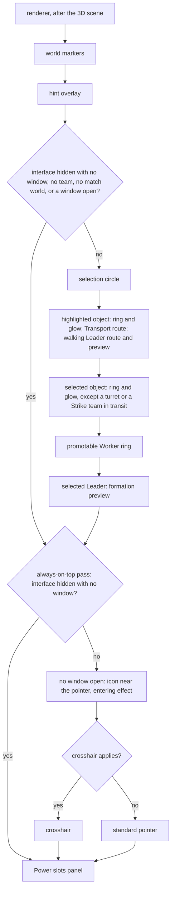
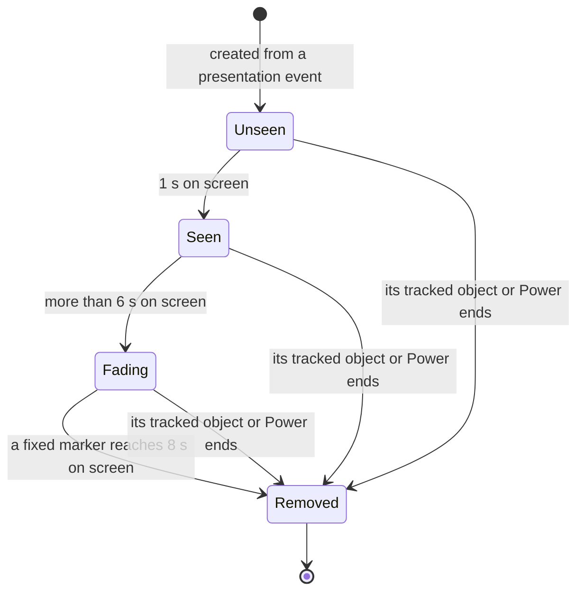

# Cursor and markers

> Status: Reference · Prefix: R-CTRL · Related: [README](README.md) · [Actions and bindings](actions_and_bindings.md) · [Selection and Power slots](selection_and_power_slots.md) · [Camera](camera.md) · [Leader and formations](../02_units/leader_and_formations.md) · [Entity and overlay renderers](../../architecture/components/renderer/README.md)

## 1 Purpose and player experience

The world cursor tells the player what a click will do. It highlights the unit or structure under the pointer and the one that is selected with a team-coloured ring and a glowing column; it shows, next to the pointer, the icon of the Power being placed, the selected Leader or the selected Workers with their count; it marks a Worker that the promote action would promote; it previews a Leader's formation; it shows whether a Transport or a Beam Dish can be entered; and it turns into a crosshair while a turret or a Beam Dish is aimed. The world markers pin icons to Supply crates, Relics, running Powers, the local team's Leaders and Transport orders, and keep them at the screen edge with a compass when they are off screen.

Everything in this file is presentation: it reads the simulation state and its presentation events and never writes simulation state (DEC-007). The match input pump reads two results back, the marker under the pointer and the order marker under the pointer ([actions and bindings](actions_and_bindings.md) R-CTRL-055, row O5).

## 2 Rules

### 2.1 The cursor set

**R-CTRL-350** (MUST) The world cursor (`WorldCursor`) owns the cursors of table 2.1-A. A cursor is a textured quad in screen space with an optional darkening shadow, made from its image blurred with `ref.ctrl.cursor.shadow_blur`. The shadow of each shadowed cursor is a derived asset of its image: `cursor.world.shadow`, `cursor.place.shadow`, `cursor.unavailable.shadow` and `cursor.highlight.shadow` ([entity and overlay renderers](../../architecture/components/renderer/entity_and_overlay_renderers.md) RND-366). A cursor's defaults are: size `ref.ctrl.cursor.set.default_size` (20), hotspot `ref.ctrl.cursor.set.default_hotspot` (0, 0) (a fraction of the size, (0, 0) the top-left corner and (1, 1) the bottom-right), not animated, shadowed, additive, white. The hotspots, sizes and colours of table 2.1-A are the `ref.ctrl.cursor.set.*` keys of §4. Cursor sizes are physical pixels at every render size and every resolution (RND-367).

Table 2.1-A The cursor set.

| Cursor | Asset | Hotspot | Size (pixels) | Animated | Colour and blend | Drawn in a match |
|---|---|---|---|---|---|---|
| standard pointer | `cursor.world` | (0.055, 0.070) | 35 | no | white, additive, shadowed | yes: the default pointer |
| placement | `cursor.place` | (0.5, 0.5) | 40, or as the caller sets | as the caller sets | white, additive | yes: the entering marker (R-CTRL-371) |
| unavailable | `cursor.unavailable` | (0.5, 0.5) | 60 | no | red (255, 0, 0), additive | yes: an invalid entry; the same image is the red sprite for an invalid placement and for "no route" (R-CTRL-366) |
| highlight | `cursor.highlight` | (0.5, 0.5) | 20, or as the caller sets | yes, switched off where it is used | white, additive | not as a cursor; the same image is the power-bar highlight ([selection and Power slots](selection_and_power_slots.md) R-CTRL-226, R-CTRL-231) |
| turret aim | `cursor.turret_aim` | (0.5, 0.5) | as the caller sets | no | white, alpha-blended, no shadow | yes: the crosshair (R-CTRL-372) |

**R-CTRL-351** (MUST) An animated cursor's size is size + |sin(`ref.ctrl.cursor.pulse_rate` × game time)| × size × `ref.ctrl.cursor.pulse_amount`, so it pulses between 1.0 and 1.6 times its size.

**R-CTRL-352** (MUST) A cursor drawn at (x, y) with angle a has its top-left corner at (x − s × hotspot x, y − s × hotspot y) and is rotated by a about its centre. The shadow pass uses the blurred image with a darkening blend and colour (1, 1, 1, 0); the main pass uses the cursor's colour with its additive or alpha blend; depth writes and culling are off. Every in-match cursor is drawn in screen space at the projected position of its world point.

### 2.2 Frame flow

**R-CTRL-355** (MUST) After the 3D scene, the renderer draws the world markers (§2.11), then the hint overlay, then the world-cursor pass (R-CTRL-356) and the always-on-top pass (R-CTRL-357), then the Power slots panel.

**R-CTRL-356** (MUST) The world-cursor pass draws nothing while the interface is hidden and no UI window is open, or while the participant has no team; it also draws nothing without a match world or while any UI window is open. Otherwise, in world space:

1. the selection circle (R-CTRL-370);
2. the effect colour is the team colour, or (255, 255, 100) without one, plus `ref.ctrl.cursor.effect_color_add`, clamped, with alpha `ref.ctrl.cursor.effect_alpha`;
3. the **highlighted object** (R-CTRL-360), if any, gets the highlight effect (R-CTRL-363) in the effect colour; a highlighted Transport also gets a route line to its waypoint at intensity `ref.ctrl.cursor.route_line_intensity`; a highlighted Leader in formation mode that is not the team's selection and is walking to its waypoint also gets a route line to its waypoint and a formation preview (R-CTRL-374) at the waypoint, facing its direction of travel; the highlighted object is kept as the object under the pointer for this frame;
4. the **selected object** (R-CTRL-361) gets the highlight effect in the effect colour + `ref.ctrl.cursor.selected_color_add` with alpha 255, except a turret and a Strike team that is in transit inside a Beam Dish;
5. the **promotable Worker**: while nothing is highlighted or selected, no Workers are selected and no circle exists, the nearest own Worker within `ref.ctrl.promote_radius` of the pointer ground point, if it is selectable, gets a highlight ring at its predicted position with `ref.ctrl.cursor.promote_ring_factor` × its radius; this ring is the only cue that the promote action will promote;
6. the **Leader formation preview**: while the selection is a Leader and the pointer is not on it, a formation preview at the Leader, facing the pointer, when a click at the pointer would toggle formation (R-UNIT-170); otherwise, when the Leader is in formation mode, a formation preview at the pointer, facing away from the Leader.

**R-CTRL-357** (MUST) The always-on-top pass is skipped while the interface is hidden and no UI window is open. Otherwise, in screen space: while no UI window is open, the icon near the pointer (R-CTRL-366) and the entering effect (R-CTRL-371); then the crosshair (R-CTRL-372); and when no crosshair applies, the standard pointer. The standard pointer is drawn whenever no crosshair applies; with a UI window open, only the icon and the entering effect are left out.

### 2.3 Highlight resolution

**R-CTRL-360** (MUST) The highlighted object is the object under the pointer ([actions and bindings](actions_and_bindings.md) R-CTRL-055), taken as: a Beam Dish or an own turret, with its radius × `ref.ctrl.cursor.structure_radius_factor` and, for a turret, its position raised by `ref.ctrl.cursor.turret_lift_factor` × its radius; a selectable actor group, at its centre + its velocity × the extrapolation time ([Tick timing](../12_simulation_model/01_tick_timing_and_main_loop.md) R-SIM-560) + its first member's centre offset; or a selectable actor, at its predicted position, with a Worker's radius × `ref.ctrl.cursor.promote_ring_factor`. The predicted position of an actor is its position + its centre offset + its velocity × (the extrapolation time, + `ref.sim.tick_period` when the actor has not yet been updated in the current tick). When the highlighted object changes, `match_ui.unit_highlight` plays, at most once every `ref.ctrl.cursor.highlight_sound_interval` of real time.

**R-CTRL-361** (MUST) The selected object's position is the selected actor's predicted position; otherwise the selected structure's centre; otherwise the selected group's centre + velocity × extrapolation time + its first member's centre offset.

### 2.4 The highlight effect

**R-CTRL-363** (MUST) The highlight effect at a position with radius r and a colour is drawn with alpha blending, no depth writes and the depth-biased variant of factor `ref.ctrl.cursor.depth_bias` ([frame view](../../architecture/components/renderer/view_lighting_and_fog.md) RND-219), using n = max(`ref.ctrl.cursor.ring_min_steps`, 2 × r) steps, the main width `ref.ctrl.cursor.ring_widths.main` (0.2) × r and the outline width `ref.ctrl.cursor.ring_widths.outline` (0.075) × r:

1. ring 1, in the colour: from r − 0.2r to r;
2. ring 2, black: from r − 0.2r − 0.075r to r − 0.2r;
3. ring 3, black: from r to r + 0.075r;
4. a glow cylinder of radius r + 0.075r and height r × max(1, camera distance ÷ `ref.ctrl.cursor.glow_height_divisor`), with n sides, its colour's alpha at the base fading to 0 at the top, and its up vector the normalised mean of world up and the ground normal.

Each ring is a quad strip in the plane perpendicular to the ground normal at the centre; its vertices are blended towards the terrain height by min(1, `ref.ctrl.cursor.drape_distance` ÷ camera distance), applied only when that factor is above 0.1, so near objects drape on the terrain and far ones stay flat.

### 2.5 The icon near the pointer

**R-CTRL-366** (MUST) The icon near the pointer is not drawn after game over. Its anchor is the pointer + `ref.ctrl.cursor.icon_offset` along n = Normalize(0.85, 1), down and to the right; its size is the screen height ÷ `ref.ctrl.cursor.icon_divisor`; it is drawn with the world markers' shadow, team-colour disc and icon layers (R-CTRL-386). The first case that applies is drawn:

| Priority | Context | Drawn |
|---|---|---|
| 1 | the team has a current Power | its icon `icon.power.<kind>`; while it is Waiting, the icon blinks: it shows while real time mod `ref.ctrl.cursor.blink_period` < `ref.ctrl.cursor.blink_on` |
| 1a | as 1, the Power is Waiting, and its target-area test fails at the pointer ground point ([selection and Power slots](selection_and_power_slots.md) R-CTRL-192) | also the red `cursor.unavailable` sprite at `ref.ctrl.cursor.unavailable_scale` × half the icon size, at the icon centre (the anchor + `ref.ctrl.cursor.icon_center_offset` along n) |
| 1b | as 1, and the Power is a Waiting turret or Hive Power | also a ghost model at the pointer ground point, `mesh.structure.turret_head` or `mesh.structure.hive_mound`, unrotated, blended as source + destination × source colour, with no depth writes |
| 1c | as 1, and the Power is a Waiting Speed Boost, Shield, Convert, meteor shower, Fury or Missile Barrage Power | also a glowing area cylinder at the pointer ground point: `ref.ctrl.cursor.area_cylinder.sides` (100) sides, attached to the ground, up = world up, in the team colour, its alpha halved while the blink is off; radius `ref.power.effect_range` and height `ref.ctrl.cursor.area_cylinder.height_factor` (0.6) × that, except the meteor shower (radius × `ref.ctrl.cursor.area_cylinder.meteor_radius_factor` (4)) and the Missile Barrage (radius × `ref.ctrl.cursor.area_cylinder.barrage_radius_factor` (3)), whose height is `ref.ctrl.cursor.area_cylinder.wide_height_factor` (1) × `ref.power.effect_range` |
| 2 | no current Power, and the selection is a Leader | `icon.power.leader` |
| 3 | Workers selected | `icon.power.workers` and the selected count: text size `ref.ctrl.cursor.count_text.size` (15), an outline pass, then white with alpha `ref.ctrl.cursor.count_text.alpha` (0.9), at the icon centre + (`ref.ctrl.cursor.count_text.offset_x`, `ref.ctrl.cursor.count_text.offset_y` × size) = (2, 0.4 × size); when the route preview finds no walkable route, the red `cursor.unavailable` sprite replaces the count |

### 2.6 The selection circle

**R-CTRL-370** (MUST) While the local selection circle exists, each fixed effect step ([animation and VFX](../../architecture/components/animation_and_vfx/README.md) VFX-018; `vfx.emit.step_rate`, 60 steps per second) creates `ref.ctrl.cursor.circle_particles` control-flash particles, so the particle count does not depend on the frame rate (DEC-960); the particles are of size equal to the circle's radius, evenly spaced on the circle, turning at `ref.ctrl.cursor.circle_spin` (the angle offset is real time × that rate), `ref.ctrl.cursor.circle_lift` above the terrain.

### 2.7 The entering effect

**R-CTRL-371** (MUST) When the object under the pointer is a Transport while Workers are selected, or a Beam Dish while Workers or a Leader are selected, the placement cursor `cursor.place` is drawn at the projected entrance (a Beam Dish's entrance, a Transport's position), animated only when the entry is valid: a Transport with fewer passengers than its capacity, a Beam Dish that is connected. When the entry is invalid, `cursor.unavailable` is drawn on top, in red at 60 pixels.

### 2.8 The crosshair

**R-CTRL-372** (MUST) No crosshair applies while a UI window is open, without a team, or while no structure and no actor group is selected. Otherwise:

| Selected | Crosshair | Size |
|---|---|---|
| an own turret | `cursor.turret_aim` at the projected aim point of the turret, smoothed exponentially with factor `ref.ctrl.cursor.crosshair_smoothing` × frame delta, while the turret has an aim point; the standard pointer is suppressed either way | `ref.ctrl.cursor.crosshair_turret_size` × screen height |
| any other selected structure (a Beam Dish) | `cursor.turret_aim` at the projected pointer ground point | `ref.ctrl.cursor.crosshair_structure_size` × screen height |
| a Strike team, in gamepad mode, while the camera tracks it | nothing; the standard pointer is suppressed | — |
| a Strike team, in gamepad mode, without tracking | `cursor.turret_aim` at the projected pointer ground point | screen width ÷ `ref.ctrl.cursor.crosshair_pad_divisor` |
| a Strike team in keyboard and mouse mode | none: the standard pointer | — |

The crosshair only reads the selected structure's kind and never changes it (DEC-007).

### 2.9 The formation preview

**R-CTRL-374** (MUST) A formation preview at a position p facing f draws, for each formation index i from 0 to the team's formation size − 1 (`ref.sim.team.formation_size_upgrade`), a camera-facing diamond with vertices ± `ref.ctrl.cursor.preview_diamond` × camera up and ± the same × camera right at the slot position of index i for a Leader at p with front f and a slot array of the formation size ([Leader and formations](../02_units/leader_and_formations.md) R-UNIT-182), using `fx.particle_dot` in the team colour, alpha-blended, with the depth-biased variant of factor `ref.ctrl.cursor.depth_bias`.

### 2.10 Selection arrows and move markers

**R-CTRL-375** (removed: a match draws no selection arrows and no move markers)

### 2.11 World markers

**R-CTRL-380** (MUST) The world markers (`WorldMarkers`) are a presentation list of markers, each drawn as an icon over the 3D view and held at the screen edge with a compass when it is off screen. The list advances once per rendered frame and is cleared at every match reset. Markers are created from the presentation events of the simulation rules (DEC-007), and they feed back to input only through the marker under the pointer and the order marker under the pointer (R-CTRL-387).

**R-CTRL-381** (MUST) The marker types are:

| Type | Created by | Tracks | Persistent | Shown off screen | Clickable | Flash at birth | Icon and disc |
|---|---|---|---|---|---|---|---|
| fixed | every Supply crate outcome effect, with its team, position and icon | the position + `ref.ctrl.marker.fixed_lift` up | no: removed once its on-screen time reaches `ref.power.marker.lifetime_s` after it was seen | until first seen | no | when its team is not the local team, after the grace period | the given icon on a team-colour disc; spins for 2.5 s with rotation += (2.5 − t)² |
| Supply crate | every new Supply crate | the crate + `ref.ctrl.marker.lift` up; removed with the crate | yes | always | yes, for every team | no | `marker.supply_crate`; the disc fills from the bottom by the capture fraction in the capturing team's colour (grey 155 while neutral; alpha 1 when owned); rotation = the smoothed fraction × −10π, with smoothed = 0.95 × smoothed + 0.05 × fraction per frame |
| Power | every targeted Power with a tracked object except a turret, of any team, bots included ([selection and Power slots](selection_and_power_slots.md) R-CTRL-191); every Transit Gate reinforcement Transport | the Power's position + `ref.ctrl.marker.lift` up; removed when the Power ends | yes | for the local team | for the local team | for the local team, after the grace period | `icon.power.<kind>` on a team-colour disc; for friendly Powers the extra information of R-CTRL-232; spins for 5 s with rotation += (5 − t)² |
| Relic | every Relic as it is created | the Relic + up × its radius × 4 | yes | always | no | no | `marker.relic`; the disc fills by (lifters − minimum) ÷ (maximum − minimum) in the carrying team's colour, alpha × 0.5 ([Relic Run](../01_skirmish_rules_and_modes/relic_run.md)) |
| Leader | every promotion of the local team | the Leader + `ref.ctrl.marker.lift` up | yes | until seen | for the local team | no | the Leader's banner (R-UNIT-191), with a ray-hit highlight, instead of an icon |
| Transport order | every order to a Transport of a team that is a friend of the local team (R-SIM-450) | the Transport's waypoint, sorted `ref.ctrl.marker.order_sort_offset` behind | yes | until seen | for the local team, while nothing else is selected or this Transport is selected | for the local team, after the grace period | 0.7 × the Power icon and a ground highlight (R-CTRL-363) of size 10 + sin(5t); it becomes inactive when the waypoint changes or the Transport is within `ref.unit.transport.arrival_distance` of it; picked by a ground sphere of radius `ref.ctrl.marker.order_pick_radius` |

The spins, fills and sizes of this table are the keys `ref.ctrl.marker.fixed_spin_s`, `ref.ctrl.marker.power_spin_s` and `ref.ctrl.marker.spin_exponent` (the spins), `ref.ctrl.marker.crate_neutral_gray`, `ref.ctrl.marker.crate_smoothing` and `ref.ctrl.marker.crate_rotation_factor` (the Supply crate marker), `ref.ctrl.marker.relic_lift_factor` and `ref.ctrl.marker.relic_alpha_factor` (the Relic marker), and `ref.ctrl.marker.order_icon_scale`, `ref.ctrl.marker.order_highlight_size` and `ref.ctrl.marker.order_highlight_pulse_rate` (the Transport order marker).

**R-CTRL-382** (MUST) Each frame the world markers advance:

1. one bubble-sort pass by squared camera distance, with these key adjustments: the own team's markers − `ref.ctrl.marker.own_sort_offset`; a marker younger than `ref.ctrl.marker.new_age` takes its age as its key, so the newest come first; a hovered marker other than a Leader marker takes 0; Transport orders + `ref.ctrl.marker.order_sort_offset`; the nearest marker is drawn last, on top;
2. inactive markers are removed; every marker takes the position of its tracked object, smoothed as position × (1 − `ref.ctrl.marker.smoothing` × dt) + new × `ref.ctrl.marker.smoothing` × dt, unless its position is still zero, which snaps.

**R-CTRL-383** (MUST) The markers are not drawn without a match world, in the map editor, or while the interface is hidden. A marker is on screen when it lies in front of the camera and inside the viewport. Otherwise the point `ref.ctrl.marker.edge_probe` from (camera position + front × `ref.ctrl.marker.edge_probe_ahead`) towards the target is projected, and the ray from the screen centre through it is intersected with the screen rectangle. An off-screen marker takes the direction from that edge point to the screen centre as its line normal; its icon is moved `ref.ctrl.marker.edge_inset` inwards along it, and its compass points along it.

**R-CTRL-384** (MUST) A marker's alpha follows these rules, applied in this order:

1. its on-screen time accumulates, and it counts as seen after `ref.ctrl.marker.alpha.seen_after_s` (1 s) on screen;
2. a seen marker fades out over `ref.ctrl.marker.alpha.fade_s` (9 s) once its on-screen time passes `ref.ctrl.marker.alpha.fade_start_s` (6 s), but never below the floor max((camera distance − `ref.ctrl.marker.alpha.floor_distance`) ÷ `ref.ctrl.marker.alpha.floor_distance_range`, 1 − its distance to the screen centre ÷ (`ref.ctrl.marker.alpha.floor_center_fraction` × screen height)) = max((camera distance − 350) ÷ 500, 1 − its distance to the screen centre ÷ (0.5 × screen height));
3. after the floor, a marker that is not persistent also fades over `ref.ctrl.marker.alpha.transient_fade_s` (2 s) once its on-screen time passes 6 s, so a fixed marker reaches alpha 0 when its on-screen time reaches `ref.power.marker.lifetime_s` (8 s), the time at which it is removed (R-CTRL-381);
4. the local team's Power and order markers keep at least `ref.ctrl.marker.alpha.own_min` (0.75) while visible;
5. an off-screen marker that may not show off screen has alpha 0.

**R-CTRL-385** (MUST) A marker's sizes are: icon = screen height ÷ `ref.ctrl.marker.size.icon_divisor` (20); shadow = icon + `ref.ctrl.marker.size.shadow_pad` (10); compass = icon + screen height ÷ `ref.ctrl.marker.size.compass_divisor` (30); while it flashes, × `ref.ctrl.marker.size.flash_scale` (1.3) with its alpha alternating between `ref.ctrl.marker.size.flash_alpha_low` (0.2) and `ref.ctrl.marker.size.flash_alpha_high` (1.0) every `ref.ctrl.marker.size.flash_period_s` (0.2 s) for `ref.ctrl.marker.size.flash_duration_s` (3 s); × (2 − camera distance ÷ `ref.ctrl.marker.size.near_distance`) while the camera is closer than that distance (500 wu); × `ref.ctrl.marker.size.hover_scale` (1.2) with alpha 1 while it is hovered or selected; an on-screen icon is raised by `ref.ctrl.marker.size.lift_factor` (5) × screen height ÷ camera distance pixels.

**R-CTRL-386** (MUST) A marker is drawn in these layers: the shadow `marker.team_disc_shadow` in black with alpha `ref.ctrl.marker.shadow_alpha`; the compass, `marker.edge_compass_shadow` then `marker.edge_compass` additive, where a marker that is on screen draws the empty compass `marker.edge_compass_empty` instead of the compass arrow ([entity and overlay renderers](../../architecture/components/renderer/entity_and_overlay_renderers.md) RND-357); the colour disc `marker.team_disc`, additive, filled to its fraction; the icon, additive, its texture coordinates rotated for the spin.

**R-CTRL-387** (MUST) A marker whose icon box contains the pointer becomes the marker under the pointer at the end of the frame; a Transport order marker also sets the order marker under the pointer, which row O5 reads.

**R-CTRL-388** (MUST) The world markers draw the banners of the local team's Leaders; the Leader renderer draws those of every other team (R-UNIT-191).

> **Amendment 2026-10-21 (M1 task T17b, owner decisions O76 and O78, [ADR-125](../../ADR/ADR-125-battle-marks-route-preview-and-world-markers-at-m1.md)).** At M1:
> - **The badge.** The icon near the pointer is R-CTRL-366's rows 2 and 3 without the count. A route preview that cannot be walked shows the unavailable pointer (O76) rather than the badge's red sprite.
> - **The markers.** The world markers are the Leader markers alone, one for each of the local team's living Leaders, made when the Leader is first seen rather than at its promotion.
> - **On screen.** The banner, which the Leader renderer draws for every team (R-CTRL-388 as amended), stands for a marker's icon.
> - **Off screen.** Until it is seen, a marker draws R-CTRL-386's layers with `icon.power.leader` in place of the banner, its compass pointing out towards its Leader.
> - **Not built.** R-CTRL-384's rules 2 to 4, and the flash and spin of R-CTRL-381, reach no marker drawn this way, and are not built.
> - **Pixels.** Sizes and offsets are physical pixels.

## 3 States and flows

Caption: Diagram 3-A, the per-frame drawing order of the world markers and the world cursor (R-CTRL-355 to R-CTRL-357).

Caption: Diagram 3-B, the life of a world marker (R-CTRL-380 to R-CTRL-384).

## 4 Tuning table

This file cites `ref.ctrl.promote_radius` ([actions and bindings](actions_and_bindings.md)), `ref.power.effect_range` and `ref.power.marker.lifetime_s` ([Supply crates, Powers and weapons](../04_supply_crates_powers_and_weapons/README.md)), `ref.sim.tick_period` ([Tick timing](../12_simulation_model/01_tick_timing_and_main_loop.md)), `ref.sim.team.formation_size_upgrade` ([Teams and player commands](../12_simulation_model/06_teams_and_player_commands.md)) and `ref.unit.transport.arrival_distance` ([Transport](../02_units/transport.md)). Pixel values are screen pixels unless stated.

| key | value | unit | range or notes | requirement | DEC |
|---|---|---|---|---|---|
| `ref.ctrl.cursor.set.default_size` | 20 | pixels | size of a cursor that sets none | R-CTRL-350 | — |
| `ref.ctrl.cursor.set.default_hotspot` | 0, 0 | fraction of the size (x, y) | the top-left corner | R-CTRL-350 | — |
| `ref.ctrl.cursor.set.world_hotspot` | 0.055, 0.070 | fraction of the size (x, y) | standard pointer `cursor.world` | R-CTRL-350 | — |
| `ref.ctrl.cursor.set.world_size` | 35 | pixels | standard pointer | R-CTRL-350 | — |
| `ref.ctrl.cursor.set.place_hotspot` | 0.5, 0.5 | fraction of the size (x, y) | placement cursor `cursor.place` | R-CTRL-350 | — |
| `ref.ctrl.cursor.set.place_size` | 40 | pixels | unless the caller sets a size | R-CTRL-350 | — |
| `ref.ctrl.cursor.set.unavailable_hotspot` | 0.5, 0.5 | fraction of the size (x, y) | unavailable cursor `cursor.unavailable` | R-CTRL-350 | — |
| `ref.ctrl.cursor.set.unavailable_size` | 60 | pixels | | R-CTRL-350 | — |
| `ref.ctrl.cursor.set.unavailable_color` | 255, 0, 0 | RGB8 | red | R-CTRL-350 | — |
| `ref.ctrl.cursor.set.highlight_hotspot` | 0.5, 0.5 | fraction of the size (x, y) | highlight `cursor.highlight` | R-CTRL-350 | — |
| `ref.ctrl.cursor.set.highlight_size` | 20 | pixels | unless the caller sets a size | R-CTRL-350 | — |
| `ref.ctrl.cursor.set.turret_aim_hotspot` | 0.5, 0.5 | fraction of the size (x, y) | crosshair `cursor.turret_aim`; its size is the caller's | R-CTRL-350 | — |
| `ref.ctrl.cursor.shadow_blur` | 10 | blur radius | of the cursor image, for its shadow | R-CTRL-350 | — |
| `ref.ctrl.cursor.pulse_rate` | 4 | rad per second of game time | | R-CTRL-351 | — |
| `ref.ctrl.cursor.pulse_amount` | 0.6 | × size | | R-CTRL-351 | — |
| `ref.ctrl.cursor.effect_color_add` | (100, 100, 100) | RGB | added to the team colour, clamped | R-CTRL-356 | — |
| `ref.ctrl.cursor.effect_alpha` | 150 | alpha (0 to 255) | | R-CTRL-356 | — |
| `ref.ctrl.cursor.route_line_intensity` | 0.5 | intensity | route line of a highlighted Transport | R-CTRL-356 | — |
| `ref.ctrl.cursor.selected_color_add` | (50, 50, 50) | RGB | added to the effect colour; alpha 255 | R-CTRL-356 | — |
| `ref.ctrl.cursor.promote_ring_factor` | 2 | × the Worker's radius | promotable and highlighted Workers | R-CTRL-356, R-CTRL-360 | — |
| `ref.ctrl.cursor.structure_radius_factor` | 0.8 | × radius | highlighted structures | R-CTRL-360 | — |
| `ref.ctrl.cursor.turret_lift_factor` | 0.5 | × radius | | R-CTRL-360 | — |
| `ref.ctrl.cursor.highlight_sound_interval` | 0.2 | s of real time | | R-CTRL-360 | — |
| `ref.ctrl.cursor.depth_bias` | 1.03 | near-plane factor | depth-biased variant | R-CTRL-363, R-CTRL-374 | — |
| `ref.ctrl.cursor.ring_min_steps` | 25 | steps | n = max(25, 2r) | R-CTRL-363 | — |
| `ref.ctrl.cursor.ring_widths.main` | 0.2 | × radius | ring 1 | R-CTRL-363 | — |
| `ref.ctrl.cursor.ring_widths.outline` | 0.075 | × radius | rings 2 and 3 | R-CTRL-363 | — |
| `ref.ctrl.cursor.glow_height_divisor` | 300 | wu | height r × max(1, distance ÷ 300) | R-CTRL-363 | — |
| `ref.ctrl.cursor.drape_distance` | 75 | wu | drape factor min(1, 75 ÷ distance), used above 0.1 | R-CTRL-363 | — |
| `ref.ctrl.cursor.icon_offset` | 5 | pixels | along Normalize(0.85, 1) | R-CTRL-366 | — |
| `ref.ctrl.cursor.icon_divisor` | 24 | — | icon size = screen height ÷ 24 | R-CTRL-366 | — |
| `ref.ctrl.cursor.blink_period` | 0.4 | s of real time | | R-CTRL-366 | — |
| `ref.ctrl.cursor.blink_on` | 0.25 | s | visible part of each period | R-CTRL-366 | — |
| `ref.ctrl.cursor.icon_center_offset` | 50 | pixels | from the anchor along n | R-CTRL-366 | — |
| `ref.ctrl.cursor.unavailable_scale` | 1.2 | × half the icon size | | R-CTRL-366 | — |
| `ref.ctrl.cursor.count_text.size` | 15 | text size | the selected-Worker count | R-CTRL-366 | — |
| `ref.ctrl.cursor.count_text.alpha` | 0.9 | alpha | the white fill, after an outline pass | R-CTRL-366 | — |
| `ref.ctrl.cursor.count_text.offset_x` | 2 | pixels | from the icon centre | R-CTRL-366 | — |
| `ref.ctrl.cursor.count_text.offset_y` | 0.4 | × icon size | from the icon centre | R-CTRL-366 | — |
| `ref.ctrl.cursor.area_cylinder.sides` | 100 | sides | | R-CTRL-366 | — |
| `ref.ctrl.cursor.area_cylinder.height_factor` | 0.6 | × `ref.power.effect_range` | height; the radius is `ref.power.effect_range` | R-CTRL-366 | — |
| `ref.ctrl.cursor.area_cylinder.meteor_radius_factor` | 4 | × `ref.power.effect_range` | meteor shower radius | R-CTRL-366 | — |
| `ref.ctrl.cursor.area_cylinder.barrage_radius_factor` | 3 | × `ref.power.effect_range` | Missile Barrage radius | R-CTRL-366 | — |
| `ref.ctrl.cursor.area_cylinder.wide_height_factor` | 1 | × `ref.power.effect_range` | height of the meteor shower and Missile Barrage cylinders | R-CTRL-366 | — |
| `ref.ctrl.cursor.circle_particles` | 30 | particles per effect step | `vfx.emit.step_rate` (60) effect steps per second | R-CTRL-370 | DEC-960 |
| `ref.ctrl.cursor.circle_spin` | 0.5 | rad per real second | | R-CTRL-370 | — |
| `ref.ctrl.cursor.circle_lift` | 10 | wu | above the terrain | R-CTRL-370 | — |
| `ref.ctrl.cursor.crosshair_smoothing` | 10 | per second | exponential smoothing of the turret crosshair | R-CTRL-372 | — |
| `ref.ctrl.cursor.crosshair_turret_size` | 0.15 | × screen height | 1.5 × screen height ÷ 10 | R-CTRL-372 | — |
| `ref.ctrl.cursor.crosshair_structure_size` | 0.1 | × screen height | | R-CTRL-372 | — |
| `ref.ctrl.cursor.crosshair_pad_divisor` | 25.6 | — | size = screen width ÷ 25.6 | R-CTRL-372 | — |
| `ref.ctrl.cursor.preview_diamond` | 2 | wu | half-diagonal of each diamond | R-CTRL-374 | — |
| `ref.ctrl.marker.fixed_lift` | 30 | wu | | R-CTRL-381 | — |
| `ref.ctrl.marker.lift` | 20 | wu | Supply crate, Power and Leader markers | R-CTRL-381 | — |
| `ref.ctrl.marker.order_sort_offset` | 50 | wu of sort key | | R-CTRL-381, R-CTRL-382 | — |
| `ref.ctrl.marker.order_pick_radius` | 8 | wu | ground-sphere pick of an order marker | R-CTRL-381 | — |
| `ref.ctrl.marker.fixed_spin_s` | 2.5 | s of real time | a fixed marker spins while t < 2.5 s, rotation += (2.5 − t)^exponent | R-CTRL-381 | — |
| `ref.ctrl.marker.power_spin_s` | 5 | s of real time | a Power marker spins while t < 5 s, rotation += (5 − t)^exponent | R-CTRL-381 | — |
| `ref.ctrl.marker.spin_exponent` | 2 | exponent | both spins | R-CTRL-381 | — |
| `ref.ctrl.marker.crate_neutral_gray` | 155 | grey level (0 to 255) | the disc of a Supply crate marker with no capturing team | R-CTRL-381 | — |
| `ref.ctrl.marker.crate_smoothing` | 0.95 | factor per frame | smoothed = 0.95 × smoothed + (1 − 0.95) × fraction | R-CTRL-381 | — |
| `ref.ctrl.marker.crate_rotation_factor` | −10π | rad per unit of fraction | rotation = smoothed fraction × −10π | R-CTRL-381 | — |
| `ref.ctrl.marker.relic_lift_factor` | 4 | × Relic radius | above the Relic | R-CTRL-381 | — |
| `ref.ctrl.marker.relic_alpha_factor` | 0.5 | × alpha | the Relic marker's disc | R-CTRL-381 | — |
| `ref.ctrl.marker.order_icon_scale` | 0.7 | × Power icon size | Transport order marker | R-CTRL-381 | — |
| `ref.ctrl.marker.order_highlight_size` | 10 | wu | ground highlight of an order marker; size 10 + sin(rate × t) | R-CTRL-381 | — |
| `ref.ctrl.marker.order_highlight_pulse_rate` | 5 | rad per second of real time | | R-CTRL-381 | — |
| `ref.ctrl.marker.own_sort_offset` | 50 | wu of sort key | subtracted for the own team | R-CTRL-382 | — |
| `ref.ctrl.marker.new_age` | 3 | s | newer markers sort by age | R-CTRL-382 | — |
| `ref.ctrl.marker.smoothing` | 5 | per second | position smoothing | R-CTRL-382 | — |
| `ref.ctrl.marker.edge_probe` | 100 | wu | | R-CTRL-383 | — |
| `ref.ctrl.marker.edge_probe_ahead` | 1000 | wu | ahead of the camera | R-CTRL-383 | — |
| `ref.ctrl.marker.edge_inset` | 50 | pixels | | R-CTRL-383 | — |
| `ref.ctrl.marker.alpha.seen_after_s` | 1 | s of on-screen time | a marker counts as seen | R-CTRL-384 | — |
| `ref.ctrl.marker.alpha.fade_start_s` | 6 | s of on-screen time | both fades start here | R-CTRL-384 | — |
| `ref.ctrl.marker.alpha.fade_s` | 9 | s | the fade of a seen marker | R-CTRL-384 | — |
| `ref.ctrl.marker.alpha.floor_distance` | 350 | wu | floor term (camera distance − 350) ÷ 500 | R-CTRL-384 | — |
| `ref.ctrl.marker.alpha.floor_distance_range` | 500 | wu | | R-CTRL-384 | — |
| `ref.ctrl.marker.alpha.floor_center_fraction` | 0.5 | × screen height | floor term 1 − distance to the screen centre ÷ (0.5 × screen height) | R-CTRL-384 | — |
| `ref.ctrl.marker.alpha.transient_fade_s` | 2 | s | the further fade of a marker that is not persistent | R-CTRL-384 | — |
| `ref.ctrl.marker.alpha.own_min` | 0.75 | alpha | the local team's Power and order markers while visible | R-CTRL-384 | — |
| `ref.ctrl.marker.size.icon_divisor` | 20 | divisor | icon = screen height ÷ 20 | R-CTRL-385 | — |
| `ref.ctrl.marker.size.shadow_pad` | 10 | pixels | shadow = icon + 10 | R-CTRL-385 | — |
| `ref.ctrl.marker.size.compass_divisor` | 30 | divisor | compass = icon + screen height ÷ 30 | R-CTRL-385 | — |
| `ref.ctrl.marker.size.flash_scale` | 1.3 | × | while the marker flashes | R-CTRL-385 | — |
| `ref.ctrl.marker.size.flash_alpha_low` | 0.2 | alpha | | R-CTRL-385 | — |
| `ref.ctrl.marker.size.flash_alpha_high` | 1.0 | alpha | | R-CTRL-385 | — |
| `ref.ctrl.marker.size.flash_period_s` | 0.2 | s of real time | the alpha alternates once per period | R-CTRL-385 | — |
| `ref.ctrl.marker.size.flash_duration_s` | 3 | s of real time | | R-CTRL-385 | — |
| `ref.ctrl.marker.size.near_distance` | 500 | wu | × (2 − camera distance ÷ 500) while the camera is closer | R-CTRL-385 | — |
| `ref.ctrl.marker.size.hover_scale` | 1.2 | × | while hovered or selected, with alpha 1 | R-CTRL-385 | — |
| `ref.ctrl.marker.size.lift_factor` | 5 | × screen height ÷ camera distance, in pixels | the raise of an on-screen icon | R-CTRL-385 | — |
| `ref.ctrl.marker.shadow_alpha` | 0.9 | alpha | | R-CTRL-386 | — |

## 5 Edge cases and interactions

1. **Promotion cue.** The promotable-Worker ring is the only sign that the promote action will promote; it is not drawn while anything is selected or highlighted (R-CTRL-356 step 5).
2. **Invalid placement.** The red sprite next to the Power icon shows that the target-area test fails at the pointer; the place action then has no effect when its command executes (R-CTRL-366).
3. **No route.** A selected group whose route preview finds no walkable route shows the red sprite instead of its count (R-CTRL-366).
4. **Gamepad tracking.** While the camera tracks a Strike team in gamepad mode, neither a crosshair nor the standard pointer is drawn (R-CTRL-372).
5. **Crate markers for every team.** Every team can click a Supply crate marker, and it is shown off screen at all times (R-CTRL-381).
6. **Turret Powers.** A targeted turret Power gets no Power marker (R-CTRL-381).

## 6 Acceptance criteria

**AC-CTRL-CM-01 — Pulse** (R-CTRL-351). An animated cursor of size 30 measures 30 at game time 0 and 48 at game time π ÷ 8 s.

**AC-CTRL-CM-02 — Highlight geometry** (R-CTRL-363). For r = 10: ring 1 spans 8 to 10 wu, ring 2 spans 7.25 to 8 wu, ring 3 spans 10 to 10.75 wu; at a camera distance of 600 wu the glow cylinder is 20 wu tall.

**AC-CTRL-CM-03 — Icon priority** (R-CTRL-366). With a Waiting Power and a selected group, the Power's icon is drawn and the group's count is not.

**AC-CTRL-CM-04 — Area cylinder** (R-CTRL-366). A Waiting meteor shower draws a cylinder of radius 280 wu and height 70 wu; a Waiting Shield one of 70 wu and 42 wu.

**AC-CTRL-CM-05 — Marker life** (R-CTRL-381, R-CTRL-384). A fixed marker that stays on screen is removed after 8 s of on-screen time; a Supply crate marker stays until its crate is gone.

**AC-CTRL-CM-06 — Off-screen marker** (R-CTRL-383). A Relic marker behind the camera is drawn at the screen edge with its compass pointing along the edge-to-centre direction, its icon 50 pixels inside the edge.

**AC-CTRL-CM-07 — Read only** (R-CTRL-372, DEC-007). With a Beam Dish selected and the crosshair drawn for 1,000 frames, the simulation state hash equals that of a run without rendering.

## 7 Dependencies

- **Reference documents:** [actions and bindings](actions_and_bindings.md) (the object under the pointer); [selection and Power slots](selection_and_power_slots.md) (Powers, the target-area test, the extra information); [Leader and formations](../02_units/leader_and_formations.md) (formation slots, banners); [Transport](../02_units/transport.md); [Relic Run](../01_skirmish_rules_and_modes/relic_run.md); [Teams and player commands](../12_simulation_model/06_teams_and_player_commands.md) (R-SIM-405, R-SIM-450); [Tick timing](../12_simulation_model/01_tick_timing_and_main_loop.md) (extrapolation time).
- **Engine components:** [renderer](../../architecture/components/renderer/README.md) (depth-biased variants, overlay drawing; the cursor and marker layers of [entity and overlay renderers](../../architecture/components/renderer/entity_and_overlay_renderers.md) RND-357, RND-366, RND-367); [animation and VFX](../../architecture/components/animation_and_vfx/README.md) (control-flash and muzzle-flash particles, the fixed effect step VFX-018).
- **Assets:** `cursor.world`, `cursor.place`, `cursor.unavailable`, `cursor.highlight`, `cursor.turret_aim`, `cursor.world.shadow`, `cursor.place.shadow`, `cursor.unavailable.shadow`, `cursor.highlight.shadow`, `fx.particle_dot`, `marker.team_disc`, `marker.team_disc_shadow`, `marker.edge_compass`, `marker.edge_compass_shadow`, `marker.edge_compass_empty`, `marker.supply_crate`, `marker.relic`, `icon.power.leader`, `icon.power.workers`, `mesh.structure.turret_head`, `mesh.structure.hive_mound`; sound event `match_ui.unit_highlight`.

## 8 Open decisions

No Open decision concerns this file. Resolved decisions applied: DEC-007, DEC-960.
