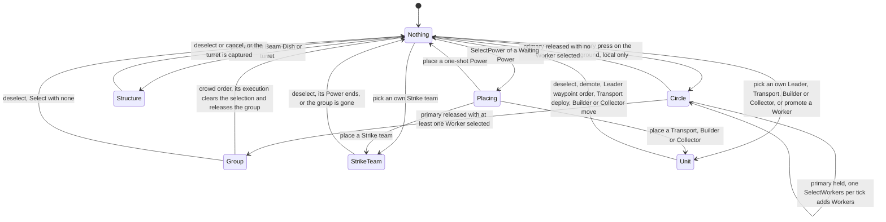
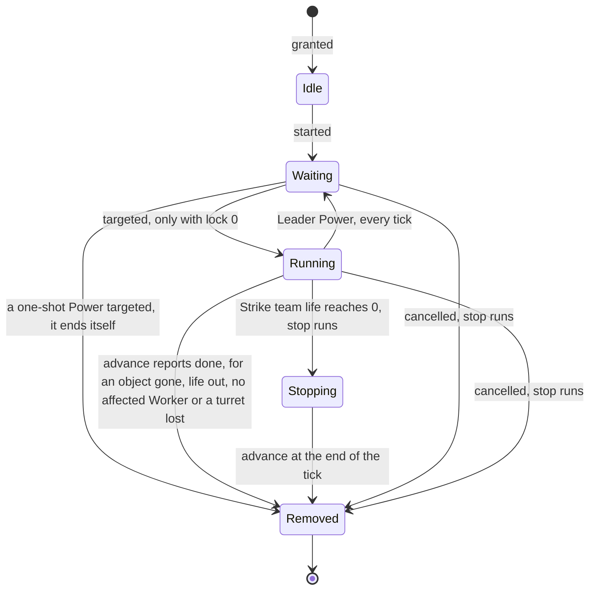
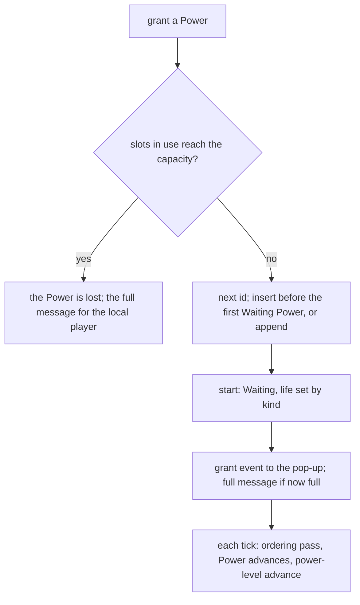

# Selection and Power slots

> Status: Reference · Prefix: R-CTRL · Related: [README](README.md) · [Actions and bindings](actions_and_bindings.md) · [Cursor and markers](cursor_and_markers.md) · [Camera](camera.md) · [Teams and player commands](../12_simulation_model/06_teams_and_player_commands.md) · [Worker](../02_units/worker.md) · [Supply crates and Powers](../04_supply_crates_powers_and_weapons/crates_and_powers.md)

## 1 Purpose and player experience

The player selects one thing at a time: a unit, a structure or nothing, plus one group of Workers gathered with the selection circle and one current Power. Selection is simulation state, changed only by executing commands, so every participant sees the same selection.

The Power slots hold the Powers that a team has been granted but not yet used up: up to six, two while the team is eliminated. A Power waits in its slot until the player selects it and targets it on the map; then it places a unit, fires a strike or runs a timed effect. A Power granted while every slot is full is lost (DEC-033). The Power slots panel shows the slots as a bar at the bottom of the screen, a pop-up for each newly received Power, a help tooltip and short status messages.

This file specifies the selection model, the selection circle and crowd orders (§2.1 to §2.5), the Power slots as simulation state (§2.6 to §2.12) and the Power slots panel (§2.13 to §2.15). The commands are those of [Teams and player commands](../12_simulation_model/06_teams_and_player_commands.md) R-SIM-450; the Supply crate outcomes that the Powers deliver, and their effects and durations, are those of [Supply crates and Powers](../04_supply_crates_powers_and_weapons/crates_and_powers.md).

## 2 Rules

### 2.1 Selection state

**R-CTRL-150** (MUST) A team's selection is simulation state that only the execution of commands changes, together with the effects that executing a command has inside the same step (R-SIM-401, DEC-008, DEC-119). It consists of the team's current selection (actor group, actor, structure), the under-control flag of each of its Workers, the latched selected-Worker count and centre (R-SIM-402), the current Power and the previous Power of its Power slots (R-CTRL-173), and the block-selection flag, which is set while reinforcements spawn (R-SIM-405 step 1). The commands that change it are `PlayerCommand::Select`, `PlayerCommand::SelectPower`, `PlayerCommand::SelectWorkers`, `PlayerCommand::OrderWorkers`, `PlayerCommand::PromoteWorker`, `PlayerCommand::DemoteLeader`, `PlayerCommand::OrderUnit` and `PlayerCommand::ToggleUnit`.

**R-CTRL-151** (MUST) These fields belong to the local input layer and are never simulation state (R-SIM-403): the selection-circle centre and radius, which only the match input pump, the world cursor and the hint overlay read; the match time of the team's last crowd order, which also paces the circle's sends (R-CTRL-156); and the cleared flag of the cycling anchor (R-CTRL-204).

**R-CTRL-152** (MUST) A team selects at most one actor group or one actor or one structure; independently of that it has one current Power and one Worker group. The match input pump never sends a crowd order while something is selected, and every executed `Select` releases the Worker group (R-CTRL-161). The player's selection lock restricts only the selections that row S1 makes, and only in the input layer ([actions and bindings](actions_and_bindings.md) R-CTRL-062).

### 2.2 Selectable objects

**R-CTRL-153** (MUST) The selectable objects are:

| Object | Selectable when | Selected by |
|---|---|---|
| Strike team (actor group) | own | row S1; selecting its Power (R-CTRL-201) |
| Leader, Transport, Builder, Collector | own | row S1; promotion (Leader); selecting its Power |
| every other actor | never | — |
| Worker | only into a Worker group, never singly; never while Manning, Burning or InTransport ([Worker](../02_units/worker.md) R-UNIT-136) | the selection circle; selecting a Shield, Speed Boost, Convert or Fury Power (R-CTRL-201) |
| Beam Dish | own, unless the map sets the option no Beam Dish aiming ([actions and bindings](actions_and_bindings.md) R-CTRL-063) | row S1, with Beam Dish aim |
| turret | own | row S1, with turret aim; selecting it sets its fire timer (R-SIM-405 step 5) |

**R-CTRL-154** (MUST) A successful row S1 plays `match_ui.unit_select` at most once every `ref.ctrl.select.sound_interval` of real time. The selection and Power-slot sounds that executing a `Select` or a `SelectPower` emits play only for the team's own participant, never for another team's selection (DEC-564, R-SIM-405 step 6).

### 2.3 The selection circle and group selection

**R-CTRL-155** (MUST) Row S4 starts the selection circle: its centre is the pointer ground point, its radius 0, and `match_ui.selection_circle` plays.

**R-CTRL-156** (MUST) While row S5 holds, the radius grows by `ref.ctrl.select.circle_growth` × the real frame time, up to `ref.ctrl.select.circle_max_radius` (DEC-032). Whenever match time has advanced past the team's recorded crowd-order time, the match input pump sends `PlayerCommand::SelectWorkers(team, center, radius)` and records the current match time, so it sends at most one per tick. Selection is additive while the circle grows: each executed command adds Workers, and none is removed until the group is released.

**R-CTRL-157** (MUST) Row S6 ends the circle: the centre and radius are cleared, and the recorded crowd-order time is reset to none, so the first crowd order after a circle is never held back by the crowd-order interval.

> **Amendment 2026-10-21 (M1 task T17c, owner decision O82, [ADR-127](../../ADR/ADR-127-left-button-verbs-and-order-feedback-at-m1.md)).** In Species the circle's radius is the larger of its growth by R-CTRL-156 and the farthest the pointer ground point has been dragged from its centre, up to `ref.ctrl.select.circle_max_radius`, and it never shrinks. Since the primary press also gives the orders, only a release that ends a circle resets the crowd-order time. The released circle stays drawn, its flashes shrinking to nothing over `mvp.selection.circle_fade_seconds`.

**R-CTRL-158** (MUST) Executing `SelectWorkers` sets the under-control flag on every Worker of exactly that team within the radius, found through the actor grid, that is not Manning, not Burning, not InTransport and not already controlled; `worker.selected` plays for the local team only ([Worker](../02_units/worker.md) R-UNIT-136, DEC-564).

### 2.4 Crowd orders

**R-CTRL-160** (MUST) Row O1 sends `PlayerCommand::OrderWorkers(team, straight, target)` with the order target of R-CTRL-057, records the current match time as the team's crowd-order time, and plays the order sound `match_ui.order_given`. The straight-route flag is set when `action.order.straight_route` is held, or when at least `ref.ctrl.order.breach_charge_fraction` of the selected Workers carry a Breach Charge. A team issues crowd orders at most once per `ref.ctrl.order.crowd_interval_ticks` (DEC-032). Executing the command ([Worker](../02_units/worker.md) R-UNIT-140, R-SIM-455):

1. a connected Beam Dish whose obstacle cell holds the target and whose radius contains it (the first such Beam Dish of the cell) becomes the Workers' target, at its centre; a Worker so ordered enters the Beam Dish ([Worker](../02_units/worker.md));
2. a route is built from the mean position of the controlled Workers to the command's position, straight when the flag says so, and is highlighted for the local team; the route ends at the command's position, not at the Beam Dish centre of step 1;
3. if a friendly Transport with free capacity, co-op partners included, stands within `ref.unit.worker.order_transport_radius` of the target, every controlled Worker heads for it, and an unloading Transport switches to idle; otherwise every controlled Worker takes a waypoint order along the route;
4. the team's selection is set to none, which releases the group (R-CTRL-161).

With no controlled Worker left at the tick of execution the order does nothing: no route, no order (DEC-555, DEC-653). Orders reach every controlled Worker, including one that has started operating a port since it was selected (see DEC-308). A controlled Worker that carries a Relic or a Breach Charge passes its order on as a vote for the structure's goal, and a vote for a Breach Charge always uses a direct route ([mode objects](../03_buildings_and_world_objects/mode_objects.md) R-BLDG-281).

**R-CTRL-161** (MUST) Whenever a `Select` executes on a team, with any arguments, and the team's latched selected-Worker count is above 0, every Worker of the team loses its under-control flag and both counters are set to 0. A Worker that enters a teleport structure also clears its own flag ([Worker](../02_units/worker.md) R-UNIT-137). Row S3, row O1, promotion and every unit selection therefore release the group.

### 2.5 Selection lifecycle

**R-CTRL-162** (MUST) The selection follows diagram 3-A. The selection is cleared without a deselect action in these cases: a Leader's waypoint order or formation move (R-UNIT-171); a Transport's deploy order (O9) and its arrival toggle (O5); a Builder's or a Collector's move (row D4); a selected object that is no longer valid (R-CTRL-109); a Power that ends while it is the current Power (R-CTRL-188 step 2); and a Strike team that passes through a Beam Dish, whose new Power is selected (R-CTRL-187).

### 2.6 The Power record

**R-CTRL-170** (MUST) Each team has one set of Power slots (`PowerSlots`), created when the team is initialised (R-SIM-399). A Power (`Power`) is a slot-limited ability that the team owns: a placed unit (a Strike team, a Transport, a Builder, a Collector, a Leader promotion) or a targeted one-shot or timed effect. In a match no player creates a Power: the simulation grants it, through Supply crates, reinforcements, the Comeback Bonus, starting powers, map-placed starting units that run as Powers, and bots. The player only selects, targets and cancels Powers, each through a command that every participant executes (R-SIM-457).

**R-CTRL-171** (MUST) A Power lives as follows: it is granted and becomes Waiting, waiting for a target while its icon pulses; targeting it spawns or fires its effect; it is Running while its tracked object lives or its life runs; it is removed when its advance reports that it is done or when it is cancelled. A one-shot Power ends itself when it is targeted (§2.8).

**R-CTRL-172** (MUST) A Power holds:

| Field | Initial value | Meaning |
|---|---|---|
| team | — | the owning team |
| id | assigned at the grant | from the team's next-id counter, increasing and never reused in the match; at least `ref.sim.command.power_id_min_bits` wide (DEC-083) |
| kind | — | table 2.7-A |
| state | Idle | §2.8 |
| tracked object | none | the handle of the spawned actor group, actor, structure or effect (DEC-028) |
| position | (0, 0, 0) | the targeted point (airstrike, turret), or the running centre of the affected Workers (Shield, Speed Boost, Convert, Fury); read by the power bar's compass and the Power's world marker |
| life | 0 ticks | the remaining life of a timed Power; none means no limit |
| lock | 0 ticks | while above 0 the Power can be neither targeted nor selected by a slot key; the bar greys it and shows a countdown |
| variant | none | the Firebomb Run variant of an airstrike; the turret kind of a turret Power (gun, rocket, mortar, flame or Convert Turret); the attack or defend mode of a reinforcement Power ([Skirmish rules](../01_skirmish_rules_and_modes/README.md)) |

**R-CTRL-173** (MUST) A team's Power slots hold:

| Field | Initial value | Meaning |
|---|---|---|
| Powers | empty | the ordered slot list; the order is the slot position that the slot keys address (R-CTRL-189) |
| next id | 0 | the id counter |
| current Power | none | the Power that the next place action targets |
| verify targeting | true | while false, the target-area test accepts any point on the map (map-placed starting units) |
| most recent Power | none | the id of the last Power granted; simulation code reads it right after a grant |
| previous Power | none | the last Power explicitly selected: the cycling anchor (R-CTRL-203) |
| most recent Leader | none | the Leader most recently promoted through the Leader Power; the bot reads it ([Bots](../07_bots/README.md)) |

**R-CTRL-174** (MUST) The pop-up queue, the pop-up timers, the most-recent-Power timer and the icon screen positions are presentation state of the Power slots panel. The panel builds them from the grant's presentation event; it never writes the Power slots record, and no Power holds a real-time value (DEC-007, DEC-009).

### 2.7 Power kinds

**R-CTRL-175** (MUST) The Power kinds are the 18 kinds of table 2.7-A, which a match grants or forces. The power level that a kind's effect reads is set at match start (`PowerLevels`, [Match lifecycle](../12_simulation_model/02_match_lifecycle_and_state_reset.md) table 2.4-B). The effects named here are specified in [Supply crates and Powers](../04_supply_crates_powers_and_weapons/crates_and_powers.md) and the unit files of [reference/02_units](../02_units/README.md), with their durations.

Table 2.7-A Power kinds.

| # | Kind | On grant | Targeting | Ends when | Stop on cancel | Granted in a match by |
|---|---|---|---|---|---|---|
| 1 | Leader | — | promotes the nearest own Worker (R-CTRL-193), then ends itself | its advance sets it back to Waiting every tick, so it never ends by itself otherwise | — | bots ([Bots](../07_bots/04_powers_and_unit_policies.md) R-BOT-107); players promote with row O2 |
| 2 | Strike team | life `ref.unit.strike_team.life_ticks` | spawns a Strike team of 2 + its power level Troopers, scattered within `ref.unit.strike_team.spawn_spread`, and selects it; may request camera tracking (R-CTRL-194) | its life reaches 0, which stops it; its group is gone or has no live Trooper | every Trooper takes −`ref.unit.strike_team.stop_damage` ([Strike team](../02_units/strike_team.md) R-UNIT-338) | the Strike team outcome |
| 3 | airstrike | — | launches the airstrike, or the Firebomb Run for that variant, at the point; tracks the airstrike flight; position := the point; marks itself Running and ends itself | its flight has gone, where it could not end itself (DEC-550) | — | the airstrike and Firebomb Run outcomes; Flag Chain reinforcements; the Comeback Bonus |
| 4 | Transport | — | spawns a Transport at the point and selects it | the Transport is gone or dead | the Transport takes −`ref.power.stop.damage`; refused in the tutorials ([Transport](../02_units/transport.md)) | the Transport outcome; Transit Gate reinforcements (Launch Race, Flag Chain); the Siege defenders' starting Transports, which are map-placed starting units (R-CTRL-186) |
| 5 | Builder | — | spawns a Builder `ref.unit.builder.spawn_height` above the point and selects it | the Builder is gone or dead | −`ref.unit.builder.stop_damage` | the Builder outcome |
| 6 | Collector | — | spawns a Collector `ref.unit.collector.spawn_height` above the point and selects it | the Collector is gone or dead | the Collector is made vulnerable and takes −`ref.unit.collector.stop_damage` | the Collector outcome |
| 7 | Missile Barrage | — | fires the barrage at the point; ends itself | — | — | the Missile Barrage outcome |
| 8 | Convert | life `ref.power.lifetime.buff_ticks` | starts the effect at the point; Running; the selection switch of R-CTRL-201 | its life reaches 0, or no Worker of the team is still tagged with this Power | — | the Convert outcome |
| 9 | Shield | as Convert | as Convert | as Convert | — | the Shield outcome |
| 10 | Speed Boost | as Convert | as Convert | as Convert | — | the Speed Boost outcome |
| 11 | turret | — | places a turret of the variant's kind (gun by default); position := the point; without the turret-cap option it ends itself; with it, it stays Running and the current Power is cleared | the turret is gone; or another team (not its own and not no team) holds it, which damages it by −`ref.bldg.turret.self_destruct_damage` and ends the Power | while the turret is its own: −`ref.bldg.turret.self_destruct_damage`; otherwise refused | the gun, rocket and flame turret outcomes; Launch Race and Flag Chain reinforcement turrets |
| 12 | Swarm | — | fires at the point; ends itself | — | — | the Swarm outcome |
| 13 | Essence Grove | — | grows the grove at the point; ends itself | — | — | the Comeback Bonus grant path (reference/04) |
| 14 | Blight Grove | — | as Essence Grove | — | — | the Blight Grove outcome; the Comeback Bonus |
| 15 | Hive | — | places the Hive; ends itself | — | — | the Hive outcome |
| 16 | Brood | — | lays the eggs; ends itself | — | — | the Brood outcome; the Comeback Bonus |
| 17 | meteor shower | — | starts the shower; ends itself | — | — | the meteor shower outcome; the Comeback Bonus |
| 18 | Fury | as Convert | as Convert | as Convert | — | the Fury outcome |

**R-CTRL-176** (MUST) A request to create a Power of a kind that table 2.7-A does not list fails. No other Power kind is specified: the kinds with no targeting behaviour are outside the reference (DEC-552).

**R-CTRL-177** (MUST) When a Strike team, Transport, Builder or Collector Power ends while it is the local player's current Power, the panel shows `ui.power_slots.cancelled` for `ref.ctrl.power.message.canceled_s`.

### 2.8 Power states

**R-CTRL-180** (MUST) A Power is in one of the states Idle, Waiting, Running and Stopping, with the transitions of diagram 3-B:

1. a grant starts the Power, which makes it Waiting;
2. targeting is ignored unless the Power is Waiting and its lock is 0;
3. a one-shot Power ends itself inside its targeting: the airstrike, Missile Barrage, Swarm, Essence Grove, Blight Grove, Hive, Brood, meteor shower, the turret without the turret-cap option, and the Leader after its promotion;
4. the Leader Power's advance sets it back to Waiting every tick;
5. a Strike team whose life reaches 0 is stopped and becomes Stopping;
6. a Power's advance reports removal when it is Stopping at its end, when its tracked object is gone, when its life has run out, when no affected Worker remains, or when its turret is lost;
7. a cancel removes a Waiting or Running Power after running its stop behaviour (§2.12).

**R-CTRL-181** (MUST) A Power's advance counts its lock down by 1 tick while it is above 0, in every state. A Strike team's life counts down only while it is above 0, so a life of none never ends ([Strike team](../02_units/strike_team.md) R-UNIT-338, DEC-551).

### 2.9 Capacity and slot order

**R-CTRL-185** (MUST) A team's capacity is `ref.power.slots.capacity`, or `ref.power.slots.capacity_eliminated` while the team is eliminated; power and research levels never change it in a match (DEC-033). Every Power occupies one slot, Waiting Powers and running turrets included.

**R-CTRL-186** (MUST) Granting a Power to a team runs these steps:

1. If the slots in use reach the capacity, the grant fails and the Power is lost; for the local player the panel shows `ui.power_slots.full`, or `ui.power_slots.comeback_full` for an eliminated team.
2. The Power receives the next id.
3. It is inserted before the first Waiting Power of the slot list, or appended when there is none, so placed and running Powers stay left of unplaced ones (see DEC-556).
4. It starts (§2.8 step 1), which sets its life by its kind.
5. It is never selected automatically (R-SIM-457).
6. The most recent Power becomes its id, and a grant presentation event carries its source (a Supply crate, a reinforcement or the Comeback Bonus) to the panel's pop-up.
7. If the slots are now full, the panel shows `ui.power_slots.full` for the local player.

A map-placed starting unit that runs as a Power (the Siege defenders' Transports) is granted at team initialisation and targeted at once with verify targeting off; its life is none, and it occupies a slot from the start ([Population flow](../05_population_flow.md) R-ECON-109).

**R-CTRL-187** (MUST) A Power can also be **registered**: appended without reordering and without starting, after the same capacity check. Registration serves the Beam Dish transit of a Strike team: when its first Trooper enters a Beam Dish and a new group is created at the destination, the old Power is removed without its stop behaviour, and a new Running Strike team Power for the new group is registered with the old life carried over. The Strike team's weapon kind is copied to the new group. When the registration succeeds, the new Power is selected inside the same step; it has a new id and the last slot position, so the slot key that selects it changes. When it fails, because the eliminated team's capacity has dropped to two, the Strike team continues with no Power: no life limit, no slot, and no cancel from the bar ([Strike team](../02_units/strike_team.md) R-UNIT-339; see DEC-551 and DEC-556).

**R-CTRL-188** (MUST) Each team's Power slots advance once per tick, in update slice `ref.sim.slice.power_slots` (1) as part of the team's advance:

1. **Ordering pass.** For i from the last index down to 1: if Power i is Running and Power i − 1 is Waiting, the Waiting Power moves to index i and the Running Power to index i − 1. The pass continues at i − 1, which holds the same Running Power, so in one tick a Running Power passes every contiguous Waiting Power to its left ([P, P, R] becomes [R, P, P]). A Running Power directly behind another Running Power is not carried along in that tick: [P, R, R] becomes [R, P, R], and [R, R, P] after the next tick. This rule decides which slot key selects which Power (see DEC-556).
2. **Advance.** While the local team's current Power is Waiting, a presentation event keeps its placement message (R-CTRL-221) alive for `ref.ctrl.power.message.ready_s`. Then each Power advances; one that reports removal is removed, and if it was the current Power, the current Power becomes none and the team's selection is cleared inside the step.
3. The shared power-level advance runs, so it runs once per team per tick.

**R-CTRL-189** (MUST) Slot position n (1 to 9) is the n-th Power of the slot list. With the reference order of R-CTRL-186 and R-CTRL-188, positions move as Powers start running, end, or are registered again (see DEC-556).

**R-CTRL-190** (MUST) Eliminating a team removes every Power from its slots without running any stop behaviour, and its current Power becomes none (R-SIM-407).

### 2.10 Targeting

**R-CTRL-191** (MUST) Executing `PlayerCommand::TargetPower(team, id, position)`: if the target-area test of R-CTRL-192 passes, the Power is targeted at the position. The Power is then looked up again, because targeting may have ended it; if it still exists, has a tracked object and is not a turret Power, a presentation event registers its world marker ([cursor and markers](cursor_and_markers.md) R-CTRL-381). A failed test does nothing on any participant.

**R-CTRL-192** (MUST) The target-area test, in this order:

1. It fails when the Power does not exist or the point lies outside the map.
2. It passes when the team's verify-targeting flag is off.
3. **Leader:** it passes exactly when a Worker of the team stands within `ref.ctrl.promote_radius` of the point.
4. **Turret:** it fails inside an exclusion zone that blocks Powers ([defences and props](../03_buildings_and_world_objects/defences_and_props.md)); it fails when the sphere test of any structure with radius `ref.power.target.turret_clearance` hits the point; it fails within `ref.power.target.turret_gate_clearance` of a Transit Gate, or within `ref.power.target.turret_node_clearance` of a Spawn Node, that a team other than a friend owns (no-team structures excluded); otherwise it passes.
5. **Shield, Speed Boost, Convert, Fury:** it passes exactly when at least one actor of the team stands within `ref.power.effect_range` of the point.
6. **Otherwise** it passes exactly when the point lies within one of the kind's target areas (distance ≤ radius, table 2.10-A); in the "anywhere" area a point inside an exclusion zone that blocks Powers fails.

Table 2.10-A Target areas.

| Kind | Areas |
|---|---|
| Builder, Collector | a moving circle of `ref.power.target.group_center_radius` around each actor group of the team whose members are Troopers or Builders, which in a match means every Strike team, because a Builder is an ungrouped actor; then also the Strike team areas |
| Transport | the Strike team areas |
| Strike team | a fixed circle of `ref.power.target.unit_drop_radius` around every friendly Spawn Node, turret, Control Zone (the zone type that also serves Relic Bases, Relic Spawn Zones and Flag posts) and Transit Gate |
| every other kind | one area centred at (0, 0, 0) with radius `ref.ctrl.power.area.anywhere_radius`: anywhere |

**R-CTRL-193** (MUST) Targeting the Leader Power is refused while the team has an actor group, an actor or a structure selected. Otherwise the nearest Worker of exactly the team within `ref.ctrl.promote_radius` of the point (by squared distance) is promoted (R-UNIT-153); the Power ends itself; the new Leader is selected; the most recent Leader becomes it; and the local team sees the placement message and hears `power_input.confirm`.

**R-CTRL-194** (MUST) When a Strike team is placed for the local team, the camera is asked to track it when the automatic-camera setting is "always", or "automatic" while the input mode is gamepad ([camera](camera.md) R-CTRL-480). Placing a Strike team, a Transport or a Collector plays the outcome's placement sound ([Supply crates and Powers](../04_supply_crates_powers_and_weapons/crates_and_powers.md)); targeting any other kind plays `power_input.confirm`.

### 2.11 Selection and cycling

**R-CTRL-200** (MUST) Executing `PlayerCommand::SelectPower(team, id)`: the current Power becomes id; when id is not none, the previous Power becomes id; when no Power has that id, nothing further happens; otherwise the selection switch of R-CTRL-201 runs, and a presentation event boosts the world cursor's selection arrows ([cursor and markers](cursor_and_markers.md) R-CTRL-375).

**R-CTRL-201** (MUST) The selection switch of a Power: for the local team, a camera in Beam Dish aim or turret aim returns to free movement (presentation). Then, inside the step, by kind: a Strike team selects its group; a Builder, Transport or Collector selects its actor; a Leader Power clears the selection; a Shield, Speed Boost, Convert or Fury Power, for a team that is not a bot team, sets the under-control flag on every Worker tagged with this Power and then clears the selection. Clearing releases a Worker group only while the latched count is above 0 (R-CTRL-161), so with no group selected before, the tagged Workers stay controlled and become a group that the player can order; with a group selected before, every Worker, the newly tagged ones included, is released. Every other kind clears the selection, so the next place action targets the Power.

**R-CTRL-202** (MUST) Executing `Select` also selects the Power whose tracked object is the named actor group or actor, even while the team's selection is blocked; when no Power tracks it, the current Power becomes none (R-SIM-450). Selecting a unit in the world therefore selects its Power, and selecting a Leader clears the current Power (R-SIM-405 step 3).

**R-CTRL-203** (MUST) Rows S7 and S8 cycle: the anchor is the current Power, or else the previous Power unless the local anchor is cleared (R-CTRL-204); S7 selects the next slot position after the anchor, wrapping to the first, and S8 the previous, wrapping to the last; with no anchor, the first position is chosen. The sound `power_slots.icon_hover` plays. When the chosen Power is a Strike team, the camera is asked to track its group; otherwise it returns to free movement. The match input pump sends `PlayerCommand::SelectPower` for the chosen Power.

**R-CTRL-204** (MUST) Row S3 clears the local cycling anchor: until the team next selects a Power, the input layer treats the previous Power as none. No participant writes the simulation's previous Power from input (DEC-007).

**R-CTRL-205** (MUST) Slot key n (row S9) selects the Power at slot position n when it exists and its lock is 0, plays `power_slots.select` and sends `SelectPower`. A locked Power can be neither selected by a slot key nor targeted; cycling does not check the lock, so a locked Power can become current but cannot be placed until its lock ends.

### 2.12 Cancellation and stopping

**R-CTRL-210** (MUST) Executing `PlayerCommand::CancelPower(team, id)`:

1. when the team has no Power with that id, nothing happens (R-SIM-453);
2. a turret Power under the turret-cap option is refused while its turret belongs to another team;
3. in the first tutorial, and in the second tutorial until its bot may spawn, every cancel is refused, including the self-ending of one-shot Powers, which can therefore be fired again ([Tutorial and help](../11_tutorial_and_help.md); see DEC-550);
4. for the local team the panel shows `ui.power_slots.cancelled` for `ref.ctrl.power.message.canceled_s`;
5. the Power is removed from its slot, its stop behaviour runs (table 2.7-A), and the current Power becomes none if it was this Power.

**R-CTRL-211** (MUST) A stop behaviour may decline (a Transport in the tutorials; a turret that is no longer the team's), but the Power is removed all the same: the unit or structure stays in the world with no slot (see DEC-551).

### 2.13 The Power slots panel

**R-CTRL-220** (MUST) The Power slots panel (`PowerSlotsPanel`) is always on screen in a match and has no overlay screen. Its elements are the power bar (R-CTRL-230), the cycling hint (R-CTRL-234), the placement sparkles (R-CTRL-235), the Power help tooltip (R-CTRL-236), the centre message (R-CTRL-222) and the Power-received pop-up (R-CTRL-238). The panel draws nothing in the map editor, without a match world, while any UI window is open, while the interface is hidden (row A9), during the grace period, after game over, or while the local team controls a turret.

**R-CTRL-221** (MUST) The panel's messages are, in this order: Ready (`ui.power_slots.ready`), Not available (`ui.power_slots.not_available`) and Cancelled (`ui.power_slots.cancelled`); each shows with the name of the Power kind it concerns. The map editor shows its own caption `ui.power_slots.map_editor`, which is also the label of the main menu's map-editor entry ([map editor hooks](../08_maps_and_level_design/map_editor_hooks.md) R-MAP-305). A message expires `ref.ctrl.power.message.ready_s` (Ready), `ref.ctrl.power.message.not_available_s` (Not available) or `ref.ctrl.power.message.canceled_s` (Cancelled) of real time after it is set.

**R-CTRL-222** (MUST) The centre message is drawn centred at (W ÷ 2, `ref.ctrl.panel.message_y`) on the panel's virtual canvas, which is `ref.ctrl.panel.canvas_height` (H) high and H × the aspect ratio (W) wide; its text size is `ref.ctrl.panel.message_size`, and in the last `ref.ctrl.panel.message_growth.window_s` (2 s) it grows by `ref.ctrl.panel.message_growth.size` (15) × √(2 − r), with r the remaining time; it is drawn as an outline pass with alpha a^`ref.ctrl.panel.message_fade.outline_exponent` (a³) before the fill with alpha a = clamp(r × `ref.ctrl.panel.message_fade.rate` (0.5), 0, 1).

**R-CTRL-223** (MUST) A clickable panel element is a **screen zone**: an action name, a tooltip string id, a rectangle on the virtual canvas, an integer argument, a navigation group (none, or 1 to 3) and a sub-zones flag. The panel regenerates its zones in its advance from the layout of the previous frame, so a new zone set takes effect one frame later; drawing never produces a zone ([UI framework](../../architecture/components/ui_framework/pages_and_screen_recipes.md) UI-461; ADR-032, DEC-102). A zone with a keyboard shortcut shows the bound key in its tooltip as `ui.power_slots.shortcut`.

**R-CTRL-224** (MUST) While the panel is locked, its advance does nothing. Otherwise it advances in this order: cycling (R-CTRL-203), the screen zones (R-CTRL-226), the slot keys (R-CTRL-205), the cancel action (row T3), and then the clean-up of the pop-up timers (R-CTRL-239).

**R-CTRL-225** (MUST) In a match the panel generates only "select Power" zones, one per bar slot, in navigation group 2. The menu-navigation actions, the hold-and-release activation of the view button and the panel's scrolling shortcuts (registered on the cycling and on the forward and back pan actions) have no effect in a match.

**R-CTRL-226** (MUST) The power bar is clickable (DEC-083, DEC-863): each frame the bar slot under the pointer takes the focus, shows its tooltip and draws the focus highlight `cursor.highlight` around itself, grown by `ref.ctrl.bar.focus_grow` of its height on each side; `action.power.activate_slot` on the focused slot selects its Power as a slot key does (row S11). A primary-button press that starts over the bar acts on the bar and is withheld from the world actions for the rest of the frame, as over a UI window (row M6).

**R-CTRL-227** (MUST) When the object under the pointer (R-CTRL-055) is the tracked object of one of the team's Powers, the matching bar slot is marked for highlight only; the mark has no visible effect.

### 2.14 The power bar

**R-CTRL-230** (MUST) The power bar shows one slot per unit of the team's capacity, the occupied slots first in slot order and then the empty slots drawn with `icon.hud.slot_empty` (DEC-083, DEC-863). Its layout eases each frame towards its targets with the factor f = min(presentation frame delta, `ref.ctrl.bar.ease_cap`) × 10: the icon size towards `ref.ctrl.bar.icon_size` (starting at `ref.ctrl.bar.icon_size_initial`); the first slot's x towards W ÷ 2 − (size + `ref.ctrl.bar.slot_gap`) × n ÷ 2 + size ÷ 2 + `ref.ctrl.bar.first_x_offset`, with n the slot count; its y towards `ref.ctrl.bar.y`; each value as s := s × (1 − f) + target × f. Each next slot lies size + `ref.ctrl.bar.slot_gap` to the right.

**R-CTRL-231** (MUST) Each occupied slot draws, with k = `ref.ctrl.bar.current_scale` for the current Power's slot and 1 ÷ `ref.ctrl.bar.current_scale` for every other:

1. the shadow `marker.team_disc_shadow` in black with alpha `ref.ctrl.bar.disc.shadow_alpha` (0.81), alpha-blended, half-extent (size + `ref.ctrl.bar.disc.extent_pad` (10)) × k ÷ `ref.ctrl.bar.disc.shadow_divisor` (2.2);
2. the colour disc `marker.team_disc`, additive, half-extent (size + 10) × k ÷ `ref.ctrl.bar.disc.disc_divisor` (2.4), in the team colour, or for a turret Power in the colour of the turret's current owner and not at all when the turret has no team; no disc while the Power is locked; its colour × `ref.ctrl.bar.disc.not_running_color_factor` (0.1) while the Power is not Running; its alpha × max(`ref.ctrl.bar.disc.waiting_alpha_min` (0.5), |sin(`ref.ctrl.bar.disc.waiting_pulse_rate` (4) × game time)|) while it is Waiting;
3. the kind's icon `icon.power.<kind>` (for example `icon.power.strike_team` or `icon.power.leader`), additive, size × k, tinted `ref.ctrl.bar.icon_tint.locked` (0.5, 0.5, 0.5, 1) while locked, `ref.ctrl.bar.icon_tint.not_running` (1, 1, 1, 0.6) while not Running, else `ref.ctrl.bar.icon_tint.default` (white); its zone gets the tooltip `power.<kind>.select_hint`, or `power.<kind>.place_hint` while Waiting, and its screen position is kept for the pop-up;
4. for the current Power while it is not Running, the highlight `cursor.highlight` around the icon, `ref.ctrl.bar.highlight_margin` larger on each side;
5. the extra information of R-CTRL-232;
6. the compass of R-CTRL-233, when the Power's position is not (0, 0, 0).

**R-CTRL-232** (MUST) The extra information of a slot, relative to the icon centre, with the positions and text sizes of the `ref.ctrl.bar.extra_info.*` keys of §4 (also used by the Power's world marker, [cursor and markers](cursor_and_markers.md) R-CTRL-381):

| Condition | Shown | Position | Text size |
|---|---|---|---|
| lock above 0 | the lock countdown in whole seconds, drawn in an outline pass and then a fill pass, each of which draws the countdown text (DEC-863) | `ref.ctrl.bar.extra_info.lock_offset` (+3, +2) | `ref.ctrl.bar.extra_info.lock_text_size` (12) |
| Builder | its current action string (R-UNIT-466) and its Essence orb count | action `ref.ctrl.bar.extra_info.builder_action_offset` (+3, +25); count `ref.ctrl.bar.extra_info.builder_count_offset` (+3, +2) | action `ref.ctrl.bar.extra_info.builder_action_text_size` (7); count `ref.ctrl.bar.extra_info.count_text_size` (12) |
| Collector | its Essence orb count | `ref.ctrl.bar.extra_info.collector_count_offset` (+3, +19) | `ref.ctrl.bar.extra_info.count_text_size` (12) |
| Strike team | "×" and the live Trooper count; the remaining life in whole seconds when above 0, red (1, 0, 0) at or below `ref.ctrl.bar.life_warning` | count `ref.ctrl.bar.extra_info.trooper_count_offset` (+11, +5); life (`ref.ctrl.bar.extra_info.life_offset_x`, `ref.ctrl.bar.extra_info.life_offset_y` × size) = (+3, +0.4 × size) | count `ref.ctrl.bar.extra_info.trooper_count_text_size` (10); life `ref.ctrl.bar.extra_info.life_text_size` (12) |
| Shield, Speed Boost, Convert, Fury, Running with life above 0 | the remaining life in whole seconds, red at or below `ref.ctrl.bar.life_warning` | the life position, (+3, +0.4 × size) | `ref.ctrl.bar.extra_info.life_text_size` (12) |
| Transport | its passenger count; `icon.hud.transport_state` in its boarding variant while Loading and its unloading variant while Unloading; on the bar, its travelling variant while it is more than `ref.ctrl.bar.transport_moving_distance` from its waypoint | count (`ref.ctrl.bar.extra_info.passenger_offset_x`, `ref.ctrl.bar.extra_info.passenger_offset_y` × size) = (+3, +0.33 × size); state icon half-extent size ÷ `ref.ctrl.bar.extra_info.transport_state_divisor` (2.2), a darkening pass then an additive pass with alpha `ref.ctrl.bar.extra_info.transport_state_alpha` (0.3) | count `ref.ctrl.bar.extra_info.passenger_text_size` × size (0.2 × size) |

On a world marker that shows a Transport's order, the state icon follows the arrival action and the passenger count is not shown.

**R-CTRL-233** (MUST) The compass of a slot points from the icon towards the Power's world position: on screen, along the vector from the icon to the projected point; off screen, the click ray through the icon is followed `ref.ctrl.bar.compass_ray_length` and then stepped `ref.ctrl.bar.compass_step` towards the target, and the projected direction of that point is used. The quad has half-size `ref.ctrl.bar.compass_size_factor` × icon size × k, oriented along the direction; `marker.edge_compass_shadow` in black with alpha `ref.ctrl.bar.compass_alpha.shadow` (0.8) is alpha-blended first, then `marker.edge_compass` additive with alpha `ref.ctrl.bar.compass_alpha.current` (1.0) for the current Power and `ref.ctrl.bar.compass_alpha.other` (0.5) otherwise.

**R-CTRL-234** (MUST) While the bar holds at least one slot, the cycling hint is drawn left of the first slot, centred at (x₀ − `ref.ctrl.bar.cycle_hint.x_offset` × size, y + size ÷ 2 − `ref.ctrl.bar.cycle_hint.y_offset` × size) = (x₀ − 1.2 × size, y + size ÷ 2 − 0.2 × size) with half-size `ref.ctrl.bar.cycle_hint.half_size` × size (0.4 × size): `glyph.key.tab` in keyboard and mouse mode and `glyph.pad.shoulder_left` in gamepad mode, first black and then white, each with alpha `ref.ctrl.bar.cycle_hint.alpha` (0.75).

**R-CTRL-235** (MUST) While the current Power is Waiting and its target areas are not the single "anywhere" area, each target area shows placement sparkles: in every frame two muzzle-flash particles of size `ref.ctrl.panel.sparkle_size` at centre ± (r sin a, 0, r cos a), with r the area radius, a = game time × `ref.ctrl.panel.sparkle_rate`, and y the ground height + `ref.ctrl.panel.sparkle_lift`.

**R-CTRL-236** (MUST) While the current Power is Waiting, the Power help tooltip shows its outcome's tooltip text (`crate.<outcome>.tooltip`, [Supply crates, Powers and weapons](../04_supply_crates_powers_and_weapons/README.md) R-CRATE-011 and its string table, §4.2) in a box `ref.ctrl.panel.tooltip_width` wide with its top at y `ref.ctrl.panel.tooltip_top`, centred on W ÷ 2; the text wraps at `ref.ctrl.panel.tooltip_text.wrap_factor` (1.75) × the box width, in size `ref.ctrl.panel.tooltip_text.size` (11) with a line gap of `ref.ctrl.panel.tooltip_text.line_gap` (20 %); the box is filled black with alpha `ref.ctrl.panel.tooltip_text.fill_alpha` (0.75) and outlined white with alpha `ref.ctrl.panel.tooltip_text.outline_alpha` (0.5). The Firebomb Run variant shows the Firebomb Run tooltip; a turret Power shows its gun, rocket or flame turret tooltip, and any other turret kind the gun turret tooltip.

**R-CTRL-237** (MUST) The panel's text uses the string table; a missing string follows the string table's rule for missing keys ([UI framework](../../architecture/components/ui_framework/README.md)).

### 2.15 The Power-received pop-up

**R-CTRL-238** (MUST) Each grant event whose Power still exists shows a pop-up, except after game over. With t the time since the entry's timer started (R-CTRL-239), entry i of the queue is laid out at (W ÷ 2, H ÷ `ref.ctrl.popup.layout.first_y_divisor` (4.1) + i × box height × `ref.ctrl.popup.layout.row_step` (1.1)), with an overall scale of `ref.ctrl.popup.layout.scale` (0.4), icon size min(3t, 1) × (H ÷ `ref.ctrl.popup.layout.icon_divisor` (5)) × 0.4, box height min(3t, 1) × (H ÷ `ref.ctrl.popup.layout.box_height_divisor` (4.2)) × 0.4, box width the widest text + `ref.ctrl.popup.layout.box_width_icons` (1.5) × icon size, scale min(3t, 1) and alpha min(2t, 1), where 3 is `ref.ctrl.popup.layout.grow_rate` and 2 is `ref.ctrl.popup.layout.fade_in_rate`. While t < `ref.ctrl.popup.spin.duration_s` (3 s) the crate icon spins: rotation += frame delta × `ref.ctrl.popup.spin.rate` (20) × (3 − t)^`ref.ctrl.popup.spin.exponent` ((3 − t)⁴).

1. **Showing** (the first `ref.ctrl.power.recent.show_s`): a black box with alpha `ref.ctrl.popup.box.fill_alpha` (0.9) under a vertical gradient from black to white, both with alpha `ref.ctrl.popup.box.gradient_alpha` (0.3), outlined white with alpha `ref.ctrl.popup.box.outline_alpha` (0.4); line 1 is the source caption (`ui.power_slots.source_crate`, `ui.power_slots.source_reinforcement` or `ui.power_slots.source_comeback`) at `ref.ctrl.popup.box.caption_size` (0.7) × the font height in grey `ref.ctrl.popup.box.caption_gray` (0.7); line 2 is the Power's name in capitals, at the font height (× `ref.ctrl.popup.box.name_scale_other_languages` (0.8) in languages other than English), with the font height `ref.ctrl.popup.box.font_height` (0.3) × the box height. A Supply crate source also draws a faint `marker.supply_crate` (alpha `ref.ctrl.popup.spin.crate_alpha` (0.15), additive) rotated by `ref.ctrl.popup.spin.crate_rotation_factor` (−0.02) × rotation, clipped to the box. The Power's name is the outcome name ([Supply crates and Powers](../04_supply_crates_powers_and_weapons/crates_and_powers.md)): the Firebomb Run name for that variant, and the turret kind's name for a turret.
2. **Minimising** (the next `ref.ctrl.power.recent.minimize_s`): the icon flies from the pop-up to its bar slot with the factor min(`ref.ctrl.popup.fly.rate` (2) × t, 1); its size goes from H ÷ `ref.ctrl.popup.fly.start_size_divisor` (6) to the slot's icon size; its alpha is × (1 − min(`ref.ctrl.popup.fly.fade_rate` (1) × t, 1)).
3. **Always**: the halo `icon.hud.icon_halo` at `ref.ctrl.popup.halo.size_factor` (1.25) × size, darkening, grey `ref.ctrl.popup.halo.gray` (0.9) × alpha; the team-colour disc `marker.team_disc` at `ref.ctrl.popup.halo.disc_color_factor` (0.6) × the team colour, additive; then the Power's icon, additive.

**R-CTRL-239** (MUST) A pop-up entry switches to minimising `ref.ctrl.power.recent.show_s` after its grant and is removed `ref.ctrl.power.recent.minimize_s` later; the most-recent-Power mark switches to minimising after `ref.ctrl.power.recent.show_s`. These timers are real time.

## 3 States and flows

Caption: Diagram 3-A, the selection lifecycle of one team (R-CTRL-150 to R-CTRL-162).

Caption: Diagram 3-B, the Power states (R-CTRL-180, R-CTRL-181, R-CTRL-210).

Caption: Diagram 3-C, granting a Power and the per-tick advance of the Power slots (R-CTRL-185 to R-CTRL-188).

## 4 Tuning table

This file cites `ref.ctrl.promote_radius` ([actions and bindings](actions_and_bindings.md)); `ref.power.slots.capacity`, `ref.power.slots.capacity_eliminated`, `ref.power.effect_range`, `ref.power.target.unit_drop_radius`, `ref.power.target.group_center_radius`, `ref.power.target.turret_clearance`, `ref.power.target.turret_gate_clearance`, `ref.power.target.turret_node_clearance`, `ref.power.lifetime.buff_ticks` and `ref.power.stop.damage` ([Supply crates, Powers and weapons](../04_supply_crates_powers_and_weapons/README.md) R-CRATE-014 to R-CRATE-025); `ref.bldg.turret.self_destruct_damage` ([defences and props](../03_buildings_and_world_objects/defences_and_props.md)); `ref.sim.slice.power_slots` ([Tick timing](../12_simulation_model/01_tick_timing_and_main_loop.md)); `ref.sim.command.power_id_min_bits` ([Teams and player commands](../12_simulation_model/06_teams_and_player_commands.md)); `ref.unit.strike_team.life_ticks`, `ref.unit.strike_team.spawn_spread`, `ref.unit.strike_team.stop_damage` ([Strike team](../02_units/strike_team.md)); `ref.unit.builder.spawn_height`, `ref.unit.builder.stop_damage` ([Builder](../02_units/builder.md)); `ref.unit.collector.spawn_height`, `ref.unit.collector.stop_damage` ([Collector](../02_units/collector.md)); and `ref.unit.worker.order_transport_radius` ([Worker](../02_units/worker.md)). The effects of the outcomes belong to [Supply crates and Powers](../04_supply_crates_powers_and_weapons/crates_and_powers.md), and the starting-power lock to `ref.econ.start.power_lock_ticks` ([Population flow](../05_population_flow.md)).

| key | value | unit | range or notes | requirement | DEC |
|---|---|---|---|---|---|
| `ref.ctrl.select.sound_interval` | 0.5 | s of real time | at most one selection sound per interval | R-CTRL-154 | — |
| `ref.ctrl.select.circle_growth` | 100 | wu per real second | growth of the selection-circle radius | R-CTRL-156 | DEC-032 |
| `ref.ctrl.select.circle_max_radius` | 100 | wu | | R-CTRL-156 | DEC-032 |
| `ref.ctrl.order.crowd_interval_ticks` | 10 | ticks | 1.0 s of match time between a team's crowd orders | R-CTRL-160 | DEC-032 |
| `ref.ctrl.order.breach_charge_fraction` | 0.25 | of the selected Workers | at least this share carrying a Breach Charge forces a straight route | R-CTRL-160 | — |
| `ref.ctrl.power.area.anywhere_radius` | 99999.9 | wu | the "anywhere" area, centred at (0, 0, 0) | R-CTRL-192 | — |
| `ref.ctrl.power.message.ready_s` | 2.5 | s of real time | Ready message, also kept alive while placing | R-CTRL-188, R-CTRL-221 | — |
| `ref.ctrl.power.message.not_available_s` | 2.5 | s of real time | | R-CTRL-221 | — |
| `ref.ctrl.power.message.canceled_s` | 3.0 | s of real time | | R-CTRL-177, R-CTRL-210, R-CTRL-221 | — |
| `ref.ctrl.power.recent.show_s` | 3.0 | s of real time | pop-up showing phase; most-recent mark | R-CTRL-238, R-CTRL-239 | — |
| `ref.ctrl.power.recent.minimize_s` | 1.0 | s of real time | pop-up minimising phase | R-CTRL-238, R-CTRL-239 | — |
| `ref.ctrl.panel.canvas_height` | 600 | virtual pixels | H; the width W is H × the aspect ratio | R-CTRL-222 | — |
| `ref.ctrl.panel.message_y` | 370 | virtual pixels | | R-CTRL-222 | — |
| `ref.ctrl.panel.message_size` | 40 | text size | | R-CTRL-222 | — |
| `ref.ctrl.panel.message_growth.size` | 15 | text size | the text grows by this × √(window − r), with r the remaining time in seconds | R-CTRL-222 | — |
| `ref.ctrl.panel.message_growth.window_s` | 2 | s of real time | the growth runs in the last 2 s of the message | R-CTRL-222 | — |
| `ref.ctrl.panel.message_fade.rate` | 0.5 | per second of real time | fill alpha a = clamp(r × 0.5, 0, 1) | R-CTRL-222 | — |
| `ref.ctrl.panel.message_fade.outline_exponent` | 3 | exponent | the outline pass has alpha a³ | R-CTRL-222 | — |
| `ref.ctrl.panel.sparkle_size` | 60 | particle size | two per area per frame | R-CTRL-235 | — |
| `ref.ctrl.panel.sparkle_rate` | 3 | rad per second of game time | | R-CTRL-235 | — |
| `ref.ctrl.panel.sparkle_lift` | 5 | wu | above the ground | R-CTRL-235 | — |
| `ref.ctrl.panel.tooltip_width` | 210 | virtual pixels | 0.35 × H | R-CTRL-236 | — |
| `ref.ctrl.panel.tooltip_top` | 420 | virtual pixels | | R-CTRL-236 | — |
| `ref.ctrl.panel.tooltip_text.wrap_factor` | 1.75 | × box width | the text wraps at this width | R-CTRL-236 | — |
| `ref.ctrl.panel.tooltip_text.size` | 11 | text size | | R-CTRL-236 | — |
| `ref.ctrl.panel.tooltip_text.line_gap` | 0.2 | × text size | 20 % line gap | R-CTRL-236 | — |
| `ref.ctrl.panel.tooltip_text.fill_alpha` | 0.75 | alpha | the box fill, black | R-CTRL-236 | — |
| `ref.ctrl.panel.tooltip_text.outline_alpha` | 0.5 | alpha | the box outline, white | R-CTRL-236 | — |
| `ref.ctrl.bar.ease_cap` | 0.1 | s | f = min(frame delta, 0.1) × 10 | R-CTRL-230 | — |
| `ref.ctrl.bar.icon_size` | 55 | virtual pixels | eased target | R-CTRL-230 | — |
| `ref.ctrl.bar.icon_size_initial` | 60 | virtual pixels | | R-CTRL-230 | — |
| `ref.ctrl.bar.slot_gap` | 10 | virtual pixels | pitch = size + gap | R-CTRL-230 | — |
| `ref.ctrl.bar.first_x_offset` | 5 | virtual pixels | | R-CTRL-230 | — |
| `ref.ctrl.bar.y` | 550 | virtual pixels | | R-CTRL-230 | — |
| `ref.ctrl.bar.current_scale` | 1.1 | factor | k for the current slot; 1 ÷ 1.1 for the others | R-CTRL-231 | — |
| `ref.ctrl.bar.disc.shadow_alpha` | 0.81 | alpha | the black slot shadow, alpha-blended | R-CTRL-231 | — |
| `ref.ctrl.bar.disc.extent_pad` | 10 | virtual pixels | added to the icon size before the shadow and disc half-extents are scaled | R-CTRL-231 | — |
| `ref.ctrl.bar.disc.shadow_divisor` | 2.2 | divisor | shadow half-extent (size + pad) × k ÷ 2.2 | R-CTRL-231 | — |
| `ref.ctrl.bar.disc.disc_divisor` | 2.4 | divisor | disc half-extent (size + pad) × k ÷ 2.4 | R-CTRL-231 | — |
| `ref.ctrl.bar.disc.not_running_color_factor` | 0.1 | × disc colour | while the Power is not Running | R-CTRL-231 | — |
| `ref.ctrl.bar.disc.waiting_alpha_min` | 0.5 | alpha factor | while Waiting the alpha is × max(0.5, \|sin(rate × game time)\|) | R-CTRL-231 | — |
| `ref.ctrl.bar.disc.waiting_pulse_rate` | 4 | rad per second of game time | the Waiting pulse | R-CTRL-231 | — |
| `ref.ctrl.bar.icon_tint.locked` | 0.5, 0.5, 0.5, 1 | RGBA | while the Power is locked | R-CTRL-231 | — |
| `ref.ctrl.bar.icon_tint.not_running` | 1, 1, 1, 0.6 | RGBA | while the Power is not Running | R-CTRL-231 | — |
| `ref.ctrl.bar.icon_tint.default` | 1, 1, 1, 1 | RGBA | white, otherwise | R-CTRL-231 | — |
| `ref.ctrl.bar.highlight_margin` | 5 | virtual pixels | each side of the current unplaced icon | R-CTRL-231 | — |
| `ref.ctrl.bar.focus_grow` | 0.1 | × zone height | each side of the focused slot | R-CTRL-226 | DEC-083 |
| `ref.ctrl.bar.extra_info.lock_offset` | 3, 2 | virtual pixels (x, y) | the lock countdown, from the icon centre | R-CTRL-232 | — |
| `ref.ctrl.bar.extra_info.lock_text_size` | 12 | text size | | R-CTRL-232 | — |
| `ref.ctrl.bar.extra_info.builder_action_offset` | 3, 25 | virtual pixels (x, y) | the Builder's action string | R-CTRL-232 | — |
| `ref.ctrl.bar.extra_info.builder_action_text_size` | 7 | text size | | R-CTRL-232 | — |
| `ref.ctrl.bar.extra_info.builder_count_offset` | 3, 2 | virtual pixels (x, y) | the Builder's Essence orb count | R-CTRL-232 | — |
| `ref.ctrl.bar.extra_info.collector_count_offset` | 3, 19 | virtual pixels (x, y) | the Collector's Essence orb count | R-CTRL-232 | — |
| `ref.ctrl.bar.extra_info.count_text_size` | 12 | text size | the Builder's and the Collector's Essence orb counts | R-CTRL-232 | — |
| `ref.ctrl.bar.extra_info.trooper_count_offset` | 11, 5 | virtual pixels (x, y) | "×" and the Strike team's live Trooper count | R-CTRL-232 | — |
| `ref.ctrl.bar.extra_info.trooper_count_text_size` | 10 | text size | | R-CTRL-232 | — |
| `ref.ctrl.bar.extra_info.life_offset_x` | 3 | virtual pixels | the remaining life of a Strike team or a timed Power | R-CTRL-232 | — |
| `ref.ctrl.bar.extra_info.life_offset_y` | 0.4 | × icon size | | R-CTRL-232 | — |
| `ref.ctrl.bar.extra_info.life_text_size` | 12 | text size | | R-CTRL-232 | — |
| `ref.ctrl.bar.extra_info.passenger_offset_x` | 3 | virtual pixels | the Transport's passenger count | R-CTRL-232 | — |
| `ref.ctrl.bar.extra_info.passenger_offset_y` | 0.33 | × icon size | | R-CTRL-232 | — |
| `ref.ctrl.bar.extra_info.passenger_text_size` | 0.2 | × icon size | | R-CTRL-232 | — |
| `ref.ctrl.bar.extra_info.transport_state_divisor` | 2.2 | divisor | state icon half-extent icon size ÷ 2.2 | R-CTRL-232 | — |
| `ref.ctrl.bar.extra_info.transport_state_alpha` | 0.3 | alpha | the additive pass of the state icon, after a darkening pass | R-CTRL-232 | — |
| `ref.ctrl.bar.life_warning` | 10 | s | 100 ticks; the life shows red at or below it | R-CTRL-232 | — |
| `ref.ctrl.bar.transport_moving_distance` | 30 | wu | from the Transport's waypoint | R-CTRL-232 | — |
| `ref.ctrl.bar.compass_ray_length` | 1000 | wu | along the icon's click ray | R-CTRL-233 | — |
| `ref.ctrl.bar.compass_step` | 100 | wu | towards the target | R-CTRL-233 | — |
| `ref.ctrl.bar.compass_size_factor` | 0.77 | × icon size | | R-CTRL-233 | — |
| `ref.ctrl.bar.compass_alpha.shadow` | 0.8 | alpha | the black compass shadow, alpha-blended | R-CTRL-233 | — |
| `ref.ctrl.bar.compass_alpha.current` | 1.0 | alpha | the additive compass of the current Power | R-CTRL-233 | — |
| `ref.ctrl.bar.compass_alpha.other` | 0.5 | alpha | the additive compass of every other Power | R-CTRL-233 | — |
| `ref.ctrl.bar.cycle_hint.x_offset` | 1.2 | × icon size | the hint's centre lies this far left of the first slot's x₀ | R-CTRL-234 | — |
| `ref.ctrl.bar.cycle_hint.y_offset` | 0.2 | × icon size | the hint's centre lies this far above y + size ÷ 2 | R-CTRL-234 | — |
| `ref.ctrl.bar.cycle_hint.half_size` | 0.4 | × icon size | | R-CTRL-234 | — |
| `ref.ctrl.bar.cycle_hint.alpha` | 0.75 | alpha | both passes, black then white | R-CTRL-234 | — |
| `ref.ctrl.popup.layout.first_y_divisor` | 4.1 | divisor | the first entry's y is H ÷ 4.1 | R-CTRL-238 | — |
| `ref.ctrl.popup.layout.row_step` | 1.1 | × box height | from one queue entry to the next | R-CTRL-238 | — |
| `ref.ctrl.popup.layout.scale` | 0.4 | factor | the overall scale of icon and box | R-CTRL-238 | — |
| `ref.ctrl.popup.layout.grow_rate` | 3 | per second of real time | icon size, box height and scale grow by min(3t, 1) | R-CTRL-238 | — |
| `ref.ctrl.popup.layout.icon_divisor` | 5 | divisor | icon size min(3t, 1) × (H ÷ 5) × scale | R-CTRL-238 | — |
| `ref.ctrl.popup.layout.box_height_divisor` | 4.2 | divisor | box height min(3t, 1) × (H ÷ 4.2) × scale | R-CTRL-238 | — |
| `ref.ctrl.popup.layout.box_width_icons` | 1.5 | × icon size | added to the widest text for the box width | R-CTRL-238 | — |
| `ref.ctrl.popup.layout.fade_in_rate` | 2 | per second of real time | alpha min(2t, 1) | R-CTRL-238 | — |
| `ref.ctrl.popup.spin.rate` | 20 | rotation units per second | rotation += frame delta × 20 × (duration − t)^exponent | R-CTRL-238 | — |
| `ref.ctrl.popup.spin.duration_s` | 3 | s of real time | the icon spins while t < 3 | R-CTRL-238 | — |
| `ref.ctrl.popup.spin.exponent` | 4 | exponent | | R-CTRL-238 | — |
| `ref.ctrl.popup.spin.crate_alpha` | 0.15 | alpha | the faint additive Supply crate marker of a crate source | R-CTRL-238 | — |
| `ref.ctrl.popup.spin.crate_rotation_factor` | −0.02 | × rotation | the rotation of that marker | R-CTRL-238 | — |
| `ref.ctrl.popup.box.fill_alpha` | 0.9 | alpha | the black box | R-CTRL-238 | — |
| `ref.ctrl.popup.box.gradient_alpha` | 0.3 | alpha | the vertical gradient from black to white over the box | R-CTRL-238 | — |
| `ref.ctrl.popup.box.outline_alpha` | 0.4 | alpha | the white outline | R-CTRL-238 | — |
| `ref.ctrl.popup.box.font_height` | 0.3 | × box height | the height of line 2 | R-CTRL-238 | — |
| `ref.ctrl.popup.box.caption_size` | 0.7 | × font height | line 1, the source caption | R-CTRL-238 | — |
| `ref.ctrl.popup.box.caption_gray` | 0.7 | grey level | line 1 | R-CTRL-238 | — |
| `ref.ctrl.popup.box.name_scale_other_languages` | 0.8 | × font height | line 2 in languages other than English | R-CTRL-238 | — |
| `ref.ctrl.popup.fly.rate` | 2 | per second of real time | the flight factor min(2t, 1) | R-CTRL-238 | — |
| `ref.ctrl.popup.fly.start_size_divisor` | 6 | divisor | the icon starts at H ÷ 6 and ends at the slot's icon size | R-CTRL-238 | — |
| `ref.ctrl.popup.fly.fade_rate` | 1 | per second of real time | alpha × (1 − min(t, 1)) | R-CTRL-238 | — |
| `ref.ctrl.popup.halo.size_factor` | 1.25 | × icon size | the halo `icon.hud.icon_halo` | R-CTRL-238 | — |
| `ref.ctrl.popup.halo.gray` | 0.9 | grey level × alpha | the darkening halo | R-CTRL-238 | — |
| `ref.ctrl.popup.halo.disc_color_factor` | 0.6 | × team colour | the additive team-colour disc | R-CTRL-238 | — |

String ids that this file uses, with their new text:

| String id | Text |
|---|---|
| `ui.power_slots.ready` | Ready: {power} |
| `ui.power_slots.not_available` | Not available: {power} |
| `ui.power_slots.cancelled` | Cancelled: {power} |
| `ui.power_slots.full` | All power slots full |
| `ui.power_slots.comeback_full` | Comeback powers: slots full |
| `ui.power_slots.map_editor` | Map editor |
| `ui.power_slots.shortcut` | Shortcut: {key} |
| `ui.power_slots.source_crate` | From a Supply crate |
| `ui.power_slots.source_reinforcement` | Reinforcements |
| `ui.power_slots.source_comeback` | Comeback Bonus |
| `power.<kind>.select_hint` | Select {power} |
| `power.<kind>.place_hint` | Choose where to use {power} |

## 5 Edge cases and interactions

1. **Tutorial termination block.** In the blocked tutorial phases a one-shot Power that ends itself on targeting stays Waiting and can be fired again; the airstrike is marked Running and leaves when its flight has gone (R-CTRL-210, see DEC-550).
2. **Units without a slot.** A cancelled Transport or turret whose stop declines stays in the world without a slot (R-CTRL-211, see DEC-551).
3. **Strike team through a Beam Dish.** It gets a new Power id and the last slot position, so its slot key changes; after elimination with two full slots it continues with no Power and no life limit (R-CTRL-187, see DEC-551 and DEC-556).
4. **Capacity after elimination.** An eliminated team has two slots; the Comeback Bonus grants only while one is free ([Skirmish rules](../01_skirmish_rules_and_modes/README.md)), and a grant to full slots is lost (R-CTRL-185, R-CTRL-186, DEC-033).
5. **Starting powers.** With the starting-powers option every Power of a team is locked for `ref.econ.start.power_lock_ticks` after team initialisation; it shows greyed with its countdown and cannot be placed or key-selected, but cycling can make it current (R-CTRL-172, R-CTRL-205).
6. **A Power that dies while current.** Its removal clears the current Power and the team's selection inside the step (R-CTRL-188).
7. **Placing a Leader Power on a structure.** A Worker found within the promote radius ties with a Beam Dish or turret under the pointer, and the pointer resolves to nothing (R-CTRL-055 step 6).
8. **Selecting a Shield-family Power with a group selected.** Every Worker is released, the newly tagged ones included; with no group selected, the tagged Workers become the group (R-CTRL-201).
9. **Crowd order after a circle.** Releasing the circle resets the crowd-order time, so an order may follow at once (R-CTRL-157).
10. **Many Powers.** Power ids never repeat in a match and are at least 16 bits wide, so every Power can be selected and cancelled (R-CTRL-172, DEC-083).
11. **Cancel with no current Power.** The cancel action sends nothing (row T3); a `CancelPower` that names no Power does nothing (R-CTRL-210).
12. **Turret cap.** With the option, a placed turret keeps its Running Power and its slot while the turret exists and counts towards the cap; without it, the Power ends at placement (table 2.7-A, DEC-033).

## 6 Acceptance criteria

**AC-CTRL-SP-01 — Capacity** (R-CTRL-185, R-CTRL-186). Given a team with six Powers, when a Supply crate grants a seventh, then the team still holds six, the new Power is lost and the local player sees `ui.power_slots.full`; given an eliminated team with two, a third is lost.

**AC-CTRL-SP-02 — Insertion and ordering** (R-CTRL-186, R-CTRL-188). Slot lists after a grant and after ticks, with R = Running and P = Waiting:

| Before | Event | After |
|---|---|---|
| [R, P] | grant | [R, new P, P] |
| [P, P, R] | one tick | [R, P, P] |
| [P, R, R] | one tick | [R, P, R] |
| [R, P, R] | one tick | [R, R, P] |

**AC-CTRL-SP-03 — Target areas** (R-CTRL-192). A Strike team Power targeted 74 wu from an own Spawn Node passes and 76 wu fails; a turret Power 399 wu from an enemy Transit Gate fails and 401 wu passes; a Shield Power with the nearest own actor 69 wu away passes and 71 wu fails.

**AC-CTRL-SP-04 — One-shot ending** (R-CTRL-180). Targeting a Missile Barrage Power removes it in the same step; outside the tutorials, targeting an airstrike Power removes it in the same step.

**AC-CTRL-SP-05 — Tutorial block** (R-CTRL-210, DEC-550). In the first tutorial, a Missile Barrage Power targeted twice fires twice and is still in its slot.

**AC-CTRL-SP-06 — Selection switch** (R-CTRL-201). With no Worker group, selecting a running Shield Power puts every tagged Worker under control; a following crowd order moves exactly those Workers.

**AC-CTRL-SP-07 — Cycling** (R-CTRL-203, R-CTRL-204). With Powers in positions 1 to 3 and position 2 current, next selects 3 and next again selects 1; after a deselect, next selects position 1.

**AC-CTRL-SP-08 — Locks** (R-CTRL-205). A locked Power is not selected by its slot key, can become current by cycling, and a place action on it does nothing until the lock reaches 0.

**AC-CTRL-SP-09 — Selection circle** (R-CTRL-156). Holding the circle for 1.5 s of real time gives a radius of 100 wu; at 10 ticks per second at most one `SelectWorkers` is sent per tick.

**AC-CTRL-SP-10 — Crowd-order interval** (R-CTRL-160, DEC-032). Two crowd orders 9 ticks apart without a circle in between: the second is not sent; 10 ticks apart: it is sent.

**AC-CTRL-SP-11 — Empty group** (R-CTRL-160, DEC-555). A crowd order whose Workers all died before execution creates no route and gives no order.

**AC-CTRL-SP-12 — Power bar** (R-CTRL-226, R-CTRL-230). With capacity 6 and two Powers, the bar shows six slots, four of them `icon.hud.slot_empty`; clicking the second slot sends `SelectPower` for its Power.

## 7 Dependencies

- **Reference documents:** [Teams and player commands](../12_simulation_model/06_teams_and_player_commands.md) (commands, selection fields, R-SIM-405); [Worker](../02_units/worker.md); [mode objects](../03_buildings_and_world_objects/mode_objects.md) (carried structures, R-BLDG-281); [map editor hooks](../08_maps_and_level_design/map_editor_hooks.md) (the map-editor entry, R-MAP-305); [Leader and formations](../02_units/leader_and_formations.md); [Strike team](../02_units/strike_team.md); [Transport](../02_units/transport.md); [Builder](../02_units/builder.md); [Collector](../02_units/collector.md); [Supply crates and Powers](../04_supply_crates_powers_and_weapons/crates_and_powers.md) (outcomes, effects, durations, Power names and tooltips); [Population flow](../05_population_flow.md) (starting powers and their lock, map-placed starting units); [Skirmish rules](../01_skirmish_rules_and_modes/README.md) (reinforcements, Comeback Bonus, turret cap); [defences and props](../03_buildings_and_world_objects/defences_and_props.md) (exclusion zones, turrets); [Tutorial and help](../11_tutorial_and_help.md); [Bots](../07_bots/README.md); [Match lifecycle](../12_simulation_model/02_match_lifecycle_and_state_reset.md) (power levels).
- **Engine components:** [UI framework](../../architecture/components/ui_framework/README.md) (the panel's widgets, the string table, the screen zones of [pages and screen recipes](../../architecture/components/ui_framework/pages_and_screen_recipes.md) UI-461); [renderer](../../architecture/components/renderer/README.md).
- **ADRs:** ADR-032 (UI focus graph, page stack and input: drawing never changes state).
- **Assets:** `icon.power.workers`, `icon.power.leader`, `icon.power.strike_team`, `icon.hud.slot_empty`, `icon.hud.icon_halo`, `icon.hud.transport_state`, `marker.team_disc`, `marker.team_disc_shadow`, `marker.edge_compass`, `marker.edge_compass_shadow`, `marker.supply_crate`, `cursor.highlight`, `glyph.key.tab`, `glyph.pad.shoulder_left`; sound events `match_ui.unit_select`, `match_ui.selection_circle`, `match_ui.order_given`, `power_slots.icon_hover`, `power_slots.select`, `power_input.confirm`.

## 8 Open decisions

| DEC | Topic | Default specified in §2 |
|---|---|---|
| DEC-308 | Orders to Workers that operate a port | crowd orders reach every controlled Worker (R-CTRL-160) |
| DEC-550 | Power cancellation in the tutorials | every cancel is refused in the blocked phases (R-CTRL-210) |
| DEC-551 | Units that outlive their Power slot | a cancel frees the slot even when the unit stays; a re-registered Strike team gets a new id, and fails when slots are full (R-CTRL-187, R-CTRL-211) |
| DEC-556 | Power slot order | insertion before the first Waiting Power, the per-tick ordering pass, keys by position (R-CTRL-186, R-CTRL-188, R-CTRL-189) |

Resolved decisions applied: DEC-007, DEC-009, DEC-028, DEC-032, DEC-033, DEC-083, DEC-102, DEC-119, DEC-555, DEC-564, DEC-653, DEC-863. Dropped: DEC-552.
