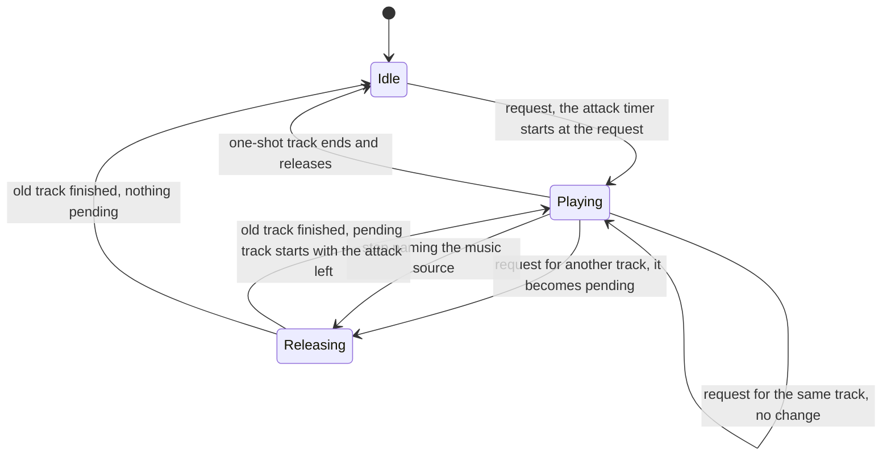

# Audio design: music hooks and the sound-design brief

> Status: Reference · Prefix: R-AUD · Related: [Folder index](README.md) · [Event catalogue](event_catalogue.md) · [Positional, priorities and mix](positional_priorities_and_mix.md) · [assets/GameAssets.md](../../assets/GameAssets.md) · [assets/art_and_audio_briefs.md](../../assets/art_and_audio_briefs.md) · [audio engine](../../architecture/components/audio_engine/README.md)

## 1 Purpose and player experience

The reference game plays **no music** in any session. Its audio engine nevertheless has a music channel, and its sound data names music events; this file records those hooks, the two match-end stings that Species authors now, and the music path and the proposed music that apply if DEC-049 adopts a score. It then gives the sound-design brief: the event set that the Species sound set must cover, the variety it needs, and the acceptance checks of the finished set. Every Species sound and every note of music is authored new (R-AUD-003).

## 2 Rules

### 2.1 Music hooks

**R-AUD-400** (MUST) **No music.** The reference plays no music at the front end, in the lobby or in a match, and has no menu music and no victory or defeat cue apart from the stings of R-AUD-307: no rule of a skirmish session raises a music event, and the sound data names music events that no rule raises. What the player hears instead is the lobby bed at the front end and the altitude-driven match bed in a match ([front end, HUD, voice and ambience](front_end_hud_voice_and_ambience.md) R-AUD-320, R-AUD-323). Music is a missing feature to design, recorded here as hooks only (DEC-049).

**R-AUD-401** (MUST) **Music events.** Music is any event of the `music` source, raised through the object-or-none entry of R-AUD-021, which routes it to the music channel instead of the effect voices. Every music layer of the reference data is two-dimensional, plays one sample and has a level of −5 dB to 0 dB. A `music` event raised through the position entry is not routed to the music channel.

**R-AUD-402** (MUST) **Slots.** The music channel holds exactly one playing track and one pending request. Music never takes an effect voice, is never positioned and never has effects.

**R-AUD-403** (MUST) **Requests and stops.** Requesting the track that is already playing changes nothing. A request for another track releases the playing track over its own release; the new track starts at the first audio update after the old one has finished and fades in over its own attack. A stop that names the `music` source releases the playing track; a stop that names no event of an emitter does not stop music (R-AUD-036). There is no cross-fade overlap, no beat or bar synchronisation and no playlist. This is the music channel of the hooks; when DEC-049 selects option A, the music path of R-AUD-414 replaces it.

**R-AUD-404** (MUST) **Attack timing.** The attack of a requested track is timed from the request, not from its start, so the fade-in that is left when the track starts is max(0, attack − time waited): after a release at least as long as its attack, the next track starts at full level. When DEC-049 selects option A, R-AUD-415 replaces this rule.

**R-AUD-405** (MUST) **Loops and level.** A looping music layer loops seamlessly; a one-shot music layer plays once and then releases. Music uses the same envelope rules, is never bent by game speed, and plays on the music bus with its own player volume and its default level `ref.aud.bus.music.level` (R-AUD-221, DEC-570).

**R-AUD-406** (MUST) No music event is reachable in a skirmish session, and none is specified here.

### 2.2 Music design brief (new)

**R-AUD-407** (MUST) Species authors two pieces of music now, the victory and defeat stings bound to the match end (R-AUD-307). The asset manifest also lists the proposed minimum of option A of DEC-049, the front-end theme and the in-match beds, which are authored only if DEC-049 selects option A; the design phase then sets their final list, triggers and mix ([GameAssets.md](../../assets/GameAssets.md) §16):

| Asset | Role | Needed |
|---|---|---|
| `music.front_end.theme` | the front-end theme, looping under the menus and the lobby | only under option A of DEC-049 |
| `music.match.bed` | three in-match beds of low intensity that sit under the crowd | only under option A of DEC-049 |
| `music.match.sting_victory` | the victory sting at the end of a match, bound to `match_ui.victory` (R-AUD-307) | now |
| `music.match.sting_defeat` | the defeat sting at the end of a match, bound to `match_ui.defeat` (R-AUD-307) | now |

**R-AUD-414** (MUST) **Species music path.** When DEC-049 selects option A, music streams through a voice pair of the music bus that cross-fades with sample-accurate timing (ADR-024, ADR-025): a request for another track starts it while the playing track releases, so the two overlap. This replaces the one-track channel of R-AUD-402 and R-AUD-403.

**R-AUD-415** (MUST) **Species attack timing.** When DEC-049 selects option A, a requested track's attack is timed from the moment the track starts, so it always fades in over its full attack. This replaces R-AUD-404.

**R-AUD-409** (MUST) A music system can attach to these existing moments, each an event or rule of the reference library: the front end built (`match_ui.lobby_bed` starts, R-AUD-321); the front end left (R-AUD-322); the match loop started (`ambience.match_enter`, R-AUD-323); the grace period over (`match_ui.countdown_zero`, R-AUD-304); the one-minute warning (`ref.match.one_minute_warning`, [01 Skirmish rules](../01_skirmish_rules_and_modes/README.md) R-MODE-037); time-up (R-AUD-306); the result declared (`match_ui.game_over`, `match_ui.victory`, `match_ui.defeat`, R-AUD-307); and the match loop left (`ambience.match_exit`, R-AUD-324).

### 2.3 Sound-design brief

**R-AUD-410** (MUST) **Scope.** Every reference sample, sample-group name and ambience design is replaced by new content; what Species keeps is the binding model of [event model and sound data](event_model_and_sound_data.md) and the event set of the [event catalogue](event_catalogue.md) (DEC-027). The sound-event table is written first, with every event present and silent placeholders allowed, so that a missing binding shows in the content build's validator and never as an unnoticed silence (R-AUD-005).

**R-AUD-411** (MUST) **The event set to author** covers these categories; the catalogue gives each event's trigger and layer data, and an event marked DEC-565 stays silent until that decision binds it:

| Category | Events to author | Catalogue |
|---|---|---|
| Worker | spawn chatter (one crowd voice), selection acknowledgement, crowd-order acknowledgement, battle cry, war horn, retreat, pain, death (voice and body), burning scream, carry chant, victory cheer, laser fire, reload click; gate entry and exit (silent) | `worker` |
| Leader | creation (an owner-only two-dimensional voice and a world sound), selection (owner only), waypoint and formation order loops with owner-only acknowledgements, the follow and none order changes (DEC-565), pain, death, gate entry | `leader` |
| Strike team | Trooper chatter (one crowd loop), laser fire, grenade throw (bound, DEC-097, `sfx.unit.trooper.throw_grenade`), grenade ready, pain, death, gate entry and exit | `trooper` |
| Builder, Collector, Transport | hover and engine loops linked to speed or height, the Transport's start-up sound and order acknowledgement, pain, death, boarding and leaving (DEC-565), Essence orb delivery, selection (DEC-565) | `builder`, `collector`, `transport` |
| Creatures | body loops, attacks, the spider's pounce and footsteps and landing (DEC-565), egg laying, the Crawler's direction chirp, pain, death, panic and growth (DEC-565), the Seed Pod's launch, bounce and burst, the Abductor's engine layers and tractor beam | `crawler`, `brood_drifter`, `centipede`, `spider`, `ant`, `reaper_serpent`, `seed_pod`, `abductor` |
| Weapons | laser-bolt fire, structure hit and kill (bound, DEC-564: `sfx.weapon.laser_bolt.spawn`, `sfx.weapon.laser_bolt.hit_structure`, `sfx.weapon.laser_bolt.kill`) and the hit bark; grenade throw, bounce, fuse blink and explosion; rocket launch, flight loop and explosion; the Bomber's engine and bomb drop; the airstrike bomb's fuse blink and explosion; the barrage missile's flight and its near and far explosion; the meteor's fall and its near and far landing | `laser_bolt`, `grenade`, `rocket`, `bomber`, `airstrike_bomb`, `barrage_missile`, `meteor` |
| Structures | turret creation, gun and flame fire, kill tick, target acquired and rocket fire (DEC-565); Barrier Emitter hum, spark, damage and electrocution (DEC-565); Beam Dish rotation start and stop, link and link lost; Spawn Node activation and deactivation; tree presence loops (ordinary, essence, blight speech), creation and burning; Solar Array and grid pylon surges and the charging loop; Control Zone hum; Command Console hum; Relic appearance, owner change (own, enemy, no team), drop, lift and carry (DEC-565); Core Device loop; Transit Gate coming online (DEC-565); Hive damage and explosion; Spitter Plant damage, burning and launch (DEC-565) | §2.6 of the catalogue |
| Supply crates | fall, landing, capture start (own, enemy and a bed), progress tones for 0 to 80 % rising and falling, the 100 % tone (DEC-565), opening, capture lost, expiry (DEC-565), and one sting for each of the 31 outcomes: the 25 that raise one, and the six that have none of their own (DEC-565, R-AUD-139), the rocket turret, flame turret, Firebomb Run, Builder, Time Dilation and Time Rush | `supply_crate`, `crate_outcome` |
| Launch Race | refuelling bed (silent), needs-fuel, fuelled, malfunction and flight loops, engine burn, damage, explosion, fuel-pump strokes, fuel flow, passenger boarding | `launch_vessel`, `fuel_pump`, `fuel_line`, `fuel_depot` |
| Match flow | countdown tick, countdown zero, match-clock ticks, time-up, game over (`sfx.ui.match_ui.game_over`), victory, defeat | `match_ui` |
| Interface | menu hover, select and back; chat; selection-circle sweep and drone; unit select; state toggle; invalid action; unit highlight; Power-slot hover and discard; Power input begin and confirm; Power select, selection set and cleared, and the crowd order (DEC-565) | `match_ui`, `power_slots`, `power_input` |
| Ambience | the front-end generative bed; the match bed with its altitude crossfade | `match_ui.lobby_bed`, `ambience.match_enter` |

**R-AUD-412** (SHOULD) **Variety.** The sound set needs about `ref.aud.variety.files` (900) files for its 182 bound events, about `ref.aud.variety.variants_per_event` (5) variants per event and up to 37 for the Worker battle cries; the largest groups are the Worker battle cries (37), the laser-hit bark (36), the Worker retreat (36, over two groups), the Crawler direction chirp (29) and the Worker laser fire (29, over two groups), and group sizes run from 2 members upwards. The asset manifest gives each group's variant count. A finished set needs about `ref.aud.variety.bark_variants` (3 to 8) variants for barks and impacts and `ref.aud.variety.sting_variants` (1 to 2) for stings and interface sounds.

**R-AUD-413** (MUST) The Resolved bindings of R-AUD-142 use new groups: the laser-bolt fire, structure-hit and kill sounds `sfx.weapon.laser_bolt.spawn`, `sfx.weapon.laser_bolt.hit_structure` and `sfx.weapon.laser_bolt.kill` (DEC-564), the Trooper grenade throw `sfx.unit.trooper.throw_grenade` (DEC-097) and the game-over announcement `sfx.ui.match_ui.game_over` (DEC-097); until their files are authored, the content build plays its placeholder for them. The victory and defeat stings exist (R-AUD-407), and the progress tones of the crate drain reuse the progress groups (R-AUD-031).

## 3 States and flows

Diagram 3-A: the reference music channel, recorded as a hook (R-AUD-401 to R-AUD-405).

## 4 Tuning table

| key | value | unit | range or notes | requirement | DEC |
|---|---|---|---|---|---|
| `ref.aud.variety.files` | 900 | files | about; the whole sound set for its 182 bound events | R-AUD-412 | — |
| `ref.aud.variety.variants_per_event` | 5 | variants | about, on average over the bound events | R-AUD-412 | — |
| `ref.aud.variety.bark_variants` | 3 to 8 | variants per group | barks and impacts of a finished set | R-AUD-412 | — |
| `ref.aud.variety.sting_variants` | 1 to 2 | variants per group | stings and interface sounds of a finished set | R-AUD-412 | — |

Keys cited here and defined elsewhere: `ref.aud.bus.music.level` in [positional, priorities and mix](positional_priorities_and_mix.md); `ref.match.one_minute_warning` in [01 Skirmish rules and modes](../01_skirmish_rules_and_modes/README.md).

## 5 Edge cases and interactions

- **Music and stops.** A stop of all of an emitter's sounds never stops music, so leaving a match does not stop a music track unless a rule names the `music` source (R-AUD-403); a Species music system names it explicitly at the moments of R-AUD-409.
- **Music and voices.** Music never competes with effects for voices (R-AUD-402); the music bus has its own two voices in the voice budget (DEC-570), which the music path of R-AUD-414 uses.
- **Match-end stings without music.** The victory and defeat stings are bound to match events, not to the music system, so they play whatever DEC-049 decides about the score (R-AUD-307).

## 6 Acceptance criteria

The acceptance checks of the Species sound set:

- **AC-BRF-01** (R-AUD-410, R-AUD-411) Given the Species sound-event table, when the validator runs, then every event of the [event catalogue](event_catalogue.md) is present, every bound event names an existing group or a placeholder, and the report is empty except for the silent events that DEC-565 keeps silent.
- **AC-BRF-02** (R-AUD-413, R-AUD-307) Given a match played to its end with Supply crates drained, Trooper grenades thrown and Workers firing at structures, then the match end, the crate drain, the grenade throw and the laser fire, structure hits and kills are all audible.
- **AC-BRF-03** (R-AUD-043) Given a match left at any moment, then every sound of the match has stopped or started its release within 2 s.
- **AC-BRF-04** (R-AUD-218, R-AUD-221) Given a stress scene of 500 units and 30 explosions in 1 s, then no interface sound and no sting is lost, and no kind of one-shot sound disappears entirely.
- **AC-BRF-05** (R-AUD-001) Given the same match with audio on and off, then the simulation states are equal at every tick; the only differences between participants are presentation (friend and foe variants, camera-dependent selection).
- **AC-BRF-06** (R-AUD-400, R-AUD-401) Given a reference skirmish session from start-up to leaving a match, then no music event reaches the music channel; given a Species music event raised through the object-or-none entry, then it plays on the music bus and not on an effect voice.
- **AC-BRF-07** (R-AUD-404) Given track B requested while track A releases over 10 s, with B's attack 5 s, then B starts at full level when A has finished.
- **AC-BRF-08** (R-AUD-414, R-AUD-415) Given option A of DEC-049, and track B requested while track A releases over 10 s, with B's attack 5 s, then B starts at once, overlapping A's release, and fades in over 5 s from its start.

## 7 Dependencies

- **Reference documents:** [event catalogue](event_catalogue.md) (the event set); [event model and sound data](event_model_and_sound_data.md) (entry kinds, stops, the validator); [positional, priorities and mix](positional_priorities_and_mix.md) (the music bus); [front end, HUD, voice and ambience](front_end_hud_voice_and_ambience.md) (beds, match end); [01 Skirmish rules and modes](../01_skirmish_rules_and_modes/README.md) (the one-minute warning).
- **Engine components:** [audio engine](../../architecture/components/audio_engine/README.md) (the music path of ADR-024; streaming of ADR-025).
- **Assets:** `music.front_end.theme`, `music.match.bed`, `music.match.sting_victory`, `music.match.sting_defeat`; [assets/art_and_audio_briefs.md](../../assets/art_and_audio_briefs.md) §12 to §15 (the style of the sound set and the music). The new groups of the Resolved bindings (R-AUD-413): `sfx.weapon.laser_bolt.spawn`, `sfx.weapon.laser_bolt.hit_structure`, `sfx.weapon.laser_bolt.kill`, `sfx.unit.trooper.throw_grenade`, `sfx.ui.match_ui.game_over`.

## 8 Open decisions

Each default is the behaviour that §2 specifies.

- DEC-049 — music: no music plays; the hooks of §2.1, the stings and the proposed music of §2.2, and the music path of option A (R-AUD-400, R-AUD-403, R-AUD-404, R-AUD-407, R-AUD-414, R-AUD-415).
- DEC-565 — sounds for the other silent gameplay events: the events of the brief marked DEC-565, among them the 100 % capture tone and the six outcomes without a sting of their own, stay silent until it binds them (R-AUD-411).
