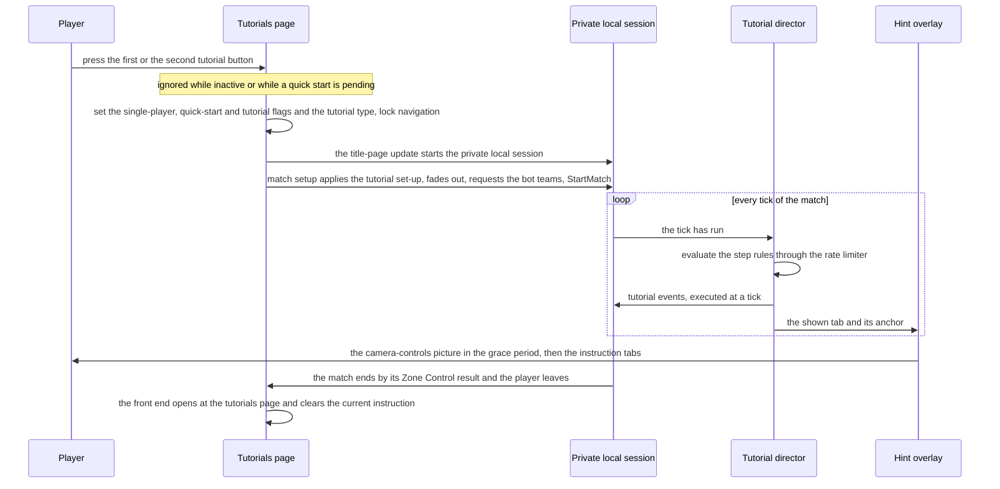
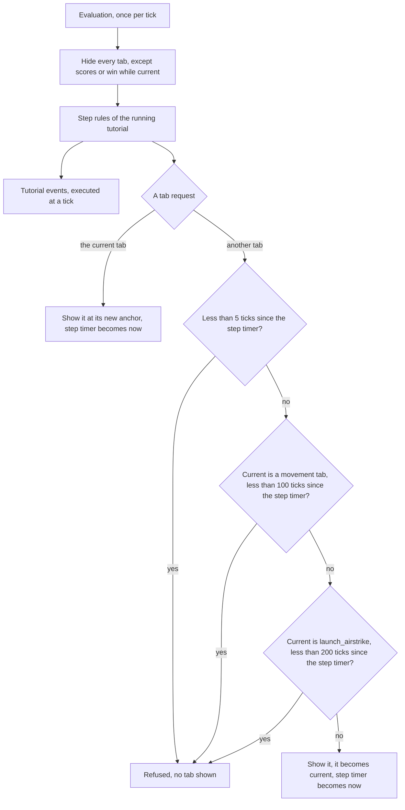
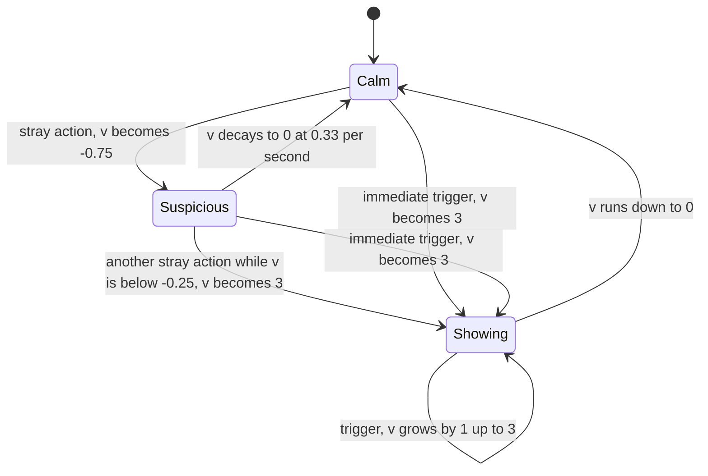

# Tutorial and help

> Status: Reference · Prefix: R-TUT · Related: [Skirmish rules and modes](01_skirmish_rules_and_modes/README.md) · [Zone Control](01_skirmish_rules_and_modes/zone_control.md) · [Controls, camera and commands](06_controls_camera_and_commands/README.md) · [Bot mode strategies and tutorials](07_bots/05_mode_strategies_and_tutorials.md) · [Front end and match flow](09_front_end_and_match_flow/README.md) · [Simulation model](12_simulation_model/README.md) · [Camera and sequences](../architecture/components/camera_and_sequences.md)

## 1 Purpose and player experience

This document specifies how the reference game teaches itself to a new player. The help has four parts, and nothing else teaches the game:

1. **Help pages.** Help and options leads to five general pages and to one to four pages per mode. Each page is a picture with a paragraph beside it (§2.4).
2. **Contextual hints.** During a match the hint overlay shows short messages when the player seems stuck: after repeated clicks on empty ground, while the camera is panned forward for a long time at normal speed, while the pointer rests on a Leader with no order or on a Transport's order marker, and while a turret or a Beam Dish is selected. The in-match tips setting switches these messages off (§2.3).
3. **Explainer panels.** While the players ready up for a match, an animated explainer panel shows what the mode is about (§2.3).
4. **Two tutorials.** The first teaches the basics and the second the advanced controls. Each is an ordinary single-player Zone Control match against easy bots, on its own map, with a **tutorial director** on top. The director looks at the world once per tick and shows at most one **instruction tab**: a box with a title and a short text, pinned to a world object by an arrow, its border pulsing in the player's team colour. The tab asks for one action at a time: gather Workers, take a Spawn Node, make a Leader, open a Supply crate, use the Power it gave, aim a Beam Dish, march a formation, drive a Transport (§2.5 to §2.10).

**Player experience.** A tutorial opens like any match, but during the grace countdown it shows a picture of the camera controls instead of the explainer panel. After the countdown the first tab appears next to the player's own Workers. The tab stays until the player does what it asks; there is no time-out, no failure and no penalty. When an action succeeds, the next tab waits a few seconds, so the player can watch the result. If the player loses ground, an earlier tab comes back. The first tutorial ends as its Zone Control match ends; the second tutorial hands over to a normal three-player match after its last tab. Leaving a tutorial returns to the tutorials page.

All text of this document is new, functional text keyed by Species string ids (DEC-037). No tutorial uses a narrator, a cut-scene or a script (DEC-053), and no tutorial step plays a camera animation (DEC-803). The tutorials as a whole are open for redesign (DEC-051); this document is the reference behaviour, with the corrections of DEC-103 applied.

## 2 Rules

### 2.1 Content, text and values

**R-TUT-001** (MUST) The help consists of exactly these parts: the help pages (§2.4), the contextual hints and the explainer panel of the hint overlay (§2.2, §2.3) and the two tutorials (§2.5 to §2.10). In a match no gamepad control prompts are drawn, and the contextual control-help panel and the in-match objective cards exist only as hooks (DEC-050); the control-help hook only records which controls the player has used, and its camera-moved condition reads the pointer's moved flag ([input](../architecture/components/input/devices_frames_and_queries.md) INP-160). No help part runs a script, a narrator or a cut-scene (DEC-053), and no tutorial step plays a camera animation: a tutorial's camera is the start-of-match camera of every match (R-CTRL-495 to R-CTRL-497, DEC-803).

**R-TUT-002** (MUST) Every text that this document shows is new text, keyed by the string ids of §2.11, written in plain functional British English in the source string table `strings.en_gb` and translated in `strings.de_de`, `strings.es_es`, `strings.fr_fr`, `strings.it_it`, `strings.ja_jp`, `strings.ko_kr`, `strings.pt_br` and `strings.ru_ru` (ADR-063). Each string id is defined once per language; a second definition is a content-build error (DEC-801). The pictures that the hints and the explainer panels animate are new art; what a reference explainer animation depicts is a brief for that art, not a rule (DEC-037).

**R-TUT-003** (MUST) A string of §2.11 that is marked with a gamepad variant shows that variant while the input mode is gamepad, and its base text otherwise; the input mode is the device that the player last used (ADR-029, ADR-063). A string names an input through an action-glyph argument, which the UI resolves to the current binding of the named action id of [actions and bindings](06_controls_camera_and_commands/actions_and_bindings.md) table 2.1-A. A change of input mode re-resolves the text, the variants and the glyphs of every visible hint and tab on the next frame.

**R-TUT-004** (MUST) The values of §4 are the reference tuning baseline (DEC-004), and this document is the specification of record for the tutorials and the help (DEC-005). Every reference behaviour that looks accidental and is kept is stated as an explicit rule with a named key (DEC-006).

### 2.2 The hint overlay

**R-TUT-010** (MUST) The hint overlay (`HintOverlay`) is presentation state of the local participant. There is one per application; it is created when the application starts and is reset when a match shuts down, which clears its hint timers, its explainer panel and the drawn state of every instruction tab. It never writes simulation state (DEC-007), and the actor counts that it reads have no simulation effect ([space, routing and physics](12_simulation_model/05_space_routing_and_physics.md) table of query users).

**R-TUT-011** (MUST) The hint overlay advances once per rendered frame, in step 10 of [R-CTRL-020](06_controls_camera_and_commands/README.md), after the world markers. Its advance does nothing unless a match world exists and the local team exists.

**R-TUT-012** (MUST) The hint overlay draws in the 2-D overlay pass after the world markers and before the world-cursor pass (R-CTRL-355). It draws nothing while there is no match world, while the interface is hidden (row A9 of R-CTRL-040), after game over, while the Siege victory delay runs ([Siege](01_skirmish_rules_and_modes/siege.md)), or while the local team does not exist. The widths of its lines are those its drawing rules state, each with its key or value: the border of an instruction tab, `ref.tut.tab.border` (2 px, R-TUT-074), and the outline of the camera-controls picture, 1 px (R-TUT-021); the renderer's hint-overlay pass cites them.

**R-TUT-013** (MUST) The hint overlay draws only the outputs of table 2.2-A. The events that mode and object rules report to it (a Control Zone event, R-MODE-254 step 3; a Launch Vessel fuel notification, R-BLDG-329) feed the objective cards. The objective cards are hooks only (DEC-050) and draw nothing in a match, so they need no picture.

Table 2.2-A Outputs of the hint overlay.

| # | Output | Shown when | Content | Duration | Rule |
|---|---|---|---|---|---|
| H1 | explainer panel | grace period of a match that is not a tutorial, while the players ready up | the mode's explainer animation, title and caption | while the condition holds | R-TUT-020 |
| H2 | camera-controls picture | grace period of a tutorial, keyboard and mouse mode | `help.hint.camera_controls` with the current camera bindings | the whole grace period | R-TUT-021 |
| H3 | deselect hint | after the grace period, in-match tips setting on, deselect-hint timer above 0 | `ui.help.hint.move_or_deselect` or `ui.help.hint.deselect`, centre layout | R-TUT-025 | R-TUT-024, R-TUT-025 |
| H4 | fast-pan hint | after the grace period, in-match tips setting on, keyboard and mouse mode, fast-pan-hint timer above 0 | `ui.help.hint.fast_pan`, centre layout | R-TUT-026 | R-TUT-026 |
| H5 | structure deselect hint | after the grace period, in-match tips setting on, the local team's selected structure is a turret or a Beam Dish | `ui.help.hint.deselect`, structure layout | every frame while selected | R-TUT-027 |
| H6 | demote hint | after the grace period, in-match tips setting on, the object under the pointer is a Leader with the order None | `ui.help.hint.demote_leader`, centre layout | every frame while hovered | R-TUT-028 |
| H7 | Transport arrival hint | after the grace period, in-match tips setting on, the order marker under the pointer belongs to a Transport whose arrival action is Idle | `ui.help.hint.transport_arrival`, centre layout | every frame while hovered | R-TUT-029 |
| H8 | instruction tabs | after the grace period of a tutorial | the tabs that the director shows | §2.6 | R-TUT-069 |

### 2.3 Contextual hints and the explainer panel

**R-TUT-020** (MUST) **Explainer panel (H1).** During the grace period of a match that is not a tutorial, while the grace countdown still holds its full value `ref.match.grace_period` because the players are readying up (R-MODE-039 to R-MODE-041), the hint overlay shows the explainer panel of the match's mode: the mode's explainer animation `anim.explainer`, which animates pictures `help.explainer_picture` on its canvas; a title, which is the mode's name `mode.<mode>.name` in capitals of the current language; and the caption `ui.help.explainer.<mode>` of table 2.11-C. The panel is built the first time it is needed in a match and kept until the match shuts down. The panel's placement on the screen is [front-end presentation](09_front_end_and_match_flow/front_end_presentation.md) §2.4 (R-META-224); the playback of the animation (timeline, loop start and loop end, objects hidden before their first key, team-colour roles) is the [animation and VFX component](../architecture/components/animation_and_vfx/README.md) under ADR-035 and DEC-750. The panel stops showing as soon as the countdown starts.

**R-TUT-021** (MUST) **Camera-controls picture (H2).** During the whole grace period of a tutorial, in keyboard and mouse mode only, the hint overlay shows the camera-controls picture `help.hint.camera_controls` instead of the explainer panel; in gamepad mode it shows nothing in its place. The picture carries no baked text: its labels are the current bindings of the camera actions of rows A1 to A3 of R-CTRL-040 (pan, fast pan, raise and lower), so a keyboard layout with other camera keys (R-CTRL-033) shows its own keys. The labels follow the active keyboard layout (`ActiveLayout()`) and are resolved again when the layout changes ([input](../architecture/components/input/binding_layers_and_rebinding.md) INP-166). The picture box is `ref.tut.camera_picture.width` (0.3 × screen height) wide and that width × `ref.tut.camera_picture.aspect` (128 ÷ 304) high, centred horizontally, with its top edge at `ref.tut.camera_picture.top` (0.70 × screen height). Behind the picture, the same box is filled black at alpha 0.6, switching to grey (0.4, 0.4, 0.4) at alpha 0.8 during the first 0.3 s of every second of the real clock (`ref.tut.camera_picture.flash`, R-SIM-570), and outlined by a 1-pixel white line at alpha 0.2.

**R-TUT-022** (MUST) The deselect hint, the fast-pan hint, the structure deselect hint, the demote hint and the Transport arrival hint (H3 to H7) are drawn only after the grace period and only while the in-match tips setting is on. The in-match tips setting (`interface.tips`) belongs to the other options ([options, localisation and hooks](09_front_end_and_match_flow/options_localisation_and_hooks.md) R-META-441) and defaults to `ref.meta.settings.tips.default` (on). It has no other effect: the explainer panel, the camera-controls picture and the instruction tabs ignore it.

**R-TUT-023** (MUST) **Hint message layout.** A hint message is a box `ref.tut.hint.layout.width` (0.35 × screen height) wide, with text of height `ref.tut.hint.layout.font` (0.02 × screen height) in the body font, drawn as an outline pass and then a fill pass, word-wrapped to the box; the box is (text lines + 1) × the text height high. In the **centre layout** the box is centred at `ref.tut.hint.layout.center` (0.5 × screen width, 0.78 × screen height). In the **structure layout** its centre is at x = `ref.tut.hint.layout.structure_x` (0.1 × screen width) and y = screen height − `ref.tut.hint.layout.structure_lift` (1.5) × the box height. With α the hint's alpha, the box is filled black at alpha `ref.tut.hint.layout.fill_alpha` (0.75) × α and outlined white at alpha `ref.tut.hint.layout.border_alpha` (0.5) × α. In the structure layout only, while any camera pan action of row A1 is held, the box also gets an additive white fill at alpha `ref.tut.hint.layout.flash_alpha` (0.6). The fade of R-TUT-024 applies to the deselect hint only; the other hints are drawn with α = 1 (DEC-870 item 1).

**R-TUT-024** (MUST) **Deselect hint timer.** The deselect hint keeps one signed timer v in seconds, 0 at match start, and a text choice. A trigger carries two flags, *immediate* and *move text*:

```
OnTrigger(_immediate, _moveText):
    if v > 0:
        v := min(v + extend, show)                     # already showing: extend it
    else:
        v := v - suspicionStep                         # count a stray action
        if v < suspicionLimit or _immediate:
            text := moveOrDeselect if _moveText else deselect
            v := show
each rendered frame, after the grace period, while the in-match tips setting is on:
    if v > 0:
        draw the hint with alpha min(1, v); v := v - dt
    else if v < 0:
        v := min(v + decay × dt, 0)                    # the suspicion fades back to 0
```

Here show is `ref.tut.hint.deselect.show_s` (3.0 s), extend is `ref.tut.hint.deselect.extend_s` (1.0 s), suspicionStep is `ref.tut.hint.deselect.suspicion_step` (0.75 s), suspicionLimit is `ref.tut.hint.deselect.suspicion_limit` (−1.0 s), decay is `ref.tut.hint.deselect.decay_per_s` (0.33 per second), dt is the presentation frame delta (R-SIM-570), and the texts moveOrDeselect and deselect are `ui.help.hint.move_or_deselect` and `ui.help.hint.deselect`. A single stray action is therefore tolerated; a second one within about 1.5 s shows the hint for 3 s; an immediate trigger shows it at once (diagram 3-C).

**R-TUT-025** (MUST) **Deselect hint triggers (H3).** The deselect hint is triggered:

1. by row S2 of R-CTRL-041 (the select action on empty ground while something is selected), which also plays `match_ui.error`, with *immediate* clear and *move text* set: the text is `ui.help.hint.move_or_deselect`;
2. by row T2 of R-CTRL-044 (the special-orders action while a Power is being placed, keyboard and mouse mode only), which also plays `match_ui.error`, with *immediate* set and *move text* clear: the text is `ui.help.hint.deselect`.

The hint uses the centre layout.

**R-TUT-026** (MUST) **Fast-pan hint (H4).** In keyboard and mouse mode, on every frame on which the condition of step 4 of [R-CTRL-471](06_controls_camera_and_commands/camera.md) holds (`action.camera.pan_forward` held alone, without another pan direction and without `action.camera.fast_pan`, for more than `ref.ctrl.camera.speed_hint_hold`), the fast-pan-hint timer is set to `ref.tut.hint.fast_pan.show_s` (3.0 s). The timer counts down by the presentation frame delta every frame. While it is above 0 the hint `ui.help.hint.fast_pan` shows in the centre layout, so it stays for 3 s after the forward pan is released or joined by another key.

**R-TUT-027** (MUST) **Structure deselect hint (H5).** While the local team's selected structure (R-SIM-401) is a turret of any kind or a Beam Dish, the hint `ui.help.hint.deselect` shows in the structure layout, every frame; its flash fill of R-TUT-023 shows while a camera pan action is held.

**R-TUT-028** (MUST) **Demote hint (H6).** While the object under the pointer ([actions and bindings](06_controls_camera_and_commands/actions_and_bindings.md) §2.4) is a Leader whose order is None (R-UNIT-164), the hint `ui.help.hint.demote_leader` shows in the centre layout, every frame. Its text names the separate demote action `action.order.demote` (DEC-086).

**R-TUT-029** (MUST) **Transport arrival hint (H7).** While the order marker under the pointer (R-CTRL-387) belongs to a Transport whose arrival action is Idle (R-UNIT-386), the hint `ui.help.hint.transport_arrival` shows in the centre layout, every frame. Its text names `action.order.promote`, which cycles the arrival action on the marker (row O5 of R-CTRL-042).

### 2.4 Help pages

**R-TUT-040** (MUST) The help windows (help and options, help selection, general help and mode help), their navigation and their buttons are specified in [screen flow and match setup](09_front_end_and_match_flow/screen_flow_and_match_setup.md) (R-META-004 and its table of help windows). This section specifies the pages they show.

**R-TUT-041** (MUST) A help page shows one picture and one text. The picture is a square of side (the height of the window's left box) ÷ `ref.tut.help_page.picture_divisor` (3.5) at the left of the page; the text is word-wrapped beside it in the body font at the small font size of the [UI framework](../architecture/components/ui_framework/README.md). A picture that shows controls has a variant per language, and a keyboard picture also one per keyboard layout; without a variant for the current language the base-language picture is shown ([options, localisation and hooks](09_front_end_and_match_flow/options_localisation_and_hooks.md) R-META-472).

**R-TUT-042** (MUST) The general help has pages 1 to `ref.meta.help.general_pages` (5). Page n shows variant n of `help.general_page` and the text `ui.help.page.general.<n>` (table 2.11-D). Its button in the help selection is captioned `ui.help_select.general` (reference/09).

**R-TUT-043** (MUST) The help of a mode has pages 1, 2 and onwards. Page n of mode m shows the picture of `help.mode_page` for that mode and page and the text `ui.help.page.<m>.<n>`, with m the mode's string-id stem (`spawn_control`, `zone_control`, `relic_run`, `siege`, `launch_race`, `flag_chain`). The number of pages is data: a page exists while its text string exists, and the mode help closes itself on reaching a page whose text does not exist (reference/09 R-META-471); because only complete languages are offered, every language gives the same page counts. The reference content has `ref.tut.help_page.mode_pages` pages: Spawn Control 1, Zone Control 2, Relic Run 3, Siege 3, Launch Race 4 and Flag Chain 3, 16 in all, which matches the 16 pictures of `help.mode_page`. The mode help's title is `ui.help.mode.<m>.title`.

**R-TUT-044** (MUST) The general pages 1, 2 and 5 and Relic Run page 2 carry a gamepad variant (R-TUT-003). Table 2.4-A gives the topic of every page; the texts are table 2.11-D.

Table 2.4-A Help page topics.

| Page | Picture | Text | Gamepad variant | Topic |
|---|---|---|---|---|
| General 1 | `help.general_page` 1 | `ui.help.page.general.1` | yes | Workers make up the whole army |
| General 2 | `help.general_page` 2 | `ui.help.page.general.2` | yes | promoting a Worker to a Leader |
| General 3 | `help.general_page` 3 | `ui.help.page.general.3` | no | Workers come from Spawn Nodes |
| General 4 | `help.general_page` 4 | `ui.help.page.general.4` | no | Workers attack nearby enemies by themselves |
| General 5 | `help.general_page` 5 | `ui.help.page.general.5` | yes | Supply crates with random Powers drop from the sky |
| Spawn Control 1 | `help.mode_page` Spawn Control 1 | `ui.help.page.spawn_control.1` | no | holding as many Spawn Nodes as possible |
| Zone Control 1 | `help.mode_page` Zone Control 1 | `ui.help.page.zone_control.1` | no | holding as many Control Zones as possible |
| Zone Control 2 | `help.mode_page` Zone Control 2 | `ui.help.page.zone_control.2` | no | taking a zone by moving Workers into it |
| Relic Run 1 | `help.mode_page` Relic Run 1 | `ui.help.page.relic_run.1` | no | scoring by lifting Relics and carrying them home |
| Relic Run 2 | `help.mode_page` Relic Run 2 | `ui.help.page.relic_run.2` | yes | lifting needs many Workers |
| Relic Run 3 | `help.mode_page` Relic Run 3 | `ui.help.page.relic_run.3` | no | taking a Relic that enemies carry |
| Siege 1 | `help.mode_page` Siege 1 | `ui.help.page.siege.1` | no | the split into attackers and defenders |
| Siege 2 | `help.mode_page` Siege 2 | `ui.help.page.siege.2` | no | the defenders' Core Device |
| Siege 3 | `help.mode_page` Siege 3 | `ui.help.page.siege.3` | no | Breach Charges, the explosives that Workers carry |
| Launch Race 1 | `help.mode_page` Launch Race 1 | `ui.help.page.launch_race.1` | no | the three objectives |
| Launch Race 2 | `help.mode_page` Launch Race 2 | `ui.help.page.launch_race.2` | no | capturing Solar Arrays like Spawn Nodes |
| Launch Race 3 | `help.mode_page` Launch Race 3 | `ui.help.page.launch_race.3` | no | boarding starts once the fuel is full |
| Launch Race 4 | `help.mode_page` Launch Race 4 | `ui.help.page.launch_race.4` | no | defending the Launch Vessel as its fuel rises |
| Flag Chain 1 | `help.mode_page` Flag Chain 1 | `ui.help.page.flag_chain.1` | no | knocking teams out by taking their Flag posts |
| Flag Chain 2 | `help.mode_page` Flag Chain 2 | `ui.help.page.flag_chain.2` | no | the first Flag post a team takes is its Home post |
| Flag Chain 3 | `help.mode_page` Flag Chain 3 | `ui.help.page.flag_chain.3` | no | knocking out every other team wins |

### 2.5 Tutorials: set-up, start and end

**R-TUT-050** (MUST) There are two tutorials, the **first tutorial** (the basics) and the **second tutorial** (advanced controls), launched from the tutorials page by the buttons `ui.tutorials.part_1` and `ui.tutorials.part_2` (R-META-036). Each is a single-player Zone Control match in a private local session against Easy bots (R-MODE-083), with the tutorial director of §2.6 running on top of it. A tutorial has no rules of its own beyond the overrides of §2.8 and the effects of its director. This section and §2.6 to §2.10 are the reference tutorials; whether and how Species keeps tutorials is open (DEC-051).

**R-TUT-051** (MUST) The tutorials are set up as table 2.5-A states. The match setup applies the set-up (R-META-037, R-MODE-083); this document owns the tutorial maps' contents (R-TUT-052) and the director.

Table 2.5-A Tutorial set-up.

| Item | First tutorial | Second tutorial | Owner |
|---|---|---|---|
| mode | Zone Control | Zone Control | R-MODE-083 |
| map | the 2-player tutorial map, slot `map_zone_control_2p_01` | the 3-player tutorial map, slot `map_zone_control_3p_01` | R-MAP-158 |
| map player count and population cap | `ref.tut.first.map_positions` (2) positions; map population cap `ref.tut.first.map_population_cap` (2,000) | `ref.tut.second.map_positions` (3) positions; map population cap `ref.tut.second.map_population_cap` (1,800); no defender cap (DEC-120) | this document; per-team cap R-MODE-258 |
| teams | the tutorial player in slot 0 and one bot | the tutorial player in slot 0 and two bots | R-META-037 (player count − 1 bot teams) |
| bot difficulty | Easy; the session start does not reset it to Standard | Easy, likewise; Standard from the end step (R-TUT-117) | R-MODE-030, R-BOT-022, R-BOT-150 |
| match options | every Zone Control option at its default: score mode 0; time limit `ref.mode.zone_control.option.time_limit` (5 minutes); Catch-up bonus `ref.econ.catch_up.option_percent` (90 %); crate drop period `ref.crate.drop.period_default_s` (40 s); starting powers `ref.econ.start.powers` (0); Comeback Bonus `ref.match.option.comeback_bonus` (on); sudden death `ref.match.option.sudden_death` (on); crate placement `ref.match.option.crate_placement` (weighted) | the same; crate placement becomes random at the end step | R-MODE-074, R-MODE-083, R-MODE-253 |
| colours | requested colour 0; bot colours equal their slot ids | slot colours 0, 1 and 2; bot colours equal their slot ids | R-MODE-016, R-SIM-416 |
| start positions | position = slot id | position = slot id | R-MODE-011, R-SIM-417 |
| start camera | cut to `default_view`, then to `spawn_view_0` | the same | R-CTRL-495 to R-CTRL-497 |
| grace period display | the camera-controls picture, not the explainer panel | the same | R-TUT-021 |
| Supply crate drops | none; the director inserts one airstrike crate | none until the end step; the director inserts one Transport crate | R-CRATE-102, R-CRATE-109 |
| end | the Zone Control match runs to its normal result | the director stops after the win tab; a normal 3-player Zone Control match continues | R-TUT-055 |

**R-TUT-052** (MUST) A tutorial map is an ordinary Zone Control map whose structures and bot navigation nodes also carry the **role tags** of table 2.9-A (first tutorial) or table 2.10-A (second tutorial). The director, the bots and the overrides find every object they name through its role tag, resolved at match start, never through a structure id or a team id (DEC-103). A tutorial map that lacks a role is a content-build error (DEC-015); at run time a role that does not resolve to a live object of the expected kind ends that tick's director evaluation where the step tables say so. The positions in tables 2.9-A and 2.10-A are the reference layout.

**R-TUT-053** (MUST) A tutorial's button is inactive while its map is not in the Zone Control map list (R-META-036). Maps are identified by their content identity (DEC-204), so a tutorial is offered exactly when its map is present and permitted.

**R-TUT-054** (MUST) A tutorial starts as diagram 3-A shows: the button press (ignored while it is inactive or while a quick start is pending) sets the single-player, quick-start and tutorial flags and the tutorial type and locks the page navigation; the title-page update starts the private local session; the match setup applies the set-up of table 2.5-A, fades out, requests the bot teams and issues `PlayerCommand::StartMatch` (R-META-034, R-META-037). The world is held during the grace period, so the director is first evaluated after post-grace tick 0, the first world tick (R-MODE-040), and then after every tick (R-TUT-061).

**R-TUT-055** (MUST) Neither tutorial raises a completion event. The first tutorial ends when its Zone Control match ends by the Zone Control result rules (R-MODE-257). In the second tutorial the director stops `ref.tut.second.end_tab_ticks` after its win tab was accepted (R-TUT-117); the match then goes on as a normal 3-player Zone Control match, whose time limit counts down from the held value of R-TUT-081 from the tick at which the bots may spawn.

**R-TUT-056** (MUST) A tutorial has no skip control. The menu action opens the in-match menu exactly as in any match (row M4 of R-CTRL-047; no tutorial runs a script, DEC-053). Leaving the match returns to the front end at the tutorials page (R-MODE-035, R-META-011), whose set-up clears the current instruction (R-META-036). A tutorial may be played again at once.

**R-TUT-057** (MUST) All director state is reset at the start of every tutorial run (DEC-103): no current tab, the step timer unset, every tab hidden, the score time, the score-window latch and the score-started flag of the first tutorial clear, the three lesson flags of the second tutorial clear, both gates clear (R-TUT-082), and no tutorial Supply crate. A second run in the same session therefore behaves exactly like the first; in particular the first tutorial's scores tab shows on every run.

### 2.6 The tutorial director

**R-TUT-060** (MUST) The **tutorial director** evaluates the step rules of the running tutorial (§2.9, §2.10) for the tutorial player's team. Each evaluation chooses at most one instruction tab, which it anchors to a world point, and decides the tutorial's world-changing effects. The tabs (table 2.11-A) are the only output the player sees.

**R-TUT-061** (MUST) The director is evaluated once per tick of match time, on the tutorial player's participant, in step 10 of R-CTRL-020 of the first frame after the tick has run, from the state of that tick. Its clock *now* is the match tick counter (DEC-009); it never reads the real clock (DEC-103). While the world is held, during the grace period and during a pause, no world tick runs, so the director is not evaluated and its timers do not advance (DEC-870 item 4).

**R-TUT-062** (MUST) Every world-changing effect that the director decides is issued as a **tutorial event**, which the simulation executes at a tick in the command order of [teams and player commands](12_simulation_model/06_teams_and_player_commands.md), never by the frame loop and never on a real-clock timer (DEC-103, R-SIM-727, R-SIM-230). The tutorial events are: insert the tutorial Supply crate with a forced outcome at a point (R-TUT-098, R-TUT-116); reduce a Beam Dish's valid receivers to one dish (R-TUT-114); set the bots-may-act gate (R-TUT-115); and the end step, which switches basic crates only on, sets crate placement to random, sets the bot difficulty to Standard and sets the bots-may-spawn gate (R-TUT-117). The simulation's list of these events, and how each enters the command batch of a tick, is R-SIM-462. Executing an event again changes nothing more.

**R-TUT-063** (MUST) Every ownership test and every count of the director uses the tutorial player's team, the local player's team of the tutorial match, and never a fixed team id (DEC-103). "Owned" in §2.9 and §2.10 means owned by the tutorial player's team; "a bot" means a bot team of the tutorial.

**R-TUT-064** (MUST) At the start of each evaluation the director hides every instruction tab, except that the scores tab and the win tab stay shown while each is the current tab. Each step rule may then request a tab with an anchor point and an up-offset, one of `ref.tut.tab.up_offsets` (20, 30, 40, 60 or 80 wu) as the step tables of §2.9 and §2.10 give it ("up 40"); the request passes through the rate limiter of R-TUT-066.

**R-TUT-065** (MUST) The director keeps one **current tab** (none at the start) and one **step timer** in ticks (unset at the start; every test of R-TUT-066, R-TUT-097, R-TUT-116 and R-TUT-117 against an unset step timer passes, so the first request is accepted; DEC-870 item 3). The step timer holds the tick of the last accepted request; it is refreshed by every accepted request, not only by a change of tab, and every delay in §2.9 and §2.10 that counts "since the step timer" counts from it.

**R-TUT-066** (MUST) A tab request passes through this rate limiter:

```
Request(_tab, _anchor, _upOffset):
    if _tab != current:
        if now < stepTimer + minGap: refuse                              # minimum gap between different tabs
        if current is a movement tab and now < stepTimer + breather: refuse
        if current = launch_airstrike and now < stepTimer + airstrikeBreather: refuse
    _tab.anchor := _anchor; _tab.upOffset := _upOffset; show _tab
    current := _tab; stepTimer := now
```

minGap is `ref.tut.director.min_gap_ticks` (5 ticks), breather is `ref.tut.director.breather_ticks` (100 ticks), airstrikeBreather is `ref.tut.director.airstrike_breather_ticks` (200 ticks), and the **movement tabs** are `capture_node`, `move_to_zone`, `leader_to_zone` and `capture_far_zone` (table 2.11-A).

**R-TUT-067** (MUST) Because every tab is hidden at the start of an evaluation (R-TUT-064), a refused change of tab shows no tab at all: after a movement step the player sees no instruction for 100 ticks, and after the airstrike for 200 ticks. When one evaluation makes two requests for different tabs, the second is refused by the minimum gap, because the first refreshed the step timer; a second request for the same tab only moves its anchor. A tab that the player ignores is requested again at every evaluation and stays, with no time-out.

**R-TUT-068** (MUST) The step rules use the counts and tests of table 2.6-A, each over the tutorial player's team.

Table 2.6-A Director counts and tests.

| Name | Definition | Keys |
|---|---|---|
| idle(p, r) | the Workers of the team among `Friends(p, r, team)` (R-SIM-311, exact) that are alive, on the ground and in the state Idle (R-UNIT-068) | `ref.tut.count.idle_radius` |
| heading(p) | the Workers of the team whose pending order position (the Worker field table of [worker.md](02_units/worker.md)) lies within `ref.tut.count.heading_tolerance` (80 wu) of p. Arrival clears only the pending-order set flag (R-UNIT-073), so Workers that have arrived keep counting | `ref.tut.count.heading_tolerance` |
| beacons(p, q) | the Leaders of the team within `ref.tut.count.leader_radius` (100 wu) of p whose order is Waypoint and whose order position lies within `ref.tut.count.leader_target_tolerance` (100 wu) of q | `ref.tut.count.leader_radius`, `ref.tut.count.leader_target_tolerance` |
| formation leaders towards p | the Leaders of the team in formation mode whose waypoint lies within `ref.tut.count.formation_waypoint_tolerance` (150 wu) of p | `ref.tut.count.formation_waypoint_tolerance` |
| formation anchor | for the first Leader of the team in formation mode, in the order of the team's special units (R-SIM-400): its position + its front × `ref.tut.count.formation_anchor_ahead` (30 wu); none when no Leader of the team is in formation mode. "A formation exists" means the anchor is not none | `ref.tut.count.formation_anchor_ahead` |
| selected Workers | the team's selected Worker count (R-SIM-402) | — |
| selected actor, selected structure | the actor and the structure of the team's current selection (R-SIM-401) | — |
| current Power | the team's current Power ([selection and Power slots](06_controls_camera_and_commands/selection_and_power_slots.md)) | — |
| pop-up showing | the Power slots panel's most-recent-Power mark is still in its showing phase (R-CTRL-239); this is the one presentation input of the director, and only tab choices read it | — |
| zone count | a Control Zone's count of the team's Workers at its latest recount (R-MODE-251) | — |
| enemies near p | `CountEnemiesInCells(p, r, team)` (R-SIM-311; approximate by rule, R-SIM-312, DEC-094) | — |

**R-TUT-069** (MUST) After the grace period of a tutorial, the hint overlay draws every shown instruction tab each frame, by R-TUT-070 to R-TUT-075. During the grace period no tab is shown or drawn.

### 2.7 Drawing an instruction tab

**R-TUT-070** (MUST) **Anchor.** A tab's screen anchor is the screen projection, by the world-marker projection of R-CTRL-383, of its anchor point raised by its up-offset (anchor + (0, up-offset, 0)). When the projected point is not on screen, its screen y becomes screen height − y. While the current tab is `select_airstrike` or `select_transport`, the anchor is instead the fixed screen point `ref.tut.tab.screen_anchor` (0.5 × screen width, 0.85 × screen height).

**R-TUT-071** (MUST) **Size and text.** A tab is w = `ref.tut.tab.width` (280 px) × (1 + `ref.tut.tab.pulse` (0.02) × sin(8 t)) wide, with t the real clock in seconds (R-SIM-570) and the angular rate `ref.tut.tab.pulse_rate` (8 rad/s), so its width pulses by ±2 %. The title text height is `ref.tut.tab.title_font` (0.12) × w in the title font, word-wrapped at 0.6 × the text height per character; the body text height is `ref.tut.tab.body_font` (0.06) × w in the body font, word-wrapped at 0.55 × the text height per character.

**R-TUT-072** (MUST) **Geometry.** With the line counts of the wrapped title and body, the box height h is title height × title lines + body height × body lines + `ref.tut.tab.padding` (25 px). The half-width is w ÷ 2, the half-height is h ÷ 2, the arrow size is half-height ÷ 2, and the title bar is title height × title lines + `ref.tut.tab.title_bar_extra` (10 px) high. The text is inset `ref.tut.tab.text_inset` (13 px) from the box edges.

**R-TUT-073** (MUST) **Clamping and the arrow.** The arrow points from the box to the anchor. With (x, y) the anchor on screen: when x ≤ half-width + arrow size, the arrow points left; symmetrically, when x ≥ screen width − half-width − arrow size, it points right (the mirror of the left-edge test, DEC-870 item 2); when y ≤ 2 × half-height (`ref.tut.tab.top_clamp`), the arrow points up and only the title bar is drawn, without the body; when y ≥ screen height, the arrow points down. In the normal case the box centre is placed at y − `ref.tut.tab.box_lift` (1.5) × half-height, so the tip of the downward arrow touches the anchor.

**R-TUT-074** (MUST) **Colours.** The box is filled black at alpha 0.72; its border is 2 px (`ref.tut.tab.border`) in the local team's colour at alpha 0.452, raised to the flash alpha `ref.tut.tab.alpha` (0.9) while sin(8 t) > 0, a flash with a period of about 0.785 s (`ref.tut.tab.pulse_rate`); the arrow is a triangle in the border colour; the title bar is filled in the team colour at alpha 0.226, flashing to 0.9 with the border; the text is white, drawn as an outline pass and then a fill pass.

**R-TUT-075** (MUST) A tab shows its title string `tutorial.tab.<name>.title` and its body string `tutorial.tab.<name>.body` (table 2.11-A), the body in its gamepad variant where the table marks one (R-TUT-003).

### 2.8 Gameplay overrides while a tutorial runs

**R-TUT-080** (MUST) While a tutorial runs, the overrides of table 2.8-A apply. Each row's owner specifies the rule; this table collects them so that the tutorials can be built as a whole. "Before the release" means while the bots-may-spawn gate of the second tutorial is clear (R-TUT-082).

Table 2.8-A Gameplay overrides in the tutorials.

| Effect | First tutorial | Second tutorial, before the release | Second tutorial, after the release | Owner |
|---|---|---|---|---|
| Supply crate drop rule | off | off | on, with basic crates only and random placement (R-TUT-117) | R-CRATE-102, R-CRATE-031, R-ECON-120 |
| unopened Supply crates count down their life | no | no | yes | R-CRATE-119 |
| airstrike target markers | `ref.hazard.airstrike.tutorial_marker_count` (10) instead of 3 to 7 | 10 | 10 | R-UNIT-712 |
| the player may stop a Power | no | no | yes | R-CTRL-210, R-CRATE-021 (DEC-550) |
| a Transport is destroyed when its Power is stopped | no | no | no | R-CRATE-155, R-CTRL-211 |
| Leader formations | disabled: no click is a formation toggle, `FormUp` does nothing and every formation counts as full | enabled | enabled | R-UNIT-170, R-UNIT-172, R-UNIT-181 |
| Worker grenades | normal | disabled | normal | R-UNIT-104 |
| Spawn Node production | normal | locked by the tutorial limits `ref.econ.tutorial.second_max_requests` (100) and `ref.econ.tutorial.second_player_limit` (200) | normal | R-ECON-052 rule 1 |
| bot movement | random selection with the first-tutorial exclusions | no move before the bots may act; afterwards the first bot never moves and the second moves only to Beam Dish nodes | normal | R-BOT-151, R-BOT-152 |
| bot Beam Dish aiming | unfiltered | filtered once the bots may act | filtered | R-BOT-153 |
| bot gate node priority | — | forced to the pin value | 0 once the second bot owns exactly one Spawn Node | R-BOT-155 |
| bot formation Leaders | none | none | none | R-BOT-154 |
| bot conveyor Leaders | wherever the bot's random selection gives a target | only the second bot, once the bots may act, towards Beam Dish nodes, as its movement allows | normal | R-BOT-094, R-BOT-152 |
| the final Beam Dish as a receiver | — | never valid | never valid | R-BLDG-158 |
| bot colours | the slot id | the slot id | the slot id | R-MODE-016, R-SIM-416 |
| start positions | the slot id | the slot id | the slot id | R-MODE-011, R-SIM-417 |
| scoreboard | hidden until some team scores | hidden until some team scores | hidden until some team scores | R-MODE-063 |
| match clock and time limit | normal | time remaining held (R-TUT-081); clock hidden | counts down from the held value; clock shown | R-TUT-081, R-MODE-066 |

**R-TUT-081** (MUST) In the second tutorial, while the bots-may-spawn gate is clear, the match rules set the time remaining to `ref.tut.second.held_time_remaining` (300 mode seconds, the 5-minute default time limit) at every tick, and the match clock is hidden (R-MODE-066). From the tick at which the gate is set, the time remaining counts down from that value as in every Zone Control match (R-MODE-254). The match-lifecycle side of this rule is [match lifecycle](12_simulation_model/02_match_lifecycle_and_state_reset.md) R-SIM-032.

**R-TUT-082** (MUST) The second tutorial has two **gates**, *bots may act* and *bots may spawn*. They are match state, clear at match start and in every other match, and are set only by tutorial events (R-TUT-062, R-SIM-462); once set they stay set until the match ends (R-SIM-032). The rules of table 2.8-A and the director read them; the director's other state (the current tab, the step timer, the lesson flags and the score latches) is local to the director.

### 2.9 First tutorial: the basics

**R-TUT-090** (MUST) The first tutorial's map carries the role tags of table 2.9-A. The director names three Spawn Nodes N0 = `home_node`, N1 = `second_node` and N2 = `third_node`, and three gather points G0 = `home_gather`, G1 = `second_gather` and G2 = `third_gather`, each a bot navigation node next to the Spawn Node of the same index.

Table 2.9-A Roles of the first tutorial map (reference layout).

| Role tag | Kind | Team at start | Reference position (x, z) in wu | Used by |
|---|---|---|---|---|
| `home_node` | Spawn Node | the tutorial player (position 0) | (652.31, 858.62) | rules B and C |
| `second_node` | Spawn Node | none | (1157.24, 845.36) | rules A, B and C |
| `third_node` | Spawn Node | none | (1570.37, 686.83) | rules B, C and D |
| `home_gather` | bot navigation node | — | (699.05, 906.38), 66.8 wu from `home_node` | rules A, B, C and D |
| `second_gather` | bot navigation node | — | (1163.51, 912.70), 67.6 wu from `second_node` | rules B, C and D |
| `third_gather` | bot navigation node | — | (1599.06, 724.60), 47.4 wu from `third_node` | rule D |
| `centre_zone` | Control Zone, radius `ref.tut.first.zone_radius` (150 wu) | none | (1208.74, 1400.50) | rules S, A, C and D; the bots' centre exclusion (R-BOT-151) |
| `far_zone` | Control Zone, radius 150 wu | none | (1844.11, 749.73) | rule D |
| `crate_point` | bot navigation node | — | (1466.79, 1083.31) | the airstrike crate (R-TUT-098) |
| `enemy_home_node` | Spawn Node | the bot (position 1) | (629.54, 2014.80) | the airstrike target |
| `bot_excluded_node` | bot navigation node | — | the map's choice | the bots' exclusion (R-BOT-151) |

**R-TUT-091** (MUST) The first tutorial's director holds, besides the current tab and the step timer, a **score time** (none at the start), a **score-window latch** and a **score-started flag** (both clear at the start). It has no step counter: its tab is a function of the world state, the step timer and these three values, so an earlier instruction comes back whenever its condition holds again (R-TUT-099).

**R-TUT-092** (MUST) Each evaluation of the first tutorial runs rule S, then ends at once when N0, N1 or N2 does not resolve to a Spawn Node, and then runs rules A, B, C and D in this order. A rule runs only while no earlier rule of this evaluation has made a request, accepted or refused. Rules B and C each run their two iterations i = 0 and i = 1 in full, so one evaluation may make two requests (R-TUT-067).

**R-TUT-093** (MUST) **Rule S, the scores window.**

```
if scoreTime is set and now <= scoreTime + scoresLatch: scoreWindow := true
if scoreWindow:
    if now < scoreTime + scoresWindowLength:
        Request(scores, centre_zone position + (0, scoresLift, 0), up 20)
    else:
        scoreTime := none; scoreWindow := false
    end the evaluation
```

scoreTime is the score time and scoreWindow the score-window latch of R-TUT-091; scoresLatch is `ref.tut.first.scores_latch_ticks` (100 ticks), scoresWindowLength is `ref.tut.first.scores_window_ticks` (400 ticks) and scoresLift is `ref.tut.first.scores_lift` (50 wu). The scores tab stays shown while it is the current tab (R-TUT-064). Because the rate limiter still applies, a scores window that opens during the airstrike breather shows the tab only once the breather has passed, and for the rest of the window.

**R-TUT-094** (MUST) **Rule A, the centre zone.** N1 is *taken* when it is owned or heading(N1) ≥ `ref.tut.first.heading_count` (10). When N1 is taken and heading(`centre_zone`) < 10:

1. when the selected Workers are 0 and idle(G0, `ref.tut.count.idle_radius`) > `ref.tut.first.zone_group_idle` (15), request `select_group` at G0, up 40;
2. otherwise, when the selected Workers are above 0, request `move_to_zone` at `centre_zone`, up 40.

**R-TUT-095** (MUST) **Rule B, the next Spawn Node.** When there is no selected actor, for i = 0 and then i = 1, when Ni is owned and Ni+1 is not owned:

1. when the selected Workers are 0, idle(Gi, 100 wu) ≥ `ref.tut.first.node_group_idle` (20) and heading(Ni+1) < 10, request `select_group` at Gi, up 40;
2. otherwise, when the selected Workers are above 0, request `capture_node` at Ni+1, up 40.

**R-TUT-096** (MUST) **Rule C, the Leaders.** When `centre_zone` is owned or its zone count is above `ref.tut.first.zone_presence` (5), for i = 0 and then i = 1, when Ni is owned, Ni+1 is *dealt with* (owned, or heading(Ni+1) > 10) and beacons(Gi, `centre_zone`) = 0:

1. when the selected Workers are 0, idle(Gi, 100 wu) ≥ `ref.tut.first.promote_idle` (10) and there is no selected actor, request `promote` (i = 0) or `promote_advanced` (i = 1) at Gi, up 40;
2. otherwise, when the selected actor is a Leader, request `leader_to_zone` at `centre_zone`, up 20.

**R-TUT-097** (MUST) **Rule D, the far zone, the Supply crate and the airstrike.** When N0, N1 and N2 are all owned and beacons(Gj, `centre_zone`) ≥ 1 for at least `ref.tut.first.beacon_points` (2) of G0, G1 and G2, the first matching branch applies. The far zone is *taken* when `far_zone` is owned or heading(`far_zone`) ≥ 10. The **crate lesson** is done when the tutorial crate has been inserted, no longer exists, and the team holds no airstrike Power.

1. **D1.** When the far zone is not taken and idle(G2, 100 wu) > `ref.tut.first.far_zone_idle` (10), request `capture_far_zone` at `far_zone`, up 20.
2. **D2.** Otherwise, while the crate lesson is not done:
   1. when no tutorial crate has been inserted and now > step timer + `ref.tut.director.crate_delay_ticks` (100 ticks), issue the insertion event of R-TUT-098. Rule D requests no tab before the crate exists, so the crate arrives once more than 100 ticks have passed without an accepted request;
   2. when the tutorial crate exists and is on the ground, request `crate_open` at the crate's position + its velocity × `ref.sim.tick_period`, up 80;
   3. when it exists and is still falling, request `crate_falling` at its position, up 80;
   4. when it has been inserted and no longer exists, no Power-received pop-up is showing and the team has no current Power, request `select_airstrike` (screen anchor, R-TUT-070);
   5. when it has been inserted and no longer exists and the team has a current Power, request `launch_airstrike` at `enemy_home_node`, up 20.
3. **D3.** Otherwise, when the far zone is taken and the score-started flag is clear, set the score time to now and the score-started flag; rule S runs from the next evaluation.

**R-TUT-098** (MUST) The first tutorial's insertion event creates one Supply crate with no team at the position of `crate_point` + `ref.tut.first.crate_offset` (−100, +800, −200) wu in (x, y, z), as a new structure of the structure pool, with the forced outcome airstrike (R-CRATE-010, R-CRATE-109). It falls and opens like a dropped crate, with the falling sound, the off-screen marker and the announcement `crate.drop_announce` (R-CRATE-108); being forced, it draws no outcome (R-CRATE-121).

**R-TUT-099** (MUST) The first tutorial's director can move backwards. Its usual order is diagram 3-D, but every rule applies whenever its condition holds: when N1 is lost, rule B asks for it again; when Workers leave a gather point, no gathering tab shows until enough idle Workers are there again.

### 2.10 Second tutorial: advanced controls

**R-TUT-110** (MUST) The second tutorial's director holds, besides the current tab, the step timer and the tutorial crate, three **lesson flags** (the dish lesson, the formation lesson and the Transport lesson), all clear at the start. It reads the two gates of R-TUT-082 from the match state. Its map carries the role tags of table 2.10-A.

Table 2.10-A Roles of the second tutorial map (reference layout).

| Role tag | Kind | Team at start | Reference position (x, z) in wu | Used by |
|---|---|---|---|---|
| `home_node` | Spawn Node | the tutorial player (position 0) | (2744.23, 1627.55) | phases R and F |
| `bot1_home_node` | Spawn Node | the first bot (position 1) | (1228.58, 325.25) | not used by the director |
| `bot2_home_node` | Spawn Node | the second bot (position 2) | (545.70, 2528.04) | not used by the director |
| `first_console` | Command Console controlling `first_dish` | none | (2520.41, 1646.10), 224.6 wu from `home_node` | the start of the dish lessons (R-TUT-118) |
| `first_dish` | Beam Dish; valid receivers `target_dish`, `final_dish` and one further dish | none | (2469.69, 1702.33) | phases R and F |
| `target_dish` | Beam Dish; also a bot dish | none | (2007.97, 1819.35), 476.3 wu from `first_dish` | phases R and F |
| `centre_zone` | Control Zone, radius `ref.tut.second.zone_radius` (160 wu) | none | (1594.59, 1595.19) | phases F and E |
| `attack_node` | Spawn Node | none | (1262.11, 1643.24) | phase A |
| `bot_gate_node` | bot navigation node | — | (1309.43, 1645.08), 47.4 wu from `attack_node` | the second bot's gate priority (R-BOT-155) |
| `crate_point` | bot navigation node | — | (1806.21, 1758.78) | the Transport crate (R-TUT-116) |
| `transport_goal_node` | Spawn Node | none | (1938.30, 2824.31) | phase A |
| `transport_place_node` | Spawn Node | none | (1846.76, 1927.39) | phase A |
| `final_console` | Command Console controlling `final_dish` | none | (1892.22, 2507.58) | phase E |
| `final_dish` | Beam Dish; valid receivers `final_target_dish`, `first_dish` and the second bot's home dish; never a valid receiver itself (R-BLDG-158) | none | (1809.98, 2558.16) | phase E |
| `final_target_dish` | Beam Dish; also a bot dish | none | (1669.89, 1877.06) | phase E |
| `bot_dish` | six Beam Dishes, `target_dish` and `final_target_dish` among them | — | the map's choice | the bots' dish filter (R-BOT-153) |

**R-TUT-111** (MUST) Each evaluation of the second tutorial starts with this preamble: when the bots-may-spawn gate is set and there is no current tab, the evaluation ends (the tutorial is over); when `first_dish` or `target_dish` does not resolve, the evaluation ends.

**R-TUT-112** (MUST) The phases run in this order, each only while the phases before it allow: phase R while the dish lesson is not done, and no later phase while it is not done; phase F while the formation lesson is not done, and no later phase while the bots-may-act gate is clear; phase A once the bots-may-act gate is set, while the Transport lesson is not done, and no later phase while it is not done; phase E once the Transport lesson is done. Within a phase the first matching row applies, except where a row says that the following rows still run.

**R-TUT-113** (MUST) The second tutorial uses these keys: idle radius `ref.tut.count.idle_radius` (100 wu) around `home_node`; `ref.tut.second.dish_idle_radius` (50 wu) and `ref.tut.second.dish_idle_count` (more than 10) at `target_dish`; `ref.tut.second.home_idle_count` (more than 10) at `home_node`; anchors `home_node` + its front × `ref.tut.second.home_front_offset` (100 wu), `target_dish` + its front × `ref.tut.second.dish_front_offset` (30 wu) and `centre_zone` + `ref.tut.second.formation_move_offset` (0, 0, 100) wu.

**R-TUT-114** (MUST) **Phase R, the Beam Dish.** Phase R runs only while `first_dish` is a Beam Dish. First, when `first_dish` has more than one valid receiver, the director issues the event that reduces its valid receivers to `target_dish` alone (R-BLDG-166). No tab shows while `first_dish` is not owned. While it is owned, the first matching row applies:

| Condition | Effect |
|---|---|
| `first_dish` not connected (R-BLDG-159) and not the selected structure | request `select_dish` at `first_dish`, up 40 |
| `first_dish` not connected and the selected structure | request `aim_dish` at `target_dish`, up 60 |
| connected, idle(`target_dish`, 50 wu) > 10 | the dish lesson is done |
| connected, an actor is in transit in `first_dish` (R-BLDG-146) | request `dish_transit` at `target_dish`, up 60 |
| connected, heading(`first_dish`) > 0 | no tab |
| connected, a structure is selected | request `deselect` at `first_dish`, up 40 |
| connected, the selected Workers are 0 | request `select_group` at `home_node` + front × 100, up 20 |
| connected, the selected Workers are above 0 | request `use_dish` at `first_dish`, up 40 |

**R-TUT-115** (MUST) **Phase F, the Leader and the formation.** With n = beacons(`home_node`, `first_dish`):

| Condition | Effect |
|---|---|
| no selected actor, n = 0, idle(`home_node`, 100 wu) > 10 | request `promote` at `home_node` + front × 100, up 20 |
| a selected actor, n = 0 | request `leader_to_dish` at `first_dish`, up 40 |
| n > 0, `centre_zone` owned and a formation exists | issue the bots-may-act event and set the formation lesson done; the following rows still run in this evaluation |
| n > 0, at least one formation Leader towards `centre_zone` | request `formation_info` at the formation anchor, up 30, and issue the bots-may-act event |
| n > 0, the selected actor is a Leader not in formation mode | request `form_up` at that Leader, up 40 |
| n > 0, no formation exists | request `promote` at `target_dish` + front × 30, up 20 |
| n > 0, the selected actor is a Leader in formation mode | request `move_formation` at `centre_zone` + (0, 0, 100), up 20 |

The first two rows form one choice for n = 0; the last four form one choice for n > 0, evaluated after the third row.

**R-TUT-116** (MUST) **Phase A, the attack and the Transport.** The evaluation ends when `attack_node` does not resolve. With e = the enemies near `attack_node` within `ref.tut.second.attack_enemy_radius` (100 wu):

| Condition | Effect |
|---|---|
| the formation anchor lies within `ref.tut.second.attack_radius` (200 wu) of `attack_node`, e < `ref.tut.second.attack_enemy_limit` (10), a formation exists and `attack_node` is not owned | request `break_formation` at the formation anchor, up 40 |
| `attack_node` is owned by a bot and a formation exists | request `formation_attack` at `attack_node`, up 40 |
| `attack_node` has no team, or no formation exists | no tab |
| `attack_node` is owned | the steps below |

When `attack_node` is owned: first, when no tutorial crate has been inserted and now > step timer + `ref.tut.director.crate_delay_ticks` (100 ticks), the director issues the event that creates one Supply crate with no team at the position of `crate_point` + `ref.tut.second.crate_offset` (+100, +300, 0) wu with the forced outcome Transport, as R-TUT-098 states for the first tutorial. Then, while the tutorial crate exists: on the ground, request `crate_open` at its position, up 80; still falling, no tab. After it has been inserted and no longer exists, the first matching row applies:

| Condition | Effect |
|---|---|
| `transport_goal_node` owned | the Transport lesson is done |
| the selected actor is a Transport with at least `ref.tut.second.transport_passengers` (20) passengers and speed 0, and the Transport or its waypoint lies more than `ref.tut.second.transport_far` (150 wu) from `transport_goal_node` | request `move_transport` at `transport_goal_node`, up 40 |
| the selected actor is a Transport within `ref.tut.second.transport_near` (200 wu) of `transport_goal_node` | request `unload_transport` at the Transport's waypoint, up 80 |
| the selected actor is a Transport in the state Idle (R-UNIT-386) with speed 0 and no passengers | request `load_transport` at the Transport, up 80 |
| the team holds at least one Transport Power, no Power-received pop-up is showing and the team has no current Power | request `select_transport` (screen anchor) |
| the team holds at least one Transport Power, no Power-received pop-up is showing, the team has a current Power and no live Transport | request `place_transport` at `transport_place_node`, up 20 |

**R-TUT-117** (MUST) **Phase E, the last capture.** The evaluation ends when `final_console` does not resolve to a Command Console or `final_dish` does not resolve to a Beam Dish. The first matching row applies:

| Condition | Effect |
|---|---|
| `final_console` not owned | request `capture_console` at `final_console`, up 40 |
| `final_dish` not the selected structure, aligned in yaw and pitch (R-BLDG-156) and not connected | request `select_dish` at `final_dish`, up 40 |
| `final_dish` not connected | request `aim_dish` at `final_target_dish`, up 40 |
| connected, and the current tab is not `win` | request `win` at `centre_zone`, up 60, and issue the end-step event: basic crates only on (R-CRATE-031), crate placement random (`match.options.crate_placement.random`, R-MODE-074), bot difficulty Standard (R-MODE-030), the bots-may-spawn gate set. The event is issued at every evaluation until the win tab is accepted; repeating it changes nothing |
| otherwise, when now > step timer + `ref.tut.second.end_tab_ticks` (200 ticks) | the current tab becomes none, and the preamble ends every later evaluation: the director has stopped |

**R-TUT-118** (MUST) **How the dish lessons begin.** No tab sends the player to `first_console`. `first_dish` is the controlled structure of `first_console`, which recomputes its owner every tick from its port occupants: a team with more than `ref.bldg.command_console.capture_threshold` (2) occupants, the most if several and the lower team index on a tie, owns the console and its controlled Beam Dish (the lower threshold of a console linked to a Core Device never applies, because the tutorial maps have none); when no team qualifies, only the console loses its owner and the dish keeps its team (R-BLDG-301). Idle Workers man the free ports of structures within `ref.unit.worker.port_search_range` (100 wu) less the structure's radius by themselves (R-UNIT-090). The dish lessons therefore begin only once idle Workers of the player wander into port range of `first_console`, 224.6 wu from `home_node` in the reference layout, and capture it: the reference default of DEC-110.

**R-TUT-119** (MUST) **Who takes the attack node.** Until the bots may act no bot moves. Afterwards, until the bots may spawn, the first bot never moves and the second bot moves only to Beam Dish nodes (R-BOT-152); `bot_gate_node`, 47.4 wu from `attack_node`, gives the second bot the pin priority (R-BOT-155); the second bot's home Beam Dish is linked to a dish about 212 wu from `attack_node`. `attack_node` lies about 1,138 wu from the second bot's home and 1,482 wu from the player's. The lessons expect the second bot to take `attack_node` first, which shows `formation_attack`; whether it does depends on play, and when the player takes it first, phase A goes straight to the Transport crate, so the lessons may come in another order (DEC-110).

### 2.11 String ids and text

**R-TUT-130** (MUST) The action-glyph and value arguments of the strings of this document are those of table 2.11-0. A glyph argument shows the current binding of its action in the current input mode (R-TUT-003); a value argument shows the current value of its key.

Table 2.11-0 String arguments.

| Argument | Shows |
|---|---|
| `{select}` | the binding of `action.select.circle_grow` |
| `{pick}` | the binding of `action.select.pick` |
| `{order}` | the binding of `action.order.crowd` |
| `{promote}` | the binding of `action.order.promote` |
| `{special}` | the binding of `action.order.special` |
| `{waypoint}` | the binding of `action.order.move_modifier`, which gives a selected Leader its waypoint order in gamepad mode (R-CTRL-043) |
| `{deselect}` | the binding of `action.select.clear` |
| `{next_power}` | the binding of `action.power.next` |
| `{place}` | the binding of `action.power.place` |
| `{fast_pan}` | the binding of `action.camera.fast_pan` |
| `{demote}` | the binding of `action.order.demote` |
| `{min_lifters}` | `ref.bldg.relic.min_lifters` |
| `{boarding_fuel}` | `ref.bldg.launch_vessel.full_fuel` |
| `{attack_fuel}` | `ref.bldg.launch_vessel.attack_fuel` |

**R-TUT-131** (MUST) The instruction tabs are those of table 2.11-A, with the texts of table 2.11-B. The tabs `promote` and `promote_advanced` share one title, and so do `use_dish` and `leader_to_dish`. The movement tabs of R-TUT-066 are marked.

Table 2.11-A Instruction tabs.

| Tab | Tutorials | Title | Body | Gamepad variant of the body | Movement tab |
|---|---|---|---|---|---|
| `select_group` | first, second | `tutorial.tab.select_group.title` | `tutorial.tab.select_group.body` | yes | no |
| `capture_node` | first | `tutorial.tab.capture_node.title` | `tutorial.tab.capture_node.body` | yes | yes |
| `move_to_zone` | first | `tutorial.tab.move_to_zone.title` | `tutorial.tab.move_to_zone.body` | yes | yes |
| `promote` | first, second | `tutorial.tab.promote.title` | `tutorial.tab.promote.body` | yes | no |
| `promote_advanced` | first | `tutorial.tab.promote.title` | `tutorial.tab.promote_advanced.body` | yes | no |
| `leader_to_zone` | first | `tutorial.tab.leader_to_zone.title` | `tutorial.tab.leader_to_zone.body` | yes | yes |
| `capture_far_zone` | first | `tutorial.tab.capture_far_zone.title` | `tutorial.tab.capture_far_zone.body` | no | yes |
| `scores` | first | `tutorial.tab.scores.title` | `tutorial.tab.scores.body` | no | no |
| `crate_falling` | first | `tutorial.tab.crate_falling.title` | `tutorial.tab.crate_falling.body` | no | no |
| `crate_open` | first, second | `tutorial.tab.crate_open.title` | `tutorial.tab.crate_open.body` | no | no |
| `select_airstrike` | first | `tutorial.tab.select_airstrike.title` | `tutorial.tab.select_airstrike.body` | yes | no |
| `launch_airstrike` | first | `tutorial.tab.launch_airstrike.title` | `tutorial.tab.launch_airstrike.body` | yes | no |
| `select_dish` | second | `tutorial.tab.select_dish.title` | `tutorial.tab.select_dish.body` | yes | no |
| `aim_dish` | second | `tutorial.tab.aim_dish.title` | `tutorial.tab.aim_dish.body` | yes | no |
| `deselect` | second | `tutorial.tab.deselect.title` | `tutorial.tab.deselect.body` | yes | no |
| `use_dish` | second | `tutorial.tab.use_dish.title` | `tutorial.tab.use_dish.body` | yes | no |
| `dish_transit` | second | `tutorial.tab.dish_transit.title` | `tutorial.tab.dish_transit.body` | no | no |
| `leader_to_dish` | second | `tutorial.tab.use_dish.title` | `tutorial.tab.leader_to_dish.body` | yes | no |
| `form_up` | second | `tutorial.tab.form_up.title` | `tutorial.tab.form_up.body` | yes | no |
| `move_formation` | second | `tutorial.tab.move_formation.title` | `tutorial.tab.move_formation.body` | yes | no |
| `formation_info` | second | `tutorial.tab.formation_info.title` | `tutorial.tab.formation_info.body` | no | no |
| `formation_attack` | second | `tutorial.tab.formation_attack.title` | `tutorial.tab.formation_attack.body` | no | no |
| `break_formation` | second | `tutorial.tab.break_formation.title` | `tutorial.tab.break_formation.body` | yes | no |
| `select_transport` | second | `tutorial.tab.select_transport.title` | `tutorial.tab.select_transport.body` | yes | no |
| `place_transport` | second | `tutorial.tab.place_transport.title` | `tutorial.tab.place_transport.body` | yes | no |
| `load_transport` | second | `tutorial.tab.load_transport.title` | `tutorial.tab.load_transport.body` | yes | no |
| `move_transport` | second | `tutorial.tab.move_transport.title` | `tutorial.tab.move_transport.body` | yes | no |
| `unload_transport` | second | `tutorial.tab.unload_transport.title` | `tutorial.tab.unload_transport.body` | yes | no |
| `capture_console` | second | `tutorial.tab.capture_console.title` | `tutorial.tab.capture_console.body` | no | no |
| `win` | second | `tutorial.tab.win.title` | `tutorial.tab.win.body` | no | no |

Table 2.11-B Instruction tab texts (en-GB source).

| String id | Text | Gamepad variant |
|---|---|---|
| `tutorial.tab.select_group.title` | Gather a crowd | — |
| `tutorial.tab.select_group.body` | Hold {select} over the Workers here. The circle grows while you hold, and every Worker inside it joins your group when you let go. | Point at the Workers here and hold {select}. The circle grows while you hold, and every Worker inside it joins your group when you let go. |
| `tutorial.tab.capture_node.title` | Claim the next Spawn Node | — |
| `tutorial.tab.capture_node.body` | Click {order} on this Spawn Node. Your group walks over and claims it, and it starts producing Workers for you. | Point at this Spawn Node and press {order}. Your group walks over and claims it, and it starts producing Workers for you. |
| `tutorial.tab.move_to_zone.title` | Into the ring | — |
| `tutorial.tab.move_to_zone.body` | This match is Zone Control: each Control Zone you own earns points every second. Click {order} inside this ring to march your group in. | This match is Zone Control: each Control Zone you own earns points every second. Point inside this ring and press {order} to march your group in. |
| `tutorial.tab.promote.title` | Make a Leader | — |
| `tutorial.tab.promote.body` | Leaders pass your orders on, so you need not steer every Worker. With nothing selected, click {promote} on one Worker here to turn it into a Leader. | Leaders pass your orders on, so you need not steer every Worker. With nothing selected, point at one Worker here and press {promote} to turn it into a Leader. |
| `tutorial.tab.promote_advanced.body` | A Leader with a waypoint redirects every idle Worker that comes close to it, all by itself. Click {promote} on a Worker here to make another Leader. | A Leader with a waypoint redirects every idle Worker that comes close to it, all by itself. Point at a Worker here and press {promote} to make another Leader. |
| `tutorial.tab.leader_to_zone.title` | Show the way | — |
| `tutorial.tab.leader_to_zone.body` | With your Leader selected, click {special} inside the zone. From then on, idle Workers near the Leader set off for the zone without being told. | With your Leader selected, point inside the zone and press {waypoint}. From then on, idle Workers near the Leader set off for the zone without being told. |
| `tutorial.tab.capture_far_zone.title` | Hold a second zone | — |
| `tutorial.tab.capture_far_zone.body` | Send a group into this zone too. Every extra zone you own makes your score climb faster. | — |
| `tutorial.tab.scores.title` | Reading the score | — |
| `tutorial.tab.scores.body` | The scoreboard sits at the top left. Each second it adds a point for every Control Zone you own, and whoever is ahead when the clock runs out takes the match. | — |
| `tutorial.tab.crate_falling.title` | Something is falling | — |
| `tutorial.tab.crate_falling.body` | Supply crates land at random spots during a match. Each one gives a random Power to the team that opens it. | — |
| `tutorial.tab.crate_open.title` | Open the crate | — |
| `tutorial.tab.crate_open.body` | Bring more Workers around the crate than any other team, and keep them there until it opens. | — |
| `tutorial.tab.select_airstrike.title` | Your new Power | — |
| `tutorial.tab.select_airstrike.body` | The crate held an airstrike. Press {next_power} to make it your current Power. | The crate held an airstrike. Press {next_power} to pick it from your Power slots. |
| `tutorial.tab.launch_airstrike.title` | Call in the bombers | — |
| `tutorial.tab.launch_airstrike.body` | Click {place} on the enemy Spawn Node to send the airstrike there. | Point at the enemy Spawn Node and press {place} to send the airstrike there. |
| `tutorial.tab.select_dish.title` | A Beam Dish | — |
| `tutorial.tab.select_dish.body` | A Beam Dish fires Workers along its beam to another dish far across the map. Click {pick} on it to take control of it. | A Beam Dish fires Workers along its beam to another dish far across the map. Point at it and press {pick} to take control of it. |
| `tutorial.tab.aim_dish.title` | Aim the beam | — |
| `tutorial.tab.aim_dish.body` | This dish is where the beam should land. Click {pick} on it to link the two dishes. | This dish is where the beam should land. Point at it and press {pick} to link the two dishes. |
| `tutorial.tab.deselect.title` | Let go of the dish | — |
| `tutorial.tab.deselect.body` | The link is up. Press {deselect} to release the dish so that you can give orders again. | the base text, with the gamepad glyph |
| `tutorial.tab.use_dish.title` | Through the beam | — |
| `tutorial.tab.use_dish.body` | Click {order} on the Beam Dish to march your group into it. | Point at the Beam Dish and press {order} to march your group into it. |
| `tutorial.tab.dish_transit.title` | Riding the beam | — |
| `tutorial.tab.dish_transit.body` | Your Workers travel along the beam and step out at the far dish. | — |
| `tutorial.tab.leader_to_dish.body` | With your Leader selected, click {special} on the Beam Dish. The Leader then keeps sending idle Workers into it. | With your Leader selected, point at the Beam Dish and press {waypoint}. The Leader then keeps sending idle Workers into it. |
| `tutorial.tab.form_up.title` | Form ranks | — |
| `tutorial.tab.form_up.body` | With your Leader selected, click {special} on the ground right next to it. Nearby Workers line up behind it in a formation. | With your Leader selected, point at the ground right next to it and press {waypoint}. Nearby Workers line up behind it in a formation. |
| `tutorial.tab.move_formation.title` | March together | — |
| `tutorial.tab.move_formation.body` | Click {special} here to march the formation into the zone. | Point here and press {waypoint} to march the formation into the zone. |
| `tutorial.tab.formation_info.title` | Formation firepower | — |
| `tutorial.tab.formation_info.body` | A formation hits hard at whatever is ahead of it but turns slowly, so keep it facing the enemy. | — |
| `tutorial.tab.formation_attack.title` | Charge the Spawn Node | — |
| `tutorial.tab.formation_attack.body` | Lead the formation onto the enemy Spawn Node and wear down the Workers defending it. | — |
| `tutorial.tab.break_formation.title` | Break ranks | — |
| `tutorial.tab.break_formation.body` | Click {promote} on the Leader or on its banner to release the Workers from the formation. | Point at the Leader or its banner and press {promote} to release the Workers from the formation. |
| `tutorial.tab.select_transport.title` | Your new Transport | — |
| `tutorial.tab.select_transport.body` | The crate held a Transport. Press {next_power} to make it your current Power. | The crate held a Transport. Press {next_power} to pick it from your Power slots. |
| `tutorial.tab.place_transport.title` | Set the Transport down | — |
| `tutorial.tab.place_transport.body` | A Transport has to arrive close to a structure that your team owns. Click {place} beside this Spawn Node. | A Transport has to arrive close to a structure that your team owns. Point beside this Spawn Node and press {place}. |
| `tutorial.tab.load_transport.title` | All aboard | — |
| `tutorial.tab.load_transport.body` | A Transport carries a crowd of Workers across any ground. Click {promote} on it to open its doors, then send Workers over. | A Transport carries a crowd of Workers across any ground. Point at it and press {promote} to open its doors, then send Workers over. |
| `tutorial.tab.move_transport.title` | Drive | — |
| `tutorial.tab.move_transport.body` | With the Transport selected, click {special} near this Spawn Node to drive there. | With the Transport selected, point near this Spawn Node and press {special} to drive there. |
| `tutorial.tab.unload_transport.title` | Everybody out | — |
| `tutorial.tab.unload_transport.body` | Click {promote} on the Transport or on its order marker to let the Workers out. | Point at the Transport or its order marker and press {promote} to let the Workers out. |
| `tutorial.tab.capture_console.title` | Take the console | — |
| `tutorial.tab.capture_console.body` | Workers standing at a Command Console give you the Beam Dish it controls. Send a group to this one. | — |
| `tutorial.tab.win.title` | Over to you | — |
| `tutorial.tab.win.body` | Leaders, Transports and Beam Dishes are all at your command now. Hold as many Control Zones as you can and win the match. | — |

**R-TUT-132** (MUST) The hint and explainer strings are those of table 2.11-C.

Table 2.11-C Hint and explainer texts (en-GB source).

| String id | Used by | Text | Gamepad variant |
|---|---|---|---|
| `ui.help.hint.move_or_deselect` | H3 (R-TUT-025 item 1) | {order} sends what you have selected. {deselect} clears the selection. | Press {order} to send what you have selected, or {deselect} to clear the selection. |
| `ui.help.hint.deselect` | H3 (R-TUT-025 item 2), H5 | Press {deselect} to clear the selection. | the base text, with the gamepad glyph |
| `ui.help.hint.fast_pan` | H4 | Hold {fast_pan} to move the camera faster. | — (keyboard and mouse only) |
| `ui.help.hint.demote_leader` | H6 | Select a Leader and press {demote} to make it a Worker again. | the base text, with the gamepad glyph |
| `ui.help.hint.transport_arrival` | H7 | Click {promote} on the marker to choose what the Transport does when it arrives. | Point at the marker and press {promote} to choose what the Transport does when it arrives. |
| `ui.help.explainer.spawn_control` | H1 | Take Spawn Nodes to grow your army. A team with none left is out. | — |
| `ui.help.explainer.zone_control` | H1 | Crowd the Control Zones. Each zone you own scores every second. | — |
| `ui.help.explainer.relic_run` | H1 | Lift a Relic with a crowd of Workers and carry it back to your base. | — |
| `ui.help.explainer.siege` | H1 | Attackers storm the Command Consoles; defenders hold out until the Core Device goes off. | — |
| `ui.help.explainer.launch_race` | H1 | Fuel your Launch Vessel, crew it and lift off before anyone else. | — |
| `ui.help.explainer.flag_chain` | H1 | Raise Flag posts link by link until your chain reaches an enemy Home post. | — |

**R-TUT-133** (MUST) The help-page strings are those of table 2.11-D.

Table 2.11-D Help page texts (en-GB source).

| String id | Text | Gamepad variant |
|---|---|---|
| `ui.help.mode.spawn_control.title` | Spawn Control guide | — |
| `ui.help.mode.zone_control.title` | Zone Control guide | — |
| `ui.help.mode.relic_run.title` | Relic Run guide | — |
| `ui.help.mode.siege.title` | Siege guide | — |
| `ui.help.mode.launch_race.title` | Launch Race guide | — |
| `ui.help.mode.flag_chain.title` | Flag Chain guide | — |
| `ui.help.page.general.1` | Workers are your whole army: they capture, they fight and they carry. Hold {select} to gather a crowd of them, then click {order} to send it somewhere. | Workers are your whole army: they capture, they fight and they carry. Hold {select} to gather a crowd of them, then press {order} to send it somewhere. |
| `ui.help.page.general.2` | With nothing selected, click {promote} on a single Worker to turn it into a Leader. Leaders guide other Workers, so you do not have to steer every crowd yourself. | With nothing selected, point at a single Worker and press {promote} to turn it into a Leader. Leaders guide other Workers, so you do not have to steer every crowd yourself. |
| `ui.help.page.general.3` | New Workers appear at the Spawn Nodes you own. The more Spawn Nodes you hold, the faster your numbers grow. | — |
| `ui.help.page.general.4` | Workers defend themselves: any enemy that comes within reach is attacked at once, without an order from you. | — |
| `ui.help.page.general.5` | Supply crates drop from the sky during a match. Open one with a crowd of Workers to win a random Power, then press {next_power} to choose it. | Supply crates drop from the sky during a match. Open one with a crowd of Workers to win a random Power, then press {next_power} to pick it from your Power slots. |
| `ui.help.page.spawn_control.1` | Own as many Spawn Nodes as you can. A team that loses its last Spawn Node is knocked out, and the last team still in play wins. | — |
| `ui.help.page.zone_control.1` | Own as many Control Zones as you can. Every zone you own adds to your score each second. | — |
| `ui.help.page.zone_control.2` | A zone belongs to the team with the most Workers standing inside its ring. Walk in with a bigger crowd to take it over. | — |
| `ui.help.page.relic_run.1` | Score by lifting a Relic and carrying it to your Relic Base. Every Relic you deliver is worth a point. | — |
| `ui.help.page.relic_run.2` | A Relic is heavy: it takes at least {min_lifters} Workers to lift it, and a bigger crowd carries it faster. Gather one with {select} and send it with {order}. | A Relic is heavy: it takes at least {min_lifters} Workers to lift it, and a bigger crowd carries it faster. Gather one by holding {select}, then press {order} to send it. |
| `ui.help.page.relic_run.3` | A Relic in enemy hands can still be won: bring a bigger crowd around it and take it from its carriers. | — |
| `ui.help.page.siege.1` | Siege splits the players into two sides, attackers and defenders. | — |
| `ui.help.page.siege.2` | The defenders guard the Core Device. If its countdown runs out, the defenders win; the attackers win by holding every Command Console at the same time. | — |
| `ui.help.page.siege.3` | Breach Charges are explosives that Workers carry. Bring one to a wall to blast a way through. | — |
| `ui.help.page.launch_race.1` | Win the race in three steps: capture Solar Arrays, fill your Launch Vessel with fuel, then crew it and launch. | — |
| `ui.help.page.launch_race.2` | Capture Solar Arrays the way you capture Spawn Nodes, with Workers. Each one you own feeds fuel to your Launch Vessel. | — |
| `ui.help.page.launch_race.3` | Once the fuel reaches {boarding_fuel}, your Workers start to board. The vessel lifts off when it is fully crewed. | — |
| `ui.help.page.launch_race.4` | Enemies go for a well-fuelled vessel. Once its fuel passes {attack_fuel}, keep Workers close by to defend it. | — |
| `ui.help.page.flag_chain.1` | Knock other teams out by taking their Flag posts. | — |
| `ui.help.page.flag_chain.2` | Your Home post starts empty, so claim it first. If an enemy chain of Flag posts reaches it and takes it, you are out. | — |
| `ui.help.page.flag_chain.3` | Knock out every other team to win the match. | — |

## 3 States and flows



Caption: Diagram 3-A, the start and end of a tutorial (R-TUT-054 to R-TUT-056, R-META-036, R-META-037).



Caption: Diagram 3-B, one director evaluation and the rate limiter (R-TUT-061 to R-TUT-067).



Caption: Diagram 3-C, the deselect hint timer v in seconds (R-TUT-024, R-TUT-025).

```mermaid
stateDiagram-v2
    direction LR
    state "Grace period, camera-controls picture" as Grace
    state "Second node, select_group at home_gather, then capture_node at second_node" as Second
    state "Centre zone, select_group at home_gather, then move_to_zone" as Centre
    state "Third node, select_group at second_gather, then capture_node at third_node" as Third
    state "Leaders at home_gather and second_gather, promote or promote_advanced, then leader_to_zone" as Leaders
    state "Far zone, capture_far_zone" as Far
    state "Crate and airstrike, crate_falling, crate_open, select_airstrike, launch_airstrike" as Crate
    state "Scores tab, up to 400 ticks" as Scores
    [*] --> Grace
    Grace --> Second : countdown ends
    Second --> Centre : second_node owned or 10 heading there
    Centre --> Third : 10 heading to centre_zone
    Third --> Leaders : centre_zone owned or more than 5 inside, next node dealt with
    Leaders --> Far : 3 nodes owned, Leaders with waypoints at 2 gather points
    Far --> Crate : far zone taken or at most 10 idle at third_gather
    Crate --> Scores : crate lesson done, far zone taken
    Scores --> [*] : window over, the match runs to its result
```



Caption: Diagram 3-D, the usual path through the first tutorial. The rules of §2.9 are normative; the director can return to any earlier step (R-TUT-099).

```mermaid
stateDiagram-v2
    [*] --> DishLesson
    state DishLesson {
        [*] --> WaitOwn
        WaitOwn --> SelectDish : idle Workers capture first_console
        SelectDish --> AimDish : first_dish selected
        AimDish --> Deselect : linked to target_dish
        Deselect --> Gather : nothing selected
        Gather --> UseDish : Workers selected
        UseDish --> Transit : actors in transit
        Transit --> [*] : more than 10 idle at target_dish
    }
    DishLesson --> FormationLesson
    state FormationLesson {
        state "promote at target_dish" as PromoteAtDish
        [*] --> Promote
        Promote --> LeaderToDish : Leader selected
        LeaderToDish --> FormUp : waypoint to first_dish given, Leader still selected
        LeaderToDish --> PromoteAtDish : waypoint given, nothing selected, no formation
        FormUp --> PromoteAtDish : nothing selected, no formation
        PromoteAtDish --> FormUp : new Leader selected
        FormUp --> MoveFormation : formation exists
        MoveFormation --> FormationInfo : formation heading to centre_zone, bots may act
        FormationInfo --> [*] : centre_zone owned and a formation exists
        MoveFormation --> [*] : fail-safe, centre_zone owned and a formation exists
    }
    FormationLesson --> TransportLesson
    state TransportLesson {
        [*] --> FormationAttack : attack_node owned by a bot
        [*] --> CrateDrop : the player took attack_node directly
        FormationAttack --> BreakFormation : formation near, fewer than 10 enemies
        BreakFormation --> CrateDrop : attack_node owned
        CrateDrop --> CrateOpen : crate landed
        CrateOpen --> SelectTransport : crate opened
        SelectTransport --> PlaceTransport : Power selected
        PlaceTransport --> LoadTransport : Transport idle and empty
        LoadTransport --> MoveTransport : 20 or more aboard
        MoveTransport --> UnloadTransport : within 200 wu of transport_goal_node
        UnloadTransport --> [*] : transport_goal_node owned
    }
    TransportLesson --> FinalStep
    state FinalStep {
        [*] --> CaptureConsole
        CaptureConsole --> SelectFinalDish : final_console owned
        SelectFinalDish --> AimFinalDish : final_dish selected
        AimFinalDish --> WinTab : final_dish linked
        WinTab --> [*] : more than 200 ticks of the win tab
    }
    FinalStep --> [*] : bots spawn and crates drop
```



Caption: Diagram 3-E, the usual path through the second tutorial. The phase tables of §2.10 are normative: a sub-state is entered again whenever its row matches again, and the fail-safe of phase F ends the formation lesson from any sub-state (R-TUT-112 to R-TUT-117).

## 4 Tuning table

| key | value | unit | range or notes | requirement | DEC |
|---|---|---|---|---|---|
| `ref.tut.director.min_gap_ticks` | 5 | ticks | 0.5 s; minimum gap before a different tab | R-TUT-066 | DEC-103 |
| `ref.tut.director.breather_ticks` | 100 | ticks | 10 s; pause after a movement tab | R-TUT-066 | DEC-103 |
| `ref.tut.director.airstrike_breather_ticks` | 200 | ticks | 20 s; pause after `launch_airstrike` | R-TUT-066 | DEC-103 |
| `ref.tut.director.crate_delay_ticks` | 100 | ticks | 10 s; the crate is inserted when strictly more have passed since the step timer; both tutorials | R-TUT-097, R-TUT-116 | DEC-103 |
| `ref.tut.count.idle_radius` | 100 | wu | idle(p, r) around gather points and `home_node` | R-TUT-068, R-TUT-094 to R-TUT-097, R-TUT-113 | DEC-094 |
| `ref.tut.count.heading_tolerance` | 80 | wu | pending order position near p | R-TUT-068 | — |
| `ref.tut.count.leader_radius` | 100 | wu | Leader near p for beacons(p, q) | R-TUT-068 | — |
| `ref.tut.count.leader_target_tolerance` | 100 | wu | Leader's order position near q | R-TUT-068 | — |
| `ref.tut.count.formation_waypoint_tolerance` | 150 | wu | formation Leader's waypoint near p | R-TUT-068, R-TUT-115 | — |
| `ref.tut.count.formation_anchor_ahead` | 30 | wu | formation anchor ahead of the Leader | R-TUT-068 | — |
| `ref.tut.tab.up_offsets` | 20, 30, 40, 60, 80 | wu | per request of the step tables | R-TUT-064 | — |
| `ref.tut.tab.screen_anchor` | (0.5, 0.85) | fraction of (width, height) | while the current tab is `select_airstrike` or `select_transport` | R-TUT-070 | — |
| `ref.tut.tab.width` | 280 | px | tab width before the pulse | R-TUT-071 | — |
| `ref.tut.tab.pulse` | 0.02 | fraction | width × (1 + 0.02 sin(8 t)) | R-TUT-071 | — |
| `ref.tut.tab.pulse_rate` | 8 | rad/s | real clock; also the border flash, period about 0.785 s | R-TUT-071, R-TUT-074 | — |
| `ref.tut.tab.title_font` | 0.12 | × tab width | wrap at 0.6 × the text height per character | R-TUT-071 | — |
| `ref.tut.tab.body_font` | 0.06 | × tab width | wrap at 0.55 × the text height per character | R-TUT-071 | — |
| `ref.tut.tab.padding` | 25 | px | added to the box height | R-TUT-072 | — |
| `ref.tut.tab.title_bar_extra` | 10 | px | added to the title text height for the title bar | R-TUT-072 | — |
| `ref.tut.tab.text_inset` | 13 | px | text inset from the box edges | R-TUT-072 | — |
| `ref.tut.tab.top_clamp` | 2 | × half-height | anchor y at or above this: arrow up, title only | R-TUT-073 | — |
| `ref.tut.tab.box_lift` | 1.5 | × half-height | box centre above the anchor | R-TUT-073 | — |
| `ref.tut.tab.alpha` | 0.9 | alpha | flash alpha of the border and the title bar; between flashes the border is at 0.452 and the title bar at 0.226; the box fill is 0.72 | R-TUT-074 | — |
| `ref.tut.tab.border` | 2 | px | border width | R-TUT-074 | — |
| `ref.tut.camera_picture.width` | 0.3 | × screen height | picture box width | R-TUT-021 | — |
| `ref.tut.camera_picture.aspect` | 128 ÷ 304 | height ÷ width | the picture's visible area | R-TUT-021 | — |
| `ref.tut.camera_picture.top` | 0.70 | × screen height | top edge of the picture box | R-TUT-021 | — |
| `ref.tut.camera_picture.flash` | 0.3 of every 1 | s of real time | black alpha 0.6, grey (0.4, 0.4, 0.4) alpha 0.8 during the flash; outline 1 px white alpha 0.2 | R-TUT-021 | — |
| `ref.tut.hint.layout.width` | 0.35 | × screen height | message box width | R-TUT-023 | — |
| `ref.tut.hint.layout.font` | 0.02 | × screen height | text height; box height (lines + 1) × text height | R-TUT-023 | — |
| `ref.tut.hint.layout.center` | (0.5, 0.78) | fraction of (width, height) | centre layout | R-TUT-023 | — |
| `ref.tut.hint.layout.structure_x` | 0.1 | × screen width | structure layout centre x | R-TUT-023 | — |
| `ref.tut.hint.layout.structure_lift` | 1.5 | × box height | structure layout centre y = height − 1.5 × box height | R-TUT-023 | — |
| `ref.tut.hint.layout.fill_alpha` | 0.75 | alpha | × the hint's alpha | R-TUT-023 | — |
| `ref.tut.hint.layout.border_alpha` | 0.5 | alpha | × the hint's alpha | R-TUT-023 | — |
| `ref.tut.hint.layout.flash_alpha` | 0.6 | alpha | additive white, structure layout, while panning | R-TUT-023 | — |
| `ref.tut.hint.deselect.show_s` | 3.0 | s of real time | display time; also the cap of an extension | R-TUT-024 | DEC-037 |
| `ref.tut.hint.deselect.extend_s` | 1.0 | s of real time | added by a trigger while showing | R-TUT-024 | DEC-037 |
| `ref.tut.hint.deselect.suspicion_step` | 0.75 | s | subtracted by a stray action | R-TUT-024 | DEC-037 |
| `ref.tut.hint.deselect.suspicion_limit` | −1.0 | s | below it the hint shows; two strays within about 1.5 s | R-TUT-024 | DEC-037 |
| `ref.tut.hint.deselect.decay_per_s` | 0.33 | per second | a negative timer climbs back to 0 at this rate | R-TUT-024 | DEC-037 |
| `ref.tut.hint.fast_pan.show_s` | 3.0 | s of real time | re-armed every frame while the condition holds | R-TUT-026 | DEC-037 |
| `ref.tut.help_page.picture_divisor` | 3.5 | divisor | picture side = left box height ÷ 3.5 | R-TUT-041 | — |
| `ref.tut.help_page.mode_pages` | 1, 2, 3, 3, 4, 3 | pages | Spawn Control, Zone Control, Relic Run, Siege, Launch Race, Flag Chain; follows the strings that exist | R-TUT-043 | — |
| `ref.tut.first.map_positions` | 2 | positions | first tutorial map | R-TUT-051 | — |
| `ref.tut.first.map_population_cap` | 2,000 | bodies | map cap; per team ÷ open slots (R-MODE-258) | R-TUT-051 | DEC-079 |
| `ref.tut.first.zone_radius` | 150 | wu | both Control Zones of the first tutorial map | R-TUT-090 | — |
| `ref.tut.first.scores_latch_ticks` | 100 | ticks | 10 s; the window latches within this time of the score time | R-TUT-093 | DEC-103 |
| `ref.tut.first.scores_window_ticks` | 400 | ticks | 40 s; the scores tab is requested before this time after the score time | R-TUT-093 | DEC-103 |
| `ref.tut.first.scores_lift` | 50 | wu | above `centre_zone` | R-TUT-093 | — |
| `ref.tut.first.heading_count` | 10 | Workers | taken: ≥ 10 heading; still to send: < 10; dealt with (rule C): > 10 | R-TUT-094 to R-TUT-097 | — |
| `ref.tut.first.zone_group_idle` | 15 | Workers | rule A: more than | R-TUT-094 | — |
| `ref.tut.first.node_group_idle` | 20 | Workers | rule B: at least | R-TUT-095 | — |
| `ref.tut.first.promote_idle` | 10 | Workers | rule C: at least | R-TUT-096 | — |
| `ref.tut.first.zone_presence` | 5 | Workers | rule C: zone count more than | R-TUT-096 | — |
| `ref.tut.first.beacon_points` | 2 | gather points | rule D: at least, of 3 | R-TUT-097 | — |
| `ref.tut.first.far_zone_idle` | 10 | Workers | rule D1: more than, at `third_gather` | R-TUT-097 | — |
| `ref.tut.first.crate_offset` | (−100, +800, −200) | wu | (x, y, z) from `crate_point` | R-TUT-098 | DEC-103 |
| `ref.tut.second.map_positions` | 3 | positions | second tutorial map | R-TUT-051 | — |
| `ref.tut.second.map_population_cap` | 1,800 | bodies | map cap; no defender cap (DEC-120) | R-TUT-051 | DEC-079, DEC-120 |
| `ref.tut.second.zone_radius` | 160 | wu | `centre_zone` of the second tutorial map | R-TUT-110 | — |
| `ref.tut.second.held_time_remaining` | 300 | mode seconds | 5 minutes; held while the bots may not spawn | R-TUT-081 | DEC-103 |
| `ref.tut.second.dish_idle_radius` | 50 | wu | idle Workers at `target_dish` | R-TUT-113, R-TUT-114 | — |
| `ref.tut.second.dish_idle_count` | 10 | Workers | more than: the dish lesson is done | R-TUT-113, R-TUT-114 | — |
| `ref.tut.second.home_idle_count` | 10 | Workers | more than, within 100 wu of `home_node` | R-TUT-113, R-TUT-115 | — |
| `ref.tut.second.home_front_offset` | 100 | wu | `home_node` + its front × 100 | R-TUT-113 | — |
| `ref.tut.second.dish_front_offset` | 30 | wu | `target_dish` + its front × 30 | R-TUT-113 | — |
| `ref.tut.second.formation_move_offset` | (0, 0, 100) | wu | `centre_zone` + this | R-TUT-113 | — |
| `ref.tut.second.attack_radius` | 200 | wu | formation anchor near `attack_node` | R-TUT-116 | — |
| `ref.tut.second.attack_enemy_radius` | 100 | wu | enemies near `attack_node` (approximate count) | R-TUT-116 | DEC-094 |
| `ref.tut.second.attack_enemy_limit` | 10 | actors | fewer than: `break_formation` | R-TUT-116 | — |
| `ref.tut.second.crate_offset` | (+100, +300, 0) | wu | (x, y, z) from `crate_point` | R-TUT-116 | DEC-103 |
| `ref.tut.second.transport_passengers` | 20 | Workers | at least, for `move_transport` | R-TUT-116 | — |
| `ref.tut.second.transport_far` | 150 | wu | more than: `move_transport` | R-TUT-116 | — |
| `ref.tut.second.transport_near` | 200 | wu | within: `unload_transport` | R-TUT-116 | — |
| `ref.tut.second.end_tab_ticks` | 200 | ticks | 20 s; the director stops when strictly more have passed after the win tab was accepted | R-TUT-055, R-TUT-117 | DEC-051 |

Keys cited here and defined elsewhere: `ref.match.grace_period`, `ref.match.option.comeback_bonus`, `ref.match.option.sudden_death`, `ref.match.option.crate_placement` and `ref.mode.zone_control.option.time_limit` ([reference/01](01_skirmish_rules_and_modes/README.md)); `ref.econ.catch_up.option_percent`, `ref.econ.start.powers`, `ref.econ.tutorial.second_max_requests` and `ref.econ.tutorial.second_player_limit` ([reference/05](05_population_flow.md)); `ref.crate.drop.period_default_s` ([crates and powers](04_supply_crates_powers_and_weapons/crates_and_powers.md)); `ref.hazard.airstrike.tutorial_marker_count` ([hazards and projectiles](02_units/hazards_and_projectiles.md)); `ref.unit.worker.port_search_range` ([Worker](02_units/worker.md)); `ref.bldg.command_console.capture_threshold`, `ref.bldg.relic.min_lifters`, `ref.bldg.launch_vessel.full_fuel` and `ref.bldg.launch_vessel.attack_fuel` ([mode objects](03_buildings_and_world_objects/mode_objects.md)); `ref.ctrl.camera.speed_hint_hold` ([camera](06_controls_camera_and_commands/camera.md)); `ref.meta.help.general_pages` ([screen flow and match setup](09_front_end_and_match_flow/screen_flow_and_match_setup.md)); `ref.meta.settings.tips.default` ([options, localisation and hooks](09_front_end_and_match_flow/options_localisation_and_hooks.md)); `ref.sim.tick_period` ([tick timing](12_simulation_model/01_tick_timing_and_main_loop.md)).

## 5 Edge cases and interactions

1. **An ignored instruction.** The tab stays, requested again at every evaluation with its pulsing border; there is no time-out, no reminder and no penalty (R-TUT-067).
2. **Ground lost in the first tutorial.** When a captured Spawn Node is lost or the Workers die, the rules select an earlier instruction again, for example rule B for `second_node` (R-TUT-099).
3. **No idle Workers at a gather point.** While the Workers near a gather point are moving or fighting, the gathering and promotion tabs wait until 15, 20 or 10 of them are idle there (rules A, B and C), so the tutorial can look stuck (R-TUT-094 to R-TUT-096).
4. **The airstrike used elsewhere or lost.** The crate lesson needs only the crate gone and no airstrike Power left, so any use of the airstrike completes it (R-TUT-097).
5. **Arrived Workers count as heading.** A Worker keeps its pending order position after arrival, so heading(p) also counts Workers that already stand at p (R-TUT-068).
6. **Two requests in one evaluation.** Rules B and C may request for both iterations; only the first different tab can be accepted, and a second request for the same tab moves its anchor (R-TUT-067, R-TUT-092).
7. **Silence after a step.** After a movement tab the next tab waits 100 ticks, and 200 ticks after the airstrike; the scores window, which counts from its own time, can therefore show the scores tab for less than 400 ticks (R-TUT-093).
8. **The formation dissolved during phase A.** With no formation anchor, `break_formation` and `formation_attack` cannot be requested; only taking `attack_node` by other means moves the second tutorial on (R-TUT-116).
9. **The player takes `attack_node` first.** Phase A skips `formation_attack` and `break_formation` and goes straight to the Transport crate (R-TUT-119, DEC-110).
10. **The dish lessons do not start.** Until idle Workers of the player capture `first_console` by themselves, phase R shows no tab (R-TUT-118, DEC-110).
11. **The Transport crate never opened, or the Transport lost.** A Transport cannot be stopped in a tutorial (table 2.8-A); if it is destroyed, `place_transport` comes back only while a Transport Power remains (DEC-550, DEC-551).
12. **One-shot Powers in the blocked phases.** Because no Power can be stopped before the release, a one-shot Power that the player gains can be fired again (R-CTRL-210, DEC-550).
13. **The world held.** No tick runs, so the director is not evaluated, its timers stand still and no tutorial event is issued; the hint timers of §2.3 still run on the presentation frame delta (R-TUT-061, R-SIM-571).
14. **Losing ground during the win tab.** When `final_console` is lost or `final_dish` unlinked within the 200 ticks of the win tab, phase E requests the earlier tab again; the gates stay set and the bots keep spawning (R-TUT-082, R-TUT-117).
15. **A second run.** All director state is reset, so a second run shows the same tabs, the scores tab included (R-TUT-057, DEC-103).
16. **Forced outcomes and the random stream.** A tutorial crate draws no outcome and no good-or-bad roll, so the simulation stream of a tutorial is shorter by those draws (R-TUT-098).
17. **The in-match tips setting off.** H3 to H7 never show, and the deselect and fast-pan timers keep their values; the tabs, the explainer and the camera-controls picture are unaffected (R-TUT-022).

## 6 Acceptance criteria

**AC-TUT-01 — Minimum gap** (R-TUT-066, R-TUT-067). Given the current tab `select_group` accepted at tick 100, when the rules request `promote` at ticks 101 to 104, then no tab is shown on those ticks; when they request it at tick 105, then `promote` is shown and the step timer is 105.

**AC-TUT-02 — Breather** (R-TUT-066). Given the current tab `capture_node` last requested at tick 200, when `select_group` is requested at tick 299, then it is refused and no tab is shown; at tick 300 it is accepted. After `launch_airstrike` last requested at tick 500, a different tab is first accepted at tick 700.

**AC-TUT-03 — Same tab** (R-TUT-066). Given the current tab `select_group` at G0, when one evaluation requests `select_group` at G0 and then at G1, then the tab is shown anchored at G1 and the step timer is now.

**AC-TUT-04 — Crate delay** (R-TUT-097). Given rule D2 reached with no tutorial crate and the last accepted request at tick T, when no tab is accepted afterwards, then the insertion event is issued at tick T + 101 and the crate appears at `crate_point` + (−100, +800, −200) wu with the forced outcome airstrike.

**AC-TUT-05 — Scores window** (R-TUT-093, R-TUT-057). Given the far zone taken and the crate lesson done at tick T with no breather pending, then the scores tab is requested from tick T + 1 to tick T + 399, the score time is cleared at tick T + 400, and no scores tab shows later in the run; when the tutorial is played again in the same session, then the scores tab shows again.

**AC-TUT-06 — Local team, not team 0** (R-TUT-063, DEC-103). Given a test set-up of the second tutorial in which the tutorial player's team is not team 0, when the player's team owns `first_dish`, then phase R shows `select_dish`; when only team 0 owns it, then no tab shows.

**AC-TUT-07 — Fail-safe** (R-TUT-115). Given n > 0 in phase F, when `centre_zone` is owned by the player and a formation exists, then the bots-may-act event is issued, the formation lesson is done, and in the same evaluation the n > 0 rows still request their tab.

**AC-TUT-08 — End step** (R-TUT-117, R-TUT-081). Given phase E with `final_dish` linked, when the win tab is accepted at tick T, then basic crates only is on, crate placement is random, the bot difficulty is Standard and the bots may spawn; from the tick at which the end-step event executes, the time remaining counts down from 300 mode seconds; at tick T + 201 the current tab becomes none and no tab shows again.

**AC-TUT-09 — Tutorial events are sequenced** (R-TUT-062, DEC-103). Given a recorded second tutorial, when it is replayed from its command stream including the tutorial events, then the Supply crates, the receiver list of `first_dish`, the gates and the end-step options are identical at every tick.

**AC-TUT-10 — Deselect hint** (R-TUT-024, R-TUT-025). Given v = 0, when one stray select on empty ground occurs, then no hint shows; when a second follows 1.0 s later, then `ui.help.hint.move_or_deselect` shows for 3.0 s; when the special-orders action is pressed while placing a Power in keyboard and mouse mode with v = 0, then `ui.help.hint.deselect` shows at once.

**AC-TUT-11 — Fast-pan hint** (R-TUT-026). Given keyboard and mouse mode after the grace period, when the forward pan is held alone for 4.1 s, then `ui.help.hint.fast_pan` shows; when it is released, then the hint disappears 3.0 s later.

**AC-TUT-12 — Explainer only while waiting** (R-TUT-020). Given a Spawn Control match in its grace period with the countdown at 30 ticks, then the Spawn Control explainer panel shows with the title in capitals and `ui.help.explainer.spawn_control`; when every counted team is ready and the countdown starts, then it disappears; in a tutorial it never shows.

**AC-TUT-13 — Camera-controls picture** (R-TUT-021). Given a tutorial in its grace period in keyboard and mouse mode, then `help.hint.camera_controls` shows with its top edge at 0.70 × the screen height and its labels showing the current pan keys; in gamepad mode nothing shows in its place.

**AC-TUT-14 — Tab at the top edge** (R-TUT-073). Given a tab whose anchor projects to y = half-height, then the arrow points up and only the title bar is drawn.

**AC-TUT-15 — Help pages follow the strings** (R-TUT-043). Given the reference strings, then the Launch Race help has 4 pages; when `ui.help.page.siege.3` is removed from the string table, then the Siege help closes after page 2.

**AC-TUT-16 — Objective-card events draw nothing** (R-TUT-013). Given a Zone Control match after the grace period with the in-match tips setting on, when a Control Zone changes owner and a Supply crate is opened, then the hint overlay draws nothing that it would not draw otherwise.

## 7 Dependencies

- **Reference documents:**
  - [Skirmish rules and modes](01_skirmish_rules_and_modes/README.md) (R-MODE-011, R-MODE-016, R-MODE-030, R-MODE-035, R-MODE-039 to R-MODE-041, R-MODE-063, R-MODE-066, R-MODE-074, R-MODE-083) and [Zone Control](01_skirmish_rules_and_modes/zone_control.md) (R-MODE-251, R-MODE-253, R-MODE-254, R-MODE-257, R-MODE-258);
  - [Worker](02_units/worker.md) (Idle, pending orders, port search, grenades), [Leader and formations](02_units/leader_and_formations.md) (orders, formation mode, the first-tutorial block), [Transport](02_units/transport.md) (states, arrival action) and [hazards and projectiles](02_units/hazards_and_projectiles.md) (the tutorial airstrike markers);
  - [economy and spawn objects](03_buildings_and_world_objects/economy_and_spawn_objects.md) (Beam Dishes, valid receivers, R-BLDG-158) and [mode objects](03_buildings_and_world_objects/mode_objects.md) (Command Console capture, Relic, Launch Vessel);
  - [Supply crates and Powers](04_supply_crates_powers_and_weapons/crates_and_powers.md) and its [README](04_supply_crates_powers_and_weapons/README.md) (drops, forced outcomes, the stop block, basic crates);
  - [Population flow](05_population_flow.md) (the second tutorial's Spawn Node limits, R-ECON-052);
  - [Controls, camera and commands](06_controls_camera_and_commands/README.md): [actions and bindings](06_controls_camera_and_commands/actions_and_bindings.md) (action ids, rows S2, T2, O2 to O10, M4), [selection and Power slots](06_controls_camera_and_commands/selection_and_power_slots.md) (current Power, pop-up, R-CTRL-210), [cursor and markers](06_controls_camera_and_commands/cursor_and_markers.md) (projection, order marker, draw order) and [camera](06_controls_camera_and_commands/camera.md) (the fast-pan condition, start views);
  - [Bot mode strategies and tutorials](07_bots/05_mode_strategies_and_tutorials.md) (R-BOT-150 to R-BOT-155);
  - [Maps and level design](08_maps_and_level_design/rules_and_conventions.md) (R-MAP-158, the tutorial map slots);
  - [Front end and match flow](09_front_end_and_match_flow/README.md): [screen flow and match setup](09_front_end_and_match_flow/screen_flow_and_match_setup.md) (tutorials page, help windows), [front-end presentation](09_front_end_and_match_flow/front_end_presentation.md) (explainer panel placement) and [options, localisation and hooks](09_front_end_and_match_flow/options_localisation_and_hooks.md) (the in-match tips setting, string tables, help-page counts and picture variants);
  - [Simulation model](12_simulation_model/README.md): [tick timing](12_simulation_model/01_tick_timing_and_main_loop.md) (ticks and clocks), [space, routing and physics](12_simulation_model/05_space_routing_and_physics.md) (actor-grid queries), [match lifecycle](12_simulation_model/02_match_lifecycle_and_state_reset.md) (the tutorial gates), [teams and player commands](12_simulation_model/06_teams_and_player_commands.md) (selection, command order, tutorial events) and [randomness and integrity](12_simulation_model/07_randomness_and_integrity.md) (R-SIM-727).
- **Engine components:** [camera and sequences](../architecture/components/camera_and_sequences.md) (camera views, camera animations and the presentation-timeline baseline); [UI framework](../architecture/components/ui_framework/README.md) (fonts, windows, string tables and glyph arguments); [input](../architecture/components/input/README.md) (input mode, bindings); [animation and VFX](../architecture/components/animation_and_vfx/README.md) (explainer playback); [renderer](../architecture/components/renderer/README.md) (the 2-D overlay pass).
- **ADRs:** ADR-029 (input events and input mode), ADR-034 (text rendering), ADR-035 (explainer animations as a UI timeline), ADR-036 (presentation clock), ADR-063 (localisation, device variants and glyph arguments).
- **Assets:**
  - help pictures `help.general_page` (5 variants), `help.mode_page` (16 variants) and `help.hint.camera_controls`;
  - explainers `anim.explainer` (6, one per mode) with `help.explainer_picture` (25);
  - string tables `strings.en_gb`, `strings.de_de`, `strings.es_es`, `strings.fr_fr`, `strings.it_it`, `strings.ja_jp`, `strings.ko_kr`, `strings.pt_br` and `strings.ru_ru`;
  - sound `match_ui.error` (R-TUT-025) and the tutorial maps `map_zone_control_2p_01` and `map_zone_control_3p_01`.

## 8 Open decisions

| DEC | Title | Default in this document |
|---|---|---|
| DEC-051 | Tutorials and presentation timelines | the two tutorials of §2.5 to §2.10 (R-TUT-050) |
| DEC-870 | Tutorial director details | the fade of the deselect hint only, the mirrored right-edge clamp, the unset step timer and the once-per-tick evaluation (R-TUT-023, R-TUT-061, R-TUT-065, R-TUT-073) |
| DEC-110 | Second tutorial start condition | the dish lessons wait for idle Workers to capture `first_console`, and the bot may or may not take `attack_node` first (R-TUT-118, R-TUT-119) |
| DEC-550 | Power cancellation in the tutorials | no Power can be stopped in the blocked phases (table 2.8-A) |
| DEC-803 | Camera animations without content | no tutorial step plays a camera animation (R-TUT-001, §1) |
| DEC-750 | Explainer-animation loop and visibility rules | the reference loop and visibility rules (R-TUT-020) |
| DEC-050 | Front-end features designed new | no control prompts and no objective cards in a match (R-TUT-001, R-TUT-013) |
| DEC-094 | Exact or approximate actor-grid queries | the approximate enemy count of phase A (R-TUT-116) |
| DEC-204 | Content and version identity | tutorial maps offered by map identity (R-TUT-053) |
| DEC-227 | Simulation tick rate | the tick counts of §4 at the reference tick rate |

Resolved decisions applied: DEC-004, DEC-005, DEC-006 (R-TUT-004); DEC-007 (R-TUT-010); DEC-009 (R-TUT-061); DEC-015 (R-TUT-052); DEC-037 (R-TUT-002, §2.3); DEC-086 (R-TUT-028); DEC-103 (R-TUT-052, R-TUT-057, R-TUT-061 to R-TUT-063); DEC-120 (table 2.5-A); DEC-801 (R-TUT-002). Dropped: DEC-053 (R-TUT-001, R-TUT-056).
