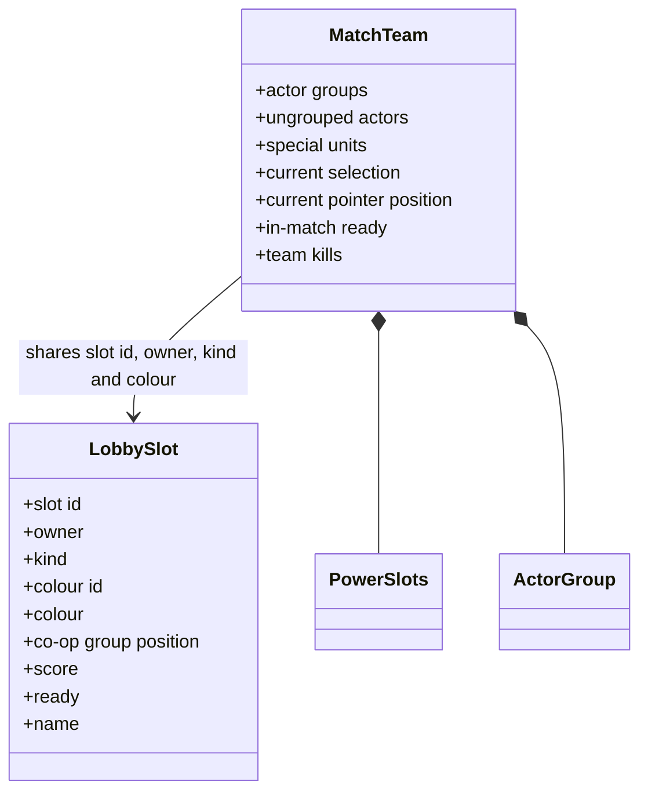
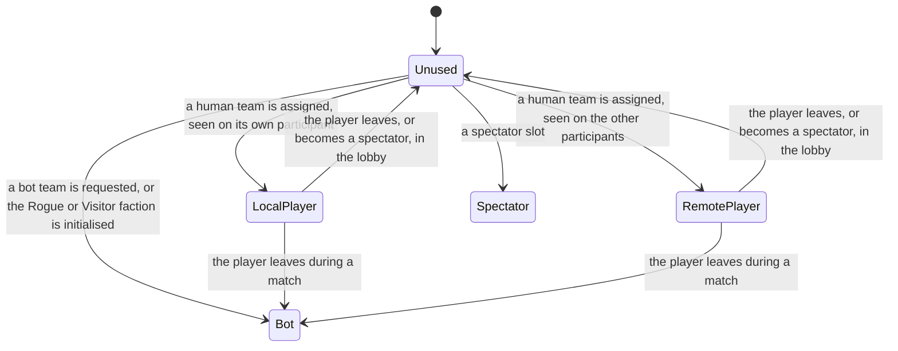
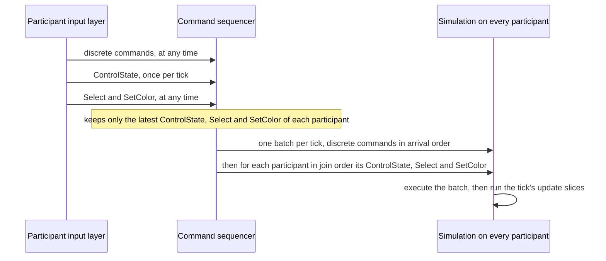
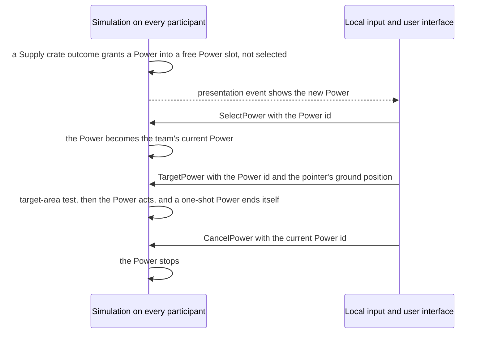
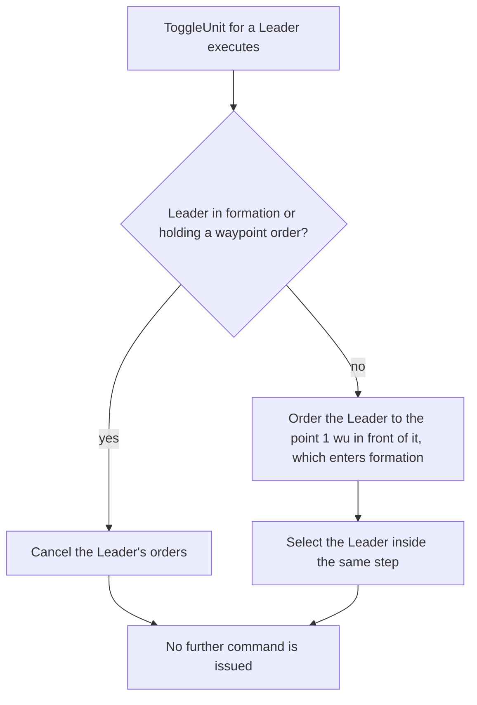

# Teams and player commands

> Status: Reference · Prefix: R-SIM · Related: [README.md](README.md), [01_tick_timing_and_main_loop.md](01_tick_timing_and_main_loop.md), [03_entity_model_and_identity.md](03_entity_model_and_identity.md), [04_containers_and_update_order.md](04_containers_and_update_order.md), [05_space_routing_and_physics.md](05_space_routing_and_physics.md), [07_randomness_and_integrity.md](07_randomness_and_integrity.md), [../06_controls_camera_and_commands/README.md](../06_controls_camera_and_commands/README.md)

## 1 Purpose and player experience

A reference match has six team slots: up to four players, each a human or a Bot, plus the Rogue faction and the Visitor faction, which are hazards driven by bots. Each team has a colour from a fixed palette of eight player colours, a start position on the map, and, in co-op matches, a partner that shares its colour family. Every object in the world belongs to a team or to no team, and friendship between teams decides who fights whom.

The player acts on the world only through **commands**: discrete commands (select, order, promote, place, cancel, toggle) and a continuous control state that each participant sends once per tick for its own team (DEC-008, DEC-023). Every participant executes the same commands in the same order, so every participant's world stays the same. This document specifies:

- team slots, team ids and team kinds; the lobby slot and the match team; ownership of every object family; friendship; colours, start positions and alliances; actor groups and their formations; bots as team slots;
- the continuous control state (`TeamCommandState`), the per-tick execution order of commands, and the complete Species player command catalogue (`PlayerCommand`), with the parameters and the effect of every command.

Who may send which command, and how commands travel, is not part of the reference library (DEC-200, DEC-202). The input actions that issue each command are in [../06_controls_camera_and_commands/README.md](../06_controls_camera_and_commands/README.md).

## 2 Rules

### 2.1 General

**R-SIM-390** (MUST) The values of §4 are the reference tuning baseline (DEC-004). The rules of this document are the specification of record for teams, ownership and player commands (DEC-005), and every reference quirk it keeps is an explicit rule (DEC-006).

**R-SIM-391** (MUST) No rule of this document stores a non-finite value in simulation state (DEC-653). In particular: a team's selected-Worker centre exists only while at least one Worker is selected, and with none selected the team has no centre (DEC-653 item 1); a crowd order with no Worker under control computes no route and no route start (DEC-653 item 2, R-SIM-455); an actor-group formation offset uses a row length of at least 1 (DEC-653 item 3, R-SIM-430); and an actor group whose members reported no position in a tick keeps its centre and velocity (R-SIM-427).

### 2.2 Team slots, ids and kinds

**R-SIM-392** (MUST) Every match has exactly `ref.sim.max_teams` (6) team slots, and all six team objects exist in every match; a slot that nobody plays has the kind `TeamKind::Unused`.

**R-SIM-393** (MUST) Team ids have these roles:

| Team id | Role |
|---|---|
| 0 to `ref.sim.team.player_slots` − 1 (0 to 3) | player positions: a human on a local or remote participant, a Bot or a spectator. The map's start positions 0 to (player count − 1) are assigned to team ids at load (R-SIM-417). |
| `ref.sim.team.rogue_slot` (4) | the **Rogue faction**, owner of hostile creatures: colour id `ref.sim.team.rogue_colour_id` (8); a bot team that no participant owns |
| `ref.sim.team.visitor_slot` (5) | the **Visitor faction**: colour id `ref.sim.team.visitor_colour_id` (9); a bot team that no participant owns |
| the no-team value | no team: unowned structures, weather effects, Supply crates and every other object without a team. It is never registered in the actor grid and is nobody's friend (R-SIM-412). One no-team value serves every field (DEC-464). |

An effect that harms everyone, such as a fireball, carries the no-team value.

**R-SIM-394** (MUST) When the map does not allow the Rogue faction, the look-up of the Rogue faction's team id returns none. The Rogue and Visitor factions are initialised at match-world initialisation ([04_containers_and_update_order.md](04_containers_and_update_order.md)), and also on demand when actors are spawned for them. Each receives a bot controller like every bot team (DEC-558). No Essence orb is ever created for the Rogue faction.

**R-SIM-395** (MUST) A team has one of these kinds (`TeamKind`):

| Kind | Meaning |
|---|---|
| `TeamKind::Unused` | an empty slot; the team advance and the actor look-up skip it |
| `TeamKind::LocalPlayer` | the human playing on this participant |
| `TeamKind::RemotePlayer` | a human playing on another participant; while one exists, the match cannot be paused (R-SIM-458) |
| `TeamKind::Bot` | a bot-controlled team, which receives a bot controller (R-SIM-434); the Rogue and Visitor factions have this kind |
| `TeamKind::Spectator` | a spectator slot |

**R-SIM-396** (MUST) Whether a human team is a local-player or a remote-player team depends on the participant that looks at it. The simulation treats both kinds alike; the distinction exists only for each participant's own input, camera and presentation (DEC-008).

### 2.3 Lobby slots and match teams

**R-SIM-397** (MUST) Each slot has two records: a persistent **lobby slot** (`LobbySlot`), which lives from the lobby through the match to the results, and a per-match **team** (`MatchTeam`). The team's slot id, owning participant, kind and colour are the lobby slot's own fields, shared and not copied: a change made through either record is visible through both.

**R-SIM-398** (MUST) A lobby slot holds:

| Field | Initial value | Meaning |
|---|---|---|
| slot id | none | the team slot |
| owner | none | the participant that owns the slot; none for the Rogue and Visitor factions |
| kind | `TeamKind::Unused` | R-SIM-395 |
| colour id | none | index into the colour table (R-SIM-415): 0 to 7 for players, 8 for the Rogue faction, 9 for the Visitor faction |
| colour | — | the RGBA colour in which the team is drawn |
| co-op group position | 0 | 1 or 2: which member of a co-op pair, which picks the shade (R-SIM-421) |
| score, previous score | 0 | the mode score ([../01_skirmish_rules_and_modes/README.md](../01_skirmish_rules_and_modes/README.md)) |
| Launch Vessel | none | the team's Launch Race vessel |
| disconnected | true | |
| ready | false | the lobby ready flag (R-SIM-459) |
| name | empty | the player's name |
| bot takeover time | none | the game time at which a bot took over a departed player's team (R-SIM-436) |
| achievement mask | 0 | the achievement hook mask ([../09_front_end_and_match_flow/options_localisation_and_hooks.md](../09_front_end_and_match_flow/options_localisation_and_hooks.md)) |
| open | true | whether the slot is open; a closed slot stays unused for the whole match (R-SIM-461) |

**R-SIM-399** (MUST) A match team holds:

| Field | Initial value | Meaning |
|---|---|---|
| slot id, owner, kind, colour | the lobby slot's fields | shared with the lobby slot (R-SIM-397) |
| lobby slot | — | a reference back to its lobby slot |
| actor groups | empty | the team's actor groups (R-SIM-424) |
| ungrouped actors | empty | every actor of the team that is not in an actor group, updated in `ref.sim.update_slices` slices ([04_containers_and_update_order.md](04_containers_and_update_order.md)) |
| special units | empty | handles of the team's Leaders, Transports, Collectors and Builders, for quick look-up |
| Power slots | created when the team is initialised | the team's Power slots ([../04_supply_crates_powers_and_weapons/crates_and_powers.md](../04_supply_crates_powers_and_weapons/crates_and_powers.md)) |
| in-match ready | false | readiness in the ready-up phase (R-SIM-459) |
| current selection | none, none, none | the selected actor group, actor and structure (R-SIM-401) |
| current pointer position | — | the pointer position of the team's last applied control state (R-SIM-442) |
| Rogue faction flag, Visitor faction flag | false | marks the two faction teams |
| selected Worker count and centre | 0, none | latched in update slice 0 from the previous tick's accumulation (R-SIM-402) |
| selected Worker accumulators | 0 | filled by the team's selected Workers during the tick |
| team kills | 0 | the number of Workers this team has killed, added by explosions and laser bolts |
| block selection change | false | while true, selection changes are ignored (R-SIM-405) |
| upgrades | formation size `ref.sim.team.formation_size_upgrade` (90); rockets `ref.sim.team.rocket_upgrade` (0) | per-team upgrades: the Leader formation cap ([../02_units/leader_and_formations.md](../02_units/leader_and_formations.md)) and the Rocket Troops upgrade ([../04_supply_crates_powers_and_weapons/crates_and_powers.md](../04_supply_crates_powers_and_weapons/crates_and_powers.md)) |

Kill totals and kill milestones reach the presentation as events (DEC-007).

**R-SIM-400** (MUST) A team's list of ungrouped actors holds every actor of the team that was spawned without an actor group, its bot controller included: Workers, Leaders, Transports, Builders, Collectors and every creature that is not in a group. Strike teams, Bombers, centipedes and Hive ants live inside actor groups. Each special unit registers in the special-unit list when it starts and unregisters when it is removed, so the list never holds a removed actor (DEC-117).

**R-SIM-401** (MUST) A team's current selection changes only through the execution of a command (R-SIM-450) and through the effects that executing a command has inside the same simulation step; no other simulation rule and no presentation or input code writes it (DEC-008, DEC-119). The selected actor is held as a generational handle and resolved again on every use, so a selection whose actor has been removed resolves to none and never designates a later occupant of the same slot ([03_entity_model_and_identity.md](03_entity_model_and_identity.md) R-SIM-142, DEC-028; see DEC-262).

**R-SIM-402** (MUST) Selected Workers add their position to their team's selected-Worker accumulators as they advance. In update slice 0 the team latches the count and the centre (sum ÷ count) from the previous tick's accumulation and resets the accumulators. With a count of 0 the team has no centre, and the user-interface elements that read it (the route preview, the selection arrows and the Power icon position) show nothing (DEC-653 item 1).

**R-SIM-403** (MUST) Two kinds of per-team state belong to the input layer of the local participant, not to the simulation: the selection-circle centre and radius, and the time of the team's last crowd order, which enforces the crowd-order interval (DEC-032). The input layer writes them for its own team only ([../06_controls_camera_and_commands/README.md](../06_controls_camera_and_commands/README.md)), and no simulation rule reads them.

**R-SIM-404** (MUST) A team provides these operations: select (R-SIM-405); register and unregister a special unit (R-SIM-400); ray hit, which returns the first actor hit among its actor groups and then among its ungrouped actors; resolve the current selection to a group, an actor or a structure, or nothing when the handle no longer resolves; create an actor group ([04_containers_and_update_order.md](04_containers_and_update_order.md)); create an actor, which goes to the ungrouped actors when it has no group and is otherwise delegated to its group; count its actors of one kind, or of every kind, over its groups and its ungrouped actors; the team name (R-SIM-406); the Visitor test (R-SIM-406); and elimination (R-SIM-407).

**R-SIM-405** (MUST) Selecting (group g, actor a, structure s) on a team:

1. is ignored entirely while the team's block-selection-change flag is set;
2. sets the team's current selection to (g, a, s), with the actor held as a generational handle (R-SIM-401);
3. when the selected actor is a Leader, clears the team's current Power;
4. when any of the team's Workers were selected, clears the selected state of all of them;
5. when the selected structure is a turret, sets the turret's fire timer to `ref.sim.team.turret_select_delay` (6 ticks, the 0.5 s countdown of DEC-002);
6. emits presentation events for the team's own participant: the cursor arrows grow (×2.0, [../06_controls_camera_and_commands/README.md](../06_controls_camera_and_commands/README.md)), the selection and Power-slot sounds play, and selecting a turret puts the camera into turret-aim mode.

**R-SIM-406** (MUST) A team's displayed name is its lobby name; a bot team's name is prefixed with the bot label `bot.label`, and after game over the departed label `match.team_left` replaces it. A team without a lobby name is named `faction.rogue.name` for the Rogue faction, `faction.visitor.name` for the Visitor faction, and otherwise by its colour id 0 to 7 with the team-colour names `team.colour.green`, `team.colour.red`, `team.colour.yellow`, `team.colour.blue`, `team.colour.orange`, `team.colour.purple`, `team.colour.cyan` and `team.colour.pink` (with the bot label for a bot team); any other colour id shows `ui.team.invalid_name`. A team is the Visitor faction when the map's Visitor-faction option names this team's position, or when its Visitor faction flag is set.

**R-SIM-407** (MUST) Eliminating a team changes the health of every member of its actor groups and of every ungrouped actor by −`ref.sim.team.eliminate_damage_factor` × that actor's current health (2 × current health), as unresistable damage, stops all of its Powers, and sets every Transit Gate it owns to the no-team value.

### 2.4 Ownership of objects

**R-SIM-408** (MUST) Every object family has this ownership rule:

| Object | Owner | Can the owner change? | How |
|---|---|---|---|
| actor | the team of the container that holds it | **never in place** | a conversion spawns a new actor of the new team at the same position and marks the old actor destroyed (R-SIM-409) |
| actor-group member | as an actor | never | — |
| structure | its team; the no-team value means neutral | **yes, in place** | R-SIM-410 |
| map-placed structure | the map stores a start position, which load maps to the team at that position (R-SIM-418) | at load | — |
| effect | the firing team: turret rounds, rockets and grenades carry it, and a laser bolt carries its source team; weather effects carry the no-team value; fireballs carry the no-team value and harm everyone | never | — |
| Essence orb | the team that released it | never; a Collector may take any team's Essence orbs (DEC-080, [../02_units/collector.md](../02_units/collector.md)) | — |
| creature created by a Supply crate outcome | the team that placed the Power, except the Reaper Serpent and the Hive, which belong to the Rogue faction (DEC-107); the creatures of the Brood outcome belong to the placing team (see DEC-121) | never | — |

**R-SIM-409** (MUST) A change of an actor's team destroys the actor and spawns a new one (DEC-028). The conversions are: Convert laser bolts, the Visitor faction's pulse wave and the Swarm streak ([../04_supply_crates_powers_and_weapons/crates_and_powers.md](../04_supply_crates_powers_and_weapons/crates_and_powers.md), [../04_supply_crates_powers_and_weapons/weapons_and_projectiles.md](../04_supply_crates_powers_and_weapons/weapons_and_projectiles.md)).

**R-SIM-410** (MUST) A structure changes its team in place, either with a team-change presentation event or silently ([../03_buildings_and_world_objects/README.md](../03_buildings_and_world_objects/README.md)). The paths are: the capture rules of each capturable structure; elimination, which sets the eliminated team's Transit Gates to the no-team value (R-SIM-407); the Core Device; and an empty Solar Array, which falls to the no-team value.

**R-SIM-411** (MUST) Map-placed structures and map-placed actors name a start position, not a team. At load each is given the team at that position (R-SIM-418), or the no-team value when no team holds the position.

### 2.5 Friendship

**R-SIM-412** (MUST) Friendship between two team ids a and b is:

```
IsFriend(_a, _b):
    if _a is the no-team value or _b is the no-team value: return false
    if the match is co-op: return coopGroup[_a] == coopGroup[_b]
    return _a == _b
```

Outside co-op a team is a friend only of itself. In a co-op match the co-op group of a team is 0, 1 or 2.

**R-SIM-413** (MUST) In a co-op match every team in co-op group 0 (the Rogue faction, the Visitor faction, unused slots and any player slot that alliance assignment left unpaired, R-SIM-420) is a friend of every other group-0 team, so the Rogue and Visitor factions are friends of each other in a co-op match and are not in any other match. This reference behaviour is the default of the Open DEC-451.

**R-SIM-414** (MUST) Friendship decides: the enemy and friend masks of the actor-grid queries ([05_space_routing_and_physics.md](05_space_routing_and_physics.md)), the Barrier Emitter contact rule, the damage filters of weapons and explosions, and every friend-or-foe test of the bots ([../07_bots/README.md](../07_bots/README.md)).

### 2.6 Colours, start positions and alliances

**R-SIM-415** (MUST) The colour table has ten entries. Ids 0 to 7 are the `ref.sim.team.player_colour_count` player colours; each has a base colour and the two shades of a co-op pair (member 1 and member 2). The values are in §4 under `ref.sim.team_colour.<name>`:

| Colour id | Name string id | Base (RGB) | Shade, member 1 | Shade, member 2 |
|---|---|---|---|---|
| 0 | `team.colour.green` | 100, 255, 100 | 0, 150, 20 | 90, 200, 100 |
| 1 | `team.colour.red` | 255, 50, 50 | 150, 0, 20 | 255, 80, 80 |
| 2 | `team.colour.yellow` | 255, 255, 50 | 150, 150, 20 | 200, 200, 90 |
| 3 | `team.colour.blue` | 120, 180, 255 | 20, 0, 150 | 90, 90, 200 |
| 4 | `team.colour.orange` | 255, 150, 0 | 150, 90, 0 | 200, 150, 60 |
| 5 | `team.colour.purple` | 150, 0, 255 | 180, 120, 255 | 100, 60, 180 |
| 6 | `team.colour.cyan` | 70, 200, 200 | 0, 140, 140 | 110, 210, 210 |
| 7 | `team.colour.pink` | 255, 150, 255 | 255, 90, 255 | 255, 190, 255 |
| 8 | `faction.rogue.name` | 10, 10, 10 | 10, 10, 10 | 10, 10, 10 |
| 9 | `faction.visitor.name` | 200, 200, 200 | 200, 200, 200 | 200, 200, 20 |

**R-SIM-416** (MUST) Outside co-op and Siege a team's colour id starts equal to its team id; a human's own choice arrives through the `SetColor` command (R-SIM-451). At match-world initialisation every bot team chooses, with the simulation generator, a colour from 0 to `ref.sim.team.bot_colour_count` − 1 (0 to 3) that no other team holds, as a uniform choice from the list of free colours (DEC-014, DEC-450); in a tutorial a bot team's colour is its team index. A team that still has no colour after initialisation receives the first colour from 0 to 7 that no team holds.

**R-SIM-417** (MUST) Outside Siege and co-op, a team's start position is assigned when the match first needs it: the team receives the free position at index (simulation draw mod number of free positions) of the list of positions 0 to (player count − 1) that no team holds, in ascending order, or none when no position is free. Match initialisation asks for the positions in team-slot order, so the draws happen in slot order. In a tutorial, and for the Rogue and Visitor factions, the position equals the team id. This reference behaviour is the default of the Open DEC-450.

**R-SIM-418** (MUST) The team at a start position is the first team i below the player count whose start position, assigned by R-SIM-417 if it has none yet, equals that position; the no-team value when there is none. A rematch rotates the positions: new position[i] = old position[(i + 1) mod player count]. Map-placed structure owners and map-placed actors are matched to teams by position, and each team's opening camera view is `spawn_view_<position>`.

**R-SIM-419** (MUST) Siege assigns sides and positions by its own procedure ([../01_skirmish_rules_and_modes/siege.md](../01_skirmish_rules_and_modes/siege.md)): all positions are cleared; then each player without a colour receives the defender colour `ref.sim.team.siege_defender_colour_id` (0, green) when the attacking side is full, the attacker colour `ref.sim.team.siege_attacker_colour_id` (1, red) when the defending side is full, and otherwise the colour (simulation draw mod 2); each player then takes a random free position of its side. In a co-op Siege match the team's co-op group is 1 when its position is one of the map's group-1 positions and 2 otherwise, and its shade follows R-SIM-421. A team attacks or defends according to the map's attacking flag for its position.

**R-SIM-420** (MUST) Co-op (2 against 2) alliance assignment places each team as follows:

1. The team's group comes from the map's lists of group positions. If that group is full, the team moves to the first free position of the other group, and any team that held that position is assigned again.
2. A team alone in its group keeps its colour, or receives a random free colour from 0 to 3.
3. Without predefined groups, a team is paired with a team that chose the same colour; a player slot that this step leaves unpaired stays in co-op group 0 (R-SIM-413, DEC-451).
4. With a predefined group, the partner takes the group's other position and the shared colour id, and the two members take shade 1 and shade 2.

Co-op setup applies the resulting colour inside the setup step on every participant, and the setup itself issues no command (DEC-119). After co-op setup the local participant's lobby sends a `SetColor` for its own team with the colour that setup applied; executing it changes nothing (R-SIM-451).

**R-SIM-421** (MUST) The shade of a co-op group is chosen when it is first asked for: the first request for a group returns its member-1 shade and every later request its member-2 shade; a group without a colour returns `ref.sim.team_colour.no_group_shade` (white).

**R-SIM-422** (MUST) On a map with fewer than four players, each unused slot draws a colour from 0 to 3 that no player slot holds, by the free-colour draw: colour = (simulation draw mod `ref.sim.team.player_colour_count`) div `ref.sim.team.coop_colour_divisor`, which gives 0 to 3, and only the colour changes, so that the effects that pick a random team colour, such as the Essence Grove and the Allegiance Scrambler, have a colour for every slot. A colour drawn for an unused slot is not reserved, so two unused slots can share a colour (DEC-450).

**R-SIM-423** (MUST) Every colour, position and alliance draw of §2.6 is a simulation draw made during match-world initialisation in team-index order, so every participant must start the match with identical lobby-slot state ([07_randomness_and_integrity.md](07_randomness_and_integrity.md)).

### 2.7 Actor groups

**R-SIM-424** (MUST) An actor group (`ActorGroup`) is a team-owned container of actors of one kind that move as a group. In matches the group kinds are the Strike team (its Troopers), the airstrike flight (its Bombers) and the Crawler group; the plain actor group serves centipede segments, Hive ant groups and map-placed actors that the map places in a group.

**R-SIM-425** (MUST) An actor group holds: its waypoint (the formation anchor); a bot timer (0, for the group kinds' own rules); a route handle and a route point index (none); its team, its group id and its actor kind; its members, updated in `ref.sim.update_slices` slices and presized to the requested member count; its centre, velocity and radius; its target direction, initially (1, 0, 0) and set towards the pointer by a move; an attack accumulator; and the per-tick position accumulators (sum, count and the largest squared radius). Its formations are `GroupFormation::Rectangle` and `GroupFormation::Airstrike`.

**R-SIM-426** (MUST) Destroying an actor group clears its team's current group selection when that selection named the group, and destroys its members. Removing a member from the group also unregisters it from the actor grid at the position given.

**R-SIM-427** (MUST) In update slice 0 an actor group advances: centre := position sum ÷ count; velocity := (centre − previous centre) ÷ `ref.sim.tick_period`; radius := √(largest squared radius). When no member reported a position, the division is not evaluated and the centre and velocity keep their values (see DEC-653). A group with no used member slot sets its radius to 0 and requests its own removal. Otherwise it resets its accumulators and follows its route ([05_space_routing_and_physics.md](05_space_routing_and_physics.md)). No tick runs while the match is paused, so the division by the tick period never meets a game speed of 0 (DEC-038).

**R-SIM-428** (MUST) `ActorGroup::Attack(_position, _withGrenade)`: with a grenade, the nearest live member throws a grenade at the position. Then every member that is enabled, alive and not reloading is a candidate; waitTime := the kind's rate stat ÷ the member count; the attack accumulator grows by `ref.sim.tick_period` ÷ waitTime; and while the accumulator is at least 1, it is reduced by 1 and a candidate chosen by a simulation draw (a unit fraction × the candidate count, truncated) attacks the position. With no candidate, no member attacks and no candidate draw is made (see DEC-263).

**R-SIM-429** (MUST) Each member, when it advances, adds its position to its group's position sum and count, and raises the group's largest squared radius to (|position − centre| + member radius)² when that is larger, where centre is the group's centre from slice 0 of this tick.

**R-SIM-430** (MUST) The formation offset of member index i (index "none" counts as 0) is, with spacing `ref.sim.group.rect_spacing` (4.0 wu) and the jitter j = offsetTable[i mod `ref.sim.group.offset_table_size`], a unit fraction:

```
Rectangle:
    rowLen := max(ref.sim.group.rect_min_row_length, trunc(sqrt(member count)))     # at least 1 (DEC-653 item 3)
    x := (i mod rowLen - rowLen div 2) * 4.0 + j
    z := (i div rowLen - rowLen div 2) * 4.0 + j
    offset := (z, 0, x)                                     # the axes are swapped
Airstrike:
    rowLen := ref.sim.group.airstrike_row_length            # 4
    c := ref.sim.group.airstrike_centre                     # 2
    x := (i mod rowLen - c) * ref.sim.group.airstrike_spacing_x + j     # 24 wu
    y := (i div rowLen - c) * ref.sim.group.airstrike_spacing_y + j     # 12 wu
    z := (i div rowLen - c) * ref.sim.group.airstrike_spacing_z + j     # 24 wu
    offset := (x, -y, z)
```

The group offset of a member is its formation offset; it takes no account of obstacles.

**R-SIM-431** (MUST) The offset table holds `ref.sim.group.offset_table_size` (100) unit fractions drawn from the simulation generator at a fixed step of match initialisation, after the per-match reset has cleared it (DEC-011, DEC-652); it is never filled on its first use.

**R-SIM-432** (MUST) Recalculating the offsets gives the live members consecutive formation indices 0 to n − 1 in member-slot order and gives dead members none. A plain actor group is not selectable, and its direct-control and bot hooks do nothing; the group kinds override them. A group's ray hit returns the first member hit.

### 2.8 Bots as team slots

**R-SIM-433** (MUST) A bot is a team slot of kind `TeamKind::Bot`, owned by the participant that requested it, which in practice is the host. Starting a match fills every empty open slot below the map's player count with a bot team, and a closed slot gets none (R-SIM-461): the host requests one bot team for every unused open slot below the player count through the session ([../09_front_end_and_match_flow/screen_flow_and_match_setup.md](../09_front_end_and_match_flow/screen_flow_and_match_setup.md)) and then issues `StartMatch` (R-SIM-460).

**R-SIM-434** (MUST) The bot is not a participant. When a bot team is initialised in the match world, the simulation spawns one bot controller (`BotController`) for it, inside the map, at the position of [../07_bots/README.md](../07_bots/README.md) R-BOT-008: its team's start position, or the centre of the map for the Rogue and Visitor factions and for a slot with no start position; the placement makes no spawn search and no draw (DEC-087). The Rogue and Visitor factions always receive a bot controller as well (DEC-558).

**R-SIM-435** (MUST) A bot controller is simulated identically on every participant as part of the simulation step, and it sends nothing over the network (DEC-200). A bot is an authorised command source of its own team (DEC-119): in its bot step it issues the actions that the player command catalogue expresses (targeting a Power, stopping a Power and aiming a Beam Dish) as catalogue commands, which execute at once through the command's operation, with the command's validation and no-op rules (DEC-202), and never enter the command batch of a tick ([../07_bots/README.md](../07_bots/README.md) R-BOT-014). Every other bot action is a bot-only operation of R-BOT-015, which applies the named simulation operation directly after checking that the object still exists and belongs to the bot's team (see DEC-122). It reads the full simulation state.

**R-SIM-436** (MUST) When a human leaves during a match, every participant, at the same tick, changes that team's kind to `TeamKind::Bot`, spawns a bot controller for it, records the bot takeover time in the lobby slot and emits the presentation event `match.player_left` (DEC-035). When a player leaves in the lobby, the slot is freed instead. The departed player's team stays reserved and counts toward capacity, and nothing returns it to a rejoining player; join, reconnection and capacity are DEC-244 and DEC-205.

**R-SIM-437** (MUST) A request for a bot team is ignored once every open slot below the map's player count is held, and bot teams count toward the "server full" test for humans, which counts open slots only: a session is full once every open slot is held, and a closed slot is never offered to a joining player (R-SIM-461, DEC-244).

### 2.9 The team command state

**R-SIM-438** (MUST) Player control splits into the discrete commands of §2.11 and a continuous control state sampled at the simulation rate (DEC-023). The team command state (`TeamCommandState`) is the continuous control state of one team. Each participant samples it for its own team and sends it once every `ref.sim.command.control_state_period` (1 tick, 0.1 s) while a match is running; it is executed as the `ControlState` command (R-SIM-450). Bot teams send none: a bot issues its catalogue commands inside its own bot step and applies its bot-only operations directly (R-SIM-435).

**R-SIM-439** (MUST) The team command state, a public aggregate, holds these fields. The input layer decides when each is set ([../06_controls_camera_and_commands/README.md](../06_controls_camera_and_commands/README.md), [../../architecture/components/input/README.md](../../architecture/components/input/README.md)); the summary below gives the meaning.

| Field | Kind | Meaning |
|---|---|---|
| `moveTarget` | one-shot flag | the player set a move target for the selected unit (not while secondary fire is held, and never with a gamepad while a Strike team is selected) |
| `directMove` | flag | a direct movement vector is present |
| `primaryFire` | one-shot flag | primary fire at the pointer target (not while the camera looks around) |
| `secondaryFire` | one-shot flag | secondary fire at the pointer target |
| `targetDirected` | one-shot flag | a directed target vector is present |
| `secondaryFireDirected` | one-shot flag | directed secondary fire |
| `cameraTracking` | flag | the sender's camera is tracking the selected unit |
| `specialOrders` | one-shot flag | the special-orders action `action.order.special` fired; it is set when the action goes down, never held as a modifier ([../06_controls_camera_and_commands/actions_and_bindings.md](../06_controls_camera_and_commands/actions_and_bindings.md) R-CTRL-051, R-CTRL-101) |
| `gamepad` | flag | the sender's input mode is the gamepad |
| `primaryHeld` | flag | the primary pointer button is held |
| `pointerPosition` | position | the world position under the pointer (the terrain hit), which the input layer may snap |
| `directMoveVector` | world-space (x, z) | the movement-stick vector; present with `directMove` |
| `directTargetVector` | world-space (x, z) | the aiming-stick vector; present with `targetDirected` or `secondaryFireDirected` |

**R-SIM-440** (MUST) The sender converts every camera-relative quantity to world space before it enters the team command state, and the simulation never reads a participant's camera, devices, user-interface state or preferences (DEC-008). The movement vector is right × (−stick x) + front × (−stick y), with right the camera's control vector ([../06_controls_camera_and_commands/camera.md](../06_controls_camera_and_commands/camera.md) R-CTRL-451, R-CTRL-487) and front = up × (−right), stored as its (x, z) components; the aiming vector is converted the same way, and it also steers the sender's own camera target, which is presentation. The `cameraTracking` flag is part of the state the sender sends, so the Strike team's direct-control rule reads the sender's flag and never the local camera ([../02_units/strike_team.md](../02_units/strike_team.md)).

**R-SIM-441** (MUST) On the sender, the one-shot flags accumulate (logical OR) over every frame between two sends and are cleared after each send. While a window, the Power slots panel or the chat log is open, the sender clears every flag before sending.

**R-SIM-442** (MUST) Executing a team command state applies it to the team on every participant: it sets the team's current pointer position, and the team's selected unit or structure reads it under its own direct-control rules ([../02_units/strike_team.md](../02_units/strike_team.md), [../02_units/transport.md](../02_units/transport.md), [../03_buildings_and_world_objects/defences_and_props.md](../03_buildings_and_world_objects/defences_and_props.md), [../03_buildings_and_world_objects/README.md](../03_buildings_and_world_objects/README.md)). With a Transport selected it also generates the Transport's direct route ([05_space_routing_and_physics.md](05_space_routing_and_physics.md)). A team command state is ignored while the match is paused and after game over.

**R-SIM-443** (MUST) Only the latest team command state of each participant in a tick is executed (R-SIM-444). The one-shot flags of an earlier state that reached the sequencer in the same tick are lost, and in a tick in which no state arrived from a participant its team receives none: no fire and no direct control happen for that team in that tick, and its current pointer position keeps its value. The result is identical on every participant: input is lost or late, never divergent. This coalescing rule is the reference default of DEC-203.

### 2.10 Execution order of commands

**R-SIM-444** (MUST) Commands execute in one batch per tick. Within the batch:

1. every discrete command, in the order in which the sequencer received it, except the latest-only kinds;
2. then, for each participant in participant order (the order in which the participants joined the session), its latest `ControlState`, then its latest `Select`, then its latest `SetColor`, each only if one arrived in that tick.

A participant's earlier `ControlState`, `Select` or `SetColor` of the same tick is discarded without merging. Because `Select` and `SetColor` set state, dropping an earlier one changes only intermediate effects; the last one decides the result.

**R-SIM-445** (MUST) Every tick has exactly one batch, which may be empty, and every participant executes the batches strictly in tick order, before the tick's update slices ([01_tick_timing_and_main_loop.md](01_tick_timing_and_main_loop.md)).

**R-SIM-446** (MUST) Only the first `StartMatch` command of a session executes; every later one is discarded.

**R-SIM-447** (MUST) The reference sequencer accepts a command from any registered participant whose command names a team other than the no-team value; a command without a team field passes this test. It checks neither ownership of the named team nor the phase (lobby or match), and each command's handler decides alone whether the command has an effect when it executes. Command validation and authority are the Open DEC-202, and lobby authority is the Open DEC-243.

**R-SIM-448** (MUST) Session and transport messages are not player commands and are outside this catalogue: joining, leaving, requesting a team, requesting and assigning spectator status, synchronisation reports and file transfer (DEC-244, DEC-205, DEC-206, DEC-207). The replication and authority model is the Open DEC-200: in the reference every participant runs the whole simulation and executes the same command batches.

### 2.11 Player command catalogue

**R-SIM-449** (MUST) The Species player command catalogue is the enumeration `PlayerCommand` with the members listed in R-SIM-450 to R-SIM-452; the order of the enumeration carries no meaning. Every command names its objects by generational handles (`SimObjectId`), never by container slot indices (DEC-028); Power ids are at least `ref.sim.command.power_id_min_bits` (16) bits wide (DEC-083); and no parameter carries an in-band sentinel value (DEC-202). A parameter written "none" is an explicit absent value.

**R-SIM-450** (MUST) The match commands, with their parameters and their effect when executed on every participant. No command cycles a Strike team's weapon, so a Strike team always throws grenades (DEC-117).

| Command | Parameters | Effect when executed | Coalescing | Issued by |
|---|---|---|---|---|
| `PlayerCommand::ControlState` | team, team command state | applies the state to the team (R-SIM-442) | latest per participant per tick | the participant's input layer, every tick |
| `PlayerCommand::Select` | team; actor group, actor and structure handles, each possibly none | selects them on the team (R-SIM-405); then, even while the team's selection is blocked, the team's Power slots select the Power bound to the named group or actor, if there is one; when no Power tracks the named group or actor, the team's current Power becomes none ([../06_controls_camera_and_commands/selection_and_power_slots.md](../06_controls_camera_and_commands/selection_and_power_slots.md) R-CTRL-202) | latest per participant per tick | selecting a unit, a structure or nothing in the world |
| `PlayerCommand::AimBeamDish` | team, structure, position | if the structure exists, belongs to the team and is a Beam Dish, aims it at the position ([../03_buildings_and_world_objects/README.md](../03_buildings_and_world_objects/README.md)) | — | aiming a selected Beam Dish |
| `PlayerCommand::ToggleBarrierEmitter` | structure | if the structure is a Barrier Emitter, switches it on or off ([../03_buildings_and_world_objects/defences_and_props.md](../03_buildings_and_world_objects/defences_and_props.md)); the command carries no team | — | toggling a Barrier Emitter |
| `PlayerCommand::TargetPower` | team, Power id, position | targets that Power at the position: the target-area test, then the Power's effect (R-SIM-457) | — | placing or firing the current Power |
| `PlayerCommand::SelectPower` | team, Power id | makes that Power the team's current Power (R-SIM-457) | — | choosing or cycling a Power |
| `PlayerCommand::CancelPower` | team, Power id | stops that Power (R-SIM-457) | — | cancelling the current Power |
| `PlayerCommand::ScrapActor` | team, actor | if the actor is one of the team's ungrouped actors, changes its health by −`ref.sim.command.scrap_damage` (999) (R-SIM-456) | — | scrapping one of the team's own units |
| `PlayerCommand::SelectWorkers` | team, centre position, radius | selects the team's Workers within the circle ([../06_controls_camera_and_commands/README.md](../06_controls_camera_and_commands/README.md), [../02_units/worker.md](../02_units/worker.md)) | — | releasing the selection circle |
| `PlayerCommand::OrderWorkers` | team, straight-route flag, position | the crowd order (R-SIM-455) | — | ordering the selected Workers |
| `PlayerCommand::PromoteWorker` | team, actor | if the actor is a Worker of the team, promotes it to a Leader and selects the new Leader in the same step (R-SIM-456) | — | promoting a Worker |
| `PlayerCommand::DemoteLeader` | team, actor | if the actor is a Leader of the team, demotes it to a Worker and clears the team's selection (R-SIM-456) | — | demoting a selected Leader |
| `PlayerCommand::OrderUnit` | team, straight-route flag, move-only flag, position | for the team's selected actor: a Leader with move-only set takes the position as its waypoint, and otherwise receives orders to the position with the straight-route flag; a Transport with move-only set takes the position as its waypoint, and otherwise receives orders to the position, and an order-marker presentation event is emitted for every viewer whose team is a friend of the commanding team ([../02_units/leader_and_formations.md](../02_units/leader_and_formations.md), [../02_units/transport.md](../02_units/transport.md)) | — | ordering a selected Leader or Transport; a Transport order always sets the straight-route flag, and sets move-only when the order does not deploy |
| `PlayerCommand::ToggleUnit` | team, actor, secondary flag | a Transport toggles its arrival action when the secondary flag is set, and otherwise toggles loading; a Leader that is in formation or holds a waypoint order cancels its orders, and otherwise receives orders to the point `ref.sim.command.leader_toggle_offset` (1 wu) in front of it, which enters formation, and is selected in the same step (R-SIM-454) | — | toggling a Leader's formation, a Transport's loading or its arrival action |
| `PlayerCommand::ToggleReady` | team | toggles the ready flag (R-SIM-459) | — | the ready action |
| `PlayerCommand::Pause` | none | toggles the pause request (R-SIM-458) | — | the pause action |
| `PlayerCommand::Chat` | participant, text | appends the text to the lobby chat or the match chat, as a presentation event | — | sending a chat line |

**R-SIM-451** (MUST) The match-setup commands, with their parameters and their effect when executed on every participant. The match-setup state, the option list and the version rule of each option belong to [../09_front_end_and_match_flow/screen_flow_and_match_setup.md](../09_front_end_and_match_flow/screen_flow_and_match_setup.md), and lobby authority is the Open DEC-243.

| Command | Parameters | Effect when executed | Coalescing | Issued by |
|---|---|---|---|---|
| `PlayerCommand::StartMatch` | none | starts loading the selected map as a match, resets the tick clock and leaves the lobby; command execution pauses until the map has loaded (R-SIM-460) | only the first per session (R-SIM-446) | the host's start action and quick start |
| `PlayerCommand::SetTeamName` | team, name | sets the lobby slot's name; if the name was empty and the participants are at the main menu, adds the chat line `ui.lobby.player_joined` | — | the lobby, repeated while the name differs from the confirmed one (DEC-243 item 9) |
| `PlayerCommand::SetColor` | team, colour id | if the colour id is below `ref.sim.team.player_colour_count` (8), sets the team's colour | latest per participant per tick | the lobby, repeated while the colour differs from the confirmed one; not in co-op or Siege, except at the main menu (DEC-243 item 9) |
| `PlayerCommand::SetAchievementMask` | team, mask | sets the lobby slot's achievement mask | — | periodically, once the participant holds a team (DEC-243 item 9) |
| `PlayerCommand::SetSlotOpen` | team slot, open flag | before the match starts, opens or closes the slot under the rules of R-SIM-461 | — | the host's open-and-close control beside a slot row ([../09_front_end_and_match_flow/screen_flow_and_match_setup.md](../09_front_end_and_match_flow/screen_flow_and_match_setup.md) R-META-090); a match-setup change under DEC-243 |
| `PlayerCommand::SetMatchOption` | version, option, integer value | sets one integer option of the match setup under the version rule (DEC-243 item 5) | — | the lobby controls |
| `PlayerCommand::SetMatchOptionElement` | version, option, index, integer value | sets one element of an option array or of the mode parameters | — | the lobby controls |
| `PlayerCommand::SetMatchOptionText` | version, option, text | sets one text option; the map choice is one | — | the lobby controls |
| `PlayerCommand::SetSeasonalTheme` | none | at the main menu, turns the seasonal theme on (DEC-118) | — | a participant for which the seasonal theme applies |

**R-SIM-452** (MUST) No input of a match issues these commands. A participant that sends one anyway has it executed on every participant with this effect, so that every command a participant can send has a defined result (DEC-202):

| Command | Parameters | Effect when executed |
|---|---|---|
| `PlayerCommand::SetMatchOptionArray` | version, option, count, integer values | replaces a whole option array or the mode parameters |
| `PlayerCommand::NextMode` | team | a selected Transport takes a direct order ([../02_units/transport.md](../02_units/transport.md) R-UNIT-394); with any other selection the command does nothing |
| `PlayerCommand::PreviousMode` | team | as `NextMode` |
| `PlayerCommand::ReportScores` | the scores of the six slots, a team | none. The score report of a result declaration is a presentation event, not this command ([../01_skirmish_rules_and_modes/README.md](../01_skirmish_rules_and_modes/README.md) R-MODE-057, R-SIM-454), and no statistic consumes a score report ([../09_front_end_and_match_flow/options_localisation_and_hooks.md](../09_front_end_and_match_flow/options_localisation_and_hooks.md) R-META-497, DEC-047) |

**R-SIM-453** (MUST) Every command handler defines its result when a target named by the command no longer exists, or no longer qualifies, at the tick of execution: the command then does nothing (DEC-202 item 7). This covers a structure that is not a Beam Dish or not the team's, an actor that is not of the required kind, a Power id that names no Power of the team, and a handle that no longer resolves.

**R-SIM-454** (MUST) Executing a command, or advancing the simulation, never issues a further player command (DEC-119). A rule that needs a follow-up change applies it inside the same simulation step: a Leader toggle selects the Leader directly, so one `ToggleUnit` yields one command and one selection change on every participant.

**R-SIM-455** (MUST) A crowd order (`OrderWorkers`) executes against the Workers that the team controls at the tick of execution: a route from the mean position of those Workers to the target position is built on the land route graph with the command's straight-route flag ([05_space_routing_and_physics.md](05_space_routing_and_physics.md)), and the Workers receive the order ([../02_units/worker.md](../02_units/worker.md)). As the last part of its step the order sets the team's selection to none, which releases the group ([../06_controls_camera_and_commands/selection_and_power_slots.md](../06_controls_camera_and_commands/selection_and_power_slots.md) R-CTRL-160 step 4). If no Worker remains under control, because they all died or the group was released after the order was given, the order does nothing: no route is created and no Worker receives an order (DEC-555).

**R-SIM-456** (MUST) Promoting, demoting and scrapping are three separate commands (DEC-086). `PromoteWorker` turns a Worker into a Leader and selects it; `DemoteLeader` turns a Leader back into a Worker and clears the team's selection; `ScrapActor` damages one of the team's own ungrouped actors by 999. The input layer decides which action issues which command; the cancel action never scraps a Leader ([../06_controls_camera_and_commands/README.md](../06_controls_camera_and_commands/README.md)).

**R-SIM-457** (MUST) A Power that a Supply crate grants enters a free Power slot and is not selected automatically in a match ([../04_supply_crates_powers_and_weapons/crates_and_powers.md](../04_supply_crates_powers_and_weapons/crates_and_powers.md)). The player then selects it with `SelectPower`, places or fires it with `TargetPower` at the pointer's ground position, after which the Power's target-area test runs and the Power acts (a one-shot Power ends itself), and stops it with `CancelPower`. Power ids are wide enough that every Power a team receives in a match can be addressed, and every Power id can be cancelled (DEC-083); a cancel while the team has no current Power has no effect.

**R-SIM-458** (MUST) `Pause` toggles the match's pause request and requests game speed 0 when pausing and 1 when resuming, through the pause ramp of [01_tick_timing_and_main_loop.md](01_tick_timing_and_main_loop.md). A participant issues it only while no remote-player team takes part, outside the ready-up phase and before game over; it takes effect at the next tick (DEC-038).

**R-SIM-459** (MUST) `ToggleReady` toggles the lobby slot's ready flag while the participants are at the main menu, and the team's in-match ready flag during a match, which drives the ready-up barrier ([../01_skirmish_rules_and_modes/README.md](../01_skirmish_rules_and_modes/README.md), DEC-036).

**R-SIM-460** (MUST) `StartMatch` sets every participant to load the map that the match setup names, as a match, and resets the tick clock ([01_tick_timing_and_main_loop.md](01_tick_timing_and_main_loop.md)); no further command executes until the map has loaded ([02_match_lifecycle_and_state_reset.md](02_match_lifecycle_and_state_reset.md)).

**R-SIM-461** (MUST) **Open and closed slots.** Every lobby slot is open by default (DEC-079). Before the match starts, executing `SetSlotOpen` sets the open flag of a slot that holds no human; a command that would close a slot that a human holds, or leave fewer than `ref.map.players.min` (2) open slots, does nothing, and after `StartMatch` the command does nothing ([../09_front_end_and_match_flow/screen_flow_and_match_setup.md](../09_front_end_and_match_flow/screen_flow_and_match_setup.md) R-META-090; see DEC-867). A closed slot stays `TeamKind::Unused` for the whole match: match start fills no bot into it (R-SIM-433), it is never offered to a joining player, and the session is full once every open slot is held (R-SIM-437). A closed slot below the map's player count still receives a start position, so the structures at its position belong to that unused team (DEC-867 item 2). The per-team population cap counts the open slots ([../01_skirmish_rules_and_modes/README.md](../01_skirmish_rules_and_modes/README.md) R-MODE-087).

**R-SIM-462** (MUST) **Tutorial events.** Every world-changing effect of a tutorial is a sequenced tutorial event, never a player command and never an action of the frame loop or of a real-clock timer (DEC-103; [../11_tutorial_and_help.md](../11_tutorial_and_help.md) R-TUT-062). The tutorial director of the tutorial player's participant issues the events (R-TUT-061); each enters the command batch of a tick as a discrete command, in arrival order (R-SIM-444 step 1), and every participant executes it at that tick. Executing an event a second time changes nothing more. The events are:

| Event | Parameters | Effect when executed |
|---|---|---|
| insert the tutorial Supply crate | position, forced outcome | creates one Supply crate of no team at the position, as a new structure of the structure pool, with the forced outcome, so it draws no outcome (R-TUT-098, R-TUT-116) |
| limit the Beam Dish receivers | Beam Dish, receiver dish | reduces the valid receivers of the Beam Dish to the one receiver dish (R-TUT-114) |
| allow bot actions | none | sets the bots-may-act gate (R-TUT-115) |
| end step | none | switches basic crates only on, sets crate placement to random, sets the bot difficulty to Standard and sets the bots-may-spawn gate (R-TUT-117) |

The two gates are match state with their reset point at match-world creation ([02_match_lifecycle_and_state_reset.md](02_match_lifecycle_and_state_reset.md) R-SIM-032).

## 3 States and flows



*Figure 1 — The two records of a team slot: the persistent lobby slot and the per-match team (R-SIM-397 to R-SIM-399).*



*Figure 2 — Team kinds and their transitions (R-SIM-395, R-SIM-433, R-SIM-436).*



*Figure 3 — Per-tick command batching (R-SIM-443 to R-SIM-446).*



*Figure 4 — The command flow of a Power (R-SIM-450, R-SIM-457).*



*Figure 5 — The Leader toggle, with its selection change applied inside the step (R-SIM-450, R-SIM-454, DEC-119).*

## 4 Tuning table

The tick period `ref.sim.tick_period` and the update slice count `ref.sim.update_slices` are defined in [01_tick_timing_and_main_loop.md](01_tick_timing_and_main_loop.md); the minimum number of open slots `ref.map.players.min` is defined in [../08_maps_and_level_design/rules_and_conventions.md](../08_maps_and_level_design/rules_and_conventions.md).

| key | value | unit | range or notes | requirement | DEC |
|---|---|---|---|---|---|
| `ref.sim.max_teams` | 6 | team slots | the constant `MAX_TEAMS`; also the number of actor-grid layers | R-SIM-392 | DEC-200 |
| `ref.sim.team.player_slots` | 4 | slots | team ids 0 to 3 | R-SIM-393 | — |
| `ref.sim.team.rogue_slot` | 4 | team id | | R-SIM-393 | DEC-082 |
| `ref.sim.team.visitor_slot` | 5 | team id | | R-SIM-393 | DEC-082 |
| `ref.sim.team.rogue_colour_id` | 8 | colour id | | R-SIM-393, R-SIM-415 | — |
| `ref.sim.team.visitor_colour_id` | 9 | colour id | | R-SIM-393, R-SIM-415 | — |
| `ref.sim.team.player_colour_count` | 8 | colours | colour ids 0 to 7 | R-SIM-415, R-SIM-416, R-SIM-420, R-SIM-422, R-SIM-451 | — |
| `ref.sim.team.bot_colour_count` | 4 | colours | colour ids 0 to 3, for bot teams, solo co-op teams and unused slots | R-SIM-416, R-SIM-420, R-SIM-422 | DEC-450 |
| `ref.sim.team.siege_defender_colour_id` | 0 | colour id | green | R-SIM-419 | — |
| `ref.sim.team.siege_attacker_colour_id` | 1 | colour id | red | R-SIM-419 | — |
| `ref.sim.team.coop_colour_divisor` | 2 | — | the unused-slot colours: (draw mod 8) div 2 | R-SIM-422 | DEC-450 |
| `ref.sim.team.formation_size_upgrade` | 90 | members | initial Leader formation cap of every team | R-SIM-399 | DEC-031 |
| `ref.sim.team.rocket_upgrade` | 0 | level | initial Rocket Troops upgrade | R-SIM-399 | — |
| `ref.sim.team.turret_select_delay` | 6 | ticks | nominal 0.5 s | R-SIM-405 | DEC-002 |
| `ref.sim.team.eliminate_damage_factor` | 2 | × current health | | R-SIM-407 | — |
| `ref.sim.team_colour.green.base` | 100, 255, 100 | RGB | colour id 0 | R-SIM-415 | — |
| `ref.sim.team_colour.green.shade_1` | 0, 150, 20 | RGB | | R-SIM-415, R-SIM-421 | — |
| `ref.sim.team_colour.green.shade_2` | 90, 200, 100 | RGB | | R-SIM-415, R-SIM-421 | — |
| `ref.sim.team_colour.red.base` | 255, 50, 50 | RGB | colour id 1 | R-SIM-415 | — |
| `ref.sim.team_colour.red.shade_1` | 150, 0, 20 | RGB | | R-SIM-415, R-SIM-421 | — |
| `ref.sim.team_colour.red.shade_2` | 255, 80, 80 | RGB | | R-SIM-415, R-SIM-421 | — |
| `ref.sim.team_colour.yellow.base` | 255, 255, 50 | RGB | colour id 2 | R-SIM-415 | — |
| `ref.sim.team_colour.yellow.shade_1` | 150, 150, 20 | RGB | | R-SIM-415, R-SIM-421 | — |
| `ref.sim.team_colour.yellow.shade_2` | 200, 200, 90 | RGB | | R-SIM-415, R-SIM-421 | — |
| `ref.sim.team_colour.blue.base` | 120, 180, 255 | RGB | colour id 3 | R-SIM-415 | — |
| `ref.sim.team_colour.blue.shade_1` | 20, 0, 150 | RGB | | R-SIM-415, R-SIM-421 | — |
| `ref.sim.team_colour.blue.shade_2` | 90, 90, 200 | RGB | | R-SIM-415, R-SIM-421 | — |
| `ref.sim.team_colour.orange.base` | 255, 150, 0 | RGB | colour id 4 | R-SIM-415 | — |
| `ref.sim.team_colour.orange.shade_1` | 150, 90, 0 | RGB | | R-SIM-415, R-SIM-421 | — |
| `ref.sim.team_colour.orange.shade_2` | 200, 150, 60 | RGB | | R-SIM-415, R-SIM-421 | — |
| `ref.sim.team_colour.purple.base` | 150, 0, 255 | RGB | colour id 5 | R-SIM-415 | — |
| `ref.sim.team_colour.purple.shade_1` | 180, 120, 255 | RGB | | R-SIM-415, R-SIM-421 | — |
| `ref.sim.team_colour.purple.shade_2` | 100, 60, 180 | RGB | | R-SIM-415, R-SIM-421 | — |
| `ref.sim.team_colour.cyan.base` | 70, 200, 200 | RGB | colour id 6 | R-SIM-415 | — |
| `ref.sim.team_colour.cyan.shade_1` | 0, 140, 140 | RGB | | R-SIM-415, R-SIM-421 | — |
| `ref.sim.team_colour.cyan.shade_2` | 110, 210, 210 | RGB | | R-SIM-415, R-SIM-421 | — |
| `ref.sim.team_colour.pink.base` | 255, 150, 255 | RGB | colour id 7 | R-SIM-415 | — |
| `ref.sim.team_colour.pink.shade_1` | 255, 90, 255 | RGB | | R-SIM-415, R-SIM-421 | — |
| `ref.sim.team_colour.pink.shade_2` | 255, 190, 255 | RGB | | R-SIM-415, R-SIM-421 | — |
| `ref.sim.team_colour.rogue.base` | 10, 10, 10 | RGB | colour id 8; both shades equal the base | R-SIM-415 | — |
| `ref.sim.team_colour.visitor.base` | 200, 200, 200 | RGB | colour id 9; shade 1 equals the base | R-SIM-415 | — |
| `ref.sim.team_colour.visitor.shade_2` | 200, 200, 20 | RGB | | R-SIM-415 | — |
| `ref.sim.team_colour.no_group_shade` | 255, 255, 255 | RGB | white, for a co-op group without a colour | R-SIM-421 | — |
| `ref.sim.group.offset_table_size` | 100 | unit fractions | | R-SIM-430, R-SIM-431 | DEC-652 |
| `ref.sim.group.rect_spacing` | 4.0 | wu | | R-SIM-430 | — |
| `ref.sim.group.rect_min_row_length` | 1 | members | | R-SIM-430 | DEC-653 |
| `ref.sim.group.airstrike_row_length` | 4 | members per row | | R-SIM-430 | — |
| `ref.sim.group.airstrike_centre` | 2 | rows and columns | | R-SIM-430 | — |
| `ref.sim.group.airstrike_spacing_x` | 24 | wu | | R-SIM-430 | — |
| `ref.sim.group.airstrike_spacing_y` | 12 | wu | applied downwards | R-SIM-430 | — |
| `ref.sim.group.airstrike_spacing_z` | 24 | wu | | R-SIM-430 | — |
| `ref.sim.command.control_state_period` | 1 | tick | 0.1 s | R-SIM-438 | DEC-203 |
| `ref.sim.command.power_id_min_bits` | 16 | bits | minimum width | R-SIM-449 | DEC-083 |
| `ref.sim.command.scrap_damage` | 999 | health | | R-SIM-450, R-SIM-456 | DEC-086 |
| `ref.sim.command.leader_toggle_offset` | 1 | wu | in front of the Leader | R-SIM-450 | — |

String ids that this document uses, with their new text:

| String id | Text |
|---|---|
| `bot.label` | Bot |
| `match.team_left` | Departed |
| `match.player_left` | A player has left; a Bot now leads their team. |
| `ui.lobby.player_joined` | {name} has joined. |
| `ui.team.invalid_name` | Unknown team |
| `faction.rogue.name` | Rogue faction |
| `faction.visitor.name` | Visitors |
| `team.colour.green`, `team.colour.red`, `team.colour.yellow`, `team.colour.blue`, `team.colour.orange`, `team.colour.purple`, `team.colour.cyan`, `team.colour.pink` | Green, Red, Yellow, Blue, Orange, Purple, Cyan, Pink |

## 5 Edge cases and interactions

1. **Blocked selection.** While a team's block-selection-change flag is set, a `Select` command changes none of the team's selection fields; its Power-slot step still runs and can still select the Power bound to the named group or actor (R-SIM-405, R-SIM-450).
2. **Duplicate selections.** One click with nothing selected issues two identical `Select` commands; latest-only coalescing (R-SIM-444) keeps one, and `Select` is idempotent in any case (DEC-202 item 6).
3. **Two control states in one tick.** The one-shot flags of the earlier state are lost (R-SIM-443).
4. **No control state in a tick.** The team neither fires nor moves under direct control in that tick, and its pointer position keeps its value (R-SIM-443).
5. **An emptied crowd.** A crowd order whose Workers all died, or whose group was released, after it was given does nothing at execution (R-SIM-455, DEC-555).
6. **Commands for another team.** The reference executes a command that names any team, whoever sent it (R-SIM-447); a command without a team field, such as `ToggleBarrierEmitter`, always passes the sequencer's test (DEC-202).
7. **Many Powers.** A team that receives more than 255 Powers in one match can still select, target and cancel each of them (R-SIM-449, R-SIM-457, DEC-083).
8. **Cancel without a Power.** A cancel while the team has no current Power has no effect (R-SIM-457).
9. **Faction friendship in co-op.** In a co-op match the Rogue and Visitor factions are friends of each other and of every unpaired player slot (R-SIM-413, DEC-451).
10. **Unused-slot colours.** Two unused slots can draw the same colour (R-SIM-422, DEC-450).
11. **A free bot colour always exists.** A bot team chooses among colours 0 to 3 not held by another team; at most three other player teams exist, so at least one such colour is free (R-SIM-416).
12. **Start positions on first need.** A team's start position is drawn when the match first asks for it; match initialisation asks in slot order (R-SIM-417, DEC-450).
13. **Rematch rotation.** Each rematch moves every team to the next start position (R-SIM-418).
14. **The co-op colour command.** After co-op setup the local participant's lobby sends a `SetColor` with the colour that setup applied; executing it re-applies the same value and changes nothing (R-SIM-420).
15. **A departed player's slot.** The team stays reserved as a bot team and counts toward capacity, so a rejoin into a full match is refused (R-SIM-436, DEC-244).
16. **The Leader toggle.** One click on a Leader yields exactly one command and one selection change on every participant, whatever the number of participants (R-SIM-454, DEC-119).
17. **A group that reports nothing.** An actor group whose members reported no position in a tick keeps its centre and velocity; a group with no used member slot is removed (R-SIM-427).
18. **Tiny formations.** A rectangle formation of 0 or 1 members uses a row length of 1 (R-SIM-430).
19. **A second StartMatch.** Every `StartMatch` after the first in a session is discarded (R-SIM-446).
20. **Scores at match end.** The score report of a result declaration is a presentation event that nothing consumes; no rule issues `ReportScores`, which changes no state when a participant sends it (R-SIM-452, R-SIM-454).
21. **Commands without an input.** No input of a match issues `NextMode`, `PreviousMode` or `SetMatchOptionArray`; when a participant sends one anyway, every participant executes it with the effect of R-SIM-452 (DEC-202).
22. **Pause with remote humans.** No participant can pause a match in which a remote human takes part (R-SIM-458).
23. **The bot controller as an actor.** The bot controller is one of its team's ungrouped actors and stands in the actor grid; the nearest-enemy query never returns it ([05_space_routing_and_physics.md](05_space_routing_and_physics.md)), and whether other target searches exclude it is DEC-311.

## 6 Acceptance criteria

**AC-SIM-06-01 — Slots** (R-SIM-392 to R-SIM-394). Every match world holds six team objects. Team 4 is the Rogue faction with colour id 8 and colour (10, 10, 10); team 5 is the Visitor faction with colour id 9 and colour (200, 200, 200); both have kind `TeamKind::Bot` and no owner. On a map that does not allow the Rogue faction, its team id is none.

**AC-SIM-06-02 — Friendship** (R-SIM-412, R-SIM-413).

| Match | Co-op groups (teams 0 to 5) | Pair | Friends |
|---|---|---|---|
| not co-op | — | (0, 0) | yes |
| not co-op | — | (0, 1) | no |
| not co-op | — | (4, 5) | no |
| not co-op | — | (no team, no team) | no |
| co-op | 1, 1, 2, 2, 0, 0 | (0, 1) | yes |
| co-op | 1, 1, 2, 2, 0, 0 | (0, 2) | no |
| co-op | 1, 1, 2, 2, 0, 0 | (4, 5) | yes |
| co-op | 1, 1, 2, 2, 0, 0 | (no team, 4) | no |

**AC-SIM-06-03 — Bot colours** (R-SIM-416). Given a 3-player map with humans on colours 0 and 3, the bot team receives colour 1 or 2, each with probability 1/2 over seeds, and never any other colour.

**AC-SIM-06-04 — Start positions** (R-SIM-417, R-SIM-418). On a 3-player free-for-all map, over many seeds, each of the 6 assignments of positions to slots 0 to 2 occurs with probability 1/6. Positions (2, 0, 1) for slots 0 to 2 become (0, 1, 2) after a rematch rotation.

**AC-SIM-06-05 — Rectangle formation** (R-SIM-430). With jitter j for each index:

| Members | Index | Offset |
|---|---|---|
| 9 | 0 | (−4 + j, 0, −4 + j) |
| 9 | 4 | (j, 0, j) |
| 9 | 5 | (j, 0, 4 + j) |
| 1 | 0 | (j, 0, j) |
| 0 | 0 | (j, 0, j), with a row length of 1 |

**AC-SIM-06-06 — Airstrike formation** (R-SIM-430). Index 5 gives (−24 + j, 12 − j, −24 + j); index 10 gives (j, −j, j).

**AC-SIM-06-07 — Group attack rhythm** (R-SIM-428). Given an actor group of 4 members whose kind has a rate stat of 2.0 s, all of them candidates, then the accumulator grows by 0.2 per tick and exactly one member attacks every 5 ticks.

**AC-SIM-06-08 — Batch order** (R-SIM-443, R-SIM-444). Given participant A (joined first) sends `ControlState` c1, `OrderWorkers` o1 and `ControlState` c2, and participant B then sends `Select` s1 and `PromoteWorker` p1, all within one tick, then the batch is o1, p1, c2, s1, and c1 is not executed.

**AC-SIM-06-09 — Leader toggle** (R-SIM-454). Given four participants and an idle Leader, when one `ToggleUnit` for it executes, then the Leader is selected on every participant and no `Select` command appears in any later batch.

**AC-SIM-06-10 — Empty crowd order** (R-SIM-455). Given an `OrderWorkers` command whose Workers have all died before its tick, when it executes, then no route is created and no Worker receives an order.

**AC-SIM-06-11 — Wide Power ids** (R-SIM-449, R-SIM-457). Given a team that has received 300 Powers, when `SelectPower`, `TargetPower` and `CancelPower` name the 300th, then each acts on that Power and on no other.

**AC-SIM-06-12 — Control-state gating** (R-SIM-442). While the match is paused, and after game over, executing a `ControlState` changes no simulation field.

**AC-SIM-06-13 — Departure** (R-SIM-436). Given a human leaves at tick T of a match, then on every participant the team has kind `TeamKind::Bot` and a bot controller from tick T on; given a human leaves in the lobby, then the slot becomes `TeamKind::Unused`.

**AC-SIM-06-14 — Elimination** (R-SIM-407). Eliminating a team gives every one of its actors a health change of −2 × its current health, stops all of its Powers and sets each of its Transit Gates to the no-team value.

**AC-SIM-06-15 — Selection effects** (R-SIM-405). Selecting a turret sets its fire timer to 6 ticks; selecting a Leader clears the team's current Power; with the block flag set, a `Select` changes none of the team's selection fields.

**AC-SIM-06-16 — Start once** (R-SIM-446, R-SIM-460). Of two `StartMatch` commands in one session, only the first executes.

**AC-SIM-06-17 — Local and remote alike** (R-SIM-396). Two participants that run the same batches, on which the same human team is local on one and remote on the other, produce identical simulation state after every tick.

**AC-SIM-06-18 — No simulation-issued commands** (R-SIM-454, R-SIM-435). In a bot-only soak match, the command batches contain no command that any participant's input layer did not send.

**AC-SIM-06-19 — Closed slots** (R-SIM-433, R-SIM-437, R-SIM-461). On a four-player map with one human, the host closes slot 3 and starts the match: slots 1 and 2 hold bot teams, slot 3 stays `TeamKind::Unused`, and a `SetSlotOpen` that would close the human's slot, or leave one open slot, does nothing.

**AC-SIM-06-20 — Tutorial events** (R-SIM-462). In the second tutorial, the end step issued by the director executes at the tick of its batch on every participant and sets the bots-may-spawn gate; the same event executed again changes nothing.

**AC-SIM-06-21 — Bot placement** (R-SIM-434). A bot controller of a player slot stands at its team's start position and that of the Rogue faction at the map centre, and no simulation draw is made for either placement.

## 7 Dependencies

- **Reference documents:** [README.md](README.md), [01_tick_timing_and_main_loop.md](01_tick_timing_and_main_loop.md) (tick, slices, pause ramp, tick clock), [02_match_lifecycle_and_state_reset.md](02_match_lifecycle_and_state_reset.md) (match start and per-match reset), [03_entity_model_and_identity.md](03_entity_model_and_identity.md) (handles), [04_containers_and_update_order.md](04_containers_and_update_order.md) (team initialisation, containers, slices), [05_space_routing_and_physics.md](05_space_routing_and_physics.md) (grids, routes, spawn search), [07_randomness_and_integrity.md](07_randomness_and_integrity.md) (simulation generator, integrity rules); [../01_skirmish_rules_and_modes/README.md](../01_skirmish_rules_and_modes/README.md), [../01_skirmish_rules_and_modes/siege.md](../01_skirmish_rules_and_modes/siege.md); [../02_units/worker.md](../02_units/worker.md), [../02_units/leader_and_formations.md](../02_units/leader_and_formations.md), [../02_units/strike_team.md](../02_units/strike_team.md), [../02_units/transport.md](../02_units/transport.md), [../02_units/collector.md](../02_units/collector.md); [../03_buildings_and_world_objects/README.md](../03_buildings_and_world_objects/README.md), [../03_buildings_and_world_objects/defences_and_props.md](../03_buildings_and_world_objects/defences_and_props.md); [../04_supply_crates_powers_and_weapons/crates_and_powers.md](../04_supply_crates_powers_and_weapons/crates_and_powers.md), [../04_supply_crates_powers_and_weapons/weapons_and_projectiles.md](../04_supply_crates_powers_and_weapons/weapons_and_projectiles.md); [../06_controls_camera_and_commands/README.md](../06_controls_camera_and_commands/README.md) (the input actions that issue each command); [../06_controls_camera_and_commands/selection_and_power_slots.md](../06_controls_camera_and_commands/selection_and_power_slots.md), [../06_controls_camera_and_commands/actions_and_bindings.md](../06_controls_camera_and_commands/actions_and_bindings.md) and [../06_controls_camera_and_commands/camera.md](../06_controls_camera_and_commands/camera.md) (Select, the crowd order, the special-orders action and the control vector); [../07_bots/README.md](../07_bots/README.md) (bot placement and bot actions); [../08_maps_and_level_design/rules_and_conventions.md](../08_maps_and_level_design/rules_and_conventions.md) (`ref.map.players.min`); [../09_front_end_and_match_flow/screen_flow_and_match_setup.md](../09_front_end_and_match_flow/screen_flow_and_match_setup.md) (lobby and match setup, the slot control), [../11_tutorial_and_help.md](../11_tutorial_and_help.md) (the tutorial director and its events), [../09_front_end_and_match_flow/options_localisation_and_hooks.md](../09_front_end_and_match_flow/options_localisation_and_hooks.md) (achievement hooks).
- **Engine components:** [../../architecture/components/input/README.md](../../architecture/components/input/README.md) (sampling of the team command state), [../../architecture/components/ui_framework/pages_and_screen_recipes.md](../../architecture/components/ui_framework/pages_and_screen_recipes.md) (power bar and lobby pages).
- **Assets:** none.

## 8 Open decisions

| DEC | Topic | Default specified in §2 |
|---|---|---|
| DEC-121 | Ownership of Brood creatures | the placing team (R-SIM-408) |
| DEC-122 | Bot and deputy actions outside the player command catalogue | bot-only operations with an existence-and-team check (R-SIM-435) |
| DEC-200 | Replication and authority model | every participant runs the simulation and executes the same batches (R-SIM-435, R-SIM-448) |
| DEC-202 | Command validation and authority | no sender or phase check; each handler decides at execution (R-SIM-447, R-SIM-449, R-SIM-452, R-SIM-453) |
| DEC-203 | Input timing, coalescing and latency | latest control state per participant per tick (R-SIM-443) |
| DEC-205 | Join, reconnect, leave and session continuity | a player who leaves a match is replaced by a bot at once; no rejoin (R-SIM-436, R-SIM-448) |
| DEC-206 | Divergence detection and integrity checking | no run-time divergence check; synchronisation reports are session messages outside the catalogue (R-SIM-448) |
| DEC-207 | Transport, message format and robustness | no transport or message format specified; session and transport messages are outside the catalogue (R-SIM-448) |
| DEC-243 | Lobby authority and the match-setup state | lobby changes as ordered commands with per-option versions (R-SIM-447, R-SIM-451) |
| DEC-244 | Session join, admission, reconnection and spectators | a departed player's team stays a reserved bot team; bot requests capped by the player count (R-SIM-436, R-SIM-437) |
| DEC-263 | Route and actor-group edge cases | a group attack with no candidate makes no draw (R-SIM-428) |
| DEC-311 | Bot controller as a target | only the nearest-enemy query skips it (§5 item 23) |
| DEC-450 | Start positions and the colours of bot and unused slots | positions drawn on first need in slot order; unused slots may share colours (R-SIM-416, R-SIM-417, R-SIM-422) |
| DEC-451 | Co-op friendship of slots outside the two alliances | group-0 teams are friends of each other (R-SIM-413, R-SIM-420) |
| DEC-558 | Bot controller of the Rogue and Visitor factions | the full bot controller (R-SIM-394, R-SIM-434) |
| DEC-867 | Closed player slots | open by default; a human's slot cannot be closed; at least two slots stay open (R-SIM-461) |

Resolved decisions applied in §2: DEC-002, DEC-004, DEC-005, DEC-006, DEC-007, DEC-008, DEC-011, DEC-014, DEC-023, DEC-028, DEC-031, DEC-032, DEC-035, DEC-036, DEC-038, DEC-082, DEC-083, DEC-086, DEC-087, DEC-079, DEC-103, DEC-117, DEC-118, DEC-119, DEC-262, DEC-464, DEC-555, DEC-652, DEC-653.
