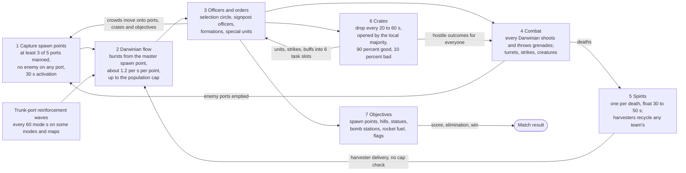
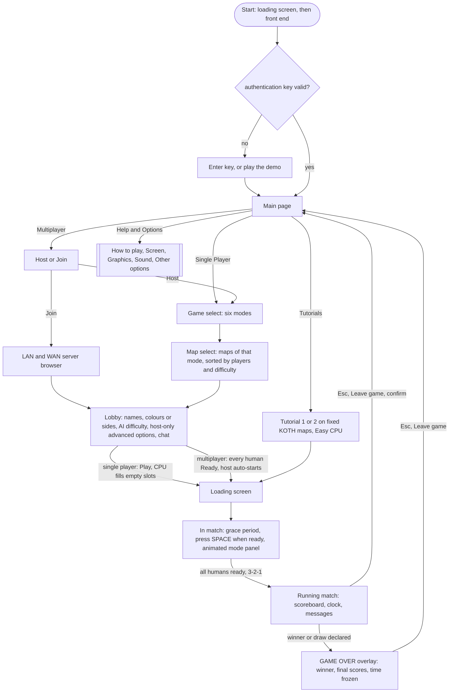

# 00 — Overview

> Part A · Baseline build: Release|Win32 (OpenGL) + TARGET_PC_FULLGAME ([B:FULL]); see _work/build_matrix.md.
> Evidence: [C] confirmed · [I] inferred · [U] unknown. Citations are `path:Symbol` relative to the multiwinia/ source root.
> Sources merged: no draft section was routed to 00; this document summarises the **final** functional documents [01](01_game_modes.md), [02](02_units_and_entities.md), [03](03_buildings_and_world_objects.md), [04](04_crates_powerups_and_weapons.md), [05](05_economy_and_population.md), [06](06_player_control_and_input.md), [07](07_ai.md), [08](08_levels_and_level_design.md), [09](09_meta_systems.md), [10](10_audio_design.md), with one-paragraph context from [20](20_architecture.md), [22](22_determinism_and_networking.md) and [24](24_rendering.md); headline findings from `_work/phase2_log.md`; map counts from `_work/drafts/X4_level_catalogue.md` / `X4_levels.csv` (cross-checked against [08 §3.3](08_levels_and_level_design.md#33-summary)); IP placeholders from the IP tables of 01–10 and `_work/closing/closing_ip.md`. Mechanics are **not** re-derived here: every number and rule is copied from its owning document, whose section is linked, together with the evidence tag and citation used there. A sample of the load-bearing constants was re-read in the source tree for this synthesis (listed in §10.1).

## Contents

1. [Pitch](#1-pitch)
2. [The game as actually shipped](#2-the-game-as-actually-shipped)
3. [Core loop](#3-core-loop)
4. [What makes it distinctive](#4-what-makes-it-distinctive)
5. [The player's verbs](#5-the-players-verbs)
6. [Match flow from the player's perspective](#6-match-flow-from-the-players-perspective)
7. [Design-critical quirks the new team must decide on](#7-design-critical-quirks-the-new-team-must-decide-on)
8. [Player-facing glossary](#8-player-facing-glossary)
9. [Reading guide to the functional set](#9-reading-guide-to-the-functional-set)
10. [Verification notes for this overview](#10-verification-notes-for-this-overview)
- [Open questions and unknowns](#open-questions-and-unknowns)
- [Docs-vs-code discrepancies](#docs-vs-code-discrepancies)
- [IP items](#ip-items)
- [Source map](#source-map)
- [Appendix — dead/legacy code](#appendix--deadlegacy-code)

Naming convention in this document: original in-game names (Darwinian, officer, spirit, spawn point, crate and every other term enumerated in §8) are used so that the reader can follow the citations; every one of them that is Introversion IP has a neutral placeholder in the glossary (§8) and in the IP table. The new game must not carry the original names, text, art, audio or map designs.

---

## 1 Pitch

*Multiwinia* is a 2–4-player real-time strategy game in which nobody builds units: each side's army is a crowd of small, self-willed soldiers that pours continuously out of the **spawn points** the side holds, so the whole game is a fight over territory that converts into a flow of bodies [C] `code/worldobject/spawnpoint.cpp:SpawnPoint::Advance` ([05 §1.1](05_economy_and_population.md#11-concept)). Players never order individual soldiers; they draw a circle around part of the crowd and send it somewhere, or promote one soldier into an **officer** who becomes a signpost or the head of a marching formation [C] `code/location_input.cpp:LocationInput::AdvanceTeamControl` ([06 At a glance](06_player_control_and_input.md#at-a-glance)). Every 20–60 seconds a **crate** parachutes onto the map; the side that crowds it first opens one of 31 outcomes — air strikes, nukes, armoured transports, turrets, crowd buffs, forests, monsters, time warps — of which one in ten is a hostile surprise for everybody [C] `code/location.cpp:Location::AdvanceCrates`, `code/worldobject/crate.cpp:Crate::AdvanceOnGround` ([04 §1](04_crates_powerups_and_weapons.md#1-crate-lifecycle)). Six modes put different objects at the centre of the same crowd-and-territory engine: spawn points (Domination), hill zones (King of the Hill), carried statues (Capture the Statue), a timed bomb and its control stations (Assault), a rocket that must be fuelled and boarded (Rocket Riot) and chains of flags (Blitzkrieg) [C] `code/multiwinia.cpp:Multiwinia::Advance` ([01 §1.4](01_game_modes.md#14-the-modes-at-a-glance)). Matches are short (default time limits 5–15 minutes), readable from a distance in a black-background, flat-shaded, neon-glow wireframe look, and playable against CPU opponents that see everything but cheat at nothing else [C] `data/multiwinia.txt` ([01 §5](01_game_modes.md#5-cross-mode-comparison)), [24 §7.1](24_rendering.md#71-how-the-look-is-produced-c-unless-marked), [07 §14](07_ai.md#14-cheats-and-advantages).

---

## 2 The game as actually shipped

### 2.1 Product and build

| Aspect | Shipped reality | Evidence | Owning doc |
|---|---|---|---|
| Product target | `TARGET_PC_FULLGAME` (`DARWINIA_GAMETYPE` "multiwinia"), the only active target; LAN and WAN play compiled in; basic and advanced crates and the tutorial compiled in | [C] `code/lib/universal_include.h` (target block) | `_work/build_matrix.md` §3 |
| Executable | `Release|Win32` OpenGL build `darwinia_gl.exe`, copied to `multiwinia.exe` by every Multiwinia packaging script; the Direct3D 9 configuration probably does not compile at this commit [I] | [C] `targets/vs2005/Darwinia.vcproj`, `tools/build_multiwinia_retail.bat` | [24 §1](24_rendering.md#1-backend-architecture), [31](31_platform_build_and_tools.md) |
| Every match is "multiplayer" | versus-CPU, LAN/WAN and both tutorials run through the same local or remote server and the same lockstep simulation; `App::Multiplayer()` is true in every Multiwinia game, `App::IsSinglePlayer()` only for the Darwinia campaign | [C] `code/app.cpp:App::Multiplayer`, `App::IsSinglePlayer`, `code/network/clienttoserver.cpp:ClientToServer::ProcessServerUpdates` | [06 §1.1](06_player_control_and_input.md#11-conventions-and-global-gates), [22 §1.1](22_determinism_and_networking.md#11-at-a-glance) |
| Demo/full gate | a runtime gate driven by the authentication key (`IS_DEMO`): demo keys restrict modes, maps and hosting through metaserver-supplied limits | [C] `code/app.cpp:App::IsGameModePermitted` | [09 §6](09_meta_systems.md#6-demofull-game-gating-and-the-authentication-key-ui) |
| Data | `data/` packed into `.dat` archives; loose files override archives; the retail data set excludes Darwinia levels, Tank Battle arenas, music and several dev maps | [C] `tools/multiwinia_exclusions.txt` | [31](31_platform_build_and_tools.md), [08 §2](08_levels_and_level_design.md#2-map-inventory-discovery-and-identity) |

### 2.2 The six modes

The anonymous enum in `code/multiwinia.h:Multiwinia` defines seven game types; six are compiled into [B:FULL] and Tank Battle only into `TARGET_DEBUG` [C] `code/multiwinia.h`, `code/lib/universal_include.h`, `code/app.cpp:App::IsGameModePermitted` ([01 §1.1](01_game_modes.md#11-the-seven-game-types)). The expected list "Domination, King of the Hill, Capture the Statue, Rocket Riot, Assault, Blitzkrieg" is therefore confirmed for the shipped build [C].

| # | Mode (original name → placeholder) | Objective | Ends by | Time limit option (default) | Players | Retail maps | Complexity label | Spec |
|---|---|---|---|---|---|---|---|---|
| 0 | Domination (`GameTypeSkirmish`) → *Spawn Control* | own spawn points; a team owning none for 30 mode seconds is eliminated | last team standing, or score at time-up | 0–60 min (10), 0 = unlimited | free-for-all 2–4; co-op 2v2 on two maps | 9 | Simple | [01 §4.1](01_game_modes.md#41-domination-gametypeskirmish-bfull) |
| 1 | King of the Hill → *Zone Control* | hold hill zones | score at time-up (never by elimination) | 1–60 min (5) | free-for-all 2–4; co-op 2v2 on three maps | 9 | Simple | [01 §4.2](01_game_modes.md#42-king-of-the-hill-gametypekingofthehill-bfull) |
| 2 | Capture the Statue → *Relic Run* | carry statues into your own zone (1 point each) | score at time-up | 1–60 min (10) | free-for-all 2–4; co-op on one map | 9 | Medium | [01 §4.3](01_game_modes.md#43-capture-the-statue-gametypecapturethestatue-bfull) |
| 3 | Assault → *Siege* | attackers capture every control station linked to the defenders' bomb before it detonates | bomb destroyed (attackers win) or detonation (defenders win) | none — the bomb's level timer (900 s / 1200 s) | 1v1, 1v2 and 2v2 (ForceCoop) | 8 | Medium | [01 §4.4](01_game_modes.md#44-assault-gametypeassault-bfull) |
| 4 | Rocket Riot → *Launch Race* | refuel your rocket via solar power, load 100 Darwinians, launch | first rocket above world height 600 | none | free-for-all 2–4 | 7 | Hard | [01 §4.5](01_game_modes.md#45-rocket-riot-gametyperocketriot-bfull) |
| 5 | Blitzkrieg → *Flag Chain* | capture a connected chain of flags into an enemy's home flag to eliminate it | last team standing, or flags + eliminations at time-up | 0–60 min (15), 0 = unlimited | free-for-all 2–4 | 7 | Hard | [01 §4.6](01_game_modes.md#46-blitzkrieg-gametypeblitzkreig-bfull) |

[C] `code/multiwinia.cpp:Multiwinia::AdvanceSkirmish`, `AdvanceKingOfTheHill`, `AdvanceCaptureStatue`, `AdvanceAssault`, `AdvanceRocketRiot`, `AdvanceBlitkrieg`; option ranges and defaults `data/multiwinia.txt`; labels `code/multiwinia.cpp:MultiwiniaGameBlueprint::GetDifficulty` ([01 §1.1, §1.4, §5](01_game_modes.md#5-cross-mode-comparison)). A "mode second" is 11 ticks = 1.1 game seconds (§7, Q1), so "30 mode seconds" and the on-screen clock run 10 % slower than game time [C] ([01 Conventions](01_game_modes.md#conventions-used-in-this-document)).

### 2.3 Maps and player counts

| Quantity | Value | Evidence | Owning doc |
|---|---|---|---|
| Multiwinia map files in the tree | 57 `data/levels/mp_*.txt` (53 mode maps + 4 with `GameTypes none`) | [C] directory listing; `code/game_menu.cpp:GameMenu::AddMap` | [08 §3](08_levels_and_level_design.md#3-master-catalogue-of-the-57-multiwinia-maps) |
| Maps listed in the retail menu | **49**: Domination 9, King of the Hill 9, Capture the Statue 9, Assault 8, Rocket Riot 7, Blitzkrieg 7 — equal to `data/levels/level_enum.txt` ids 1–49 | [C] `code/game_menu.cpp:GameMenu::CreateMapList`, `tools/multiwinia_exclusions.txt`, `data/levels/level_enum.txt` | [08 §3.3](08_levels_and_level_design.md#33-summary), [01 §1.3](01_game_modes.md#13-maps-per-mode-retail-menu) |
| Player counts of the 49 | 2-player 22, 3-player 15, 4-player 12 (`mp_assault_3p_1` declares `NumPlayers 2`) | [C] `NumPlayers` lines of the level files (re-counted from `X4_levels.csv` for this overview) | [08 §3.3](08_levels_and_level_design.md#33-summary) |
| Map size | square worlds 2000–7000 world units on a side | [C] `Landscape` blocks (same re-count) | [08 §3.3](08_levels_and_level_design.md#33-summary), [23](23_terrain_and_landscape.md) |
| Population caps | level `PopulationCap` 1400–2000 on 47 retail maps; two co-op maps (`mp_domination_4P_2`, `mp_koth_4P_3`) have none | [C] `code/level_file.cpp:LevelFile::ParseMultiwiniaOptions`; level files | [05 §4.6](05_economy_and_population.md#46-per-map-table-every-mp_-level-file-in-datalevels) |
| Maps with spawn points | 32 of the 49 | [C] building census | [05 §2](05_economy_and_population.md#2-territory-capture-spawn-points), [03 §1.5](03_buildings_and_world_objects.md#15-shipped-map-census) |
| Co-op-capable maps | Domination 2, King of the Hill 3, Capture the Statue 1, Assault 4 (ForceCoop), Rocket Riot 0, Blitzkrieg 0 | [C] map tables | [01 §5](01_game_modes.md#5-cross-mode-comparison) |
| Not shipped | `mp_assault_stress`, `mp_benchmark_1`, `mp_sandbox`, `mp_sandbox_all`, `mp_tankbattle_2P/3P/4P`, `mp_cts_3p_3`; 12 Darwinia `map_*` + 17 `mission_*`; 30 superseded maps in `data/levels/old/` | [C] `tools/multiwinia_exclusions.txt` | [08 §3.4](08_levels_and_level_design.md#34-hidden-test-stress-benchmark-sandbox-tankbattle-and-cut-maps) |

### 2.4 Who is in every match

- Six team slots (`NUM_TEAMS = 6`): slots 0–3 are players (only 0 … `NumPlayers−1` are used on a given map), slot 4 is the **monster team** ("Evilinians", owner of hostile crate outcomes and creatures) and slot 5 the **Futurewinian team** (dropped by the Space Ship outcome). Both special teams are created as CPU teams in **every** Multiwinia game and each owns one AI entity [C] `code/globals.h`, `code/location.cpp:Location::InitMonsterTeam`, `Location::InitFuturewinianTeam` ([01 Conventions](01_game_modes.md#conventions-used-in-this-document)).
- At game start the host fills every empty player slot with a CPU team; one AI difficulty (Easy / Normal / Hard) applies to all CPU teams [C] `code/UI/GameMenuWindow.cpp` (lobby update, `PlayGameButton`), `code/multiwinia.h` ([09 §5.1](09_meta_systems.md#51-start-sequences-driven-from-the-front-end), [07 §13](07_ai.md#13-difficulty-levels--every-parameter)).
- A human who leaves mid-match is replaced by a CPU player immediately; no mode treats a leaver as eliminated [C] `code/multiwinia.cpp:Multiwinia::RemoveTeams` ([01 §2.13](01_game_modes.md#213-players-leaving)).
- Eight selectable team colours; in Assault the colour *is* the side (green = defenders, red = attackers) [C] `code/multiwinia.h` (`MULTIWINIA_NUM_TEAMCOLOURS`, `ASSAULT_DEFENDER_COLOURID`) ([01 §2.5](01_game_modes.md#25-teams-slots-start-positions-colours-co-op-and-assault-sides)).

### 2.5 What is NOT in the shipped game

Everything below exists in the source tree, often fully coded, but a player of the [B:FULL] build never meets it.

| Feature | Build tag / state | What exists | Evidence | Owning doc |
|---|---|---|---|---|
| Darwinia single-player campaign (global world, campaign maps, scripts, Dr Sepulveda) | [B:LEGACY] — compiled in, unreachable; campaign levels excluded from every Multiwinia data build; the Darwinia main page is debug-only | the whole campaign code path guarded by `App::IsSinglePlayer()`; 12 `map_*` + 17 `mission_*` levels; 42 scripts that cannot run in Multiwinia | [C] `code/app.cpp:App::IsSinglePlayer`, `tools/multiwinia_exclusions.txt` | [09 §2.6](09_meta_systems.md#26-compiled-but-unreachable-and-non-baseline-flow), [08 §7](08_levels_and_level_design.md#7-darwinia-map_mission_-files-datalevelsold-and-level_enumtxt), [30](30_scripting_tutorial_and_cutscenes.md) |
| Tank Battle mode | [B:DEBUG] — `INCLUDEGAMEMODE_TANKBATTLE` commented out in FULLGAME; arenas not in retail data; Tank unit also unreachable as a crate reward | blueprint, three arenas, dispatch case, `Tank` entity and AI | [C] `code/lib/universal_include.h`, `code/multiwinia.cpp:Multiwinia::AdvanceTankBattle` | [01 §4.7](01_game_modes.md#47-tank-battle-gametypetankbattle-bdebug), [02 §1.1](02_units_and_entities.md#11-every-entitytype-value) |
| Map editor and custom `.mwm` maps | [B:EDITOR] — `LOCATION_EDITOR` commented out in every target; even the menu entry is compiled out | editor core and its editor windows (`code/location_editor.*` plus the editor window files) | [C] `code/lib/universal_include.h` | [08 §8](08_levels_and_level_design.md#8-the-map-editor-beditor) |
| Achievements (12) | stubbed — conditions are evaluated in the rules code, but `App::EarnedAchievement` always returns false and the tracker never persists; the Achievements page is unreachable; `level_enum.txt` (needed for two of them) is excluded from retail data | catalogue, unlock conditions, page widgets | [C] `code/app.cpp:App::GiveAchievement`, `App::EarnedAchievement`, `code/achievement_tracker.cpp` | [09 §7.2](09_meta_systems.md#72-platform-reality-in-the-pc-baseline--achievements-are-stubbed), [01 §2.11](01_game_modes.md#211-ending-declarewinnert-and-the-end-of-game-sequence) |
| Music | never heard — no reachable trigger, all 11 tracks excluded from the shipped archives, and a triggered track would hit a fatal release assert | a complete music engine and `OTHER Music` event blocks in `data/sounds.txt` | [C] `code/sound/sample_cache.cpp:CachedSample::CachedSample`, `tools/multiwinia_exclusions.txt` | [10 §6.4](10_audio_design.md#64-why-music-is-never-heard-in-multiwinia--and-the-assert) |
| Leaderboards | [B:LEGACY] stub — no data source or backend | UI windows only (`LeaderboardLoader` is a stub; the metaserver message set carries no ranking fields) | [C] `code/interface/leaderboards_window.cpp:LeaderboardLoader::DoLeaderboardSearch`, `code/UI/GameMenuWindow.cpp:GameMenuWindow::SetupLeaderboardPage` | [09 §7.5](09_meta_systems.md#75-leaderboards-blegacy--no-data-source) |
| Quick match | unreachable — its button is commented out | page code (entry button commented out: "It doesn't work") | [C] `code/UI/GameMenuWindow.cpp` | [09 §5.9](09_meta_systems.md#59-quick-match-pagequickmatchgame-5--unreachable) |
| Key rebinding | unreachable — the key-binding window's menu button is commented out; only hand-edited files change controls | `PrefsKeybindingsWindow` | [C] `code/interface/mainmenus.cpp:OptionsMenuWindow::Create` | [06 At a glance](06_player_control_and_input.md#at-a-glance), [09 §11.9](09_meta_systems.md#119-control-options-prefskeybindingswindow-blegacy--unreachable) |
| Darwinia control scheme, gesture recogniser, icon task bar, gamepad control-help panel | [B:LEGACY] — `PrefsManager::Load` forces `MultiwiniaControlMethod = 1` after every load | full gesture recogniser (8 symbols) and two alternative task-manager interfaces | [C] `code/lib/preferences.cpp:PrefsManager::Load`, `code/taskmanager_interface.cpp:TaskManagerInterface::CreateTaskManager` | [06 §4.1](06_player_control_and_input.md#41-variant-selection--which-interface-is-live), [06 §7.1](06_player_control_and_input.md#71-liveness) |
| Multi-round Assault (sides rotate, best defence time wins) | unreachable — `m_assaultSingleRound` is never set false | full round-rotation and time-record code | [C] `code/multiwinia.cpp:Multiwinia::AdvanceAssault`, `Multiwinia::ResetLocation` | [01 §6](01_game_modes.md#6-known-bugs-that-shape-the-shipped-rules) (B5) |
| The Beast crate outcome; Shaman, DropShip, Tripod, LaserTrooper units; Tank and FormationIncrease crates | [B:DEBUG] (Beast: `INCLUDE_THEBEAST` only under `TARGET_DEBUG`) / [B:LEGACY] / commented out | classes and behaviour | [C] `code/worldobject/crate.h`, `code/worldobject/entity.cpp:Entity::NewEntity` | [04 §5.30](04_crates_powerups_and_weapons.md#530-the-beast-bdebug), [02 §1.1](02_units_and_entities.md#11-every-entitytype-value) |
| Spectator UI | [B:DEAD] — compiled only under `TESTBED_ENABLED` | spectator team type and buttons | [C] `code/UI/GameMenuWindow.cpp` | [01 §2.5.2](01_game_modes.md#252-slots-and-start-positions) |
| In-match objective tabs | cut — computed every frame, never drawn | `MultiwiniaHelp` objective tabs | [C] `code/multiwiniahelp.cpp` | [09 §8.3](09_meta_systems.md#83-objective-tabs--computed-every-frame-but-never-drawn-cut-feature) |
| Intro start sequence, boot-loader mini-programs, attract mode, benchmark, demo-end screen, user profiles, mods | [B:LEGACY] / [B:DEAD] (`USE_LOADERS` off) | code present | [C] `code/lib/universal_include.h` | [09 §9.1](09_meta_systems.md#91-build-reality-of-every-sequence-feature), [09 Appendix](09_meta_systems.md#appendix--deadlegacy-code) |
| Audio DSP effects | data-authored (22 uses), not applied in the shipped configuration | DSP chain | [C] `data/sounds.txt` | [10 §1.3](10_audio_design.md#13-headline-numbers) |
| A post-match results screen in the front end | does not exist — results are only the in-match "GAME OVER" overlay; leaving rebuilds the main page | — | [C] `code/game_menu.cpp:GameMenu::CreateMenu` | [01 §2.2](01_game_modes.md#22-match-lifecycle) |

---

## 3 Core loop

### 3.1 Loop diagram

The loop is the same in all six modes; only the objective box at the end changes (§4.5). Rates are mean values at normal game speed; "mode s" = 11 ticks = 1.1 s.

Evidence for every box [C]: capture `code/worldobject/spawnpoint.cpp:SpawnPoint::RecalculateOwnership`; flow `SpawnPoint::Advance`, `MasterSpawnPoint::RequestSpirit`; orders `code/location_input.cpp:LocationInput::AdvanceTeamControl`; combat `code/worldobject/darwinian.cpp:Darwinian::AdvanceCombat`; spirits `code/worldobject/spirit.cpp:Spirit::Advance`, `code/worldobject/harvester.cpp:Harvester::AdvanceToSpawnPoint`; crates `code/location.cpp:Location::AdvanceCrates`, `code/worldobject/crate.cpp:Crate::AdvanceOnGround`; objectives and trunk ports `code/multiwinia.cpp:Multiwinia::Advance`, `Multiwinia::AdvanceTrunkPorts`. Full flow diagram with every source and sink: [05 §1.2](05_economy_and_population.md#12-flow-diagram-with-rates).

### 3.2 Key rates and constants

Copied from the owning documents (normal game speed; 1 tick = 0.1 s of game time). Exact tick counts, which differ from nominal seconds, are in [05 §8.2](05_economy_and_population.md#82-nominal-vs-actual-tick-counts-of-every-economy-timer).

| Loop step | Constant or rule | Value | Evidence | Owning doc |
|---|---|---|---|---|
| Clock | simulation tick; `dt` = `0.1 × gameSpeed` | 10 ticks per game second | [C] `code/gametimer.cpp:GameTimer::GetServerAdvancePeriod` | [01 Conventions](01_game_modes.md#conventions-used-in-this-document), [20 §10](20_architecture.md#10-frame-timing) |
| Clock | "mode second" (rule countdowns reset to 1.0 and decremented by dt) | 11 ticks = 1.1 game s | [C] `code/multiwinia.cpp:Multiwinia::AdvanceSkirmish` (and every other `Advance*`); tick count by exact replay | [01 §6](01_game_modes.md#6-known-bugs-that-shape-the-shipped-rules) (B1) |
| Pre-match | grace countdown after every human is ready | 3.0 s (`GRACE_TIME`), clock frozen until then | [C] `code/lib/universal_include.h`, `code/multiwinia.cpp:Multiwinia::AdvanceGracePeriod` | [01 §2.4](01_game_modes.md#24-grace-period-readiness-and-countdown) |
| Start | seeded Darwinians | 5 per port of every team-owned SpawnPoint / SolarPanel, plus the level's `InstantUnits` | [C] `code/location.cpp:Location::InitialiseTeam` | [05 §6.7](05_economy_and_population.md#67-starting-units) |
| 1 Capture | spawn-point ownership | a single team with ≥ 3 operators on the 5 ports, every other occupant a friend; re-evaluated every 2.0 + U[0,1) s | [C] `code/worldobject/spawnpoint.cpp:SpawnPoint::RecalculateOwnership` | [05 §2.2](05_economy_and_population.md#22-ownership-evaluation--exact-algorithm) |
| 1 Capture | activation delay after an ownership change | 30 s (skipped if the team owns exactly one spawn point, or level option `instantspawnpointcapture`) | [C] `SpawnPoint::Advance` | [05 §2.3](05_economy_and_population.md#23-activation-delay) |
| 2 Flow | spawn cycle per owned, active, unlocked point | one request every 0.2 s for `int(20 × H)` requests, then a pause of 10 + U[0,5) s | [C] `SpawnPoint::Advance` | [05 §3.1](05_economy_and_population.md#31-request-cycle-multiwinia) |
| 2 Flow | mean output per point | ≈ 1.22 Darwinians/s (H = 1), ≈ 1.90/s (H = 1.9) | [I] derived from the constants above | [05 §3.3](05_economy_and_population.md#33-per-spawn-point-rate) |
| 2 Flow | handicap multiplier H | 1 + `Handicap`/100 (default 90 → 1.9) when the average spawn-point count of the other used teams exceeds 1.5 × own; else 1 | [C] `SpawnPoint::CalculateHandicap` | [05 §3.2](05_economy_and_population.md#32-handicap) |
| 2 Flow | transit latency through the spawn network | ≈ h seconds for h link hops (11 ticks first hop, 10 thereafter); a spirit arriving at a point that has gone neutral is discarded | [C] `code/worldobject/spawnpoint.cpp:SpawnBuilding::Advance`, `SpawnPoint::TriggerSpirit` | [05 §3.4](05_economy_and_population.md#34-spirit-transit-through-the-spawn-network) |
| 2 Flow | population cap per team | `PopulationCap ÷ NumPlayers` of the level (integer division); Assault splits defender/attacker caps; counts every body outside a unit, including the CPU's AI entity, armour, officers and creature eggs | [C] `SpawnPoint::PopulationLocked`, `code/team.cpp:Team::NewEntity` | [05 §4](05_economy_and_population.md#4-the-population-cap) |
| 2 Flow | trunk-port waves (Rocket Riot, Blitzkrieg, Assault and maps with the level option) | a wave every 60 mode s (66 game s); 40 Darwinians per owned port in Rocket Riot / Blitzkrieg | [C] `code/multiwinia.cpp:Multiwinia::AdvanceTrunkPorts` | [05 §6](05_economy_and_population.md#6-reinforcement-systems) |
| 3 Orders | selection circle | grows 100 u/s to a 100 u radius while the button is held | [C] `LocationInput::AdvanceTeamControl` | [06 §1.3](06_player_control_and_input.md#13-master-table--multiwinia-live-actions) (S4–S6) |
| 3 Orders | minimum interval between crowd orders | 1.0 s of network time | [C] `LocationInput::AdvanceTeamControl` | [06 §1.3](06_player_control_and_input.md#13-master-table--multiwinia-live-actions) (O1) |
| 3 Orders | officer reach | signpost (GOTO): idle Darwinians within 100; formation: Darwinians within 150 join, at most 90 members | [C] `code/worldobject/darwinian.h` (`DARWINIAN_SEARCHRANGE_OFFICERS`, `_OFFICERFOLLOW`), `code/team.cpp:Team::Team` (`EvolutionFormationSize` = 90) | [06 §5](06_player_control_and_input.md#5-officer-orders-promotion-and-formations) |
| 4 Combat | Darwinian | health 50; speed 20 u/s; laser 20–39 damage, range ≈ 90, 3 s reload; grenades; every Darwinian is a soldier in Multiwinia | [C] `data/stats.txt`, `code/worldobject/entity.cpp:Entity::Attack`, `code/location.cpp:Location::Init` (research levels) | [02 §4.2](02_units_and_entities.md#42-darwinian--stats) |
| 5 Spirits | spirit lifetime | Birth ≈ 6 s → Floating 30–50 s (collectable) → ascent 90 s → gone; none for the monster team | [C] `code/worldobject/spirit.cpp:Spirit::Advance`, `code/location.cpp:Location::SpawnSpirit` | [05 §5.2](05_economy_and_population.md#52-states-and-timers) |
| 5 Spirits | harvester | collects floating spirits of **any** team within 75, capacity 100, delivers one per tick at a friendly spawn point as a Darwinian — no cap check, no activation check | [C] `code/worldobject/harvester.cpp:Harvester::AdvanceHarvesting`, `Harvester::AdvanceToSpawnPoint` | [05 §5.3](05_economy_and_population.md#53-who-can-collect-a-spirit) |
| 6 Crates | drop interval | U(0.5, 1.5] × `CrateDropRate` (default 40 → 20–60 s); at most `int(worldSizeX / 500)` crates at once | [C] `code/location.cpp:Location::AdvanceCrates`, `data/multiwinia.txt` | [04 §1.3](04_crates_powerups_and_weapons.md#13-drop-timer--locationadvancecrates) |
| 6 Crates | opening | strict Darwinian majority within 35; progress `min(0.05, dt × n / 100)` per tick to 2.5 → at least 51 ticks (5.1 s) with ≥ 50 Darwinians; a neutral crate expires after 60 s with no effect | [C] `code/worldobject/crate.cpp:Crate::AdvanceOnGround`, `Crate::RecalculateOwnership` | [04 §1.7](04_crates_powerups_and_weapons.md#17-capture-pickup-rules--crateadvanceonground-craterecalculateownership), [04 §1.8](04_crates_powerups_and_weapons.md#18-lifetime-and-expiry) |
| 6 Crates | outcome draw | 90 % good (uniform over the valid good set), 10 % bad (uniform over the bad list, created for the monster team) | [C] `Crate::AdvanceOnGround`, `Crate::CaptureCrate`, `Crate::RunUncapturedCrate` | [04 §3](04_crates_powerups_and_weapons.md#3-probability-tables) |
| 6 Crates | task slots | 6 per team (2 while the team counts as eliminated); a grant that finds the slots full is lost | [C] `code/taskmanager.cpp:TaskManager::Capacity`, `TaskManager::RunTask` | [06 §3.5](06_player_control_and_input.md#35-slots-and-capacity) |
| 6 Crates | retribution (comeback grants) | a random power every 45 s (450 ticks) while the team counts as eliminated and has a free slot; on by default | [C] `code/multiwinia.cpp:Multiwinia::Advance`, `Multiwinia::AdvanceRetribution` | [01 §2.9](01_game_modes.md#29-retribution-comeback-powerups-bfull), [04 §4.4](04_crates_powerups_and_weapons.md#44-retribution-eliminated-team-grants) |
| 7 Objectives | match end | `DeclareWinner`: game speed eases to 0 over 21 ticks and is locked; "GAME OVER" overlay | [C] `code/multiwinia.cpp:Multiwinia::DeclareWinner`, `code/gametimer.cpp:GameTimer::RequestSpeedChange` | [01 §2.11](01_game_modes.md#211-ending-declarewinnert-and-the-end-of-game-sequence) |

---

## 4 What makes it distinctive

### 4.1 A population-flow RTS without build queues

There is **no build queue and no currency**: a team's army is a population of Darwinians plus a handful of special units, created by territory and destroyed by combat [C] `code/worldobject/spawnpoint.cpp:SpawnPoint::Advance`, `SpawnPoint::PopulationLocked` ([05 §1.1](05_economy_and_population.md#11-concept)). Each Darwinian runs its own priority task search every 1–2 s — man a port, open a crate, carry a statue, board a rocket, fight, flee — so a crowd left alone keeps doing useful local work [C] `code/worldobject/darwinian.cpp:Darwinian::SearchForNewTask` ([02 §4.5](02_units_and_entities.md#45-darwinian--task-search-searchfornewtask-every-12-s-grounded-not-burning)). In Multiwinia every Darwinian is a soldier with lasers and grenades, because the multiplayer research level of `TypeDarwinian` is fixed at 4 [C] `code/location.cpp:Location::Init` ([02 §2.3](02_units_and_entities.md#23-research-levels-are-fixed-in-multiwinia)). The player's power therefore is *territory held × time − losses*, capped per team, and the skill is directing flows of bodies rather than producing them. Special units and weapons arrive only as granted **tasks** (from crates, reinforcement waves, retribution, starting power-ups and level instant units); the player can select, place and cancel them but never create one [C] `code/taskmanager.cpp:TaskManager::RunTask` ([06 §3.1](06_player_control_and_input.md#31-overview)).

### 4.2 The spawn-point economy

Territory is mainly **spawn points**: a team owns one when at least 3 of its 5 ports are manned by its operating Darwinians and no enemy occupies any port; ownership is re-evaluated every 2–3 s and a new owner waits 30 s before the point produces [C] `SpawnPoint::RecalculateOwnership`, `SpawnPoint::Advance` ([05 §2](05_economy_and_population.md#2-territory-capture-spawn-points)). Production is a burst/pause cycle that requests "virtual spirits" from an invisible master spawn point and routes them along spawn links, so new Darwinians appear at the door about one second per link hop later — for whoever owns the point on arrival [C] `code/worldobject/spawnpoint.cpp:MasterSpawnPoint::RequestSpirit`, `SpawnBuilding::Advance` ([05 §3](05_economy_and_population.md#3-the-spawn-formula-burstpause-handicap-transit)). Income is linear in the number of points held (≈ 1.22 Darwinians/s each), a lagging team can get a ×1.9 burst size through the handicap option, and a per-team population cap freezes production when reached [I] rates, [C] rules `SpawnPoint::CalculateHandicap` ([05 §7](05_economy_and_population.md#7-throughput-analysis--territory-value)). Fixed **trunk ports** add timed reinforcement waves in the objective-heavy modes, and the **soul economy** closes the loop: every death leaves a spirit that a Harvester (crate unit) can turn back into a Darwinian of *its* team regardless of whose spirit it was [C] `code/multiwinia.cpp:Multiwinia::AdvanceTrunkPorts`, `code/worldobject/harvester.cpp:Harvester::AdvanceHarvesting` ([05 §5–§6](05_economy_and_population.md#5-spirit-soul-lifecycle)). Building-level detail of the spawn network: [03 §4](03_buildings_and_world_objects.md#4-spawn-network).

### 4.3 Officers and formations instead of unit micro

Players move crowds in two ways [C] `code/location_input.cpp:LocationInput::AdvanceTeamControl` ([06 §1.3](06_player_control_and_input.md#13-master-table--multiwinia-live-actions), [06 §5](06_player_control_and_input.md#5-officer-orders-promotion-and-formations)). (1) Hold the left button to grow a selection circle (up to 100 u radius) over their own Darwinians, then right-click a destination; the group walks there and is released. (2) Right-click a single Darwinian to **promote** it into an Officer, who never fights: a right-click elsewhere turns it into a *signpost* — every idle Darwinian of the team passing within 100 u picks up the order and walks the route, which turns a spawn point's output into a conveyor belt — while a right-click on the officer itself switches it into a *formation*, a marching block of up to 90 Darwinians that forms in front of it [C] `code/worldobject/officer.cpp:Officer::SetOrders`, `code/worldobject/darwinian.cpp:Darwinian::SearchForOfficers` ([02 §5](02_units_and_entities.md#5-officer)). Direct control exists only for the few special units and buildings (squad, armour, harvester, engineer, gun turret, radar dish) [C] `code/location.cpp:Location::UpdateTeam` ([06 §6](06_player_control_and_input.md#6-direct-control-of-units-and-buildings)). Demotion is unreachable for players — the cancel key kills a selected officer instead [C] `LocationInput::AdvanceTeamControl` ([06 §5.1](06_player_control_and_input.md#51-promotion-and-demotion)).

### 4.4 Crates — the strategic wildcard

Crates drop every 20–60 s at the default `CrateDropRate` 40, at most one per 500 u of world width at a time; in Domination, King of the Hill and Capture the Statue the default score-weighted drop mode places them near buildings of **lower-scoring** teams, a built-in catch-up lever [C] `code/location.cpp:Location::AdvanceCrates`, `Location::CreateRandomCrate` ([04 §1.3–§1.4](04_crates_powerups_and_weapons.md#14-placement--locationcreaterandomcrate)). A crate takes ≈ 33–38 s to float down under a visible ground marker, so both sides can converge on it; it opens for the team holding the strict Darwinian majority within 35 u for at least 51 ticks [I] fall time, [C] capture `code/worldobject/crate.cpp:Crate::AdvanceFloating`, `Crate::AdvanceOnGround` ([04 §1.5–§1.7](04_crates_powerups_and_weapons.md#17-capture-pickup-rules--crateadvanceonground-craterecalculateownership)). There are **31 shipped outcomes** (plus The Beast in debug builds): 90 % of openings draw uniformly from the valid "good" set (26 types on a standard map, 3.462 % each) and 10 % from a "bad" list of 7 hostile events created for the monster team (1.429 % each) [C] `Crate::CaptureCrate`, `Crate::RunUncapturedCrate`, `code/worldobject/crate.h` ([04 §2.1](04_crates_powerups_and_weapons.md#21-identity-build-gating-and-pool-membership), [04 §3.2–§3.3](04_crates_powerups_and_weapons.md#33-per-type-probability-in-the-standard-case)). Good outcomes either act immediately (extra Darwinians, Crate Mania, time warps) or become a targetable task in one of the six slots (squads, armour, air strikes, nukes, turrets, crowd buffs, forests, eggs) [C] ([04 §2.2](04_crates_powerups_and_weapons.md#22-behaviour-summary-per-outcome)). Levels can exclude outcomes (`InvalidCrates`), the lobby can restrict crates to the 7 basic types (which also disables the bad pool), Domination and King of the Hill can grant 0–3 starting power-ups, and eliminated teams receive retribution grants [C] `code/level_file.cpp:LevelFile::ParseMultiwiniaOptions`, `Crate::IsValid` ([04 §4](04_crates_powerups_and_weapons.md#4-exclusion-lists-and-grant-options)). The full counter-play matrix is in [04 §5.31](04_crates_powerups_and_weapons.md#531-counter-play-and-counters-matrix).

### 4.5 Per-mode objectives on one engine

All six modes share one rules skeleton — per-tick world update, per-mode-second rule evaluation (score, elimination, time-up, sudden death), then `DeclareWinner` — held in a single lockstep rules object [C] `code/multiwinia.cpp:Multiwinia::Advance` ([01 §2](01_game_modes.md#2-the-shared-match-framework), [01 §7](01_game_modes.md#7-re-implementation-notes-for-the-new-game)). What changes is the **territory unit** and the score [C] ([01 §5](01_game_modes.md#5-cross-mode-comparison)):

| Mode | Territory unit / objective objects | Score | Objects spec |
|---|---|---|---|
| Domination | spawn points (the spawn network itself) | owned spawn points (current, or cumulative per mode second by `ScoreMode`) | [03 §4](03_buildings_and_world_objects.md#4-spawn-network) |
| King of the Hill | `MultiwiniaZone` hill zones | zones owned / zone population / final population / all-zones bonus (by `ScoreMode`) | [03 §8.1](03_buildings_and_world_objects.md#81-multiwiniazone) |
| Capture the Statue | `Statue` (carryable) + `MultiwiniaZone` drop zones | +1 per delivery | [03 §8.3–§8.4](03_buildings_and_world_objects.md#84-statue) |
| Assault | `PulseBomb`, `ControlStation`, `TrunkPort`, `WallBuster`, walls, AI objectives | defence time (s) | [03 §8.5–§8.7](03_buildings_and_world_objects.md#87-pulsebomb) |
| Rocket Riot | `EscapeRocket`, `FuelStation`, `FuelGenerator`, `FuelPipe`, solar-panel power grid, `TrunkPort` | ⌊fuel⌋ + passengers + ⌊height⌋ | [03 §8.8–§8.12](03_buildings_and_world_objects.md#812-escaperocket) |
| Blitzkrieg | `MultiwiniaZone` flags (+ `Flag` cloth), home flags, `TrunkPort` | status code; at time-up flags + 10 × eliminations | [03 §8.1–§8.2](03_buildings_and_world_objects.md#82-flag) |

Evidence [C] `code/multiwinia.cpp` per-mode `Advance*` functions, `code/worldobject/multiwiniazone.cpp`, `code/worldobject/statue.cpp`, `code/worldobject/pulsebomb.cpp`, `code/worldobject/rocket.cpp`, `code/worldobject/trunkport.cpp`; the mode/object usage matrix is [03 §8.13](03_buildings_and_world_objects.md#813-mode-usage-matrix).

### 4.6 CPU opponents with perfect information and no other cheats

A CPU player is an ordinary team slot plus one invisible, immortal `AI` entity that is simulated on every peer inside the lockstep simulation and sends no network traffic [C] `code/location.cpp:Location::InitialiseTeam`, `code/worldobject/ai.cpp:AI::Advance` ([07 §1](07_ai.md#1-overview), [07 §15](07_ai.md#15-determinism-lockstep-and-the-network-model)). It thinks through an `AITarget` node graph carrying per-team priorities, a dispatcher that walks idle Darwinians to the best linked node, Goto and formation officers, 19 task handlers that place every granted power, and per-mode logic (Assault objective chains, Rocket Riot logistics, Blitzkrieg zone pins) [C] `code/worldobject/ai.cpp`, `code/worldobject/aiobjective.cpp` ([07 §2](07_ai.md#2-architecture)). One difficulty applies to every CPU team: Easy re-thinks every 20 s with frozen priorities and random moves, Normal every 10 s and half-random, Hard every 1.1 s and always greedy — the difference is tempo and focus, not information [C] `AI::AI`, `AI::FindTargetBuilding` ([07 §13](07_ai.md#13-difficulty-levels--every-parameter)). The AI has no resource, population, damage, speed or vision cheats; its structural advantages are perfect information, unlimited command rate, per-Darwinian targeting and an armour self-destruct humans cannot trigger [C] ([07 §14](07_ai.md#14-cheats-and-advantages)). *Resolved:* 07 §14 lists the AI entity as a "free unit" that does not count toward population, while 05 §4.1 counts it against the per-team cap. Code: `AI::AI` decrements only the global `Entity::s_entityPopulation` counter, whose cap check in `Location::SpawnEntities` is commented out, whereas the AI is spawned with unit id −1 into `Team::m_others`, which is exactly what `SpawnPoint::PopulationLocked` counts — so the AI entity **does** occupy one body of its team's cap (a negligible but real cost, not an advantage) [C] `code/worldobject/ai.cpp:AI::AI`, `code/location.cpp:Location::InitialiseTeam`, `Location::SpawnEntities`, `code/worldobject/spawnpoint.cpp:SpawnPoint::PopulationLocked`.

---

## 5 The player's verbs

Condensed from the 8-group action table of [06 §1.3](06_player_control_and_input.md#13-master-table--multiwinia-live-actions) (row ids A/S/O/T/D/M refer to that table). Bindings are the defaults of `data/input/input_preferences.txt`, the only live system binding file in [B:FULL]; pad bindings exist only when XInput loads [C] `code/lib/preferences.cpp:PrefsManager::Load`, `code/main.cpp:InitialiseInputManager`. Every action marked "networked" takes effect on all peers at the next 0.1 s server tick [C] `code/network/clienttoserver.cpp:ClientToServer::ProcessServerUpdates`.

| Verb | Keyboard / mouse | Pad | What it does | Networked | 06 rows |
|---|---|---|---|---|---|
| **Look** — pan, raise/lower, aim, zoom, freeze | W/A/S/D or arrows (Shift = ×4), Q/E or wheel, mouse movement, Z or MMB (zoom), F2 (look around) | left stick, triggers, right stick, R3 | free-movement camera; 250 u/s pan (1000 with Shift); zoom narrows the field of view 60° → 15° while held | no (local) — except F2, which also changes squad behaviour on that peer (desync, §7 Q8) | A1–A7 |
| **Gather** a crowd | hold LMB on empty ground | hold A | selection circle grows to 100 u; Darwinians inside become the selection | yes (`SELECTDGS`) | S4–S6 |
| **Send** a crowd | RMB on a destination (Ctrl = straight route) | X | selected Darwinians walk there; onto an armour within 30 u they board it; selection released | yes (`ORDERDGS`) | O1 |
| **Promote** an officer | RMB on an own Darwinian (nothing selected) | X | the Darwinian becomes an Officer, which is selected | yes (`PROMOTE`) | O2 |
| **Direct** an officer | RMB elsewhere = signpost/GOTO (in formation: march); RMB on the officer = formation on/off; Shift + RMB = officer walks itself | X / A | signpost, formation march, or relocate the officer | yes (`ORDERGOTO`, `TOGGLEENTITY`) | O3, O6, O7 |
| **Select** a unit or building | LMB on an own squad, armour, harvester, engineer, officer, gun turret or radar dish | A | selects it; turret and radar dish switch the camera to their aim modes | yes (`SELECTUNIT`) | S1, S10 |
| **Pick** a power | keys 1–9, Tab / `]` (next), `[` (previous) — the task bar itself is **not clickable** | RB / LB | makes a granted task current | yes (`SELECTPROGRAM`) | S7–S9 |
| **Place / fire** a power | LMB on the ground while a task is pending | A | spawns the unit or fires the strike at that point (validity rules in [06 §3.6](06_player_control_and_input.md#36-targeting-rules)) | yes (`TARGETPROGRAM`) | T1 |
| **Cancel / scrap** | C | Y | terminates the current task; with nothing selected destroys the own unit under the cursor; with an officer selected **kills** it | yes (`TERMINATE`) | T3–T6 |
| **Drive** special units | squad: LMB held = move, RMB held = lasers, RMB + LMB = grenade; armour: RMB = move, Shift + RMB = move and deploy, RMB on it = load/unload; turret: aim with cursor, hold to fire; harvester/engineer: RMB = move | sticks and triggers | continuous control packed into the 10 Hz `TeamControls` packet | yes (ALIVE) | D1–D6, O4, O5, O8–O10 |
| **Let go** | Space | B | deselect everything; camera back to free movement | yes | S3 |
| **Ready** | Space during the pre-match grace period | A or B | toggles the team's ready flag; the 3 s countdown starts when every human is ready | yes (`TOGGLE_READY`) | M1 |
| **Talk / pause / menu** | Enter (chat), Pause (only with no remote human present), Esc (in-game menu, the only way out of a match) | Start (menu) | chat message; pause; Leave game | chat and pause yes | M2–M4 |

[C] `code/location_input.cpp:LocationInput::AdvanceTeamControl`, `LocationInput::SelectObjectUnderMouse`, `LocationInput::AdvanceNoSelection`, `code/taskmanager_interface_multiwinia.cpp:TaskManagerInterfaceMultiwinia::Advance`, `code/camera.cpp:Camera::AdvanceFreeMovementMode`, `code/location.cpp:Location::UpdateTeam`. All 164 control types with their bindings: [06 §12](06_player_control_and_input.md#12-binding-reference-for-all-164-control-types).

---

## 6 Match flow from the player's perspective

[C] `code/UI/GameMenuWindow.cpp` (`Setup*Page` functions and button handlers), `code/game_menu.cpp:GameMenu::CreateMenu`, `code/multiwinia.cpp:Multiwinia::AdvanceGracePeriod`, `Multiwinia::DeclareWinner`, `code/interface/mainmenus.cpp` (`ExitLevelButton`) — full 18-page flow with every edge in [09 §2.5](09_meta_systems.md#25-full-live-screen-flow-front-end--lobby--game--results--front-end).

| Phase | What the player experiences | Evidence | Owning doc |
|---|---|---|---|
| Front end | a single full-screen menu window (18 live pages) over a persistent animated background; demo keys see buy-now gates on modes, maps and hosting | [C] `code/UI/GameMenuWindow.cpp`, `code/app.cpp:App::IsGameModePermitted` | [09 §1.1](09_meta_systems.md#11-what-is-live-in-the-shipped-product), [09 §6](09_meta_systems.md#6-demofull-game-gating-and-the-authentication-key-ui) |
| Versus CPU | "Single Player" starts a local loopback server; picking mode and map leads to the lobby; Play fills empty slots with CPU teams | [C] `code/app.cpp:App::StartSinglePlayerServer`, `code/UI/GameMenuWindow.cpp` (`PlayGameButton`) | [09 §5.1](09_meta_systems.md#51-start-sequences-driven-from-the-front-end) |
| Online / LAN | host picks mode and map and gets an advertised lobby; joiners use the browser (filters, passwords, error pages); the host's game starts automatically once every human is ready | [C] `code/network/server.cpp:Server::Advertise`, `code/UI/GameMenuWindow.cpp` | [09 §5](09_meta_systems.md#5-multiplayer-front-end-versus-cpu-quick-match-lanwan-browser-hostjoin-lobby) |
| Lobby options | host: mode parameters (time limit, handicap, crate rate and mode, retribution, sudden death, starting power-ups and mode-specific values), basic crates only, co-op, password, AI difficulty; everyone: name and colour (Assault: side) | [C] `data/multiwinia.txt`, `code/UI/GameMenuWindow.cpp:SetupAdvancedOptionsPage` | [09 §4](09_meta_systems.md#4-game-setup-options), [01 §3](01_game_modes.md#3-the-option-system) |
| Tutorials | two tutorials directed by help tabs on King-of-the-Hill maps `mp_koth_2P_1` and `mp_koth_3P_1` | [C] `code/multiwiniahelp.cpp` | [09 §8.4](09_meta_systems.md#84-tutorials--player-facing-content-mechanics-in-30-2), [30](30_scripting_tutorial_and_cutscenes.md) |
| Loading | loading screen on a background worker thread; no progress bar | [C] `code/loading_screen.cpp` | [09 §9.2](09_meta_systems.md#92-loading-screen-loadingscreen-bfull) |
| Grace period | world frozen; "PRESS SPACE WHEN READY" / "WAITING FOR PLAYERS (n/m)"; animated game-mode panel; a 3 s countdown starts only when every human is ready and restarts if anyone un-readies | [C] `code/multiwinia.cpp:Multiwinia::AdvanceGracePeriod`, `Multiwinia::RenderOverlay_GracePeriod` | [01 §2.4](01_game_modes.md#24-grace-period-readiness-and-countdown), [09 §9.3](09_meta_systems.md#93-animated-game-mode-panels-animatedpanel-animatedpanelrenderer-bfull) |
| Match | top-left scoreboard, top-centre clock (counts mode seconds), reinforcement and retribution counters, crate timers, rank announcements ("You have moved to First Place!"), one-minute warning | [C] `code/multiwinia.cpp:Multiwinia::Render`, `Multiwinia::Advance` | [01 §2.12](01_game_modes.md#212-the-match-hud) |
| End | time freezes; `GameOver` then `YouWon` / `YouLost` sounds; "GAME OVER" and the winner (or "It's a DRAW!"); a final score list; no front-end results page — Esc → Leave game returns to the main page | [C] `Multiwinia::DeclareWinner`, `Multiwinia::Render`, `code/location_input.cpp` (exit poll compiled only under `TESTBED_ENABLED`) | [01 §2.11–§2.12](01_game_modes.md#212-the-match-hud), [09 §3.23](09_meta_systems.md#323-in-match-screens-ready-up-countdown-and-results-owned-by-01) |

---

## 7 Design-critical quirks the new team must decide on

Each item states the shipped behaviour (with its tag and evidence), why it matters, and the decision required (**keep** = reproduce deliberately, **fix** = specify the intended rule). The full risk register is [41](41_risks_and_open_questions.md); determinism risks are catalogued in [22 §15](22_determinism_and_networking.md#15-risk-register-for-the-new-game).

| # | Quirk (shipped behaviour) | Evidence | Why it matters | Decision | Owning docs |
|---|---|---|---|---|---|
| Q1 | **1.1-second "seconds".** Every rule countdown that resets to 1.0 and subtracts dt = 0.1 fires every 11 ticks because `1.0 − 10 × 0.1 > 0` in double arithmetic; the clock, elimination countdowns, statue timers, reinforcement waves and rank checks all run 10 % slow (a "10-minute" game lasts 660 game s; waves every 66 s). Similar accidents give 61-tick spirit births and 10h + 1-tick spawn transits | [C] `code/multiwinia.cpp:Multiwinia::AdvanceSkirmish`, `Multiwinia::AdvanceTrunkPorts`; exact replay | every shipped balance value was tuned under it | keep the 1.1 s pacing as an explicit integer tick count, or re-tune to true seconds | [01 §6](01_game_modes.md#6-known-bugs-that-shape-the-shipped-rules) B1–B2, [05 §8](05_economy_and_population.md#8-timer-granularity-effects), 01-U2 |
| Q2 | **Retribution default-on, and "absent option = −1 = true".** `GetGameOption` returns −1 for an option the mode lacks and `bool` turns it into true, so retribution runs in every mode (it can grant only where a team can count as eliminated); in Domination, KOTH, CTS and Blitzkrieg it is on unless unticked | [C] `code/multiwinia.cpp:Multiwinia::GetGameOption`, `Multiwinia::Advance`, `Multiwinia::AdvanceRetribution` | a comeback mechanic that most players never consciously enable; any new boolean option would default on | keep retribution as an explicit per-mode default; replace the −1 convention with typed options | [01 §2.9](01_game_modes.md#29-retribution-comeback-powerups-bfull), [01 §3.4](01_game_modes.md#34-reading-an-option--the-1--absent-rule), B17 |
| Q3 | **Population cap by the map's player count.** Per-team cap = `PopulationCap ÷ NumPlayers` of the level, not of the teams actually playing; it never grows when a team is eliminated or leaves; alliances are not pooled; the cap counts bodies (AI entity, armour, officers, creature eggs, corpses still fading) minus Virii; two co-op maps have no cap at all | [C] `code/worldobject/spawnpoint.cpp:SpawnPoint::PopulationLocked`, `code/team.cpp:Team::NewEntity` | sets army size and snowball potential in every mode | decide the divisor (teams in play? alliance pools?) and what counts as a body | [05 §4](05_economy_and_population.md#4-the-population-cap), 05-U6 |
| Q4 | **Harvester bypass of the cap.** A Harvester collects floating spirits of **any** team and delivers them at a friendly spawn point with no cap check and no activation check | [C] `code/worldobject/harvester.cpp:Harvester::AdvanceHarvesting`, `Harvester::AdvanceToSpawnPoint` | the only population source that ignores the cap; a strong snowball and comeback lever | keep as a designed exception or route deliveries through the cap | [05 §5.3](05_economy_and_population.md#53-who-can-collect-a-spirit), [05 §10](05_economy_and_population.md#10-design-notes-for-the-new-game) |
| Q5 | **Handicap is effectively binary.** The multiplier is 1 + H/100 (1.9 at the default) when the average of the other used teams exceeds 1.5 × own spawn points, else 1; integer division and the two always-present special teams dilute the average; the `(own − 1) / total` term is always 0; no effect in Assault (no spawn points) | [C] `code/worldobject/spawnpoint.cpp:SpawnPoint::CalculateHandicap` | catch-up strength is a step function | specify a proportional catch-up, or keep the step deliberately | [05 §3.2](05_economy_and_population.md#32-handicap), [01 §2.8](01_game_modes.md#28-handicap), 05-U5 |
| Q6 | **Special factions in win checks.** The monster and Futurewinian teams block Domination's "last team standing" while they hold spawn points and can win King of the Hill or Blitzkrieg on score at time-up; elsewhere they are ignored | [C] per-mode `Advance*` in `code/multiwinia.cpp` | a hostile crate outcome can decide or stall a match | define one rule for neutral-hostile factions | [01 §5](01_game_modes.md#5-cross-mode-comparison), 01-U10 |
| Q7 | **Lobby authority is client-side.** The server relays option, start and ready commands from any client without checking the sender; only the UI restricts editing to the host | [C] `code/network/server.cpp:Server::Advance`, `code/network/clienttoserver.cpp` | a modified client can change mode, map, parameters or start the game | validate on the host/server | [09 §4.4](09_meta_systems.md#44-who-can-change-what--and-what-is-actually-enforced), [01 §6](01_game_modes.md#6-known-bugs-that-shape-the-shipped-rules) B16 |
| Q8 | **Live desync paths** (the confirmed list of [22 §14.11](22_determinism_and_networking.md#1411-local-only-state-leaking-into-simulation--every-known-desync-path)). (L1) `InsertionSquad::DirectControl`, executed on every peer, reads the *local* camera's look-around flag (F2 / right-stick click); (L20) statics that survive between matches feed the simulation — the file-static `s_numMultiwiniaZones` (Blitzkrieg AirStrike threshold) and the function-static toggle timer in `Armour::SetDirectOrders`; (L13) a hand-edited `Difficulty` preference applied through Options → Other reaches every entity stat on that peer; (L21) tree hit spheres are generated at load time from a shared, non-thread-safe, unsynced LCG. *Resolved per 22:* the Darwinian "rocket-watch" wall-clock facing is unreachable in Multiwinia (`EscapeRocket::IsSpectacle` is false whenever `App::Multiplayer()`), the local `FenceSwitch::Switch` path is unreachable (blocked type, on no shipped map), and the Assault wall-clock comparison feeds only a stubbed achievement | [C] `code/worldobject/insertion_squad.cpp:InsertionSquad::DirectControl`, `code/multiwinia.cpp` (`s_numMultiwiniaZones`), `code/worldobject/armour.cpp:Armour::SetDirectOrders`, `code/app.cpp:App::UpdateDifficultyFromPreferences`, `code/worldobject/tree.cpp`, `code/worldobject/rocket.cpp:EscapeRocket::IsSpectacle` | silent divergence between peers freezes the match (Q9) | per-match state only; no local, preference or wall-clock input in the deterministic step; tree collision data as content | [22 §14.11–§14.12](22_determinism_and_networking.md#1412-staticglobal-simulation-state-and-its-reset-points), [06 §13](06_player_control_and_input.md#13-known-defects-and-desync-paths-in-the-input-layer), [01 §6](01_game_modes.md#6-known-bugs-that-shape-the-shipped-rules) B4 |
| Q9 | **Weak and terminal desync handling.** The per-frame sync byte in [B:FULL] is just the next synced-RNG draw, so only divergence of RNG consumption is detected; a detected desync is broadcast as a sequenced message, so every peer freezes at the **same sequence id**, with no resync — play resumes only if the flagged client(s) leave, and in a 2-player game both are flagged | [C] `code/network/iframe.cpp:IFrame::Generate`, `code/network/server.cpp:Server::HandleSyncMessage`, `code/app.cpp:App::GamePaused` | desyncs are either missed or end the match | hash real simulation state; decide on resync or graceful abort | [22 §9](22_determinism_and_networking.md#9-sync-checking-and-desync-handling) |
| Q10 | **Bit-exactness preconditions are implicit.** Peers agree on the map by file name only (no map CRC is exchanged), so a modified map desyncs silently; bit-exact terrain and lockstep rely on x87 53-bit precision, `/fp:precise`, the `iv_*` low-nibble truncation wrappers and MSVC 2005 `pow/exp/log` rounding; a late joiner re-simulates the whole match from sequence 0. *Resolved per 22:* the synced RNG is **not** stale across matches — it is seeded once per server session, and every match runs in a fresh server session with a new seed (`App::ShutdownCurrentGame` deletes the server) | [C] `code/lib/universal_include.h` (`iv_*` wrappers), `code/network/clienttoserver.cpp` (`syncrandseed` on the client-id reply), `code/app.cpp:App::ShutdownCurrentGame` | any platform or data difference desyncs silently | exchange content hashes, pin the numeric environment or use fixed point, specify late-join catch-up | [22 §14.3](22_determinism_and_networking.md#143-seeding-and-lifetime-of-the-synced-stream), [22 §14.8](22_determinism_and_networking.md#148-floating-point-model), [23](23_terrain_and_landscape.md) |
| Q11 | **Task slots.** Six slots (two while eliminated); every pending, placed or running task occupies one; a grant that finds the slots full is silently lost; the task bar is not clickable (keys, bumpers or world clicks only); task ids travel as one byte | [C] `code/taskmanager.cpp:TaskManager::Capacity`, `TaskManager::RunTask`, `code/taskmanager_interface_multiwinia.cpp:TaskManagerInterfaceMultiwinia::Advance` | power hoarding and lost crates are part of the feel | keep the slot limit deliberately; make the bar clickable; widen ids | [06 §3.5](06_player_control_and_input.md#35-slots-and-capacity), [06 §4.3](06_player_control_and_input.md#43-taskmanagerinterfacemultiwinia--the-live-interface-bfull) |
| Q12 | **Unbounded rejection loops.** The good-crate draw re-rolls `syncrand() % NumCrateRewards` until valid, `GetCPUColour` re-rolls until a free colour, and the Nuke outcome searches for sea — all without bounds (every shipped map has at least 26 % sea, so the nuke loop terminates on shipped data) | [C] `code/worldobject/crate.cpp:Crate::CaptureCrate`, `Crate::RunNuke`, `code/multiwinia.cpp:Multiwinia::GetCPUColour` | a content change can hang the simulation on every peer | bounded selection over an explicit candidate list | [04 §3.1](04_crates_powerups_and_weapons.md#31-selection-algorithm-and-validity-cratecapturecrate-crateisvalid-craterununcapturedcrate), [01 §6](01_game_modes.md#6-known-bugs-that-shape-the-shipped-rules) B10, [23](23_terrain_and_landscape.md) |
| Q13 | **Doubled reinforcement waves on three Blitzkrieg maps.** `AdvanceTrunkPorts` runs twice per tick on `mp_blitzkrieg_2p_1`, `mp_blitzkrieg_2P_3` and `mp_blitzkrieg_2p_2` (level option plus mode call), so waves come every 330 ticks and the lobby values override the level's | [C] `code/multiwinia.cpp:Multiwinia::Advance`, `Multiwinia::AdvanceBlitkrieg`, `Multiwinia::AdvanceTrunkPorts` | those maps were possibly balanced around the bug | call once; decide whether level or lobby values win | [01 §6](01_game_modes.md#6-known-bugs-that-shape-the-shipped-rules) B3, 05-U7 |
| Q14 | **Presentation inside the deterministic step, and render code writing simulation state.** Messages, sounds, help notifications, achievements and kill totals execute inside the lockstep rules step keyed on the local team; some render paths mutate object state (crate bubble timer per rendered frame; tree hit spheres built during display-list construction with an unsynced RNG) | [C] `code/multiwinia.cpp` (throughout), `code/worldobject/crate.cpp:Crate::RenderBubble`, `code/worldobject/tree.cpp` | harmless only while nothing feeds back into the simulation | strict sim/presentation separation; store tree collision data as content | [01 §6](01_game_modes.md#6-known-bugs-that-shape-the-shipped-rules) B25, [03 §7.3](03_buildings_and_world_objects.md#73-tree), [22 §14](22_determinism_and_networking.md#14-determinism-model) |
| Q15 | **Features that exist only as hooks.** Achievements are evaluated but never awarded, music never plays, leaderboards have no backend, multi-round Assault is unreachable | [C] see §2.5 | these are design gaps, not features to port | design each from scratch (or drop) | §2.5, [09 §7](09_meta_systems.md#7-achievements-statistics-and-leaderboards), [10 §6](10_audio_design.md#6-music-system) |

---

## 8 Player-facing glossary

Every concept a player meets in the shipped game, with a **neutral placeholder** for the new game. Placeholders follow the proposals in the owning documents' IP tables where one exists (several documents proposed different names for the same thing; this table picks one and [90](90_glossary.md) is the canonical list). "generic" = an ordinary word that is not Introversion IP and may be kept. Every row is [C] unless tagged.

### 8.1 Factions, people and the economy

| Term (original) | What it is for the player | Neutral placeholder | Evidence | Spec |
|---|---|---|---|---|
| Multiwinia (game title, "Survival of the flattest" subtitle) | the product | `<GAME_TITLE>` | `code/lib/universal_include.h` (`APP_NAME`), `data/language/english.txt` | [09 IP items](09_meta_systems.md#ip-items) |
| Darwinian (also "Multiwinian") | the basic unit: a small flat soldier with lasers and grenades; health 50, 20 u/s; never built or ordered individually | **Worker** | `code/worldobject/darwinian.cpp`, `data/stats.txt` | [02 §4](02_units_and_entities.md#4-darwinian) |
| Officer | a Darwinian promoted by the player; never fights; acts as a signpost or leads a formation | **Leader** | `code/worldobject/officer.cpp` | [02 §5](02_units_and_entities.md#5-officer), [06 §5](06_player_control_and_input.md#5-officer-orders-promotion-and-formations) |
| GOTO order / signpost | an officer order that redirects every idle Darwinian passing within 100 u | **Waypoint beacon** | `code/worldobject/darwinian.cpp:Darwinian::SearchForOfficers` | [06 §5.2](06_player_control_and_input.md#52-order-model) |
| Formation | a block of up to 90 Darwinians marching in front of an officer (rows of 6 to 15) | generic | `code/worldobject/officer.cpp:Officer::GetFormationPositionFromIndex`, `code/team.cpp:Team::Team` | [06 §5.4](06_player_control_and_input.md#54-formation-geometry-and-membership) |
| Selection circle | the growing circle (≤ 100 u) drawn with the left button to gather Darwinians | generic | `code/location.cpp:Location::SelectDarwinians` | [06 §2](06_player_control_and_input.md#2-selection-model) |
| Spirit (soul) | the green orb a dead unit leaves; floats 30–50 s, collectable by harvesters, then ascends | **Essence orb** | `code/worldobject/spirit.cpp:Spirit::Advance` | [02 §6](02_units_and_entities.md#6-spirit), [05 §5](05_economy_and_population.md#5-spirit-soul-lifecycle) |
| Spawn point | the capturable building with 5 ports that produces Darwinians for its owner | **Spawn Node** | `code/worldobject/spawnpoint.cpp:SpawnPoint` | [03 §4.5](03_buildings_and_world_objects.md#45-spawnpoint), [05 §2](05_economy_and_population.md#2-territory-capture-spawn-points) |
| Master spawn point, spawn links | the invisible source and the beam network along which new Darwinians travel to the spawn points | **Source Node**, **Relays** | `code/worldobject/spawnpoint.cpp:MasterSpawnPoint`, `SpawnBuilding` | [03 §4.2–§4.4](03_buildings_and_world_objects.md#44-masterspawnpoint) |
| Port / operator | a slot on a building that a Darwinian occupies to operate or capture it | generic | `code/worldobject/building.cpp` (ports) | [03 §3.6](03_buildings_and_world_objects.md#36-ports-occupancy-and-reservation) |
| Activation delay | the 30 s before a newly captured spawn point produces | generic | `SpawnPoint::Advance` | [05 §2.3](05_economy_and_population.md#23-activation-delay) |
| Population cap | the per-team limit on bodies that freezes production | generic | `SpawnPoint::PopulationLocked` | [05 §4](05_economy_and_population.md#4-the-population-cap) |
| Handicap | lobby option that enlarges spawn bursts of a team far behind on spawn points | **Catch-up bonus** | `SpawnPoint::CalculateHandicap` | [05 §3.2](05_economy_and_population.md#32-handicap) |
| Trunk port | a fixed gate that emits reinforcement waves for its owner | **Warp Gate** | `code/worldobject/trunkport.cpp`, `Multiwinia::AdvanceTrunkPorts` | [03 §8.6](03_buildings_and_world_objects.md#86-trunkport), [05 §6](05_economy_and_population.md#6-reinforcement-systems) |
| Reinforcements ("Reinforcements in *S") | the timed trunk-port waves of Darwinians, armour, turrets or air strikes | generic | `code/multiwinia.cpp:Multiwinia::AdvanceTrunkPorts`, `Multiwinia::Render` | [05 §6.1](05_economy_and_population.md#61-trunk-port-reinforcement-waves--multiwiniaadvancetrunkports) |
| Monster team ("Evilinians") | the hostile CPU faction that owns bad crate outcomes, ant hills, triffids and infected Darwinians | **Rogue faction** | `code/location.cpp:Location::GetMonsterTeamId`, `data/language/english.txt` (`multiwinia_team_virus`) | [01 §2.5](01_game_modes.md#25-teams-slots-start-positions-colours-co-op-and-assault-sides), [04 §2.1](04_crates_powerups_and_weapons.md#21-identity-build-gating-and-pool-membership) |
| Futurewinians | the faction dropped by the Space Ship outcome (team 5) | **Visitor faction** | `code/location.cpp:Location::InitFuturewinianTeam`, `code/worldobject/spaceship.cpp` | [02 §23](02_units_and_entities.md#23-spaceship) |
| CPU player, AI type (Easy / Normal / Hard) | computer opponents filling empty slots; one difficulty for all | generic ("Bot") | `code/worldobject/ai.cpp`, `code/multiwinia.h` | [07](07_ai.md) |
| Co-op | two alliances of two players sharing a colour family, on maps that allow it | generic | `code/location.cpp:Location::SetupCoop` | [01 §2.5](01_game_modes.md#25-teams-slots-start-positions-colours-co-op-and-assault-sides) (2.5.5) |

### 8.2 Units and buildings a player controls or fights over

| Term (original) | What it is for the player | Neutral placeholder | Evidence | Spec |
|---|---|---|---|---|
| Squad (Insertion squad, "Squadie") | 3 directly controlled laser soldiers with grenades, 60 s life | generic ("Strike team") | `code/worldobject/insertion_squad.cpp`, `code/taskmanager.cpp` (`Task::TargetSquad`) | [02 §7](02_units_and_entities.md#7-insertion-squad) |
| Armour | a troop transport that loads and unloads Darwinians | **Transport** | `code/worldobject/armour.cpp` | [02 §8](02_units_and_entities.md#8-armour) |
| Harvester | a flying collector that turns any team's spirits into own Darwinians | **Collector** | `code/worldobject/harvester.cpp` | [02 §9](02_units_and_entities.md#9-harvester) |
| Engineer | a hovering spirit collector (useful only where an incubator exists — on no shipped official map) | **Builder** | `code/worldobject/engineer.cpp` | [02 §10](02_units_and_entities.md#10-engineer) |
| Gun turret (standard, rocket, flame variants) | a capturable or crate-placed turret; captured by occupying its 4 ports; aim and fire directly | generic | `code/worldobject/gunturret.cpp` | [03 §5.1](03_buildings_and_world_objects.md#51-gunturret) |
| Radar dish | a teleport between linked dishes, aimed by its owner | **Relay Dish** | `code/worldobject/radardish.cpp` | [03 §5.3](03_buildings_and_world_objects.md#53-radardish) |
| Solar panel | a power source captured by occupation; feeds fuel (Rocket Riot) and laser fences | **Energy Collector** | `code/worldobject/generator.cpp:SolarPanel` | [03 §6.2](03_buildings_and_world_objects.md#62-solarpanel) |
| Laser fence, wall | barriers; fences switched by power, walls breached by the Assault wall buster | **Barrier Emitter**, generic | `code/worldobject/laserfence.cpp`, `code/worldobject/wall.cpp` | [03 §7.1–§7.2](03_buildings_and_world_objects.md#72-wall) |
| Tree | scenery that burns; crate forests drop or eat spirits | generic | `code/worldobject/tree.cpp` | [03 §7.3](03_buildings_and_world_objects.md#73-tree) |

### 8.3 Mode objectives

| Mode (original → placeholder) | Objective objects the player meets | Placeholders for the objects | Evidence | Spec |
|---|---|---|---|---|
| Domination → **Spawn Control** | spawn points; "eliminated after 30 s without a spawn point" | Spawn Node | `code/multiwinia.cpp:Multiwinia::AdvanceSkirmish` | [01 §4.1](01_game_modes.md#41-domination-gametypeskirmish-bfull) |
| King of the Hill → **Zone Control** | hill zones (`MultiwiniaZone`) owned by the team with most Darwinians inside | Control Zone | `code/worldobject/multiwiniazone.cpp:MultiwiniaZone::Advance_KingOfTheHill` | [01 §4.2](01_game_modes.md#42-king-of-the-hill-gametypekingofthehill-bfull) |
| Capture the Statue → **Relic Run** | statues carried by groups of Darwinians into the team's drop zone | **Relic**, Relic Base | `code/worldobject/statue.cpp`, `code/multiwinia.cpp:Multiwinia::AdvanceCaptureStatue` | [01 §4.3](01_game_modes.md#43-capture-the-statue-gametypecapturethestatue-bfull) |
| Assault → **Siege** | the defenders' pulse bomb ("WMD") with its countdown, the control stations that disarm it, the wall buster that breaches walls, attacker and defender sides | **Core Device**, **Uplink Console**, **Breach Charge** | `code/worldobject/pulsebomb.cpp`, `code/worldobject/controlstation.cpp`, `code/worldobject/wallbuster.cpp` | [01 §4.4](01_game_modes.md#44-assault-gametypeassault-bfull) |
| Rocket Riot → **Launch Race** | the team's escape rocket, its fuel station and fuel chain powered by solar panels, the 100 passenger seats, the rocket status panel | **Launch Vessel**, fuel depot, Energy Collector | `code/worldobject/rocket.cpp:EscapeRocket`, `code/multiwinia.cpp:Multiwinia::AdvanceRocketRiot` | [01 §4.5](01_game_modes.md#45-rocket-riot-gametyperocketriot-bfull) |
| Blitzkrieg → **Flag Chain** | flags raised by Darwinians in a connected chain toward an enemy's home flag; "base under attack" warnings | Flag post, Home post | `code/worldobject/multiwiniazone.cpp:MultiwiniaZone::Advance_Blitzkrieg`, `code/multiwinia.cpp:Multiwinia::AdvanceBlitkrieg` | [01 §4.6](01_game_modes.md#46-blitzkrieg-gametypeblitzkreig-bfull) |
| Shared: grace period, Ready, sudden death, elimination, rank messages, one-minute warning, draw | the pre-match freeze and ready-up; the tie-break after time-up; hard elimination (Domination, Blitzkrieg) vs the "soft" eliminated state that drives retribution | generic | `code/multiwinia.cpp:Multiwinia::AdvanceGracePeriod`, `Multiwinia::EliminateTeam`, `Multiwinia::IsEliminated` | [01 §2.4–§2.10](01_game_modes.md#27-elimination) |

### 8.4 Crates, tasks and every reward family

| Term (original) | What it is for the player | Neutral placeholder | Evidence | Spec |
|---|---|---|---|---|
| Crate ("Crate Drop!") | the falling bubble-wrapped box opened by the local Darwinian majority | **Supply crate** (generic word) | `code/worldobject/crate.cpp` | [04 §1](04_crates_powerups_and_weapons.md#1-crate-lifecycle) |
| Good / bad outcome | 90 % useful reward for the opener, 10 % hostile event for everyone | generic | `Crate::AdvanceOnGround` | [04 §3](04_crates_powerups_and_weapons.md#3-probability-tables) |
| Task, power-up ("program", "Task Manager") | a granted unit or power waiting in a slot to be placed | **Power** | `code/taskmanager.cpp` | [06 §3](06_player_control_and_input.md#3-task-manager) |
| Task slots ("Powerup Limit Reached!") | the 6 slots (2 while eliminated) | **Power slots** | `TaskManager::Capacity` | [06 §3.5](06_player_control_and_input.md#35-slots-and-capacity) |
| Retribution ("Retribution in *S") | free random powers every 45 s for an eliminated team | **Comeback Bonus** | `Multiwinia::AdvanceRetribution` | [04 §4.4](04_crates_powerups_and_weapons.md#44-retribution-eliminated-team-grants) |
| Starting power-ups | 0–3 random powers at match start (Domination, KOTH) | generic | `code/location.cpp:Location::InitialiseTeam` | [04 §4.3](04_crates_powerups_and_weapons.md#43-startingpowerups) |
| Basic crates only | lobby switch limiting crates to the 7 basic types and disabling bad outcomes | generic | `Crate::IsValid`, `Crate::IsBasicCrate` | [04 §4.5](04_crates_powerups_and_weapons.md#45-basic-vs-advanced-crates) |

The 31 shipped outcomes in eight families (enum order in [04 §2.1](04_crates_powerups_and_weapons.md#21-identity-build-gating-and-pool-membership); behaviour in [04 §5](04_crates_powerups_and_weapons.md#5-effect-specification-per-outcome)) [C] `code/worldobject/crate.h`, `code/worldobject/crate.cpp:Crate::CaptureCrate`, `Crate::RunUncapturedCrate`:

| Family | Members (original name → placeholder; "generic" = may keep) | Delivery | Pool |
|---|---|---|---|
| Unit grants (4) | Squad → generic; Armour → Transport; Harvester → Collector; Engineer → Builder | task | good |
| Strikes (4) | Airstrike → generic; Napalm Strike → **Firebomb Run**; Nuke (10 warheads) → generic ("Missile Barrage"); Meteor (shower) → generic | task | good |
| Turrets (3) | Gun Turret, Rocket Turret, Flame Turret → generic | task | good |
| Crowd buffs, 30 s within 70 u (4) | Personal Shield → **Shield**; Subversion → **Convert**; Hot Feet → **Speed Boost**; Rage → generic ("Fury") | task | good |
| Population (3) | Darwinians / "Multiwinians" (50–99 at the crate) → **Reinforcements**; Spawn Mania → **Spawn Surge**; Rocketwinians → **Rocket Troops** | immediate | good |
| Global modifiers (4) | Crate Mania → **Supply Storm**; Mega Rage → **Frenzy**; Slow Down → **Time Dilation**; Speed Up → **Time Rush** | immediate | good |
| Groves and broods (4) | Magical Forest → **Spirit Grove**; Dark Forest → **Blight Grove**; Ants Nest → **Hive**; Eggs → **Brood** | immediate / task | good (Dark Forest and Ants Nest also bad) |
| Bad-only events (5) | Infection → **Swarm**; Randomiser → **Allegiance Scrambler**; Plague → **Sickness**; Space Ship → **Abductor**; Triffids → **Spitter Plants** (third-party literary name) | immediate, monster team (Space Ship: Visitor faction) | bad |
| Debug only | The Beast → **Rift Horror** | immediate | bad [B:DEBUG] |

---

## 9 Reading guide to the functional set

### 9.1 What each functional document answers

| Doc | Read it for | Start with | Key tables and diagrams |
|---|---|---|---|
| [01 Game modes](01_game_modes.md) | the six rulesets: objective, win/lose/draw, scoring, timers, teams and sides, options, caps, end-of-game sequence; the shared match framework; 25 known rule bugs | [§1.4](01_game_modes.md#14-the-modes-at-a-glance), [§5](01_game_modes.md#5-cross-mode-comparison) | match lifecycle state machine (§2.2), per-tick order (§2.3), 39 option definitions (§3.2), per-mode specs (§4), bug table B1–B25 (§6) |
| [02 Units and entities](02_units_and_entities.md) | every entity type: role, how obtained, stats, state machine, targeting, death and spirit, control model, colours, sounds | [§1.1](02_units_and_entities.md#11-every-entitytype-value), [§4 Darwinian](02_units_and_entities.md#4-darwinian) | Darwinian 25-state machine (§4.4), Officer (§5), Spirit (§6), damage model (§2.6) |
| [03 Buildings and world objects](03_buildings_and_world_objects.md) | every building type: function, capture rules, inputs/outputs, power links, damage, level-file parameters, mode usage | [§1.5](03_buildings_and_world_objects.md#15-shipped-map-census), [§3.7](03_buildings_and_world_objects.md#37-capture-model-summary-every-capturable-type) | 75-value type enum (§2.1), spawn network (§4), mode objective objects (§8) |
| [04 Crates, power-ups and weapons](04_crates_powerups_and_weapons.md) | crate lifecycle, the 31 outcomes, probability tables per level, exclusion lists, every outcome's effect, weapons and projectiles | [§2.2](04_crates_powerups_and_weapons.md#22-behaviour-summary-per-outcome), [§3.3](04_crates_powerups_and_weapons.md#33-per-type-probability-in-the-standard-case) | crate state machine (§1), per-level probability table (§3.5), counters matrix (§5.31), weapon summary (§6.23) |
| [05 Economy and population](05_economy_and_population.md) | spawn-point flow, population cap, spirit lifecycle, reinforcements, throughput maths, timer granularity | [§1](05_economy_and_population.md#1-economy-model-at-a-glance), [§9](05_economy_and_population.md#9-re-implementation-guide-compact-formula-reference) | flow diagram with rates (§1.2), per-map cap table (§4.6), compact formula reference (§9) |
| [06 Player control and input](06_player_control_and_input.md) | every player action and binding, selection model, task manager, officer orders and formations, direct control, camera, input-driver graph | [At a glance](06_player_control_and_input.md#at-a-glance), [§1.3](06_player_control_and_input.md#13-master-table--multiwinia-live-actions) | master action table (§1.3), 29 task types (§3.3), 164-control binding table (§12), input defects (§13) |
| [07 AI](07_ai.md) | CPU player architecture, priority formulas, decision loop, officer and task use, per-mode strategies, difficulty, advantages | [§1](07_ai.md#1-overview), [§12](07_ai.md#12-per-mode-strategies) | AITarget node graph (§4), priority model (§5), difficulty table (§13), re-implementation guide (§20) |
| [08 Levels and level design](08_levels_and_level_design.md) | the 57 Multiwinia maps, per-mode map lists, per-level options, level-design capabilities, the map editor | [§3.3](08_levels_and_level_design.md#33-summary), [§4](08_levels_and_level_design.md#4-per-mode-map-lists-and-level-conventions) | master map catalogue (§3.1), `MultiwiniaOptions` keys (§5.1), editor (§8) |
| [09 Meta systems](09_meta_systems.md) | front end and full screen flow, lobby and setup options, versus CPU, LAN/WAN browser, demo gating, achievements, help and tutorials, loading screen, credits, localisation, preferences | [§1.1](09_meta_systems.md#11-what-is-live-in-the-shipped-product), [§2.5](09_meta_systems.md#25-full-live-screen-flow-front-end--lobby--game--results--front-end) | reachability table (§1.2), screen-flow diagram (§2.5), parameters by mode (§4.2), every user option (§11) |
| [10 Audio design](10_audio_design.md) | what is audible, the event-binding model, every sound event, music (absent), positional rules, voice limits, mix | [§1.1–§1.3](10_audio_design.md#12-what-is-actually-audible-in-order-of-a-session-bfull) | event catalogue (§4), silent-event gaps (§5), sound-design brief (§14) |

### 9.2 Suggested reading paths

| Reader | Path |
|---|---|
| Game designer (new ruleset) | 00 → [01 §5](01_game_modes.md#5-cross-mode-comparison) → [05 §1](05_economy_and_population.md#1-economy-model-at-a-glance) and [§10](05_economy_and_population.md#10-design-notes-for-the-new-game) → [04 §2–§3](04_crates_powerups_and_weapons.md#2-the-crate-reward-enum-complete) → [06 At a glance](06_player_control_and_input.md#at-a-glance) → [07 §20](07_ai.md#20-re-implementation-guide) → §7 of this document |
| Gameplay programmer | [05 §9](05_economy_and_population.md#9-re-implementation-guide-compact-formula-reference) → [02](02_units_and_entities.md) (Darwinian, Officer, Spirit) → [03 §3–§4](03_buildings_and_world_objects.md#3-building-base-class) → [01 §2](01_game_modes.md#2-the-shared-match-framework) → [21](21_simulation_and_entity_model.md) → [22](22_determinism_and_networking.md) |
| AI programmer | [07](07_ai.md) → [03 §10](03_buildings_and_world_objects.md#10-ai-marker-buildings) → [06 §3](06_player_control_and_input.md#3-task-manager) |
| Level designer | [08](08_levels_and_level_design.md) → [03 §3.16](03_buildings_and_world_objects.md#316-level-file-parameter-quick-reference) → [23](23_terrain_and_landscape.md) → [29](29_data_formats_reference.md) |
| UI / front-end | [09](09_meta_systems.md) → [06 §8](06_player_control_and_input.md#8-game-cursor-highlights-and-world-markers) → [28](28_ui_framework.md) |
| Audio | [10](10_audio_design.md) → [27](27_audio_engine.md) |

### 9.3 Technical context in one paragraph each

**Architecture** ([20](20_architecture.md)). One Win32 executable with a global `App` owning the front end, the network peers, the rules object `Multiwinia`, the current `Location` (the match world) and the subsystems; the simulation runs as fixed 10 Hz ticks split into 10 slices each and spread over variable-rate render frames, with render-time extrapolation of positions; level loading runs on a background worker thread while the main thread keeps rendering and ticking the network [C] `code/app.cpp:App::App`, `code/main.cpp:LocationGameLoop`, `code/gametimer.cpp:GameTimer::Tick` ([20 §9–§11](20_architecture.md#9-main-loops)).

**Determinism and networking** ([22](22_determinism_and_networking.md)). A star over UDP with the server embedded in the host's client: every 0.1 s the server packages all received commands into one sequenced UPDATE letter, and every peer — the host included — executes the same letters in order ("relay lockstep"); no world state is ever sent, CPU players are simulated on every peer, the lobby itself runs inside the same sequenced stream, and a late joiner replays the history from sequence id 0; only one sync byte per frame flows back [C] `code/network/server.cpp:Server::Advance`, `code/network/clienttoserver.cpp:ClientToServer::ProcessAllServerLetters` ([22 §1.1](22_determinism_and_networking.md#11-at-a-glance)). This is why every Multiwinia game, including versus-CPU and the tutorials, is technically multiplayer, and why the quirks Q8–Q10 are design-critical.

**Rendering** ([24](24_rendering.md)). The deliberate look — flat-shaded polygons with one normal per face, bright wireframe edge textures over the terrain, nearly everything non-solid drawn additively on a black world with black fog, darkening "negative" blends for smoke and shadows, Darwinians as camera-facing sprite cards that grow with distance, eight team colours applied by vertex colour or shape palette conversion — comes from a small set of OpenGL fixed-function techniques that a new renderer can reproduce exactly [C] `code/renderer.cpp:Renderer::SetOpenGLState` ([24 §7.1](24_rendering.md#71-how-the-look-is-produced-c-unless-marked)).

---

## 10 Verification notes for this overview

### 10.1 Constants re-read in the source for this synthesis

Before copying, the following load-bearing values were checked directly in the tree at commit `f909630` (all [C]):

| Value | Where checked |
|---|---|
| spawn burst `int(20 × CalculateHandicap)`, 0.2 s step, `10 + syncfrand(5)` pause; MP branch only | `code/worldobject/spawnpoint.cpp:SpawnPoint::Advance` |
| capture threshold `teamCount > 2`; activation timer 30.0 | `code/worldobject/spawnpoint.cpp:SpawnPoint::RecalculateOwnership`, `SpawnPoint::Advance` |
| per-team cap `m_populationCap / m_numPlayers` (level values); Assault defender branch | `code/worldobject/spawnpoint.cpp:SpawnPoint::PopulationLocked` |
| harvester delivery calls `SpawnDarwinian()` with no cap check; `HARVESTER_COLLECTION_RANGE` 75; capacity 100 at research level 3 | `code/worldobject/harvester.cpp:Harvester::AdvanceToSpawnPoint`, `Harvester::GetMaxSpirits` |
| spirit Birth 6.0, Floating `(120 + syncsfrand(60)) / 3`, ascent `180 / 2` in multiplayer | `code/worldobject/spirit.cpp:Spirit::Advance` |
| `CRATE_SCAN_RANGE` 35, `CRATE_CAPTURE_TIME` 2.5, good-outcome test `syncfrand(1.0) < 0.9`; max crates `worldSizeX / 500` | `code/worldobject/crate.h`, `code/worldobject/crate.cpp:Crate::AdvanceOnGround`, `code/location.cpp:Location::AdvanceCrates` |
| `INCLUDE_THEBEAST` defined only under `TARGET_DEBUG` (so 31 rewards in FULL) | `code/worldobject/crate.h` |
| `CrateDropRate` 0–300 default 40; `RetributionMode` default 1; `Handicap` default 90; `TimeLimit` defaults 10 / 5 / 10 | `data/multiwinia.txt` |
| task capacity 6, or 2 when eliminated | `code/taskmanager.cpp:TaskManager::Capacity` |
| `GRACE_TIME` 3.0 (20.0 under `TESTBED_ENABLED`) | `code/lib/universal_include.h` |
| retribution call `if( retributionMode ) AdvanceRetribution();` live; timer reset to 45 | `code/multiwinia.cpp:Multiwinia::Advance`, `Multiwinia::AdvanceRetribution` |
| `EvolutionFormationSize` 90; officer signpost range 100, follow range 150 | `code/team.cpp:Team::Team`, `code/worldobject/darwinian.h` |
| AI main-cycle initial phases `syncfrand(20 / 10 / 1)` by difficulty | `code/worldobject/ai.cpp:AI::AI` |
| `App::EarnedAchievement` returns false | `code/app.cpp:App::EarnedAchievement` |
| sync byte `255 * syncfrand(1)` in the baseline `IFrame::Generate` | `code/network/iframe.cpp:IFrame::Generate` |
| `MultiwiniaControlMethod = 1` forced | `code/lib/preferences.cpp:PrefsManager::Load` |
| `INCLUDEGAMEMODE_TANKBATTLE` commented out in the FULLGAME block | `code/lib/universal_include.h` |
| retail map counts (49; 22 / 15 / 12 by player count; sizes 2000–7000; caps 1400–2000 with two uncapped; 32 with spawn points) | re-counted from `_work/drafts/X4_levels.csv`, which was generated from the level files |

### 10.2 Contradictions resolved

1. **Retribution live vs "never called".** `_work/phase2_log.md` (P08 entry) and the P08 draft said retribution is never called; 01, 04, 05 and 07 say it is live. Code: `Multiwinia::Advance` executes `bool retributionMode = GetGameOption("RetributionMode"); if( retributionMode ) AdvanceRetribution();` with no guard; the other two occurrences of the variable are inside commented-out blocks [C] `code/multiwinia.cpp:Multiwinia::Advance`. This overview follows the code (§3.2, §7 Q2).
2. **AI entity and the population cap.** 07 §14 calls the AI entity a "free unit" that does not count toward population; 05 §4.1 counts it against the cap. Code: only the global `Entity::s_entityPopulation` is decremented (and its cap is commented out), while the cap that matters counts `Team::m_others`, which contains the AI entity [C] `code/worldobject/ai.cpp:AI::AI`, `code/location.cpp:Location::SpawnEntities`, `code/worldobject/spawnpoint.cpp:SpawnPoint::PopulationLocked`. Written in §4.6; flagged for 07 and 41.

3. **Earlier desync suspicions that the finished [22](22_determinism_and_networking.md) closed** (relayed by the coordinator, checked against 22 §14.3, §14.11, §14.12): the Darwinian rocket-watch wall-clock facing (`_work/phase2_log.md`, P03 entry) is unreachable because `EscapeRocket::IsSpectacle` returns false whenever `App::Multiplayer()` [C] `code/worldobject/rocket.cpp:EscapeRocket::IsSpectacle`; the `FenceSwitch` local-input path (P01 entry) is unreachable (blocked type, no shipped level contains one); the sync RNG "seeded only at client join, never per match" (P01 entry) carries no state between matches because each match is a fresh server session with a new seed [C] `code/app.cpp:App::ShutdownCurrentGame`; `Unit::s_offsets` is reset at level load while the team-5 slot of `SpawnPoint::s_numSpawnPoints` is not (latent only); a detected desync freezes all peers at the same sequence id. §7 Q8–Q10 follow 22.

Placeholder names differ between the IP tables of 01–10 (for example spawn point → "Gateway" in 05, "Spawn Node" in 03; monster team → "Rogue faction" in 01/03, "Corrupted" in 04). These are proposals, not facts; §8 picks one per term and leaves the canonical list to [90](90_glossary.md).

---

## Open questions and unknowns

Only the unknowns that change what the game *is* at overview level; each links the document that owns it.

| ID | Question | Tag | What would resolve it | Owner |
|---|---|---|---|---|
| 00-U1 | Did the retail (Steam / Xbox Live) build have a real achievement layer replacing the PC stubs, and were achievements persisted? | [U] | the retail branch or binary; not in this tree | [01](01_game_modes.md#open-questions-and-unknowns) 01-U4, [09](09_meta_systems.md#open-questions-and-unknowns) 09-U1 |
| 00-U2 | Is the 11-tick "second" intended pacing or an accident that the balance was then tuned around? | [I] accident; balance tuned under it | design decision for the new game | [01](01_game_modes.md#open-questions-and-unknowns) 01-U2 |
| 00-U3 | What was the handicap meant to do (binary, diluted by the two special teams)? | [U] | design notes or patch history | [05](05_economy_and_population.md#open-questions-and-unknowns) 05-U5 |
| 00-U4 | Intended per-team cap divisor (level `NumPlayers`, alliances not pooled) and why two co-op maps are uncapped | [U] | design notes; play-testing data | [05](05_economy_and_population.md#open-questions-and-unknowns) 05-U6 |
| 00-U5 | Intended role of the monster and Futurewinian teams in win checks (inconsistent across modes) | [I] | design intent not recorded | [01](01_game_modes.md#open-questions-and-unknowns) 01-U10 |
| 00-U6 | Was multi-round Assault (the manual's "switches around") ever enabled in a shipped patch? | [U] | later source or patch notes | [01](01_game_modes.md#open-questions-and-unknowns) 01-U11 |
| 00-U7 | How the external metaserver / matchmaker behaved (listing, demo restrictions, NAT relay) — its server side is not in the tree | [U] | metaserver source or packet capture | [09](09_meta_systems.md#open-questions-and-unknowns) 09-U11, [22 §12](22_determinism_and_networking.md#12-lobby-and-server-discovery-protocol) |
| 00-U8 | What the retail `patch.dat` and `branding.dat` archives contained (they are loaded but no build list exists; they could override shipped data or supply assets the tree lacks) | [U] | retail install contents | [31](31_platform_build_and_tools.md), [25](25_textures_and_assets.md) |
| 00-U9 | Whether `default_preferences.txt` is applied on first run of a packaged install (it lives in `main.dat`, read before archives load) | [I] | first launch of a packaged build | [09](09_meta_systems.md#open-questions-and-unknowns) 09-U4 |
| 00-U10 | Was lobby or match music ever planned beyond the ambience beds? | [U] | designer interview; moot for the new game | [10](10_audio_design.md#open-questions-and-unknowns) 10-U12 |

## Docs-vs-code discrepancies

Headline discrepancies a reader of the original documentation would trip over; full tables are in each owning document.

| Document | Statement | Code behaviour | Ref | Owner |
|---|---|---|---|---|
| `docs/multiwinia_manual.pdf` (Assault) | "Play then switches around and the attacker becomes the defender … winner is the player who successfully attacks in the quickest time" | single round only; attackers win iff the bomb is destroyed; rotation code unreachable | `code/multiwinia.cpp:Multiwinia::AdvanceAssault` | [01](01_game_modes.md#docs-vs-code-discrepancies) |
| `docs/multiwinia_manual.pdf` (KOTH) | one point per second per zone | true for `ScoreMode` 0 only; three more score modes exist; a "second" is 1.1 game s | `code/multiwinia.cpp:Multiwinia::AdvanceKingOfTheHill` | [01](01_game_modes.md#docs-vs-code-discrepancies) |
| `docs/multiwinia_manual.pdf` | Handicap applies to "Domination, King of the Hill" | also an Assault option, inert there (no spawn points) | `data/multiwinia.txt` | [01](01_game_modes.md#docs-vs-code-discrepancies), [05](05_economy_and_population.md#docs-vs-code-discrepancies) |
| `docs/spirit resource system.txt` | a spirit "gradually floats away over the course of a minute"; "when your creatures die they die for good" | multiplayer spirits live ≈ 126–146 s; harvesters recycle spirits of every team | `code/worldobject/spirit.cpp:Spirit::Advance`, `code/worldobject/harvester.cpp:Harvester::AdvanceHarvesting` | [05](05_economy_and_population.md#docs-vs-code-discrepancies) |
| `docs/Network.txt` | "SERVER: Ticks at 25 FPS" | server ticks every 0.1 s (10 Hz) | `code/network/server.cpp:Server::AdvanceIfNecessary` | [20](20_architecture.md#docs-vs-code-discrepancies) |
| UI "seconds" (time remaining, reinforcement countdown) | one game second per decrement | one decrement per 11 ticks = 1.1 s | `code/multiwinia.cpp:Multiwinia::AdvanceSkirmish`, `Multiwinia::AdvanceTrunkPorts` | [05](05_economy_and_population.md#docs-vs-code-discrepancies) |

## IP items

Overview-level items only; every owning document carries its own complete register, and [90](90_glossary.md) / [40](40_carry_forward_assessment.md) consolidate them.

| Item | Kind | Ref | Neutral placeholder |
|---|---|---|---|
| "Multiwinia", "Darwinia", subtitle "Survival of the flattest", title art | brand / text / art | `code/lib/universal_include.h` (`APP_NAME`), `data/language/english.txt` (`multiwinia_mainmenu_title`, `multiwinia_mainmenu_subtitle`) | `<GAME_TITLE>`, own tagline and logo |
| "Darwinian(s)", "Multiwinian(s)" and the Darwinian sprite and shape | name / art | `code/worldobject/darwinian.cpp`, `data/sprites/darwinian.bmp`, `data/shapes/darwinian.shp` | Worker; new character art |
| "Officer", "Squadie", "Harvester", "Engineer", "Armour" as unit names | name | `code/worldobject/entity.cpp:Entity::GetTypeName`, `data/language/english.txt` | Leader, Strike team, Collector, Builder, Transport |
| Spirit / soul concept and orb visual | concept / art | `code/worldobject/spirit.cpp` | Essence orb |
| "Evilinians", "Futurewinians" | name | `data/language/english.txt` (`multiwinia_team_virus`, `multiwinia_team_future`) | Rogue faction, Visitor faction |
| Mode names Domination, King of the Hill, Capture the Statue, Assault, Rocket Riot, Blitzkrieg, Tank Battle | name | `data/multiwinia.txt`, `data/language/english.txt` (`multiwinia_gametype_*`) | Spawn Control, Zone Control, Relic Run, Siege, Launch Race, Flag Chain, Armour Duel |
| Building names (Spawn Point, Trunk Port, Pulse Bomb / "WMD", Control Station, Escape Rocket, Solar Panel, Radar Dish, Laser Fence, Wall Buster, Statue) | name | `data/language/english.txt` (`buildingname_*`) | Spawn Node, Warp Gate, Core Device, Uplink Console, Launch Vessel, Energy Collector, Relay Dish, Barrier Emitter, Breach Charge, Relic |
| All 31 crate outcome names (`cratename_*`, enumerated in §8.4 — distinctive ones include Mega Rage, Spawn Mania, Crate Mania, Rocketwinians, Hot Feet, Magical Forest, Dark Forest and Triffids, a third-party literary name) and every `crate_message_*` text, including the Napalm film quote | name / text | `data/language/english.txt` (`cratename_*`, `crate_message_*`) | §8.4 placeholders |
| "Retribution", "Task Manager", "program" fiction | name / text | `data/language/english.txt` | Comeback Bonus, Power slots, Power |
| Achievement names (12) | name | `code/app.h` | per [01 IP items](01_game_modes.md#ip-items) |
| Map names and layouts of the 49 retail maps | name / level design | `data/levels/level_enum.txt` and the `mp_*` level files | new maps and names |
| Dr Sepulveda (Darwinia character, dead in Multiwinia) | character | `data/sepulveda/sepulveda1.bmp`, `docs/sepulveda_interview.txt` | drop |
| All audio samples and the licensed music tracks (never shipped in Multiwinia) | audio | `data/sounds.txt`, `tools/multiwinia_exclusions.txt` | new audio; never reuse the licensed tracks |
| "Introversion Software", store and metaserver URLs | brand / service | `code/app.cpp:App::InitMetaServer`, `code/app.cpp:App::GetBuyNowURL` | own publisher name and endpoints |

## Source map

Key files only — the complete per-file maps are in the owning documents.

| File | Role for the overview |
|---|---|
| `code/lib/universal_include.h` | product target and feature macros: which modes, crates, tutorial and editor are compiled; `GRACE_TIME` |
| `code/app.cpp` | `App::Multiplayer` / `IsSinglePlayer`, mode permission, demo gate, achievement stubs, server start |
| `code/main.cpp` | location game loop: input → network → simulation → render order |
| `code/gametimer.cpp` | game clock, tick length, game-speed changes (crates, end of match) |
| `code/gametimer.h` | `GetNetworkTime` / `SERVER_ADVANCE_PERIOD` macros |
| `code/multiwinia.h` | game-type enum, AI difficulty enum, colour and side constants |
| `code/multiwinia.cpp` | the rules object: lifecycle, grace, per-mode `Advance*`, trunk ports, retribution, scoring, HUD, `DeclareWinner` |
| `data/multiwinia.txt` | per-mode option blueprints (ranges and defaults) |
| `code/location.cpp` | match world: team initialisation, start units, crate drops, promotion, crowd orders, unit control |
| `code/team.cpp` | team containers (`m_others` = cap-counted bodies), formation size, elimination |
| `code/worldobject/spawnpoint.cpp` | spawn network: capture, activation, burst/pause cycle, handicap, population cap |
| `code/worldobject/darwinian.cpp` | the Darwinian's task search, combat, crate and officer behaviour |
| `code/worldobject/darwinian.h` | Darwinian search ranges |
| `code/worldobject/officer.cpp` | officer orders and formation geometry |
| `code/worldobject/spirit.cpp` | spirit lifecycle |
| `code/worldobject/harvester.cpp` | soul recycling outside the cap |
| `code/worldobject/entity.cpp` | entity base: attack, death → spirit, type names |
| `data/stats.txt` | entity stats table (health, speed, rate) |
| `code/worldobject/crate.h` | crate reward enum, `CRATE_SCAN_RANGE`, `INCLUDE_THEBEAST` gate |
| `code/worldobject/crate.cpp` | crate fall, capture, good/bad draw, every outcome |
| `code/taskmanager.cpp` | task slots and task lifecycle |
| `code/location_input.cpp` | player actions → network commands |
| `data/input/input_preferences.txt` | live default bindings |
| `code/lib/preferences.cpp` | forced control scheme |
| `code/worldobject/ai.cpp` | CPU player |
| `code/worldobject/multiwiniazone.cpp` | KOTH hills, CTS zones, Blitzkrieg flags |
| `code/worldobject/statue.cpp` | Capture the Statue statues |
| `code/worldobject/pulsebomb.cpp` | Assault bomb |
| `code/worldobject/rocket.cpp` | Rocket Riot escape rocket |
| `code/worldobject/trunkport.cpp` | reinforcement gates |
| `code/worldobject/insertion_squad.cpp` | squad direct control (desync path Q8) |
| `code/level_file.cpp` | `MultiwiniaOptions` parsing (player count, cap, invalid crates) |
| `code/game_menu.cpp` | map catalogue and front-end rebuild |
| `code/UI/GameMenuWindow.cpp` | front-end pages, lobby, CPU fill, start |
| `code/achievement_tracker.cpp` | session-only achievement progress |
| `code/network/server.cpp` | command sequencing, option relay without sender check, sync seed |
| `code/network/clienttoserver.cpp` | command execution, sync seeding, start-game handling |
| `code/network/iframe.cpp` | per-frame sync byte |
| `data/levels/level_enum.txt` | the 49 retail map ids (excluded from retail data) |
| `tools/multiwinia_exclusions.txt` | what the retail data set leaves out (maps, music) |
| `data/sounds.txt` | sound bindings (music blocks unreachable) |
| `data/language/english.txt` | all player-facing text (IP) |

## Appendix — dead/legacy code

Not repeated here: §2.5 lists every compiled-but-unreachable or non-baseline feature with its build tag ([B:LEGACY] Darwinia campaign, control schemes, leaderboards; [B:DEBUG] Tank Battle and The Beast; [B:EDITOR] map editor; [B:DEAD] spectator UI, boot-loaders, attract mode; [B:D3D] the Direct3D renderer). Each owning document carries its own appendix: [01](01_game_modes.md#appendix--deadlegacy-code), [02](02_units_and_entities.md), [03 §12](03_buildings_and_world_objects.md#12-darwinia-legacy-buildings-blocked), [04](04_crates_powerups_and_weapons.md#appendix--deadlegacy-code), [05](05_economy_and_population.md#appendix--deadlegacy-code), [06 §1.6](06_player_control_and_input.md#16-legacy-and-dead-actions), [07](07_ai.md), [08 §7](08_levels_and_level_design.md#7-darwinia-map_mission_-files-datalevelsold-and-level_enumtxt), [09](09_meta_systems.md#appendix--deadlegacy-code), [10](10_audio_design.md).
