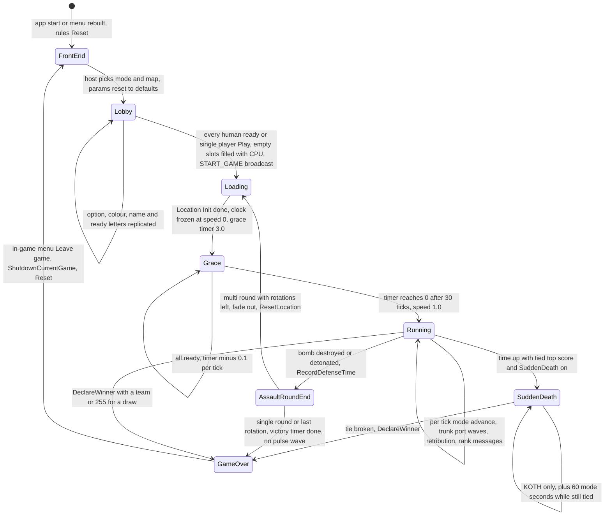
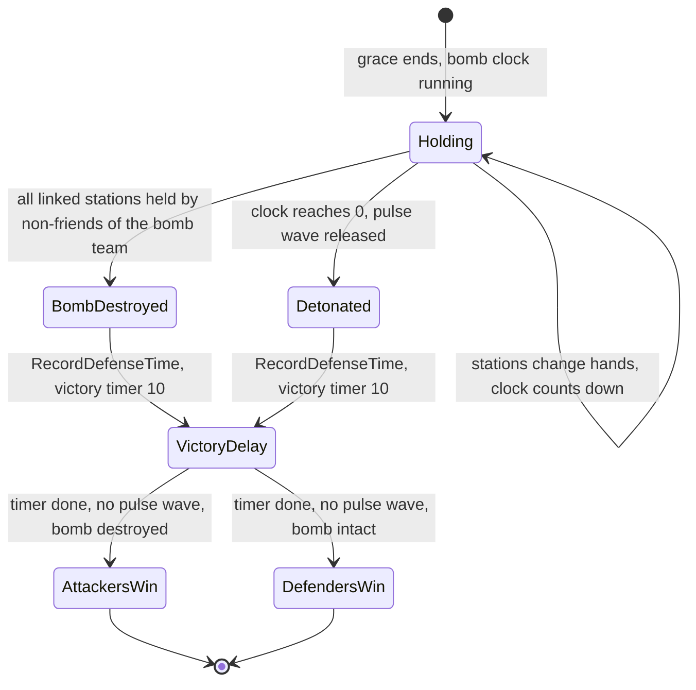
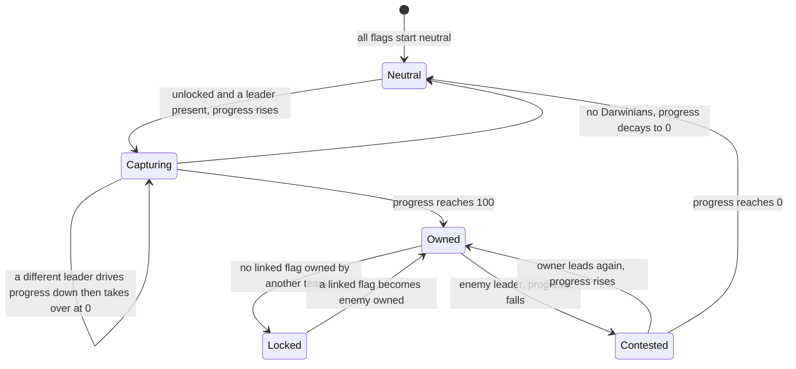

# 01 — Game modes

> Part A · Baseline build: Release|Win32 (OpenGL) + TARGET_PC_FULLGAME ([B:FULL]); see _work/build_matrix.md.
> Evidence: [C] confirmed · [I] inferred · [U] unknown. Citations are `path:Symbol` relative to the multiwinia/ source root.
> Sources merged: P02_game_modes (§1–§4, §8–§9 and appendices), X4_level_catalogue (§9 per-mode map lists and level conventions; `X4_mode_maplists.csv`, `X4_levels.csv`), P18_ui_gamemenu (§4.4–§4.8, §8 option presentation), P08_crates_ai (§13–§14 per-mode AI, via the finished [07](07_ai.md)), P06_buildings_core and the finished [05](05_economy_and_population.md) (population caps, handicap, reinforcements), P01_app_core (team positions, tick model), P15_network (option replication), P10_input_camera (ready/exit controls), P19_help_tutorial_script (tutorial overrides), routed `_meta_*.md`, `phase2_log.md`, coordinator corrections. Every load-bearing constant and state transition below was re-read in the source tree (commit `f909630`) for this synthesis. Generated tables: `_work/scripts/S_01_mode_tables.py`.

## Contents

1. [Game-type catalogue](#1-game-type-catalogue)
2. [The shared match framework](#2-the-shared-match-framework)
3. [The option system](#3-the-option-system)
4. [Per-mode specifications](#4-per-mode-specifications)
   - [4.1 Domination](#41-domination-gametypeskirmish-bfull)
   - [4.2 King of the Hill](#42-king-of-the-hill-gametypekingofthehill-bfull)
   - [4.3 Capture the Statue](#43-capture-the-statue-gametypecapturethestatue-bfull)
   - [4.4 Assault](#44-assault-gametypeassault-bfull)
   - [4.5 Rocket Riot](#45-rocket-riot-gametyperocketriot-bfull)
   - [4.6 Blitzkrieg](#46-blitzkrieg-gametypeblitzkreig-bfull)
   - [4.7 Tank Battle](#47-tank-battle-gametypetankbattle-bdebug)
5. [Cross-mode comparison](#5-cross-mode-comparison)
6. [Known bugs that shape the shipped rules](#6-known-bugs-that-shape-the-shipped-rules)
7. [Re-implementation notes for the new game](#7-re-implementation-notes-for-the-new-game)
- [Open questions and unknowns](#open-questions-and-unknowns)
- [Docs-vs-code discrepancies](#docs-vs-code-discrepancies)
- [IP items](#ip-items)
- [Source map](#source-map)
- [Appendix — dead/legacy code](#appendix--deadlegacy-code)

Related documents: mode objects (zones, statues, flags, rockets and fuel chain, trunk ports, pulse bomb, control stations) are specified building-by-building in [03 §8](03_buildings_and_world_objects.md#8-mode-objective-objects); the spawn economy, population caps, handicap and reinforcement formulae in [05](05_economy_and_population.md); crate drops, `InvalidCrates`, `StartingPowerups` and the retribution reward pool in [04](04_crates_powerups_and_weapons.md); CPU behaviour per mode in [07 §12](07_ai.md#12-per-mode-strategies) and difficulty in [07 §13](07_ai.md#13-difficulty-levels--every-parameter); the front-end pages that present these options, achievements and the screen flow in [09](09_meta_systems.md); the full map catalogue in [08](08_levels_and_level_design.md); determinism hazards in [22](22_determinism_and_networking.md).

### Conventions used in this document

| Term | Meaning | Evidence |
|---|---|---|
| tick | one server advance: one call of `Multiwinia::Advance` (and of every building's `Advance`), nominally 0.1 s of game time | [C] `code/network/clienttoserver.cpp:ClientToServer::AdvanceAndCatchUp` |
| dt (`SERVER_ADVANCE_PERIOD`) | `0.1 × g_gameTimer.m_gameSpeed` (double); 0.1 at normal speed, 0 while the game clock is frozen, scaled by speed-up/slow-down crates | [C] `code/gametimer.cpp:GameTimer::GetServerAdvancePeriod`, `code/gametimer.h` |
| game second | one unit of `GetNetworkTime()` ≡ `g_gameTimer.GetGameTime()`, which advances by dt per tick | [C] `code/gametimer.cpp:GameTimer::Tick` |
| **mode second** | one period of the rules object's 1.0-second countdowns (`m_timer`, `m_reinforcementTimer`, `m_positionTimer`). Each does `t −= dt; if (t <= 0) t = 1.0`. Because `1.0 − 10 × 0.1 = 1.39·10⁻¹⁶ > 0` in IEEE double, a mode second lasts **11 ticks = 1.1 game seconds** at normal speed | [C] code path; tick counts [C] by exact replay (`_work/scripts/S_07_timer_ticks.py`, re-run for this document) |
| "N-second" literal timers | a countdown of N decremented by dt per tick fires after: 3 → 30 ticks, 5 → 51, 10 → 101, 15 → 151, 20 → 200, 45 → 450 | [C] exact replay |
| recount period ("every 1.0 / 2.0 game s") | `if (GetNetworkTime() > m_recountTimer) { …; m_recountTimer = now + 1.0 }` fires every 10 or 11 ticks (≈ 57 % of periods are 11 ticks); `+ 2.0` fires every 20 or 21 ticks | [I] replay of the accumulating double clock |
| team ids | `NUM_TEAMS = 6`; slots 0–3 are players; 4 = monster team ("Evilinians", `Location::GetMonsterTeamId`), 5 = Futurewinian team (`GetFuturewinianTeamId`); 255 = neutral. Both special teams are created as `TeamTypeCPU` lobby teams in **every** Multiwinia game and each always owns one `Entity::TypeAI` | [C] `code/globals.h`, `code/location.cpp:Location::Init`, `Location::InitMonsterTeam`, `Location::InitFuturewinianTeam`, `Location::InitialiseTeam` |
| position | a start slot defined by the level (0 … `NumPlayers−1`); buildings and instant units in level files are owned by positions, remapped to team ids at load (`GetTeamFromPosition`) | [C] `code/location.cpp:Location::GetTeamPosition`, `Location::GetTeamFromPosition` |

---

## 1 Game-type catalogue

### 1.1 The seven game types

The anonymous enum in `code/multiwinia.h:Multiwinia` defines seven game types; the blueprint file `data/multiwinia.txt` defines seven `GAMETYPE` blocks in the same order, and the **blueprint index is used directly as the game-type id**, so data order must equal enum order [C] `code/multiwinia.cpp:Multiwinia::LoadBlueprints` (`s_gameBlueprints.PutData` in file order), `Multiwinia::SetGameOptions` (indexes `s_gameBlueprints[m_gameType]`). Resolved: the expected list "Domination, King of the Hill, Capture the Statue, Rocket Riot, Assault, Blitzkrieg" is **confirmed** for the shipped build, plus a seventh type, Tank Battle, that exists only in debug builds.

| Value | Enum constant | Blueprint / level `GameTypes` token | Display phrase id → English (IP) | Complexity phrase (`MultiwiniaGameBlueprint::GetDifficulty`) → English · lobby icon | Mode picture (game-select page) | Advance function | Build macro(s) | Status |
|---|---|---|---|---|---|---|---|---|
| 0 | `GameTypeSkirmish` | `Domination` | `multiwinia_gametype_domination` → "Domination" | `multiwinia_complexity_basic` → "Simple" · `icons/menu_basic.bmp` | `mwhelp/mode_domination.bmp` | `AdvanceSkirmish` | `INCLUDEGAMEMODE_DOMINATION` + body inside `#ifndef MULTIWINIA_DEMOONLY` | **[B:FULL]** |
| 1 | `GameTypeKingOfTheHill` | `KingOfTheHill` | `multiwinia_gametype_kingofthehill` → "King Of The Hill" | basic → "Simple" · `icons/menu_basic.bmp` | `mwhelp/mode_kingofthehill.bmp` | `AdvanceKingOfTheHill` | `INCLUDEGAMEMODE_KOTH` | **[B:FULL]** (also in DEMOONLY, PC_PREVIEW, HWCOMPAT targets) |
| 2 | `GameTypeCaptureTheStatue` | `CaptureTheStatue` | `multiwinia_gametype_capturethestatue` → "Capture The Statue" | `multiwinia_complexity_intermediate` → "Medium" · `icons/menu_intermediate.bmp` | `mwhelp/mode_capturethestatue.bmp` | `AdvanceCaptureStatue` (+ `EnsureStartingStatue` during grace) | `INCLUDEGAMEMODE_CTS` | **[B:FULL]** |
| 3 | `GameTypeAssault` | `Assault` | `multiwinia_gametype_assault` → "Assault" | intermediate → "Medium" · `icons/menu_intermediate.bmp` | `mwhelp/mode_assault.bmp` | `AdvanceAssault` | `INCLUDEGAMEMODE_ASSAULT` + `#ifndef MULTIWINIA_DEMOONLY` | **[B:FULL]** |
| 4 | `GameTypeRocketRiot` | `RocketRiot` | `multiwinia_gametype_rocketriot` → "Rocket Riot" | `multiwinia_complexity_advanced` → "Hard" · `icons/menu_advanced.bmp` | `mwhelp/mode_rocketriot.bmp` | `AdvanceRocketRiot` (+ `AdvanceTrunkPorts`) | `INCLUDEGAMEMODE_ROCKET` + `#ifndef MULTIWINIA_DEMOONLY` | **[B:FULL]** |
| 5 | `GameTypeBlitzkreig` (sic) | `Blitzkrieg` | `multiwinia_gametype_blitzkrieg` → "Blitzkrieg" | advanced → "Hard" · `icons/menu_advanced.bmp` | `mwhelp/mode_blitzkrieg.bmp` | `AdvanceBlitkrieg` (sic) (+ `AdvanceTrunkPorts`) | `INCLUDEGAMEMODE_BLITZ` + `#ifndef MULTIWINIA_DEMOONLY` | **[B:FULL]** |
| 6 | `GameTypeTankBattle` | `TankBattle` | `multiwinia_gametype_tankbattle` — **absent from every language file**, so `GetName()` returns the raw name "TankBattle" | intermediate → "Medium" | `mwhelp/mode_tankbattle.bmp` | `AdvanceTankBattle` | `INCLUDEGAMEMODE_TANKBATTLE` (commented out in FULLGAME, defined in `TARGET_DEBUG`) + `#ifndef MULTIWINIA_DEMOONLY` | **[B:DEBUG]** |
| 7 | `NumGameTypes` | — | — | — | — | — | — | sentinel |

Evidence: [C] `code/multiwinia.h`, `data/multiwinia.txt`, `code/multiwinia.cpp:MultiwiniaGameBlueprint::MultiwiniaGameBlueprint` (phrase id = `"multiwinia_gametype_%s"` lower-cased), `MultiwiniaGameBlueprint::GetName` (raw name if the phrase is missing), `MultiwiniaGameBlueprint::GetDifficulty`, `Multiwinia::Advance` (dispatch), `code/lib/universal_include.h` (`TARGET_PC_FULLGAME` block: `//#define INCLUDEGAMEMODE_TANKBATTLE`), `data/language/english.txt`; lobby icons and pictures [C] `code/UI/GameTypeButton.h`, `code/UI/GameTypeImageButton.h`. A seventh dispatch case, `GameTypeShaman`, is commented out in `Multiwinia::Advance` and has no enum value [C].

Mode-internal naming: the code calls Domination "Skirmish" (`GameTypeSkirmish`, `AdvanceSkirmish`, old map files `mp_skirmish_*`); level files use the token `Domination` [C]. The help text shown on the game-select page is `multiwinia_help_<lower name>` [C] `code/UI/GameMenuWindow.cpp` (game-select page, `GameTypeInfoButton`).

AI difficulty enum (one value for every CPU team, see [07 §13](07_ai.md#13-difficulty-levels--every-parameter)): `AITypeEasy = 0`, `AITypeStandard = 1`, `AITypeHard = 2`, `NumAITypes = 3` [C] `code/multiwinia.h`.

### 1.2 Build gating and runtime permission

| Gate | Mechanism | Effect in [B:FULL] | Evidence |
|---|---|---|---|
| Compile-time mode macros | `INCLUDEGAMEMODE_*` per product target (build matrix §3) wrap each `Advance*` body, each `case` of `App::IsGameModePermitted`, and the mode branches of `MultiwiniaZone`/`Statue` | 0–5 compiled; TankBattle body empty | [C] `code/lib/universal_include.h`, `code/multiwinia.cpp`, `code/app.cpp:App::IsGameModePermitted` |
| `#ifndef MULTIWINIA_DEMOONLY` | empties `AdvanceSkirmish`, `AdvanceRocketRiot`, `AdvanceTrunkPorts`, `AdvanceTankBattle`, `AdvanceAssault`, `AdvanceBlitkrieg` | not defined in FULL; in the demo-only target only KOTH and CTS can run [B:DEMO] | [C] `code/multiwinia.cpp` |
| `App::IsGameModePermitted(type)` | (1) if `!IsFullVersion()` (demo authentication key) → the metaserver's `DemoLimitations::GameModePermitted` must allow it [B:DEMO runtime gate]; (2) `switch`: true only for compiled modes | 0–5 → true, 6 → false | [C] `code/app.cpp:App::IsGameModePermitted` |
| Game-select page | one `GameTypeButton` per blueprint; a button whose name is literally `"TankBattle"` (missing phrase) is never registered; non-permitted modes are drawn inactive; `HIDE_INVALID_GAMETYPES` builds skip them | six buttons; Tank Battle invisible | [C] `code/UI/GameMenuWindow.cpp` (game-select setup), `code/UI/GameTypeButton.h` |
| Server browser | rows of non-permitted modes are filtered | — | [C] `code/UI/GameMenuWindow.cpp` (browser) |
| Rules object runs only in Multiwinia | `Multiwinia::Advance` is called only when `g_app->Multiplayer()` (≡ `m_gameMode == GameModeMultiwinia`); every Multiwinia game including versus-CPU is "multiplayer" | Darwinia-mode branches in world objects are [B:LEGACY] | [C] `code/network/clienttoserver.cpp:ClientToServer::AdvanceAndCatchUp`, `code/app.cpp:App::Multiplayer`, `App::IsSinglePlayer` |

Tank Battle is therefore unreachable in the shipped executable although its blueprint, three arenas (`mp_tankbattle_2P/3P/4P.txt`), dispatch case and render branches are compiled in [C].

### 1.3 Maps per mode (retail menu)

Maps are listed under a mode when their `MultiwiniaOptions` block names the mode in `GameTypes` (the menu honours every token; the running `LevelFile` keeps only the first token — no shipped map lists more than one) [C] `code/game_menu.cpp:GameMenu::AddMap`, `code/level_file.cpp:LevelFile::ParseMultiwiniaOptions`. Menu order: nearly-alphabetical archive order, then a stable sort by `NumPlayers`, then by difficulty rank (basic < intermediate < advanced) [C] `code/game_menu.cpp:GameMenu::CreateMapList`; tie order [I] (archive `OrderedInsert` off-by-one, see [08](08_levels_and_level_design.md)).

| Mode | Maps in the source tree | Maps in the retail data set (menu) | By player count (retail) | Files not shipped |
|---|---|---|---|---|
| Domination | 9 | **9** | 2P ×5, 3P ×2, 4P ×2 | — |
| King of the Hill | 9 | **9** | 2P ×2, 3P ×4, 4P ×3 | — |
| Capture the Statue | 10 | **9** | 2P ×4, 3P ×2, 4P ×3 | `mp_cts_3p_3.txt` ("The Outreach Peaks"; no `level_enum` id) |
| Assault | 8 | **8** | 2P ×4 (incl. `mp_assault_3p_1`, which declares `NumPlayers 2`), 3P ×2, 4P ×2 | — (`mp_assault_stress.txt` has `GameTypes none`) |
| Rocket Riot | 7 | **7** | 2P ×3, 3P ×3, 4P ×1 | — |
| Blitzkrieg | 7 | **7** | 2P ×4, 3P ×2, 4P ×1 | — |
| Tank Battle [B:DEBUG] | 3 | 0 (mode not compiled; arenas not in retail data) | — | all three |
| **Total** | 53 mode maps + 4 `GameTypes none` (`mp_assault_stress`, `mp_benchmark_1`, `mp_sandbox`, `mp_sandbox_all`) = 57 `mp_*.txt` | **49** | | 8 |

[C] `_work/drafts/X4_mode_maplists.csv`, `X4_levels.csv` (regenerated counts in `S_01_counts.txt`), `tools/multiwinia_exclusions.txt` via X4. Full per-mode tables (menu order, caps, options, objects) are in each mode section of §4. Two `mp_koth_*` files (`mp_koth_2P_2`, `mp_koth_2P_3`) are Domination maps by their `GameTypes` line [C].

### 1.4 The modes at a glance

| Mode | One-line objective | Ends by | Time limit | Player structure |
|---|---|---|---|---|
| Domination | own spawn points; a team owning none for 30 mode s is eliminated | last team standing; or score at time-up | option, 0–60 min (0 = unlimited) | free-for-all 2–4, co-op 2v2 on two maps |
| King of the Hill | hold hill zones | score at time-up (never by elimination) | option, 1–60 min | free-for-all 2–4, co-op 2v2 on three maps |
| Capture the Statue | carry statues into your own zone (1 point each) | score at time-up | option, 1–60 min | free-for-all 2–4, co-op on one map |
| Assault | attackers capture every control station linked to the defenders' bomb before it detonates | bomb destroyed (attackers win) or detonation (defenders win) | the bomb's level timer (900 s / 1200 s) | 1v1, 1v2 (ForceCoop), 2v2 (ForceCoop) |
| Rocket Riot | refuel your rocket via solar power, load 100 Darwinians, launch | first rocket above world height 600 | none | free-for-all 2–4 |
| Blitzkrieg | capture a connected chain of flags into an enemy's home flag to eliminate it | last team standing; or flags + eliminations at time-up | option, 0–60 min (0 = unlimited) | free-for-all 2–4 |
| Tank Battle [B:DEBUG] | destroy enemy tanks; each team has `NumTanks` lives | last team standing | none | free-for-all 2–4 |

---
## 2 The shared match framework

### 2.1 The rules object

All mode rules live in one object, `g_app->m_multiwinia` (class `Multiwinia`), created once with the `App` (constructor: member initialisers, `LoadBlueprints()`, `Reset()`) [C] `code/multiwinia.cpp:Multiwinia::Multiwinia`, `code/app.cpp`. It holds the lobby roster (`LobbyTeam m_teams[6]`), the chosen game type and its parameters, every mode timer and score, and the end-of-game state. It is **lockstep simulation state**: every peer runs `Multiwinia::Advance()` from the same sequenced command stream and must reach identical results [C] `code/network/clienttoserver.cpp:ClientToServer::AdvanceAndCatchUp`; determinism caveats in §6 and [22](22_determinism_and_networking.md).

`Reset()` is called by the constructor, by `App::ShutdownCurrentGame`, by `GameMenu::CreateMenu` (every return to the front end) and when a client receives the server's welcome letter carrying the sync random seed [C] `code/multiwinia.cpp:Multiwinia::Reset`, `code/app.cpp`, `code/game_menu.cpp:GameMenu::CreateMenu`, `code/network/clienttoserver.cpp`. Members, initial values and every method are tabulated in §2.14.

### 2.2 Match lifecycle



Evidence [C]: `Multiwinia::Advance`, `Multiwinia::AdvanceGracePeriod`, `Multiwinia::DeclareWinner`, `Multiwinia::AdvanceAssault`, `Multiwinia::ResetLocation`, `code/main.cpp` (main-loop `m_resetLevel` hook), `code/interface/mainmenus.cpp` (`ExitLevelButton` when `GameOver()`, `ConfirmExitButton` otherwise), `code/app.cpp:App::ShutdownCurrentGame`, `code/UI/GameMenuWindow.cpp` (host auto-start in the lobby update, single-player Play button), `code/gametimer.cpp:GameTimer::Reset` (speed 0 in multiplayer).

**Resolved — leaving after game over.** P02 stated that pressing `ControlToggleReady` after game over returns to the menu. In code that poll (`code/location_input.cpp`, game-over block) sits inside `#ifdef TESTBED_ENABLED … #else #endif` with an **empty** `#else`, so in [B:FULL] the only exit is the in-game menu's "Leave game" button, which matches the on-screen text "Press ESC to Exit" / "Press START to Exit" (`multiwinia_spacetoexit`, `multiwinia_atoexit`) [C] (agrees with P18 §1.2). The front end is rebuilt from scratch at the main page (tutorial page after a tutorial); there is no results page in the front end — results are only the in-game HUD of §2.12 [C] `code/game_menu.cpp:GameMenu::CreateMenu`.

The single-player (versus CPU) and multiplayer flows share this lifecycle; single player differs only in the front end (Play button instead of ready-up, local loopback server) — see [09](09_meta_systems.md).

### 2.3 Per-tick order

Each server advance (10 per game second at normal speed) a client processes the server letter, calls `g_gameTimer.Tick()` (game time += dt; pending speed changes applied), then runs ten location slices; **after slice 8's location advance** it calls `Multiwinia::Advance()` [C] `code/network/clienttoserver.cpp:ClientToServer::AdvanceAndCatchUp`. `Location::Advance` (all buildings and entities, including zones, statues, rockets, bombs and stations) is skipped while `App::GamePaused()` — game speed < 0.01, any out-of-sync client, or (single-player only) lost focus — but `Multiwinia::Advance` is still called [C] `code/app.cpp:App::GamePaused`.

`Multiwinia::Advance()` [C] `code/multiwinia.cpp:Multiwinia::Advance`:

1. If `GameOver()` (`m_winner != −1`) → return. Nothing further runs after the tick in which a winner was declared.
2. If `GameInGracePeriod()` (`m_gracePeriodTimer > 0`) → `AdvanceGracePeriod()` (§2.4); return.
3. If `g_app->GamePaused()` → return.
4. First post-grace tick (`m_startTime == 0.0`): `m_startTime = GetNetworkTime()`; if `m_timeRemaining <= 0` → `m_unlimitedTime = true`. (While game time is still exactly 0.0 this re-runs on the next tick; harmless.)
5. If `m_victoryTimer > 0` → `m_victoryTimer −= dt` (Assault).
6. Mode dispatch: Skirmish → `AdvanceSkirmish`; KingOfTheHill → `AdvanceKingOfTheHill`; RocketRiot → `AdvanceRocketRiot`; CaptureTheStatue → `AdvanceCaptureStatue`; TankBattle → `AdvanceTankBattle`; Assault → `AdvanceAssault`; Blitzkreig → `AdvanceBlitkrieg`.
7. If the level option `trunkportreinforcements > 0` or `trunkportarmour > 0` → `AdvanceTrunkPorts()` (in addition to the call inside Rocket Riot and Blitzkrieg — see §6 B3).
8. `bool retributionMode = GetGameOption("RetributionMode")`; if true → `AdvanceRetribution()` (§2.9). An absent option returns −1, which is true.
9. One-minute warning: if `0 < m_timeRemaining <= 60` and not yet warned → message `dialog_oneminute` ("One Minute Remaining!"), `m_oneMinuteWarning = true`.
10. Rank announcements (all modes except Assault and Blitzkrieg), once per mode second (`m_positionTimer`, §2.6).
11. If `GameOver()` became true this tick and the local team's `Team::m_teamKills >= 2000` → `GiveAchievement(Carnage)` (achievements are stubs, §2.11).

### 2.4 Grace period, readiness and countdown

[C] `Multiwinia::AdvanceGracePeriod`, `Multiwinia::RenderOverlay_GracePeriod`, `code/location_input.cpp`, `code/network/clienttoserver.cpp`.

- `GRACE_TIME` = 3.0 s (`#define`, 20.0 under `TESTBED_ENABLED`) [C] `code/lib/universal_include.h`. The game clock is frozen (speed 0) for the whole grace period, so no world object advances and all game-time timers start at the first post-grace tick [C] `code/gametimer.cpp:GameTimer::Reset`.
- Counted teams: those whose `Team::m_teamType` is LocalPlayer, RemotePlayer or Spectator. CPU teams (including the two special teams) are never waited for.
- If every counted team has `Team::m_ready`: on the first ready tick (timer exactly 3.0) play `CountdownTick`; then `m_gracePeriodTimer −= 0.1` per tick (a literal, independent of game speed). A static flag plays `CountdownTick` on the tick after the timer comes within 0.1 of an integer (one tick per displayed number). Otherwise the timer snaps back to 3.0 — un-readying restarts the countdown.
- At `<= 0` (after 30 all-ready ticks): play `CountdownZeroTick`, timer = −1, `g_gameTimer.RequestSpeedChange(1.0, 1.0, −1.0)` (immediate full speed), `AchievementTracker::AddVisitedLevel(mapFilename)`.
- Capture the Statue only: `EnsureStartingStatue()` runs on every grace tick (spawns one statue if none exists, §4.3).
- Readiness toggle: control `ControlToggleReady` (keyboard Space / pad A, see [06](06_player_control_and_input.md)) during grace with no windows open → `ClientToServer::RequestToggleReady(myTeamId)` → letter `NET_DARWINIA_TOGGLE_READY` flips `Team::m_ready` on every peer (in the lobby it flips `LobbyTeam::m_ready`).
- Overlay (top centre, font 4 % of screen height, red): "GAME STARTING IN *T" (`multiwinia_gamestarttimer`, value `(int)(timer + 1)`, 125 % size, solid) once counting; else, if the local team is ready, "WAITING FOR PLAYERS (n/m)" (`multiwinia_waitingforplayers` + ready/total counts); else "PRESS SPACE WHEN READY" (`multiwinia_spacetostart`) or "PRESS A WHEN READY" (`multiwinia_atostart`) by input mode; blinking alpha 1.0 for 0.3 s of each wall-clock second, else 0.2 (presentation only).
- Scoreboard during grace: each row shows "READY" (`multiwinia_ready`) for CPU teams and ready humans [C] `Multiwinia::GetScoreLine`.
- Pausing is refused during grace and after game over, and whenever any remote human is present [C] `code/app.cpp:App::ToggleGamePaused`.

### 2.5 Teams, slots, start positions, colours, co-op and Assault sides

#### 2.5.1 `LobbyTeam` — per-slot roster record [C] `code/team.h:LobbyTeam`

| Field | Type | Use |
|---|---|---|
| `m_teamId` | int | slot index 0–5 |
| `m_clientId` | int | owning network client |
| `m_teamType` | int | `TeamTypeUnused = −1`, `TeamTypeLocalPlayer = 0`, `TeamTypeRemotePlayer = 1`, `TeamTypeCPU = 2`, `TeamTypeSpectator = 3` |
| `m_colourId` | int | lobby colour 0–7, −1 = none chosen |
| `m_colour` | RGBAColour | resolved colour |
| `m_coopGroupPosition` | int | 0/1/2 position inside a co-op group (shade and flag-texture choice) |
| `m_score`, `m_prevScore` | int | current score / score at the start of the current mode second |
| `m_rocketId` | int | Rocket Riot: building id of the team's EscapeRocket, −1 until found |
| `m_disconnected`, `m_ready`, `m_demoPlayer` | bool | lobby flags (`m_ready` here is the lobby flag; in-game readiness is `Team::m_ready`) |
| `m_teamName` | UnicodeString | display name |
| `m_accurateCPUTakeOverTime` | float | game time when a leaving human's slot became CPU |
| `m_achievementMask` | unsigned char | viral achievement bits received from that player (`0x01` = Master Player) |
| `m_iframe`, `m_syncDifferences` | `IFrame*`, `LList<SyncDiff*>` | desync diagnostics (`Multiwinia::SaveIFrame`) |

`Team` (the in-match team, [21](21_simulation_and_entity_model.md)) references `m_teamId`, `m_clientId`, `m_teamType`, `m_colour` of its LobbyTeam [C] `code/team.h:Team`.

#### 2.5.2 Slots and start positions

- Player slots are 0 … `NumPlayers−1` of the level (2–4). At game start the host fills every unused slot below `NumPlayers` with a CPU team (multiplayer auto-start and single-player Play) [C] `code/UI/GameMenuWindow.cpp` (lobby update, `PlayGameButton`). Spectator slots exist (`TeamTypeSpectator`) but the spectator UI is compiled only under `TESTBED_ENABLED` [B:DEAD] [C] P18.
- **Start position** of a team (non-Assault, non-co-op) is chosen lazily, on first query, uniformly from the positions not yet taken, with the synced generator: `m_teamPosition[t] = unused[syncrand() % unused.Size()]`. Teams are queried in id order during `Location::Init` [C] `code/location.cpp:Location::GetTeamPosition`, `Location::GetTeamFromPosition`. Tutorials force position = team id. Special teams use their own id.
- Level objects owned by a position (`tm` field) are remapped to the team occupying it (255 if none) at load [C] `code/location.cpp:Location::InitBuildings`.

#### 2.5.3 Colour tables (RGB 0–255) [C] `code/multiwinia.cpp` (`teamColours`, `groupColours1`, `groupColours2`, `defaultColour`)

| Id | `teamColours[id]` (lobby colour) | Name phrase | `groupColours1[id]` (co-op member 0) | `groupColours2[id]` (co-op member 1) | `defaultColour[slot]` |
|---|---|---|---|---|---|
| 0 | 100,255,100 | Green (`multiwinia_colour_green`) | 0,150,20 | 90,200,100 | 100,255,100 |
| 1 | 255,50,50 | Red | 150,0,20 | 255,80,80 | 255,50,50 |
| 2 | 255,255,50 | Yellow | 150,150,20 | 200,200,90 | 255,255,50 |
| 3 | 120,180,255 | Blue | 20,0,150 | 90,90,200 | 120,180,255 |
| 4 | 255,150,0 | Orange | 150,90,0 | 200,150,60 | 255,150,0 |
| 5 | 150,0,255 | Purple | 180,120,255 | 100,60,180 | 250,250,250 |
| 6 | 70,200,200 | Cyan | 0,140,140 | 110,210,210 | 50,255,50 |
| 7 | 255,150,255 | Pink | 255,90,255 | 255,190,255 | (no entry: 7-element array indexed by slot 0–5) |
| 8 | 10,10,10 | — | 10,10,10 | 10,10,10 | — |
| 9 | 200,200,200 | — | 200,200,200 | 200,200,20 | — |

`MULTIWINIA_NUM_TEAMCOLOURS = 8` selectable ids (0–7) [C] `code/multiwinia.h`. `GetGroupColour(member, −1)` returns `RGBAColour(0.6f, 0.6f, 0.6f, 1.0f)` [C]; whether that is 60 % grey or near-black depends on the float constructor — [U] 01-U5.

#### 2.5.4 Colour rules [C] `code/multiwinia.cpp`, `code/location.cpp:Location::Init`

| Function | Rule |
|---|---|
| `InitialiseTeam(t, type, client)` | outside co-op and outside Assault: `m_colourId = t` (slot id); local player sets `m_globalWorld->m_myTeamId`; non-CPU: `m_disconnected = false`; if the location already initialised its teams → `Location::InitialiseTeam(t)` (late join) |
| `SetTeamColour(t, id)` | `id == −1` → slot default colour, `m_colourId = −1`. **Assault:** needs `GameMenu::GetNumPlayers()` (abort if −1); count teams already on `id` (any slot); on a 3-player map colour 0 (defenders) is taken if ≥ 1 team has it and colour 1 (attackers) if 2 have it; otherwise taken if `count ≥ numPlayers / 2` (integer division). **Co-op:** rejected unless `IsValidCoopColour(id)`. **Otherwise:** rejected if `IsColourTaken(id)` (any other used team has it). Accepted → `m_colour = GetColour(id)`, `m_colourId = id` |
| `IsValidCoopColour(id)` | false if ≥ 2 distinct colours are in use and nobody uses `id` (only two alliances), or if ≥ 2 teams already use `id` (two members per alliance) |
| `IsColourTaken(id)` | number of used teams with that colour id |
| `GetNextAvailableColour()` | lowest id 0–7 not taken, else −1 |
| `GetCPUColour()` | `syncrand() % 4` re-drawn until it is not used by any team with colour id < 4. **Unbounded loop if 0–3 are all taken** (§6 B10). Called by `Location::Init` for every CPU slot below `NumPlayers` in non-co-op, non-Assault games (tutorials override with colour = slot) |
| Unused slots (≥ NumPlayers, maps with < 4 players) | given a random unused colour 0–3 (`(syncrand() % 8) / 2`, re-drawn while used) so random-colour effects (magical forest, randomiser) have the full range [C] `Location::Init` |

#### 2.5.5 Co-op alliances [C] `code/location.cpp:Location::SetupCoop`, `SetCoopTeam`, `SetSoloTeam`, `IsFriend`

- Co-op is on when the lobby's co-op flag is set: the checkbox appears only on maps with `CoopMode`; maps with `ForceCoop` switch it on when selected (and get no checkbox); picking a map without `CoopMode` clears it [C] `code/UI/LevelSelectButton.h`, `code/UI/GameMenuWindow.cpp:SetupAdvancedOptionsPage`. Enabling co-op resets every team colour to −1 [C] `code/network/clienttoserver.cpp` (`GAMEOPTION_COOPMODE` handler).
- Players pick a colour per alliance (max two colours in use, two members each). At load `SetupCoop(t)` assigns each player slot to group 1 or 2: from `CoopGroup1Positions` / `CoopGroup2Positions` when the level defines them (moving a team to the other group's position when its group is full), else by matching colours (`SetCoopTeam`), with `SetSoloTeam` for a group that has a single position (it gets a random free colour 0–3 when none was chosen). `Location::m_coopGroups[t] ∈ {1, 2}`; each group has `m_groupColourId`; members get `groupColours1/2` shades by `m_coopGroupPosition`.
- `Location::IsFriend(a, b)` in co-op ≡ same group (special teams both have group 0, so the monster and Futurewinian teams are mutual "friends" in co-op); outside co-op ≡ `a == b`; 255 is nobody's friend [C].
- Co-op scoring: per-mode rules (Domination §4.1, CTS §4.3); HUD group headers and game-over group winner (§2.12).

#### 2.5.6 Assault sides [C] `code/location.cpp:Location::SetupAssault`, `GetFreeAttackerPosition`, `GetFreeDefenderPosition`, `IsAttacking`

- The lobby colour **is** the side: `ASSAULT_DEFENDER_COLOURID = 0` (green), `ASSAULT_ATTACKER_COLOURID = 1` (red); the player-options page offers Random (−1) / Attackers / Defenders instead of colours [C] `code/multiwinia.h`, `code/UI/FancyColourButton.h`.
- `SetupAssault` (replaces position/colour assignment for Assault): for each slot i < NumPlayers, if its colour is −1: defender if all attacker places are filled, attacker if all defender places are filled, else `syncrand() % 2`. Defenders take a random free defender position (positions not in `AttackingTeams`), attackers a random free attacker position (synced). Non-co-op: colour = green/red. Co-op (ForceCoop maps): group = 1 if the position is in `CoopGroup1Positions` else 2, group colour = side colour, `m_coopGroupPosition` 1 or 2.
- `IsAttacking(t)` ≡ `m_levelFile->m_attacking[GetTeamPosition(t)]`; `IsDefending(t)` ≡ not attacking (false for 255). In non-Assault modes `m_attacking[]` is all false, so every team counts as a "defender" wherever the shared code asks [C].

### 2.6 Scores and rank announcements

- `m_score` is an int per slot; meaning per mode (§5). `BackupScores()` copies `m_score` to `m_prevScore` at the start of every mode second (TankBattle: per team, inside its loop); `ZeroScores()` clears all; `AwardPoints(t, n)` adds unless `GameOver()` (used by CTS) [C] `code/multiwinia.cpp`.
- HUD delta "(+d)" = `m_score − m_prevScore`; CTS replaces it with the number of statues the team currently owns (§2.12).
- **Rank announcements** (`Multiwinia::Advance` step 10; not Assault, not Blitzkrieg), once per mode second: build an ordered list of used, non-special teams by inserting each team before the first listed team it **strictly** beats (equal scores keep team-id order); `tied[t]` = smallest list index of another team with equal score (or the team's own index if lower). When a team's index differs from its stored `m_currentPositions[t]`, the new index is stored; if the old value was valid and t is the local team, show `dialog_tied_<i+1>` when tied, else `dialog_position_<i+1>`, where i is the team's **own** index ("You have moved to First Place!", "… Second Place", "… Third Place", "… Last Place" for index 3; "You are tied for First!" … "Fifth") [C] `code/multiwinia.cpp:Multiwinia::Advance`, `data/language/english.txt`. Because ties are ordered by team id, the higher-id member of a tie for first is told "You are tied for Second" [I].

### 2.7 Elimination

Two separate notions exist [C] `code/multiwinia.cpp:Multiwinia::EliminateTeam`, `Multiwinia::IsEliminated`, `code/team.cpp:Team::Eliminate`:

| Concept | What it does | Used by |
|---|---|---|
| `Multiwinia::EliminateTeam(t)` (hard, rules flag) | `m_eliminated[t] = true`, `m_timeEliminated[t] = GetNetworkTime()` (written only), message "You are eliminated!" (`multiwinia_player_eliminated`) to that player or "*T is eliminated!" (`multiwinia_other_eliminated`) to others. Kills nothing | Domination, Blitzkrieg, TankBattle |
| `Team::Eliminate()` (world wipe) | every unit member and every `m_others` entity of the team takes damage 2 × its max health (dies → spirits), `TaskManager::StopAllTasks()`, every trunk port owned by the team set to 255. Spawn points and other buildings keep their owner | called with `EliminateTeam` (Domination, Blitzkrieg) and alone on sudden-death losers (Domination, KOTH, CTS, Blitzkrieg) |
| `IsEliminated(t)` (query) | Skirmish, Blitzkrieg: `m_eliminated[t]`. KOTH, CTS (soft): the map has spawn points **and** the team owns none **and** it has fewer than 50 live Darwinians (`CountDarwinians` over `m_others`). Assault, Rocket Riot, TankBattle/default: false | retribution (§2.9), HUD retribution counter, CTS sudden-death tie-break |

Sudden-death losers wiped with `Team::Eliminate()` are **not** flagged eliminated: they keep their spawn points, which keep producing Darwinians, so they can recover in principle [C code; I consequence].

### 2.8 Handicap

Option `Handicap` (Domination, KOTH, Assault; 0–90 %, default 90). Consumer `SpawnPoint::CalculateHandicap(team)` multiplies a team's spawn-point output; full formula, its integer-division quirks and worked examples are in [05 §3.2](05_economy_and_population.md#3-the-spawn-formula-burstpause-handicap-transit) [C] `code/worldobject/spawnpoint.cpp:SpawnPoint::CalculateHandicap`. Summary of the rule as compiled:

1. 1.0 if level option `nohandicap`; 0.0 for team 255; 1.0 while any neutral spawn point exists on the map; 1.0 if the option is 0 or absent (−1).
2. `average = (Σ spawn points of every other used team) / (number of other used teams)` — **integer** division, and the divisor counts the monster and Futurewinian teams (always used) even though they rarely own spawn points, which lowers the average [C].
3. If `average > 1.5 × own` → `1 + Handicap/100 × factor`, `factor = 1 − ((own − 1) / total)` with integer division, so `factor = 1` for every reachable case → multiplier **1 + H/100 (1.9 at the default)**; else 1.0 [C code; I reachability].

Consequence: in Assault the option has **no effect on shipped maps** — no Assault map has a spawn point (§4.4 table) [C data].

### 2.9 Retribution (comeback powerups) [B:FULL]

**Resolved:** the P08 draft and an early coordinator note said retribution is never called; the code calls it every post-grace tick — `Multiwinia::Advance` step 8: `bool retributionMode = GetGameOption("RetributionMode"); if (retributionMode) AdvanceRetribution();` [C] `code/multiwinia.cpp:Multiwinia::Advance` (confirmed by the coordinator's correction and by [04 §4.4](04_crates_powerups_and_weapons.md#4-exclusion-lists-and-grant-options)).

Trigger and effect [C] `code/multiwinia.cpp:Multiwinia::AdvanceRetribution`:

```
for each team t with LobbyTeam type ≠ Unused, skipping the monster and Futurewinian teams:
    if IsEliminated(t):                                   # mode-specific, §2.7
        m_eliminationBonusTimer[t] -= dt
        if m_eliminationBonusTimer[t] <= 0:
            m_eliminationBonusTimer[t] = 45
            if TaskManager.CapacityUsed() < TaskManager.Capacity():      # capacity is 2 for an eliminated team ([06 §3.5])
                pool = [Airstrike] + ([Airstrike, Meteor, Forest, DarkForest, Eggs] unless basic-crates-only)
                Crate::CaptureCrate(pool[syncrand() % len(pool)], t)        # a task grant; no IsValid / InvalidCrates check
                TaskManager.NotifyRecentTaskSource(2)                       # UI tag "retribution"
            else if t is the local team:
                message "Retribution : Two powerups max" (multiwinia_retribution_maxtasks)
    else:
        m_eliminationBonusTimer[t] = 45
```

- Probabilities (advanced crates allowed): Airstrike 2/6, Meteor shower 1/6, Forest 1/6, Dark forest 1/6, Eggs 1/6; basic-crates-only: Airstrike 1/1 [C]. Effects in [04](04_crates_powerups_and_weapons.md).
- Timing: the timer is held at 45 while the team is not eliminated, so the first grant comes **450 ticks (45.0 game s)** after the team becomes eliminated, then every 450 ticks while it has a free task slot. The `Reset()` value 5 matters only for a team that is already "eliminated" on its first post-grace tick (possible in KOTH/CTS if a team starts with no spawn point and < 50 Darwinians) [C code; tick count by replay].
- HUD: while the local team `IsEliminated` and the option is non-zero and not in grace: "Retribution in *S" (`multiwinia_retribution_timer`, red), *S = `(int) m_eliminationBonusTimer` [C] `Multiwinia::Render`.

**Real per-mode default** (verified per the coordinator's addendum) [C] `code/multiwinia.cpp:Multiwinia::GetGameOption` (returns −1 for a name the current blueprint lacks), `data/multiwinia.txt`:

| Mode | `RetributionMode` option | Value seen by `Advance` | Can a team be "eliminated" for retribution? | Retribution in practice |
|---|---|---|---|---|
| Domination | yes, check box, default 1 | 1 (0 if unticked) | yes — `m_eliminated` (after 30 mode s without spawn points) | **on by default** |
| King of the Hill | yes, default 1 | 1 / 0 | soft: owns 0 spawn points and < 50 Darwinians on a map with spawn points (`mp_koth_3P_4` has none → never) | on by default |
| Capture the Statue | yes, default 1 | 1 / 0 | soft, as KOTH | on by default |
| Assault | **absent** | −1 → true | never (`IsEliminated` false) | runs, never grants |
| Rocket Riot | **absent** | −1 → true | never | runs, never grants |
| Blitzkrieg | yes, default 1 | 1 / 0 | yes — `m_eliminated` (home flag captured via a connected chain) | on by default |
| Tank Battle [B:DEBUG] | absent | −1 → true | never (`IsEliminated` default false) | runs, never grants |

### 2.10 Sudden death (shared shape)

Option `SuddenDeath` (Domination, KOTH, CTS, Blitzkrieg; check box, default 1; tested as `== 1`, so an absent option (−1) means off). When the time limit expires with the top score tied, sudden death starts: message "Sudden Death!" (`multiwinia_suddendeath`), `m_suddenDeathActive = true`, and every team **not** on the top score is wiped with `Team::Eliminate()` (CTS co-op skips the wipe). The next per-second evaluation that finds a single leader declares it winner. KOTH instead adds 60 mode seconds and re-evaluates at the end of each extra minute. With `SuddenDeath` off a tie at time-up is declared a draw (`m_winner = 255`). The lobby forces SuddenDeath off and greys it out whenever `TimeLimit` is 0 (unlimited) [C] `code/UI/GameMenuWindow.cpp:UpdateAdvancedOptionsPage`. Per-mode details in §4.

### 2.11 Ending: `DeclareWinner(t)` and the end-of-game sequence

[C] `code/multiwinia.cpp:Multiwinia::DeclareWinner`, `code/gametimer.cpp:GameTimer::RequestSpeedChange`, `GameTimer::LockSpeedChange`, `GameTimer::Tick`.

On **every** call (also repeated calls with the same winner):
1. If a local team exists → `AchievementTracker::AddToTotalKills(Team::m_teamKills)` (re-added on every repeated call).
2. `ClientToServer::SendTeamScores(t)` → letter `NET_DARWINIA_TEAM_SCORES` with the six scores and the winner; receivers ignore it ("/* Ignore this */") — no statistics server consumes it [C] `code/network/clienttoserver.cpp`.

Only if `m_winner != t`:
3. `m_winner = t` (0–5 a team; 255 = draw). `GameOver()` is now true.
4. Freeze: `RequestSpeedChange(0.0, 0.2, −1.0)` then `LockSpeedChange()`. Each tick the speed moves 20 % of the way to 0 (×0.8) and snaps to 0 below 0.01: **21 ticks**, about 0.40 game seconds of further simulation, then the game is permanently paused (`GamePaused()` true because speed < 0.01) [C code; tick count by replay].
5. Sounds (`SoundSourceBlueprint::TypeMultiwiniaInterface`): `GameOver`, then `YouWon` if the local team is the winner else `YouLost` (a draw plays `YouLost`).
6. If the winner is the local team → `AchievementTracker::AddVictoryOnLevel(mapFilename)` and `CheckMasterAchievement()`.

Then the HUD shows the result (§2.12) until the player leaves via the in-game menu (§2.2). `DeclareWinner(−1)` is a no-op except steps 1–2 (`m_winner` already −1) [C].

**Achievements.** Every mode has an achievement hook (table in §5; full conditions in [09](09_meta_systems.md)), but in the PC source `App::GiveAchievement` returns early if any of the first `NumPlayers` slots is CPU (except MasterPlayer, Carnage, Genocide) and otherwise calls `App::EarnedAchievement`, which always returns false — **no achievement is ever recorded or shown** [C] `code/app.cpp:App::GiveAchievement`, `App::EarnedAchievement`. `AchievementTracker` keeps visited/won bitsets in memory only (`Load`/`Save` are stubs) [C] `code/achievement_tracker.cpp`.

### 2.12 The match HUD

[C] `code/multiwinia.cpp:Multiwinia::Render`, `Multiwinia::GetScoreLine`, `Multiwinia::RenderOverlay_GracePeriod`, `Multiwinia::RenderRocketStatusPanel`. Skipped when `g_app->m_hideInterface`. `scale = ScreenH / 800`.

| Element | Specification |
|---|---|
| Scoreboard box | top-left at (10, 10)·scale, width 440 (530 in Rocket Riot)·scale, height `(50 + rows × 14 × 1.3)`·scale; in co-op before game over ×2.0 (×1.4 in Assault); black 75 % fill, 20 % white outline. Hidden in a tutorial until somebody scores. Title "TEAM SCORES" (`multiwinia_teamscores`), Assault "OBJECTIVES" (`multiwinia_teamscores_assault`) |
| Row order | used teams sorted by score descending (Assault: by `m_timeRecords`); monster/Futurewinian rows only when their score ≠ 0; local row highlighted (0.7, 0.7, 0.5, 0.7). Co-op: one header per group "*T *S points" in the group colour, members indented; special teams appended if their score > 0 |
| Score line (generic: KOTH, CTS) | `"<name>  *X points (+d) (est N)"` (`multiwinia_points`). `(+d)` blanked during the second half of every game second except in CTS, where it is "(+n)" = statues currently owned by the team. `(est N)` = `score + d × m_timeRemaining`, shown for KOTH with ScoreMode ≠ 2 and Domination ScoreMode 1 while time-limited. "Sync[n]" appended for an out-of-sync client |
| Score line per mode | Domination, Assault, Rocket Riot, Blitzkrieg, TankBattle: §4 |
| Grace rows | name + "READY" for CPU and ready humans |
| Timer box | top centre (right of the scoreboard when ScreenW ≤ 800), 80×scale box, 30×scale font, "m:ss" with the colon blinking on game time; shown while `m_timeRemaining > 0`, not in grace, and not in Tutorial 2 before the AI may spawn. Ticks `CountdownTick` at every whole minute and every second of the last 10; red and ×1.2 in the last 10. (`CountdownZeroTick` at 0 is inside the `> 0` block and never fires [C].) The displayed value is mode seconds, so the clock runs 10 % slower than game time |
| Reinforcements | "Reinforcements in *S" (`multiwinia_reinforcements`, 20×scale) whenever `m_reinforcementCountdown ≠ 0` and the local team is not `IsEliminated`; red at ≤ 5. Appears in every game whose trunk-port waves run (§4.4–§4.6) |
| Retribution | §2.9 |
| Crate timers | "SPAWN MANIA: *T" (`Location::m_spawnManiaTimer`), "MEGA RAGE: *T" (`Location::m_bitzkreigTimer`), 50×scale, centred, red below 2 — see [04](04_crates_powerups_and_weapons.md) |
| Assault round overlay | §4.4 |
| Rocket status panel | Rocket Riot only, §4.5 |
| Game over | "GAME OVER" (`multiwinia_gameover`, title font 70×scale, y = 180×scale); winner line at y = 250×scale, 35×scale: non-co-op "*T is the WINNER" (`multiwinia_isthewinner`) in the winner's colour or "It's a DRAW!" (`multiwinia_tiegame`) for 255; co-op: the group (or monster/Futurewinian team) with the greatest **score total** is named by its colour ("Green" … "Pink", `multiwinia_team_*`; "Evilinians"/"Futurewinians" for the special teams) — chosen from the totals, not from `m_winner`, and group 1 wins an exact tie, so a co-op draw is never displayed as a draw (§6 B12). Skipped for single-round Assault (its own overlay). Final score list centred at 73 % of screen height in team colours (box ×1.3): KOTH, CTS, Domination "name score", Rocket Riot name only, multi-round Assault "*T defended for m:ss"; not drawn (nor its box) for TankBattle, Blitzkrieg and single-round Assault. Bottom: blinking "Press ESC to Exit" / "Press START to Exit" |

### 2.13 Players leaving

`Multiwinia::RemoveTeams(clientId)` [C] `code/multiwinia.cpp:Multiwinia::RemoveTeams`: for every non-CPU team of that client — in the lobby: slot becomes Unused, colour −1, name "", disconnected, "PLAYERLEAVE" chat line; in a running game: message "*T left the game!" (`multiwinia_player_left`), the slot becomes `TeamTypeCPU`, an `Entity::TypeAI` is spawned for it at (−100, 0, −100) so the CPU takes over immediately, `m_accurateCPUTakeOverTime` = game time. The team keeps playing; no mode treats a leaver as eliminated.

### 2.14 `Multiwinia` data members and methods

#### 2.14.1 Preprocessor constants [C] `code/multiwinia.h`, `code/lib/universal_include.h`

| Name | Value | Meaning |
|---|---|---|
| `MULTIWINIA_MAXPARAMS` | 64 | size of `m_params` |
| `MULTIWINIA_NUM_TEAMCOLOURS` | 8 | selectable lobby colours |
| `MULTIWINIA_DRAW_TEAM` | 255 | `m_winner` for a draw |
| `ASSAULT_ATTACKER_COLOURID` | 1 | red = attackers |
| `ASSAULT_DEFENDER_COLOURID` | 0 | green = defenders |
| `BLITZKRIEGSCORE_ELIMINATED` | 10000 | Blitzkrieg scores below this mean "eliminated" (the score is then the game time of elimination) |
| `BLITZKRIEGSCORE_ENEMYOCCUPIED` | 10001 | home flag held by an enemy |
| `BLITZKRIEGSCORE_UNDERATTACK` | 10002 | defined, displayed, **never assigned** |
| `BLITZKRIEGSCORE_UNOCCUPIED` | 10003 | home flag neutral |
| `BLITZKRIEGSCORE_UNDERTHREAT` | 10004 | home flag held, not locked |
| `BLITZKRIEGSCORE_SAFE` | 10005 | home flag held and locked |
| `GRACE_TIME` | 3.0f (20.0f under `TESTBED_ENABLED`) | pre-game countdown |

#### 2.14.2 Data members [C] `code/multiwinia.h`; initial values `Multiwinia::Multiwinia`, `Multiwinia::Reset`

| Member | Type | Constructor | `Reset()` | Purpose |
|---|---|---|---|---|
| `m_timer` (protected) | double | 0.0 | 0.0 | mode-second countdown used by every mode |
| `m_gameType` | int | −1 | −1 | current game type |
| `m_params[64]` | int | — | not cleared | option values of the current blueprint |
| `m_teams[6]` | LobbyTeam | — | type Unused, score 0, prevScore 0, colour `defaultColour[i]`, rocketId −1, colourId −1, name "", ready false, iframe deleted, sync diffs emptied | roster |
| `m_timeRemaining` | int | **uninitialised** | not reset (set by `GameOptionsChanged`, Assault by `PulseBomb::Initialise`) | mode seconds left; −1 = none |
| `m_winner` | int | −1 | −1 | −1 none, 0–5 team, 255 draw |
| `m_statueSpawner` | double | −1.0 | −1.0 | CTS statue spawn countdown (mode seconds); −1 = not armed |
| `m_rocketsFound` | bool | **uninitialised** | not reset | read only in dead code of `GameOver()` |
| `m_reinforcementTimer` | double | 0.0 | 0.0 | mode-second sub-timer of trunk-port waves |
| `m_reinforcementCountdown` | int | 0 | 0 | mode seconds to the next wave (HUD) |
| `m_turretTimer` | int | 0 | 0 | waves until the next turret award |
| `m_tankDeaths[6]` | int | — | 0 | TankBattle |
| `m_currentPositions[6]` | int | — | −1 | last announced rank |
| `m_positionTimer` | double | 0.0 | 0.0 | mode-second timer for ranks |
| `m_initialised` | bool | false | false | one-shot init of Assault / Blitzkrieg |
| `m_defendedAll` | bool | uninitialised | not reset (set true in Assault init) | Assault achievement accumulator |
| `m_assaultObjectives` | `LList<int>` | — | emptied | Assault: link ids of each pulse bomb, then the bomb id |
| `m_startTime` | double | 0.0 | 0.0 | `GetNetworkTime()` at the first post-grace tick |
| `m_victoryTimer` | double | −1.0 | −1.0 | Assault post-round delay |
| `m_aiType` | int | `AITypeStandard` | `AITypeStandard` | AI difficulty |
| `m_resetLevel` | bool | false | false | Assault multi-round: reload request |
| `m_pulseTimer` | double | −1.0 | −1.0 | Assault: shortest defence time so far (next round's bomb timer) |
| `m_timeRecords[6]` | double | — | −1.0 | Assault defence time per team |
| `m_numRotations` | int | 0 | 0 | Assault rounds played |
| `m_pulseDetonated` | bool | false | false | Assault round finished |
| `m_gracePeriodTimer` | double | `GRACE_TIME` | `GRACE_TIME` | > 0 = grace |
| `m_oneMinuteWarning` | bool | false | false | |
| `m_eliminated[6]` | bool | — | false | hard elimination (Domination, Blitzkrieg, TankBattle) |
| `m_numEliminations[6]` | int | — | 0 | Blitzkrieg eliminations scored by a team |
| `m_timeEliminated[6]` | double | — | 0.0 | written only |
| `m_eliminationTimer[6]` | int | — | 30 | Domination countdown (mode seconds) |
| `m_eliminationBonusTimer[6]` | double | — | 5 | retribution countdown (game seconds) |
| `m_coopMode` | bool | false | false | co-op |
| `m_assaultSingleRound` | bool | **true** | **not reset** | single vs multi-round Assault (no UI ever sets it, §3.6) |
| `m_suddenDeathActive` | bool | false | false | |
| `m_unlimitedTime` | bool | false | false | set at start if `m_timeRemaining <= 0` |
| `m_basicCratesOnly` | bool | false | false | basic crates only |
| `m_firstReinforcements` | bool | true | true | first trunk-port wave flag |
| `m_teamsStatus[6]` | int | 0 | 0 | written from the network, never read |
| `m_rocketStatusPanel` | `RocketStatusPanel*` | NULL | deleted → NULL | Rocket Riot HUD |
| `s_gameBlueprints` (static) | `DArray<MultiwiniaGameBlueprint*>` | — | — | option blueprints |
| file-static `s_numMultiwiniaZones` | int | 0 at program start | **never reset** | zone count (§6 B4) |

`Reset()` also sets `PulseBomb::s_defaultTime = 0.0` [C]. Supporting classes: `MultiwiniaGameBlueprint { char m_name[256]; DArray<MultiwiniaGameParameter*> m_params; char m_stringId[256]; GetName(); static GetDifficulty(type); }` and `MultiwiniaGameParameter { private char m_stringId[256]; public char m_name[256]; double m_min, m_max, m_default; int m_change; GetNameTranslated(); GetStringId(); }` [C] `code/multiwinia.h`.

#### 2.14.3 Methods [C] `code/multiwinia.cpp`

| Method | Behaviour |
|---|---|
| `Multiwinia()` / `~Multiwinia()` | §2.14.2 init, `LoadBlueprints`, `Reset`; destructor deletes blueprints |
| `Reset()` | §2.14.2 Reset column |
| `ResetLocation()` | Assault multi-round: all colour ids −1, `++m_numRotations`, `Location::RotatePositions()` (position of slot i ← old position of slot i+1, cyclic over NumPlayers), remember positions (special teams −1), mark the two special LobbyTeams Unused, delete and re-create the `Location`, restore positions and last processed slice, `Location::Init(requestedMission, requestedMap)`, fade-in 1.0 s, `g_gameTimer.Reset()`, clear `m_resetLevel`, reinforcement timers to 0, grace timer re-armed. Triggered from the main loop when `m_resetLevel` [C] `code/main.cpp` |
| `InitialiseTeam`, `RemoveTeams` | §2.5.4, §2.13 |
| `LoadBlueprints`, `SetGameOptions`, `SetGameOption`, `ValidGameOption`, `GetGameOption`, `GameOptionsChanged` (private), `SetGameResearch` | §3 |
| `AwardPoints`, `ZeroScores`, `BackupScores` | §2.6 |
| `GetMaxPointsAvail()` | KOTH: `s_numMultiwiniaZones × m_timeRemaining`; else 0. Result computed in `GetScoreLine` but never displayed |
| `Advance()` | §2.3 |
| `Render()`, `GetScoreLine`, `RenderOverlay_GracePeriod`, `RenderRocketStatusPanel` | §2.12 |
| `GameInGracePeriod()` | `m_gracePeriodTimer > 0` |
| `GameInLobby()` | `g_app->m_atMainMenu` |
| `GameRunning()` | `!GameInLobby() && m_gameType != −1 && m_location` |
| `GameOver()` | `m_location && m_winner != −1`; everything after the first `return` is dead code (Appendix) |
| `EliminateTeam`, `IsEliminated`, `CountDarwinians` | §2.7 |
| `RecordDefenseTime(time, team)` | Assault: `m_pulseTimer = min(m_pulseTimer, time)` (first value if −1); `m_pulseDetonated = true`; `m_victoryTimer = 15` (multi-round) or 10 (single round); `m_timeRecords[team] = time` |
| `DeclareWinner`, `CheckMasterAchievement`, `CheckMentorAchievement` (returns immediately) | §2.11 |
| `GetNumHumanTeams()`, `GetNumCpuTeams()` | count Local+Remote / CPU slots |
| `GameTypeString(type)` (static) | blueprint `GetName()` or `"multiwinia_gametype_unknown"` |
| `SaveIFrame(clientId, frame)` | stores a client's sync snapshot and, for the local client, computes and dumps `SyncDiff`s against every other stored frame once per peer — desync diagnostics ([22](22_determinism_and_networking.md)) |
| colour functions | §2.5.3–§2.5.4 |
| `GetPreciseTimeRemaining()` | `m_timeRemaining − (1.0 − m_timer)` (sub-second interpolation) |
| `AdvanceGracePeriod`, `AdvanceSkirmish`, `AdvanceKingOfTheHill`, `AdvanceCaptureStatue`, `AdvanceAssault`, `AdvanceRocketRiot`, `AdvanceBlitkrieg`, `AdvanceTankBattle`, `AdvanceTrunkPorts`, `AdvanceRetribution`, `EnsureStartingStatue` | §2.4, §2.9, §4 |
| `AdvanceChess`, `AdvanceShaman` | never dispatched (Appendix) |
| free `CountSpawnPoints()` | Σ `SpawnPoint::s_numSpawnPoints[0..6]` (index 0 = neutral) |
| free `DoesBlitzkriegRouteExist(zone, team, visited)` | §4.6 |

### 2.15 Shared constants

| Constant | Value | Kind | Where |
|---|---|---|---|
| Server tick | 0.1 s × game speed | code | `code/gametimer.cpp:GameTimer::GetServerAdvancePeriod` |
| Mode second | 11 ticks (1.1 game s) | emergent | all `Advance*` |
| Grace | 3.0 s → 30 ticks, literal 0.1 decrement | `#define` + literal | `AdvanceGracePeriod` |
| Freeze after a win | speed ×0.8 per tick, snap below 0.01 → 21 ticks | literals 0.2 / 0.01 | `DeclareWinner`, `GameTimer::Tick` |
| One-minute warning | `0 < m_timeRemaining ≤ 60` | literal | `Advance` |
| Retribution interval | 45 game s (450 ticks); initial 5 | literal | `AdvanceRetribution`, `Reset` |
| Retribution pool | Airstrike ×2, Meteor, Forest, DarkForest, Eggs (basic: Airstrike) | literal | `AdvanceRetribution` |
| Soft-elimination floor (KOTH/CTS) | < 50 Darwinians and 0 spawn points | literal | `IsEliminated` |
| Carnage | ≥ 2000 kills | literal | `Advance` |
| HUD reference height | 800 px | literal | `Render` |

---
## 3 The option system

### 3.1 Data file and loader

File `data/multiwinia.txt` in every shipped target; `data/multiwinia-testbed.txt` only under `TESTBED_ENABLED` [B:DEAD] (identical except an extra RocketRiot parameter `TimeLimit 0 60 10 1`). A missing file is fatal (`AppReleaseAssert "Couldn't load multiwinia.txt"`) [C] `code/multiwinia.cpp:Multiwinia::LoadBlueprints`. (`data/multiwinia_betatesters.txt` is an unrelated credits list.)

Grammar (line-based `TextReader`; blank lines and `#` comments skipped) [C] `Multiwinia::LoadBlueprints`:

```
file      := { gametype }
gametype  := "GAMETYPE" <BlueprintName> NEWLINE { param NEWLINE } "END" NEWLINE
param     := <ParamName> <min:float> <max:float> <default:float> <change:int>
```

- Values are parsed with `iv_atof`/`atoi` into `MultiwiniaGameParameter::{m_min, m_max, m_default, m_change}`; the live value per game is `int Multiwinia::m_params[i]`, i = the parameter's index inside its block (the network element index of `GAMEOPTION_GAME_PARAM`) [C] `code/multiwinia.h`.
- Name phrase ids: `multiwinia_param_<lower-case name>` (`GetNameTranslated` falls back to the raw name) [C] `MultiwiniaGameParameter`.
- `change` selects the lobby control [C] `code/UI/GameMenuWindow.cpp:GameMenuWindow::SetupAdvancedOptionsPage`:

| `change` | Control | Caption | Values |
|---|---|---|---|
| −1 | `GameMenuCheckBox` | `multiwinia_param_<name>` | 0 / 1 |
| 0 | `GameMenuDropDown` (cycle) | `LANGUAGEPHRASE(<raw name>)` — no such phrase exists, so the caption is literally "ScoreMode" / "CrateDropMode" (a missing phrase id renders as itself, `code/lib/language_table.cpp:LangTable::LookupPhrase`) | one entry per integer p ∈ [min, max], label `multiwinia_option_<gameType>_<index>_<p>` |
| > 0 | `GameMenuInputField` (int) with `<` / `>` scroller buttons | translated `multiwinia_param_<name>` | clamped to [min, max] (`NetworkGameOptionInt::SetBounds`), step ±change |

Help text for the focused control: `multiwinia_param_<name>_description_<gameType>` if present, else `multiwinia_param_<name>_description` [C] `code/UI/OptionDetailsButton.h`. Lobby visibility: every parameter of the current blueprint is shown, in file order, on the **host's** Advanced Options page only (full key; the page button is not created for clients or demo keys) [C] `code/UI/GameMenuWindow.cpp:SetupMultiplayerPage`, `SetupAdvancedOptionsPage`. Per-frame rule: the SuddenDeath control is inactive whenever TimeLimit = 0, and is forced to 0 when it becomes inactive and to 1 when it becomes active again [C] `GameMenuWindow::UpdateAdvancedOptionsPage`.

### 3.2 Every option definition (39 = 38 shipped + 1 debug)

Resolved: the brief quoted "34 parameter rows" from P18; counting `data/multiwinia.txt` gives 8 + 8 + 5 + 2 + 6 + 9 = **38** parameters in the six shipped blueprints plus 1 in TankBattle = **39** [C].

**Domination (type 0)**

| Idx | Name | Min | Max | Default | Change | Control | Labels (English, IP) / units | Semantics (§3.3) |
|---|---|---|---|---|---|---|---|---|
| 0 | ScoreMode | 0 | 1 | 0 | 0 | drop-down | 0 "Total Spawn Points" (`multiwinia_option_0_0_0`), 1 "Spawn Points per Second" (`_0_0_1`) | scoring formula §4.1 |
| 1 | TimeLimit | 0 | 60 | 10 | 1 | spinner | minutes; 0 = unlimited | `m_timeRemaining = 60 × v` mode s |
| 2 | Handicap | 0 | 90 | 90 | 10 | spinner | % | §2.8 |
| 3 | CrateDropRate | 0 | 300 | 40 | 10 | spinner | "Crate Drop Period", seconds; 0 = no crates | [04](04_crates_powerups_and_weapons.md) |
| 4 | StartingPowerups | 0 | 3 | 0 | 1 | spinner | powerups per team at start | [04](04_crates_powerups_and_weapons.md) |
| 5 | RetributionMode | 0 | 1 | 1 | −1 | check box | | §2.9 |
| 6 | SuddenDeath | 0 | 1 | 1 | −1 | check box | forced off when TimeLimit = 0 | §2.10 |
| 7 | CrateDropMode | 0 | 1 | 1 | 0 | drop-down | 0 "Random" (`_0_7_0`), 1 "Weighted" (`_0_7_1`) | [04](04_crates_powerups_and_weapons.md) |

**King of the Hill (type 1)**

| Idx | Name | Min | Max | Default | Change | Control | Labels / units |
|---|---|---|---|---|---|---|---|
| 0 | ScoreMode | 0 | 3 | 0 | 0 | drop-down | 0 "Zones controlled per second", 1 "Zone Population per second", 2 "Final Zone population", 3 "Total zone control" (`multiwinia_option_1_0_0…3`) |
| 1 | TimeLimit | 1 | 60 | 5 | 1 | spinner | minutes; cannot be unlimited |
| 2 | Handicap | 0 | 90 | 90 | 10 | spinner | % |
| 3 | CrateDropRate | 0 | 300 | 40 | 10 | spinner | seconds |
| 4 | StartingPowerups | 0 | 3 | 0 | 1 | spinner | |
| 5 | RetributionMode | 0 | 1 | 1 | −1 | check box | |
| 6 | SuddenDeath | 0 | 1 | 1 | −1 | check box | |
| 7 | CrateDropMode | 0 | 1 | 1 | 0 | drop-down | 0 "Random", 1 "Weighted" (`_1_7_*`) |

**Capture the Statue (type 2)**

| Idx | Name | Min | Max | Default | Change | Control | Labels / units |
|---|---|---|---|---|---|---|---|
| 0 | TimeLimit | 1 | 60 | 10 | 1 | spinner | minutes |
| 1 | CrateDropRate | 0 | 300 | 40 | 10 | spinner | seconds |
| 2 | RetributionMode | 0 | 1 | 1 | −1 | check box | |
| 3 | SuddenDeath | 0 | 1 | 1 | −1 | check box | |
| 4 | CrateDropMode | 0 | 1 | 1 | 0 | drop-down | 0 "Random", 1 "Weighted" (`_2_4_*`) |

**Assault (type 3)**

| Idx | Name | Min | Max | Default | Change | Control | Note |
|---|---|---|---|---|---|---|---|
| 0 | Handicap | 0 | 90 | 90 | 10 | spinner | no effect on shipped maps (§2.8) |
| 1 | CrateDropRate | 0 | 300 | 40 | 10 | spinner | |

**Rocket Riot (type 4)**

| Idx | Name | Min | Max | Default | Change | Control | Meaning |
|---|---|---|---|---|---|---|---|
| 0 | CrateDropRate | 0 | 300 | 40 | 10 | spinner | seconds |
| 1 | ReinforcementTimer | 10 | 300 | 60 | 10 | spinner | mode seconds between trunk-port waves |
| 2 | ReinforcementCount | 1 | 100 | 40 | 1 | spinner | Darwinians per trunk port per wave |
| 3 | MaxArmour | 1 | 10 | 2 | 1 | spinner | cap on simultaneous Armour tasks granted by ports |
| 4 | TurretFrequency | 0 | 10 | 7 | 1 | spinner | a turret every Nth wave (0 = never) |
| 5 | MaxTurrets | 0 | 5 | 3 | 1 | spinner | cap on simultaneous turret tasks |

**Blitzkrieg (type 5)**

| Idx | Name | Min | Max | Default | Change | Control | Meaning |
|---|---|---|---|---|---|---|---|
| 0 | TimeLimit | 0 | 60 | 15 | 1 | spinner | minutes; 0 = unlimited |
| 1 | CrateDropRate | 0 | 300 | 40 | 10 | spinner | seconds |
| 2 | ReinforcementTimer | 10 | 300 | 60 | 10 | spinner | mode seconds |
| 3 | ReinforcementCount | 1 | 100 | 40 | 1 | spinner | per port per wave |
| 4 | MaxArmour | 1 | 10 | 2 | 1 | spinner | |
| 5 | TurretFrequency | 0 | 10 | 2 | 1 | spinner | |
| 6 | RetributionMode | 0 | 1 | 1 | −1 | check box | |
| 7 | SuddenDeath | 0 | 1 | 1 | −1 | check box | forced off when TimeLimit = 0 |
| 8 | MaxTurrets | 0 | 5 | 2 | 1 | spinner | |

**Tank Battle (type 6) [B:DEBUG]**: idx 0 `NumTanks` 3 / 10 / 3 / 1 (spinner; "Number of Tanks") — lives per team.

[C] `data/multiwinia.txt`, `data/language/english.txt`.

### 3.3 Option semantics by name

| Name | Modes | Semantics | Consumer |
|---|---|---|---|
| ScoreMode | Dom, KOTH | per-mode scoring formula (§4.1, §4.2) | `AdvanceSkirmish`, `AdvanceKingOfTheHill`, `GetScoreLine` |
| TimeLimit | Dom, KOTH, CTS, Blitz | `GameOptionsChanged()`: `m_timeRemaining = −1; if (v > 0) m_timeRemaining = v × 60` (mode seconds). At the first post-grace tick `m_unlimitedTime = (m_timeRemaining <= 0)` | `Multiwinia::GameOptionsChanged`, `Advance` |
| Handicap | Dom, KOTH, Assault | spawn-rate bonus for a team far behind on spawn points (§2.8) | `SpawnPoint::CalculateHandicap` |
| CrateDropRate | all six | mean seconds between crate drops; actual interval `rate × (1.5 − syncfrand(1))`, re-rolled per drop; 0 = no crates; at most `int(worldSizeX / 500)` crates at once | `code/location.cpp:Location::AdvanceCrates` ([04 §1.3](04_crates_powerups_and_weapons.md#1-crate-lifecycle)) |
| CrateDropMode | Dom, KOTH, CTS | 0 random placement; 1 weighted toward low-scoring teams' buildings | `Location::CreateRandomCrate` |
| StartingPowerups | Dom, KOTH | N random task rewards per non-special team at start (excluded rewards listed in [04 §4.3](04_crates_powerups_and_weapons.md#4-exclusion-lists-and-grant-options)) | `Location::InitialiseTeam` |
| RetributionMode | Dom, KOTH, CTS, Blitz | §2.9 | `Advance`, `AdvanceRetribution`, `Render` |
| SuddenDeath | Dom, KOTH, CTS, Blitz | §2.10 | per-mode Advance |
| ReinforcementTimer | RR, Blitz | mode seconds between waves | `AdvanceTrunkPorts` |
| ReinforcementCount | RR, Blitz | Darwinians per owned trunk port per wave (overrides the level's `trunkportreinforcements`) | `AdvanceTrunkPorts` |
| MaxArmour | RR, Blitz | port-granted Armour tasks are given while `CountNumTasks(Armour) < MaxArmour` (or the cap is 0) | `AdvanceTrunkPorts` |
| TurretFrequency | RR, Blitz | turret task on waves 1, N+1, 2N+1, …; 0 = never | `AdvanceTrunkPorts` |
| MaxTurrets | RR, Blitz | turret (Blitz: possibly AirStrike) task given while `CountNumTasks(type) < MaxTurrets`; also decides whether a placed turret keeps occupying its task slot | `AdvanceTrunkPorts`, `code/taskmanager.cpp:Task::TargetGunTurret` |
| NumTanks | TankBattle | tank lives | `AdvanceTankBattle` |

### 3.4 Reading an option — the "−1 = absent" rule

`int Multiwinia::GetGameOption(char *name)` does a case-insensitive linear search of the **current** blueprint and returns `m_params[i]`, or **−1 when the mode has no parameter of that name** [C] `code/multiwinia.cpp:Multiwinia::GetGameOption`. Every consumer therefore sees −1 for "not applicable":

| Read site | Expression | Effect of −1 |
|---|---|---|
| `Multiwinia::GameOptionsChanged` | `timeLimit > 0 ? 60 × v : −1` | no time limit (Assault until `PulseBomb::Initialise` sets it; Rocket Riot forever) |
| `Multiwinia::Advance` | `bool retributionMode = GetGameOption("RetributionMode")` | −1 converts to **true**; harmless in Assault / Rocket Riot / TankBattle because `IsEliminated` is false there (§2.9) |
| sudden-death checks | `GetGameOption("SuddenDeath") == 1` | off |
| `AdvanceTrunkPorts` | `ReinforcementTimer` | `< 0` → 60 |
| `AdvanceTrunkPorts` | `ReinforcementCount` | −1 → level `trunkportreinforcements`; in Assault also level `attackerreinforcements` / `defenderreinforcements`, each defaulting to that count |
| `AdvanceTrunkPorts` | `MaxArmour` | −1 → level `trunkportarmour` (itself −1 when unset → **no** armour, because `count < −1` is false and `−1 ≠ 0`) |
| `AdvanceTrunkPorts` | `TurretFrequency` | −1 → no turrets |
| `AdvanceTrunkPorts` | `MaxTurrets` | −1 → 2 |
| `Location::AdvanceCrates` | `CrateDropRate` | 0 or −1 → no crates |
| `Location::CreateRandomCrate` | `CrateDropMode` | 0 or −1 → random placement |
| `SpawnPoint::CalculateHandicap` | `Handicap` | 0 or −1 → 1.0 |
| `Task::TargetGunTurret`, `TaskManager` | `MaxTurrets` | −1 → a placed turret's task terminates (no cap tracking); otherwise the task persists while the turret exists and counts toward the cap |
| `Location::InitialiseTeam` | `StartingPowerups` | −1 → loop does not run |
| `GameMenuWindow::UpdateAdvancedOptionsPage` | `TimeLimit` | UI: SuddenDeath forced off and inactive when TimeLimit = 0 |

[C] cited functions (`code/location.cpp`, `code/worldobject/spawnpoint.cpp`, `code/taskmanager.cpp`, `code/UI/GameMenuWindow.cpp`).

### 3.5 Setting and replicating options

| Step | Behaviour | Evidence |
|---|---|---|
| Choose mode | host's `GameTypeButton::MouseUp` requests `m_gameType = type` and every parameter of that blueprint = its default | [C] `code/UI/GameTypeButton.h` |
| On receipt of the game type | every peer zeroes all params and research, then `SetGameOptions(type, zeros)`; the parameter letters that follow restore the values | [C] `code/network/clienttoserver.cpp` (`GAMEOPTION_GAME_TYPE`) |
| Choose map | `LevelSelectButton::MouseUp`: co-op cleared for non-`CoopMode` maps, forced for `ForceCoop` maps; if the mode has `TimeLimit`, request `TimeLimit = map PlayTime` (minutes) if non-zero, else the default | [C] `code/UI/LevelSelectButton.h` |
| Enter the lobby from map select | the host's `SetupMultiplayerPage` re-requests **every** parameter = default (the exclusion of the map-select page is commented out) | [C] `code/UI/GameMenuWindow.cpp:SetupMultiplayerPage` |
| Wire format | each change is a letter `NET_DARWINIA_SETGAMEOPTIONINT` / `…ARRAYELEMENTINT` / `…ARRAYINT` / `…STRING` carrying `version = local version + 1`; a receiver applies it only if `version > its stored version` for that (option, index) and then stores the version | [C] `code/network/clienttoserver.cpp:ClientToServer::RequestSetGameOptionArrayElementInt`, letter handlers; `code/network/networkvalue.cpp:NetworkGameParam::Set` |
| Applying | `SetGameOption(i, v)` (asserts `ValidGameOption(i)`) or `SetGameOptions(type, params)` copies the ints and calls `GameOptionsChanged()` (recomputes `m_timeRemaining`) | [C] `code/multiwinia.cpp` |
| Who may change options | only the host has the controls; **the server relays option letters from any connected client without checking that the sender is the host** — any client could change options by sending the letter | [C] `code/network/server.cpp:Server::Advance` (generic relay of every command with a team id ≠ 255 from a known client) — resolves P18-U1 |
| Option ids | `GAMEOPTION_GAME_TYPE = 0`, `GAME_PARAM = 1` (array), `GAME_RESEARCH_LEVEL = 2` (array), `MAPNAME = 3`, `AIMODE = 4`, `COOPMODE = 5`, `SINGLEASSAULT = 6`, `BASICCRATES = 7`, `TEAMSSTATUS_LBOUND = 8` … `UBOUND = 13`, `NUMGAMEOPTIONS = 14` | [C] `code/network/network_defines.h` |
| Range checks on receipt | game type `0 ≤ v < NumGameTypes`; AI mode `0 ≤ v ≤ NumAITypes` (off-by-one: 3 accepted, behaves like Hard except Blitzkrieg zone pins — [07 §13](07_ai.md#13-difficulty-levels--every-parameter)); parameter index `ValidGameOption` | [C] `code/network/clienttoserver.cpp` |

**Map PlayTime — partly resolved, residual race.** P18 concluded that the map's PlayTime is always overwritten by the default TimeLimit (map click requests PlayTime, lobby entry re-requests the default). Reading the versioning shows the outcome is **timing-dependent**: both requests are built from the same local version unless the server's echo of the first one arrives in between; the second (default) request then carries the same version and is discarded by every receiver, so **PlayTime normally survives**; it is lost only if the echo lands between the click frame and the next frame [C mechanism; I outcome] → 01-U1. The lobby's map row shows PlayTime as `"0:%02d"` (10 → "0:10") [C] `code/UI/LevelSelectButton.h`. Level PlayTime values: Domination 10–15, KOTH 5–10, CTS none (`mp_cts_3p_3` 10, not shipped), Assault 15 / 20 (Assault has no TimeLimit, so its PlayTime is display-only; the real Assault clock is the bomb timer), Rocket Riot and Blitzkrieg none [C] level files.

### 3.6 Lobby options outside the blueprint

| Option | Storage | Network id | Control | Default | Effect |
|---|---|---|---|---|---|
| AI difficulty | `Multiwinia::m_aiType` | `GAMEOPTION_AIMODE` | lobby drop-down Easy / Normal / Hard (host, full key) | Standard (constructor, `Reset`, server start); tutorials force Easy | every CPU team ([07 §13](07_ai.md#13-difficulty-levels--every-parameter)) |
| Co-op | `m_coopMode` | `GAMEOPTION_COOPMODE` | Advanced Options check box "multiwinia_menu_coop", only on `CoopMode` maps (forced by `ForceCoop` maps) | false | §2.5.5; enabling resets every colour to −1 |
| Basic crates only | `m_basicCratesOnly` | `GAMEOPTION_BASICCRATES` | check box "multiwinia_param_basiccrates" (compiled because `INCLUDE_CRATES_ADVANCED` is on in FULL) | false | restricts crate rewards and the retribution pool ([04 §4.5](04_crates_powerups_and_weapons.md#4-exclusion-lists-and-grant-options)) |
| Server password | `GameMenuWindow::m_serverPassword` | string option | Advanced Options text field (host, multiplayer only, ≤ 16 chars) | empty | join gate ([09](09_meta_systems.md)) |
| Single Assault round | `m_assaultSingleRound` | `GAMEOPTION_SINGLEASSAULT` | **none** — bound by `GameMenuWindow::m_singleAssaultRound` but never placed on a page, and no code sets it false | **true** (constructor only; `Reset` leaves it) | multi-round Assault unreachable [C] `code/UI/GameMenuWindow.cpp`, grep of `code/` |
| Team status ×6 | `m_teamsStatus[6]` | `TEAMSSTATUS_LBOUND + i` | — | 0 | written on receipt, never read [C] |
| Research levels | `GlobalResearch::m_researchLevel[]` | `GAME_RESEARCH_LEVEL` | none in FULL | — | overwritten by `Location::Init` in every Multiwinia game (all 3; Squad 1; Laser, Grenade, Rocket, AirStrike 2; Darwinian 4) — see [02 §2.3](02_units_and_entities.md#2-shared-conventions) [C] `code/location.cpp:Location::Init` |
| Tutorial overrides | — | — | Tutorials 1 and 2 (KOTH maps `mp_koth_2P_1`, `mp_koth_3P_1`) | — | basic crates on, `SetGameOption(7, 0)` (KOTH CrateDropMode = Random), Easy AI, fixed positions and colours [C] `code/multiwiniahelp.cpp`, `code/location.cpp:Location::GetTeamPosition`; [30](30_scripting_tutorial_and_cutscenes.md) |

### 3.7 Level-file options that change mode rules

Keys of the level's `MultiwiniaOptions` block read by the rules (grammar in [29](29_data_formats_reference.md), catalogue in [08](08_levels_and_level_design.md)) [C] `code/level_file.cpp:LevelFile::ParseMultiwiniaOptions`, `code/level_file.h` (`LevelOption*` enum; all default −1 except the five flags, which default 0):

| Key | Type | Mode effect |
|---|---|---|
| `GameTypes <name>` | blueprint name | the mode(s) under which the menu lists the map |
| `NumPlayers n` | int | slots; divisor of the population cap |
| `PopulationCap n` | int (−1 none; last line wins) | per-team cap = n / NumPlayers ([05 §4](05_economy_and_population.md#4-the-population-cap)) |
| `DefenderPopulationCap n` | int | Assault defender cap; attackers share the rest |
| `AttackingTeams p …` | positions | Assault attackers (`m_attacking[p] = true`) |
| `CoopMode`, `ForceCoop` | flags (menu `MapData` only) | co-op allowed / forced |
| `CoopGroup1Positions`, `CoopGroup2Positions` | positions | fixed alliances |
| `PlayTime m` | minutes | default TimeLimit (§3.5) |
| `InvalidCrates …` | crate names | per-map crate exclusions ([04 §4.1](04_crates_powerups_and_weapons.md#4-exclusion-lists-and-grant-options)) |
| `LevelOptions nohandicap` | flag | handicap 1.0 |
| `LevelOptions instantspawnpointcapture` | flag | spawn points skip the 30 s activation delay ([05 §2.3](05_economy_and_population.md#2-territory-capture-spawn-points)) |
| `LevelOptions trunkportreinforcements n` | int | enables trunk-port waves from `Multiwinia::Advance` (any mode) and is the per-port count when the mode has no ReinforcementCount option |
| `LevelOptions trunkportarmour n` | int | enables waves too; armour cap when the mode has no MaxArmour option; also makes the Armour **crate** invalid ([04](04_crates_powerups_and_weapons.md)) |
| `LevelOptions nogunturrets` | flag | no turret tasks from waves |
| `LevelOptions attackerreinforcements n`, `defenderreinforcements n` | int | Assault per-side counts (unused by shipped maps) |
| `LevelOptions attackerreinforcementtype <task>`, `defenderreinforcementtype <task>` | `GlobalResearch` type name | per-wave task per team of that side (non-Assault: attacker type goes to every team); the side's ports then grant no armour |
| `LevelOptions attackreinforcementoption n`, `defendreinforcementoption n` | int | `Task::m_option` of those tasks (e.g. napalm, turret type) |
| `LevelOptions airstrikecapturezones n` | int | Blitzkrieg: AirStrike instead of turret above n flags |
| `LevelOptions forceradarteammatch`, `noradarcontrol` | flags | radar-dish rules ([03](03_buildings_and_world_objects.md)) |
| `LevelOptions futurewinianteam n` | int | team that fields Futurewinians instead of Darwinians ([02](02_units_and_entities.md)) |

### 3.8 Language-file drift

`english.txt` also defines labels `multiwinia_option_0_5_*`, `0_6_*`, `1_5_*`, `1_6_*`, `2_2_*`, `2_3_*` (No/Yes), `5_6_*`, `5_7_*` (No/Yes) and `5_8_*` (Random/Weighted). Those indices are check boxes or spinners in the current data, so the labels are never used; `5_8_*` belonged to a former Blitzkrieg CrateDropMode [C] `data/language/english.txt` vs `data/multiwinia.txt`.

---
## 4 Per-mode specifications

Common to every mode [C] `code/multiwinia.cpp`:
- All per-second rule logic runs inside `m_timer −= dt; if (m_timer <= 0) { m_timer = 1.0; … }` → once per **mode second (11 ticks)**; `BackupScores()` is called at the start of each mode second (TankBattle: per team). `m_timeRemaining` counts mode seconds, so a "10-minute" game lasts 6,600 ticks = 660 game seconds.
- "Special teams" = monster (4) and Futurewinian (5). They exist in every game, are CPU-controlled, can own zones, flags, statues and spawn points, and are handled per mode as stated below.
- Players: level `NumPlayers` (2–4); empty slots become CPU teams at start; co-op only on maps flagged `CoopMode` / `ForceCoop` (§2.5.5).
- Population caps are per team from the level (§3.7, [05 §4](05_economy_and_population.md#4-the-population-cap)); the per-map value is in each map table ("PopCap → per team").
- Crate drops follow the mode's `CrateDropRate` / `CrateDropMode`; mode-specific crate validity rules are listed per mode (from `code/worldobject/crate.cpp:Crate::IsValid`).
- Map tables below are generated by `_work/scripts/S_01_mode_tables.py` from `X4_levels.csv` (itself parsed from `data/levels/mp_*.txt`); "SpawnPts" counts spawn points by owning position (255 = neutral); "TrunkPorts" by owning position; "Start units" = InstantUnits total; "Demo default" = map on the fallback demo list ([09](09_meta_systems.md)). Map names are Introversion IP.

### 4.1 Domination (`GameTypeSkirmish`) [B:FULL]

**Objective.** Capture and hold spawn points; a team that owns none for 30 consecutive mode seconds (after the first 30 game seconds) is eliminated. Last team standing wins; with a time limit, the score at time-up decides [C] `code/multiwinia.cpp:Multiwinia::AdvanceSkirmish`.

**Team structure.** Free-for-all, 2–4 players; co-op 2v2 on `mp_domination_4P_1` (CoopMode) and `mp_domination_4P_2` (CoopMode with fixed groups: positions 0+2 vs 1+3).

**Mode-specific buildings and objects.** None of its own: the spawn network (`SpawnPoint`, `SpawnLink`, `MasterSpawnPoint`, `SpawnPopulationLock`) is the objective ([03 §4](03_buildings_and_world_objects.md#4-spawn-network), [05 §2](05_economy_and_population.md#2-territory-capture-spawn-points)). Optional map furniture: `RadarDish` (`mp_koth_2P_2`, `mp_domination_4P_2`), neutral `TrunkPort` (inactive: no Domination map enables trunk-port waves), `JumpPad`, `GunTurret`, `LaserFence` (`mp_skirmish_3P_1`).

**Options.** ScoreMode (0 total / 1 per second), TimeLimit 0–60 (default 10, 0 = unlimited), Handicap, CrateDropRate, StartingPowerups, RetributionMode, SuddenDeath, CrateDropMode (§3.2).

**Timers.** 30 game s initial protection (`GetNetworkTime() > m_startTime + 30.0`); elimination countdown 30 mode s (`m_eliminationTimer`, reset to 30 whenever the team owns a spawn point); retribution 45 game s.

**Per mode second** [C]:
1. `if (m_timeRemaining > 0) --m_timeRemaining`; `BackupScores()`; if ScoreMode = 0 → `ZeroScores()`.
2. `highScore = 0`, `winningTeam = −1`. For each used slot t (LobbyTeam type ≠ Unused):
   - Special team: skipped entirely if it has ≤ 1 entity (`NumEntities(255) <= 1` — it always owns its AI entity) or owns no spawn point. Otherwise it counts in `totalTeams`, scores, and takes part in the leader/draw comparison, but is exempt from the elimination countdown — so while monster or Futurewinian teams hold spawn points "last team standing" cannot trigger [C code; I consequence].
   - `++totalTeams`; if `m_eliminated[t]` → `++numEliminated`, skip.
   - `notEliminated = t`; `m_score[t] += SpawnPoint::s_numSpawnPoints[t+1]` (spawn points owned now).
   - If more than 30 game s have passed since start: a non-special team owning 0 spawn points → on the first such second (timer 30) message "You will be eliminated in 30 seconds!" (`multiwinia_skirmish_elimination_30`) to itself or "*T will be eliminated in 30 seconds!" to others; `--m_eliminationTimer[t]`; at ≤ 0 → `EliminateTeam(t)` + `Team::Eliminate()`. A team owning ≥ 1 spawn point → timer reset to 30. A team therefore dies on its 30th consecutive second without spawn points (≈ 33 game s).
   - Leader tracking: equal to `highScore` → `winningTeam = 255` (draw); greater → `winningTeam = t`. Because `highScore` starts at 0, a team scoring 0 marks a draw until someone scores more.
3. If sudden death is active: if `winningTeam ≠ 255` → `DeclareWinner(winningTeam)`; return.
4. Else if time is up (`m_timeRemaining <= 0 && !m_unlimitedTime`): draw and SuddenDeath = 1 → sudden death (§2.10: every used team whose score ≠ `highScore` gets `Team::Eliminate()`, flags not set, their spawn points keep producing); otherwise `DeclareWinner(winningTeam)` (255 = draw). Return.
5. Co-op: `noWinner` if any slot index `i < totalTeams` (sic — iterates indices 0 … totalTeams−1, not all slots) is not eliminated and not a friend of `notEliminated` (special teams with ≤ 1 entity skipped). If none → `DeclareWinner(winningTeam)` (the higher-scoring member of the surviving alliance; 255 if the two allies tie).
6. Non-co-op: if `totalTeams − 1 == numEliminated` → `DeclareWinner(notEliminated)`; local winner → `GiveAchievement(Dominator)`.

**Scoring formula.**

| ScoreMode | Label | Per mode second |
|---|---|---|
| 0 (default) | Total Spawn Points | `score(t) = spawn points owned now` (zeroed then re-added) |
| 1 | Spawn Points per Second | `score(t) += spawn points owned now` (cumulative) |

**Win / lose / draw.** Win: last non-eliminated team (or alliance in co-op); or highest score at time-up; or first single leader during sudden death. Draw: tie at time-up with SuddenDeath off. Lose: elimination, or lower score at time-up. Unlimited time (TimeLimit 0): only elimination ends the game.

**Population cap.** `PopulationCap / NumPlayers` per team (500–1000 on shipped maps; `mp_domination_4P_2` uncapped) [C] map table, [05 §4.5](05_economy_and_population.md#4-the-population-cap).

**Crates.** Standard rules; Harvester / Engineer / Spawn Mania valid (maps have spawn points) [C] `Crate::IsValid`.

**AI.** Standard priority model; formation officers when ≥ 70 friends; goto officers at spawn points — [07 §12](07_ai.md#12-per-mode-strategies).

**HUD line** [C] `GetScoreLine`: while `0 < m_eliminationTimer < 30`: "*X Spawn Points, Elimination in *S seconds" (ScoreMode 1: "*X points, Elimination in *S seconds"); eliminated: "Eliminated" (`multiwinia_dom_eliminated`); ScoreMode 1: "*X points (+d) (est N)"; ScoreMode 0: "*X Spawn Points" (`multiwinia_dom_spawnpoints`). Final list: "name score".

**End of game.** §2.11; game-over list "name score".

**Achievement hook.** Dominator — non-co-op elimination win by the local team (not a time-out win) [C]; stubbed (§2.11).

**Maps.**

@@MAPTABLE Domination@@

**Level conventions** (X4, re-checked against the table) [C data]: 1–3 spawn points per start position plus 3–9 neutral ones, one `SpawnPointMaster`, a `SpawnLink` tree (none on `mp_skirmish_3P_1`, whose master links directly to spawn points); no `MultiwiniaZone`. Four Domination maps are terrain twins of KOTH maps (`mp_domination_2P_2` ≡ `mp_koth_2P_1`, `mp_domination_3P_1` ≡ `mp_koth_3P_2`, `mp_domination_4P_1` ≡ `mp_koth_4P_1`, `mp_domination_4P_2` ≡ `mp_koth_4P_3`), replacing hill zones by extra neutral spawn points; `mp_koth_2P_2` and `mp_koth_2P_3` are Domination maps by their `GameTypes` line.

### 4.2 King of the Hill (`GameTypeKingOfTheHill`) [B:FULL]

**Objective.** Hold the hill zones (`MultiwiniaZone`, drawn as coloured rings) to score; highest score at time-up wins. There is no elimination [C] `code/multiwinia.cpp:Multiwinia::AdvanceKingOfTheHill`, `code/worldobject/multiwiniazone.cpp:MultiwiniaZone::Advance_KingOfTheHill`.

**Team structure.** Free-for-all 2–4; co-op on `mp_koth_4P_4`, `mp_koth_4P_1` (CoopMode) and `mp_koth_4P_3` (fixed groups 0+2 vs 1+3). The tutorials run on `mp_koth_2P_1` (Tutorial 1) and `mp_koth_3P_1` (Tutorial 2) ([30](30_scripting_tutorial_and_cutscenes.md)).

**Mode-specific objects.** `MultiwiniaZone` hills ([03 §8.1](03_buildings_and_world_objects.md#8-mode-objective-objects)). Zone ownership, once per recount (every 1.0 game s, i.e. 10–11 ticks, `m_recountTimer`): count, via the entity grid within radius `m_size` (level value; default 50) of the zone centre, every Darwinian of any team that is not dead, not on fire and not inside an Armour → `m_teamCount[t]`, `m_totalCount`. Owner = the team with the strictly highest count (ties keep the lower team index); nobody → 255. Ownership changes instantly — there is no capture progress or contested state [C]. Supporting objects on some maps: spawn network (all KOTH maps except `mp_koth_3P_4`), `ControlStation`s that capture `RadarDish`es (`mp_koth_3P_1`), trunk ports with waves (`mp_koth_3P_4` only).

**Options.** ScoreMode (four formulas), TimeLimit 1–60 (default 5; cannot be unlimited), Handicap, CrateDropRate, StartingPowerups, RetributionMode, SuddenDeath, CrateDropMode.

**Per mode second** [C]:
1. `if (m_timeRemaining > 0) --`; `BackupScores()`; ScoreMode 2 → `ZeroScores()`.
2. `s_numMultiwiniaZones = 0`; for every zone: ScoreMode 1 or 2 → `m_score[t] += zone.m_teamCount[t]` for all six teams (special teams included); `++s_numMultiwiniaZones`; `numZonesOwned[owner]++` for owned zones.
3. Help notification "captured KOTH zone" for the local team (issued twice; harmless).
4. For each used slot (special teams included): ScoreMode 0 → `score += numZonesOwned[t]`; ScoreMode 3 → `++score` iff `numZonesOwned[t] == s_numMultiwiniaZones`. Leader/draw tracking as Domination (`highestScore` starts at 0).
5. If `m_timeRemaining <= 0`: draw and SuddenDeath = 1 → `m_timeRemaining = 60` (one more minute), `m_suddenDeathActive = true`, "Sudden Death!", every used team with score ≠ highest gets `Team::Eliminate()`; this repeats each time an extra minute ends tied. Otherwise `DeclareWinner(winningTeamId)`; if the local team won and `highest > secondHighest × 1.5` (secondHighest = largest score strictly below highest, over all used slots) → `GiveAchievement(HailToTheKing)`.

**Scoring formula** (per mode second):

| ScoreMode | Label | Formula |
|---|---|---|
| 0 (default) | Zones controlled per second | `score += zones owned` |
| 1 | Zone Population per second | `score += Σ_zones teamCount` |
| 2 | Final Zone population | `score = Σ_zones teamCount` (reset each second) |
| 3 | Total zone control | `score += 1` iff the team owns every zone |

Concentric zones (several zones sharing a centre with different radii, §4.2 conventions) make the central area worth 2–3 zones under ScoreMode 0 [I intent].

**Win / lose / draw.** Highest score at time-up wins; tie with SuddenDeath off → draw; with SuddenDeath on → repeated one-minute extensions until untied. Special teams take part in the comparison, so Futurewinians or the monster team can win a KOTH game [C code; I gameplay]. "Eliminated" exists only in the soft sense (§2.7) for retribution.

**Population cap.** `PopulationCap / NumPlayers` (500–1000; `mp_koth_4P_3` uncapped).

**AI.** Standard model plus hill override (0.95 until held with ≤ 10 others inside); keep-garrison 10/50 in held hills (not Easy) — [07 §12](07_ai.md#12-per-mode-strategies).

**HUD line.** Generic "*X points (+d) (est N)" — `(est N)` shown for ScoreMode 0, 1, 3. Zone rendering: ring segments proportional to `teamCount[t] / totalCount` per team colour (owner animated, alpha 255; others alpha 100), grey remainder; 1200-unit-tall faint glow column; alpha fades when the camera is within 500 units (minimum 0.4) [C] `MultiwiniaZone::RenderAlphas`, `RenderZoneEdge`.

**End of game.** §2.11; list "name score".

**Achievement hook.** HailToTheKing (time-out win by more than 1.5 × second place).

**Maps.**

@@MAPTABLE KingOfTheHill@@

**Level conventions** [C data; I intent]: hills are `MultiwiniaZone` rows, 1–15 per map, almost always neutral (255), radii 50–555.24. **Concentric zones** (centres within 10 units, different radii) on `mp_koth_3P_3`, `mp_koth_4P_1` (one triple + four pairs), `mp_koth_4P_3` (two pairs), `mp_koth_4P_4` (one triple + four pairs). Only `mp_koth_3P_3` tags three 150-unit zones with positions 0/1/2 — they start owned by those players but ownership then follows occupancy. `mp_koth_3P_4` has no spawn points: 2 trunk ports per position with `trunkportreinforcements 100` (waves every 66 game s; no armour, no turrets) and 6 neutral gun turrets; KOTH soft elimination (and so retribution) can never happen there. `mp_koth_3P_1` adds 12 neutral radar dishes, 6 neutral `ControlStation`s controlling them, and a neutral trunk port.

### 4.3 Capture the Statue (`GameTypeCaptureTheStatue`) [B:FULL]

**Objective.** Lift statues with Darwinians and carry them into your own zone; each delivered statue scores 1 point. Highest score at time-up wins [C] `code/multiwinia.cpp:Multiwinia::AdvanceCaptureStatue`, `Multiwinia::EnsureStartingStatue`, `code/worldobject/multiwiniazone.cpp:MultiwiniaZone::Advance_CaptureTheStatue`, `code/worldobject/statue.cpp`, `code/worldobject/carryablebuilding.cpp`.

**Team structure.** Free-for-all 2–4; co-op only on `mp_cts_4P_2` (CoopMode).

**Mode-specific objects** ([03 §8.1, §8.3, §8.4](03_buildings_and_world_objects.md#8-mode-objective-objects)):
- **Zones.** Every `MultiwiniaZone` owned by a position in the level is that player's **drop zone** (ownership fixed; the KOTH occupancy logic does not run in CTS); every neutral (255) zone is a **statue spawn**.
- **Statue** (`Building::TypeStatue`, a `CarryableBuilding`). Cannot be placed by name in a level (`BuildingIsBlocked`) — only the rules object creates it, via `Building::CreateBuilding(TypeStatue)` + `Initialise` + new building id, team 255, random facing, marker `RegisterMarker_Statue`. Shape: `syncrand() % 8` → carrystatue, carrysquaddie, carryglobe, carrytelescope, carryweights, carrycube, carryteapot, carrybillboard. Lifters: `m_minLifters = 20`, `m_maxLifters = 50`, `m_carryRadius = 33`. Ownership (every 1.0 game s): per team, live Darwinians within 50 units; owner = strictly highest count that is ≥ 20, else 255 (unchanged if the new owner is a friend of the old). Movement while lifters ≥ 20: push = `lifters / 50 × 16 × speedScale × |sin(gameTime)|`. An owned statue with no waypoint routes itself (at most once per game second) to its owner's nearest zone (monster/Futurewinian owners: nearest neutral zone). Destroyed (exploding shape) when tilted (`up.y < 0.7`) or under water (`y < 0`). Each statue owns an `AITarget` (priority modifier 1.0) that follows it [C].
- **Delivery.** Each owned zone, every 2.0 game s (20–21 ticks): any statue owned by the zone's team within 30 units (3D distance) of the zone position → `Statue::Destroy()`, `AwardPoints(team, 1)`, message "*T captured a Statue!" (`multiwinia_cts_statuecapture`), sound `CaptureStatue`, help notification [C].

**Statue spawning** [C]:
- Grace period: every grace tick, if no statue exists, spawn one at a uniformly random neutral zone (`EnsureStartingStatue`).
- Each mode second, after the time-up block (also during sudden death): S = statues, Z = neutral zones. If S < Z: when `m_statueSpawner == −1` → arm it: `max = 60 × S / Z`, `m_statueSpawner = max/2 + syncfrand(max/2)`, floored at 10 (mode seconds); else if `> 0` → `−= 1`; else (≤ 0) → reset to −1 and spawn — if S = 0 at a random neutral zone, otherwise at the neutral zone whose nearest statue is **farthest** away, provided that distance is > 30 units (first zone wins ties; no spawn this cycle if none qualifies). Message "New Statue!" (`multiwinia_cts_newstatue`). A statue therefore appears ⌈T⌉ + 1 mode seconds after arming (with no statue left: 11 mode seconds ≈ 12 game s) [C code; I arithmetic].

**Options.** TimeLimit 1–60 (default 10), CrateDropRate, RetributionMode, SuddenDeath, CrateDropMode. No Handicap, no StartingPowerups, no ScoreMode.

**Per mode second and end condition** [C]: `m_timer` reset; `--m_timeRemaining` **unconditionally** (goes negative during sudden death); `BackupScores()`. When `m_timeRemaining <= 0`:
1. Over used, non-special slots: leader/draw (`highScore` starts at −1, so 0-score teams compare properly); also the best among teams **not** `IsEliminated` (`notEliminatedWinner`; tie → 255).
2. If draw and SuddenDeath = 1: if any tied top team `IsEliminated` (soft) → `winningTeam = notEliminatedWinner` (soft-eliminated teams lose ties).
3. Co-op: sum scores of group 1 and group 2; equal → draw; else winner = the **last** slot index of the higher group (overrides steps 1–2).
4. `winningTeam == −1` (no used teams): Futurewinians win if they have > 50 entities, else the monster team if > 50, else `DeclareWinner(255)`.
5. Else if sudden death is active: if not a draw → `DeclareWinner`; return.
6. Else if draw and SuddenDeath = 1: non-co-op → `Team::Eliminate()` every used non-special team below the top score; sudden death on, "Sudden Death!" — the next delivered statue breaks the tie.
7. Else `DeclareWinner(winningTeam)`; local winner with `highScore > 2 × secondHighest` and `highScore > 3` → `GiveAchievement(Hoarder)`; return.

**Scoring formula.** `score(t) = number of statues delivered by t` (event-driven, +1 per delivery).

**Win / lose / draw.** Highest score at time-up; tie → sudden death (next delivery wins) or draw. Special teams cannot win except in the "no used teams" fallback.

**Population cap.** `PopulationCap / NumPlayers` (500–1000).

**Crates.** Standard rules.

**AI.** CTS priority model (statue nodes 1.0); un-stick carried statues; formation officers need ≥ 150 idle — [07 §12](07_ai.md#12-per-mode-strategies).

**HUD line.** "*X points (+n)" where n = statues currently owned by the team (always shown). Final list "name score".

**Achievement hook.** Hoarder.

**Maps.**

@@MAPTABLE CaptureTheStatue@@

**Level conventions** [C data]: exactly one team-owned `MultiwiniaZone` per start position = drop zone (radius 80, 100 or 109.27), plus 1–6 neutral zones = statue spawns (radius 40–75); spawn-point economy (1–3 per position, up to 8 neutral on `mp_cts_4P_1`); four maps set `instantspawnpointcapture`; 40 starting Darwinians per position. The unshipped `mp_cts_3p_3` uses trunk ports with `trunkportreinforcements 100` and `attackerreinforcementtype HotFeet` (in a non-Assault mode every team gets a Hot Feet task each wave).

### 4.4 Assault (`GameTypeAssault`) [B:FULL]

**Objective.** Attackers must capture **every** `ControlStation` linked to the defenders' `PulseBomb` (the "WMD") before its countdown ends; defenders must hold at least one until the bomb detonates [C] `code/multiwinia.cpp:Multiwinia::AdvanceAssault`, `Multiwinia::RecordDefenseTime`, `code/worldobject/pulsebomb.cpp:PulseBomb::Advance`, `code/worldobject/controlstation.cpp:ControlStation::RecalculateOwnership`.

**Team structure.** Attacking **positions** come from the level's `AttackingTeams`; the rest defend. Shipped maps: 1 v 1 on the four 2-player maps (`mp_assault_3p_1` declares `NumPlayers 2` despite its name); 1 defender v 2 attackers on `mp_assault_3p_3` and `mp_assault_3P_2` (ForceCoop); 2 v 2 on `mp_assault_4P_1` and `mp_assault_4P_2` (ForceCoop). Players choose Random / Attackers / Defenders in the lobby (colour id −1 / 1 / 0); positions and random sides are resolved at load by `Location::SetupAssault` (§2.5.6). On `mp_assault_3p_1` 35 Darwinians are placed on team 5 (Futurewinians) [C data].

**Mode-specific objects** ([03 §8.6–§8.7](03_buildings_and_world_objects.md#8-mode-objective-objects), [03 §10](03_buildings_and_world_objects.md#10-ai-marker-buildings)):
- `PulseBomb` — one per map, owned by a defender position; level fields `<startTime> <linkId> …`. `Initialise` registers `s_pulseBombs[team]`, uses `Multiwinia::m_pulseTimer` as start time if > 0 (later rounds), records `s_defaultTime` once, and **sets `Multiwinia::m_timeRemaining = (int) m_startTime`** — the bomb timer is the match clock (900 s on seven maps, 1200 s on `mp_assault_4P_2`, = PlayTime × 60).
- `ControlStation` — linked stations (3, or 4 on `mp_assault_4P_1`) are switched to the bomb model at load (`LinkToPulseBomb`; 3 ports). Ownership every tick from port occupants: a team needs **more than 1** occupant (≥ 2) when linked to a bomb (more than 2, i.e. ≥ 3, for an unlinked 5-port station); the first qualifying team wins, replaced by any later team with strictly more; nobody → station neutral [C] `ControlStation::RecalculateOwnership`. How Darwinians occupy ports: [03 §3.6](03_buildings_and_world_objects.md#3-building-base-class).
- `TrunkPort` — the attackers' Darwinian source (3–6 per attacking position) and the defenders' (0–1).
- Fortification kit (walls, laser fences, 7–40 neutral `GunTurret`s), `WallBuster` (`mp_assault_2P_1`), `AIObjective` chains and `AIObjectiveMarker`s for the CPU ([07 §11](07_ai.md#11-ai-objectives--assault-objective-chain-and-rocket-riot-markers)).

**Options.** Handicap (ineffective — no spawn points), CrateDropRate. No TimeLimit, ScoreMode, SuddenDeath or RetributionMode (the latter reads −1 = on, but nobody is ever "eliminated" in Assault).

**Initialisation** (first post-grace `AdvanceAssault`): `m_defendedAll = true`; for every pulse bomb append its link ids, then its own id, to `m_assaultObjectives` [C].

**Per tick** [C]:
1. If `GetHighResTime() > m_startTime + 10` — wall clock compared with a game-time stamp, effectively always true (§6 B6): `m_defendedAll &= IsDefending(owner)` for every objective (bomb and stations); neutral (255) is not defending.
2. `PulseBomb::Advance` (inside the location advance): re-links stations; **all linked stations owned and none friendly to the bomb team** → `Destroy()` (explosion `Location::Bang(pos, 75, 5)`, message "WMD Destroyed!", every trunk port not owned by the defender set to 255) and `RecordDefenseTime(startTime − GetPreciseTimeRemaining(), bombTeam)`. At `m_timeRemaining ≤ 60` once → "One Minute to WMD Detonation!" (`dialog_oneminutewarning`). At `m_timeRemaining ≤ 0` and not yet detonated → `RecordDefenseTime(startTime, bombTeam)`, spawn a `PulseWave` (radius 200, ×1.03 per tick until ≥ world X size) owned by the bomb team that kills non-friendly Darwinians it reaches (Futurewinian-team map: converts them), and every trunk port not owned by the bomb team → 255 [C] `code/worldobject/pulsebomb.cpp`, `code/worldobject/weapons.cpp:PulseWave::Advance`, `code/worldobject/darwinian.cpp` ([04](04_crates_powerups_and_weapons.md)).
3. `RecordDefenseTime`: `m_pulseTimer = min(m_pulseTimer, time)`, `m_pulseDetonated = true`, `m_victoryTimer = 10` (single round) or 15 (multi-round), `m_timeRecords[team] = time`.

**Per mode second** [C]: `m_timer` reset; `--m_timeRemaining` only while `m_timeRemaining > 0` **and** `m_victoryTimer <= 0` (the clock stops at the round end). If `m_pulseDetonated`:
- multi-round only: when `m_victoryTimer <= 1`, the fade is complete and rotations remain (`m_numRotations < NumPlayers − 1`) → `StartFadeOut()`;
- when `m_victoryTimer <= 0` and no `PulseWave` is alive:
  - single round, or the last rotation (`m_numRotations == NumPlayers − 1`) → choose the winner and `DeclareWinner`; if the local team is defending and `m_defendedAll` → `GiveAchievement(AggravatedAssault)`;
  - otherwise `m_victoryTimer = −1`, `m_pulseDetonated = false`, `m_resetLevel = true` → `ResetLocation()` next frame (positions rotate one place; the new round's bomb timer is the best defence time so far).

**Winner selection.**
- **Single round (the only reachable case in FULL):** find the first team with a bomb (`s_pulseBombs[i] ≠ −1`); if that bomb is destroyed → winner = the **first slot index** (0 … NumPlayers−1) whose position is attacking, else the first slot whose position is defending. `DeclareWinner` receives one team id even for an alliance; the co-op overlay shows "Attackers Win!" / "Defenders Win!" by the winner's side [C].
- **Multi-round [unreachable]:** winner = the slot with the largest `m_timeRecords` (`numFullDefenses` — teams whose time ≥ `s_defaultTime` — is computed but unused) [C].

**Timeline** (single round): bomb destroyed or detonated → 10 game s victory delay (101 ticks), counted from the pulse wave's start but the result also waits for the wave to vanish → `DeclareWinner` on the next mode-second boundary after both [C code; tick count by replay].



**Reinforcements** (trunk-port waves from `Multiwinia::Advance`, because every Assault map sets `trunkportreinforcements`): count per port per wave = level value (60–100) — attackers' and defenders' counts can be split with `attackerreinforcements` / `defenderreinforcements` (unused); period 60 mode s (66 game s; first wave on the first post-grace tick); armour only where the level sets `trunkportarmour` (`mp_assault_2P_2` cap 1, `mp_assault_2p_3` cap 3, `mp_assault_4P_2` cap 3); no turrets; `mp_assault_2p_3` gives each defending team an AirStrike task per wave (`defenderreinforcementtype AirStrike`) and then grants defender ports no armour [C] `Multiwinia::AdvanceTrunkPorts`; [05 §6.5](05_economy_and_population.md#6-reinforcement-systems).

**Population cap.** Defenders `DefenderPopulationCap` each (200–350); attackers share `(PopulationCap − defenders × DefenderPopulationCap) / attackers` (550–1725); `mp_assault_2p_3` and `mp_assault_3p_3` set no defender cap → plain `PopulationCap / NumPlayers` for both sides [C] `code/worldobject/trunkport.cpp:TrunkPort::PopulationLocked`, map table.

**Crates.** RocketTurret and SpaceShip rewards invalid in Assault; Harvester / Engineer / Spawn Mania invalid (no spawn points); Armour invalid on maps with `trunkportarmour`; plus each map's `InvalidCrates` [C] `Crate::IsValid`.

**AI.** Objective chains (`AIObjective` / `AIObjectiveMarker`), diffusion priorities, attackers dispatch everyone every 3 s (Hard 1.1 s), no formation officers, WallBuster routing — [07 §11–§12](07_ai.md#12-per-mode-strategies).

**HUD.** Scoreboard titled "OBJECTIVES", ordered by `m_timeRecords`. Defender line "Defend the WMD!" (`multiwinia_assault_holdtheline`); attacker line "Attack and destroy the WMD!" (`multiwinia_assault_ticktock`), or — once that slot has a time record — "defended for m:ss" (`multiwinia_defendedfor_score`). Round overlay after a round end: multi-round "*T defended for m:ss" in the defender colour and "NEXT ROUND IN: *S" when `m_victoryTimer < 11`; single round with a winner: "Attackers Win!" / "Defenders Win!" (co-op) or "*T Wins!" (`multiwinia_team_win`). Pulse bomb visuals: rising glow blobs, 3D countdown screen in the last 10 s [C] `Multiwinia::GetScoreLine`, `Render`, `PulseBomb::RenderAlphas`.

**End of game.** §2.11; the game-over block shows only "GAME OVER" (no winner line or list for single round).

**Achievement hook.** AggravatedAssault (defending side, every objective owned by a defender on every tick).

**Maps.**

@@MAPTABLE Assault@@

**Per-map Assault configuration** (X4, re-checked against `mp_assault_4P_2.txt`) [C data]:

| Map | Attacker positions | Defender positions | Bomb owner pos / timer (s) | Stations linked | Trunk ports (pos:n) | DefenderPopCap | Waves |
|---|---|---|---|---|---|---|---|
| mp_assault_2P_1 | 1 | 0 | 0 / 900 | 3 | 0:1 1:4 | 350 | 100 per port |
| mp_assault_2P_2 | 1 | 0 | 0 / 900 | 3 | 0:1 1:5 | 275 | 100, armour cap 1 |
| mp_assault_2p_3 | 0 | 1 | 1 / 900 | 3 (+2 stations controlling radar) | 0:3 | −1 | 100, armour cap 3, defender AirStrike task, `forceradarteammatch`, `noradarcontrol` |
| mp_assault_3p_1 | 1 | 0 | 0 / 900 | 3 | 0:1 1:6 | 250 | 75 |
| mp_assault_3P_2 | 1 2 | 0 | 0 / 900 | 3 | 0:1 1:4 2:4 | 250 | 75 |
| mp_assault_3p_3 | 1 2 | 0 | 0 / 900 | 3 (stations start owned by pos 0) | 1:4 2:4 | −1 | 100 |
| mp_assault_4P_1 | 0 1 | 2 3 | 2 / 900 | 4 | 0:3 1:3 2:1 3:1 | 200 | 75 |
| mp_assault_4P_2 | 2 3 | 0 1 | 1 / 1200 | 3 | 0:1 1:1 2:4 3:4 | 200 | 60, armour cap 3 |
| mp_assault_stress (`GameTypes none`) | 0 | 1 | 1 / 600 | 3 | 0:5 1:2 | — | 250, defender Armour task |

**Level conventions** [C data]: attackers start with no Darwinians and live on reinforcements; defenders start with 63–325 Darwinians, walls/laser fences, neutral gun turrets (Flame turrets on `2p_3`, `3p_1`, `3p_3`), AIObjective chains (6–18) and markers (24–44). `InvalidCrates` removes `Armour` on `3p_1`, `3P_2`, `4P_1`, `4P_2` and `Squad Airstrike Nuke Meteor` on `2P_1`, `2p_3`.

### 4.5 Rocket Riot (`GameTypeRocketRiot`) [B:FULL]

**Objective.** Capture solar panels to power fuel generators, which pump fuel through pipes and fuel stations into your rocket; at ≥ 95 % fuel, load 100 Darwinians; the rocket then counts down and launches. The first rocket to climb above world height y = 600 wins [C] `code/multiwinia.cpp:Multiwinia::AdvanceRocketRiot`, `code/worldobject/rocket.cpp`.

**Team structure.** Free-for-all 2–4 (no co-op map). Each position has its own rocket, three fuel stations, three generators, pipes and one trunk port; the solar-panel power grid is shared and contested.

**Mode-specific objects** ([03 §8.8–§8.12](03_buildings_and_world_objects.md#8-mode-objective-objects); power grid [03 §6](03_buildings_and_world_objects.md#6-power-network)): chain `SolarPanel → PowerSplitter → Pylon … → PylonEnd → FuelGenerator → FuelPipe(s) → FuelStation → EscapeRocket`. Key rules [C] `code/worldobject/rocket.cpp`:
- Refuel: `newRate = pipeCount × m_currentLevel × 0.4`; `m_refuelRate = 0.99 × rate + 0.01 × newRate` per tick; `fuel += rate × dt`, max 100. Maximum steady rate with three fed stations ≈ 1.2 %/game s (≈ 80 s from 0 to 95 plus the EMA lag) [I derived].
- `EscapeRocket` states: Refueling (0) → Loading (1) at fuel ≥ 95 ("Your Rocket has been refueled!") → Ignition (2) at fuel > 95 and passengers ≥ 100 ("… preparing for launch!") → Ready (3) immediately in multiplayer (countdown forced 0, then 10, camera shake 5) → Countdown (4) when the Ready countdown of 10 (−dt per tick, **101 ticks**) ends → Flight (6) when the Countdown of 10 at half rate (−0.5 dt, **200 ticks**) reaches exactly 0. Any state except Exploding goes to Exploding (5) when damage > 100; Exploding returns to Refueling when damage reaches 0 (fuel burnt down to 50 % of its pre-explosion value, passengers ejected one per tick, 50 % on fire) [C].
- Fuel stations recruit one random own-team idle Darwinian within 300 units per tick to board while the rocket is Loading [C] `FuelStation::Advance`.
- Rockets attract enemy attackers (every 1–3 game s, enemies within 150 units, while fuel > 33 and not exploding); damage taken ×0.2, decays 0.33/game s [C] `EscapeRocket::SetupAttackers`, `EscapeRocket::Damage`.
- Flight: `thrust = max(2 × √(y − ground), 0.1)`, `pos.y += thrust × dt`. Ticks from launch to y > 600: 248 (ground 0), 238 (50), 227 (100), 215 (150), 203 (200), 176 (300) [I replay of `AdvanceFlight`].

**Options.** CrateDropRate, ReinforcementTimer (default 60), ReinforcementCount (40), MaxArmour (2), TurretFrequency (7), MaxTurrets (3). No time limit, no sudden death, no retribution effect.

**Per mode second** [C]: `m_timer` reset; `if (m_timeRemaining > 0) --` (it is −1: unlimited); `BackupScores()`.
1. For each non-special team with `m_rocketId == −1`: find the `TypeEscapeRocket` building owned by that team (last match in building order) → `m_rocketId`.
2. For each non-special team: `score = 0`; if its rocket exists: `score = (int) fuel`, then `+= passengers`, then `+= (rocket.y − groundHeight)` (int truncation at each step). If the rocket is in Flight and `pos.y > 600` → `DeclareWinner(t)`; local winner with rocket damage ≤ 0.01 and no other used non-special team's rocket above 50 fuel → `GiveAchievement(UncladSkies)`; `break` — the lowest team index wins simultaneous launches.

Every tick (outside the per-second block): `AdvanceTrunkPorts()` (§4.5 reinforcements).

**Scoring formula.** Display/rank score `= ⌊fuel⌋ + passengers + ⌊height above ground⌋` (fuel 0–100, passengers 0–100). Victory is absolute world height 600, independent of score.

**Win / lose / draw.** First rocket above y = 600 wins; there is no draw, no elimination, no time limit; a game in which no rocket launches never ends [C]. Launch timeline from boarding complete: ~1 tick Ignition + 101 Ready + 200 Countdown + 176–248 Flight + up to 11 ticks until the next mode-second check ≈ **49–56 game s** [I replay].

**Reinforcements** [C] `Multiwinia::AdvanceTrunkPorts` ([05 §6](05_economy_and_population.md#6-reinforcement-systems)): every owned trunk port emits `ReinforcementCount` Darwinians per wave unless population-locked; wave period `ReinforcementTimer` mode s (60 → 660 ticks = 66 game s; first wave on the first post-grace tick, second after 649 ticks); per port an Armour task if `CountNumTasks(Armour) < MaxArmour`, targeted 75 units in front of the port; turret task on waves 1, 8, 15 … (`TurretFrequency` 7) while `CountNumTasks(GunTurret) < MaxTurrets`; `nogunturrets` (`mp_rocketriot_3P_3`) disables turrets. Trunk ports are the **only** Darwinian source (no spawn points owned by players; 8 starting Darwinians per position only on `3P_3`).

**Population cap.** `PopulationCap / NumPlayers` (450–900), applied per port per wave.

**Crates.** Armour crate invalid in Rocket Riot (armour comes from ports); Harvester / Engineer / Spawn Mania valid only on maps with (neutral) spawn points (`2P_2`, `4P_1`) [C] `Crate::IsValid`.

**AI.** RocketRiot priority model plus marker pins on panel fields; armour ferries Darwinians; rocket defence turrets (not Easy); no formation officers — [07 §12](07_ai.md#12-per-mode-strategies).

**HUD.** Score line: "<name>  DMG d% fuel f% (+Npsi) passengers p/100" — DMG part only if damage > 0, psi part (`m_refuelRate × 100`) only if > 0, passengers only if > 0; during Countdown it alternates every 0.5 wall-clock s with "LIFTOFF IN *S" (`countdown + 1`). Scoreboard box 530 wide. **Rocket status panel** (top right, width 0.2 × ScreenH, height 1.5 × width): team-coloured fuel column, cracked overlay by damage, 10 × 10 passenger grid, engine flame in Ready/Countdown/Flight, captions in priority order "YOUR ROCKET IS UNDER ATTACK! DAMAGE n%", countdown number, "LIFTOFF!", "Your Rocket is on FIRE!", "Load your rocket with 100 Multiwinians", "Capture solar panels to begin refueling rocket", "Fuel nn.n%" [C] `code/rocket_status_panel.cpp`; full layout in [09](09_meta_systems.md). Game-over list: names only.

**End of game.** §2.11.

**Achievement hook.** UncladSkies.

**Maps.**

@@MAPTABLE RocketRiot@@

**Level conventions** [C data]: per position 1 `EscapeRocket` (fields `fuelLink −1, fuel 0.00, passengers 0, spawnBuildingId −1, spawnCompleted 0`), 3 `FuelStation`s, 1 `TrunkPort`, 3 team-owned `Pylon`s, 3 `FuelGenerator`s (team-owned on `2P_2`, `2p_3`, `3p_1`; neutral on `2P_4`, `3P_2`, `3P_3`, `4P_1`), `FuelPipe` chains, shared neutral grid (15–24 `SolarPanel`, 3–5 `PowerSplitter`, 3 `PylonEnd` per position); `AIObjectiveMarker`s (6–21) for the CPU. No `LevelOptions` needed (waves are intrinsic to the mode); `3P_3` sets `nogunturrets` and has 6 neutral gun turrets; `2P_4` bans Armour crates.

### 4.6 Blitzkrieg (`GameTypeBlitzkreig`) [B:FULL]

**Objective.** Capture flags (`MultiwiniaZone`s linked into a graph). When a team's home flag is captured by an enemy **and** that enemy holds an unbroken chain of fully-owned flags from it back to the enemy's own home flag, the team is eliminated. Last team standing wins; at time-up, flags held + 10 × eliminations decide [C] `code/multiwinia.cpp:Multiwinia::AdvanceBlitkrieg`, `DoesBlitzkriegRouteExist`, `code/worldobject/multiwiniazone.cpp:MultiwiniaZone::Advance_Blitzkrieg`, `MultiwiniaZone::IsBlitzkriegZoneLocked`, `MultiwiniaZone::GetBlitzkriegPriority`.

**Team structure.** Free-for-all 2–4 (no co-op map).

**Mode-specific objects** ([03 §8.1–§8.2](03_buildings_and_world_objects.md#8-mode-objective-objects)):
- **Flags.** Level zones carry `<size> [<linkId> …]`. At load each team-owned zone becomes that team's **home flag** (`s_blitzkriegBaseZone[team] = id`) and is then set neutral — every flag starts neutral. On the first post-grace tick each zone is counted into `s_numMultiwiniaZones` (accumulating — §6 B4) and every link is made bidirectional (reverse link appended).
- **Locking** (`IsBlitzkriegZoneLocked`, evaluated at each recount): a neutral home flag is unlocked; a partially owned flag (0 < ownership < 100) is unlocked; otherwise a flag is locked iff no linked flag is owned by a **different** team (neutral neighbours do not unlock). Capture therefore spreads outward from home flags along links; a neutral non-home flag whose neighbours are all neutral is locked.
- **Capture** (each recount, every 1.0 game s = 10–11 ticks): if unlocked, count per used team its non-dead, non-burning, not-in-armour Darwinians within **40 units** (not `m_size`) → leader = strictly highest. If locked, counts are not refreshed and there is no leader. Ownership progress `m_blitzkriegOwnership ∈ [0, 100]` with a `m_blitzkriegCaptureTeam`:
  - leader present: `change = 5 × top × (top / total)`; if the flag is owned, captureTeam = owner. Leader ≠ captureTeam → `ownership −= change × dt`, at ≤ 0 → flag neutral, captureTeam = leader. Leader = captureTeam → `ownership += change × dt`, at ≥ 100 → flag owned by the leader.
  - no leader: neutral flag → `ownership −= 10 × dt` (at ≤ 0 captureTeam = 255); owned flag → unchanged.
  - Because the update runs once per recount but scales by one tick's dt, the effective rate is `0.5 × top² / total` points per recount: 20 uncontested Darwinians capture a neutral flag (0 → 100) in 10 recounts ≈ 10.5 game s; an enemy flag must first be driven to 0 and then to 100, i.e. twice as long [C code; I arithmetic].
  - `m_blitzkriegUpOrDown` = sign of the last change (flag icon up / down / level; "locked" icon when locked).
- **Base-under-attack message** "Your Base Is Under Attack!" (`dialog_baseunderattack`) for the local team's own home flag when enemies are within `m_size`; throttle `m_blitzkriegUnderAttackMessageTimer = 20.0`, but it is decremented by dt **once per recount**, so the real throttle is 200 recounts ≈ 210 game s, not 20 s. Resolved: P02 said "at most every 20 game s"; the decrement sits inside the recount block [C] `MultiwiniaZone::Advance_Blitzkrieg`.
- **AI pins.** Each recount the nearest `AITarget` gets per-team priority `GetBlitzkriegPriority` (Standard/Hard) or 1.0 (Easy) — [07 §12](07_ai.md#12-per-mode-strategies).
- Trunk ports (one per position; neutral extra on `2P_3`, `2P_4`).



**Options.** TimeLimit 0–60 (default 15, 0 = unlimited), CrateDropRate, ReinforcementTimer (60), ReinforcementCount (40), MaxArmour (2), TurretFrequency (2), RetributionMode, SuddenDeath, MaxTurrets (2).

**Per tick:** `AdvanceTrunkPorts()` (before the per-second block), and a second time from `Multiwinia::Advance` on the three maps with `trunkportreinforcements` (§6 B3).

**Per mode second** [C]:
1. `if (m_timeRemaining > 0) --`; `BackupScores()`.
2. **Elimination:** for each live, used, non-special team t whose home flag is owned by another team A (not 255): if `DoesBlitzkriegRouteExist(home_t, A, ∅)` → `EliminateTeam(t)`, `Team::Eliminate()`, `score(t) = g_gameTimer.GetGameTime()` (seconds survived), `++m_numEliminations[A]`.
   - `DoesBlitzkriegRouteExist(zone, A, visited)`: false if visited; false if the zone is not owned by A; false if `ownership < 100` and `UpOrDown < 0` (being recaptured breaks the chain); mark visited; true if the zone is A's home flag; else depth-first over its links with backtracking [C].
3. **Status score** for each live used non-special team by its home flag: neutral → 10003 (shown "Under Threat"); enemy-owned → 10001 "ENEMY OCCUPIED"; own and unlocked → 10004 "Under Threat"; own and locked → 10005 "Safe". (10002 "Under Attack" is never assigned.)
4. `winningTeam` = the only live used non-special team if exactly one remains, −2 if several, −1 if none.
5. **Time-up** (`m_timeRemaining <= 0 && !m_unlimitedTime`): `realScore(i) = flagsOwned(i) + 10 × m_numEliminations(i)` for every slot 0–5 that is not `m_eliminated` (unused slots and special teams included); highest wins; equal → 255 (so all-zero → draw).
6. If draw and SuddenDeath = 1: first time → `Team::Eliminate()` every used non-special team whose realScore ≠ highscore, sudden death on, "Sudden Death!"; later seconds re-evaluate (time stays up) — the next flag change that breaks the tie ends the game. Else if `winningTeam >= 0` (a team, or 255 with SuddenDeath off) → `DeclareWinner`; local winner and `m_startTime <= m_timeRemaining + 300` → `GiveAchievement(BlitzMaster)` (§6 B9, B11).

**Scoring formula.** While playing: status codes 10001–10005; eliminated teams: game time of elimination (< 10000). Time-up decider: `flags owned + 10 × eliminations scored`.

**Win / lose / draw.** Last live non-special team; else time-up decider; tie → sudden death or draw. Special teams can hold flags and are counted in the time-up decider (a Futurewinian team owning most flags would win) but never in "last team standing" [C code; I gameplay].

**Reinforcements** [C] `Multiwinia::AdvanceTrunkPorts`: options as Rocket Riot but turret cadence every 2nd wave (waves 1, 3, 5 …) and cap 2; the turret award becomes an **AirStrike** task when the team owns ≥ `(s_numMultiwiniaZones + 1) / 2` flags (integer division) or more than the level's `airstrikecapturezones` flags (3 on `3P_1`, `3P_2`, `4P_2`). On the three maps with `trunkportreinforcements 100 trunkportarmour 3` (`2p_1`, `2P_3`, `2p_2`) the mode options still win (40 per port, armour cap 2 — the level values are ignored), but the waves run twice per tick: every 330 ticks (33 game s) instead of 660 [C code; tick count by replay; agrees with [05 §6.4](05_economy_and_population.md#6-reinforcement-systems)].

**Population cap.** `PopulationCap / NumPlayers` (350–1000).

**Crates.** Armour crate invalid on the three `trunkportarmour` maps; Harvester / Engineer / Spawn Mania only where spawn points exist.

**AI.** Assault-style diffusion seeded by zone pins; armour zone assaults and turret rushes; no formation officers — [07 §12](07_ai.md#12-per-mode-strategies).

**HUD.** Per team status text: "Eliminated" / "ENEMY OCCUPIED" / "Under Threat" / "Safe" (both `unoccupied` and `underattack` strings also read "Under Threat"); no numeric scores; game-over list not drawn. Flag rendering: cloth `Flag` on a pole at the zone, raised by `100 − ownership` units when partially owned, textures `icons/flag.bmp`, `flag_up.bmp`, `flag_down.bmp`, `flag_locked.bmp` recoloured per team; ring segments: owned fraction in the owner's/capturer's colour, remainder grey [C] `MultiwiniaZone::RenderBlitzkrieg`, `RenderAlphas`.

**End of game.** §2.11.

**Achievement hook.** BlitzMaster (condition effectively always true on a win).

**Maps.**

@@MAPTABLE Blitzkrieg@@

**Flag graphs** (id : owner position → links as written in the file; made bidirectional at start) [C data, X4]:

| Map | Flags |
|---|---|
| mp_blitzkrieg_2p_1 | 4:255→6; 5:p0→4; 6:p1→— |
| mp_blitzkrieg_2p_2 | 0:p0→—; 1:255→0; 2:255→1; 3:p1→4; 4:255→2 |
| mp_blitzkrieg_2P_3 | 0:255→1; 1:p0→—; 2:p1→0 |
| mp_blitzkrieg_2P_4 | 0:p0→2,4; 1:p1→—; 2:255→3; 3:255→1; 4:255→5; 5:255→1 |
| mp_blitzkrieg_3P_1 | 0:p0→4; 1:p1→5; 2:p2→5,3; 3:255→0; 4:255→1; 5:255→6; 6:255→4,3 |
| mp_blitzkrieg_3P_2 | 0:p0→2,3,1; 1:255→6; 2:255→6; 3:255→4; 4:p1→2,5; 5:255→6; 6:p2→— |
| mp_blitzkrieg_4P_2 | 1:p1→8,11; 2:p0→10; 4:p2→—; 6:p3→9; 8:255→4; 9:255→4; 10:255→6; 11:255→2; 12:255→10,9,8,11 |

**Level conventions** [C data]: one team-owned zone per position = home flag, 1–5 neutral flags, radius 100 (75 on `3P_2`); one trunk port per position on all seven maps; the 2-player maps also carry spawn points (`2p_2`: 2 per position + 2 neutral; others 1–4 neutral); 2-player maps use `trunkportreinforcements 100 trunkportarmour 3` except `2P_4` (`nogunturrets`); 3- and 4-player maps use `airstrikecapturezones 3`. Blitzkrieg is the only mode in which idle Darwinians also search for flags (`Darwinian::SearchForFlags`, range `BLITZKRIEG_FLAGCAPTURE_RANGE` = 20) [C] `code/worldobject/darwinian.cpp`, `code/worldobject/multiwiniazone.h`.

### 4.7 Tank Battle (`GameTypeTankBattle`) [B:DEBUG]

Compiled only under `INCLUDEGAMEMODE_TANKBATTLE` (`TARGET_DEBUG`); invisible and unpermitted in FULL (§1.2) [C] `code/multiwinia.cpp:Multiwinia::AdvanceTankBattle`.

| Template item | Specification |
|---|---|
| Objective | keep a tank alive; each team has `NumTanks` lives |
| Team structure | free-for-all 2–4 (arena 4P flagged CoopMode) |
| Objects | none of its own; one `Tank` instant unit per position ([02 §25](02_units_and_entities.md#25-tank)); trees |
| Options | `NumTanks` 3–10 (default 3) |
| Timers | none (no time limit) |
| Per mode second | for each used non-special slot: `score = NumTanks − m_tankDeaths[t]`, `BackupScores()`; if not eliminated and the team has no `Entity::TypeTank` in `Team::m_specials` → `++m_tankDeaths[t]`; at ≥ NumTanks → `EliminateTeam(t)`; else message "*T loses a Tank!" (`multiwinia_tankloss`) and a new `GlobalResearch::TypeTank` task targeted at that team's instant-unit tank position. Then if `totalTeams − 1 == numEliminated` → `DeclareWinner(notEliminated)` |
| Scoring | tanks remaining |
| Win / lose / draw | last team with tanks; no draw path |
| Population cap | none (`PopulationCap −1`) |
| AI | `Tank::RunTankBattleAI` ([07 §10.6](07_ai.md#10-unit-level-ai-hooks-runai)) |
| HUD | "*X Tanks" (`multiwinia_numtanks`); no game-over list |
| End of game | §2.11 |

@@MAPTABLE TankBattle@@

---
