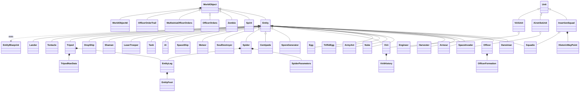

# 02 — Units and entities

> Part A · Baseline build: Release|Win32 (OpenGL) + TARGET_PC_FULLGAME ([B:FULL]); see _work/build_matrix.md.
> Evidence: [C] confirmed · [I] inferred · [U] unknown. Citations are `path:Symbol` relative to the multiwinia/ source root.
> Sources merged: P03_entity_core (WorldObjectId, WorldObject, Entity, EntityBlueprint, Darwinian, Officer, Spirit, EntityLeg), P04_entities_military (conventions, weapons summary, Airstrike, Nuke, Insertion Squad, Armour, Tank, Harvester, LaserTrooper, Shaman, Engineer, team colouring, sounds, constants), P05_entities_creatures (creature classes, Meteor, SpaceShip, DropShip, Tripod, Tentacle, Lander, sound bindings), cross-partition notes from P01, P02, P06, P08, P09 (`_work/routed/_meta_*.md`), `_work/drafts/P03_worldobject_classes.csv`, `data/stats.txt`, `_work/phase2_log.md`. Every numeric constant and state transition in the major sections was re-checked against the source at commit `f909630`; claims that could not be re-checked are tagged [I].

This document specifies **every simulated entity type** of the Multiwinia PC build: the 26 concrete `Entity` subclasses (`Entity::Type*` 1–26), the non-entity simulated objects that behave like units (`Spirit`, `Zombie`, the officer order effects) and every helper/data class those units own (`WorldObjectId`, `EntityBlueprint`, `EntityLeg`/`EntityFoot`, `OfficerFormation`, `HistoricWayPoint`, `ViriiHistory`, `SpiderParameters`, `TripodNavData`, `Light`). Buildings (including `AntHill`, `Triffid`, `WallBuster`, `Crate`) are specified in [03](03_buildings_and_world_objects.md); projectiles, explosions and crate outcomes (`Grenade`, `Rocket`, `Laser`, `Shockwave`, `Lightning`, `Snow`, `DustBall`, `SpamInfection`, `BoxKite`) in [04](04_crates_powerups_and_weapons.md); the engine-level object model (containers, grids, routing) in [21](21_simulation_and_entity_model.md); CPU strategy in [07](07_ai.md); input bindings in [06](06_player_control_and_input.md).

## Contents

- [1 Entity catalogue](#1-entity-catalogue)
- [2 Shared conventions](#2-shared-conventions)
- [3 Framework classes (WorldObjectId, WorldObject, Light, Entity, EntityBlueprint)](#3-framework-classes)
- [4 Darwinian](#4-darwinian)
- [5 Officer and order effects](#5-officer)
- [6 Spirit](#6-spirit)
- [7 Insertion squad (InsertionSquad, Squadie, HistoricWayPoint)](#7-insertion-squad)
- [8 Armour](#8-armour)
- [9 Harvester](#9-harvester)
- [10 Engineer](#10-engineer)
- [11 Airstrike (AirstrikeUnit, SpaceInvader)](#11-airstrike)
- [12 Nuke](#12-nuke)
- [13 ArmyAnt](#13-armyant)
- [14 TriffidEgg](#14-triffidegg)
- [15 Egg](#15-egg)
- [16 Virii (Virii, ViriiUnit, ViriiHistory)](#16-virii)
- [17 SporeGenerator](#17-sporegenerator)
- [18 Centipede](#18-centipede)
- [19 Spider (Spider, SpiderParameters)](#19-spider)
- [20 EntityLeg and EntityFoot](#20-entityleg)
- [21 SoulDestroyer and Zombie](#21-souldestroyer)
- [22 Meteor](#22-meteor)
- [23 SpaceShip](#23-spaceship)
- [24 AI (CPU-player entity)](#24-ai)
- [25 Tank](#25-tank)
- [26 LaserTrooper](#26-lasertrooper)
- [27 Shaman](#27-shaman)
- [28 DropShip](#28-dropship)
- [29 Tripod (Tripod, TripodNavData)](#29-tripod)
- [30 Tentacle](#30-tentacle)
- [31 Lander](#31-lander)
- [32 Control model summary](#32-control-model-summary)
- [33 Cross-entity summaries](#33-cross-entity-summaries)
- [Open questions and unknowns](#open-questions-and-unknowns)
- [Docs-vs-code discrepancies](#docs-vs-code-discrepancies)
- [IP items](#ip-items)
- [Source map](#source-map)
- [Appendix — dead/legacy code](#appendix--deadlegacy-code)

## 1 Entity catalogue

### 1.1 Every `Entity::Type` value

`Entity::Type*` is a plain enum whose numeric value is also the row number in `data/stats.txt` and the index into `EntityBlueprint::m_stats` [C] `code/worldobject/entity.h:Entity`, `code/worldobject/entity.cpp:EntityBlueprint::Initialise`. "Blocked" = listed by `Entity::EntityIsBlocked` under `BLOCK_OLD_DARWINIA_OBJECTS` (on in FULL); blocking only stops a level file's `InstantUnits` block (and the editor-only instant-unit window) from placing the type — code can still create it [C] `code/worldobject/entity.cpp:Entity::EntityIsBlocked`, `code/level_file.cpp:LevelFile::ParseInstantUnits`. Build tags follow `_work/build_matrix.md` §7. "Spirit" = whether the entity's death releases a soul (§2.8).

| # | Enum | Class (header) | Blocked | Build tag | How it is obtained in Multiwinia | Spirit on death | Section |
|---|---|---|---|---|---|---|---|
| 0 | `TypeInvalid` | — (`NewEntity` asserts) | yes | — | never | — | — |
| 1 | `TypeLaserTroop` | `LaserTrooper` (`code/worldobject/lasertrooper.h`) | yes | [B:LEGACY] | only spawned by `Lander`, which nothing creates | yes (base) | [26](#26-lasertrooper) |
| 2 | `TypeEngineer` | `Engineer` (`code/worldobject/engineer.h`) | no | [B:FULL] | crate reward *Engineer* → targeted task `Task::TargetEngineer`; level `InstantUnits` with `runAsTask` (no shipped MP map uses it); Darwinia `RunningPrograms` [B:LEGACY] | no | [10](#10-engineer) |
| 3 | `TypeVirii` | `Virii` (`code/worldobject/virii.h`) | no | [B:FULL] | `TriffidEgg::Spawn` (`SpawnVirii`, also the fallback for a refused Soul Destroyer); `Egg::Advance` hatching (4); `SpamInfection` spirit conversion (Infection crate); cheat window [B:DEBUG]; `Cave` [B:LEGACY] | yes (base) | [16](#16-virii) |
| 4 | `TypeInsertionSquadie` | `Squadie` (`code/worldobject/insertion_squad.h`) | no | [B:FULL] | crate reward *Squad* → `Task::TargetSquad` creates an `InsertionSquad` of 3 | **no** | [7](#7-insertion-squad) |
| 5 | `TypeEgg` | `Egg` (`code/worldobject/egg.h`) | yes | [B:FULL] (indirect) | laid by `SporeGenerator` and `Spider`; thrown by a `TriffidEgg` of spawn type `SpawnEggs` | **no** | [15](#15-egg) |
| 6 | `TypeSporeGenerator` | `SporeGenerator` (`code/worldobject/sporegenerator.h`) | no | [B:FULL] | `TriffidEgg::Spawn` (`SpawnSporeGenerator`) | yes (base) | [17](#17-sporegenerator) |
| 7 | `TypeLander` | `Lander` (`code/worldobject/lander.h`) | yes | [B:LEGACY] | no creator in code; level placement blocked | yes (base) | [31](#31-lander) |
| 8 | `TypeTripod` | `Tripod` (`code/worldobject/tripod.h`) | yes | [B:LEGACY] | no creator (the `SpawnTripod` egg case is commented out) | n/a (removed by own logic) | [29](#29-tripod) |
| 9 | `TypeCentipede` | `Centipede` (`code/worldobject/centipede.h`) | no | [B:FULL] | `TriffidEgg::Spawn` (`SpawnCentipede`, one Unit of 5–14 segments in MP); growth by `Centipede::EatSpirits` | yes, per segment (base) | [18](#18-centipede) |
| 10 | `TypeSpaceInvader` | `SpaceInvader` (`code/worldobject/airstrike.h`) | yes | [B:FULL] | each `AirStrikeMarker` summons an `AirstrikeUnit` of 2 bombers (crate Airstrike / Napalm Strike; uncaptured-crate variants) | **no** | [11](#11-airstrike) |
| 11 | `TypeSpider` | `Spider` (`code/worldobject/spider.h`) | no | [B:FULL] | `TriffidEgg::Spawn` (`SpawnSpider`); `SpamInfection` (5 % of spirit conversions) | yes (base) | [19](#19-spider) |
| 12 | `TypeDarwinian` | `Darwinian` (`code/worldobject/darwinian.h`) | no | [B:FULL] | spawn points (`SpawnPoint::SpawnDarwinian`), match-start port fill (`Location::InitialiseTeam`), level `InstantUnits` (269 rows across the 57 `mp_*` maps), trunk-port reinforcements (`code/multiwinia.cpp`), harvester/engineer soul delivery, crate *Extra Darwinians*, `TriffidEgg` `SpawnDarwinians`, conversion (subversion laser, Futurewinian pulse wave, `SpamInfection`), officer demotion, `SpaceShip` drop (Futurewinian team) | yes (base) | [4](#4-darwinian) |
| 13 | `TypeOfficer` | `Officer` (`code/worldobject/officer.h`) | yes | [B:FULL] | promotion of a Darwinian (`Location::PromoteDarwinian`, network command `NET_DARWINIA_PROMOTE`); `Task::Promote` [B:LEGACY] | yes (base) | [5](#5-officer) |
| 14 | `TypeArmyAnt` | `ArmyAnt` (`code/worldobject/armyant.h`) | yes | [B:FULL] | released by `AntHill` (Ant Nest crate), one wake-up ant from `Crate::RunAntNest`, `TriffidEgg` `SpawnAnts` | yes (base) | [13](#13-armyant) |
| 15 | `TypeArmour` | `Armour` (`code/worldobject/armour.h`) | no | [B:FULL] | crate reward *Armour* → `Task::TargetArmour`; trunk-port armour reinforcements (`Multiwinia::AdvanceTrunkPorts`); level `InstantUnits` with `runAsTask` (7 armours on `mp_assault_2P_1`, `mp_assault_3P_2`, `mp_assault_3p_1`, `mp_assault_4P_1`); `ConstructionYard` [B:LEGACY]; cheat window [B:DEBUG] | **no** | [8](#8-armour) |
| 16 | `TypeSoulDestroyer` | `SoulDestroyer` (`code/worldobject/souldestroyer.h`) | no | [B:FULL] | `TriffidEgg::Spawn` (`SpawnSoulDestroyer`; MP: Monster team, max 2 alive, never in Assault) | yes (base) | [21](#21-souldestroyer) |
| 17 | `TypeTriffidEgg` | `TriffidEgg` (`code/worldobject/triffid.h`) | yes | [B:FULL] | `Triffid::Launch` (Triffids crate), `Crate::RunEggs` (Eggs crate task), nested `SpawnTriffidEggs` | yes (base) | [14](#14-triffidegg) |
| 18 | `TypeAI` | `AI` (`code/worldobject/ai.h`) | yes | [B:FULL] | one per CPU team, spawned by `Location::InitialiseTeam` at (−100, 0, −100) | n/a (invulnerable) | [24](#24-ai) |
| 19 | `TypeShaman` | `Shaman` (`code/worldobject/shaman.h`) | yes | [B:LEGACY] | `Task::TargetShaman` only (no crate/UI runs it); deletes itself on its first tick | — | [27](#27-shaman) |
| 20 | `TypeHarvester` | `Harvester` (`code/worldobject/harvester.h`) | no | [B:FULL] | crate reward *Harvester* → `Task::TargetHarvester` | **no** | [9](#9-harvester) |
| 21 | `TypeNuke` | `Nuke` (`code/worldobject/nuke.h`) | yes | [B:FULL] | crate reward *Nuke* → `Task::TargetNuke` → `Crate::RunNuke` (10 warheads) | yes in principle (base, never in practice) | [12](#12-nuke) |
| 22 | `TypeTentacle` | `Tentacle` (`code/worldobject/tentacle.h`) | yes | [B:DEBUG] / [B:LEGACY] | `Portal::AdvanceStateExpanding` (The Beast crate, `INCLUDE_THEBEAST` = `TARGET_DEBUG` only) | n/a (invulnerable) | [30](#30-tentacle) |
| 23 | `TypeMeteor` | `Meteor` (`code/worldobject/meteor.h`) | yes | [B:FULL] | crate reward *Meteor Shower* → `Task::TargetMeteorShower` → `Crate::RunMeteorShower` (5–9 meteors); CPU `AI::RunMeteor` | n/a (removed on impact) | [22](#22-meteor) |
| 24 | `TypeTank` | `Tank` (`code/worldobject/tank.h`) | no | [B:DEBUG] (Tank Battle) / unreachable in FULL | crate reward commented out; `Task::TargetTank` body commented out; only the `mp_tankbattle_*` maps place tanks (instant units), mode compiled only with `INCLUDEGAMEMODE_TANKBATTLE` | **no** | [25](#25-tank) |
| 25 | `TypeSpaceShip` | `SpaceShip` (`code/worldobject/spaceship.h`) | yes | [B:FULL] | uncaptured-crate outcome *Space Ship* (once per game, not in Assault) → `Crate::RunSpaceShip` | n/a (invulnerable) | [23](#23-spaceship) |
| 26 | `TypeDropShip` | `DropShip` (`code/worldobject/dropship.h`) | yes | [B:LEGACY] | `Task::TargetDropShip`, reachable only through the `DropShip` reinforcement level option used by `data/levels/old/mp_assault_3P_1.txt` (not shipped) | n/a (invulnerable) | [28](#28-dropship) |
| 27 | `NumEntityTypes` | — | — | — | sentinel (also used by the Shaman summon menu as the "capture portal" icon) | — | — |

[C] class/header/blocked columns: `code/worldobject/entity.cpp:Entity::NewEntity`, `Entity::GetTypeName`, `Entity::EntityIsBlocked`. Creation sites: grep of `SpawnEntities`/`NewUnit` across `code/` (sites cited in each section). Instant-unit counts: [C] scan of the `InstantUnits` blocks of the 57 `data/levels/mp_*.txt` files (269 `Darwinian`, 7 `Armour`, 9 `Tank`; no other type).

`Entity::GetTypeName` strings equal the enum names without `Type`, except `TypeInvalid` → `"InvalidType"`, `TypeLaserTroop` → `"LaserTroop"`, `TypeInsertionSquadie` → `"Squadie"`; `Entity::GetTypeId(name)` is a case-insensitive linear search over those strings, so a level file must write `Squadie`, not `InsertionSquadie` [C] `code/worldobject/entity.cpp:Entity::GetTypeName`, `Entity::GetTypeId`. `GetTypeNameTranslated` looks up language phrase `entityname_<TypeName>` and falls back to the raw name [C].

### 1.2 Non-`Entity` simulated objects and helper classes specified here

| Class (base, header) | Kind | Role | Build tag | Section |
|---|---|---|---|---|
| `WorldObjectId` (`code/worldobject/worldobject.h`) | value type | weak handle to any simulated object | [B:FULL] | [3.1](#31-worldobjectid--object-handle) |
| `WorldObject` (`code/worldobject/worldobject.h`) | abstract base | position/velocity/type root of every simulated object | [B:FULL] | [3.2](#32-worldobject--base-of-all-simulated-objects) |
| `Light` (`code/worldobject/worldobject.h`) | render data | level light (colour + direction) | [B:FULL] | [3.3](#33-light--level-light-record) |
| `Entity` (`WorldObject`, `code/worldobject/entity.h`) | abstract base | stats, damage, death, water, teleports, team-coloured shape | [B:FULL] | [3.4](#34-entity--base-class-of-all-units) |
| `EntityBlueprint` (`code/worldobject/entity.h`) | static data | `data/stats.txt` table | [B:FULL] | [3.5](#35-entityblueprint--the-statstxt-table) |
| `Spirit` (`WorldObject`, `code/worldobject/spirit.h`) | simulated object (by value) | released soul | [B:FULL] | [6](#6-spirit) |
| `OfficerFormation` (`code/worldobject/officer.h`) | struct | formation slot `{uniqueId, timer}` | [B:FULL] | [5.6](#56-officerformation--formation-slot) |
| `OfficerOrders` (`WorldObject`, `code/worldobject/officer.h`) | effect | single-player order visualiser | [B:LEGACY] | [5.8](#58-officerorders-multiwiniaofficerorders-officerordertrail--order-effects) |
| `MultiwiniaOfficerOrders` (`WorldObject`, `code/worldobject/officer.h`) | effect | MP order visualiser following the route | [B:FULL] | [5.8](#58-officerorders-multiwiniaofficerorders-officerordertrail--order-effects) |
| `OfficerOrderTrail` (`WorldObject`, `code/worldobject/officer.h`) | effect | arrow decal left by `MultiwiniaOfficerOrders` | [B:FULL] | [5.8](#58-officerorders-multiwiniaofficerorders-officerordertrail--order-effects) |
| `InsertionSquad` (`Unit`, `code/worldobject/insertion_squad.h`) | unit container | squad of `Squadie`s | [B:FULL] | [7](#7-insertion-squad) |
| `HistoricWayPoint` (`code/worldobject/insertion_squad.h`) | struct | squad breadcrumb | [B:FULL] | [7.7](#77-historicwaypoint--squad-breadcrumb) |
| `AirstrikeUnit` (`Unit`, `code/worldobject/airstrike.h`) | unit container | bomber flight | [B:FULL] | [11](#11-airstrike) |
| `ViriiUnit` (`Unit`, `code/worldobject/virii.h`) | unit container | batch-rendered Virii group | [B:FULL] | [16.6](#166-viriiunit--virii-group-container) |
| `ViriiHistory` (`code/worldobject/virii.h`) | struct | Virii trail sample | [B:FULL] | [16.7](#167-viriihistory--trail-sample) |
| `SpiderParameters` (`code/worldobject/spider.h`) | struct | spider gait parameter set | [B:FULL] | [19.6](#196-spiderparameters--gait-parameter-set) |
| `EntityLeg`, `EntityFoot` (`code/worldobject/entity_leg.h`) | helpers | procedural legs (Spider live, Tripod legacy) | [B:FULL] | [20](#20-entityleg) |
| `Zombie` (`WorldObject`, `code/worldobject/souldestroyer.h`) | effect | ghost of a soul-eaten Darwinian | [B:FULL] | [21.6](#216-zombie--ghost-effect) |
| `TripodNavData` (`code/worldobject/tripod.h`) | helper | hex-direction navigator | [B:LEGACY] | [29](#29-tripod) |

### 1.3 Class diagram of the classes in this document



`Unit` (`code/unit.h`) is the team-owned group container described in [21](21_simulation_and_entity_model.md); `Light` is unrelated to the hierarchy (plain data) [C] `code/worldobject/worldobject.h`.

## 2 Shared conventions

These rules apply to every entity in sections 3–31. Each entity section restates only its deviations.

### 2.1 Simulation tick, game speed and timer units

| Item | Value | Ref |
|---|---|---|
| Server tick | `SERVER_ADVANCE_PERIOD` = `0.1 × m_gameSpeed` seconds of game time; ticks are issued at a fixed 10 Hz of real time by the lock-step server ([22](22_determinism_and_networking.md)) | [C] `code/gametimer.h:SERVER_ADVANCE_PERIOD`, `code/gametimer.cpp:GameTimer::GetServerAdvancePeriod` |
| Network (game) time | `GetNetworkTime()` = `g_gameTimer.GetGameTime()`, the sum of all tick lengths | [C] `code/gametimer.cpp:GameTimer::Tick` |
| Normal game speed | 1.0 → 1 tick = 0.1 s | [C] |
| Speed changes | *Slow Down Time* crate: target `0.2 + syncfrand(0.2)`; *Speed Up Time* crate: `1.3 + syncfrand(0.7)`; both ease at 5 % of the gap per tick and hold for a length counter of 15.0 decremented by 0.1 per tick (≈150 ticks); a Meteor within 200 of its target requests 0.4 (ease 10 %/tick, length 4.0 ≈ 40 ticks); afterwards the speed returns to 1.0 | [C] `code/worldobject/crate.cpp:Crate::RunSlowDownTime`, `Crate::RunSpeedUpTime`, `code/worldobject/meteor.cpp:Meteor::Advance`, `code/gametimer.cpp:GameTimer::Tick`, `GameTimer::RequestSpeedChange`; [I] the length counter is decremented once per server tick |
| Wall clock | `g_gameTime` is **wall-clock time** (`GetHighResTime()` every rendered frame), not game time; `g_advanceTime` is the real frame delta (capped 0.25 s) | [C] `code/main.cpp:UpdateAdvanceTime`, `code/main.h` (comment "Updated from GetHighResTime every frame") |
| Slicing | each 0.1 s tick is processed as `NUM_SLICES_PER_FRAME` = 10 slices; every sliced container advances one tenth of its slots per slice, so each entity/spirit advances exactly once per tick, in slot order ([21](21_simulation_and_entity_model.md)) | [C] `code/globals.h`, `code/location.cpp:Location::Advance` |

**Three kinds of timer appear in entity code, and a re-implementation must keep them apart:**

1. *Game-time timers* subtract `SERVER_ADVANCE_PERIOD` per tick (e.g. `Darwinian::m_retargetTimer`, `Spirit::m_timeSync`, all task lifetimes). They run at game speed.
2. *Per-tick constants that are pre-multiplied by game speed* (e.g. throwable gravity `9.8 × gameSpeed` per tick = 98 u/s² of game time) — equivalent to (1).
3. *Per-tick constants that ignore game speed* — they keep their **real-time** rate, so relative to game time they speed up in slow motion and slow down in fast motion [C]/[I] (arithmetic). Instances in this document: `TriffidEgg` gravity `9.8 × m_force` per tick; `Spider` pounce gravity 40 per tick; `Armour` fall `vel.y −= 5` per tick; `Officer` corpse sink `vel.y −= 20` per tick; `Centipede`/`SoulDestroyer` 50 %-per-tick retreat rolls; `ArmyAnt` per-tick bite (1 HP/tick); `Virii` bite (20 HP per tick while on target); `Lightning` 1 %/tick strike roll ([04](04_crates_powerups_and_weapons.md)); `AntHill` 30-call empty counter ([03](03_buildings_and_world_objects.md)); `SpaceShip`/`DropShip` `speed × dt²` integration; Darwinian infected 1/20-per-tick stop. A further inverted case: the burning-Darwinian damage roll `syncfrand(10) < 2.0 / gameSpeed` uses a probability that *grows* when the game slows (damage per game second ∝ 1/speed²) [C] `code/worldobject/darwinian.cpp:Darwinian::AdvanceOnFire`; the Darwinian laser roll divides its 1-in-N rate by game speed, which correctly keeps ≈1 attempt per game second [C] `Darwinian::AdvanceCombat`. Recommendation for the new game: express every rate per second of game time.

### 2.2 Random numbers

| Function | Generator | Range produced | Synchronised? | Ref |
|---|---|---|---|---|
| `syncrand()` | MT19937 Mersenne Twister seeded with `syncrandseed` | [0, 2³²) | yes | [C] `contrib/systemiv/lib/math/random_number.cpp:_syncrand` |
| `syncfrand(x)` | `_syncrand() · x / 2³²` | [0, x) | yes | [C] `random_number.cpp:_syncfrand` |
| `syncsfrand(x)` | `(_syncfrand(1) − 0.5) · x` | **(−x/2, +x/2)** — the header comment's "±x" is wrong | yes | [C] `random_number.cpp:_syncsfrand` |
| `FRAND(x)`, `SFRAND(x)` | wrapper structs that resolve to `_syncfrand`/`_syncsfrand` when passed to `Vector3` constructors, evaluated left-to-right | as above | yes | [C] `code/lib/vector3.h:FRAND`, `code/lib/vector3.cpp:FromRand` |
| `frand(x)`, `sfrand(x)`, `AppRandom()`, CRT `rand()` | local LCG (`holdrand × 214013 + 2531011`, 15-bit) | [0, x], (−x/2, x/2], [0, 32767] | **no** — render/particles/sounds only | [C] `random_number.cpp:frand`, `sfrand`, `AppRandom` |

Rule used throughout: every simulation decision consumes the synced stream in a fixed order on every peer; the unsynced generator may only feed particles, sounds and render flags. Entity code also spends synced numbers on purely cosmetic effects (spirit wobble, smoke trails, ant leg-frame choice, abduction sparks); they must be replicated or moved off the shared stream together on all peers ([22](22_determinism_and_networking.md)) [C]/[I].

### 2.3 Research levels are fixed in Multiwinia

Many weapon/unit parameters are tables indexed by `GlobalResearch::CurrentLevel(type)`. `Location::Init` (Multiplayer branch) sets every research type to **3**, then `TypeSquad = 1`, `TypeLaser = 2`, `TypeGrenade = 2`, `TypeRocket = 2`, `TypeAirStrike = 2`, `TypeDarwinian = 4` [C] `code/location.cpp:Location::Init`. Consequences used below:

| Research | MP level | Effect in this document |
|---|---|---|
| Squad | 1 | squad size `2 + level` = 3 (`Task::TargetSquad`) |
| Laser | 2 | laser life 0.6 s (`Location::FireLaser`) |
| Grenade | 2 | throw force cap 110 (`ThrowableWeapon::GetMaxForce`) |
| Rocket | 2 | rocket life 0.75 s; tank missile life 15 s |
| AirStrike | 2 | 2 bombers per airstrike marker |
| Armour | 3 | (turret-shell life table, overridden to 0.6 s in MP) |
| Officer | 3 | officer mode cycling disabled in MP anyway (§5) |
| Harvester | 3 | capacity 100 spirits |
| Engineer | 3 | capacity 25 spirits; bridge building (needs 5) impossible |
| Darwinian | 4 | every Darwinian is a *soldier* (`> 2`, shoots and fights) and *has grenades* (`> 3`) |
| all others | 3 | — |

Whether the lobby option `GAMEOPTION_GAME_RESEARCH_LEVEL` (`Multiwinia::SetGameResearch`) can override this table depends on call order (see 02-U7).

### 2.4 Stats

Each entity copies three stats from `EntityBlueprint` (§3.5) into `unsigned char m_stats[3]` = {Health, Speed, Rate} in `Entity::SetType` [C] `code/worldobject/entity.h:Entity::m_stats`, `code/worldobject/entity.cpp:Entity::SetType`. Consequences:

- Values are **truncated to integers and limited to 0–255**: InsertionSquadie RATE 0.5 → 0 per entity; Meteor speed 350 and SpaceShip speed 500 are out of range of `unsigned char` (undefined behaviour in C++; [I] MSVC x86 yields 350 mod 256 = 94 and 500 mod 256 = 244). Meteor sidesteps this by reading `EntityBlueprint::GetStat` directly; SpaceShip uses the byte value (§23).
- Health can never exceed 255 (every `ChangeHealth` clamps).
- Speed multipliers applied to the byte (`× 2` hot feet, `× 1.5` rage, `× 0.75` plague, `/ 2` plague) truncate.
- `SetType` also sets `m_reloading = syncfrand(Rate)` — a random initial reload phase. `Darwinian`'s constructor calls `SetType` and `SpawnEntities` calls it again, so each Darwinian spawn consumes two such draws [C] `code/worldobject/darwinian.cpp:Darwinian::Darwinian`, `code/location.cpp:Location::SpawnEntities`.
- Speeds are multiplied by `1 + m_difficultyLevel/10` for every type except SpaceInvader; `m_difficultyLevel` is 0 at start-up and is only overwritten by a level's `Difficulty_StartDefinition … CreatedAsDifficulty` block — none of the 57 `mp_*` maps has one (their `Difficulty basic` line is a rating string parsed into `m_difficultyRating`), so the multiplier is 1.0 in Multiwinia [C] `code/app.cpp:App::App`, `code/location.cpp:Location::Init`, `code/level_file.cpp:LevelFile::ParseDifficulty`, grep of `data/levels/mp_*.txt`.

New-game recommendation: store stats as floats per instance.

### 2.5 Spawning, ownership and containers

`Location::SpawnEntities(pos, team, unitId, type, n, vel, spread, range = −1, routeId = −1, routeWaypointId = −1)` is the single creation path for entities [C] `code/location.cpp:Location::SpawnEntities`:

1. If `team` is the Monster team (id **4**) or the Futurewinian team (id **5**) and that slot is unused, initialise it (`InitMonsterTeam` → CPU team, colour RGB(10,10,10), `m_colourId = MULTIWINIA_NUM_TEAMCOLOURS`; `InitFuturewinianTeam` → CPU team, RGB(200,200,200), `m_colourId = MULTIWINIA_NUM_TEAMCOLOURS + 1`). In Multiplayer both are also initialised in `Location::Init` [C] `code/location.cpp:Location::GetMonsterTeamId`, `GetFuturewinianTeamId`, `InitMonsterTeam`, `InitFuturewinianTeam`.
2. For each of `n` entities: `Team::NewEntity(type, unitId)` constructs the class (`Entity::NewEntity`) and stores it in the team's loose list `m_others` (`unitId = −1`) or in a `Unit`'s array; `SetType(type)`; `pos = FindValidSpawnPosition(pos, spread)` (up to 10 tries of `radius = syncfrand(spread)`, `θ = syncfrand(2π)`, accepting on-map points with terrain height > 0; on failure the original point clamped 20 inside the map edges — which may be water); `m_onGround = false`; `m_vel = vel`; `m_front = normalise(vel)` or (1,0,0) — Darwinians instead get a random horizontal front `(SFRAND(1), 0, SFRAND(1))`; ids set; `m_spawnPoint = pos`; `m_roamRange = range` (or `spread` when `range == −1`); route ids; `Begin()`; insertion into the entity grid with `m_radius`.
3. If spawned into a unit, `unit->RecalculateOffsets()`.
4. The level population cap check is commented out — caps are enforced by spawning buildings, not here ([05](05_economy_and_population.md)).

Team-level lists relevant to units [C] `code/team.cpp`:

| List | Members | Use |
|---|---|---|
| `Team::m_others` | every entity spawned with `unitId = −1` (Darwinians, Officers, Armour, Harvester, Engineer, Nuke, Meteor, SpaceShip, creatures except Centipede/Tentacle/ant units, AI) | Darwinian searches, selection, AI |
| `Team::m_units` | `InsertionSquad`, `AirstrikeUnit`, `ViriiUnit`, generic `Unit` (Centipede, AntHill ant group, Tentacle, LaserTrooper) | unit-level advance/render |
| `Team::m_specials` | ids registered in `Begin`: Officer, Armour, Harvester, Engineer (Multiwinia only), Tank, Shaman | Darwinian officer/armour search, AI special-unit loop |

Selectable entities (`IsSelectable() == true`): Darwinian (unless OperatingPort, BeingSacraficed, OnFire, InsideArmour), Officer, Armour, Harvester, Engineer, InsertionSquad (unit), Tank, Shaman; all others return false [C] `IsSelectable` in each class.

### 2.6 Damage model

`Entity::DamageType`: `DamageTypeUnresistable = 0` (default argument; "used for just killing entities outright"), `DamageTypeLaser = 1`, `DamageTypeExplosive = 2`, `DamageTypeTurretShell = 3`, `DamageTypeFire = 4`, `NumDamageTypes = 5` [C] `code/worldobject/entity.h`.

Base `Entity::ChangeHealth(amount, type)` (type ignored) [C] `code/worldobject/entity.cpp:Entity::ChangeHealth`:
```
if not dead:
    if amount < 0: sound "LoseHealth"
    if health + amount <= 0: health = 100 (reused as fade counter); dead = true; sound "Die";
                             Location::SpawnSpirit(pos, vel * 0.5, team, id)
    elif health + amount > 255: health = 255
    else: health += amount
return true          # true = "hit registered": callers then apply knock-back
```

Resistance matrix (every override in the code base; "base" = the rule above) [C] each class's `ChangeHealth`:

| Class | Laser | Explosive | TurretShell | Fire | Unresistable | Death rule | Returns |
|---|---|---|---|---|---|---|---|
| Darwinian | full | full; ×0.6 in formation (not Futurewinian) | full | full | full | base | true unless immune |
| — modifiers | booster: immune to all but Unresistable, an Explosive hit pops the booster; inside armour / being sacrificed: immune to all but Unresistable; rage ×0.75; Futurewinian ×2.0 | | | | | | |
| Officer | full | full | full | full | full | base; shield souls absorb first | true |
| Squadie | full | full | full | full | full | at ≤ 0, **no spirit**, shape explodes | **false** (no knock-back ever) |
| Armour | **immune** | full | ÷3 (integer) | full | full | at 0: `Bang(pos, 20, 50, ownTeam)`, no spirit | false for lasers, else true |
| Harvester | immune | immune | immune | immune | only while `m_vunerable` | at 0, no spirit | true |
| Engineer | **immune** | full | full | full | full | when `health + amount < 0` (strict), health 0, no spirit | false for lasers |
| SpaceInvader | immune | immune | full (1 shell kills) | immune | immune | no spirit | false unless shell |
| Nuke | (no override) base | base | base | base | base | base (never checked by its Advance) | true |
| ArmyAnt | full | full | full | full | full | base + shape explosion scaled by `m_scale`; drops carried spirit | true |
| TriffidEgg | **immune** | full | full | full | full | base + shape explosion | false for lasers |
| Egg | full | full | full | full | full | only when `health + amount < 0`; **no spirit, no sound** | true |
| Virii | (no override) base | | | | | base | true |
| SporeGenerator | **immune** | amounts ≥ −1 ignored, else full + Panic | same | same | same | base | true |
| Centipede | full | full | full | full | full | base per segment; Panic on dropping a health third | true |
| Spider | **immune** | amounts ≥ −1 ignored, else full | same | same | same | base | true |
| SoulDestroyer | **immune** | full + Panic | full + Panic | full + Panic | full + Panic | base | true |
| Meteor | (no override) base | | | | | base (nothing targets it) | true |
| SpaceShip, DropShip, Tentacle, AI | immune | immune | immune | immune | immune | never die | false |
| Tank | **immune** | full | full | full | full | no spirit, no Bang | false for lasers |
| LaserTrooper | (no override) base | | | | | base | true |
| Shaman | only while `m_vunerable` | | | | | no spirit | false when invulnerable |
| Tripod | **immune** | only while `ModeAttacking` | | | | base | false otherwise |
| Lander | base (its `ChangeHealth(int)` does not override the virtual) | | | | | base | true |

### 2.7 Explosions — `Location::Bang` and `Shockwave`

`Location::Bang(pos, R, D, teamId = −1, fromBuildingId = −1)` is used by every explosive in this document [C] `code/location.cpp:Location::Bang`:

1. Cosmetic particles: `numCores = R·D·0.01 + frand(numCores)` `TypeExplosionCore`; `numDebris = clamp(R·D·0.01, 2, 30)` `TypeExplosionDebris` (unsynced).
2. Every entity within **2R** of `pos` (any team, attacker included): `fraction = (2R − d) / R * 2` — operator precedence makes this `((2R − d)/R)·2`, clamped to [0,1] ⇒ **full damage D out to 1.5R, linear to 0 at 2R**. `ChangeHealth(−D·fraction, DamageTypeExplosive)` (int truncation).
3. If `ChangeHealth` returned true and the type is not InsertionSquadie/Officer/Shaman: knock-back `push = normalise(entity − pos)`, `push.y = D` if on ground else −1, normalised, × fraction; `m_vel += push`; `m_onGround = false` (the horizontal component is tiny — the effect is a hop).
4. Kills counted for entities that died in this call and whose team ≠ `teamId`; in Multiwinia `teams[teamId].m_teamKills += darwinianKills` (Darwinians only) when `teamId` is a real team.
5. A `Shockwave(size = R/20)` at `pos`; [B:D3D] also `g_deformEffect->AddPunch(pos, R)`.
6. Every building with centre distance < 3R takes `Damage(−D·(1 − d/3R))`.
7. Returns the kill count.

`Shockwave` (spawned by step 5) [C] `code/worldobject/weapons.cpp:Shockwave::Advance`: lives `size` seconds; ring radius `r = 35 + 40·age`; each tick, every entity (any team) with `|d − r| < 10` takes `ChangeHealth(−40·life/size, Explosive)`, except that a Darwinian instead catches fire with probability `syncfrand(4) < 0.1` (2.5 %/tick); knock-back `25·fraction` with y = 3 for grounded non-squad/officer/shaman entities. A stationary entity is inside the 20-wide band for ≈5 ticks [I].

| Explosion | R | D | Full ≤ | Zero at | Buildings < | Shockwave ring | Source |
|---|---|---|---|---|---|---|---|
| Grenade | 12.5 | 50 | 18.75 | 25 | 37.5 | 35→60 | `Grenade::Advance` |
| Airstrike bomb | 25 | 100 | 37.5 | 50 | 75 | 35→85 | `SpaceInvader::Advance` |
| Rocket | 15 | 25 | 22.5 | 30 | 45 | 35→65 | `Rocket::Explode` |
| Armour death | 20 | 50 | 30 | 40 | 60 | 35→75 | `Armour::ChangeHealth` |
| Nuke | 50 | 100 | 75 | 100 | 150 | 35→135 | `Nuke::AdvanceToTarget` |
| Meteor | 50 | 100 | 75 | 100 | 150 | 35→135 | `Meteor::Advance` |
| Plague explosion | 5 | 25 | 7.5 | 10 | 15 | 35→45 | `Darwinian::AdvanceInfection` |
| Tank missile [B:DEBUG] | 20 | 100 | 30 | 40 | 60 | 35→75 | `Missile::Explode` |
| Land mine [B:DEBUG] | 20 | 20 | 30 | 40 | 60 | 35→75 | `LandMine::Advance` |
| Lander death [B:LEGACY] | 30 | 50 | 45 | 60 | 90 | 35→95 | `Lander::Advance` |

Projectile behaviour (lasers, grenades, rockets, shells, fireballs, pulse wave) is specified in [04](04_crates_powerups_and_weapons.md); the summary used by units is in §2.12.

### 2.8 Death, corpse fade and spirit release

- **Corpse fade**: after death the health byte (set to 100) is a fade counter; `Entity::AdvanceDead` subtracts `int(40 × tick)` = 4 per tick on the ground and `int(20 × tick)` = 2 per tick airborne; the entity is removed when it reaches 0 ⇒ **2.5 s** (ground) / **5 s** (air) [C] `code/worldobject/entity.cpp:Entity::AdvanceDead`. Classes that set health 0 at death (Engineer) disappear on the next tick.
- **Spirit release**: only through base `Entity::ChangeHealth` (or classes that call it). `Location::SpawnSpirit(pos, vel, team, ownerId)` returns −1 (no spirit) for the **Monster team**; the spirit appears at `pos + (0,1,0)` with the corpse velocity × 0.5 [C] `code/location.cpp:Location::SpawnSpirit`. Spirit lifecycle: §6; economy: [05](05_economy_and_population.md).
- **Removal without a spirit** (no `ChangeHealth`): Darwinian promotion, rocket boarding, abduction, subversion conversion, Futurewinian pulse conversion, officer absorption, officer demotion, SoulDestroyer kills (spirit spawned then deleted), and every class marked "no spirit" in §2.6.

### 2.9 Shared physics and obstacle rules

| Mechanism | Rule | Ref |
|---|---|---|
| Gravity (entities) | `Entity::AdvanceInAir`: `vel.y −= 15·dt`; `pos += vel·dt`; calls `PushFromObstructions(pos)` but **discards the result**; lands when `y ≤ ground + 0.1` (vel 0, y = ground + 0.2); at `y ≤ 0` starts the water clock (`m_inWater = 0`) and zeroes velocity | [C] `code/worldobject/entity.cpp:Entity::AdvanceInAir` |
| Water | `Entity::AdvanceInWater`: `m_inWater += dt`; after **10 s** `ChangeHealth(−500)` (drown); swims toward its unit waypoint + rectangle-formation offset, then `vel.SetLength(5)` unconditionally; `y = −sin(3·t) − 4`; leaves the water when terrain under it is > 0. Darwinians override this with instant death (§4) | [C] `Entity::AdvanceInWater` |
| World clamp | `Entity::Advance` clamps x, z into [0, worldSize] every tick | [C] `Entity::Advance` |
| Building push | `Entity::PushFromObstructions(pos, killem = true)`: snap to terrain if on ground; if `y ≤ 1` spiral search (radius 0→50 step 1, angle `d·syncsfrand(1)·π`) for land > 1; then for each building in the obstruction cell: hit = shape-vs-shape (if the entity has a shape), or sphere radius 1 (sprite entities and Officers), or a ray from the previous position (anti-tunnelling). Enabled **enemy laser fence** + `killem` → `ChangeHealth(−9999)` and `LaserFence::Electrocute`; any other building → push 4 units directly away from its centre while `DoesSphereHit(result, 2)` | [C] `Entity::PushFromObstructions` |
| Darwinian override | different water/building/fence/wall rules (§4.9) | [C] `Darwinian::PushFromObstructions` |
| Teleports | `Entity::EnterTeleports(requiredId = −1)`: in the obstruction cell, a `RadarDish` that `ReadyToSend()`, entrance within **15** and the entity facing into it (`front · entranceFront < 0`), or a `Bridge` within **25** of its position with the same facing test → `EnterTeleport(id)`, sound `EnterTeleport`, returns the building id | [C] `Entity::EnterTeleports` |
| Separation / cliffs | `Entity::PushFromEachOther` (radius 2, force 0.1/d) and `Entity::PushFromCliffs` (gradient > 1.0 → spiral 0–50 step 0.2) exist but have no live caller in Multiwinia | [C] `Entity::PushFromEachOther`, `Entity::PushFromCliffs` |

Slope speed factors (all of the form `factor = 1 + (h_now − h_next)/k`, i.e. uphill slower, downhill faster):

| Class | k | Clamp | Note | Ref |
|---|---|---|---|---|
| Darwinian | 3 | [0.3, 2.0] | | [C] `Darwinian::AdvanceToTargetPosition` |
| Officer | 3 | [0.1, 2.0] | | [C] `Officer::AdvanceToTargetPosition` |
| Squadie | 3 | [0.2, 2.0] | 0 when terrain normal y < 0.6 and going uphill | [C] `Squadie::Advance` |
| Virii | 5 | [0.1, 2.0] | | [C] `Virii::AdvanceToTargetPos` |
| Centipede | 10 | [0.6, 1.0] | only uphill slows | [C] `Centipede::AdvanceToTargetPosition` |
| Shaman [B:LEGACY] | 3 | [0.1, 2.0] | | [C] `Shaman::AdvanceToTargetPosition` |

### 2.10 Team colouring conventions

| Mechanism | Rule | Ref |
|---|---|---|
| Team colour | `Team::m_colour` (lobby colour); Monster team RGB(10,10,10); Futurewinian RGB(200,200,200); team 255 = no team | [C] `code/location.cpp:Location::InitMonsterTeam`, `InitFuturewinianTeam` |
| Generic shape recolour | `Entity::SetShape(name, colourAll)` → single-player or team 255: shared unmodified shape; MP: copy cached under `"<name>_<r>_<g>_<b>_<a>"`, recoloured by `ConvertShapeColoursToTeam` applied to the root fragment and its **direct children only** | [C] `code/worldobject/entity.cpp:Entity::SetShape`, `SetupTeamShape`, `ConvertShapeColoursToTeam` |
| Fragment rule | a material colour is converted if it is "mostly red" (`r > 2g && r > 2b`) or `colourAll`; converted colour = team colour (if `colourAll`) or team colour × (sum of original RGB / sum of team RGB) (luminance-preserving tint), then × 0.7 ("3D models appear brighter"); other colours unchanged. **Asset convention: team-coloured regions are authored in red** | [C] `Entity::ConvertFragmentColours` |
| Special case | if the team's lobby colour id is 0 and the shape is `data/shapes/darwinian.shp`, the team colour is halved first | [C] `Entity::ConvertShapeColoursToTeam` |
| Whole-model tints | Armour: every fragment = team colour × 0.1 (`ConvertShapeColours`); Tank: × 0.5 (`ConvertShape`); both cached as `"<name>_<colourId>_<coopGroupPosition>"` | [C] `code/worldobject/armour.cpp:Armour::Begin`, `code/worldobject/tank.cpp:Tank::Begin` |
| Sprites/billboards | Darwinian sprite, Spirit quads, Virii strips, lasers, Nuke sprites, SporeGenerator tails, SpaceShip beam rings, harvester beam rings are drawn with the team colour as vertex colour (monster team: white or invisible variants per class) | per-class Render (see each section) |

Per-class result:

| Class | Colouring | Ref |
|---|---|---|
| Darwinian | sprite × team colour × (0.3 + 0.7·health/50) | §4.13 |
| Officer | whole `officer.shp` team-coloured (`convertAll = true`) | [C] `Officer::Begin` |
| Squadie | none — `squad.shp` fixed colours (228,214,153) and (177,88,26) | [C] `Squadie::Squadie`, `data/shapes/squad.shp` |
| Armour | whole hull team colour × 0.1 | [C] `Armour::Begin` |
| Harvester | whole `harvester.shp` team-coloured (`SetShape(…, true)`), tractor rings team colour | [C] `Harvester::Begin`, `Harvester::RenderBeam` |
| Engineer | whole `engineer.shp` team-coloured (`SetShape(…, true)`); beam fixed blue | [C] `Engineer::Begin` |
| SpaceInvader | none — `spaceinvader.shp` fixed grey (128,128,128) | [C] `SpaceInvader::SpaceInvader`, `data/shapes/spaceinvader.shp` |
| Nuke | sub and warhead sprites in team colour (monster: white subtractive) | [C] `Nuke::RenderSub`, `Nuke::Render` |
| ArmyAnt, Centipede, SoulDestroyer, Tentacle | red regions recoloured (`convertAll = false`), per-team shape caches | [C] `ArmyAnt::SetShape`, `Centipede::Begin`, `SoulDestroyer::Begin`, `Tentacle::Begin` |
| Spider, TriffidEgg | whole model team-coloured (`SetShape(…, true)`) | [C] `Spider::Begin`, `TriffidEgg::Begin` |
| SporeGenerator | body red-region only (`SetShape(…, false)`), tails team colour | [C] `SporeGenerator::Begin`, `SporeGenerator::RenderTail` |
| Virii | worm = team colour × health fraction; glow = team colour (MP); monster team white/transparent | §16 |
| Egg | sprite drawn white (team colour fetched but unused) | [C] `Egg::Render` |
| Meteor, SpaceShip, DropShip | fixed shape colours; SpaceShip beam rings team colour | [C] `Meteor::Render`, `SpaceShip::RenderBeam` |
| Tank [B:DEBUG] | body and turret team colour × 0.5 | [C] `Tank::Begin` |
| LaserTrooper, Lander [B:LEGACY] | sprite/shape tint by team colour | [C] `LaserTrooper::Render`, `Lander::Render` |

### 2.11 Sound and VFX binding conventions

- **Sounds** are raised by name: `g_app->m_soundSystem->TriggerEntityEvent(entity, "EventName")`; the sound system looks up the `ENTITY <TypeName>` section of `data/sounds.txt` and plays the samples bound to that event ([10](10_audio_design.md), [27](27_audio_engine.md)). Each class lists its events in `ListSoundEvents` (sound-editor list); the base list is `Create`, `Attack`, `LoseHealth`, `EnterTeleport`, `ExitTeleport`, `Die`, `Selected` [C] `code/worldobject/entity.cpp:Entity::ListSoundEvents`. Base triggers: `Create` in `Entity::Begin`, `LoseHealth`/`Die` in base `ChangeHealth`, `Attack` in `Entity::Attack`, `EnterTeleport` in `EnterTeleports` [C]. Looping events are cut with `StopAllSounds(id, "<Type> <Event>")`. Event names and their bindings per class are tabulated in §33.3.
- **Particles** are created with `g_app->m_particleSystem->CreateParticle(pos, vel, Particle::Type…, size, colour)`; types used by units: `TypeControlFlash`, `TypeDarwinianFire`, `TypeMissileTrail`, `TypeHotFeet`, `TypePlague`, `TypeBlueSpark`, `TypeMuzzleFlash`, `TypeBrass`, `TypeFire`, `TypeMissileFire`, `TypeRocketTrail`, `TypeExplosionCore`, `TypeExplosionDebris`, `TypeFireball` ([26](26_animation_and_vfx.md)) [C].
- **Shape shattering** on damage/death: `g_explosionManager.AddExplosion(shape, transform, fractionDead)` (fragment debris; fraction = share of polygons released) [C] `code/explosion.h` ([24](24_rendering.md)).
- **Shadows**: `Entity::RenderShadow(pos, size)` draws a `textures/glow.bmp` blob (colour (0.6,0.6,0.6,0), blend `SRC_ALPHA, ONE_MINUS_SRC_COLOR`) draped on the terrain [C] `Entity::RenderShadow`.
- **Damaged flicker**: `Entity::Advance` sets `m_renderDamaged = frand(0.75)·(1 − |sin(g_gameTime + 10·uid)|·0.8) > healthFraction` with the unsynced generator and wall clock — render-only [C] `Entity::Advance`.

### 2.12 Weapons used by units (summary; full specification in 04)

| Weapon | Fired by | Damage | Radius / falloff | Speed / life | Damage type | Friendly fire |
|---|---|---|---|---|---|---|
| Laser (generic `Entity::Attack`) | Darwinian, LaserTrooper | `20 + syncfrand(20)` → 20–39, single target; hit if 2-D point–segment distance < 5 and (MP) `|Δy| < 5`; knock-back `syncfrand(10)` along the laser, y `7 + syncfrand(5)` | — | 150 u/s × 0.6 s ⇒ ≈90 u | Laser | no (enemies of the shooter only) |
| Squad laser | Squadie | as above | — | 200 u/s × 0.6 s ⇒ 120 u | Laser | no |
| Subversion laser | Darwinian with subversion, Futurewinians | converts an enemy Darwinian (no damage) | — | 75 u/s × 1.2 s ⇒ 90 u | — | no |
| Grenade | Darwinian (grenade research > 3), Squadie | 50 | Bang R 12.5 | throw force `8·√dist` ≤ 110, 3 s fuse | Explosive | **yes** |
| Rocket | Darwinians of a team with the *Rocketwinians* evolution | 25 | Bang R 15 | 50 → ×1.2/tick (≈179 cap), 0.75 s | Explosive | yes |
| Airstrike bomb / napalm | SpaceInvader | 100 / ignite Darwinians ≤ 62.5 | Bang R 25 | 1.5 s fuse | Explosive / fire | yes |
| Contact attacks | Virii (20/tick), ArmyAnt (1/tick), Centipede (`(radius − d)·10`), SoulDestroyer (`(25 − d)·50`), Spider squash (`100·fraction` ≤ 20), Tentacle (255) | — | — | — | Unresistable (default) | per class |

[C] `code/worldobject/weapons.cpp:Laser::Advance`, `Grenade::Advance`, `Rocket::Advance`, `code/location.cpp:Location::FireLaser`, `Location::ThrowWeapon`, per-class sections.

## 3 Framework classes

_Pending — being written._

## 4 Darwinian

`class Darwinian : Entity`, type `TypeDarwinian` (12) [C] `code/worldobject/darwinian.h`, `code/worldobject/darwinian.cpp`. [B:FULL]. Everything below is [C] from `darwinian.cpp` unless another reference is given.

### 4.1 Darwinian — role and acquisition

- **Role**: the population unit of every Multiwinia mode. It is never built or commanded individually: it runs its own priority task search (§4.5) and captures buildings by standing on their ports, carries statues, opens crates, raises Blitzkrieg flags, boards rockets and fights. Players steer it indirectly (§4.12).
- **Obtained by** (each calls `Location::SpawnEntities(…, TypeDarwinian, …)` with `unitId = −1`, so Darwinians live in `Team::m_others`): `SpawnPoint::SpawnDarwinian` (the spawn economy, [05](05_economy_and_population.md)); match start, one Darwinian per port of every own SpawnPoint/SolarPanel spawned directly into `StateOperatingPort` [C] `code/location.cpp:Location::InitialiseTeam`; level `InstantUnits` (269 rows in the shipped `mp_*` maps); trunk-port reinforcements [C] `code/multiwinia.cpp` (`AdvanceTrunkPorts` spawn site); crate *Extra Darwinians* ([04](04_crates_powerups_and_weapons.md)); Harvester/Engineer soul delivery (§9, §10); `TriffidEgg` `SpawnDarwinians` (§14); officer demotion (`Location::DemoteOfficer`); conversions (subversion laser, Futurewinian pulse wave §4.10, `SpamInfection`); `SpaceShip` drop (Futurewinian team, §23).
- **Spawn defaults**: `m_front` = random horizontal unit vector `(SFRAND(1), 0, SFRAND(1))` normalised [C] `code/location.cpp:Location::SpawnEntities`. Constructor synced-RNG order: `SetType` → `m_reloading = syncfrand(3)`, then `m_grenadeTimer = syncfrand(5)`, then `m_idleTimer = 60 + syncfrand(60)` [C] `Darwinian::Darwinian`. `Begin`: `Entity::Begin`; `m_onGround = true`; `m_wayPoint = m_pos`; centre (0,2,0); `m_radius = 4.0`; `m_scaleFactor` = preference `DarwinianScaleFactor`; `m_futurewinian = (team == GetFuturewinianTeamId()) || (LevelOptionFuturewinianTeam != −1 && it equals GetTeamPosition(team))` [C] `Darwinian::Begin`.

### 4.2 Darwinian — stats

| Stat | Value | Source |
|---|---|---|
| Health | 50 (byte, max 255) | [C] `data/stats.txt` row 12 |
| Speed | 20 u/s; ×0.2 in Idle/WorshipSpirit (4 u/s); ×1.75 in UnderControl (35); slope factor [0.3, 2.0] (§2.9); slowed linearly inside 10 of the waypoint | [C] `data/stats.txt`, `Darwinian::AdvanceToTargetPosition` |
| Reload (Rate) | 3 s between shots (`Entity::Attack` gate); initial phase `syncfrand(3)` | [C] `data/stats.txt`, `Entity::SetType` |
| Laser | speed 150, life 0.6 s (Laser research 2) ⇒ range ≈90; damage `20 + syncfrand(20)` (20–39); aim error ±7.5 on x and z; muzzle +3 y | [C] `code/worldobject/entity.cpp:Entity::Attack`, `code/location.cpp:Location::FireLaser`, `code/worldobject/weapons.cpp:Laser::Advance` |
| Shot attempt rate | not in formation: each tick `syncrand() % int(10 / gameSpeed) == 0` (≈1 attempt per game second; booster 7, Futurewinian 3); a shot only leaves when the 3 s reload is over ⇒ ≈1 laser per 4 s | [C] `Darwinian::AdvanceCombat` |
| Subversion laser | speed 75, life ×2 (1.2 s) ⇒ range ≈90, muzzle +2 y; converts instead of damaging | [C] `Darwinian::FireSubversion`, `Location::FireLaser` |
| Grenade | every `12 + syncfrand(8)` s while in combat (first `syncfrand(5)`), only if target > 75 away (§4.7) | [C] `Darwinian::AdvanceCombat`, `Darwinian::Darwinian` |
| Threat search range | 90 (`DARWINIAN_SEARCHRANGE_THREATS`), adaptive (§4.6) | [C] `darwinian.h` |
| Burning | −2 HP when `syncfrand(10) < 2.0/gameSpeed` on a grounded tick (20 %/tick at speed 1 ⇒ ≈4 HP/s ⇒ ≈12.5 s from full health) | [C] `Darwinian::AdvanceOnFire` |
| Drowning | instant: entering water (`y < 0`) → `ChangeHealth(−999)` next tick | [C] `Darwinian::Advance`, `Darwinian::AdvanceInWater` |
| Lifetime | unlimited | — |
| Grid radius / centre | 4.0 / (0,2,0) | [C] `Darwinian::Begin` |

In Multiwinia Darwinian research is 4 (§2.3), so **every Darwinian is a soldier** (`CurrentLevel(TypeDarwinian) > 2`: fights, may be brave) **and has grenades** (`> 3`). In single-player team 1 (red) is always soldier+grenades [B:LEGACY].

`#define` constants [C] `code/worldobject/darwinian.h`:

| Macro | Value | Use |
|---|---|---|
| `DARWINIAN_SEARCHRANGE_OFFICERS` | 100 | GOTO officers that hand out orders |
| `DARWINIAN_SEARCHRANGE_OFFICERFOLLOW` | 150 | FOLLOW officers (and legacy shamans) |
| `DARWINIAN_SEARCHRANGE_ARMOUR` | 150 | loading armour |
| `DARWINIAN_SEARCHRANGE_SPIRITS` | 50 | spirit worship (single-player only) |
| `DARWINIAN_SEARCHRANGE_THREATS` | 90 | enemy search |
| `DARWINIAN_SEARCHRANGE_GRENADES` | 60 | incoming grenades/airstrike markers |
| `DARWINIAN_SEARCHRANGE_TURRETS` | 50 | defined, unused |
| `DARWINIAN_SEARCHRANGE_PORTS` | 100 | building ports (distance minus building radius) |
| `DARWINIAN_SEARCHRANGE_CARRYABLE` | 150 | statues/carryables (minus radius) |
| `DARWINIAN_SEARCHRANGE_CRATES` | 150 | crates |
| `DARWINIAN_UNDERCONTROL_MAXPUSHRANGE` | 100 | squad mind-control focus clamp |
| `DARWINIAN_FEARRANGE` | 200 | scared Darwinians forget the threat beyond this; soldiers retreat inside 100 |
| `DARWINIAN_INFECTIONRANGE` | 30 | plague spread |
| `CRATE_SCAN_RANGE` (external) | 35.0 | crate approach ring [C] `code/worldobject/crate.h` |
| `BLITZKRIEG_FLAGCAPTURE_RANGE` (external) | 20.0 | [C] `code/worldobject/multiwiniazone.h` |

Members [C] `darwinian.h`, `Darwinian::Darwinian`:

| Member | Default | Meaning |
|---|---|---|
| `m_state` | StateIdle | state (§4.4) |
| `m_promoted` | false | set by `Location::PromoteDarwinian`; next `Advance` returns true (removed, no spirit) |
| `m_wayPoint` | = pos (`Begin`) | movement target; zero vector = "do not move" |
| `m_retargetTimer` | 0 | countdown to the next `SearchForNewTask`, reset to `1 + syncfrand(1)` |
| `m_threatId` | invalid | current threat (entity, effect or building id) |
| `m_armourId`, `m_officerId`, `m_shamanId` | invalid | armour approached/ridden; officer followed; legacy shaman |
| `m_spiritId` | −1 | worshipped spirit slot (single-player) |
| `m_buildingId` | −1 | target building (port owner, crate, zone, carryable, rocket); shadows `Entity::m_buildingId` |
| `m_portId` | −1 | port index on `m_buildingId` |
| `m_boxKiteId` | invalid | single-player worship kite effect |
| `m_spaceshipId` | invalid | abducting ship |
| `m_threatRange` | 90 | adaptive threat search radius |
| `m_scared` | **true** | flee rather than fight |
| `m_controllerId` | −1 | InsertionSquad mind-control task id |
| `m_teleportRequired` | false | unused |
| `m_underPlayerControl` | false | member of the player's current group selection |
| `m_followingPlayerOrders` | false | "current order came directly from the player; obey to the exclusion of all else" |
| `m_manuallyApproachingArmour` | false | player sent us to an armour |
| `m_idleTimer` | `60 + syncfrand(60)` | idle "go somewhere useful" timer — forced to 60 every tick in MP, so dead (§4.4) |
| `m_orders`, `m_ordersBuildingId` (−1), `m_ordersSet` (false) | — | pending GOTO destination, teleport to enter, flag |
| `m_grenadeTimer` | `syncfrand(5)` | grenade cooldown |
| `m_officerTimer` | 0 | re-target timer while following |
| `m_shadowBuildingId` | −1 | spectacle casting a shadow on us (render) |
| `m_avoidObstruction` | zero | avoidance override; never set non-zero ⇒ inert |
| `m_sacraficeTimer`, `m_targetPortal` (−1), `m_burning` (false) | — | legacy shaman sacrifice |
| `m_boosterTaskId`, `m_hotFeetTaskId`, `m_subversionTaskId`, `m_rageTaskId` | −1 | power-up task ids (re-validated every tick) |
| `m_infectionState` | Clean | {`InfectionStateClean`, `InfectionStateInfected`, `InfectionStateImmune`} |
| `m_infectionTimer` | 0 | plague event timer |
| `m_paralyzeTimer` | −1 | > 0 ⇒ cannot move |
| `m_insane` | false | plague insanity |
| `m_previousTeamId` (−1), `m_colourTimer` (−1) | — | colour cross-fade after conversion (render) |
| `m_fireDamage` | 0 | accumulated flame damage |
| `m_futurewinian` | false | Futurewinian variant (set in `Begin`) |
| `m_startedThreatSound` | false | threat-sound latch |
| `m_wallHits` | 0 | wall collisions; the CPU `AI` resets a Darwinian with > 10 wall hits to Idle [C] `code/worldobject/ai.cpp:AI::Advance` |
| `m_closestAITarget` | −1 | AI scratch |
| `m_scaleFactor` | 1.0 → pref | far-distance sprite enlargement |

### 4.3 Darwinian — per-tick pipeline (`Darwinian::Advance(Unit*)`)

1. `m_destroyed` → return true (removed, no spirit). `m_promoted` → return true.
2. `amIDead = Entity::Advance(unit)` — corpse fade if dead, reload countdown, damaged-flicker flag, base water (`m_inWater`), world clamp, `FollowRoute()` when `m_routeId != −1` (§3.4).
3. If alive, not dead, on the ground and not OnFire:
   a. `m_retargetTimer −= dt`; at ≤ 0: `SearchForNewTask()` (§4.5); if now Idle, `BeginVictoryDance()`; `m_retargetTimer = 1 + syncfrand(1)` — re-evaluation every 1–2 s.
   b. Multiplayer: `m_idleTimer = 60` every tick.
   c. State dispatch to `Advance<State>()` for Idle, ApproachingPort, OperatingPort, ApproachingArmour, InsideArmour, WorshipSpirit, UnderControl, FollowingOrders, FollowingOfficer, Combat, CapturedByAnt, WatchingSpectacle, BoardingRocket, AttackingBuilding, CarryingBuilding, FollowingShaman, OpeningCrate, RaisingFlag, ApproachingCarriableBuilding.
4. Always (airborne or dead too): BeingSacraficed → `AdvanceSacraficing`; InVortex → `AdvanceInVortex`; BeingAbducted → `AdvanceBeingAbducted`.
5. A held box kite is released when the state is not WorshipSpirit or the Darwinian is dead.
6. If `m_controllerId != −1` and alive: the controlling squad's `m_numControlledThisFrame++` (task looked up in the team task manager in MP).
7. Not on ground and not BeingSacraficed/BeingAbducted → `Entity::AdvanceInAir` (gravity 15).
8. OnFire → `AdvanceOnFire`; InWater → `AdvanceInWater` (`ChangeHealth(−999)`); infected → `AdvanceInfection` (each only if not already dead this tick).
9. `m_pos.y < 0` and not InsideArmour → state = InWater, `m_onGround = false` (dies next tick, spirit released).
10. Dead and on ground: corpse slides `vel *= 0.9; pos += vel·dt`.
11. Power-up validity: booster (`GlobalResearch::TypeBooster`), hot feet (`TypeHotFeet`; also `AdvanceHotFeet()` every tick; on expiry speed reset to the blueprint value), subversion (`TypeSubversion`), rage (`TypeRage`; speed reset on expiry) — each id is cleared unless a task with that id **and** type still exists in the team's task manager.
12. `m_paralyzeTimer` counts down to −1.
13. **Assault pulse wave**: in `GameTypeAssault`, alive, `PulseWave::s_pulseWave` exists, its team is not a friend and we are inside its radius: if the wave team's position equals `LevelOptionFuturewinianTeam` → spawn one Darwinian of the wave's team at our position/velocity and die silently (`m_dead = true`, returns true, no spirit); else `vel = away × 20`, `ChangeHealth(−1000)` (spirit released) [C] `Darwinian::Advance`; pulse bomb: [03](03_buildings_and_world_objects.md).
14. If removed while InsideArmour → `armour->RemovePassenger()`.

### 4.4 Darwinian — behaviour state machine

State enum (values = declaration order; `StateUsingJumpPad` is commented out) [C] `darwinian.h`:

| # | State | Entered by | Per-tick behaviour | Exits |
|---|---|---|---|---|
| 0 | Idle | default; most failure paths | `AdvanceToTargetPosition()` at 0.2× speed toward the wander point of `SearchForRandomPosition`. The MP "useful building" idle search (would pick a SpawnPoint/MultiwiniaZone/Crate/Statue/GunTurret/SolarPanel or an officer at 100–500 range when `m_idleTimer` expires) is **dead code** because step 3b resets the timer every tick. If `m_controllerId != −1` → UnderControl | via `SearchForNewTask` |
| 1 | ApproachingPort | `SearchForPorts` | building gone → Idle; port taken by another → Idle; calls `building->OperatePort(port, team)` every tick (capture contribution, [03](03_buildings_and_world_objects.md)); walk to the port; on arrival face the port front, vel 0 → OperatingPort | Idle / OperatingPort |
| 2 | OperatingPort | arrival; match-start fill | building gone or `GetPortOccupant(port) != me` → Idle; vel 0. In MP it searches nothing (never flees or fights) | Idle |
| 3 | ApproachingArmour | `SearchForArmour`; player group order onto an armour | armour gone, or (not `IsLoading()` and not manual), or full (`GetNumPassengers() ≥ Capacity()`), or (not manual and entrance > 150 away) → Idle; walk to the entrance (ground height); arrived or < 20 → `AddPassenger()`, InsideArmour (manual: flag cleared; an Unloading armour is switched to Idle) | Idle / InsideArmour |
| 4 | InsideArmour | arrival | armour gone/dead → ejected: `vel = (SFRAND(1), 1, SFRAND(1))` length `20 + syncfrand(20)`, airborne, **state OnFire**. Else `pos/vel = armour`; if `IsUnloading()` and terrain under the entrance > 0 → `RemovePassenger()`, exit direction rotated `syncsfrand(π/2)` (±45°), `vel = dir × 10`, `vel.y = 5 + syncfrand(10)`, pos = entrance, airborne, `m_ordersSet = false`, Idle; if unloading over water: neither exits nor registers (see §8.6); otherwise `RegisterPassenger()`. Invulnerable to all but Unresistable damage, not rendered, not selectable | Idle / OnFire |
| 5 | WorshipSpirit | `SearchForSpirits` (single-player) [B:LEGACY] | MP: immediately Idle. SP: stand `20 + uid%20` from the spirit, face it, hold a BoxKite | Idle |
| 6 | UnderControl | `TakeControl(task)` (squad controller grenade, [B:LEGACY] in MP) | controller task/unit gone → `LoseControl()`. Every `0.5 + syncfrand(0.5)` s: target = squad centre + (focus − centre) clamped to 100; unwalkable → Idle; else waypoint = target + disc `syncfrand(numControlled)`. Moves at 1.75× speed | Idle |
| 7 | FollowingOrders | `GiveOrders`; `SearchForOfficers` (GOTO handout or pending orders) | `AdvanceToTargetPosition`; with `m_ordersBuildingId` set, try `EnterTeleports(id)` (success → `m_underPlayerControl = false`, counts as arrived). On arrival with a pending teleport: teleport not connected → forget it; else wiggle (entrance + disc 10). Otherwise on arrival → Idle, retarget 0, `m_ordersSet = m_followingPlayerOrders = false`. Route following via `FollowRoute` (§4.8) | Idle |
| 8 | FollowingOfficer | `SearchForOfficers` (FOLLOW officer) | officer gone/dead/not `OrderFollow` → Idle; officer in formation, `FormationFull()` and we are not in it → Idle. Every 5 s: unwalkable to the officer → follow it into its last teleport if any (`m_ordersBuildingId = officer.m_ordersBuildingId`, waypoint = entrance) else Idle; walkable → waypoint = officer + disc 40. In formation: `RegisterWithFormation(uid)` and waypoint = `GetFormationPosition(uid)` every tick; arrived → face the officer's front | Idle |
| 9 | Combat | `SearchForThreats` success; plague insanity | §4.7 | FollowingOfficer (officer valid) / Idle |
| 10 | CapturedByAnt | `ArmyAnt` capture (`AntCapture`) — live via the Ant Nest crate | ant gone/dead → Idle; else pos/vel = the ant's carry marker; killed at the hill (§13) | Idle / death |
| 11 | BoardingRocket | `FuelStation`/`EscapeRocket` call `BoardRocket` (Rocket Riot) | building must be a FuelStation that `IsLoading()` and whose linked EscapeRocket has < 100 passengers, else Idle; walk to `GetEntrance()`; on arrival `BoardRocket(id)` true → **removed (no spirit)** | Idle / removed |
| 12 | WatchingSpectacle | `WatchSpectacle` (GodDish [B:LEGACY], EscapeRocket launch) | EscapeRocket: `!IsSpectacle()` → Idle; keep ≥ 100 (MP; SP 200) away — if closer, waypoint = rocket + away × (min + `syncfrand(min/2)`); on arrival face the rocket's centre plus a wobble `(sin g_gameTime·30, cos g_gameTime·20, sin g_gameTime·25)` — **wall-clock time feeds `m_front`** (desync hazard, 02-U3) | Idle |
| 13 | AttackingBuilding | `EscapeRocket` (`AttackBuilding`); the 1/500 ant-nest search (§4.6) | building gone (SP: or not an EscapeRocket) → Idle; waypoint = building + away × (100 + `syncfrand(50)`); within 200 → `ThrowWeapon(pos, building + (0,50,0), grenade, team 1)` (team id hard-coded to **1**) → Idle | Idle |
| 14 | OnFire | `SetFire()` (laser fence, flame weapons via `FireDamage`, lightning, burning trees, shockwave 2.5 %, armour destruction) | waypoint = pos + (SFRAND(100), 0, SFRAND(100)) every tick (±50, panicked running at full speed, only when grounded); fire particles; damage as §4.2. **No exit** | death |
| 15 | InWater | `pos.y < 0` | `ChangeHealth(−999)` (spirit released) | death |
| 16 | ApproachingCarriableBuilding | `SearchForCarryableBuilding` (MP) | carryable gone → Idle; now owned by our team → CarryingBuilding; waypoint > 60 from it → carryable + 30 rotated `syncfrand(2π)`; arrived → `SearchForRandomPosition` (mill around) | Idle / CarryingBuilding |
| 17 | CarryingBuilding | above | carryable gone or not ours → Idle; target = `GetCarryPosition(uid)` (zero → Idle); lifting if arrived or within `20 × gameSpeed × speed/blueprintSpeed`; lifting → `m_numLiftersThisFrame++`; sounds with period `f = 15 + int((1 − min(1, numLifters/maxLifters))·20)` sequence ids: `seq % f == 0` → "LiftBuilding", `== f/2` → "GivenOrdersFromPlayer". `GiveOrders` while carrying is forwarded to the carryable (`SetWaypoint(target, route)`; WallBuster always direct) | Idle |
| 18 | WatchingGodDish | never assigned anywhere | listed only in `SearchForNewTask` | — |
| 19 | FollowingShaman | `SearchForShamans` — call commented out ⇒ unreachable [B:LEGACY] | like FollowingOfficer | Idle |
| 20 | BeingSacraficed | `Sacrafice()` by a Shaman [B:LEGACY] | rise then orbit the portal; after 10 s → spirit (`Spirit::StateShaman`) + Zombie, removed | removed |
| 21 | OpeningCrate | `SearchForCrates` | crate gone → Idle; walk to the scatter point; on arrival face the crate; within 1.1 × 35 emit team-coloured `TypeBlueSpark` particles. Capture progress is computed by the Crate from nearby Darwinians ([04](04_crates_powerups_and_weapons.md)) | Idle |
| 22 | InVortex | `Location::AdvanceDustWind`: grounded Darwinians within 50 of the vortex ground point | spiral up: speed `max(100·y/1000, 30)`, orbit radius `300·y/1000`, angle = network time + uid × 20, target height `min(y + 50, 500 + 5·(uid % 100))`; vortex ends → Idle with `vel.SetLength(50)` (flung, then falls) | Idle |
| 23 | BeingAbducted | `SpaceShip` (`Abduct`) | airborne; while the ship exists and is `ShipStateAbducting`: `vel = lerp(vel, toShip × (2·speed) + (horizontal toward ship × |shipVel|) + tangent × 50, k)` with `k = dt·0.25 + (uid mod 10)·0.1·dt`; 50 % chance per tick (synced roll) of a blue spark; within 20 or above the ship → `ship->IncreaseAbductees()`, **removed (no spirit)**; ship gone/not abducting → Idle | removed / Idle |
| 24 | RaisingFlag | `SearchForFlags` (Blitzkrieg) | zone must be a MultiwiniaZone not ours and not `m_blitzkriegLocked`, else Idle; walk; on arrival face it (capture computed by the zone, [01](01_game_modes.md)) | Idle |

Resolved: P03 tagged `StateCapturedByAnt` [B:LEGACY] ("ArmyAnt blocked") while P05 treated ants as live; the code shows `AntHill::SpawnAnt` creates ArmyAnts at runtime from the Ant Nest crate and `ArmyAnt::AdvanceCollectEntity` calls `Darwinian::AntCapture` [C] `code/worldobject/anthill.cpp:AntHill::SpawnAnt`, `code/worldobject/armyant.cpp:ArmyAnt::AdvanceCollectEntity` — the state is live in FULL.

```mermaid
stateDiagram-v2
    [*] --> Idle
    Idle --> Combat: SearchForThreats
    Idle --> ApproachingPort: SearchForPorts
    Idle --> ApproachingCarriableBuilding: SearchForCarryableBuilding
    Idle --> OpeningCrate: SearchForCrates
    Idle --> ApproachingArmour: SearchForArmour or player order
    Idle --> RaisingFlag: SearchForFlags in Blitzkrieg
    Idle --> FollowingOfficer: FOLLOW officer within 150
    Idle --> FollowingOrders: GOTO officer within 100, pending orders, GiveOrders
    Idle --> UnderControl: controller set
    ApproachingPort --> OperatingPort: arrived
    ApproachingPort --> Idle: port taken or building gone
    OperatingPort --> Idle: displaced
    ApproachingArmour --> InsideArmour: arrived or within 20
    ApproachingArmour --> Idle: armour gone, full, not loading, too far
    InsideArmour --> Idle: unloaded over land
    InsideArmour --> OnFire: armour destroyed
    FollowingOrders --> Idle: arrived or teleported
    FollowingOrders --> Combat: threat
    FollowingOfficer --> Idle: officer lost, not FOLLOW, formation full
    FollowingOfficer --> Combat: threat
    Combat --> FollowingOfficer: threat gone and officer valid
    Combat --> Idle: threat gone
    ApproachingCarriableBuilding --> CarryingBuilding: carryable now ours
    CarryingBuilding --> Idle: carryable lost
    OpeningCrate --> Idle: crate gone
    RaisingFlag --> Idle: zone ours, locked or gone
    UnderControl --> Idle: control lost or unwalkable
    WatchingSpectacle --> Idle: spectacle over
    AttackingBuilding --> Idle: grenade thrown
    Idle --> CapturedByAnt: ArmyAnt capture
    CapturedByAnt --> Idle: ant died
    CapturedByAnt --> [*]: killed at the ant hill
    BoardingRocket --> [*]: boarded, removed
    Idle --> BeingAbducted: SpaceShip beam
    BeingAbducted --> [*]: abducted, removed
    BeingAbducted --> Idle: ship gone
    Idle --> InVortex: dust-ball vortex
    InVortex --> Idle: vortex ends
    Idle --> OnFire: SetFire
    Combat --> OnFire: SetFire
    OnFire --> [*]: dies, spirit
    Idle --> InWater: y below 0
    InWater --> [*]: dies, spirit
```



External calls can move a Darwinian from any non-armour state into OnFire, InWater, InVortex, BeingAbducted, BoardingRocket, WatchingSpectacle or AttackingBuilding; edges are drawn from Idle/Combat for readability.

### 4.5 Darwinian — task search (`SearchForNewTask`, every 1–2 s, grounded, not burning)

Pre-checks: Idle with `m_controllerId != −1` → UnderControl. If `m_followingPlayerOrders` and state ≠ Idle → only `SearchForThreats()`.

| Current state | Searches in priority order (first success wins) |
|---|---|
| Idle | Threats → Ports → CarryableBuilding (MP) → Crates → Armour → Flags (Blitzkrieg only) → Officers → Spirits (SP only) → RandomPosition (always "succeeds") |
| WorshipSpirit, WatchingSpectacle | Threats → Ports → CarryableBuilding → Armour → Officers |
| ApproachingArmour, FollowingOrders, FollowingOfficer | Threats → Ports → CarryableBuilding |
| OperatingPort | Threats only in single-player; **none in MP** |
| ApproachingPort, WatchingGodDish, OpeningCrate, UnderControl, Combat, ApproachingCarriableBuilding | Threats |
| BoardingRocket, OnFire, CarryingBuilding, InsideArmour, CapturedByAnt, AttackingBuilding, InWater, FollowingShaman, BeingSacraficed, InVortex, BeingAbducted, RaisingFlag | none |

Search rules [C] `darwinian.cpp:Search*`:

| Search | Rule |
|---|---|
| `SearchForPorts` | buildings with ports and `(distance − radius) < 100`, not all ports occupied, `IsWalkable(pos, building)`; a random pick (`syncrand`) is drawn but then overridden by the **nearest** candidate; on it, a port that is unoccupied and whose `GetPortOperatorCount(port, team)` < limit (SP 20, **MP 1**), chosen by `syncrand`. Waypoint = port position. |
| `SearchForCarryableBuilding` (MP) | carryables (`CarryableBuilding::IsCarryableBuilding`) with `(distance − radius) < 150`, skipping ones already ours with `numLifters ≥ maxLifters`; random pick (`syncrand`). |
| `SearchForCrates` | first (building-list order) `Crate` with `m_onGround`, < 150 away and walkable. Waypoint: stay if < 35; else a point `35/3 + syncfrand(70/3)` from the crate toward us plus a random offset ≤ 35/3. |
| `SearchForArmour` | (SP: not red team) own `m_specials` Armour alive, ≤ 150, `IsLoading()`; random pick (`syncrand`). |
| `SearchForFlags` (Blitzkrieg) | first non-own, unlocked `MultiwiniaZone` with distance < `zone->m_size`; waypoint = stay if < 20, else zone ± `SFRAND(20)` (±10). |
| `SearchForOfficers` | (SP: not red team) pending `m_ordersSet` → resume FollowingOrders (waypoint = `m_orders` or the current route waypoint, ±20 disc). Else over the team's `m_specials`: FOLLOW officers within 150 whose formation is not full → the nearest is chosen first and, if `IsWalkable(pos, officer, cliffs)`, → FollowingOfficer (`m_officerTimer = 5`, waypoint officer ± 40); otherwise GOTO officers within 100 → one picked by `syncrand() % n`: copy `m_orderPosition`, `m_orderRouteId` (waypoint index reset) and `m_ordersBuildingId`; waypoint = orders ± 20 → FollowingOrders, sound "GivenOrders". This is the **officer-as-signpost** mechanic: a GOTO officer redirects every idle Darwinian that passes within 100. |
| `SearchForSpirits` | single-player only (MP returns before consuming RNG). |
| `SearchForRandomPosition` | 70 % (`syncfrand(1) < 0.7`): waypoint 20 away at angle `syncsfrand(2π)`, pushed from obstructions; always returns true. |
| `BeginVictoryDance` | team 0 only, grounded, `syncfrand(5) < 1`, y > 10 and all `m_levelFile->m_primaryObjectives` true → hop `vel.y += 15 + syncfrand(15)`, sound "VictoryJump". MP levels declare `NeverTrue` objectives (and `LevelFile::GenerateAutomaticObjectives` inserts one) ⇒ never fires, but team-0 Idle Darwinians still consume one `syncfrand(5)` per re-target [B:LEGACY] [C] `code/level_file.cpp`, `data/levels/mp_koth_2P_1.txt`. |

### 4.6 Darwinian — targeting (`SearchForThreats`)

Executed in order; the first match returns:

1. `m_threatRange = 90·dt + m_threatRange·(1 − dt)` (relaxes back toward 90 by `SERVER_ADVANCE_PERIOD` per call; calls happen every 1–2 s). In formation `m_threatRange = 90`.
2. Approaching a **GunTurret** port, or CarryingBuilding → return false (task has absolute priority).
3. **Projectile threats** (skipped while `HasRage()`): nearest effect within 60 of type `EffectThrowableGrenade` or `EffectThrowableAirstrikeMarker` (**any team, including our own**), single-player enemy `EffectGunTurretTarget`, enemy `EffectSpamInfection` → state Combat, `m_scared = true`, sound "SeenThreatRunAway" if the threat id changed.
4. **Burning trees**: any `Tree` with `IsOnFire()` within `2 × GetBurnRange()` → Combat, threat = tree, scared, sound; pending orders cancelled (prevents re-entering the fire).
5. With probability 1/500 (`syncrand() % 500 == 0`, consumed on every search that reaches this point): an enemy `AntHill`/`Triffid` in our obstruction cell within range → `AttackBuilding(id)` — **bug**: passes the loop index in the cell list, not the building id, so the attack targets whatever building has that unique id [C].
6. **AITarget census shortcut** (not in formation): for each `AITarget` building within its `GetRange()` of us, if `m_enemyCount[myTeam] == 0` → return false (no enemies nearby according to the AI census, [07](07_ai.md)).
7. Range adjustments: OperatingPort → range × 0.5, and 0 if the port belongs to a GunTurret. Formation → search centre shifted `officer.front × range × 0.66` ahead. Squad-controlled → centre = pos + (focus − pos) clamped to 30, range 90.
8. If `EntityGrid::AreEnemiesPresent(centre, range)` (cell-capacity over-approximation): candidates from `EntityGridCache::GetEnemies(centre, range)` (entries up to 1 s old; the cached list is **not** re-range-checked, [21](21_simulation_and_entity_model.md)). Filter: alive; not a burning Darwinian; not a Darwinian being sacrificed; not `TypeEgg`, `TypeHarvester`, `TypeEngineer`; Armour only if `GetSpeed() < 15` (moving armour is ignored). Count `numEnemies`; pick the nearest to **our position**.
9. Threat found → Combat. `m_scared`: non-soldier → true; soldier → `numEnemies > 5 && !AreFriendsPresent(pos, range)`; forced false when squad-controlled or boosted; forced **true** when the threat is a SporeGenerator, Tripod, Spider, SoulDestroyer, TriffidEgg, InsertionSquadie, Armour or SpaceInvader. New threat id and the latch `m_startedThreatSound` clear → sound "SeenThreatRunAway" (scared) or "SeenThreatAttack" (brave); brave also plays "SeenThreatAttackHorn" when unsynced `frand(200) < 1` and ≥ 4 s game time since the last horn of *any* Darwinian (function-static). If `m_ordersSet`, within 50 of the order point and not player orders → `m_ordersSet = false`. `m_threatRange = distance to threat`.
10. Otherwise clear `m_threatId`, stop the "Darwinian SeenThreat" sounds, return false.

Consequences for designers: Darwinians flee from **all** grenades and airstrike markers including their own team's; they ignore Harvesters, Engineers and Eggs; they always run from heavy units (Armour, squads, Spiders, SoulDestroyers, bombers) rather than fight them, but still grenade them (§4.7).

### 4.7 Darwinian — combat (`AdvanceCombat`)

- Insane and no threat → `GetBestEnemy(pos, 0, 90, team 255)`; team 255 has no friends, so **every** team including our own is a candidate.
- Threat resolved through `GetWorldObject` (entity, effect or building). Missing or dead → FollowingOfficer if `m_officerId` valid else Idle; `m_retargetTimer = 0`; threat sound stopped. A gun-turret target effect farther than 90 (60 × 1.5) → same exit.
- Booster → `m_scared = false`. In formation → `officer->RegisterWithFormation(uid)`.
- **Movement**:
  - In formation: waypoint = `officer->GetFormationPosition(uid)` (holds formation even against grenades).
  - Soldier and not scared: if distance < 100, not squad-controlled and not more than 25 below the threat (`heightDiff > −25`) → **retreat** to pos + 30 × away-direction rotated `syncsfrand(π/2)` (±45°); else **close in**: waypoint = pos + (threat − pos) rotated ±45° with length `dist − (20 + syncfrand(20))` (stand 20–40 off). Net effect: soldiers hover at roughly 100 from targets that are level with them and close to 20–40 when they are on high ground.
  - Scared: beyond 200 → `m_scared = false`, forget the threat; **flee** to pos + 30 × away rotated ±45°.
  - Waypoints pass through `PushFromObstructions` (killem = true) and are snapped to the ground, then `AdvanceToTargetPosition`.
- **Shooting** (threat is an entity, soldiers only): `attackRate = 10` (booster 7, Futurewinian 3) `/ gameSpeed`.
  - In formation: volley schedule — `idx = GetFormationIndex(uid)`, `size = min(90, formationEntities.Size())`, `t = gameTime × 10`; fire when `int(fmodf(t + idx, size/4)) == 0` (rage: also when `int(fmod(t + idx, size/16)) == 0`). Single-precision `fmodf` on synced time.
  - Not in formation: fire when `attackRate ≥ 1 && syncrand() % int(attackRate) == 0`; rage → every tick.
  - Fire = `FireSubversion(threat + (0,2,0))` with the subversion power-up or as a Futurewinian, else `Attack(threat + (0,2,0))`; rage adds `syncsfrand(60)` (±30) to x and z and clears `m_reloading` after the shot ⇒ **10 lasers per second** while raging. `Attack`/`FireSubversion` only shoot when `m_reloading == 0` (3 s).
- **Grenades / rockets**: allowed if Darwinian research > 3 (MP: yes) and not in formation, no subversion, not Futurewinian, and not (Multiwinia Tutorial 2 before `m_tutorial2AICanSpawn`). `m_grenadeTimer −= dt`; at ≤ 0 → reset to `12 + syncfrand(8)`; if distance > 75 (or insane): (SP team 0: abort if any team-2 entity within 50 of the target); require our and the target's terrain normal `.y > 0.7` and `heightDiff > −50`; then
  - "grenade-worthy" targets (SporeGenerator, Spider, TriffidEgg, InsertionSquadie, Armour, Tank) → throw if the target is < 40 above its ground;
  - other targets → throw if `GetNumEnemies(target, 50) > 5 && GetNumFriends(target, 50) < 2` (cell-square counts, not range-filtered);
  - insane → always; SpaceShip target → never.
  - Throw = `Location::FireRocket(pos, target + (0,10,0) [insane: ±2 jitter], team, −1, −1, infected)` if `team->m_evolutions[Team::EvolutionRockets] == 1` (crate *Rocketwinians*, `Crate::RunRocketDarwinians`), else `Location::ThrowWeapon(pos, target, EffectThrowableGrenade, team)` [C] `code/location.cpp:Location::FireRocket`, `Location::ThrowWeapon`.

### 4.8 Darwinian — movement, routes and orders

`AdvanceToTargetPosition()` (returns "arrived"):
1. Paralysed or waypoint = zero → false, no movement.
2. Infected: 1/20 per tick (`syncrand() % 20 == 0`) stop dead (vel 0, waypoint = pos) and return true.
3. Horizontal distance `d`: `d == 0` → vel 0, true; `d < 1` → snap to the waypoint, `vel = Δ/dt`, false (arrival reported next tick).
4. `speed = m_stats[Speed]`; ×0.2 Idle/WorshipSpirit; ×1.75 UnderControl.
5. Turn: `dir = normalise(front·(1 − 0.4) + toTarget·0.4)` (blend `dt × 4`).
6. Slope factor §2.9 (k = 3, [0.3, 2.0]); arrival slow-down `d < 10` → × d/10.
7. `newPos = PushFromObstructions(pos + dir·speed·dt)`; displacement clamped to `speed·dt`; `vel = Δ/dt`; `front = normalise(Δ)`. (`PushFromCliffs` is commented out.)

`FollowRoute()` (FollowingOrders/FollowingOfficer only; MP routes come from the routing system, [21](21_simulation_and_entity_model.md)): first call jumps to waypoint 1 (0 is the start); then advances when within 20 of `m_wayPoint`; each new waypoint gets a ±40 disc jitter (`syncfrand` radius and angle) and `PushFromObstructions(·, false)`; past the last waypoint the route is cleared and `m_wayPoint` keeps the last jittered point [C] `Darwinian::FollowRoute`.

`GiveOrders(target, routeId = −1)`: `m_orders = target`, `m_ordersSet = true`, `m_ordersBuildingId = −1`; while CarryingBuilding the order is forwarded to the carryable (WallBuster always with a direct route) and the state is unchanged; if a RadarDish/Bridge stands within 5 of the target (its position) → `m_ordersBuildingId` = it and `m_orders` = its entrance (no jitter); else waypoint = target + disc `syncfrand(20)`, pushed (killem = false). `m_routeId = routeId`, waypoint index −1, state FollowingOrders [C] `Darwinian::GiveOrders`. Callers: `Location::IssueDarwinianOrders` (player), `AI::Advance` and AI officer logic (`code/worldobject/ai.cpp`), instant units with `StateFollowingOrders`.

### 4.9 Darwinian — terrain and obstacles (`Darwinian::PushFromObstructions(pos, killem = true)`)

- Editor mode → unchanged. On ground → y = terrain.
- **Water**: if `y ≤ 1`: `pushAngle = syncsfrand(1)`; spiral radius 40, 45, …, 95, angle `d·pushAngle·π`; the first point with height > 1 is taken (Darwinians never path into the sea voluntarily; falling/being flung into it kills them).
- **Buildings in the obstruction cell**:
  - Enabled **enemy** `LaserFence`: `closest = 5 + uid % 10`. If the fence sphere-hits the **current** position (radius 1) and `killem` → `SetFire()` + `Electrocute(pos)` (Darwinians burn rather than die instantly; every other entity dies, §2.9). Else if it hits the candidate within `closest` → push perpendicular to the fence line (`(next − this) × up`, sign from the cross product with the to-centre vector) in 20-unit steps until clear. Friendly fences are passed through.
  - `Wall`: hit within 4 → push 5 units along ±`wall.front` (sign = side of the wall we are on) until no hit at radius 1; `m_wallHits++`.
  - Any other building within 30: push 4 units directly away from its centre (flattened) while `DoesSphereHit(result, 2.0)`, re-snapping y each step.
- `m_avoidObstruction` override (inert).
- Callers pass `killem = false` when computing waypoints for orders and routes (planning through a fence does not ignite).
All push loops are unbounded `while` loops [C].

### 4.10 Darwinian — damage, status effects and power-ups

`Darwinian::ChangeHealth(amount, type)`, evaluated in order:
1. InsideArmour or BeingSacraficed and type ≠ Unresistable → return false (immune).
2. Booster and type ≠ Unresistable → immune; an **Explosive** hit also consumes the booster (`m_boosterTaskId = −1`). Returns false.
3. In formation (not Futurewinian) and Explosive → `amount × 0.6` (int truncation).
4. Rage → × 0.75. Futurewinian → × 2.0.
5. `Entity::ChangeHealth(amount)` (type not forwarded) → death at ≤ 0 with spirit (§2.6).

`IsInvincible(againstExplosions)`: InsideArmour‖BeingSacraficed; when not against explosions also booster (queried by weapons, [04](04_crates_powerups_and_weapons.md)). `FireDamage(amount, teamId)` (flame weapons): `m_fireDamage += amount`; once ≥ 100 → `SetFire()` and the attacking team's `m_teamKills++` — on **every** later call too (kill over-count) [C]. `SetFire()`: ignored when InsideArmour, BeingSacraficed, boosted or on the Monster team; else state OnFire.

| Effect | Granted by | Mechanics |
|---|---|---|
| Booster (personal shield) | crate task `TypeBooster` (30 s task life) → `SetBooster(task)` | immune to all but Unresistable; one explosive hit pops it; never scared; attack-rate divisor 7; cannot be set on fire; bubble render; refused while InsideArmour |
| Hot Feet | crate task `TypeHotFeet` (30 s) → `GiveHotFeet` | speed ×2 if current/blueprint < 3.5 (20→40→80); every tick fire-trail particles and `Tree::Damage(−1.0)` on trees within 2 (sets forests alight); speed reset on expiry |
| Rage | crate task `TypeRage` (30 s) → `GiveRage`; **also every Darwinian while `Location::m_bitzkreigTimer > 0`** (Blitzkrieg crate, `HasRage`) | speed ×1.5 if ratio < 3 (20→30→45→67); damage taken ×0.75; ignores grenade/marker fear; fires every tick with ±30 scatter and no reload; denser formation volleys; size-pulsing render |
| Subversion | crate task `TypeSubversion` (30 s) → `GiveMindControl` | fires subversion lasers that **convert** enemy Darwinians (`Laser::Advance`: new Darwinian of the shooter's team, victim `m_destroyed`, no spirit); no grenades; brainwave render; the converted Darwinian cross-fades from the old team colour over 4 s (`m_colourTimer = 4`) |
| Plague | crate *Plague* → `Infect()` on Darwinians within 70 ([04](04_crates_powerups_and_weapons.md)); spread by the infected | Clean → Infected: timer `syncfrand(10)`, speed ×0.75. Every `5 + syncfrand(5)` s: each live Darwinian (any team) within 30 is infected with 50 % (`syncrand() % 2`); then one roll `syncrand() % 20`: 0 → `Bang(pos, 5, 25)` + `ChangeHealth(−100)`; 1 → `ChangeHealth(−100)`; 2 → speed / 2; 3 → paralysed `5 + syncfrand(10)` s; 4 → insane + Combat; 5–6 → Immune (speed restored, no longer contagious); 7–19 → nothing. Movement: 1/20 per tick random stop. Rockets fired while infected carry `m_firework` (spiral) |
| Insane | plague roll 4 | targets anyone (team-255 search); always throws grenades/rockets regardless of range and terrain (±2 rocket jitter) |
| Paralysed | plague roll 3 | no movement; grey render (150,150,150) |
| Futurewinian | team = Futurewinian team (5) or the level option `FuturewinianTeam` | subversion lasers at attack rate 3; double damage taken; no grenades; formation explosive reduction not applied; Futurewinian sprite + glow; in Assault their pulse wave converts enemies (§4.3 step 13) |

[C] `Darwinian::SetBooster`, `GiveHotFeet`, `GiveRage`, `GiveMindControl`, `Infect`, `AdvanceInfection`, `HasRage`, `code/taskmanager.cpp:Task::Start` (30 s power-up life).

### 4.11 Darwinian — death and spirit

| Cause | Spirit? | Path |
|---|---|---|
| Health ≤ 0 via any `ChangeHealth` (lasers, fire, drowning, plague, explosions, pulse wave in the non-Futurewinian case, ant capture at the hill) | **yes** — `SpawnSpirit(pos, vel × 0.5, team, id)` (none for the Monster team) | corpse fades 2.5 s (ground) / 5 s (air) then removed |
| Promoted to Officer | no | removed next tick |
| Boarded a rocket | no | removed; counted by the rocket |
| Abducted | no | removed; `SpaceShip::IncreaseAbductees` |
| Converted by a subversion laser or `SpamInfection` | no | `m_destroyed`; a new Darwinian of the converter's team is spawned |
| Converted by the Futurewinian pulse wave | no | `m_dead = true`, removed |
| Killed by a SoulDestroyer | spirit spawned then **deleted**; a Zombie appears | §21 |
| Sacrificed by a Shaman [B:LEGACY] | yes (`StateShaman`) | |

### 4.12 Darwinian — player control model

Darwinians accept no per-unit commands. Influence channels (input bindings in [06](06_player_control_and_input.md)):

| Channel | Mechanism | Ref |
|---|---|---|
| **Group selection** | `NET_DARWINIA_SELECTDGS` → `Location::SelectDarwinians(team, pos, radius)`: every own Darwinian within the circle (entity grid) that is not OperatingPort, BeingSacraficed, OnFire or InsideArmour gets `m_underPlayerControl = true` (+ "Selected" for the local team); `Team::Advance` counts them and their centroid each slice 0 | [C] `code/location.cpp:Location::SelectDarwinians`, `code/team.cpp:Team::Advance`, `code/network/clienttoserver.cpp` |
| **Group order** | `NET_DARWINIA_ORDERDGS` → `Location::IssueDarwinianOrders(team, pos, directRoute)`: a connected RadarDish whose radius contains the click captures the target; the selected Darwinians' centroid is routed to `pos` (`GenerateRoute`, highlighted locally); if a friendly Armour with free capacity is within 30 of the target every selected Darwinian → ApproachingArmour (`m_manuallyApproachingArmour`, an Unloading armour is set Idle); otherwise each gets `GiveOrders(target, routeId)` + `m_followingPlayerOrders = true`; sound "GivenOrdersFromPlayer" | [C] `Location::IssueDarwinianOrders` |
| **Selection clearing** | `Team::SelectUnit(…)` clears `m_underPlayerControl` on every Darwinian of the team whenever `m_numDarwiniansSelected > 0` (any selection change); entering a teleport also clears it. Resolved: P03-U1 asked where the flag is cleared; `code/team.cpp:Team::SelectUnit` is the site | [C] `code/team.cpp:Team::SelectUnit`, `Darwinian::AdvanceFollowingOrders` |
| **Promotion** | `NET_DARWINIA_PROMOTE` on a Darwinian → `Location::PromoteDarwinian` (refused if burning) creates an Officer and selects it; the same command on an Officer demotes it | [C] `code/network/clienttoserver.cpp`, `code/location.cpp:Location::PromoteDarwinian` |
| **Officers** | GOTO signpost within 100, FOLLOW within 150, formations (§5) | [C] `Darwinian::SearchForOfficers` |
| **Armour** | loading/unloading (§8) | [C] |
| **Crate power-ups** | booster, hot feet, rage, subversion applied to Darwinians near the targeted point ([04](04_crates_powerups_and_weapons.md)) | [C] `code/taskmanager.cpp` |

`Location::PromoteDarwinian` casts the entity at the requested index to `Darwinian` without a type check; the input code only sends Darwinian indices, but a crafted command naming another entity type would corrupt memory [C] `code/location.cpp:Location::PromoteDarwinian` (robustness item for the new engine: validate type server-side).

### 4.13 Darwinian — team colouring, rendering and VFX

Render-only (`Darwinian::Render`; pipeline in [24](24_rendering.md)) [C]:
- Camera-facing sprite of half-width 3.0 and height 6, ×(1 + 0.03·((index·uid) mod 10)) per-individual variation; beyond 100 from the camera `size *= 1 + DarwinianScaleFactor·(camDist − 100)/1000`, and beyond 300 it progressively faces the camera (blend `(camDist − 300)/1000`). Oriented by the terrain normal and `m_front`; airborne Darwinians tumble (rotation ∝ accurate time × (uid % 10) × 0.1); worshipping/operating/watching/crate states sway ±0.3 rad.
- Colour = team colour × (0.3 + 0.7·health/50); after a conversion the colour lerps from the previous team over `m_colourTimer` (4 s, decremented by prediction time — render mutates this member); dead: colour × 0.2 at alpha `2.5·health`, drawn as 3 drifting fragments; paralysed (150,150,150).
- Textures: `sprites/darwinian.bmp`; `sprites/darwinian_ouch4.bmp` (burning, and the Monster team); `sprites/darwinian_ouch1.bmp`–`darwinian_ouch3.bmp` (30 % of airborne corpses); `sprites/darwinian_side.bmp` (edge-on view when |front × toCamera| > 0.95); `sprites/futurewinian.bmp`; `sprites/santahat.bmp` (Christmas mode: team 0 or MP, uid % 3 == 0); `sprites/brainwaves.bmp` (subversion); `textures/glow.bmp` (Futurewinian/plague); `textures/bubble.bmp` (booster); `textures/laser.bmp` (crate capture beam).
- Overlays: local-team selection/control glow (additive blue, pulsing ≥ 0.3), rage glow, plague bubble (90,130,10), booster bubble (team colour), spectacle shadows (GodDish/EscapeRocket; render clears `m_shadowBuildingId` when the spectacle ends), ground blob shadow (alpha 150 × detail, Monster × 0.3) within 2000 of the camera.
- Particles (unsynced RNG): `TypeControlFlash` (control/promotion), `TypeDarwinianFire` + `TypeMissileTrail` (burning, power-up grant bursts × 20), `TypeHotFeet`, `TypePlague` (infected, CRT `rand() % 2`), `TypeBlueSpark` (crate capture, abduction — the abduction spark roll uses the **synced** RNG).

### 4.14 Darwinian — sounds

[C] `Darwinian::ListSoundEvents`, `Entity::ListSoundEvents`, trigger sites in `darwinian.cpp`, `code/location.cpp`:

| Event | Trigger |
|---|---|
| Create | `Entity::Begin` |
| Attack | laser or subversion shot |
| LoseHealth | any damage |
| EnterTeleport | `EnterTeleports` success |
| ExitTeleport | listed; raised by teleports ([03](03_buildings_and_world_objects.md)) |
| Die | death |
| Selected | `Location::SelectDarwinians` (local team only) |
| SeenThreatAttack | brave reaction to a new threat |
| SeenThreatAttackHorn | rare: unsynced 1/200, global 4 s cooldown |
| SeenThreatRunAway | scared reaction, incoming grenade/marker, burning tree |
| TakenControl / EscapedControl | squad mind control start/end (stops "Darwinian TakenControl") |
| GivenOrders | GOTO officer handout |
| GivenOrdersFromPlayer | player group order; also alternating with LiftBuilding while carrying |
| VictoryJump | single-player victory dance |
| OnFire | burning (unsynced 1/30 per tick) |
| LiftBuilding | carrying a statue/carryable |

"Darwinian SeenThreat" sounds are stopped when the threat ends.

## 5 Officer

_Pending — being written._

## 6 Spirit

_Pending — being written._

## 7 Insertion squad

_Pending — being written._

## 8 Armour

_Pending — being written._

## 9 Harvester

_Pending — being written._

## 10 Engineer

_Pending — being written._

## 11 Airstrike

_Pending — being written._

## 12 Nuke

_Pending — being written._

## 13 ArmyAnt

_Pending — being written._

## 14 TriffidEgg

_Pending — being written._

## 15 Egg

_Pending — being written._

## 16 Virii

_Pending — being written._

## 17 SporeGenerator

_Pending — being written._

## 18 Centipede

_Pending — being written._

## 19 Spider

_Pending — being written._

## 20 EntityLeg

_Pending — being written._

## 21 SoulDestroyer

_Pending — being written._

## 22 Meteor

_Pending — being written._

## 23 SpaceShip

_Pending — being written._

## 24 AI

_Pending — being written._

## 25 Tank

_Pending — being written._

## 26 LaserTrooper

_Pending — being written._

## 27 Shaman

_Pending — being written._

## 28 DropShip

_Pending — being written._

## 29 Tripod

_Pending — being written._

## 30 Tentacle

_Pending — being written._

## 31 Lander

_Pending — being written._

## 32 Control model summary

_Pending — being written._

## 33 Cross-entity summaries

_Pending — being written._

## Open questions and unknowns

_Pending — being written._

## Docs-vs-code discrepancies

_Pending — being written._

## IP items

_Pending — being written._

## Source map

_Pending — being written._

## Appendix — dead/legacy code

_Pending — being written._

