# 02 — Units and entities

> Part A · Baseline build: Release|Win32 (OpenGL) + TARGET_PC_FULLGAME ([B:FULL]); see _work/build_matrix.md.
> Evidence: [C] confirmed · [I] inferred · [U] unknown. Citations are `path:Symbol` relative to the multiwinia/ source root.
> Sources merged: P03_entity_core (WorldObjectId, WorldObject, Entity, EntityBlueprint, Darwinian, Officer, Spirit, EntityLeg), P04_entities_military (conventions, weapons summary, Airstrike, Nuke, Insertion Squad, Armour, Tank, Harvester, LaserTrooper, Shaman, Engineer, team colouring, sounds, constants), P05_entities_creatures (creature classes, Meteor, SpaceShip, DropShip, Tripod, Tentacle, Lander, sound bindings), cross-partition notes from P01, P02, P06, P08, P09 (`_work/routed/_meta_*.md`), `_work/drafts/P03_worldobject_classes.csv`, `data/stats.txt`, `_work/phase2_log.md`. Every numeric constant and state transition in the major sections was re-checked against the source at commit `f909630`; claims that could not be re-checked are tagged [I].

This document specifies **every simulated entity type** of the Multiwinia PC build: the 26 concrete `Entity` subclasses (`Entity::Type*` 1–26), the non-entity simulated objects that behave like units (`Spirit`, `Zombie`, the officer order effects) and every helper/data class those units own (`WorldObjectId`, `EntityBlueprint`, `EntityLeg`/`EntityFoot`, `OfficerFormation`, `HistoricWayPoint`, `ViriiHistory`, `SpiderParameters`, `TripodNavData`, `Light`). Buildings (including `AntHill`, `Triffid`, `WallBuster`, `Crate`) are specified in [03](03_buildings_and_world_objects.md); projectiles, explosions and crate outcomes (`Grenade`, `Rocket`, `Laser`, `Shockwave`, `Lightning`, `Snow`, `DustBall`, `SpamInfection`, `BoxKite`) in [04](04_crates_powerups_and_weapons.md); the engine-level object model (containers, grids, routing) in [21](21_simulation_and_entity_model.md); CPU strategy in [07](07_ai.md); input bindings in [06](06_player_control_and_input.md).

## Contents

- [1 Entity catalogue](#1-entity-catalogue)
- [2 Shared conventions](#2-shared-conventions)
- [3 Framework classes (WorldObjectId, WorldObject, Light, Entity, EntityBlueprint)](#3-framework-classes)
- [4 Darwinian](#4-darwinian)
- [5 Officer and order effects](#5-officer)
- [6 Spirit](#6-spirit)
- [7 Insertion squad (InsertionSquad, Squadie, HistoricWayPoint)](#7-insertion-squad)
- [8 Armour](#8-armour)
- [9 Harvester](#9-harvester)
- [10 Engineer](#10-engineer)
- [11 Airstrike (AirstrikeUnit, SpaceInvader)](#11-airstrike)
- [12 Nuke](#12-nuke)
- [13 ArmyAnt](#13-armyant)
- [14 TriffidEgg](#14-triffidegg)
- [15 Egg](#15-egg)
- [16 Virii (Virii, ViriiUnit, ViriiHistory)](#16-virii)
- [17 SporeGenerator](#17-sporegenerator)
- [18 Centipede](#18-centipede)
- [19 Spider (Spider, SpiderParameters)](#19-spider)
- [20 EntityLeg and EntityFoot](#20-entityleg)
- [21 SoulDestroyer and Zombie](#21-souldestroyer)
- [22 Meteor](#22-meteor)
- [23 SpaceShip](#23-spaceship)
- [24 AI (CPU-player entity)](#24-ai)
- [25 Tank](#25-tank)
- [26 LaserTrooper](#26-lasertrooper)
- [27 Shaman](#27-shaman)
- [28 DropShip](#28-dropship)
- [29 Tripod (Tripod, TripodNavData)](#29-tripod)
- [30 Tentacle](#30-tentacle)
- [31 Lander](#31-lander)
- [32 Control model summary](#32-control-model-summary)
- [33 Cross-entity summaries](#33-cross-entity-summaries)
- [Open questions and unknowns](#open-questions-and-unknowns)
- [Docs-vs-code discrepancies](#docs-vs-code-discrepancies)
- [IP items](#ip-items)
- [Source map](#source-map)
- [Appendix — dead/legacy code](#appendix--deadlegacy-code)

## 1 Entity catalogue

### 1.1 Every `Entity::Type` value

`Entity::Type*` is a plain enum whose numeric value is also the row number in `data/stats.txt` and the index into `EntityBlueprint::m_stats` [C] `code/worldobject/entity.h:Entity`, `code/worldobject/entity.cpp:EntityBlueprint::Initialise`. "Blocked" = listed by `Entity::EntityIsBlocked` under `BLOCK_OLD_DARWINIA_OBJECTS` (on in FULL); blocking only stops a level file's `InstantUnits` block (and the editor-only instant-unit window) from placing the type — code can still create it [C] `code/worldobject/entity.cpp:Entity::EntityIsBlocked`, `code/level_file.cpp:LevelFile::ParseInstantUnits`. Build tags follow `_work/build_matrix.md` §7. "Spirit" = whether the entity's death releases a soul (§2.8).

| # | Enum | Class (header) | Blocked | Build tag | How it is obtained in Multiwinia | Spirit on death | Section |
|---|---|---|---|---|---|---|---|
| 0 | `TypeInvalid` | — (`NewEntity` asserts) | yes | — | never | — | — |
| 1 | `TypeLaserTroop` | `LaserTrooper` (`code/worldobject/lasertrooper.h`) | yes | [B:LEGACY] | only spawned by `Lander`, which nothing creates | yes (base) | [26](#26-lasertrooper) |
| 2 | `TypeEngineer` | `Engineer` (`code/worldobject/engineer.h`) | no | [B:FULL] | crate reward *Engineer* → targeted task `Task::TargetEngineer`; level `InstantUnits` with `runAsTask` (no shipped MP map uses it); Darwinia `RunningPrograms` [B:LEGACY] | no | [10](#10-engineer) |
| 3 | `TypeVirii` | `Virii` (`code/worldobject/virii.h`) | no | [B:FULL] | `TriffidEgg::Spawn` (`SpawnVirii`, also the fallback for a refused Soul Destroyer); `Egg::Advance` hatching (4); `SpamInfection` spirit conversion (Infection crate); cheat window [B:DEBUG]; `Cave` [B:LEGACY] | yes (base) | [16](#16-virii) |
| 4 | `TypeInsertionSquadie` | `Squadie` (`code/worldobject/insertion_squad.h`) | no | [B:FULL] | crate reward *Squad* → `Task::TargetSquad` creates an `InsertionSquad` of 3 | **no** | [7](#7-insertion-squad) |
| 5 | `TypeEgg` | `Egg` (`code/worldobject/egg.h`) | yes | [B:FULL] (indirect) | laid by `SporeGenerator` and `Spider`; thrown by a `TriffidEgg` of spawn type `SpawnEggs` | **no** | [15](#15-egg) |
| 6 | `TypeSporeGenerator` | `SporeGenerator` (`code/worldobject/sporegenerator.h`) | no | [B:FULL] | `TriffidEgg::Spawn` (`SpawnSporeGenerator`) | yes (base) | [17](#17-sporegenerator) |
| 7 | `TypeLander` | `Lander` (`code/worldobject/lander.h`) | yes | [B:LEGACY] | no creator in code; level placement blocked | yes (base) | [31](#31-lander) |
| 8 | `TypeTripod` | `Tripod` (`code/worldobject/tripod.h`) | yes | [B:LEGACY] | no creator (the `SpawnTripod` egg case is commented out) | n/a (removed by own logic) | [29](#29-tripod) |
| 9 | `TypeCentipede` | `Centipede` (`code/worldobject/centipede.h`) | no | [B:FULL] | `TriffidEgg::Spawn` (`SpawnCentipede`, one Unit of 5–14 segments in MP); growth by `Centipede::EatSpirits` | yes, per segment (base) | [18](#18-centipede) |
| 10 | `TypeSpaceInvader` | `SpaceInvader` (`code/worldobject/airstrike.h`) | yes | [B:FULL] | each `AirStrikeMarker` summons an `AirstrikeUnit` of 2 bombers (crate Airstrike / Napalm Strike; uncaptured-crate variants) | **no** | [11](#11-airstrike) |
| 11 | `TypeSpider` | `Spider` (`code/worldobject/spider.h`) | no | [B:FULL] | `TriffidEgg::Spawn` (`SpawnSpider`); `SpamInfection` (5 % of spirit conversions) | yes (base) | [19](#19-spider) |
| 12 | `TypeDarwinian` | `Darwinian` (`code/worldobject/darwinian.h`) | no | [B:FULL] | spawn points (`SpawnPoint::SpawnDarwinian`), match-start port fill (`Location::InitialiseTeam`), level `InstantUnits` (269 rows across the 57 `mp_*` maps), trunk-port reinforcements (`code/multiwinia.cpp`), harvester/engineer soul delivery, crate *Extra Darwinians*, `TriffidEgg` `SpawnDarwinians`, conversion (subversion laser, Futurewinian pulse wave, `SpamInfection`), officer demotion, `SpaceShip` drop (Futurewinian team) | yes (base) | [4](#4-darwinian) |
| 13 | `TypeOfficer` | `Officer` (`code/worldobject/officer.h`) | yes | [B:FULL] | promotion of a Darwinian (`Location::PromoteDarwinian`, network command `NET_DARWINIA_PROMOTE`); `Task::Promote` [B:LEGACY] | yes (base) | [5](#5-officer) |
| 14 | `TypeArmyAnt` | `ArmyAnt` (`code/worldobject/armyant.h`) | yes | [B:FULL] | released by `AntHill` (Ant Nest crate), one wake-up ant from `Crate::RunAntNest`, `TriffidEgg` `SpawnAnts` | yes (base) | [13](#13-armyant) |
| 15 | `TypeArmour` | `Armour` (`code/worldobject/armour.h`) | no | [B:FULL] | crate reward *Armour* → `Task::TargetArmour`; trunk-port armour reinforcements (`Multiwinia::AdvanceTrunkPorts`); level `InstantUnits` with `runAsTask` (7 armours on `mp_assault_2P_1`, `mp_assault_3P_2`, `mp_assault_3p_1`, `mp_assault_4P_1`); `ConstructionYard` [B:LEGACY]; cheat window [B:DEBUG] | **no** | [8](#8-armour) |
| 16 | `TypeSoulDestroyer` | `SoulDestroyer` (`code/worldobject/souldestroyer.h`) | no | [B:FULL] | `TriffidEgg::Spawn` (`SpawnSoulDestroyer`; MP: Monster team, max 2 alive, never in Assault) | yes (base) | [21](#21-souldestroyer) |
| 17 | `TypeTriffidEgg` | `TriffidEgg` (`code/worldobject/triffid.h`) | yes | [B:FULL] | `Triffid::Launch` (Triffids crate), `Crate::RunEggs` (Eggs crate task), nested `SpawnTriffidEggs` | yes (base) | [14](#14-triffidegg) |
| 18 | `TypeAI` | `AI` (`code/worldobject/ai.h`) | yes | [B:FULL] | one per CPU team (including the Monster and Futurewinian teams), spawned by `Location::InitialiseTeam` with a requested position (−100, 0, −100) that `FindValidSpawnPosition` rejects as off-map, so it lands at the clamped fallback (20, ·, 20) | n/a (invulnerable) | [24](#24-ai) |
| 19 | `TypeShaman` | `Shaman` (`code/worldobject/shaman.h`) | yes | [B:LEGACY] | `Task::TargetShaman` only (no crate/UI runs it); deletes itself on its first tick | — | [27](#27-shaman) |
| 20 | `TypeHarvester` | `Harvester` (`code/worldobject/harvester.h`) | no | [B:FULL] | crate reward *Harvester* → `Task::TargetHarvester` | **no** | [9](#9-harvester) |
| 21 | `TypeNuke` | `Nuke` (`code/worldobject/nuke.h`) | yes | [B:FULL] | crate reward *Nuke* → `Task::TargetNuke` → `Crate::RunNuke` (10 warheads) | yes in principle (base, never in practice) | [12](#12-nuke) |
| 22 | `TypeTentacle` | `Tentacle` (`code/worldobject/tentacle.h`) | yes | [B:DEBUG] / [B:LEGACY] | `Portal::AdvanceStateExpanding` (The Beast crate, `INCLUDE_THEBEAST` = `TARGET_DEBUG` only) | n/a (invulnerable) | [30](#30-tentacle) |
| 23 | `TypeMeteor` | `Meteor` (`code/worldobject/meteor.h`) | yes | [B:FULL] | crate reward *Meteor Shower* → `Task::TargetMeteorShower` → `Crate::RunMeteorShower` (5–9 meteors); CPU `AI::RunMeteor` | n/a (removed on impact) | [22](#22-meteor) |
| 24 | `TypeTank` | `Tank` (`code/worldobject/tank.h`) | no | [B:DEBUG] (Tank Battle) / unreachable in FULL | crate reward commented out; `Task::TargetTank` body commented out; only the `mp_tankbattle_*` maps place tanks (instant units), mode compiled only with `INCLUDEGAMEMODE_TANKBATTLE` | **no** | [25](#25-tank) |
| 25 | `TypeSpaceShip` | `SpaceShip` (`code/worldobject/spaceship.h`) | yes | [B:FULL] | uncaptured-crate outcome *Space Ship* (once per game, not in Assault) → `Crate::RunSpaceShip` | n/a (invulnerable) | [23](#23-spaceship) |
| 26 | `TypeDropShip` | `DropShip` (`code/worldobject/dropship.h`) | yes | [B:LEGACY] | `Task::TargetDropShip`, reachable only through the `DropShip` reinforcement level option used by `data/levels/old/mp_assault_3P_1.txt` (not shipped) | n/a (invulnerable) | [28](#28-dropship) |
| 27 | `NumEntityTypes` | — | — | — | sentinel (also used by the Shaman summon menu as the "capture portal" icon) | — | — |

[C] class/header/blocked columns: `code/worldobject/entity.cpp:Entity::NewEntity`, `Entity::GetTypeName`, `Entity::EntityIsBlocked`. Creation sites: grep of `SpawnEntities`/`NewUnit` across `code/` (sites cited in each section). Instant-unit counts: [C] scan of the `InstantUnits` blocks of the 57 `data/levels/mp_*.txt` files (269 `Darwinian`, 7 `Armour`, 9 `Tank`; no other type).

`Entity::GetTypeName` strings equal the enum names without `Type`, except `TypeInvalid` → `"InvalidType"`, `TypeLaserTroop` → `"LaserTroop"`, `TypeInsertionSquadie` → `"Squadie"`; `Entity::GetTypeId(name)` is a case-insensitive linear search over those strings, so a level file must write `Squadie`, not `InsertionSquadie` [C] `code/worldobject/entity.cpp:Entity::GetTypeName`, `Entity::GetTypeId`. `GetTypeNameTranslated` looks up language phrase `entityname_<TypeName>` and falls back to the raw name [C].

### 1.2 Non-`Entity` simulated objects and helper classes specified here

| Class (base, header) | Kind | Role | Build tag | Section |
|---|---|---|---|---|
| `WorldObjectId` (`code/worldobject/worldobject.h`) | value type | weak handle to any simulated object | [B:FULL] | [3.1](#31-worldobjectid--object-handle) |
| `WorldObject` (`code/worldobject/worldobject.h`) | abstract base | position/velocity/type root of every simulated object | [B:FULL] | [3.2](#32-worldobject--base-of-all-simulated-objects) |
| `Light` (`code/worldobject/worldobject.h`) | render data | level light (colour + direction) | [B:FULL] | [3.3](#33-light--level-light-record) |
| `Entity` (`WorldObject`, `code/worldobject/entity.h`) | abstract base | stats, damage, death, water, teleports, team-coloured shape | [B:FULL] | [3.4](#34-entity--base-class-of-all-units) |
| `EntityBlueprint` (`code/worldobject/entity.h`) | static data | `data/stats.txt` table | [B:FULL] | [3.5](#35-entityblueprint--the-statstxt-table) |
| `Spirit` (`WorldObject`, `code/worldobject/spirit.h`) | simulated object (by value) | released soul | [B:FULL] | [6](#6-spirit) |
| `OfficerFormation` (`code/worldobject/officer.h`) | struct | formation slot `{uniqueId, timer}` | [B:FULL] | [5.6](#56-officerformation--formation-slot) |
| `OfficerOrders` (`WorldObject`, `code/worldobject/officer.h`) | effect | single-player order visualiser | [B:LEGACY] | [5.8](#58-officerorders-multiwiniaofficerorders-officerordertrail--order-effects) |
| `MultiwiniaOfficerOrders` (`WorldObject`, `code/worldobject/officer.h`) | effect | MP order visualiser following the route | [B:FULL] | [5.8](#58-officerorders-multiwiniaofficerorders-officerordertrail--order-effects) |
| `OfficerOrderTrail` (`WorldObject`, `code/worldobject/officer.h`) | effect | arrow decal left by `MultiwiniaOfficerOrders` | [B:FULL] | [5.8](#58-officerorders-multiwiniaofficerorders-officerordertrail--order-effects) |
| `InsertionSquad` (`Unit`, `code/worldobject/insertion_squad.h`) | unit container | squad of `Squadie`s | [B:FULL] | [7](#7-insertion-squad) |
| `HistoricWayPoint` (`code/worldobject/insertion_squad.h`) | struct | squad breadcrumb | [B:FULL] | [7.7](#77-historicwaypoint--squad-breadcrumb) |
| `AirstrikeUnit` (`Unit`, `code/worldobject/airstrike.h`) | unit container | bomber flight | [B:FULL] | [11](#11-airstrike) |
| `ViriiUnit` (`Unit`, `code/worldobject/virii.h`) | unit container | batch-rendered Virii group | [B:FULL] | [16.6](#166-viriiunit--virii-group-container) |
| `ViriiHistory` (`code/worldobject/virii.h`) | struct | Virii trail sample | [B:FULL] | [16.7](#167-viriihistory--trail-sample) |
| `SpiderParameters` (`code/worldobject/spider.h`) | struct | spider gait parameter set | [B:FULL] | [19.6](#196-spiderparameters--gait-parameter-set) |
| `EntityLeg`, `EntityFoot` (`code/worldobject/entity_leg.h`) | helpers | procedural legs (Spider live, Tripod legacy) | [B:FULL] | [20](#20-entityleg) |
| `Zombie` (`WorldObject`, `code/worldobject/souldestroyer.h`) | effect | ghost of a soul-eaten Darwinian | [B:FULL] | [21.6](#216-zombie--ghost-effect) |
| `TripodNavData` (`code/worldobject/tripod.h`) | helper | hex-direction navigator | [B:LEGACY] | [29](#29-tripod) |

### 1.3 Class diagram of the classes in this document

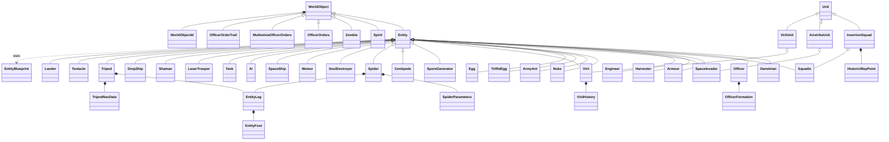

`Unit` (`code/unit.h`) is the team-owned group container described in [21](21_simulation_and_entity_model.md); `Light` is unrelated to the hierarchy (plain data) [C] `code/worldobject/worldobject.h`.

## 2 Shared conventions

These rules apply to every entity in sections 3–31. Each entity section restates only its deviations.

### 2.1 Simulation tick, game speed and timer units

| Item | Value | Ref |
|---|---|---|
| Server tick | `SERVER_ADVANCE_PERIOD` = `0.1 × m_gameSpeed` seconds of game time; ticks are issued at a fixed 10 Hz of real time by the lock-step server ([22](22_determinism_and_networking.md)) | [C] `code/gametimer.h:SERVER_ADVANCE_PERIOD`, `code/gametimer.cpp:GameTimer::GetServerAdvancePeriod` |
| Network (game) time | `GetNetworkTime()` = `g_gameTimer.GetGameTime()`, the sum of all tick lengths | [C] `code/gametimer.cpp:GameTimer::Tick` |
| Normal game speed | 1.0 → 1 tick = 0.1 s | [C] |
| Speed changes | *Slow Down Time* crate: target `0.2 + syncfrand(0.2)`; *Speed Up Time* crate: `1.3 + syncfrand(0.7)`; both ease at 5 % of the gap per tick and hold for a length counter of 15.0 decremented by 0.1 per tick (≈150 ticks); a Meteor within 200 of its target requests 0.4 (ease 10 %/tick, length 4.0 ≈ 40 ticks); afterwards the speed returns to 1.0 | [C] `code/worldobject/crate.cpp:Crate::RunSlowDownTime`, `Crate::RunSpeedUpTime`, `code/worldobject/meteor.cpp:Meteor::Advance`, `code/gametimer.cpp:GameTimer::Tick`, `GameTimer::RequestSpeedChange`; [I] the length counter is decremented once per server tick |
| Wall clock | `g_gameTime` is **wall-clock time** (`GetHighResTime()` every rendered frame), not game time; `g_advanceTime` is the real frame delta (capped 0.25 s) | [C] `code/main.cpp:UpdateAdvanceTime`, `code/main.h` (comment "Updated from GetHighResTime every frame") |
| Slicing | each 0.1 s tick is processed as `NUM_SLICES_PER_FRAME` = 10 slices; every sliced container advances one tenth of its slots per slice, so each entity/spirit advances exactly once per tick, in slot order ([21](21_simulation_and_entity_model.md)) | [C] `code/globals.h`, `code/location.cpp:Location::Advance` |

**Float countdowns.** A timer started at a whole number of seconds and decremented by 0.1 until `≤ 0` takes one tick more or less than expected because 0.1 is not exactly representable: 1.0 → 11 ticks, 2.0 → 20, 5.0 → 51, 6.0 → 61, 10.0 → 101, 15.0 → 151, 20.0 → 200, 60.0 → 600 [C] arithmetic in IEEE double (checked with a script); so an "every 1 s" unit timer (e.g. `Officer::RunAI`, `Armour::RunAI`, `Squadie::RunAI` retarget) actually fires every 1.1 s ([07](07_ai.md) uses the same 11/101/200-tick periods). A new engine should count integer ticks.

**Three kinds of timer appear in entity code, and a re-implementation must keep them apart:**

1. *Game-time timers* subtract `SERVER_ADVANCE_PERIOD` per tick (e.g. `Darwinian::m_retargetTimer`, `Spirit::m_timeSync`, all task lifetimes). They run at game speed.
2. *Per-tick constants that are pre-multiplied by game speed* (e.g. throwable gravity `9.8 × gameSpeed` per tick = 98 u/s² of game time) — equivalent to (1).
3. *Per-tick constants that ignore game speed* — they keep their **real-time** rate, so relative to game time they speed up in slow motion and slow down in fast motion [C]/[I] (arithmetic). Instances in this document: `TriffidEgg` gravity `9.8 × m_force` per tick; `Spider` pounce gravity 40 per tick; `Armour` fall `vel.y −= 5` per tick; `Officer` corpse sink `vel.y −= 20` per tick; `Centipede`/`SoulDestroyer` 50 %-per-tick retreat rolls; `ArmyAnt` per-tick bite (1 HP/tick); `Virii` bite (20 HP per tick while on target); `Lightning` 1 %/tick strike roll ([04](04_crates_powerups_and_weapons.md)); `AntHill` 30-call empty counter ([03](03_buildings_and_world_objects.md)); `SpaceShip`/`DropShip` `speed × dt²` integration; Darwinian infected 1/20-per-tick stop. A further inverted case: the burning-Darwinian damage roll `syncfrand(10) < 2.0 / gameSpeed` uses a probability that *grows* when the game slows (damage per game second ∝ 1/speed²) [C] `code/worldobject/darwinian.cpp:Darwinian::AdvanceOnFire`; the Darwinian laser roll divides its 1-in-N rate by game speed, which correctly keeps ≈1 attempt per game second [C] `Darwinian::AdvanceCombat`. Recommendation for the new game: express every rate per second of game time.

### 2.2 Random numbers

| Function | Generator | Range produced | Synchronised? | Ref |
|---|---|---|---|---|
| `syncrand()` | MT19937 Mersenne Twister seeded with `syncrandseed` | [0, 2³²) | yes | [C] `contrib/systemiv/lib/math/random_number.cpp:_syncrand` |
| `syncfrand(x)` | `_syncrand() · x / 2³²` | [0, x) | yes | [C] `random_number.cpp:_syncfrand` |
| `syncsfrand(x)` | `(_syncfrand(1) − 0.5) · x` | **(−x/2, +x/2)** — the header comment's "±x" is wrong | yes | [C] `random_number.cpp:_syncsfrand` |
| `FRAND(x)`, `SFRAND(x)` | wrapper structs that resolve to `_syncfrand`/`_syncsfrand` when passed to `Vector3` constructors, evaluated left-to-right | as above | yes | [C] `code/lib/vector3.h:FRAND`, `code/lib/vector3.cpp:FromRand` |
| `frand(x)`, `sfrand(x)`, `AppRandom()`, CRT `rand()` | local LCG (`holdrand × 214013 + 2531011`, 15-bit) | [0, x], (−x/2, x/2], [0, 32767] | **no** — render/particles/sounds only | [C] `random_number.cpp:frand`, `sfrand`, `AppRandom` |

Rule used throughout: every simulation decision consumes the synced stream in a fixed order on every peer; the unsynced generator may only feed particles, sounds and render flags. Entity code also spends synced numbers on purely cosmetic effects (spirit wobble, smoke trails, ant leg-frame choice, abduction sparks); they must be replicated or moved off the shared stream together on all peers ([22](22_determinism_and_networking.md)) [C]/[I].

### 2.3 Research levels are fixed in Multiwinia

Many weapon/unit parameters are tables indexed by `GlobalResearch::CurrentLevel(type)`. `Location::Init` (Multiplayer branch) sets every research type to **3**, then `TypeSquad = 1`, `TypeLaser = 2`, `TypeGrenade = 2`, `TypeRocket = 2`, `TypeAirStrike = 2`, `TypeDarwinian = 4` [C] `code/location.cpp:Location::Init`. Consequences used below:

| Research | MP level | Effect in this document |
|---|---|---|
| Squad | 1 | squad size `2 + level` = 3 (`Task::TargetSquad`) |
| Laser | 2 | laser life 0.6 s (`Location::FireLaser`) |
| Grenade | 2 | throw force cap 110 (`ThrowableWeapon::GetMaxForce`) |
| Rocket | 2 | rocket life 0.75 s; tank missile life 15 s |
| AirStrike | 2 | 2 bombers per airstrike marker |
| Armour | 3 | (turret-shell life table, overridden to 0.6 s in MP) |
| Officer | 3 | officer mode cycling disabled in MP anyway (§5) |
| Harvester | 3 | capacity 100 spirits |
| Engineer | 3 | capacity 25 spirits; bridge building (needs 5) impossible |
| Darwinian | 4 | every Darwinian is a *soldier* (`> 2`, shoots and fights) and *has grenades* (`> 3`) |
| all others | 3 | — |

Whether the lobby option `GAMEOPTION_GAME_RESEARCH_LEVEL` (`Multiwinia::SetGameResearch`) can override this table depends on call order (see 02-U7).

### 2.4 Stats

Each entity copies three stats from `EntityBlueprint` (§3.5) into `unsigned char m_stats[3]` = {Health, Speed, Rate} in `Entity::SetType` [C] `code/worldobject/entity.h:Entity::m_stats`, `code/worldobject/entity.cpp:Entity::SetType`. Consequences:

- Values are **truncated to integers and limited to 0–255**: InsertionSquadie RATE 0.5 → 0 per entity; Meteor speed 350 and SpaceShip speed 500 are out of range of `unsigned char` (undefined behaviour in C++; [I] MSVC x86 yields 350 mod 256 = 94 and 500 mod 256 = 244). Meteor sidesteps this by reading `EntityBlueprint::GetStat` directly; SpaceShip uses the byte value (§23).
- Health can never exceed 255 (every `ChangeHealth` clamps).
- Speed multipliers applied to the byte (`× 2` hot feet, `× 1.5` rage, `× 0.75` plague, `/ 2` plague) truncate.
- `SetType` also sets `m_reloading = syncfrand(Rate)` — a random initial reload phase. `Darwinian`'s constructor calls `SetType` and `SpawnEntities` calls it again, so each Darwinian spawn consumes two such draws [C] `code/worldobject/darwinian.cpp:Darwinian::Darwinian`, `code/location.cpp:Location::SpawnEntities`.
- Speeds are multiplied by `1 + m_difficultyLevel/10` for every type except SpaceInvader; `m_difficultyLevel` is 0 at start-up and is only overwritten by a level's `Difficulty_StartDefinition … CreatedAsDifficulty` block — none of the 57 `mp_*` maps has one (their `Difficulty basic` line is a rating string parsed into `m_difficultyRating`), so the multiplier is 1.0 in Multiwinia [C] `code/app.cpp:App::App`, `code/location.cpp:Location::Init`, `code/level_file.cpp:LevelFile::ParseDifficulty`, grep of `data/levels/mp_*.txt`.

New-game recommendation: store stats as floats per instance.

### 2.5 Spawning, ownership and containers

`Location::SpawnEntities(pos, team, unitId, type, n, vel, spread, range = −1, routeId = −1, routeWaypointId = −1)` is the single creation path for entities [C] `code/location.cpp:Location::SpawnEntities`:

1. If `team` is the Monster team (id **4**) or the Futurewinian team (id **5**) and that slot is unused, initialise it (`InitMonsterTeam` → CPU team, colour RGB(10,10,10), `m_colourId = MULTIWINIA_NUM_TEAMCOLOURS`; `InitFuturewinianTeam` → CPU team, RGB(200,200,200), `m_colourId = MULTIWINIA_NUM_TEAMCOLOURS + 1`). In Multiplayer both are also initialised in `Location::Init` [C] `code/location.cpp:Location::GetMonsterTeamId`, `GetFuturewinianTeamId`, `InitMonsterTeam`, `InitFuturewinianTeam`.
2. For each of `n` entities: `Team::NewEntity(type, unitId)` constructs the class (`Entity::NewEntity`) and stores it in the team's loose list `m_others` (`unitId = −1`) or in a `Unit`'s array; `SetType(type)`; `pos = FindValidSpawnPosition(pos, spread)` (up to 10 tries of `radius = syncfrand(spread)`, `θ = syncfrand(2π)`, accepting on-map points with terrain height > 0; on failure the original point clamped 20 inside the map edges — which may be water); `m_onGround = false`; `m_vel = vel`; `m_front = normalise(vel)` or (1,0,0) — Darwinians instead get a random horizontal front `(SFRAND(1), 0, SFRAND(1))`; ids set; `m_spawnPoint = pos`; `m_roamRange = range` (or `spread` when `range == −1`); route ids; `Begin()`; insertion into the entity grid with `m_radius`.
3. If spawned into a unit, `unit->RecalculateOffsets()`.
4. The level population cap check is commented out — caps are enforced by spawning buildings, not here ([05](05_economy_and_population.md)).

Team-level lists relevant to units [C] `code/team.cpp`:

| List | Members | Use |
|---|---|---|
| `Team::m_others` | every entity spawned with `unitId = −1` (Darwinians, Officers, Armour, Harvester, Engineer, Nuke, Meteor, SpaceShip, creatures except Centipede/Tentacle/ant units, AI) | Darwinian searches, selection, AI |
| `Team::m_units` | `InsertionSquad`, `AirstrikeUnit`, `ViriiUnit`, generic `Unit` (Centipede, AntHill ant group, Tentacle, LaserTrooper) | unit-level advance/render |
| `Team::m_specials` | ids registered in `Begin`: Officer, Armour, Harvester, Engineer (Multiwinia only), Tank, Shaman | Darwinian officer/armour search, AI special-unit loop |

Selectable entities (`IsSelectable() == true`): Darwinian (unless OperatingPort, BeingSacraficed, OnFire, InsideArmour), Officer, Armour, Harvester, Engineer, InsertionSquad (unit), Tank, Shaman; all others return false [C] `IsSelectable` in each class.

### 2.6 Damage model

`Entity::DamageType`: `DamageTypeUnresistable = 0` (default argument; "used for just killing entities outright"), `DamageTypeLaser = 1`, `DamageTypeExplosive = 2`, `DamageTypeTurretShell = 3`, `DamageTypeFire = 4`, `NumDamageTypes = 5` [C] `code/worldobject/entity.h`.

Base `Entity::ChangeHealth(amount, type)` (type ignored) [C] `code/worldobject/entity.cpp:Entity::ChangeHealth`:
```
if not dead:
    if amount < 0: sound "LoseHealth"
    if health + amount <= 0: health = 100 (reused as fade counter); dead = true; sound "Die";
                             Location::SpawnSpirit(pos, vel * 0.5, team, id)
    elif health + amount > 255: health = 255
    else: health += amount
return true          # true = "hit registered": callers then apply knock-back
```

Resistance matrix (every override in the code base; "base" = the rule above) [C] each class's `ChangeHealth`:

| Class | Laser | Explosive | TurretShell | Fire | Unresistable | Death rule | Returns |
|---|---|---|---|---|---|---|---|
| Darwinian | full | full; ×0.6 in formation (not Futurewinian) | full | full | full | base | true unless immune |
| — modifiers | booster: immune to all but Unresistable, an Explosive hit pops the booster; inside armour / being sacrificed: immune to all but Unresistable; rage ×0.75; Futurewinian ×2.0 | | | | | | |
| Officer | full | full | full | full | full | base; shield souls absorb first | true |
| Squadie | full | full | full | full | full | at ≤ 0, **no spirit**, shape explodes | **false** (no knock-back ever) |
| Armour | **immune** | full | ÷3 (integer) | full | full | at 0: `Bang(pos, 20, 50, ownTeam)`, no spirit | false for lasers, else true |
| Harvester | immune | immune | immune | immune | only while `m_vunerable` | at 0, no spirit | true |
| Engineer | **immune** | full | full | full | full | when `health + amount < 0` (strict), health 0, no spirit | false for lasers |
| SpaceInvader | immune | immune | full (1 shell kills) | immune | immune | no spirit | false unless shell |
| Nuke | (no override) base | base | base | base | base | base (never checked by its Advance) | true |
| ArmyAnt | full | full | full | full | full | base + shape explosion scaled by `m_scale`; drops carried spirit | true |
| TriffidEgg | **immune** | full | full | full | full | base + shape explosion | false for lasers |
| Egg | full | full | full | full | full | only when `health + amount < 0`; **no spirit, no sound** | true |
| Virii | (no override) base | | | | | base | true |
| SporeGenerator | **immune** | amounts ≥ −1 ignored, else full + Panic | same | same | same | base | true |
| Centipede | full | full | full | full | full | base per segment; Panic on dropping a health third | true |
| Spider | **immune** | amounts ≥ −1 ignored, else full | same | same | same | base | true |
| SoulDestroyer | **immune** | full + Panic | full + Panic | full + Panic | full + Panic | base | true |
| Meteor | (no override) base | | | | | base (nothing targets it) | true |
| SpaceShip, DropShip, Tentacle, AI | immune | immune | immune | immune | immune | never die | false |
| Tank | **immune** | full | full | full | full | no spirit, no Bang | false for lasers |
| LaserTrooper | (no override) base | | | | | base | true |
| Shaman | only while `m_vunerable` | | | | | no spirit | false when invulnerable |
| Tripod | **immune** | only while `ModeAttacking` | | | | base | false otherwise |
| Lander | base (its `ChangeHealth(int)` does not override the virtual) | | | | | base | true |

### 2.7 Explosions — `Location::Bang` and `Shockwave`

`Location::Bang(pos, R, D, teamId = −1, fromBuildingId = −1)` is used by every explosive in this document [C] `code/location.cpp:Location::Bang`:

1. Cosmetic particles: `numCores = R·D·0.01 + frand(numCores)` `TypeExplosionCore`; `numDebris = clamp(R·D·0.01, 2, 30)` `TypeExplosionDebris` (unsynced).
2. Every entity within **2R** of `pos` (any team, attacker included): `fraction = (2R − d) / R * 2` — operator precedence makes this `((2R − d)/R)·2`, clamped to [0,1] ⇒ **full damage D out to 1.5R, linear to 0 at 2R**. `ChangeHealth(−D·fraction, DamageTypeExplosive)` (int truncation).
3. If `ChangeHealth` returned true and the type is not InsertionSquadie/Officer/Shaman: knock-back `push = normalise(entity − pos)`, `push.y = D` if on ground else −1, normalised, × fraction; `m_vel += push`; `m_onGround = false` (the horizontal component is tiny — the effect is a hop).
4. Kills counted for entities that died in this call and whose team ≠ `teamId`; in Multiwinia `teams[teamId].m_teamKills += darwinianKills` (Darwinians only) when `teamId` is a real team.
5. A `Shockwave(size = R/20)` at `pos`; [B:D3D] also `g_deformEffect->AddPunch(pos, R)`.
6. Every building with centre distance < 3R takes `Damage(−D·(1 − d/3R))`.
7. Returns the kill count.

`Shockwave` (spawned by step 5) [C] `code/worldobject/weapons.cpp:Shockwave::Advance`: lives `size` seconds; ring radius `r = 35 + 40·age`; each tick, every entity (any team) with `|d − r| < 10` takes `ChangeHealth(−40·life/size, Explosive)`, except that a Darwinian instead catches fire with probability `syncfrand(4) < 0.1` (2.5 %/tick); knock-back `25·fraction` with y = 3 for grounded non-squad/officer/shaman entities. A stationary entity is inside the 20-wide band for ≈5 ticks [I].

| Explosion | R | D | Full ≤ | Zero at | Buildings < | Shockwave ring | Source |
|---|---|---|---|---|---|---|---|
| Grenade | 12.5 | 50 | 18.75 | 25 | 37.5 | 35→60 | `Grenade::Advance` |
| Airstrike bomb | 25 | 100 | 37.5 | 50 | 75 | 35→85 | `SpaceInvader::Advance` |
| Rocket | 15 | 25 | 22.5 | 30 | 45 | 35→65 | `Rocket::Explode` |
| Armour death | 20 | 50 | 30 | 40 | 60 | 35→75 | `Armour::ChangeHealth` |
| Nuke | 50 | 100 | 75 | 100 | 150 | 35→135 | `Nuke::AdvanceToTarget` |
| Meteor | 50 | 100 | 75 | 100 | 150 | 35→135 | `Meteor::Advance` |
| Plague explosion | 5 | 25 | 7.5 | 10 | 15 | 35→45 | `Darwinian::AdvanceInfection` |
| Tank missile [B:DEBUG] | 20 | 100 | 30 | 40 | 60 | 35→75 | `Missile::Explode` |
| Land mine [B:DEBUG] | 20 | 20 | 30 | 40 | 60 | 35→75 | `LandMine::Advance` |
| Lander death [B:LEGACY] | 30 | 50 | 45 | 60 | 90 | 35→95 | `Lander::Advance` |

Projectile behaviour (lasers, grenades, rockets, shells, fireballs, pulse wave) is specified in [04](04_crates_powerups_and_weapons.md); the summary used by units is in §2.12.

### 2.8 Death, corpse fade and spirit release

- **Corpse fade**: after death the health byte (set to 100) is a fade counter; `Entity::AdvanceDead` subtracts `int(40 × tick)` = 4 per tick on the ground and `int(20 × tick)` = 2 per tick airborne; the entity is removed when it reaches 0 ⇒ **2.5 s** (ground) / **5 s** (air) [C] `code/worldobject/entity.cpp:Entity::AdvanceDead`. Classes that set health 0 at death (Engineer) disappear on the next tick.
- **Spirit release**: only through base `Entity::ChangeHealth` (or classes that call it). `Location::SpawnSpirit(pos, vel, team, ownerId)` returns −1 (no spirit) for the **Monster team**; the spirit appears at `pos + (0,1,0)` with the corpse velocity × 0.5 [C] `code/location.cpp:Location::SpawnSpirit`. Spirit lifecycle: §6; economy: [05](05_economy_and_population.md).
- **Removal without a spirit** (no `ChangeHealth`): Darwinian promotion, rocket boarding, abduction, subversion conversion, Futurewinian pulse conversion, officer absorption, officer demotion, SoulDestroyer kills (spirit spawned then deleted), and every class marked "no spirit" in §2.6.

### 2.9 Shared physics and obstacle rules

| Mechanism | Rule | Ref |
|---|---|---|
| Gravity (entities) | `Entity::AdvanceInAir`: `vel.y −= 15·dt`; `pos += vel·dt`; calls `PushFromObstructions(pos)` but **discards the result**; lands when `y ≤ ground + 0.1` (vel 0, y = ground + 0.2); at `y ≤ 0` starts the water clock (`m_inWater = 0`) and zeroes velocity | [C] `code/worldobject/entity.cpp:Entity::AdvanceInAir` |
| Water | `Entity::AdvanceInWater`: `m_inWater += dt`; after **10 s** `ChangeHealth(−500)` (drown); swims toward its unit waypoint + rectangle-formation offset, then `vel.SetLength(5)` unconditionally; `y = −sin(3·t) − 4`; leaves the water when terrain under it is > 0. Darwinians override this with instant death (§4) | [C] `Entity::AdvanceInWater` |
| World clamp | `Entity::Advance` clamps x, z into [0, worldSize] every tick | [C] `Entity::Advance` |
| Building push | `Entity::PushFromObstructions(pos, killem = true)`: snap to terrain if on ground; if `y ≤ 1` spiral search (radius 0→50 step 1, angle `d·syncsfrand(1)·π`) for land > 1; then for each building in the obstruction cell: hit = shape-vs-shape (if the entity has a shape), or sphere radius 1 (sprite entities and Officers), or a ray from the previous position (anti-tunnelling). Enabled **enemy laser fence** + `killem` → `ChangeHealth(−9999)` and `LaserFence::Electrocute`; any other building → push 4 units directly away from its centre while `DoesSphereHit(result, 2)` | [C] `Entity::PushFromObstructions` |
| Darwinian override | different water/building/fence/wall rules (§4.9) | [C] `Darwinian::PushFromObstructions` |
| Teleports | `Entity::EnterTeleports(requiredId = −1)`: in the obstruction cell, a `RadarDish` that `ReadyToSend()`, entrance within **15** and the entity facing into it (`front · entranceFront < 0`), or a `Bridge` within **25** of its position with the same facing test → `EnterTeleport(id)`, sound `EnterTeleport`, returns the building id | [C] `Entity::EnterTeleports` |
| Separation / cliffs | `Entity::PushFromEachOther` (radius 2, force 0.1/d) and `Entity::PushFromCliffs` (gradient > 1.0 → spiral 0–50 step 0.2) exist but have no live caller in Multiwinia | [C] `Entity::PushFromEachOther`, `Entity::PushFromCliffs` |

Slope speed factors (all of the form `factor = 1 + (h_now − h_next)/k`, i.e. uphill slower, downhill faster):

| Class | k | Clamp | Note | Ref |
|---|---|---|---|---|
| Darwinian | 3 | [0.3, 2.0] | | [C] `Darwinian::AdvanceToTargetPosition` |
| Officer | 3 | [0.1, 2.0] | | [C] `Officer::AdvanceToTargetPosition` |
| Squadie | 3 | [0.2, 2.0] | 0 when terrain normal y < 0.6 and going uphill | [C] `Squadie::Advance` |
| Virii | 5 | [0.1, 2.0] | | [C] `Virii::AdvanceToTargetPos` |
| Centipede | 10 | [0.6, 1.0] | only uphill slows | [C] `Centipede::AdvanceToTargetPosition` |
| Shaman [B:LEGACY] | 3 | [0.1, 2.0] | | [C] `Shaman::AdvanceToTargetPosition` |

### 2.10 Team colouring conventions

| Mechanism | Rule | Ref |
|---|---|---|
| Team colour | `Team::m_colour` (lobby colour); Monster team RGB(10,10,10); Futurewinian RGB(200,200,200); team 255 = no team | [C] `code/location.cpp:Location::InitMonsterTeam`, `InitFuturewinianTeam` |
| Generic shape recolour | `Entity::SetShape(name, colourAll)` → single-player or team 255: shared unmodified shape; MP: copy cached under `"<name>_<r>_<g>_<b>_<a>"`, recoloured by `ConvertShapeColoursToTeam` applied to the root fragment and its **direct children only** | [C] `code/worldobject/entity.cpp:Entity::SetShape`, `SetupTeamShape`, `ConvertShapeColoursToTeam` |
| Fragment rule | a material colour is converted if it is "mostly red" (`r > 2g && r > 2b`) or `colourAll`; converted colour = team colour (if `colourAll`) or team colour × (sum of original RGB / sum of team RGB) (luminance-preserving tint), then × 0.7 ("3D models appear brighter"); other colours unchanged. **Asset convention: team-coloured regions are authored in red** | [C] `Entity::ConvertFragmentColours` |
| Special case | if the team's lobby colour id is 0 and the shape is `data/shapes/darwinian.shp`, the team colour is halved first | [C] `Entity::ConvertShapeColoursToTeam` |
| Whole-model tints | Armour: every fragment = team colour × 0.1 (`ConvertShapeColours`); Tank: × 0.5 (`ConvertShape`); both cached as `"<name>_<colourId>_<coopGroupPosition>"` | [C] `code/worldobject/armour.cpp:Armour::Begin`, `code/worldobject/tank.cpp:Tank::Begin` |
| Sprites/billboards | Darwinian sprite, Spirit quads, Virii strips, lasers, Nuke sprites, SporeGenerator tails, SpaceShip beam rings, harvester beam rings are drawn with the team colour as vertex colour (monster team: white or invisible variants per class) | per-class Render (see each section) |

Per-class result:

| Class | Colouring | Ref |
|---|---|---|
| Darwinian | sprite × team colour × (0.3 + 0.7·health/50) | §4.13 |
| Officer | whole `officer.shp` team-coloured (`convertAll = true`) | [C] `Officer::Begin` |
| Squadie | none — `squad.shp` fixed colours (228,214,153) and (177,88,26) | [C] `Squadie::Squadie`, `data/shapes/squad.shp` |
| Armour | whole hull team colour × 0.1 | [C] `Armour::Begin` |
| Harvester | whole `harvester.shp` team-coloured (`SetShape(…, true)`), tractor rings team colour | [C] `Harvester::Begin`, `Harvester::RenderBeam` |
| Engineer | whole `engineer.shp` team-coloured (`SetShape(…, true)`); beam fixed blue | [C] `Engineer::Begin` |
| SpaceInvader | none — `spaceinvader.shp` fixed grey (128,128,128) | [C] `SpaceInvader::SpaceInvader`, `data/shapes/spaceinvader.shp` |
| Nuke | sub and warhead sprites in team colour (monster: white subtractive) | [C] `Nuke::RenderSub`, `Nuke::Render` |
| ArmyAnt, Centipede, SoulDestroyer, Tentacle | red regions recoloured (`convertAll = false`), per-team shape caches | [C] `ArmyAnt::SetShape`, `Centipede::Begin`, `SoulDestroyer::Begin`, `Tentacle::Begin` |
| Spider, TriffidEgg | whole model team-coloured (`SetShape(…, true)`) | [C] `Spider::Begin`, `TriffidEgg::Begin` |
| SporeGenerator | body red-region only (`SetShape(…, false)`), tails team colour | [C] `SporeGenerator::Begin`, `SporeGenerator::RenderTail` |
| Virii | worm = team colour × health fraction; glow = team colour (MP); monster team white/transparent | §16 |
| Egg | sprite drawn white (team colour fetched but unused) | [C] `Egg::Render` |
| Meteor, SpaceShip, DropShip | fixed shape colours; SpaceShip beam rings team colour | [C] `Meteor::Render`, `SpaceShip::RenderBeam` |
| Tank [B:DEBUG] | body and turret team colour × 0.5 | [C] `Tank::Begin` |
| LaserTrooper, Lander [B:LEGACY] | sprite/shape tint by team colour | [C] `LaserTrooper::Render`, `Lander::Render` |

### 2.11 Sound and VFX binding conventions

- **Sounds** are raised by name: `g_app->m_soundSystem->TriggerEntityEvent(entity, "EventName")`; the sound system looks up the `ENTITY <TypeName>` section of `data/sounds.txt` and plays the samples bound to that event ([10](10_audio_design.md), [27](27_audio_engine.md)). Each class lists its events in `ListSoundEvents` (sound-editor list); the base list is `Create`, `Attack`, `LoseHealth`, `EnterTeleport`, `ExitTeleport`, `Die`, `Selected` [C] `code/worldobject/entity.cpp:Entity::ListSoundEvents`. Base triggers: `Create` in `Entity::Begin`, `LoseHealth`/`Die` in base `ChangeHealth`, `Attack` in `Entity::Attack`, `EnterTeleport` in `EnterTeleports` [C]. Looping events are cut with `StopAllSounds(id, "<Type> <Event>")`. Event names and their bindings per class are tabulated in §33.3.
- **Particles** are created with `g_app->m_particleSystem->CreateParticle(pos, vel, Particle::Type…, size, colour)`; types used by units: `TypeControlFlash`, `TypeDarwinianFire`, `TypeMissileTrail`, `TypeHotFeet`, `TypePlague`, `TypeBlueSpark`, `TypeMuzzleFlash`, `TypeBrass`, `TypeFire`, `TypeMissileFire`, `TypeRocketTrail`, `TypeExplosionCore`, `TypeExplosionDebris`, `TypeFireball` ([26](26_animation_and_vfx.md)) [C].
- **Shape shattering** on damage/death: `g_explosionManager.AddExplosion(shape, transform, fractionDead)` (fragment debris; fraction = share of polygons released) [C] `code/explosion.h` ([24](24_rendering.md)).
- **Shadows**: `Entity::RenderShadow(pos, size)` draws a `textures/glow.bmp` blob (colour (0.6,0.6,0.6,0), blend `SRC_ALPHA, ONE_MINUS_SRC_COLOR`) draped on the terrain [C] `Entity::RenderShadow`.
- **Damaged flicker**: `Entity::Advance` sets `m_renderDamaged = frand(0.75)·(1 − |sin(g_gameTime + 10·uid)|·0.8) > healthFraction` with the unsynced generator and wall clock — render-only [C] `Entity::Advance`.

### 2.12 Weapons used by units (summary; full specification in 04)

| Weapon | Fired by | Damage | Radius / falloff | Speed / life | Damage type | Friendly fire |
|---|---|---|---|---|---|---|
| Laser (generic `Entity::Attack`) | Darwinian, LaserTrooper | `20 + syncfrand(20)` → 20–39, single target; hit if 2-D point–segment distance < 5 and (MP) `|Δy| < 5`; knock-back `syncfrand(10)` along the laser, y `7 + syncfrand(5)` | — | 150 u/s × 0.6 s ⇒ ≈90 u | Laser | no (enemies of the shooter only) |
| Squad laser | Squadie | as above | — | 200 u/s × 0.6 s ⇒ 120 u | Laser | no |
| Subversion laser | Darwinian with subversion, Futurewinians | converts an enemy Darwinian (no damage) | — | 75 u/s × 1.2 s ⇒ 90 u | — | no |
| Grenade | Darwinian (grenade research > 3), Squadie | 50 | Bang R 12.5 | throw force `8·√dist` ≤ 110, 3 s fuse | Explosive | **yes** |
| Rocket | Darwinians of a team with the *Rocketwinians* evolution | 25 | Bang R 15 | 50 → ×1.2/tick (≈179 cap), 0.75 s | Explosive | yes |
| Airstrike bomb / napalm | SpaceInvader | 100 / ignite Darwinians ≤ 62.5 | Bang R 25 | 1.5 s fuse | Explosive / fire | yes |
| Contact attacks | Virii (20/tick), ArmyAnt (1/tick), Centipede (`(radius − d)·10`), SoulDestroyer (`(25 − d)·50`), Spider squash (`100·fraction` ≤ 20), Tentacle (255) | — | — | — | Unresistable (default) | per class |

[C] `code/worldobject/weapons.cpp:Laser::Advance`, `Grenade::Advance`, `Rocket::Advance`, `code/location.cpp:Location::FireLaser`, `Location::ThrowWeapon`, per-class sections.

## 3 Framework classes

The engine-level object model (containers, update order, spatial grids, routing) is specified in [21](21_simulation_and_entity_model.md); this section gives the behaviour contract every unit relies on.

### 3.1 WorldObjectId — object handle

[C] `code/worldobject/worldobject.h:WorldObjectId`, `code/worldobject/worldobject.cpp`. [B:FULL].

| Field | Type | Invalid default | Meaning |
|---|---|---|---|
| `m_teamId` | `unsigned char` | 255 | owning team slot 0–5 (`NUM_TEAMS` = 6, `code/globals.h`); 255 = none |
| `m_unitId` | `int` | −1 | index in the team's `m_units`; −1 = the team's loose `m_others` list; or a pseudo-unit code |
| `m_index` | `int` | −1 | slot index inside the selected container |
| `m_uniqueId` | `int` | −1 | serial number disambiguating re-used slots; buildings use their level-file id |

Pseudo-unit codes (`#define`): `UNIT_BUILDINGS = −100` (resolved by `Location::GetBuilding(uniqueId)`, linear scan), `UNIT_SPIRITS = −101` (`Location::GetSpirit(index)`; spirits have uniqueId −1), `UNIT_LASERS = −102` (defined, not resolved), `UNIT_EFFECTS = −103` (`Location::GetEffect`: slot then uniqueId match) [C] `code/location.cpp:Location::GetWorldObject`.

Behaviour:
- `IsValid()` ⇔ `teamId != 255 || unitId != −1 || index != −1` (uniqueId ignored); `==`/`!=` compare all four fields; `Set()` debug-asserts `teamId < 256`, `unitId < 65536`, `index < 65536` (`ID_MAXTEAMS`, `ID_MAXUNITS`, `ID_MAXTROOPS`).
- `GenerateUniqueId()`: `++s_nextUniqueId; m_uniqueId = s_nextUniqueId` (first id 1); one static counter shared by entities and effects (Zombie, OfficerOrders, MultiwiniaOfficerOrders every 2 s, OfficerOrderTrail every 0.2 s per order effect). `ResetUniqueIdSeed()` sets it to 0 before every `new Location` [C] `code/main.cpp`. Ids are therefore deterministic per match only if every peer creates the same objects in the same order — and unique ids feed gameplay (`uid % 20` worship distance, `uid % 10` fence clearance, abduction blend, formation slots, render variation) [C]/[I].
- Handles are **weak**: every dereference (`Location::GetEntity`) re-resolves team → unit → slot and returns NULL when the slot is empty or its occupant's uniqueId differs; `GetEntitySafe(id, type)` additionally checks the type [C] `code/location.cpp:Location::GetEntity`, `GetEntitySafe`.

### 3.2 WorldObject — base of all simulated objects

[C] `code/worldobject/worldobject.h:WorldObject`, `code/worldobject/worldobject.cpp`. [B:FULL].

| Member | Type | Default | Meaning |
|---|---|---|---|
| `m_id` | `WorldObjectId` | invalid | identity |
| `m_type` | `int` | 0 | `Entity::Type*`, `Building::Type*`, or `WorldObject::Effect*` (for `UNIT_EFFECTS`) |
| `m_pos`, `m_vel` | `Vector3` (double) | — | position (world units ≈ metres), velocity (units/s) |
| `m_onGround` | `bool` | false | standing on terrain |
| `m_enabled` | `bool` | true | disabled objects are frozen (`Entity::Advance` returns false at once) |

Virtuals: `bool Advance()` (default false; **true = remove and delete me**), `void Render(double predictionTime)`, `bool RenderPixelEffect(double)` (true if it drew anything), `char *LogState(char *msg)` (sync-log fingerprint `"WOBJ Type[%d] Id[%d] pos[x,y,z], vel[sum]"` using `HashDouble`, [22](22_determinism_and_networking.md)).

`BounceOffLandscape()`: intended to put the object at the midpoint of its last and current positions, but the last position term is commented out, so the impact point is the current position snapped to terrain height; velocity is reflected about the terrain normal `n`: `v' = 2(n·(−v))·n − (−v)`, then × `COEF_OF_RESTITUTION` = 0.85 (`#define`) [C] `WorldObject::BounceOffLandscape`. Used by TriffidEgg (§14) and throwables ([04](04_crates_powerups_and_weapons.md)).

`WorldObject::Effect*` enum (values in order): 0 `TypeInvalid`, 1 `EffectThrowableGrenade`, 2 `EffectThrowableAirstrikeMarker`, 3 `EffectThrowableAirstrikeBomb`, 4 `EffectThrowableControllerGrenade`, 5 `EffectGunTurretTarget`, 6 `EffectGunTurretShell`, 7 `EffectSpamInfection`, 8 `EffectBoxKite`, 9 `EffectSnow`, 10 `EffectRocket`, 11 `EffectShockwave`, 12 `EffectMuzzleFlash`, 13 `EffectOfficerOrders`, 14 `EffectOfficerOrderTrail`, 15 `EffectZombie`, 16 `EffectRandomiser`, 17 `EffectDustBall`, 18 `EffectLightning`, 19 `EffectPulseWave`, 20 `EffectFlameGrenade`, 21 `EffectTurretEmptyShell`, 22 `EffectFireball` [C] `worldobject.h`.

### 3.3 Light — level light record

`class Light` (no base) [C] `code/worldobject/worldobject.h:Light`, `code/worldobject/worldobject.cpp`. [B:FULL]. Not a simulated object: a plain record of `double m_colour[4]` (default 1.3, 1.3, 1.3, 0) and `double m_front[4]` (default (0,0,1,0); w = 0 = directional "infinitely distant" light). Methods: `SetColour(double[4])`, `SetFront(double[4])`, `SetFront(Vector3)` (w = 0), `Normalise()` (normalises xyz). Level files supply the lights (`Lights_StartDefinition`, [08](08_levels_and_level_design.md), [29](29_data_formats_reference.md)); `Location::InitLights` copies them and `Location::SetupLights` binds light *i* to `GL_LIGHT0 + i` (diffuse = specular = colour; Christmas mode replaces the colour by (1.3, 1.2, 1.2)) [C] `code/location.cpp:Location::InitLights`, `Location::SetupLights`. Lighting model: [24](24_rendering.md).

### 3.4 Entity — base class of all units

`class Entity : WorldObject` [C] `code/worldobject/entity.h:Entity`, `code/worldobject/entity.cpp`. [B:FULL].

Members:

| Member | Type | Default | Meaning |
|---|---|---|---|
| `m_formationIndex` | int | −1 | offset inside its Unit's formation (not the array index) |
| `m_buildingId` | int | −1 | building that created it (Darwinian shadows it with its own) |
| `m_spawnPoint` | Vector3 | — | creation point; `FollowRoute` overwrites it with the current waypoint |
| `m_roamRange` | double | 0 | how far it may wander from `m_spawnPoint` |
| `m_stats[3]` | **unsigned char** | 0 | Health, Speed, Rate (§2.4) |
| `m_dead` | bool | false | dying/fading (still in containers) |
| `m_justFired` | bool | false | set by `Attack` |
| `m_reloading` | double | 0 → `syncfrand(Rate)` | seconds until it may fire |
| `m_inWater` | double | −1 | −1 = dry, else seconds in water |
| `m_destroyed` | bool | false | removed outright: `Advance` returns true at once |
| `m_front`, `m_angVel` | Vector3 | — | facing (unit vector), angular velocity |
| `m_shape` | Shape* | NULL | 3-D model; NULL ⇒ sprite |
| `m_centrePos`, `m_radius` | Vector3, double | —, 0 | shape centre/radius from `Begin`; radius drives entity-grid registration |
| `m_renderDamaged` | bool | false | cosmetic flicker |
| `m_routeId`, `m_routeWayPointId` | int | −1, −1 | route being followed |
| `m_routeTriggerDistance` | double | 10.0 | waypoint reached distance |
| `m_aiTimer` | double | 0 | subclass AI timer |
| `static s_entityPopulation` | int | 0 | ++ctor/−−dtor (AI entities subtract themselves) |
| `static s_neighbours` | `std::vector<WorldObjectId>` | — | shared, non-reentrant scratch for grid queries |

Enums: `StatHealth = 0, StatSpeed, StatRate, NumStats`; `DamageType*` (§2.6); `Type*` (§1.1).

Virtual interface and contracts [C] `entity.cpp`:

| Method | Base behaviour | Contract |
|---|---|---|
| `Begin()` | sound "Create"; if `m_shape`, `m_centrePos = CalculateCentre`, `m_radius = CalculateRadius` | called once by `SpawnEntities` after ids/position are set, before grid insertion; team-coloured shapes must be set here, not in the constructor |
| `bool Advance(Unit*)` | see the sequence below | **true = remove and delete me**; `Unit::AdvanceEntities` / `Team::Advance` then remove it from the grid, otherwise `EntityGrid::UpdateObject` moves it ([21](21_simulation_and_entity_model.md)) |
| `bool AdvanceDead(Unit*)` | fade 4/tick on ground, 2/tick in air (§2.8) | |
| `void AdvanceInAir(Unit*)` / `AdvanceInWater(Unit*)` | §2.9 | |
| `void RunAI(AI*)` | nothing | called by the CPU `AI` entity for specials ([07](07_ai.md)) |
| `bool ChangeHealth(int amount, int type = Unresistable)` | §2.6 | true = hit registered (knock-back applies) |
| `void Attack(Vector3 pos)` | if `m_reloading == 0`: target ± `syncsfrand(15)` on x and z, from pos + (0,3,0), `Location::FireLaser(from, (to − from).SetLength(150), team)`, `m_reloading = Rate`, `m_justFired = true`, sound "Attack" | generic laser |
| `bool IsInView()` | true | render culling hook |
| `void SetWaypoint(Vector3)` | nothing | used by `FollowRoute` |
| `PushFromObstructions`, `PushFromCliffs`, `PushFromEachOther`, `EnterTeleports` | §2.9 | |
| `void DirectControl(TeamControls const&)` | nothing | direct-control hook (InsertionSquad) |
| `bool IsSelectable()` | false | §2.5 |
| `void ListSoundEvents(LList<char*>*)` | "Create", "Attack", "LoseHealth", "EnterTeleport", "ExitTeleport", "Die", "Selected" | sound-editor list |
| `bool RayHit(start, dir)` | shape ray test with `Matrix34(front, up, pos)`; sprites: ray–sphere radius 5 | picking and turret shells |
| `Vector3 GetCameraFocusPoint()` | `pos + vel` | camera entity tracking |
| `void FollowRoute()` | level route (SP) or routing-system route (MP); index −1 → 0; `SetWaypoint(waypoint)`; `m_spawnPoint = waypoint`; non-building waypoint within `m_routeTriggerDistance` → next; past the end → route cleared. A building waypoint (teleport) is never passed — the teleport creates a new entity that continues | Darwinian overrides (§4.8) |
| `char *LogState(msg)` | `"ENT Type[name] Id[uid] pos[...], vel[sum] front[sum]"` | sync log |
| `void SetShape(name, colourAll = false)` | §2.10 | |
| `void Render(double)` | nothing | |

Base `Entity::Advance(Unit*)` sequence [C] `Entity::Advance`:
1. `!m_enabled` → return false (frozen). `m_destroyed` → return true.
2. If `m_dead`: `AdvanceDead()`; true → return true (removed); otherwise continue.
3. `m_reloading −= dt`, clamped at 0.
4. Cosmetic `m_renderDamaged` (unsynced `frand`, wall clock) — render only.
5. `m_inWater != −1` → `AdvanceInWater(unit)`.
6. Clamp x, z into [0, worldSize].
7. In a unit and alive → `unit->UpdateEntityPosition(pos, radius)` (unit centre/radius accumulation).
8. `m_routeId != −1` → `FollowRoute()`.
9. return false.
Subclasses call it either first (Darwinian, Officer, ArmyAnt) or last (Armour, Engineer, Spider, Egg and the other classes not listed next). `SpaceInvader`, `Nuke`, `Centipede` (which calls `AdvanceDead` directly for dead segments), `Meteor`, `AI`, `DropShip`, `Tripod`, `Tentacle` and `Lander` never call it, so they get no world clamp, reload countdown, base water handling or route following from the base class [C] grep of `Entity::Advance` in each class's `.cpp`.

Static helpers: `NewEntity(type)` (class factory; `GenerateUniqueId`), `GetTypeName`/`GetTypeId`/`GetTypeNameTranslated` (§1.1), `EntityIsBlocked` (§1.1), `BeginRenderShadow`/`RenderShadow`/`EndRenderShadow` (§2.11), `ConvertShapeColoursToTeam`/`ConvertFragmentColours`/`SetupTeamShape` (§2.10).

### 3.5 EntityBlueprint — the stats.txt table

`class EntityBlueprint` (static members only) [C] `code/worldobject/entity.h:EntityBlueprint`, `code/worldobject/entity.cpp:EntityBlueprint::Initialise`, `EntityBlueprint::GetStat`. [B:FULL].

- `Initialise()` (start-up, `code/main.cpp`; again on mod change, `code/lib/resource.cpp`): opens `stats.txt` through the resource system's `TextReader` (blank and `#` lines skipped), and assigns rows **positionally**: row *k* → entity type *k*. Token 1 (name) is `strdup`ed into `m_names[k]` but never used for lookup; tokens 2–4 → `m_stats[k][Health, Speed, Rate]` via `iv_atof`. Release-asserts if more than `NumEntityTypes` rows. Grammar: [29](29_data_formats_reference.md).
- `GetStat(type, stat)`: `StatSpeed` for any type except `TypeSpaceInvader` → `value × (1 + m_difficultyLevel/10)`; otherwise the raw value (§2.4).
- `GetName(type)`: the stored name.

`data/stats.txt` (columns HLTH = health, SPED = speed "m/s", RATE = "secs to reload") [C] `data/stats.txt`:

| Row | Name in file | HLTH | SPED | RATE | Byte value / use |
|---|---|---|---|---|---|
| 0 | Invalid | 0 | 0 | 0 | — |
| 1 | LaserTroop | 20 | 15 | 1 | |
| 2 | Engineer | 255 | 28 | 0 | |
| 3 | Virii | 10 | 32 | 0 | |
| 4 | InsertionSquadie | 75 | 30 | 0.5 | RATE byte → **0**; the squad accumulator reads 0.5 from the blueprint |
| 5 | Egg | 10 | 0 | 0 | health = dormant-decay scale |
| 6 | SporeGenerator | 200 | 20 | 10 | rate unused |
| 7 | Lander | 255 | 40 | 1 | rate = landed spawn interval |
| 8 | Tripod | 155 | 20 | 1 | speed/rate unused |
| 9 | Centipede | 255 | 80 | 1 | health × 2 × segment size (cap 255) |
| 10 | SpaceInvader | 10 | 40 | 1 | speed not difficulty-scaled; cruise × 10 |
| 11 | Spider | 200 | 50 | 1 | speed unused (walks ≤ 30) |
| 12 | Darwinian | 50 | 20 | 3 | |
| 13 | Officer | 255 | 30 | 3 | rate unused |
| 14 | ArmyAnt | 20 | 25 | 0 | speed × (1 ± 0.2) per ant |
| 15 | Armour | 200 | 60 | 5 | rate unused |
| 16 | SoulDestroyer | 255 | 150 | 1 | speed overridden to 130 |
| 17 | TriffidEgg | 50 | 100 | 1 | speed/rate unused |
| 18 | AI | 255 | 255 | 255 | unused |
| 19 | Shaman | 200 | 25 | 2 | |
| 20 | Harvester | 255 | 28 | 0 | |
| 21 | Nuke | 255 | 100 | 0 | flight speed 50→100 |
| 22 | Tentacle | 255 | 100 | 0 | invulnerable |
| 23 | Meteor | 255 | **350** | 0 | byte out of range ([I] 94); code reads the blueprint value 350 |
| 24 | Tank | 150 | 50 | 2 | |
| 25 | SpaceShip | 255 | **500** | 0 | byte out of range ([I] 244), and the byte **is** used (§23) |
| 26 | DropShip | 255 | 255 | 0 | invulnerable |

## 4 Darwinian

`class Darwinian : Entity`, type `TypeDarwinian` (12) [C] `code/worldobject/darwinian.h`, `code/worldobject/darwinian.cpp`. [B:FULL]. Everything below is [C] from `darwinian.cpp` unless another reference is given.

### 4.1 Darwinian — role and acquisition

- **Role**: the population unit of every Multiwinia mode. It is never built or commanded individually: it runs its own priority task search (§4.5) and captures buildings by standing on their ports, carries statues, opens crates, raises Blitzkrieg flags, boards rockets and fights. Players steer it indirectly (§4.12).
- **Obtained by** (each calls `Location::SpawnEntities(…, TypeDarwinian, …)` with `unitId = −1`, so Darwinians live in `Team::m_others`): `SpawnPoint::SpawnDarwinian` (the spawn economy, [05](05_economy_and_population.md)); match start, one Darwinian per port of every own SpawnPoint/SolarPanel spawned directly into `StateOperatingPort` [C] `code/location.cpp:Location::InitialiseTeam`; level `InstantUnits` (269 rows in the shipped `mp_*` maps); trunk-port reinforcements [C] `code/multiwinia.cpp` (`AdvanceTrunkPorts` spawn site); crate *Extra Darwinians* ([04](04_crates_powerups_and_weapons.md)); Harvester/Engineer soul delivery (§9, §10); `TriffidEgg` `SpawnDarwinians` (§14); officer demotion (`Location::DemoteOfficer`); conversions (subversion laser, Futurewinian pulse wave §4.10, `SpamInfection`); `SpaceShip` drop (Futurewinian team, §23).
- **Spawn defaults**: `m_front` = random horizontal unit vector `(SFRAND(1), 0, SFRAND(1))` normalised [C] `code/location.cpp:Location::SpawnEntities`. Constructor synced-RNG order: `SetType` → `m_reloading = syncfrand(3)`, then `m_grenadeTimer = syncfrand(5)`, then `m_idleTimer = 60 + syncfrand(60)` [C] `Darwinian::Darwinian`. `Begin`: `Entity::Begin`; `m_onGround = true`; `m_wayPoint = m_pos`; centre (0,2,0); `m_radius = 4.0`; `m_scaleFactor` = preference `DarwinianScaleFactor`; `m_futurewinian = (team == GetFuturewinianTeamId()) || (LevelOptionFuturewinianTeam != −1 && it equals GetTeamPosition(team))` [C] `Darwinian::Begin`.

### 4.2 Darwinian — stats

| Stat | Value | Source |
|---|---|---|
| Health | 50 (byte, max 255) | [C] `data/stats.txt` row 12 |
| Speed | 20 u/s; ×0.2 in Idle/WorshipSpirit (4 u/s); ×1.75 in UnderControl (35); slope factor [0.3, 2.0] (§2.9); slowed linearly inside 10 of the waypoint | [C] `data/stats.txt`, `Darwinian::AdvanceToTargetPosition` |
| Reload (Rate) | 3 s between shots (`Entity::Attack` gate); initial phase `syncfrand(3)` | [C] `data/stats.txt`, `Entity::SetType` |
| Laser | speed 150, life 0.6 s (Laser research 2) ⇒ range ≈90; damage `20 + syncfrand(20)` (20–39); aim error ±7.5 on x and z; muzzle +3 y | [C] `code/worldobject/entity.cpp:Entity::Attack`, `code/location.cpp:Location::FireLaser`, `code/worldobject/weapons.cpp:Laser::Advance` |
| Shot attempt rate | not in formation: each tick `syncrand() % int(10 / gameSpeed) == 0` (≈1 attempt per game second; booster 7, Futurewinian 3); a shot only leaves when the 3 s reload is over ⇒ ≈1 laser per 4 s | [C] `Darwinian::AdvanceCombat` |
| Subversion laser | speed 75, life ×2 (1.2 s) ⇒ range ≈90, muzzle +2 y; converts instead of damaging | [C] `Darwinian::FireSubversion`, `Location::FireLaser` |
| Grenade | every `12 + syncfrand(8)` s while in combat (first `syncfrand(5)`), only if target > 75 away (§4.7) | [C] `Darwinian::AdvanceCombat`, `Darwinian::Darwinian` |
| Threat search range | 90 (`DARWINIAN_SEARCHRANGE_THREATS`), adaptive (§4.6) | [C] `darwinian.h` |
| Burning | −2 HP when `syncfrand(10) < 2.0/gameSpeed` on a grounded tick (20 %/tick at speed 1 ⇒ ≈4 HP/s ⇒ ≈12.5 s from full health) | [C] `Darwinian::AdvanceOnFire` |
| Drowning | instant: entering water (`y < 0`) → `ChangeHealth(−999)` next tick | [C] `Darwinian::Advance`, `Darwinian::AdvanceInWater` |
| Lifetime | unlimited | — |
| Grid radius / centre | 4.0 / (0,2,0) | [C] `Darwinian::Begin` |

In Multiwinia Darwinian research is 4 (§2.3), so **every Darwinian is a soldier** (`CurrentLevel(TypeDarwinian) > 2`: fights, may be brave) **and has grenades** (`> 3`). In single-player team 1 (red) is always soldier+grenades [B:LEGACY].

`#define` constants [C] `code/worldobject/darwinian.h`:

| Macro | Value | Use |
|---|---|---|
| `DARWINIAN_SEARCHRANGE_OFFICERS` | 100 | GOTO officers that hand out orders |
| `DARWINIAN_SEARCHRANGE_OFFICERFOLLOW` | 150 | FOLLOW officers (and legacy shamans) |
| `DARWINIAN_SEARCHRANGE_ARMOUR` | 150 | loading armour |
| `DARWINIAN_SEARCHRANGE_SPIRITS` | 50 | spirit worship (single-player only) |
| `DARWINIAN_SEARCHRANGE_THREATS` | 90 | enemy search |
| `DARWINIAN_SEARCHRANGE_GRENADES` | 60 | incoming grenades/airstrike markers |
| `DARWINIAN_SEARCHRANGE_TURRETS` | 50 | defined, unused |
| `DARWINIAN_SEARCHRANGE_PORTS` | 100 | building ports (distance minus building radius) |
| `DARWINIAN_SEARCHRANGE_CARRYABLE` | 150 | statues/carryables (minus radius) |
| `DARWINIAN_SEARCHRANGE_CRATES` | 150 | crates |
| `DARWINIAN_UNDERCONTROL_MAXPUSHRANGE` | 100 | squad mind-control focus clamp |
| `DARWINIAN_FEARRANGE` | 200 | scared Darwinians forget the threat beyond this; soldiers retreat inside 100 |
| `DARWINIAN_INFECTIONRANGE` | 30 | plague spread |
| `CRATE_SCAN_RANGE` (external) | 35.0 | crate approach ring [C] `code/worldobject/crate.h` |
| `BLITZKRIEG_FLAGCAPTURE_RANGE` (external) | 20.0 | [C] `code/worldobject/multiwiniazone.h` |

Members [C] `darwinian.h`, `Darwinian::Darwinian`:

| Member | Default | Meaning |
|---|---|---|
| `m_state` | StateIdle | state (§4.4) |
| `m_promoted` | false | set by `Location::PromoteDarwinian`; next `Advance` returns true (removed, no spirit) |
| `m_wayPoint` | = pos (`Begin`) | movement target; zero vector = "do not move" |
| `m_retargetTimer` | 0 | countdown to the next `SearchForNewTask`, reset to `1 + syncfrand(1)` |
| `m_threatId` | invalid | current threat (entity, effect or building id) |
| `m_armourId`, `m_officerId`, `m_shamanId` | invalid | armour approached/ridden; officer followed; legacy shaman |
| `m_spiritId` | −1 | worshipped spirit slot (single-player) |
| `m_buildingId` | −1 | target building (port owner, crate, zone, carryable, rocket); shadows `Entity::m_buildingId` |
| `m_portId` | −1 | port index on `m_buildingId` |
| `m_boxKiteId` | invalid | single-player worship kite effect |
| `m_spaceshipId` | invalid | abducting ship |
| `m_threatRange` | 90 | adaptive threat search radius |
| `m_scared` | **true** | flee rather than fight |
| `m_controllerId` | −1 | InsertionSquad mind-control task id |
| `m_teleportRequired` | false | unused |
| `m_underPlayerControl` | false | member of the player's current group selection |
| `m_followingPlayerOrders` | false | "current order came directly from the player; obey to the exclusion of all else" |
| `m_manuallyApproachingArmour` | false | player sent us to an armour |
| `m_idleTimer` | `60 + syncfrand(60)` | idle "go somewhere useful" timer — forced to 60 every tick in MP, so dead (§4.4) |
| `m_orders`, `m_ordersBuildingId` (−1), `m_ordersSet` (false) | — | pending GOTO destination, teleport to enter, flag |
| `m_grenadeTimer` | `syncfrand(5)` | grenade cooldown |
| `m_officerTimer` | 0 | re-target timer while following |
| `m_shadowBuildingId` | −1 | spectacle casting a shadow on us (render) |
| `m_avoidObstruction` | zero | avoidance override; never set non-zero ⇒ inert |
| `m_sacraficeTimer`, `m_targetPortal` (−1), `m_burning` (false) | — | legacy shaman sacrifice |
| `m_boosterTaskId`, `m_hotFeetTaskId`, `m_subversionTaskId`, `m_rageTaskId` | −1 | power-up task ids (re-validated every tick) |
| `m_infectionState` | Clean | {`InfectionStateClean`, `InfectionStateInfected`, `InfectionStateImmune`} |
| `m_infectionTimer` | 0 | plague event timer |
| `m_paralyzeTimer` | −1 | > 0 ⇒ cannot move |
| `m_insane` | false | plague insanity |
| `m_previousTeamId` (−1), `m_colourTimer` (−1) | — | colour cross-fade after conversion (render) |
| `m_fireDamage` | 0 | accumulated flame damage |
| `m_futurewinian` | false | Futurewinian variant (set in `Begin`) |
| `m_startedThreatSound` | false | threat-sound latch |
| `m_wallHits` | 0 | wall collisions; the CPU `AI` resets a Darwinian with > 10 wall hits to Idle [C] `code/worldobject/ai.cpp:AI::Advance` |
| `m_closestAITarget` | −1 | AI scratch |
| `m_scaleFactor` | 1.0 → pref | far-distance sprite enlargement |

### 4.3 Darwinian — per-tick pipeline (`Darwinian::Advance(Unit*)`)

1. `m_destroyed` → return true (removed, no spirit). `m_promoted` → return true.
2. `amIDead = Entity::Advance(unit)` — corpse fade if dead, reload countdown, damaged-flicker flag, base water (`m_inWater`), world clamp, `FollowRoute()` when `m_routeId != −1` (§3.4).
3. If alive, not dead, on the ground and not OnFire:
   a. `m_retargetTimer −= dt`; at ≤ 0: `SearchForNewTask()` (§4.5); if now Idle, `BeginVictoryDance()`; `m_retargetTimer = 1 + syncfrand(1)` — re-evaluation every 1–2 s.
   b. Multiplayer: `m_idleTimer = 60` every tick.
   c. State dispatch to `Advance<State>()` for Idle, ApproachingPort, OperatingPort, ApproachingArmour, InsideArmour, WorshipSpirit, UnderControl, FollowingOrders, FollowingOfficer, Combat, CapturedByAnt, WatchingSpectacle, BoardingRocket, AttackingBuilding, CarryingBuilding, FollowingShaman, OpeningCrate, RaisingFlag, ApproachingCarriableBuilding.
4. Always (airborne or dead too): BeingSacraficed → `AdvanceSacraficing`; InVortex → `AdvanceInVortex`; BeingAbducted → `AdvanceBeingAbducted`.
5. A held box kite is released when the state is not WorshipSpirit or the Darwinian is dead.
6. If `m_controllerId != −1` and alive: the controlling squad's `m_numControlledThisFrame++` (task looked up in the team task manager in MP).
7. Not on ground and not BeingSacraficed/BeingAbducted → `Entity::AdvanceInAir` (gravity 15).
8. OnFire → `AdvanceOnFire`; InWater → `AdvanceInWater` (`ChangeHealth(−999)`); infected → `AdvanceInfection` (each only if not already dead this tick).
9. `m_pos.y < 0` and not InsideArmour → state = InWater, `m_onGround = false` (dies next tick, spirit released).
10. Dead and on ground: corpse slides `vel *= 0.9; pos += vel·dt`.
11. Power-up validity: booster (`GlobalResearch::TypeBooster`), hot feet (`TypeHotFeet`; also `AdvanceHotFeet()` every tick; on expiry speed reset to the blueprint value), subversion (`TypeSubversion`), rage (`TypeRage`; speed reset on expiry) — each id is cleared unless a task with that id **and** type still exists in the team's task manager.
12. `m_paralyzeTimer` counts down to −1.
13. **Assault pulse wave**: in `GameTypeAssault`, alive, `PulseWave::s_pulseWave` exists, its team is not a friend and we are inside its radius: if the wave team's position equals `LevelOptionFuturewinianTeam` → spawn one Darwinian of the wave's team at our position/velocity and die silently (`m_dead = true`, returns true, no spirit); else `vel = away × 20`, `ChangeHealth(−1000)` (spirit released) [C] `Darwinian::Advance`; pulse bomb: [03](03_buildings_and_world_objects.md).
14. If removed while InsideArmour → `armour->RemovePassenger()`.

### 4.4 Darwinian — behaviour state machine

State enum (values = declaration order; `StateUsingJumpPad` is commented out) [C] `darwinian.h`:

| # | State | Entered by | Per-tick behaviour | Exits |
|---|---|---|---|---|
| 0 | Idle | default; most failure paths | `AdvanceToTargetPosition()` at 0.2× speed toward the wander point of `SearchForRandomPosition`. The MP "useful building" idle search (would pick a SpawnPoint/MultiwiniaZone/Crate/Statue/GunTurret/SolarPanel or an officer at 100–500 range when `m_idleTimer` expires) is **dead code** because step 3b resets the timer every tick. If `m_controllerId != −1` → UnderControl | via `SearchForNewTask` |
| 1 | ApproachingPort | `SearchForPorts` | building gone → Idle; port taken by another → Idle; calls `building->OperatePort(port, team)` every tick (capture contribution, [03](03_buildings_and_world_objects.md)); walk to the port; on arrival face the port front, vel 0 → OperatingPort | Idle / OperatingPort |
| 2 | OperatingPort | arrival; match-start fill | building gone or `GetPortOccupant(port) != me` → Idle; vel 0. In MP it searches nothing (never flees or fights) | Idle |
| 3 | ApproachingArmour | `SearchForArmour`; player group order onto an armour | armour gone, or (not `IsLoading()` and not manual), or full (`GetNumPassengers() ≥ Capacity()`), or (not manual and entrance > 150 away) → Idle; walk to the entrance (ground height); arrived or < 20 → `AddPassenger()`, InsideArmour (manual: flag cleared; an Unloading armour is switched to Idle) | Idle / InsideArmour |
| 4 | InsideArmour | arrival | armour gone/dead → ejected: `vel = (SFRAND(1), 1, SFRAND(1))` length `20 + syncfrand(20)`, airborne, **state OnFire**. Else `pos/vel = armour`; if `IsUnloading()` and terrain under the entrance > 0 → `RemovePassenger()`, exit direction rotated `syncsfrand(π/2)` (±45°), `vel = dir × 10`, `vel.y = 5 + syncfrand(10)`, pos = entrance, airborne, `m_ordersSet = false`, Idle; if unloading over water: neither exits nor registers (see §8.6); otherwise `RegisterPassenger()`. Invulnerable to all but Unresistable damage, not rendered, not selectable | Idle / OnFire |
| 5 | WorshipSpirit | `SearchForSpirits` (single-player) [B:LEGACY] | MP: immediately Idle. SP: stand `20 + uid%20` from the spirit, face it, hold a BoxKite | Idle |
| 6 | UnderControl | `TakeControl(task)` (squad controller grenade, [B:LEGACY] in MP) | controller task/unit gone → `LoseControl()`. Every `0.5 + syncfrand(0.5)` s: target = squad centre + (focus − centre) clamped to 100; unwalkable → Idle; else waypoint = target + disc `syncfrand(numControlled)`. Moves at 1.75× speed | Idle |
| 7 | FollowingOrders | `GiveOrders`; `SearchForOfficers` (GOTO handout or pending orders) | `AdvanceToTargetPosition`; with `m_ordersBuildingId` set, try `EnterTeleports(id)` (success → `m_underPlayerControl = false`, counts as arrived). On arrival with a pending teleport: teleport not connected → forget it; else wiggle (entrance + disc 10). Otherwise on arrival → Idle, retarget 0, `m_ordersSet = m_followingPlayerOrders = false`. Route following via `FollowRoute` (§4.8) | Idle |
| 8 | FollowingOfficer | `SearchForOfficers` (FOLLOW officer) | officer gone/dead/not `OrderFollow` → Idle; officer in formation, `FormationFull()` and we are not in it → Idle. Every 5 s: unwalkable to the officer → follow it into its last teleport if any (`m_ordersBuildingId = officer.m_ordersBuildingId`, waypoint = entrance) else Idle; walkable → waypoint = officer + disc 40. In formation: `RegisterWithFormation(uid)` and waypoint = `GetFormationPosition(uid)` every tick; arrived → face the officer's front | Idle |
| 9 | Combat | `SearchForThreats` success; plague insanity | §4.7 | FollowingOfficer (officer valid) / Idle |
| 10 | CapturedByAnt | `ArmyAnt` capture (`AntCapture`) — live via the Ant Nest crate | ant gone/dead → Idle; else pos/vel = the ant's carry marker; killed at the hill (§13) | Idle / death |
| 11 | BoardingRocket | `FuelStation`/`EscapeRocket` call `BoardRocket` (Rocket Riot) | building must be a FuelStation that `IsLoading()` and whose linked EscapeRocket has < 100 passengers, else Idle; walk to `GetEntrance()`; on arrival `BoardRocket(id)` true → **removed (no spirit)** | Idle / removed |
| 12 | WatchingSpectacle | `WatchSpectacle` (GodDish [B:LEGACY], EscapeRocket launch) | EscapeRocket: `!IsSpectacle()` → Idle; keep ≥ 100 (MP; SP 200) away — if closer, waypoint = rocket + away × (min + `syncfrand(min/2)`); on arrival face the rocket's centre plus a wobble `(sin g_gameTime·30, cos g_gameTime·20, sin g_gameTime·25)` — **wall-clock time feeds `m_front`** (desync hazard, 02-U3) | Idle |
| 13 | AttackingBuilding | `EscapeRocket` (`AttackBuilding`); the 1/500 ant-nest search (§4.6) | building gone (SP: or not an EscapeRocket) → Idle; waypoint = building + away × (100 + `syncfrand(50)`); within 200 → `ThrowWeapon(pos, building + (0,50,0), grenade, team 1)` (team id hard-coded to **1**) → Idle | Idle |
| 14 | OnFire | `SetFire()` (laser fence, flame weapons via `FireDamage`, lightning, burning trees, shockwave 2.5 %, armour destruction) | waypoint = pos + (SFRAND(100), 0, SFRAND(100)) every tick (±50, panicked running at full speed, only when grounded); fire particles; damage as §4.2. **No exit** | death |
| 15 | InWater | `pos.y < 0` | `ChangeHealth(−999)` (spirit released) | death |
| 16 | ApproachingCarriableBuilding | `SearchForCarryableBuilding` (MP) | carryable gone → Idle; now owned by our team → CarryingBuilding; waypoint > 60 from it → carryable + 30 rotated `syncfrand(2π)`; arrived → `SearchForRandomPosition` (mill around) | Idle / CarryingBuilding |
| 17 | CarryingBuilding | above | carryable gone or not ours → Idle; target = `GetCarryPosition(uid)` (zero → Idle); lifting if arrived or within `20 × gameSpeed × speed/blueprintSpeed`; lifting → `m_numLiftersThisFrame++`; sounds with period `f = 15 + int((1 − min(1, numLifters/maxLifters))·20)` sequence ids: `seq % f == 0` → "LiftBuilding", `== f/2` → "GivenOrdersFromPlayer". `GiveOrders` while carrying is forwarded to the carryable (`SetWaypoint(target, route)`; WallBuster always direct) | Idle |
| 18 | WatchingGodDish | never assigned anywhere | listed only in `SearchForNewTask` | — |
| 19 | FollowingShaman | `SearchForShamans` — call commented out ⇒ unreachable [B:LEGACY] | like FollowingOfficer | Idle |
| 20 | BeingSacraficed | `Sacrafice()` by a Shaman [B:LEGACY] | rise then orbit the portal; after 10 s → spirit (`Spirit::StateShaman`) + Zombie, removed | removed |
| 21 | OpeningCrate | `SearchForCrates` | crate gone → Idle; walk to the scatter point; on arrival face the crate; within 1.1 × 35 emit team-coloured `TypeBlueSpark` particles. Capture progress is computed by the Crate from nearby Darwinians ([04](04_crates_powerups_and_weapons.md)) | Idle |
| 22 | InVortex | `Location::AdvanceDustWind`: grounded Darwinians within 50 of the vortex ground point | spiral up: speed `max(100·y/1000, 30)`, orbit radius `300·y/1000`, angle = network time + uid × 20, target height `min(y + 50, 500 + 5·(uid % 100))`; vortex ends → Idle with `vel.SetLength(50)` (flung, then falls) | Idle |
| 23 | BeingAbducted | `SpaceShip` (`Abduct`) | airborne; while the ship exists and is `ShipStateAbducting`: `vel = lerp(vel, toShip × (2·speed) + (horizontal toward ship × |shipVel|) + tangent × 50, k)` with `k = dt·0.25 + (uid mod 10)·0.1·dt`; 50 % chance per tick (synced roll) of a blue spark; within 20 or above the ship → `ship->IncreaseAbductees()`, **removed (no spirit)**; ship gone/not abducting → Idle | removed / Idle |
| 24 | RaisingFlag | `SearchForFlags` (Blitzkrieg) | zone must be a MultiwiniaZone not ours and not `m_blitzkriegLocked`, else Idle; walk; on arrival face it (capture computed by the zone, [01](01_game_modes.md)) | Idle |

Resolved: P03 tagged `StateCapturedByAnt` [B:LEGACY] ("ArmyAnt blocked") while P05 treated ants as live; the code shows `AntHill::SpawnAnt` creates ArmyAnts at runtime from the Ant Nest crate and `ArmyAnt::AdvanceCollectEntity` calls `Darwinian::AntCapture` [C] `code/worldobject/anthill.cpp:AntHill::SpawnAnt`, `code/worldobject/armyant.cpp:ArmyAnt::AdvanceCollectEntity` — the state is live in FULL.

```mermaid
stateDiagram-v2
    [*] --> Idle
    Idle --> Combat: SearchForThreats
    Idle --> ApproachingPort: SearchForPorts
    Idle --> ApproachingCarriableBuilding: SearchForCarryableBuilding
    Idle --> OpeningCrate: SearchForCrates
    Idle --> ApproachingArmour: SearchForArmour or player order
    Idle --> RaisingFlag: SearchForFlags in Blitzkrieg
    Idle --> FollowingOfficer: FOLLOW officer within 150
    Idle --> FollowingOrders: GOTO officer within 100, pending orders, GiveOrders
    Idle --> UnderControl: controller set
    ApproachingPort --> OperatingPort: arrived
    ApproachingPort --> Idle: port taken or building gone
    OperatingPort --> Idle: displaced
    ApproachingArmour --> InsideArmour: arrived or within 20
    ApproachingArmour --> Idle: armour gone, full, not loading, too far
    InsideArmour --> Idle: unloaded over land
    InsideArmour --> OnFire: armour destroyed
    FollowingOrders --> Idle: arrived or teleported
    FollowingOrders --> Combat: threat
    FollowingOfficer --> Idle: officer lost, not FOLLOW, formation full
    FollowingOfficer --> Combat: threat
    Combat --> FollowingOfficer: threat gone and officer valid
    Combat --> Idle: threat gone
    ApproachingCarriableBuilding --> CarryingBuilding: carryable now ours
    CarryingBuilding --> Idle: carryable lost
    OpeningCrate --> Idle: crate gone
    RaisingFlag --> Idle: zone ours, locked or gone
    UnderControl --> Idle: control lost or unwalkable
    WatchingSpectacle --> Idle: spectacle over
    AttackingBuilding --> Idle: grenade thrown
    Idle --> CapturedByAnt: ArmyAnt capture
    CapturedByAnt --> Idle: ant died
    CapturedByAnt --> [*]: killed at the ant hill
    BoardingRocket --> [*]: boarded, removed
    Idle --> BeingAbducted: SpaceShip beam
    BeingAbducted --> [*]: abducted, removed
    BeingAbducted --> Idle: ship gone
    Idle --> InVortex: dust-ball vortex
    InVortex --> Idle: vortex ends
    Idle --> OnFire: SetFire
    Combat --> OnFire: SetFire
    OnFire --> [*]: dies, spirit
    Idle --> InWater: y below 0
    InWater --> [*]: dies, spirit
```

External calls can move a Darwinian from any non-armour state into OnFire, InWater, InVortex, BeingAbducted, BoardingRocket, WatchingSpectacle or AttackingBuilding; edges are drawn from Idle/Combat for readability.

### 4.5 Darwinian — task search (`SearchForNewTask`, every 1–2 s, grounded, not burning)

Pre-checks: Idle with `m_controllerId != −1` → UnderControl. If `m_followingPlayerOrders` and state ≠ Idle → only `SearchForThreats()`.

| Current state | Searches in priority order (first success wins) |
|---|---|
| Idle | Threats → Ports → CarryableBuilding (MP) → Crates → Armour → Flags (Blitzkrieg only) → Officers → Spirits (SP only) → RandomPosition (always "succeeds") |
| WorshipSpirit, WatchingSpectacle | Threats → Ports → CarryableBuilding → Armour → Officers |
| ApproachingArmour, FollowingOrders, FollowingOfficer | Threats → Ports → CarryableBuilding |
| OperatingPort | Threats only in single-player; **none in MP** |
| ApproachingPort, WatchingGodDish, OpeningCrate, UnderControl, Combat, ApproachingCarriableBuilding | Threats |
| BoardingRocket, OnFire, CarryingBuilding, InsideArmour, CapturedByAnt, AttackingBuilding, InWater, FollowingShaman, BeingSacraficed, InVortex, BeingAbducted, RaisingFlag | none |

Search rules [C] `darwinian.cpp:Search*`:

| Search | Rule |
|---|---|
| `SearchForPorts` | buildings with ports and `(distance − radius) < 100`, not all ports occupied, `IsWalkable(pos, building)`; a random pick (`syncrand`) is drawn but then overridden by the **nearest** candidate; on it, a port that is unoccupied and whose `GetPortOperatorCount(port, team)` < limit (SP 20, **MP 1**), chosen by `syncrand`. Waypoint = port position. |
| `SearchForCarryableBuilding` (MP) | carryables (`CarryableBuilding::IsCarryableBuilding`) with `(distance − radius) < 150`, skipping ones already ours with `numLifters ≥ maxLifters`; random pick (`syncrand`). |
| `SearchForCrates` | first (building-list order) `Crate` with `m_onGround`, < 150 away and walkable. Waypoint: stay if < 35; else a point `35/3 + syncfrand(70/3)` from the crate toward us plus a random offset ≤ 35/3. |
| `SearchForArmour` | (SP: not red team) own `m_specials` Armour alive, ≤ 150, `IsLoading()`; random pick (`syncrand`). |
| `SearchForFlags` (Blitzkrieg) | first non-own, unlocked `MultiwiniaZone` with distance < `zone->m_size`; waypoint = stay if < 20, else zone ± `SFRAND(20)` (±10). |
| `SearchForOfficers` | (SP: not red team) pending `m_ordersSet` → resume FollowingOrders (waypoint = `m_orders` or the current route waypoint, ±20 disc). Else over the team's `m_specials`: FOLLOW officers within 150 whose formation is not full → the nearest is chosen first and, if `IsWalkable(pos, officer, cliffs)`, → FollowingOfficer (`m_officerTimer = 5`, waypoint officer ± 40); otherwise GOTO officers within 100 → one picked by `syncrand() % n`: copy `m_orderPosition`, `m_orderRouteId` (waypoint index reset) and `m_ordersBuildingId`; waypoint = orders ± 20 → FollowingOrders, sound "GivenOrders". This is the **officer-as-signpost** mechanic: a GOTO officer redirects every idle Darwinian that passes within 100. |
| `SearchForSpirits` | single-player only (MP returns before consuming RNG). |
| `SearchForRandomPosition` | 70 % (`syncfrand(1) < 0.7`): waypoint 20 away at angle `syncsfrand(2π)`, pushed from obstructions; always returns true. |
| `BeginVictoryDance` | team 0 only, grounded, `syncfrand(5) < 1`, y > 10 and all `m_levelFile->m_primaryObjectives` true → hop `vel.y += 15 + syncfrand(15)`, sound "VictoryJump". MP levels declare `NeverTrue` objectives (and `LevelFile::GenerateAutomaticObjectives` inserts one) ⇒ never fires, but team-0 Idle Darwinians still consume one `syncfrand(5)` per re-target [B:LEGACY] [C] `code/level_file.cpp`, `data/levels/mp_koth_2P_1.txt`. |

### 4.6 Darwinian — targeting (`SearchForThreats`)

Executed in order; the first match returns:

1. `m_threatRange = 90·dt + m_threatRange·(1 − dt)` (relaxes back toward 90 by `SERVER_ADVANCE_PERIOD` per call; calls happen every 1–2 s). In formation `m_threatRange = 90`.
2. Approaching a **GunTurret** port, or CarryingBuilding → return false (task has absolute priority).
3. **Projectile threats** (skipped while `HasRage()`): nearest effect within 60 of type `EffectThrowableGrenade` or `EffectThrowableAirstrikeMarker` (**any team, including our own**), single-player enemy `EffectGunTurretTarget`, enemy `EffectSpamInfection` → state Combat, `m_scared = true`, sound "SeenThreatRunAway" if the threat id changed.
4. **Burning trees**: any `Tree` with `IsOnFire()` within `2 × GetBurnRange()` → Combat, threat = tree, scared, sound; pending orders cancelled (prevents re-entering the fire).
5. With probability 1/500 (`syncrand() % 500 == 0`, consumed on every search that reaches this point): an enemy `AntHill`/`Triffid` in our obstruction cell within range → `AttackBuilding(id)` — **bug**: passes the loop index in the cell list, not the building id, so the attack targets whatever building has that unique id [C].
6. **AITarget census shortcut** (not in formation): for each `AITarget` building within its `GetRange()` of us, if `m_enemyCount[myTeam] == 0` → return false (no enemies nearby according to the AI census, [07](07_ai.md)).
7. Range adjustments: OperatingPort → range × 0.5, and 0 if the port belongs to a GunTurret. Formation → search centre shifted `officer.front × range × 0.66` ahead. Squad-controlled → centre = pos + (focus − pos) clamped to 30, range 90.
8. If `EntityGrid::AreEnemiesPresent(centre, range)` (cell-capacity over-approximation): candidates from `EntityGridCache::GetEnemies(centre, range)` (entries up to 1 s old; the cached list is **not** re-range-checked, [21](21_simulation_and_entity_model.md)). Filter: alive; not a burning Darwinian; not a Darwinian being sacrificed; not `TypeEgg`, `TypeHarvester`, `TypeEngineer`; Armour only if `GetSpeed() < 15` (moving armour is ignored). Count `numEnemies`; pick the nearest to **our position**.
9. Threat found → Combat. `m_scared`: non-soldier → true; soldier → `numEnemies > 5 && !AreFriendsPresent(pos, range)`; forced false when squad-controlled or boosted; forced **true** when the threat is a SporeGenerator, Tripod, Spider, SoulDestroyer, TriffidEgg, InsertionSquadie, Armour or SpaceInvader. New threat id and the latch `m_startedThreatSound` clear → sound "SeenThreatRunAway" (scared) or "SeenThreatAttack" (brave); brave also plays "SeenThreatAttackHorn" when unsynced `frand(200) < 1` and ≥ 4 s game time since the last horn of *any* Darwinian (function-static). If `m_ordersSet`, within 50 of the order point and not player orders → `m_ordersSet = false`. `m_threatRange = distance to threat`.
10. Otherwise clear `m_threatId`, stop the "Darwinian SeenThreat" sounds, return false.

Consequences for designers: Darwinians flee from **all** grenades and airstrike markers including their own team's; they ignore Harvesters, Engineers and Eggs; they always run from heavy units (Armour, squads, Spiders, SoulDestroyers, bombers) rather than fight them, but still grenade them (§4.7).

### 4.7 Darwinian — combat (`AdvanceCombat`)

- Insane and no threat → `GetBestEnemy(pos, 0, 90, team 255)`; team 255 has no friends, so **every** team including our own is a candidate.
- Threat resolved through `GetWorldObject` (entity, effect or building). Missing or dead → FollowingOfficer if `m_officerId` valid else Idle; `m_retargetTimer = 0`; threat sound stopped. A gun-turret target effect farther than 90 (60 × 1.5) → same exit.
- Booster → `m_scared = false`. In formation → `officer->RegisterWithFormation(uid)`.
- **Movement**:
  - In formation: waypoint = `officer->GetFormationPosition(uid)` (holds formation even against grenades).
  - Soldier and not scared: if distance < 100, not squad-controlled and not more than 25 below the threat (`heightDiff > −25`) → **retreat** to pos + 30 × away-direction rotated `syncsfrand(π/2)` (±45°); else **close in**: waypoint = pos + (threat − pos) rotated ±45° with length `dist − (20 + syncfrand(20))` (stand 20–40 off). Net effect: soldiers hover at roughly 100 from targets that are level with them and close to 20–40 when they are on high ground.
  - Scared: beyond 200 → `m_scared = false`, forget the threat; **flee** to pos + 30 × away rotated ±45°.
  - Waypoints pass through `PushFromObstructions` (killem = true) and are snapped to the ground, then `AdvanceToTargetPosition`.
- **Shooting** (threat is an entity, soldiers only): `attackRate = 10` (booster 7, Futurewinian 3) `/ gameSpeed`.
  - In formation: volley schedule — `idx = GetFormationIndex(uid)`, `size = min(90, formationEntities.Size())`, `t = gameTime × 10`; fire when `int(fmodf(t + idx, size/4)) == 0` (rage: also when `int(fmod(t + idx, size/16)) == 0`). Single-precision `fmodf` on synced time.
  - Not in formation: fire when `attackRate ≥ 1 && syncrand() % int(attackRate) == 0`; rage → every tick.
  - Fire = `FireSubversion(threat + (0,2,0))` with the subversion power-up or as a Futurewinian, else `Attack(threat + (0,2,0))`; rage adds `syncsfrand(60)` (±30) to x and z and clears `m_reloading` after the shot ⇒ **10 lasers per second** while raging. `Attack`/`FireSubversion` only shoot when `m_reloading == 0` (3 s).
- **Grenades / rockets**: allowed if Darwinian research > 3 (MP: yes) and not in formation, no subversion, not Futurewinian, and not (Multiwinia Tutorial 2 before `m_tutorial2AICanSpawn`). `m_grenadeTimer −= dt`; at ≤ 0 → reset to `12 + syncfrand(8)`; if distance > 75 (or insane): (SP team 0: abort if any team-2 entity within 50 of the target); require our and the target's terrain normal `.y > 0.7` and `heightDiff > −50`; then
  - "grenade-worthy" targets (SporeGenerator, Spider, TriffidEgg, InsertionSquadie, Armour, Tank) → throw if the target is < 40 above its ground;
  - other targets → throw if `GetNumEnemies(target, 50) > 5 && GetNumFriends(target, 50) < 2` (cell-square counts, not range-filtered);
  - insane → always; SpaceShip target → never.
  - Throw = `Location::FireRocket(pos, target + (0,10,0) [insane: ±2 jitter], team, −1, −1, infected)` if `team->m_evolutions[Team::EvolutionRockets] == 1` (crate *Rocketwinians*, `Crate::RunRocketDarwinians`), else `Location::ThrowWeapon(pos, target, EffectThrowableGrenade, team)` [C] `code/location.cpp:Location::FireRocket`, `Location::ThrowWeapon`.

### 4.8 Darwinian — movement, routes and orders

`AdvanceToTargetPosition()` (returns "arrived"):
1. Paralysed or waypoint = zero → false, no movement.
2. Infected: 1/20 per tick (`syncrand() % 20 == 0`) stop dead (vel 0, waypoint = pos) and return true.
3. Horizontal distance `d`: `d == 0` → vel 0, true; `d < 1` → snap to the waypoint, `vel = Δ/dt`, false (arrival reported next tick).
4. `speed = m_stats[Speed]`; ×0.2 Idle/WorshipSpirit; ×1.75 UnderControl.
5. Turn: `dir = normalise(front·(1 − 0.4) + toTarget·0.4)` (blend `dt × 4`).
6. Slope factor §2.9 (k = 3, [0.3, 2.0]); arrival slow-down `d < 10` → × d/10.
7. `newPos = PushFromObstructions(pos + dir·speed·dt)`; displacement clamped to `speed·dt`; `vel = Δ/dt`; `front = normalise(Δ)`. (`PushFromCliffs` is commented out.)

`FollowRoute()` (FollowingOrders/FollowingOfficer only; MP routes come from the routing system, [21](21_simulation_and_entity_model.md)): first call jumps to waypoint 1 (0 is the start); then advances when within 20 of `m_wayPoint`; each new waypoint gets a ±40 disc jitter (`syncfrand` radius and angle) and `PushFromObstructions(·, false)`; past the last waypoint the route is cleared and `m_wayPoint` keeps the last jittered point [C] `Darwinian::FollowRoute`.

`GiveOrders(target, routeId = −1)`: `m_orders = target`, `m_ordersSet = true`, `m_ordersBuildingId = −1`; while CarryingBuilding the order is forwarded to the carryable (WallBuster always with a direct route) and the state is unchanged; if a RadarDish/Bridge stands within 5 of the target (its position) → `m_ordersBuildingId` = it and `m_orders` = its entrance (no jitter); else waypoint = target + disc `syncfrand(20)`, pushed (killem = false). `m_routeId = routeId`, waypoint index −1, state FollowingOrders [C] `Darwinian::GiveOrders`. Callers: `Location::IssueDarwinianOrders` (player), `AI::Advance` and AI officer logic (`code/worldobject/ai.cpp`), instant units with `StateFollowingOrders`.

### 4.9 Darwinian — terrain and obstacles (`Darwinian::PushFromObstructions(pos, killem = true)`)

- Editor mode → unchanged. On ground → y = terrain.
- **Water**: if `y ≤ 1`: `pushAngle = syncsfrand(1)`; spiral radius 40, 45, …, 95, angle `d·pushAngle·π`; the first point with height > 1 is taken (Darwinians never path into the sea voluntarily; falling/being flung into it kills them).
- **Buildings in the obstruction cell**:
  - Enabled **enemy** `LaserFence`: `closest = 5 + uid % 10`. If the fence sphere-hits the **current** position (radius 1) and `killem` → `SetFire()` + `Electrocute(pos)` (Darwinians burn rather than die instantly; every other entity dies, §2.9). Else if it hits the candidate within `closest` → push perpendicular to the fence line (`(next − this) × up`, sign from the cross product with the to-centre vector) in 20-unit steps until clear. Friendly fences are passed through.
  - `Wall`: hit within 4 → push 5 units along ±`wall.front` (sign = side of the wall we are on) until no hit at radius 1; `m_wallHits++`.
  - Any other building within 30: push 4 units directly away from its centre (flattened) while `DoesSphereHit(result, 2.0)`, re-snapping y each step.
- `m_avoidObstruction` override (inert).
- Callers pass `killem = false` when computing waypoints for orders and routes (planning through a fence does not ignite).
All push loops are unbounded `while` loops [C].

### 4.10 Darwinian — damage, status effects and power-ups

`Darwinian::ChangeHealth(amount, type)`, evaluated in order:
1. InsideArmour or BeingSacraficed and type ≠ Unresistable → return false (immune).
2. Booster and type ≠ Unresistable → immune; an **Explosive** hit also consumes the booster (`m_boosterTaskId = −1`). Returns false.
3. In formation (not Futurewinian) and Explosive → `amount × 0.6` (int truncation).
4. Rage → × 0.75. Futurewinian → × 2.0.
5. `Entity::ChangeHealth(amount)` (type not forwarded) → death at ≤ 0 with spirit (§2.6).

`IsInvincible(againstExplosions)`: InsideArmour‖BeingSacraficed; when not against explosions also booster (queried by weapons, [04](04_crates_powerups_and_weapons.md)). `FireDamage(amount, teamId)` (flame weapons): `m_fireDamage += amount`; once ≥ 100 → `SetFire()` and the attacking team's `m_teamKills++` — on **every** later call too (kill over-count) [C]. `SetFire()`: ignored when InsideArmour, BeingSacraficed, boosted or on the Monster team; else state OnFire.

| Effect | Granted by | Mechanics |
|---|---|---|
| Booster (personal shield) | crate task `TypeBooster` (30 s task life) → `SetBooster(task)` | immune to all but Unresistable; one explosive hit pops it; never scared; attack-rate divisor 7; cannot be set on fire; bubble render; refused while InsideArmour |
| Hot Feet | crate task `TypeHotFeet` (30 s) → `GiveHotFeet` | speed ×2 if current/blueprint < 3.5 (20→40→80); every tick fire-trail particles and `Tree::Damage(−1.0)` on trees within 2 (sets forests alight); speed reset on expiry |
| Rage | crate task `TypeRage` (30 s) → `GiveRage`; **also every Darwinian while `Location::m_bitzkreigTimer > 0`** (Blitzkrieg crate, `HasRage`) | speed ×1.5 if ratio < 3 (20→30→45→67); damage taken ×0.75; ignores grenade/marker fear; fires every tick with ±30 scatter and no reload; denser formation volleys; size-pulsing render |
| Subversion | crate task `TypeSubversion` (30 s) → `GiveMindControl` | fires subversion lasers that **convert** enemy Darwinians (`Laser::Advance`: new Darwinian of the shooter's team, victim `m_destroyed`, no spirit); no grenades; brainwave render; the converted Darwinian cross-fades from the old team colour over 4 s (`m_colourTimer = 4`) |
| Plague | crate *Plague* → `Infect()` on Darwinians within 70 ([04](04_crates_powerups_and_weapons.md)); spread by the infected | Clean → Infected: timer `syncfrand(10)`, speed ×0.75. Every `5 + syncfrand(5)` s: each live Darwinian (any team) within 30 is infected with 50 % (`syncrand() % 2`); then one roll `syncrand() % 20`: 0 → `Bang(pos, 5, 25)` + `ChangeHealth(−100)`; 1 → `ChangeHealth(−100)`; 2 → speed / 2; 3 → paralysed `5 + syncfrand(10)` s; 4 → insane + Combat; 5–6 → Immune (speed restored, no longer contagious); 7–19 → nothing. Movement: 1/20 per tick random stop. Rockets fired while infected carry `m_firework` (spiral) |
| Insane | plague roll 4 | targets anyone (team-255 search); always throws grenades/rockets regardless of range and terrain (±2 rocket jitter) |
| Paralysed | plague roll 3 | no movement; grey render (150,150,150) |
| Futurewinian | team = Futurewinian team (5) or the level option `FuturewinianTeam` | subversion lasers at attack rate 3; double damage taken; no grenades; formation explosive reduction not applied; Futurewinian sprite + glow; in Assault their pulse wave converts enemies (§4.3 step 13) |

[C] `Darwinian::SetBooster`, `GiveHotFeet`, `GiveRage`, `GiveMindControl`, `Infect`, `AdvanceInfection`, `HasRage`, `code/taskmanager.cpp:Task::Start` (30 s power-up life).

### 4.11 Darwinian — death and spirit

| Cause | Spirit? | Path |
|---|---|---|
| Health ≤ 0 via any `ChangeHealth` (lasers, fire, drowning, plague, explosions, pulse wave in the non-Futurewinian case, ant capture at the hill) | **yes** — `SpawnSpirit(pos, vel × 0.5, team, id)` (none for the Monster team) | corpse fades 2.5 s (ground) / 5 s (air) then removed |
| Promoted to Officer | no | removed next tick |
| Boarded a rocket | no | removed; counted by the rocket |
| Abducted | no | removed; `SpaceShip::IncreaseAbductees` |
| Converted by a subversion laser or `SpamInfection` | no | `m_destroyed`; a new Darwinian of the converter's team is spawned |
| Converted by the Futurewinian pulse wave | no | `m_dead = true`, removed |
| Killed by a SoulDestroyer | spirit spawned then **deleted**; a Zombie appears | §21 |
| Sacrificed by a Shaman [B:LEGACY] | yes (`StateShaman`) | |

### 4.12 Darwinian — player control model

Darwinians accept no per-unit commands. Influence channels (input bindings in [06](06_player_control_and_input.md)):

| Channel | Mechanism | Ref |
|---|---|---|
| **Group selection** | `NET_DARWINIA_SELECTDGS` → `Location::SelectDarwinians(team, pos, radius)`: every own Darwinian within the circle (entity grid) that is not OperatingPort, BeingSacraficed, OnFire or InsideArmour gets `m_underPlayerControl = true` (+ "Selected" for the local team); `Team::Advance` counts them and their centroid each slice 0 | [C] `code/location.cpp:Location::SelectDarwinians`, `code/team.cpp:Team::Advance`, `code/network/clienttoserver.cpp` |
| **Group order** | `NET_DARWINIA_ORDERDGS` → `Location::IssueDarwinianOrders(team, pos, directRoute)`: a connected RadarDish whose radius contains the click captures the target; the selected Darwinians' centroid is routed to `pos` (`GenerateRoute`, highlighted locally); if a friendly Armour with free capacity is within 30 of the target every selected Darwinian → ApproachingArmour (`m_manuallyApproachingArmour`, an Unloading armour is set Idle); otherwise each gets `GiveOrders(target, routeId)` + `m_followingPlayerOrders = true`; sound "GivenOrdersFromPlayer" | [C] `Location::IssueDarwinianOrders` |
| **Selection clearing** | `Team::SelectUnit(…)` clears `m_underPlayerControl` on every Darwinian of the team whenever `m_numDarwiniansSelected > 0` (any selection change); entering a teleport also clears it. Resolved: P03-U1 asked where the flag is cleared; `code/team.cpp:Team::SelectUnit` is the site | [C] `code/team.cpp:Team::SelectUnit`, `Darwinian::AdvanceFollowingOrders` |
| **Promotion** | `NET_DARWINIA_PROMOTE` on a Darwinian → `Location::PromoteDarwinian` (refused if burning) creates an Officer and selects it; the same command on an Officer demotes it | [C] `code/network/clienttoserver.cpp`, `code/location.cpp:Location::PromoteDarwinian` |
| **Officers** | GOTO signpost within 100, FOLLOW within 150, formations (§5) | [C] `Darwinian::SearchForOfficers` |
| **Armour** | loading/unloading (§8) | [C] |
| **Crate power-ups** | booster, hot feet, rage, subversion applied to Darwinians near the targeted point ([04](04_crates_powerups_and_weapons.md)) | [C] `code/taskmanager.cpp` |

`Location::PromoteDarwinian` casts the entity at the requested index to `Darwinian` without a type check; the input code only sends Darwinian indices, but a crafted command naming another entity type would corrupt memory [C] `code/location.cpp:Location::PromoteDarwinian` (robustness item for the new engine: validate type server-side).

### 4.13 Darwinian — team colouring, rendering and VFX

Render-only (`Darwinian::Render`; pipeline in [24](24_rendering.md)) [C]:
- Camera-facing sprite of half-width 3.0 and height 6, ×(1 + 0.03·((index·uid) mod 10)) per-individual variation; beyond 100 from the camera `size *= 1 + DarwinianScaleFactor·(camDist − 100)/1000`, and beyond 300 it progressively faces the camera (blend `(camDist − 300)/1000`). Oriented by the terrain normal and `m_front`; airborne Darwinians tumble (rotation ∝ accurate time × (uid % 10) × 0.1); worshipping/operating/watching/crate states sway ±0.3 rad.
- Colour = team colour × (0.3 + 0.7·health/50); after a conversion the colour lerps from the previous team over `m_colourTimer` (4 s, decremented by prediction time — render mutates this member); dead: colour × 0.2 at alpha `2.5·health`, drawn as 3 drifting fragments; paralysed (150,150,150).
- Textures: `sprites/darwinian.bmp`; `sprites/darwinian_ouch4.bmp` (burning, and the Monster team); `sprites/darwinian_ouch1.bmp`–`darwinian_ouch3.bmp` (30 % of airborne corpses); `sprites/darwinian_side.bmp` (edge-on view when |front × toCamera| > 0.95); `sprites/futurewinian.bmp`; `sprites/santahat.bmp` (Christmas mode: team 0 or MP, uid % 3 == 0); `sprites/brainwaves.bmp` (subversion); `textures/glow.bmp` (Futurewinian/plague); `textures/bubble.bmp` (booster); `textures/laser.bmp` (crate capture beam).
- Overlays: local-team selection/control glow (additive blue, pulsing ≥ 0.3), rage glow, plague bubble (90,130,10), booster bubble (team colour), spectacle shadows (GodDish/EscapeRocket; render clears `m_shadowBuildingId` when the spectacle ends), ground blob shadow (alpha 150 × detail, Monster × 0.3) within 2000 of the camera.
- Particles (unsynced RNG): `TypeControlFlash` (control/promotion), `TypeDarwinianFire` + `TypeMissileTrail` (burning, power-up grant bursts × 20), `TypeHotFeet`, `TypePlague` (infected, CRT `rand() % 2`), `TypeBlueSpark` (crate capture, abduction — the abduction spark roll uses the **synced** RNG).

### 4.14 Darwinian — sounds

[C] `Darwinian::ListSoundEvents`, `Entity::ListSoundEvents`, trigger sites in `darwinian.cpp`, `code/location.cpp`:

| Event | Trigger |
|---|---|
| Create | `Entity::Begin` |
| Attack | laser or subversion shot |
| LoseHealth | any damage |
| EnterTeleport | `EnterTeleports` success |
| ExitTeleport | listed; raised by teleports ([03](03_buildings_and_world_objects.md)) |
| Die | death |
| Selected | `Location::SelectDarwinians` (local team only) |
| SeenThreatAttack | brave reaction to a new threat |
| SeenThreatAttackHorn | rare: unsynced 1/200, global 4 s cooldown |
| SeenThreatRunAway | scared reaction, incoming grenade/marker, burning tree |
| TakenControl / EscapedControl | squad mind control start/end (stops "Darwinian TakenControl") |
| GivenOrders | GOTO officer handout |
| GivenOrdersFromPlayer | player group order; also alternating with LiftBuilding while carrying |
| VictoryJump | single-player victory dance |
| OnFire | burning (unsynced 1/30 per tick) |
| LiftBuilding | carrying a statue/carryable |

"Darwinian SeenThreat" sounds are stopped when the threat ends.

## 5 Officer

`class Officer : Entity`, type `TypeOfficer` (13) [C] `code/worldobject/officer.h`, `code/worldobject/officer.cpp`. [B:FULL] — listed in `EntityIsBlocked` (no level placement) but fully live, created at runtime by promotion.

### 5.1 Officer — role and acquisition

- **Role**: a promoted Darwinian that acts as a **signpost / rally banner**. It never fights (except through the legacy shield) and never gives commands to individual Darwinians; Darwinians decide for themselves to obey it (§4.5 `SearchForOfficers`): a **GOTO** officer redirects every idle Darwinian passing within 100 toward its order point (along a routing-system route); a **FOLLOW/formation** officer gathers up to 90 Darwinians within 150 into a marching block.
- **Obtained by**: the player promotes a Darwinian (input → `ClientToServer::RequestPromoteDarwinian` → command `NET_DARWINIA_PROMOTE` → `Location::PromoteDarwinian(team, entityIndex)`): refused if the Darwinian is burning; spawns an Officer at its position/velocity, control-flash particles (unsynced), marks the Darwinian `m_promoted` (removed next tick, no spirit), registers an officer marker for the local team (`MarkerSystem::RegisterMarker_Officer`), and the handler selects the new officer (`Team::SelectUnit(−1, officerIndex, −1)`) [C] `code/network/clienttoserver.cpp`, `code/location.cpp:Location::PromoteDarwinian`. The same command on an Officer **demotes** it: `Location::DemoteOfficer` sets `m_demoted` (removed on its next `Advance`, no spirit), spawns one Darwinian of the same team at its position/velocity and the handler clears the selection [C] `Location::DemoteOfficer`. The CPU `AI` promotes Darwinians itself ([07](07_ai.md)). `Task::Promote` is the Darwinia task-based path [B:LEGACY] [C] `code/taskmanager.cpp:Task::Promote`.
- **Container**: `Team::m_others`; registered in `Team::m_specials` in `Begin`, unregistered in the destructor [C] `Officer::Begin`, `Officer::~Officer`.

### 5.2 Officer — stats

| Stat | Value | Ref |
|---|---|---|
| Health | 255 | [C] `data/stats.txt` row 13 (applied by `SpawnEntities → SetType`; the constructor only sets `m_type`) |
| Speed | 30 u/s; ×0.2 when Idle; ×0.4 in formation; slowed linearly inside 10; slope factor [0.1, 2.0] | [C] `Officer::AdvanceToTargetPosition` |
| Rate | 3 (unused — officers do not shoot) | [C] `data/stats.txt` |
| Arrival threshold | 10 (formation mode: 3) | [C] `Officer::AdvanceToTargetPosition` |
| Turn blend per tick | walking `dt × 6` (0.6); in formation `dt × 0.6` (0.06); formation pre-turn `dt × 0.6`; order facing `dt × 3` (formation × 0.2); AI facing `dt × 0.6` | [C] `Officer::AdvanceToTargetPosition`, `AdvanceToTargetPositionInFormation`, `AdvanceGivingOrders`, `Advance` |
| `OFFICER_ATTACKRANGE` / `OFFICER_ABSORBRANGE` | 10 / 10 (legacy shield) | [C] `officer.h` |
| Grid radius / centre | shape radius × 2; centre + 1 up | [C] `Officer::Begin` |
| Drowning | ≈5 s (water handled twice per tick, see §5.4) | [C] `Officer::Advance` |
| Formation size | max 90 members (`Team::m_evolutions[EvolutionFormationSize]` = 90 from the `Team` constructor; the crate that would raise it to 200 is commented out) | [C] `code/team.cpp:Team::Team`, `code/worldobject/crate.cpp:Crate::RunFormtationIncrease` |
| Lifetime | unlimited | — |

Members [C] `officer.h`, `Officer::Officer`:

| Member | Default | Meaning |
|---|---|---|
| `m_state` | StateIdle | {`StateIdle`, `StateToWaypoint`, `StateGivingOrders`} |
| `m_orders` | OrderNone | {`OrderNone = 0`, `OrderPrepareGoto = 1`, `OrderGoto = 2`, `OrderFollow = 3`, `NumOrderTypes`}; `GetOrderType` names "None", "PrepareGoto", "Goto", "Follow" |
| `m_wayPoint` | pos (`Begin`) | where the officer itself walks |
| `m_wayPointTeleportId` | −1 | teleport to enter at the waypoint |
| `m_targetFront`, `m_turnToTarget` | zero, false | AI facing target (never reset to zero once set) |
| `m_shield` | 0 | absorbed souls orbiting (legacy absorb) |
| `m_demoted` | false | `Advance` returns `amIDead ‖ m_demoted` |
| `m_absorb`, `m_absorbTimer` (2.0) | false | legacy absorb mode |
| `m_noFormations` | false | disables formation toggling (set true by the CPU AI for some officers, [07](07_ai.md)) |
| `m_orderPosition` | — | GOTO destination handed to Darwinians; in formation the facing target |
| `m_ordersBuildingId` | −1 | teleport at the destination, also the teleport the officer last used (followers use it) |
| `m_orderRouteId` | −1 | routing-system route for the GOTO order |
| `m_lastOrdersSet`, `m_lastOrderCreated` | 0 | debounce (written only on the local team's peer), order-effect cadence |
| `m_formation` | false | formation mode |
| `m_formationEntities` | empty `DArray<OfficerFormation>` | slots (§5.6) |
| `m_formationAngleSet` | false | formation has finished turning toward its waypoint |
| `m_flagMarker` | — | shape marker "MarkerFlag" (release-assert if missing) |
| `m_flag` | `Flag`, size 20 | cloth banner (`code/worldobject/flag.h`, [26](26_animation_and_vfx.md)) |

### 5.3 Officer — behaviour state machine

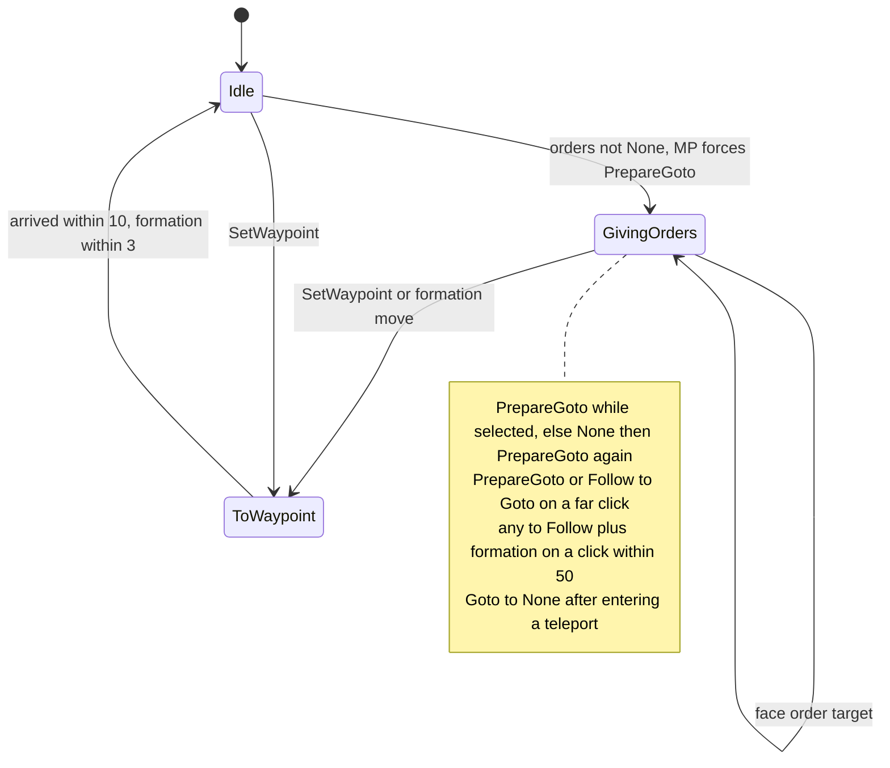

Order state machine (the officer's `m_orders`, independent of `m_state`):

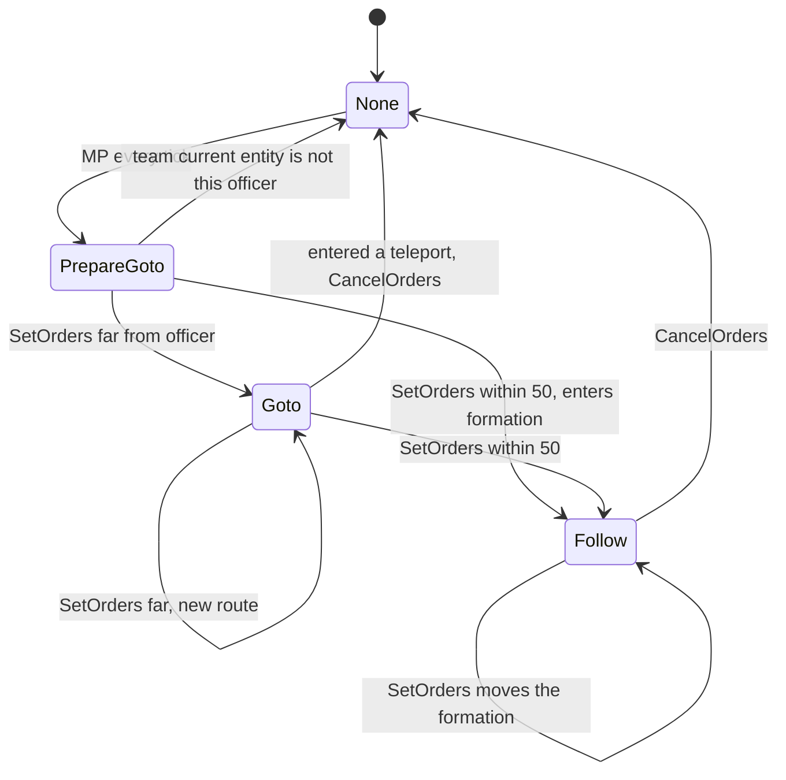

### 5.4 Officer — per-tick pipeline (`Officer::Advance`)

1. Not on ground → `AdvanceInAir`. `Entity::Advance` (which already runs `AdvanceInWater` when `m_inWater != −1`), then `AdvanceInWater` is called **again** ⇒ officers drown after ≈5 s instead of 10. On ground and alive → y snapped to terrain.
2. **MP: `OrderNone` is replaced by `OrderPrepareGoto` every tick.**
3. Alive, on ground, not in water — state dispatch:
   - `AdvanceIdle`: orders ≠ None → GivingOrders; vel 0.
   - `AdvanceToWaypoint`: formation mode and `!m_formationAngleSet` → `AdvanceToTargetPositionInFormation` (turn in place until `|targetDir × front| < 0.1`, no movement); else `AdvanceToTargetPosition`. While `m_formation`: `m_orderPosition = pos + front × 100`. Arrived → Idle.
   - `AdvanceGivingOrders`: Goto → face `m_orderPosition` (MP: face route waypoint 1); PrepareGoto → if the team's `m_currentEntityId` is no longer this officer → OrderNone (and step 2 sets PrepareGoto again next tick); Follow with `m_orderPosition ≠ 0` → turn toward it until `front·dir > 0.99`, then clear it. vel 0.
4. Dead → `vel.y −= 20` per tick, sinks while `AdvanceDead` fades.
5. **Order visualisation** while `OrderGoto`: SP 5 %/tick (`syncfrand(1) < 0.05`) spawns an `OfficerOrders` effect; MP every 2.0 s of network time spawns a `MultiwiniaOfficerOrders` effect at pos + 2 up with the order position and route (§5.8). Both are registered in `m_effects` with `GenerateUniqueId`.
6. `m_absorb` → `Absorb()` (legacy, §5.10).
7. **Formation upkeep** (`m_formation`): each slot's timer −= dt; expired slots are removed. Members refresh their slot by `+dt` per tick via `RegisterWithFormation` (slots start at 5.0 s), so a member that stops registering drops out within 5 s. A gap counter accumulates `(run length − 1)` over every run of empty slots; if it exceeds half the array size the whole array is emptied (members re-join next tick with new indices) [C].
8. **Shield attack** (`m_shield > 0`): `GetBestEnemy(pos, 0, 10)` → `ChangeHealth(−10)`, `m_shield−−`, spawn a spirit (team **0**, invalid owner) flying from the victim to the officer, at most one per tick.
9. Teleports: `m_wayPointTeleportId` set and `EnterTeleports(id)` succeeds → `m_ordersBuildingId = id`, waypoint = exit + exitFront × 30, Goto → None.
10. `m_targetFront` facing (AI) when not walking.
11. **MP route upkeep** for Goto: if the officer is > 50 from its route's first waypoint, regenerate `GenerateRoute(pos, route end)` (the old route is not deleted) and highlight it for the local team.

### 5.5 Officer — orders and formation API (player control)

| Method | Behaviour |
|---|---|
| `SetWaypoint(wp)` | walk there (StateToWaypoint); in formation mode re-arm the turn-first behaviour (unless wp ≈ pos); a connected RadarDish/Bridge within 5 → enter it |
| `IsFormationToggle(click)` | true iff not Tutorial 1, not `m_noFormations`, no RadarDish entrance within √5 of the click (`IsThereATeleportClose`) and the click is < **50** from the officer — *clicking close to the officer toggles formation* |
| `SetOrders(target, directRoute)` | SP and unwalkable → ignored. Already in formation mode → move the formation: target = click (or a 1-unit step toward it for a toggle click) → `SetWaypoint`, `SetFormation`, deselect. Toggle click not yet in formation → MP: `SetWaypoint(pos + dir)` + `SetFormation(pos + dir)`; SP: research Officer > 2 → OrderFollow (0.3 s debounce). Otherwise **GOTO**: `m_orderPosition = target`, OrderGoto, absorb/formation off, `m_orderRouteId = GenerateRoute(pos, target, directRoute)` (highlighted for the local team); a RadarDish entrance within √5 → `m_ordersBuildingId` and order point = entrance, else order point = `PushFromObstructions(point)`; sound "SetOrderGoto"; MP deselects. **The officer itself does not walk on a GOTO order** — it stays and redirects passers-by |
| `SetFormation(target)` | no-op in Tutorial 1; first time: `m_orderPosition = 0`, face the target; already in formation: `m_orderPosition = target`. Sets OrderFollow, `m_formation = true`, re-arms turning. Local team: preview route (`GenerateRoute(pos, target, true)` — a local-only route, see 02-U8) and two `TypeMuzzleFlash` (size 40) particles at each of the 90 slot positions; sound "SetOrderFormation" |
| `CancelOrders()` | None, formation off, waypoint = pos |
| `SetFollowMode()` | research Officer > 2 → Follow |
| `SetNextMode`/`SetPreviousMode` | **return immediately in MP**; SP cycles by `TypeOfficer` research (0–2: None only; 3: None → Goto → Follow → None; 4: None → Follow → Follow+absorb → None) with a function-static 0.3 s debounce. `GetNextMode`/`GetPreviousMode` are query forms (the level-4 branch of `GetNextMode` mutates `m_absorb`/`m_orders` — bug) [B:LEGACY] |
| `FormationFull()` | SP → always true (formations disabled); Tutorial 1 → true; else `(used slots) ≥ m_evolutions[EvolutionFormationSize]` (90) |
| `GetFormationPosition(uid)` | existing slot index, or (if not full) a new slot `{uid, 5.0}` in the first free index; full → zero vector |
| `GetFormationPositionFromIndex(pos, idx, front, arraySize)` | `rowSize` by array size (incl. gaps): ≤ 24 → 6; 25–47 → 9; 48–89 → 12; 90–199 → 15; ≥ 200 → 25. `col = idx % rowSize`, `row = idx / rowSize`, spacing 6 × 6: `pos + front·(6·row + 12) + right·(6·col − 3·rowSize)`, y = terrain, `right = normalise(front × up)`. **The block forms in front of the officer**, first rank 12 ahead, roughly centred laterally, growing forward |
| `RegisterWithFormation(uid)` | slot timer += dt |
| `IsInFormationMode()` | `m_orders == OrderFollow && m_formation` |
| `IsInFormation(uid)` | uid occupies a slot |

Network entry points [C] `code/network/clienttoserver.cpp`: `NET_DARWINIA_ORDERGOTO` with `FORCEONLYMOVE` → `SetWaypoint(pos)` (move the officer itself), without → `SetOrders(pos, directRoute)`; `NET_DARWINIA_PROMOTE` (promote/demote); `NET_DARWINIA_NEXTWEAPON/PREVWEAPON` → `SetNextMode/SetPreviousMode` (no-ops in MP); `NET_DARWINIA_TOGGLEENTITY` (officer branch re-selects the officer). Bindings: [06](06_player_control_and_input.md).

Effects of formation membership on Darwinians (§4): explosive damage × 0.6, no grenades, volley fire, threat search centred 0.66 × 90 ahead of the officer at the full 90 range (members hold position — formations are weak from behind), waypoint pinned to the slot.

### 5.6 OfficerFormation — formation slot

`class OfficerFormation { int m_entityUniqueId; double m_timer; }` [C] `code/worldobject/officer.h:OfficerFormation`. [B:FULL]. One element of `Officer::m_formationEntities` (a `DArray`, so slots keep their index and may have gaps). Created by `Officer::GetFormationPosition` with `m_timer = 5.0`; refreshed `+dt` per tick by `RegisterWithFormation` from the member's `AdvanceFollowingOfficer`/`AdvanceCombat`; decremented `−dt` per tick by `Officer::Advance` and removed at ≤ 0; the whole array is cleared by the gap rule (§5.4 step 7). The slot index is the member's formation position and its volley phase (§4.7).

### 5.7 Officer — CPU AI hook (`Officer::RunAI(AI*)`)

Called by the team's `AI` entity for every special ([07](07_ai.md)). Every 1 s (`m_aiTimer`):
- OrderGoto: next think in 10 s; `FindNearestTarget(pos)` → `FindTargetBuilding(target, team)`; if the chosen AITarget is > 60 from the current order point → new order at target + random offset radius `20 + syncfrand(20)`, angle `syncfrand(2π)` (radar-target AITargets: the RadarDish entrance in that cell) → `SetOrders`. Return.
- Otherwise ensure formation (`SetFormation(pos + front × 50)` if not). If > 10 enemies within 270 (3 × 90): stop (`SetWaypoint(pos)`) and face their centroid. If walking, return. Nearest AITarget `t`: if `t->IsImportant()`: walk to it if > 20 away; if `t->NeedsDefending(team)` → hold and face along (t − enemy-owned neighbour); else face the first neighbour. If not holding and `FormationFull()`: choose the nearest walkable AITarget that is enemy-owned, or important and neutral → `GetBuilding(id)` with **the array index instead of the unique id (bug)** → `SetWaypoint` [C] `Officer::RunAI`.

### 5.8 OfficerOrders, MultiwiniaOfficerOrders, OfficerOrderTrail — order effects

All three are `WorldObject`s in `Location::m_effects` with team = the officer's team [C] `code/worldobject/officer.cpp`.

| Class | `m_type` | Build | Behaviour |
|---|---|---|---|
| `OfficerOrders` | `EffectOfficerOrders` | [B:LEGACY] (single-player cadence) | travels at `clamp(1.1·|v|, 30, 150)` along the ground (+2) toward `m_wayPoint`; local team: `TypeMuzzleFlash` trail particles (size 30, team colour); arrives when the next step overshoots or within 10; fades 1 s (`m_arrivedTimer`); render `textures/starburst.bmp` size 15. `Location::IssueDarwinianOrders` and `Officer::SetOrders` also run a stack copy to completion (≤ 1000 steps) to draw an instant single-player preview line |
| `MultiwiniaOfficerOrders` | `EffectOfficerOrders` | [B:FULL] | follows the officer's route (`FollowRoute`: start at waypoint 1, advance within 10, y = terrain) at `clamp(|v|·(1 + dt), 30, 100)`; every 0.2 s of game time drops an `OfficerOrderTrail` (for every team — only rendering is restricted); arrives when the route ends; fades 1 s; rendered for friends of the local team |
| `OfficerOrderTrail` | `EffectOfficerOrderTrail` | [B:FULL] | ground-aligned arrow `icons/widearrow.bmp` at pos − 1 up, `m_front` = carrier velocity, `m_right = front × terrainNormal`; size `max(5, 20·camDist/2000)`, alpha `0.6·(1 − age)`; removed 1 s after `m_birthTime`; rendered for the local team only |

Because these effects are simulation objects that call `GenerateUniqueId` on every peer, their creation cadence is part of the deterministic state (§3.1) [C]/[I].

### 5.9 Officer — damage and death

`Officer::ChangeHealth`: when hit with `m_shield > 0`: `loss = min(shield × 10, −amount)`; spawn `ceil(loss/10)` free spirits (team 0, horizontal velocity `SFRAND(40)` per axis), `shield = int(shield − loss/10)`, `amount += loss`. Then base `ChangeHealth` (255 HP, **spirit on death**). On death `g_explosionManager.AddExplosion(shape, transform)` (shape shatters) and the corpse sinks (§5.4 step 4). Not pushed by `Bang` or shockwaves (excluded types, §2.7) [C] `Officer::ChangeHealth`, `code/location.cpp:Location::Bang`.

Terrain/obstacles: walks with `Entity::PushFromObstructions` (sprite-style sphere test radius 1 because `TypeOfficer` is special-cased; enemy laser fences kill it outright) and the slope factor of §2.9; enters teleports at its waypoint [C] `code/worldobject/entity.cpp:Entity::PushFromObstructions`, `Officer::Advance`.

### 5.10 Officer — legacy absorb and shield [B:LEGACY]

`Absorb()`: nearest friendly live Darwinian within 10; first after 2 s, then every 1 s it is `m_destroyed` (no spirit) and `m_shield++`. Absorb mode is reachable only through the research-level-4 mode cycle, which is single-player only (`SetNextMode` returns at once in MP) [C] `Officer::Absorb`, `Officer::SetNextMode`; [I] unreachable in MP. Shield souls render as green (100,250,100) quads orbiting 10 above (`RenderSpirit`: quads 0.5/1.5 and `textures/glow.bmp` 10).

### 5.11 Officer — team colouring, rendering, sounds

- Shape `officer.shp`; MP per-team copy `officer.shp_<colourId>_<coopGroupPosition>` recoloured with `ConvertShapeColoursToTeam(…, convertAll = true)` — the whole model is team-coloured. Distance scaling and camera-facing like Darwinians (`DarwinianScaleFactor`); damaged flicker (unsynced `frand`); `RenderPixelEffect` only in SP [C] `Officer::Begin`, `Officer::RenderShape`.
- Flag at "MarkerFlag", size 20 (MP grows with distance `1 + scale·(d − 100)/1500`, camera-facing by d/200); wobbles while orders ≠ None; textures `icons/banner_none.bmp` (None/PrepareGoto/Goto), `icons/banner_follow.bmp`, `icons/banner_formation.bmp`, `icons/banner_absorb.bmp`; a Goto flag points at the order position (MP: route waypoint 1). The local team's flags are drawn by `code/markersystem.cpp`, others by `Officer::Render` [C] `Officer::RenderFlag`.
- `CalculateBoundingSphere`: centre + 4 y, radius 8 (scaled with distance) — used for picking [C].
- Sounds: base list + "SetOrderNone", "SetOrderGoto", "SetOrderFollow", "SetOrderAbsorb", "SetOrderFormation"; `CancelOrderSounds` stops all five [C] `Officer::ListSoundEvents`, `Officer::CancelOrderSounds`.

## 6 Spirit

`class Spirit : WorldObject` [C] `code/worldobject/spirit.h`, `code/worldobject/spirit.cpp`. [B:FULL]. Not an `Entity`: spirits are stored **by value** in `Location::m_spirits` (`FastDArray<Spirit>`, initial size 100, step 100), advanced in slices like entities; ids are `(team, UNIT_SPIRITS, index, −1)` [C] `code/location.cpp:Location::Location`, `Location::SpawnSpirit`. `spirit.cpp` `#undef`s `TRACK_SYNC_RAND`, so spirit RNG calls are never sync-logged even in debug builds [C].

### 6.1 Spirit — role and acquisition

- **Role**: the soul released when an entity dies. In Multiwinia free spirits are a **harvestable resource**: a Harvester or an Engineer (both live crate units) collects them and converts each into one Darwinian at a friendly spawn point (§9, §10). Creatures also use them (Virii ferry them into Eggs, Centipedes eat them, ants carry them home, SoulDestroyers delete their victims' spirits). Uncollected spirits ascend and vanish. Economy view: [05](05_economy_and_population.md).
- **Created by** `Location::SpawnSpirit(pos, vel, team, ownerId)`: returns −1 (no spirit) for the Monster team; otherwise takes the next free slot, `pos = pos + (0,1,0)`, `vel` as given (deaths pass the corpse velocity × 0.5), `m_teamId = team`, `m_worldObjectId = ownerId` (the dead entity's id, used by `Location::GetSpirit(WorldObjectId)`), then `Begin()` [C] `code/location.cpp:Location::SpawnSpirit`.
- **Producers** [C] grep `SpawnSpirit(`: `Entity::ChangeHealth` (every base death), `Officer` (shield loss, shield attack — team 0, invalid owner), `Darwinian` (legacy sacrifice), `AntHill` destruction (ants + stored spirits — but hills belong to the Monster team, so `SpawnSpirit` returns −1 and none appear, [03](03_buildings_and_world_objects.md)), `SporeGenerator` (pre-fertilised eggs), `Tree` ([03](03_buildings_and_world_objects.md)), `TriffidEgg` `SpawnSpirits` (unused by crate masks), `Location` (Engineer running-program restore; one other site), cheat window [B:DEBUG].

### 6.2 Spirit — members

| Member | Default | Meaning |
|---|---|---|
| `m_teamId` | 255 | owning team (render colour); never checked by collectors |
| `m_state` | StateUnknown | §6.3 |
| `m_worldObjectId` | — | id of the entity that died |
| `m_nearbyEggs[SPIRIT_MAXNEARBYEGGS = 8]`, `m_numNearbyEggs`, `m_eggSearchTimer` | 0 | egg cache: `NumNearbyEggs()` re-searches every 3 s of network time for dormant on-ground Eggs within `VIRII_MAXSEARCHRANGE` (60) |
| `m_broken` | −1 | seconds since the soul was "broken" (`BreakSpirit()`, no caller in the code base) |
| `m_harvesterId` | — | harvester holding it |
| `m_timeSync` | 6.0 (`Begin`) | state timer (counts down) |
| `m_hover` | — | wobble velocity |
| `m_positionOffset` | `syncfrand(10)` | wobble phase |
| `m_xaxisRate`, `m_yaxisRate`, `m_zaxisRate` | `syncfrand(2)` each | wobble amplitudes (random walk in [0, 2]) |
| `m_groundHeight` | terrain at spawn | floor (not updated as it drifts) |
| `m_pushFromBuildings` | true | push out of buildings until clear |
| `m_shellPos` | — | outer shell position when broken |

### 6.3 Spirit — states

| # | State | Behaviour in `Advance` |
|---|---|---|
| 0 | StateUnknown | constructed, before `Begin` |
| 1 | StateBirth | rise: `hover.y = max(hover.y, syncfrand(0.5))`; if > 10 above its ground height: `hover.y = (−10 − syncfrand(10))·min(h/100, 1)` (pulled back down); else when `m_timeSync ≤ 0` (6 s) → Floating with `m_timeSync = 120 + syncsfrand(60)` (90–150 s), **÷3 in MP (30–50 s)** |
| 2 | StateFloating | wobble; collectable (Harvester, Engineer, ants, Virii, Centipede, SpamInfection); timer expiry → Death with `m_timeSync = 180` (**÷2 in MP = 90 s**); single-player also `AddToGlobalWorld()` |
| 3 | StateAttached | held by a collector (Engineer, ArmyAnt, Virii): no timer/wobble, no floor clamp (`CollectorArrives` → Attached + sound "PickedUp"; `CollectorDrops` → Floating, building push re-enabled, new ground height, velocity and hover zeroed) |
| 4 | StateInStore | in a SpiritStore [B:LEGACY]: timer and wobble run but nothing ever expires it; no building push |
| 5 | StateInEgg | fertilising an Egg (`InEgg`; `EggDestroyed` → Floating): no timer/wobble/floor |
| 6 | StateDeath | ascend: `hover.y = max(hover.y, 2 + syncfrand(2))` (2–4 u/s); at `m_timeSync ≤ 0` → **removed** (`Advance` returns true); no building push |
| 7 | StateShaman | used by a shaman [B:LEGACY]: excluded from the timer/wobble block (the inner `StateShaman` case that zeroes the timer is therefore unreachable) |
| 8 | StateHarvested | being drawn up by a Harvester (`Harvest(id)`, hover zeroed): no timer/wobble; the Harvester moves it |
| 9 | StateCollected | in a harvester's collector: no timer/wobble; `vel = harvester.vel`; harvester gone → Floating |

```mermaid
stateDiagram-v2
    [*] --> Birth: SpawnSpirit on a death
    Birth --> Floating: 6 s and at most 10 above ground
    Floating --> Death: 30-50 s in MP, 90-150 s in SP
    Floating --> Harvested: Harvester::Harvest
    Harvested --> Collected: reaches the collector
    Collected --> Floating: harvester gone
    Collected --> [*]: delivered, new Darwinian
    Floating --> Attached: CollectorArrives by Engineer, ArmyAnt or Virii
    Attached --> Floating: CollectorDrops
    Attached --> [*]: stored in an ant hill or put in an egg
    Floating --> InEgg: Egg::Fertilise
    InEgg --> Floating: EggDestroyed
    InEgg --> [*]: egg hatches
    Floating --> [*]: eaten by Centipede, deleted by SpamInfection or SoulDestroyer
    Floating --> Shaman: SetShamanMode, legacy
    Death --> [*]: 90 s in MP, 180 s in SP
```

### 6.4 Spirit — per-tick motion (`Spirit::Advance`)

1. `vel *= (1 − dt)` (10 % drag per tick).
2. Unless Attached/InEgg/Shaman/Harvested: (unless Collected) `m_timeSync −= dt`, `m_positionOffset += dt`, each axis rate `+= syncsfrand(1) × gameSpeed` (±0.5) clamped to [0, 2]; `hover = sin(offset) × rates` (the three axes share one phase); then the state switch of §6.3.
3. Building push (if enabled and not InStore/Death): for each building in the obstruction cell with `DoesSphereHit(pos, 5)`: `vel += (pos − building.pos) × 0.1`, `vel.y = 0`, `|vel| ≤ 10`; when nothing is hit and `|vel| < 1` the push is disabled permanently [C] `Spirit::PushFromBuildings`.
4. `pos += (vel + hover)·dt`; clamp x, z to the world; unless InEgg/Death/Attached: `pos.y ≥ m_groundHeight + 2`.
5. `m_broken` timer advances if set.

Synced RNG per spirit per tick: 3 × `syncsfrand` (+1 `syncfrand` in Birth/Death) — the largest population-proportional consumer of the shared stream ([22](22_determinism_and_networking.md)).

Lifetime with no collection: MP 6 + (30 to 50) + 90 = **126–146 s**; SP 6 + (90 to 150) + 180 = 276–336 s [C] constants, arithmetic.

### 6.5 Spirit — other API

`SkipStage()` (`m_timeSync = 0`; callers: single-player `MasterSpawnPoint`, legacy Shaman) [C] `code/worldobject/spawnpoint.cpp`, `code/worldobject/shaman.cpp`; `SetShamanMode()`; `BreakSpirit()` (once: `m_broken = 0`, shell position saved, 5 `TypeControlFlash` particles with **synced** `FRAND(5)` velocities; no caller); `Harvest(id)`; `InEgg()`; `EggDestroyed()`; `CollectorArrives()`; `CollectorDrops()`; `AddToGlobalWorld()` (SP `GlobalLocation::AddSpirits(1)`); `PushFromBuildings()`; `SearchForNearbyEggs()`, `NumNearbyEggs()`, `GetNearbyEggs()` [C] `spirit.cpp`.

### 6.6 Spirit — targeting, terrain, death, colour, control, sounds

- **Targeting**: none (passive). Collectors select spirits by state and distance only — **no team test** anywhere (Harvester `SearchForSpirits`/`AdvanceHarvesting`, Engineer, Centipede, ArmyAnt, Virii), so enemy souls feed the collector's team [C] `code/worldobject/harvester.cpp:Harvester::SearchForSpirits`, `Harvester::AdvanceHarvesting`. Resolved: P03-U4 asked whether Harvesters collect enemy-team souls — the code has no team check, so yes.
- **Terrain**: floats at ≥ spawn ground height + 2 regardless of terrain under its later position; pushed out of buildings while it starts inside one; never drowns.
- **Death**: removed at the end of StateDeath, or deleted by its consumer.
- **Colour / render** (`Spirit::Render`, `RenderWithoutGlBegin`, batched quads by `Location`): two camera-facing quads, inner size 1.0 alpha 255, outer size 3.0 alpha 100 (**MP halves both sizes and alphas**); team colour (team 255 → white); Birth grows with `1.2 − timeSync/6`; Death shrinks/fades with `timeSync/(180, MP 90)`; Monster team: invisible (alpha 0, blend `SRC_ALPHA, ONE_MINUS_SRC_COLOR`) — moot because Monster deaths spawn none; broken: inner hidden, shell sinks `m_broken` u/s and fades 10 alpha/s. Drawn one tick behind (`predictionTime − SERVER_ADVANCE_PERIOD`) [C].
- **Control**: none.
- **Sounds**: "PickedUp" (`SoundSourceBlueprint::TypeSpirit`) on `CollectorArrives`; the "Create"/"BeginAscent" events are commented out [C] `Spirit::CollectorArrives`, `Spirit::Begin`.

## 7 Insertion squad

Classes: `InsertionSquad : Unit` (the squad), `Squadie : Entity` (type `TypeInsertionSquadie` = 4), `HistoricWayPoint` (breadcrumb) [C] `code/worldobject/insertion_squad.h`, `code/worldobject/insertion_squad.cpp`. [B:FULL].

### 7.1 InsertionSquad and Squadie — role and acquisition

- **Role**: the only directly-steered combat unit: three soldiers that walk single file behind a point man, shoot lasers at the cursor, throw grenades on command, and fight autonomously when not selected. Expires after 60 s in Multiwinia.
- **Obtained by** the crate reward *Squad* → `TaskManager::RunTask(TypeSquad)` → player targets ground → `Task::TargetSquad(pos)`: `numEntities = 2 + CurrentLevel(TypeSquad)` = **3**; `Team::NewUnit(TypeInsertionSquadie, 3, …, pos)` creates the `InsertionSquad` (`Team::NewUnit` instantiates `InsertionSquad` for this type), `Location::SpawnEntities(pos, team, unit, TypeInsertionSquadie, 3, zero, spread 10)`; the unit is selected; optional camera entity tracking (preference `OTHER_AUTOMATICCAM` = 2, or gamepad); crate sound "Squad" [C] `code/taskmanager.cpp:Task::TargetSquad`, `code/team.cpp:Team::NewUnit`. Also level `InstantUnits` with `runAsTask` (`TypeInsertionSquadie` → `TypeSquad`; none in shipped MP maps) and Darwinia `RunningPrograms` [B:LEGACY] [C] `code/location.cpp:Location::InitialiseTeam`.
- **Lifetime**: `Task::Start` sets `m_lifeTimer = 60` for squad tasks; in Multiplayer `Task::Advance` counts it down and calls `Task::Stop()`, which applies `ChangeHealth(−1000)` to every squaddie ⇒ the squad dies after **60 s**. The task also ends when the unit has no live entities [C] `code/taskmanager.cpp:Task::Start`, `Task::Advance`, `Task::Stop`.

### 7.2 Squadie — stats and constants

| Item | Value | Kind / Ref |
|---|---|---|
| Health | 75 | [C] `data/stats.txt` InsertionSquadie |
| Speed | 30 u/s × slope factor (k = 3, [0.2, 2.0]; 0 when the terrain normal y < 0.6 and going uphill) | [C] `Squadie::Advance` |
| RATE | 0.5 s in the blueprint; the per-entity byte truncates to **0**, so `Squadie::Attack`'s reload gate never blocks | [C] `data/stats.txt`, `code/worldobject/entity.h` |
| Squad size | 3 | [C] `Task::TargetSquad` |
| Spacing | `GAP_BETWEEN_MEN` = 10.0 along the breadcrumb path | `#define` [C] `insertion_squad.h` |
| Laser | speed 200 from the `MarkerLaser` muzzle, life 0.6 s ⇒ range **120**; aim jitter `syncsfrand(7)` (±3.5) on x and z; damage 20–39 | [C] `Squadie::Attack`, `code/location.cpp:Location::FireLaser` |
| Auto-target | `EntityGrid::GetBestEnemy(pos, 0, 100, team)`, re-evaluated every 1.0 s | [C] `Squadie::RunAI` |
| Max turn rate | 20 rad/s (`angVel = (front × desired)·4`, y-axis only) | [C] `Squadie::Advance` |
| Secondary cooldown | Grenade 4.0 s, Rocket 4.0 s, AirStrike marker 20.0 s, Controller 4.0 s | [C] `Squadie::FireSecondaryWeapon` |
| Shape | `squad.shp` with markers `MarkerLaser` (muzzle) and `MarkerBrass` (ejection) — fatal assert if missing | [C] `Squadie::Squadie` |
| Lifetime | 60 s (task) | [C] |

### 7.3 Squad movement and formation

- `InsertionSquad::SetWayPoint(pos)`: `m_wayPoint = m_focusPos = pos`; pushes a `HistoricWayPoint` at the **point man's current position** (or `pos` if there is no enabled point man) to the front of `m_positionHistory` (never pruned). A legacy controller-task branch appends the breadcrumb to the controller route [B:LEGACY]. If a connected RadarDish/Bridge stands within 5 of `pos`, `m_teleportId` is set and the waypoint becomes its entrance [C] `InsertionSquad::SetWayPoint`.
- `GetTargetPos(d)`: d ≤ 0 or teleporting → waypoint; else walk back from the point man along `pointMan → history[0] → history[1] → …` and return the point at path distance d (end of history if shorter). Squaddie *i* (formation index *i*) targets `GetTargetPos(10·i)` ⇒ **single-file "snake" following the leader's footsteps**; the point man (index 0) heads straight for the waypoint [C] `InsertionSquad::GetTargetPos`, `Squadie::Advance`.
- `Squadie::Advance` (alive, grounded, dry): velocity toward the target at speed × slope factor, arrival snap inside one step, `PushFromObstructions` (base rules — enemy laser fences kill squaddies outright), y = ground + 0.1. Facing: if this squad is the team's **selected unit**, face `team->m_currentMousePos` (the mouse position carried in the network `TeamControls`, so it is synchronised [C] `code/location.cpp:Location::UpdateTeam`); otherwise face the velocity, run `Squadie::RunAI` and face the current enemy. Teleporting: face the target. At `y ≤ 0`: `m_inWater = syncfrand(3)` (the 10 s drowning clock starts 0–3 s advanced). Airborne → `Entity::AdvanceInAir`. Position clamped to the world. Teleporting and `EnterTeleports(m_teleportId)` succeeds → removed from this unit (the teleport re-creates the soldier on the far side and copies the squad weapon type) [C] `Squadie::Advance`, `code/worldobject/teleport.cpp`. On death the unit `RecalculateOffsets()`.

### 7.4 Squadie — state machine

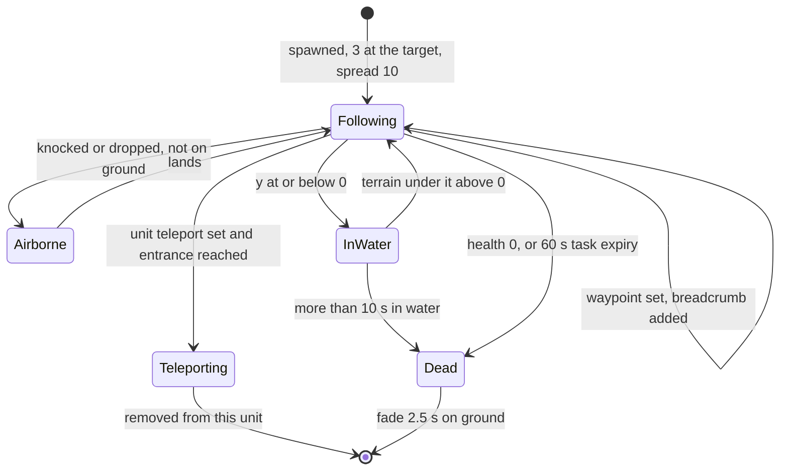

`Squadie::ChangeHealth` always returns **false**, so lasers never push squaddies, and `Bang`/`Shockwave` exclude `TypeInsertionSquadie` from knock-back anyway [C].

### 7.5 Squad combat and targeting

**Primary (lasers)** — two paths:
1. *Player-fired* `InsertionSquad::Attack(pos, withSecondary = false)`, sent every tick while the primary-fire control is held: the list of alive, enabled squaddies with `m_reloading == 0` (always, rate 0); `m_attackAccumulator += dt / (blueprintRate / N)` = `0.2·N` per tick; while the accumulator ≥ 1, pick a random eligible squaddie (`syncfrand`, without replacement) and call `Squadie::Attack(pos)` ⇒ **2 shots/s per squaddie, 6 shots/s for a full squad**, evenly spread [C] `InsertionSquad::Attack`.
2. *Autonomous* (squad not selected): `Squadie::RunAI` each tick fires at its best enemy with probability `P(syncfrand(d/2) < 2) = min(1, 4/d)` (d = distance; e.g. 10 %/tick at 40, every tick within 4) [C] `Squadie::RunAI`.
- `Squadie::Attack(pos)`: laser from the `MarkerLaser` world position at speed 200 toward `pos ± 3.5`; `TypeBrass` particle from `MarkerBrass` with velocity `front·(5 + syncfrand(10)) + SFRAND(5)` per axis (synced RNG for a cosmetic particle); sounds "Attack", "FireLaser" [C].

**Secondary** — `InsertionSquad::Attack(pos, true)`: the alive, enabled squaddie **nearest the target** whose secondary timer has expired calls `FireSecondaryWeapon(pos)` (in addition to the primary logic). Requires `HasResearch(m_weaponType)`. Weapon by `m_weaponType` (default **`TypeGrenade`**):

| Weapon | Effect | Cooldown | Sound |
|---|---|---|---|
| Grenade | `ThrowWeapon(muzzle, pos, EffectThrowableGrenade)` (force ≤ 110, 3 s fuse, Bang R 12.5 D 50) | 4 s | ThrowGrenade |
| Rocket | `FireRocket(muzzle, pos, team)` | 4 s | FireRocket |
| AirStrike | `ThrowWeapon(…, EffectThrowableAirstrikeMarker)` → one marker → 2 bombers (§11) | 20 s | ThrowAirStrike |
| Controller | `ThrowWeapon(…, EffectThrowableControllerGrenade)` → own-team Darwinians within 50 become `UnderControl` | 4 s | ThrowController |

When a timer expires the squaddie plays "WeaponReturns" [C] `Squadie::Advance`.

**Weapon selection in Multiwinia**: `CycleSecondary()` (Grenade → Rocket → AirStrike → Controller, skipping research-0 types) is called only for gamepad control in single-player; the keyboard weapon-cycle block and the Multiwinia task-manager weapon shortcuts are commented out; `RunTask(TypeGrenade/TypeRocket/TypeController)` would call `SetWeaponType` but no Multiwinia crate runs those task types ⇒ in Multiwinia a squad's secondary is **always the grenade** [I] (no reachable setter found; P04 search of `code/location.cpp`, `code/location_input.cpp`, `code/taskmanager_interface_multiwinia.cpp`). Rocket, AirStrike and Controller secondaries are [B:LEGACY].

### 7.6 Squad — player control model (direct control)

| Control | Effect | Ref |
|---|---|---|
| Select | squad becomes `team->m_currentUnitId`; squaddies face the mouse | [C] `Squadie::Advance` |
| Move (left button without primary fire) | `SetWayPoint(mouse)`, `m_targetDir`, `RecalculateOffsets`; ground cursor marker on release | [C] `code/location.cpp` (team-control block) |
| Primary fire held | `unit->Attack(mouse, false)` every tick → lasers | [C] |
| Primary + secondary held | `unit->Attack(mouse, true)` → also one grenade (`secondaryFire = primaryFireTarget && secondaryFireTarget`) | [C] |
| Gamepad direct control | `InsertionSquad::DirectControl`: (only while camera entity-tracking or look-around) move the point man by stick deltas (snapping to a connected teleport in the target cell); fire at `(m_directUnitTargetDx, 0, m_directUnitTargetDy)`; grenade when secondary is held. It reads `g_app->m_camera` (local state) inside the simulation path — a desync hazard when another player's squad is processed while the local camera is in look-around ([22](22_determinism_and_networking.md)) | [C] `InsertionSquad::DirectControl` |
| Terminate task | `Task::Stop` kills all squaddies | [C] `Task::Stop` |

Bindings: [06](06_player_control_and_input.md).

### 7.7 HistoricWayPoint — squad breadcrumb

`class HistoricWayPoint { Vector3 m_pos; unsigned int m_id; static unsigned int s_lastId; }` [C] `code/worldobject/insertion_squad.h`, `insertion_squad.cpp` (`s_lastId = 0`). [B:FULL]. Constructed with a position by `InsertionSquad::SetWayPoint`; `m_id` is a monotonically increasing serial from the static counter (never reset between matches; not used by simulation logic [I]). Stored newest-first in `InsertionSquad::m_positionHistory` and walked by `GetTargetPos`; never pruned during the 60 s squad life.

### 7.8 InsertionSquad — CPU AI (`InsertionSquad::RunAI`) [→ 07]

- `maxRange = GetApproxMaxRange(GetMaxForce(grenadeLevel))` = 2.3125 × 110 ≈ **254.4**.
- Every 1.0 s: scan enemies within 500 of the squad centre; iterate nearer-first and pick the first enemy whose 75-radius holds ≥ 20 enemies → waypoint `pos − 0.8·maxRange·dir` (stand ≈204 short of it). Otherwise go to the highest-priority (`AITarget::m_priority[team]`) walkable neighbour of the nearest AITarget, or that AITarget.
- Every tick: enemies within maxRange → target = their centroid ± `syncsfrand(30)` (±15) on x and z; if within maxRange → `Attack(target, syncrand() % 5 == 0)` (grenade attempt 20 %/tick, still gated by the 4 s cooldown) [C] `InsertionSquad::RunAI`. Strategy context: [07](07_ai.md).

### 7.9 Squad — death, colour, sounds, VFX

- `Squadie::ChangeHealth`: all damage types equal; at ≤ 0 → health 100 (fade), `m_dead`, sound "Die", shape-fragment explosion of `squad.shp`; **no spirit** (squads add nothing to the soul economy) [C].
- Team colouring: none — `squad.shp` has fixed colours (228,214,153) and (177,88,26) and the class never recolours it [C] `Squadie::Squadie`, `data/shapes/squad.shp`. Team identity is conveyed by selection UI and markers only. Resolved: P04-U1 left this [U]; the shape data and the constructor settle it.
- Render: lit shape; damaged flicker (unsynced `frand`); `RenderPixelEffect` disabled in Multiplayer [C] `Squadie::Render`.
- Sounds: base list + "FireLaser", "ThrowGrenade", "FireRocket", "ThrowAirStrike", "ThrowController", "WeaponReturns" [C] `Squadie::ListSoundEvents`. Particles: `TypeBrass` per shot.

## 8 Armour

`class Armour : Entity`, type `TypeArmour` (15) [C] `code/worldobject/armour.h`, `code/worldobject/armour.cpp`. [B:FULL].

### 8.1 Armour — role and acquisition

- **Role**: a hovering troop transport carrying up to 100 Darwinians across land and sea. It has **no weapon** in Multiwinia (missile code `SetMissileTarget`/`LaunchMissile` is commented out; turret shells are fired only by gun turrets [C] grep of `FireTurretShell` — resolved: P04's weapon inventory listed an "Armour turret" as a shell source; the code shows `code/worldobject/gunturret.cpp:GunTurret::Advance` is the only caller). It is a team special (`RegisterSpecial` in `Begin`).
- **Obtained by**:

| Source | Mechanism | Ref |
|---|---|---|
| Crate reward *Armour* | `RunTask(TypeArmour)` → player targets ground → `Task::TargetArmour(pos)` spawns 1 Armour, selects it; crate sound "Armour" | [C] `code/taskmanager.cpp:Task::TargetArmour` |
| Trunk-port armour reinforcements (level option `LevelOptionTrunkPortArmour`) | `Multiwinia::AdvanceTrunkPorts` creates a `Task(TypeArmour)` targeted at `trunkport.pos + front·75` (y + 5) while the team has fewer than `maxArmour` armour tasks (or `maxArmour == 0`) | [C] `code/multiwinia.cpp:Multiwinia::AdvanceTrunkPorts` |
| Level `InstantUnits` with `runAsTask = 1` | converted to a `TypeArmour` task targeted at the unit's position (task life −1): 7 armours on `mp_assault_2P_1`, `mp_assault_3P_2`, `mp_assault_3p_1`, `mp_assault_4P_1` | [C] `code/location.cpp:Location::InitialiseTeam`, `data/levels/mp_assault_*.txt` |
| `ConstructionYard` [B:LEGACY], cheat window [B:DEBUG] | spawn on team 2 | [C] `code/worldobject/constructionyard.cpp`, `code/interface/cheat_window.cpp` |

  Crate validity: the Armour crate is disabled in Rocket Riot and when `LevelOptionTrunkPortArmour > 0` [C] `code/worldobject/crate.cpp:Crate::IsValid` ([04](04_crates_powerups_and_weapons.md)). The task ends when the armour is dead or gone (`Task::Advance`).

### 8.2 Armour — stats and constants

| Item | Value | Kind | Ref |
|---|---|---|---|
| Health | 200 | stats | [C] `data/stats.txt` |
| Max speed | 60 u/s | stats | [C] `Armour::AdvanceToTargetPos` |
| RATE | 5 (unused) | stats | |
| Capacity | **100** in Multiplayer (Darwinia: research 0/1 → 10, 2 → 20, 3 → 30, 4 → 40) | code | [C] `Armour::Capacity` |
| Unload period | `ARMOUR_UNLOADPERIOD` = 0.1 s (one Darwinian per 0.1 s ⇒ ≤ 10/s) | `#define` | [C] `armour.h`, `Armour::IsUnloading` |
| Loading search range (Darwinian side) | 150 (`DARWINIAN_SEARCHRANGE_ARMOUR`) | `#define` | [C] `code/worldobject/darwinian.h` |
| Board distance | entrance within 20 (or arrived) | literal | [C] `Darwinian::AdvanceApproachingArmour` |
| New-orders lockout | loading/unloading only while `m_newOrdersTimer > 1.0` s; `SetOrders` resets it to 0; arrival at a conversion point sets 2.0 | literal | [C] `Armour::IsLoading`, `IsUnloading`, `SetOrders`, `Advance` |
| Conversion-point arrival | 15 | literal | [C] `Armour::Advance` |
| "Special order" threshold | > 50 from the armour (or awaiting deployment) | literal | [C] `Armour::SetOrders` |
| Armour–armour separation | 40 | literal | [C] `Armour::DetectCollisions` |
| Entrance obstruction test | building sphere 20 at the entrance marker, shift in 3-unit steps until a 5-sphere is clear | literal | [C] `Armour::DetectCollisions` |
| Acceleration / deceleration | +10 u/s² when > 100 from the waypoint and heading error < 1 rad; smooth approach `0.95·speed + 0.05·(0.2·distance)` between 10 and 100; −5 u/s² inside 10 | literal | [C] `Armour::AdvanceToTargetPos` |
| Turn | 5 % of the remaining angle per tick (≈40 %/s), `front.y` clamped ±0.1, only when the waypoint is > 10 away | literal | [C] |
| Death explosion | `Bang(pos, 20, 50, ownTeam)` | literal | [C] `Armour::ChangeHealth` |
| AI think interval | Hard 1 s; Standard 10 s (Assault 5 s); Easy 20 s (Assault 10 s) | literal | [C] `Armour::RunAI` |
| Shape | `armour.shp`, required marker `MarkerEntrance` (fatal assert) | data | [C] `Armour::Begin` |
| Lifetime | unlimited | — | |

### 8.3 Armour — damage model (`Armour::ChangeHealth`)

| Damage type | Effect |
|---|---|
| Laser | **immune** (returns false → no knock-back) |
| TurretShell | amount ÷ 3 (integer) → 15/3 = **5 per shell** |
| Explosive / Fire / Unresistable | full (Multiplayer). Single-player clamps any hit between −1 and −999 to −1 [B:LEGACY] |

- Health clamped 0..255; a shape-fragment explosion whenever health crosses a 20-point band (fraction `0.5·(1 − h/200)`, 1.0 at death); turret-shell hits always add a 0.05 fragment puff.
- At 0: `m_dead = true`, `Bang(pos, 20, 50, ownTeam)` (which hits everyone, including its own passengers' would-be landing area), sound "Die"; **no spirit** for the armour. `Armour::Advance` returns true on the next tick (removed, no fade) [C] `Armour::Advance`.
- Passengers: each Darwinian inside finds its armour dead and is **ejected burning** (`StateOnFire`, random horizontal + up velocity of length 20–40) — they usually die and release spirits [C] `Darwinian::AdvanceInsideArmour`. A turret shell that kills an armour credits `1 + passengers` kills [C] `code/worldobject/weapons.cpp:TurretShell::Advance`.
- An enemy enabled laser fence touched by the hull kills the armour outright (`Entity::PushFromObstructions` → `ChangeHealth(−9999)`), even though the push result itself is discarded (§8.4).

### 8.4 Armour — movement, terrain and obstacles (`Armour::AdvanceToTargetPos`)

1. Turn toward the horizontal direction of the waypoint (5 %/tick).
2. Speed law of §8.2.
3. `pos += front·speed·dt`; `PushFromObstructions(pos)` is called **but its result is discarded** — the armour is not pushed out of buildings (only the laser-fence kill and the water-spiral RNG draw happen) [C]. Ground = max(terrain, 0): the armour **hovers over water at sea level 0**. At/below ground: y eased toward ground (factor 0.5/tick), `m_up` eased toward the terrain normal (0.5/tick), horizontal step clamped to `speed·dt`. Above ground: `vel.y −= 5` per tick (fall, per-tick constant), clamp to ground, `m_up` eased slowly (0.05/tick).
4. `m_vel = Δpos/dt`.
- `DetectCollisions` (MP: only when |vel| < 5): push away from any other live Armour within 40 by `0.02·(40 − d)` per tick; if the entrance marker is inside a building (sphere 20), shift away; the waypoint moves with the body when within 40 [C].
- Exhaust smoke each tick: `1 + int(|vel|/20)` `TypeMissileTrail` particles using **synced** RNG for direction and size [C] `Armour::Advance`.
- Routing: only CPU orders route. `AISetConversionPoint` → `CreateRoute(pos)`: direct line if `IsRouteClear` (no enabled enemy laser fence crossed in 20-unit steps), else a route from `Location::m_seaRoutingSystem` (`GenerateRoute(from, to, false, true, true)`); `FollowRoute` (MP) advances along it. **Player orders never create a route** — a player-driven armour flies straight at its waypoint [C] `Armour::CreateRoute` (sole caller `Armour::AISetConversionPoint`), `Armour::FollowRoute`.
- Render bob `y += 2·sin(t + uid)`, up-vector wobble ±0.05; `RayHit` reproduces the bob so shells hit the visible model [C] `Armour::Render`, `Armour::RayHit`.

### 8.5 Armour — states and conversion orders

`m_state ∈ {StateIdle, StateUnloading, StateLoading}`; plus a pending *conversion point* `m_conversionPoint` with a *conversion order* `m_conversionOrder ∈ {Idle, Unloading, Loading}` and `m_awaitingDeployment` (single-player turret conversion).

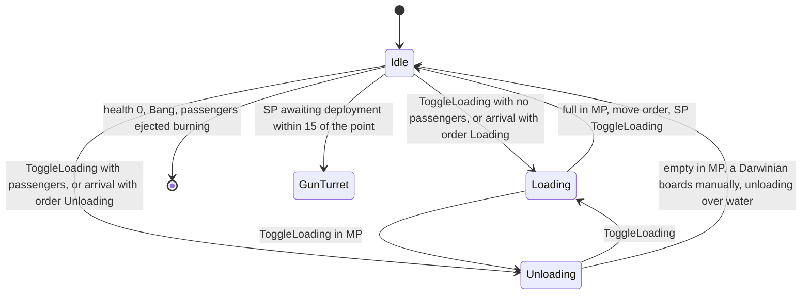

Rules [C] `Armour::Advance`, `SetOrders`, `SetWayPoint`, `SetConversionPoint`, `ToggleLoading`, `ToggleConversionAction`:
- **Move order** (`SetWayPoint`): rejected outside the landscape; clears the conversion point/order; waypoint y = terrain; Loading → Idle.
- **Special order** (`SetOrders(pos)`): rejected outside the landscape; `m_newOrdersTimer = 0`; if `|pos − armour| > 50` (or awaiting deployment) → `SetConversionPoint(pos)`: waypoint = pos, conversion order = Unloading if it carries passengers else Loading, state Idle. Within 50 → ignored (toggling is done by clicking the unit).
- Within **15** of the conversion point: awaiting deployment → `ConvertToGunTurret` (SP); else conversion order ≠ Idle → `m_state = order`; `m_newOrdersTimer = 2.0`; point cleared.
- `ToggleLoading()` MP: Idle → Unloading (passengers) / Loading; Unloading → Loading; Loading → Unloading; clears the conversion order. SP: Loading → Idle [B:LEGACY].
- `ToggleConversionAction()` (secondary click on the order marker): Idle → Unloading (if passengers) / Loading; Loading → Idle; Unloading → Loading (if not full) / Idle; Idle clears the point, otherwise the point = current waypoint and state Idle.
- MP auto-transitions each tick: Loading with passengers == capacity → Idle; Unloading with 0 passengers → Idle.
- `SetDirectOrders()` (next/previous-weapon key on the selected armour) → `ToggleLoading` at most once per 0.3 s — the debounce timer is a **function-static shared by every armour of every team** [C] `Armour::SetDirectOrders`.

### 8.6 Armour — passenger accounting and loading rules

- `m_numPassengers` is rebuilt every tick: at the end of `Armour::Advance`, `m_numPassengers = m_registeredPassengers` (count of `RegisterPassenger()` calls made by Darwinians inside since the previous armour tick), then the registration and `m_passengerOverflow` counters are zeroed. `AddPassenger()` registers and increments the overflow (so a boarding counts at once); `GetNumPassengers() = m_numPassengers + m_passengerOverflow`; `RemovePassenger()` decrements and stamps `m_previousUnloadTimer` [C].
- `IsLoading()` = Loading ∧ passengers < capacity ∧ lockout passed. `IsUnloading()` = Unloading ∧ passengers > 0 ∧ lockout passed ∧ ≥ 0.1 s since the last exit [C].
- Darwinian side (§4.4): idle Darwinians within 150 board a loading friendly armour (random choice); a player group order within 30 of a friendly armour with room sends the whole group (manual boarding, also into an Unloading armour, which then goes Idle). Inside: position locked to the armour; when `IsUnloading()` **and the terrain under the entrance is above water** one Darwinian per 0.1 s jumps out (±45°, speed 10, up 5–15). [I] Consequence of the two rules: ordering an unload while hovering over the sea makes every passenger skip `RegisterPassenger` for that tick, the rebuilt count drops to 0 and the MP auto-transition sets the armour **Idle**; the passengers register again the next tick, so the armour simply refuses to unload over water.
- A passenger killed inside calls `RemovePassenger`.

### 8.7 Armour — player control model

[C] `code/location_input.cpp` (Armour branch), `code/network/clienttoserver.cpp` (`NET_DARWINIA_ORDERGOTO`, `NET_DARWINIA_TOGGLEENTITY`, `NET_DARWINIA_NEXTWEAPON/PREVWEAPON`):

| Input | Effect |
|---|---|
| Select (click the armour) | becomes the team's current entity |
| Left click on terrain (control method 0) | `RequestArmourOrders(pos, deploy = false)` → `ORDERGOTO` with `FORCEONLYMOVE` → `SetWayPoint(pos)` |
| Right click on terrain (`ControlIssueSpecialOrders`, gamepad special move) | `deploy = specialMove` (inverted for control method 0) → `ORDERGOTO`; deploy → `SetOrders(pos)` (go and load/unload there), deselect, sound "SetOrders", order marker for friends (`MarkerSystem::RegisterMarker_Orders`), route highlight |
| Right click on the armour (`controlUnitToggle`) | `RequestToggleEntity` → `ToggleLoading`; on the armour's order marker → `ToggleConversionAction` and deselect; UI sound "ToggleUnitState" (`TypeMultiwiniaInterface`) |
| Next/previous weapon keys | `SetDirectOrders` → `ToggleLoading` (0.3 s shared debounce) |
| Single-player only: special order sets `m_awaitingDeployment`; the unit-create key then converts the armour into a dynamic `GunTurret` (shape explosion + `GunTurret::ExplodeBody`) | [B:LEGACY] |

Bindings: [06](06_player_control_and_input.md).

### 8.8 Armour — CPU AI (`Armour::RunAI`) [→ 07]

Dispatch by game type: Rocket Riot → `RunRocketRiotAI`; Assault → `RunAssaultAI`; Blitzkrieg → `RunBlitzkriegAI`; others → `RunStandardAI`; think interval §8.2; path re-check every 1 s while moving. AI conversion points are pushed out of obstructions, jittered `SFRAND(10)` (±5) and routed (`CreateRoute`) [C] `Armour::AISetConversionPoint`.
- **Standard**: heading to a suicide building (`m_suicideBuildingId`) and within 10 → `ChangeHealth(−1000)` (self-destruct Bang). Empty and Idle → load at `nearestOwnSpawnPoint.pos + front·100`. > 50 passengers and no conversion point → unload behind the nearest enemy SpawnPoint (`pos − front·100`). Empty after unloading → 50 % (`syncrand() % 2`) drive into the nearest enemy SpawnPoint farther than 200 and explode, else Idle.
- **Assault**: with armour objectives, empty and no armour marker on the current objective → `RunMobileBombAI` (drive to the nearest enemy GunTurret or SpawnPoint, self-destruct within 20). Stopped with > 20 passengers and nobody approaching → unload at the objective's armour marker or a random valid objective marker (attacker: non-friendly; defender: any). Empty or idle → `FindPickupPoint` (an `AIObjectiveMarker` with `m_pickupAvailable`, `m_armourObjective == 1`, > 225 away and > 25 friends within 150; or own TrunkPort `pos + front·75`; ±5 jitter). Within 150 of the pickup → Loading. Carrying and within 75 of the conversion point → Unloading.
- **Blitzkrieg**: carrying and within 100 of the point → Unloading (turret-rushing: keep driving 100 forward + 50 right so passengers drop onto the turret). Empty → load in front of an own TrunkPort with > 20 friends within 200. > 20 passengers, stationary, nobody approaching → choose an enemy zone linked to ours (prefer a linked enemy base zone whose team is not eliminated; base under threat `BLITZKRIEGSCORE_UNDERTHREAT` → Easy always / Standard 50 % retarget to zones linked to our base); random choice; Easy drives to the zone centre, others use `GetBlitzkriegDropPoint` (enemy GunTurrets within `zone.size·1.2` (default 200) → rush the last found turret).
- **Rocket Riot**: `PreventLoadOverlap` (no loading if another own armour within 150 is loading). Own rocket in `EscapeRocket::StateLoading` → ferry mode: collect from the AITarget with the most idle own Darwinians (> 10, > 400 from the rocket, no other own armour converting/loading within 100) else the trunk port, drop at the rocket (±100 ring for non-Easy). Otherwise pick up at the own TrunkPort / an AITarget within 250 of the rocket / an own SpawnPoint with > 20 friends within 200 (`pos + front·100`); > 20 passengers, stationary, nobody approaching → `RRFindDropoffPoint`: attack an enemy rocket with fuel ≥ 75 and more fuel than ours; else an uncontrolled solar-panel objective; else the enemy-held panel group with most panels where enemies > 1.3 × friends; else reinforce the friendly panel group with fewest friends (≤ 5 per panel preferred); non-Easy adds a random 100-unit ring offset, re-rolled until walkable.
[C] `Armour::RunStandardAI`, `RunAssaultAI`, `RunMobileBombAI`, `FindPickupPoint`, `RunBlitzkriegAI`, `GetBlitzkriegDropPoint`, `RunRocketRiotAI`, `PreventLoadOverlap`, `RRFindDropoffPoint` (P04 reading; spot-checked think intervals and capacity).

### 8.9 Armour — team colouring, sounds and VFX

- Team colour: per-(colourId, coopGroupPosition) copy `armour.shp_<colourId>_<group>` in which **every** fragment colour = team colour × 0.1 (`ConvertShapeColours`; lighting brightens it) [C] `Armour::Begin`. Flag/banner render is commented out.
- Sounds: base list + "LoadDarwinian" (`AddPassenger`), "UnloadDarwinian" (`RemovePassenger`), "SetOrders" [C] `Armour::ListSoundEvents`.
- VFX: exhaust `TypeMissileTrail` smoke; shape-fragment damage explosions; death `Bang` (§2.7).

## 9 Harvester

`class Harvester : Entity`, type `TypeHarvester` (20) [C] `code/worldobject/harvester.h`, `code/worldobject/harvester.cpp`. [B:FULL].

### 9.1 Harvester — role and acquisition

- **Role**: a flying soul collector. It vacuums up floating spirits — **of any team** — and converts each into one new Darwinian at a friendly Spawn Point (or deposits it into a friendly Incubator). It is practically indestructible; its only counter is a grenade it sucks up by itself. A team special (`RegisterSpecial` in `Begin`).
- **Obtained by** the crate reward *Harvester* → `RunTask(TypeHarvester)` → player targets ground → `Task::TargetHarvester(pos)` spawns it at `pos + (0,50,0)`, selects it; crate sound "Harvester" [C] `code/taskmanager.cpp:Task::TargetHarvester`. The crate is only generated on maps with at least one spawn point (any team) [C] `code/worldobject/crate.cpp:Crate::IsValid`. Level `InstantUnits` with `runAsTask` (none in shipped maps).
- **End**: the task ends when the harvester is dead or gone. `Task::Stop` sets `m_vunerable = true` and applies `ChangeHealth(−1000)` (destroying it; collected spirits are **not** released on this path, 02-U9) [C] `code/taskmanager.cpp:Task::Stop`.

### 9.2 Harvester — stats and constants

| Item | Value | Kind / Ref |
|---|---|---|
| Health | 255 | [C] `data/stats.txt` |
| Speed | 28 u/s max, and never more than the remaining distance per second; Idle drift 0.25 × 28 = 7 u/s | [C] `Harvester::AdvanceToTargetPos` |
| Capacity `GetMaxSpirits()` | research 0 → 0, 1 → 25, 2 → 50, **3 → 100 (Multiwinia)**, 4 → 200 | [C] `Harvester::GetMaxSpirits` |
| Collection radius | `HARVESTER_COLLECTION_RANGE` = 75 (horizontal) | `#define` [C] `harvester.cpp` |
| Spirit search range | `ENGINEER_SEARCHRANGE` = 200 | `#define` [C] `code/worldobject/engineer.h` |
| Retarget interval | `ENGINEER_RETARGETTIMER` = 1.0 s | `#define` [C] |
| Spirit-field threshold | > 30 floating spirits within 75 → re-centre on their centroid | [C] `Harvester::AdvanceToSpirit` |
| Hover height | `m_hoverHeight` 50 above max(terrain, 0), bob `± 2.5·sin(t + 20·uid)` (5 %) | [C] `Harvester::Harvester`, `GetHoverHeight` |
| Collector position | pos + 15 up | [C] `GetCollectorPos` |
| Spirit/grenade suck speed | `40·(1 − horizDist/150)`; 20 when nearly level with the harvester | [C] `AdvanceSpirits`, `AdvanceGrenades` |
| Grenade pickup | an `EffectThrowableGrenade` resting on the ground (`y < terrain + 2`) within 25 (= 75/3) horizontally, only while harvesting with spirits present | [C] `AdvanceHarvesting` |
| Arrival tolerance | 5 (horizontal) | [C] |
| Idle wander | random point 30 away (`syncsfrand(2π)` angle) | [C] `SearchForRandomPosition` |
| Shape | `harvester.shp`, engine markers `MarkerEngine1`–`MarkerEngine4` (optional) | [C] |
| Lifetime | until destroyed | — |

### 9.3 Harvester — state machine

```mermaid
stateDiagram-v2
  [*] --> Idle : Begin, waypoint = spawn position
  Idle --> ToSpirit : every 1 s, nearest Floating unbroken spirit within 200 and carried below capacity
  Idle --> ToSpawnPoint : carrying spirits and a friendly SpawnPoint exists
  Idle --> ToIncubator : carrying, no friendly SpawnPoint, a friendly Incubator exists
  Idle --> ToWaypoint : SetWaypoint by player or AI
  ToWaypoint --> Idle : within 5 of the waypoint
  ToSpirit --> Harvesting : arrived and a Floating spirit within 75
  ToSpirit --> Idle : arrived and none within 75
  Harvesting --> Idle : nothing left to collect or still being drawn in
  ToSpawnPoint --> ToWaypoint : last spirit delivered
  ToIncubator --> ToWaypoint : last spirit delivered
  ToSpawnPoint --> Idle : no own SpawnPoint
  ToIncubator --> Idle : no friendly Incubator
  Harvesting --> Destroyed : a sucked-up grenade reaches it
  Idle --> Destroyed : Task::Stop
  Destroyed --> [*]
```

Per-state detail [C] `Harvester::Advance*`:
- **Idle**: releases held grenades (`ReleaseGrenades`: `m_collected = false`, `ResetForce`); every 1 s `SearchForSpirits` (nearest **Floating**, unbroken spirit within 200 — Birth spirits are not taken; **no team test**); if carrying → `SearchForSpawnPoint` (nearest SpawnPoint for which `IsFriend(spawnTeam, myTeam)`, i.e. own or co-op ally) else `SearchForIncubator` (nearest friendly Incubator, distance penalised +10 per spirit inside); otherwise wander.
- **ToWaypoint**: fly to `m_wayPoint`.
- **ToSpirit**: target = the chosen spirit's position; on the way, once (`m_fieldFound`), if > 30 floating spirits lie within 75 the target becomes their centroid.
- **Harvesting** (stationary): every Floating spirit within 75 is collected while `count < capacity` (`CollectSpirit` → `Spirit::Harvest(id)` → `StateHarvested`); grenades captured (§9.5). Stays while any spirit is still `StateHarvested`.
- **ToSpawnPoint**: target = spawn-point position at hover height; on arrival (within 5) **one** spirit per tick is deleted and `SpawnPoint::SpawnDarwinian()` creates one Darwinian of the spawn point's team at its door; sound "DropSpirit". If the remembered building is gone, it re-searches but then requires the spawn point to be **its own team** (`sp->m_id.GetTeamId() != m_id.GetTeamId()` → Idle). **Yield: 1 Darwinian per spirit, 10 per second** at the spawn point [I] (one per tick). `SpawnPoint::SpawnDarwinian` checks neither the population cap nor the spawn point's activation delay (it only refuses neutral team 255), so harvester deliveries bypass both [C] `code/worldobject/spawnpoint.cpp:SpawnPoint::SpawnDarwinian`; economy consequences in [05](05_economy_and_population.md). If the head spirit index has become invalid it is not removed, and the harvester would hover at the spawn point indefinitely [C] code path; [I] reachability (collected spirits do not expire).
- **ToIncubator**: dock via `Incubator::GetDockPoint`; one spirit per tick `Incubator::AddSpirit`. Incubators are Darwinia buildings absent from shipped MP maps [I].
- Every tick (all states): `AdvanceSpirits`, `AdvanceGrenades`, `AdvanceEngines`; when it did not move this tick it bobs at hover height; then `Entity::Advance`.

### 9.4 Harvester — spirit transport

- `AdvanceSpirits` (each `StateHarvested` spirit): steer toward a point orbiting the harvester at radius `75·heightScale`, `heightScale = (50 − (spiritY − ground))/50` (a funnel that narrows as the spirit rises), angular position `t + i` (t = network time + 20·uid); when within 2 of that point (or within 50 and |Δy| < 5) → `StateCollected`, snapped to the collector + `syncsfrand(7.5)` per axis [C].
- `StateCollected` spirits ride with the harvester (`m_vel = harvester.m_vel`) and do not expire; if the harvester disappears they revert to `StateFloating` [C] `code/worldobject/spirit.cpp:Spirit::Advance`. A spirit still in `StateHarvested` when the harvester disappears has no fallback (02-U9).

### 9.5 Harvester — damage, death and counter-play

- `Harvester::ChangeHealth`: ignored unless `m_vunerable` **and** the type is `DamageTypeUnresistable` ⇒ immune to lasers, explosions, turret shells and fire [C].
- **Grenade counter**: while Harvesting (spirits present), a live `EffectThrowableGrenade` of **any team** resting on the ground within 25 is captured (`m_collected = true` freezes its fuse, `RemoveForce`) and drawn up the funnel (`AdvanceGrenades`, radius `75·heightScale`, angle `t + 50·i`). Within 2 of the harvester: `m_vunerable = true`, grenade `m_life = 0`, `m_collected = false` (it explodes next tick: Bang R 12.5 D 50), `ChangeHealth(−999)` → **harvester destroyed**, `ReleaseSpirits()` (each spirit re-`Begin()`s — restarting at StateBirth — with velocity away from the harvester of length `syncfrand(150)`), `ReleaseGrenades()` [C] `Harvester::AdvanceGrenades`, `ReleaseSpirits`. Airstrike bombs and napalm have other effect types and are never captured.
- Death: health 0, `m_dead`, sound "Die", **no spirit**; removed on the next tick; shape-fragment explosion whenever a 50-point band is crossed or at death (fraction computed against the **Engineer**'s max health — copy-paste, visual only) [C].

### 9.6 Harvester — movement, terrain and obstacles

`AdvanceToTargetPos`: if horizontal distance > 5: `desiredSpeed = min(distance, 28)` (Idle: 7), heading blend `front·(1 − a) + dir·a` with `a = 9.5·dt = 0.95` (Idle: `2·dt = 0.2`); `vel = 0.92·vel + 0.08·targetVel`; `pos += vel·dt`; y = hover height; `m_front = horizontal(vel)`. **No obstruction avoidance** (the `PushFromObstructions` call is commented out — it flies over buildings, cliffs and water and cannot be stopped by laser fences) [C] `Harvester::AdvanceToTargetPos`.

### 9.7 Harvester — targeting

Not a combat unit; it targets spirits and resting grenades only (§9.3, §9.5). Darwinians never target it (excluded in `SearchForThreats`, §4.6).

### 9.8 Harvester — control, AI, colour, sounds, VFX

- Player: select; a move order → `SetWaypoint(mouse)` (state ToWaypoint, retarget timer 0) and the selection is cleared [C] `code/location.cpp` (`TypeHarvester` branch of the team-control dispatcher). Everything else is autonomous.
- AI (`Harvester::RunAI`, every 1 s): if Idle → waypoint = the nearest spirit anywhere in the world (any state) [C]; strategy in [07](07_ai.md).
- Team colouring: `SetShape("harvester.shp", true)` ⇒ in MP the **whole model** is recoloured to the team colour × 0.7 (`convertAll`); tractor-beam rings in team colour [C] `Harvester::Begin`, `Harvester::RenderBeam`. Resolved: P04's colouring table said "shape native colours"; `Begin` shows a full recolour.
- Visuals: collector bubble `textures/bubble.bmp` (size 16, additive, alpha 150) at collector + 3; while Harvesting 5 team-coloured animated rings (radius `75·heightScale`) cycling from ground to hover height; shadow; engine exhaust per engine marker: 5 blue `TypeMissileFire` (size 75, colour (50,50,250)) + 1 `TypeMissileTrail` per tick with **unsynced** RNG inside `Advance` (cosmetic) [C] `Harvester::RenderBubble`, `RenderBeam`, `AdvanceEngines`.
- Sounds: "DropSpirit" (triggered on delivery, not listed); `ListSoundEvents` lists Engineer leftovers "BeginReprogramming", "EndReprogramming", "ReprogrammingComplete" that are never triggered [C] `Harvester::ListSoundEvents`.
- UI action strings: `engineer_idle`, `engineer_towaypoint`, `engineer_tospirit`, `engineer_toincubator` (Harvesting/ToSpawnPoint fall back to `engineer_idle`) [C] `Harvester::GetCurrentAction`.

## 10 Engineer

`class Engineer : Entity`, type `TypeEngineer` (2) [C] `code/worldobject/engineer.h`, `code/worldobject/engineer.cpp`. [B:FULL] (Darwinia-heritage unit kept for Multiwinia).

### 10.1 Engineer — role and acquisition

- **Role**: a small hovering drone that **collects spirits one by one (a snake-train behind it) and returns each to a friendly Spawn Point as a new Darwinian**; on maps with Darwinia buildings it also reprograms Control Towers/Research Items and operates Bridges. Registered as a team special only in `GameModeMultiwinia` [C] `Engineer::Begin`.
- **Obtained by** the crate reward *Engineer* (a "basic" crate, `Crate::IsBasicCrate`) → `RunTask(TypeEngineer)` → player targets ground → `Task::TargetEngineer(pos)`: spawn at `pos + (0,10,0)`, select it, sound "GestureSuccess" (`TypeGesture`) [C] `code/taskmanager.cpp:Task::TargetEngineer`. The crate is only valid on maps with spawn points [C] `code/worldobject/crate.cpp:Crate::IsValid`. Also level instant units with `runAsTask` and Darwinia `RunningPrograms` (restores state, health and carried spirits) [B:LEGACY] [C] `code/location.cpp:Location::InitialiseTeam`.
- **End**: the task ends when the engineer is dead; `Task::Stop` → `ChangeHealth(−1000)` [C].

### 10.2 Engineer — stats and constants

| Item | Value | Kind / Ref |
|---|---|---|
| Health | 255 | [C] `data/stats.txt` |
| Speed | 28 u/s; Idle 0.25× | [C] `Engineer::AdvanceToTargetPos` |
| Spirit capacity `GetMaxSpirits` | research 0 → 0, 1 → 10, 2 → 15, **3 → 25 (Multiwinia)**, 4 → 30 | [C] `Engineer::GetMaxSpirits` |
| Search range | `ENGINEER_SEARCHRANGE` = 200 | `#define` [C] `engineer.h` |
| Retarget interval | `ENGINEER_RETARGETTIMER` = 1.0 s | `#define` [C] |
| Hover height | `m_hoverHeight` 15 above max(terrain, 0) | [C] `Engineer::Engineer` |
| Turn blend | `3·dt` = 0.3 per tick | [C] |
| Arrival | 5 (horizontal) | [C] |
| Idle wander | random point 30 away | [C] `SearchForRandomPosition` |
| Idle rotate rate | `syncsfrand(0.5)` (stored, unused) | [C] |
| Spawn-point drop position | `spawnPoint.pos + front·50` (pushed out of obstructions) | [C] `AdvanceToIncubator` |
| Bridge hold range | ends its own bridge if > 100 away | [C] |
| Bridge building | `BeginBridge` requires Engineer research ≥ **5** (maximum is 4) → never builds | [C] — dead in every build |
| Shape | `engineer.shp` | [C] |
| Lifetime | until destroyed | — |

### 10.3 Engineer — state machine

States: `StateIdle`, `StateToWaypoint`, `StateToSpirit`, `StateToIncubator`, `StateToControlTower`, `StateReprogramming`, `StateToBridge`, `StateOperatingBridge`, `StateToResearchItem`, `StateResearching` [C] `engineer.h`.

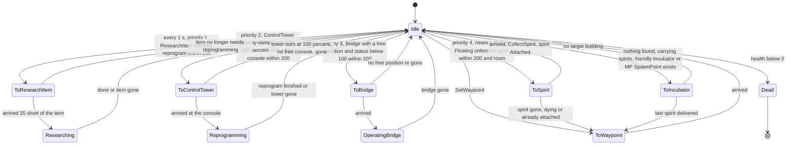

- **Delivery** (`AdvanceToIncubator`, despite the name): target = nearest friendly Incubator (distance + 10 × its spirits) **or**, in Multiwinia, nearest friendly SpawnPoint (plain distance) [C] `Engineer::SearchForIncubator`. At a SpawnPoint: one spirit per tick removed and `SpawnPoint::SpawnDarwinian()`, sound "DropSpirit". At an Incubator: `Incubator::AddSpirit`.
- **Spirit train**: collected spirits (`Spirit::CollectorArrives` → `StateAttached`) are placed on the engineer's position history (spirit *i* at history *i* + 1, one tick behind each other); history length = capacity + 1 [C] `Engineer::Advance`.
- **Reprogramming** a Control Tower calls `ControlTower::Reprogram(team)` **10 times per tick**; the engineer bobs around the console (±2 along front, ±3 sideways, `sin/cos(t + 10·id)`) with a blue control beam; moving away (player waypoint) ends it (`EndReprogram`, sound "EndReprogramming"). Research items: `ResearchItem::Reprogram()` per tick + 2 `TypeBlueSpark` particles (unsynced) [C]. Control towers, research items and incubators appear only in `mp_sandbox*.txt` among MP-named maps ⇒ effectively legacy for shipped maps [I] (`data/levels/` grep, P04).
- `Engineer::Advance` runs the state handler **before** `Entity::Advance` even on the tick it died; when removed it drops carried spirits (`CollectorDrops`) and ends any reprogram/research/bridge operation. The drop loop only removes entries whose spirit index is valid, so an invalid index would loop forever [C] `Engineer::Advance`; [I] not reachable because attached spirits do not expire.

### 10.4 Engineer — damage, targeting, terrain, control, AI, colour, sounds

- `Engineer::ChangeHealth`: **lasers ignored**; other types full; a muzzle-flash particle on every non-lethal hit; shape explosion per 50-point band; dies when `health + amount < 0`, health set 0, sound "Die", **no spirit** [C].
- Targeting: none (non-combatant). Darwinians never target it (§4.6).
- Terrain: hovers at 15 above max(terrain, 0) (crosses water), pushed from obstructions only at its drop point.
- Player control: move → `SetWaypoint(mouse)` + deselect (`team->SelectUnit(−1, −1, −1)`); secondary fire → `BeginBridge(mouse)` (no-op) [C] `code/location.cpp` (`TypeEngineer` branch).
- AI (`Engineer::RunAI`, every 1 s): Idle → waypoint = nearest spirit (any state) [C]; [07](07_ai.md).
- Team colouring: `SetShape("engineer.shp", true)` ⇒ in MP the whole model is team-coloured (× 0.7); blue (0.2, 0.4, 1.0) pulsing `textures/laser.bmp` beam while reprogramming/operating/researching; `RenderPixelEffect` disabled in Multiplayer [C] `Engineer::Begin`, `Engineer::Render`. Resolved: P04's table said "native shape"; `Begin` shows a full recolour.
- Sounds: base list + "BeginReprogramming" (looping; stopped with `StopAllSounds(id, "Engineer BeginReprogramming")`), "EndReprogramming", "ReprogrammingComplete", "DropSpirit" [C] `Engineer::ListSoundEvents`. UI strings `engineer_idle`, `engineer_towaypoint`, `engineer_tospirit`, `engineer_toincubator`, `engineer_reprogramming`, `engineer_researching`, `engineer_bridge` [C] `Engineer::GetCurrentAction`.

## 11 Airstrike

Classes: `AirstrikeUnit : Unit` (one bomber flight) and `SpaceInvader : Entity` (one bomber, type `TypeSpaceInvader` = 10) [C] `code/worldobject/airstrike.h`, `code/worldobject/airstrike.cpp`; the smoke marker `AirStrikeMarker` and the bombs (`Grenade` typed `EffectThrowableAirstrikeBomb`, `FlameGrenade`) are projectiles specified in [04](04_crates_powerups_and_weapons.md). [B:FULL]. `TypeSpaceInvader` is in `EntityIsBlocked`, which only prevents level placement.

### 11.1 AirstrikeUnit and SpaceInvader — role and acquisition

- **Role**: a crate-delivered bombing run. Each smoke marker summons one flight of **2 bombers** (Airstrike research 2); each bomber drops one bomb on the marker. A strike throws 3–7 markers ⇒ 6–14 bombs [I] (arithmetic).
- **Obtained by** [C] `code/worldobject/crate.cpp:Crate::CaptureCrate`, `Crate::RunUncapturedCrate`, `Crate::RunAirStrike`, `code/taskmanager.cpp:Task::TargetAirStrike`:

| Trigger | Path | Napalm | Owner of the bombers |
|---|---|---|---|
| Captured crate *Airstrike* | `RunTask(TypeAirStrike)` → player targets a point → `Task::TargetAirStrike` → `Crate::RunAirStrike(pos, team, false)`; the task terminates immediately | no | capturing team |
| Captured crate *Napalm Strike* | same with task `m_option = 1` | **yes** | capturing team |
| Uncaptured crate *Airstrike* / *Napalm Strike* | `Crate::RunAirStrike(cratePos, monsterTeam[, true])` — fires at the crate's own position | per reward | Monster team (hostile to all) |
| Squad secondary *AirStrike* [B:LEGACY] | one marker from a squaddie | no | squad's team |

- `Crate::RunAirStrike`: `numMarkers = 3 + syncrand() % 5` (**3–7**; 10 in the Multiwinia tutorial); each marker is thrown **from the target point itself** to `pos + (SFRAND(100), 0, SFRAND(100))` (±50) with force `8·√dist` (≤ ≈67); `marker->m_naplamBombers = napalm`; message `crate_message_run_airstrike`/`_napalm` (or `_auto_` for the Monster team); fixed map marker `icons/icon_airstrike.bmp`; crate sound "Airstrike" [C] `Crate::RunAirStrike`.
- `AirStrikeMarker::Advance`: emits a `TypeFire` smoke particle every tick (synced RNG); once ≥ 2.0 s old **and at rest** (`m_force ≤ 0.1`) it calls `team->NewUnit(TypeSpaceInvader, CurrentLevel(TypeAirStrike) = 2, …, markerPos)` (creating an `AirstrikeUnit`), stores the unit, `unit->m_effectId = marker index`, `unit->m_napalm = m_naplamBombers`; later it removes itself when the unit is gone or `StateLeaving` [C] `code/worldobject/weapons.cpp:AirStrikeMarker::Advance`.

### 11.2 AirstrikeUnit — flight path

Construction: `m_attackPosition = markerPos` with y = ground + 70; `m_speed = SpaceInvader speed × 10 = 400` [C] `AirstrikeUnit::AirstrikeUnit`.

`Begin()`: four candidate corners at height **500**, inset **100** from the map edges: (100,500,100), (100,500,Z−100), (X−100,500,Z−100), (X−100,500,100). **Exit** = the corner nearest the attack position; **entry** = the second nearest. Waypoint starts at the entry; `m_front = normalise(mapCentre − entry)` (centre at y = 0, so it points down and inward). Spawns `numInvaders` SpaceInvaders at the entry [C] `AirstrikeUnit::Begin`.

`Advance()` each tick: while the marker index is still valid, re-read the marker position (it may still roll) → `m_attackPosition = marker + 70` above ground. Then `AdvanceToTargetPosition(target)`:
- `targetFront = normalise(target − waypoint)`; `front = normalise(front·(1 − a) + targetFront·a)`, `a = dt` (10 % per tick).
- `desiredSpeed = 40`; × 10 = **400** if (Approaching and the waypoint is > 600 from the attack point) or (Leaving and > 100). `m_speed = m_speed·(1 − a) + desiredSpeed·a`.
- `waypoint += front·m_speed·dt`; returns true within 10 of `target`.

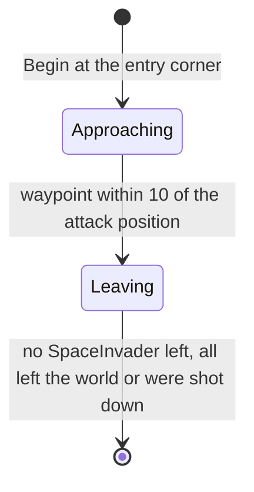

In `StateLeaving` the "arrived" result is ignored; because the turn blend is only 10 %/tick at ~400 u/s, the flight overshoots the exit corner (100 from the edge) and crosses the world boundary, where every bomber deletes itself — there is no other despawn [I]. A re-implementation on flat terrain, maps 1500–3000 wide (`_work/scripts/P04_airstrike_sim.py`), gives: waypoint within 90 of the attack point ≈5.3–6.9 s after spawning, at ≈44 u/s (decelerated), leaving the world ≈13.5–15.4 s after spawning; bombs inherit ≈44 u/s from ≈70 above ground, fall ≈1.2 s (98 u/s²) and land ≈50 past the release point, i.e. close to the marker [I].

### 11.3 SpaceInvader — stats

| Stat | Value | Ref |
|---|---|---|
| Health | 10 | [C] `data/stats.txt` |
| Speed | 40 (× 10 cruise = 400); **not** scaled by difficulty | [C] `code/worldobject/entity.cpp:EntityBlueprint::GetStat` |
| Rate | 1 (unused) | |
| Bombs | 1 per bomber (`m_armed` true → false); `m_napalmDrops = 30` is unused | [C] `SpaceInvader::SpaceInvader` |
| Bomb release distance | 3-D distance to the attack position < **90** | [C] `SpaceInvader::Advance` |
| Bomb | life 1.5 s, power 50 → Bang R 25 D 100 (napalm: ignite every Darwinian within 62.5, trees/triffids within 100 take −200) | [C] `SpaceInvader::Advance`, `code/worldobject/weapons.cpp:FlameGrenade::Advance` |
| Shape | `spaceinvader.shp` rendered × 2; carried bomb `throwable.shp` 12 below while armed | [C] |
| Lifetime | until it leaves the world | — |

### 11.4 SpaceInvader — behaviour

`SpaceInvader::Advance(unit)` [C]:
1. `m_dead` → removed.
2. Position = unit waypoint + `Unit::GetFormationOffset(FormationAirstrike, formationIndex)`: rows of 4: `x = (i%4 − 2)·24`, `y = −(⌊i/4⌋ − 2)·12`, `z = (⌊i/4⌋ − 2)·24`, each plus a per-index noise `s_offsets[i % 100] ∈ [0,1)` (spacedOut 4) [C] `code/unit.cpp:Unit::GetFormationOffset`. `Unit::s_offsets` is filled lazily from the synced RNG on first use and deleted in `Location::Empty`, so it is regenerated each match [C] `code/location.cpp:Location::Empty` (resolved: P04 stated it is never reset between games). Velocity = displacement/dt; `m_front` = unit front.
3. Armed and within 90 of the attack position: create the bomb at `pos − 12·up` with velocity `front·|vel|`, register it in `m_effects` on the bomber's team, sound "DropGrenade", `m_armed = false` (bombs are not `Initialise`d, so they raise no "Create" event).
4. Outside the world bounds → removed.

There is no targeting (the attack point comes from the marker), no terrain interaction (flies at the waypoint height; bombs bounce off terrain) and no obstacle avoidance.

### 11.5 SpaceInvader — damage, death, colour, control, sounds

- `SpaceInvader::ChangeHealth`: **only `DamageTypeTurretShell` hurts** (lasers, explosions, fire ignored → false). Health 10, so one gun-turret shell (15) kills; dies when `health + amount < 0` (health 0), sound "Die", **no spirit**; while alive each hit spawns a `TypeMuzzleFlash` particle; a shape-fragment explosion when a 50-band is crossed or on death, fraction computed against the **Engineer**'s max health (copy-paste, visual only) [C].
- Team colouring: none — `spaceinvader.shp` has a single fixed colour (128,128,128) and is never recoloured [C] `SpaceInvader::SpaceInvader`, `data/shapes/spaceinvader.shp`.
- Control: none after launch; the player only aims the task (bindings in [06](06_player_control_and_input.md)). The CPU uses `AI::RunAirStrike` ([07](07_ai.md)).
- Sounds: base list + "DropGrenade" [C] `SpaceInvader::ListSoundEvents`. Darwinians treat SpaceInvaders as scary threats (§4.6) and flee from airstrike markers of any team (§4.6 step 3).

### 11.6 Airstrike — timeline

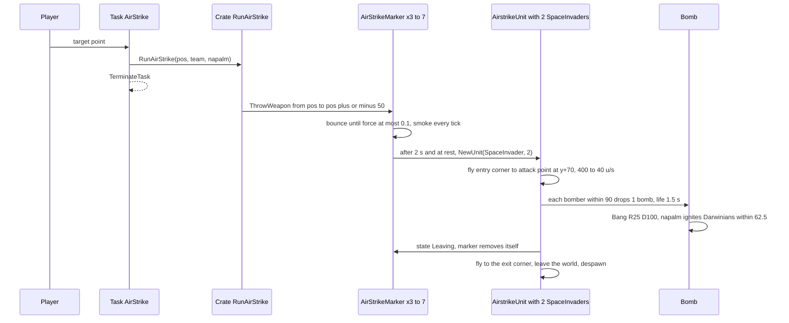

## 12 Nuke

`class Nuke : Entity`, type `TypeNuke` (21) [C] `code/worldobject/nuke.h`, `code/worldobject/nuke.cpp`. [B:FULL] — created only by `Crate::RunNuke`, compiled under `INCLUDE_CRATES_ADVANCED` (defined in FULLGAME) [C] `code/worldobject/crate.cpp:Crate::RunNuke`. `TypeNuke` is in `EntityIsBlocked` (level placement only).

### 12.1 Nuke — role and acquisition

- **Role**: one of ten submarine-launched warheads of the *Nuke* crate reward: a sub surfaces at sea, waits, launches a lofted missile and the warhead explodes at its target. The first warhead lands exactly on the chosen point, nine scatter within ±150.
- **Obtained by** the captured crate reward *Nuke* → `RunTask(TypeNuke)` → player targets a point → `Task::TargetNuke(pos)` → `Crate::RunNuke(pos, team)` and the task terminates [C] `code/taskmanager.cpp:Task::TargetNuke`. The uncaptured-crate Nuke is commented out [C] `Crate::RunUncapturedCrate`. CPU: `AI::RunNuke` ([07](07_ai.md)).
- `Crate::RunNuke(pos, team)` [C]: spawns **10** Nukes; each starts at a random **sea** point `(FRAND(sizeX − 100), 0, FRAND(sizeZ − 100))`, re-rolled while terrain height > 0 (an unbounded loop — a map without sea would hang, 02-U12); target: nuke 0 → exactly `pos` with `m_renderMarker = true`; nukes 1–9 → `pos + (syncsfrand(300), 0, syncsfrand(300))` (±150); `target.y = ground − 5`. Message `crate_message_run_nuke` (`%T` team name) or `crate_message_auto_nuke`; map marker `icons/icon_nuke.bmp`; crate sound.

### 12.2 Nuke — stats

| Stat | Value | Ref |
|---|---|---|
| Health | 255 (no `ChangeHealth` override) | [C] `data/stats.txt` |
| Speed | 100 → flight speed `SPD/2 + SPD/2·f²` = 50 → 100 u/s (integer halving of the byte, 100 → 50) | [C] `Nuke::AdvanceToTarget` |
| `m_radius` | 5 | [C] `Nuke::Begin` |
| Sub rise/sink | 1 unit per tick (10 u/s at speed 1) from y −30 to +30 (60 ticks = 6 s); sinks to −35 after the explosion | [C] `Nuke::AdvanceSub` |
| Sub surfaced wait | `m_subTimer` = 2.5 s | [C] `Nuke::Nuke` |
| Launch delay | `max(0, sizeX/100 − |subPos − target|/100)` s | [C] `Nuke::AdvanceSub` |
| Explosion | `Bang(groundPos, R 50, D 100)`, teamId −1 ⇒ full 100 damage to every entity of every team within 75, linear to 0 at 100; buildings within 150 take `100·(1 − d/150)`; shockwave size 2.5 (ring 35 → 135) | [C] `Nuke::AdvanceToTarget`, `code/location.cpp:Location::Bang` |
| Post-explosion linger | `m_casualtyMessageTimer` = 5 s | [C] |
| History trail sample | every 0.5 s | [C] `Nuke::AdvanceLaunched` |
| Lifetime | removed when the 5 s casualty timer expires after impact (`AdvanceLaunched` returns true); the sub, sinking 1 unit per tick from +30, is then at ≈ −20 | [C] `Nuke::Advance`, `Nuke::AdvanceLaunched` |

### 12.3 Nuke — state machine

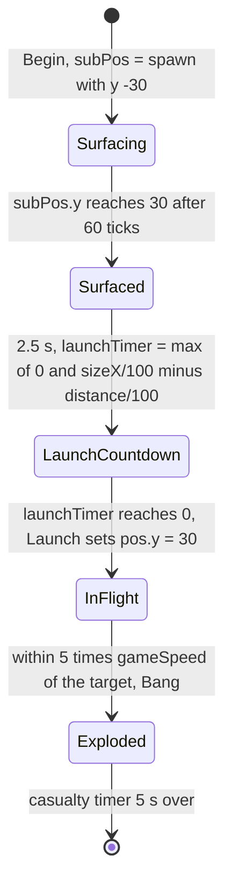

- The countdown makes farther subs launch sooner (intent: simultaneous arrival). Because the lofted flight averages only ≈47 u/s, arrival is **not** simultaneous: total time after surfacing ≈ `2.5 + (sizeX − D)/100 + D/47` s, so nearer subs still hit first (sizeX 2000: D 500 → ≈28 s, D 1000 → ≈34 s, D 1500 → ≈39 s) [I] (re-implementation `_work/scripts/P04_nuke_sim.py`, flat terrain).
- Flight `Nuke::AdvanceToTarget` per tick [C]: `f = 1 − remaining/totalDistance`; `heightFactor = |subPos − target|/3`; `fractionNorth = max(2, 5·pos.y/heightFactor)`; `front = normalise(target − pos)` rotated about `r = normalise(normalise(target − subPos) × up)` by `π/fractionNorth`, then by `−f·π/fractionNorth` ⇒ net pitch-**up** `(1 − f)·π/fractionNorth` (≤ 90°) decaying to 0 at the target (a lofted arc; at launch fractionNorth = 2 so the warhead initially climbs vertically). Sign verified from `Vector3::FastRotateAround` and the right-handed `operator^` [C] `code/lib/vector3.cpp`. Simulated apex ≈0.31·D, flight ≈D/47 s (D 300: 6.0 s, apex 94; 1000: 21.1 s, 310; 2000: 42.6 s, 620) [I]. `m_armed = true` above y 150 (never read).
- Explosion: kills are counted for every team (teamId −1) and **all** of them — own units included — are added to the launching team's `m_teamKills` [C]. Sound "Explode". Co-op achievement: in co-op, for the local player's nuke, a **friendly** SpawnPoint within 120 of the target → `App::DarwiniaAchievementWrongGame` + message `dialog_wronggame` [C].
- `Nuke::Advance` never checks `m_dead`; base `ChangeHealth` could mark it dead (spawning a spirit) if something reached it, but it would keep flying [I] (no override, low relevance). It never calls `Entity::Advance` (no world clamp).

### 12.4 Nuke — targeting, terrain, control, colour, sounds, VFX

- Targeting: fixed point chosen at launch; no tracking. Terrain: subs surface at sea; the warhead flies a ballistic-looking arc that ignores terrain until it is within 5 of the target.
- Control: player aims the task only.
- Team colouring and visuals [C] `Nuke::RenderSub`, `Nuke::Render`, `Nuke::RenderHistory`, `Nuke::RenderGroundMarker`: submarine = two camera-facing 100-unit billboards `sprites/subshadow.bmp` (subtractive) and `sprites/sub.bmp` in team colour, alpha `max(subPos.y, 0)/30`; warhead = additive billboard `sprites/nuke.bmp`, size `10·(1 + 0.03·((index·uid) % 10))`, team colour (Monster team: white, subtractive); trail = history samples drawn as triple-stacked `textures/laser.bmp` ribbons of width 10 with fading alpha; ground marker (nuke 0 only) = `icons/nukesymbol.bmp` red (200,20,20) pulsing `40 + 25·sin(realTime)` on the terrain plus a generated blurred `shadow_icons/nukesymbol.bmp` (`BitmapRGBA::ApplyBlurFilter(10)`). `Nuke::RenderDeaths` ("Darwinia Hit, %d Dead") exists but its call is commented out.
- Sounds: base list + "Explode" [C] `Nuke::ListSoundEvents`.

## 13 ArmyAnt

`class ArmyAnt : Entity`, type `TypeArmyAnt` (14) [C] `code/worldobject/armyant.h`, `code/worldobject/armyant.cpp`. [B:FULL] — `TypeArmyAnt` is in `EntityIsBlocked` (no level placement) but ants are created at runtime. The nest building `AntHill` (spawning, population lock, spirit → ant conversion, damage) is specified in [03](03_buildings_and_world_objects.md).

### 13.1 ArmyAnt — role and acquisition

- **Role**: a small, fast monster-team creature that leaves its hill on an objective, collects floating spirits and **captures Darwinians** (carried back and killed at the hill), and bites any other enemy it meets.
- **Obtained by**: `AntHill::SpawnAnt` (each hill of the *Ant Nest* crate releases ants one by one into a shared ant `Unit`, `Team::NewUnit(TypeArmyAnt, m_numAntsInside, …)`, spread 10, `m_buildingId = hill`, orders ScoutArea toward an objective + `syncfrand(30)` offset); the single wake-up ant spawned by `Crate::RunAntNest` on the Monster team; `TriffidEgg::Spawn` case `SpawnAnts` (20–29 ants thrown up at `10 + syncfrand(20)`, no hill — they roam in `BaseDestroyed`) [C] `code/worldobject/anthill.cpp:AntHill::SpawnAnt`, `code/worldobject/crate.cpp:Crate::RunAntNest`, `code/worldobject/triffid.cpp:TriffidEgg::Spawn`. The Ant Nest hills always belong to the **Monster team (4)**, whoever triggered the crate [C] `Crate::RunAntNest`. Shaman summoning [B:LEGACY].

### 13.2 ArmyAnt — stats

| Stat | Value | Ref |
|---|---|---|
| Health | 20 | [C] `data/stats.txt` |
| Speed | 25 u/s × `(1 + syncsfrand(0.4))` per ant (20–30, stored in the byte), × 2 while CollectEntity or AttackEnemy | [C] `ArmyAnt::Begin`, `ArmyAnt::AdvanceToTargetPosition` |
| Rate | 0 (unused) | [C] |
| Scale | `1.0 + syncsfrand(0.9)` (0.55–1.45; render and death explosion) | [C] `ArmyAnt::Begin` |
| Self search range | `ARMYANT_SEARCHRANGE` = 10 (spirits and enemies met on the way) | [C] `armyant.h` |
| Bite | `ChangeHealth(−1)` per tick while at the target (≈10 HP/s, per-tick constant) | [C] `ArmyAnt::AdvanceAttackEnemy` |
| Stray return | `SearchForRandomPosition`: return-to-spawn chance `distance(spawnPoint)/400`; else a random 100-unit step | [C] `ArmyAnt::SearchForRandomPosition` |
| New-base search | friendly AntHill within 500 | [C] `ArmyAnt::SearchForAntHill` |
| Lifetime | until it gets home (stored back in the hill) or dies | [C] |

### 13.3 ArmyAnt — state machine (`m_orders`)

Orders: `NoOrders`, `ScoutArea`, `CollectSpirit`, `CollectEntity`, `AttackEnemy`, `ReturnToBase`, `BaseDestroyed` [C] `armyant.h`.

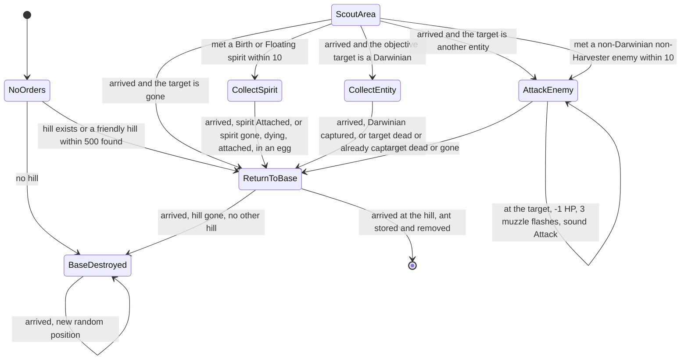

- `SearchForTargets` (spirits first, then enemies) runs every tick while `!m_targetFound`; once a target is found it is not re-searched until a failure clears the flag. It can interrupt any order, including the trip home [C] `ArmyAnt::Advance`, `SearchForTargets`.
- **Delivery at the hill** (`AdvanceReturnToBase`): `hill->m_numAntsInside++`; a carried spirit in `StateAttached` is removed from the world and `m_numSpiritsInside++`; a carried Darwinian in `StateCapturedByAnt` is killed with `ChangeHealth(−2 × health)` (its spirit spawns at the hill); the ant entity is removed (`Advance` returns true) [C].
- **Carrying**: an attached spirit, and a captured Darwinian (`Darwinian::AdvanceCapturedByAnt`), are moved every tick to the ant's `MarkerCarry` marker; if the ant dies the Darwinian returns to Idle [C] `ArmyAnt::GetCarryMarker`, `Darwinian::AdvanceCapturedByAnt`.

### 13.4 ArmyAnt — targeting, terrain and obstacles

- Targets: objective targets chosen by the hill (nearest enemy Darwinian not already captured, any enemy entity, a spirit, or a scout point — [03](03_buildings_and_world_objects.md)); on the way, spirits within 10 (Birth/Floating) and `GetBestEnemy(pos, 0, 10)` excluding Darwinians and Harvesters [C] `ArmyAnt::SearchForSpirits`, `SearchForEnemies`.
- Movement: straight line toward `m_wayPoint` at speed, y snapped to terrain, **no obstruction pushing while walking** (the call is commented out — ants walk through buildings), heading jittered by `syncsfrand(0.2)` rad per tick; arrival when the remaining distance < `|vel|·dt` or < 1. Ballistic fall when `!m_onGround` (thrown by triffid eggs). Engineers are attacked at ground height under them [C] `ArmyAnt::AdvanceToTargetPosition`, `AdvanceAttackEnemy`.
- Darwinians do not run from ants (ArmyAnt is not on the "scary" list) and fight them normally; they also attack enemy AntHills via the 1/500 search (§4.6) [C].

### 13.5 ArmyAnt — death, colour, control, sounds

- Death: base `ChangeHealth` (spirit spawned — but Monster-team spirits are suppressed, so hill ants release none; ants of a player team from an Eggs-crate triffid egg do release spirits) + shape explosion scaled by `m_scale`; drops any attached spirit (`Spirit::CollectorDrops`, inheriting the ant velocity) [C] `ArmyAnt::ChangeHealth`.
- Team colouring: three animation shapes `armyant.shp`, `armyant2.shp`, `armyant3.shp`, each copied and red-region recoloured per team colour/co-op group (cached `<shape>_<colourId>_<groupId>`). Every tick a **different** one of the three is chosen with `syncrand() % 3` (re-rolled until it differs — ≥ 1 synced draw per ant per tick for a purely visual leg animation) [C] `ArmyAnt::SetShape`, `ArmyAnt::Advance`.
- Control: none (monster AI).
- Sounds: "Attack" (bite) + base "LoseHealth", "Die", "Create". VFX: 3 `TypeMuzzleFlash` per bite (velocities from the synced RNG), shape explosion on death [C] `ArmyAnt::AdvanceAttackEnemy`.

## 14 TriffidEgg

`class TriffidEgg : Entity`, type `TypeTriffidEgg` (17) [C] `code/worldobject/triffid.h`, `code/worldobject/triffid.cpp`. [B:FULL]. `TypeTriffidEgg` is in `EntityIsBlocked`. The launching plant `Triffid` is a building ([03](03_buildings_and_world_objects.md)).

### 14.1 TriffidEgg — role and acquisition

- **Role**: a timed monster egg that tumbles, bounces and bursts into a creature group of its `m_spawnType`.
- **Obtained by** [C]:
  - `Triffid::Launch` (Triffids crate, an *uncaptured-crate* outcome only): 1–3 Monster-team Triffids, each launching 3 eggs in MP then burning; spawn mask = every type except `SpawnSpirits` and `SpawnEggs`; egg velocity = launch-marker forward × `m_force × m_size × (1 + syncsfrand(0.2))`; egg `m_size = 1 + syncsfrand(0.3)`; burst timer `4 + syncfrand(4)` s in MP [C] `code/worldobject/crate.cpp:Crate::RunTriffids`, `Triffid::Launch`.
  - `Crate::RunEggs(pos, team)` (Eggs crate task `GlobalResearch::TypeEggSpawn`, or AI `RunEggs`): `2 + syncrand() % 3` (2–4) eggs **owned by the task owner** (02-U2), start `pos + (0,20,0)`, velocity direction `(SFRAND(1), 4, SFRAND(1))` length `50 + syncfrand(50)`; type rolled with `syncrand() % NumSpawnTypes` until it is **not** Spirits, Eggs, SoulDestroyer, Ants or Darwinians → one of Virii, Centipede, Spider, TriffidEggs, SporeGenerator; burst `4 + syncfrand(4)` s; its `m_spawnPoint`/`m_roamRange` writes go to `TriffidEgg`'s own shadowing members and have no effect on the hatchlings [C] `Crate::RunEggs`, `code/worldobject/triffid.h:TriffidEgg`.
  - `SpawnTriffidEggs` (nested): 2–4 eggs at speed `75 + syncfrand(50)` with type `syncrand() % 9` (never Darwinians); in MP a SoulDestroyer roll is re-rolled in Assault or when ≥ 2 exist; these keep the default 20–30 s timer [C] `TriffidEgg::Spawn`.

### 14.2 TriffidEgg — stats

| Item | Value | Ref |
|---|---|---|
| Health | 50 | [C] `data/stats.txt` |
| Speed / Rate | 100 / 1 — unused | [C] |
| Default burst timer | `m_life = 20 + syncfrand(10)` s set in the constructor (the draw happens even when the timer is later overridden), overridden to `4 + syncfrand(4)` by MP launches and `RunEggs` | [C] `TriffidEgg::TriffidEgg`, `Triffid::Launch`, `Crate::RunEggs` |
| Gravity | `vel.y −= 9.8 × m_force` **per tick** (≈98 u/s² at force 1; per-tick constant, §2.1) | [C] `TriffidEgg::Advance` |
| Bounce | below ground + 3: `BounceOffLandscape`, `m_force *= TRIFFIDEGG_BOUNCEFRICTION` (0.65), `vel *= m_force`, y ≥ ground + 3; sound "Bounce" while force > 0.1 | [C] `TriffidEgg::Advance`, `triffid.h` |
| Tumble | `m_up` rotated about `(up × vel)` by `m_force² × 30 × dt`; self-rights when `up.y < 0.3` and force < 0.4 | [C] |
| Damage | **immune to lasers**; otherwise base (spirit, unless Monster team) + shape explosion | [C] `TriffidEgg::ChangeHealth` |
| Lifetime | burst timer | — |

### 14.3 TriffidEgg — state machine

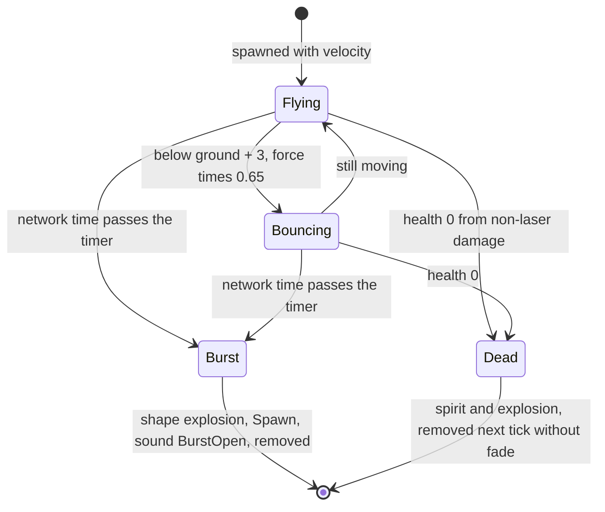

### 14.4 TriffidEgg — what `Spawn()` creates

| # | `Triffid::Spawn*` | Creates (team = egg team unless noted) | SP count | MP count | spread, roam range |
|---|---|---|---|---|---|
| 0 | `SpawnVirii` | Virii | 5–9 | 20–39; **0 if the team already has ≥ 250 Virii** | 0, 100 |
| 1 | `SpawnCentipede` | one Centipede unit of `size` segments | 5–9 | 5–14 | 0, 200 |
| 2 | `SpawnSpider` | 1 Spider | 1 | 1 | 0, 150 |
| 3 | `SpawnSpirits` | spirits, horizontal speed `20 + syncfrand(20)` | 5–9 | 5–9 | — |
| 4 | `SpawnEggs` | Virii `Egg`s, velocity up + random, length `20 + syncfrand(20)` | 5–9 | 5–9 | 0, 0 |
| 5 | `SpawnTriffidEggs` | 2–4 TriffidEggs (§14.1) | 2–4 | 2–4 | 0, 0 |
| 6 | `SpawnAnts` | ArmyAnts thrown up, speed `10 + syncfrand(20)` | 20–29 | 20–29 | 0, 0 |
| 7 | `SpawnSporeGenerator` | 1 SporeGenerator | 1 | 1 | 0, 200 |
| 8 | `SpawnSoulDestroyer` | 1 SoulDestroyer, **on the Monster team in MP**; allowed if (not Assault and fewer than 2 alive) or single-player, otherwise **falls through to `SpawnVirii`** | 1 | 1 | 0, 200 |
| 9 | `SpawnDarwinians` | Darwinians thrown up, speed `10 + syncfrand(20)` | 10–19 | 10–19 | 0, 0 |

Counts use `syncrand()`. A commented-out `SpawnTripod` case exists. `Triffid::GetSpawnName` lists indices 6–9 in a different order from the enum (names only) [C] `TriffidEgg::Spawn`, `Triffid::GetSpawnName`.

### 14.5 TriffidEgg — targeting, terrain, colour, control, sounds

- No targeting; ballistic; bounces off terrain (not buildings); bursts wherever it lies. Darwinians regard it as a scary, grenade-worthy target (§4.6, §4.7).
- Team colouring: `triffidegg.shp` fully team-coloured (`SetShape(…, true)` in `Begin`); pulsating size `m_size + |sin 2t|·(1 − age)·0.4`; shadow `size × 10` [C] `TriffidEgg::Begin`, `TriffidEgg::Render`.
- Control: none (the player only aims the Eggs task).
- Sounds: "Bounce", "BurstOpen" + base events [C].

## 15 Egg

`class Egg : Entity`, type `TypeEgg` (5) [C] `code/worldobject/egg.h`, `code/worldobject/egg.cpp`. [B:FULL] (indirect). `TypeEgg` is in `EntityIsBlocked`.

### 15.1 Egg — role and acquisition

- **Role**: a small Virii egg that, once a spirit is placed inside it, hatches 4 Virii after 15 s — the creature-side "spirit economy".
- **Obtained by**: laid by `SporeGenerator` (at its `MarkerEggs`, inheriting its velocity; 25 % pre-fertilised with a newly spawned spirit) and `Spider` (one egg 45 beyond a spirit); thrown by a `TriffidEgg` of type `SpawnEggs` (crate masks exclude it, so in MP only via nested `SpawnTriffidEggs`) [C] `code/worldobject/sporegenerator.cpp:SporeGenerator::AdvanceEggLaying`, `code/worldobject/spider.cpp:Spider::AdvanceEggLaying`, `code/worldobject/triffid.cpp:TriffidEgg::Spawn`.
- **Fertilisers**: a Virii carrying a spirit (`Virii::AdvanceToEgg` → `Egg::Fertilise(spiritId)`), the SporeGenerator's pre-fertilised eggs; spirits cache nearby dormant eggs (`Spirit::NumNearbyEggs`, range 60) so Virii only fetch spirits that have an egg nearby [C].

### 15.2 Egg — stats

| Item | Value | Ref |
|---|---|---|
| Health | 10 | [C] `data/stats.txt` |
| Speed / Rate | 0 / 0 | [C] |
| `EGG_DORMANTLIFE` | 120 s (`#define`) — **ineffective**, see §15.3 | [C] `egg.h` |
| Hatch time | 15.0 s after fertilisation | [C] `Egg::Advance` |
| Hatch output | 4 Virii of the egg's team, spread 0, roam 200, only if that team has < 250 Virii (`VIRII_POPULATIONLIMIT`); the spirit is consumed either way | [C] `Egg::Advance` |
| Lifetime | until hatched or destroyed | — |

### 15.3 Egg — state machine

States: `StateDormant`, `StateFertilised`, `StateOpen` (declared, never entered) [C] `egg.h`.

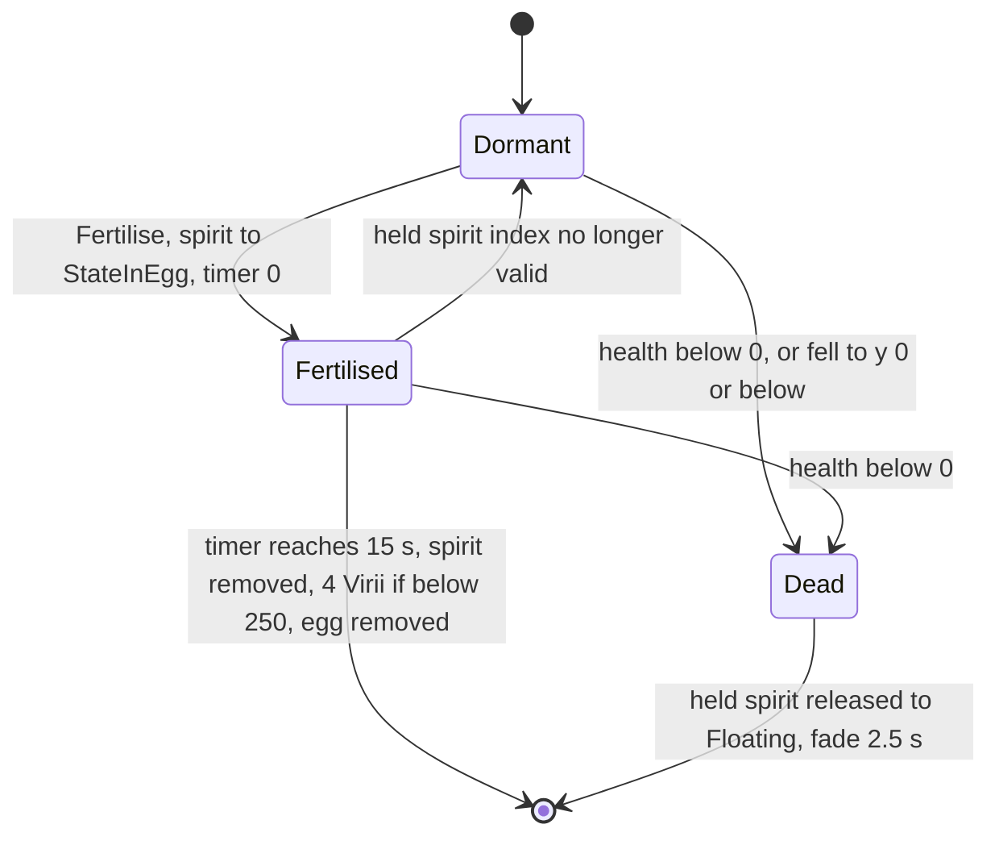

- Every tick, if `m_spiritId` is not a valid spirit slot the egg is forced to Dormant **and its timer reset to 0**; a dormant egg holds no spirit (`m_spiritId = −1`), so its timer never exceeds one tick and the intended decay `health ≤ 10·(1 − timer/120)` never bites ⇒ **dormant eggs persist indefinitely** [C] `Egg::Advance`, `contrib/systemiv/lib/tosser/darray.cpp:DArray::ValidIndex`. Resolved: P05 described a 120 s dormant decay; the reset branch makes it dead code.
- While fertilised the spirit is pinned 3 above the egg each tick.
- Physics: `AdvanceInAir` until grounded, then glued to the terrain (re-airborne if the ground drops away) and `pos += vel·dt`; `y ≤ 0` (water) → `ChangeHealth(−500)` [C].

### 15.4 Egg — damage, death, targeting, colour, control, sounds

- `Egg::ChangeHealth`: any damage; dies only when `health + amount < 0` (strict); **no spirit and no sound** (unlike the base). A held spirit returns to Floating (`Spirit::EggDestroyed`) [C].
- Darwinians ignore eggs as threats (§4.6) — eggs are only destroyed incidentally by explosions.
- Visual: camera-facing 8 × 8 (`size 4`) additive sprite `sprites/egg.bmp`, alpha = health/10 (min 0.1); fertilised eggs add two throbbing sprites growing over the 15 s; dead eggs break into 3 drifting quarter-sprite fragments. The team colour is fetched but the sprite is drawn **white** [C] `Egg::Render`.
- Control: none. Sounds: base "Create" only ("Die" is bound in `data/sounds.txt` as `eggsplat` but never triggered) [C].

## 16 Virii

Classes: `Virii : Entity` (type `TypeVirii` = 3), `ViriiUnit : Unit`, `ViriiHistory` (trail sample) [C] `code/worldobject/virii.h`, `code/worldobject/virii.cpp`. [B:FULL]. `TypeVirii` is not blocked.

### 16.1 Virii — role and acquisition

- **Role**: fast red worm creatures leaving a glowing trail; they bite enemies (20 HP per tick on contact) and ferry floating spirits into Eggs to breed more Virii. Swarm pressure unit of the creature crates.
- **Obtained by** [C]: `TriffidEgg::Spawn` `SpawnVirii` (20–39 in MP, none if the team already has 250; also the fallback when a Soul Destroyer is refused) [C] `code/worldobject/triffid.cpp:TriffidEgg::Spawn`; `Egg::Advance` hatching (4, roam 200) [C] `code/worldobject/egg.cpp:Egg::Advance`; `SpamInfection` converting a spirit (95 % Virii, 5 % Spider, Monster team, roam 200; Infection crate) [C] `code/worldobject/spam.cpp:SpamInfection::AdvanceAttackingSpirit`; cheat window (20 Monster Virii, roam 1000) [B:DEBUG] `code/interface/cheat_window.cpp`; `Cave` [B:LEGACY] `code/worldobject/cave.cpp`.
- All MP creation sites pass `unitId = −1`, so Virii live in `Team::m_others` and are batch-rendered by `Team::RenderVirii` [C] `code/team.cpp:Team::RenderVirii`.

### 16.2 Virii — stats and constants

| Item | Value | Ref |
|---|---|---|
| Health | 10 | [C] `data/stats.txt` |
| Speed | 32 u/s × slope factor `1 + (h_now − h_next)/5` clamped [0.1, 2.0] | [C] `Virii::AdvanceToTargetPos` |
| Rate | 0 | [C] |
| Hover height | 0.1 | [C] `Virii::Virii` |
| `VIRII_MINSEARCHRANGE` / `VIRII_MAXSEARCHRANGE` | 30 / 60 (`#define`) | [C] `virii.h` |
| `VIRII_TAILLENGTH` | 175 (code uses a literal 175.0) | [C] `Virii::RecordHistoryPosition` |
| `VIRII_POPULATIONLIMIT` | 250 per team (`#define`) | [C] `virii.h` |
| Bite | `ChangeHealth(−20)` (Unresistable) on arrival at the enemy | [C] `Virii::AdvanceAttacking` |
| Retarget period (idle) | 1.0 s (first after `syncfrand(2)`) | [C] `Virii::AdvanceIdle`, `Virii::Virii` |
| History sample period (non-idle) | 0.5 s, plus extra non-required samples when height differs > 3 | [C] `Virii::Advance` |
| Fall gravity | −10 u/s²; lands at ground + 2 | [C] `Virii::Advance` |
| Population counter | `Virii::s_viriiPopulation[team]` ++ in `Begin`, −− in the destructor; Virii are excluded from population-cap counting ([03](03_buildings_and_world_objects.md), [05](05_economy_and_population.md)) | [C] `Virii::Begin`, `Virii::~Virii` |
| Lifetime | until killed | — |

### 16.3 Virii — state machine

States `StateIdle`, `StateAttacking`, `StateToSpirit`, `StateToEgg` [C] `virii.h`.

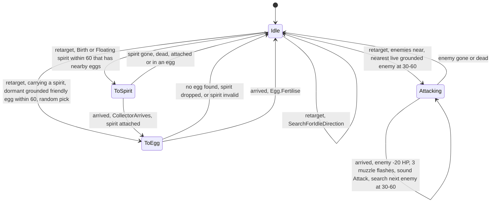

[C] `Virii::AdvanceIdle` (order: eggs if carrying → enemies → spirits → idle direction), `AdvanceAttacking`, `AdvanceToSpirit`, `AdvanceToEgg`, `SearchForEnemies`, `SearchForSpirits`, `SearchForEggs`, `FindNearbyEgg`.
- **Bite cadence**: after a bite the Virii looks for the nearest enemy at ≥ 30; if none it keeps the current target and, being on top of it, bites again next tick — **20 HP per tick (200 HP/s)** while in contact [I] from `Virii::AdvanceAttacking` and the `GetBestEnemy` min-range rule [C] `code/entity_grid.cpp:EntityGrid::GetBestEnemy`.
- **Idle wandering** (`SearchForIdleDirection`): return-to-spawn chance `d/roamRange` (forced 0 below 0.75); returning picks one of 8 compass directions toward the spawn point; otherwise up to 3 tries of a random compass direction `(int(syncfrand(3)) − 1, 0, int(syncfrand(3)) − 1)` whose endpoint (`speed × retargetTimer` ahead) is above sea level. Each new direction records a required history point and plays "ChangeDirection" [C].
- **Spirits targeted**: only Birth/Floating spirits with `NumNearbyEggs() > 0`; carried spirits follow at pos + (0,2,0); dropped (`CollectorDrops`) when the Virii dies [C] `Virii::SearchForSpirits`, `Virii::Advance`.

### 16.4 Virii — targeting, terrain and obstacles

- Targets: `GetBestEnemy(pos, 30, 60, team)` (nearest enemy between 30 and 60, alive, grounded), gated by the unit's `m_enemiesFound` pre-check when the Virii belongs to a `ViriiUnit` [C] `Virii::SearchForEnemies`.
- Movement: compass-direction steering with the slope factor; **no obstruction push** and the water-damage line is commented out ⇒ Virii cross water and pass through buildings; map clamp repeated in `Virii::Advance` [C].
- A laser hit damages but never pushes or turns a Virii (`Laser::Advance` skips `TypeVirii`) [C] `code/worldobject/weapons.cpp:Laser::Advance`.

### 16.5 Virii — death, colour, control, sounds, VFX

- Death: base `ChangeHealth` (spirit unless Monster team, "Die"), velocity zeroed, then 2.5 s fade. `Virii::AdvanceDead()` (trail scatter in 8 compass directions at 10 u/s) is **never called** — it does not override `Entity::AdvanceDead(Unit*)` [C].
- Trail: `m_positionHistory` (newest first) trimmed once its summed length exceeds 175; rendered as a 3-half-width textured worm strip (alpha `wormColour.a − cumulative distance`) plus a 12-half-width glow strip (skipped at detail 4); lower detail levels drop non-required samples and render only `1 − 0.25·min(detail − 1, 2)` of the history [C] `Virii::RecordHistoryPosition`, `Virii::Render`.
- Team colouring: worm colour = team colour × health fraction (alpha 200); glow = RGB(200,100,100) single-player / team colour multiplayer (alpha 150); **Monster-team Virii are drawn white/transparent** (worm (255,255,255,0), glow (200,200,200,50)); dead Virii fade near-white [C] `Virii::Render`. Texture `sprites/viriifull.bmp` [C] `Team::RenderVirii`.
- Control: none. Sounds: "ChangeDirection", "Attack" + base "LoseHealth", "Die", "Create". VFX: 3 `TypeMuzzleFlash` per bite (synced RNG velocities) [C].

### 16.6 ViriiUnit — Virii group container

`class ViriiUnit : Unit { bool m_enemiesFound; bool m_cameraClose; }` [C] `code/worldobject/virii.h`, `virii.cpp`. Created by `Team::NewUnit` whenever the troop type is `TypeVirii` [C] `code/team.cpp:Team::NewUnit`. `Advance(slice)`: `m_enemiesFound = EntityGrid::AreEnemiesPresent(centre, radius + 60, team)` (cheap pre-check before each member's enemy search), then `Unit::Advance`. `Render`: all members in one additive `GL_QUADS` batch with `sprites/viriifull.bmp`, detail 1–4 from the `RenderEntityDetail` preference and camera distance (pref 1: detail 2 beyond 1000; pref 2: 3 beyond 1000 / 2 beyond 500; pref 3: 4 always); `m_cameraClose` unused [C]. **Build tag: [B:LEGACY] in practice** — the only Multiwinia callers of `NewUnit` for Virii would be level instant units with `inUnit = 1` (no shipped MP map has Virii instant units) and teleports re-creating a unit; every live MP spawn site passes `unitId = −1` [C] grep of `NewUnit(` across `code/`. Resolved: P05 tagged ViriiUnit live; the creation sites show it is not created in shipped Multiwinia play.

### 16.7 ViriiHistory — trail sample

`class ViriiHistory { Vector3 m_pos; Vector3 m_right; Vector3 m_glowDiff; double m_distance; bool m_required; }` [C] `code/worldobject/virii.h`. [B:FULL]. One point of a Virii trail: `m_pos` world position; `m_right` perpendicular to the segment on the land normal (strip width direction); `m_glowDiff` the 10-unit step vector toward the previous sample (glow strip); `m_distance` distance to the previous sample (trail length accounting and alpha falloff); `m_required` = true for direction-change/state samples, false for height-smoothing samples (droppable at lower detail). Created by `Virii::RecordHistoryPosition`, stored newest first, trimmed beyond 175 total length [C].

## 17 SporeGenerator

`class SporeGenerator : Entity`, type `TypeSporeGenerator` (6) [C] `code/worldobject/sporegenerator.h`, `code/worldobject/sporegenerator.cpp`. [B:FULL]. Not blocked.

### 17.1 SporeGenerator — role and acquisition

- **Role**: a hovering creature with four tails that drifts around its spawn point and lays Virii Eggs near floating spirits (and at random) — a slow breeding engine that turns spirits into Virii.
- **Obtained by** `TriffidEgg::Spawn` `SpawnSporeGenerator` (Eggs and Triffids crates; roam range 200) [C] `code/worldobject/triffid.cpp:TriffidEgg::Spawn`. Shaman summoning and campaign placements [B:LEGACY].

### 17.2 SporeGenerator — stats and constants

| Item | Value | Ref |
|---|---|---|
| Health | 200 | [C] `data/stats.txt` |
| Speed | 20 u/s (scaled by `distance/50` within 50 of the target) | [C] `SporeGenerator::AdvanceToTargetPosition` |
| Rate | 10 (unused) | [C] |
| `SPOREGENERATOR_HOVERHEIGHT` | 100 (`#define`) — not applied at spawn in multiplayer (spawns at ground level, rises toward targets) | [C] `sporegenerator.cpp`, `SporeGenerator::Begin` |
| `SPOREGENERATOR_EGGLAYHEIGHT` | 20 | [C] |
| `SPOREGENERATOR_SPIRITSEARCHRANGE` | 200 | [C] |
| `SPOREGENERATOR_NUMTAILS` | 4 (`#define`, header) | [C] `sporegenerator.h` |
| Retarget period (idle) | 6.0 s | [C] `SporeGenerator::AdvanceIdle` |
| Egg interval | `2 + syncfrand(2) − difficulty/10` s while within 50 of the lay target (difficulty 0 in MP) | [C] `SporeGenerator::AdvanceEggLaying` |
| Pre-fertilised eggs | 25 % (`syncrand() % 4 == 0`) — a new spirit of the generator's team is spawned in the egg | [C] |
| Random lay chance | `syncfrand(100) < 10 + 20·difficulty/10` ⇒ 10 % per random retarget in MP | [C] `SporeGenerator::SearchForRandomPos` |
| Panic | 10 s after a qualifying hit; velocity set to `up × speed × 3` | [C] `SporeGenerator::ChangeHealth` |
| Lifetime | until killed | — |

### 17.3 SporeGenerator — state machine

States `StateIdle`, `StateEggLaying`, `StatePanic` [C] `sporegenerator.h`.

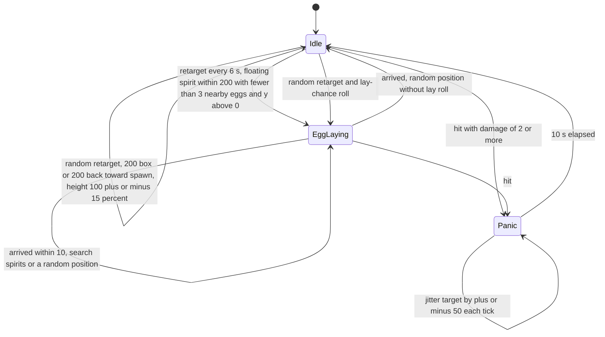

- Lay target: spirit + random offset (±30 on x/z) at 20 up; eggs appear at shape marker `MarkerEggs` with the generator's velocity and team; sound "LayEgg" [C] `SporeGenerator::AdvanceEggLaying`.
- Return-to-spawn rule: chance `d/roamRange` [C] `SporeGenerator::SearchForRandomPos`.

### 17.4 SporeGenerator — targeting, terrain, damage, colour, control, sounds

- Targeting: spirits only (it never attacks). Darwinians treat it as a scary, grenade-worthy target (§4.6, §4.7).
- Movement: `vel = vel·(1 − dt/2) + targetVel·dt/2`, rotated about the right axis by `sin(3·now)·dt·1.5` (deterministic wobble, network time); arrival < 10. Flies — no terrain or building collision [C] `SporeGenerator::AdvanceToTargetPosition`.
- Damage: **immune to lasers**; amounts ≥ −1 ignored; larger hits apply base damage, a partial shape explosion (fraction dead) and Panic; death → base spirit + "Die" [C] `SporeGenerator::ChangeHealth`.
- Team colouring: `sporegenerator.shp` red regions only (`SetShape(…, false)`); four 3-segment quad-strip tails in team colour from markers `MarkerTail01`–`MarkerTail04`, animated with sine offsets and a function-static smoothed velocity shared by all generators (render-only quirk); damaged flicker; 20-unit shadow [C] `SporeGenerator::Render`, `RenderTail`.
- Control: none. Sounds: "LayEgg" + base "Create", "LoseHealth", "Die".

## 18 Centipede

`class Centipede : Entity`, type `TypeCentipede` (9) [C] `code/worldobject/centipede.h`, `code/worldobject/centipede.cpp`. [B:FULL]. Not blocked. Must be created inside a `Unit` (`AppReleaseAssert`) [C] `Centipede::Advance`.

### 18.1 Centipede — role and acquisition

- **Role**: a chain of linked segments (one Entity per segment, all in one generic `Unit`) led by a head that hunts enemies, eats floating spirits and grows; every segment crushes nearby enemies; killing a middle segment splits it in two.
- **Obtained by** `TriffidEgg::Spawn` `SpawnCentipede`: `Team::NewUnit(TypeCentipede, size)` + `SpawnEntities(…, size, spread 0, roam 200)` with `size = 5 + syncrand() % 10` (5–14) in MP, `5 + syncrand() % 5` in SP [C] `code/worldobject/triffid.cpp:TriffidEgg::Spawn`; growth by `Centipede::EatSpirits`. Campaign instant units (with a difficulty-based splitting rule in `LevelFile::ParseInstantUnits`) and Shaman [B:LEGACY].

### 18.2 Centipede — stats and constants

| Item | Value | Ref |
|---|---|---|
| Segment health | 255 × `2 × m_size`, clamped [0, 255] (≥ 255 when size ≥ 0.5; tail size 0.2 → 102) | [C] `Centipede::Begin`, `Centipede::ChangeHealth` |
| Speed | 80 u/s × slope factor `1 + (h_now − h_next)/10` clamped [0.6, 1.0] (only uphill slows) | [C] `Centipede::AdvanceToTargetPosition` |
| Rate | 1 (unused) | [C] |
| Turn blend | `dt × 3` per tick for the head (× 1.5 when trailing) | [C] |
| `CENTIPEDE_MINSEARCHRANGE` / `MAXSEARCHRANGE` | 75 / 150 (enemy search scaled by head `m_size`; spirit search unscaled) | [C] `centipede.h` |
| `CENTIPEDE_SPIRITEATRANGE` | 10 (horizontal) | [C] |
| `CENTIPEDE_NUMSPIRITSTOREGROW` / `_MP` | 4 / 4 | [C] |
| `CENTIPEDE_MAXSIZE` | 20 segments (no eating or spirit seeking above this) | [C] |
| Eat chance | `m_size/2` per candidate spirit per tick, at most one spirit per tick | [C] `Centipede::EatSpirits` |
| Contact damage | every segment, every tick: enemies within `m_radius` (= `10 × m_size` fixed at `Begin`) are pushed out to the radius and take `int((radius − distance)·10)` | [C] `Centipede::Attack` |
| Panic | `2 + syncfrand(2)` s when a hit drops a segment into a lower third of its max health; propagated to every segment toward the head | [C] `Centipede::ChangeHealth`, `Centipede::Panic` |
| Water/building avoidance | a target with y < 0, or a building within 150 ahead (`Location::GetBuildingId(pos, front, 255, 150)`), counts as "arrived" (forces a retarget) | [C] `Centipede::AdvanceToTargetPosition` |
| Arrival | < 20 | [C] |
| Lifetime | until every segment is dead | — |

### 18.3 Centipede — segment logic

- **Linking** (`Centipede::Begin`): when a segment begins without a leader, all segments of its Unit are relinked in unit-array order: entity 0 is the **head** (no `m_next`), each next entity follows the previous (`m_next` = the one in front, `m_prev` = the one behind). Sizes: head `min(0.2 × 1.1^N, 10)`, each following segment ÷ 1.1. Per-team recoloured `centipedehead.shp` / `centipede.shp` (cached `<name>_<colourId>_<groupId>`, statics `s_shapeHead[team]`, `s_shapeBody[team]`) [C] `Centipede::Begin`.
- **Size convergence** every tick: tail target 0.2; others `min(1.1 × size of the segment behind, 1.0)`; the size moves 10 % toward the target when off by > 0.01 and health is rescaled to keep the same fraction ⇒ steady state tail 0.2, ×1.1 per segment toward the head, capped 1.0 [C] `Centipede::Advance`.
- **Following**: a trailing segment copies its leader's interpolated trail point: with the leader's last 3 recorded positions (newest first), `pos = h[k+1] + (h[k] − h[k+1])·(1 − m_size)`, `vel = (h[k] − h[k+1])/dt`, where `k = 0` if the leader's entity index is greater than the follower's (leader not yet advanced this tick) else 1. It inherits the leader's `m_panic`. `m_linked` (render gate) requires a linked leader and ≥ 2 own samples. If the leader dies the segment becomes a new head [C] `Centipede::GetTrailPosition`, `RecordHistoryPosition`.
- **Death of a segment**: base death (spirit), scaled shape explosion, unlinks from both neighbours — a centipede **splits** into two independent centipedes when a middle segment dies. Single-player also explodes on every health-band drop. Dead segments run `Entity::AdvanceDead` only (`Centipede::Advance` never calls `Entity::Advance`) [C].
- **Growth** (`EatSpirits`, head only): after ≥ 4 eaten spirits, `floor(eaten/4)` new segments are appended behind the current tail (new Unit entity, size = tail size ≥ 0.2, placed at `m_spawnPoint`), sound "Grow" [C].
- `GetSize` counts segments from this one backwards through `m_prev` [C].

### 18.4 Centipede — head state machine

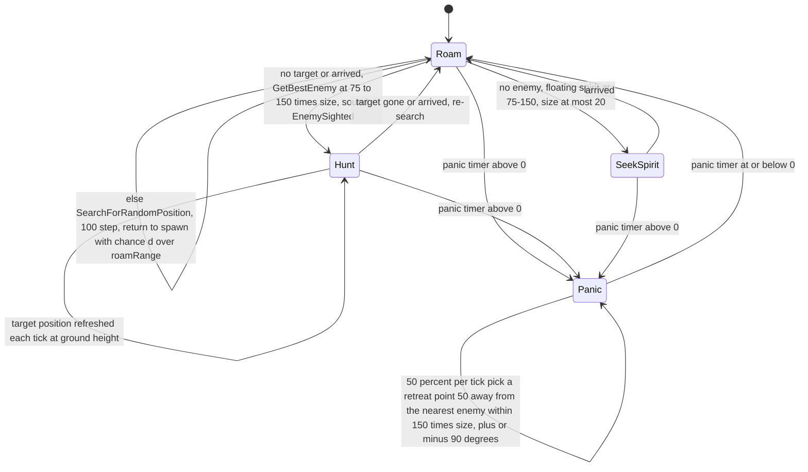

[C] `Centipede::Advance`, `SearchForTargetEnemy`, `SearchForSpirits`, `SearchForRandomPosition`, `SearchForRetreatPosition`. Every tick, head and body, `EatSpirits` (head only) and `Attack(pos)` run regardless of state.

### 18.5 Centipede — targeting, terrain, damage, colour, control, sounds

- Targeting: nearest enemy at `[75·size, 150·size]` (`GetBestEnemy`); contact damage hits every enemy within each segment's radius. Darwinians fight centipedes normally (not on the scary list).
- Terrain: ground walker; refuses targets in water and steers away from buildings 150 ahead (§18.2); no building push otherwise.
- Damage: every type including lasers; Panic on dropping a health third.
- Team colouring: red regions of `centipedehead.shp` / `centipede.shp` recoloured; rendered aligned to the terrain normal [C] `Centipede::Begin`, `Centipede::Render`.
- Control: none. Sounds: "Panic" (entering panic), "EnemySighted", "Grow", "Attack" (each contact) + base "LoseHealth", "Die", "Create". VFX: shape explosions; a D3D tearing effect is commented out.

## 19 Spider

`class Spider : Entity`, type `TypeSpider` (11) [C] `code/worldobject/spider.h`, `code/worldobject/spider.cpp`. [B:FULL]. Not blocked.

### 19.1 Spider — role and acquisition

- **Role**: a large walker with 8 procedurally animated legs (`EntityLeg`, §20) that pounces on enemies from up to 150 away, crushing everything where it lands, and lays Virii eggs near spirits.
- **Obtained by** `TriffidEgg::Spawn` `SpawnSpider` (Eggs/Triffids crates; roam 150) and `SpamInfection` (5 % of spirit conversions, Monster team, roam 200) [C] `code/worldobject/triffid.cpp:TriffidEgg::Spawn`, `code/worldobject/spam.cpp:SpamInfection::AdvanceAttackingSpirit`. Campaign and Shaman paths [B:LEGACY].

### 19.2 Spider — stats and constants

| Item | Value | Ref |
|---|---|---|
| Health | 200 | [C] `data/stats.txt` |
| Speed | blueprint 50 **unused**; walking speed `min(distance, 30)` u/s | [C] `Spider::AdvanceToTarget` |
| Rate | 1 (unused) | [C] |
| `SPIDER_NUM_LEGS` | 8 | [C] `spider.h` |
| `HOVER_HEIGHT` | 3.0 (body follows terrain + hover with blend `dt` per tick) | [C] `spider.cpp`, `Spider::Advance` |
| `TURN_RATE` | 0.1 rad/tick (0.05 when dot > 0.9); must face within dot 0.999 before `FaceTarget` succeeds; moves only when dot > 0.5 | [C] `Spider::FaceTarget`, `AdvanceToTarget` |
| `ATTACK_SEARCH_MIN_RADIUS` / `MAX_RADIUS` | 100 / 250 | [C] |
| `SPIRIT_MINSEARCHRANGE` / `MAXSEARCHRANGE` | 30 / 100 (spirits higher than 10 with < 3 nearby eggs) | [C] `Spider::SearchForSpirits` |
| `MAX_PATH_HEIGHT` | 100 (a random wander target is rejected if the path crosses terrain > 100 or < 0.1; 10 tries) | [C] `Spider::IsPathOK`, `SearchForRandomPos` |
| Pounce trigger | facing and ≤ 150 from the pounce target | [C] `Spider::AdvanceAttack` |
| Pounce launch | `vel = normalise(dir with y = 0.5) × 24·√distance` | [C] |
| Pounce gravity | `vel.y −= 40` **per tick** (per-tick constant) | [C] `Spider::AdvancePouncing` |
| Landing squash | enemies within 40: `fraction = (40 − d)/40 × (1 + syncfrand(0.3))`; those within **20** take `100 × fraction` damage; all are pushed (`front` with y = 5·|front|, length `min(30·fraction, 20)`) and made airborne | [C] `Spider::AdvancePouncing` |
| Retarget | 5 s idle/egg-laying; 3 s set at pounce; 6 s after landing | [C] |
| Spider–spider avoidance | another spider within 22 of `pos + vel` → retarget 40 along the summed escape vector (uses `syncrand() % numFound`: picks a random neighbour, not the spider found — bug) | [C] `Spider::DetectCollisions` |
| Unused `#define`s | `NORMAL_SPEED` 300, `ATTACK_SPEED` 90, `ATTACK_PREAMBLE` 5; `FOOT_DAMAGE_RADIUS` 20 and `FOOT_DAMAGE_STRENGTH` 10 are used only by `StompFoot`, whose only call is commented out | [C] `spider.cpp` |
| Gait `#define`s | `FOOT_MOVE_THRESHOLD` 5, `FOOT_EMERGENCY_THRESHOLD` 12 | [C] `Spider::CalcWhichFootToMove` |
| Lifetime | until killed | — |

### 19.3 Spider — state machine

States `StateIdle`, `StateEggLaying`, `StateAttack`, `StatePouncing` [C] `spider.h`.

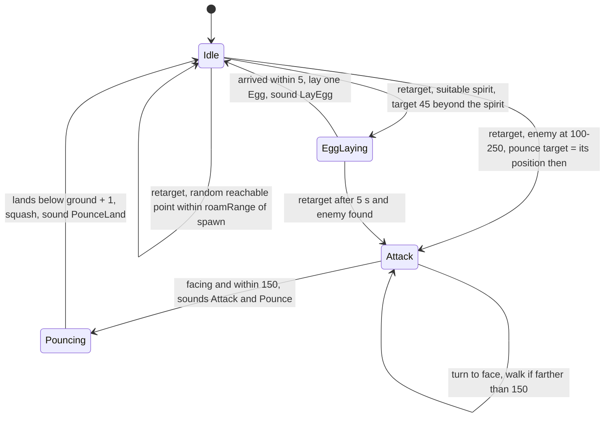

[C] `Spider::Advance`, `AdvanceIdle`, `AdvanceEggLaying`, `AdvanceAttack`, `AdvancePouncing`. The pounce target is a **position snapshot** taken at search time; the spider does not track the moving enemy [C] `Spider::SearchForEnemies`.

### 19.4 Spider — legs and gait

`Spider::Advance` runs the state handler, then either `UpdateLegsPouncing` (each leg `EntityLeg::AdvanceSpiderPounce(2 × seconds since pounce)`) or, on the ground, eases the body to terrain + 3 and calls `UpdateLegs` [C] `Spider::Advance` (resolved: P05's constant table said the `UpdateLegs` call is commented out — only the `StompFoot` call inside it is). `UpdateLegs`: up to two feet lifted per tick via `CalcWhichFootToMove` (emergency lift for any planted foot scoring > 12; otherwise the best score > 5 is lifted and further lifts are locked out for `m_delayBetweenLifts`, measured in network time); the active `SpiderParameters` set is the one whose `m_idealSpeed` is nearest |vel|; leg parameters are copied from it (`m_idealLegSlope × 2.5`); each leg's `Advance()` plants feet, and every plant plays "FootFall" [C] `Spider::UpdateLegs`, `Spider::CalcWhichFootToMove`. Leg swing timing uses the wall clock (`g_gameTime`, §20.4); foot state affects only rendering, sounds and the lift lock-out, not the body position [I].

### 19.5 Spider — targeting, terrain, damage, colour, control, sounds

- Targeting: nearest enemy at 100–250 (snapshot); spirits for egg laying. Darwinians treat spiders as scary, grenade-worthy targets.
- Terrain: walks over terrain (body height from the heightmap), wander paths limited to height 0.1–100; no building push.
- Damage: **immune to lasers**; amounts ≥ −1 ignored; others base + partial shape explosion; death → base spirit (unless Monster team) + "Die" [C] `Spider::ChangeHealth`.
- Team colouring: `spider.shp` fully team-coloured (`SetShape(…, true)` in `Begin`); legs `spider_leg_upper.shp` / `spider_leg_lower.shp` (not recoloured); markers `MarkerEggLay`, `MarkerLeg0`–`MarkerLeg7`; damaged flicker scales the body; [B:D3D] tearing deform path behind a pounce [C] `Spider::Begin`, `Spider::Render`, `Spider::AdvancePouncing`.
- Control: none. Sounds: "Pounce", "PounceLand", "FootFall", "LayEgg", "Attack" + base.

### 19.6 SpiderParameters — gait parameter set

`class SpiderParameters { double m_legLift; double m_idealLegSlope; double m_legSwingDuration; double m_delayBetweenLifts; double m_lookAheadCoef; double m_idealSpeed; }` [C] `code/worldobject/spider.h`. [B:FULL]. `Spider` owns three instances initialised in its constructor; the spider starts with set 2 and `UpdateLegs` switches each tick to the set whose ideal speed is nearest the current speed [C] `Spider::Spider`, `Spider::UpdateLegs`:

| Set | `m_idealSpeed` | `m_legLift` | `m_idealLegSlope` (× 2.5 when applied) | `m_legSwingDuration` | `m_delayBetweenLifts` | `m_lookAheadCoef` |
|---|---|---|---|---|---|---|
| 0 | 10 | 3.0 | 2.6 | 0.4 s | 0.11 s | 0.75 |
| 1 | 30 | 3.0 | 2.6 | 0.25 s | 0.06 s | 0.3 |
| 2 | 50 | 3.0 | 2.6 | 0.25 s | 0.04 s | 0.2 |

## 20 EntityLeg

Classes `EntityLeg` and `EntityFoot` (no base) [C] `code/worldobject/entity_leg.h`, `code/worldobject/entity_leg.cpp`. Procedural leg helper owned by `Spider` (8 legs, **live — [B:FULL]**) and `Tripod` (3 legs, [B:LEGACY]). Resolved: P03 stated that only the (blocked) Tripod uses `EntityLeg` and that the spider has its own gait; the code shows `Spider::Begin` creates `new EntityLeg(i, this, "spider_leg_upper.shp", "spider_leg_lower.shp", "MarkerLeg<i>")` and drives them every tick [C] `code/worldobject/spider.cpp:Spider::Begin`, `Spider::UpdateLegs`. Animation background: [26](26_animation_and_vfx.md).

### 20.1 EntityFoot — data

`EntityFoot { Vector3 m_pos; Vector3 m_targetPos; FootState m_state ∈ {OnGround, Swinging, Pouncing}; double m_leftGroundTimeStamp; Vector3 m_lastGroundPos; Vector3 m_bodyToFoot; }` — `m_bodyToFoot` is used while pouncing [C] `entity_leg.h`.

### 20.2 EntityLeg — data

Tuning: `m_legLift` (foot lift height), `m_idealLegSlope` (0 = vertical, 1 = 45°), `m_legSwingDuration` (s), `m_lookAheadCoef` (velocity look-ahead). State: `m_legNum`, `m_foot`, `m_rootMarker` (marker on the parent shape), `m_shapeUpper`/`m_shapeLower` (thigh/shin shapes), `m_thighLen`/`m_shinLen` (distance to each shape's `MarkerEnd`), `m_parent` [C] `entity_leg.h`, `EntityLeg::EntityLeg`.

### 20.3 EntityLeg — algorithm

1. **Leg root** = parent shape marker transformed by `Matrix34(parent.front, up, parent.pos)` (`GetLegRootPos`).
2. **Foot home** (`CalcFootHomePos(hover)`): root + horizontal(root − body centre) × groundNormal.y × (`idealLegSlope × hover`), then y −= hover — the foot splays outward in proportion to body height.
3. **Desire to move** (`CalcFootsDesireToMove`): distance from the foot to its home (the direction weighting is a constant 1). The owner decides which foot to lift (Spider: up to two per tick with thresholds 12/5 and a lock-out; Tripod: one at a time when all are planted and score > 1.0).
4. **Lift** (`LiftFoot`): target = home + parent velocity rotated by half the expected yaw (`1.2 × angVel.y × 0.5`) × `lookAheadCoef`, y snapped to terrain; state Swinging; `m_leftGroundTimeStamp = g_gameTime`; last ground position remembered.
5. **Swing** (`Advance`): `f = RampUpAndDown(start, duration, g_gameTime)` (ease-in-out `2t²` for t < 0.5, else `1 − 2(1 − t)²`; 1.0001 after the duration) → position = lerp(lastGround, target, f) + vertical arc (`3·f·lift` in the first third, `3·(1 − f)·lift` in the last third, `lift` in between). `f > 1` → **plant** (pos = target, OnGround), return true.
6. **Knee** (`CalcKneePos`): rotate the vector foot → root, scaled to the shin length, about the horizontal axis perpendicular to centre → root by `θ = −acos(min(1, 0.4·|root − foot| / thighLen))`. Shin rendered foot → knee, thigh knee → root (`Render`; `RenderPixelEffect` marks pixel-effect cells).
7. **Pounce** (`AdvanceSpiderPounce(f)`): foot = body − bodyToFoot × (1 − f for f < 0.5, else f) + vel × f × 0.05; last-ground and target set to it.

### 20.4 EntityLeg — determinism and behaviour notes

Swing timing uses `g_gameTime`, which is **wall-clock** (§2.1), and `PlantFoot` timing therefore differs between peers [C]. For the Spider, foot positions feed only rendering, the "FootFall" sound and the network-time lift lock-out, not the body position or any synced RNG, so the divergence stays cosmetic [I]; for the Tripod the foot state also drives the body fall (legacy). A new engine must drive legs from simulation time or keep them strictly presentational. No RNG is used [C].

## 21 SoulDestroyer

`class SoulDestroyer : Entity` (type `TypeSoulDestroyer` = 16) and `class Zombie : WorldObject` (effect `EffectZombie`) [C] `code/worldobject/souldestroyer.h`, `code/worldobject/souldestroyer.cpp`. [B:FULL]. Not blocked.

### 21.1 SoulDestroyer — role and acquisition

- **Role**: a fast flying serpent (head + tail drawn from its own position history) that dives through enemies, killing them and **destroying their spirits** (souls never return to the economy). The strongest monster.
- **Obtained by** `TriffidEgg::Spawn` `SpawnSoulDestroyer`: from Triffids-crate triffids (their spawn mask includes it) and from `SpawnTriffidEggs` sub-eggs (Eggs or Triffids crates; the Eggs crate excludes it from its first roll). Multiplayer limits: never in Assault, at most **2** alive (`s_numSoulDestroyers < 2`), always on the **Monster team**; otherwise the egg yields Virii (roam 200) [C] `code/worldobject/triffid.cpp:TriffidEgg::Spawn`, `code/worldobject/crate.cpp:Crate::RunEggs`, `Crate::RunTriffids`. Campaign placements and Shaman [B:LEGACY].

### 21.2 SoulDestroyer — stats and constants

| Item | Value | Ref |
|---|---|---|
| Health | 255 | [C] `data/stats.txt` |
| Speed | blueprint 150 is **overridden by a hard-coded 130 u/s** | [C] `SoulDestroyer::AdvanceToTargetPosition` |
| Rate | 1 (unused) | [C] |
| `SOULDESTROYER_MINSEARCHRANGE` / `MAXSEARCHRANGE` | 200 / 300 (target dropped beyond 300) | [C] `souldestroyer.h`, `SoulDestroyer::Advance` |
| `SOULDESTROYER_DAMAGERANGE` | 25: every tick (when `m_panic < 0.1`) each enemy within 25 is pushed out to 25 (grid record updated) and takes `int((25 − d)·50)` — a direct hit ≈ −1250, an instant kill | [C] `SoulDestroyer::Attack` |
| `SOULDESTROYER_MAXSPIRITS` | 50 (render-only "eaten soul" list) | [C] |
| Turn blend | `dt × 2` per tick; without a target entity the heading weaves: target direction rotated about the right axis by `sin(6·now)·1.5` rad | [C] `SoulDestroyer::AdvanceToTargetPosition` |
| Ground avoidance | if the point 50 ahead along the target direction is under terrain → steer straight up | [C] |
| Arrival / retarget | < 40; retarget every 5 s or on arrival | [C] `SoulDestroyer::Advance` |
| Acquire rule | only when ≥ 50 above terrain and not on a scripted route (`m_routeId == −1`); nearest enemy at 200–300 (sound "EnemySighted") | [C] `SoulDestroyer::SearchForTargetEnemy` |
| Wander | 160 steps at `100 ± 50` above terrain; return-to-spawn chance `horizontal d / roamRange` (roam 200 when egg-spawned) | [C] `SoulDestroyer::SearchForRandomPosition` |
| Panic | any non-laser hit → `Panic(2 + syncfrand(2))` s; while panicking, 50 %/tick retreat 50 directly away (±90°) from the nearest enemy within 300 (y capped 300), no attacks | [C] `SoulDestroyer::ChangeHealth`, `SearchForRetreatPosition` |
| Tail length | `clamp(roamRange/30, 9, 25)` history samples of the tail marker (9 when egg-spawned) | [C] `SoulDestroyer::RecordHistoryPosition` |
| Hit radius | shape radius × 1.5 | [C] `SoulDestroyer::Begin` |
| Spawn | at terrain height (rises after) | [C] |
| Route trigger distance | 50 (scripted routes, legacy) | [C] `SoulDestroyer::SoulDestroyer` |
| Counter | `s_numSoulDestroyers` ++ctor / −−dtor; reset in `Location::Init` | [C] |
| Lifetime | until killed | — |

### 21.3 SoulDestroyer — state machine

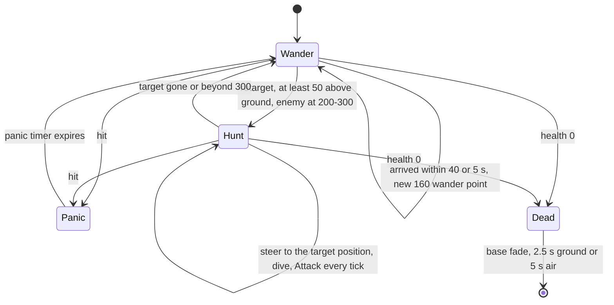

### 21.4 SoulDestroyer — soul destruction and targeting

When its contact damage kills an entity, the spirit just spawned by that death (`Location::GetSpirit(victimId)`) is **removed** from the world; if the victim was a Darwinian a **Zombie** is created at the corpse (front = victim front, up tilted by `syncsfrand(1)`, velocity = 0.5 × SoulDestroyer velocity with y = `20 + syncfrand(25)`, team = victim team). The eaten soul is added to a render list (time stamp from the wall clock, slot chosen by unsynced `AppRandom` when full) and drawn orbiting the head as fading red-brown sprites for 60 s [C] `SoulDestroyer::Attack`, `SoulDestroyer::Render`, `SoulDestroyer::RenderSpirit`. Targets: enemies only (`GetEnemies`), all entity types. Darwinians always run from it (scary list, §4.6).

### 21.5 SoulDestroyer — damage, terrain, colour, control, sounds

- Damage: **lasers ignored**; only negative amounts processed; base death (spirit — moot for the Monster team); bug: `ChangeHealth` explodes every tail segment on **every** hit, not only on death (`if( fractionDead )` with fractionDead ≥ 0.5) [C] `SoulDestroyer::ChangeHealth`.
- Terrain: flies; steers up when the terrain ahead is higher.
- Team colouring: per-team red-region recoloured `souldestroyerhead.shp` and `souldestroyertail.shp` (marker `MarkerTail`); tail segment scale `max(1.5·(1 − i/n), 0.5)`, last one 0.8; shadows 50 (head) and `20 × scale`; [B:D3D] tearing deform along the tail [C] `SoulDestroyer::Begin`, `RenderShapes`, `Advance`.
- Control: none (`SetWaypoint` sets `m_targetPos` for scripted use).
- Sounds: "EnemySighted", "Panic", "Attack" (per contact) + base "Create", "LoseHealth", "Die".

### 21.6 Zombie — ghost effect

`class Zombie : WorldObject` (`m_type = EffectZombie`) [C] `code/worldobject/souldestroyer.h`, `souldestroyer.cpp:Zombie::Zombie`, `Zombie::Advance`, `Zombie::Render`. [B:FULL]. A purely visual ghost left behind by Darwinians killed by a SoulDestroyer or by Dark-Forest evil trees ([03](03_buildings_and_world_objects.md) `Tree::Advance`); also by legacy Shaman sacrifice. Nothing else reads `EffectZombie` [C].

| Item | Value | Ref |
|---|---|---|
| Constructor | `m_positionOffset = syncfrand(10)`, axis rates `syncfrand(2)` × 3 | [C] |
| Life | 600 s, then removed | [C] `Zombie::Advance` |
| Motion | `vel *= 0.9` per tick; wobble like a spirit (rates random-walk `syncsfrand(1)` per tick in [0, 2], `hover = sin(offset) × rate`) | [C] |
| Render | 5 (inner) + 10 (outer) `sprites/ghost.bmp` quads, colour (0.9, 0.9, 1.0), alpha `clamp(1 − life/10, 0.1, 0.7)`, outer `(0.7 − alpha) × 0.1`, fading over the final 100 s | [C] `Zombie::Render` |

Zombies consume 3 synced random numbers per tick each for a cosmetic wobble ([22](22_determinism_and_networking.md)).

## 22 Meteor

_Pending — being written._

## 23 SpaceShip

_Pending — being written._

## 24 AI

_Pending — being written._

## 25 Tank

_Pending — being written._

## 26 LaserTrooper

_Pending — being written._

## 27 Shaman

_Pending — being written._

## 28 DropShip

_Pending — being written._

## 29 Tripod

_Pending — being written._

## 30 Tentacle

_Pending — being written._

## 31 Lander

_Pending — being written._

## 32 Control model summary

_Pending — being written._

## 33 Cross-entity summaries

_Pending — being written._

## Open questions and unknowns

_Pending — being written._

## Docs-vs-code discrepancies

_Pending — being written._

## IP items

_Pending — being written._

## Source map

_Pending — being written._

## Appendix — dead/legacy code

_Pending — being written._

