# 03 — Buildings and world objects

> Part A · Baseline build: Release|Win32 (OpenGL) + TARGET_PC_FULLGAME ([B:FULL]); see _work/build_matrix.md.
> Evidence: [C] confirmed · [I] inferred · [U] unknown. Citations are `path:Symbol` relative to the multiwinia/ source root.
> Sources merged: P06_buildings_core, P07_buildings_misc, P02_game_modes (§5 mode buildings), P05_entities_creatures (AntHill, Triffid, Spam, WallBuster), P08_crates_ai (AITarget, AIObjective, AIObjectiveMarker, AISpawnPoint), P03/P04 cross-notes (Darwinian port/carry behaviour, Engineer), routed `_meta_*` notes; re-verified against the source tree (commit `f909630`). Census tables regenerated by `_work/scripts/S_03_building_census.py` and `_work/scripts/S_03_master_table.py`.

## Contents

- [1 Scope, conventions and map census](#1-scope-conventions-and-map-census)
- [2 Master table of building types](#2-master-table-of-building-types)
- [3 Building base class](#3-building-base-class)
- [4 Spawn network](#4-spawn-network)
- [5 Contestable utility buildings](#5-contestable-utility-buildings)
- [6 Power network](#6-power-network)
- [7 Barriers, scenery and markers](#7-barriers-scenery-and-markers)
- [8 Mode objective objects](#8-mode-objective-objects)
- [9 Crate-spawned world objects](#9-crate-spawned-world-objects)
- [10 AI marker buildings](#10-ai-marker-buildings)
- [11 Compiled, loadable, but unused by shipped content](#11-compiled-loadable-but-unused-by-shipped-content)
- [12 Darwinia-legacy buildings (blocked)](#12-darwinia-legacy-buildings-blocked)
- [13 Multiwinia-live set summary](#13-multiwinia-live-set-summary)
- [14 Consolidated constants](#14-consolidated-constants)
- [15 Defects, determinism and implementation hazards](#15-defects-determinism-and-implementation-hazards)
- [Open questions and unknowns](#open-questions-and-unknowns)
- [Docs-vs-code discrepancies](#docs-vs-code-discrepancies)
- [IP items](#ip-items)
- [Source map](#source-map)
- [Appendix — dead/legacy code](#appendix--deadlegacy-code)

## 1 Scope, conventions and map census

### 1.1 What this document covers

Every class derived from `Building` (the level-placeable / statically-positioned world-object hierarchy), plus the non-`Building` helper objects that only exist to serve buildings (`BuildingPort`, `SpawnBuildingLink`, `SpawnBuildingSpirit`, `MineCart`, `SpiritStore`, `UnprocessedSpirit`, `Flag`, `Randomiser`). For each type: function, capture/ownership rules, inputs/outputs (spirits, Darwinians, power, fuel), activation conditions, links to other buildings, damageability, mode usage and level-file parameters, with a Mermaid state machine where the type is stateful. [C] class list from `code/worldobject/*.h` (`_work/class_assignment.csv`).

Owned elsewhere (linked, not repeated):
- Every mobile entity type (every value of the `Entity::Type*` enum, e.g. Darwinian, Officer, Armour, ArmyAnt, TriffidEgg, Tentacle, Engineer) → [02](02_units_and_entities.md).
- `Crate` (enum value 65) and every crate outcome's selection rules → [04](04_crates_powerups_and_weapons.md); this document only specifies the buildings that crate outcomes create (GunTurret, AntHill, Triffid, Portal, Randomiser, Trees).
- Spawn-point economy formulae (burst/pause rate, population caps, handicap, trunk-port reinforcement waves, spirit lifecycle) → [05](05_economy_and_population.md). Here each spawn building's function and parameters are given and the formulae are linked.
- Game-mode rules that read buildings (KOTH scoring, CTS scoring, Blitzkrieg elimination, Assault timer, Rocket Riot win) → [01](01_game_modes.md).
- AI use of AITargets/objectives → [07](07_ai.md).
- Level-file grammar as a whole → [08](08_levels_and_level_design.md) and [29](29_data_formats_reference.md); entity/building simulation model → [21](21_simulation_and_entity_model.md); determinism → [22](22_determinism_and_networking.md); rendering details → [24](24_rendering.md).

### 1.2 Time base

- One simulation tick = `SERVER_ADVANCE_PERIOD` = `0.1 × GameTimer::m_gameSpeed` game seconds (0.1 s at normal speed; the Slow-down/Speed-up crates change `m_gameSpeed`). [C] `code/gametimer.h:SERVER_ADVANCE_PERIOD`, `code/gametimer.cpp:GameTimer::GetServerAdvancePeriod`.
- `GetNetworkTime()` is a macro for `g_gameTimer.GetGameTime()`; both are the same synced game clock, advanced by `SERVER_ADVANCE_PERIOD` per tick in `GameTimer::Tick` unless paused. Resolved: P06 listed this as unknown (P06-U2); the code shows `#define GetNetworkTime g_gameTimer.GetGameTime`. [C] `code/gametimer.h`.
- Buildings are advanced in `Location::AdvanceBuildings(slice)`; the building list is split into `NUM_SLICES_PER_FRAME` = 10 slices, so each building's `Advance()` runs once per tick, in one of the 10 slices. [C] `code/location.cpp:Location::AdvanceBuildings`, `code/globals.h:NUM_SLICES_PER_FRAME`; [I] "once per tick" assumes every slice 0–9 is processed each tick (see [21](21_simulation_and_entity_model.md)).
- Timers written `if (GetNetworkTime() > m_timer) { …; m_timer = GetNetworkTime() + 1.0; }` fire after 10 or 11 ticks depending on floating-point accumulation of 0.1 (strict `>` on a summed double) — usually 11 ticks ≈ 1.1 s. Affects MultiwiniaZone recounts, CarryableBuilding ownership, SpawnPopulationLock overpopulation. [I] reasoning on IEEE double sums; the mode-level consequence is in [01](01_game_modes.md).
- Logic expressed **per tick** (fixed probabilities, `+1 per tick` growth) does not scale with game speed, whereas logic using `SERVER_ADVANCE_PERIOD` does. Per-tick items are flagged in each section.

### 1.3 Teams, ownership and friendship

- A building's owner is the team byte inside its `WorldObjectId` (`m_id.GetTeamId()`, `unsigned char`). Teams 0–5 (`NUM_TEAMS` = 6), **255 = neutral**. In Multiwinia every building is constructed neutral (255); single-player Darwinia used team 1. [C] `code/worldobject/building.cpp:Building::Building`, `code/worldobject/worldobject.h:WorldObjectId`, `code/globals.h:NUM_TEAMS`.
- `Location::IsFriend(a, b)`: false if either is 255; in Multiwinia, co-op mode compares `m_coopGroups[a] == m_coopGroups[b]`, otherwise `a == b`. (The single-player 6×6 table is [B:LEGACY].) [C] `code/location.cpp:Location::IsFriend`.
- The level file stores a **map position** (0–5) or 255 in the team column; at instantiation it is remapped to the lobby team holding that position via `Location::GetTeamFromPosition` (255 if no team occupies it). [C] `code/location.cpp:Location::GetTeamFromPosition` and the building-instantiation loop in `Location::Init`.
- The Monster team (`Location::GetMonsterTeamId`) and the Futurewinian team (`Location::GetFuturewinianTeamId`) are special CPU teams used by crate outcomes; several buildings special-case them. [C] references in each section.

### 1.4 Damage sign convention

`Building::Damage(d)` receives a **negative** number for harm (`GunTurret: m_health += d`). Explosions call `building->Damage(−damage × falloff)`. A positive argument heals or is ignored. (Cave is the exception that tests `d > 80`, so it is effectively indestructible — §12.16.) [C] `code/worldobject/gunturret.cpp:GunTurret::Damage`, `code/location.cpp:Location::Bang`.

### 1.5 Shipped-map census

Definitions used by every "map count" in this document [C] `data/levels/level_enum.txt` + `_work/scripts/S_03_building_census.py`:
- **Official** = the 49 `mp_*.txt` files listed in `data/levels/level_enum.txt` and present in `data/levels/` (entries 50–59, the PDLC maps, are listed but absent from the tree).
- **Dev** = the 8 other `mp_*.txt` files: `mp_assault_stress` (GameTypes none), `mp_benchmark_1` (none), `mp_cts_3p_3` (CTS, not in the enum), `mp_sandbox` (none), `mp_sandbox_all` (none), `mp_tankbattle_2P/3P/4P` (TankBattle, [B:DEBUG] mode). Resolved: P06 counted "9 dev files"; a recount gives 8 (57 `mp_*` files − 49 official).
- **Campaign** = the 30 Darwinia `map_*` / `mission_*` files; **old** = `data/levels/old/*` (Multiwinia prototype maps). Both are unreachable in FULL ([B:LEGACY]).
- **Mode** of an official map = its `GameTypes` line (not its file name). Official maps per mode: Domination 9 (`mp_domination_*` ×5, `mp_koth_2P_2`, `mp_koth_2P_3`, `mp_skirmish_2p_4`, `mp_skirmish_3P_1`), King of the Hill 9 (the other 9 `mp_koth_*`), Capture the Statue 9, Assault 8, Rocket Riot 7, Blitzkrieg 7. [C] `GameTypes` lines.

Status codes used in the tables: **LIVE-L** = placed by official maps; **LIVE-R** = created at runtime by live FULL code; **LIVE-L+R** = both; **UNUSED** = compiled, not blocked, loadable from a level file, but placed by no official map; **DEBUG** = only reachable under `TARGET_DEBUG` ([B:DEBUG]); **LEGACY** = blocked by `BuildingIsBlocked` and never created by live code ([B:LEGACY]).

## 2 Master table of building types

### 2.1 Building type enum (all 75 values)

`Building::Type*` is an anonymous enum in `building.h` with 75 values (`TypeInvalid` = 0 … `TypeSmokeMarker` = 74) followed by `NumBuildingTypes` = 75; the level-file name table in `Building::GetTypeName` has exactly 75 entries in the same order (source comment: "These must be in the same order as defined in building.h"). Blocked = listed in `Building::BuildingIsBlocked` (39 types). Forced global = `CreateBuilding(int)` sets `m_isGlobal = true` (6 types). [C] `code/worldobject/building.h`, `code/worldobject/building.cpp:GetTypeName`, `BuildingIsBlocked`, `CreateBuilding`. Table generated by `_work/scripts/S_03_master_table.py`.

| # | Enum | Level-file name | Class | Blocked | Forced global | Official MP maps (lines) | Dev mp_ maps | Campaign / old maps | Modes in official maps (maps/total) | MW status | Section |
|---|---|---|---|---|---|---|---|---|---|---|---|
| 0 | `TypeInvalid` | `Invalid` | — (NULL) | no |  | 0 (0) | 0 | 0 / 0 | – | n/a | – |
| 1 | `TypeFactory` | `Factory` | `Factory` | **yes** |  | 0 (0) | 0 | 0 / 0 | – | LEGACY | [§12.10](#1210-factory) |
| 2 | `TypeCave` | `Cave` | `Cave` | **yes** |  | 0 (0) | 0 | 0 / 0 | – | LEGACY | [§12.16](#1216-cave) |
| 3 | `TypeRadarDish` | `RadarDish` | `RadarDish` | no | yes | 7 (46) | 0 | 11 / 4 | Assault:3/8 Domination:2/9 KingOfTheHill:2/9 | LIVE-L | [§5.3](#53-radardish) |
| 4 | `TypeLaserFence` | `LaserFence` | `LaserFence` | no |  | 14 (677) | 1 | 1 / 1 | Assault:6/8 Blitzkrieg:5/7 Domination:2/9 RocketRiot:1/7 | LIVE-L | [§7.1](#71-laserfence) |
| 5 | `TypeControlTower` | `ControlTower` | `ControlTower` | no | yes | 0 (0) | 2 | 12 / 6 | – | UNUSED | [§11.1](#111-controltower) |
| 6 | `TypeGunTurret` | `GunTurret` | `GunTurret` | no |  | 13 (200) | 1 | 2 / 7 | Assault:8/8 Blitzkrieg:2/7 Domination:1/9 KingOfTheHill:1/9 RocketRiot:1/7 | LIVE-L+R | [§5.1](#51-gunturret) |
| 7 | `TypeBridge` | `Bridge` | `Bridge` | **yes** |  | 0 (0) | 0 | 0 / 0 | – | LEGACY | [§12.15](#1215-bridge) |
| 8 | `TypePowerstation` | `Powerstation` | `Powerstation` | **yes** |  | 0 (0) | 0 | 0 / 0 | – | LEGACY | [§6.8](#68-powerstation) |
| 9 | `TypeTree` | `Tree` | `Tree` | no |  | 39 (661) | 6 | 8 / 16 | Assault:5/8 Blitzkrieg:4/7 CaptureTheStatue:8/9 Domination:9/9 KingOfTheHill:9/9 RocketRiot:4/7 | LIVE-L+R | [§7.3](#73-tree) |
| 10 | `TypeWall` | `Wall` | `Wall` | no |  | 9 (323) | 2 | 0 / 1 | Assault:7/8 Blitzkrieg:1/7 KingOfTheHill:1/9 | LIVE-L | [§7.2](#72-wall) |
| 11 | `TypeTrunkPort` | `TrunkPort` | `TrunkPort` | no | yes | 28 (109) | 3 | 12 / 6 | Assault:8/8 Blitzkrieg:7/7 Domination:2/9 KingOfTheHill:4/9 RocketRiot:7/7 | LIVE-L | [§8.6](#86-trunkport) |
| 12 | `TypeResearchItem` | `ResearchItem` | `ResearchItem` | **yes** |  | 0 (0) | 0 | 6 / 0 | – | LEGACY | [§12.26](#1226-researchitem) |
| 13 | `TypeLibrary` | `Library` | `Library` | **yes** |  | 0 (0) | 0 | 0 / 0 | – | LEGACY | [§12.25](#1225-library) |
| 14 | `TypeGenerator` | `Generator` | `Generator` | **yes** |  | 0 (0) | 0 | 1 / 0 | – | LEGACY | [§6.6](#66-generator) |
| 15 | `TypePylon` | `Pylon` | `Pylon` | no |  | 16 (296) | 1 | 3 / 2 | Assault:5/8 Blitzkrieg:3/7 Domination:1/9 RocketRiot:7/7 | LIVE-L | [§6.3](#63-pylon) |
| 16 | `TypePylonStart` | `PylonStart` | `PylonStart` | **yes** |  | 0 (0) | 0 | 1 / 0 | – | LEGACY | [§6.7](#67-pylonstart) |
| 17 | `TypePylonEnd` | `PylonEnd` | `PylonEnd` | no |  | 16 (86) | 1 | 2 / 2 | Assault:5/8 Blitzkrieg:3/7 Domination:1/9 RocketRiot:7/7 | LIVE-L | [§6.4](#64-pylonend) |
| 18 | `TypeSolarPanel` | `SolarPanel` | `SolarPanel` | no |  | 16 (225) | 1 | 2 / 2 | Assault:5/8 Blitzkrieg:3/7 Domination:1/9 RocketRiot:7/7 | LIVE-L | [§6.2](#62-solarpanel) |
| 19 | `TypePowerSplitter` | `PowerSplitter` | `PowerSplitter` | no |  | 7 (26) | 0 | 0 / 1 | RocketRiot:7/7 | LIVE-L | [§6.5](#65-powersplitter) |
| 20 | `TypeTrackLink` | `TrackLink` | `TrackLink` | **yes** |  | 0 (0) | 0 | 2 / 0 | – | LEGACY | [§12.29](#1229-tracklink) |
| 21 | `TypeTrackJunction` | `TrackJunction` | `TrackJunction` | **yes** |  | 0 (0) | 0 | 1 / 0 | – | LEGACY | [§12.30](#1230-trackjunction) |
| 22 | `TypeTrackStart` | `TrackStart` | `TrackStart` | **yes** |  | 0 (0) | 0 | 1 / 0 | – | LEGACY | [§12.31](#1231-trackstart) |
| 23 | `TypeTrackEnd` | `TrackEnd` | `TrackEnd` | **yes** |  | 0 (0) | 0 | 2 / 0 | – | LEGACY | [§12.32](#1232-trackend) |
| 24 | `TypeRefinery` | `Refinery` | `Refinery` | **yes** |  | 0 (0) | 0 | 1 / 0 | – | LEGACY | [§12.33](#1233-refinery) |
| 25 | `TypeMine` | `Mine` | `Mine` | **yes** |  | 0 (0) | 0 | 1 / 0 | – | LEGACY | [§12.34](#1234-mine) |
| 26 | `TypeYard` | `Yard` | `ConstructionYard` | **yes** |  | 0 (0) | 0 | 1 / 0 | – | LEGACY | [§12.1](#121-constructionyard) |
| 27 | `TypeDisplayScreen` | `DisplayScreen` | `DisplayScreen` | **yes** |  | 0 (0) | 0 | 0 / 0 | – | LEGACY | [§12.2](#122-displayscreen) |
| 28 | `TypeUpgradePort` | `UpgradePort` | `UpgradePort` | **yes** |  | 0 (0) | 0 | 0 / 0 | – | LEGACY | [§12.38](#1238-upgradeport) |
| 29 | `TypePrimaryUpgradePort` | `PrimaryUpgrade` | `PrimaryUpgradePort` | **yes** |  | 0 (0) | 0 | 0 / 0 | – | LEGACY | [§12.39](#1239-primaryupgradeport) |
| 30 | `TypeIncubator` | `Incubator` | `Incubator` | no | yes | 0 (0) | 2 | 14 / 14 | – | UNUSED | [§11.2](#112-incubator) |
| 31 | `TypeAntHill` | `AntHill` | `AntHill` | no |  | 0 (0) | 0 | 2 / 0 | – | LIVE-R | [§9.1](#91-anthill) |
| 32 | `TypeSafeArea` | `SafeArea` | `SafeArea` | **yes** |  | 0 (0) | 0 | 3 / 0 | – | LEGACY | [§12.35](#1235-safearea) |
| 33 | `TypeTriffid` | `Triffid` | `Triffid` | no |  | 0 (0) | 0 | 9 / 4 | – | LIVE-R | [§9.2](#92-triffid) |
| 34 | `TypeSpiritReceiver` | `SpiritReceiver` | `SpiritReceiver` | **yes** |  | 0 (0) | 0 | 1 / 0 | – | LEGACY | [§12.7](#127-spiritreceiver) |
| 35 | `TypeReceiverLink` | `ReceiverLink` | `ReceiverLink` | **yes** |  | 0 (0) | 0 | 2 / 0 | – | LEGACY | [§12.5](#125-receiverlink) |
| 36 | `TypeReceiverSpiritSpawner` | `SpiritSpawner` | `ReceiverSpiritSpawner` | **yes** |  | 0 (0) | 0 | 1 / 0 | – | LEGACY | [§12.6](#126-receiverspiritspawner) |
| 37 | `TypeSpiritProcessor` | `SpiritProcessor` | `SpiritProcessor` | **yes** |  | 0 (0) | 0 | 1 / 0 | – | LEGACY | [§12.4](#124-spiritprocessor) |
| 38 | `TypeSpawnPoint` | `SpawnPoint` | `SpawnPoint` | no |  | 32 (258) | 2 | 3 / 18 | Blitzkrieg:4/7 CaptureTheStatue:9/9 Domination:9/9 KingOfTheHill:8/9 RocketRiot:2/7 | LIVE-L | [§4.5](#45-spawnpoint) |
| 39 | `TypeSpawnPopulationLock` | `SpawnPopulationLock` | `SpawnPopulationLock` | no |  | 21 (86) | 1 | 6 / 11 | Assault:2/8 Blitzkrieg:4/7 CaptureTheStatue:6/9 Domination:2/9 KingOfTheHill:7/9 | LIVE-L (inert if PopulationCap set) | [§4.6](#46-spawnpopulationlock) |
| 40 | `TypeSpawnPointMaster` | `SpawnPointMaster` | `MasterSpawnPoint` | no |  | 32 (32) | 2 | 3 / 18 | Blitzkrieg:4/7 CaptureTheStatue:9/9 Domination:9/9 KingOfTheHill:8/9 RocketRiot:2/7 | LIVE-L | [§4.4](#44-masterspawnpoint) |
| 41 | `TypeSpawnLink` | `SpawnLink` | `SpawnLink` | no |  | 21 (261) | 2 | 3 / 11 | Blitzkrieg:3/7 CaptureTheStatue:2/9 Domination:8/9 KingOfTheHill:8/9 | LIVE-L | [§4.3](#43-spawnlink) |
| 42 | `TypeAITarget` | `AITarget` | `AITarget` | no |  | 49 (1029) | 4 | 4 / 24 | Assault:8/8 Blitzkrieg:7/7 CaptureTheStatue:9/9 Domination:9/9 KingOfTheHill:9/9 RocketRiot:7/7 | LIVE-L+R | [§10.1](#101-aitarget) |
| 43 | `TypeAISpawnPoint` | `AISpawnPoint` | `AISpawnPoint` | **yes** |  | 0 (0) | 0 | 1 / 5 | – | LEGACY | [§10.4](#104-aispawnpoint) |
| 44 | `TypeBlueprintStore` | `BlueprintStore` | `BlueprintStore` | **yes** |  | 0 (0) | 0 | 1 / 0 | – | LEGACY | [§12.12](#1212-blueprintstore) |
| 45 | `TypeBlueprintConsole` | `BlueprintConsole` | `BlueprintConsole` | **yes** |  | 0 (0) | 0 | 1 / 0 | – | LEGACY | [§12.13](#1213-blueprintconsole) |
| 46 | `TypeBlueprintRelay` | `BlueprintRelay` | `BlueprintRelay` | **yes** |  | 0 (0) | 0 | 1 / 0 | – | LEGACY | [§12.14](#1214-blueprintrelay) |
| 47 | `TypeScriptTrigger` | `ScriptTrigger` | `ScriptTrigger` | **yes** |  | 0 (0) | 0 | 11 / 0 | – | LEGACY | [§12.36](#1236-scripttrigger) |
| 48 | `TypeSpam` | `Spam` | `Spam` | **yes** |  | 0 (0) | 0 | 1 / 0 | – | LEGACY | [§12.24](#1224-spam) |
| 49 | `TypeGodDish` | `GodDish` | `GodDish` | **yes** |  | 0 (0) | 0 | 1 / 1 | – | LEGACY | [§12.23](#1223-goddish) |
| 50 | `TypeStaticShape` | `StaticShape` | `StaticShape` | no |  | 19 (193) | 0 | 2 / 9 | Assault:6/8 Blitzkrieg:1/7 CaptureTheStatue:1/9 Domination:6/9 KingOfTheHill:5/9 | LIVE-L | [§7.4](#74-staticshape) |
| 51 | `TypeFuelGenerator` | `FuelGenerator` | `FuelGenerator` | no |  | 7 (57) | 0 | 1 / 1 | RocketRiot:7/7 | LIVE-L | [§8.9](#89-fuelgenerator) |
| 52 | `TypeFuelPipe` | `FuelPipe` | `FuelPipe` | no |  | 7 (178) | 0 | 1 / 1 | RocketRiot:7/7 | LIVE-L | [§8.10](#810-fuelpipe) |
| 53 | `TypeFuelStation` | `FuelStation` | `FuelStation` | no |  | 7 (57) | 0 | 1 / 1 | RocketRiot:7/7 | LIVE-L | [§8.11](#811-fuelstation) |
| 54 | `TypeEscapeRocket` | `EscapeRocket` | `EscapeRocket` | no |  | 7 (19) | 0 | 1 / 1 | RocketRiot:7/7 | LIVE-L | [§8.12](#812-escaperocket) |
| 55 | `TypeFenceSwitch` | `FenceSwitch` | `FenceSwitch` | **yes** | yes | 0 (0) | 0 | 0 / 0 | – | LEGACY | [§12.37](#1237-fenceswitch) |
| 56 | `TypeDynamicHub` | `DynamicHub` | `DynamicHub` | **yes** | yes | 0 (0) | 0 | 0 / 0 | – | LEGACY | [§12.21](#1221-dynamichub) |
| 57 | `TypeDynamicNode` | `DynamicNode` | `DynamicNode` | **yes** |  | 0 (0) | 0 | 0 / 0 | – | LEGACY | [§12.22](#1222-dynamicnode) |
| 58 | `TypeFeedingTube` | `FeedingTube` | `FeedingTube` | **yes** |  | 0 (0) | 0 | 0 / 0 | – | LEGACY | [§12.19](#1219-feedingtube) |
| 59 | `TypeMultiwiniaZone` | `MultiwiniaZone` | `MultiwiniaZone` | no |  | 25 (152) | 2 | 1 / 1 | Blitzkrieg:7/7 CaptureTheStatue:9/9 KingOfTheHill:9/9 | LIVE-L | [§8.1](#81-multiwiniazone) |
| 60 | `TypeChessPiece` | `ChessPiece` | `ChessPiece` | **yes** |  | 0 (0) | 0 | 0 / 0 | – | LEGACY | [§12.18](#1218-chesspiece) |
| 61 | `TypeChessBase` | `ChessBase` | `ChessBase` | **yes** |  | 0 (0) | 0 | 0 / 1 | – | LEGACY | [§12.17](#1217-chessbase) |
| 62 | `TypeCloneLab` | `CloneLab` | `CloneLab` | no |  | 0 (0) | 0 | 0 / 4 | – | UNUSED | [§11.3](#113-clonelab) |
| 63 | `TypeControlStation` | `ControlStation` | `ControlStation` | no |  | 9 (33) | 1 | 0 / 3 | Assault:8/8 KingOfTheHill:1/9 | LIVE-L | [§5.4](#54-controlstation) |
| 64 | `TypePortal` | `Portal` | `Portal` | **yes** |  | 0 (0) | 0 | 0 / 10 | – | DEBUG | [§9.3](#93-portal) |
| 65 | `TypeCrate` | `Crate` | `Crate` | **yes** |  | 0 (0) | 0 | 0 / 0 | – | LIVE-R | [04](04_crates_powerups_and_weapons.md) |
| 66 | `TypeStatue` | `Statue` | `Statue` | **yes** |  | 0 (0) | 1 | 0 / 0 | – | LIVE-R | [§8.4](#84-statue) |
| 67 | `TypeWallBuster` | `WallBuster` | `WallBuster` | no |  | 1 (3) | 0 | 0 / 0 | Assault:1/8 | LIVE-L | [§8.5](#85-wallbuster) |
| 68 | `TypePulseBomb` | `PulseBomb` | `PulseBomb` | no |  | 8 (8) | 1 | 0 / 1 | Assault:8/8 | LIVE-L | [§8.7](#87-pulsebomb) |
| 69 | `TypeRestrictionZone` | `RestrictionZone` | `RestrictionZone` | no |  | 14 (35) | 0 | 0 / 0 | Assault:6/8 Blitzkrieg:2/7 Domination:1/9 KingOfTheHill:1/9 RocketRiot:4/7 | LIVE-L | [§7.5](#75-restrictionzone) |
| 70 | `TypeJumpPad` | `JumpPad` | `JumpPad` | no |  | 3 (23) | 0 | 0 / 1 | Assault:1/8 Blitzkrieg:1/7 Domination:1/9 | LIVE-L | [§5.5](#55-jumppad) |
| 71 | `TypeAIObjective` | `AIObjective` | `AIObjective` | no |  | 8 (92) | 1 | 0 / 1 | Assault:8/8 | LIVE-L | [§10.2](#102-aiobjective) |
| 72 | `TypeAIObjectiveMarker` | `AIObjectiveMarker` | `AIObjectiveMarker` | no |  | 15 (330) | 1 | 0 / 1 | Assault:8/8 RocketRiot:7/7 | LIVE-L | [§10.3](#103-aiobjectivemarker) |
| 73 | `TypeEruptionMarker` | `EruptionMarker` | `EruptionMarker` | no |  | 1 (1) | 0 | 0 / 0 | Blitzkrieg:1/7 | LIVE-L | [§7.7](#77-eruptionmarker) |
| 74 | `TypeSmokeMarker` | `SmokeMarker` | `SmokeMarker` | no |  | 1 (6) | 0 | 0 / 1 | Assault:1/8 | LIVE-L | [§7.6](#76-smokemarker) |
| 75 | `NumBuildingTypes` | — | — | | | | | | | | |

Notes on the table [C] unless stated:
- Name ≠ enum suffix in three cases: `TypePrimaryUpgradePort` ↔ `"PrimaryUpgrade"`, `TypeReceiverSpiritSpawner` ↔ `"SpiritSpawner"`, `TypeYard` ↔ class `ConstructionYard`; `TypeSpawnPointMaster` ↔ class `MasterSpawnPoint`. `code/worldobject/building.cpp:GetTypeName`, `CreateBuilding`.
- "Blocked" stops only **name-based** creation (level parsing, editor palette); `CreateBuilding(int)` ignores the list. Blocked types that live code still creates by id: `Crate` (`Location::AdvanceCrates`), `Statue` (CTS, `code/multiwinia.cpp`). `Portal` is created by id only from the debug-only "The Beast" crate (`INCLUDE_THEBEAST` is defined only under `TARGET_DEBUG` in `code/worldobject/crate.h`) → [B:DEBUG]. Resolved: P06 tagged Portal [B:FULL]; the `#ifdef TARGET_DEBUG` around `#define INCLUDE_THEBEAST` makes every caller of `Crate::RunTheBeast` debug-only. `Bridge` is created by id from `Engineer::BeginBridge`, which returns unless Engineer research ≥ 5 (maximum research level is 4) → unreachable. `Spam` is created by `GodDish` (blocked), `ChessPiece` by `ChessBase` (blocked). `code/worldobject/engineer.cpp:Engineer::BeginBridge`, `code/worldobject/goddish.cpp`, `code/worldobject/chess.cpp`.
- The census counts lines inside `Buildings_StartDefinition … Buildings_EndDefinition` blocks, including lines whose type is blocked (those lines are silently dropped at load). One Darwinia line names `CarryableBuilding` (`data/levels/map_sandbox.txt`), which has no enum value → dropped.
- Status totals (75 values): LIVE 34 = LIVE-L 27 + LIVE-L+R 3 (GunTurret, Tree, AITarget) + LIVE-R 4 (AntHill, Triffid, Crate, Statue); UNUSED 3 (ControlTower, Incubator, CloneLab); DEBUG 1 (Portal); LEGACY 36 (the 39 blocked types minus Crate, Statue, Portal); n/a 1 (`TypeInvalid`). Per-mode breakdown in [§13](#13-multiwinia-live-set-summary).
- Resolved: phase-2 notes said "only 8 of P07's 38 classes are live". That count covers P07's partition only (Tree, LaserFence, Wall, StaticShape, RestrictionZone, SmokeMarker, EruptionMarker, Randomiser). Across all building types the live count is 34 enum values plus the live helper classes in §2.2.

### 2.2 Classes without an enum value

| Class | Kind | Base | Header | Used by | Status | Section |
|---|---|---|---|---|---|---|
| `Building` | abstract-in-practice base | `WorldObject` | `code/worldobject/building.h` | every building | [B:FULL] | [§3.1](#31-building) |
| `BuildingPort` | plain struct | — | `code/worldobject/building.h` | every building with `MarkerPort*` shape markers | [B:FULL] | [§3.3](#33-buildingport) |
| `SpawnBuilding` | abstract base | `Building` | `code/worldobject/spawnpoint.h` | SpawnLink, MasterSpawnPoint, SpawnPoint | [B:FULL] | [§4.2](#42-spawnbuilding) |
| `SpawnBuildingLink` | plain struct | — | `code/worldobject/spawnpoint.h` | SpawnBuilding link list | [B:FULL] | [§4.2](#42-spawnbuilding) |
| `SpawnBuildingSpirit` | plain struct (virtual spirit) | — | `code/worldobject/spawnpoint.h` | spirits in transit on spawn links | [B:FULL] | [§4.2](#42-spawnbuilding) |
| `Teleport` | abstract base | `Building` | `code/worldobject/teleport.h` | RadarDish, Bridge | [B:FULL] | [§5.2](#52-teleport) |
| `PowerBuilding` | base (also instantiable through subclasses only) | `Building` | `code/worldobject/generator.h` | SolarPanel, Pylon, PylonEnd, PowerSplitter, Generator, PylonStart | [B:FULL] | [§6.1](#61-powerbuilding) |
| `CarryableBuilding` | base | `Building` | `code/worldobject/carryablebuilding.h` | Statue, WallBuster, ChessPiece | [B:FULL] | [§8.3](#83-carryablebuilding) |
| `FuelBuilding` | base | `Building` | `code/worldobject/rocket.h` | FuelGenerator, FuelPipe, FuelStation, EscapeRocket | [B:FULL] | [§8.8](#88-fuelbuilding) |
| `Flag` | render helper (not a WorldObject) | — | `code/worldobject/flag.h` | MultiwiniaZone (Blitzkrieg), Armour, Officer | [B:FULL] | [§8.2](#82-flag) |
| `Randomiser` | effect (`EffectRandomiser`) | `WorldObject` | `code/worldobject/randomiser.h` | Randomiser crate | [B:FULL] | [§9.4](#94-randomiser) |
| `GunTurretTarget` | effect (`EffectGunTurretTarget`) | `WorldObject` | `code/worldobject/gunturret.h` | GunTurret | [B:FULL] | [§5.1](#51-gunturret) |
| `ReceiverBuilding` | base | `Building` | `code/worldobject/spiritreceiver.h` | SpiritProcessor, ReceiverLink, ReceiverSpiritSpawner, SpiritReceiver | [B:LEGACY] | [§12.3](#123-receiverbuilding) |
| `UnprocessedSpirit` | world object | `WorldObject` | `code/worldobject/spiritreceiver.h` | SpiritProcessor | [B:LEGACY] | [§12.8](#128-unprocessedspirit) |
| `SpiritStore` | helper container | — | `code/worldobject/spiritstore.h` | Factory | [B:LEGACY] | [§12.9](#129-spiritstore) |
| `BlueprintBuilding` | abstract base | `Building` | `code/worldobject/blueprintstore.h` | BlueprintStore/Console/Relay | [B:LEGACY] | [§12.11](#1211-blueprintbuilding) |
| `DynamicBase` | abstract base | `Building` | `code/worldobject/generichub.h` | DynamicHub, DynamicNode | [B:LEGACY] | [§12.20](#1220-dynamicbase) |
| `MineBuilding` | abstract base | `Building` | `code/worldobject/mine.h` | TrackLink/Junction/Start/End, Refinery, Mine | [B:LEGACY] | [§12.27](#1227-minebuilding) |
| `MineCart` | plain struct | — | `code/worldobject/mine.h` | MineBuilding | [B:LEGACY] | [§12.28](#1228-minecart) |

### 2.3 Class hierarchy

[C] base classes from `code/worldobject/*.h` (see also the full world-object diagram in [21](21_simulation_and_entity_model.md)).


## 3 Building base class

Source: `code/worldobject/building.h`, `code/worldobject/building.cpp`. Build tag **[B:FULL]**; the debug render helpers (`RenderHitCheck`, `RenderLink`, editor arrow) are under `DEBUG_RENDER_ENABLED`, which is defined globally, so they are compiled into FULL but only drawn while editing or when explicitly called.

### 3.1 Building

`Building : WorldObject` is the base of every static or semi-static world object that a level file places inside a `Buildings_StartDefinition` block, plus several runtime-created objects (crates, statues, crate turrets, ant hills, triffids, portals, runtime AI targets, propagated trees). It inherits from `WorldObject` the position `m_pos`, velocity `m_vel`, identity `m_id` (team, unit, index, unique id) and type `m_type`. A building's unique id is its key in `Location::GetBuilding(id)`; level files supply it, runtime creators draw it from `GlobalWorld::GenerateBuildingId()` (after loading, `GlobalWorld::s_nextUniqueBuildingId` is set to highest level id + 1). [C] `code/worldobject/building.h:Building`, `code/location.cpp:Location::Init` (building loop), `code/global_world.cpp:GlobalWorld::GenerateBuildingId`.

Design summary for a re-implementation [I]:
- A building is a passive actor with (a) a shape used for rendering and for exact collision, (b) zero or more **ports** that Darwinians stand on to operate it, (c) an owner team that is either fixed by data or recomputed from port occupants / nearby units, (d) optional links (by id) to other buildings, and (e) a per-tick `Advance` that returns "delete me".
- There is no separate definition/template type: the level parser creates a *template* object of the concrete class and `Read()` fills it; the live object is a second instance initialised from the template.

### 3.2 Data members

| Member | Type | Default (ctor) | Meaning | Ref |
|---|---|---|---|---|
| `m_front` | Vector3 | (1,0,0) | facing; the level file stores x and z only, then `Normalise()` (y = 0) | [C] `Building::Building`, `Building::Read` |
| `m_up` | Vector3 | `g_upVector` (0,1,0) | up vector; SolarPanel, SpiritReceiver and carryables replace it with a terrain normal | [C] |
| `m_timeOfDeath` | double | −1.0 | never read by any building class | [C] ctor; grep |
| `m_dynamic` | bool | false | "only appears on this level, not all levels for this map": true for buildings read from the mission half of a level (`ParseBuildings(in, true)`), false for the map half | [C] `building.h` comment, `code/level_file.cpp:LevelFile::ParseBuildings` callers |
| `m_isGlobal` | bool | false (forced true for 6 types) | building is mirrored as a `GlobalBuilding` record (Darwinia campaign persistence) | [C] `CreateBuilding(int)` |
| `m_centrePos` | Vector3 | — | bounding-sphere centre = `Shape::CalculateCentre(transform)`, or `m_pos` without a shape | [C] `Initialise`, `SetDetail` |
| `m_radius` | double | **13.0** | bounding-sphere radius = `Shape::CalculateRadius`, or 13.0 without a shape | [C] ctor, `Initialise` |
| `m_destroyed` | bool | false | "destroyed using the script command DestroyBuilding, remove it next Advance": base `Advance()` returns true → `Location` deletes the building | [C] `Building::Advance`, `Location::AdvanceBuildings` |
| `m_shape` | Shape* | NULL | render / collision shape, set by subclass constructors via `SetShape` | [C] |
| `m_lights` | LList<ShapeMarker*> | empty | every shape marker whose name **contains** `MarkerLight` (recursive search, `strstr`) — ownership lights | [C] `SetShapeLights` |
| `m_ports` | LList<BuildingPort*> | empty | one port per shape marker whose name contains `MarkerPort` | [C] `SetShapePorts` |
| `s_controlPad` (static) | Shape* | `controlpad.shp` | pad mesh drawn under each port; loaded by the first `Building` constructor | [C] ctor |
| `s_controlPadStatus` (static) | ShapeMarker* | marker `MarkerStatus` of `controlpad.shp` | position of the port status light | [C] ctor (`AppReleaseAssert` if missing) |
| `s_neighbours` (static, protected) | `std::vector<WorldObjectId>` | — | shared scratch buffer for entity-grid queries (not re-entrant) | [C] |
| team (inside `m_id`) | unsigned char | **255 in Multiwinia**, 1 in single-player | owner | [C] ctor `g_app->IsSinglePlayer()` branch |

### 3.3 BuildingPort

Plain struct, one per `MarkerPort*` marker. [C] `code/worldobject/building.h:BuildingPort`.

| Member | Type | Meaning |
|---|---|---|
| `m_marker` | ShapeMarker* | the shape marker the port was created from |
| `m_occupant` | WorldObjectId | Darwinian currently operating the port (invalid if empty); recomputed every tick |
| `m_mat` | Matrix34 | world transform of the port; position pushed 5.0 units clear of the building and snapped to the terrain |
| `m_counter[NUM_TEAMS]` | int | per-team reservation counter ("someone of team *t* is walking here"), range 0–50 |

Behaviour of ports is specified in [§3.6](#36-ports-occupancy-and-reservation).

### 3.4 Lifecycle

1. **Parse.** `LevelFile::ParseBuildings(in, dynamic)` reads each line; first token = type name → `Building::CreateBuilding(char*)`, which loops over all types, **skips blocked types**, compares names case-insensitively (`stricmp`) and returns NULL for blocked or unknown names — the line is then silently skipped (the reader moves to the next line). Otherwise `building->Read(in, dynamic)`. A duplicate unique id is a fatal `AppReleaseAssert` ("%s UniqueId was not unique in %s"). `TrunkPort`, `ControlTower`, `RadarDish`, `Incubator` and `FenceSwitch` lines must have `isGlobal = 1` or loading aborts ("Non-global %s found in %s"). For buildings with team 1, when the level has no Difficulty block (`m_levelDifficulty < 0`), `f = 1 + g_app->m_difficultyLevel / 5`: SpawnPopulationLock `m_maxPopulation ×= f`, AntHill `m_numAntsInside ×= f`, AISpawnPoint `m_period /= f`, Triffid `m_reloadTime /= f` (all truncated to int) — inert in Multiwinia because the difficulty level is 0 there ([08](08_levels_and_level_design.md)). [C] `code/level_file.cpp:LevelFile::ParseBuildings`.
2. **Instantiate.** In `Location::Init` (building loop), for each template: fatal assert on a duplicate id ("duplicate building found"); `CreateBuilding(type)` (int overload, **no** block check); if the template team ≠ 255/−1, `template->SetTeamId(GetTeamFromPosition(team))`; `newBuilding->Initialise(template)`; `newBuilding->SetDetail(1)`. Afterwards, in Assault, every `ControlStation` whose id is in the PulseBomb's link list is linked to the bomb (`ControlStation::LinkToPulseBomb`) so the dish shape shows during the grace period. `GlobalWorld::s_nextUniqueBuildingId = highestId + 1`. [C] `code/location.cpp:Location::Init`.
3. **`Initialise(template)`** (base): copy `m_id, m_pos, m_front, m_up, m_dynamic, m_isGlobal, m_destroyed`; snap `m_pos.y` to the heightmap; compute `m_centrePos/m_radius` from the shape (or `m_pos`/13.0); collect lights and ports; if a `GlobalBuilding` exists for (unique id, requested location) its team overrides; trigger sound event `Create`. Subclasses down-cast the template to copy their extra fields. [C] `Building::Initialise`.
4. **`SetDetail(detail)`**: re-snap y; recompute centre/radius; **delete and rebuild all ports** (occupancy and reservation counters reset). The base ignores `detail`. [C] `Building::SetDetail`.
5. **`Advance()`** each tick: `if (m_destroyed) return true; EvaluatePorts(); return false;`. Subclasses usually call it last; JumpPad, Wall, SmokeMarker, EruptionMarker, MultiwiniaZone, PulseBomb, SpawnPopulationLock (when a level cap is set) and AISpawnPoint do **not** call it. [C] `Building::Advance`, per-class `Advance`.
6. **Removal.** When `Advance()` returns true, `Location::AdvanceBuildings` removes and deletes the building, recomputes the whole obstruction grid (`ObstructionGrid::CalculateAll`) after the slice, and calls `Location::RecalculateAITargets()` immediately if the removed building was an `AITarget` or a `Wall` ("the destruction of walls will create new holes for ai links"). Every building advance is bracketed by `SyncRandLogText(building->LogState(...))` (sync-log hashing of pos, vel, front, centre, radius). [C] `code/location.cpp:Location::AdvanceBuildings`, `Building::LogState`.

Runtime creation follows the same pattern with a stack-allocated template: `CreateBuilding(int)` → `m_buildings.PutData` → `Initialise(&template)` → `m_id.SetUniqueId(GlobalWorld::GenerateBuildingId())` → usually `SetDetail(1)` and `ObstructionGrid::CalculateAll()`. [C] `code/worldobject/crate.cpp:Crate::RunGunTurret`, `Crate::RunAntNest`, `Crate::RunTheBeast`; `code/worldobject/gunturret.cpp:GunTurret::Advance` (AITarget).

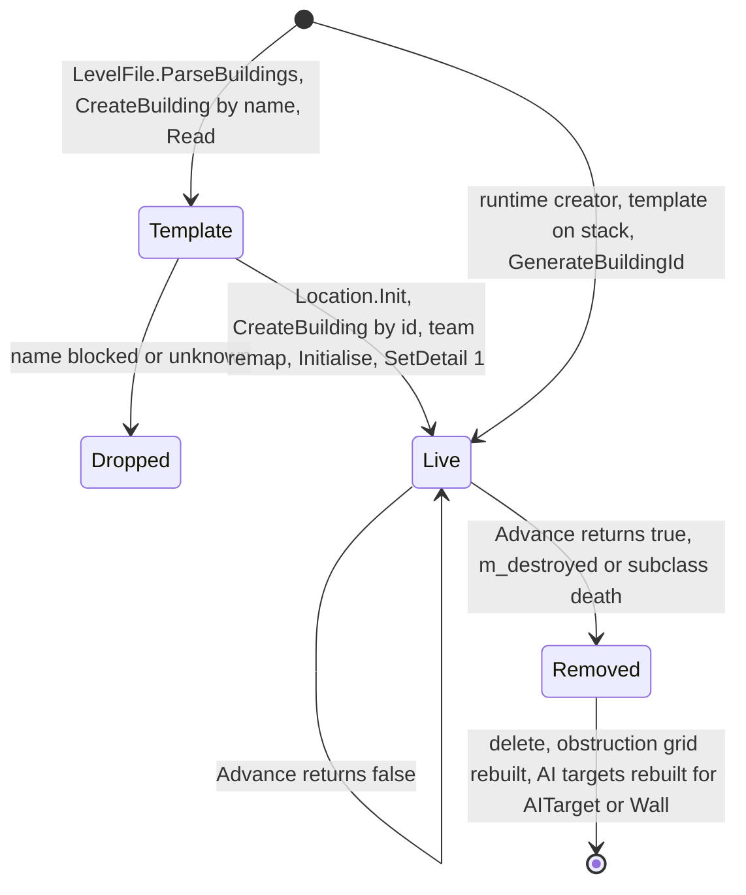

### 3.5 Virtual and member function catalogue

| Function | Base behaviour | Main overrides | Ref |
|---|---|---|---|
| `Building()` | defaults of §3.2; loads `controlpad.shp` once | all | [C] |
| `~Building()` | `m_ports.EmptyAndDelete()` | SpawnBuilding (links), PowerBuilding (surges), RadarDish (shape copy, AITarget), PulseBomb (shape copy), CloneLab (AITarget) | [C] |
| `Initialise(Building*)` | §3.4 step 3 | most classes copy their level fields here | [C] |
| `Advance()` → bool | §3.4 step 5 | every concrete class | [C] |
| `SetShape(Shape*)` | stores the pointer | Teleport (looks up `MarkerTeleportEntrance`), CarryableBuilding (pass-through) | [C] |
| `SetShapeLights(frag)` | recursive collection of `*MarkerLight*` markers | — | [C] |
| `SetShapePorts(frag)` | recursive; per `*MarkerPort*` marker: world matrix, `PushFromBuilding(pos, 5.0)`, y on terrain, counters 0 | — | [C] |
| `SetDetail(int)` | §3.4 step 4 | GunTurret (centre = pos, radius 30), RadarDish (caches entrance), Tree (asserts detail 1), MultiwiniaZone (`m_radius = m_size`), PulseBomb (scaled shape, no port rebuild) | [C] |
| `IsInView()` | `camera->SphereInViewFrustum(m_centrePos, m_radius)` | SpawnBuilding (link sphere), CarryableBuilding (always true), LaserFence (true during grace), Tree (`m_pos`, `m_height`), others | [C] |
| `Render(t)` | editor arrow (`DEBUG_RENDER_ENABLED` && editing); `m_shape->Render(t, Matrix34(front, up, pos))` | many | [C] |
| `RenderAlphas(t)` | `RenderLights(); RenderPorts();` | many | [C] |
| `RenderLights()` | if team ≠ 255 and lights exist: 10 nested additive `textures/starburst.bmp` quads (max size 6) in team colour at each light, drawn only when `(m_lastValidSequenceIdFromServer % 10) / 2 == teamId` (or editing) → teams 0–4 flash for 2 of every 10 server sequence ids; team 5 never flashes | — (LaserFence: empty) | [C] `Building::RenderLights` |
| `RenderPorts()` | per port: `controlpad.shp` if `RenderBuildingDetail` < 3 (pad 0.5 above ground) and a status star (size 6) green (0.3,1,0.3) if occupied, red (1,0.3,0.3) if empty | SpawnPoint, GunTurret, SolarPanel, ControlStation, CloneLab, SpiritReceiver | [C] |
| `RenderHitCheck()` / `RenderLink()` | debug: shape hit-check or sphere / magenta arrow to `GetBuildingLink()` | — | [C] |
| `PerformDepthSort(Vector3&)` | false | SpawnPoint, Tree, LaserFence, TrunkPort, FuelStation (true) | [C] |
| `SetTeamId(int)` | if changed: set team, mirror into `GlobalBuilding.m_teamId`, sound `ChangeTeam` | — (single mutation point) | [C] |
| `Reprogram(double)` | no-op | — | [C] |
| `ReprogramComplete()` | sound `ReprogramComplete`; toggles `GlobalBuilding.m_online`; `GlobalWorld::EvaluateEvents()` | Generator, TrunkPort, DynamicNode, PrimaryUpgradePort | [C] grep of `::ReprogramComplete` |
| `Damage(double)` | sound `Damage` only — **base buildings are indestructible** | GunTurret, Wall, Tree, AntHill, Triffid, EscapeRocket, Cave, Spam (no other overrides) | [C] grep of `::Damage(` |
| `Destroy(double intensity)` | `m_destroyed = true`; 3 × `g_explosionManager.AddExplosion(shape)`; `Location::Bang(m_pos, intensity, intensity/4)`; sound `Explode`; `(int)(intensity/4)` `TypeExplosionCore` particles (size 100, velocity `syncsfrand(100)` per axis ∈ [−50, 50)) | FuelBuilding (also explodes its pipe), AntHill (health 0 first), Spam; Statue, WallBuster and PulseBomb declare a separate parameterless `Destroy()` | [C] `Building::Destroy`, grep of `::Destroy(` |
| `PushFromBuilding(pos, r)` | while sphere (pos, r) hits the building, step 2.0 units directly away from `m_pos` | — | [C] |
| `EvaluatePorts()` | §3.6 | — | [C] |
| `GetNumPorts()` / `GetNumPortsOccupied()` / `GetPortOccupant(i)` / `GetPortPosition(i, &pos, &front)` | port queries; invalid index → invalid id / false | — | [C] |
| `OperatePort(i, team)` | `counter[team] = min(counter[team] + 1, 50)` | — | [C] |
| `GetPortOperatorCount(i, team)` | `counter[team]`, or −1 for a bad index | — | [C] |
| `GetObjectiveCounter(UnicodeString&)` | empty | MasterSpawnPoint, Generator, SpiritProcessor, FuelGenerator, EscapeRocket, BlueprintStore, DynamicHub, SafeArea, Refinery | [C] |
| `DoesSphereHit(pos, r)` | exact shape-sphere test; without shape: `abs(pos − m_pos) ≤ r + m_radius` | §3.14 | [C] |
| `DoesShapeHit(shape, mat)` | shape-vs-shape; without shape: sphere (`m_pos`, `m_radius`) vs shape | §3.14 | [C] |
| `DoesRayHit(start, dir, len, pos, norm)` | shape ray test (`pos/norm` not filled); without shape: ray-sphere | §3.14 | [C] |
| `ListSoundEvents(list)` | `Create`, `Reprogramming` (comment "Remove me"), `ReprogramComplete`, `ChangeTeam`, `Damage` | most | [C] |
| `Read(TextReader*, bool dynamic)` / `Write(TextWriter*)` | §3.10 | per class | [C] |
| `GetBuildingLink()` / `SetBuildingLink(id)` | −1 / no-op (editor link tool and `RenderLink`) | both overridden in AITarget, AIObjective/AIObjectiveMarker, BlueprintBuilding, Bridge, ControlStation, ControlTower, FeedingTube, PowerBuilding/PowerSplitter, DynamicBase, LaserFence, MineBuilding, MultiwiniaZone, Powerstation, FuelBuilding, ScriptTrigger, ReceiverBuilding, FenceSwitch, Wall; `SetBuildingLink` only in SpawnBuilding (appends a link), RadarDish (appends a valid link), PulseBomb (appends a station) | [C] grep of `::GetBuildingLink`, `::SetBuildingLink` |
| `GetTypeName(int)` / `GetTypeId(name)` (static) | name table; `GetTypeId` is case-insensitive and **ignores** the block list, −1 if unknown; `GetTypeName` asserts (debug) and returns NULL out of range | — | [C] |
| `CreateBuilding(int)` / `CreateBuilding(char*)` (static) | §3.11 | — | [C] |
| `GetTypeNameTranslated(type, &dest)` | language phrase `buildingname_<TypeName>` if present, else the raw name | — | [C] |
| `LogState(msg)` | sync-log line: type, id, hashed pos.x/y/z, Σvel, Σfront, Σcentre, radius | — | [C] |
| `BuildingIsBlocked(int)` (static) | §3.12 | — | [C] |

### 3.6 Ports, occupancy and reservation

- **Creation**: one `BuildingPort` per marker containing `MarkerPort`; position pushed 5.0 units clear of the building (`PushFromBuilding`, step 2.0), y on terrain; counters 0. Ports are rebuilt by every `SetDetail`. [C] `Building::SetShapePorts`, `Building::SetDetail`.
- **Occupancy (every tick, `EvaluatePorts`)**: for each port, `m_occupant` is cleared, then the entity grid is queried within **5.0** units of the port position; the **first** entity found that is a `Darwinian` in `StateOperatingPort` becomes the occupant — any team, and without checking that the Darwinian is operating *this* building or *this* port. [C] `Building::EvaluatePorts`.
- **Reservation counters**: if the port is occupied all `m_counter[t] = 0`; otherwise every `m_counter[t] −= 4`, floored at 0. A Darwinian walking to a port calls `OperatePort(port, team)` every tick (+1, cap 50). [C] `Building::EvaluatePorts`, `Building::OperatePort`, `code/worldobject/darwinian.cpp:Darwinian::AdvanceApproachingPort`.
- **Darwinian side** ([02](02_units_and_entities.md)): an idle (or worshipping / watching / following-orders / following-officer / approaching-armour) Darwinian calls `SearchForPorts()`. Candidates: buildings with ≥ 1 port, `|building.pos − pos| − building.radius < 100` (`DARWINIAN_SEARCHRANGE_PORTS`), at least one free port, and a walkable path. It takes the **nearest** candidate (a `syncrand() % n` pick is computed first and then overwritten by the nearest loop — the synced random number is still consumed), then picks uniformly (`syncrand()`) among ports with no occupant and `GetPortOperatorCount(p, team) < limit`, **limit = 1 in Multiwinia** (20 in Darwinia). On arrival → `StateOperatingPort`; the Darwinian leaves when `GetPortOccupant(port) != me` or the building disappears. [C] `code/worldobject/darwinian.cpp:Darwinian::SearchForPorts`, `Darwinian::AdvanceOperatingPort`, `code/worldobject/darwinian.h:DARWINIAN_SEARCHRANGE_PORTS`.
- **Net effect** [I]: a counter ≥ 1 means "a team-mate is already walking to this port", so at most one Darwinian per team heads for each free port; counters drain at 4/tick once nobody approaches. Different teams may race for the same port; the first Darwinian of any team in `StateOperatingPort` within 5 units is the occupant. Because the occupant search does not check the target building, two adjacent buildings whose ports lie within 5 units can share an occupant (no shipped case verified). Resolved: P02 listed "how Darwinians acquire/lose control-station ports" as unknown (P02-U1); the rule above is the general port mechanism used by ControlStation as well.
- **Initial occupants**: at team initialisation, every SpawnPoint and SolarPanel owned by the team receives one Darwinian per port, placed in `StateOperatingPort` with `m_portId`/`m_buildingId` set; then `EvaluatePorts()` and `RecalculateOwnership()` run immediately (SpawnPoints also get `m_activationTimer = 0`). [C] `code/location.cpp:Location::InitialiseTeam`.

### 3.7 Capture model summary (every capturable type)

| Class | Ports (shape) | Recalculation period | Rule | Contested / empty result | Ref |
|---|---|---|---|---|---|
| SpawnPoint | 5 (`spawnpointmultiwinia.shp`) | `2.0 + syncfrand(1.0)` s (first after `syncfrand(2.0)` s) | owner = a single team with **≥ 3** occupants (a later team displaces the leader only if it has > 2 and strictly more); every other occupant must be a friend of the owner | 255 | [C] `SpawnPoint::RecalculateOwnership` |
| GunTurret | 4 (`battlecannonbase.shp`) | 1.0 s (`GUNTURRET_OWNERSHIPTIMER`) | owner = team with most occupants (≥ 1; ties → lowest index); every occupant must be a friend of the owner | 255 | [C] `GunTurret::RecalculateOwnership` |
| SolarPanel | 5 (`solarpanel.shp`) | every tick (Multiwinia only) | owner = team with most occupants (strictly greater wins; ties → lowest index); **enemies may co-occupy** | 255 when empty | [C] `SolarPanel::RecalculateOwnership` |
| ControlStation | 5 (`controlstation.shp`) or 3 when linked to a PulseBomb (`pulsebombcontrolstation.shp`) | every tick | owner = first team with **> 2** occupants (**> 1** when bomb-linked), replaced by a later team with > threshold and strictly more; enemies may co-occupy; the owner is also written to the controlled building | 255 (controlled building keeps its team) | [C] `ControlStation::RecalculateOwnership` |
| CloneLab | 5 (`clonelab.shp`) | every tick | first team with > 2 occupants, replaced by a later team with > 2 and strictly more | 255 | [C] `CloneLab::RecalculateOwnership` |
| CarryableBuilding (Statue, WallBuster, ChessPiece) | 0 (proximity) | 1.0 s | team with the most live Darwinians within **50**, if that count ≥ `m_minLifters`; switches only if the new team is not a friend of the old | 255 | [C] `CarryableBuilding::CalculateOwnership` |
| MultiwiniaZone (KOTH) | 0 (proximity) | 1.0 s | team with the most counted Darwinians within `m_size` (ties → lowest index) | 255 | [C] `MultiwiniaZone::Advance_KingOfTheHill` |
| MultiwiniaZone (Blitzkrieg) | 0 (proximity) | 1.0 s | progress 0–100 accumulated by the leading team within 40 units; owner at 100, neutral at 0 | progress decays | [C] `MultiwiniaZone::Advance_Blitzkrieg` |
| RadarDish | 0 | — | no own rule; set by a linked ControlStation | — | [C] `ControlStation::RecalculateOwnership` |
| AITarget | 0 | 2.0 s | team with strictly highest friend count within range (logical owner for the AI only) | 255 | [C] `AITarget::RecalculateOwnership` ([07](07_ai.md)) |
| AIObjectiveMarker | 0 | 2.0 s | bound building's team, or scan-range majority (×4 rule) | 255 | [C] `AIObjectiveMarker::Advance` ([07](07_ai.md)) |
| TrunkPort | 0 | — | fixed by level; neutralised by `Team::Eliminate` and PulseBomb events | — | [C] §8.6 |
| ControlTower (unused) | 0 (3 reprogrammer slots) | per Engineer call | ownership ±0.1 per call | — | [C] §11.1 |
| BlueprintConsole (legacy) | 4 (`blueprintconsole.shp`) | every tick | team with > 2 occupants and a plurality | 255 | [C] §12.13 |
| DynamicNode (legacy) | shape ports | every tick | operates (no team change) when all ports are occupied and none by team 1 | inactive | [C] §12.22 |
| FenceSwitch (legacy) | 4 (`fenceswitch.shp`) | every tick | team 2 when all ports occupied and none by team 1, else team 1 | team 1 | [C] §12.37 |
| Powerstation (legacy) | 4 (`powerstation.shp`) | every tick | no team change; enables its fence when all ports occupied | fence disabled at ≤ 3/4 | [C] §6.8 |
| SafeArea (legacy) | 0 | 2.0 s | no team change; online test by entity count | — | [C] §12.35 |
| All others (Incubator, JumpPad, Portal, SpawnLink, MasterSpawnPoint, SpawnPopulationLock, Pylon, PylonEnd, PowerSplitter, LaserFence, Wall, Tree, StaticShape, RestrictionZone, markers, PulseBomb, Fuel*, EscapeRocket, AntHill, Triffid) | — | — | team fixed by level file or creator; never recomputed | — | [C] (no ownership code) |

### 3.8 Damage and destruction

- Base `Damage()` only plays the `Damage` sound; a building class without an override cannot be destroyed by weapons. [C] `Building::Damage`.
- **Explosions**: `Location::Bang(pos, range, damage, team, fromBuilding)` calls `building->Damage(−damage × f)` with `f = clamp(1 − dist / (3·range), 0, 1)` on every building with `dist < 3·range` (dist measured to `building->m_pos`, i.e. the base point). No team filter. This is the main source of building damage. [C] `code/location.cpp:Location::Bang`.
- Every `Bang` call site in the tree and its building-damage ceiling [C] grep of `Bang(`:

| Caller | range | damage | Max building damage | Ref |
|---|---|---|---|---|
| Grenade (power 25) | 12.5 | 50 | 50 within 37.5 | `code/worldobject/weapons.cpp:Grenade::Advance` |
| Rocket (turret/squad) | 15 | 25 | 25 within 45 | `weapons.cpp:Rocket::Explode` |
| `weapons.cpp` (≈L1284) | 20 | 100 | 100 within 60 | `code/worldobject/weapons.cpp` |
| `weapons.cpp` (≈L1938) | 20 | 20 | 20 within 60 | `code/worldobject/weapons.cpp` |
| Nuke warhead | 50 | 100 | 100 within 150 | `code/worldobject/nuke.cpp` |
| Meteor | 50 | 100 | 100 within 150 | `code/worldobject/meteor.cpp` |
| Armour | 20 | 50 | 50 within 60 | `code/worldobject/armour.cpp` |
| Lander | 30 | 50 | 50 within 90 | `code/worldobject/lander.cpp` |
| Darwinian (≈L3932) | 5 | 25 | 25 within 15 | `code/worldobject/darwinian.cpp` |
| WallBuster breach | 50 | 150 | 150 within 150 | `code/worldobject/wallbuster.cpp:WallBuster::Advance` |
| WallBuster defender scuttle | 50 | 500 | 500 within 150 | `wallbuster.cpp:WallBuster::Advance` |
| Portal explosion [B:DEBUG] | 200 | 255 | 255 within 600 | `code/worldobject/portal.cpp` |
| PulseBomb destroyed | 75 | 5 | 5 within 225 | `code/worldobject/pulsebomb.cpp:PulseBomb::Destroy` |
| `Building::Destroy(i)` (scripts) | i | i/4 | i/4 within 3i | `Building::Destroy` |

- Other direct damage: `TurretShell` hits deal `Damage(−2)` to Tree, AntHill and Triffid buildings only; `Fireball` deals `Damage(−100)` to trees; `FlameGrenade` deals `Damage(−4 × power)` to trees and triffids within `2 × power` (a computed falloff `fraction` is unused); `Lightning` deals `Damage(−100)` to trees in its cell; tasks call `GunTurret::Damage(−1000)` to self-destruct crate turrets; `WallBuster::BreakWalls` deals `Damage(−1000)` to every wall within 200. [C] `code/worldobject/weapons.cpp:TurretShell::Advance`, `Fireball::Advance`, `FlameGrenade::Advance`; `code/worldobject/lightning.cpp:Lightning::Advance`; `code/taskmanager.cpp`; `code/worldobject/wallbuster.cpp:WallBuster::BreakWalls`.
- Damageable classes and their models: GunTurret (health 60), Wall (single hit ≤ −300), Tree (fire accumulator > 50 → burn), AntHill (health 100), Triffid (`m_damage` 50 → burns), EscapeRocket (damage meter > 100 → explodes); legacy Cave (never, §12.16) and Spam (100). Everything else — including Crate, whose lifetime rules are in [04](04_crates_powerups_and_weapons.md) — has no `Damage` override and is indestructible by weapons.

### 3.9 Ownership change paths

`Building::SetTeamId(int)` is the normal mutation point (sound `ChangeTeam`, GlobalBuilding mirror). Direct `m_id.SetTeamId()` writes (no sound) are used by: PulseBomb destruction/detonation (trunk ports → 255), `Team::Eliminate` (owned trunk ports → 255, see [01](01_game_modes.md)), SolarPanel (empty → 255), creators of runtime buildings. [C] `code/worldobject/pulsebomb.cpp`, `code/team.cpp`, `code/worldobject/generator.cpp:SolarPanel::RecalculateOwnership`.

Defect [C]: `SolarPanel::RecalculateOwnership` ends with `SetTeamId(highestTeamId)` where `highestTeamId = −1` when nobody occupies the panel; `SetTeamId` compares the stored `unsigned char` 255 with the `int` −1, finds them different, stores 255 again and fires the `ChangeTeam` sound event — **every tick for every empty solar panel in Multiwinia**. Gameplay unaffected; audible only if a `SolarPanel ChangeTeam` sound binding exists ([10](10_audio_design.md)) [I].

### 3.10 Level-file line format

Header comment present in every level: `# Type id x z tm rx rz isGlobal`. Base fields are read by `Building::Read` with `GetNextToken` and written by `Building::Write`. [C] `Building::Read/Write`, `data/levels/mp_koth_2P_1.txt`.

| # | Token | Parsed as | Meaning | Write format |
|---|---|---|---|---|
| 0 | type name | `CreateBuilding(char*)`, case-insensitive | §2.1 names | `\t%-20s` |
| 1 | id | `atoi` | unique building id (unique per level, fatal assert otherwise) | `%-8d` |
| 2 | x | `iv_atof` | world x | `%-8.2f` |
| 3 | z | `iv_atof` | world z (y always from the heightmap) | `%-8.2f` |
| 4 | tm | `atoi` | team **position** 0–5 or 255; remapped at instantiation (§1.3) | `%-8d` |
| 5 | rx | `iv_atof` | `m_front.x` | `%-8.2f` |
| 6 | rz | `iv_atof` | `m_front.z`; then `m_front.Normalise()` with y = 0 | `%-8.2f` |
| 7 | isGlobal | `(bool)atoi` | §3.13 | `%-8d` |
| 8… | subclass fields | per class `Read` | see each class's level-file table | per class |

`m_id.Set(teamId, UNIT_BUILDINGS, −1, buildingId)`; `m_dynamic = dynamic`. Optional subclass fields are read only while `TokenAvailable()`; a missing mandatory token makes `GetNextToken` return an empty/NULL token (behaviour of `atoi` on it is [U], see 03-U7). [C] `Building::Read`; [I] token behaviour per [29](29_data_formats_reference.md).

### 3.11 Factory, name table and type ids

- `CreateBuilding(int type)`: a `switch` that `new`s the concrete class (the 74 cases of §2.1; `TypeInvalid` → NULL), then forces `m_isGlobal = true` for **RadarDish, ControlTower, TrunkPort, Incubator, DynamicHub, FenceSwitch**, and sets `m_type = type`. [C] `Building::CreateBuilding(int)`.
- `CreateBuilding(char* name)`: for `i` in 0…74, `continue` if `BuildingIsBlocked(i)`, return `CreateBuilding(i)` on the first case-insensitive name match; NULL otherwise (debug assert commented out). [C] `Building::CreateBuilding(char*)`.
- `GetTypeId(name)`: same loop **without** the block check; −1 if absent. Used by the editor and by `Location::FlushOpenGlState` (`GetTypeId("Tree")`). [C].
- `GetTypeNameTranslated`: phrase key `buildingname_<TypeName>` (e.g. `buildingname_SpawnPoint`). [C].

### 3.12 BuildingIsBlocked

Under `#ifdef BLOCK_OLD_DARWINIA_OBJECTS` (defined by `TARGET_PC_FULLGAME`) the function returns true for exactly these 39 types, in this source order; without the macro it returns false. [C] `Building::BuildingIsBlocked`, `code/lib/universal_include.h`.

| # | Blocked type | # | Blocked type | # | Blocked type |
|---|---|---|---|---|---|
| 1 | `TypeBlueprintConsole` | 14 | `TypeGenerator` | 27 | `TypeSpam` |
| 2 | `TypeBlueprintRelay` | 15 | `TypeGodDish` | 28 | `TypeSpiritProcessor` |
| 3 | `TypeBlueprintStore` | 16 | `TypeLibrary` | 29 | `TypeSpiritReceiver` |
| 4 | `TypeBridge` | 17 | `TypeMine` | 30 | `TypeStatue` |
| 5 | `TypeCave` | 18 | `TypePortal` | 31 | `TypeTrackEnd` |
| 6 | `TypeChessBase` | 19 | `TypePowerstation` | 32 | `TypeTrackJunction` |
| 7 | `TypeChessPiece` | 20 | `TypePrimaryUpgradePort` | 33 | `TypeTrackLink` |
| 8 | `TypeCrate` | 21 | `TypeReceiverLink` | 34 | `TypeTrackStart` |
| 9 | `TypeDisplayScreen` | 22 | `TypeReceiverSpiritSpawner` | 35 | `TypeUpgradePort` |
| 10 | `TypeDynamicHub` | 23 | `TypeRefinery` | 36 | `TypeYard` |
| 11 | `TypeDynamicNode` | 24 | `TypeResearchItem` | 37 | `TypePylonStart` |
| 12 | `TypeFactory` | 25 | `TypeSafeArea` | 38 | `TypeFeedingTube` |
| 13 | `TypeFenceSwitch` | 26 | `TypeScriptTrigger` | 39 | `TypeAISpawnPoint` |

Darwinia-era types that are **not** blocked (and therefore loadable): AntHill, Triffid, ControlTower, Incubator, TrunkPort, LaserFence, Pylon, PylonEnd, SolarPanel, PowerSplitter, FuelGenerator, FuelPipe, FuelStation, EscapeRocket, StaticShape, CloneLab, RadarDish, Tree, SpawnPoint, SpawnPopulationLock, SpawnPointMaster, SpawnLink, AITarget. [C].

### 3.13 Global buildings

`m_isGlobal` marks a building mirrored as a `GlobalBuilding` record (team, online flag, link) in `g_app->m_globalWorld` — the Darwinia campaign's cross-level persistence. Touch points: `Initialise` (team from GlobalBuilding), `SetTeamId` (writes team), `ReprogramComplete` (toggles online), `TrunkPort::Advance` (opens when online), RadarDish (stores link), ControlTower/Generator/SpiritProcessor/ConstructionYard/MasterSpawnPoint/FenceSwitch/DynamicHub (set online). In Multiwinia the lookups find no record (no campaign world is loaded) and are inert [I]; MP levels still set `isGlobal = 1` on RadarDish and TrunkPort lines because `ParseBuildings` asserts it. [C] `building.cpp`, `level_file.cpp:ParseBuildings`; [I] absence of records in MP (see 03-U8).

### 3.14 Hit-test overrides and shapes

Collision is used by the obstruction grid (every building is rasterised into the cells its bounding sphere/shape covers; `ObstructionGrid::CalculateAll` registers every building without type filtering), by unit push-out (`Entity::PushFromObstructions`, `Darwinian::PushFromObstructions`), by line-of-sight and by mouse picking. [C] `code/obstruction_grid.cpp:ObstructionGrid::CalculateAll`, `CalculateBuildingArea`.

| Class | Sphere | Shape | Ray | Ref |
|---|---|---|---|---|
| default (`Building`) | exact shape / sphere `m_radius` | exact / sphere | exact / sphere | [C] |
| SpawnPopulationLock, JumpPad, Portal, CarryableBuilding (Statue, WallBuster, ChessPiece), AITarget, AIObjective, AIObjectiveMarker, AISpawnPoint, RestrictionZone, EruptionMarker, MultiwiniaZone, EscapeRocket, ScriptTrigger | false | false | editor only, or sphere for JumpPad/Portal (r 13) | [C] per-class `Does*Hit` |
| SmokeMarker | **base** (sphere r 13 at `m_pos`) — its `float` overrides do not override the `double` virtuals | false (override matches) | **base** (ray-sphere r 13) | [C] `code/worldobject/smokemarker.h` vs `building.h` |
| RadarDish | shape test with probe radius ×1.5 | shape | shape (up = (0,1,0)) | [C] |
| GunTurret | shape (base) | shape | turret shape ∪ barrel shape ∪ sphere r 12 at pos + (0,10,0) | [C] |
| Wall | 100 × 20 rectangle flattened to y = 0 (infinite prism) | exact mesh (`wall.shp`) | vertical quad 100 long, base → `m_pos.y + 37.5` | [C] |
| LaserFence | post shape when disabled; curtain (two rays) + post when raised | sphere (root radius) | curtain triangles + post | [C] |
| Tree | trunk sphere r 10 at `m_pos` ∪ crown sphere | same | same | [C] |
| PulseBomb | scaled shape | scaled shape | scaled shape | [C] |

Shapes and markers used by the live set [C] `data/shapes/*.shp` (P06 `scripts/P06_shape_markers.py`):

| Shape | `MarkerPort*` | `MarkerLight*` | Other markers used | Class |
|---|---|---|---|---|
| `spawnpointmultiwinia.shp` (MP) / `spawnpoint.shp` (SP) | 5 | 3 | MarkerDoor, MarkerSpiritLink | SpawnPoint |
| `spawnlink.shp`, `masterspawnpoint.shp` | 0 | 0 | MarkerSpiritLink | SpawnLink, MasterSpawnPoint |
| `battlecannonbase.shp` | 4 | 0 | MarkerStatus01–04 (code requests 5; #5 NULL, harmless) | GunTurret |
| `battlecannonturret.shp` | 0 | 0 | MarkerBarrel, MarkerKills | GunTurret |
| `cannon_bullets.shp`, `cannon_flame.shp`, `cannon_rocket.shp`, `battlecannonbarrel.shp` | 0 | 0 | MarkerBarrelEnd01–04; MarkerShells01–04 (only `cannon_bullets.shp`) | GunTurret barrels |
| `radardish.shp` (per-instance copy) | 0 | 2 | MarkerTeleportEntrance, MarkerFocus; fragments `Dish`, `UpperMount` | RadarDish |
| `controlstation.shp` / `pulsebombcontrolstation.shp` | 5 / 3 | — | MarkerDishDirection (bomb variant) | ControlStation |
| `solarpanel.shp` | 5 | 0 | MarkerStatus01–05, MarkerGlow01–04, MarkerPowerLocation | SolarPanel |
| `pylon.shp` | 0 | 1 | MarkerPowerLocation | Pylon, PylonEnd, PowerSplitter |
| `controlpad.shp` | 0 | 0 | MarkerStatus | every port |
| `laserfence.shp` | 0 | 0 | MarkerFence01 (0.37, 0, −0.30), MarkerFence02 (0.37, 48.28, −0.30) | LaserFence |
| `wall.shp` | 0 | 0 | — (mesh ±40.58 × 0…70.93 × ±1.38) | Wall |
| `trunkport_mp.shp` | — | — | MarkerSurface, MarkerDestination1/2 | TrunkPort |
| `pulsebomb.shp` (copy, radius ×0.75) | — | — | — | PulseBomb |
| `fuelgenerator.shp` + `fuelgeneratorpump.shp`, `fuelpipebase.shp`, `fuelstation.shp`, `rocket.shp`, `fuelpipe.shp` | — | — | MarkerFuel, MarkerTip, MarkerEntrance, MarkerBooster, MarkerWindow01–03 | Fuel chain |
| `wallbuster.shp`, `carry*.shp` (8 statue shapes) | 0 | 0 | — | WallBuster, Statue |
| `anthill.shp`, `triffidhead.shp` | 0 | 0 | MarkerLaunchPoint, MarkerTriffidStem (triffid) | AntHill, Triffid |
| `aitarget.shp` | 0 | 0 | — | AITarget (editor only) |

### 3.15 Sound events

Base list: `Create`, `Reprogramming`, `ReprogramComplete`, `ChangeTeam`, `Damage`; `Explode` is triggered by `Building::Destroy` without being listed in the base list. Each class adds its own events (listed per section). Bindings to samples live in `data/sounds.txt` → [10](10_audio_design.md). [C] `Building::ListSoundEvents`, `Building::Destroy`.

## 4 Spawn network

Source: `code/worldobject/spawnpoint.{h,cpp}`. Build tag **[B:FULL]** for all five classes; single-player branches are [B:LEGACY]. The economic consequences (burst/pause throughput, population caps, handicap, comparison with trunk ports and engineers/harvesters) are specified in [05](05_economy_and_population.md); this section is the building-level specification.

### 4.1 Overview

A level's spawn network is a **directed tree of links** rooted at exactly one `SpawnPointMaster`, with `SpawnLink` relay nodes and `SpawnPoint` leaves (a SpawnPoint may also relay). When an owned, activated SpawnPoint wants a Darwinian it asks the master; the master emits a **virtual** spirit (`SpawnBuildingSpirit`, not a `Spirit` entity) that travels link by link, **exactly 1.0 game second per link regardless of link length**, to the requesting SpawnPoint, which then spawns one Darwinian at its door if it is still owned. [C] `MasterSpawnPoint::RequestSpirit`, `SpawnBuilding::TriggerSpirit`, `SpawnBuilding::Advance`, `SpawnPoint::TriggerSpirit`, `SpawnPoint::SpawnDarwinian`.

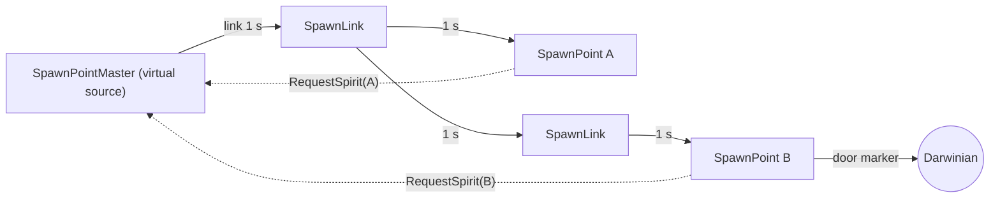

Shipped topology [C] `_work/drafts/P06_spawn_graph.csv` (via `_work/scripts/P06_spawn_graph.py`): every official map with spawn points has exactly one master, no cycles, no self links, no unreachable SpawnPoint and exactly one path to each SpawnPoint. Delivery delay from request to spawn = number of hops × 1 s.

| Official map | SpawnPoints | Link objects (SpawnLink) | Hops master→point (min–max) = delivery delay in s |
|---|---|---|---|
| `mp_blitzkrieg_2P_3` | 4 | 9 | 3–8 |
| `mp_blitzkrieg_2P_4` | 3 | 7 | 3–4 |
| `mp_blitzkrieg_2p_1` | 1 | 0 | 1–1 |
| `mp_blitzkrieg_2p_2` | 6 | 8 | 2–5 |
| `mp_cts_2p_1` | 6 | 0 | 1–1 |
| `mp_cts_2p_2` | 4 | 0 | 1–1 |
| `mp_cts_2p_3` | 4 | 6 | 3–6 |
| `mp_cts_2p_4` | 4 | 0 | 1–1 |
| `mp_cts_3P_2` | 9 | 0 | 1–1 |
| `mp_cts_3p_1` | 6 | 0 | 1–1 |
| `mp_cts_4P_1` | 12 | 0 | 1–1 |
| `mp_cts_4P_2` | 8 | 0 | 1–1 |
| `mp_cts_4p_3` | 8 | 17 | 3–9 |
| `mp_domination_2P_1` | 8 | 13 | 2–7 |
| `mp_domination_2P_2` | 8 | 7 | 2–5 |
| `mp_domination_3P_1` | 10 | 14 | 4–9 |
| `mp_domination_4P_1` | 10 | 18 | 2–10 |
| `mp_domination_4P_2` | 12 | 20 | 3–5 |
| `mp_koth_2P_1` | 6 | 7 | 3–5 |
| `mp_koth_2P_2` | 9 | 10 | 3–7 |
| `mp_koth_2P_3` | 10 | 11 | 4–8 |
| `mp_koth_2P_3b` | 10 | 9 | 2–6 |
| `mp_koth_3P_1` | 9 | 23 | 3–8 |
| `mp_koth_3P_2` | 9 | 14 | 4–9 |
| `mp_koth_3P_3` | 9 | 15 | 5–6 |
| `mp_koth_4P_1` | 10 | 18 | 2–11 |
| `mp_koth_4P_3` | 12 | 20 | 3–5 |
| `mp_koth_4P_4` | 12 | 4 | 2–2 |
| `mp_rocketriot_2P_2` | 2 | 0 | 1–1 |
| `mp_rocketriot_4P_1` | 12 | 0 | 1–1 |
| `mp_skirmish_2p_4` | 10 | 11 | 3–8 |
| `mp_skirmish_3P_1` | 15 | 0 | 1–1 |

Official maps **without** a spawn network (17 of 49): all 8 Assault maps; Blitzkrieg `mp_blitzkrieg_3P_1`, `3P_2`, `4P_2`; Rocket Riot `mp_rocketriot_2p_3`, `2P_4`, `3p_1`, `3P_2`, `3P_3`; KOTH `mp_koth_3P_4`. Their Darwinian supply comes from trunk-port reinforcement waves and starting units ([05](05_economy_and_population.md)). SpawnPoint presence per mode: Domination 9/9, KOTH 8/9, CTS 9/9, Blitzkrieg 4/7, Rocket Riot 2/7, Assault 0/8. [C] census (`_work/scripts/S_03_building_census.py`), `_work/drafts/P06_spawn_graph.csv`.

### 4.2 SpawnBuilding

Abstract base of SpawnLink, MasterSpawnPoint and SpawnPoint. [C] `code/worldobject/spawnpoint.h:SpawnBuilding`.

| Member | Meaning | Ref |
|---|---|---|
| `m_links : LList<SpawnBuildingLink*>` | outgoing links | [C] |
| `m_spiritLink : ShapeMarker*` | lazily looked-up `MarkerSpiritLink` (`AppReleaseAssert` if missing); link beams start and end here | [C] `GetSpiritLink` |
| `m_visibilityMidpoint`, `m_visibilityRadius` | cached culling sphere covering the building and all link targets (recomputed while editing) | [C] `IsInView` |

#### SpawnBuildingLink

`m_targetBuildingId` (the direct neighbour), `m_targets : LList<int>` (ids of every SpawnPoint reachable through this link, filled by `ExploreLinks`), `m_spirits : LList<SpawnBuildingSpirit*>` (spirits in transit on this link). [C] `code/worldobject/spawnpoint.h:SpawnBuildingLink`.

#### SpawnBuildingSpirit

`m_targetBuildingId` (requesting SpawnPoint) and `m_currentProgress` ∈ [0, 1) along the current link. Not a world object: no position, no collision, cannot be intercepted, collected or killed; it is only drawn. [C] `code/worldobject/spawnpoint.h:SpawnBuildingSpirit`; [I] "cannot be intercepted" from the absence of any other reference.

Functions [C] `code/worldobject/spawnpoint.cpp`:
- `SetBuildingLink(id)` — appends a link unless one to `id` already exists (the target-type check is commented out).
- `ClearLinks()` — deletes all links.
- `ExploreLinks()` — recursive depth-first walk: returns this building's id if it is a SpawnPoint, plus everything reachable through each link whose target exists and is a spawn building; stores the reachable set per link in `m_targets`. A self-link aborts with `AppReleaseAssert("SpawnPoint %d Linked to itself")`. **No cycle detection** (a cycle recurses until stack overflow) and no memoisation.
- `TriggerSpirit(spirit, progress)` — puts the spirit on **every** outgoing link whose `m_targets` contains the spirit's target, with `m_currentProgress = progress`; if no link matches the spirit is deleted (lost). Latent defect: if two links could reach the same target the same pointer would be placed on two lists (double delivery, double delete); impossible with the shipped tree-shaped graphs.
- `Advance()` — for each link and each spirit on it: `progress += SERVER_ADVANCE_PERIOD`; at ≥ 1.0 the spirit leaves the link and is handed to the link target's `TriggerSpirit(spirit, progress − 1.0)` if the target exists and is a spawn building, else deleted. Then `Building::Advance()`.
- `IsSpawnBuilding(type)` — SpawnPoint, SpawnLink, SpawnPointMaster.
- `RenderAlphas` — each link as a textured beam (`textures/laser.bmp`, inner width 1, outer 3) between spirit-link markers; every in-transit spirit as a diamond (inner 2, outer 6 units) coloured with the **current** team colour of the target SpawnPoint (grey 120 if neutral; brown (150,50,25) outside Multiwinia). Then base lights/ports.

Level-file parameters (all three subclasses):

| # | Field | Type | Default | Meaning | Write |
|---|---|---|---|---|---|
| 8… | linkId | int, repeated to end of line | none | outgoing spawn links (`SetBuildingLink`) | `%-6d` each |

### 4.3 SpawnLink

| Aspect | Specification | Ref |
|---|---|---|
| Function | pure relay node of the spawn tree | [C] `SpawnLink::SpawnLink` |
| Shape | `spawnlink.shp` (no ports, no lights) | [C] |
| Ownership / capture | none (team from level, irrelevant) | [C] |
| Inputs / outputs | virtual spirits in, virtual spirits out (1 s per outgoing link) | [C] |
| Damage | indestructible | [C] |
| Level line | `SpawnLink id x z tm rx rz isGlobal linkId*` | [C] |
| Mode usage | 21 official maps: Domination 8/9, KOTH 8/9, Blitzkrieg 3/7, CTS 2/9 (261 lines) | [C] census |

### 4.4 MasterSpawnPoint

| Aspect | Specification | Ref |
|---|---|---|
| Function | virtual source of all spawn spirits; one per level (32 official maps, one each) | [C] code + census |
| Shape | `masterspawnpoint.shp`; drawn only if `m_isGlobal` or while editing (most MP levels set isGlobal 0 → invisible; 11 `mp_*` files set 1 → visible) | [C] `MasterSpawnPoint::Render/RenderAlphas`, data |
| Static | `s_masterSpawnPointId` = id of the last master that advanced; **never reset** between levels | [C] |
| First `Advance` | runs `ExploreLinks()` once (logs the time taken) | [C] |
| `RequestSpirit(targetId)` | new `SpawnBuildingSpirit{target}` → `TriggerSpirit(spirit, 0)` | [C] |
| `GetMasterSpawnPoint()` | the building with id `s_masterSpawnPointId` if its type is SpawnPointMaster, else NULL → SpawnPoints cannot request until the master has advanced once | [C] |
| Darwinia-only branch (`!Multiplayer()`) [B:LEGACY] | if global: every Spirit in Birth/Floating state `SkipStage()`; if team 1 has < 10 entities, its GlobalBuilding goes online; objective text `objective_redpopulation` | [C] |
| Capture / damage | none / indestructible | [C] |
| Level line | `SpawnPointMaster id x z tm rx rz isGlobal linkId*` | [C] |

Hazard [I]: because `s_masterSpawnPointId` is not reset, if a new level's master has the same id as a building of another type, `GetMasterSpawnPoint` returns NULL until the new master advances (harmless), but a level without a master keeps the stale id (NULL lookup, harmless). A re-implementation should hold the master reference per level.

### 4.5 SpawnPoint

| Aspect | Specification | Ref |
|---|---|---|
| Function | the territory node of the economy: when owned and activated it periodically requests virtual spirits and emits Darwinians for its owner | [C] |
| Shape | MP `spawnpointmultiwinia.shp`, SP `spawnpoint.shp`; `MarkerDoor` (asserted); **5 ports**; 3 lights | [C] ctor |
| Capture | every `2.0 + syncfrand(1.0)` s (first evaluation after `syncfrand(2.0)` s) `RecalculateOwnership()` counts port occupants per team (§3.6) and applies: scan teams 0→5; the first team with occupants becomes leader; a later team replaces the leader only if it has > 2 occupants and strictly more; whenever the leader has < 3 occupants it is dropped (the scan continues); finally, if any occupant belongs to a team that is not a friend of the leader, the result is neutral. Net rule: **owner = a team with ≥ 3 of the 5 ports, with no non-allied Darwinian on any port; otherwise neutral.** Allies do not pool: a team with 2 + an ally with 2 → neutral | [C] `SpawnPoint::RecalculateOwnership` |
| Activation | whenever an evaluation changes the owner (including to neutral) `m_activationTimer = 30.0` s; the timer counts down (by `SERVER_ADVANCE_PERIOD`) only while owned; it is forced to 0 if this is the owner's only spawn point (`s_numSpawnPoints[team+1] == 1`), outside Multiwinia, or with level option `instantspawnpointcapture`; starting spawn points get 0 in `InitialiseTeam` | [C] `SpawnPoint::Advance`, `Location::InitialiseTeam` |
| Request cycle (MP) | while owned, activated and not `PopulationLocked()`: `m_spawnTimer −= dt`; when ≤ 0 (or every tick while `Location::m_spawnManiaTimer > 0`, the Spawn Mania crate) → `master->RequestSpirit(id)`, `m_spawnTimer = 0.2`, `++m_spawnCounter`; when `m_spawnCounter ≥ (int)(20 × CalculateHandicap(team))` → counter 0, `m_spawnTimer = 10 + syncfrand(5)`. Initial `m_spawnTimer = 2 + syncfrand(2)`. Neither counter nor timer is reset on ownership change. Formulae, handicap and throughput: [05](05_economy_and_population.md) | [C] `SpawnPoint::Advance`, `SpawnPoint::CalculateHandicap` |
| Request cycle (SP) [B:LEGACY] | `m_spawnTimer = 2 + 5 × (1 − fractionOccupied) − difficulty term + syncfrand(1)` | [C] |
| Population lock | MP: Assault with `DefenderPopulationCap ≠ −1` → defender/attacker caps; else level `PopulationCap ≠ −1` → `PopulationCap / NumPlayers` per team; else nearest SpawnPopulationLock within its radius; tutorial-2 special cases. Pop = `team->m_others.NumUsed() − Virii::s_viriiPopulation[team]`. Full rules: [05](05_economy_and_population.md) | [C] `SpawnPoint::PopulationLocked` |
| Inputs | one virtual spirit per request (from the master) | [C] |
| Outputs | one Darwinian per arriving spirit **if still owned** (else the spirit is lost): spawned at the door marker; MP velocity `(door.front + (syncsfrand(1), syncsfrand(1), syncsfrand(1))) × 10`, SP zero; `m_onGround = false` | [C] `SpawnPoint::TriggerSpirit`, `SpawnDarwinian` |
| Other inputs | Engineers and Harvesters deliver collected spirits by calling `SpawnDarwinian()` directly (one Darwinian per spirit, owner's team) → [02](02_units_and_entities.md), [05](05_economy_and_population.md) | [C] `code/worldobject/engineer.cpp` |
| Links | outgoing spawn links (normally none on leaves); may relay | [C] |
| Damage | indestructible | [C] |
| Static counters | `s_numSpawnPoints[NUM_TEAMS+1]`: index `team+1` = spawn points owned by `team`, index 0 = neutral; incremented in `Initialise`, moved in `RecalculateOwnership`; read by Domination scoring/elimination, KOTH/CTS elimination, handicap, crate validity ([01](01_game_modes.md), [04](04_crates_powerups_and_weapons.md)) | [C] |
| Sounds | `TurnOn` (became owned), `TurnOff` (became neutral) + base list | [C] `ListSoundEvents`, `RecalculateOwnership` |
| Visuals | per-port status stars grey (150,150,150) empty / occupant team colour; 20 / 10 / 3 glow blobs (`textures/cloudyglow.bmp`) above the building at RenderBuildingDetail 1 / 2 / 3, alpha = occupied/total, colour lerps from (100,100,100,200) to the team colour as `m_activationTimer` goes 30 → 0 | [C] `SpawnPoint::RenderPorts/RenderAlphas` |
| Level line | `SpawnPoint id x z tm rx rz isGlobal linkId*` | [C] |
| Starting ownership in data | across all `mp_*` files: 162 SpawnPoints start owned by a team position (0: 53, 1: 57, 2: 33, 3: 19), 124 start neutral; all isGlobal 0 | [C] data (P06 grep) |
| Mode usage | official maps containing it: Domination 9/9, KOTH 8/9, CTS 9/9, Blitzkrieg 4/7, Rocket Riot 2/7, Assault 0/8; 1–15 per map | [C] census |

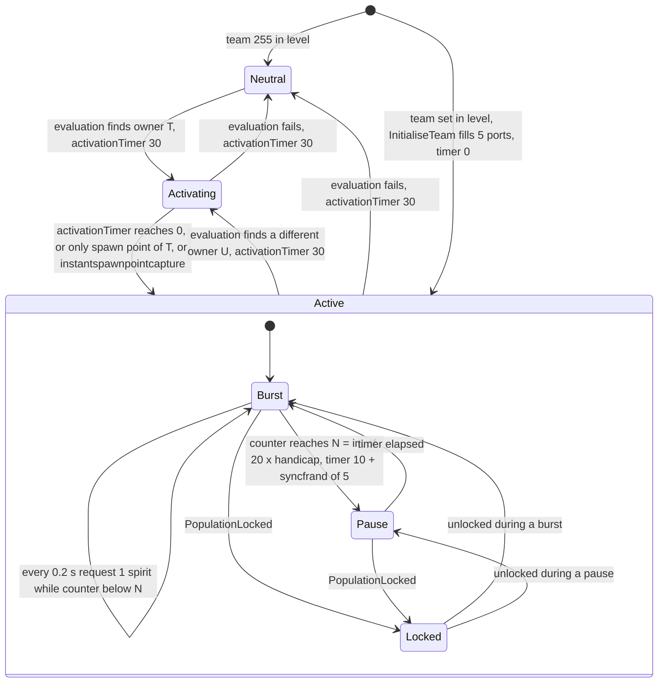

### 4.6 SpawnPopulationLock

| Aspect | Specification | Ref |
|---|---|---|
| Function | invisible regional population limiter (Darwinia design, Multiwinia fallback) | [C] |
| Fields | `m_searchRadius` (500.0), `m_maxPopulation` (100), `m_originalMaxPopulation`, `m_teamCount[NUM_TEAMS]`, `m_recountTimer` (initial `syncfrand(10)`), `m_recountTeamId` (initial 10); statics `s_overpopulationTimer`, `s_overpopulation` (reset by `Reset()` from `Location::Init`) | [C] |
| Behaviour | **Inert in Multiwinia when the level sets `PopulationCap ≠ −1`** (Advance returns false immediately; counts stay 0). Otherwise: every 1.0 s of game time `s_overpopulation = Σ_locks max(0, teamCount[0] − originalMax) / 2` (team 0 only); `m_maxPopulation = max(0, originalMax − s_overpopulation)`; recount cycle `m_recountTimer = 10 + syncsfrand(2)` s (∈ [9, 11)); during the cycle team *k* is recounted (`EntityGrid::GetNumFriends(pos, searchRadius, k)`) when `(int)m_recountTimer` first drops to *k* (teams 0–5) | [C] `SpawnPopulationLock::Advance` |
| Consumers | SpawnPoint, TrunkPort and AntHill `PopulationLocked()` fallbacks: the first lock whose `m_searchRadius` contains the building (cached; a lock with unique id 0 is never queried because the cache test is `> 0`); locked when `m_teamCount[team] ≥ m_maxPopulation` | [C] `SpawnPoint::PopulationLocked`, `code/worldobject/trunkport.cpp:TrunkPort::PopulationLocked`, `code/worldobject/anthill.cpp:AntHill::PopulationLocked` |
| Ownership | team from level; only affects the Darwinia difficulty scaling (§3.4) | [C] |
| Hit tests | none (sphere/shape false); drawn only in the editor (sphere r 30 + text) | [C] |
| Level line | see table | [C] `Read/Write` |
| Usage | 21 official maps (KOTH 7/9, CTS 6/9, Blitzkrieg 4/7, Assault 2/8, Domination 2/9); every one of them also sets `PopulationCap`, so all shipped locks are inert | [C] census + data cross-check (P06) |

| # | Field | Type | Default | Meaning | Write |
|---|---|---|---|---|---|
| 8 | searchRadius | float (`iv_atof`) | 500.0 | radius of the region | `%-8.2f` |
| 9 | maxPopulation | int | 100 | per-team cap inside the region | `%-6d` |

## 5 Contestable utility buildings

### 5.1 GunTurret

Source: `code/worldobject/gunturret.{h,cpp}`. Build tag **[B:FULL]**; the single-player lose-control branch and team-2 remap are [B:LEGACY]; mortar-arc and subversion editor previews are [B:EDITOR].

**Function.** A Darwinian-manned automatic weapon emplacement: a fixed base (`battlecannonbase.shp`, 4 ports) with a rotating turret (`battlecannonturret.shp`) and a barrel model chosen by turret type. It is owned by whichever team mans its ports, automatically engages enemies in range, and can be steered manually by its owner. [C] `GunTurret::GunTurret`, `GunTurret::Advance`.

**Turret types** (`GunTurret::GunTurretType*`, the level-file `state` field) [C] `GunTurret::GetReloadTime`, `GetMinRange`, `GetMaxRange`, `GetTurretTypeName`, `GetTurretModelName`, `PrimaryFire`:

| Value | Type | Name key | MP barrel model | Weapon fired per manned barrel | Reload | Min range MP / SP | Max range MP / SP | Barrels examined per trigger |
|---|---|---|---|---|---|---|---|---|
| 0 | Standard | `buildingname_gunturret` | `cannon_bullets.shp` | `Location::FireTurretShell(barrelEnd − v·dt·0.5, v = barrelFront·500, team, turretId)` | 0.1 s | 50 / 100 (`GUNTURRET_MINRANGE` × 0.5 in MP) | 225 / 300 (`GUNTURRET_MAXRANGE` × 0.75 in MP) | 2 |
| 1 | Rocket | `buildingname_rocketturret` | `cannon_rocket.shp` | `Location::FireRocket(barrelEnd, barrelEnd + barrelFront·500, team, life 1.0, turretId)` | 1.5 s | 100 | 200 | **1** (loop breaks) |
| 2 | Mortar ("grenade turret") | `buildingname_grenadeturret` | `cannon_bullets.shp` (default branch) | `Location::ThrowWeapon(barrelEnd, pos + targetPos + (syncsfrand(targetRadius), 0, syncsfrand(targetRadius)), Grenade, team, force = targetForce + syncsfrand(0.1), life 1000, explodeOnImpact)` | 4.0 s | area-targeted (getter default 100) | area-targeted (getter default 300) | 2 |
| 3 | Flame | `buildingname_flameturret` | `cannon_flame.shp` | `Location::LaunchFireball(barrelEnd, barrelFront·100, life 1.0, turretId)` (fireball has no team → hurts everyone) | 0.1 s | 10 | 150 | 2 |
| 4 | Subversion | `buildingname_subversionturret` | `battlecannonbarrel.shp` | `Location::FireLaser(barrelEnd, barrelFront·500/4 = 125 u/s, team, mindControl = true)` | 0.5 s | 10 | 150 | 2 |

Single-player always uses `battlecannonbarrel.shp`. A Standard turret fires a *subversion* laser instead of a shell from any barrel whose operating Darwinian has `m_subversionTaskId ≠ −1` (per-shot override; the origin of that task id is a crate/task feature, 03-U5). [C] `GunTurret::PrimaryFire`.

Projectile characteristics (owned by [04](04_crates_powerups_and_weapons.md)/[02](02_units_and_entities.md); summarised) [C] `code/location.cpp:FireTurretShell`, `code/worldobject/weapons.cpp`:

| Weapon | Speed | Lifetime | Damage model |
|---|---|---|---|
| TurretShell | 500 u/s straight | 0.6 s in MP (≈ 300 u); Darwinia 0.5/0.5/1.0/1.5/2.0 s by armour research 0–4 | each enemy entity whose `RayHit` intersects the swept segment: `ChangeHealth(−15, DamageTypeTurretShell)`, knock-back 20 u/s + airborne; Tree/AntHill/Triffid buildings −2; kills credited to the turret (`RegisterKill`) and team; MP shell team = turret team |
| Rocket | starts 50 u/s, ×1.2 per tick until ≥ 150 | 1.0 s or ground/building contact | `Bang(pos, 15, 25, team, turretId)` |
| Grenade (mortar) | ballistic, level `force` | explodes on impact (life 1000) | power 25 → `Bang(pos, 12.5, 50, team)` |
| Fireball | 100 u/s | 1.0 s; radius `20 · min(1, abs(1 − life))` | each Darwinian in radius once: `FireDamage(30 · radius/dist · max(1, life))` |
| Subversion laser | 125 u/s | Darwinia laser-research lifetime (0.2, 0.4, 0.6, 0.8, 1.0 s for level 0–4) × 2 | mind-control laser (converts) — MP laser research level is [U] (03-U4) |

**Firing cadence.** Barrel *i* fires only if **port *i*** is occupied. `PrimaryFire` returns immediately while `m_fireTimer > 0`; otherwise it examines `m_nextBarrel` and the next one (one barrel for Rocket), firing each manned barrel, and sets `m_fireTimer = reload` after a shot (the second barrel in the same call still fires). `m_fireTimer` is decremented by `SERVER_ADVANCE_PERIOD` before `PrimaryFire` in the same tick. Every examined manned barrel consumes three synced random numbers (mortar scatter, computed for all types) plus the cartridge-ejection draws. [C] `GunTurret::Advance`, `GunTurret::PrimaryFire`.
⇒ Standard / Flame at 0.1 s ticks: 2 of the 4 barrels are examined per tick → **shots per second = 5 × (occupied ports)** (max 20 shells/s); Mortar: up to 2 grenades per volley, one volley per ≈ 4.0 s; Subversion: up to 2 lasers per ≈ 0.5 s; Rocket: 1 rocket per ≈ 1.5 s plus 0.1 s per skipped unmanned barrel. [I] arithmetic from the code.

**Capture / ownership** [C] `GunTurret::RecalculateOwnership`:
- Re-evaluated every **1.0 s** (`GUNTURRET_OWNERSHIPTIMER`); first evaluation on the first tick.
- Count port occupants per team; winner = first team (by index) with ≥ 1 occupant, replaced by any later team with strictly more; if any occupant is not a friend of the winner → **neutral**. One Darwinian suffices; co-op allies may co-man.
- Becoming neutral restores the neutral turret/barrel shapes. Becoming owned in MP swaps in team-coloured copies `battlecannonturret.shp_<colourId>_<coopGroupPosition>` and `<model>_<colourId>_<group>`, prepared once by `SetupTeamShapes()` for `MULTIWINIA_NUM_TEAMCOLOURS + 2` colours × 3 group variants (turret colours scaled ×0.2; barrel copies are not recoloured). [C] `GunTurret::SetupTeamShapes`, `ConvertColours`.
- Futurewinian rules: a Subversion turret captured by a non-Futurewinian team, or any non-Subversion turret captured by the Futurewinian team, **self-destructs** (`Damage(−1000)`).
- [B:LEGACY]: green (0) capture shown as team 2 (yellow) so the player controls it.

**Targeting and aiming** (per tick, while owned and not under player control) [C] `GunTurret::Advance`, `SearchForTargets`, `SearchForRandomPos`, `ClearLOS`:
1. Every **1.0 s** in MP (`GUNTURRET_MULTIWINIA_RETARGETTIMER`; 3.0 s SP `GUNTURRET_RETARGETTIMER`) `SearchForTargets()`:
   - Mortar: `EntityGrid::GetBestEnemy(pos + targetPos, 0, targetRadius, team)`; aim point forced to `pos + targetPos`.
   - Others: all enemies within `GetMaxRange()`; skip `TypeAI`, `TypeHarvester` and dead entities; choose the **nearest** with `dist ≥ GetMinRange()` and clear line of sight (samples every 30 units from the target back towards the turret, ray-testing buildings in each obstruction cell). Sound `TargetSighted` on a new target.
   - No target and owned → `SearchForRandomPos()` idle sweep: first time a random angle `syncfrand(2π)`, distance `200 + syncfrand(200)`, height `syncfrand(100)`; later rotate the current aim by `syncsfrand(π/2)` (±π/4) and height `syncsfrand(50)`.
2. With a valid target: aim point = target position + wobble `(sin(3t)·20, |sin(2t)·10|, cos(3t)·20)` (t = game time); fire if the horizontal angle between aim and turret front < **0.3 rad** and no friendly-fire warning. `m_hadTargetTimer = now`; for **1.0 s** after the last target the turret keeps firing ("hosing").
3. Aim points closer than **75** units are pushed out to 75. Turret yaw turns by `angle × 0.2` per tick towards the aim; barrel pitch blends `barrelUp = barrelUp·(1 − 2dt) + target·2dt`.
4. Flame friendly-fire guard: if > **10** friends within **20** units of `pos + turretFront·60`, `m_friendlyFireWarning` blocks firing and the kill counter shows "FF!".
5. Overheat (cosmetic): each firing call sets `m_overheatTimer = now`, `temperature += 1` (cap 40); whenever > 0.2 s have passed since `m_overheatTimer` the timer resets and `temperature −= 0.3` (cooling 1.5/s after ≥ 0.2 s pause), clamped at 0; each cooling step emits `syncfrand(int(1 + temperature/10))` smoke particles per barrel — **synced RNG consumed for a visual effect**.

**Player control.** The owner can select its turret (local input only if the turret's team is the local team) → `Team::m_currentBuildingId`; `Team::SelectUnit` sets `m_fireTimer = 0.5` and the camera enters `ModeTurretAim`. While selected, automatic targeting is off; team-controls processing sets the aim point to the networked mouse position and calls `PrimaryFire()` on move/fire/left-button. [C] `code/location_input.cpp`, `code/team.cpp:Team::SelectUnit`, `code/location.cpp:Location::UpdateTeam` (≈L4007–4024); input bindings in [06](06_player_control_and_input.md).

**Health and damage.** `m_health = 60`; `Damage(d)` adds `d`; at ≤ 0 the turret and barrel shapes explode, `m_destroyed`, its AITarget is destroyed and `Advance` returns true. Sources: `Location::Bang` falloff (§3.8), task self-destruct (−1000) when a crate turret is captured by an enemy or its task ends. [C] `GunTurret::Damage`, `code/taskmanager.cpp`.

**Companion objects.**
- AITarget: on first Advance an `AITarget` building is created at the turret (`m_turretTarget = true`, new building id, `RecalculateAITargets`) so CPU players fight for it; destroyed with the turret. [C] `GunTurret::Advance`.
- Kill counter `m_kills[team]` (rendered at `MarkerKills`, size 2, or 1.5 above 999): +kills on enemies, −kills on friends. [C] `GunTurret::RegisterKill`, `Render`.

#### GunTurretTarget

`EffectGunTurretTarget` world object in `Location::m_effects` ("a GunTurret target that darwinians can run from"): every tick it moves to the turret's aim point if any port is manned, else to (0,0,0); in MP it adopts the turret's team for Standard turrets only; it removes itself when the turret is gone. Its consumer is Darwinian threat avoidance ([02](02_units_and_entities.md); exact reaction 03-U6). [C] `GunTurretTarget::Advance`.

**Level-file parameters** [C] `GunTurret::Read/Write/Initialise`. The level front vector is **discarded**: `Initialise` forces `up = (0,1,0)`, `front = (1,0,0) × up = (0,0,1)`; centre = pos, radius 30.

| # | Field | Type | Default | Meaning | Write |
|---|---|---|---|---|---|
| 8 | state | int, optional | 0 | turret type 0–4 | `%-4d` |
| 9 | targetX | float, optional (with 10–12) | 0 | mortar target offset x from the turret | `%-2.2f ` |
| 10 | targetZ | float | 0 | mortar target offset z | `%-2.2f ` |
| 11 | targetRadius | float | 0 | mortar scatter / search radius | `%-2.2f ` |
| 12 | targetForce | float | 0 | mortar throw force | `%-2.2f ` |

**Stats / parameters** [C] `code/worldobject/gunturret.h` `#define`s and literals:

| Parameter | Value | Kind |
|---|---|---|
| Health | 60 | ctor literal |
| Ports / status markers | 4 / `GUNTURRET_NUMSTATUSMARKERS` 5 (4 present in the shape) | shape / `#define` |
| Barrels | `GUNTURRET_NUMBARRELS` 4 | `#define` |
| Ownership period | `GUNTURRET_OWNERSHIPTIMER` 1.0 s | `#define` |
| Retarget period | `GUNTURRET_RETARGETTIMER` 3.0 s SP, `GUNTURRET_MULTIWINIA_RETARGETTIMER` 1.0 s MP | `#define` |
| Ranges | `GUNTURRET_MINRANGE` 100, `GUNTURRET_MAXRANGE` 300, `FLAMETURRET_MINRANGE` 10, `FLAMETURRET_MAXRANGE` 150, `ROCKETTURRET_MINRANGE` 100, `ROCKETTURRET_MAXRANGE` 200, `SUBVERSIONTURRET_MINRANGE` 10, `SUBVERSIONTURRET_MAXRANGE` 150 | `#define` |
| MP Standard range scaling | min × 0.5, max × 0.75 | code |
| Fire cone / keep-firing window / minimum aim distance / LOS step | 0.3 rad / 1.0 s / 75 / 30 | literal |
| Shell speed / rocket aim distance / fireball speed | 500 / 500 / 100 | literal |
| Friendly-fire guard | > 10 friends within 20 of pos + front·60 | literal |
| Selection pick sphere | r 12 at +10 y; default radius 30 | literal |

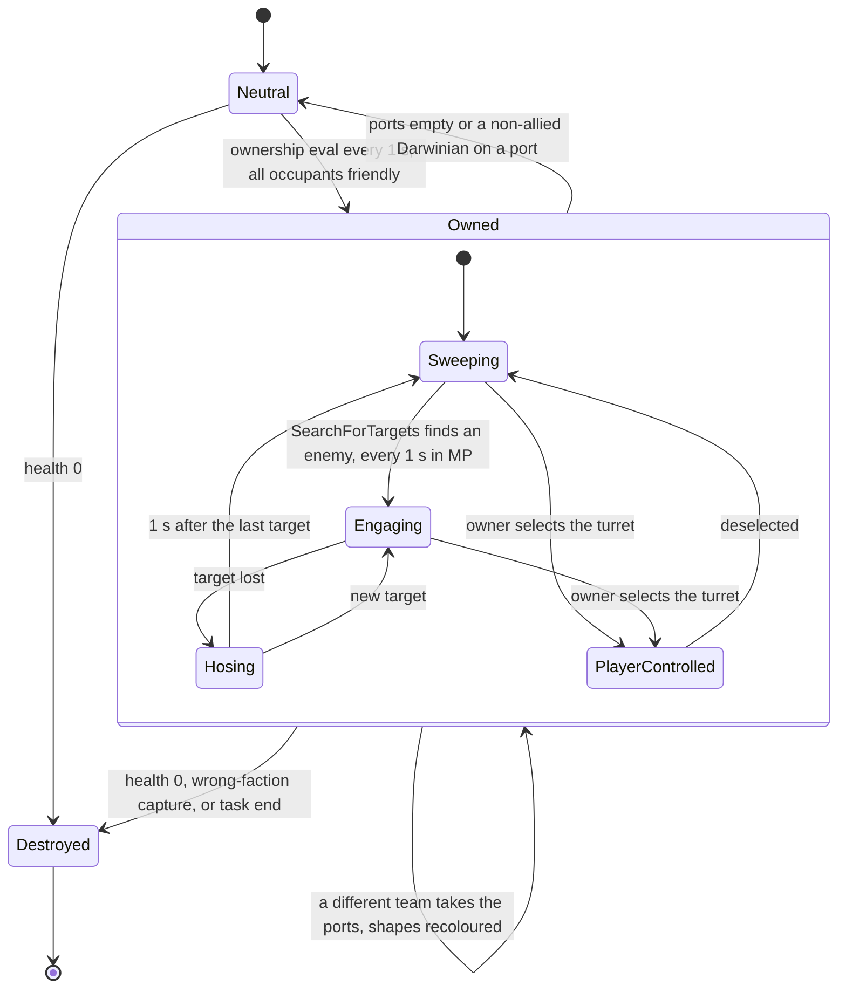

**Mode usage and variants** [C] census, `code/worldobject/crate.cpp`, `code/multiwinia.cpp`:
- Level-placed: 13 official maps — Assault 8/8 (12–40 per map), Blitzkrieg 2/7, Domination 1/9 (`mp_skirmish_3P_1`, 6), KOTH 1/9 (`mp_koth_3P_4`, 6), Rocket Riot 1/7 (`mp_rocketriot_3P_3`, 6); 200 official + 7 dev lines. All placed MP turrets start **neutral**; types used: Standard 196, Flame 11 (Assault `2p_3`, `3p_1`, `3p_3`); no level places Rocket, Mortar or Subversion.
- Crate-delivered: rewards GunTurret / RocketTurret / FlameTurret start a `GlobalResearch::TypeGunTurret` task with `m_option` = Standard / Rocket / Flame; when the player targets a point, `Crate::RunGunTurret(pos, team, type)` builds a **neutral** turret from a template (must be manned), regenerates the obstruction grid, explodes its shapes as a build-in effect, registers map marker `icons/icon_gunturret.bmp` and shows `crate_message_run_gunturret`. The task self-destructs the turret if an enemy captures it. → [04](04_crates_powerups_and_weapons.md).
- Reinforcement turrets: Rocket Riot / Blitzkrieg (and trunk-port maps with `TurretFrequency`) periodically grant GunTurret tasks (`TurretFrequency`, `MaxTurrets`; Blitzkrieg swaps to AirStrike after enough zones; level option `nogunturrets` disables) → [05](05_economy_and_population.md).
- Armour conversion: `Armour::ConvertToGunTurret` builds a turret from a dynamic template. [C] `code/worldobject/armour.cpp`.

Sounds: `TargetSighted`, `FireShell`, `FireFlame`, `FireGrenade`, `FireRocket`, `RegisterKill` (triggered) — the list function names it `RegisteredKill` (name mismatch, P06) + base. [C] `GunTurret::ListSoundEvents`.

### 5.2 Teleport

Source: `code/worldobject/teleport.{h,cpp}`. Abstract base of RadarDish and (legacy) Bridge. **[B:FULL]**.

| Member | Meaning | Ref |
|---|---|---|
| `m_timeSync` | seconds until the next entity may enter (counts down to 0) | [C] `Teleport::Advance` |
| `m_sendPeriod` | minimum time between sends (1.0 default; RadarDish and Bridge 0.1) | [C] ctor |
| `m_entrance` | marker `MarkerTeleportEntrance` (asserted in `SetShape`) | [C] |
| `m_inTransit : LList<WorldObjectId>` | entities currently inside the beam | [C] |
| static `m_teleportMap : LList<TeleportMap{teamId, fromUnitId, toUnitId}>` | maps a unit entering a teleport onto the unit its members are re-assembled into on the far side; entries removed when the source unit no longer exists | [C] |

Virtuals: `Connected()` (false), `ReadyToSend()` (`m_timeSync ≤ 0`), `GetEntrance` (entrance marker), `GetExit`, `GetStartPoint`, `GetEndPoint`, `UpdateEntityInTransit` (assert — must be overridden). [C].

`EnterTeleport(id, relay)` [C] `Teleport::EnterTeleport`:
1. If the entity belongs to a **Unit** (e.g. an insertion squad) and this is not a relay: find (or create via `Team::NewUnit(troopType, size, &id, m_pos)`) the destination unit through `m_teleportMap`; an Insertion Squad gets its squad Task re-created on the new unit (old task removed, `m_lifeTimer` carried over in MP, task selected, weapon type and controller task copied, controller route gains this teleport as a waypoint); the new unit inherits the route (next waypoint) or gets a waypoint 50 units past the exit ± `SFRAND(35)` (synced). The entity is copied into the new unit (new index / unique id), `m_enabled = false`, `m_onGround = false`, `vel = 0`; `RecalculateOffsets()`.
2. Entity position = `GetStartPoint()`; `UpdateEntityInTransit(entity)` once; push id on `m_inTransit`; `m_timeSync = m_sendPeriod`.

`Advance()`: `m_timeSync −= dt` (floor 0); advance every in-transit entity via `UpdateEntityInTransit` (remove when it returns true or the entity is gone); prune the static teleport map; `Building::Advance()`. [C].

Entry is initiated by the entity: `Entity::EnterTeleports(requiredId)` scans buildings in the entity's obstruction cell; for a RadarDish it requires `ReadyToSend()`, distance to the entrance < **15** and `entity.front · entrance.front < 0` (walking into the door); Bridges use 25. Called from the movement code of Darwinians, officers, squads, laser troopers and shamans. [C] `code/worldobject/entity.cpp:Entity::EnterTeleports`.

Hazard [I]: `m_teleportMap` is static (process-wide) and not cleared on level change except by pruning.

### 5.3 RadarDish

Source: `code/worldobject/radardish.{h,cpp}`. **[B:FULL]** (the D3D vertex-declaration reset in `RenderAlphas` is [B:D3D]; a multiplayer block of `ValidReceiverDish` is commented out).

| Aspect | Specification | Ref |
|---|---|---|
| Function | one-way long-range transporter: entities walking into its door are carried along its beam to the **receiver** dish it is aimed at and exit from the receiver's door | [C] |
| Shape | per-instance copy of `radardish.shp` (colours changed per team); fragments `Dish` (pitch) and `UpperMount` (yaw); markers `MarkerFocus` (beam origin), `MarkerTeleportEntrance`; 2 lights; no ports | [C] ctor |
| Ownership | no own capture logic; in MP set by a linked **ControlStation** via `SetTeamId(winner)` (§5.4). MP dishes are placed neutral except two team-0 dishes in `mp_assault_2p_3` (auto-connected, with level option `forceradarteammatch`). On team change in MP the shape copy is recoloured to the team colour (white when neutral) | [C] `RadarDish::Advance`, `ControlStation::RecalculateOwnership`, data |
| Aiming | `Aim(worldPos)`: if the dish has a valid-link list **and** `m_forceConnection`, the request is ignored unless the ray from the focus towards `worldPos` hits (ray–sphere on centre/radius) one of the listed dishes with terrain visibility. Otherwise store `m_target`, clear both alignment flags, sound `BeginRotation`. Aim requests come from the network command `NET_DARWINIA_AIMBUILDING` (accepted only if the dish's team equals the commanding team) and from the AI; humans can only select their own dish, and not at all with level option `noradarcontrol` | [C] `RadarDish::Aim`; `code/network/clienttoserver.cpp:ClientToServer::ProcessServerUpdates` (≈L2684); `code/location_input.cpp`; `code/worldobject/ai.cpp` |
| Rotation | yaw first: axis = currentFront × targetFront (horizontal); `axis.y /= 4`; while `abs(axis.y) > π/3000`, `UpperMount.angVel.y = sign(axis.y)·sqrt(abs(axis.y))`; then pitch: target direction y clamped to [−0.2, +0.3], `Dish.angVel = Dish.transform.r × (worldMat.u · targetFront)` until `abs(angVel) < 0.001`; both integrated with dt. Sounds `BeginRotation`, `EndRotation` | [C] `RadarDish::Advance` |
| Connection test (every tick once a target exists) | among all other RadarDishes: the ray from this focus along the focus front must hit the other's bounding sphere, the other's dish front must face back (`dot < 0`), focus-to-focus terrain visibility (`Location::IsVisible`), the nearest such dish wins, and it must pass `ValidReceiverDish` | [C] |
| `ValidReceiverDish(id)` | in the MP tutorial building 11 is never valid; with `forceradarteammatch`: receiver team must equal ours; else if the valid-link list is empty any dish is valid, otherwise only listed ids | [C] |
| Connected state | `m_receiverId`, `m_range` (focus-to-focus distance), `m_signal = 1`; `Connected() = receiver ≠ −1 && signal > 0`; `ReadyToSend = Connected && m_timeSync ≤ 0`. Transitions play `ConnectionEstablished` / `ConnectionLost` and set `GlobalBuilding.m_link` | [C] |
| Transport | `m_sendPeriod = RADARDISH_TRANSPORTPERIOD` 0.1 s → at most **10 entities/s** may enter one dish; each moves at `RADARDISH_TRANSPORTSPEED` **50 u/s** along the beam (`pos += front·50·dt`), disabled and airborne, unit position kept in sync. Travel time = range / 50 s. No capacity limit | [C] `radardish.h`, `RadarDish::UpdateEntityInTransit` |
| Arrival | when distance travelled ≥ range: placed at the receiver's entrance, facing out, enabled, on ground, vel 0; Darwinians → `StateIdle`, waypoint = own position, orders cleared; insertion-squad members re-waypoint their unit to the exit; re-added to the entity grid; sound `ExitTeleport` | [C] |
| Failure | if the signal drops (`m_signal == 0`) or a `PulseWave` is active, every entity in transit takes `ChangeHealth(−500)` (fatal for Darwinians), is re-enabled, gets a random kick (`SFRAND(10), FRAND(10), SFRAND(10)`, synced) and falls from the beam | [C] |
| AI target | MP only: while connected an `AITarget` (`m_radarTarget = true`) is kept at the entrance and linked to the receiver dish's AI target; destroyed on disconnect | [C] `RadarDish::AdvanceAITarget` |
| Hit tests | sphere test with probe radius ×1.5 (so the door registers in obstruction cells); ray test on the shape with up = (0,1,0) | [C] |
| Damage | indestructible | [C] |
| Rendering | 4 nested beam tubes (radius 10/9/8/4, alpha 0.4/0.2/0.2/0.5) textured `laserfence.bmp` × `radarsignal.bmp`, clipped by the two dish planes; preview beams to all valid links when the owner hovers/selects it → [24](24_rendering.md) | [C] `RenderAlphas`, `RenderSignal` |
| Mode usage | 7 official maps: Assault 3/8 (`2p_3` 4, `3p_1` 2, `4P_1` 6), Domination 2/9 (`domination_4P_2` 8, `koth_2P_2` 6), KOTH 2/9 (`3P_1` 12, `4P_3` 8); 46 lines. Data patterns: sender dishes `force 1` with 1–3 valid links (often `auto 1`); plain receivers `force 0 auto 0` with no links; `mp_assault_2p_3` uses `forceradarteammatch noradarcontrol` with team-0 auto-connected dishes | [C] census, data |

| # | Field | Type | Default | Meaning | Write |
|---|---|---|---|---|---|
| 8 | forceConnection | int, optional | 0 | 1 = only listed dishes may be aimed at (Aim filter) | `%-5d` |
| 9 | autoConnectAtStart | int, optional | 0 | 1 = aim at the first valid link on the first tick (if there is no GlobalBuilding link) | `%-5d` |
| 10… | validLinkId | int, repeated | none | dishes this one may connect to | `%-5d` each |

isGlobal must be 1 (load assert; forced global). [C] `RadarDish::Read/Write`, `code/level_file.cpp:ParseBuildings`.

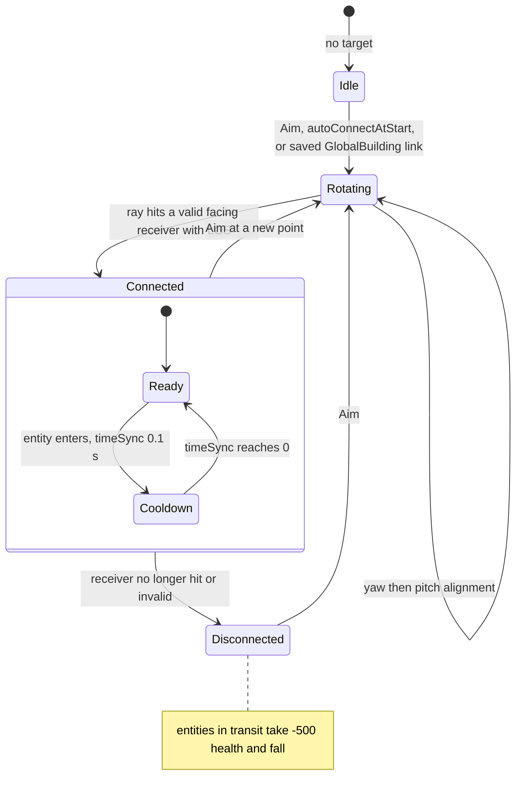

### 5.4 ControlStation

Source: `code/worldobject/controlstation.{h,cpp}`. **[B:FULL]**.

| Aspect | Specification | Ref |
|---|---|---|
| Function | port-operated console whose owner (a) is copied to a controlled building (`m_controlBuildingId`, e.g. a RadarDish) and (b) counts towards destroying the Assault PulseBomb | [C] |
| Shape | `controlstation.shp` (5 ports `MarkerPort01–05`); after `LinkToPulseBomb(id)` (first call only) → `pulsebombcontrolstation.shp` (3 ports + `MarkerDishDirection`); lights cleared and ports re-created via `Building::Initialise(this)` (the old ports are removed with `Empty()`, not deleted — leak) | [C] `ControlStation::LinkToPulseBomb`, `data/shapes/*.shp` |
| Linking | Assault stations listed by the bomb are linked at level load (`Location::Init`) and again by every `PulseBomb::Advance` (no-op after the first) | [C] `code/location.cpp:Location::Init`, `code/worldobject/pulsebomb.cpp:PulseBomb::Advance` |
| Capture (every tick, before port evaluation, i.e. on last tick's occupants) | count port occupants per team; threshold `num = 2` (needs **≥ 3**), or `num = 1` when bomb-linked (needs **≥ 2**); winner = first team above threshold, replaced by a later team above threshold with strictly more; enemies may co-occupy; no winner → station team 255 (controlled building **keeps** its team); winner → station **and** controlled building take the winner's team | [C] `ControlStation::RecalculateOwnership` |
| Inputs / outputs | Darwinians on ports → ownership of itself and of the controlled building | [C] |
| Damage | indestructible | [C] |
| Rendering | port lights (`textures/starburst.bmp`, grey free / occupant team colour); when bomb-linked, owned and the bomb intact: an animated team-coloured beam from `MarkerDishDirection` towards 75% of the way to the bomb (+100 up); always "in view" when linked | [C] `RenderPorts`, `RenderAlphas`, `IsInView` |
| Mode usage | Assault 8/8 (3–4 bomb stations per map, link −1); KOTH 1/9: `mp_koth_3P_1` uses 6 stations controlling RadarDishes; 33 official lines | [C] census, level files |

| # | Field | Type | Default | Meaning | Write |
|---|---|---|---|---|---|
| 8 | controlBuildingId | int | −1 | building whose team follows this station's owner | `%6d` |

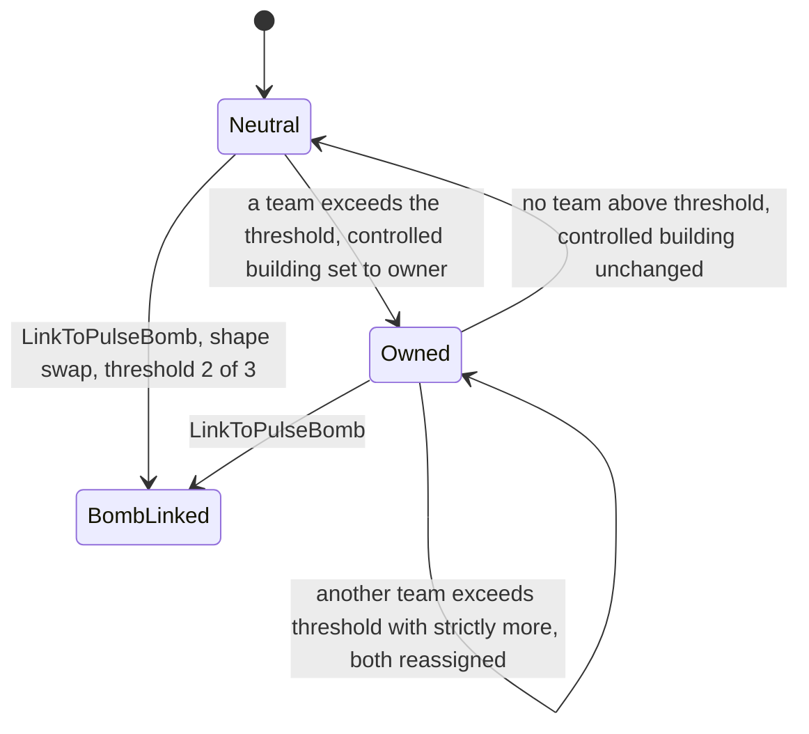

### 5.5 JumpPad

Source: `code/worldobject/jumppad.{h,cpp}`. **[B:FULL]** (trajectory preview [B:EDITOR]).

| Aspect | Specification | Ref |
|---|---|---|
| Function | launches Darwinians standing on it into a ballistic jump | [C] |
| Shape | none; `DoesSphereHit/DoesShapeHit` false; ray test = sphere `m_radius` 13 | [C] |
| Ownership | none — works for every team | [C] |
| Behaviour | `m_launchTimer −= dt`; when ≤ 0 → `m_launchTimer = 0.3`; launch vector = `m_front` rotated about `m_front × up` by `m_angle` (radians), length `m_force`; every Darwinian from the entity grid within `JUMPPAD_RADIUS` **40** that is on the ground and not `StateInsideArmour` gets `vel = launch`, `m_onGround = false`, `StateIdle`, waypoint cleared, orders cleared | [C] `JumpPad::Advance` |
| Note | does **not** call `Building::Advance` (no port evaluation; `m_destroyed` never honoured) | [C] |
| Damage | indestructible | [C] |
| Rendering | animated arrow strip (`icons/thickarrow.bmp`) 80 long, ±20 wide, brightness `0.3 + 0.7·abs(sin(g_gameTime))` (render clock) | [C] `RenderAlphas` |
| Mode usage | 23 placed in 3 official maps: Assault `mp_assault_2P_2` (3), Blitzkrieg `mp_blitzkrieg_2P_3` (2), Domination `mp_skirmish_3P_1` (18); force 76.17–227.38, angle 0.51–1.08 rad | [C] census, data |

| # | Field | Type | Default | Meaning | Write |
|---|---|---|---|---|---|
| 8 | force | float | 0.0 | launch speed (u/s) | `%-2.2f ` |
| 9 | angle | float | 0.0 | elevation above `m_front`, radians | `%-2.2f ` |

## 6 Power network

Source: `code/worldobject/generator.{h,cpp}`, `code/worldobject/powerstation.{h,cpp}`. SolarPanel, Pylon, PylonEnd, PowerSplitter are **[B:FULL]**; Generator, PylonStart, Powerstation are **[B:LEGACY]** (blocked from level files, no runtime creator).

Power in Multiwinia is a stream of discrete **surges**, each tagged with the team of the solar panel that emitted it. Surges hop along `m_powerLink` chains (0.5 s per hop in MP) to a terminal `PylonEnd`, which hands them to a consumer: a **LaserFence** (keeps it raised, friend-only), a **FuelGenerator** (Rocket Riot fuel pressure) or, in Darwinia, a ConstructionYard. [C] `PowerBuilding::Advance`, `PylonEnd::TriggerSurge`.

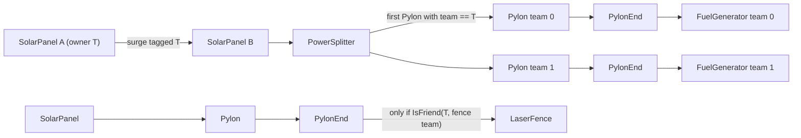

### 6.1 PowerBuilding

| Aspect | Specification | Ref |
|---|---|---|
| Members | `m_powerLink` (id of the next building), `m_powerLocation` (marker `MarkerPowerLocation`, asserted on first use), `m_surges : LList<PowerSurge{m_teamId, m_percent}>` | [C] `generator.h` |
| `TriggerSurge(init, team)` | new surge at the **front** of the list with `percent = init`; sound `TriggerSurge` | [C] `PowerBuilding::TriggerSurge` |
| `Advance` | each surge: `percent += SERVER_ADVANCE_PERIOD × 2` in Multiwinia (× 4 in Darwinia) → **0.5 s per hop** (0.25 s SP); at ≥ 1.0 the surge is deleted and `powerLink->TriggerSurge(0, surge.team)` is called on the linked building **cast to PowerBuilding without a type check** (a link to a non-power building would be undefined behaviour; all shipped links point to power buildings — §6.9); then `Building::Advance()` | [C] `PowerBuilding::Advance` |
| Rendering | power-line beam between the two `MarkerPowerLocation`s; surges as star sprites (size 20) in the surge team's colour (MP; monster and Futurewinian teams skip the trail) with a 3-sprite trail → [24](24_rendering.md) | [C] `RenderAlphas` |
| Link API | `GetBuildingLink/SetBuildingLink` = `m_powerLink` | [C] |
| Damage | every power building is indestructible | [C] |
| Level fields | `powerLink` (int, mandatory, `%-8d`) | [C] `PowerBuilding::Read/Write` |

### 6.2 SolarPanel

| Aspect | Specification | Ref |
|---|---|---|
| Function | the capturable power source | [C] |
| Shape | `solarpanel.shp`: **5 ports**, 5 status markers, 4 glow markers; orientation forced to the terrain normal, front = (1,0,0) × normal (computed on the template in `Initialise`) | [C] ctor, `SolarPanel::Initialise` |
| Starting team | `m_startingTeam` = level team if ≠ 255 (else −1) | [C] `Initialise` |
| Capture | MP: every tick (after the surge roll) `RecalculateOwnership()`: no ports → 255; else owner = team with the most port occupants (strict max, ties → lower index); zero occupants → 255. **Enemies may share the panel** | [C] `SolarPanel::RecalculateOwnership` |
| Output | each tick, if `syncfrand(20) ≤ fractionOccupied` (fraction = occupied/ports) → `TriggerSurge(0, panelTeam)`. Per-tick probability = fraction/20 → at 10 ticks/s the expected rate is **0.5 × fraction surges/s** (0.5/s with all 5 ports manned, 0.1/s per manned port). The synced random draw happens **every tick for every panel**; per-tick, so it does not scale with game speed | [C] `SolarPanel::Advance`; [I] rate arithmetic |
| Operating flag | `fraction > 0.6` → operating (sound `Operate` on the transition); `< 0.3` → not operating (sound stopped) — cosmetic / AI only | [C] |
| Assault knock-out rule | in Assault, if the panel has a starting team and is now owned by a **different** team, all its ports are deleted → next evaluation sets it neutral and it never produces again (attackers permanently knock out defender panels) | [C] `SolarPanel::Advance`; [I] design intent |
| Start of game | `Location::InitialiseTeam` spawns one Darwinian per port on every SolarPanel owned by the team and evaluates ownership | [C] |
| Defect | empty panels re-fire `ChangeTeam` every tick (§3.9) | [C] |
| Rendering | status lights green/red; when occupied and owned, 4 glow quads (60 × 40) pulsing `0.5 + 0.5·abs(sin t)` in team colour (Darwinia blue (100,100,250)) | [C] `RenderPorts`, `RenderAlphas` |
| Mode usage | 16 official maps: Rocket Riot 7/7, Assault 5/8, Blitzkrieg 3/7, Domination 1/9 (`mp_domination_2P_1`); 225 lines | [C] census |
| Level fields | `powerLink` (§6.1) | [C] |

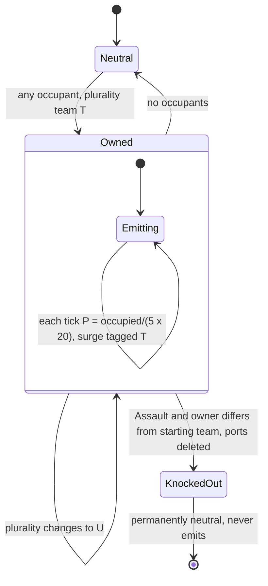

### 6.3 Pylon

Plain `PowerBuilding` relay segment (`pylon.shp`, 1 light). Team from the level file; Rocket Riot pylons are team-owned so PowerSplitters can route by team. Function, inputs and outputs as §6.1; no capture; indestructible. Level fields: `powerLink`. Mode usage: 16 official maps (Rocket Riot 7/7, Assault 5/8, Blitzkrieg 3/7, Domination 1/9; 296 lines). [C] `Pylon`, census.

### 6.4 PylonEnd

Line terminator, rendered invisibly (`RenderAlphas` does nothing). Its `TriggerSurge` does **not** store a surge (no travel time, no `TriggerSurge` sound); it delivers immediately to `m_powerLink`: [C] `PylonEnd::TriggerSurge`
- `TypeYard` → `ConstructionYard::AddPowerSurge()` (legacy);
- `TypeFuelGenerator` → `FuelGenerator::ProvideSurge()` (no team check);
- `TypeLaserFence` → `LaserFence::ProvidePower()` **only if `IsFriend(surgeTeam, fenceTeam)`** — so neutral (255) fences can never be powered and enemy surges never power a fence.

Team from level; indestructible; level fields `powerLink`. Mode usage: 16 official maps (86 lines). [C] census.

### 6.5 PowerSplitter

Router, rendered only in the editor. Extra member `m_links` (level-file tail tokens). `TriggerSurge(init, team)` forwards to the **first** linked building that is a `Pylon` whose team equals the surge's team (exact equality, not `IsFriend`); otherwise the surge is dropped. It ignores its own `m_powerLink` for routing (the field is still read). Mode usage: Rocket Riot 7/7 only (26 lines). [C] `PowerSplitter::TriggerSurge/Read`, census.

| # | Field | Type | Default | Meaning | Write |
|---|---|---|---|---|---|
| 8 | powerLink | int | — | read but unused for routing | `%-8d` |
| 9… | linkId | int, repeated | none | candidate team pylons | `%-4d` each |

### 6.6 Generator

[B:LEGACY] (blocked). `generator.shp` (MarkerPowerLocation, MarkerCounter). Power source enabled by `ReprogramComplete` (from a ControlTower) or by finding a ControlTower linked to it with the same team; emits surges only when enabled; throughput EMA per second `t = 0.8·t + 0.2·n`; GlobalBuilding online when `t > 6.5`; objective text `objective_output` "%d Gq/s" (throughput × 10); sound `Enable`. Level fields: `powerLink`. [C] `Generator::*`.

### 6.7 PylonStart

[B:LEGACY] (blocked). Emits a surge with probability 0.3 per tick (`syncfrand(1) > 0.7`) when the campaign Generator location's generator is online **and** its required building (`m_reqBuildingId`) is online. [C] `PylonStart::Advance/Read`.

| # | Field | Type | Meaning | Write |
|---|---|---|---|---|
| 8 | powerLink | int | next building | `%-8d` |
| 9 | reqBuildingId | int | GlobalBuilding that must be online | `%-8d` |

### 6.8 Powerstation

[B:LEGACY] (blocked). Not a PowerBuilding: `powerstation.shp` with 4 ports. The linked LaserFence (`m_linkedBuildingId`) is **enabled** when all ports are occupied and **disabled** when occupied ≤ 3/4 of the ports. Dereferences the link without a null check (crash if the id is invalid). Level field `linkedBuildingId` (int, `%-8d`). [C] `Powerstation::Advance`.

### 6.9 Network topologies in shipped data

[C] analysis of `mp_*` files (P06): SolarPanels are daisy-chained (SolarPanel→SolarPanel 155 links, →Pylon 35, →PowerSplitter 39, →PylonEnd 2); Pylons link to Pylon 211, PylonEnd 87, PowerSplitter 3; PylonEnds feed LaserFence (31 — Assault, Blitzkrieg, Domination) or FuelGenerator (57 — Rocket Riot); PowerSplitters (Rocket Riot only, 26) route to team pylons. Chain lengths panel→terminal: 3–14 buildings ⇒ surge latency 1.5–7 s at 0.5 s per hop [I].

Design reading [I]: in Assault and Blitzkrieg, defender/base fences are kept up by the owner's panels; capturing (Assault: knocking out) the panels starves the fences, which fall 5 s after the last friendly surge. In Rocket Riot, panels are shared neutral objectives whose surges are routed by splitters to the capturing team's fuel generator.

## 7 Barriers, scenery and markers

### 7.1 LaserFence

Source: `code/worldobject/laserfence.{h,cpp}`. **[B:FULL]**.

**Function.** A post (`laserfence.shp`) that, when raised, projects an energy curtain to the **next** post named by its link id; chains of posts form barrier lines. Enemy units touching a raised curtain are killed (generic entities) or set on fire (Darwinians); raised curtains of any team also block walking routes and AI routing. [C].

**Ownership.** Team from the level (slots 0: 288 lines, 1: 154, 2: 77, 3: 43, 255: 141; isGlobal always 0). Never captured, never changes team; indestructible (no `Damage` override). [C] census (P07), code.

**Level-file parameters** [C] `LaserFence::Read/Write`:

| # | Field | Type | Default | Meaning | Observed in `mp_*` (703 lines) | Write |
|---|---|---|---|---|---|---|
| 8 | nextLaserFenceId | int, mandatory | −1 | id of the next post (−1 = end of chain, no curtain from this post) | −1 on 36 lines | `%-8d` |
| 9 | scale | float, optional | 1.0 | uniform scale of the post and therefore of curtain height | 0.30…2.50 (1.00 ×252, 2.00 ×137, 1.50 ×124) | `%-6.2f` |
| 10 | mode | read with `iv_atof`, stored as int, optional | 0 (`ModeDisabled`) | initial mode | 0 ×20, 2 ×658, 4 ×2, 5 ×23 | `%d` |

`Initialise` copies the three fields, sets `m_status = 1` for Enabled/AlwaysOn, and `m_sparkTimer = syncfrand(10)`. [C].

**Modes** [C] `code/worldobject/laserfence.h`:

| Value | Name | Meaning |
|---|---|---|
| 0 | `ModeDisabled` | down (status 0); responds to `Enable` |
| 1 | `ModeEnabling` | rising at `LASERFENCE_RAISESPEED` |
| 2 | `ModeEnabled` | up (status 1) |
| 3 | `ModeDisabling` | falling |
| 4 | `ModeNeverOn` | never raises; acts as a **relay**: `Enable()`/`Disable()` are forwarded immediately to the next fence; no curtain is drawn or tested (status stays 0); sparks still fire |
| 5 | `ModeAlwaysOn` | permanently up; `Enable`/`Disable`/`Toggle` and solar loss have no effect |

`IsEnabled()` = mode ∈ {Enabled, Enabling, AlwaysOn}. `Enable()`: if mode ∉ {Enabled, NeverOn, AlwaysOn} → Enabling; if NeverOn → forward `Enable()` to next; reset `m_nextToggled`. `Disable()` symmetric. `Toggle()`: Disabled/Disabling → Enable; Enabled/Enabling → Disable; resets `m_nextToggled`. [C].

**Advance (per tick)** [C] `LaserFence::Advance`:
1. First tick after `SetDetail`: if the link resolves, `m_centrePos = midpoint(this, next)`, `m_radius = |next − this|/2 + m_radius` (enlarged for visibility/obstruction).
2. If mode ≠ Disabled: spark timer; at < 0 → `8 + syncfrand(4)` s and `Spark()` (unsynced `frand` particles `Particle::TypeSpark`, 5–10 sparks of size 25–50 flung perpendicular to the curtain at 40–60 u/s from height `frand(50 × scale)`, sound `Spark`).
3. Solar mode (`m_solarMode`, set by the first `ProvidePower`): if `now − m_surgeReceived > 5.0` and (enabled or NeverOn) → `Disable()`; else if not enabled → `Enable()`.
4. Mode machine: Enabling: `status += 0.3·dt`; when `status ≥ 0.5`, a link exists and not yet toggled → `next->Enable()` once; at ≥ 1 → status 1, Enabled. Disabling: when `status ≤ 0.5` (checked **before** the decrement) → `next->Disable()` once; `status −= 0.3·dt`; at ≤ 0 → 0, Disabled. Enabled/AlwaysOn force status 1; Disabled forces 0; NeverOn unchanged.
5. `Building::Advance` (fences have no ports).

**Who switches fences in Multiwinia** [C]:
- **Solar power** is the only live runtime controller: `PylonEnd::TriggerSurge` calls `ProvidePower()` on its linked fence if `IsFriend(surgeTeam, fenceTeam)`. `ProvidePower` sets `m_solarMode = true`, stamps `m_surgeReceived = now`, and (once) `SetSolarLinked()`, which marks this fence and recursively every downstream fence along `nextLaserFenceId` as `m_solarLinked` (stops at AlwaysOn fences or already-linked ones). Only the directly powered fence runs the 5 s timeout; downstream fences follow by chain hand-off. Because `IsFriend(255, x)` is false, neutral fences can never be solar-powered. A fence that has never received a surge keeps its level mode indefinitely (`m_solarMode` starts false). [C] `LaserFence::ProvidePower`, `SetSolarLinked`, `code/worldobject/generator.cpp:PylonEnd::TriggerSurge`, `code/location.cpp:Location::IsFriend`.
- `FenceSwitch` and `Powerstation` (both blocked, [B:LEGACY]) also call `Enable`/`Disable` — unreachable.
- The network command `NET_DARWINIA_TOGGLELASERFENCE` ("cg") is handled by `ClientToServer::ProcessServerUpdates` (`Toggle()`), but its sender `ClientToServer::RequestToggleFence` has **no callers** → dead. [C] grep.

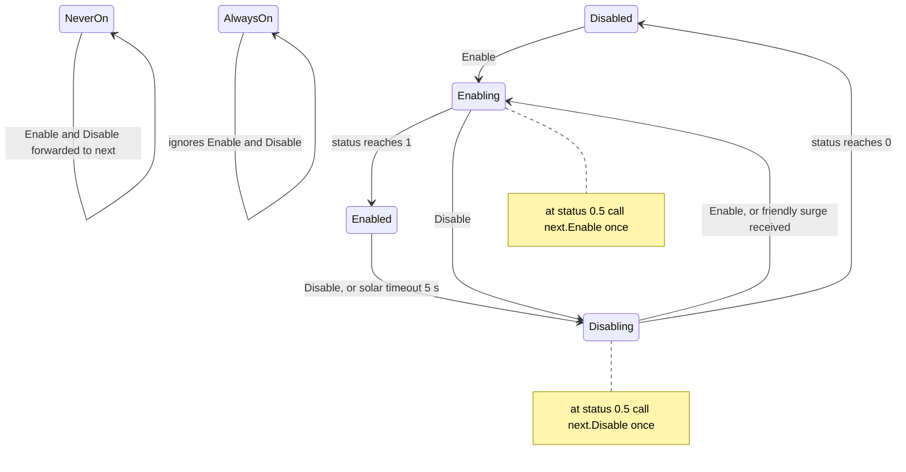

**Damage to crossing entities** (implemented by the entities) [C]:
- Generic entities: `Entity::PushFromObstructions(pos, killem)` — if the entity's shape / sphere (1.0) / swept ray hits an **enabled** fence whose team is not a friend → `ChangeHealth(−9999)` and `fence->Electrocute(pos)` (sound `Electrocute`); otherwise ordinary push-out. [C] `code/worldobject/entity.cpp:Entity::PushFromObstructions`.
- Darwinians: `Darwinian::PushFromObstructions` — enabled non-friendly fence: if `DoesSphereHit(m_pos, 1.0)` and `killem` → `SetFire()` + `Electrocute`; else if within `closest = 5 + uniqueId % 10` → pushed out perpendicular to the curtain in 20-unit steps. [C] `code/worldobject/darwinian.cpp:Darwinian::PushFromObstructions`.
- Routing: `Location::GetWalkingDistance` returns −1 and `Location::IsWalkable` reports the fence id for any **enabled** fence on the path (any team); the AI target graph skips neighbours behind enabled non-friendly fences; `Armour::IsRouteClear` refuses routes through enabled enemy fences. [C] `code/location.cpp`, `code/worldobject/ai.cpp`, `code/worldobject/armour.cpp`.

**Hit tests** [C] `LaserFence::DoesSphereHit/DoesRayHit/DoesShapeHit`:
- Disabled (or editing): post shape only (scaled `laserfence.shp`).
- Otherwise `DoesRayHit`: if linked and `status > 0`: two triangles (p1, p2, p4) and (p4, p3, p1) with p1/p2 = this post base − h/3 / + h and p3/p4 = next post base − h/3 / + h, **h = this fence's full height × status** (the next post's own height is ignored for collision but used for rendering); normal = (p1 − p3) × (p1 − p2) normalised; falls back to the scaled post shape.
- `DoesSphereHit` approximates the sphere by two rays of length 2r through its centre along +X and +Z, then the post shape. `DoesShapeHit` = `DoesSphereHit(transform.pos, shape root radius)`.
- Obstruction grid: linked fences are rasterised into every cell along the segment to the next post (samples = segment length + 1), with extra 4-neighbour cells when consecutive samples jump diagonally. [C] `code/obstruction_grid.cpp:ObstructionGrid::CalculateBuildingArea`.

**Constants**:

| Name | Value | Unit | Kind | Ref |
|---|---|---|---|---|
| `LASERFENCE_RAISESPEED` | 0.3 | status per second (full raise 3.33 s) | `#define` | `laserfence.h` |
| chain hand-off | status 0.5 (≈ 1.67 s into a transition) | — | literal | `Advance` |
| spark interval | first `syncfrand(10)`, then `8 + syncfrand(4)`; only while mode ≠ Disabled | s | literal | `Initialise`, `Advance` |
| solar timeout | 5.0 since last `ProvidePower()` | s | literal | `Advance` |
| curtain full height | `MarkerFence02.y − MarkerFence01.y` of the scaled shape = 48.28 × scale | world units | data | `data/shapes/laserfence.shp` |
| curtain skirt | h/3 below each post base | — | literal | `RenderAlphas`, `DoesRayHit` |
| curtain alpha | 150/255 | — | literal | `RenderAlphas` |
| entity kill | `ChangeHealth(−9999)` | hp | literal | `Entity::PushFromObstructions` |
| Darwinian push band | `5 + uniqueId % 10`, step 20 | world units | literal | `Darwinian::PushFromObstructions` |

**Rendering** (→ [24](24_rendering.md)) [C] `LaserFence::Render/RenderAlphas`: post shape scaled with `GL_NORMALIZE`; curtain (alpha pass, only if mode ∉ {Disabled, NeverOn} and linked): cull off, alpha blend, depth write off; colour neutral (100,100,100,150), solar-linked = lerp((20,20,20), 0.9 × team colour, |sin(4·realTime)|) alpha 150, otherwise team colour alpha 150; predicted status ± 0.3 × predictionTime; quad BL = this − (0, h/3, 0), TL = this + (0, h, 0), TR = next + (0, h′, 0), BR = next − (0, h′/3, 0) with each post's own height × predicted status. At `RenderBuildingDetail` < 3 a two-texture pass (`laserfence.bmp` REPLACE, `laserfence2.bmp` MODULATE, scrolling `gameTime/15`; solar: `gameTime/1.5`, 7× tiling); always an additive `laserfence2.bmp` overlay and a smoothed `GL_LINES` top edge (width 2.0, 0.5 solar). `PerformDepthSort` at `m_centrePos`; `IsInView` true during the grace period; `RenderLights` empty. Render-path sim write: `RenderAlphas` resets `m_nextLaserFenceId = −1` if the link no longer resolves to a LaserFence (determinism hazard only for invalid links) [C]/[I].

**Mode usage**: 14 official maps — Assault 6/8, Blitzkrieg 5/7, Domination 2/9 (`mp_domination_2P_1`, `mp_skirmish_3P_1`), Rocket Riot 1/7 (`mp_rocketriot_2p_3`); 677 official + 26 dev lines. Sounds: `Spark`, `Electrocute` + base. [C] census, `ListSoundEvents`.

### 7.2 Wall

Source: `code/worldobject/wall.{h,cpp}`. **[B:FULL]**.

**Function.** A straight wall segment (`wall.shp`) that blocks movement and line of fire; destroyed only by a single heavy hit. Main use: Assault, where attackers breach walls with the WallBuster (§8.5). Always team 255; not capturable; team irrelevant. [C] census, code.

| # | Field | Type | Default | Meaning | Observed | Write |
|---|---|---|---|---|---|---|
| 8 | objectiveLink | int, optional | −1 | id of an `AIObjective`; on the first `Advance` the wall writes its own id into `AIObjective::m_wallTarget` | −1 ×317, absent ×33, AIObjective ids 27, 33, 39, 41, 47, 50 ×6 | `%4d` |

`AIObjective::m_wallTarget` is written but never read → the link is vestigial. `m_scale` (1.0), `m_fallSpeed`, `m_damage` exist but are not in the level file; the sinking/falling animation in `Advance` and damage accumulation are commented out. [C] grep `wallTarget`, `Wall::Advance`, `Wall::Damage`.

| Constant | Value | Unit | Use | Ref |
|---|---|---|---|---|
| `WALL_LENGTH` | 100.0 | world units | collision length along `front × up` | `wall.cpp` `#define` |
| `WALL_DEPTH` | 20.0 | world units | collision depth along `front` | `#define` |
| `WALL_HEIGHT` | 75.0 | world units | ray-hit quad spans base → base + 37.5 (`WALL_HEIGHT/2`) | `#define` |
| destruction threshold | single `Damage(d)` with `d ≤ −300.0` | damage | `Wall::Damage` | literal |
| visual mesh | ±40.58 along local X, 0…70.93 high, ±1.38 thick | world units | collision footprint (100 × 20, infinite height for spheres) is deliberately larger than the visual (81 × 2.8) | `data/shapes/wall.shp` |

**Behaviour** [C]:
- `Advance`: if `m_destroyed` → return true (Location deletes it, rebuilds the obstruction grid and calls `RecalculateAITargets()`); registers the objective link once; does not call `Building::Advance`.
- `Damage(d)`: if `d ≤ −300` → `g_explosionManager.AddExplosion(wall.shp, transform, 3.0)` and `m_destroyed = true`; records `m_lastDamageTime`. Smaller hits do nothing (no accumulation). Does **not** call `Building::Damage` (no `Damage` sound).
- What can destroy a wall in FULL (resolves P07-U3 using the `Bang` table of §3.8): `WallBuster::BreakWalls` (every wall within 200, −1000) and the WallBuster defender-scuttle explosion `Bang(pos, 50, 500)` (≥ 300 for walls within 60 units of the buster: `500·(1 − d/150) ≥ 300 ⇔ d ≤ 60`). No other live explosion reaches 300 (maximum 255 from the debug-only Portal; nukes and meteors deliver ≤ 100). The cheat window (`Damage(−999)`) is [B:DEBUG]. [C] `code/worldobject/wallbuster.cpp`, `code/location.cpp:Location::Bang`, grep of `Bang(`.

**Hit tests** [C] `Wall::DoesSphereHit/DoesRayHit/DoesShapeHit`: sphere = rectangle 100 × 20 centred on `m_pos` (axes `right = normalise(front × up)` and `front`), **flattened to y = 0** together with the sphere centre (infinite-height prism), tested as triangles (t1,t2,t3), (t2,t3,t4) with `SphereTriangleIntersection` (true if the wall has no shape); ray = vertical quad along `right`, 100 long, bottom corners on the terrain under each end, top at `m_pos.y + 37.5`; shape = exact mesh test on the scaled `wall.shp`.

**Interaction elsewhere** [C]: Darwinians within 4 units (sphere test) are pushed along ±front in 5-unit steps until clear of radius 1 and `m_wallHits++` (`Darwinian::PushFromObstructions`); `Location::GetWalkingDistance` (sphere stepSize/2) and `Location::IsWalkable` (stepSize × 0.66) treat walls as impassable; `AIObjective` never binds to a Wall (`code/worldobject/aiobjective.cpp`).

**Rendering**: shape with `Matrix34(front, up, pos − (0, fallSpeed·prediction, 0))` × `m_scale`; nothing once destroyed; destruction uses the shape-shattering explosion manager → [26](26_animation_and_vfx.md). [C] `Wall::Render`.

**Mode usage**: 9 official maps — Assault 7/8 (`2P_1` 78, `2P_2` 14, `2p_3` 20, `3P_2` 29, `3p_1` 94, `3p_3` 25, `4P_2` 34), Blitzkrieg 1/7 (`2p_2` 17), KOTH 1/9 (`3P_4` 12); dev `mp_assault_stress` 30, `mp_sandbox` 3. [C] census.

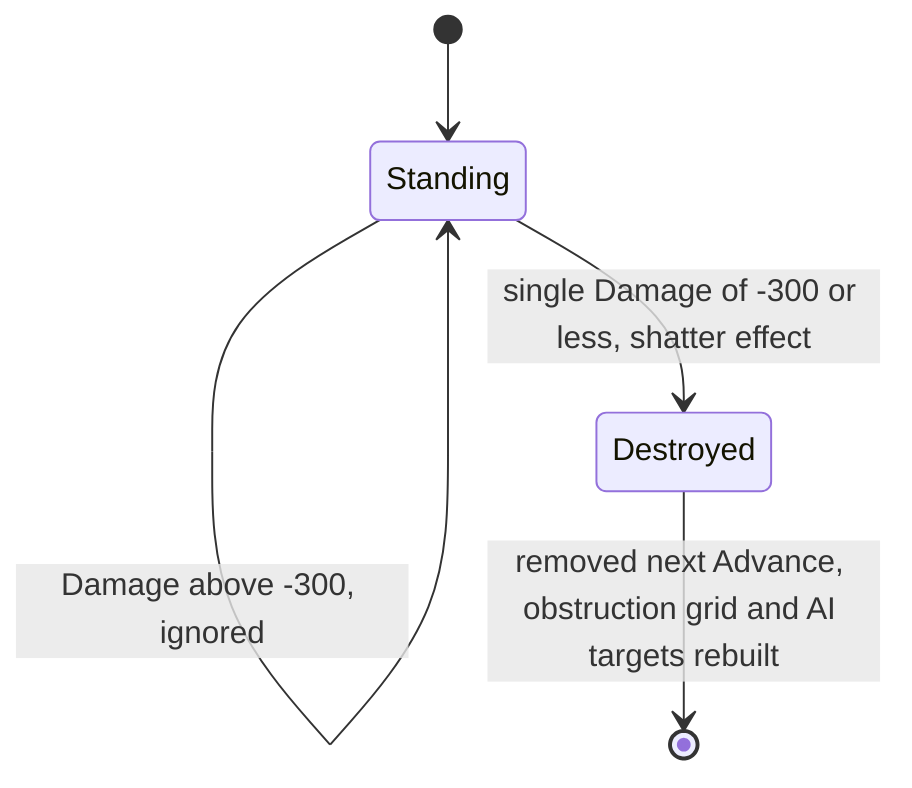

### 7.3 Tree

Source: `code/worldobject/tree.{h,cpp}`. **[B:FULL]**.

**Function.** Decorative but gameplay-relevant scenery: blocks movement and projectiles via two hit spheres, catches fire, burns down and regrows, sets nearby units on fire, can drop spirits ("magic" trees), can spread new trees, and in its *evil* variant kills Darwinians and corrupts nearby trees. Trees are the most numerous visible building in Multiwinia maps (661 lines in 39 official maps, 94 in 6 dev maps; only the invisible AITarget is more numerous). Also created at runtime by the Dark Forest / Magical Forest crate outcomes (`Crate::GenerateTrees`, `Crate::GenerateEvilTrees`) and by tree self-propagation (`Tree::CreateAnotherTree`). [C] census, `code/worldobject/crate.cpp`, `Tree::CreateAnotherTree`.

**Ownership.** Always neutral in practice: level lines use 255 (704 lines) or team slot 1 (51 lines in `mp_domination_4P_2`, `mp_koth_4P_3`, `mp_skirmish_2p_4`, `mp_sandbox_all`); no tree logic reads the team id; runtime trees use 255. Not capturable, no ports. [C] census (P07), `code/worldobject/tree.cpp`.

**Level-file parameters** [C] `Tree::Read/Write`:

| # | Field | Type | Default | Meaning | Observed in `mp_*` (755 lines) |
|---|---|---|---|---|---|
| 8 | height | float | 50.0 | world-unit scale of the whole tree (geometry is generated at unit height) | 43.54 … 272.65 |
| 9 | budsize | float | 1.0 | width multiplier of the **leaf** quads only (branch quads use 0.1, leaves 0.1 × budsize) | 0 … 43.97 (most common 1.00, 3.00, 0.00, 10.00) |
| 10 | pushOut | float | 1.0 | sideways reach of child branches | 0.34 … 1.31 |
| 11 | pushUp | float | 1.0 | upward reach of child branches | 0.43 … 1.32 |
| 12 | iterations | int | 6 | recursion depth N (trunk = level 1, leaves = level N) | 4 (24), 5 (165), 6 (516), 7 (50) |
| 13 | seed | int | 0 | seed of the generation RNG | 0 … 99992 |
| 14 | branchColour | int (signed 32-bit, `%-12d`) | 0xffffffff | packed RGBA, **R in the low byte**: R = v & 0xFF, G = (v >> 8) & 0xFF, B = (v >> 16) & 0xFF, A = (v >> 24) & 0xFF (`intToArray`) | 33 distinct; −1 = (255,255,255,255) |
| 15 | leafColour | int | 0xffffffff | same packing | 39 distinct |
| 16 | leafDropRate | int, optional | 0 | 0 = off; visual leaf-particle rate; editor range 0–50 | 0 (737), 35 (18) |
| 17 | spiritDropRate | int, optional (only if 16 present) | 0 | > 0 = "magic tree" spawning spirits (synced); editor range 0–50 | always 0 in `mp_*` |
| 18 | evil | int, optional (only if 17 present); `== 1` → true | 0 | evil tree | 1 on 127 lines: all of `mp_cts_3P_2` (45), `mp_cts_4P_2` (59), `mp_tankbattle_4P` (23), all with colours −1/−1 |

Fields 16–18 are read only while `TokenAvailable()`, each nested inside the previous, so a line may stop after 15, 16 or 17. Editor ranges ([B:EDITOR]) height 1–1000 step 1; budsize 0–50 step 0.05; pushUp/pushOut 0–5 step 0.01; iterations 1–10; seed 0–99999; leafDrop/spiritDrop 0–50; evil 0–1. [C] `Tree::Read`, `code/interface/tree_window.cpp:TreeWindow::Create`.

Runtime-only state: `m_onFire` (burn/regrow phase), `m_fireDamage` (ignition accumulator), `m_spawnsRemaining` (propagation budget), `m_spawnTimer`, `m_destroyable`, `m_corruptCheckTimer` (initial 5.0), `m_corrupted`, `m_renderCorruptShadow`, `m_burnSoundPlaying`, hit-check `m_hitcheckCentre` (unit space), `m_hitcheckRadius`, `m_numLeafs`, display-list ids. [C] `code/worldobject/tree.h`.

**Procedural generation (exact)** [C] `Tree::Generate`, `GenerateBranches`, `GenerateLeaves`, `RenderBranch`. The tree is generated once in unit space (trunk (0,0,0)→(0,1,0)); `height` is only a uniform scale at render/hit-test time. The RNG is the **unsynced** application LCG, re-seeded with the tree's seed at the start of every pass, so each pass reproduces identical geometry. Pseudocode (own notation):

```
RNG (AppSeedRandom / AppRandom):
  uint32 s; seed(x): s = x
  next():  s = s*214013 + 2531011 (mod 2^32); return (s >> 16) & 0x7FFF   // 0..32767
  frand(r): r * next() / 32767.0                                         // 0..r inclusive

Branch(from, to, n, pass):
  if n == 0: return
  n = n - 1
  if n == 0:                                   // this segment is a LEAF
      if pass == RADIUS: hitR = max(hitR, |to - hitC|)
      elif pass == LEAF: hitC += to; numLeafs += 1
  d = to - from; A = normalise(d x to); B = normalise(A x d)   // normalise: |v|^2 <= 1e-10 -> (0,0,1)
  len = |d|; w = 0.1 * (n == 0 ? budsize : 1.0)
  if (n == 0 and pass == LEAF) or (n != 0 and pass == BRANCH):
      emit quad [from - A*len*w, from + A*len*w, to + A*len*w, to - A*len*w] uv (0,0),(0,1),(1,1),(1,0)
      emit the same quad with B                 // two crossed planes per segment
  for dir in [A, -A, B, -B]:                    // always 4 children, even below a leaf
      t = 0.3 + frand(0.6)                      // one RNG draw per child
      cFrom = from + d*t
      cTo = cFrom + dir*len*0.4*pushOut + d*(1 - t)*pushUp
      Branch(cFrom, cTo, n, pass)               // returns immediately when n == 0

Generate():
  hitC = 0; hitR = 0; numLeafs = 0; unpack colours (optional leaf-alpha boost)
  seed(seed); BRANCH pass -> display list 1 (GL_QUADS)
  seed(seed); LEAF pass   -> display list 2 (GL_QUADS; accumulates hitC)
  hitC = hitC / numLeafs
  seed(seed); RADIUS pass (no geometry)
  hitR = hitR * 0.8
```

Derived for depth N: segments at level k (k = 0 trunk … N−1 leaves) = 4^k; leaf segments 4^(N−1) (N = 6 → 1024); branch segments (4^(N−1) − 1)/3 (N = 6 → 341); 2 quads per segment; RNG draws per pass = 4 × total segments. For the trunk, d × to = 0 so A = (0,0,1) and B = A × d = (−1,0,0) [C] `code/lib/vector3.h:Vector3::Normalise`. The leaf centroid/radius are computed **inside the display-list compile callbacks**, i.e. the simulation's hit volume is a by-product of render-list compilation; `Resource::CreateDisplayListAsync` runs the callback synchronously on the main thread or queues it to the loading thread and blocks. [C] `code/lib/resource.cpp:Resource::CreateDisplayListAsync`.

After generation `Tree::SetDetail(1)` sets `m_centrePos = m_pos + hitC·m_height` and `m_radius = hitR·m_height·1.5`; `SetDetail` asserts `detail == 1` because other values change the iteration count (`iterations −= detail − 1`, min 3) and hence the hit volume ("causes a sync error", source comment). [C] `Tree::SetDetail`.

**Hit volumes** [C] `Tree::DoesSphereHit/DoesShapeHit/DoesRayHit`, using the current (burnt) height `hA = GetActualHeight(0)`: (1) trunk sphere centre `m_pos`, radius 10.0 (constant); (2) crown sphere centre `m_pos + hitC·hA`, radius `hitR·hA`. A query hits if it hits either. `IsInView` uses sphere (`m_pos`, `m_height`). Quirk [I]: rendering rotates the tree by `m_front` while `hitC` is applied unrotated, so the crown sphere is slightly offset from the drawn crown for non-default facings (small because the 4-way branching is nearly symmetric).

**Fire, burn-down and regrowth.** `GetActualHeight(p) = m_height × (1 − |m_onFire′|)`, clamped ≥ 0.01 × height, where `m_onFire′` = `m_onFire` (+ `p × regrow` when regrowing, render prediction only). [C] `Tree::GetActualHeight`.

| Constant | Value | Unit | Kind | Ref |
|---|---|---|---|---|
| ignition threshold on `m_fireDamage` | > 50.0 | damage | literal | `Tree::Damage` |
| `m_fireDamage` decay | −1.0 per second (−`SERVER_ADVANCE_PERIOD` per tick), clamped [0, 100] | /s | literal | `Tree::Advance` |
| initial `m_onFire` on ignition from healthy | 0.01 | phase | literal | `Tree::Damage` |
| burn progression | +0.02 per second | phase/s | literal | `Tree::Advance` |
| full burn from ignition | (1.0 − 0.01)/0.02 = 49.5 s | s | derived | |
| regrow single-player / multiplayer | +0.01/s (100 s) / +0.05/s (20 s) | phase/s | literal | `Tree::Advance`, `GetActualHeight` |
| ignite-others test | `ourH·ourHitR·1.5 + theirH·theirHitR·1.5 ≥ distance` (H = actual heights) | world units | formula | `Tree::Advance` |
| damage to neighbour trees | `Damage(−1.0)` per tick per burning neighbour | — | literal | `Tree::Advance` |
| AntHill ignition | `ourH·ourHitR·1.5 + 100 ≥ distance` → `AntHill::Burn()` | — | literal | `Tree::Advance` |
| unit burn radius | `actualHeight / 2` (= `GetBurnRange()`) | world units | formula | `Tree::Advance`, `GetBurnRange` |
| unit burn effect | Darwinian → `SetFire()`; any other entity → `ChangeHealth(−1, DamageTypeFire)` per tick (all teams) | — | literal | `Tree::Advance` |

`Tree::Damage(d)` (fire damage negative): `Building::Damage` (sound `Damage`); if `m_fireDamage < 50`: `m_fireDamage += −d`; if it now exceeds 50: `m_onFire == 0` → `0.01`; `m_onFire < 0` (regrowing) → `m_onFire = −m_onFire` (resumes burning at the same height); start the `Burn` loop once. A burning tree is unaffected. Neighbour spread needs > 50 net damage: +1/tick against −0.1/tick decay ⇒ ≈ 56 ticks ≈ 5.6 s of continuous contact [I]. [C] `Tree::Damage`.

External ignition sources [C]: Darwinians under the Hot Feet powerup touching a tree (sphere radius 2, `Damage(−1)` per tick, `Darwinian::AdvanceHotFeet`); `Lightning::Advance` (`Damage(−100)` for trees in its obstruction cell); `Fireball::Advance` (`Damage(−100)`); `FlameGrenade::Advance` (`Damage(m_power × −4)` within `m_power × 2`); `TurretShell` (`Damage(−2)`); the Extinguisher crate flips burning trees to regrowing (`SetFireAmount(−GetFireAmount())` within `POWERUP_EFFECT_RANGE × 2` = 140). Darwinians flee burning trees within `2 × GetBurnRange()` (`Darwinian::SearchForThreats`). `code/worldobject/darwinian.cpp`, `code/worldobject/lightning.cpp`, `code/worldobject/weapons.cpp`, `code/worldobject/crate.cpp:Crate::RunExtinguisher`, `code/taskmanager.h:POWERUP_EFFECT_RANGE`.

End of burn (`m_onFire > 1.0`): `m_onFire = −1.0` (stump at 1% height); if `m_corrupted && m_evil` both are cleared (fire cleanses a corrupted tree); if `m_destroyable` → stop the burn sound and return true (removed). Level trees are never destroyable (not in the level format); crate-created trees and their offspring are. [C] `Tree::Advance`, `Crate::GenerateTrees`.

**Healthy-phase behaviours** (only while −0.3 < `m_onFire` ≤ 0, i.e. ≥ 70% regrown and not burning) [C] `Tree::Advance`:
1. Leaf drop (visual, unsynced): if `leafDropRate > 0` and `rand() % (51 − leafDropRate) == 0` (CRT `rand`): one `Particle::TypeLeaf` at `m_pos + (0,h,0) + (sfrand(h), sfrand(h/4), sfrand(h))` in leaf colour (`sfrand(r)` ∈ [−r/2, r/2]).
2. Spirit drop (synced, magic tree): if `!evil && spiritDropRate > 0` and `syncrand() % (51 − spiritDropRate) == 0`: position = `(syncfrand(h), h, 0)` rotated about Y by `syncfrand(2π)` + `m_pos`; team = `int(syncfrand(6))` re-drawn until it is not −1, not the Monster team and not the Futurewinian team; `Location::SpawnSpirit(pos, 0, team, none)`. Per-tick probability 1/(51 − rate) (rate 15 → 1/36 ≈ 0.28 spirits/s); spirits feed Engineers/Harvesters ([05](05_economy_and_population.md)).
3. Propagation: if `m_spawnsRemaining > 0`: `m_spawnTimer < 0` → `now + 5 + syncfrand(5)`; when `now ≥ m_spawnTimer` → `--m_spawnsRemaining`, timer −1, `CreateAnotherTree()`.

`CreateAnotherTree()` [C] `Tree::CreateAnotherTree`, `Tree::PushFromObstructions`:
1. Centroid of all other trees within 100 units.
2. `fullH = GetActualHeight(0)`; `range = fullH + syncfrand(fullH)` (drawn unconditionally).
3. With neighbours: offset = `(m_pos − centroid)` set to length `fullH`, rotated about Y by `syncsfrand(π/4)` (±π/8); else offset = `(range, 0, 0)` rotated about Y by `syncfrand(2π)`.
4. Push from obstructions: for each building in the obstruction cell, while its `DoesSphereHit(pos, 1.0)`, move `pos` 2.0 units directly away from that building's `m_pos`; resample Y; **abort if Y < 0** (underwater).
5. Create a Tree (team 255, new building id), `Clone` this tree's parameters (height, budsize, pushOut, pushUp, iterations, seed, colours, leafDrop, spawnsRemaining (already decremented), destroyable, spiritDrop, evil), `Initialise`, then seed = `int(syncfrand(99999))`, height = `(height × 0.75) × (1 + syncsfrand(0.2))` (×0.65…0.85, evaluated through `volatile` temporaries for a fixed evaluation order), `SetFireAmount(−1)` (starts as a stump and regrows), `SetDetail(1)`, recompute the whole obstruction grid.

**Evil trees and corruption** [C] `Tree::Advance`:
- Kill aura: each tick with probability `syncfrand(10) < 0.2` (2%): `GetBestEnemy(pos, actualHeight/2, monster team)`; if that is a Darwinian not in `StateOperatingPort` → `ChangeHealth(−999)`; if this killed it, its spirit is removed from `m_spirits` and a `Zombie` effect spawns at its position (`vel.y = 20 + syncfrand(25)`, up-vector tilted by `syncsfrand(1)` about its front). Evil trees never drop spirits.
- Corrupting: only when fully grown (`m_onFire == 0`): `m_corruptCheckTimer` counts down; at ≤ 0 it resets to `10 + syncfrand(5)` and the **first** tree (building-array order) that is not evil, not corrupted and within `actualHeight` becomes corrupted: `spiritDropRate = 0`, its `m_corruptCheckTimer = −10`, `m_corrupted = true` (one victim per check).
- Becoming evil: a non-evil tree with `m_corruptCheckTimer < 0` adds dt each tick; when it passes 0 the timer resets to 5 and `m_evil = true` (10 s after corruption).

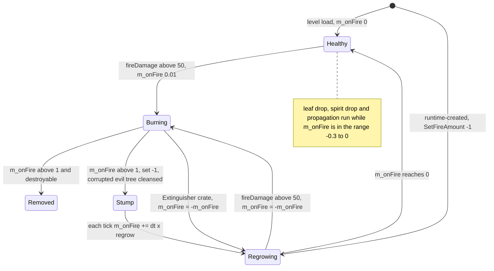

Orthogonal corruption sub-state: `Normal → Corrupted (timer −10) → Evil (after 10 s) → [burn-out] → Normal`; level-placed `evil = 1` trees start Evil and are only cleansed by burning if also corrupted (they are not), so they stay evil. [C].

Sounds: `CreateNormal`, `CreateEvil`, `CreateMagic` (chosen in `Initialise`: evil → CreateEvil, spiritDropRate > 0 → CreateMagic, else CreateNormal), `Burn` (looping; stopped with `StopAllSounds(id, "Tree Burn")`), plus base `Create`, `Damage`. [C] `Tree::ListSoundEvents`, `Tree::Initialise`.

**Rendering** (→ [24](24_rendering.md)) [C] `Tree::RenderAlphas`, `Tree::Render`:
- `Render` draws nothing; all drawing is in the alpha pass (`PerformDepthSort` returns true with sort centre `m_pos + hitC·m_height`).
- State: `GL_TEXTURE_2D` on, texture `textures/tree.bmp` (loaded with alpha), MAG `GL_LINEAR`, MIN `GL_LINEAR_MIPMAP_LINEAR`; blend `SRC_ALPHA, ONE` (additive); cull off; depth write off. Transform = `Matrix34(m_front, up, m_pos)` × uniform scale `actualHeight`. Draw the branch list with the branch colour, then (unless Christmas mod or evil) the leaf list with the leaf colour. Restore: depth write on, cull on, blend `SRC_ALPHA, ONE_MINUS_SRC_ALPHA`, texture off, blend off.
- Sway: `actualHeight *= 1 + sin((realTime + uniqueId·2)·2) × 0.003` (evil: 0.01) — a breathing scale, not per-branch animation (a per-branch wobble is commented out).
- Magic tree (spiritDropRate > 0): leaf blue channel pulses `B = B·f + 255·(1 − f)`, `f = abs(sin(realTime + uniqueId·10))`.
- Evil: branch colour (0,0,0,200), leaves hidden, normal alpha blend (dark silhouette).
- Corrupting (timer ≤ 0, not yet evil): rendered **twice** in one call — pass A darkens branch RGB and alpha by `factor = (10 + timer + prediction)/10` and leaf alpha × (1 − factor); pass B (recursive call) draws the black silhouette with branch alpha `200 × factor`.
- Burning: alpha blend; branch RGB scaled towards black by `min(m_onFire × 10, 1)`, branch alpha 255; leaves black with alpha × (1 − m_onFire); plus 4 camera-facing `textures/starburst.bmp` billboards with depth test off, colour (0.8, 0.2, 0.1, 0.5 × actualH/height), centre `m_pos + (sin(2g + i)·i·1.7, 0.8·actualH + cos(2g + i), cos(2g + i)·i·1.7)` with g = game time, half-size `max(2·actualH, 5)`.
- Regrowing: leaves invisible while abs(m_onFire) > 0.5, else alpha × (1 − 2·abs(m_onFire)).
- Christmas mod (`Location::ChristmasModEnabled`): branches (180, 100, 50), no leaves.
- `RenderTreeDetail` preference (default 1, not exposed in the graphics options UI): if > 1, leaf alpha × 1.3^detail (capped 255) at generation. Fire particles per tick = `int(actualHeight/12) / RenderBuildingDetail` (`Particle::TypeFire`, unsynced `frand`: position radius `frand(0.6h)`, height `0.7h + 0.3·frand(h)`, random yaw, size `2h·(1 + sfrand(0.5))`).
- [B:D3D]: the colour is baked into the display list (`glColor4ubv` inside `GenerateBranches/GenerateLeaves`), so runtime colour changes do not apply under D3D except via the global colour.
- `Location::FlushOpenGlState` deletes all tree display lists (e.g. on video-mode change); they are regenerated lazily on the next `RenderAlphas`. [C] `code/location.cpp:Location::FlushOpenGlState`.
- Debug: `RenderHitCheck` draws both hit spheres under `DEBUG_RENDER_ENABLED` (call commented out in `Render`).

Determinism notes (→ [22](22_determinism_and_networking.md)): geometry RNG is the unsynced global LCG, deterministic only because every pass reseeds it — any other consumer of `frand()` (fire particles in `Tree::Advance`) shares that state, harmless only because generation reseeds first [I]; the simulation crown sphere is derived from the generated geometry with `iv_sqrt`-based `Normalise`/`Mag` in double precision, so a re-implementation must reproduce the generator bit-exactly on all peers or treat the hit sphere as data [I]; synced draws: spirit drop, team choice, spawn timer, propagation offsets, offspring seed/height, evil kill roll, Zombie launch, corruption timer; offspring height uses `volatile` temporaries to fix evaluation order (source comment) [C]; `RenderTreeDetail`/`RenderBuildingDetail` alter visuals only and `SetDetail ≠ 1` is forbidden to protect sync [C].

**Mode usage**: official maps Domination 9/9, KOTH 9/9, CTS 8/9, Assault 5/8, Blitzkrieg 4/7, Rocket Riot 4/7 (39 maps). [C] census.

### 7.4 StaticShape

Source: `code/worldobject/staticshape.{h,cpp}`. **[B:FULL]**.

**Function.** Places any `.shp` from `data/shapes` as a solid, non-interactive obstacle (rocks, temple ruins, landing obstructions). No team logic (all lines team 255), not capturable, indestructible, no ports, no lights (`SetShapeLights` never runs because the shape is set after `Building::Initialise`). [C].

| # | Field | Type | Default | Meaning | Observed (193 official lines) | Write |
|---|---|---|---|---|---|---|
| 8 | scale | float | 1.0 | uniform scale of the shape transform | 1.00 ×163; 0.83–1.76; one 6.10 | `%6.2f` |
| 9 | shapeName | token (no spaces) | "none" | file under `data/shapes/`; "none" = no shape | `beachheadobstruction.shp` 67, `temple2.shp` 56, `rockhead.shp` 32, `temple4.shp` 27, `temple3.shp` 8, `statue.shp` 1, `spaceship.shp` 1, `carryspider.shp` 1 | `%s` |

**Behaviour** [C] `StaticShape::Initialise/SetDetail/Advance`: `Initialise` copies scale and calls `SetShapeName` (loads through `Resource::GetShape` and computes centre/radius with the scaled transform); `SetDetail` re-samples Y and recomputes centre/radius; `Advance` = `Building::Advance`. Hit tests are exact mesh tests on the scaled shape; with no shape, a sphere of `m_radius` (13.0). A missing shape file is fatal: `Resource::GetShapeCopy` searches `data/shapes/<name>` (lower-cased) on disk then in the archive and raises `AppReleaseAssert("Couldn't find shape file …")`. Shapes are cached by name, so all StaticShapes using a file share one Shape. `SetStringId` is declared but never defined. Rendering: scaled shape with `GL_NORMALIZE`; with no shape `RenderSphere(m_pos, 40)` (debug helper). [C] `code/lib/resource.cpp:Resource::GetShapeCopy`.

**Mode usage**: 19 official maps — Assault 6/8, Domination 6/9, KOTH 5/9, Blitzkrieg 1/7, CTS 1/9. [C] census.

### 7.5 RestrictionZone

Source: `code/worldobject/restrictionzone.{h,cpp}`. **[B:FULL]**.

**Function.** Invisible, non-colliding circle that (a) prevents random crates from landing inside it and (b) optionally blocks map-wide power-up targeting inside it (e.g. starting islands). Source comment: "doesn't do anything itself, although it prevents crates from dropping inside their area". All team 255; no capture; indestructible. [C].

| # | Field | Type | Default | Meaning | Observed (35 lines) | Write |
|---|---|---|---|---|---|---|
| 8 | size | float | 300.0 | horizontal radius | 300.00 … 1118.80 | `%-2.2f` |
| 9 | blockPowerups | int, optional | 0 | 1 = also blocks power-ups whose target area is "anywhere" | 0 ×26, 1 ×9 | `%5d` |

**Behaviour** [C] `RestrictionZone::IsRestricted`, callers:
- Static registry `s_restrictionZones` (unique ids): added in `Initialise`, removed in the destructor.
- `IsRestricted(pos, powerups = false)`: for each registered zone, horizontal distance (`pos.y` replaced by the zone's y) `< size` → true if `!powerups` or the zone has `blockPowerups == 1`.
- Callers: `Location::CreateRandomCrate` (random-position fallback re-rolls while height < 20 or `IsRestricted(pos)`, max 100 tries, then no crate) and `TaskManager::IsValidTargetArea` (GunTurret task: `IsRestricted(pos, true)` → invalid; any target area whose centre is (0,0,0), the radius-99999.9 "anywhere" area used by Booster, HotFeet, GunTurret, Shaman, Infection, MagicalForest, DarkForest, AntsNest, Plague, EggSpawn, MeteorShower, Extinguisher, Rage, DropShip). A commented-out use exists in `Multiwinia::AdvanceRetribution`. [C] `code/location.cpp:Location::CreateRandomCrate`, `code/taskmanager.cpp:TaskManager::IsValidTargetArea`.
- `Advance` does nothing; sphere/shape hit false; ray only in the editor; rendered only under `LOCATION_EDITOR` ([B:EDITOR]).

**Mode usage**: 14 official maps — Assault 6/8, Rocket Riot 4/7, Blitzkrieg 2/7, Domination 1/9, KOTH 1/9. [C] census.

### 7.6 SmokeMarker

Source: `code/worldobject/smokemarker.{h,cpp}`. **[B:FULL]**.

**Function.** Emits a continuous rising column of grey smoke (atmospherics). No extra level fields (base 8 tokens only). Team irrelevant (all 255); not capturable; indestructible. [C].

**Behaviour** [C] `SmokeMarker::Advance`: every tick 3 particles of `Particle::TypeMissileTrail` at `m_pos`, velocity `(sfrand(0.4), 1, sfrand(0.4))` set to length 50, size `200 + frand(100)` (unsynced RNG, visual only); does not call `Building::Advance`. `TypeMissileTrail`: life 5.0 s, base size 200, gravity 1.0, friction 0, colour (100,100,100)→(200,200,200). [C] `code/particle_system.cpp`.

**Signature bug — collision is not disabled** [C]/[I]: the header declares `RenderAlphas(float)`, `DoesSphereHit(Vector3 const&, float)` and `DoesRayHit(…, float _rayLen, …)`, whereas the `Building` virtuals take `double`; they therefore **do not override** (only `DoesShapeHit(Shape*, Matrix34)` matches). In game the base `Building::DoesSphereHit/DoesRayHit` apply: with no shape, a sphere of radius 13.0 at `m_pos`, registered in the obstruction grid like every building → each SmokeMarker is an **invisible 13-unit obstacle** that pushes units and stops rays [I] (whether any of the six sit on routes is 03-U9). The intended editor sphere drawing is never called. Compare EruptionMarker (uses `double`, correctly non-colliding). A new design should make markers non-colliding explicitly.

**Mode usage**: 6 lines, all in `mp_assault_3p_1` (Assault 1/8). [C] census.

### 7.7 EruptionMarker

Source: `code/worldobject/eruptionmarker.{h,cpp}`. **[B:FULL]**.

**Function.** Atmospheric volcano vent; visual only, no damage. No extra level fields; team 255; not capturable; indestructible; non-colliding (all three hit tests use `double` and return false outside the editor). [C].

| Parameter | Value | Kind |
|---|---|---|
| eruption start test (idle) | `syncrand() % 1000 == 0` per tick (p = 0.001/tick, mean wait 100 s at normal speed) | literal, **synced** |
| eruption duration | `3.0 + syncfrand(4.0)` s (3–7 s) | literal, synced |
| particles while erupting | 10 per tick, `Particle::TypeVolcano`, velocity `(sfrand(1), 1, sfrand(1))` set to length 100, size `300 + frand(200)` | literal, unsynced |
| `TypeVolcano` particle | life 12.0 s, size 400, gravity 10.0, friction 0, colour (150,50,50)→(150,120,50); dies on touching the ground | `code/particle_system.cpp` |

It consumes the synced RNG every idle tick, so it is part of the deterministic RNG stream ([22](22_determinism_and_networking.md)). [C] `EruptionMarker::Advance`.

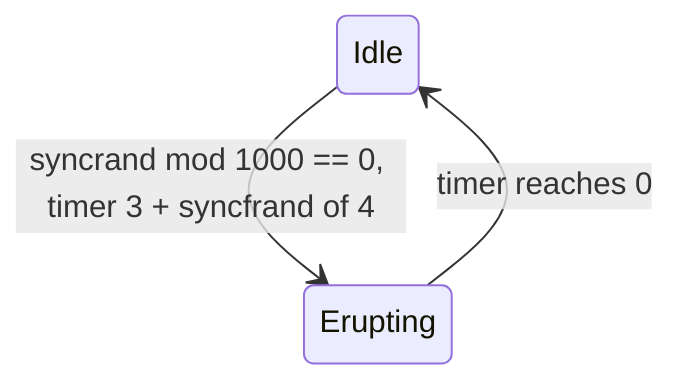

**Mode usage**: 1 line (`mp_blitzkrieg_3P_2`, id 80) — Blitzkrieg 1/7. [C] census.

## 8 Mode objective objects

Mode rules (scoring, win conditions, timers) that read these objects are specified in [01](01_game_modes.md); this section specifies the objects themselves.

### 8.1 MultiwiniaZone

Source: `code/worldobject/multiwiniazone.{h,cpp}`. **[B:FULL]** (each per-mode branch is compiled under its `INCLUDEGAMEMODE_*` macro, all defined in FULLGAME).

**Function.** A circular zone whose meaning depends on the game type: the **hill** in King of the Hill, a **drop zone** (team-owned) or **statue spawn zone** (neutral) in Capture the Statue, and a **flag** in Blitzkrieg. In Domination, Assault and Rocket Riot it does nothing. [C] `MultiwiniaZone::Advance`.

| Member | Type | Default | Meaning |
|---|---|---|---|
| `m_size` | double | 50.0 | zone radius (KOTH counting radius, ring radius, `m_radius` after `SetDetail`) |
| `m_life` | double | −1.0 | > −1 → zone deletes itself when it reaches 0 (only used by a commented-out zone spawner) |
| `m_recountTimer` | double | 0.0 | next game time to recount |
| `m_totalCount`, `m_teamCount[6]` | int | 0 | counted Darwinians |
| `m_blitzkriegFlag` | Flag* | NULL | lazily created cloth flag (size 50) |
| `m_aiTarget` | AITarget* | NULL | **never assigned** → the priority code at the top of `Advance` is dead |
| `m_blitzkriegLinks` | LList<int> | — | linked zone ids (level file + reverse links added at Blitzkrieg start) |
| `m_numStandardLinks` | int | 0 | link count from the level (written, unused) |
| `m_blitzkriegOwnership` | double | 0.0 | 0–100 capture progress |
| `m_blitzkriegCaptureTeam` | int | 255 | team currently gaining/holding progress |
| `m_blitzkriegUpOrDown` | int | 0 | −1 / 0 / +1 last change direction (flag icon) |
| `m_blitzkriegLocked` | bool | true | locked flags cannot be contested |
| `m_blitzkriegUnderAttackMessageTimer` | double | 0.0 | 20 s throttle for "base under attack" |
| static `s_blitzkriegBaseZone[6]` | int | reset to −1 at location init | home flag id per team |

[C] `code/worldobject/multiwiniazone.h`, ctor.

**Initialise.** Copies size and links; `m_centrePos = pos + (0, radius/2, 0)`. In Blitzkrieg, a zone with a level team (remapped to a real team) is recorded as that team's **base zone** and then set **neutral** — home flags start uncaptured. [C] `MultiwiniaZone::Initialise`.

**King of the Hill** (`Advance_KingOfTheHill`, every 1.0 s, see §1.2): count every Darwinian within `m_size` that is not dead, not on fire and not inside Armour, per team; owner = team with the strictly highest count (ties → lower index), none → 255. Scoring modes (zones held per second, population per second, final population, total control) live in [01](01_game_modes.md). [C].

**Capture the Statue** (`Advance_CaptureTheStatue`, owned zones only, every 2.0 s): every Statue owned by the zone's team within **30** units of the zone position → `Statue::Destroy()`, `Multiwinia::AwardPoints(team, 1)`, help notification, message `multiwinia_cts_statuecapture`, sound `CaptureStatue`. Neutral zones are statue spawn points (spawn timer in [01](01_game_modes.md)). Zone ownership in CTS never changes (no recount). [C].

**Blitzkrieg** (`Advance_Blitzkrieg`, every 1.0 s) [C]:
1. `m_blitzkriegLocked = IsBlitzkriegZoneLocked()`: unlocked if neutral **and** a base zone; unlocked if part-captured (0 < ownership < 100); otherwise locked unless some linked zone is owned by a team other than this zone's team (neutral neighbours do not unlock).
2. If not locked: per used team, count Darwinians within **40** units (not `m_size`) that are not dead, not on fire, not in Armour; leader = strictly highest count. If locked, no counting happens (stale `m_teamCount`, leader = none).
3. Leader present: `change = 5.0 × top × (top / total)`; if the zone is owned, `captureTeam = owner`; if leader ≠ captureTeam: `ownership −= change × dt`, at ≤ 0 → `SetTeamId(255)`, `captureTeam = leader`; else `ownership += change × dt`, at ≥ 100 → `SetTeamId(leader)`. Per recount (dt = 0.1) this is `0.5 × top × fraction` points.
4. No leader: if neutral, `ownership −= 10 × dt` (1 point per recount); at ≤ 0 `captureTeam = 255`. Owned zones do not regenerate.
5. Clamp to [0, 100]; set up/down indicator; "base under attack" message (`dialog_baseunderattack`) for the local owner of its base when enemies are within `m_size`, throttled to 20 s.
6. The AITarget nearest the zone gets `m_priority[i] = 1.0` (Easy) or `GetBlitzkriegPriority(zone, i)` (Standard/Hard) and `m_aiObjectiveTarget[i] = (p > 0)` → [07](07_ai.md).

`GetBlitzkriegPriority(zone, team)` by the team's Blitzkrieg status score: SAFE → 1.0 for zones not owned by the team; ENEMYOCCUPIED / UNDERATTACK / UNOCCUPIED → 1.0 for base zones owned by a live team; UNDERTHREAT → 1.0 for zones linked to the team's base and not owned by it; finally 0.0 for any non-base zone the team already owns. [C].

Blitzkrieg initialisation in `Multiwinia::AdvanceBlitzkrieg` adds reverse links (links are made bidirectional) and increments the file-static `s_numMultiwiniaZones` once per zone **without resetting it** (KOTH resets it every scoring tick, Blitzkrieg never) — the count accumulates across Blitzkrieg games in one session and feeds the airstrike-reinforcement threshold `numZones ≥ (s_numMultiwiniaZones + 1)/2`, a cross-session desync hazard → [01](01_game_modes.md), [22](22_determinism_and_networking.md). [C] `code/multiwinia.cpp` (s_numMultiwiniaZones uses).

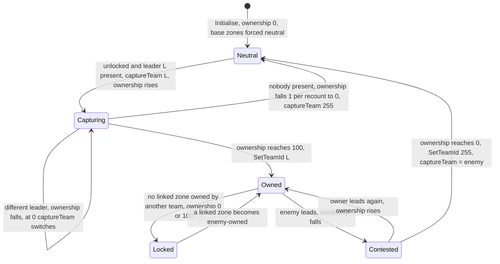

Other members [C]: not collidable (`DoesSphereHit/DoesShapeHit` false; `DoesRayHit` only in the editor); `GetBuildingLink()` = first link; `SetBuildingLink(id)` appends if absent; static `GetNumZones(team)` counts zones owned by a team; `IsBlitzkriegBaseZone()`; `GetBaseTeamId()`. Rendering (ring segments, animated edge, flag) → [24](24_rendering.md). Sound: `CaptureStatue`.

| # | Field | Type | Default | Meaning | Write |
|---|---|---|---|---|---|
| 8 | size | float (`atof`) | 50.0 | zone radius | `%-6.2f` |
| 9… | linkId | int, repeated | none | Blitzkrieg flag links | `   %d` each |

**Mode usage**: Blitzkrieg 7/7, CTS 9/9, KOTH 9/9 (152 official lines). [C] census.

### 8.2 Flag

Source: `code/worldobject/flag.{h,cpp}`. **[B:FULL]**. Not a building or world object: a cloth-flag render primitive owned by Blitzkrieg zones, `Armour` (`m_flag`, `m_deployFlag`) and `Officer` (`m_flag`). [C] `code/worldobject/armour.h`, `officer.h`.

- Function: purely presentational team marker; no ownership, inputs, outputs, damage or level fields of its own. Uses `g_advanceTime`/`g_gameTime` (render clock, non-deterministic).
- Grid `m_flag[6][6]` (`FLAG_RESOLUTION` 6) of vertices; `Initialise` lays them on the front/up plane.
- `Render(teamId, fileName)`: each frame relaxes vertices towards a target (column 0 attached to the pole, others trailing the previous column by `size/5`); factor `advanceTime·10·(6 − x)/6` (1.0 for x = 0; 0.7 if size > 40 or highlighted/selected); wind wobble `cos/sin(gameTime + x·k)·x/6` (×0.3 when highlighted); max link length `size/2`. Draws a white pole quad (width 0.4, height `size·1.5`) then the textured flag. In multiplayer with a filename: per-team recoloured texture cached as `<file>_<colourId>_<groupPos>` (`_255` neutral grey, `_selected_…` brighter) via `BitmapRGBA::ConvertRedChannel(teamColour)`; optional goto-arrow overlay (`icons/arrow.bmp`).
- `RenderText(x, y, caption)` draws text on a cell; `RayHit` = sphere pre-test + per-quad triangle tests (clicking officer/armour flags).

[C] `Flag::Initialise`, `Flag::Render`, `Flag::RayHit`.

### 8.3 CarryableBuilding

Source: `code/worldobject/carryablebuilding.{h,cpp}`. **[B:FULL]**: the whole `Advance` body is inside `#if defined(INCLUDEGAMEMODE_CTS) || defined(INCLUDEGAMEMODE_ASSAULT) || defined(INCLUDEDGAMEMODE_PROLOGUE)` (note the typo `INCLUDEDGAMEMODE_PROLOGUE`); CTS and Assault are defined in FULLGAME, so it is live. Not a level-file type (no enum value); concrete subclasses are Statue (CTS), WallBuster (Assault) and ChessPiece (blocked). `IsCarryableBuilding(type)` = Statue, WallBuster, ChessPiece. [C].

| Member | Default | Meaning |
|---|---|---|
| `m_carryRadius` | subclass | radius of the carrier ring; also the collision radius between carryables |
| `m_scale` | 1.0 | render scale; collision push force passed to `HandleCollision` |
| `m_numLifters` / `m_numLiftersThisFrame` | 0 | carriers counted last tick / being counted this tick |
| `m_minLifters` / `m_maxLifters` | 0 | lifters needed to move it / ring capacity |
| `m_lifted` | false | currently moving |
| `m_recountTimer` | 0.0 | next ownership recount (game time) |
| `m_waypoint`, `m_routeId`, `m_routeWayPointId` | —, −1, −1 | goal and optional route |
| `m_speedScale` | 1.0 | base speed multiplier |
| `m_requestedWaypoint`, `m_requestedRouteId`, `m_numRequests` | —, −1, 0 | carriers' votes for a new goal this tick |

**Behaviour per tick** [C] `CarryableBuilding::Advance`:
1. **Ownership** (`CalculateOwnership`, every 1.0 s): for each used team count non-dead Darwinians of that team within **50**; new owner = team with the highest count that is also ≥ `m_minLifters` (else 255). The team changes only if the new team is not a friend of the old one; on change the goal is reset to the current position. While neutral the goal is reset every tick — a neutral carryable never moves.
2. **Goal vote**: if `m_numRequests > 0.66 × m_numLiftersThisFrame`, adopt the requested waypoint/route. Requests reset each tick.
3. Follow route waypoints (advance when within 10 units; route end → stop).
4. **Lift and speed**: `m_numLifters = m_numLiftersThisFrame` (then reset). `GetCarryPercentage` = `lifters / maxLifters` if lifters ≥ minLifters else 0. Speed = `percentage × 16 × GetSpeedScale() × |sin(gameTime)|` u/s (the sine gives a heave-ho rhythm). `GetSpeedScale` = `m_speedScale`, multiplied by the mean speed ratio (`stats[Speed] / blueprint speed`) of carriers within `1.2 × carryRadius` when at least one carrier has a Hot Feet task. Sounds `Lift` + `Carry` on pick-up (goal reset), `Drop` on set-down.
5. **Movement and collision**: desired position = pos + dir·speed·dt (y on terrain); no move if it would not get closer to the goal. Collision factor = Σ over other carryables of `(rA + rB − dist)` for overlaps (using `m_carryRadius`; static array of 32 collisions). Move only if currently not colliding or the move reduces overlap; otherwise stop and call `HandleCollision(m_scale / numEnemies)` on each **enemy** carryable hit (base implementation empty). Up vector follows the terrain normal with y × 1.5.
6. `Building::Advance()`.

**Darwinian side** [C] `code/worldobject/darwinian.cpp:Darwinian::SearchForCarryableBuilding`, `AdvanceApproachingCarriableBuilding`, `AdvanceCarryingBuilding`, `Darwinian::SetWaypoint` (resolves P06-U7):
- `SearchForCarryableBuilding` (multiplayer only): candidates = carryables within `DARWINIAN_SEARCHRANGE_CARRYABLE` **150** (minus their radius), excluding own-team carryables already at max lifters; one is chosen with `syncrand()`; state `StateApproachingCarriableBuilding`.
- Approaching: walk to a point 30 units from the carryable at a random angle (`syncfrand(2π)`) and mill around; these Darwinians are what the 50-unit ownership count sees. As soon as the carryable's team equals the Darwinian's team → `StateCarryingBuilding`.
- Carrying: target = `GetCarryPosition(uniqueId)` (zero vector if the ring is full → Darwinian goes idle; else a point on the ring at angle `uniqueId × 123.467` rad offset by `vel × 0.5`, on terrain); the Darwinian counts as a lifter (`m_numLiftersThisFrame++`) once it is within `20 × gameSpeed × speedRatio` of that point. It leaves if the carryable changes to another team. Orders given to a carrying Darwinian become a waypoint vote (`SetWaypoint`; WallBusters always get a direct route, route id −1).

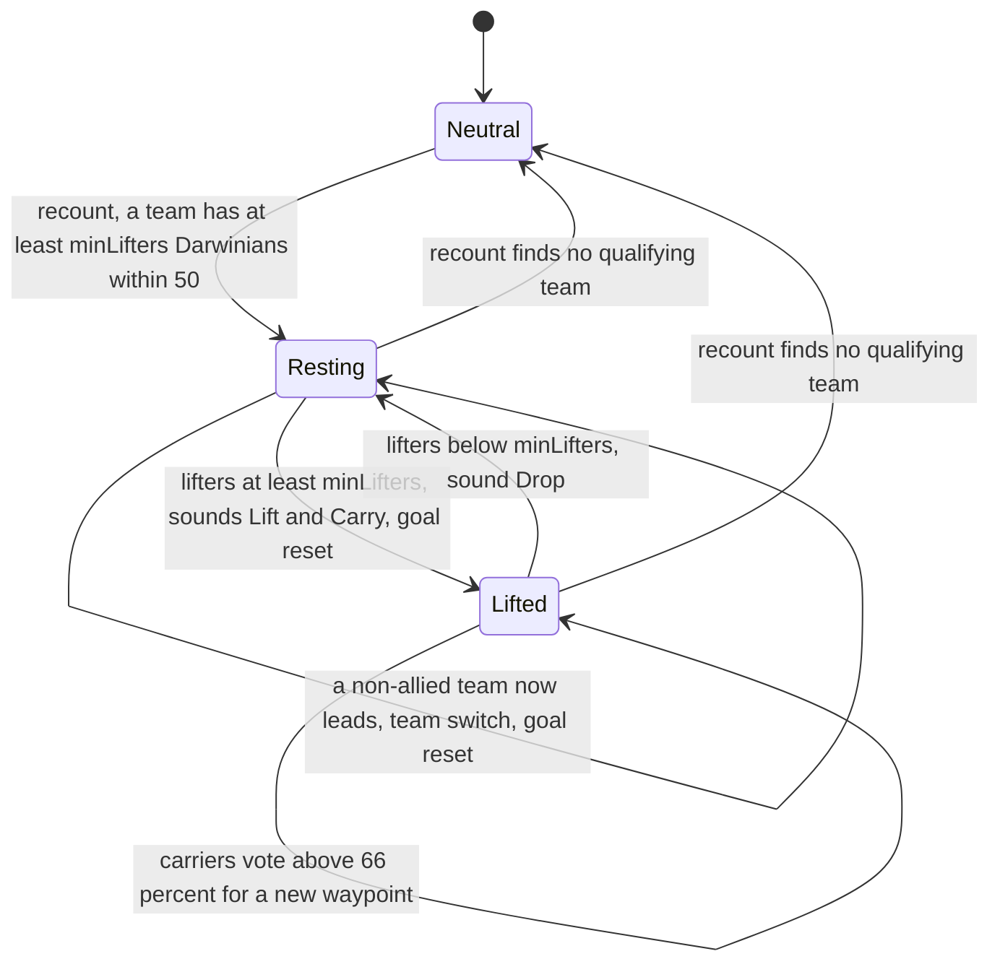

Damage: none at this level (base `Damage`; `HandleCollision` empty). Hit tests: none in game (ray only in the editor). Always in view. Rendering: shape scaled by `m_scale`, lifted +5 y, up from the terrain normal. [C].

### 8.4 Statue

Source: `code/worldobject/statue.{h,cpp}`. **[B:FULL]**, created only at runtime in Capture the Statue (`TypeStatue` is blocked for level placement; the one dev line in `mp_sandbox` is dropped). [C] `code/multiwinia.cpp` CTS block, census.

| Aspect | Specification | Ref |
|---|---|---|
| Function | carryable relic; delivered to an owned MultiwiniaZone within 30 units it scores 1 point and is destroyed (§8.1) | [C] |
| Creation | by `Multiwinia` CTS logic: `CreateBuilding(TypeStatue)` + `Initialise(template)` + new building id at a neutral zone, team 255, random facing (timer rules in [01](01_game_modes.md)) | [C] |
| Lifters / radius | `m_minLifters` 20, `m_maxLifters` 50, `m_carryRadius = m_radius = 33` | [C] `Statue::Statue`, `Initialise` |
| Shape | `syncrand() % 8` → `carrystatue`, `carrysquaddie`, `carryglobe`, `carrytelescope`, `carryweights`, `carrycube`, `carryteapot`, `carrybillboard` (.shp); billboard sets `m_renderSpecial` but the special shape `carryspecialshape.shp` does not exist, so the normal shape renders | [C] `Statue::Initialise`, `Statue::Render` |
| Spawn effect | `ExplodeShape(0.5)` "materialise" burst unless the game is in its grace period | [C] |
| Ownership | CarryableBuilding rule (§8.3) with min 20 | [C] |
| Auto-goal | when owned and the waypoint is unset or reached: at most once per game second, route (`RoutingSystem::GenerateRoute`) to the nearest MultiwiniaZone owned by the statue's team (Monster/Futurewinian owners → nearest neutral zone); the route is highlighted for the local team | [C] `Statue::Advance` |
| AI target | creates an `AITarget` (priority modifier 1.0, `m_statueTarget` = statue id) on first Advance; moved to the statue (and AI targets recalculated) when it drifts > 1.5 × carry radius | [C] |
| Destruction | `Destroy()` (explode full shape, `m_destroyed`, destroy AI target) when tilted (`m_up.y < 0.7`), in water (`m_pos.y < 0`) or delivered | [C] |
| Damage | not damageable by weapons | [C] |
| Level fields | none of its own | [C] |
| Rendering | special lights (`SetupSpecialLights`) then restore | [C] |
| Mode usage | CTS only (runtime); `INCLUDEGAMEMODE_CTS` gates the `Advance` body | [C] |

### 8.5 WallBuster

Source: `code/worldobject/wallbuster.{h,cpp}`. **[B:FULL]**.

| Aspect | Specification | Ref |
|---|---|---|
| Function | carryable explosive charge that breaches Walls (Assault) | [C] |
| Shape / scale | `wallbuster.shp`, `m_scale` 10 | [C] ctor |
| Lifters | min 10, max 30; `m_speedScale` 0.6; carry radius 13 (also `m_radius`) | [C] ctor, `Initialise` |
| Ownership | CarryableBuilding rule (§8.3) with min 10 | [C] |
| Breach | every tick: any `Wall` in the buster's obstruction cell whose `DoesSphereHit(pos, 20)` → `ExplodeShape(1.0)`, `BreakWalls()` (**every Wall within 200 takes `Damage(−1000)`**), `Location::Bang(pos, 50, 150)`, `Destroy()`, global message `dialog_wallbreach` | [C] `WallBuster::Advance`, `BreakWalls` |
| Defender scuttle | if owned by a team whose map position is **not attacking** (`m_attacking[position]`) and carried by ≥ 10 lifters: `m_destructTimer` (10 s) counts down; at 0 → `Destroy()` + `Bang(pos, 50, 500)` (also destroys walls within 60 units, §7.2); resets to 10 s whenever the condition fails | [C] |
| AI target | creation code commented out → `m_aiTarget` normally NULL | [C] |
| AI routing (`RunAI`) | called by the Assault AI for its own busters: when the waypoint is unset/reached, once per second, route (`GenerateRoute(…, false, true)`) to the nearest Wall that lies within 500 of any marker of the AI's current `AIObjective` | [C] `WallBuster::RunAI` |
| Damage | not damageable by weapons | [C] |
| Level fields | none of its own (base 8) | [C] |
| Mode usage | 3 lines (team 255) in `mp_assault_2P_1` only (Assault 1/8) | [C] census |

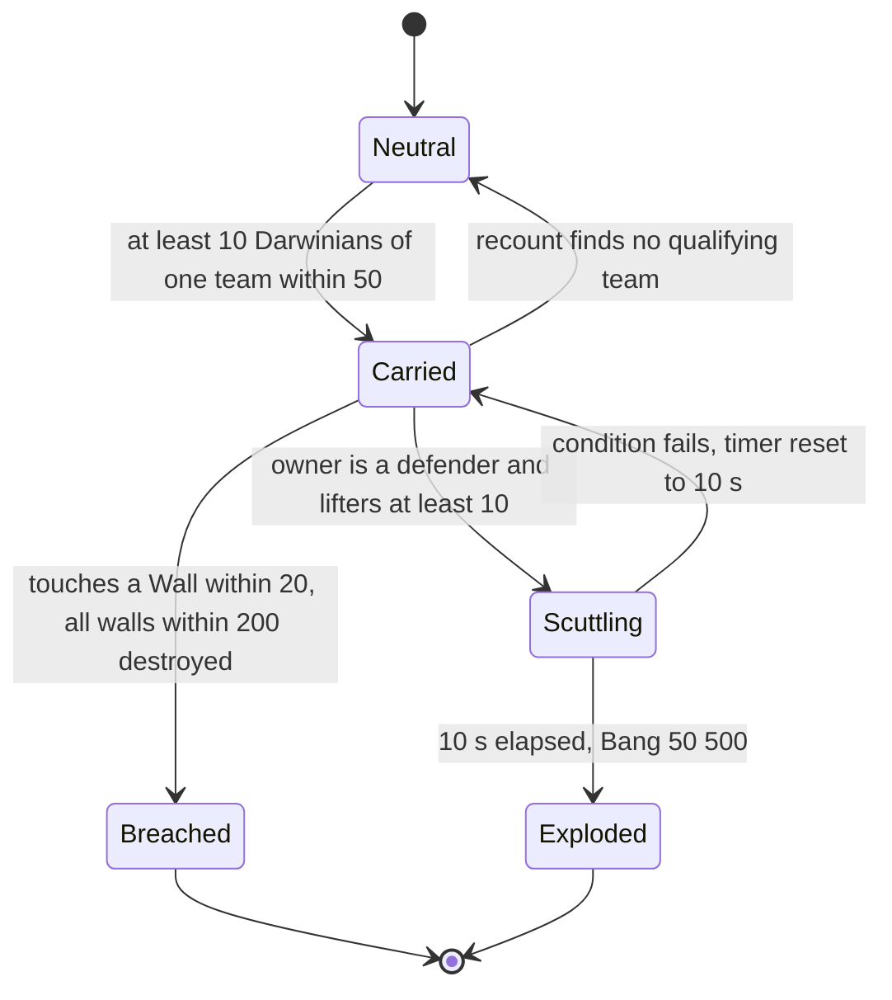

### 8.6 TrunkPort

Source: `code/worldobject/trunkport.{h,cpp}`. **[B:FULL]**; Darwinia world-map behaviour [B:LEGACY].

| Member | Default | Meaning |
|---|---|---|
| `m_targetLocationId` | −1 | Darwinia destination location (single-player label) |
| `m_destination1/2` | markers | label anchors (`MarkerDestination1/2`) |
| `m_heightMapSize` | `TRUNKPORT_HEIGHTMAP_MAXSIZE` 16 / detail | portal-surface grid |
| `m_heightMap` | NULL | pre-computed surface grid around `MarkerSurface` |
| `m_openTimer` | 0.0 | wall-clock time the portal opened (Darwinia; MP always draws the surface) |
| `m_populationLock` | −1 | cached nearby SpawnPopulationLock id (−2 = none) |

| Aspect | Specification | Ref |
|---|---|---|
| Function | reinforcement gate: owned trunk ports emit periodic reinforcement waves of Darwinians (and grant Armour/turret tasks) driven by `Multiwinia::AdvanceTrunkPorts` — formulae, cadence and caps in [05](05_economy_and_population.md) | [C] `code/multiwinia.cpp:Multiwinia::AdvanceTrunkPorts` |
| Shape | `trunkport_mp.shp` in Multiwinia (`trunkport.shp` in Darwinia) | [C] ctor |
| Ownership | fixed from the level (`tm` position); neutralised (255, direct write) by `Team::Eliminate()`, by PulseBomb destruction (all ports not owned by the defender) and by PulseBomb detonation (all ports not owned by the bomb team). Neutral ports produce nothing. Never captured | [C] `code/team.cpp`, `code/worldobject/pulsebomb.cpp` |
| Population lock | MP: Assault defender/attacker caps; else `PopulationCap / NumPlayers`; else nearest SpawnPopulationLock (same algorithm as SpawnPoint) | [C] `TrunkPort::PopulationLocked` |
| Advance | Darwinia only: GlobalBuilding online and `m_openTimer == 0` → `m_openTimer = GetHighResTime()` (wall clock), sound `PowerUp`; then `Building::Advance` | [C] `TrunkPort::Advance` |
| `ReprogramComplete()` | Darwinia world-map unlock [B:LEGACY] | [C] |
| Damage | indestructible | [C] |
| Rendering | Darwinia destination text [B:LEGACY]; alpha pass: animated portal surface (`textures/laserfence.bmp` + `textures/glow.bmp`) tinted with the owner's colour at 70% alpha in MP | [C] `TrunkPort::RenderAlphas` |
| Global | forced global; level lines must say isGlobal 1 | [C] |
| Mode usage | 28 official maps — Assault 8/8, Blitzkrieg 7/7, Rocket Riot 7/7, KOTH 4/9, Domination 2/9 (109 lines); reinforcements only flow where the mode or level options enable them ([05](05_economy_and_population.md)) | [C] census |

| # | Field | Type | Default | Meaning | Write |
|---|---|---|---|---|---|
| 8 | targetLocationId | int, optional | −1 | Darwinia destination; MP maps use −1 | `%-8d` |

### 8.7 PulseBomb

Source: `code/worldobject/pulsebomb.{h,cpp}`. **[B:FULL]** (Assault "WMD").

| Member | Default | Meaning |
|---|---|---|
| `m_active` | true | unused |
| `m_scale` | 0.75 | shape scale (copy of `pulsebomb.shp`, radius scaled) |
| `m_detonateTime` | 0.0 | game time of detonation |
| `m_startTime` | 0.0 | countdown length in seconds (level value) |
| `m_links` | — | linked ControlStation ids (de-duplicated by `SetBuildingLink`) |
| `m_oneMinuteWarning` | false | warning shown |
| static `s_pulseBombs[6]` | −1 (location init) | bomb id per owning team |
| static `s_defaultTime` | 0.0 (`Multiwinia::Reset`) | first round's `m_startTime` |

| Aspect | Specification | Ref |
|---|---|---|
| Function | the defenders' doomsday device: when its countdown expires it detonates and wipes out attackers; attackers win by capturing **every** linked ControlStation | [C] |
| Initialise | copy start time and links; `s_pulseBombs[team] = id`; if `Multiwinia::m_pulseTimer > 0` it overrides the start time (multi-round Assault); set `s_defaultTime` once; **sets `Multiwinia::m_timeRemaining = (int)m_startTime`** (the bomb defines the Assault clock) | [C] `PulseBomb::Initialise` |
| `SetDetail` | snap to ground; centre/radius from the scaled shape (no port rebuild) | [C] |
| Advance | returns false immediately once destroyed (the bomb is **never removed** from the building list; it only stops advancing/rendering). Otherwise: `LinkToPulseBomb(id)` on every linked station; if every existing linked station is owned (≠ 255) by a non-friend of the bomb team → `Destroy()` + `RecordDefenseTime(startTime − GetPreciseTimeRemaining(), team)`; at `m_timeRemaining ≤ 60` once → message `dialog_oneminutewarning`; at `m_timeRemaining ≤ 0` and not yet detonated → `RecordDefenseTime(startTime, team)`, `m_detonateTime = now`, spawn a `PulseWave` effect (radius 200, bomb team; [02](02_units_and_entities.md)), set every trunk port not owned by the bomb team to 255 | [C] `PulseBomb::Advance` |
| Edge cases | with no existing linked station the capture test is vacuously true → immediate destruction; the capture test keeps running after detonation, so capturing all stations during the wave would call `RecordDefenseTime` a second time [I] | [C] code; [I] effect |
| `Destroy()` | explode shape, `m_destroyed`; defender = the last team index < `NumPlayers` with an entry in `s_pulseBombs`; every trunk port not owned by the defender → 255 (direct write); `Location::Bang(pos, 75, 5)`; message `dialog_pulsebombdestroyed` | [C] `PulseBomb::Destroy` |
| Damage | not damageable by weapons (no override) | [C] |
| Hit tests | scaled shape (sphere, ray, shape) | [C] |
| Rendering | team-coloured glow blobs (up to 20 by detail) rising `200 × (1 − remaining/start)` above the bomb and growing; at `m_timeRemaining ≤ 10` a 3D countdown screen (team colour) 50 above | [C] |
| Mode usage | Assault 8/8, one per map (official maps use `900.00` with 3–4 station ids) | [C] census, level files |

| # | Field | Type | Default | Meaning | Write |
|---|---|---|---|---|---|
| 8 | startTime | float | 0.0 | countdown in seconds | `%-6.2f  ` |
| 9… | linkId | int, repeated | none | ControlStation ids | `%-4d` each |

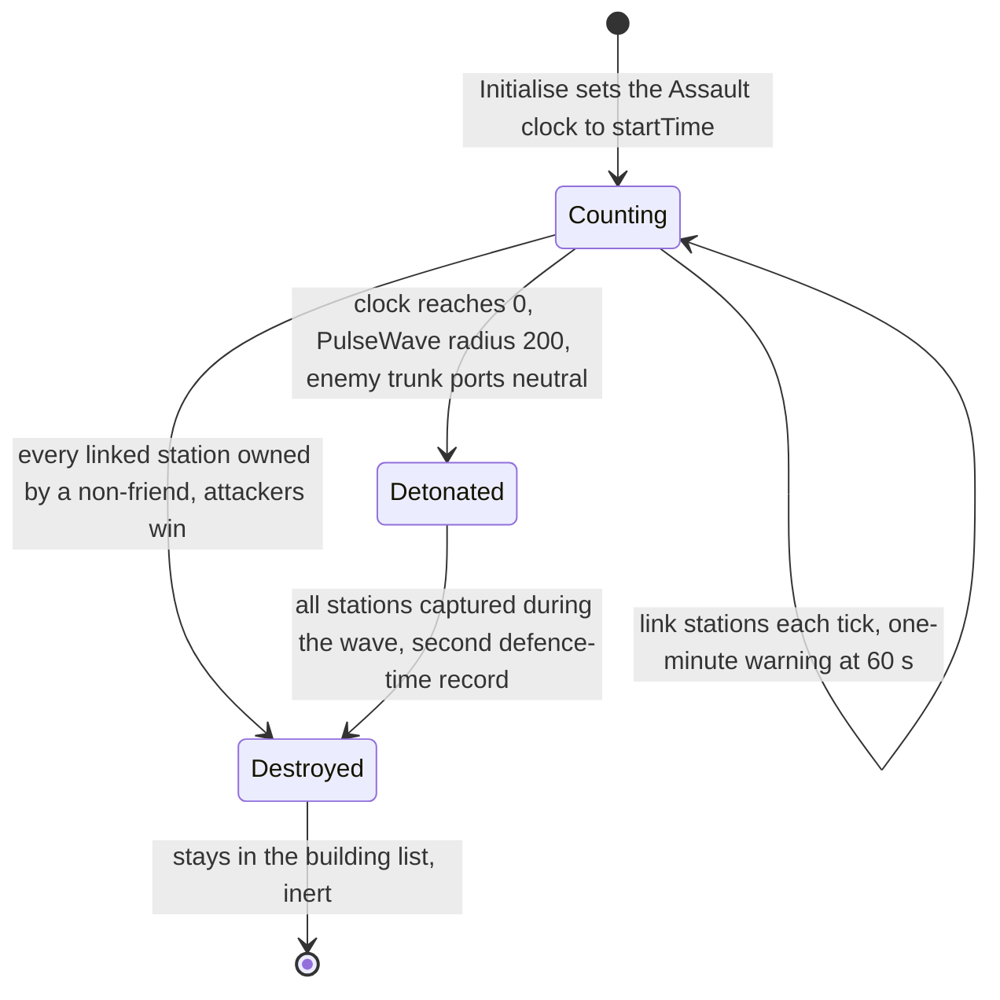

### 8.8 FuelBuilding

Source: `code/worldobject/rocket.{h,cpp}`. **[B:FULL]** (MP branch; non-MP branches [B:LEGACY]). Base of the Rocket Riot fuel chain.

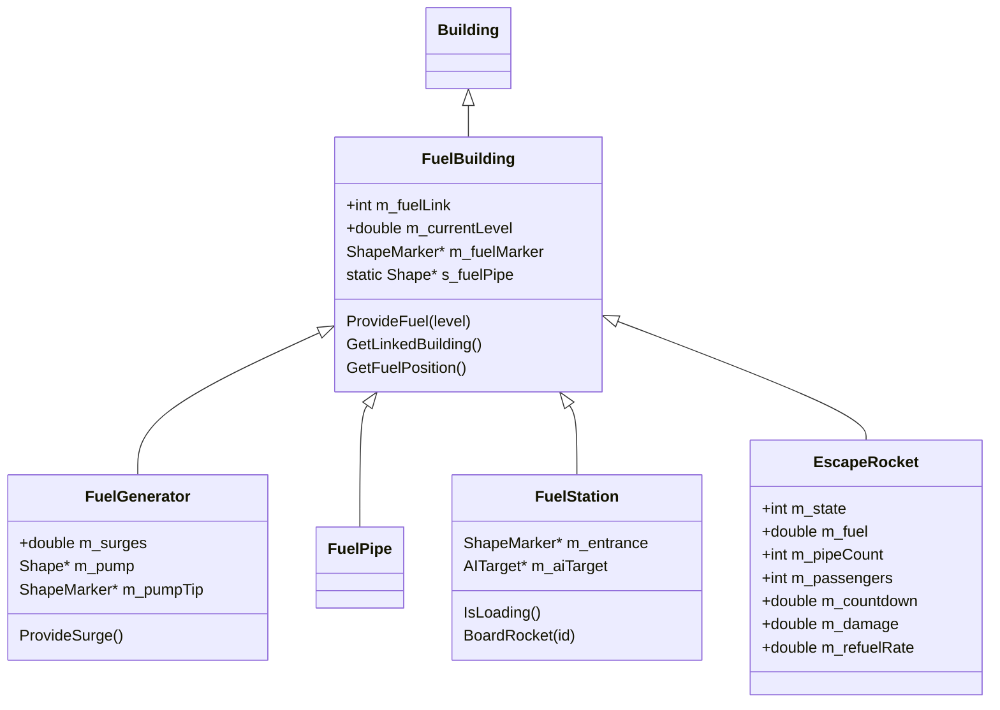

**Fuel flow.** Surges reach a FuelGenerator from a PylonEnd (§6.4). On Rocket Riot maps the chain is SolarPanel (one or more, daisy-chained) → PowerSplitter → team Pylon (one or more) → PylonEnd → FuelGenerator → FuelPipe (one or more) → FuelStation → EscapeRocket; each team has its own generator, 3 stations (each station's `fuelLink` = the rocket id) and a rocket. [C] `data/levels/mp_rocketriot_2P_4.txt`, `code/worldobject/generator.cpp:PylonEnd::TriggerSurge`.

| Aspect | Specification | Ref |
|---|---|---|
| `Advance` | pass `m_currentLevel` to `GetLinkedBuilding()->ProvideFuel()` (link must be a FuelGenerator, FuelPipe, FuelStation or EscapeRocket, else ignored); then `Building::Advance` | [C] `FuelBuilding::Advance`, `GetLinkedBuilding` |
| `ProvideFuel(level)` | `f = 0.2 × SERVER_ADVANCE_PERIOD` (×3 if `level < current` — "decrease faster than increase"); `current = current·(1 − f) + level·f`, clamped [0, 1]. Applied once per feeding building per tick | [C] `FuelBuilding::ProvideFuel` |
| `Destroy` | also explodes the connecting pipe shape | [C] |
| Rendering | pipe shape `fuelpipe.shp` from the own `MarkerFuel` to the linked building's; alpha pass animated `textures/fuel.bmp` beam, colour (1, 0.4, 0.1, 0.4 × level), 1–3 loops by `RenderBuildingDetail` | [C] |
| Ownership / damage | team from level; not captured; not damageable except EscapeRocket | [C] |

| # | Field | Type | Default | Meaning | Write |
|---|---|---|---|---|---|
| 8 | fuelLink | int, mandatory | −1 | next building downstream | `%6d ` |

### 8.9 FuelGenerator

| Aspect | Specification | Ref |
|---|---|---|
| Function | converts power surges into fuel pressure | [C] |
| Shape | `fuelgenerator.shp` + `fuelgeneratorpump.shp` (`MarkerTip`) | [C] ctor |
| Input | `ProvideSurge()`: `m_surges += 1` per surge from a PylonEnd (no team check) | [C] |
| Advance | `maxSurges = 20` (MP; 10 non-MP); `m_surges −= 1.0 × dt`, clamp [0, max]; `m_surges > 8` → GlobalBuilding online (Darwinia remnant); `ProvideFuel(m_surges / maxSurges)` — i.e. its own `m_currentLevel` follows pressure = surges/20; pump particles `TypeDarwinianFire` from the pump tip (unsynced); sounds `PumpUp`/`PumpDown` at the pump extremes; then `FuelBuilding::Advance` | [C] `FuelGenerator::Advance` |
| Output | pressure `m_currentLevel` ∈ [0, 1] passed down the pipe | [C] |
| Steady state [I] | surges decay at 1/s, so sustained pressure needs ≥ 1 surge/s, i.e. ≥ 2 fully manned solar panels routed to the team (0.5 surges/s each, §6.2); with less inflow the pressure saws between 0 and 1/20 per surge | [I] arithmetic |
| Inconsistency | `Render` uses `maxSurges` 15 (MP) for the pump animation while `Advance` uses 20 | [C] `FuelGenerator::Render` |
| HUD | objective counter "Fuel Pressure n%" | [C] `GetObjectiveCounter` |
| Mode usage | Rocket Riot 7/7 (57 lines) | [C] census |

### 8.10 FuelPipe

Relay segment (`fuelpipebase.shp`): FuelBuilding behaviour only; ambient sound `PumpFuel` started while `m_currentLevel > 0.2` and stopped at ≤ 0.2. Level field `fuelLink`. Mode usage: Rocket Riot 7/7 (178 lines). [C] `FuelPipe::Advance`, census.

### 8.11 FuelStation

| Aspect | Specification | Ref |
|---|---|---|
| Function | boarding gate for the rocket and the last fuel hop | [C] |
| Shape | `fuelstation.shp` (`MarkerEntrance`) | [C] |
| Advance | if the linked rocket is in `StateLoading` and `SafeToLaunch()` (always true in MP): ensure an AITarget at the station (priority modifier 1.0); then pick **one** random own-team entity within 300 (`syncrand() % numFound`); if it is a Darwinian in `StateIdle` or `StateWorshipSpirit` → `Darwinian::BoardRocket(stationId)` (it walks to `MarkerEntrance`, then `FuelStation::BoardRocket` → `EscapeRocket::BoardRocket` → `++passengers` (only while Loading); 4–7 `TypeControlFlash` particles (unsynced `AppRandom`), sound `LoadPassenger`). Otherwise remove the AITarget. Then `FuelBuilding::Advance` (fuel to the rocket) | [C] `FuelStation::Advance`, `BoardRocket` |
| Boarding rate [I] | ≤ 1 boarding order per station per tick → with 3 stations at most 30 orders/s, less the fraction of non-idle or non-Darwinian picks | [I] |
| Rendering | when the rocket's Countdown ≤ 10 or Flight: a 60 × 60 screen 150 above showing `(int)countdown + 1` (or blinking "0") | [C] `RenderAlphas` |
| Level field | `fuelLink` = rocket id | [C] |
| Mode usage | Rocket Riot 7/7 (57 lines; 3 per team) | [C] census |

### 8.12 EscapeRocket

| Aspect | Specification | Ref |
|---|---|---|
| Function | each team's Rocket Riot objective: refuel, load 100 passengers, launch; the first rocket above y = 600 wins ([01](01_game_modes.md)) | [C] |
| Shape | per-instance copy of `rocket.shp`, recoloured in MP to the team colour × 0.3 (`ConvertFragmentColours`); markers `MarkerBooster`, `MarkerWindow01–03` | [C] ctor, `Initialise` |
| Ownership | fixed from the level; never captured | [C] |
| Inputs | fuel pressure from FuelStations (`ProvideFuel`, `m_pipeCount` = number of calls with level > 0.1 since the last refuel); passengers from FuelStations; damage from explosions | [C] |
| Damage | `Damage(d)` (d negative): `Building::Damage` (sound `Damage`); if not Exploding: local owner gets `dialog_rocketunderattack` once per damage episode; MP `m_damage −= d × 0.2`; if `m_damage > 100` → `m_fuelBeforeExplosion = fuel`, state Exploding, sound `Explode`, owner message `dialog_rocketdestroyed`. Every tick in MP `m_damage −= 0.33 × dt` (attack warning cleared at 0) | [C] `EscapeRocket::Damage`, `Advance` |
| Attackers | `SetupAttackers()` (Refueling, Loading, Ready, Countdown; only while state < Exploding and fuel > 33): every `1 + syncfrand(2)` s, find enemies within 150; choose `1 + syncrand() % (1 + int(numFound × 0.05))` random ones; each live, non-burning Darwinian → `AttackBuilding(rocketId)` | [C] `EscapeRocket::SetupAttackers` |
| Attack mechanics | an attacking Darwinian runs to 100–150 from the rocket and, within 200, throws **one grenade** at rocket position + 50 y (thrower team hard-coded to 1) and returns to idle. Grenade power 25 → `Bang(12.5, 50)` → rocket damage `50 × (1 − d/37.5)` × 0.2 ≤ 10 per grenade, where d is measured to the rocket's base point → ≥ 11 well-placed grenades (minus decay) explode a rocket; grenades bursting near the 50-unit aim point deal nothing (resolves P02-U2 to the mechanism; effective rate depends on where grenades land [I]) | [C] `code/worldobject/darwinian.cpp:Darwinian::AdvanceAttackingBuilding`, `Location::ThrowWeapon`, `Location::Bang` |
| Not collidable | `DoesSphereHit/DoesShapeHit` false; ray only in the editor | [C] |
| HUD | objective counter "Fuel n%, Passengers n%" | [C] `GetObjectiveCounter` |
| Sounds | `Refueling`, `Happy`, `Unhappy`, `Flight`, `Malfunction`, `Explode`, `EngineBurn`, `Damage` | [C] `ListSoundEvents`, `SetupSounds` |
| Mode usage | Rocket Riot 7/7 (19 lines: one per team) | [C] census |

States (`StateRefueling` 0, `StateLoading` 1, `StateIgnition` 2, `StateReady` 3, `StateCountdown` 4, `StateExploding` 5, `StateFlight` 6; script names via `GetStateId`: "Refueling", "Loading", "Ignition", "Ready", "Countdown", "Exploding", "Flight"). [C] `code/worldobject/rocket.h`, `EscapeRocket::GetStateId`.

Per-state behaviour (MP) [C] `EscapeRocket::Advance*`:
- **Refueling**: `SetupAttackers`; `Refuel()`; at fuel > 33 help notification; at `fuel ≥ 95` → Loading (+ one-time message `multiwinia_rr_refueled` / `_otherrefueled`).
- **Refuel()** (Refueling and Loading): `newRate = pipeCount × m_currentLevel × 0.4`; `m_refuelRate = 0.99·rate + 0.01·newRate`; `fuel += rate × dt` (max 100); `pipeCount = 0`. Max steady rate with 3 stations at full pressure: 1.2 fuel-%/s (≈ 80 s from 0 to 95 plus ≈ 10 s EMA lag) [I].
- **Loading**: `SetupAttackers`; `Refuel()`; at `fuel > 95` and `passengers ≥ 100` → Ignition, `countdown = 18` (+ one-time message `multiwinia_rr_launchprep` / `_launchprepother`). Fuel can fall back below 95 only through explosions; there is no Loading → Refueling transition.
- **Ignition**: MP forces `countdown = 0` → immediately Ready with `countdown = 10`, camera shake 5. (Darwinia: 18 s, then `countdown = 120`, `launchpad_victory.txt` script [B:LEGACY].)
- **Ready**: the Darwinia launch-pad attacker spawner (buildings 18/51/52/54 must be team-0 spawn points and `countdown > 95`) cannot trigger in MP; `SetupAttackers`; `countdown −= dt`; at ≤ 0 → Countdown with `countdown = 10` (**10 s in Ready**).
- **Countdown**: `countdown −= 0.5 × dt` (half speed: **20 s** of game time for the displayed 10 → 0), clamped ≥ 0; `SetupAttackers`; exactly 0 → Flight.
- **Flight**: `thrust = max(2·sqrt(y − ground), 0.1)`; `vel = (0, thrust, 0)`; `pos += vel × dt` (rendered with velocity prediction). Not protected from damage (`Damage` only excludes Exploding) — a flight rocket damaged past 100 would explode and later return to Refueling in mid-air [I] (P02 contradiction 13).
- **Exploding**: per tick `damage −= 0.1` (on top of the general 0.033 decay → 1.33/s; resolved: P02 gave 1/s, but `EscapeRocket::Advance` applies its 0.33/s decay in every state including Exploding); fuel −0.5/tick (5/s) down to 50% of `m_fuelBeforeExplosion`; one passenger ejected per tick from a random window as an own-team Darwinian with outward velocity 10–40 (50% set on fire, synced); shape debris while fuel > 0; 3 fire + 3 smoke particles per tick (synced sizes); once passengers = 0 and fuel at its minimum an extra `damage −= 0.2`/tick; at `damage ≤ 0` → damage 0, `m_currentLevel = 0`, `m_spawnCompleted`, Refueling (passengers must be re-loaded; fuel must again reach 95). Typical exploding duration ≈ 35 s from 100 damage [I].
- Every tick after the state step: `SetupSounds()` (ambience by state: Refueling → `Refueling` if level > 0.2 else `Unhappy`; Loading…Countdown → `Happy`; `Malfunction` whenever damage ≥ 75; Exploding → `Malfunction` if fuel > 0 else `Unhappy`; Flight → `Flight`; `EngineBurn` loop in Ready/Countdown/Flight); camera shake decays; in Ready/Countdown/Flight 15 booster particles per tick (11 `TypeMissileFire`, 4 `TypeMissileTrail`, size 500, unsynced). Glow sprites (`textures/starburst.bmp`) with alpha = fuel/100.

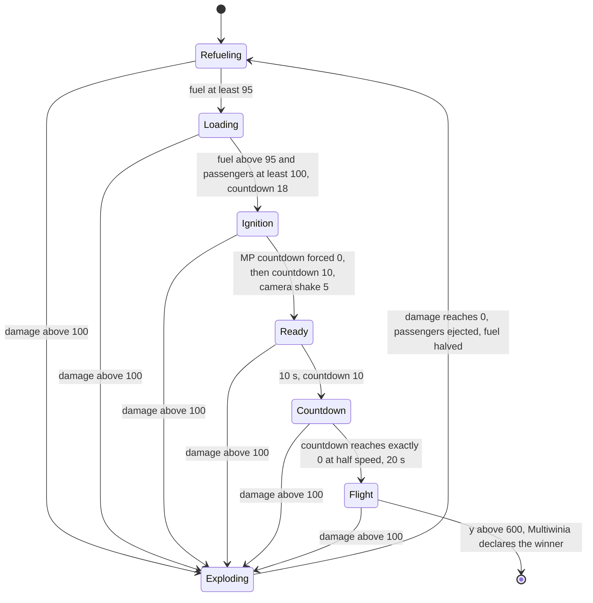

| # | Field | Type | Default | Meaning | Write |
|---|---|---|---|---|---|
| 8 | fuelLink | int | −1 | unused for the rocket (−1 on RR maps) | `%6d ` |
| 9 | fuel | float | 0.0 | starting fuel | `%6.2f` |
| 10 | passengers | int | 0 | starting passengers | `%6d` |
| 11 | spawnBuildingId | int | −1 | Darwinia launch-pad spawner building | `%6d` |
| 12 | spawnCompleted | int (bool) | 0 | Darwinia flag | `%6d` |

Rocket Riot maps use `-1 0.00 0 -1 0`. [C] `EscapeRocket::Read/Write`, level files.

### 8.13 Mode usage matrix

[C] census (official maps; "rt" = runtime-created only).

| Object | Domination | KOTH | CTS | Assault | Rocket Riot | Blitzkrieg |
|---|---|---|---|---|---|---|
| MultiwiniaZone | – | 9/9 hill | 9/9 drop zone / statue spawn | – | – | 7/7 flag |
| Statue | – | – | rt | – | – | – |
| Flag (render) | officers/armour | officers/armour | officers/armour | officers/armour | officers/armour | flags + officers/armour |
| CarryableBuilding subclasses | – | – | Statue (rt) | WallBuster 1/8 | – | – |
| TrunkPort | 2/9 | 4/9 | – | 8/8 | 7/7 | 7/7 |
| PulseBomb | – | – | – | 8/8 | – | – |
| ControlStation | – | 1/9 (radar control) | – | 8/8 | – | – |
| FuelGenerator, FuelPipe, FuelStation, EscapeRocket | – | – | – | – | 7/7 | – |

## 9 Crate-spawned world objects

These buildings appear in Multiwinia only as crate outcomes (selection rules, probabilities and messages in [04](04_crates_powerups_and_weapons.md)). The `Crate` building itself (enum 65) is specified in [04](04_crates_powerups_and_weapons.md).

### 9.1 AntHill

Source: `code/worldobject/anthill.{h,cpp}`. **[B:FULL]** live through the Ant Nest crate outcome (`CrateRewardAntNest`: player-placed task `GlobalResearch::TypeAntsNest` → `Task::TargetAntNest` → `Crate::RunAntNest`, or immediately at the crate when an uncaptured crate expires); level placement is legal (not blocked) but only Darwinia campaign maps do it (13 lines) → [B:LEGACY] content. The ArmyAnt entity is in [02](02_units_and_entities.md). [C] `code/worldobject/crate.cpp:Crate::RunAntNest`, `Crate::RunUncapturedCrate`, `code/taskmanager.cpp:Task::TargetAntNest`, census.

| Aspect | Specification | Ref |
|---|---|---|
| Function | monster nest that sends ArmyAnts to capture Darwinians, collect spirits, attack enemies and scout; converts stored spirits into more ants | [C] |
| Creation (crate) | `RunAntNest(pos, team)`: **2** hills, always owned by the **Monster team** (the triggering player only gets the marker/message); each at `pos + (syncsfrand(200), 0, syncsfrand(200))`, front = normalised `(syncsfrand(1), 0, syncsfrand(1))`, `m_numAntsInside = 75 − syncrand() % 25` (**51–75**), `SetDetail(1)`, new building id, build-in shape explosion; plus one ArmyAnt at `pos` to wake the Monster team; obstruction grid recalculated; marker `icons/icon_antnest.bmp`; message `crate_message_run_antnest`. Validity cap: invalid when `#AntHills + 2 × #queued AntsNest tasks ≥ 4` | [C] `Crate::RunAntNest`, `Crate::IsValid` |
| Shape / health | `anthill.shp`; `m_health` 100 (int) | [C] ctor |
| Activation | runs only when its team is `TeamTypeCPU` (the Monster team is CPU); first ant release `now + 5.0` s after `Initialise` | [C] `AntHill::Advance`, `Initialise` |
| Population lock | MP with a level cap: locked when `team->m_others.NumUsed() − Virii::s_viriiPopulation[team] ≥ PopulationCap / NumPlayers` (team 255 never locked); otherwise nearest SpawnPopulationLock; locked hills neither create objectives nor release ants (spirit conversion continues) | [C] `AntHill::PopulationLocked` |
| Objectives | cap: MP `m_numAntsInside / 10` clamped [1, 6] (SP 3); search interval `now + syncrand() % 2` s; MP picks one search with `syncrand() % 5`: 0, 1 → nearest-listed enemy Darwinian within `ANTHILL_SEARCHRANGE` 400 not captured/targeted; 2 → any enemy entity within 400 not targeted; 3 → a spirit in Birth/Floating within 400 not within 20 of an existing objective; 4 → scout point at radius `200 + syncfrand(200)`, random angle, accepted only if terrain height > 0. Ants per objective MP `int(int(5 + syncfrand(5)) + m_numAntsInside / 20.0)` | [C] `AntHill::Advance`, `SearchFor*` |
| Release | one ant per 0.2 s (MP) to a random objective (`syncrand() % size`): reuse/create the hill's ant Unit, spawn at the hill (spread 10), orders ScoutArea, waypoint = objective pos + `syncfrand(30)` at a random angle, pushed from obstructions; `m_numAntsInside−−`, objective `m_numToSend−−` (deleted at 0) | [C] `AntHill::SpawnAnt` |
| Inputs | returning ants (`m_numAntsInside++`), carried spirits (`m_numSpiritsInside++`), captured Darwinians (killed at the hill, their spirit spawns next to it) | [C] `code/worldobject/armyant.cpp:ArmyAnt::AdvanceReturnToBase` |
| Spirit conversion | each conversion consumes 1 stored spirit: MP **+6 ants**, next after 1.0 s (SP +3, 5.0 s) | [C] |
| Empty-hill decay (MP) | if `m_numAntsInside ≤ 0` for **30 consecutive ticks** → `m_numAntsInside = 10`, `Damage(−10)` | [C] |
| Damage | `Damage(d)`: base sound; `m_health += d` (int); every crossing of a 20-HP band → partial shape explosion (fraction `1 − health/100`) and sound `Damage`; at ≤ 0: full explosion, **releases `m_numAntsInside + m_numSpiritsInside` spirits** (hill team) in a 20 disc with speed `syncfrand(50)`, sound `Explode`; `Advance` returns true. `Destroy(i)` sets health 0 then `Building::Destroy`. Sources: explosions (§3.8), TurretShell −2, burning trees | [C] `AntHill::Damage`, `Destroy` |
| Burning | `AntHill::Burn()` (called each tick by burning Trees within `100 + treeCrown`): 30% chance of `Damage(−1)` and **always** releases one ant towards a random point 200 away (even with 0 ants inside, driving the count negative until the empty-hill rule refills it) | [C] `AntHill::Burn`, `Tree::Advance` |
| Threat to Darwinians | Darwinians treat enemy AntHills/Triffids as attack targets with probability 1/500 per threat search, but the code passes the obstruction-cell **list index** instead of the building id to `AttackBuilding` → they attack whichever building has that small unique id (defect) | [C] `code/worldobject/darwinian.cpp:Darwinian::SearchForThreats` |
| Rendering | damaged flicker with unsynced `frand` (render only) | [C] |
| Sounds | base + `Explode` | [C] |
| Mode usage | any mode where the crate is valid; not level-placed in MP | [C] |

| # | Field | Type | Default | Meaning |
|---|---|---|---|---|
| 8 | numAntsInside | int, mandatory | 0 | starting ants; values outside [0, 10000] reset to 0 |

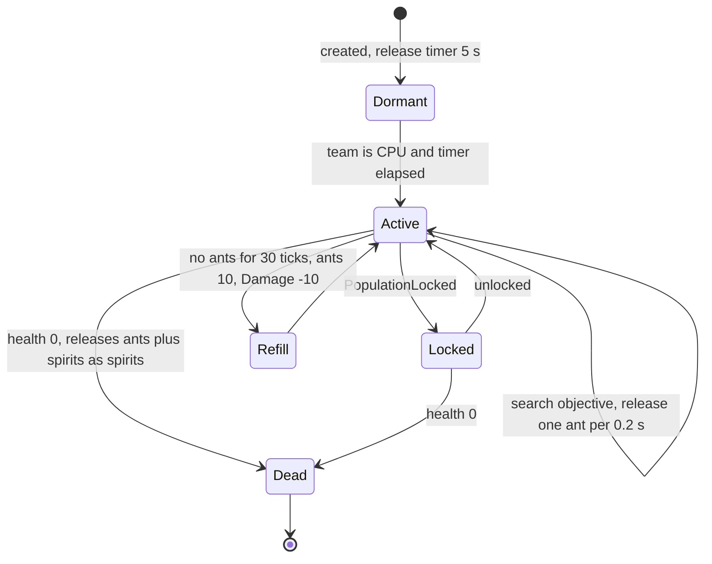

### 9.2 Triffid

Source: `code/worldobject/triffid.{h,cpp}`. **[B:FULL]** live through the Triffids crate outcome (`CrateRewardTriffids`, reachable only as an *uncaptured-crate* outcome: `Crate::CaptureCrate` re-rolls it); Darwinia maps place 30 → [B:LEGACY] content. Not blocked. TriffidEgg (entity) → [02](02_units_and_entities.md). [C] `code/worldobject/crate.cpp:Crate::RunTriffids`, `Crate::RunUncapturedCrate`.

| Aspect | Specification | Ref |
|---|---|---|
| Function | rooted plant that periodically lobs TriffidEggs; each egg bursts after a timer and releases a creature group | [C] |
| Creation (crate) | `RunTriffids(pos, team)`: `1 + syncrand() % 3` (**1–3**) Triffids owned by the **Monster team** at `pos + (syncsfrand(50), 0, syncsfrand(50))`, front away from `pos`; per triffid `m_pitch = 0.6 + syncfrand(0.6)`, `m_force = 60 + syncfrand(60)`, `m_variance = syncfrand(0.5)`, `m_reloadTime = 40 + syncfrand(60)` s, `m_size` 1.0, `m_useTrigger` 0; spawn mask = all types except `SpawnSpirits` and `SpawnEggs`; message `multiwinia_exclamation`; marker `icons/icon_triffid.bmp` | [C] `Crate::RunTriffids` |
| Shape | `triffidhead.shp` (`MarkerLaunchPoint`, `MarkerTriffidStem`) | [C] |
| Ownership | fixed (creator / level); never captured | [C] |
| Timer | initial `m_timerSync = now + (syncrand() % int(m_reloadTime)) + 10`; trigger check timer starts at `syncfrand(5)` | [C] `Triffid::Initialise`, ctor |
| Arming | armed if `m_useTrigger == 0` or burning; else every 5 s armed = `EntityGrid::AreEnemiesPresent(pos + triggerLocation, triggerRadius, team)`; on unarmed → armed the timer is re-randomised as above | [C] `Triffid::Advance` |
| Launch | when armed and `now > m_timerSync`: MP only while `m_numEggs > 0` (budget **3**); each launch decrements it and at 0 calls `Damage(−100)` (sets itself on fire); SP forever; next timer `now + reload × (1 + syncsfrand(0.1))` | [C] |
| `Launch()` | uniform choice among enabled spawn types (`syncrand() % count`; nothing if none); egg velocity = launch-marker forward × `m_force × m_size × (1 + syncsfrand(0.2))`; egg `m_size = 1 + syncsfrand(0.3)`, `m_spawnPoint = pos + triggerLocation`, `m_roamRange = triggerRadius`; MP burst timer `4 + syncfrand(4)` s; sound `LaunchEgg` | [C] `Triffid::Launch` |
| Head pose | `GetHead` from game time (deterministic): head at `pos + up × 30 × size`, pitched by `m_pitch × 0.5 × (1 + 0.1 sin t)`, bob `(4 sin(t/1.3), sin(t/1.5), 3 sin(t/1.2))`, recoil `−front × 10 × ((timer − now)/reload)^5`, scale `size × (1 + 0.1 sin t)`, `t = now + uniqueId × 10`; burning: thrashes (`front` rotated by `sin(5t) × variance`) | [C] `Triffid::GetHead` |
| Damage / burning | `Damage(d)` adds `d` to `m_damage` (50); first ≤ 0 → sound `Burn`; while burning every tick: two `TypeFire` particles (size `100 + syncsfrand(100 × size)`), 10% (unsynced) debris, `m_size −= 0.006`, `m_timerSync −= 0.5`; at `m_size ≤ 0.3` the head explodes and the building is removed (≈ 117 ticks ≈ 11.7 s from size 1.0). Fire sources: flame grenades within `2 × power`, turret shells (−2), explosions | [C] `Triffid::Damage`, `Advance` |
| Outputs | TriffidEggs (spawn table in [02](02_units_and_entities.md)) | [C] `TriffidEgg::Spawn` |
| Rendering | yellow stem lines, head shape, held egg drawn in the last 25% of the reload; editor trajectory preview [B:EDITOR] | [C] |
| Mode usage | any mode where the crate outcome is valid; not level-placed in MP | [C] |

Spawn types (`Triffid::Spawn*`, level flags in this order): 0 `SpawnVirii`, 1 `SpawnCentipede`, 2 `SpawnSpider`, 3 `SpawnSpirits`, 4 `SpawnEggs`, 5 `SpawnTriffidEggs`, 6 `SpawnAnts`, 7 `SpawnSporeGenerator`, 8 `SpawnSoulDestroyer`, 9 `SpawnDarwinians`. [C] `code/worldobject/triffid.h`.

| # | Field | Type | Default | Crate value | Meaning |
|---|---|---|---|---|---|
| 8 | size | float | 1.0 | 1.0 | head/launch scale |
| 9 | pitch | float | 0.6 | 0.6–1.2 | launch pitch |
| 10 | force | float | 250.0 | 60–120 | launch speed |
| 11 | variance | float | π/8 | 0–0.5 | aim variance / thrash amplitude |
| 12 | reloadTime | float | 60.0 | 40–100 | seconds between launches |
| 13 | useTrigger | int | 0 | 0 | 0 = always armed; else require enemies in the trigger circle |
| 14 | triggerX | float | 0 | 0 | trigger circle offset x |
| 15 | triggerZ | float | 0 | 0 | trigger circle offset z |
| 16 | triggerRadius | float | 100.0 | 100.0 | trigger radius; also egg roam range |
| 17–26 | spawn[0…9] | int (== 1 → true), optional each | false | see creation | enabled spawn types in enum order |

[C] `Triffid::Read/Write`, ctor. Members not in the level file: `m_damage` 50.0, `m_numEggs` 3.

```mermaid
stateDiagram-v2
    [*] --> Waiting : timer = now + random share of reload + 10
    Waiting --> Armed : useTrigger 0, or enemies in trigger circle (checked every 5 s)
    Armed --> Waiting : trigger circle empty
    Armed --> Launching : now passes timer and eggs remain (MP budget 3)
    Launching --> Armed : egg launched, timer reset
    Launching --> Burning : MP egg budget exhausted, Damage -100
    Armed --> Burning : damage meter 0 or less
    Waiting --> Burning : damage meter 0 or less
    Burning --> Removed : size shrinks to 0.3
    Removed --> [*]
```

### 9.3 Portal

Source: `code/worldobject/portal.{h,cpp}`. **[B:DEBUG]** — created only by the "The Beast" crate outcome (`Crate::RunTheBeast`), whose callers are compiled only when `INCLUDE_THEBEAST` is defined, which `code/worldobject/crate.h` does only under `TARGET_DEBUG`. Blocked from level files (10 lines in `data/levels/old/*` prototype maps are dropped). `SpecialSummon` (Shaman) is [B:LEGACY]. Resolved: P06 tagged Portal [B:FULL]; corrected to [B:DEBUG] per the build matrix and `crate.h`. [C] `code/worldobject/crate.cpp:Crate::RunTheBeast`, `code/worldobject/crate.h`.

| Aspect | Specification | Ref |
|---|---|---|
| Creation | `RunTheBeast(pos)`: template at the crate position → `CreateBuilding(TypePortal)` → `Initialise` → id `(monsterTeam, UNIT_BUILDINGS, −1, newBuildingId)` → `SetDetail(1)`; message `crate_message_thebeast` | [C] |
| Shape / collision | none (shape line commented out); no sphere/shape collision; ray test = sphere r 13 | [C] |
| Ownership | Monster team, fixed | [C] |
| Damage aura | in every state after Lowering: **every Darwinian within `m_portalRadius`** of the centre is `SetFire()`d each tick (all teams) | [C] `Portal::Advance` |
| On removal | `Location::AddBurnPatch(pos, 2 × radius)` | [C] |
| Damageability | none | [C] |
| Rendering | unsynced `rand()`/`frand()` fire particles (`Particle::TypePortalFire`), full-screen white flash and camera shake at the end | [C] `Portal::RenderAlphas` |

| State (value) | Duration / exit | Actions |
|---|---|---|
| `SummonStateInactive` (0) | never advanced | — |
| `SummonStateLoweringPortal` (1) | body commented out | — |
| `SummonStatePortalExpand` (2, constructor state) | radius +1.0 **per tick** until ≥ 100 (10 s at normal speed) | on exit: `explosionTimer = 45`; spawn **6** (`NUM_TENTACLES`) Tentacle units × 12 entities for the Monster team at angles −π/2 + i·2π/6, radius 90 from the centre; each tentacle `SetPortalId`, explosion effect |
| `SummonStateThrash` (3) | 45 s | — |
| `SummonStateExplode` (4) | 10 s | on exit: `Location::Bang(centre, 200, 255, team)`; `explosionTimer = 1` |
| `SummonStateCoolDown` (5) | 1 s | then `m_destroyed = true` |
| `SummonStateFinished` (6) | — | — |

[C] `Portal::Advance*`. No level fields beyond the base 8.

```mermaid
stateDiagram-v2
    [*] --> PortalExpand : created by The Beast crate
    PortalExpand --> Thrash : radius 100 after 100 ticks, 6 x 12 tentacles
    Thrash --> Explode : 45 s
    Explode --> CoolDown : 10 s, Bang 200 255
    CoolDown --> [*] : 1 s, removed, burn patch
    note right of PortalExpand : every tick in every state Darwinians within the radius catch fire
```

### 9.4 Randomiser

Source: `code/worldobject/randomiser.{h,cpp}`. **[B:FULL]**: not a Building but a `WorldObject` effect (`EffectRandomiser`) in `Location::m_effects`, created by the Randomiser crate outcome `Crate::RunRandomiser` (compiled under `INCLUDE_CRATES_ADVANCED`, defined in FULLGAME). No level-file presence. [C] `code/worldobject/crate.cpp:Crate::RunRandomiser`, `code/lib/universal_include.h`.

| Parameter | Value | Kind |
|---|---|---|
| `RANDOMISER_RANGE` | 100.0 world units | `#define` |
| lifetime `m_life` | 15.0 s | ctor literal |
| pulse interval | first pulse on the first tick (`m_timer` starts 0), then `0.5 + syncfrand(2.5)` s (0.5–3.0) | literal, synced |

**Pulse** [C] `Randomiser::Advance`: for every entity within 100 (all teams) that is a Darwinian not in `StateInsideArmour`: spawn one new Darwinian at its position with its velocity for team `syncrand() % levelFile->m_numPlayers` (team indices 0…NumPlayers−1; the original team is possible), then mark the original `m_destroyed`. Ownership: the crate's team only receives the message and a fixed map marker `icons/icon_randomizer.bmp`. Inputs: Darwinians in range; outputs: re-teamed Darwinians (their state, orders and health are reset because they are new entities [I]). Hazard [I]: a slot index < `NumPlayers` may belong to a team that is not playing (e.g. a 4-position map played by 2 teams), handing Darwinians to an unused team (03-U10).

**Rendering** [C] `Randomiser::Render`: each frame two `Particle::TypeMuzzleFlash` particles (size 60) on opposite ends of a 100-radius arm rotating at 3 rad/s of render time, 5 above ground, each in a random team colour (CRT `rand() % NUM_TEAMS`, unsynced; particles spawned from the render path).

```mermaid
stateDiagram-v2
    [*] --> Pulsing : crate opened, life 15 s, first pulse immediately
    Pulsing --> Pulsing : every 0.5 to 3 s re-team every Darwinian within 100
    Pulsing --> [*] : life reaches 0
```

## 10 AI marker buildings

These buildings are invisible scaffolding for CPU players; the AI that consumes them is specified in [07](07_ai.md). Brief specification here.

### 10.1 AITarget

Source: `code/worldobject/ai.{h,cpp}`. **[B:FULL]** (level-placed and runtime-created).

| Aspect | Specification | Ref |
|---|---|---|
| Function | node of the AI's navigation/priority graph: links to neighbours within `AITARGET_LINKRANGE` 600 (or the manual link) that are walkable (or radar/water targets), records crossed laser fences, counts friends/enemies per team and holds per-team priorities | [C] `AITarget::RecalculateNeighbours`, `Location::RecalculateAITargets` |
| Ownership | logical owner for the AI only: every 2.0 s (random phase) `RecalculatePriority`, `RecountTeams` (entities within range: SP 100, MP 200, or the tagged score zone's size), `RecalculateOwnership` (strictly highest friend count > 0, else 255) | [C] `AITarget::Advance` |
| Inputs / outputs | none to the economy; outputs priorities to `AI` and `Darwinian::m_closestAITarget` | [C] |
| Runtime creators | Crate (on landing, modifier 0.5, `m_crateTarget`), RadarDish (connected, `m_radarTarget`), Statue (modifier 1.0, `m_statueTarget`), GunTurret (`m_turretTarget`), FuelStation (while loading, modifier 1.0), CloneLab (legacy); WallBuster's creator is commented out | [C] |
| Removal | removal of an AITarget (or a Wall) triggers `RecalculateAITargets()` | [C] `Location::AdvanceBuildings` |
| Collision / visibility | sphere/shape false; `aitarget.shp` drawn only while editing or with the `RenderAIInfo` preference | [C] `AITarget::DoesSphereHit`, `RenderAlphas` |
| Damage | indestructible | [C] |
| Mode usage | all 49 official maps (1029 official + 83 dev lines) | [C] census |

| # | Field | Type | Default | Meaning | Write |
|---|---|---|---|---|---|
| 8 | linkId | int, optional | −1 | forced neighbour regardless of distance | `%-6d` |
| 9 | priorityModifier | float, optional | 0.0 | added to every computed priority | `%-1.2f ` |
| 10 | checkCliffs | int, optional | 1 | 0 = ignore cliffs when testing walkability | `%-6d` |

[C] `AITarget::Read/Write`; `m_waterTarget = (pos.y ≤ 0)` set in `Initialise`. Priority formulas per mode → [07](07_ai.md).

### 10.2 AIObjective

Source: `code/worldobject/aiobjective.{h,cpp}`. **[B:FULL]**.

| Aspect | Specification | Ref |
|---|---|---|
| Function | Assault (and Rocket Riot marker) objective chain node: groups AIObjectiveMarkers; active objectives direct attacking/defending AIs; on completion activates `m_nextObjective` | [C] |
| Initialisation | first objective Advance (`InitialiseObjectives`, flag reset in `Location::Init`/`Empty`): every objective referenced as some objective's next is set inactive (chain heads start active); objectives with an armour marker go into `Armour::s_armourObjectives`; an objective owned by a defending team becomes a defence objective and propagates `m_defenseObjective` down the chain | [C] `AIObjective::InitialiseObjectives` |
| Advance | every 5.0 s: **standard** — if every registered marker with `m_armourObjective == 0` is owned by a non-neutral attacking team → deactivate, activate next, set `m_pickupAvailable` on its armour markers with `m_pickupOnly ≠ −1`; **defensive** — if any marker is owned by a non-neutral non-defending team → deactivate and activate next (fall back) | [C] `AIObjective::Advance` |
| Ownership | team from the level (attacking or defending position) | [C] |
| Links | `m_nextObjective`; `m_wallTarget` (written by Walls, never read) | [C] |
| Collision / damage | none (sphere/shape false, ray only in the editor); indestructible | [C] |
| Mode usage | Assault 8/8 (92 lines) | [C] census |

| # | Field | Type | Default | Meaning | Write |
|---|---|---|---|---|---|
| 8 | nextObjective | int, mandatory | −1 | next objective in the chain | `%4d` |

### 10.3 AIObjectiveMarker

Source: `code/worldobject/aiobjective.{h,cpp}`. **[B:FULL]**.

| Aspect | Specification | Ref |
|---|---|---|
| Function | point of interest belonging to an AIObjective; its ownership decides objective completion and it boosts nearby AITarget priorities for the relevant teams | [C] |
| Behaviour | waits for `s_objectivesInitialised` in Assault; first run registers with its objective (as an armour marker if `armourObjective == 1 && pickupOnly ≠ 1`), inherits the defence flag, stores its level team as `m_defaultTeam` and becomes neutral, and binds to a building within 20 (excluding markers, AITargets, walls, laser fences, static shapes) as `m_objectiveBuildingId`; then every 2.0 s: standard — team = bound building's team (a solar panel with 0 ports unbinds), else `scanRange == 0` → `m_defaultTeam`, else the ×4-majority count of non-monster/non-Futurewinian entities within scanRange (winner replaced when `count[i] > 4 × count[winner]` while `count[winner] < 10`); attacking AIs get `p = 1.0` on the nearest AITarget; defensive and Rocket Riot variants in [07](07_ai.md) | [C] `AIObjectiveMarker::Advance` |
| Collision / damage | none; indestructible | [C] |
| Mode usage | Assault 8/8, Rocket Riot 7/7 (330 lines) | [C] census |

| # | Field | Type | Default | Meaning | Write |
|---|---|---|---|---|---|
| 8 | scanRange | float, mandatory | — | radius for the entity-majority rule (0 = use default team) | `%2.2f ` |
| 9 | objectiveId | int, mandatory | −1 | owning AIObjective (−1 = none) | `%4d` |
| 10 | armourObjective | int, optional | 0 | 1 = armour drop/pickup marker | `%4d` |
| 11 | pickupOnly | int, optional | ctor value ([07](07_ai.md)) | armour pickup flag (−1 / 0 / 1) | `%4d` |

[C] `AIObjectiveMarker::Read/Write`.

### 10.4 AISpawnPoint

Source: `code/worldobject/ai.{h,cpp}`. **[B:LEGACY]** (blocked; 3 campaign lines, 5 old maps).

| Aspect | Specification | Ref |
|---|---|---|
| Function | Darwinia scripted enemy spawner: emits batches of `m_count` entities of `m_entityType` | [C] |
| Activation | `m_online` once its activator is satisfied: a BlueprintStore with < 4 clean segments and ≤ 2 infected; a BlueprintConsole owned by team 0; otherwise a GlobalBuilding that is absent or online | [C] `AISpawnPoint::Advance` |
| Spawning | while online, primary objectives not all met, not `PopulationLocked()` and `m_spawnLimit ≠ 0`: between batches count down `m_timer`; during a batch spawn one entity per tick (`SpawnEntities(pos, team, −1, type, 1, 0, spread 20, range 100, routeId)`); after `m_count` → `m_timer = m_period + syncsfrand(m_period/3)`, `m_spawnLimit−−` | [C] |
| Ownership / damage | team from level / indestructible; non-colliding | [C] |
| Defaults | `m_count` 20, `m_period` 60, `m_spawnLimit` −1 (unlimited), `m_routeId` −1 | [C] ctor (P08) |

| # | Field | Type | Meaning |
|---|---|---|---|
| 8 | activatorId | int | activator building / GlobalBuilding id |
| 9 | entityType | int | `Entity::Type*` value |
| 10 | count | int | entities per batch |
| 11 | period | int | seconds between batches (÷ difficulty factor for team 1, §3.4) |
| 12 | spawnLimit | int, optional | number of batches (−1 unlimited) |
| 13 | routeId | int, optional | route for spawned entities |

[C] `AISpawnPoint::Read`.

## 11 Compiled, loadable, but unused by shipped content

These three classes are not blocked, so a level file may place them, but no official map does; they appear only in dev maps (`mp_sandbox`, `mp_sandbox_all`) or `data/levels/old`. Whether dev maps can be opened from the shipped UI is 03-U3. Treat them as optional design ideas.

### 11.1 ControlTower

Source: `code/worldobject/controltower.{h,cpp}`. **[B:FULL]** code; placed only in Darwinia maps (118 lines) and the GameTypes-none dev maps `mp_sandbox`/`mp_sandbox_all` (3 lines) → effectively [B:LEGACY] content. [C] census.

| Aspect | Specification | Ref |
|---|---|---|
| Function | remote "reprogramming" console: an Engineer standing at one of 3 reprogrammer slots changes its ownership; full ownership hands the linked building to the Engineer's team | [C] |
| Shape | `controltower.shp` (MarkerReprogrammer0–2, MarkerConsole0–2, MarkerLightPos (counts as a light), MarkerDishPos) + static `controltowerdish.shp` aimed at the target building's centre (computed on the first Advance); radius forced 4.0 | [C] ctor, `Advance` |
| `m_ownership` | 0–100 (100 = strongly owned); first Advance: 0 if the target building is neutral, else 100 | [C] |
| `Reprogram(team)` (called by `Engineer` each tick while reprogramming) | if `team ≠ owner`: ownership −0.1; at ≤ 0 the tower and the target (if different) switch to `team`. If `team == owner` and ownership < 100: +0.1 (cap 100), `target->Reprogram(ownership)`; at 100: sound `ReprogramComplete`, `target->ReprogramComplete()`, `SetTeamId`, research points `GLOBALRESEARCH_POINTS_CONTROLTOWER`, GlobalBuilding online, profile saved → returns true. 1000 calls (≈ 100 s at one call per tick) from 0 to 100 | [C] `ControlTower::Reprogram`; `code/worldobject/engineer.cpp` |
| Slots | `GetAvailablePosition` → first free slot of 3; `BeginReprogram/EndReprogram(slot)`; sparks while a slot is busy | [C] |
| TrunkPort link | every 2.0 s: if linked to a TrunkPort whose `m_openTimer > 0` and the tower is not team 2, the tower becomes team 2 with ownership 100 (campaign) | [C] |
| Inputs / outputs | Engineer reprogramming in; ownership of `controlBuildingId` out | [C] |
| Damage | indestructible | [C] |
| Global | forced global; isGlobal must be 1 | [C] |
| Rendering | pulsing "control line to heaven" (10 segments, height 50 + id % 50 each), brightness 1.0 within 200 of the camera else 0.1 (smoothed); signal flash size `ownership/5` | [C] `RenderAlphas` |

| # | Field | Type | Default | Meaning | Write |
|---|---|---|---|---|---|
| 8 | controlBuildingId | int | −1 | building reprogrammed by this tower | `%6d` |

```mermaid
stateDiagram-v2
    [*] --> Held : first Advance, ownership 100 or 0 if target neutral
    Held --> Eroding : enemy Engineer reprograms, ownership -0.1 per call
    Eroding --> Captured : ownership reaches 0, tower and target switch team
    Captured --> Consolidating : same-team Engineer, ownership +0.1 per call
    Consolidating --> Complete : ownership 100, ReprogramComplete, research points
    Complete --> Eroding : enemy Engineer
```

### 11.2 Incubator

Source: `code/worldobject/incubator.{h,cpp}`. **[B:FULL]** code (not blocked; forced global); placed only in Darwinia missions (40 lines) and the dev maps `mp_sandbox*` (3 lines) → effectively [B:LEGACY] content. Spirit-economy consequences in [05](05_economy_and_population.md). [C] census.

| Aspect | Specification | Ref |
|---|---|---|
| Function | converts stored spirits into Darwinians of the owner's team | [C] |
| Shape | `incubator.shp`: MarkerSpirits (store centre), MarkerExit, MarkerDock, MarkerSpiritIncoming0–2, 4 lights | [C] ctor |
| Members | `m_spirits : FastDArray<Spirit>` (step 20), `m_troopType` (= TypeDarwinian), `m_timer` (5.0), `m_incoming` (beam effects), `m_numStartingSpirits` | [C] |
| Initialise | creates `m_numStartingSpirits` spirits at the store centre ± `SFRAND(20)`, team = owner (or `syncfrand(NUM_TEAMS)` if neutral), state `StateInStore` | [C] `Incubator::Initialise` |
| Inputs | `AddSpirit(spirit)` (from Engineers; copies team, state `StateInStore`, incoming beam effect, sound `AddSpirit`) | [C] `Incubator::AddSpirit` |
| Output | while owned (≠ 255) and spirits > 0: `m_timer −= dt`; at ≤ 0 → `SpawnEntity()` and `m_timer = INCUBATOR_PROCESSTIME_MULTIPLAYER` **0.2 s** (MP) or `INCUBATOR_PROCESSTIME` 5.0 − spirits/10 (min 0.5) (SP). `SpawnEntity`: one Darwinian of the **owner's** team (spirit team ignored) at the exit marker (MP: +20 y, velocity `(exit.front + syncsfrand(0.2)³) × 10`), first stored spirit removed, outgoing beam effect, sound `SpawnEntity` | [C] `Incubator::Advance`, `SpawnEntity` |
| Ownership | fixed from the level (no capture code) | [C] |
| Damage | indestructible | [C] |
| Global | forced global; isGlobal must be 1 | [C] |

| # | Field | Type | Default | Meaning | Write |
|---|---|---|---|---|---|
| 8 | numStartingSpirits | int, optional | 0 | spirits stocked at start | `%6d` |

### 11.3 CloneLab

Source: `code/worldobject/clonelab.{h,cpp}`. **[B:FULL]** compiled and loadable; appears only in 4 prototype maps under `data/levels/old/` (`mp_firetop`, `mp_kingspass`, `mp_sabrepoint`, `mp_silverisle`, 15 lines) and in no shipped `mp_*` map → Multiwinia prototype content. Not forced global and not asserted global. [C] census.

| Aspect | Specification | Ref |
|---|---|---|
| Function | capturable Incubator: whichever team controls its 5 ports converts the stored spirits into its own Darwinians | [C] |
| Shape | `clonelab.shp` with 5 ports (`MarkerPort01–05`); the Incubator constructor resolved `MarkerSpirits`, `MarkerExit`, `MarkerDock` in `incubator.shp` before CloneLab swapped the shape, so spirit-centre/exit/dock positions come from the incubator mesh's markers (quirk) | [C] ctor, `data/shapes/clonelab.shp` |
| Capture | every tick: first team (index order) with **> 2** port occupants, replaced by a later team with > 2 and strictly more; none → 255 (`SetTeamId` fires `ChangeTeam`) | [C] `CloneLab::RecalculateOwnership` |
| Advance | if no AITarget and spirits > 0 → create an AITarget at the exit marker (ground height at the lab), new id, added to the building list (AI attraction; neighbours not recalculated); remember `m_startingSpirits` on the first tick (unused); recalculate ownership; if spirits == 0 and an AI target exists → mark it destroyed ("this building is now worthless"); owned → `Incubator::Advance` (one Darwinian per 0.2 s in MP); neutral → spirits only orbit, then `Building::Advance` | [C] `CloneLab::Advance` |
| Destructor | marks its AI target destroyed | [C] |
| Damage | indestructible | [C] |
| Rendering | per port a 6-unit camera-facing additive `textures/starburst.bmp` 5 above ground at the control-pad status marker, grey (150,150,150) empty or occupant team colour | [C] `CloneLab::RenderPorts` |

| # | Field | Type | Default | Meaning | Write |
|---|---|---|---|---|---|
| 8 | numStartingSpirits | int, optional (inherited `Incubator::Read`) | 0 | spirits stocked at start (old maps: 150, 250) | `%6d` |

```mermaid
stateDiagram-v2
    [*] --> Neutral : spirits stocked, AI target created
    Neutral --> Owned : a team holds more than 2 of 5 ports
    Owned --> Owned : another team holds more than 2 and strictly more
    Owned --> Neutral : no team above 2
    Owned --> Exhausted : spirits reach 0 while converting
    Neutral --> Exhausted : spirits 0
    Exhausted --> Exhausted : AI target removed, no output
```

## 12 Darwinia-legacy buildings (blocked)

Every class in this section is compiled into `multiwinia.exe` but is **[B:LEGACY]**: its type is in `Building::BuildingIsBlocked` (§3.12), so level lines naming it are dropped at parse time, and no live Multiwinia code creates it by id (exceptions noted). Specifications are brief but list every field. "Mode usage: none" applies to all. Census sources: `data/levels/map_*`, `mission_*` and `data/levels/old/*`. [C] `code/worldobject/building.cpp:BuildingIsBlocked`, census.

### 12.1 ConstructionYard

Level name `Yard`, `code/worldobject/constructionyard.{h,cpp}`; 1 campaign line (`map_yard`).
- Function: tank (Armour) factory. Shape `constructionyard.shp` (12 ports, MarkerPrimitive01–09), rungs `constructionyardrung.shp` (MarkerSpike01–06), primitive `mineprimitive1.shp`.
- Inputs: primitives via `AddPrimitive()` (max `YARD_NUMPRIMITIVES` 9; from mine carts at a TrackEnd) and power surges via `AddPowerSurge()` (from a PylonEnd).
- Online: GlobalBuilding online when any port is occupied, ≥ 1 surge and ≥ 1 primitive.
- Build cycle: idle (`m_timer < 0`) → when primitives = 9 and surges > 50: `m_timer = 30`; the timer decreases by `fractionPopulated × dt` (12 ports); at ≤ 0: if ≥ 5 Armour already exist in the *local player's* team specials → retry in 30 s, else spawn 1 `Armour` for **team 2** at MarkerPrimitive06, front (0,0,1), waypoint pos + (0,0,500); primitives = 0, surges = 1.
- Ownership: level; damage: indestructible; level fields: none beyond the base 8. Visuals: rung bobbing ∝ fractionPopulated; glow alpha `1 − timer/60` while building.
[C] `ConstructionYard::Advance`, `IsPopulationLocked`.

### 12.2 DisplayScreen

`code/worldobject/constructionyard.{h,cpp}`; no level lines anywhere. Cosmetic: `displayscreen.shp` with `DISPLAYSCREEN_NUMRAYS` 3 ray markers projecting light rays onto a slowly rotating ×3-scale `armour.shp` hologram 75 units above the centre. No ownership logic, inputs, outputs, damage or extra fields. [C] `DisplayScreen::RenderAlphas`.

### 12.3 ReceiverBuilding

Abstract base of the Darwinia spirit-receiver network (`code/worldobject/spiritreceiver.{h,cpp}`; map `map_receiver`).
- Members: `m_spiritLink` (next building id), `m_spirits : LList<double>` (progress values).
- Advance: each spirit `progress += 0.8 × dt` (1.25 s per link); at ≥ 1 → `link->TriggerSpirit(0)`; `TriggerSpirit` pushes a new spirit at the list front + sound `TriggerSpirit`; spirit beam drawn between `MarkerSpiritLink`s ([B:D3D] batched rendering and water-reflection skip).
- Ownership: level; damage: indestructible.
- Level field: [8] spiritLink (int, `%-8d`).
- Static `ReceiverBuilding::GetSpiritProcessor()` caches the first SpiritProcessor.
[C] `ReceiverBuilding::Advance/TriggerSpirit/Read`.

### 12.4 SpiritProcessor

Level name `SpiritProcessor` (1 campaign line). Shape `spiritprocessor.shp`. Owns the world's UnprocessedSpirit cloud: 150 spawned at Initialise (x, z = `FRAND(world size)`, y = `syncfrand(1000)`), then one more every 0.2 s at y = `700 + syncfrand(300)`. Throughput: every 10 s, `n = arrivals × 7`; `throughput = n` if higher, else `0.8·t + 0.2·n`; GlobalBuilding online when > 50; objective text `objective_throughput`. Always in view. Level field: spiritLink. [C] `SpiritProcessor::Advance`.

### 12.5 ReceiverLink

Level name `ReceiverLink` (83 campaign lines). Shape `receiverlink.shp`; pure relay of the receiver network (§12.3). Level field: spiritLink. [C].

### 12.6 ReceiverSpiritSpawner

Level name `SpiritSpawner` (1 campaign line). Shape `receiverlink.shp`; injects a spirit into the network with probability 0.1 per tick (`syncfrand(10) < 1`). Level field: spiritLink. [C].

### 12.7 SpiritReceiver

Level name `SpiritReceiver` (49 campaign lines). Shape `spiritreceiver.shp` (5 ports, `SPIRITRECEIVER_NUMSTATUSMARKERS` 5) + `spiritreceiverhead.shp`; orientation follows the terrain normal. If any port is occupied: every floating UnprocessedSpirit within 200 is pulled (`vel += dir × 20 × (1 − d/200) × fractionOccupied × dt`, target raised by up to 100 when within 100); captured at < 10 → deleted and `TriggerSpirit(0)` into the network. Ownership: level; level field spiritLink. [C] `SpiritReceiver::Advance`.

### 12.8 UnprocessedSpirit

`WorldObject` in `code/worldobject/spiritreceiver.h`. States Falling (hover y velocity `(−10 − syncfrand(10)) × min(1, h/100)` until < 15 above ground) → Floating for `30 + syncsfrand(30)` s ∈ [15, 45) → Death 10 s (fade) → removed; drift: `vel *= 0.9` per tick, hover axes random-walk ±0.5 per tick clamped [0, 2]; clamped to the world rectangle. Created only by SpiritProcessor. [C].

### 12.9 SpiritStore

Helper container (`code/worldobject/spiritstore.{h,cpp}`), not a Building. `Initialise(initial, max, pos, sx, sy, sz)` sets capacity (`max`, step `max/2`) and pre-fills `initial` team-0 spirits; `AddSpirit` copies a spirit to a synced-random position within ±0.75 × size (`syncsfrand(1.5 × size)`) and sets `StateInStore`, `m_numNearbyEggs = 0`; `RemoveSpirits(n)` removes the first *n*; `Advance` advances each; `Render` draws a translucent `triangleOutline.bmp` box plus the spirits. Only user: Factory (§12.10). [C] `spiritstore.cpp`, `code/worldobject/factory.cpp`.

### 12.10 Factory

`code/worldobject/factory.{h,cpp}`; no level lines. Shape `factory.shp`; level field [8] initialCapacity (int, default 10) → embedded `SpiritStore` (capacity 200 max, at `MarkerSpiritStore` + 11 y, half-sizes 5/10/5). `RequestUnit(type, n)`: creation time `n × 0.1` s, one unit per consumed spirit at `pos + (±2.5, 20 ± 2.5, 20)` with velocity `(SFRAND(1), SFRAND(1), 5 + syncsfrand(1))`; then 3 s `StateRecharging`. States `StateUnused → StateCreating → StateRecharging → StateUnused`; `SetTeamId` resets to Unused. `Factory::RequestUnit` has **no caller** in `code/` → dead even in Darwinia. Ownership: level; indestructible. [C] `Factory::*`, grep `RequestUnit(`.

### 12.11 BlueprintBuilding

Abstract base of the Darwinia "Pattern Buffer" infection puzzle (`code/worldobject/blueprintstore.{h,cpp}`; `map_pattern_buffer`: 1 store, 4 consoles, 12 relays). Field [8] buildingLink (int, `%-8d`) — next building in the relay chain. `Initialise` looks up `MarkerBlueprint`; `m_infected` = 100 if team 1 else 0. `Advance`: if `m_infected > 80` → `link->SendBlueprint(segment, true)`; if `< 20` → `SendBlueprint(segment, false)`. Default `SendBlueprint`: store the segment id, `m_infected ± 10/s` clamped [0, 100]. Render: shape + additive `textures/laser.bmp` ribbon (half-width 20) to the link, colour (infected, 0.7 − 0.7·infected, 0), alpha `0.1 + 0.2|sin t|` when both ends agree within 0.01 else `0.5 + 0.5|sin t|`. [C].

### 12.12 BlueprintStore

`blueprintstore.shp`, `BLUEPRINTSTORE_NUMSEGMENTS` 4. `m_segments[4]` start at 100 (team 1) or 0. `SendBlueprint`: segment ± 1/s. `Advance`: with f = segments at exactly 100 and c = 4 − f, each segment < 100 gains `f × 0.9 / c` per second; all segments 0 → GlobalBuilding online. Objective counter `objective_totalinfection N%`. Render: a 100 × 100 billboard of `sprites/darwinian.bmp` with per-corner colours from the four segments plus two scrolling `interface_grey.bmp` overlay passes. Level field buildingLink. [C].

### 12.13 BlueprintConsole

`blueprintconsole.shp`; fields [8] buildingLink, [9] segment (int). Ownership: team with > 2 port occupants and a plurality, else 255 (the CloneLab rule). Team 1 → `SendBlueprint(seg, true)`, team 0 → `SendBlueprint(seg, false)` every tick. Port status starbursts as CloneLab. [C].

### 12.14 BlueprintRelay

`blueprintrelay.shp`; fields [8] buildingLink, [9] altitude (float, default 400, `%-2.2f`). Floats at Y = altitude; `Advance` drifts its position by `(sin(t/1.5), sin(t/1.3), cos(t/1.7))` per tick with t = gameTime + uniqueId + index (simulation position driven by game time); `m_vel` derived. [C].

### 12.15 Bridge

`code/worldobject/bridge.{h,cpp}`, subclass of Teleport (§5.2); no level lines anywhere. Created at runtime only by `Engineer::BeginBridge`, which returns unless Engineer research ≥ 5 (maximum 4) → unreachable in every build. Fields: [8] nextBridgeId (int), [9] bridgeType (0 = `BridgeTypeEnd` → `bridgeend.shp`, 1 = `BridgeTypeTower` → `bridgetower.shp`; marker `MarkerSignal`). `BRIDGE_TRANSPORTPERIOD` 0.1 s, `BRIDGE_TRANSPORTSPEED` 50 u/s. `m_status` = 100 while an Engineer operates it (`BeginOperation`/`EndOperation`), else 0; < 0 → removed. Only End-type bridges with an operated, linked next bridge send entities; entities fly signal-to-signal at 50 u/s, hop through Tower bridges via `EnterTeleport`, exit at the final End bridge's entrance; loss of the carrier signal mid-transit → `ChangeHealth(−500)` and a random drop (`SFRAND(10), FRAND(10), SFRAND(10)`). Entry distance 25 (`Entity::EnterTeleports`). Render: 3-px smoothed line between signal markers in team colour, alpha = status/100. [C] `code/worldobject/engineer.cpp:Engineer::BeginBridge`, `bridge.cpp`.

### 12.16 Cave

`code/worldobject/cave.{h,cpp}`; no level lines. `cave.shp`, marker `MarkerSpawnPoint`; no extra fields. For a used team: every `syncfrand(0.5)` s spawns one `Entity::TypeVirii` at the spawn marker if fewer than 30 friends within 100. `Damage(d)` destroys it (shape explosion, `m_dead`) only if `d > 80` — but damage is passed as negative numbers everywhere (e.g. `Location::Bang`), so caves are effectively indestructible. [C] `Cave::Advance`, `Cave::Damage`; [I] "never" relies on every caller passing negative values.

### 12.17 ChessBase

`code/worldobject/chess.{h,cpp}`; prototype Multiwinia mode (`data/levels/old/mp_chess1.txt`, 2 lines). Fields [8] width, [9] depth (read with `atoi` → integers; `Write` uses the malformed format `"%2.2 %2.2"` with no conversion letter — writer bug). `m_sparePoints = GetGameOption("TotalSize")`; neither `TotalSize` nor `SizeVariance` exists in any game blueprint, so `Multiwinia::GetGameOption` returns −1 and **no pieces ever spawn**. Logic (if it worked): every 1 s spawn a ChessPiece of scale `1 + syncsfrand(variance/100)` clamped [0.1, spare] while spare > 0.3, pushed 10 units at a time away from overlapping pieces (`50·scaleA + 50·scaleB`); an enemy piece whose 35·scale sphere (offset 35·scale behind it) intersects the width × depth zone triggers `HandleSuccess`. Render: team-coloured line loop of the zone 5 above ground. [C] `code/multiwinia.cpp:Multiwinia::GetGameOption`, `chess.cpp`.

### 12.18 ChessPiece

`CarryableBuilding` subclass (`chesspiece.shp`), created only by ChessBase. `HandleCollision(force)`: damage += force × dt; every 2.0 → scale −0.05 + shatter 0.3; dies when scale < 0.1. `HandleSuccess`: respawn a piece of the same scale at its own base, `Multiwinia::AwardPoints(team, int(10 × scale))`, then die. `SetWaypoint` only accepts waypoints on one side of the piece (forward-only). The only ChessPiece selection path is `LocationInput` (turret-aim branch). Ownership: CarryableBuilding rule. No level fields of its own. [C] `chess.cpp`, `code/location_input.cpp`.

### 12.19 FeedingTube

`code/worldobject/feedingtube.{h,cpp}`; no level lines. `feedingtube.shp`, marker `MarkerFocus`; field [8] receiverId (int). Purely visual link: each tick `m_range` = distance between the two focus markers. Render: 4 nested textured tubes (radii 10, 9, 8, 4; alphas 0.4, 0.2, 0.2, 0.5), 20 radial segments, `distance/200` length steps, `laserfence.bmp` (REPLACE) × `radarsignal.bmp` (MODULATE), scrolling, clipped by two planes. Sphere hit uses the shape at 1.5× probe radius. Sound events `BeginRotation`, `EndRotation`, `ConnectionEstablished`, `ConnectionLost` (listed, never triggered). [C].

### 12.20 DynamicBase

Abstract base of a generic objective network (`code/worldobject/generichub.{h,cpp}`; design notes in `docs/new building docs.txt`). Fields [8] buildingLink (int), [9] shapeName (token; "none" → debug sphere 40). Sound `TriggerSurge`. [C].

### 12.21 DynamicHub

Forced global. Fields [10] requiredScore, [11] currentScore, [12] minActiveLinks (ints). `m_reprogrammed` true if no ControlTower links to it, or the linking tower has the hub's team; counts linked nodes. Enabled when all nodes are active (`ActivateLink`/`DeactivateLink`) or (score mode) `currentScore ≥ requiredScore` and `activeLinks ≥ minActiveLinks`; when `currentScore ≥ requiredScore` → GlobalBuilding online, else offline. `ChangeScore` clamps to requiredScore. `PointsPerHub = requiredScore / minActiveLinks` (**integer division by zero if minActiveLinks = 0**). Objective counter "percent complete: N" (hard-coded English). Sound `Enable`. [C].

### 12.22 DynamicNode

Fields [10] scoreValue, [11] scoreSupplied. Operates when all ports are occupied and none by team 1 → `hub->ActivateLink()`; stops when any port empties. While operating with scoreValue > 0: every 1 s add `±scoreValue` (− if any red occupant) while `PointsPerHub() > scoreSupplied`. Portless nodes activate on `ReprogramComplete`. Sound `Operate`. [C].

### 12.23 GodDish

`code/worldobject/goddish.{h,cpp}`; `map_temple`, `old/mp_temple` (1 line each). `goddish.shp`; no extra fields. Script-driven (`Script::RunCommand_GodDishActivate`, `RunCommand_GodDishDeactivate`, `RunCommand_GodDishSpawnSpam`, `RunCommand_GodDishSpawnResearch`, `RunCommand_SpamTrigger` in `code/script.cpp`; scripts cannot run in Multiwinia, [30](30_scripting_tutorial_and_cutscenes.md)). `Activate`: all team-0 Darwinians `WatchSpectacle`/`CastShadow`, sound `ConnectToGod`; timer counts up; deactivated timer decays ×(1 − 2·dt) (`DisconnectFromGod`). `SpawnSpam(isResearch)`: creates a `Spam` building 1125 up and 675 forward, falling at 80 u/s. `TriggerSpam`: every Spam → `SpawnInfection()`. Render: additive `cloudyglow.bmp` blobs (50/25/10 by RenderBuildingDetail) and `starburst.bmp` stars (10/5/2), alpha `min(timer × 0.1, 1)`. [C].

### 12.24 Spam

`code/worldobject/spam.{h,cpp}`; created only by GodDish (3 campaign lines). [C] `Spam::*`.
- `SPAM_RELOADTIME`: `SpamReloadTime()` = 60 s − 30 s × difficulty/10 between emissions of 20 `SpamInfection` entities (team = Spam team, sound `Attack`); the live Multiwinia "Infection" crate swarm is specified in [04](04_crates_powerups_and_weapons.md).
- `SPAM_DAMAGE`: 100 health; explosion per 10-point band; at 0: the matching GlobalBuilding goes online, sound `Explode`, removed (`Destroy(i)` → base).
- Movement: hovers 20 above ground; `SendFromHeaven` drops it (inactive); slides with friction `dt × 0.3`; pushes off other Spam.
- Research mode: `SetAsResearch` → blue glow, inactive, sound `CreateResearch`.
- Visual: `researchitem.shp` tumbling, 20 `cloudyglow` blobs + 10 starbursts (red; blue if research).
- Determinism defects (legacy only): constructor uses unsynced `frand` for `m_front`; `Spam::Render` mutates `m_front/m_up`, which `Advance` uses for `CalculateCentre`.
- No level fields beyond the base 8.

### 12.25 Library

`code/worldobject/library.{h,cpp}`; no level lines. `library.shp`; no extra fields. Each tick, for every research type the player owns that has not been shown, spawns a `ResearchItem` (in-library) at marker `MarkerResearch%02d` (1-based). [C].

### 12.26 ResearchItem

`code/worldobject/researchitem.{h,cpp}`; 8 campaign lines. `researchitem.shp`, markers `MarkerGrab1/2`; fields [8] researchType (token, `GlobalResearch::GetType` name), [9] level (int, optional, default 1). Hovers 20 above ground; reprogram progress `m_reprogrammed` 100 → 0 at 3/s while an Engineer works it (`Reprogram`); at 0 → shatter, `AddResearch`, set level, sound `AquireResearch`, task-manager message; removed when the research is already owned at ≥ level. The constructor orients it with unsynced `frand`; `Render` rotates `m_front/m_up` every frame (render-path mutation of state that `Advance` uses). Non-colliding except rays. Visuals: blue (0.1, 0.2, 0.8) `cloudyglow` blobs, starbursts and a 1050-unit "control line to heaven" (`laser.bmp`) fading with progress. [C].

### 12.27 MineBuilding

Abstract base of the Darwinia mine/yard conveyor (`code/worldobject/mine.{h,cpp}`; `map_mine`, `map_yard`: 111 TrackLinks, 3 junctions, 1 start, 2 ends, 4 mines, 1 refinery). Field [8] trackLink (int). Shared static shapes `wheel.shp`, `minecart.shp` (markers `MarkerTrack1/2`, `MarkerContents1–3`), `minepolygon1.shp`, `mineprimitive1.shp`. `m_carts : LList<MineCart*>`; `Initialise` seeds carts at progress `0.2 + syncfrand(1.5)` cumulative steps < 1. Speed `RefinerySpeed()` (global, recomputed every 0.1 s): fraction of occupied ports of the first Refinery or Yard found, else 1.0 if the global Refinery on location "mine" is online, else 0; then `× |sin(2·gameTime)| × 0.5` progress/s (`numFuelGenerators` is never incremented → its branch is dead). Carts advance by speed·dt; overflow passes to the link via `TriggerCart`. Sound `CogTurn` when speed rises above 0.1. Render: two `laser.bmp` rails between track markers; carts hang 40 below the rail midpoint. [C].

### 12.28 MineCart

Plain helper struct (`code/worldobject/mine.h`): `m_progress` (0–1 along the current track), `m_polygons[3]`, `m_primitives[3]` (cargo flags). Not a world object; no ownership or collision. [C].

### 12.29 TrackLink

Plain conveyor segment (`tracklink.shp`); MineBuilding behaviour; field trackLink. [C].

### 12.30 TrackJunction

Fields [8] trackLink, then any number of extra link ids (read while tokens remain, `%-4d`); routes each arriving cart to `syncrand() % n` of its links. [C].

### 12.31 TrackStart

Fields [8] trackLink, [9] reqBuildingId; while that GlobalBuilding is online, carts past 50% get one random primitive. [C].

### 12.32 TrackEnd

Shape name spelled `trackLink.shp`. Fields [8] trackLink, [9] reqBuildingId; online if that building is a TrunkPort with open timer > 0, a Yard, or a FuelGenerator; carts past 50% unload primitives (into `ConstructionYard::AddPrimitive` if a Yard) and clear polygons. Dereferences the building without a NULL check. [C].

### 12.33 Refinery

`refinery.shp`, wheels `MarkerWheel01–03`, `MarkerCounter`. A cart with polygons and no primitives becomes one random primitive and increments `GlobalBuilding::m_link` (refined count); at ≥ 20 refined → online; counter text `objective_refined` rendered in 3D. Field trackLink. [C].

### 12.34 Mine

`mine.shp`, wheels `MarkerWheel01–02`. An empty arriving cart is filled with polygons with probability = occupied ports / ports. Field trackLink. [C].

### 12.35 SafeArea

`code/worldobject/safearea.{h,cpp}`; 4 campaign lines. Objective circle. Fields [8] size (float, default 50), [9] entitiesRequired (int), [10] entityTypeRequired (int entity type id, default Darwinian). Every 2.0 s counts live friendly entities of that type within `size`; team 1 → online when count ≤ required; other teams → online when count ≥ required. Objective counter `objective_currentcount : N`. Editor-only circle render. [C].

### 12.36 ScriptTrigger

`code/worldobject/scripttrigger.{h,cpp}`; 25 campaign lines. Invisible trigger that runs a script file (`Script::RunScript`) or (only with `USE_SEPULVEDA_HELP_TUTORIAL`, never defined → [B:DEAD]) walks through numbered Sepulveda phrases.

| # | Field | Type | Default | Meaning |
|---|---|---|---|---|
| 8 | linkId | int | −1 | building to highlight (Sepulveda path only) |
| 9 | range | float | 100.0 | trigger radius |
| 10 | scriptFilename | token | "NewScript" | contains ".txt" → script file to run; otherwise a phrase-id prefix |
| 11 | entityType | token | "never" | `always` (999), `never` (998), `camenter` (997), `camview` (996), or an entity type name (`Entity::GetTypeId`) |

Write format `%-6d %-6.2f %s %s`. Behaviour: `never` does nothing; otherwise, while not triggered, no script running and the camera interactive, every 1.0 s test: `always` → fire; `camenter` → camera within `range` and camera speed < 5; `camview` → (camera within `range + 300`, speed < 5, forward ray hits sphere(pos, range)) or (within `range`, speed < 5); entity type → at least one entity of that type **and of the trigger's own team** within `range`. `Trigger()`: ".txt" → `RunScript`, `m_triggered = −1` → removed next tick; otherwise `m_triggered = 1` → removed next tick without effect. Non-colliding. [C] `ScriptTrigger::Advance/Trigger/Read/Write`.

### 12.37 FenceSwitch

`code/worldobject/switch.{h,cpp}`; no level line in any file (census: zero, including all `mp_*` maps). Forced global by `CreateBuilding(int)`; `ParseBuildings` asserts non-global FenceSwitches. Shape `fenceswitch.shp` with 4 ports (`MarkerPort01–04`) and `MarkerConnectionLocation`. [C] census, `building.cpp`, `level_file.cpp`.

| # | Field | Type | Default | Meaning |
|---|---|---|---|---|
| 8 | linkedBuildingId | int | −1 | primary LaserFence |
| 9 | linkedBuildingId2 | int | −1 | optional second LaserFence (toggled opposite to the first) |
| 10 | switchValue | int | −1 → set to linkedBuildingId | currently selected (enabled) link |
| 11 | lockable | int | 0 | 1 = lock after the first switch |
| 12 | script | token | "none" | script run when the switch acts (if it contains ".txt") |
| 13 | locked | int, optional | 0 | 1 = start locked |

Behaviour [C] `FenceSwitch::Advance/Switch`: 20 s start-up delay (`m_timer` 20, raised to ≥ 10 by `SetDetail`); team = 2 (Darwinia player) when all ports are occupied and none by team 1, else team 1 — every tick; when all ports are occupied and the GlobalBuilding is offline: friendly → `m_switchable = true`, apply `switchValue` (enable selected, disable the other); hostile → primary enabled, secondary disabled; then GlobalBuilding online + `EvaluateEvents()`. When ports are no longer all occupied and it is online: reset to primary (no second link → disable primary; else enable primary/disable secondary); offline. Any change → run script, lock if lockable. `Switch()` is called **locally** from `LocationInput::SelectObjectUnderMouse` when the player clicks the switch, not via a network message — a simulation change from local input that would desync a multiplayer game. Resolved (phase-2 question X4): no `mp_*` map (official, dev or old) contains a FenceSwitch, the type is blocked, and nothing creates it at runtime, so this path is unreachable in Multiwinia. Render: additive `laser.bmp` ribbon to each linked fence (yellow (0.9,0.9,0.5) selected, grey (0.5,0.5,0.5) other); ownership lights green when the primary link is selected, red otherwise. [C] `code/location_input.cpp`, census.

### 12.38 UpgradePort

`code/worldobject/upgrade_port.{h,cpp}`; no level lines anywhere. Shape `upgrade_port.shp`; no behaviour beyond `Building`, no extra fields. [C].

### 12.39 PrimaryUpgradePort

Level name `PrimaryUpgrade`; no level lines anywhere. Shape `primaryupgradeport.shp`. `ReprogramComplete` increments `m_controlTowersOwned`; at exactly 3 → GlobalBuilding online. No extra fields. [C] `PrimaryUpgradePort::ReprogramComplete`.

## 13 Multiwinia-live set summary

### 13.1 Live building types by mode

Counts are official maps containing the type / official maps of that mode (census, §1.5); "rt" = created at runtime; "crate" = only via a crate outcome where the outcome is valid ([04](04_crates_powerups_and_weapons.md)). [C] `_work/scripts/S_03_building_census.py`.

| Type | Domination (9) | KOTH (9) | CTS (9) | Assault (8) | Rocket Riot (7) | Blitzkrieg (7) | Section |
|---|---|---|---|---|---|---|---|
| AITarget | 9 + rt | 9 + rt | 9 + rt | 8 + rt | 7 + rt | 7 + rt | §10.1 |
| SpawnPoint | 9 | 8 | 9 | – | 2 | 4 | §4.5 |
| SpawnPointMaster | 9 | 8 | 9 | – | 2 | 4 | §4.4 |
| SpawnLink | 8 | 8 | 2 | – | – | 3 | §4.3 |
| SpawnPopulationLock (inert) | 2 | 7 | 6 | 2 | – | 4 | §4.6 |
| Tree | 9 + crate | 9 + crate | 8 + crate | 5 + crate | 4 + crate | 4 + crate | §7.3 |
| StaticShape | 6 | 5 | 1 | 6 | – | 1 | §7.4 |
| RestrictionZone | 1 | 1 | – | 6 | 4 | 2 | §7.5 |
| LaserFence | 2 | – | – | 6 | 1 | 5 | §7.1 |
| Wall | – | 1 | – | 7 | – | 1 | §7.2 |
| SolarPanel, Pylon, PylonEnd | 1 | – | – | 5 | 7 | 3 | §6 |
| PowerSplitter | – | – | – | – | 7 | – | §6.5 |
| GunTurret | 1 + crate | 1 + crate | crate | 8 + crate | 1 + crate + reinforcement | 2 + crate + reinforcement | §5.1 |
| RadarDish | 2 | 2 | – | 3 | – | – | §5.3 |
| ControlStation | – | 1 | – | 8 | – | – | §5.4 |
| JumpPad | 1 | – | – | 1 | – | 1 | §5.5 |
| TrunkPort | 2 | 4 | – | 8 | 7 | 7 | §8.6 |
| MultiwiniaZone | – | 9 | 9 | – | – | 7 | §8.1 |
| Statue | – | – | rt | – | – | – | §8.4 |
| WallBuster | – | – | – | 1 | – | – | §8.5 |
| PulseBomb | – | – | – | 8 | – | – | §8.7 |
| AIObjective | – | – | – | 8 | – | – | §10.2 |
| AIObjectiveMarker | – | – | – | 8 | 7 | – | §10.3 |
| FuelGenerator, FuelPipe, FuelStation, EscapeRocket | – | – | – | – | 7 | – | §8.8–8.12 |
| SmokeMarker | – | – | – | 1 | – | – | §7.6 |
| EruptionMarker | – | – | – | – | – | 1 | §7.7 |
| AntHill, Triffid | crate | crate | crate | crate | crate | crate | §9.1, §9.2 |
| Crate | rt | rt | rt | rt | rt | rt | [04](04_crates_powerups_and_weapons.md) |

Live non-enum helpers: Building, BuildingPort, SpawnBuilding, SpawnBuildingLink, SpawnBuildingSpirit, Teleport, PowerBuilding, CarryableBuilding, FuelBuilding, Flag, Randomiser (crate effect), GunTurretTarget. [C].

### 13.2 Not live

- UNUSED (loadable, no official map): ControlTower, Incubator, CloneLab (§11).
- DEBUG: Portal (§9.3).
- LEGACY (36 blocked types, §12 and §6.6–6.8, §10.4): Factory, Cave, Bridge, Powerstation, ResearchItem, Library, Generator, PylonStart, TrackLink, TrackJunction, TrackStart, TrackEnd, Refinery, Mine, Yard (ConstructionYard), DisplayScreen, UpgradePort, PrimaryUpgradePort, SafeArea, SpiritReceiver, ReceiverLink, SpiritSpawner (ReceiverSpiritSpawner), SpiritProcessor, AISpawnPoint, BlueprintStore, BlueprintConsole, BlueprintRelay, ScriptTrigger, Spam, GodDish, FenceSwitch, DynamicHub, DynamicNode, FeedingTube, ChessPiece, ChessBase; helpers ReceiverBuilding, UnprocessedSpirit, SpiritStore, BlueprintBuilding, DynamicBase, MineBuilding, MineCart.

### 13.3 What a new game minimally needs to reproduce Multiwinia's building layer [I]

1. Port-operated capture (SpawnPoint ≥ 3/5 exclusive, GunTurret plurality-exclusive, SolarPanel plurality-shared, ControlStation threshold-majority).
2. The spawn tree (virtual spirits, 1 s per hop) feeding owned spawn points with a 30 s activation delay.
3. Proximity capture (KOTH hill, Blitzkrieg progress flags, carryables).
4. Surge-based power with team-tagged surges, friend-only fence powering, and splitter routing.
5. Barriers: laser fences (lethal, route-blocking), walls (threshold destruction), trees (fire spread, regrowth), static meshes, invisible restriction zones.
6. Mode objects: trunk ports, pulse bomb + stations, statues, wall busters, the rocket fuel chain and rocket state machine.
7. AI scaffolding: AITarget graph, objectives and markers (→ [07](07_ai.md)).

## 14 Consolidated constants

All values [C] unless marked; "literal" = hard-coded number, `#define` = macro. Economy constants (spawn burst size, pause, caps, handicap, trunk-port waves) are in [05](05_economy_and_population.md).

| Class | Constant | Value | Unit | Kind | Ref |
|---|---|---|---|---|---|
| Building | default radius (no shape) | 13.0 | wu | ctor literal | `Building::Building` |
| Building | port push-out radius / step | 5.0 / 2.0 | wu | literal | `SetShapePorts`, `PushFromBuilding` |
| Building | port occupant search radius | 5.0 | wu | literal | `EvaluatePorts` |
| Building | port counter decay / cap | −4 per tick when empty / 50 | — | literal | `EvaluatePorts`, `OperatePort` |
| Building | light flash schedule | team t flashes when `(seq % 10)/2 == t` | — | literal | `RenderLights` |
| Building | light / port star size | 6.0 (10 nested quads for lights) | wu | literal | `RenderLights`, `RenderPorts` |
| Building | `Destroy(i)` | 3 explosions; `Bang(i, i/4)`; i/4 particles size 100 | — | literal | `Building::Destroy` |
| Location | building blast falloff | `damage × (1 − d/(3·range))` within 3·range | — | literal | `Location::Bang` |
| Darwinian | port search range | 100 (`DARWINIAN_SEARCHRANGE_PORTS`) beyond building radius | wu | `#define` | `darwinian.h` |
| Darwinian | port reservation limit | 1 (MP) / 20 (SP) per team | — | literal | `Darwinian::SearchForPorts` |
| Darwinian | carryable search range | 150 (`DARWINIAN_SEARCHRANGE_CARRYABLE`) | wu | `#define` | `darwinian.h` |
| Darwinian | carry-position tolerance | 20 × gameSpeed × speed ratio | wu | literal | `Darwinian::AdvanceCarryingBuilding` |
| SpawnBuilding | time per link | 1.0 | s | derived (`progress += dt` until 1) | `SpawnBuilding::Advance` |
| SpawnPoint | ownership period | `2.0 + syncfrand(1.0)` (first `syncfrand(2.0)`) | s | literal | `SpawnPoint::Advance`, ctor |
| SpawnPoint | capture threshold | ≥ 3 of 5 ports, no non-allied occupant | Darwinians | literal | `RecalculateOwnership` |
| SpawnPoint | activation delay | 30.0 | s | literal | `RecalculateOwnership`, `Advance` |
| SpawnPoint | initial spawn timer | `2.0 + syncfrand(2.0)` | s | literal | ctor |
| SpawnPoint | MP door velocity | `(front + syncsfrand(1)³) × 10` | u/s | literal | `SpawnDarwinian` |
| SpawnPopulationLock | defaults | radius 500.0, max 100 | wu / Darwinians | ctor | `SpawnPopulationLock` |
| SpawnPopulationLock | recount cycle | `10 + syncsfrand(2)` | s | literal | `Advance` |
| GunTurret | see §5.1 stats table | | | | |
| RadarDish | transport period / speed | 0.1 s / 50 u/s | — | `#define` | `radardish.h` |
| RadarDish | entry distance | 15 (Bridge 25) | wu | literal | `Entity::EnterTeleports` |
| RadarDish | yaw dead-band / pitch clamp | π/3000 / y ∈ [−0.2, 0.3] | rad / — | literal | `RadarDish::Advance` |
| RadarDish | beam-loss damage | −500 | hp | literal | `UpdateEntityInTransit` |
| RadarDish | beam tube radii / alphas | 10, 9, 8, 4 / 0.4, 0.2, 0.2, 0.5 | wu / — | literal | `RenderSignal` |
| Teleport | default send period | 1.0 | s | ctor literal | `Teleport::Teleport` |
| ControlStation | capture threshold | > 2 (5-port) / > 1 (bomb-linked, 3-port) | Darwinians | literal | `RecalculateOwnership` |
| JumpPad | radius / period | `JUMPPAD_RADIUS` 40 / 0.3 s | wu / s | `#define` / literal | `jumppad.cpp` |
| PowerBuilding | surge speed | 2 hops/s MP (dt × 2), 4 SP | — | literal | `PowerBuilding::Advance` |
| SolarPanel | surge probability | fraction/20 per tick | — | literal | `SolarPanel::Advance` |
| SolarPanel | operate thresholds | > 0.6 on, < 0.3 off | fraction | literal | `SolarPanel::Advance` |
| SolarPanel | markers | `SOLARPANEL_NUMGLOWS` 4, `SOLARPANEL_NUMSTATUSMARKERS` 5 | — | `#define` | `generator.h` |
| Generator | throughput EMA / online | 0.8/0.2 per 1 s / > 6.5 | — | literal | `Generator::Advance` |
| PylonStart | surge chance | 0.3 per tick | — | literal | `PylonStart::Advance` |
| LaserFence | raise speed | 0.3 per s | status | `#define` | `laserfence.h` |
| LaserFence | chain hand-off | status 0.5 | — | literal | `Advance` |
| LaserFence | spark interval | `syncfrand(10)`, then `8 + syncfrand(4)` | s | literal | `Initialise`, `Advance` |
| LaserFence | spark particles | `5 + frand(5)` sparks, speed `40 + frand(20)`, size `25 + frand(25)`, height `frand(50 × scale)` | — | literal | `Spark` |
| LaserFence | solar timeout | 5.0 | s | literal | `Advance` |
| LaserFence | full height | 48.28 × scale | wu | data | `laserfence.shp` |
| LaserFence | curtain skirt / alpha | h/3 / 150 | — / 255 | literal | `RenderAlphas` |
| LaserFence | texture scroll | `gameTime/15`; solar `gameTime/1.5`, 7× tiling | uv | literal | `RenderAlphas` |
| LaserFence | edge line width | 2.0 (0.5 solar) | px | literal | `RenderAlphas` |
| LaserFence | entity kill / Darwinian push band | −9999 / `5 + uniqueId % 10`, step 20 | hp / wu | literal | `Entity::PushFromObstructions`, `Darwinian::PushFromObstructions` |
| Wall | collision length / depth / ray height | 100 / 20 / 37.5 | wu | `#define` | `wall.cpp` |
| Wall | destroy threshold | single hit ≤ −300 | damage | literal | `Wall::Damage` |
| Wall | explosion fraction | 3.0 | — | literal | `Wall::Damage` |
| Wall | Darwinian push | probe 4, step 5 along ±front, clear radius 1 | wu | literal | `Darwinian::PushFromObstructions` |
| Tree | defaults height / budsize / pushOut / pushUp / iterations / seed | 50.0 / 1.0 / 1.0 / 1.0 / 6 / 0 | — | ctor | `Tree::Tree` |
| Tree | branch / leaf quad half-width | 0.1 × len / 0.1 × budsize × len | — | literal | `RenderBranch` |
| Tree | children per segment / child start t / sideways reach | 4 / `0.3 + frand(0.6)` / `0.4 × len × pushOut` | — | literal | `RenderBranch` |
| Tree | crown radius shrink | × 0.8 (hit), × 1.5 (`m_radius`) | — | literal | `Generate`, `SetDetail` |
| Tree | trunk hit sphere | 10.0 | wu | literal | `DoesSphereHit` |
| Tree | min actual height | 1% of height | — | literal | `GetActualHeight` |
| Tree | ignition threshold / decay / clamp | > 50 / −1 per s / [0, 100] | damage | literal | `Damage`, `Advance` |
| Tree | burn rate / regrow SP / MP | 0.02 / 0.01 / 0.05 per s | phase | literal | `Advance` |
| Tree | healthy window | −0.3 < onFire ≤ 0 | phase | literal | `Advance` |
| Tree | drop chance per tick | 1/(51 − rate) | — | literal | `Advance` |
| Tree | propagation delay / neighbourhood | `5 + syncfrand(5)` s / 100 wu | — | literal | `Advance`, `CreateAnotherTree` |
| Tree | offspring height | height × 0.75 × (1 + syncsfrand(0.2)) | — | literal | `CreateAnotherTree` |
| Tree | obstruction push step / probe | 2.0 / 1.0 | wu | literal | `PushFromObstructions` |
| Tree | AntHill ignition reach | ourCrownR × 1.5 + 100 | wu | literal | `Advance` |
| Tree | evil kill chance / damage | 2% per tick / −999 | — / hp | literal | `Advance` |
| Tree | zombie launch vy | `20 + syncfrand(25)` | u/s | literal | `Advance` |
| Tree | corruption check / to-evil delay | initial 5.0 then `10 + syncfrand(5)` / 10 | s | literal | ctor, `Advance` |
| Tree | sway amplitude normal / evil | 0.003 / 0.01, ω 2 rad/s | — | literal | `RenderAlphas` |
| Tree | fire particle count | `int(actualH/12) / RenderBuildingDetail` | per tick | literal | `Advance` |
| Tree | RenderTreeDetail leaf alpha boost | × 1.3^detail if > 1 | — | literal | `Generate` |
| StaticShape | default scale / shape / placeholder sphere | 1.0 / "none" / 40 | — / — / wu | ctor / literal | `StaticShape` |
| RestrictionZone | default size / blockPowerups | 300.0 / 0 | wu / bool | ctor | `RestrictionZone` |
| RestrictionZone | crate re-roll limit | 100 tries, height < 20 rejected | — | literal | `Location::CreateRandomCrate` |
| SmokeMarker | particles | 3/tick, speed 50, jitter ±0.2 xz, size `200 + frand(100)` | — | literal | `SmokeMarker::Advance` |
| SmokeMarker | accidental hit sphere | 13.0 | wu | ctor default | `Building::Building` |
| EruptionMarker | start chance / duration | 1/1000 per tick / `3 + syncfrand(4)` s | — | literal | `EruptionMarker::Advance` |
| EruptionMarker | particles | 10/tick, speed 100, size `300 + frand(200)` | — | literal | same |
| MultiwiniaZone | default size | 50.0 | wu | ctor | `MultiwiniaZone` |
| MultiwiniaZone | KOTH / Blitzkrieg recount | 1.0 | s | literal | `Advance_*` |
| MultiwiniaZone | CTS delivery radius / period | 30 / 2.0 s | wu / s | literal | `Advance_CaptureTheStatue` |
| MultiwiniaZone | Blitzkrieg count radius | 40 | wu | literal | `Advance_Blitzkrieg` |
| MultiwiniaZone | Blitzkrieg gain | `5.0 × top × top/total × dt` per recount | points | literal | same |
| MultiwiniaZone | Blitzkrieg neutral decay | `10 × dt` per recount | points | literal | same |
| MultiwiniaZone | under-attack message throttle | 20.0 | s | literal | same |
| CarryableBuilding | ownership radius / period | 50 / 1.0 s | — | literal | `CalculateOwnership` |
| CarryableBuilding | speed | `16 × (lifters/max) × speedScale × abs(sin t)` | u/s | literal | `Advance` |
| CarryableBuilding | vote threshold / waypoint reach | > 0.66 × lifters / 10 | — / wu | literal | `Advance`, `FollowRoute` |
| CarryableBuilding | carry ring angle | `uniqueId × 123.467` rad, offset `vel × 0.5` | — | literal | `GetCarryPosition` |
| Statue | lifters / radius | 20–50 / 33 | — | literal | `Statue` |
| Statue | destruction tilt / water | `m_up.y < 0.7` / `y < 0` | — | literal | `Statue::Advance` |
| Statue | AI target follow distance | 1.5 × carry radius | wu | literal | `Statue::Advance` |
| WallBuster | lifters / speed scale / scale / radius | 10–30 / 0.6 / 10 / 13 | — | literal | `WallBuster` |
| WallBuster | wall trigger / break radius / break damage | 20 / 200 / −1000 | wu / wu / damage | literal | `Advance`, `BreakWalls` |
| WallBuster | breach Bang / scuttle Bang / scuttle timer | (50, 150) / (50, 500) / 10 s | — | literal | `Advance` |
| WallBuster | AI wall search radius | 500 from objective markers | wu | literal | `RunAI` |
| TrunkPort | heightmap max size | `TRUNKPORT_HEIGHTMAP_MAXSIZE` 16 | cells | `#define` | `trunkport.h` |
| PulseBomb | scale / warning / PulseWave radius | 0.75 / 60 s / 200 | — | literal | `PulseBomb` |
| PulseBomb | destroy Bang | (75, 5) | — | literal | `Destroy` |
| FuelBuilding | fuel EMA | `0.2 × dt` (× 3 when falling) | per tick | literal | `ProvideFuel` |
| FuelGenerator | max surges MP / SP / render | 20 / 10 / 15 | surges | literal | `Advance`, `Render` |
| FuelGenerator | surge decay / online | 1.0 per s / > 8 | surges | literal | `Advance` |
| FuelPipe | sound threshold | 0.2 | level | literal | `FuelPipe::Advance` |
| FuelStation | boarding search radius | 300 | wu | literal | `FuelStation::Advance` |
| EscapeRocket | thresholds | refuelled ≥ 95 fuel; launch > 95 fuel and ≥ 100 passengers; attackers when fuel > 33 | — | literal | `Advance*` |
| EscapeRocket | refuel | rate EMA 0.99/0.01, `pipeCount × level × 0.4` | fuel/s | literal | `Refuel` |
| EscapeRocket | damage | ×0.2 of incoming; explode > 100; decay 0.33/s (+1/s exploding, +2/s when empty) | — | literal | `Damage`, `Advance`, `AdvanceExploding` |
| EscapeRocket | timers MP | Ignition 0; Ready 10 s; Countdown 10 at half speed (20 s) | s | literal | `AdvanceIgnition/Ready/Countdown` |
| EscapeRocket | exploding fuel loss | 5 per s down to 50% | fuel | literal | `AdvanceExploding` |
| EscapeRocket | attacker search / interval / count | 150 / `1 + syncfrand(2)` s / `1 + rand % (1 + int(n × 0.05))` | — | literal | `SetupAttackers` |
| EscapeRocket | flight thrust / win height | `max(2√(y − ground), 0.1)` / y > 600 | u/s / wu | literal | `AdvanceFlight`, [01](01_game_modes.md) |
| AntHill | health / search range / first release | 100 / `ANTHILL_SEARCHRANGE` 400 / 5.0 s | — | literal / `#define` | `anthill.*` |
| AntHill | MP objective cap / release interval / spirit conversion | `ants/10` in [1, 6] / 0.2 s / +6 ants per spirit per 1.0 s | — | literal | `AntHill::Advance` |
| AntHill | empty refill | 30 ticks → 10 ants, `Damage(−10)` | — | literal | same |
| Triffid | defaults size / pitch / force / variance / reload / trigger radius | 1.0 / 0.6 / 250 / π/8 / 60 s / 100 | — | ctor | `Triffid` |
| Triffid | health / MP egg budget / burn shrink | 50 / 3 / −0.006 size per tick to 0.3 | — | literal | `Triffid` |
| Portal [B:DEBUG] | growth / tentacles / thrash / build-up / Bang / cooldown | +1 radius per tick to 100 / `NUM_TENTACLES` 6 × 12 / 45 s / 10 s / (200, 255) / 1 s | — | literal | `portal.cpp` |
| Randomiser | range / life / pulse | `RANDOMISER_RANGE` 100 / 15 s / `0.5 + syncfrand(2.5)` s | — | `#define` / literal | `randomiser.cpp` |
| AITarget | link range / recount | `AITARGET_LINKRANGE` 600 / 2.0 s | wu / s | `#define` / literal | `ai.*` |
| AIObjective / Marker | advance periods | 5.0 s / 2.0 s | s | literal | `aiobjective.cpp` |
| ControlTower | ownership step / trunk-port check / radius | ±0.1 per call / 2.0 s / 4.0 | — | literal | `controltower.cpp` |
| Incubator | process time SP / MP | `INCUBATOR_PROCESSTIME` 5.0 / `INCUBATOR_PROCESSTIME_MULTIPLAYER` 0.2 | s | `#define` | `incubator.h` |
| CloneLab | capture threshold | > 2 of 5 ports, plurality | Darwinians | literal | `RecalculateOwnership` |
| ConstructionYard | primitives / rung spikes / surges / build / cap | `YARD_NUMPRIMITIVES` 9 / `YARD_NUMRUNGSPIKES` 6 / > 50 / 30 s / 5 armour | — | `#define` / literal | `constructionyard.*` |
| DisplayScreen | rays | `DISPLAYSCREEN_NUMRAYS` 3 | — | `#define` | `constructionyard.h` |
| ReceiverBuilding | spirit speed | 0.8 link/s | — | literal | `ReceiverBuilding::Advance` |
| SpiritReceiver | status markers / pull radius / capture | `SPIRITRECEIVER_NUMSTATUSMARKERS` 5 / 200 / < 10 | — | `#define` / literal | `SpiritReceiver::Advance` |
| SpiritProcessor | initial spirits / spawn / window / online | 150 / 1 per 0.2 s / 10 s × 7 / > 50 | — | literal | `SpiritProcessor::Advance` |
| BlueprintStore | segments | `BLUEPRINTSTORE_NUMSEGMENTS` 4 | — | `#define` | `blueprintstore.h` |
| Bridge | transport period / speed | `BRIDGE_TRANSPORTPERIOD` 0.1 / `BRIDGE_TRANSPORTSPEED` 50 | s / u/s | `#define` | `bridge.h` |
| Cave | spawn interval / crowd cap | `syncfrand(0.5)` s / 30 within 100 | — | literal | `Cave::Advance` |
| Spam | reload / health | 60 − 30 × difficulty/10 s / 100 | — | literal | `spam.cpp` |

## 15 Defects, determinism and implementation hazards

Numbered for reference from [22](22_determinism_and_networking.md) and [41](41_risks_and_open_questions.md). Live = affects FULL Multiwinia.

| # | Item | Live? | Evidence | Recommendation for the new game |
|---|---|---|---|---|
| 1 | SmokeMarker `float` signatures do not override the `double` virtuals → invisible 13-unit obstacle in collision and the obstruction grid | yes (`mp_assault_3p_1`) | [C] code; [I] effect | explicit non-colliding flag on marker objects |
| 2 | Tree hit spheres are a by-product of display-list compilation using the unsynced app RNG (deterministic only because every pass reseeds; `SetDetail ≠ 1` forbidden) | yes | [C] `Tree::Generate`, `SetDetail` | compute hit volumes in the simulation from a deterministic generator, or store them as level data |
| 3 | Empty SolarPanel re-fires `ChangeTeam` every tick (`SetTeamId(−1)` vs stored 255) | yes | [C] `SolarPanel::RecalculateOwnership` | type-safe team ids |
| 4 | Port occupancy accepts any `StateOperatingPort` Darwinian within 5 units, not tied to the building/port | yes | [C] `Building::EvaluatePorts` | bind occupant to (building, port) |
| 5 | `SpawnBuilding::ExploreLinks` has no cycle detection; `TriggerSpirit` can insert one spirit on several links | latent (shipped graphs are trees) | [C] | validate spawn graphs at load |
| 6 | `MasterSpawnPoint::s_masterSpawnPointId` never reset | latent | [C] | per-level reference |
| 7 | `s_numMultiwiniaZones` accumulates across Blitzkrieg games (feeds airstrike threshold) | yes | [C] `code/multiwinia.cpp` | reset per match |
| 8 | `FenceSwitch::Switch` runs from local input without a network message | no (blocked, no map) | [C] | route all interactions through commands |
| 9 | `NET_DARWINIA_TOGGLELASERFENCE` handler without sender | no | [C] grep | remove or implement |
| 10 | `LaserFence::RenderAlphas` writes `m_nextLaserFenceId = −1` for unresolved links (render path mutates sim) | only with invalid links | [C] | never mutate sim state while rendering |
| 11 | LaserFence lethal quad uses this post's height for both ends; rendering uses each post's height | yes (posts of different scale) | [C] | one geometry for render and collision |
| 12 | `ControlStation::LinkToPulseBomb` drops old ports with `Empty()` (leak) and re-runs `Building::Initialise` (Create sound, GlobalBuilding lookup) | yes (Assault) | [C] | rebuild ports explicitly |
| 13 | PulseBomb never removed; capture check keeps running after detonation (double `RecordDefenseTime`); with no linked stations the bomb is destroyed immediately | yes / edge | [C] code, [I] effect | explicit end state |
| 14 | `PowerBuilding::Advance` casts `m_powerLink` to PowerBuilding without a type check | latent | [C] | type-checked links |
| 15 | EscapeRocket can be damaged into Exploding during Flight and later "refuel" mid-air | edge | [C] code, [I] reachability | state guard |
| 16 | Darwinian AntHill/Triffid attack passes the obstruction-list index as the building id | yes (1/500 per threat search) | [C] `Darwinian::SearchForThreats` | pass the unique id |
| 17 | Darwinian building-attack grenades use team 1 regardless of thrower | yes (Rocket Riot) | [C] `Darwinian::AdvanceAttackingBuilding` | use own team |
| 18 | GunTurret sound list `RegisteredKill` vs triggered `RegisterKill` | yes (audio) | [C] | single event table |
| 19 | GunTurret consumes synced RNG for cosmetic smoke and computes mortar scatter for every turret type | yes (determinism only) | [C] | separate visual RNG |
| 20 | FuelGenerator render uses 15 max surges, advance 20 | yes (visual) | [C] | one constant |
| 21 | ChessBase reads nonexistent options `TotalSize`/`SizeVariance` → no pieces; `Write` uses malformed `%2.2` | no | [C] | — |
| 22 | Randomiser team pick `syncrand() % NumPlayers` may choose an unused team slot | possibly | [C] code, [U] effect (03-U10) | pick from playing teams |
| 23 | `Teleport::m_teleportMap` is process-static | latent | [C] | per-level state |
| 24 | `GetNetworkTime() > t + 1.0` timers fire after 10 or 11 ticks | yes | [I] | integer tick counters |
| 25 | Per-tick probabilities/growth (SolarPanel surge, EruptionMarker, Portal radius, Tree drops, Triffid shrink, AntHill empty counter) ignore game speed | yes | [C] | express rates per second |
| 26 | `Location::Init` calls `SetTeamId` on the **template** building, firing `ChangeTeam` sound events for templates at load | yes (audio at load) | [C] code, [I] audibility | remap teams without side effects |
| 27 | AntHill `Burn()` releases an ant even when empty (count goes negative, then refilled to 10 by the empty rule) | yes (crate) | [C] | guard on count |
| 28 | CarryableBuilding collision list is a static array of 32 | latent | [C] `CalculateCollisions` | dynamic list |
| 29 | Statue billboard variant references a missing shape | yes (visual) | [C] | — |
| 30 | MultiwiniaZone `m_aiTarget` never assigned; Wall → `AIObjective::m_wallTarget` write-only | dead code | [C] | remove |
| 31 | GunTurret discards the level front vector | yes | [C] | honour or drop the field |
| 32 | Legacy null dereferences / division by zero: Powerstation link, TrackEnd building, DynamicHub `requiredScore/minActiveLinks` | no | [C] | — |
| 33 | ResearchItem and Spam mutate orientation in `Render` (used by `Advance`) and use unsynced RNG in constructors | no | [C] | — |

## Open questions and unknowns

| ID | Question | Tag | What would resolve it |
|---|---|---|---|
| 03-U1 | Exact composition of `Team::m_others` (which entity types count against the PopulationCap used by SpawnPoint, TrunkPort and AntHill `PopulationLocked`) | [U] | read `code/team.cpp` (`Team::NewEntity` / `m_others` insertion) — owned by [05](05_economy_and_population.md) |
| 03-U2 | Whether every building is advanced exactly once per 0.1 s tick (all 10 slices of `NUM_SLICES_PER_FRAME` processed every tick) | [I] | `code/lib/slice_darray.h:GetNextSliceBounds` and the main-loop slice driver ([21](21_simulation_and_entity_model.md)) |
| 03-U3 | Whether the GameTypes-none dev maps (`mp_sandbox`, `mp_sandbox_all`) can be opened from the shipped UI, making ControlTower and Incubator reachable | [U] | map-list construction in the game menu ([09](09_meta_systems.md)) |
| 03-U4 | Multiplayer research level of `TypeLaser` (subversion-laser lifetime) | [U] | callers of `Multiwinia::SetGameResearch` and the MP research table |
| 03-U5 | Origin and lifetime of `Darwinian::m_subversionTaskId` (turns Standard turret shots into subversion lasers) | [U] | crate/task code ([04](04_crates_powerups_and_weapons.md)) |
| 03-U6 | How Darwinians react to `GunTurretTarget` (flee radius and trigger) | [U] | `Darwinian::SearchForThreats` ([02](02_units_and_entities.md)) |
| 03-U7 | Behaviour when a mandatory level-file token is missing (`GetNextToken` returning NULL/empty passed to `atoi`/`iv_atof`) | [U] | `TextReader::GetNextToken` ([29](29_data_formats_reference.md)) |
| 03-U8 | Whether any `GlobalBuilding` records exist during Multiwinia matches (so that `m_isGlobal` touch points are truly inert) | [I] | `GlobalWorld` setup on Multiwinia start ([20](20_architecture.md)) |
| 03-U9 | Whether the six SmokeMarkers of `mp_assault_3p_1` (invisible 13-unit obstacles) sit on walkable routes | [U] | plot marker positions against the map's AITargets/routes or run the map |
| 03-U10 | Whether the Randomiser can hand Darwinians to an unused team slot (`syncrand() % NumPlayers`) and what `SpawnEntities` does for an unused team | [U] | `Location::SpawnEntities` and team initialisation for unused slots |
| 03-U11 | Design intent of dividing PopulationCap by the level's `NumPlayers` rather than by playing teams | [U] | design decision; see [05](05_economy_and_population.md) |
| 03-U12 | Visual/collision impact of the unrotated tree crown sphere (hit centre ignores `m_front`) | [U] | reproduce the generator numerically for sample trees |
| 03-U13 | Effective rocket damage per Darwinian attack (grenades aimed 50 above the rocket base but damage measured to the base) | [I] | simulate `Location::ThrowWeapon` ballistics with grenade bounces and fuse 3 s against the rocket position |
| 03-U14 | Whether the per-tick `ChangeTeam` events of empty solar panels and of level templates are audible | [U] | `data/sounds.txt` bindings for `SolarPanel ChangeTeam` and generic building `ChangeTeam` ([10](10_audio_design.md)) |
| 03-U15 | Exact 10-vs-11-tick pattern of the `GetNetworkTime() > t + 1.0` recount timers | [I] | replay the double accumulation of `m_gameTime += 0.1` |
| 03-U16 | Design intent of the Assault SolarPanel knock-out (ports deleted when captured from the starting team) | [I] | design documentation or play-testing; code behaviour is [C] |
| 03-U17 | Whether shipped `isGlobal 1` MasterSpawnPoints (11 `mp_*` files, visible) differ in behaviour from `isGlobal 0` ones beyond rendering | [I] | `MasterSpawnPoint::Advance` shows the only global-specific branch is single-player; confirm no other reader of `m_isGlobal` for masters |

## Docs-vs-code discrepancies

| Doc | Claim | Code reality | Ref |
|---|---|---|---|
| `docs/spirit resource system.txt` (Darwinia design note) | spirits of dead enemies are collected and used by factories to spawn units | Multiwinia spawn points use virtual master-emitted spirits; collected-spirit production exists only via Engineers/Harvesters delivering to spawn points and in legacy Factory/Incubator code | [C] `code/worldobject/spawnpoint.cpp`, `factory.cpp`, `incubator.cpp` |
| `docs/multiwiniachanges-beta.txt` (issue 756) | "Gun turret/Incubators emplacements shared by friendly teams don't fire/spawn" (bug report) | GunTurret ownership explicitly allows allied co-occupation (`IsFriend` check); the turret fires for the winning ally | [C] `GunTurret::RecalculateOwnership` |
| `docs/multiwinia-changes.txt` | "Virii no longer count towards your population limit" | consistent: population = `m_others.NumUsed() − Virii::s_viriiPopulation` | [C] `SpawnPoint::PopulationLocked` |
| `docs/game objects.txt` "Tree / forest" | "acts as an obstacle to anything in the air, but can be walked through" | ground units are pushed out of the trunk and crown spheres — trees block walking | [C] `Darwinian::PushFromObstructions`, `Entity::PushFromObstructions` |
| `docs/game objects.txt` "Tree / forest" | "? spawn seeds which sprout into new trees ?" (speculative) | implemented (`CreateAnotherTree`) but only crate-created trees and their offspring have a spawn budget; level trees never spread | [C] `Tree::CreateAnotherTree`, `Crate::GenerateTrees` |
| `docs/game objects.txt` "Laser Fence" | "can only be shut down by disconnecting / destroying power source" | in Multiwinia a fence keeps its level mode unless it is solar-linked (then it drops 5 s after the last friendly surge); fences are indestructible | [C] `LaserFence::Advance` |
| `docs/game objects.txt` "Wall" | "can be blown up with enough force" | matches: a single hit ≤ −300; in FULL only WallBuster paths reach it | [C] `Wall::Damage`, §7.2 |
| `docs/new building docs.txt` FenceSwitch | mentions "Pylon 1 / Pylon 2" values for passing on power surges | `FenceSwitch` has no pylon fields or surge handling (reads 2 fence links, switchValue, lockable, script, locked) | [C] `code/worldobject/switch.cpp:FenceSwitch::Read` |
| `contrib/systemiv/lib/math/random_number.h` comment | `sfrand`: "−range < result < range" | returns [−range/2, range/2] | [C] (P07) |
| `docs/multiwinia_manual.pdf` (Assault) | "sabotage the three control stations" | 3–4 linked stations per official map | [C] level files |
| `docs/multiwinia_manual.pdf` (Rocket Riot) | an explosion burns "all the fuel and all the Multiwinians inside, re-setting the rocket to its starting point" | MP: fuel burns down to 50% of its pre-explosion value; passengers are ejected (50% set on fire, the rest survive); the rocket returns to Refueling | [C] `EscapeRocket::AdvanceExploding` |
| `docs/multiwinia_manual.pdf` (CTS) | a shattered statue "re-appears randomly in one of the Statue Zones" | respawn after a randomised timer at the neutral zone farthest from existing statues (random only when none exist) | [C] `code/multiwinia.cpp` CTS block ([01](01_game_modes.md)) |
| source comment in `building.h` | "When you add an entry here remember to update building.cpp" | consistent (75 names for 75 values) | [C] |

## IP items

| Item | Kind | Ref | Neutral placeholder |
|---|---|---|---|
| "Darwinian(s)", "Multiwinian(s)" | name | `Entity::TypeDarwinian`, UI strings | "Sprite" / "worker unit" |
| "Multiwinia", "Darwinia" | brand | `Multiwinia::*`, `App::GameModeMultiwinia` | "<Game>" / "legacy campaign" |
| "Futurewinian" team, "Evilinian" | name | `Location::GetFuturewinianTeamId`, `GunTurret::RecalculateOwnership`, `Tree::Advance` | "Vanguard faction" / "Rogue faction" |
| "The Beast" (Portal crate), Tentacle | name | `Crate::RunTheBeast`, `portal.cpp` | "Rift Horror" |
| "Spawn Mania", "Hot Feet" | name | `Location::m_spawnManiaTimer`, Hot Feet task | "Spawn Surge", "Speed Boost" |
| "Dark Forest", "Magical Forest", "Randomiser", "Ant Nest", "Triffids", "Eggs" crate outcomes | name | `code/worldobject/crate.cpp`, `taskmanager.cpp` | "Blight Grove", "Spirit Grove", "Allegiance Scrambler", "Hive", "Spore Pods", "Brood" |
| "Trunk Port", "Pulse Bomb", "WMD", "WMD Control Panel", "Escape Rocket", "Solar Panel", "Laser Fence", "Radar Dish", "Spawn Point", "Wall Buster", "Statue" (as mode object), "Triffid", "Shaman", "Soul Destroyer", "Spam", "GodDish", "Sepulveda", "Pattern Buffer", "Blueprint Store/Console/Relay", "Control Tower", "Incubator", "Clone Lab" | name | class names and language keys `buildingname_*` | "Warp Gate", "Core Device", "Uplink Console", "Launch Vessel", "Energy Collector", "Barrier Emitter", "Relay Dish", "Spawn Node", "Breach Charge", "Relic", "Pod Plant", "Summoner", "Wraith", — (do not reuse legacy names) |
| "Gq/s" output unit | text | `Generator::GetObjectiveCounter` | "units/s" |
| UI/language keys: `buildingname_<Type>`, `buildingname_gunturret/rocketturret/grenadeturret/flameturret/subversionturret`, `crate_message_run_gunturret`, `crate_message_thebeast`, `crate_message_run_antnest`, `multiwinia_exclamation`, `multiwinia_cts_statuecapture`, `multiwinia_rr_refueled`, `multiwinia_rr_otherrefueled`, `multiwinia_rr_launchprep`, `multiwinia_rr_launchprepother`, `dialog_rocketunderattack`, `dialog_rocketdestroyed`, `dialog_wallbreach`, `dialog_oneminutewarning`, `dialog_pulsebombdestroyed`, `dialog_baseunderattack`, `objective_redpopulation`, `objective_output`, `objective_throughput`, `objective_totalinfection`, `objective_currentcount`, `objective_refined`, `objective_fuel`, `objective_passengers`, on-turret text "FF!" | text | per-class code | own string table |
| Shapes (art): `spawnpointmultiwinia.shp`, `spawnpoint.shp`, `spawnlink.shp`, `masterspawnpoint.shp`, `controlpad.shp`, `battlecannonbase.shp`, `battlecannonturret.shp`, `battlecannonbarrel.shp`, `cannon_bullets.shp`, `cannon_flame.shp`, `cannon_rocket.shp`, `radardish.shp`, `controlstation.shp`, `pulsebombcontrolstation.shp`, `solarpanel.shp`, `pylon.shp`, `generator.shp`, `powerstation.shp`, `laserfence.shp`, `wall.shp`, `beachheadobstruction.shp`, `temple2.shp`, `temple3.shp`, `temple4.shp`, `rockhead.shp`, `statue.shp`, `spaceship.shp`, `carryspider.shp`, `carrystatue.shp`, `carrysquaddie.shp`, `carryglobe.shp`, `carrytelescope.shp`, `carryweights.shp`, `carrycube.shp`, `carryteapot.shp`, `carrybillboard.shp`, `wallbuster.shp`, `trunkport.shp`, `trunkport_mp.shp`, `pulsebomb.shp`, `rocket.shp`, `fuelgenerator.shp`, `fuelgeneratorpump.shp`, `fuelpipe.shp`, `fuelpipebase.shp`, `fuelstation.shp`, `anthill.shp`, `triffidhead.shp`, `aitarget.shp`, `controltower.shp`, `controltowerdish.shp`, `incubator.shp`, `clonelab.shp`, legacy `constructionyard.shp`, `constructionyardrung.shp`, `mineprimitive1.shp`, `displayscreen.shp`, `armour.shp`, `spiritreceiver.shp`, `spiritreceiverhead.shp`, `receiverlink.shp`, `spiritprocessor.shp`, `factory.shp`, `blueprintstore.shp`, `blueprintconsole.shp`, `blueprintrelay.shp`, `bridgeend.shp`, `bridgetower.shp`, `cave.shp`, `chesspiece.shp`, `feedingtube.shp`, `goddish.shp`, `library.shp`, `researchitem.shp`, `mine.shp`, `minecart.shp`, `minepolygon1.shp`, `wheel.shp`, `refinery.shp`, `tracklink.shp`, `fenceswitch.shp`, `upgrade_port.shp`, `primaryupgradeport.shp` | art | `data/shapes/` | new meshes |
| Textures/icons: `textures/starburst.bmp`, `laser.bmp`, `cloudyglow.bmp`, `laserfence.bmp`, `laserfence2.bmp`, `radarsignal.bmp`, `glow.bmp`, `fuel.bmp`, `tree.bmp`, `triangleOutline.bmp`, `interface_grey.bmp`, `sprites/darwinian.bmp`, `icons/thickarrow.bmp`, `icons/arrow.bmp`, `icons/icon_gunturret.bmp`, `icons/icon_antnest.bmp`, `icons/icon_triffid.bmp`, `icons/icon_randomizer.bmp` | art | render code | new textures |
| Sound event names (bindings in `data/sounds.txt`): `Create`, `Reprogramming`, `ReprogramComplete`, `ChangeTeam`, `Damage`, `Explode`, `TurnOn`, `TurnOff`, `TargetSighted`, `FireShell`, `FireFlame`, `FireGrenade`, `FireRocket`, `RegisterKill`, `BeginRotation`, `EndRotation`, `ConnectionEstablished`, `ConnectionLost`, `ExitTeleport`, `TriggerSurge`, `Operate`, `Enable`, `Spark`, `Electrocute`, `CreateNormal`, `CreateEvil`, `CreateMagic`, `Burn`, `Lift`, `Carry`, `Drop`, `CaptureStatue`, `PowerUp`, `PumpUp`, `PumpDown`, `PumpFuel`, `LoadPassenger`, `Refueling`, `Happy`, `Unhappy`, `Flight`, `Malfunction`, `EngineBurn`, `LaunchEgg`, `AddSpirit`, `SpawnEntity`, `ConnectToGod`, `DisconnectFromGod`, `CogTurn`, `AquireResearch`, `CreateResearch`, `Attack` | audio binding | `ListSoundEvents` implementations | new event ids |
| Map file names `mp_<mode>_<n>P_<k>` and layouts; Darwinia campaign map names (`biosphere`, `containment`, `escort`, `garden`, `generator`, `launchpad`, `mine`, `pattern_buffer`, `receiver`, `sandbox`, `temple`, `yard`); prototype map names under `data/levels/old` | content / name | `data/levels/` | new maps and names |
| Darwinia script `launchpad_victory.txt` | text/script | `EscapeRocket::AdvanceIgnition` [B:LEGACY] | — |
| Christmas-mod tree styling | feature/art | `Location::ChristmasModEnabled` in `Tree::RenderAlphas` | optional seasonal theme |

## Source map

Generated by `_work/scripts/S_03_source_map.py` (every path checked against `_work/manifest.csv`).

| File | Role |
|---|---|
| `code/worldobject/building.h` | Building class, type enum (75 values), BuildingPort |
| `code/worldobject/building.cpp` | Building base behaviour, ports, damage, Read/Write, factory, name table, BuildingIsBlocked |
| `code/worldobject/spawnpoint.h` | SpawnBuilding, SpawnBuildingLink, SpawnBuildingSpirit, SpawnLink, MasterSpawnPoint, SpawnPoint, SpawnPopulationLock declarations |
| `code/worldobject/spawnpoint.cpp` | spawn network behaviour, capture, activation, population lock |
| `code/worldobject/gunturret.h` | GunTurret constants, turret types, GunTurretTarget |
| `code/worldobject/gunturret.cpp` | GunTurret capture, targeting, firing, damage; GunTurretTarget |
| `code/worldobject/teleport.h` | Teleport base declaration |
| `code/worldobject/teleport.cpp` | Teleport transit and unit re-assembly |
| `code/worldobject/radardish.h` | RadarDish constants |
| `code/worldobject/radardish.cpp` | RadarDish aiming, connection, transport |
| `code/worldobject/controlstation.h` | ControlStation declaration |
| `code/worldobject/controlstation.cpp` | ControlStation capture and bomb linking |
| `code/worldobject/jumppad.h` | JumpPad declaration |
| `code/worldobject/jumppad.cpp` | JumpPad launch behaviour |
| `code/worldobject/generator.h` | PowerBuilding family declarations |
| `code/worldobject/generator.cpp` | PowerBuilding, SolarPanel, Pylon, PylonEnd, PowerSplitter, Generator, PylonStart |
| `code/worldobject/powerstation.h` | Powerstation declaration |
| `code/worldobject/powerstation.cpp` | Powerstation (legacy) |
| `code/worldobject/laserfence.h` | LaserFence modes and constants |
| `code/worldobject/laserfence.cpp` | LaserFence behaviour, power, hit tests, rendering |
| `code/worldobject/wall.h` | Wall declaration |
| `code/worldobject/wall.cpp` | Wall constants, damage, hit tests |
| `code/worldobject/tree.h` | Tree members |
| `code/worldobject/tree.cpp` | Tree generation, fire, propagation, evil trees |
| `code/worldobject/staticshape.h` | StaticShape declaration |
| `code/worldobject/staticshape.cpp` | StaticShape behaviour |
| `code/worldobject/restrictionzone.h` | RestrictionZone declaration |
| `code/worldobject/restrictionzone.cpp` | RestrictionZone registry and IsRestricted |
| `code/worldobject/smokemarker.h` | SmokeMarker declaration (float signature bug) |
| `code/worldobject/smokemarker.cpp` | SmokeMarker particles |
| `code/worldobject/eruptionmarker.h` | EruptionMarker declaration |
| `code/worldobject/eruptionmarker.cpp` | EruptionMarker eruptions |
| `code/worldobject/multiwiniazone.h` | MultiwiniaZone members |
| `code/worldobject/multiwiniazone.cpp` | KOTH / CTS / Blitzkrieg zone behaviour |
| `code/worldobject/flag.h` | Flag declaration |
| `code/worldobject/flag.cpp` | Flag cloth rendering |
| `code/worldobject/carryablebuilding.h` | CarryableBuilding declaration |
| `code/worldobject/carryablebuilding.cpp` | carrying, ownership, movement |
| `code/worldobject/statue.h` | Statue declaration |
| `code/worldobject/statue.cpp` | Statue behaviour |
| `code/worldobject/wallbuster.h` | WallBuster declaration |
| `code/worldobject/wallbuster.cpp` | WallBuster breach and scuttle |
| `code/worldobject/trunkport.h` | TrunkPort declaration |
| `code/worldobject/trunkport.cpp` | TrunkPort population lock and rendering |
| `code/worldobject/pulsebomb.h` | PulseBomb declaration |
| `code/worldobject/pulsebomb.cpp` | PulseBomb countdown, capture, detonation |
| `code/worldobject/rocket.h` | FuelBuilding family and EscapeRocket states |
| `code/worldobject/rocket.cpp` | fuel chain and EscapeRocket state machine |
| `code/worldobject/anthill.h` | AntHill declaration |
| `code/worldobject/anthill.cpp` | AntHill behaviour |
| `code/worldobject/triffid.h` | Triffid and TriffidEgg declarations, spawn enum |
| `code/worldobject/triffid.cpp` | Triffid behaviour and egg spawning |
| `code/worldobject/portal.h` | Portal states |
| `code/worldobject/portal.cpp` | Portal (The Beast) behaviour |
| `code/worldobject/randomiser.h` | Randomiser declaration |
| `code/worldobject/randomiser.cpp` | Randomiser effect |
| `code/worldobject/ai.h` | AITarget, AISpawnPoint declarations |
| `code/worldobject/ai.cpp` | AITarget graph and AISpawnPoint |
| `code/worldobject/aiobjective.h` | AIObjective, AIObjectiveMarker declarations |
| `code/worldobject/aiobjective.cpp` | Assault objective chain |
| `code/worldobject/controltower.h` | ControlTower declaration |
| `code/worldobject/controltower.cpp` | ControlTower reprogramming |
| `code/worldobject/incubator.h` | Incubator constants |
| `code/worldobject/incubator.cpp` | Incubator spirit conversion |
| `code/worldobject/clonelab.h` | CloneLab declaration |
| `code/worldobject/clonelab.cpp` | CloneLab capture |
| `code/worldobject/constructionyard.h` | ConstructionYard, DisplayScreen declarations |
| `code/worldobject/constructionyard.cpp` | ConstructionYard, DisplayScreen (legacy) |
| `code/worldobject/spiritreceiver.h` | receiver network and UnprocessedSpirit declarations |
| `code/worldobject/spiritreceiver.cpp` | receiver network (legacy) |
| `code/worldobject/spiritstore.h` | SpiritStore declaration |
| `code/worldobject/spiritstore.cpp` | SpiritStore (legacy) |
| `code/worldobject/factory.h` | Factory declaration |
| `code/worldobject/factory.cpp` | Factory (legacy) |
| `code/worldobject/blueprintstore.h` | Blueprint family declarations |
| `code/worldobject/blueprintstore.cpp` | Blueprint family (legacy) |
| `code/worldobject/bridge.h` | Bridge constants |
| `code/worldobject/bridge.cpp` | Bridge (legacy) |
| `code/worldobject/cave.h` | Cave declaration |
| `code/worldobject/cave.cpp` | Cave (legacy) |
| `code/worldobject/chess.h` | ChessBase, ChessPiece declarations |
| `code/worldobject/chess.cpp` | chess prototype (legacy) |
| `code/worldobject/feedingtube.h` | FeedingTube declaration |
| `code/worldobject/feedingtube.cpp` | FeedingTube (legacy) |
| `code/worldobject/generichub.h` | DynamicBase/Hub/Node declarations |
| `code/worldobject/generichub.cpp` | dynamic objective network (legacy) |
| `code/worldobject/goddish.h` | GodDish declaration |
| `code/worldobject/goddish.cpp` | GodDish (legacy) |
| `code/worldobject/spam.h` | Spam declaration |
| `code/worldobject/spam.cpp` | Spam building (legacy) |
| `code/worldobject/library.h` | Library declaration |
| `code/worldobject/library.cpp` | Library (legacy) |
| `code/worldobject/researchitem.h` | ResearchItem declaration |
| `code/worldobject/researchitem.cpp` | ResearchItem (legacy) |
| `code/worldobject/mine.h` | MineBuilding family and MineCart declarations |
| `code/worldobject/mine.cpp` | mine conveyor (legacy) |
| `code/worldobject/safearea.h` | SafeArea declaration |
| `code/worldobject/safearea.cpp` | SafeArea (legacy) |
| `code/worldobject/scripttrigger.h` | ScriptTrigger declaration |
| `code/worldobject/scripttrigger.cpp` | ScriptTrigger (legacy) |
| `code/worldobject/switch.h` | FenceSwitch declaration |
| `code/worldobject/switch.cpp` | FenceSwitch (legacy) |
| `code/worldobject/upgrade_port.h` | UpgradePort, PrimaryUpgradePort declarations |
| `code/worldobject/upgrade_port.cpp` | UpgradePort family (legacy) |
| `code/worldobject/crate.h` | INCLUDE_THEBEAST gating, crate rewards that create buildings |
| `code/worldobject/crate.cpp` | runtime creators: RunGunTurret, RunAntNest, RunTriffids, RunTheBeast, RunRandomiser, GenerateTrees |
| `code/worldobject/darwinian.h` | search ranges for ports and carryables |
| `code/worldobject/darwinian.cpp` | Darwinian side of ports, carrying, building attack, fence/wall push-out |
| `code/worldobject/entity.cpp` | Entity::EnterTeleports, PushFromObstructions (fence lethality) |
| `code/worldobject/engineer.cpp` | Engineer bridge, tower reprogramming, spirit delivery |
| `code/worldobject/weapons.cpp` | projectile damage to buildings |
| `code/worldobject/armyant.cpp` | ant delivery to AntHill |
| `code/worldobject/armour.cpp` | Armour conversion to GunTurret, fence route check |
| `code/worldobject/lightning.cpp` | tree ignition |
| `code/worldobject/nuke.cpp` | explosion damage to buildings |
| `code/worldobject/meteor.cpp` | explosion damage to buildings |
| `code/worldobject/lander.cpp` | explosion damage to buildings |
| `code/worldobject/worldobject.h` | WorldObjectId (unsigned char team) |
| `code/location.cpp` | building instantiation, AdvanceBuildings, Bang, IsFriend, GetTeamFromPosition, InitialiseTeam, CreateRandomCrate |
| `code/level_file.cpp` | ParseBuildings: name lookup, global asserts, difficulty scaling |
| `code/obstruction_grid.cpp` | building rasterisation (CalculateAll, CalculateBuildingArea) |
| `code/multiwinia.cpp` | mode rules reading buildings; GetGameOption; s_numMultiwiniaZones; AdvanceTrunkPorts |
| `code/gametimer.h` | SERVER_ADVANCE_PERIOD, GetNetworkTime |
| `code/gametimer.cpp` | game clock and tick period |
| `code/globals.h` | NUM_TEAMS, NUM_SLICES_PER_FRAME |
| `code/team.cpp` | Team::Eliminate (trunk ports), SelectUnit (turrets) |
| `code/taskmanager.cpp` | turret tasks, IsValidTargetArea (RestrictionZone) |
| `code/taskmanager.h` | POWERUP_EFFECT_RANGE |
| `code/location_input.cpp` | selection of turrets, dishes, FenceSwitch::Switch call |
| `code/network/clienttoserver.cpp` | NET_DARWINIA_AIMBUILDING and TOGGLELASERFENCE handling |
| `code/lib/resource.cpp` | shape loading, CreateDisplayListAsync (tree hit volume) |
| `code/lib/universal_include.h` | BLOCK_OLD_DARWINIA_OBJECTS, INCLUDE_CRATES_ADVANCED, game-mode macros |
| `code/particle_system.cpp` | particle types used by markers, trees, rockets |
| `code/explosion.cpp` | shape-shattering explosions for buildings |
| `code/script.cpp` | GodDish/Spam script commands (legacy) |
| `code/global_world.cpp` | GlobalBuilding records, GenerateBuildingId |
| `code/interface/buildings_window.cpp` | editor building palette honours the block list [B:EDITOR] |
| `code/interface/tree_window.cpp` | editor ranges for tree parameters [B:EDITOR] |
| `data/levels/level_enum.txt` | official map list (census definition) |
| `data/multiwinia.txt` | game-option blueprints read by GetGameOption (TurretFrequency, MaxTurrets, Handicap) |
| `data/sounds.txt` | sound bindings for building events |
| `data/stats.txt` | entity stats referenced by building outputs |
| `docs/game objects.txt` | design notes on trees, fences, walls (docs-vs-code) |
| `docs/new building docs.txt` | design notes on FenceSwitch and dynamic hubs (docs-vs-code) |
| `docs/spirit resource system.txt` | design note on spirits (docs-vs-code) |
| `docs/multiwiniachanges-beta.txt` | beta change log: turret/incubator sharing bug report (docs-vs-code) |
| `docs/multiwinia-changes.txt` | change log: Virii and population caps (docs-vs-code) |
| `docs/multiwinia_manual.pdf` | player manual: Assault stations, Rocket Riot explosion, CTS respawn (docs-vs-code) |
| `contrib/systemiv/lib/math/random_number.h` | AppRandom / sfrand used by tree generation and visual effects |
| `data/levels/map_biosphere.txt` | Darwinia campaign map/mission: building lines (census only, [B:LEGACY]) |
| `data/levels/map_containment.txt` | Darwinia campaign map/mission: building lines (census only, [B:LEGACY]) |
| `data/levels/map_escort.txt` | Darwinia campaign map/mission: building lines (census only, [B:LEGACY]) |
| `data/levels/map_garden.txt` | Darwinia campaign map/mission: building lines (census only, [B:LEGACY]) |
| `data/levels/map_generator.txt` | Darwinia campaign map/mission: building lines (census only, [B:LEGACY]) |
| `data/levels/map_launchpad.txt` | Darwinia campaign map/mission: building lines (census only, [B:LEGACY]) |
| `data/levels/map_mine.txt` | Darwinia campaign map/mission: building lines (census only, [B:LEGACY]) |
| `data/levels/map_pattern_buffer.txt` | Darwinia campaign map/mission: building lines (census only, [B:LEGACY]) |
| `data/levels/map_receiver.txt` | Darwinia campaign map/mission: building lines (census only, [B:LEGACY]) |
| `data/levels/map_sandbox.txt` | Darwinia campaign map/mission: building lines (census only, [B:LEGACY]) |
| `data/levels/map_temple.txt` | Darwinia campaign map/mission: building lines (census only, [B:LEGACY]) |
| `data/levels/map_yard.txt` | Darwinia campaign map/mission: building lines (census only, [B:LEGACY]) |
| `data/levels/mission_biosphere_attract.txt` | Darwinia campaign map/mission: building lines (census only, [B:LEGACY]) |
| `data/levels/mission_biosphere_recapture.txt` | Darwinia campaign map/mission: building lines (census only, [B:LEGACY]) |
| `data/levels/mission_containment_enable.txt` | Darwinia campaign map/mission: building lines (census only, [B:LEGACY]) |
| `data/levels/mission_escort_escort.txt` | Darwinia campaign map/mission: building lines (census only, [B:LEGACY]) |
| `data/levels/mission_garden_liberate.txt` | Darwinia campaign map/mission: building lines (census only, [B:LEGACY]) |
| `data/levels/mission_generator_enable.txt` | Darwinia campaign map/mission: building lines (census only, [B:LEGACY]) |
| `data/levels/mission_launchpad.txt` | Darwinia campaign map/mission: building lines (census only, [B:LEGACY]) |
| `data/levels/mission_mine_attract.txt` | Darwinia campaign map/mission: building lines (census only, [B:LEGACY]) |
| `data/levels/mission_mine_demo.txt` | Darwinia campaign map/mission: building lines (census only, [B:LEGACY]) |
| `data/levels/mission_mine_enable.txt` | Darwinia campaign map/mission: building lines (census only, [B:LEGACY]) |
| `data/levels/mission_pattern_buffer_attract.txt` | Darwinia campaign map/mission: building lines (census only, [B:LEGACY]) |
| `data/levels/mission_pattern_buffer_recapture.txt` | Darwinia campaign map/mission: building lines (census only, [B:LEGACY]) |
| `data/levels/mission_receiver_recapture.txt` | Darwinia campaign map/mission: building lines (census only, [B:LEGACY]) |
| `data/levels/mission_sandbox_tutorial.txt` | Darwinia campaign map/mission: building lines (census only, [B:LEGACY]) |
| `data/levels/mission_temple_cutscene.txt` | Darwinia campaign map/mission: building lines (census only, [B:LEGACY]) |
| `data/levels/mission_temple_recapture.txt` | Darwinia campaign map/mission: building lines (census only, [B:LEGACY]) |
| `data/levels/mission_yard_enable.txt` | Darwinia campaign map/mission: building lines (census only, [B:LEGACY]) |
| `data/levels/mp_assault_2P_1.txt` | official map: Buildings block (placement, census) |
| `data/levels/mp_assault_2P_2.txt` | official map: Buildings block (placement, census) |
| `data/levels/mp_assault_2p_3.txt` | official map: Buildings block (placement, census) |
| `data/levels/mp_assault_3P_2.txt` | official map: Buildings block (placement, census) |
| `data/levels/mp_assault_3p_1.txt` | official map: Buildings block (placement, census) |
| `data/levels/mp_assault_3p_3.txt` | official map: Buildings block (placement, census) |
| `data/levels/mp_assault_4P_1.txt` | official map: Buildings block (placement, census) |
| `data/levels/mp_assault_4P_2.txt` | official map: Buildings block (placement, census) |
| `data/levels/mp_assault_stress.txt` | dev map: Buildings block (census) |
| `data/levels/mp_benchmark_1.txt` | dev map: Buildings block (census) |
| `data/levels/mp_blitzkrieg_2P_3.txt` | official map: Buildings block (placement, census) |
| `data/levels/mp_blitzkrieg_2P_4.txt` | official map: Buildings block (placement, census) |
| `data/levels/mp_blitzkrieg_2p_1.txt` | official map: Buildings block (placement, census) |
| `data/levels/mp_blitzkrieg_2p_2.txt` | official map: Buildings block (placement, census) |
| `data/levels/mp_blitzkrieg_3P_1.txt` | official map: Buildings block (placement, census) |
| `data/levels/mp_blitzkrieg_3P_2.txt` | official map: Buildings block (placement, census) |
| `data/levels/mp_blitzkrieg_4P_2.txt` | official map: Buildings block (placement, census) |
| `data/levels/mp_cts_2p_1.txt` | official map: Buildings block (placement, census) |
| `data/levels/mp_cts_2p_2.txt` | official map: Buildings block (placement, census) |
| `data/levels/mp_cts_2p_3.txt` | official map: Buildings block (placement, census) |
| `data/levels/mp_cts_2p_4.txt` | official map: Buildings block (placement, census) |
| `data/levels/mp_cts_3P_2.txt` | official map: Buildings block (placement, census) |
| `data/levels/mp_cts_3p_1.txt` | official map: Buildings block (placement, census) |
| `data/levels/mp_cts_3p_3.txt` | dev map: Buildings block (census) |
| `data/levels/mp_cts_4P_1.txt` | official map: Buildings block (placement, census) |
| `data/levels/mp_cts_4P_2.txt` | official map: Buildings block (placement, census) |
| `data/levels/mp_cts_4p_3.txt` | official map: Buildings block (placement, census) |
| `data/levels/mp_domination_2P_1.txt` | official map: Buildings block (placement, census) |
| `data/levels/mp_domination_2P_2.txt` | official map: Buildings block (placement, census) |
| `data/levels/mp_domination_3P_1.txt` | official map: Buildings block (placement, census) |
| `data/levels/mp_domination_4P_1.txt` | official map: Buildings block (placement, census) |
| `data/levels/mp_domination_4P_2.txt` | official map: Buildings block (placement, census) |
| `data/levels/mp_koth_2P_1.txt` | official map: Buildings block (placement, census) |
| `data/levels/mp_koth_2P_2.txt` | official map: Buildings block (placement, census) |
| `data/levels/mp_koth_2P_3.txt` | official map: Buildings block (placement, census) |
| `data/levels/mp_koth_2P_3b.txt` | official map: Buildings block (placement, census) |
| `data/levels/mp_koth_3P_1.txt` | official map: Buildings block (placement, census) |
| `data/levels/mp_koth_3P_2.txt` | official map: Buildings block (placement, census) |
| `data/levels/mp_koth_3P_3.txt` | official map: Buildings block (placement, census) |
| `data/levels/mp_koth_3P_4.txt` | official map: Buildings block (placement, census) |
| `data/levels/mp_koth_4P_1.txt` | official map: Buildings block (placement, census) |
| `data/levels/mp_koth_4P_3.txt` | official map: Buildings block (placement, census) |
| `data/levels/mp_koth_4P_4.txt` | official map: Buildings block (placement, census) |
| `data/levels/mp_rocketriot_2P_2.txt` | official map: Buildings block (placement, census) |
| `data/levels/mp_rocketriot_2P_4.txt` | official map: Buildings block (placement, census) |
| `data/levels/mp_rocketriot_2p_3.txt` | official map: Buildings block (placement, census) |
| `data/levels/mp_rocketriot_3P_2.txt` | official map: Buildings block (placement, census) |
| `data/levels/mp_rocketriot_3P_3.txt` | official map: Buildings block (placement, census) |
| `data/levels/mp_rocketriot_3p_1.txt` | official map: Buildings block (placement, census) |
| `data/levels/mp_rocketriot_4P_1.txt` | official map: Buildings block (placement, census) |
| `data/levels/mp_sandbox.txt` | dev map: Buildings block (census) |
| `data/levels/mp_sandbox_all.txt` | dev map: Buildings block (census) |
| `data/levels/mp_skirmish_2p_4.txt` | official map: Buildings block (placement, census) |
| `data/levels/mp_skirmish_3P_1.txt` | official map: Buildings block (placement, census) |
| `data/levels/mp_tankbattle_2P.txt` | dev map: Buildings block (census) |
| `data/levels/mp_tankbattle_3P.txt` | dev map: Buildings block (census) |
| `data/levels/mp_tankbattle_4P.txt` | dev map: Buildings block (census) |
| `data/levels/old/mp_assault1.txt` | prototype map (old): building lines (census only, [B:LEGACY]) |
| `data/levels/old/mp_assault_3P_1.txt` | prototype map (old): building lines (census only, [B:LEGACY]) |
| `data/levels/old/mp_cauldron.txt` | prototype map (old): building lines (census only, [B:LEGACY]) |
| `data/levels/old/mp_chess1.txt` | prototype map (old): building lines (census only, [B:LEGACY]) |
| `data/levels/old/mp_crossroads.txt` | prototype map (old): building lines (census only, [B:LEGACY]) |
| `data/levels/old/mp_crucible.txt` | prototype map (old): building lines (census only, [B:LEGACY]) |
| `data/levels/old/mp_firetop.txt` | prototype map (old): building lines (census only, [B:LEGACY]) |
| `data/levels/old/mp_gateway.txt` | prototype map (old): building lines (census only, [B:LEGACY]) |
| `data/levels/old/mp_ghosttown.txt` | prototype map (old): building lines (census only, [B:LEGACY]) |
| `data/levels/old/mp_hamburgerhill.txt` | prototype map (old): building lines (census only, [B:LEGACY]) |
| `data/levels/old/mp_kingspass.txt` | prototype map (old): building lines (census only, [B:LEGACY]) |
| `data/levels/old/mp_knightspatch.txt` | prototype map (old): building lines (census only, [B:LEGACY]) |
| `data/levels/old/mp_koth_2P_4.txt` | prototype map (old): building lines (census only, [B:LEGACY]) |
| `data/levels/old/mp_marblecanyon.txt` | prototype map (old): building lines (census only, [B:LEGACY]) |
| `data/levels/old/mp_rocketriot_2p_1.txt` | prototype map (old): building lines (census only, [B:LEGACY]) |
| `data/levels/old/mp_sabrepoint.txt` | prototype map (old): building lines (census only, [B:LEGACY]) |
| `data/levels/old/mp_shaman.txt` | prototype map (old): building lines (census only, [B:LEGACY]) |
| `data/levels/old/mp_shaman2.txt` | prototype map (old): building lines (census only, [B:LEGACY]) |
| `data/levels/old/mp_shaman_2P.txt` | prototype map (old): building lines (census only, [B:LEGACY]) |
| `data/levels/old/mp_shaman_2P_1.txt` | prototype map (old): building lines (census only, [B:LEGACY]) |
| `data/levels/old/mp_shaman_2P_2.txt` | prototype map (old): building lines (census only, [B:LEGACY]) |
| `data/levels/old/mp_shaman_2P_3.txt` | prototype map (old): building lines (census only, [B:LEGACY]) |
| `data/levels/old/mp_shaman_3P_1.txt` | prototype map (old): building lines (census only, [B:LEGACY]) |
| `data/levels/old/mp_shaman_3P_2.txt` | prototype map (old): building lines (census only, [B:LEGACY]) |
| `data/levels/old/mp_shaman_3P_3.txt` | prototype map (old): building lines (census only, [B:LEGACY]) |
| `data/levels/old/mp_silverisle.txt` | prototype map (old): building lines (census only, [B:LEGACY]) |
| `data/levels/old/mp_taintedflats.txt` | prototype map (old): building lines (census only, [B:LEGACY]) |
| `data/levels/old/mp_temple.txt` | prototype map (old): building lines (census only, [B:LEGACY]) |
| `data/levels/old/mp_thestretch.txt` | prototype map (old): building lines (census only, [B:LEGACY]) |
| `data/levels/old/mp_twistedhighlands.txt` | prototype map (old): building lines (census only, [B:LEGACY]) |
| `data/icons/arrow.bmp` | texture used by a building class (render/collision/markers) |
| `data/icons/icon_antnest.bmp` | texture used by a building class (render/collision/markers) |
| `data/icons/icon_gunturret.bmp` | texture used by a building class (render/collision/markers) |
| `data/icons/icon_randomizer.bmp` | texture used by a building class (render/collision/markers) |
| `data/icons/icon_triffid.bmp` | texture used by a building class (render/collision/markers) |
| `data/icons/thickarrow.bmp` | texture used by a building class (render/collision/markers) |
| `data/shapes/aitarget.shp` | shape used by a building class (render/collision/markers) |
| `data/shapes/anthill.shp` | shape used by a building class (render/collision/markers) |
| `data/shapes/armour.shp` | shape used by a building class (render/collision/markers) |
| `data/shapes/battlecannonbarrel.shp` | shape used by a building class (render/collision/markers) |
| `data/shapes/battlecannonbase.shp` | shape used by a building class (render/collision/markers) |
| `data/shapes/battlecannonturret.shp` | shape used by a building class (render/collision/markers) |
| `data/shapes/beachheadobstruction.shp` | shape used by a building class (render/collision/markers) |
| `data/shapes/blueprintconsole.shp` | shape used by a building class (render/collision/markers) |
| `data/shapes/blueprintrelay.shp` | shape used by a building class (render/collision/markers) |
| `data/shapes/blueprintstore.shp` | shape used by a building class (render/collision/markers) |
| `data/shapes/bridgeend.shp` | shape used by a building class (render/collision/markers) |
| `data/shapes/bridgetower.shp` | shape used by a building class (render/collision/markers) |
| `data/shapes/cannon_bullets.shp` | shape used by a building class (render/collision/markers) |
| `data/shapes/cannon_flame.shp` | shape used by a building class (render/collision/markers) |
| `data/shapes/cannon_rocket.shp` | shape used by a building class (render/collision/markers) |
| `data/shapes/carrybillboard.shp` | shape used by a building class (render/collision/markers) |
| `data/shapes/carrycube.shp` | shape used by a building class (render/collision/markers) |
| `data/shapes/carryglobe.shp` | shape used by a building class (render/collision/markers) |
| `data/shapes/carryspider.shp` | shape used by a building class (render/collision/markers) |
| `data/shapes/carrysquaddie.shp` | shape used by a building class (render/collision/markers) |
| `data/shapes/carrystatue.shp` | shape used by a building class (render/collision/markers) |
| `data/shapes/carryteapot.shp` | shape used by a building class (render/collision/markers) |
| `data/shapes/carrytelescope.shp` | shape used by a building class (render/collision/markers) |
| `data/shapes/carryweights.shp` | shape used by a building class (render/collision/markers) |
| `data/shapes/cave.shp` | shape used by a building class (render/collision/markers) |
| `data/shapes/chesspiece.shp` | shape used by a building class (render/collision/markers) |
| `data/shapes/clonelab.shp` | shape used by a building class (render/collision/markers) |
| `data/shapes/constructionyard.shp` | shape used by a building class (render/collision/markers) |
| `data/shapes/constructionyardrung.shp` | shape used by a building class (render/collision/markers) |
| `data/shapes/controlpad.shp` | shape used by a building class (render/collision/markers) |
| `data/shapes/controlstation.shp` | shape used by a building class (render/collision/markers) |
| `data/shapes/controltower.shp` | shape used by a building class (render/collision/markers) |
| `data/shapes/controltowerdish.shp` | shape used by a building class (render/collision/markers) |
| `data/shapes/displayscreen.shp` | shape used by a building class (render/collision/markers) |
| `data/shapes/factory.shp` | shape used by a building class (render/collision/markers) |
| `data/shapes/feedingtube.shp` | shape used by a building class (render/collision/markers) |
| `data/shapes/fenceswitch.shp` | shape used by a building class (render/collision/markers) |
| `data/shapes/fuelgenerator.shp` | shape used by a building class (render/collision/markers) |
| `data/shapes/fuelgeneratorpump.shp` | shape used by a building class (render/collision/markers) |
| `data/shapes/fuelpipe.shp` | shape used by a building class (render/collision/markers) |
| `data/shapes/fuelpipebase.shp` | shape used by a building class (render/collision/markers) |
| `data/shapes/fuelstation.shp` | shape used by a building class (render/collision/markers) |
| `data/shapes/generator.shp` | shape used by a building class (render/collision/markers) |
| `data/shapes/goddish.shp` | shape used by a building class (render/collision/markers) |
| `data/shapes/incubator.shp` | shape used by a building class (render/collision/markers) |
| `data/shapes/laserfence.shp` | shape used by a building class (render/collision/markers) |
| `data/shapes/library.shp` | shape used by a building class (render/collision/markers) |
| `data/shapes/masterspawnpoint.shp` | shape used by a building class (render/collision/markers) |
| `data/shapes/mine.shp` | shape used by a building class (render/collision/markers) |
| `data/shapes/minecart.shp` | shape used by a building class (render/collision/markers) |
| `data/shapes/minepolygon1.shp` | shape used by a building class (render/collision/markers) |
| `data/shapes/mineprimitive1.shp` | shape used by a building class (render/collision/markers) |
| `data/shapes/powerstation.shp` | shape used by a building class (render/collision/markers) |
| `data/shapes/primaryupgradeport.shp` | shape used by a building class (render/collision/markers) |
| `data/shapes/pulsebomb.shp` | shape used by a building class (render/collision/markers) |
| `data/shapes/pulsebombcontrolstation.shp` | shape used by a building class (render/collision/markers) |
| `data/shapes/pylon.shp` | shape used by a building class (render/collision/markers) |
| `data/shapes/radardish.shp` | shape used by a building class (render/collision/markers) |
| `data/shapes/receiverlink.shp` | shape used by a building class (render/collision/markers) |
| `data/shapes/refinery.shp` | shape used by a building class (render/collision/markers) |
| `data/shapes/researchitem.shp` | shape used by a building class (render/collision/markers) |
| `data/shapes/rocket.shp` | shape used by a building class (render/collision/markers) |
| `data/shapes/rockhead.shp` | shape used by a building class (render/collision/markers) |
| `data/shapes/solarpanel.shp` | shape used by a building class (render/collision/markers) |
| `data/shapes/spaceship.shp` | shape used by a building class (render/collision/markers) |
| `data/shapes/spawnlink.shp` | shape used by a building class (render/collision/markers) |
| `data/shapes/spawnpoint.shp` | shape used by a building class (render/collision/markers) |
| `data/shapes/spawnpointmultiwinia.shp` | shape used by a building class (render/collision/markers) |
| `data/shapes/spiritprocessor.shp` | shape used by a building class (render/collision/markers) |
| `data/shapes/spiritreceiver.shp` | shape used by a building class (render/collision/markers) |
| `data/shapes/spiritreceiverhead.shp` | shape used by a building class (render/collision/markers) |
| `data/shapes/statue.shp` | shape used by a building class (render/collision/markers) |
| `data/shapes/temple2.shp` | shape used by a building class (render/collision/markers) |
| `data/shapes/temple3.shp` | shape used by a building class (render/collision/markers) |
| `data/shapes/temple4.shp` | shape used by a building class (render/collision/markers) |
| `data/shapes/tracklink.shp` | shape used by a building class (render/collision/markers) |
| `data/shapes/triffidhead.shp` | shape used by a building class (render/collision/markers) |
| `data/shapes/trunkport.shp` | shape used by a building class (render/collision/markers) |
| `data/shapes/trunkport_mp.shp` | shape used by a building class (render/collision/markers) |
| `data/shapes/upgrade_port.shp` | shape used by a building class (render/collision/markers) |
| `data/shapes/wall.shp` | shape used by a building class (render/collision/markers) |
| `data/shapes/wallbuster.shp` | shape used by a building class (render/collision/markers) |
| `data/shapes/wheel.shp` | shape used by a building class (render/collision/markers) |
| `data/sprites/darwinian.bmp` | texture used by a building class (render/collision/markers) |
| `data/textures/cloudyglow.bmp` | texture used by a building class (render/collision/markers) |
| `data/textures/darwinian.bmp` | texture used by a building class (render/collision/markers) |
| `data/textures/fuel.bmp` | texture used by a building class (render/collision/markers) |
| `data/textures/glow.bmp` | texture used by a building class (render/collision/markers) |
| `data/textures/interface_grey.bmp` | texture used by a building class (render/collision/markers) |
| `data/textures/laser.bmp` | texture used by a building class (render/collision/markers) |
| `data/textures/laserfence.bmp` | texture used by a building class (render/collision/markers) |
| `data/textures/laserfence2.bmp` | texture used by a building class (render/collision/markers) |
| `data/textures/radarsignal.bmp` | texture used by a building class (render/collision/markers) |
| `data/textures/starburst.bmp` | texture used by a building class (render/collision/markers) |
| `data/textures/tree.bmp` | texture used by a building class (render/collision/markers) |
| `data/textures/triangleoutline.bmp` | texture used by a building class (render/collision/markers) |

## Appendix — dead/legacy code

| Item | Build tag | Note | Ref |
|---|---|---|---|
| All 36 blocked legacy building types (§12, §6.6–6.8, §10.4) | [B:LEGACY] | compiled, dropped at level load, no live creator | [C] `Building::BuildingIsBlocked` |
| Portal and the "The Beast" crate outcome | [B:DEBUG] | `INCLUDE_THEBEAST` only under `TARGET_DEBUG` | [C] `code/worldobject/crate.h` |
| ControlTower, Incubator, CloneLab | [B:FULL] code, unused content | only dev/old maps | [C] census |
| Darwinia single-player branches: SpawnPoint SP spawn formula, MasterSpawnPoint red-team objective and spirit acceleration, GunTurret SP control loss and green→yellow remap, Incubator SP timing, EscapeRocket SP refuel/ignition/script, FuelGenerator SP max surges, Tree SP regrow rate | [B:LEGACY] | `!Multiplayer()` / `IsSinglePlayer()` paths | [C] |
| `Engineer::BeginBridge` (Bridge creation) | dead in every build | requires research ≥ 5 | [C] `code/worldobject/engineer.cpp` |
| `Factory::RequestUnit` | dead | no caller | [C] grep |
| `FenceSwitch::Switch` local-input path, `NET_DARWINIA_TOGGLELASERFENCE` handler | unreachable / dead | no FenceSwitch exists; no sender | [C] |
| ChessBase piece spawning | dead | options `TotalSize`/`SizeVariance` absent | [C] |
| `Portal::SpecialSummon`, `SummonStateLoweringPortal`, master-portal scoring in `multiwinia.cpp` | dead / [B:LEGACY] | Shaman blocked; code commented out | [C] |
| Commented-out code: SpawnBuilding target-type check, SpawnPoint alternate team assignment, RadarDish MP `ValidReceiverDish` block and AI priority block, GunTurret "fire nonstop if enemies present", GunTurret crosshair/manual-input code, JumpPad particle ring and arrow quad, CarryableBuilding debug text, WallBuster AITarget creation, Wall sinking/falling animation and damage accumulation, LaserFence obstruction-grid recalculation, Tree per-branch wobble and hit-check render | dead | — | [C] |
| `MultiwiniaZone::m_aiTarget` priority code; `m_life` zone expiry | dead | never assigned / only from a commented-out spawner | [C] |
| `AIObjective::m_wallTarget` | dead | written by Walls, never read | [C] |
| `LOCATION_EDITOR` blocks: GunTurret mortar arc, JumpPad trajectory, SpawnPopulationLock / RestrictionZone / SmokeMarker / EruptionMarker editor spheres, Triffid trajectory, editor windows (`code/interface/buildings_window.cpp`, `tree_window.cpp`) | [B:EDITOR] | no shipped target defines `LOCATION_EDITOR` | [C] |
| `DEBUG_RENDER_ENABLED` helpers: `RenderHitCheck`, `RenderLink`, PylonStart requirement arrow, editor arrows, StaticShape placeholder sphere | [B:FULL] (compiled, debug overlay) | drawn only while editing or when called | [C] |
| `USE_DIRECT3D`: RadarDish vertex-declaration reset, ReceiverBuilding/SpiritProcessor water-reflection skip and batched spirit rendering, Tree colour baked into display lists | [B:D3D] | secondary configuration | [C] |
| `USE_SEPULVEDA_HELP_TUTORIAL`: ScriptTrigger phrase sequencing | [B:DEAD] | never defined | [C] |
| `#pragma omp parallel for` in `Location::Advance` | inert | OpenMP not enabled | [C] (P06) |
| `Building::m_timeOfDeath` | unused | never read | [C] |
