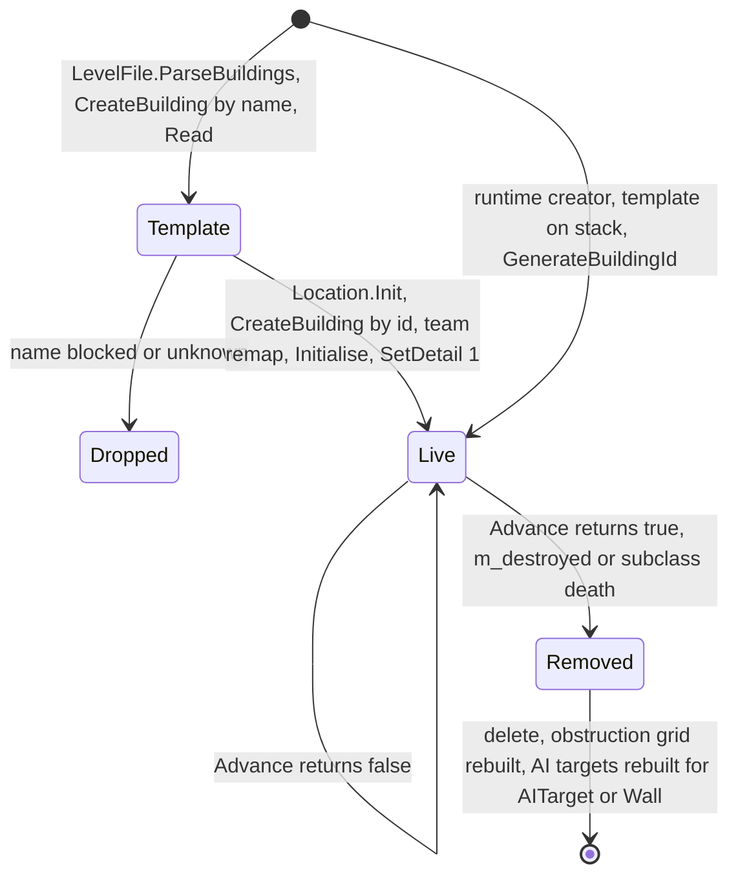
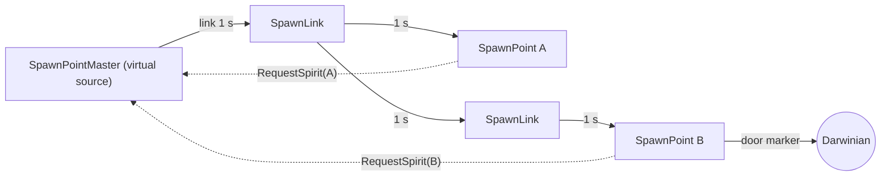

# 03 — Buildings and world objects

> Part A · Baseline build: Release|Win32 (OpenGL) + TARGET_PC_FULLGAME ([B:FULL]); see _work/build_matrix.md.
> Evidence: [C] confirmed · [I] inferred · [U] unknown. Citations are `path:Symbol` relative to the multiwinia/ source root.
> Sources merged: P06_buildings_core, P07_buildings_misc, P02_game_modes (§5 mode buildings), P05_entities_creatures (AntHill, Triffid, Spam, WallBuster), P08_crates_ai (AITarget, AIObjective, AIObjectiveMarker, AISpawnPoint), P03/P04 cross-notes (Darwinian port/carry behaviour, Engineer), routed `_meta_*` notes; re-verified against the source tree (commit `f909630`). Census tables regenerated by `_work/scripts/S_03_building_census.py` and `_work/scripts/S_03_master_table.py`.

## Contents

- [1 Scope, conventions and map census](#1-scope-conventions-and-map-census)
- [2 Master table of building types](#2-master-table-of-building-types)
- [3 Building base class](#3-building-base-class)
- [4 Spawn network](#4-spawn-network)
- [5 Contestable utility buildings](#5-contestable-utility-buildings)
- [6 Power network](#6-power-network)
- [7 Barriers, scenery and markers](#7-barriers-scenery-and-markers)
- [8 Mode objective objects](#8-mode-objective-objects)
- [9 Crate-spawned world objects](#9-crate-spawned-world-objects)
- [10 AI marker buildings](#10-ai-marker-buildings)
- [11 Compiled, loadable, but unused by shipped content](#11-compiled-loadable-but-unused-by-shipped-content)
- [12 Darwinia-legacy buildings (blocked)](#12-darwinia-legacy-buildings-blocked)
- [13 Multiwinia-live set summary](#13-multiwinia-live-set-summary)
- [14 Consolidated constants](#14-consolidated-constants)
- [15 Defects, determinism and implementation hazards](#15-defects-determinism-and-implementation-hazards)
- [Open questions and unknowns](#open-questions-and-unknowns)
- [Docs-vs-code discrepancies](#docs-vs-code-discrepancies)
- [IP items](#ip-items)
- [Source map](#source-map)
- [Appendix — dead/legacy code](#appendix--deadlegacy-code)

## 1 Scope, conventions and map census

### 1.1 What this document covers

Every class derived from `Building` (the level-placeable / statically-positioned world-object hierarchy), plus the non-`Building` helper objects that only exist to serve buildings (`BuildingPort`, `SpawnBuildingLink`, `SpawnBuildingSpirit`, `MineCart`, `SpiritStore`, `UnprocessedSpirit`, `Flag`, `Randomiser`). For each type: function, capture/ownership rules, inputs/outputs (spirits, Darwinians, power, fuel), activation conditions, links to other buildings, damageability, mode usage and level-file parameters, with a Mermaid state machine where the type is stateful. [C] class list from `code/worldobject/*.h` (`_work/class_assignment.csv`).

Owned elsewhere (linked, not repeated):
- Mobile entities (Darwinian, Officer, Armour, ArmyAnt, TriffidEgg, Tentacle, Engineer …) → [02](02_units_and_entities.md).
- `Crate` (enum value 65) and every crate outcome's selection rules → [04](04_crates_powerups_and_weapons.md); this document only specifies the buildings that crate outcomes create (GunTurret, AntHill, Triffid, Portal, Randomiser, Trees).
- Spawn-point economy formulae (burst/pause rate, population caps, handicap, trunk-port reinforcement waves, spirit lifecycle) → [05](05_economy_and_population.md). Here each spawn building's function and parameters are given and the formulae are linked.
- Game-mode rules that read buildings (KOTH scoring, CTS scoring, Blitzkrieg elimination, Assault timer, Rocket Riot win) → [01](01_game_modes.md).
- AI use of AITargets/objectives → [07](07_ai.md).
- Level-file grammar as a whole → [08](08_levels_and_level_design.md) and [29](29_data_formats_reference.md); entity/building simulation model → [21](21_simulation_and_entity_model.md); determinism → [22](22_determinism_and_networking.md); rendering details → [24](24_rendering.md).

### 1.2 Time base

- One simulation tick = `SERVER_ADVANCE_PERIOD` = `0.1 × GameTimer::m_gameSpeed` game seconds (0.1 s at normal speed; the Slow-down/Speed-up crates change `m_gameSpeed`). [C] `code/gametimer.h:SERVER_ADVANCE_PERIOD`, `code/gametimer.cpp:GameTimer::GetServerAdvancePeriod`.
- `GetNetworkTime()` is a macro for `g_gameTimer.GetGameTime()`; both are the same synced game clock, advanced by `SERVER_ADVANCE_PERIOD` per tick in `GameTimer::Tick` unless paused. Resolved: P06 listed this as unknown (P06-U2); the code shows `#define GetNetworkTime g_gameTimer.GetGameTime`. [C] `code/gametimer.h`.
- Buildings are advanced in `Location::AdvanceBuildings(slice)`; the building list is split into `NUM_SLICES_PER_FRAME` = 10 slices, so each building's `Advance()` runs once per tick, in one of the 10 slices. [C] `code/location.cpp:Location::AdvanceBuildings`, `code/globals.h:NUM_SLICES_PER_FRAME`; [I] "once per tick" assumes every slice 0–9 is processed each tick (see [21](21_simulation_and_entity_model.md)).
- Timers written `if (GetNetworkTime() > m_timer) { …; m_timer = GetNetworkTime() + 1.0; }` fire after 10 or 11 ticks depending on floating-point accumulation of 0.1 (strict `>` on a summed double) — usually 11 ticks ≈ 1.1 s. Affects MultiwiniaZone recounts, CarryableBuilding ownership, SpawnPopulationLock overpopulation. [I] reasoning on IEEE double sums; the mode-level consequence is in [01](01_game_modes.md).
- Logic expressed **per tick** (fixed probabilities, `+1 per tick` growth) does not scale with game speed, whereas logic using `SERVER_ADVANCE_PERIOD` does. Per-tick items are flagged in each section.

### 1.3 Teams, ownership and friendship

- A building's owner is the team byte inside its `WorldObjectId` (`m_id.GetTeamId()`, `unsigned char`). Teams 0–5 (`NUM_TEAMS` = 6), **255 = neutral**. In Multiwinia every building is constructed neutral (255); single-player Darwinia used team 1. [C] `code/worldobject/building.cpp:Building::Building`, `code/worldobject/worldobject.h:WorldObjectId`, `code/globals.h:NUM_TEAMS`.
- `Location::IsFriend(a, b)`: false if either is 255; in Multiwinia, co-op mode compares `m_coopGroups[a] == m_coopGroups[b]`, otherwise `a == b`. (The single-player 6×6 table is [B:LEGACY].) [C] `code/location.cpp:Location::IsFriend`.
- The level file stores a **map position** (0–5) or 255 in the team column; at instantiation it is remapped to the lobby team holding that position via `Location::GetTeamFromPosition` (255 if no team occupies it). [C] `code/location.cpp:Location::GetTeamFromPosition` and the building-instantiation loop in `Location::Init`.
- The Monster team (`Location::GetMonsterTeamId`) and the Futurewinian team (`Location::GetFuturewinianTeamId`) are special CPU teams used by crate outcomes; several buildings special-case them. [C] references in each section.

### 1.4 Damage sign convention

`Building::Damage(d)` receives a **negative** number for harm (`GunTurret: m_health += d`). Explosions call `building->Damage(−damage × falloff)`. A positive argument heals or is ignored. (Cave is the exception that tests `d > 80`, so it is effectively indestructible — §12.16.) [C] `code/worldobject/gunturret.cpp:GunTurret::Damage`, `code/location.cpp:Location::Bang`.

### 1.5 Shipped-map census

Definitions used by every "map count" in this document [C] `data/levels/level_enum.txt` + `_work/scripts/S_03_building_census.py`:
- **Official** = the 49 `mp_*.txt` files listed in `data/levels/level_enum.txt` and present in `data/levels/` (entries 50–59, the PDLC maps, are listed but absent from the tree).
- **Dev** = the 8 other `mp_*.txt` files: `mp_assault_stress` (GameTypes none), `mp_benchmark_1` (none), `mp_cts_3p_3` (CTS, not in the enum), `mp_sandbox` (none), `mp_sandbox_all` (none), `mp_tankbattle_2P/3P/4P` (TankBattle, [B:DEBUG] mode). Resolved: P06 counted "9 dev files"; a recount gives 8 (57 `mp_*` files − 49 official).
- **Campaign** = the 30 Darwinia `map_*` / `mission_*` files; **old** = `data/levels/old/*` (Multiwinia prototype maps). Both are unreachable in FULL ([B:LEGACY]).
- **Mode** of an official map = its `GameTypes` line (not its file name). Official maps per mode: Domination 9 (`mp_domination_*` ×5, `mp_koth_2P_2`, `mp_koth_2P_3`, `mp_skirmish_2p_4`, `mp_skirmish_3P_1`), King of the Hill 9 (the other 9 `mp_koth_*`), Capture the Statue 9, Assault 8, Rocket Riot 7, Blitzkrieg 7. [C] `GameTypes` lines.

Status codes used in the tables: **LIVE-L** = placed by official maps; **LIVE-R** = created at runtime by live FULL code; **LIVE-L+R** = both; **UNUSED** = compiled, not blocked, loadable from a level file, but placed by no official map; **DEBUG** = only reachable under `TARGET_DEBUG` ([B:DEBUG]); **LEGACY** = blocked by `BuildingIsBlocked` and never created by live code ([B:LEGACY]).

## 2 Master table of building types

### 2.1 Building type enum (all 75 values)

`Building::Type*` is an anonymous enum in `building.h` with 75 values (`TypeInvalid` = 0 … `TypeSmokeMarker` = 74) followed by `NumBuildingTypes` = 75; the level-file name table in `Building::GetTypeName` has exactly 75 entries in the same order (source comment: "These must be in the same order as defined in building.h"). Blocked = listed in `Building::BuildingIsBlocked` (39 types). Forced global = `CreateBuilding(int)` sets `m_isGlobal = true` (6 types). [C] `code/worldobject/building.h`, `code/worldobject/building.cpp:GetTypeName`, `BuildingIsBlocked`, `CreateBuilding`. Table generated by `_work/scripts/S_03_master_table.py`.

| # | Enum | Level-file name | Class | Blocked | Forced global | Official MP maps (lines) | Dev mp_ maps | Campaign / old maps | Modes in official maps (maps/total) | MW status | Section |
|---|---|---|---|---|---|---|---|---|---|---|---|
| 0 | `TypeInvalid` | `Invalid` | — (NULL) | no |  | 0 (0) | 0 | 0 / 0 | – | n/a | – |
| 1 | `TypeFactory` | `Factory` | `Factory` | **yes** |  | 0 (0) | 0 | 0 / 0 | – | LEGACY | [§12.10](#1210-factory) |
| 2 | `TypeCave` | `Cave` | `Cave` | **yes** |  | 0 (0) | 0 | 0 / 0 | – | LEGACY | [§12.16](#1216-cave) |
| 3 | `TypeRadarDish` | `RadarDish` | `RadarDish` | no | yes | 7 (46) | 0 | 11 / 4 | Assault:3/8 Domination:2/9 KingOfTheHill:2/9 | LIVE-L | [§5.3](#53-radardish) |
| 4 | `TypeLaserFence` | `LaserFence` | `LaserFence` | no |  | 14 (677) | 1 | 1 / 1 | Assault:6/8 Blitzkrieg:5/7 Domination:2/9 RocketRiot:1/7 | LIVE-L | [§7.1](#71-laserfence) |
| 5 | `TypeControlTower` | `ControlTower` | `ControlTower` | no | yes | 0 (0) | 2 | 12 / 6 | – | UNUSED | [§11.1](#111-controltower) |
| 6 | `TypeGunTurret` | `GunTurret` | `GunTurret` | no |  | 13 (200) | 1 | 2 / 7 | Assault:8/8 Blitzkrieg:2/7 Domination:1/9 KingOfTheHill:1/9 RocketRiot:1/7 | LIVE-L+R | [§5.1](#51-gunturret) |
| 7 | `TypeBridge` | `Bridge` | `Bridge` | **yes** |  | 0 (0) | 0 | 0 / 0 | – | LEGACY | [§12.15](#1215-bridge) |
| 8 | `TypePowerstation` | `Powerstation` | `Powerstation` | **yes** |  | 0 (0) | 0 | 0 / 0 | – | LEGACY | [§6.8](#68-powerstation) |
| 9 | `TypeTree` | `Tree` | `Tree` | no |  | 39 (661) | 6 | 8 / 16 | Assault:5/8 Blitzkrieg:4/7 CaptureTheStatue:8/9 Domination:9/9 KingOfTheHill:9/9 RocketRiot:4/7 | LIVE-L+R | [§7.3](#73-tree) |
| 10 | `TypeWall` | `Wall` | `Wall` | no |  | 9 (323) | 2 | 0 / 1 | Assault:7/8 Blitzkrieg:1/7 KingOfTheHill:1/9 | LIVE-L | [§7.2](#72-wall) |
| 11 | `TypeTrunkPort` | `TrunkPort` | `TrunkPort` | no | yes | 28 (109) | 3 | 12 / 6 | Assault:8/8 Blitzkrieg:7/7 Domination:2/9 KingOfTheHill:4/9 RocketRiot:7/7 | LIVE-L | [§8.6](#86-trunkport) |
| 12 | `TypeResearchItem` | `ResearchItem` | `ResearchItem` | **yes** |  | 0 (0) | 0 | 6 / 0 | – | LEGACY | [§12.26](#1226-researchitem) |
| 13 | `TypeLibrary` | `Library` | `Library` | **yes** |  | 0 (0) | 0 | 0 / 0 | – | LEGACY | [§12.25](#1225-library) |
| 14 | `TypeGenerator` | `Generator` | `Generator` | **yes** |  | 0 (0) | 0 | 1 / 0 | – | LEGACY | [§6.6](#66-generator) |
| 15 | `TypePylon` | `Pylon` | `Pylon` | no |  | 16 (296) | 1 | 3 / 2 | Assault:5/8 Blitzkrieg:3/7 Domination:1/9 RocketRiot:7/7 | LIVE-L | [§6.3](#63-pylon) |
| 16 | `TypePylonStart` | `PylonStart` | `PylonStart` | **yes** |  | 0 (0) | 0 | 1 / 0 | – | LEGACY | [§6.7](#67-pylonstart) |
| 17 | `TypePylonEnd` | `PylonEnd` | `PylonEnd` | no |  | 16 (86) | 1 | 2 / 2 | Assault:5/8 Blitzkrieg:3/7 Domination:1/9 RocketRiot:7/7 | LIVE-L | [§6.4](#64-pylonend) |
| 18 | `TypeSolarPanel` | `SolarPanel` | `SolarPanel` | no |  | 16 (225) | 1 | 2 / 2 | Assault:5/8 Blitzkrieg:3/7 Domination:1/9 RocketRiot:7/7 | LIVE-L | [§6.2](#62-solarpanel) |
| 19 | `TypePowerSplitter` | `PowerSplitter` | `PowerSplitter` | no |  | 7 (26) | 0 | 0 / 1 | RocketRiot:7/7 | LIVE-L | [§6.5](#65-powersplitter) |
| 20 | `TypeTrackLink` | `TrackLink` | `TrackLink` | **yes** |  | 0 (0) | 0 | 2 / 0 | – | LEGACY | [§12.29](#1229-tracklink) |
| 21 | `TypeTrackJunction` | `TrackJunction` | `TrackJunction` | **yes** |  | 0 (0) | 0 | 1 / 0 | – | LEGACY | [§12.30](#1230-trackjunction) |
| 22 | `TypeTrackStart` | `TrackStart` | `TrackStart` | **yes** |  | 0 (0) | 0 | 1 / 0 | – | LEGACY | [§12.31](#1231-trackstart) |
| 23 | `TypeTrackEnd` | `TrackEnd` | `TrackEnd` | **yes** |  | 0 (0) | 0 | 2 / 0 | – | LEGACY | [§12.32](#1232-trackend) |
| 24 | `TypeRefinery` | `Refinery` | `Refinery` | **yes** |  | 0 (0) | 0 | 1 / 0 | – | LEGACY | [§12.33](#1233-refinery) |
| 25 | `TypeMine` | `Mine` | `Mine` | **yes** |  | 0 (0) | 0 | 1 / 0 | – | LEGACY | [§12.34](#1234-mine) |
| 26 | `TypeYard` | `Yard` | `ConstructionYard` | **yes** |  | 0 (0) | 0 | 1 / 0 | – | LEGACY | [§12.1](#121-constructionyard) |
| 27 | `TypeDisplayScreen` | `DisplayScreen` | `DisplayScreen` | **yes** |  | 0 (0) | 0 | 0 / 0 | – | LEGACY | [§12.2](#122-displayscreen) |
| 28 | `TypeUpgradePort` | `UpgradePort` | `UpgradePort` | **yes** |  | 0 (0) | 0 | 0 / 0 | – | LEGACY | [§12.38](#1238-upgradeport) |
| 29 | `TypePrimaryUpgradePort` | `PrimaryUpgrade` | `PrimaryUpgradePort` | **yes** |  | 0 (0) | 0 | 0 / 0 | – | LEGACY | [§12.39](#1239-primaryupgradeport) |
| 30 | `TypeIncubator` | `Incubator` | `Incubator` | no | yes | 0 (0) | 2 | 14 / 14 | – | UNUSED | [§11.2](#112-incubator) |
| 31 | `TypeAntHill` | `AntHill` | `AntHill` | no |  | 0 (0) | 0 | 2 / 0 | – | LIVE-R | [§9.1](#91-anthill) |
| 32 | `TypeSafeArea` | `SafeArea` | `SafeArea` | **yes** |  | 0 (0) | 0 | 3 / 0 | – | LEGACY | [§12.35](#1235-safearea) |
| 33 | `TypeTriffid` | `Triffid` | `Triffid` | no |  | 0 (0) | 0 | 9 / 4 | – | LIVE-R | [§9.2](#92-triffid) |
| 34 | `TypeSpiritReceiver` | `SpiritReceiver` | `SpiritReceiver` | **yes** |  | 0 (0) | 0 | 1 / 0 | – | LEGACY | [§12.7](#127-spiritreceiver) |
| 35 | `TypeReceiverLink` | `ReceiverLink` | `ReceiverLink` | **yes** |  | 0 (0) | 0 | 2 / 0 | – | LEGACY | [§12.5](#125-receiverlink) |
| 36 | `TypeReceiverSpiritSpawner` | `SpiritSpawner` | `ReceiverSpiritSpawner` | **yes** |  | 0 (0) | 0 | 1 / 0 | – | LEGACY | [§12.6](#126-receiverspiritspawner) |
| 37 | `TypeSpiritProcessor` | `SpiritProcessor` | `SpiritProcessor` | **yes** |  | 0 (0) | 0 | 1 / 0 | – | LEGACY | [§12.4](#124-spiritprocessor) |
| 38 | `TypeSpawnPoint` | `SpawnPoint` | `SpawnPoint` | no |  | 32 (258) | 2 | 3 / 18 | Blitzkrieg:4/7 CaptureTheStatue:9/9 Domination:9/9 KingOfTheHill:8/9 RocketRiot:2/7 | LIVE-L | [§4.5](#45-spawnpoint) |
| 39 | `TypeSpawnPopulationLock` | `SpawnPopulationLock` | `SpawnPopulationLock` | no |  | 21 (86) | 1 | 6 / 11 | Assault:2/8 Blitzkrieg:4/7 CaptureTheStatue:6/9 Domination:2/9 KingOfTheHill:7/9 | LIVE-L (inert if PopulationCap set) | [§4.6](#46-spawnpopulationlock) |
| 40 | `TypeSpawnPointMaster` | `SpawnPointMaster` | `MasterSpawnPoint` | no |  | 32 (32) | 2 | 3 / 18 | Blitzkrieg:4/7 CaptureTheStatue:9/9 Domination:9/9 KingOfTheHill:8/9 RocketRiot:2/7 | LIVE-L | [§4.4](#44-masterspawnpoint) |
| 41 | `TypeSpawnLink` | `SpawnLink` | `SpawnLink` | no |  | 21 (261) | 2 | 3 / 11 | Blitzkrieg:3/7 CaptureTheStatue:2/9 Domination:8/9 KingOfTheHill:8/9 | LIVE-L | [§4.3](#43-spawnlink) |
| 42 | `TypeAITarget` | `AITarget` | `AITarget` | no |  | 49 (1029) | 4 | 4 / 24 | Assault:8/8 Blitzkrieg:7/7 CaptureTheStatue:9/9 Domination:9/9 KingOfTheHill:9/9 RocketRiot:7/7 | LIVE-L+R | [§10.1](#101-aitarget) |
| 43 | `TypeAISpawnPoint` | `AISpawnPoint` | `AISpawnPoint` | **yes** |  | 0 (0) | 0 | 1 / 5 | – | LEGACY | [§10.4](#104-aispawnpoint) |
| 44 | `TypeBlueprintStore` | `BlueprintStore` | `BlueprintStore` | **yes** |  | 0 (0) | 0 | 1 / 0 | – | LEGACY | [§12.12](#1212-blueprintstore) |
| 45 | `TypeBlueprintConsole` | `BlueprintConsole` | `BlueprintConsole` | **yes** |  | 0 (0) | 0 | 1 / 0 | – | LEGACY | [§12.13](#1213-blueprintconsole) |
| 46 | `TypeBlueprintRelay` | `BlueprintRelay` | `BlueprintRelay` | **yes** |  | 0 (0) | 0 | 1 / 0 | – | LEGACY | [§12.14](#1214-blueprintrelay) |
| 47 | `TypeScriptTrigger` | `ScriptTrigger` | `ScriptTrigger` | **yes** |  | 0 (0) | 0 | 11 / 0 | – | LEGACY | [§12.36](#1236-scripttrigger) |
| 48 | `TypeSpam` | `Spam` | `Spam` | **yes** |  | 0 (0) | 0 | 1 / 0 | – | LEGACY | [§12.24](#1224-spam) |
| 49 | `TypeGodDish` | `GodDish` | `GodDish` | **yes** |  | 0 (0) | 0 | 1 / 1 | – | LEGACY | [§12.23](#1223-goddish) |
| 50 | `TypeStaticShape` | `StaticShape` | `StaticShape` | no |  | 19 (193) | 0 | 2 / 9 | Assault:6/8 Blitzkrieg:1/7 CaptureTheStatue:1/9 Domination:6/9 KingOfTheHill:5/9 | LIVE-L | [§7.4](#74-staticshape) |
| 51 | `TypeFuelGenerator` | `FuelGenerator` | `FuelGenerator` | no |  | 7 (57) | 0 | 1 / 1 | RocketRiot:7/7 | LIVE-L | [§8.9](#89-fuelgenerator) |
| 52 | `TypeFuelPipe` | `FuelPipe` | `FuelPipe` | no |  | 7 (178) | 0 | 1 / 1 | RocketRiot:7/7 | LIVE-L | [§8.10](#810-fuelpipe) |
| 53 | `TypeFuelStation` | `FuelStation` | `FuelStation` | no |  | 7 (57) | 0 | 1 / 1 | RocketRiot:7/7 | LIVE-L | [§8.11](#811-fuelstation) |
| 54 | `TypeEscapeRocket` | `EscapeRocket` | `EscapeRocket` | no |  | 7 (19) | 0 | 1 / 1 | RocketRiot:7/7 | LIVE-L | [§8.12](#812-escaperocket) |
| 55 | `TypeFenceSwitch` | `FenceSwitch` | `FenceSwitch` | **yes** | yes | 0 (0) | 0 | 0 / 0 | – | LEGACY | [§12.37](#1237-fenceswitch) |
| 56 | `TypeDynamicHub` | `DynamicHub` | `DynamicHub` | **yes** | yes | 0 (0) | 0 | 0 / 0 | – | LEGACY | [§12.21](#1221-dynamichub) |
| 57 | `TypeDynamicNode` | `DynamicNode` | `DynamicNode` | **yes** |  | 0 (0) | 0 | 0 / 0 | – | LEGACY | [§12.22](#1222-dynamicnode) |
| 58 | `TypeFeedingTube` | `FeedingTube` | `FeedingTube` | **yes** |  | 0 (0) | 0 | 0 / 0 | – | LEGACY | [§12.19](#1219-feedingtube) |
| 59 | `TypeMultiwiniaZone` | `MultiwiniaZone` | `MultiwiniaZone` | no |  | 25 (152) | 2 | 1 / 1 | Blitzkrieg:7/7 CaptureTheStatue:9/9 KingOfTheHill:9/9 | LIVE-L | [§8.1](#81-multiwiniazone) |
| 60 | `TypeChessPiece` | `ChessPiece` | `ChessPiece` | **yes** |  | 0 (0) | 0 | 0 / 0 | – | LEGACY | [§12.18](#1218-chesspiece) |
| 61 | `TypeChessBase` | `ChessBase` | `ChessBase` | **yes** |  | 0 (0) | 0 | 0 / 1 | – | LEGACY | [§12.17](#1217-chessbase) |
| 62 | `TypeCloneLab` | `CloneLab` | `CloneLab` | no |  | 0 (0) | 0 | 0 / 4 | – | UNUSED | [§11.3](#113-clonelab) |
| 63 | `TypeControlStation` | `ControlStation` | `ControlStation` | no |  | 9 (33) | 1 | 0 / 3 | Assault:8/8 KingOfTheHill:1/9 | LIVE-L | [§5.4](#54-controlstation) |
| 64 | `TypePortal` | `Portal` | `Portal` | **yes** |  | 0 (0) | 0 | 0 / 10 | – | DEBUG | [§9.3](#93-portal) |
| 65 | `TypeCrate` | `Crate` | `Crate` | **yes** |  | 0 (0) | 0 | 0 / 0 | – | LIVE-R | [04](04_crates_powerups_and_weapons.md) |
| 66 | `TypeStatue` | `Statue` | `Statue` | **yes** |  | 0 (0) | 1 | 0 / 0 | – | LIVE-R | [§8.4](#84-statue) |
| 67 | `TypeWallBuster` | `WallBuster` | `WallBuster` | no |  | 1 (3) | 0 | 0 / 0 | Assault:1/8 | LIVE-L | [§8.5](#85-wallbuster) |
| 68 | `TypePulseBomb` | `PulseBomb` | `PulseBomb` | no |  | 8 (8) | 1 | 0 / 1 | Assault:8/8 | LIVE-L | [§8.7](#87-pulsebomb) |
| 69 | `TypeRestrictionZone` | `RestrictionZone` | `RestrictionZone` | no |  | 14 (35) | 0 | 0 / 0 | Assault:6/8 Blitzkrieg:2/7 Domination:1/9 KingOfTheHill:1/9 RocketRiot:4/7 | LIVE-L | [§7.5](#75-restrictionzone) |
| 70 | `TypeJumpPad` | `JumpPad` | `JumpPad` | no |  | 3 (23) | 0 | 0 / 1 | Assault:1/8 Blitzkrieg:1/7 Domination:1/9 | LIVE-L | [§5.5](#55-jumppad) |
| 71 | `TypeAIObjective` | `AIObjective` | `AIObjective` | no |  | 8 (92) | 1 | 0 / 1 | Assault:8/8 | LIVE-L | [§10.2](#102-aiobjective) |
| 72 | `TypeAIObjectiveMarker` | `AIObjectiveMarker` | `AIObjectiveMarker` | no |  | 15 (330) | 1 | 0 / 1 | Assault:8/8 RocketRiot:7/7 | LIVE-L | [§10.3](#103-aiobjectivemarker) |
| 73 | `TypeEruptionMarker` | `EruptionMarker` | `EruptionMarker` | no |  | 1 (1) | 0 | 0 / 0 | Blitzkrieg:1/7 | LIVE-L | [§7.7](#77-eruptionmarker) |
| 74 | `TypeSmokeMarker` | `SmokeMarker` | `SmokeMarker` | no |  | 1 (6) | 0 | 0 / 1 | Assault:1/8 | LIVE-L | [§7.6](#76-smokemarker) |
| 75 | `NumBuildingTypes` | — | — | | | | | | | | |

Notes on the table [C] unless stated:
- Name ≠ enum suffix in three cases: `TypePrimaryUpgradePort` ↔ `"PrimaryUpgrade"`, `TypeReceiverSpiritSpawner` ↔ `"SpiritSpawner"`, `TypeYard` ↔ class `ConstructionYard`; `TypeSpawnPointMaster` ↔ class `MasterSpawnPoint`. `code/worldobject/building.cpp:GetTypeName`, `CreateBuilding`.
- "Blocked" stops only **name-based** creation (level parsing, editor palette); `CreateBuilding(int)` ignores the list. Blocked types that live code still creates by id: `Crate` (`Location::AdvanceCrates`), `Statue` (CTS, `code/multiwinia.cpp`). `Portal` is created by id only from the debug-only "The Beast" crate (`INCLUDE_THEBEAST` is defined only under `TARGET_DEBUG` in `code/worldobject/crate.h`) → [B:DEBUG]. Resolved: P06 tagged Portal [B:FULL]; the `#ifdef TARGET_DEBUG` around `#define INCLUDE_THEBEAST` makes every caller of `Crate::RunTheBeast` debug-only. `Bridge` is created by id from `Engineer::BeginBridge`, which returns unless Engineer research ≥ 5 (maximum research level is 4) → unreachable. `Spam` is created by `GodDish` (blocked), `ChessPiece` by `ChessBase` (blocked). `code/worldobject/engineer.cpp:Engineer::BeginBridge`, `code/worldobject/goddish.cpp`, `code/worldobject/chess.cpp`.
- The census counts lines inside `Buildings_StartDefinition … Buildings_EndDefinition` blocks, including lines whose type is blocked (those lines are silently dropped at load). One Darwinia line names `CarryableBuilding` (`data/levels/map_sandbox.txt`), which has no enum value → dropped.
- Status totals (75 values): LIVE 34 = LIVE-L 27 + LIVE-L+R 3 (GunTurret, Tree, AITarget) + LIVE-R 4 (AntHill, Triffid, Crate, Statue); UNUSED 3 (ControlTower, Incubator, CloneLab); DEBUG 1 (Portal); LEGACY 36 (the 39 blocked types minus Crate, Statue, Portal); n/a 1 (`TypeInvalid`). Per-mode breakdown in [§13](#13-multiwinia-live-set-summary).
- Resolved: phase-2 notes said "only 8 of P07's 38 classes are live". That count covers P07's partition only (Tree, LaserFence, Wall, StaticShape, RestrictionZone, SmokeMarker, EruptionMarker, Randomiser). Across all building types the live count is 34 enum values plus the live helper classes in §2.2.

### 2.2 Classes without an enum value

| Class | Kind | Base | Header | Used by | Status | Section |
|---|---|---|---|---|---|---|
| `Building` | abstract-in-practice base | `WorldObject` | `code/worldobject/building.h` | every building | [B:FULL] | [§3.1](#31-building) |
| `BuildingPort` | plain struct | — | `code/worldobject/building.h` | every building with `MarkerPort*` shape markers | [B:FULL] | [§3.3](#33-buildingport) |
| `SpawnBuilding` | abstract base | `Building` | `code/worldobject/spawnpoint.h` | SpawnLink, MasterSpawnPoint, SpawnPoint | [B:FULL] | [§4.2](#42-spawnbuilding) |
| `SpawnBuildingLink` | plain struct | — | `code/worldobject/spawnpoint.h` | SpawnBuilding link list | [B:FULL] | [§4.2](#42-spawnbuilding) |
| `SpawnBuildingSpirit` | plain struct (virtual spirit) | — | `code/worldobject/spawnpoint.h` | spirits in transit on spawn links | [B:FULL] | [§4.2](#42-spawnbuilding) |
| `Teleport` | abstract base | `Building` | `code/worldobject/teleport.h` | RadarDish, Bridge | [B:FULL] | [§5.2](#52-teleport) |
| `PowerBuilding` | base (also instantiable through subclasses only) | `Building` | `code/worldobject/generator.h` | SolarPanel, Pylon, PylonEnd, PowerSplitter, Generator, PylonStart | [B:FULL] | [§6.1](#61-powerbuilding) |
| `CarryableBuilding` | base | `Building` | `code/worldobject/carryablebuilding.h` | Statue, WallBuster, ChessPiece | [B:FULL] | [§8.3](#83-carryablebuilding) |
| `FuelBuilding` | base | `Building` | `code/worldobject/rocket.h` | FuelGenerator, FuelPipe, FuelStation, EscapeRocket | [B:FULL] | [§8.8](#88-fuelbuilding) |
| `Flag` | render helper (not a WorldObject) | — | `code/worldobject/flag.h` | MultiwiniaZone (Blitzkrieg), Armour, Officer | [B:FULL] | [§8.2](#82-flag) |
| `Randomiser` | effect (`EffectRandomiser`) | `WorldObject` | `code/worldobject/randomiser.h` | Randomiser crate | [B:FULL] | [§9.4](#94-randomiser) |
| `GunTurretTarget` | effect (`EffectGunTurretTarget`) | `WorldObject` | `code/worldobject/gunturret.h` | GunTurret | [B:FULL] | [§5.1](#51-gunturret) |
| `ReceiverBuilding` | base | `Building` | `code/worldobject/spiritreceiver.h` | SpiritProcessor, ReceiverLink, ReceiverSpiritSpawner, SpiritReceiver | [B:LEGACY] | [§12.3](#123-receiverbuilding) |
| `UnprocessedSpirit` | world object | `WorldObject` | `code/worldobject/spiritreceiver.h` | SpiritProcessor | [B:LEGACY] | [§12.8](#128-unprocessedspirit) |
| `SpiritStore` | helper container | — | `code/worldobject/spiritstore.h` | Factory | [B:LEGACY] | [§12.9](#129-spiritstore) |
| `BlueprintBuilding` | abstract base | `Building` | `code/worldobject/blueprintstore.h` | BlueprintStore/Console/Relay | [B:LEGACY] | [§12.11](#1211-blueprintbuilding) |
| `DynamicBase` | abstract base | `Building` | `code/worldobject/generichub.h` | DynamicHub, DynamicNode | [B:LEGACY] | [§12.20](#1220-dynamicbase) |
| `MineBuilding` | abstract base | `Building` | `code/worldobject/mine.h` | TrackLink/Junction/Start/End, Refinery, Mine | [B:LEGACY] | [§12.27](#1227-minebuilding) |
| `MineCart` | plain struct | — | `code/worldobject/mine.h` | MineBuilding | [B:LEGACY] | [§12.28](#1228-minecart) |

### 2.3 Class hierarchy

[C] base classes from `code/worldobject/*.h` (see also the full world-object diagram in [21](21_simulation_and_entity_model.md)).

```mermaid
classDiagram
    WorldObject <|-- Building
    WorldObject <|-- UnprocessedSpirit
    WorldObject <|-- Randomiser
    WorldObject <|-- GunTurretTarget
    Building <|-- SpawnBuilding
    SpawnBuilding <|-- SpawnLink
    SpawnBuilding <|-- MasterSpawnPoint
    SpawnBuilding <|-- SpawnPoint
    Building <|-- SpawnPopulationLock
    Building <|-- GunTurret
    Building <|-- Teleport
    Teleport <|-- RadarDish
    Teleport <|-- Bridge
    Building <|-- ControlStation
    Building <|-- JumpPad
    Building <|-- PowerBuilding
    PowerBuilding <|-- SolarPanel
    PowerBuilding <|-- Pylon
    PowerBuilding <|-- PylonEnd
    PowerBuilding <|-- PowerSplitter
    PowerBuilding <|-- Generator
    PowerBuilding <|-- PylonStart
    Building <|-- Powerstation
    Building <|-- LaserFence
    Building <|-- Wall
    Building <|-- Tree
    Building <|-- StaticShape
    Building <|-- RestrictionZone
    Building <|-- SmokeMarker
    Building <|-- EruptionMarker
    Building <|-- MultiwiniaZone
    Building <|-- CarryableBuilding
    CarryableBuilding <|-- Statue
    CarryableBuilding <|-- WallBuster
    CarryableBuilding <|-- ChessPiece
    Building <|-- TrunkPort
    Building <|-- PulseBomb
    Building <|-- FuelBuilding
    FuelBuilding <|-- FuelGenerator
    FuelBuilding <|-- FuelPipe
    FuelBuilding <|-- FuelStation
    FuelBuilding <|-- EscapeRocket
    Building <|-- AntHill
    Building <|-- Triffid
    Building <|-- Portal
    Building <|-- Crate
    Building <|-- AITarget
    Building <|-- AIObjective
    Building <|-- AIObjectiveMarker
    Building <|-- AISpawnPoint
    Building <|-- ControlTower
    Building <|-- Incubator
    Incubator <|-- CloneLab
    Building <|-- ConstructionYard
    Building <|-- DisplayScreen
    Building <|-- ReceiverBuilding
    ReceiverBuilding <|-- SpiritProcessor
    ReceiverBuilding <|-- ReceiverLink
    ReceiverBuilding <|-- ReceiverSpiritSpawner
    ReceiverBuilding <|-- SpiritReceiver
    Building <|-- Factory
    Building <|-- BlueprintBuilding
    BlueprintBuilding <|-- BlueprintStore
    BlueprintBuilding <|-- BlueprintConsole
    BlueprintBuilding <|-- BlueprintRelay
    Building <|-- Cave
    Building <|-- ChessBase
    Building <|-- FeedingTube
    Building <|-- DynamicBase
    DynamicBase <|-- DynamicHub
    DynamicBase <|-- DynamicNode
    Building <|-- GodDish
    Building <|-- Spam
    Building <|-- Library
    Building <|-- ResearchItem
    Building <|-- MineBuilding
    MineBuilding <|-- TrackLink
    MineBuilding <|-- TrackJunction
    MineBuilding <|-- TrackStart
    MineBuilding <|-- TrackEnd
    MineBuilding <|-- Refinery
    MineBuilding <|-- Mine
    Building <|-- SafeArea
    Building <|-- ScriptTrigger
    Building <|-- FenceSwitch
    Building <|-- UpgradePort
    Building <|-- PrimaryUpgradePort
    Building "1" *-- "0..n" BuildingPort : m_ports
    SpawnBuilding "1" *-- "0..n" SpawnBuildingLink : m_links
    SpawnBuildingLink "1" *-- "0..n" SpawnBuildingSpirit : m_spirits
    MineBuilding "1" *-- "0..n" MineCart : m_carts
    Factory "1" *-- "1" SpiritStore : m_spiritStore
```

## 3 Building base class

Source: `code/worldobject/building.h`, `code/worldobject/building.cpp`. Build tag **[B:FULL]**; the debug render helpers (`RenderHitCheck`, `RenderLink`, editor arrow) are under `DEBUG_RENDER_ENABLED`, which is defined globally, so they are compiled into FULL but only drawn while editing or when explicitly called.

### 3.1 Building

`Building : WorldObject` is the base of every static or semi-static world object that a level file places inside a `Buildings_StartDefinition` block, plus several runtime-created objects (crates, statues, crate turrets, ant hills, triffids, portals, runtime AI targets, propagated trees). It inherits from `WorldObject` the position `m_pos`, velocity `m_vel`, identity `m_id` (team, unit, index, unique id) and type `m_type`. A building's unique id is its key in `Location::GetBuilding(id)`; level files supply it, runtime creators draw it from `GlobalWorld::GenerateBuildingId()` (after loading, `GlobalWorld::s_nextUniqueBuildingId` is set to highest level id + 1). [C] `code/worldobject/building.h:Building`, `code/location.cpp:Location::Init` (building loop), `code/global_world.cpp:GlobalWorld::GenerateBuildingId`.

Design summary for a re-implementation [I]:
- A building is a passive actor with (a) a shape used for rendering and for exact collision, (b) zero or more **ports** that Darwinians stand on to operate it, (c) an owner team that is either fixed by data or recomputed from port occupants / nearby units, (d) optional links (by id) to other buildings, and (e) a per-tick `Advance` that returns "delete me".
- There is no separate definition/template type: the level parser creates a *template* object of the concrete class and `Read()` fills it; the live object is a second instance initialised from the template.

### 3.2 Data members

| Member | Type | Default (ctor) | Meaning | Ref |
|---|---|---|---|---|
| `m_front` | Vector3 | (1,0,0) | facing; the level file stores x and z only, then `Normalise()` (y = 0) | [C] `Building::Building`, `Building::Read` |
| `m_up` | Vector3 | `g_upVector` (0,1,0) | up vector; SolarPanel, SpiritReceiver and carryables replace it with a terrain normal | [C] |
| `m_timeOfDeath` | double | −1.0 | never read by any building class | [C] ctor; grep |
| `m_dynamic` | bool | false | "only appears on this level, not all levels for this map": true for buildings read from the mission half of a level (`ParseBuildings(in, true)`), false for the map half | [C] `building.h` comment, `code/level_file.cpp:LevelFile::ParseBuildings` callers |
| `m_isGlobal` | bool | false (forced true for 6 types) | building is mirrored as a `GlobalBuilding` record (Darwinia campaign persistence) | [C] `CreateBuilding(int)` |
| `m_centrePos` | Vector3 | — | bounding-sphere centre = `Shape::CalculateCentre(transform)`, or `m_pos` without a shape | [C] `Initialise`, `SetDetail` |
| `m_radius` | double | **13.0** | bounding-sphere radius = `Shape::CalculateRadius`, or 13.0 without a shape | [C] ctor, `Initialise` |
| `m_destroyed` | bool | false | "destroyed using the script command DestroyBuilding, remove it next Advance": base `Advance()` returns true → `Location` deletes the building | [C] `Building::Advance`, `Location::AdvanceBuildings` |
| `m_shape` | Shape* | NULL | render / collision shape, set by subclass constructors via `SetShape` | [C] |
| `m_lights` | LList<ShapeMarker*> | empty | every shape marker whose name **contains** `MarkerLight` (recursive search, `strstr`) — ownership lights | [C] `SetShapeLights` |
| `m_ports` | LList<BuildingPort*> | empty | one port per shape marker whose name contains `MarkerPort` | [C] `SetShapePorts` |
| `s_controlPad` (static) | Shape* | `controlpad.shp` | pad mesh drawn under each port; loaded by the first `Building` constructor | [C] ctor |
| `s_controlPadStatus` (static) | ShapeMarker* | marker `MarkerStatus` of `controlpad.shp` | position of the port status light | [C] ctor (`AppReleaseAssert` if missing) |
| `s_neighbours` (static, protected) | `std::vector<WorldObjectId>` | — | shared scratch buffer for entity-grid queries (not re-entrant) | [C] |
| team (inside `m_id`) | unsigned char | **255 in Multiwinia**, 1 in single-player | owner | [C] ctor `g_app->IsSinglePlayer()` branch |

### 3.3 BuildingPort

Plain struct, one per `MarkerPort*` marker. [C] `code/worldobject/building.h:BuildingPort`.

| Member | Type | Meaning |
|---|---|---|
| `m_marker` | ShapeMarker* | the shape marker the port was created from |
| `m_occupant` | WorldObjectId | Darwinian currently operating the port (invalid if empty); recomputed every tick |
| `m_mat` | Matrix34 | world transform of the port; position pushed 5.0 units clear of the building and snapped to the terrain |
| `m_counter[NUM_TEAMS]` | int | per-team reservation counter ("someone of team *t* is walking here"), range 0–50 |

Behaviour of ports is specified in [§3.6](#36-ports-occupancy-and-reservation).

### 3.4 Lifecycle

1. **Parse.** `LevelFile::ParseBuildings(in, dynamic)` reads each line; first token = type name → `Building::CreateBuilding(char*)`, which loops over all types, **skips blocked types**, compares names case-insensitively (`stricmp`) and returns NULL for blocked or unknown names — the line is then silently skipped (the reader moves to the next line). Otherwise `building->Read(in, dynamic)`. A duplicate unique id is a fatal `AppReleaseAssert` ("%s UniqueId was not unique in %s"). `TrunkPort`, `ControlTower`, `RadarDish`, `Incubator` and `FenceSwitch` lines must have `isGlobal = 1` or loading aborts ("Non-global %s found in %s"). For buildings with team 1, when the level has no Difficulty block (`m_levelDifficulty < 0`), `f = 1 + g_app->m_difficultyLevel / 5`: SpawnPopulationLock `m_maxPopulation ×= f`, AntHill `m_numAntsInside ×= f`, AISpawnPoint `m_period /= f`, Triffid `m_reloadTime /= f` (all truncated to int) — inert in Multiwinia because the difficulty level is 0 there ([08](08_levels_and_level_design.md)). [C] `code/level_file.cpp:LevelFile::ParseBuildings`.
2. **Instantiate.** In `Location::Init` (building loop), for each template: fatal assert on a duplicate id ("duplicate building found"); `CreateBuilding(type)` (int overload, **no** block check); if the template team ≠ 255/−1, `template->SetTeamId(GetTeamFromPosition(team))`; `newBuilding->Initialise(template)`; `newBuilding->SetDetail(1)`. Afterwards, in Assault, every `ControlStation` whose id is in the PulseBomb's link list is linked to the bomb (`ControlStation::LinkToPulseBomb`) so the dish shape shows during the grace period. `GlobalWorld::s_nextUniqueBuildingId = highestId + 1`. [C] `code/location.cpp:Location::Init`.
3. **`Initialise(template)`** (base): copy `m_id, m_pos, m_front, m_up, m_dynamic, m_isGlobal, m_destroyed`; snap `m_pos.y` to the heightmap; compute `m_centrePos/m_radius` from the shape (or `m_pos`/13.0); collect lights and ports; if a `GlobalBuilding` exists for (unique id, requested location) its team overrides; trigger sound event `Create`. Subclasses down-cast the template to copy their extra fields. [C] `Building::Initialise`.
4. **`SetDetail(detail)`**: re-snap y; recompute centre/radius; **delete and rebuild all ports** (occupancy and reservation counters reset). The base ignores `detail`. [C] `Building::SetDetail`.
5. **`Advance()`** each tick: `if (m_destroyed) return true; EvaluatePorts(); return false;`. Subclasses usually call it last; JumpPad, Wall, SmokeMarker, EruptionMarker, MultiwiniaZone, PulseBomb, SpawnPopulationLock (when a level cap is set) and AISpawnPoint do **not** call it. [C] `Building::Advance`, per-class `Advance`.
6. **Removal.** When `Advance()` returns true, `Location::AdvanceBuildings` removes and deletes the building, recomputes the whole obstruction grid (`ObstructionGrid::CalculateAll`) after the slice, and calls `Location::RecalculateAITargets()` immediately if the removed building was an `AITarget` or a `Wall` ("the destruction of walls will create new holes for ai links"). Every building advance is bracketed by `SyncRandLogText(building->LogState(...))` (sync-log hashing of pos, vel, front, centre, radius). [C] `code/location.cpp:Location::AdvanceBuildings`, `Building::LogState`.

Runtime creation follows the same pattern with a stack-allocated template: `CreateBuilding(int)` → `m_buildings.PutData` → `Initialise(&template)` → `m_id.SetUniqueId(GlobalWorld::GenerateBuildingId())` → usually `SetDetail(1)` and `ObstructionGrid::CalculateAll()`. [C] `code/worldobject/crate.cpp:Crate::RunGunTurret`, `Crate::RunAntNest`, `Crate::RunTheBeast`; `code/worldobject/gunturret.cpp:GunTurret::Advance` (AITarget).

### 3.5 Virtual and member function catalogue

| Function | Base behaviour | Main overrides | Ref |
|---|---|---|---|
| `Building()` | defaults of §3.2; loads `controlpad.shp` once | all | [C] |
| `~Building()` | `m_ports.EmptyAndDelete()` | SpawnBuilding (links), PowerBuilding (surges), RadarDish (shape copy, AITarget), PulseBomb (shape copy), CloneLab (AITarget) | [C] |
| `Initialise(Building*)` | §3.4 step 3 | most classes copy their level fields here | [C] |
| `Advance()` → bool | §3.4 step 5 | every concrete class | [C] |
| `SetShape(Shape*)` | stores the pointer | Teleport (looks up `MarkerTeleportEntrance`), CarryableBuilding (pass-through) | [C] |
| `SetShapeLights(frag)` | recursive collection of `*MarkerLight*` markers | — | [C] |
| `SetShapePorts(frag)` | recursive; per `*MarkerPort*` marker: world matrix, `PushFromBuilding(pos, 5.0)`, y on terrain, counters 0 | — | [C] |
| `SetDetail(int)` | §3.4 step 4 | GunTurret (centre = pos, radius 30), RadarDish (caches entrance), Tree (asserts detail 1), MultiwiniaZone (`m_radius = m_size`), PulseBomb (scaled shape, no port rebuild) | [C] |
| `IsInView()` | `camera->SphereInViewFrustum(m_centrePos, m_radius)` | SpawnBuilding (link sphere), CarryableBuilding (always true), LaserFence (true during grace), Tree (`m_pos`, `m_height`), others | [C] |
| `Render(t)` | editor arrow (`DEBUG_RENDER_ENABLED` && editing); `m_shape->Render(t, Matrix34(front, up, pos))` | many | [C] |
| `RenderAlphas(t)` | `RenderLights(); RenderPorts();` | many | [C] |
| `RenderLights()` | if team ≠ 255 and lights exist: 10 nested additive `textures/starburst.bmp` quads (max size 6) in team colour at each light, drawn only when `(m_lastValidSequenceIdFromServer % 10) / 2 == teamId` (or editing) → teams 0–4 flash for 2 of every 10 server sequence ids; team 5 never flashes | — (LaserFence: empty) | [C] `Building::RenderLights` |
| `RenderPorts()` | per port: `controlpad.shp` if `RenderBuildingDetail` < 3 (pad 0.5 above ground) and a status star (size 6) green (0.3,1,0.3) if occupied, red (1,0.3,0.3) if empty | SpawnPoint, GunTurret, SolarPanel, ControlStation, CloneLab, SpiritReceiver | [C] |
| `RenderHitCheck()` / `RenderLink()` | debug: shape hit-check or sphere / magenta arrow to `GetBuildingLink()` | — | [C] |
| `PerformDepthSort(Vector3&)` | false | SpawnPoint, Tree, LaserFence, TrunkPort, FuelStation (true) | [C] |
| `SetTeamId(int)` | if changed: set team, mirror into `GlobalBuilding.m_teamId`, sound `ChangeTeam` | — (single mutation point) | [C] |
| `Reprogram(double)` | no-op | — | [C] |
| `ReprogramComplete()` | sound `ReprogramComplete`; toggles `GlobalBuilding.m_online`; `GlobalWorld::EvaluateEvents()` | Generator, TrunkPort, DynamicNode, PrimaryUpgradePort | [C] grep of `::ReprogramComplete` |
| `Damage(double)` | sound `Damage` only — **base buildings are indestructible** | GunTurret, Wall, Tree, AntHill, Triffid, EscapeRocket, Cave, Spam (no other overrides) | [C] grep of `::Damage(` |
| `Destroy(double intensity)` | `m_destroyed = true`; 3 × `g_explosionManager.AddExplosion(shape)`; `Location::Bang(m_pos, intensity, intensity/4)`; sound `Explode`; `(int)(intensity/4)` `TypeExplosionCore` particles (size 100, velocity `syncsfrand(100)` per axis ∈ [−50, 50)) | FuelBuilding (also explodes its pipe), AntHill (health 0 first), Spam; Statue, WallBuster and PulseBomb declare a separate parameterless `Destroy()` | [C] `Building::Destroy`, grep of `::Destroy(` |
| `PushFromBuilding(pos, r)` | while sphere (pos, r) hits the building, step 2.0 units directly away from `m_pos` | — | [C] |
| `EvaluatePorts()` | §3.6 | — | [C] |
| `GetNumPorts()` / `GetNumPortsOccupied()` / `GetPortOccupant(i)` / `GetPortPosition(i, &pos, &front)` | port queries; invalid index → invalid id / false | — | [C] |
| `OperatePort(i, team)` | `counter[team] = min(counter[team] + 1, 50)` | — | [C] |
| `GetPortOperatorCount(i, team)` | `counter[team]`, or −1 for a bad index | — | [C] |
| `GetObjectiveCounter(UnicodeString&)` | empty | MasterSpawnPoint, Generator, SpiritProcessor, FuelGenerator, EscapeRocket, BlueprintStore, DynamicHub, SafeArea, Refinery | [C] |
| `DoesSphereHit(pos, r)` | exact shape-sphere test; without shape: `|pos − m_pos| ≤ r + m_radius` | §3.14 | [C] |
| `DoesShapeHit(shape, mat)` | shape-vs-shape; without shape: sphere (`m_pos`, `m_radius`) vs shape | §3.14 | [C] |
| `DoesRayHit(start, dir, len, pos, norm)` | shape ray test (`pos/norm` not filled); without shape: ray-sphere | §3.14 | [C] |
| `ListSoundEvents(list)` | `Create`, `Reprogramming` (comment "Remove me"), `ReprogramComplete`, `ChangeTeam`, `Damage` | most | [C] |
| `Read(TextReader*, bool dynamic)` / `Write(TextWriter*)` | §3.10 | per class | [C] |
| `GetBuildingLink()` / `SetBuildingLink(id)` | −1 / no-op (editor link tool and `RenderLink`) | both overridden in AITarget, AIObjective/AIObjectiveMarker, BlueprintBuilding, Bridge, ControlStation, ControlTower, FeedingTube, PowerBuilding/PowerSplitter, DynamicBase, LaserFence, MineBuilding, MultiwiniaZone, Powerstation, FuelBuilding, ScriptTrigger, ReceiverBuilding, FenceSwitch, Wall; `SetBuildingLink` only in SpawnBuilding (appends a link), RadarDish (appends a valid link), PulseBomb (appends a station) | [C] grep of `::GetBuildingLink`, `::SetBuildingLink` |
| `GetTypeName(int)` / `GetTypeId(name)` (static) | name table; `GetTypeId` is case-insensitive and **ignores** the block list, −1 if unknown; `GetTypeName` asserts (debug) and returns NULL out of range | — | [C] |
| `CreateBuilding(int)` / `CreateBuilding(char*)` (static) | §3.11 | — | [C] |
| `GetTypeNameTranslated(type, &dest)` | language phrase `buildingname_<TypeName>` if present, else the raw name | — | [C] |
| `LogState(msg)` | sync-log line: type, id, hashed pos.x/y/z, Σvel, Σfront, Σcentre, radius | — | [C] |
| `BuildingIsBlocked(int)` (static) | §3.12 | — | [C] |

### 3.6 Ports, occupancy and reservation

- **Creation**: one `BuildingPort` per marker containing `MarkerPort`; position pushed 5.0 units clear of the building (`PushFromBuilding`, step 2.0), y on terrain; counters 0. Ports are rebuilt by every `SetDetail`. [C] `Building::SetShapePorts`, `Building::SetDetail`.
- **Occupancy (every tick, `EvaluatePorts`)**: for each port, `m_occupant` is cleared, then the entity grid is queried within **5.0** units of the port position; the **first** entity found that is a `Darwinian` in `StateOperatingPort` becomes the occupant — any team, and without checking that the Darwinian is operating *this* building or *this* port. [C] `Building::EvaluatePorts`.
- **Reservation counters**: if the port is occupied all `m_counter[t] = 0`; otherwise every `m_counter[t] −= 4`, floored at 0. A Darwinian walking to a port calls `OperatePort(port, team)` every tick (+1, cap 50). [C] `Building::EvaluatePorts`, `Building::OperatePort`, `code/worldobject/darwinian.cpp:Darwinian::AdvanceApproachingPort`.
- **Darwinian side** ([02](02_units_and_entities.md)): an idle (or worshipping / watching / following-orders / following-officer / approaching-armour) Darwinian calls `SearchForPorts()`. Candidates: buildings with ≥ 1 port, `|building.pos − pos| − building.radius < 100` (`DARWINIAN_SEARCHRANGE_PORTS`), at least one free port, and a walkable path. It takes the **nearest** candidate (a `syncrand() % n` pick is computed first and then overwritten by the nearest loop — the synced random number is still consumed), then picks uniformly (`syncrand()`) among ports with no occupant and `GetPortOperatorCount(p, team) < limit`, **limit = 1 in Multiwinia** (20 in Darwinia). On arrival → `StateOperatingPort`; the Darwinian leaves when `GetPortOccupant(port) != me` or the building disappears. [C] `code/worldobject/darwinian.cpp:Darwinian::SearchForPorts`, `Darwinian::AdvanceOperatingPort`, `code/worldobject/darwinian.h:DARWINIAN_SEARCHRANGE_PORTS`.
- **Net effect** [I]: a counter ≥ 1 means "a team-mate is already walking to this port", so at most one Darwinian per team heads for each free port; counters drain at 4/tick once nobody approaches. Different teams may race for the same port; the first Darwinian of any team in `StateOperatingPort` within 5 units is the occupant. Because the occupant search does not check the target building, two adjacent buildings whose ports lie within 5 units can share an occupant (no shipped case verified). Resolved: P02 listed "how Darwinians acquire/lose control-station ports" as unknown (P02-U1); the rule above is the general port mechanism used by ControlStation as well.
- **Initial occupants**: at team initialisation, every SpawnPoint and SolarPanel owned by the team receives one Darwinian per port, placed in `StateOperatingPort` with `m_portId`/`m_buildingId` set; then `EvaluatePorts()` and `RecalculateOwnership()` run immediately (SpawnPoints also get `m_activationTimer = 0`). [C] `code/location.cpp:Location::InitialiseTeam`.

### 3.7 Capture model summary (every capturable type)

| Class | Ports (shape) | Recalculation period | Rule | Contested / empty result | Ref |
|---|---|---|---|---|---|
| SpawnPoint | 5 (`spawnpointmultiwinia.shp`) | `2.0 + syncfrand(1.0)` s (first after `syncfrand(2.0)` s) | owner = a single team with **≥ 3** occupants (a later team displaces the leader only if it has > 2 and strictly more); every other occupant must be a friend of the owner | 255 | [C] `SpawnPoint::RecalculateOwnership` |
| GunTurret | 4 (`battlecannonbase.shp`) | 1.0 s (`GUNTURRET_OWNERSHIPTIMER`) | owner = team with most occupants (≥ 1; ties → lowest index); every occupant must be a friend of the owner | 255 | [C] `GunTurret::RecalculateOwnership` |
| SolarPanel | 5 (`solarpanel.shp`) | every tick (Multiwinia only) | owner = team with most occupants (strictly greater wins; ties → lowest index); **enemies may co-occupy** | 255 when empty | [C] `SolarPanel::RecalculateOwnership` |
| ControlStation | 5 (`controlstation.shp`) or 3 when linked to a PulseBomb (`pulsebombcontrolstation.shp`) | every tick | owner = first team with **> 2** occupants (**> 1** when bomb-linked), replaced by a later team with > threshold and strictly more; enemies may co-occupy; the owner is also written to the controlled building | 255 (controlled building keeps its team) | [C] `ControlStation::RecalculateOwnership` |
| CloneLab | 5 (`clonelab.shp`) | every tick | first team with > 2 occupants, replaced by a later team with > 2 and strictly more | 255 | [C] `CloneLab::RecalculateOwnership` |
| CarryableBuilding (Statue, WallBuster, ChessPiece) | 0 (proximity) | 1.0 s | team with the most live Darwinians within **50**, if that count ≥ `m_minLifters`; switches only if the new team is not a friend of the old | 255 | [C] `CarryableBuilding::CalculateOwnership` |
| MultiwiniaZone (KOTH) | 0 (proximity) | 1.0 s | team with the most counted Darwinians within `m_size` (ties → lowest index) | 255 | [C] `MultiwiniaZone::Advance_KingOfTheHill` |
| MultiwiniaZone (Blitzkrieg) | 0 (proximity) | 1.0 s | progress 0–100 accumulated by the leading team within 40 units; owner at 100, neutral at 0 | progress decays | [C] `MultiwiniaZone::Advance_Blitzkrieg` |
| RadarDish | 0 | — | no own rule; set by a linked ControlStation | — | [C] `ControlStation::RecalculateOwnership` |
| AITarget | 0 | 2.0 s | team with strictly highest friend count within range (logical owner for the AI only) | 255 | [C] `AITarget::RecalculateOwnership` ([07](07_ai.md)) |
| AIObjectiveMarker | 0 | 2.0 s | bound building's team, or scan-range majority (×4 rule) | 255 | [C] `AIObjectiveMarker::Advance` ([07](07_ai.md)) |
| TrunkPort | 0 | — | fixed by level; neutralised by `Team::Eliminate` and PulseBomb events | — | [C] §8.6 |
| ControlTower (unused) | 0 (3 reprogrammer slots) | per Engineer call | ownership ±0.1 per call | — | [C] §11.1 |
| BlueprintConsole, DynamicNode, FenceSwitch, Powerstation, SafeArea (legacy) | various | various | §12 | — | [C] |
| All others (Incubator, JumpPad, Portal, SpawnLink, MasterSpawnPoint, SpawnPopulationLock, Pylon, PylonEnd, PowerSplitter, LaserFence, Wall, Tree, StaticShape, RestrictionZone, markers, PulseBomb, Fuel*, EscapeRocket, AntHill, Triffid) | — | — | team fixed by level file or creator; never recomputed | — | [C] (no ownership code) |

### 3.8 Damage and destruction

- Base `Damage()` only plays the `Damage` sound; a building class without an override cannot be destroyed by weapons. [C] `Building::Damage`.
- **Explosions**: `Location::Bang(pos, range, damage, team, fromBuilding)` calls `building->Damage(−damage × f)` with `f = clamp(1 − dist / (3·range), 0, 1)` on every building with `dist < 3·range` (dist measured to `building->m_pos`, i.e. the base point). No team filter. This is the main source of building damage. [C] `code/location.cpp:Location::Bang`.
- Every `Bang` call site in the tree and its building-damage ceiling [C] grep of `Bang(`:

| Caller | range | damage | Max building damage | Ref |
|---|---|---|---|---|
| Grenade (power 25) | 12.5 | 50 | 50 within 37.5 | `code/worldobject/weapons.cpp:Grenade::Advance` |
| Rocket (turret/squad) | 15 | 25 | 25 within 45 | `weapons.cpp:Rocket::Explode` |
| `weapons.cpp` (≈L1284) | 20 | 100 | 100 within 60 | `code/worldobject/weapons.cpp` |
| `weapons.cpp` (≈L1938) | 20 | 20 | 20 within 60 | `code/worldobject/weapons.cpp` |
| Nuke warhead | 50 | 100 | 100 within 150 | `code/worldobject/nuke.cpp` |
| Meteor | 50 | 100 | 100 within 150 | `code/worldobject/meteor.cpp` |
| Armour | 20 | 50 | 50 within 60 | `code/worldobject/armour.cpp` |
| Lander | 30 | 50 | 50 within 90 | `code/worldobject/lander.cpp` |
| Darwinian (≈L3932) | 5 | 25 | 25 within 15 | `code/worldobject/darwinian.cpp` |
| WallBuster breach | 50 | 150 | 150 within 150 | `code/worldobject/wallbuster.cpp:WallBuster::Advance` |
| WallBuster defender scuttle | 50 | 500 | 500 within 150 | `wallbuster.cpp:WallBuster::Advance` |
| Portal explosion [B:DEBUG] | 200 | 255 | 255 within 600 | `code/worldobject/portal.cpp` |
| PulseBomb destroyed | 75 | 5 | 5 within 225 | `code/worldobject/pulsebomb.cpp:PulseBomb::Destroy` |
| `Building::Destroy(i)` (scripts) | i | i/4 | i/4 within 3i | `Building::Destroy` |

- Other direct damage: `TurretShell` hits deal `Damage(−2)` to Tree, AntHill and Triffid buildings only; `Fireball` deals `Damage(−100)` to trees; `FlameGrenade` deals `Damage(−4 × power)` to trees and triffids within `2 × power` (a computed falloff `fraction` is unused); `Lightning` deals `Damage(−100)` to trees in its cell; tasks call `GunTurret::Damage(−1000)` to self-destruct crate turrets; `WallBuster::BreakWalls` deals `Damage(−1000)` to every wall within 200. [C] `code/worldobject/weapons.cpp:TurretShell::Advance`, `Fireball::Advance`, `FlameGrenade::Advance`; `code/worldobject/lightning.cpp:Lightning::Advance`; `code/taskmanager.cpp`; `code/worldobject/wallbuster.cpp:WallBuster::BreakWalls`.
- Damageable classes and their models: GunTurret (health 60), Wall (single hit ≤ −300), Tree (fire accumulator > 50 → burn), AntHill (health 100), Triffid (`m_damage` 50 → burns), EscapeRocket (damage meter > 100 → explodes); legacy Cave (never, §12.16) and Spam (100). Everything else — including Crate, whose lifetime rules are in [04](04_crates_powerups_and_weapons.md) — has no `Damage` override and is indestructible by weapons.

### 3.9 Ownership change paths

`Building::SetTeamId(int)` is the normal mutation point (sound `ChangeTeam`, GlobalBuilding mirror). Direct `m_id.SetTeamId()` writes (no sound) are used by: PulseBomb destruction/detonation (trunk ports → 255), `Team::Eliminate` (owned trunk ports → 255, see [01](01_game_modes.md)), SolarPanel (empty → 255), creators of runtime buildings. [C] `code/worldobject/pulsebomb.cpp`, `code/team.cpp`, `code/worldobject/generator.cpp:SolarPanel::RecalculateOwnership`.

Defect [C]: `SolarPanel::RecalculateOwnership` ends with `SetTeamId(highestTeamId)` where `highestTeamId = −1` when nobody occupies the panel; `SetTeamId` compares the stored `unsigned char` 255 with the `int` −1, finds them different, stores 255 again and fires the `ChangeTeam` sound event — **every tick for every empty solar panel in Multiwinia**. Gameplay unaffected; audible only if a `SolarPanel ChangeTeam` sound binding exists ([10](10_audio_design.md)) [I].

### 3.10 Level-file line format

Header comment present in every level: `# Type id x z tm rx rz isGlobal`. Base fields are read by `Building::Read` with `GetNextToken` and written by `Building::Write`. [C] `Building::Read/Write`, `data/levels/mp_koth_2P_1.txt`.

| # | Token | Parsed as | Meaning | Write format |
|---|---|---|---|---|
| 0 | type name | `CreateBuilding(char*)`, case-insensitive | §2.1 names | `\t%-20s` |
| 1 | id | `atoi` | unique building id (unique per level, fatal assert otherwise) | `%-8d` |
| 2 | x | `iv_atof` | world x | `%-8.2f` |
| 3 | z | `iv_atof` | world z (y always from the heightmap) | `%-8.2f` |
| 4 | tm | `atoi` | team **position** 0–5 or 255; remapped at instantiation (§1.3) | `%-8d` |
| 5 | rx | `iv_atof` | `m_front.x` | `%-8.2f` |
| 6 | rz | `iv_atof` | `m_front.z`; then `m_front.Normalise()` with y = 0 | `%-8.2f` |
| 7 | isGlobal | `(bool)atoi` | §3.13 | `%-8d` |
| 8… | subclass fields | per class `Read` | see each class's level-file table | per class |

`m_id.Set(teamId, UNIT_BUILDINGS, −1, buildingId)`; `m_dynamic = dynamic`. Optional subclass fields are read only while `TokenAvailable()`; a missing mandatory token makes `GetNextToken` return an empty/NULL token (behaviour of `atoi` on it is [U], see 03-U7). [C] `Building::Read`; [I] token behaviour per [29](29_data_formats_reference.md).

### 3.11 Factory, name table and type ids

- `CreateBuilding(int type)`: a `switch` that `new`s the concrete class (the 74 cases of §2.1; `TypeInvalid` → NULL), then forces `m_isGlobal = true` for **RadarDish, ControlTower, TrunkPort, Incubator, DynamicHub, FenceSwitch**, and sets `m_type = type`. [C] `Building::CreateBuilding(int)`.
- `CreateBuilding(char* name)`: for `i` in 0…74, `continue` if `BuildingIsBlocked(i)`, return `CreateBuilding(i)` on the first case-insensitive name match; NULL otherwise (debug assert commented out). [C] `Building::CreateBuilding(char*)`.
- `GetTypeId(name)`: same loop **without** the block check; −1 if absent. Used by the editor and by `Location::FlushOpenGlState` (`GetTypeId("Tree")`). [C].
- `GetTypeNameTranslated`: phrase key `buildingname_<TypeName>` (e.g. `buildingname_SpawnPoint`). [C].

### 3.12 BuildingIsBlocked

Under `#ifdef BLOCK_OLD_DARWINIA_OBJECTS` (defined by `TARGET_PC_FULLGAME`) the function returns true for exactly these 39 types, in this source order; without the macro it returns false. [C] `Building::BuildingIsBlocked`, `code/lib/universal_include.h`.

| # | Blocked type | # | Blocked type | # | Blocked type |
|---|---|---|---|---|---|
| 1 | `TypeBlueprintConsole` | 14 | `TypeGenerator` | 27 | `TypeSpam` |
| 2 | `TypeBlueprintRelay` | 15 | `TypeGodDish` | 28 | `TypeSpiritProcessor` |
| 3 | `TypeBlueprintStore` | 16 | `TypeLibrary` | 29 | `TypeSpiritReceiver` |
| 4 | `TypeBridge` | 17 | `TypeMine` | 30 | `TypeStatue` |
| 5 | `TypeCave` | 18 | `TypePortal` | 31 | `TypeTrackEnd` |
| 6 | `TypeChessBase` | 19 | `TypePowerstation` | 32 | `TypeTrackJunction` |
| 7 | `TypeChessPiece` | 20 | `TypePrimaryUpgradePort` | 33 | `TypeTrackLink` |
| 8 | `TypeCrate` | 21 | `TypeReceiverLink` | 34 | `TypeTrackStart` |
| 9 | `TypeDisplayScreen` | 22 | `TypeReceiverSpiritSpawner` | 35 | `TypeUpgradePort` |
| 10 | `TypeDynamicHub` | 23 | `TypeRefinery` | 36 | `TypeYard` |
| 11 | `TypeDynamicNode` | 24 | `TypeResearchItem` | 37 | `TypePylonStart` |
| 12 | `TypeFactory` | 25 | `TypeSafeArea` | 38 | `TypeFeedingTube` |
| 13 | `TypeFenceSwitch` | 26 | `TypeScriptTrigger` | 39 | `TypeAISpawnPoint` |

Darwinia-era types that are **not** blocked (and therefore loadable): AntHill, Triffid, ControlTower, Incubator, TrunkPort, LaserFence, Pylon, PylonEnd, SolarPanel, PowerSplitter, FuelGenerator, FuelPipe, FuelStation, EscapeRocket, StaticShape, CloneLab, RadarDish, Tree, SpawnPoint, SpawnPopulationLock, SpawnPointMaster, SpawnLink, AITarget. [C].

### 3.13 Global buildings

`m_isGlobal` marks a building mirrored as a `GlobalBuilding` record (team, online flag, link) in `g_app->m_globalWorld` — the Darwinia campaign's cross-level persistence. Touch points: `Initialise` (team from GlobalBuilding), `SetTeamId` (writes team), `ReprogramComplete` (toggles online), `TrunkPort::Advance` (opens when online), RadarDish (stores link), ControlTower/Generator/SpiritProcessor/ConstructionYard/MasterSpawnPoint/FenceSwitch/DynamicHub (set online). In Multiwinia the lookups find no record (no campaign world is loaded) and are inert [I]; MP levels still set `isGlobal = 1` on RadarDish and TrunkPort lines because `ParseBuildings` asserts it. [C] `building.cpp`, `level_file.cpp:ParseBuildings`; [I] absence of records in MP (see 03-U8).

### 3.14 Hit-test overrides and shapes

Collision is used by the obstruction grid (every building is rasterised into the cells its bounding sphere/shape covers; `ObstructionGrid::CalculateAll` registers every building without type filtering), by unit push-out (`Entity::PushFromObstructions`, `Darwinian::PushFromObstructions`), by line-of-sight and by mouse picking. [C] `code/obstruction_grid.cpp:ObstructionGrid::CalculateAll`, `CalculateBuildingArea`.

| Class | Sphere | Shape | Ray | Ref |
|---|---|---|---|---|
| default (`Building`) | exact shape / sphere `m_radius` | exact / sphere | exact / sphere | [C] |
| SpawnPopulationLock, JumpPad, Portal, CarryableBuilding (Statue, WallBuster, ChessPiece), AITarget, AIObjective, AIObjectiveMarker, AISpawnPoint, RestrictionZone, EruptionMarker, MultiwiniaZone, EscapeRocket, ScriptTrigger | false | false | editor only, or sphere for JumpPad/Portal (r 13) | [C] per-class `Does*Hit` |
| SmokeMarker | **base** (sphere r 13 at `m_pos`) — its `float` overrides do not override the `double` virtuals | false (override matches) | **base** (ray-sphere r 13) | [C] `code/worldobject/smokemarker.h` vs `building.h` |
| RadarDish | shape test with probe radius ×1.5 | shape | shape (up = (0,1,0)) | [C] |
| GunTurret | shape (base) | shape | turret shape ∪ barrel shape ∪ sphere r 12 at pos + (0,10,0) | [C] |
| Wall | 100 × 20 rectangle flattened to y = 0 (infinite prism) | exact mesh (`wall.shp`) | vertical quad 100 long, base → `m_pos.y + 37.5` | [C] |
| LaserFence | post shape when disabled; curtain (two rays) + post when raised | sphere (root radius) | curtain triangles + post | [C] |
| Tree | trunk sphere r 10 at `m_pos` ∪ crown sphere | same | same | [C] |
| PulseBomb | scaled shape | scaled shape | scaled shape | [C] |

Shapes and markers used by the live set [C] `data/shapes/*.shp` (P06 `scripts/P06_shape_markers.py`):

| Shape | `MarkerPort*` | `MarkerLight*` | Other markers used | Class |
|---|---|---|---|---|
| `spawnpointmultiwinia.shp` (MP) / `spawnpoint.shp` (SP) | 5 | 3 | MarkerDoor, MarkerSpiritLink | SpawnPoint |
| `spawnlink.shp`, `masterspawnpoint.shp` | 0 | 0 | MarkerSpiritLink | SpawnLink, MasterSpawnPoint |
| `battlecannonbase.shp` | 4 | 0 | MarkerStatus01–04 (code requests 5; #5 NULL, harmless) | GunTurret |
| `battlecannonturret.shp` | 0 | 0 | MarkerBarrel, MarkerKills | GunTurret |
| `cannon_bullets.shp`, `cannon_flame.shp`, `cannon_rocket.shp`, `battlecannonbarrel.shp` | 0 | 0 | MarkerBarrelEnd01–04; MarkerShells01–04 (only `cannon_bullets.shp`) | GunTurret barrels |
| `radardish.shp` (per-instance copy) | 0 | 2 | MarkerTeleportEntrance, MarkerFocus; fragments `Dish`, `UpperMount` | RadarDish |
| `controlstation.shp` / `pulsebombcontrolstation.shp` | 5 / 3 | — | MarkerDishDirection (bomb variant) | ControlStation |
| `solarpanel.shp` | 5 | 0 | MarkerStatus01–05, MarkerGlow01–04, MarkerPowerLocation | SolarPanel |
| `pylon.shp` | 0 | 1 | MarkerPowerLocation | Pylon, PylonEnd, PowerSplitter |
| `controlpad.shp` | 0 | 0 | MarkerStatus | every port |
| `laserfence.shp` | 0 | 0 | MarkerFence01 (0.37, 0, −0.30), MarkerFence02 (0.37, 48.28, −0.30) | LaserFence |
| `wall.shp` | 0 | 0 | — (mesh ±40.58 × 0…70.93 × ±1.38) | Wall |
| `trunkport_mp.shp` | — | — | MarkerSurface, MarkerDestination1/2 | TrunkPort |
| `pulsebomb.shp` (copy, radius ×0.75) | — | — | — | PulseBomb |
| `fuelgenerator.shp` + `fuelgeneratorpump.shp`, `fuelpipebase.shp`, `fuelstation.shp`, `rocket.shp`, `fuelpipe.shp` | — | — | MarkerFuel, MarkerTip, MarkerEntrance, MarkerBooster, MarkerWindow01–03 | Fuel chain |
| `wallbuster.shp`, `carry*.shp` (8 statue shapes) | 0 | 0 | — | WallBuster, Statue |
| `anthill.shp`, `triffidhead.shp` | 0 | 0 | MarkerLaunchPoint, MarkerTriffidStem (triffid) | AntHill, Triffid |
| `aitarget.shp` | 0 | 0 | — | AITarget (editor only) |

### 3.15 Sound events

Base list: `Create`, `Reprogramming`, `ReprogramComplete`, `ChangeTeam`, `Damage`; `Explode` is triggered by `Building::Destroy` without being listed in the base list. Each class adds its own events (listed per section). Bindings to samples live in `data/sounds.txt` → [10](10_audio_design.md). [C] `Building::ListSoundEvents`, `Building::Destroy`.

## 4 Spawn network

Source: `code/worldobject/spawnpoint.{h,cpp}`. Build tag **[B:FULL]** for all five classes; single-player branches are [B:LEGACY]. The economic consequences (burst/pause throughput, population caps, handicap, comparison with trunk ports and engineers/harvesters) are specified in [05](05_economy_and_population.md); this section is the building-level specification.

### 4.1 Overview

A level's spawn network is a **directed tree of links** rooted at exactly one `SpawnPointMaster`, with `SpawnLink` relay nodes and `SpawnPoint` leaves (a SpawnPoint may also relay). When an owned, activated SpawnPoint wants a Darwinian it asks the master; the master emits a **virtual** spirit (`SpawnBuildingSpirit`, not a `Spirit` entity) that travels link by link, **exactly 1.0 game second per link regardless of link length**, to the requesting SpawnPoint, which then spawns one Darwinian at its door if it is still owned. [C] `MasterSpawnPoint::RequestSpirit`, `SpawnBuilding::TriggerSpirit`, `SpawnBuilding::Advance`, `SpawnPoint::TriggerSpirit`, `SpawnPoint::SpawnDarwinian`.

Shipped topology [C] `_work/drafts/P06_spawn_graph.csv` (via `_work/scripts/P06_spawn_graph.py`): every official map with spawn points has exactly one master, no cycles, no self links, no unreachable SpawnPoint and exactly one path to each SpawnPoint. Delivery delay from request to spawn = number of hops × 1 s.

| Official map | SpawnPoints | Link objects (SpawnLink) | Hops master→point (min–max) = delivery delay in s |
|---|---|---|---|
| `mp_blitzkrieg_2P_3` | 4 | 9 | 3–8 |
| `mp_blitzkrieg_2P_4` | 3 | 7 | 3–4 |
| `mp_blitzkrieg_2p_1` | 1 | 0 | 1–1 |
| `mp_blitzkrieg_2p_2` | 6 | 8 | 2–5 |
| `mp_cts_2p_1` | 6 | 0 | 1–1 |
| `mp_cts_2p_2` | 4 | 0 | 1–1 |
| `mp_cts_2p_3` | 4 | 6 | 3–6 |
| `mp_cts_2p_4` | 4 | 0 | 1–1 |
| `mp_cts_3P_2` | 9 | 0 | 1–1 |
| `mp_cts_3p_1` | 6 | 0 | 1–1 |
| `mp_cts_4P_1` | 12 | 0 | 1–1 |
| `mp_cts_4P_2` | 8 | 0 | 1–1 |
| `mp_cts_4p_3` | 8 | 17 | 3–9 |
| `mp_domination_2P_1` | 8 | 13 | 2–7 |
| `mp_domination_2P_2` | 8 | 7 | 2–5 |
| `mp_domination_3P_1` | 10 | 14 | 4–9 |
| `mp_domination_4P_1` | 10 | 18 | 2–10 |
| `mp_domination_4P_2` | 12 | 20 | 3–5 |
| `mp_koth_2P_1` | 6 | 7 | 3–5 |
| `mp_koth_2P_2` | 9 | 10 | 3–7 |
| `mp_koth_2P_3` | 10 | 11 | 4–8 |
| `mp_koth_2P_3b` | 10 | 9 | 2–6 |
| `mp_koth_3P_1` | 9 | 23 | 3–8 |
| `mp_koth_3P_2` | 9 | 14 | 4–9 |
| `mp_koth_3P_3` | 9 | 15 | 5–6 |
| `mp_koth_4P_1` | 10 | 18 | 2–11 |
| `mp_koth_4P_3` | 12 | 20 | 3–5 |
| `mp_koth_4P_4` | 12 | 4 | 2–2 |
| `mp_rocketriot_2P_2` | 2 | 0 | 1–1 |
| `mp_rocketriot_4P_1` | 12 | 0 | 1–1 |
| `mp_skirmish_2p_4` | 10 | 11 | 3–8 |
| `mp_skirmish_3P_1` | 15 | 0 | 1–1 |

Official maps **without** a spawn network (17 of 49): all 8 Assault maps; Blitzkrieg `mp_blitzkrieg_3P_1`, `3P_2`, `4P_2`; Rocket Riot `mp_rocketriot_2p_3`, `2P_4`, `3p_1`, `3P_2`, `3P_3`; KOTH `mp_koth_3P_4`. Their Darwinian supply comes from trunk-port reinforcement waves and starting units ([05](05_economy_and_population.md)). SpawnPoint presence per mode: Domination 9/9, KOTH 8/9, CTS 9/9, Blitzkrieg 4/7, Rocket Riot 2/7, Assault 0/8. [C] census (`_work/scripts/S_03_building_census.py`), `_work/drafts/P06_spawn_graph.csv`.

### 4.2 SpawnBuilding

Abstract base of SpawnLink, MasterSpawnPoint and SpawnPoint. [C] `code/worldobject/spawnpoint.h:SpawnBuilding`.

| Member | Meaning | Ref |
|---|---|---|
| `m_links : LList<SpawnBuildingLink*>` | outgoing links | [C] |
| `m_spiritLink : ShapeMarker*` | lazily looked-up `MarkerSpiritLink` (`AppReleaseAssert` if missing); link beams start and end here | [C] `GetSpiritLink` |
| `m_visibilityMidpoint`, `m_visibilityRadius` | cached culling sphere covering the building and all link targets (recomputed while editing) | [C] `IsInView` |

#### SpawnBuildingLink

`m_targetBuildingId` (the direct neighbour), `m_targets : LList<int>` (ids of every SpawnPoint reachable through this link, filled by `ExploreLinks`), `m_spirits : LList<SpawnBuildingSpirit*>` (spirits in transit on this link). [C] `code/worldobject/spawnpoint.h:SpawnBuildingLink`.

#### SpawnBuildingSpirit

`m_targetBuildingId` (requesting SpawnPoint) and `m_currentProgress` ∈ [0, 1) along the current link. Not a world object: no position, no collision, cannot be intercepted, collected or killed; it is only drawn. [C] `code/worldobject/spawnpoint.h:SpawnBuildingSpirit`; [I] "cannot be intercepted" from the absence of any other reference.

Functions [C] `code/worldobject/spawnpoint.cpp`:
- `SetBuildingLink(id)` — appends a link unless one to `id` already exists (the target-type check is commented out).
- `ClearLinks()` — deletes all links.
- `ExploreLinks()` — recursive depth-first walk: returns this building's id if it is a SpawnPoint, plus everything reachable through each link whose target exists and is a spawn building; stores the reachable set per link in `m_targets`. A self-link aborts with `AppReleaseAssert("SpawnPoint %d Linked to itself")`. **No cycle detection** (a cycle recurses until stack overflow) and no memoisation.
- `TriggerSpirit(spirit, progress)` — puts the spirit on **every** outgoing link whose `m_targets` contains the spirit's target, with `m_currentProgress = progress`; if no link matches the spirit is deleted (lost). Latent defect: if two links could reach the same target the same pointer would be placed on two lists (double delivery, double delete); impossible with the shipped tree-shaped graphs.
- `Advance()` — for each link and each spirit on it: `progress += SERVER_ADVANCE_PERIOD`; at ≥ 1.0 the spirit leaves the link and is handed to the link target's `TriggerSpirit(spirit, progress − 1.0)` if the target exists and is a spawn building, else deleted. Then `Building::Advance()`.
- `IsSpawnBuilding(type)` — SpawnPoint, SpawnLink, SpawnPointMaster.
- `RenderAlphas` — each link as a textured beam (`textures/laser.bmp`, inner width 1, outer 3) between spirit-link markers; every in-transit spirit as a diamond (inner 2, outer 6 units) coloured with the **current** team colour of the target SpawnPoint (grey 120 if neutral; brown (150,50,25) outside Multiwinia). Then base lights/ports.

Level-file parameters (all three subclasses):

| # | Field | Type | Default | Meaning | Write |
|---|---|---|---|---|---|
| 8… | linkId | int, repeated to end of line | none | outgoing spawn links (`SetBuildingLink`) | `%-6d` each |

### 4.3 SpawnLink

| Aspect | Specification | Ref |
|---|---|---|
| Function | pure relay node of the spawn tree | [C] `SpawnLink::SpawnLink` |
| Shape | `spawnlink.shp` (no ports, no lights) | [C] |
| Ownership / capture | none (team from level, irrelevant) | [C] |
| Inputs / outputs | virtual spirits in, virtual spirits out (1 s per outgoing link) | [C] |
| Damage | indestructible | [C] |
| Level line | `SpawnLink id x z tm rx rz isGlobal linkId*` | [C] |
| Mode usage | 21 official maps: Domination 8/9, KOTH 8/9, Blitzkrieg 3/7, CTS 2/9 (261 lines) | [C] census |

### 4.4 MasterSpawnPoint

| Aspect | Specification | Ref |
|---|---|---|
| Function | virtual source of all spawn spirits; one per level (32 official maps, one each) | [C] code + census |
| Shape | `masterspawnpoint.shp`; drawn only if `m_isGlobal` or while editing (most MP levels set isGlobal 0 → invisible; 11 `mp_*` files set 1 → visible) | [C] `MasterSpawnPoint::Render/RenderAlphas`, data |
| Static | `s_masterSpawnPointId` = id of the last master that advanced; **never reset** between levels | [C] |
| First `Advance` | runs `ExploreLinks()` once (logs the time taken) | [C] |
| `RequestSpirit(targetId)` | new `SpawnBuildingSpirit{target}` → `TriggerSpirit(spirit, 0)` | [C] |
| `GetMasterSpawnPoint()` | the building with id `s_masterSpawnPointId` if its type is SpawnPointMaster, else NULL → SpawnPoints cannot request until the master has advanced once | [C] |
| Darwinia-only branch (`!Multiplayer()`) [B:LEGACY] | if global: every Spirit in Birth/Floating state `SkipStage()`; if team 1 has < 10 entities, its GlobalBuilding goes online; objective text `objective_redpopulation` | [C] |
| Capture / damage | none / indestructible | [C] |
| Level line | `SpawnPointMaster id x z tm rx rz isGlobal linkId*` | [C] |

Hazard [I]: because `s_masterSpawnPointId` is not reset, if a new level's master has the same id as a building of another type, `GetMasterSpawnPoint` returns NULL until the new master advances (harmless), but a level without a master keeps the stale id (NULL lookup, harmless). A re-implementation should hold the master reference per level.

### 4.5 SpawnPoint

| Aspect | Specification | Ref |
|---|---|---|
| Function | the territory node of the economy: when owned and activated it periodically requests virtual spirits and emits Darwinians for its owner | [C] |
| Shape | MP `spawnpointmultiwinia.shp`, SP `spawnpoint.shp`; `MarkerDoor` (asserted); **5 ports**; 3 lights | [C] ctor |
| Capture | every `2.0 + syncfrand(1.0)` s (first evaluation after `syncfrand(2.0)` s) `RecalculateOwnership()` counts port occupants per team (§3.6) and applies: scan teams 0→5; the first team with occupants becomes leader; a later team replaces the leader only if it has > 2 occupants and strictly more; whenever the leader has < 3 occupants it is dropped (the scan continues); finally, if any occupant belongs to a team that is not a friend of the leader, the result is neutral. Net rule: **owner = a team with ≥ 3 of the 5 ports, with no non-allied Darwinian on any port; otherwise neutral.** Allies do not pool: a team with 2 + an ally with 2 → neutral | [C] `SpawnPoint::RecalculateOwnership` |
| Activation | whenever an evaluation changes the owner (including to neutral) `m_activationTimer = 30.0` s; the timer counts down (by `SERVER_ADVANCE_PERIOD`) only while owned; it is forced to 0 if this is the owner's only spawn point (`s_numSpawnPoints[team+1] == 1`), outside Multiwinia, or with level option `instantspawnpointcapture`; starting spawn points get 0 in `InitialiseTeam` | [C] `SpawnPoint::Advance`, `Location::InitialiseTeam` |
| Request cycle (MP) | while owned, activated and not `PopulationLocked()`: `m_spawnTimer −= dt`; when ≤ 0 (or every tick while `Location::m_spawnManiaTimer > 0`, the Spawn Mania crate) → `master->RequestSpirit(id)`, `m_spawnTimer = 0.2`, `++m_spawnCounter`; when `m_spawnCounter ≥ (int)(20 × CalculateHandicap(team))` → counter 0, `m_spawnTimer = 10 + syncfrand(5)`. Initial `m_spawnTimer = 2 + syncfrand(2)`. Neither counter nor timer is reset on ownership change. Formulae, handicap and throughput: [05](05_economy_and_population.md) | [C] `SpawnPoint::Advance`, `SpawnPoint::CalculateHandicap` |
| Request cycle (SP) [B:LEGACY] | `m_spawnTimer = 2 + 5 × (1 − fractionOccupied) − difficulty term + syncfrand(1)` | [C] |
| Population lock | MP: Assault with `DefenderPopulationCap ≠ −1` → defender/attacker caps; else level `PopulationCap ≠ −1` → `PopulationCap / NumPlayers` per team; else nearest SpawnPopulationLock within its radius; tutorial-2 special cases. Pop = `team->m_others.NumUsed() − Virii::s_viriiPopulation[team]`. Full rules: [05](05_economy_and_population.md) | [C] `SpawnPoint::PopulationLocked` |
| Inputs | one virtual spirit per request (from the master) | [C] |
| Outputs | one Darwinian per arriving spirit **if still owned** (else the spirit is lost): spawned at the door marker; MP velocity `(door.front + (syncsfrand(1), syncsfrand(1), syncsfrand(1))) × 10`, SP zero; `m_onGround = false` | [C] `SpawnPoint::TriggerSpirit`, `SpawnDarwinian` |
| Other inputs | Engineers and Harvesters deliver collected spirits by calling `SpawnDarwinian()` directly (one Darwinian per spirit, owner's team) → [02](02_units_and_entities.md), [05](05_economy_and_population.md) | [C] `code/worldobject/engineer.cpp` |
| Links | outgoing spawn links (normally none on leaves); may relay | [C] |
| Damage | indestructible | [C] |
| Static counters | `s_numSpawnPoints[NUM_TEAMS+1]`: index `team+1` = spawn points owned by `team`, index 0 = neutral; incremented in `Initialise`, moved in `RecalculateOwnership`; read by Domination scoring/elimination, KOTH/CTS elimination, handicap, crate validity ([01](01_game_modes.md), [04](04_crates_powerups_and_weapons.md)) | [C] |
| Sounds | `TurnOn` (became owned), `TurnOff` (became neutral) + base list | [C] `ListSoundEvents`, `RecalculateOwnership` |
| Visuals | per-port status stars grey (150,150,150) empty / occupant team colour; 20 / 10 / 3 glow blobs (`textures/cloudyglow.bmp`) above the building at RenderBuildingDetail 1 / 2 / 3, alpha = occupied/total, colour lerps from (100,100,100,200) to the team colour as `m_activationTimer` goes 30 → 0 | [C] `SpawnPoint::RenderPorts/RenderAlphas` |
| Level line | `SpawnPoint id x z tm rx rz isGlobal linkId*` | [C] |
| Starting ownership in data | across all `mp_*` files: 162 SpawnPoints start owned by a team position (0: 53, 1: 57, 2: 33, 3: 19), 124 start neutral; all isGlobal 0 | [C] data (P06 grep) |
| Mode usage | official maps containing it: Domination 9/9, KOTH 8/9, CTS 9/9, Blitzkrieg 4/7, Rocket Riot 2/7, Assault 0/8; 1–15 per map | [C] census |

### 4.6 SpawnPopulationLock

| Aspect | Specification | Ref |
|---|---|---|
| Function | invisible regional population limiter (Darwinia design, Multiwinia fallback) | [C] |
| Fields | `m_searchRadius` (500.0), `m_maxPopulation` (100), `m_originalMaxPopulation`, `m_teamCount[NUM_TEAMS]`, `m_recountTimer` (initial `syncfrand(10)`), `m_recountTeamId` (initial 10); statics `s_overpopulationTimer`, `s_overpopulation` (reset by `Reset()` from `Location::Init`) | [C] |
| Behaviour | **Inert in Multiwinia when the level sets `PopulationCap ≠ −1`** (Advance returns false immediately; counts stay 0). Otherwise: every 1.0 s of game time `s_overpopulation = Σ_locks max(0, teamCount[0] − originalMax) / 2` (team 0 only); `m_maxPopulation = max(0, originalMax − s_overpopulation)`; recount cycle `m_recountTimer = 10 + syncsfrand(2)` s (∈ [9, 11)); during the cycle team *k* is recounted (`EntityGrid::GetNumFriends(pos, searchRadius, k)`) when `(int)m_recountTimer` first drops to *k* (teams 0–5) | [C] `SpawnPopulationLock::Advance` |
| Consumers | SpawnPoint, TrunkPort and AntHill `PopulationLocked()` fallbacks: the first lock whose `m_searchRadius` contains the building (cached; a lock with unique id 0 is never queried because the cache test is `> 0`); locked when `m_teamCount[team] ≥ m_maxPopulation` | [C] `SpawnPoint::PopulationLocked`, `code/worldobject/trunkport.cpp:TrunkPort::PopulationLocked`, `code/worldobject/anthill.cpp:AntHill::PopulationLocked` |
| Ownership | team from level; only affects the Darwinia difficulty scaling (§3.4) | [C] |
| Hit tests | none (sphere/shape false); drawn only in the editor (sphere r 30 + text) | [C] |
| Level line | see table | [C] `Read/Write` |
| Usage | 21 official maps (KOTH 7/9, CTS 6/9, Blitzkrieg 4/7, Assault 2/8, Domination 2/9); every one of them also sets `PopulationCap`, so all shipped locks are inert | [C] census + data cross-check (P06) |

| # | Field | Type | Default | Meaning | Write |
|---|---|---|---|---|---|
| 8 | searchRadius | float (`iv_atof`) | 500.0 | radius of the region | `%-8.2f` |
| 9 | maxPopulation | int | 100 | per-team cap inside the region | `%-6d` |

