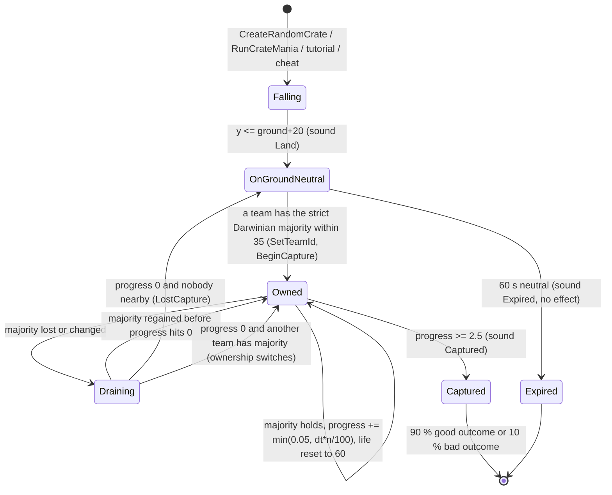
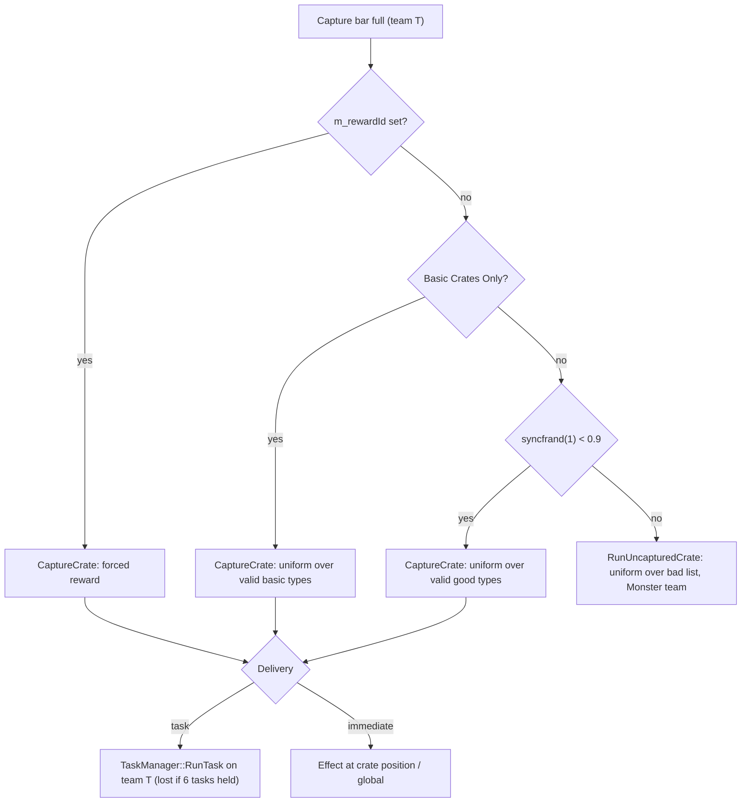

# 04 — Crates, power-ups and weapons

> Part A · Baseline build: Release|Win32 (OpenGL) + TARGET_PC_FULLGAME ([B:FULL]); see _work/build_matrix.md.
> Evidence: [C] confirmed · [I] inferred · [U] unknown. Citations are `path:Symbol` relative to the multiwinia/ source root.
> Sources merged: P08_crates_ai (§1–9, 18), P04_entities_military (§0, §1, §2, §3, §11, §14), P05_entities_creatures (SpamInfection, Meteor shower, SpaceShip, ambient weather objects, crate-outcome index), P06_buildings_core (GunTurret / GunTurretTarget, crate-turret variant), P03_entity_core (BoxKite, Darwinian crate/threat searches), P02_game_modes (Retribution), P16_sound (CratePowerup event data), `_work/drafts/P08_crate_pools.csv`, routed `_meta_*` notes. Every numeric constant below was re-read in the code by S04; corrections to the drafts are flagged "Resolved:".

## Contents

- [1 Crate lifecycle](#1-crate-lifecycle) — build gating, options, drop timer, placement, falling, landing, capture, expiry, resolution, presentation, the `Crate` class
- [2 The crate reward enum (complete)](#2-the-crate-reward-enum-complete) — all 31 shipped values + 1 debug-only + 3 commented-out
- [3 Probability tables](#3-probability-tables) — the 90/10 pools, per-option, per-type, per-level (generated), StartingPowerups and Retribution pools
- [4 Exclusion lists and grant options](#4-exclusion-lists-and-grant-options) — `InvalidCrates`, per-level list, `StartingPowerups`, Retribution, basic vs advanced crates, restriction zones
- [5 Effect specification per outcome](#5-effect-specification-per-outcome) — shared task mechanics, then one section per outcome, counter-play matrix
- [6 Weapons, projectiles and effect objects](#6-weapons-projectiles-and-effect-objects) — explosion model, fire helpers, and one section per class (ThrowableWeapon, Grenade, FlameGrenade, AirStrikeMarker, ControllerGrenade, Rocket, Laser, TurretShell, TurretEmptyShell, Fireball, Shockwave, MuzzleFlash, Missile, LandMine, PulseWave, SpamInfection, Lightning, Snow, DustBall, GunTurretTarget, BoxKite)
- [7 Determinism and implementation notes](#7-determinism-and-implementation-notes)
- [Open questions and unknowns](#open-questions-and-unknowns)
- [Docs-vs-code discrepancies](#docs-vs-code-discrepancies)
- [IP items](#ip-items)
- [Source map](#source-map)
- [Appendix — dead/legacy code](#appendix--deadlegacy-code)

Conventions used throughout this document:

- **Tick.** One simulation tick = `SERVER_ADVANCE_PERIOD` = `0.1 × m_gameSpeed` game-seconds; the server issues ticks at a fixed 10 Hz of real time, so at normal speed a tick is 0.1 s [C] `code/gametimer.cpp:GameTimer::GetServerAdvancePeriod`, see [20](20_architecture.md) / [22](22_determinism_and_networking.md). Each tick is executed as 10 slices (`NUM_SLICES_PER_FRAME`); every building and effect object is advanced once per tick in one of the slices; `Location::AdvanceCrates` runs at slice 8 [C] `code/location.cpp:Location::Advance`. "Per second" values below are game-seconds at speed 1.0 unless stated.
- **World units (wu).** The code calls them metres in `data/stats.txt` comments; maps are 1 400–6 000 wu across.
- **RNG.** `syncrand()`/`syncfrand(x)` ∈ [0, x)/`syncsfrand(x)` ∈ (−x/2, +x/2) are the shared lock-step Mersenne-Twister stream; `FRAND`/`SFRAND` are the same stream with left-to-right evaluation order inside `Vector3` constructors; `frand`/`sfrand`/`AppRandom`/`rand()` are **unsynced** local generators that may only be used for cosmetics [C] `contrib/systemiv/lib/math/random_number.cpp:_syncfrand`, `code/lib/vector3.cpp`. Note `syncsfrand(x)` spans ±x/2, so `pos + syncsfrand(200)` means ±100.
- **Teams.** `NUM_TEAMS = 6` [C] `code/globals.h`; player teams 0–3, the **Monster team = 4** ("Evilinians", colour (10,10,10)) and the **Futurewinian team = 5** (colour (200,200,200)); both are initialised as CPU teams in every multiplayer game by `Location::Init` [C] `code/location.cpp:Location::GetMonsterTeamId`, `Location::InitMonsterTeam`, `Location::InitFuturewinianTeam`. Team id 255 = neutral.
- **Research levels.** `Location::Init` forces every research type to level 3 in multiplayer, then sets Squad 1, Laser 2, Grenade 2, Rocket 2, AirStrike 2, Darwinian 4 [C] `code/location.cpp:Location::Init`. All research-indexed tables below quote the Multiwinia value; other levels are Darwinia-only [B:LEGACY].

## 1 Crate lifecycle



### 1.1 Build gating

| Macro | Where defined | Baseline FULL | Effect | Evidence |
|---|---|---|---|---|
| `INCLUDE_CRATES_BASIC` | `code/lib/universal_include.h` (every product target) | **on** | Compiles crate spawning (`Location::CreateRandomCrate`, `Location::AdvanceCrates`). Without it no crate ever drops. | [C] `code/location.cpp:Location::CreateRandomCrate`, `Location::AdvanceCrates`; `code/lib/universal_include.h` |
| `INCLUDE_CRATES_ADVANCED` | FULL, DEBUG, BETATEST_GROUP_ALL, group A | **on** | Compiles the bodies of every advanced `Crate::Run*` effect, the "bad" crate pool, and the lobby "Basic Crates Only" checkbox. Without it `Crate::IsValid` rejects every advanced type and `Crate::RunUncapturedCrate` returns at once. | [C] `code/worldobject/crate.cpp:Crate::IsValid`, `Crate::RunUncapturedCrate`, `Crate::RunNuke`; `code/UI/GameMenuWindow.cpp` |
| `INCLUDE_THEBEAST` | `code/worldobject/crate.h`, **only inside `#ifdef TARGET_DEBUG`** | **off** | Adds enum value `CrateRewardTheBeast` (index 31). `NumCrateRewards` = **31 in FULL**, 32 in DEBUG. | [C] `code/worldobject/crate.h` |
| `INCLUDE_CRATE_HELP_WINDOW` | `TARGET_DEBUG` only | off | Front-end crate help list (`CrateHelpWindow`, `CrateButton`) [B:DEBUG]. | [C] `code/lib/universal_include.h`; `code/interface/helpandoptions_windows.cpp` |
| `CHEATMENU_ENABLED` | `TARGET_DEBUG` only | off | Cheat window "Crates" drop-down spawning a crate with a forced `m_rewardId` at the screen-centre ground point, y = 300 [B:DEBUG]. | [C] `code/interface/cheat_window.cpp` |
| `LOCATION_EDITOR` | nowhere | off | `InvalidCratesWindow` editor panel [B:EDITOR]. | [C] `code/interface/invalidcrates_window.cpp` |

Resolved: an early build-matrix revision listed `INCLUDE_THEBEAST` as on; the code puts the `#define` inside `#ifdef TARGET_DEBUG`, so FULL ships 31 reward types (the matrix has since been corrected) [C] `code/worldobject/crate.h`.

Crates exist only in multiplayer: `Location::AdvanceCrates` is called only when `g_app->Multiplayer()` [C] `code/location.cpp:Location::Advance`.

### 1.2 Options that control crates

| Option | Source | Values | Modes that define it | Effect |
|---|---|---|---|---|
| `CrateDropRate` | `data/multiwinia.txt` (min 0, max 300, **default 40**, step 10) | seconds (mean drop interval) | Domination, KingOfTheHill, CaptureTheStatue, Assault, RocketRiot, Blitzkrieg (not TankBattle) | Base drop interval (§1.3). 0 = no crates. `Multiwinia::GetGameOption` returns −1 for an option the mode does not define → treated as "no crates" [C] `code/location.cpp:Location::AdvanceCrates`, `code/multiwinia.cpp:Multiwinia::GetGameOption` |
| `CrateDropMode` | `data/multiwinia.txt` (0–1, **default 1**, drop-down) | 0 = random, 1 = score-weighted | Domination, KingOfTheHill, CaptureTheStatue only (other modes return −1 → random) | Placement algorithm (§1.4) [C] |
| `StartingPowerups` | `data/multiwinia.txt` (0–3, default 0, step 1) | count | Domination, KingOfTheHill only | Free random tasks at team initialisation (§4.3) [C] `code/location.cpp:Location::InitialiseTeam` |
| `RetributionMode` | `data/multiwinia.txt` (0–1, default 1, checkbox) | bool | Domination, KingOfTheHill, CaptureTheStatue, Blitzkrieg | **Live**: eliminated teams receive a random power-up task every 45 s (§4.4). Because `bool retributionMode = GetGameOption(...)` converts the "undefined" value −1 to `true`, the routine also runs in Assault and RocketRiot, where `IsEliminated` is always false, so it never grants anything there [C] `code/multiwinia.cpp:Multiwinia::Advance`, `Multiwinia::AdvanceRetribution`, `Multiwinia::IsEliminated` |
| Basic Crates Only | lobby checkbox `multiwinia_param_basiccrates` → `Multiwinia::m_basicCratesOnly`; network game option `GAMEOPTION_BASICCRATES` | bool, default false | all | Restricts rewards to the 7 basic types and disables the bad pool (§4.5). Compiled only under `INCLUDE_CRATES_ADVANCED`. Reset to false by `Multiwinia::Reset`; forced true by tutorial 2 [C] `code/UI/GameMenuWindow.cpp`, `code/network/clienttoserver.cpp`, `code/multiwinia.cpp:Multiwinia::Reset`, `code/multiwiniahelp.cpp` |
| `InvalidCrates` | level file `MultiwiniaOptions` block | list of reward keys | per level | Per-level exclusion (§4.1) [C] `code/level_file.cpp:LevelFile::ParseMultiwiniaOptions` |
| `LevelOptions trunkportarmour N` | level file | int | per level | N > 0 makes `Armour` invalid [C] `code/worldobject/crate.cpp:Crate::IsValid` |
| `RestrictionZone` building | level file `RestrictionZone id x z team fx fz isGlobal size [blockPowerups]` | — | per level | No random-mode crate may drop inside any zone; zones with `blockPowerups = 1` also forbid power-up targeting inside them (§4.6) [C] `code/worldobject/restrictionzone.cpp:RestrictionZone::IsRestricted` |

Resolved: drafts P08 and the phase-2 log said `RetributionMode` is inert because `Multiwinia::AdvanceRetribution` is "never called". The call is live and unconditional apart from the option: `code/multiwinia.cpp:Multiwinia::Advance` executes `if( retributionMode ) AdvanceRetribution();` (no comment block or preprocessor guard around it). P02's reading was correct [C].

### 1.3 Drop timer — `Location::AdvanceCrates`

Runs once per tick (slice 8) in multiplayer [C] `code/location.cpp:Location::Advance`, `Location::AdvanceCrates`:

```
AdvanceCrates():
  if multiwiniaTutorial and (tutorialType == Tutorial1 or !help.m_tutorial2AICanSpawn): return   # no crates in tutorials (tutorial 2 after its AI phase starts: yes)
  maxCrates = int(worldSizeX / 500.0)                      # world X size only
  if Crate::s_crates >= maxCrates: return                  # timer frozen while at the cap
  crateTime = GetGameOption("CrateDropRate")
  if crateTime == 0 or crateTime == -1: return
  if m_crateTimer == 0.0: m_crateTimer = crateTime * (1.5 - syncfrand(1.0))   # first interval
  m_crateTimer -= SERVER_ADVANCE_PERIOD
  if m_crateTimer <= 0.0:
      m_crateTimer = crateTime * (1.5 - syncfrand(1.0))   # (0.5, 1.5] × rate
      CreateRandomCrate()
```

- Interval distribution: uniform on (0.5×, 1.5×] `CrateDropRate` game-seconds; default 40 → 20–60 s, mean 40 s [C formula]. Because `SERVER_ADVANCE_PERIOD` scales with game speed, the Slow Down / Speed Up crates stretch or compress the real-time interval [I].
- `Crate::s_crates` counts every live `Crate` object (constructor ++, destructor −−), including falling crates and the stack-allocated template inside `CreateRandomCrate` (which increments and decrements around the call) [C] `code/worldobject/crate.cpp:Crate::Crate`, `Crate::~Crate`. Reset to 0 together with `Crate::s_spaceShipUsed = false` in `Location::Init` right after the level loads [C] `code/location.cpp:Location::Init`.
- Max crates by map: 2 000-wide → 4, 3 000 → 6, 5 000 → 10 (per-level values in §3.5) [C formula, data].
- Crates can drop during the pre-game grace period: `Location::Advance` is not gated by `Multiwinia::GameInGracePeriod`, and the help system shows its "crates" tab during grace when `Crate::s_crates > 0` [I] `code/multiwiniahelp.cpp:MultiwiniaHelp::CratesOnLevel`.

### 1.4 Placement — `Location::CreateRandomCrate`

[C] `code/location.cpp:Location::CreateRandomCrate`:

1. `dropMode = GetGameOption("CrateDropMode")`; random placement if 0 or −1.
2. **Weighted mode (1) — catch-up mechanic.**
   - For every team that is used and is neither the Monster nor the Futurewinian team: `score_i = Multiwinia::m_teams[i].m_score`; `total = Σ score`, `high = max`, `low = min` (`low` starts at `FLT_MAX`, `high` at 0).
   - `p = max(high/total, 1 − low/total)`; if `syncfrand(1) > p` → fall back to random placement.
   - Otherwise pick a team with probability `w_i / Σw`, where `w_i = total / score_i` (or `total` when `score_i == 0`), using one `syncfrand(1)` against cumulative odds — **lower-scoring teams are favoured**.
   - Collect **every** building owned by that team (any type, including AI targets and turrets). Up to 1 000 tries: `b = list[syncrand() % n]`, `pos = b.pos + (syncsfrand(200), 0, syncsfrand(200))` (±100 wu). The acceptance test is buggy: `GetValue(pos.x, pos.z > 20.0)` passes the boolean `pos.z > 20` as the z coordinate, so it samples the heightmap at z ∈ {0, 1} and accepts whenever that height is non-zero [C code]. Consequence [I]: on maps whose z = 0/1 row is sea-bed (negative, non-zero) the first try is always accepted; if that row is exactly 0 every try fails and the drop falls back to random. The real terrain under the chosen point is never checked, so weighted drops can land in water (see 04-U2).
   - Crate start = `(pos.x, 1300 + syncfrand(200), pos.z)`.
   - No team chosen, no buildings, or no position accepted → random placement. With `total == 0` the divisions produce NaN/∞ and the cumulative pick fails → `dropTeam = −1` → random [I].
   - Weighted drops skip the restriction-zone and crate-spacing checks [C].
3. **Random mode.** Starting from the template position (0,0,0), loop while `height(pos) < 20` **or** `RestrictionZone::IsRestricted(pos)` (any zone, regardless of `blockPowerups`): after more than 100 failed re-rolls give up (**no crate this time**, the timer has already been reset); otherwise `pos = (FRAND(worldX), 1300, FRAND(worldZ))`, `pos.y += syncfrand(200)`; if any existing crate is within `CRATE_SCAN_RANGE × 10 = 350` wu horizontally, `pos` is zeroed to force another try. Edge case [I]: the loop tests the unmoved template position first, so on a map whose (0,0) corner is land ≥ 20 high and unrestricted a crate would spawn at (0,0,0) — every shipped map is assumed to have sea at the corner (04-U3).
4. **Create**: id `(255, UNIT_BUILDINGS, −1, GenerateBuildingId())`, `Building::CreateBuilding(TypeCrate)`, `Initialise(template)` (keeps the template y; sound "Falling"), `SetDetail(1)`, `MarkerSystem::RegisterMarker_Crate(id)`. The first crate of each `Location` also shows `crate_drop` ("Crate Drop!") and clears `m_showCrateDropMessage` [C].

- `CRATE_START_HEIGHT = 1300.0` (`#define`, `code/worldobject/crate.h`) [C].
- Crates **cannot be placed by level files**: `TypeCrate` is in `Building::BuildingIsBlocked` (`BLOCK_OLD_DARWINIA_OBJECTS`), which blocks name-based creation only; runtime `CreateBuilding(int)` still works. `Crate` has no `Read`/`Write`, so `m_rewardId` is never level-settable [C] `code/worldobject/building.cpp:Building::BuildingIsBlocked`.
- Other crate sources: `Crate::RunCrateMania` (§5.20); tutorial 1 (fixed reward Airstrike, at building 43 − (100, 0, 200), +800 y, created 10 s after the tutorial step starts — uses wall-clock `GetHighResTime`, harmless offline) and tutorial 2 (fixed reward Armour at building 66 + (100, 0, 0), +300 y) [C] `code/multiwiniahelp.cpp`; cheat window [B:DEBUG].

### 1.5 Falling — `Crate::AdvanceFloating`

Per tick while `!m_onGround` [C] `code/worldobject/crate.cpp:Crate::AdvanceFloating`:

1. Landed when `pos.y ≤ height(x, z) + 20` → `vel = 0`, `m_onGround = true`, stop sound "Crate Falling", trigger building sound "Land".
2. `t = GetNetworkTime() + uniqueId × 20`; `sway = 300 × (pos.y / 1300)`; `target = (pos.x + cos(t)·sway, height(target.x, z), pos.z)` (sway is on X only, shrinking as the crate descends); `target = PushFromObstructions(target)`.
3. `step = normalise(target − pos) × 40`; `newPos = PushFromObstructions(pos + step)`; the displacement is then clamped to `40 × SERVER_ADVANCE_PERIOD` → the crate moves at **40 wu per game-second** along a swaying, mostly vertical path. `vel = Δpos / SERVER_ADVANCE_PERIOD` (used only for render prediction and iframes).
4. `PushFromObstructions(p)`: for each building in the obstruction-grid cell whose `DoesSphereHit(p, m_radius)`, step `p` away from the building centre (XZ) by 2 wu until clear; if the resulting terrain height ≤ 10 the push is discarded (never pushed into water) [C] `Crate::PushFromObstructions`.

Derived fall time from 1 300–1 500 wu: ≈ 33–38 game-seconds (path length / 40 wu·s⁻¹, vertical component ≥ 0.97 because the sway never exceeds 300 at 1 300 height) [I]. A falling crate is visible as a bubble with a red starburst trail and a rotating target decal on the ground under it (§1.10), so players can pre-position Darwinians [C] `Crate::RenderGroundMarker`.

### 1.6 Landing and the AI target

On the first ground tick the crate creates an `AITarget` building at its ground position: `m_priorityModifier = 0.5`, `m_crateTarget = true`, unit `UNIT_BUILDINGS`, new building id, then `Location::RecalculateAITargets()` — this is how CPU players notice crates (priority formulas in [07](07_ai.md)) [C] `code/worldobject/crate.cpp:Crate::AdvanceOnGround`. The AI target is destroyed when the crate is captured (with `RecalculateAITargets`) or expires (recalculation deferred to `Location::AdvanceBuildings`).

### 1.7 Capture (pickup) rules — `Crate::AdvanceOnGround`, `Crate::RecalculateOwnership`

Constants: `CRATE_SCAN_RANGE = 35.0` (`#define`, `crate.h`), `CRATE_CAPTURE_TIME = 2.5` (`#define`, `crate.cpp`), maximum progress per tick 0.05 (literal) [C].

Each tick on the ground [C]:

1. **Count.** `RecalculateOwnership(num)`: for every team whose `m_teamType != TeamTypeUnused`, count entities returned by `EntityGrid::GetNeighbours(pos.x, pos.z, 35, includes = {that team})` (exact XZ distance < 35) that are `TypeDarwinian`, not dead, and not `StateInsideArmour`. `majority` = the team with the **strictly** highest count (ties keep the lower team index); 255 if every count is 0; `num` = the winning count. Only Darwinians count — officers, squaddies, armour, engineers and monsters do not. Darwinians of **any** used team count, including the Monster team (4: converted by Infection, see §5.12) and the Futurewinian team (5: dropped by the Space Ship), which can therefore capture crates and receive the reward [C code; I consequence].
2. **Owner holds the majority** (`owner == majority`, owner ≠ 255):
   - `Δ = min(0.05, SERVER_ADVANCE_PERIOD × num / 100)`; `m_captureTimer = min(2.5, m_captureTimer + Δ)`; `m_life = 60`.
   - Progress rate = `num / 100` per game-second, capped at 0.05 per **tick** → minimum capture time **50 ticks** (5 s at speed 1) with ≥ 50 Darwinians; 25 Darwinians → 10 s; 10 → 25 s; 1 → 250 s [C formula, I examples]. The cap is per tick, so at ≥ 50 Darwinians the capture takes 50 ticks at any game speed [C].
   - Sound: when the 20 % bucket `int(5 × timer / 2.5)` changes, stop "Crate Capturing_*" and trigger `Capturing_<bucket×20>pc` (0, 20, 40, 60, 80).
   - When `m_captureTimer ≥ 2.5` → **capture** (§1.9).
3. **Otherwise** (contested, owner lost the majority, or still neutral): `m_captureTimer = max(0, timer − SERVER_ADVANCE_PERIOD)` — drains at 1.0 per game-second (a full bar drains in 2.5 s). When it reaches 0 and `owner != majority` → `SetTeamId(majority)`; if the new owner is 255 → sounds "LostCapture" (and the "BeginCapture" loop is stopped); else "BeginCapture" + "Capturing_0pc". A neutral crate with a majority team changes owner on the same tick. A challenger must first drain the previous owner's progress.
   - Bug: the drain branch builds the sound name with `"Capturing_%pc"` (missing `d`), producing a pointer-formatted, non-existent event name — the drain is silent [C].
4. `GetPercentCaptured()` = `m_captureTimer / 2.5` when owned, else 0 (drives the marker ring) [C].
5. `m_recountTimer` is written but the "recount once per second" guard is commented out — ownership is recounted every tick [C] `Crate::RecalculateOwnership`.

Darwinian side (state machine owned by [02 §4](02_units_and_entities.md#4-darwinian)): idle Darwinians run `Darwinian::SearchForCrates` in their idle search: any on-ground crate within `DARWINIAN_SEARCHRANGE_CRATES = 150` (3-D distance) with a walkable path → `StateOpeningCrate`; waypoint = own position if already within 35, else a point `35/3 + syncfrand(70/3)` from the crate toward the Darwinian, plus an offset of length `syncfrand(35/3)` rotated by `syncfrand(2π)` [C] `code/worldobject/darwinian.cpp:Darwinian::SearchForCrates`, `Darwinian::AdvanceOpeningCrate`. `AdvanceOpeningCrate` walks to the waypoint, faces the crate and returns the Darwinian to `StateIdle` as soon as the crate no longer exists [C]; other exits (threats, orders) are in [02 §4](02_units_and_entities.md#4-darwinian). Players steer Darwinians to crates with officers/orders ([06](06_player_control_and_input.md)).

### 1.8 Lifetime and expiry

- `m_life` starts at 60.0 and **only counts down while the crate is on the ground and neutral (team 255)** and not in tutorial 1 / tutorial 2 before its AI phase. It is reset to 60 every tick the owner holds the majority [C] `Crate::AdvanceOnGround`.
- When `m_life ≤ 0` and `m_captureTimer ≤ 0` → destroyed, sound "Expired" (no data block in `data/sounds.txt` → silent), AI target destroyed, **no effect**: the `RunUncapturedCrate(monsterTeam)` call that would have fired a bad outcome on expiry is commented out [C].
- Any destruction (capture or expiry) adds a shape-shatter explosion of `researchitem.shp` (`g_explosionManager.AddExplosion(shape, mat, 1.0)`) [C].

### 1.9 Resolution on capture

```
on capture (team T = current owner):
  noAdvanced = Multiwinia::m_basicCratesOnly  (or true if !INCLUDE_CRATES_ADVANCED)
  if m_rewardId != -1 or syncfrand(1.0) < 0.9 or noAdvanced:    # short-circuit: syncfrand consumed only when m_rewardId == -1
       CaptureCrate()                # "good" outcome — 90 %
  else RunUncapturedCrate(T)          # "bad" outcome — 10 %, created for the Monster team (Space Ship: Futurewinians)
  m_destroyed = true; stop capture sounds and "Crate BeginCapture"; sound "Captured"
  destroy AI target + RecalculateAITargets
  if T == local team and MultiwiniaHelp exists: NotifyCapturedCrate()   (help-tab progress, presentation only)
```
[C] `code/worldobject/crate.cpp:Crate::AdvanceOnGround`. "Recipient team" is therefore the team owning the crate at the tick the bar fills; for a bad outcome the capturing team is passed in but every effect is created on the Monster team (or Futurewinian team), hostile to everyone including the capturer.



### 1.10 Presentation (render, audio, UI)

Rendering is client-side only [C] `code/worldobject/crate.cpp:Crate::Render`, `Crate::RenderAlphas`:

- Shape `researchitem.shp`, tumbling each frame: rotation axis = up rotated by `g_gameTime × 1.0` about X and `× 0.7` about Z; position predicted `pos + vel × predictionTime`. `Render` rotates `m_front`/`m_up` (render code writes object state, which the sim never reads; iframes deliberately send zero vectors for a crate's front/up/centre) [C] `code/network/iframe.cpp`.
- Falling: `RenderBubble` (camera-facing quad `textures/bubble.bmp`, white α 150, half-size = radius×2), `RenderGroundMarker` (decal `icons/target.bmp` rotating at −0.3 rad/s on the terrain under the crate, α 180 additive, with a blurred shadow texture generated once by `BitmapRGBA::ApplyBlurFilter(10)` and cached as `shadow_icons/target.bmp`), `RenderGlow`.
- On ground: bubble "pop" — three quarter-quads drift apart while `m_bubbleTimer` (starts 100) decreases by `40 × SERVER_ADVANCE_PERIOD` **per rendered frame** (frame-rate dependent; render code mutating object state) [C]; then glow only.
- `RenderGlow`: while falling, `numStars` (10 / 5 / 2 for preference `RenderBuildingDetail` 1 / 2 / 3) red-orange `textures/starburst.bmp` sprites (colour (1.0, 0.4, 0.2), α = 0.6 × y/1300, size i × 15); always `maxBlobs` (20 / 10 / 0) `textures/cloudyglow.bmp` blobs, colour = owning team colour with α 155, or (255,155,100,55) when neutral.
- `IsInView` is also true when the point above the crate at camera height, or the ground point below it, is in the frustum (keeps falling crates rendered) [C] `Crate::IsInView`.
- Marker: `MarkerSystem::RegisterMarker_Crate` → `icons/icon_crate.bmp` icon with an off-screen arrow for every team, colour ring filled bottom-up by `GetPercentCaptured()` in the capturing team colour (grey when neutral); every power-up effect registers a `RegisterMarker_Fixed(team, pos, icon)` that disappears 8 s after first being seen (full marker spec: [06](06_player_control_and_input.md) / [24](24_rendering.md)) [C] `code/markersystem.cpp:MarkerSystem::RegisterMarker_Crate`, `MarkerSystem::RegisterMarker_Fixed`.
- Audio: building events `Falling`, `Land`, `BeginCapture`, `Capturing_0pc`, `Capturing_20pc`, `Capturing_40pc`, `Capturing_60pc`, `Capturing_80pc`, `Captured`, `LostCapture`, `Expired` [C] `Crate::ListSoundEvents`; data blocks exist for all but `Expired` [C] `data/sounds.txt` (`BUILDING Crate`). Power-up announcements use sound-source type `TypeCratePowerup` with the event name `Crate::GetName(type)` (§2.2) [C] `Crate::TriggerSoundEvent`.
- Messages go through `Location::SetCurrentMessage(msg, team, noOverwrite)`: shown 3.0 s (wall-clock), ignored while a no-overwrite message is showing [C] `code/location.cpp:Location::SetCurrentMessage`.

### 1.11 `Crate` — class specification

`class Crate : public Building` [C] `code/worldobject/crate.h`, `code/worldobject/crate.cpp`. Building type `Building::TypeCrate`; container `Location::m_buildings`; [B:FULL].

| Member / parameter | Value | Kind | Meaning |
|---|---|---|---|
| `m_life` | 60.0 | ctor literal | neutral on-ground lifetime (s) |
| `m_captureTimer` | 0.0 → 2.5 | ctor / `CRATE_CAPTURE_TIME` | capture progress |
| `m_recountTimer` | 1.0 | ctor | written, never gates anything |
| `m_bubbleTimer` | 100.0 | ctor | render-only bubble pop |
| `m_rewardId` | −1 | ctor | forced reward (tutorials, cheat) or −1 = random |
| `m_aiTarget` | NULL | ctor | AITarget created on first ground tick |
| `m_percentCapturedSmooth` | 0.0 | ctor | render smoothing (marker) |
| `s_crates` | static int | class | live crate count (cap test, CrateMania validity) |
| `s_spaceShipUsed` | static bool | class | Space Ship once-per-game flag |
| Shape | `researchitem.shp` | resource | crate model |
| Start height | `CRATE_START_HEIGHT` 1300 + U[0,200) | `#define` + literal | drop altitude |
| Fall speed | 40 wu/s | literal | `AdvanceFloating` |
| Sway amplitude | 300 × y/1300 wu (X only), phase `t + uniqueId×20` | literal | `AdvanceFloating` |
| Landed threshold | ground + 20 | literal | `AdvanceFloating` |
| Capture radius | `CRATE_SCAN_RANGE` 35 | `#define` | Darwinian count radius |
| Random-drop spacing | 350 (35 × 10) | expr | `CreateRandomCrate` |
| Collision | `DoesSphereHit`, `DoesShapeHit`, `DoesRayHit` all return false | override | crates never obstruct units, lasers or shells |
| AITarget priority modifier | 0.5 | literal | `AdvanceOnGround` |
| Damage | inherits `Building::Damage`, which only triggers the building sound "Damage" [C] `code/worldobject/building.cpp:Building::Damage` | — | crates cannot be destroyed or opened by weapons |

## 2 The crate reward enum (complete)

`Crate::CrateReward*` is an anonymous enum in `code/worldobject/crate.h` [C]. The level-file, sound-event and icon key is `Crate::GetName(type)` (comment: "no spaces allowed"; out-of-range → `"Crate"`); the English display name is `cratename_<key>` in `data/language/english.txt`, looked up by `Crate::GetNameTranslated` (falls back to the raw key) [C] `code/worldobject/crate.cpp:Crate::GetName`, `Crate::GetNameTranslated`.

### 2.1 Identity, build gating and pool membership

"Good" = eligible for the 90 % random draw in `Crate::CaptureCrate()`; "Bad" = member of the 10 % list in `Crate::RunUncapturedCrate`; "Start" = eligible for `StartingPowerups`; "Retrib." = member of the Retribution list. Validity rules are those of `Crate::IsValid` (§3.1).

| Idx | Enum (`Crate::`) | Key (`GetName`) | English (`cratename_*`) | Build | Class (`IsBasicCrate`) | Good | Bad | Start | Retrib. | Delivery when it is a good outcome |
|---|---|---|---|---|---|---|---|---|---|---|
| 0 | `CrateRewardSquad` | `Squad` | Squad | FULL | **Basic** | yes | — | yes | — | Task `GlobalResearch::TypeSquad` |
| 1 | `CrateRewardHarvester` | `Harvester` | Harvester | FULL | Advanced | yes (needs ≥ 1 SpawnPoint on the map) | — | yes | — | Task `TypeHarvester` |
| 2 | `CrateRewardEngineer` | `Engineer` | Engineer | FULL | **Basic** | yes (needs SpawnPoints) | — | yes | — | Task `TypeEngineer` |
| 3 | `CrateRewardArmour` | `Armour` | Armour | FULL | **Basic** | yes (not RocketRiot, not `trunkportarmour > 0`) | — | yes | — | Task `TypeArmour` |
| 4 | `CrateRewardAirstrike` | `Airstrike` | AirStrike | FULL | **Basic** | yes | — | yes | yes (2 of 6 entries; the only entry when basic-only) | Task `TypeAirStrike` |
| 5 | `CrateRewardNuke` | `Nuke` | Nuke | FULL | Advanced | yes | — | yes | — | Task `TypeNuke` |
| 6 | `CrateRewardDarwinians` | `Darwinians` | Multiwinians | FULL | **Basic** | yes | — | — | — | Immediate, at the crate |
| 7 | `CrateRewardBooster` | `PersonalShield` | Personal Shield | FULL | Advanced | yes | — | yes | — | Task `TypeBooster` |
| 8 | `CrateRewardSubversion` | `Subversion` | Subversion | FULL | Advanced | yes | — | yes | — | Task `TypeSubversion` |
| 9 | `CrateRewardHotFeet` | `HotFeet` | Hot Feet | FULL | Advanced | yes | — | yes | — | Task `TypeHotFeet` |
| 10 | `CrateRewardGunTurret` | `GunTurret` | Gun Turret | FULL | **Basic** | yes | — | yes | — | Task `TypeGunTurret`, `m_option = GunTurretTypeStandard (0)` |
| 11 | `CrateRewardSpam` | `Infection` | Infection | FULL | Advanced | **never** (excluded from the draw) | yes | — | — | (forced reward only) Task `TypeInfection` |
| 12 | `CrateRewardForest` | `MagicalForest` | Magical Forest | FULL | **Basic** | yes | — | — | yes | Immediate, at the crate (as a Retribution grant: Task `TypeMagicalForest`) |
| 13 | `CrateRewardRandomiser` | `Randomiser` | Randomiser | FULL | Advanced | **never** | yes | — | — | (forced only) Immediate, at the crate |
| 14 | `CrateRewardAntNest` | `AntNest` | Ants Nest | FULL | Advanced | yes (fewer than 4 nests incl. pending tasks × 2) | yes | yes | — | Task `TypeAntsNest` |
| 15 | `CrateRewardPlague` | `Plague` | Plague | FULL | Advanced | **never** | yes | — | — | (forced only: hits the default `AppReleaseAssert` — the task case is commented out) |
| 16 | `CrateRewardEggs` | `Eggs` | Eggs | FULL | Advanced | yes | — | yes | yes | Task `TypeEggSpawn` |
| 17 | `CrateRewardMeteor` | `Meteor` | Meteor | FULL | Advanced | yes | — | yes | yes | Task `TypeMeteorShower` |
| 18 | `CrateRewardDarkForest` | `DarkForest` | Dark Forest | FULL | Advanced | yes | yes | yes | yes | Task `TypeDarkForest` |
| 19 | `CrateRewardCrateMania` | `CrateMania` | Crate Mania | FULL | Advanced | yes (only while `s_crates < 4`) | — | — | — | Immediate, global |
| 20 | `CrateRewardSpawnMania` | `SpawnMania` | Spawn Mania | FULL | Advanced | yes (needs SpawnPoints) | — | — | — | Immediate, global |
| 21 | `CrateRewardBitzkreig` | `Bitzkreig` | **Mega Rage** | FULL | Advanced | yes | — | — | — | Immediate, global |
| 22 | `CrateRewardRocketDarwinians` | `Rocketwinians` | Rocketwinians | FULL | Advanced | yes | — | — | — | Immediate, capturing team, permanent |
| 23 | `CrateRewardRage` | `Rage` | Rage | FULL | Advanced | yes | — | yes | — | Task `TypeRage` |
| 24 | `CrateRewardRocketTurret` | `RocketTurret` | Rocket Turret | FULL | Advanced | yes (not Assault) | — | yes | — | Task `TypeGunTurret`, `m_option = GunTurretTypeRocket (1)` |
| 25 | `CrateRewardFlameTurret` | `FlameTurret` | Flame Turret | FULL | Advanced | yes | — | yes | — | Task `TypeGunTurret`, `m_option = GunTurretTypeFlame (3)` |
| 26 | `CrateRewardSpaceShip` | `SpaceShip` | Space Ship | FULL | Advanced | **never** | yes (once per game, not Assault) | — | — | (forced only) Immediate, global |
| 27 | `CrateRewardTriffids` | `Triffids` | Triffids | FULL | Advanced | **never** | yes | — | — | (forced only) Immediate, at the crate |
| 28 | `CrateRewardNapalmStrike` | `NapalmStrike` | Napalm Strike | FULL | Advanced | yes | — | yes | — | Task `TypeAirStrike`, `m_option = 1` |
| 29 | `CrateRewardSlowDownTime` | `SlowDown` | Slow Down | FULL | Advanced | yes | — | — | — | Immediate, global |
| 30 | `CrateRewardSpeedUpTime` | `SpeedUp` | Speed Up | FULL | Advanced | yes | — | — | — | Immediate, global |
| 31 | `CrateRewardTheBeast` | `TheBeast` | The Beast | **[B:DEBUG]** (`INCLUDE_THEBEAST`) | Advanced | **never** | yes (DEBUG only) | — | — | (forced only) Immediate, at the crate |
| — | `NumCrateRewards` | (`"Crate"` for out-of-range) | — | — | — | — | — | — | — | = **31 in FULL**, 32 in DEBUG |

- `IsBasicCrate(t)` = t ∈ {Squad, Engineer, Armour, Airstrike, Darwinians, GunTurret, Forest} — **7 types**; `IsAdvancedCrate(t)` = not basic — **24 types in FULL** (25 in DEBUG). Harvester is advanced although it is a unit task [C] `code/worldobject/crate.cpp:Crate::IsBasicCrate`, `Crate::IsAdvancedCrate`.
- Commented-out enum members (not compiled; appendix): `CrateRewardFormationIncrease` (between Bitzkreig and RocketDarwinians), `CrateRewardExtinguisher` (between RocketDarwinians and Rage), `CrateRewardTank` (between Rage and RocketTurret). Their strings `cratename_formationbooster`, `cratename_fireextinguisher`, `cratename_tank` and sound blocks `FormationBooster`, `FireExtinguisher`, `Tank` still exist in data [C] `code/worldobject/crate.h`, `data/language/english.txt`, `data/sounds.txt`.
- Because `LevelFile::m_invalidCrates` is sized by `NumCrateRewards`, DEBUG and FULL agree on every index only because `TheBeast` is last [I].
- Owner when a **bad** outcome fires: the Monster team (4) for every effect except Space Ship (Futurewinian team 5) [C] `Crate::RunUncapturedCrate`.

### 2.2 Behaviour summary per outcome

"Ann." = announcement text id (`data/language/english.txt`, English in quotes; `*T` = team name, `*G` = turret name; messages via `Location::SetCurrentMessage`). "Sfx" = the `TypeCratePowerup` event actually triggered (✓ = data block present in `data/sounds.txt`). "CPU" = handler in `AI::AdvanceCurrentTasks` ([07](07_ai.md)). Full mechanics in §5.

| Idx | Outcome | What it does (summary) | Effect code | Limits / counters | Ann. | Marker icon | Sfx | CPU |
|---|---|---|---|---|---|---|---|---|
| 0 | Squad | 3 insertion squaddies at the target for 60 s | `Task::TargetSquad` | task slot; 60 s life | none on use (capture: `crate_enemycapture` "*T Opened a Crate!" to others) | task marker `icon_squad` | `Squad` ✓ | `AI::RunSquad` |
| 1 | Harvester | 1 flying soul collector at target +50 y | `Task::TargetHarvester` | needs SpawnPoints | none on use | task marker | `Harvester` ✓ | `AI::RunHarvester` |
| 2 | Engineer | 1 hovering soul collector at target +10 y | `Task::TargetEngineer` | needs SpawnPoints | none on use | task marker | none (`GestureSuccess` gesture sound instead) | `AI::RunEngineer` |
| 3 | Armour | 1 troop transport at target | `Task::TargetArmour` | invalid in RocketRiot / trunkportarmour | none on use | task marker | `Armour` ✓ | `AI::RunArmour` |
| 4 | Airstrike | 3–7 smoke markers → 2 bombers each → 1 bomb each (Bang R 25, D 100) | `Crate::RunAirStrike` | — | `crate_message_run_airstrike` "*T launches Airstrike!" / monster: `crate_message_auto_airstrike` "Incoming Airstrike!" | `icons/icon_airstrike.bmp` | `Airstrike` ✓ | `AI::RunAirStrike` |
| 5 | Nuke | 10 submarine-launched warheads (Bang R 50, D 100 each) | `Crate::RunNuke` | needs sea (else infinite loop) | `crate_message_run_nuke` "*T launches a Nuke Barrage!" / `crate_message_auto_nuke` "Incoming Nuke Barrage!" | `icons/icon_nuke.bmp` | `Nuke` ✓ | `AI::RunNuke` |
| 6 | Darwinians | 50–99 Darwinians of the capturer at the crate | `Crate::RunDarwinians` | — | `crate_message_darwinians` "*T receives Reinforcements!" / monster capturer: hard-coded "Evil Darwinians!" | `icons/icon_darwinian.bmp` | `Darwinians` ✓ | (immediate) |
| 7 | Personal Shield | own Darwinians within 70 immune to all resistible damage for ≤ 30 s | `Crate::RunBooster` | 30 s task | `crate_message_run_personalshield` "*T runs Personal Shield!" | `icons/icon_personalshield.bmp` | `PersonalShield` ✓ | `AI::RunPowerup` |
| 8 | Subversion | own Darwinians within 70 fire converting lasers for ≤ 30 s | `Crate::RunSubversion` | 30 s task | `crate_message_run_subversion` "*T runs Subversion!" | `icons/icon_subversion.bmp` | `Subversion` ✓ | `AI::RunPowerup` |
| 9 | Hot Feet | own Darwinians within 70 at 2× speed with a fire trail for ≤ 30 s | `Crate::RunHotFeet` | 30 s task | `crate_message_run_hotfeet` "*T runs Hot Feet!" | `icons/icon_hotfeet.bmp` | `HotFeet` ✓ | `AI::RunPowerup` |
| 10 | Gun Turret | neutral standard gun turret built at the target | `Crate::RunGunTurret` | placement rules §5.11 | `crate_message_run_gunturret` "*T places a *G" (*G = `buildingname_gunturret` "GunTurret") | `icons/icon_gunturret.bmp` | `GunTurret` ✓ | `AI::RunGunTurret` |
| 11 | Infection | 100 homing SpamInfections of the Monster team | `Crate::RunInfection` | — | `crate_message_auto_infection` "Infection Outbreak!" | `icons/icon_infection.bmp` | `Infection` ✓ | `AI::RunSpam` (forced only) |
| 12 | Magical Forest | 1–2 spirit-dropping trees within ±50 | `Crate::RunMagicalForest` | — | `multiwinia_exclamation` "*T!" with *T = "Magical Forest" | `icons/icon_magicalforest.bmp` | `MagicalForest` ✓ | `AI::RunForest` (Retribution task only) |
| 13 | Randomiser | for 15 s converts Darwinians within 100 to random teams | `Crate::RunRandomiser` | — | `cratename_randomiser` "Randomiser" (no "!") | `icons/icon_randomizer.bmp` | `Randomiser` ✓ | — |
| 14 | Ants Nest | 2 Monster-team ant hills (51–75 ants each) within ±100 | `Crate::RunAntNest` | ≤ 4 nests (good pool only) | `crate_message_run_antnest` "*T creates an Ants Nest!" / monster: "Ants Nest!" | `icons/icon_antnest.bmp` | `AntNest` ✓ | `AI::RunAntNest` |
| 15 | Plague | infects every Darwinian (all teams) within 70 | `Crate::RunPlague` | — | `crate_message_auto_plague` "Plague Outbreak!" | `icons/icon_plague.bmp` | `Plague` ✓ | `AI::RunPlague` (unreachable) |
| 16 | Eggs | 2–4 triffid eggs **of the task owner** hatching monsters | `Crate::RunEggs` | — | `crate_message_run_eggs` "*T creates some Eggs!" / `crate_message_auto_eggs` "Egg Spawn!" | `icons/icon_egg.bmp` | `Eggs` ✓ | `AI::RunEggs` |
| 17 | Meteor | 5–9 meteors into a 420 × 420 square, Bang R 50, D 100, 0.4× slow-motion | `Crate::RunMeteorShower` | — | `crate_message_run_meteor` "*T causes a Meteor Shower!" | `icons/icon_meteorshower.bmp` | `Meteor` ✓ | `AI::RunMeteor` |
| 18 | Dark Forest | 2–4 evil soul-eating trees within ±50 | `Crate::RunDarkForest` | — | `crate_message_run_darkforest` "*T plants a Dark Forest!" / monster: "Dark Forest!" | `icons/icon_darkforest.bmp` | `DarkForest` ✓ | `AI::RunDarkForest` |
| 19 | Crate Mania | 5–9 extra crates dropped now | `Crate::RunCrateMania` | invalid at `s_crates ≥ 4` | "Crate Mania!" (name + "!") | — | `CrateMania` ✓ | — |
| 20 | Spawn Mania | 5 s: every owned spawn point requests a spirit every tick | `Crate::RunSpawnMania` | needs SpawnPoints | `multiwinia_exclamation` → "Spawn Mania!"; HUD `multiwinia_spawnmania_timer` "SPAWN MANIA: *T" | — | `SpawnMania` ✓ | — |
| 21 | Mega Rage | 15 s: every Darwinian of every team behaves as raging | `Crate::RunBitzkreig` | — | "Mega Rage!" (name + "!"); HUD `multiwinia_blitzkrieg_timer` "MEGA RAGE: *T" | — | `Bitzkreig` ✓ | — |
| 22 | Rocketwinians | capturer's Darwinians throw rockets instead of grenades for the rest of the game | `Crate::RunRocketDarwinians` | permanent, per team | `crate_message_rocketwinians` "*T gets Rocketwinians!" | — | `Rocketwinians` ✓ | — |
| 23 | Rage | own Darwinians within 70 fire every tick, take 75 % damage, 1.5× speed for ≤ 30 s | `Crate::RunRage` | 30 s task | `crate_message_rage` "*T runs Rage!" | `icons/icon_rage.bmp` | `Rage` ✓ | `AI::RunPowerup` |
| 24 | Rocket Turret | neutral rocket turret at the target | `Crate::RunGunTurret` | invalid in Assault | "*T places a *G" (*G = "RocketTurret") | `icons/icon_gunturret.bmp` | `GunTurret` ✓ (the `RocketTurret` event is never fired) | `AI::RunGunTurret` |
| 25 | Flame Turret | neutral flame turret at the target | `Crate::RunGunTurret` | — | "*T places a *G" (*G = "FlameTurret") | `icons/icon_gunturret.bmp` | `GunTurret` ✓ (the `FlameTurret` data block is never fired) | `AI::RunGunTurret` |
| 26 | Space Ship | Futurewinian UFO abducts Darwinians for 60–120 s and drops as many (≤ 100) Futurewinians | `Crate::RunSpaceShip` | `s_spaceShipUsed` (once per game); not Assault | `crate_message_spaceship` "Futurewinians!" | — | `SpaceShip` ✓ | — |
| 27 | Triffids | 1–3 Monster-team egg-launching triffids within ±25 | `Crate::RunTriffids` | — | `multiwinia_exclamation` → "Triffids!" | `icons/icon_triffid.bmp` | `Triffids` ✓ | — |
| 28 | Napalm Strike | as Airstrike but bombs ignite Darwinians ≤ 62.5 and burn trees | `Crate::RunAirStrike(…, true)` | — | `crate_message_run_napalm` "I love the smell of Napalm in the morning..." / `crate_message_auto_napalm` "Napalm. Lots and lots of Napalm" | `icons/icon_airstrike.bmp` | `Airstrike` ✓ | `AI::RunAirStrike` |
| 29 | Slow Down | game speed eases to 0.2–0.4× for 15 s of ticks | `Crate::RunSlowDownTime` | ignored after game over (`LockSpeedChange`) | `crate_message_slowdown` "Sloooow Dooown..." | — | none | — |
| 30 | Speed Up | game speed eases to 1.3–2.0× for 15 s of ticks | `Crate::RunSpeedUpTime` | as above | `crate_message_speedup` "Speed up!!" | — | none | — |
| 31 | The Beast [B:DEBUG] | Monster-team Portal summoning tentacles | `Crate::RunTheBeast` | — | `crate_message_thebeast` "The Beast Cometh!" | — | none | — |

Additional text ids: `crate_drop` "Crate Drop!", `crate_enemycapture` "*T Opened a Crate!", `crate_capture` "Crate Opened : *P" (unused — the call was removed in favour of the task popup), `dialog_powerup_limit` "Powerup Limit Reached!", `multiwinia_retribution_timer` "Retribution in *S", `multiwinia_retribution_maxtasks` "Retribution : Two powerups max", tooltips `crate_tooltip_<key>` and hints `crate_hint_<key>` (crate help window [B:DEBUG]) [C] `data/language/english.txt`.

## 3 Probability tables

### 3.1 Selection algorithm and validity (`Crate::CaptureCrate`, `Crate::IsValid`, `Crate::RunUncapturedCrate`)

**Good pool.** `rewardId = syncrand() % NumCrateRewards`, repeated (rejection sampling, **unbounded loop**) until `rewardId ∉ {Spam(Infection), Randomiser, Plague, SpaceShip, Triffids, [TheBeast]}` **and** `IsValid(rewardId)`. Then `if (m_rewardId != −1) rewardId = m_rewardId` — the random draw is consumed even for a forced reward. Hence every valid good type has **equal probability** `0.9 / |valid good set|` [C] `code/worldobject/crate.cpp:Crate::CaptureCrate`.

`Crate::IsValid(t)`, in order [C]:
1. `!INCLUDE_CRATES_ADVANCED` and t is advanced → false (compiled out in FULL).
2. `m_basicCratesOnly` and t is advanced → false.
3. t ∈ {Harvester, Engineer, SpawnMania} and `Σ SpawnPoint::s_numSpawnPoints[0..NUM_TEAMS]` (all spawn points, owned or neutral) == 0 → false.
4. t == Armour and (game type RocketRiot **or** `LevelOptionTrunkPortArmour > 0`) → false.
5. Assault and t ∈ {RocketTurret, SpaceShip} → false.
6. t == SpaceShip and `s_spaceShipUsed` → false.
7. t == CrateMania and `s_crates ≥ 4` → false (the crate being captured still counts).
8. t == AntNest and (number of `AntHill` buildings + 2 × Σ over used teams of pending `TypeAntsNest` tasks) ≥ 4 → false.
9. return `!levelFile.m_invalidCrates[t]`.

**Bad pool.** `RunUncapturedCrate(team)` returns at once if `!INCLUDE_CRATES_ADVANCED` or `m_basicCratesOnly`. It builds the list {Spam, Randomiser, Plague, DarkForest, Triffids, [TheBeast — DEBUG], SpaceShip (only if `!s_spaceShipUsed` and not Assault), AntNest} and picks `syncrand() % size` uniformly. **`IsValid`/`InvalidCrates` are not consulted** — the AntNest limit and per-level exclusions do not apply to bad outcomes. It then calls `Location::InitMonsterTeam(capturingTeam)`, a no-op because the capturing team is in use (the intended `monsterTeam == team` guard is commented out) [C code; I intent]. The `m_rewardId != −1` branch and the switch cases Airstrike, Darwinians, Forest, Eggs, Meteor, NapalmStrike, SlowDown, SpeedUp inside `RunUncapturedCrate` are **unreachable** (a forced reward always goes to `CaptureCrate`, and the list never contains those types) [C].

**General formula** (Basic-only off): `P(t) = 0.9 · [t ∈ G] / |G| + 0.1 · [t ∈ B] / |B|`, with G = valid good set, B = bad list. Basic-only on: `P(t) = [t ∈ G_basic] / |G_basic|`, no bad outcomes [C formula].

### 3.2 Context table (start-of-game state, Basic Crates Only off)

| Context (FULL) | Valid good types | Each good type | Bad pool | Each bad type | Notes |
|---|---|---|---|---|---|
| Domination / KOTH / CTS / Blitzkrieg with spawn points, no `InvalidCrates`, no trunkportarmour | 26 | 0.9/26 = **3.462 %** | 7 | 0.1/7 = **1.429 %** | DarkForest and AntNest are in both pools → 4.890 % each in total (as two different deliveries) |
| Same, after the Space Ship has been used | 26 | 3.462 % | 6 | 1.667 % | |
| Same, while ≥ 4 crates exist (CrateMania invalid) | 25 | 3.600 % | 7 | 1.429 % | dynamic |
| Same, while ≥ 4 ant hills/pending nest tasks (AntNest invalid in the good pool) | 25 | 3.600 % | 7 | 1.429 % | dynamic; both limits → 24 / 3.750 % |
| Map with no SpawnPoints (e.g. `mp_koth_3P_4`, `mp_cts_3p_3`, `mp_blitzkrieg_3P_1`, `3P_2`, `4P_2`) | 23 (−Harvester, Engineer, SpawnMania) | 3.913 % | 7 | 1.429 % | |
| Blitzkrieg with trunkportarmour (`2P_3`, `2p_1`, `2p_2`) | 25 (−Armour) | 3.600 % | 7 | 1.429 % | |
| RocketRiot with spawn points (`2P_2`, `4P_1`) | 25 (−Armour) | 3.600 % | 7 | 1.429 % | |
| RocketRiot without spawn points (`2P_4`, `2p_3`, `3P_2`, `3P_3`, `3p_1`) | 22 | 4.091 % | 7 | 1.429 % | |
| Assault, no `InvalidCrates` (`mp_assault_3p_3`) | 22 (−RocketTurret, Harvester, Engineer, SpawnMania) | 4.091 % | 6 (no SpaceShip) | 1.667 % | |
| Assault with trunkportarmour or `InvalidCrates Armour` (`2P_2`, `3P_2`, `3p_1`, `4P_1`, `4P_2`) | 21 | 4.286 % | 6 | 1.667 % | |
| `mp_assault_2P_1` (`InvalidCrates Squad Airstrike Nuke Meteor`) | 18 | 5.000 % | 6 | 1.667 % | |
| `mp_assault_2p_3` (same list + trunkportarmour 3) | 17 | 5.294 % | 6 | 1.667 % | |
| Basic Crates Only ON, spawn points present, no exclusions | 7 basic | **14.286 %** | none | 0 % | bad pool disabled |
| Basic Crates Only ON, no spawn points | 6 (−Engineer) | 16.667 % | none | | |

[C inputs from `data/levels/mp_*.txt`; arithmetic I] — per-level detail in §3.5.

### 3.3 Per-type probability in the standard case

Standard case = first row of §3.2 (26 good / 7 bad).

| Outcome | P (good) | P (bad) | P (total) |
|---|---|---|---|
| Squad, Harvester, Engineer, Armour, Airstrike, Nuke, Darwinians, Personal Shield, Subversion, Hot Feet, Gun Turret, Magical Forest, Eggs, Meteor, Crate Mania, Spawn Mania, Mega Rage, Rocketwinians, Rage, Rocket Turret, Flame Turret, Napalm Strike, Slow Down, Speed Up (24 types) | 3.462 % each | — | 3.462 % each |
| Ants Nest | 3.462 % (task for the capturer) | 1.429 % (immediate, Monster team, at the crate) | 4.890 % |
| Dark Forest | 3.462 % (task for the capturer) | 1.429 % (immediate, Monster team, at the crate) | 4.890 % |
| Infection, Randomiser, Plague, Triffids, Space Ship | — | 1.429 % each | 1.429 % each |
| **Sum** | 90 % | 10 % | 100 % |

### 3.4 Pools of the non-crate grant paths

| Path | Draw | Pool (FULL, standard map) | Each | Basic-only pool |
|---|---|---|---|---|
| `StartingPowerups` (§4.3) | `syncrand() % NumCrateRewards` until not excluded and `IsValid` | 18 types: Squad, Harvester, Engineer, Armour, Airstrike, Nuke, Personal Shield, Subversion, Hot Feet, Gun Turret, Ants Nest, Eggs, Meteor, Dark Forest, Rage, Rocket Turret, Flame Turret, Napalm Strike | 5.556 % (16 types → 6.25 % with no spawn points) | 5: Squad, Engineer, Armour, Airstrike, Gun Turret (20 %) |
| Retribution (§4.4) | `syncrand() % list.Size()` | {Airstrike, Airstrike, Meteor, Magical Forest, Dark Forest, Eggs} | Airstrike 33.3 %, the other four 16.7 % each | {Airstrike} 100 % |

### 3.5 Per-level table (generated)

Generated by `_work/scripts/S_04_crate_tables.py` (run `python3 -I S_04_crate_tables.py <levels> <P08_crate_pools.csv> <out>`) from every `data/levels/mp_*.txt`, re-implementing `Crate::IsValid` and cross-checked row by row against `_work/drafts/P08_crate_pools.csv` (0 mismatches). Start-of-game state: dynamic limits inactive, Space Ship unused, game type = the level's declared `GameTypes` (a level can only be played in the type it declares [I]). "Max crates" = `int(worldSizeX/500)`. Levels whose type is `none` (benchmark, sandbox, assault stress test) or `TankBattle` (compiled out of FULL, and TankBattle defines no `CrateDropRate`) never drop crates in the shipped lobby [C for TankBattle `data/multiwinia.txt`; I for `none`].

| Level (`data/levels/`) | Declared GameTypes | Players | World X×Z | Max crates | SpawnPoints | RestrictionZones (blockPowerups) | trunkportarmour | InvalidCrates | Good pool n | each good % | Removed from the 26-type standard good pool | Bad pool n | each bad % | Basic-only pool n | each basic % | Removed from the 7 basic types |
|---|---|---|---|---|---|---|---|---|---|---|---|---|---|---|---|---|
| `data/levels/mp_assault_2P_1.txt` | Assault | 2 | 3000×3000 | 6 | 0 | 0 (0) | 0 | Airstrike Meteor Nuke Squad | 18 | 5.000 | Squad, Harvester, Engineer, Airstrike, Nuke, Meteor, SpawnMania, RocketTurret | 6 | 1.667 | 4 | 25.000 | Squad, Engineer, Airstrike |
| `data/levels/mp_assault_2P_2.txt` | Assault | 2 | 2991×2991 | 5 | 0 | 1 (1) | 1 | — | 21 | 4.286 | Harvester, Engineer, Armour, SpawnMania, RocketTurret | 6 | 1.667 | 5 | 20.000 | Engineer, Armour |
| `data/levels/mp_assault_2p_3.txt` | Assault | 2 | 5143×5143 | 10 | 0 | 1 (1) | 3 | Airstrike Meteor Nuke Squad | 17 | 5.294 | Squad, Harvester, Engineer, Armour, Airstrike, Nuke, Meteor, SpawnMania, RocketTurret | 6 | 1.667 | 3 | 33.333 | Squad, Engineer, Armour, Airstrike |
| `data/levels/mp_assault_3P_2.txt` | Assault | 3 | 5000×5000 | 10 | 0 | 2 (2) | 0 | Armour | 21 | 4.286 | Harvester, Engineer, Armour, SpawnMania, RocketTurret | 6 | 1.667 | 5 | 20.000 | Engineer, Armour |
| `data/levels/mp_assault_3p_1.txt` | Assault | 2 | 5000×5000 | 10 | 0 | 2 (2) | 0 | Armour | 21 | 4.286 | Harvester, Engineer, Armour, SpawnMania, RocketTurret | 6 | 1.667 | 5 | 20.000 | Engineer, Armour |
| `data/levels/mp_assault_3p_3.txt` | Assault | 3 | 2549×2549 | 5 | 0 | 0 (0) | 0 | — | 22 | 4.091 | Harvester, Engineer, SpawnMania, RocketTurret | 6 | 1.667 | 6 | 16.667 | Engineer |
| `data/levels/mp_assault_4P_1.txt` | Assault | 4 | 4070×4070 | 8 | 0 | 1 (1) | 0 | Armour | 21 | 4.286 | Harvester, Engineer, Armour, SpawnMania, RocketTurret | 6 | 1.667 | 5 | 20.000 | Engineer, Armour |
| `data/levels/mp_assault_4P_2.txt` | Assault | 4 | 7000×7000 | 14 | 0 | 2 (2) | 3 | Armour | 21 | 4.286 | Harvester, Engineer, Armour, SpawnMania, RocketTurret | 6 | 1.667 | 5 | 20.000 | Engineer, Armour |
| `data/levels/mp_assault_stress.txt` (no crates: game type not in FULL lobby) | none | 2 | 4000×4000 | 8 | 0 | 0 (0) | 0 | — | 23 | 3.913 | Harvester, Engineer, SpawnMania | 7 | 1.429 | 6 | 16.667 | Engineer |
| `data/levels/mp_benchmark_1.txt` (no crates: game type not in FULL lobby) | none | 4 | 3000×3000 | 6 | 24 | 0 (0) | 0 | — | 26 | 3.462 | — (none) | 7 | 1.429 | 7 | 14.286 | — (none) |
| `data/levels/mp_blitzkrieg_2P_3.txt` | Blitzkrieg | 2 | 3000×3000 | 6 | 4 | 0 (0) | 3 | — | 25 | 3.600 | Armour | 7 | 1.429 | 6 | 16.667 | Armour |
| `data/levels/mp_blitzkrieg_2P_4.txt` | Blitzkrieg | 2 | 3000×3000 | 6 | 3 | 0 (0) | 0 | — | 26 | 3.462 | — (none) | 7 | 1.429 | 7 | 14.286 | — (none) |
| `data/levels/mp_blitzkrieg_2p_1.txt` | Blitzkrieg | 2 | 3500×3500 | 7 | 1 | 0 (0) | 3 | — | 25 | 3.600 | Armour | 7 | 1.429 | 6 | 16.667 | Armour |
| `data/levels/mp_blitzkrieg_2p_2.txt` | Blitzkrieg | 2 | 4000×4000 | 8 | 6 | 0 (0) | 3 | — | 25 | 3.600 | Armour | 7 | 1.429 | 6 | 16.667 | Armour |
| `data/levels/mp_blitzkrieg_3P_1.txt` | Blitzkrieg | 3 | 4000×4000 | 8 | 0 | 0 (0) | 0 | — | 23 | 3.913 | Harvester, Engineer, SpawnMania | 7 | 1.429 | 6 | 16.667 | Engineer |
| `data/levels/mp_blitzkrieg_3P_2.txt` | Blitzkrieg | 3 | 2938×2938 | 5 | 0 | 3 (0) | 0 | — | 23 | 3.913 | Harvester, Engineer, SpawnMania | 7 | 1.429 | 6 | 16.667 | Engineer |
| `data/levels/mp_blitzkrieg_4P_2.txt` | Blitzkrieg | 4 | 4000×4000 | 8 | 0 | 4 (0) | 0 | — | 23 | 3.913 | Harvester, Engineer, SpawnMania | 7 | 1.429 | 6 | 16.667 | Engineer |
| `data/levels/mp_cts_2p_1.txt` | CaptureTheStatue | 2 | 2332×2332 | 4 | 6 | 0 (0) | 0 | — | 26 | 3.462 | — (none) | 7 | 1.429 | 7 | 14.286 | — (none) |
| `data/levels/mp_cts_2p_2.txt` | CaptureTheStatue | 2 | 2332×2332 | 4 | 4 | 0 (0) | 0 | — | 26 | 3.462 | — (none) | 7 | 1.429 | 7 | 14.286 | — (none) |
| `data/levels/mp_cts_2p_3.txt` | CaptureTheStatue | 2 | 2000×2000 | 4 | 4 | 0 (0) | 0 | — | 26 | 3.462 | — (none) | 7 | 1.429 | 7 | 14.286 | — (none) |
| `data/levels/mp_cts_2p_4.txt` | CaptureTheStatue | 2 | 2000×2000 | 4 | 4 | 0 (0) | 0 | — | 26 | 3.462 | — (none) | 7 | 1.429 | 7 | 14.286 | — (none) |
| `data/levels/mp_cts_3P_2.txt` | CaptureTheStatue | 3 | 2999×2999 | 5 | 9 | 0 (0) | 0 | — | 26 | 3.462 | — (none) | 7 | 1.429 | 7 | 14.286 | — (none) |
| `data/levels/mp_cts_3p_1.txt` | CaptureTheStatue | 3 | 3000×3000 | 6 | 6 | 0 (0) | 0 | — | 26 | 3.462 | — (none) | 7 | 1.429 | 7 | 14.286 | — (none) |
| `data/levels/mp_cts_3p_3.txt` | CaptureTheStatue | 3 | 2570×2570 | 5 | 0 | 0 (0) | 0 | — | 23 | 3.913 | Harvester, Engineer, SpawnMania | 7 | 1.429 | 6 | 16.667 | Engineer |
| `data/levels/mp_cts_4P_1.txt` | CaptureTheStatue | 4 | 3000×3000 | 6 | 12 | 0 (0) | 0 | — | 26 | 3.462 | — (none) | 7 | 1.429 | 7 | 14.286 | — (none) |
| `data/levels/mp_cts_4P_2.txt` | CaptureTheStatue | 4 | 3428×3428 | 6 | 8 | 0 (0) | 0 | — | 26 | 3.462 | — (none) | 7 | 1.429 | 7 | 14.286 | — (none) |
| `data/levels/mp_cts_4p_3.txt` | CaptureTheStatue | 4 | 2720×2720 | 5 | 8 | 0 (0) | 0 | — | 26 | 3.462 | — (none) | 7 | 1.429 | 7 | 14.286 | — (none) |
| `data/levels/mp_domination_2P_1.txt` | Domination | 2 | 2000×2000 | 4 | 8 | 0 (0) | 0 | — | 26 | 3.462 | — (none) | 7 | 1.429 | 7 | 14.286 | — (none) |
| `data/levels/mp_domination_2P_2.txt` | Domination | 2 | 2700×2700 | 5 | 8 | 0 (0) | 0 | — | 26 | 3.462 | — (none) | 7 | 1.429 | 7 | 14.286 | — (none) |
| `data/levels/mp_domination_3P_1.txt` | Domination | 3 | 2345×2345 | 4 | 10 | 0 (0) | 0 | — | 26 | 3.462 | — (none) | 7 | 1.429 | 7 | 14.286 | — (none) |
| `data/levels/mp_domination_4P_1.txt` | Domination | 4 | 3000×3000 | 6 | 10 | 0 (0) | 0 | — | 26 | 3.462 | — (none) | 7 | 1.429 | 7 | 14.286 | — (none) |
| `data/levels/mp_domination_4P_2.txt` | Domination | 4 | 3000×3000 | 6 | 12 | 0 (0) | 0 | — | 26 | 3.462 | — (none) | 7 | 1.429 | 7 | 14.286 | — (none) |
| `data/levels/mp_koth_2P_1.txt` | KingOfTheHill | 2 | 2700×2700 | 5 | 6 | 0 (0) | 0 | — | 26 | 3.462 | — (none) | 7 | 1.429 | 7 | 14.286 | — (none) |
| `data/levels/mp_koth_2P_2.txt` | Domination | 2 | 2677×2677 | 5 | 9 | 0 (0) | 0 | — | 26 | 3.462 | — (none) | 7 | 1.429 | 7 | 14.286 | — (none) |
| `data/levels/mp_koth_2P_3.txt` | Domination | 2 | 2754×2754 | 5 | 10 | 0 (0) | 0 | — | 26 | 3.462 | — (none) | 7 | 1.429 | 7 | 14.286 | — (none) |
| `data/levels/mp_koth_2P_3b.txt` | KingOfTheHill | 2 | 2754×2754 | 5 | 10 | 0 (0) | 0 | — | 26 | 3.462 | — (none) | 7 | 1.429 | 7 | 14.286 | — (none) |
| `data/levels/mp_koth_3P_1.txt` | KingOfTheHill | 3 | 3000×3000 | 6 | 9 | 3 (0) | 0 | — | 26 | 3.462 | — (none) | 7 | 1.429 | 7 | 14.286 | — (none) |
| `data/levels/mp_koth_3P_2.txt` | KingOfTheHill | 3 | 2345×2345 | 4 | 9 | 0 (0) | 0 | — | 26 | 3.462 | — (none) | 7 | 1.429 | 7 | 14.286 | — (none) |
| `data/levels/mp_koth_3P_3.txt` | KingOfTheHill | 3 | 2800×2800 | 5 | 9 | 0 (0) | 0 | — | 26 | 3.462 | — (none) | 7 | 1.429 | 7 | 14.286 | — (none) |
| `data/levels/mp_koth_3P_4.txt` | KingOfTheHill | 3 | 2750×2750 | 5 | 0 | 0 (0) | 0 | — | 23 | 3.913 | Harvester, Engineer, SpawnMania | 7 | 1.429 | 6 | 16.667 | Engineer |
| `data/levels/mp_koth_4P_1.txt` | KingOfTheHill | 4 | 3000×3000 | 6 | 10 | 0 (0) | 0 | — | 26 | 3.462 | — (none) | 7 | 1.429 | 7 | 14.286 | — (none) |
| `data/levels/mp_koth_4P_3.txt` | KingOfTheHill | 4 | 3000×3000 | 6 | 12 | 0 (0) | 0 | — | 26 | 3.462 | — (none) | 7 | 1.429 | 7 | 14.286 | — (none) |
| `data/levels/mp_koth_4P_4.txt` | KingOfTheHill | 4 | 3000×3000 | 6 | 12 | 0 (0) | 0 | — | 26 | 3.462 | — (none) | 7 | 1.429 | 7 | 14.286 | — (none) |
| `data/levels/mp_rocketriot_2P_2.txt` | RocketRiot | 2 | 5000×5000 | 10 | 2 | 2 (0) | 0 | — | 25 | 3.600 | Armour | 7 | 1.429 | 6 | 16.667 | Armour |
| `data/levels/mp_rocketriot_2P_4.txt` | RocketRiot | 2 | 2000×2000 | 4 | 0 | 0 (0) | 0 | Armour | 22 | 4.091 | Harvester, Engineer, Armour, SpawnMania | 7 | 1.429 | 5 | 20.000 | Engineer, Armour |
| `data/levels/mp_rocketriot_2p_3.txt` | RocketRiot | 2 | 3756×3756 | 7 | 0 | 0 (0) | 0 | — | 22 | 4.091 | Harvester, Engineer, Armour, SpawnMania | 7 | 1.429 | 5 | 20.000 | Engineer, Armour |
| `data/levels/mp_rocketriot_3P_2.txt` | RocketRiot | 3 | 4285×4285 | 8 | 0 | 4 (0) | 0 | — | 22 | 4.091 | Harvester, Engineer, Armour, SpawnMania | 7 | 1.429 | 5 | 20.000 | Engineer, Armour |
| `data/levels/mp_rocketriot_3P_3.txt` | RocketRiot | 3 | 4500×4500 | 9 | 0 | 0 (0) | 0 | — | 22 | 4.091 | Harvester, Engineer, Armour, SpawnMania | 7 | 1.429 | 5 | 20.000 | Engineer, Armour |
| `data/levels/mp_rocketriot_3p_1.txt` | RocketRiot | 3 | 5000×5000 | 10 | 0 | 3 (0) | 0 | — | 22 | 4.091 | Harvester, Engineer, Armour, SpawnMania | 7 | 1.429 | 5 | 20.000 | Engineer, Armour |
| `data/levels/mp_rocketriot_4P_1.txt` | RocketRiot | 4 | 4186×4186 | 8 | 12 | 4 (0) | 0 | — | 25 | 3.600 | Armour | 7 | 1.429 | 6 | 16.667 | Armour |
| `data/levels/mp_sandbox.txt` (no crates: game type not in FULL lobby) | none | 2 | 3290×3290 | 6 | 0 | 0 (0) | 0 | — | 23 | 3.913 | Harvester, Engineer, SpawnMania | 7 | 1.429 | 6 | 16.667 | Engineer |
| `data/levels/mp_sandbox_all.txt` (no crates: game type not in FULL lobby) | none | 0 | 3290×3290 | 6 | 4 | 0 (0) | 0 | — | 26 | 3.462 | — (none) | 7 | 1.429 | 7 | 14.286 | — (none) |
| `data/levels/mp_skirmish_2p_4.txt` | Domination | 2 | 2000×2000 | 4 | 10 | 0 (0) | 0 | — | 26 | 3.462 | — (none) | 7 | 1.429 | 7 | 14.286 | — (none) |
| `data/levels/mp_skirmish_3P_1.txt` | Domination | 3 | 6000×6000 | 12 | 15 | 3 (0) | 0 | — | 26 | 3.462 | — (none) | 7 | 1.429 | 7 | 14.286 | — (none) |
| `data/levels/mp_tankbattle_2P.txt` (no crates: game type not in FULL lobby) | TankBattle | 2 | 2000×2000 | 4 | 0 | 0 (0) | 0 | — | 23 | 3.913 | Harvester, Engineer, SpawnMania | 7 | 1.429 | 6 | 16.667 | Engineer |
| `data/levels/mp_tankbattle_3P.txt` (no crates: game type not in FULL lobby) | TankBattle | 3 | 2000×2000 | 4 | 0 | 0 (0) | 0 | — | 23 | 3.913 | Harvester, Engineer, SpawnMania | 7 | 1.429 | 6 | 16.667 | Engineer |
| `data/levels/mp_tankbattle_4P.txt` (no crates: game type not in FULL lobby) | TankBattle | 4 | 2000×2000 | 4 | 0 | 0 (0) | 0 | — | 23 | 3.913 | Harvester, Engineer, SpawnMania | 7 | 1.429 | 6 | 16.667 | Engineer |

## 4 Exclusion lists and grant options

### 4.1 `InvalidCrates` — syntax and semantics

- **Syntax** (one line inside `MultiwiniaOptions_StartDefinition … MultiwiniaOptions_EndDefinition`):
  ```
  InvalidCrates <Key> { <Key> }
  ```
  where each `<Key>` is matched case-insensitively (`stricmp`) against `Crate::GetName(i)` for i in 0 .. `NumCrateRewards`−1 (the keys of §2.1, e.g. `Squad`, `Airstrike`, `Infection`, `PersonalShield`, `MagicalForest`, `Bitzkreig`, `Rocketwinians`, `SlowDown`); unknown keys are silently ignored; tokens are whitespace-separated (tabs in shipped files) [C] `code/level_file.cpp:LevelFile::ParseMultiwiniaOptions`. Formal grammar: [29](29_data_formats_reference.md).
- **Storage**: `bool LevelFile::m_invalidCrates[Crate::NumCrateRewards]`, zeroed in both `LevelFile` constructors; written back by `LevelFile::WriteMultiwiniaOptions` as `\tInvalidCrates\t<Key>\t…` only if at least one is set [C] `code/level_file.cpp:LevelFile::WriteMultiwiniaOptions`.
- **Consumers**: the last step of `Crate::IsValid`, i.e. the good pool and `StartingPowerups`. **Not** consulted by the bad pool (`RunUncapturedCrate`) or by Retribution (`Crate::CaptureCrate(int,int)` grants without `IsValid`) [C].
- **Editor**: `InvalidCratesWindow` — one checkbox per reward (`crate_<i>`, caption `GetNameTranslated`), bound directly to `m_invalidCrates[i]` [B:EDITOR] [C] `code/interface/invalidcrates_window.cpp`.

### 4.2 Per-level exclusion list (shipped data)

[C] grep of `data/levels`:

| Level | `InvalidCrates` | Effective consequence |
|---|---|---|
| `data/levels/mp_assault_2P_1.txt` | Squad Airstrike Nuke Meteor | good pool 18 (§3.5) |
| `data/levels/mp_assault_2p_3.txt` | Squad Airstrike Nuke Meteor | good pool 17 (also trunkportarmour 3) |
| `data/levels/mp_assault_3P_2.txt` | Armour | good pool 21 |
| `data/levels/mp_assault_3p_1.txt` | Armour | good pool 21 |
| `data/levels/mp_assault_4P_1.txt` | Armour | good pool 21 |
| `data/levels/mp_assault_4P_2.txt` | Armour | redundant (trunkportarmour 3 already removes Armour) |
| `data/levels/mp_rocketriot_2P_4.txt` | Armour | redundant (Armour is already invalid in RocketRiot) |
| `data/levels/old/mp_assault_3P_1.txt` (not a shipped map) | SpaceShip | would have been inert (SpaceShip is never in the good pool, and the bad pool ignores `InvalidCrates`) |

Mode-level exclusions coded in `Crate::IsValid` (apply on every map of the mode): RocketRiot → Armour; Assault → RocketTurret, SpaceShip [C]. Additional per-level levers: `LevelOptions trunkportarmour N` (> 0 → Armour invalid) and having no SpawnPoints (→ Harvester, Engineer, SpawnMania invalid) [C].

### 4.3 `StartingPowerups`

[C] `code/location.cpp:Location::InitialiseTeam` (multiplayer only; option defined for Domination and KingOfTheHill, 0–3, default 0):

```
numPowerups = GetGameOption("StartingPowerups")       # -1 in other modes -> loop does not run
if team is Monster or Futurewinian: numPowerups = 0
repeat numPowerups times:
    do t = syncrand() % NumCrateRewards
    until t not in {Randomiser, CrateMania, Darwinians, Bitzkreig, SpawnMania, Plague, Rocketwinians,
                    SpaceShip, Infection, Triffids, SpeedUp, SlowDown, MagicalForest, [TheBeast]}
          and Crate::IsValid(t)                         # unbounded rejection loop
    Crate::CaptureCrate(t, team)                        # static overload: always a task (§5.0)
for every task of the team except TypeShaman: m_startTimer = 30.0   # tasks unusable for 30 s
```

- Pool: the 18 types of §3.4 minus `IsValid` exclusions; basic-only → {Squad, Engineer, Armour, Airstrike, GunTurret}. `AntNest` draws feed the AntNest limit (each pending task counts 2), so after two AntNest tasks have been handed out across all teams it becomes invalid for later draws [C].
- `Task::Target` refuses to act while `m_startTimer > 0`; `Task::Advance` decrements it by `SERVER_ADVANCE_PERIOD` each tick [C] `code/taskmanager.cpp:Task::Target`, `Task::Advance`.
- The 30 s lock applies to every task the team holds at that moment, which at team initialisation are only the starting power-ups [I].

### 4.4 Retribution (eliminated-team grants)

[C] `code/multiwinia.cpp:Multiwinia::AdvanceRetribution`, called every tick from `Multiwinia::Advance` (after the grace period, not while paused) whenever `GetGameOption("RetributionMode")` is non-zero (default 1; −1 in Assault/RocketRiot also counts as on):

```
for each used team t that is not the Monster or Futurewinian team:
    if IsEliminated(t):
        m_eliminationBonusTimer[t] -= SERVER_ADVANCE_PERIOD
        if m_eliminationBonusTimer[t] <= 0:
            m_eliminationBonusTimer[t] = 45
            if taskManager.CapacityUsed() < taskManager.Capacity():          # capacity is 2 for an eliminated team
                list = [Airstrike] + ([Airstrike, Meteor, Forest, DarkForest, Eggs] unless m_basicCratesOnly)
                Crate::CaptureCrate(list[syncrand() % len], t)                # task grant, no IsValid / InvalidCrates check
                taskManager.NotifyRecentTaskSource(2)                         # UI: "retribution" source
            else if t is the local team: message multiwinia_retribution_maxtasks "Retribution : Two powerups max"
    else:
        m_eliminationBonusTimer[t] = 45
```

- `IsEliminated`: Domination and Blitzkrieg → `m_eliminated[t]`; KOTH and CTS → the map has spawn points, the team owns none, and it has fewer than 50 Darwinians (a soft state that can end); Assault and RocketRiot → always false [C] `code/multiwinia.cpp:Multiwinia::IsEliminated`.
- First grant 45 game-seconds after the team becomes eliminated (the timer is held at 45 while not eliminated; the initial value 5 from `Multiwinia::Reset` only matters for a team eliminated before its first post-grace tick), then every 45 s while it has a free slot [C].
- Retribution `Forest` is a **task** (`TypeMagicalForest`), unlike the crate version, which is immediate [C] `Crate::CaptureCrate(int,int)`.
- HUD: `multiwinia_retribution_timer` "Retribution in *S" (red) for the eliminated local team outside the grace period [C] `code/multiwinia.cpp` (HUD render).
- See [01](01_game_modes.md) for elimination rules per mode.

### 4.5 Basic vs advanced crates

| Aspect | Basic Crates Only **off** (default) | Basic Crates Only **on** |
|---|---|---|
| Good pool | all valid types of §2.1 marked Good | only the 7 basic types: Squad, Engineer, Armour, Airstrike, Darwinians, GunTurret, MagicalForest (minus `IsValid` exclusions) |
| Bad outcomes | 10 % of captures (`syncfrand(1) ≥ 0.9`) | never (`noAdvanced` short-circuits to `CaptureCrate`; `RunUncapturedCrate` also returns at once) |
| StartingPowerups | 18-type pool | {Squad, Engineer, Armour, Airstrike, GunTurret} |
| Retribution | {Airstrike ×2, Meteor, MagicalForest, DarkForest, Eggs} | {Airstrike} |
| Lobby control | checkbox `multiwinia_param_basiccrates`, compiled only under `INCLUDE_CRATES_ADVANCED` | — |
| Network | game option `GAMEOPTION_BASICCRATES` sets `Multiwinia::m_basicCratesOnly` on every peer | — |

[C] `code/worldobject/crate.cpp:Crate::IsValid`, `Crate::AdvanceOnGround`, `Crate::RunUncapturedCrate`; `code/location.cpp:Location::InitialiseTeam`; `code/multiwinia.cpp:Multiwinia::AdvanceRetribution`; `code/UI/GameMenuWindow.cpp`; `code/network/clienttoserver.cpp`; `code/network/network_defines.h`. Tutorial 2 forces basic crates on when its AI phase starts [C] `code/multiwiniahelp.cpp`.

### 4.6 Restriction zones (drop and targeting exclusion)

`RestrictionZone::IsRestricted(pos, powerups)` returns true if `pos` is within `m_size` (XZ distance) of any zone and (`powerups == false` **or** the zone has `m_blockPowerups == 1`) [C] `code/worldobject/restrictionzone.cpp:RestrictionZone::IsRestricted`. Default size 300; `blockPowerups` optional (default 0) [C] `RestrictionZone::Read`.

- Random-mode crate drops call it with `powerups = false` → **every** zone blocks drops; weighted-mode drops do not test zones at all [C] `code/location.cpp:Location::CreateRandomCrate`.
- Task targeting calls it with `powerups = true` → only `blockPowerups = 1` zones forbid targeting a power-up there (global-area tasks and gun turrets; §5.0) [C] `code/taskmanager.cpp:TaskManager::IsValidTargetArea`.

Shipped zones [C] `data/levels/mp_*.txt`:

| Level | Zones (id: centre x,z; size; blockPowerups) |
|---|---|
| `mp_assault_2P_2` | 41: (544.56, 613.66); 585.33; **1** |
| `mp_assault_2p_3` | 21: (2341.12, 4417.50); 749.53; **1** |
| `mp_assault_3P_2` | 234: (3148.10, 3331.92); 300; **1** · 247: (3832.80, 1330.93); 300; **1** |
| `mp_assault_3p_1` | 300: (668.41, 4322.85); 884.72; **1** · 92: (3493.29, 4234.04); 868.78; **1** |
| `mp_assault_4P_1` | 145: (3416.09, 1501.85); 321.54; **1** |
| `mp_assault_4P_2` | 374: (1385.73, 5254.44); 525.36; **1** · 375: (5294.65, 4932.59); 300; **1** |
| `mp_blitzkrieg_3P_2` | 54: (389.20, 2361.93); 413.47; 0 · 55: (2472.56, 2485.21); 413.47; 0 · 56: (1519.55, 344.38); 413.47; 0 |
| `mp_blitzkrieg_4P_2` | 52: (598.26, 506.78); 543.49; 0 · 53: (3359.37, 634.76); 543.49; 0 · 54: (3465.56, 3455.46); 543.49; 0 · 55: (483.70, 3459.18); 543.49; 0 |
| `mp_koth_3P_1` | 85: (2636.05, 1734.88); 300; 0 · 94: (1330.97, 458.28); 339.15; 0 · 95: (623.92, 2411.63); 346.25; 0 |
| `mp_rocketriot_2P_2` | 122: (3756.30, 3858.81); 1054.28; 0 · 123: (1100.47, 1149.29); 1118.80; 0 |
| `mp_rocketriot_3P_2` | 158: (1752.45, 3780.96); 605.94; 0 · 159: (1072.98, 3483.67); 511.33; 0 · 160: (3785.18, 1868.63); 836.73; 0 · 161: (1012.80, 693.13); 836.73; 0 |
| `mp_rocketriot_3p_1` | 118: (4025.40, 1877.01); 753.66; 0 · 119: (1238.47, 1405.93); 753.66; 0 · 120: (2159.98, 3953.90); 753.66; 0 |
| `mp_rocketriot_4P_1` | 122: (3700.06, 3684.50); 447.49; 0 · 125: (3732.86, 480.81); 447.49; 0 · 128: (617.96, 565.97); 447.49; 0 · 134: (545.83, 3744.85); 504.37; 0 |
| `mp_skirmish_3P_1` | 186: (3206.92, 5242.61); 1012.96; 0 · 187: (5054.97, 1239.70); 1012.96; 0 · 188: (637.81, 745.57); 1012.96; 0 |

Design reading [I]: the Assault zones (all `blockPowerups = 1`) protect the defenders' rear from crates **and** from power-up targeting; the RocketRiot/Blitzkrieg/KOTH/Domination zones protect home bases from crate drops only.

