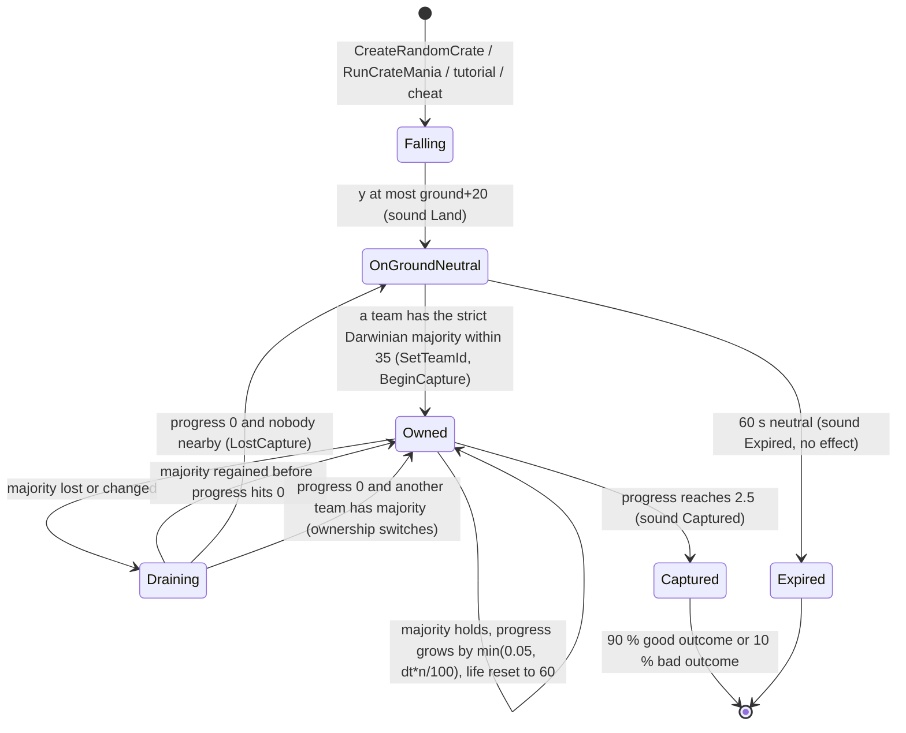
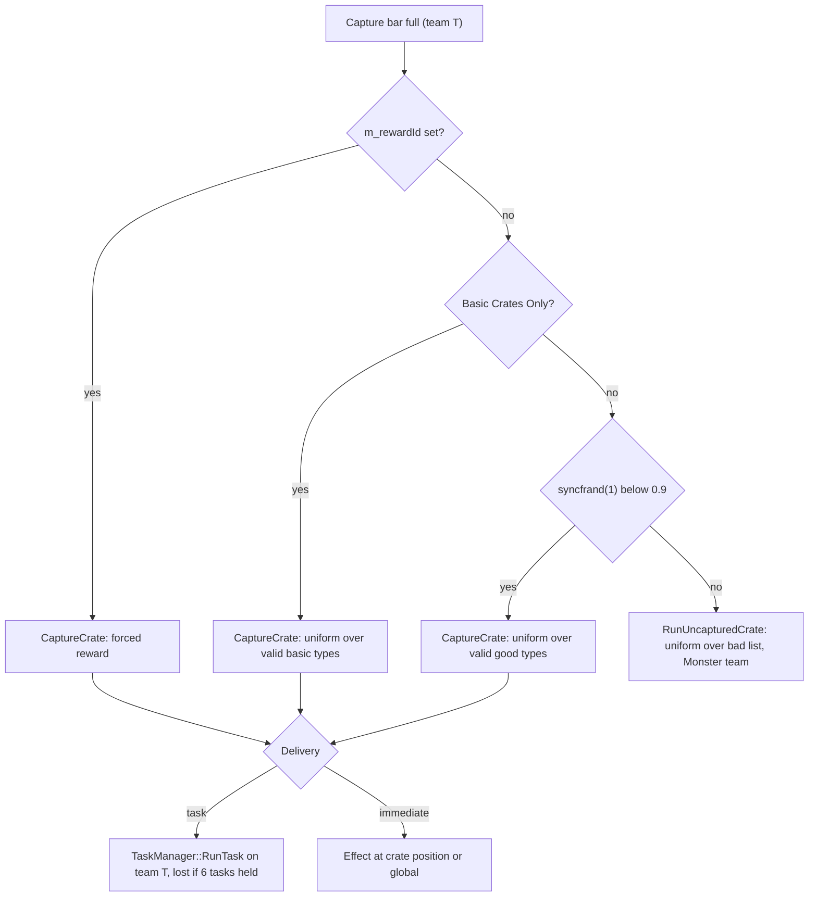
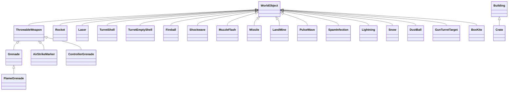
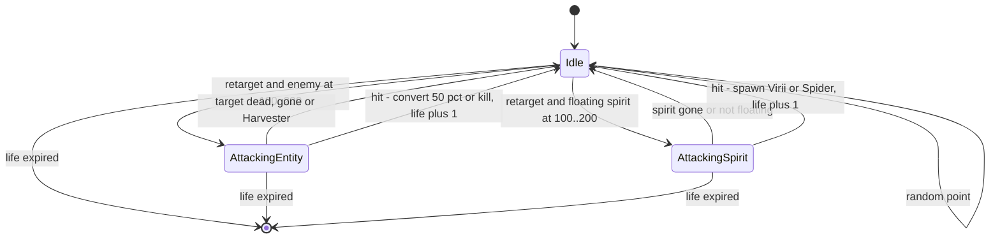

# 04 — Crates, power-ups and weapons

> Part A · Baseline build: Release|Win32 (OpenGL) + TARGET_PC_FULLGAME ([B:FULL]); see _work/build_matrix.md.
> Evidence: [C] confirmed · [I] inferred · [U] unknown. Citations are `path:Symbol` relative to the multiwinia/ source root.
> Sources merged: P08_crates_ai (§1–9, 18), P04_entities_military (§0, §1, §2, §3, §11, §14), P05_entities_creatures (SpamInfection, Meteor shower, SpaceShip, ambient weather objects, crate-outcome index), P06_buildings_core (GunTurret / GunTurretTarget, crate-turret variant), P03_entity_core (BoxKite, Darwinian crate/threat searches), P02_game_modes (Retribution), P16_sound (CratePowerup event data), `_work/drafts/P08_crate_pools.csv`, routed `_meta_*` notes. Every numeric constant below was re-read in the code by S04; corrections to the drafts are flagged "Resolved:".

## Contents

- [1 Crate lifecycle](#1-crate-lifecycle) — build gating, options, drop timer, placement, falling, landing, capture, expiry, resolution, presentation, the `Crate` class
- [2 The crate reward enum (complete)](#2-the-crate-reward-enum-complete) — all 31 shipped values + 1 debug-only + 3 commented-out
- [3 Probability tables](#3-probability-tables) — the 90/10 pools, per-option, per-type, per-level (generated), StartingPowerups and Retribution pools
- [4 Exclusion lists and grant options](#4-exclusion-lists-and-grant-options) — `InvalidCrates`, per-level list, `StartingPowerups`, Retribution, basic vs advanced crates, restriction zones
- [5 Effect specification per outcome](#5-effect-specification-per-outcome) — shared task mechanics, then one section per outcome, counter-play matrix
- [6 Weapons, projectiles and effect objects](#6-weapons-projectiles-and-effect-objects) — explosion model, fire helpers, and one section per class (ThrowableWeapon, Grenade, FlameGrenade, AirStrikeMarker, ControllerGrenade, Rocket, Laser, TurretShell, TurretEmptyShell, Fireball, Shockwave, MuzzleFlash, Missile, LandMine, PulseWave, SpamInfection, Lightning, Snow, DustBall, GunTurretTarget, BoxKite)
- [7 Determinism and implementation notes](#7-determinism-and-implementation-notes)
- [Open questions and unknowns](#open-questions-and-unknowns)
- [Docs-vs-code discrepancies](#docs-vs-code-discrepancies)
- [IP items](#ip-items)
- [Source map](#source-map)
- [Appendix — dead/legacy code](#appendix--deadlegacy-code)

Conventions used throughout this document:

- **Tick.** One simulation tick = `SERVER_ADVANCE_PERIOD` = `0.1 × m_gameSpeed` game-seconds; the server issues ticks at a fixed 10 Hz of real time, so at normal speed a tick is 0.1 s [C] `code/gametimer.cpp:GameTimer::GetServerAdvancePeriod`, see [20](20_architecture.md) / [22](22_determinism_and_networking.md). Each tick is executed as 10 slices (`NUM_SLICES_PER_FRAME`); every building and effect object is advanced once per tick in one of the slices; `Location::AdvanceCrates` runs at slice 8 [C] `code/location.cpp:Location::Advance`. "Per second" values below are game-seconds at speed 1.0 unless stated.
- **World units (wu).** The code calls them metres in `data/stats.txt` comments; shipped multiplayer maps are 2 000–7 000 wu across (`worldSizeX`, §3.5).
- **RNG.** `syncrand()`/`syncfrand(x)` ∈ [0, x)/`syncsfrand(x)` ∈ (−x/2, +x/2) are the shared lock-step Mersenne-Twister stream; `FRAND`/`SFRAND` are the same stream with left-to-right evaluation order inside `Vector3` constructors; `frand`/`sfrand`/`AppRandom`/`rand()` are **unsynced** local generators that may only be used for cosmetics [C] `contrib/systemiv/lib/math/random_number.cpp:_syncfrand`, `code/lib/vector3.cpp`. Note `syncsfrand(x)` spans ±x/2, so `pos + syncsfrand(200)` means ±100.
- **Teams.** `NUM_TEAMS = 6` [C] `code/globals.h`; player teams 0–3, the **Monster team = 4** ("Evilinians", colour (10,10,10)) and the **Futurewinian team = 5** (colour (200,200,200)); both are initialised as CPU teams in every multiplayer game by `Location::Init` [C] `code/location.cpp:Location::GetMonsterTeamId`, `Location::InitMonsterTeam`, `Location::InitFuturewinianTeam`. Team id 255 = neutral.
- **Research levels.** `Location::Init` forces every research type to level 3 in multiplayer, then sets Squad 1, Laser 2, Grenade 2, Rocket 2, AirStrike 2, Darwinian 4 [C] `code/location.cpp:Location::Init`. All research-indexed tables below quote the Multiwinia value; other levels are Darwinia-only [B:LEGACY].

## 1 Crate lifecycle



### 1.1 Build gating

| Macro | Where defined | Baseline FULL | Effect | Evidence |
|---|---|---|---|---|
| `INCLUDE_CRATES_BASIC` | `code/lib/universal_include.h` (every product target) | **on** | Compiles crate spawning (`Location::CreateRandomCrate`, `Location::AdvanceCrates`). Without it no crate ever drops. | [C] `code/location.cpp:Location::CreateRandomCrate`, `Location::AdvanceCrates`; `code/lib/universal_include.h` |
| `INCLUDE_CRATES_ADVANCED` | FULL, DEBUG, BETATEST_GROUP_ALL, group A | **on** | Compiles the bodies of every advanced `Crate::Run*` effect, the "bad" crate pool, and the lobby "Basic Crates Only" checkbox. Without it `Crate::IsValid` rejects every advanced type and `Crate::RunUncapturedCrate` returns at once. | [C] `code/worldobject/crate.cpp:Crate::IsValid`, `Crate::RunUncapturedCrate`, `Crate::RunNuke`; `code/UI/GameMenuWindow.cpp` |
| `INCLUDE_THEBEAST` | `code/worldobject/crate.h`, **only inside `#ifdef TARGET_DEBUG`** | **off** | Adds enum value `CrateRewardTheBeast` (index 31). `NumCrateRewards` = **31 in FULL**, 32 in DEBUG. | [C] `code/worldobject/crate.h` |
| `INCLUDE_CRATE_HELP_WINDOW` | `TARGET_DEBUG` only | off | Front-end crate help list (`CrateHelpWindow`, `CrateButton`) [B:DEBUG]. | [C] `code/lib/universal_include.h`; `code/interface/helpandoptions_windows.cpp` |
| `CHEATMENU_ENABLED` | `TARGET_DEBUG` only | off | Cheat window "Crates" drop-down spawning a crate with a forced `m_rewardId` at the screen-centre ground point, y = 300 [B:DEBUG]. | [C] `code/interface/cheat_window.cpp` |
| `LOCATION_EDITOR` | nowhere | off | `InvalidCratesWindow` editor panel [B:EDITOR]. | [C] `code/interface/invalidcrates_window.cpp` |

Resolved: an early build-matrix revision listed `INCLUDE_THEBEAST` as on; the code puts the `#define` inside `#ifdef TARGET_DEBUG`, so FULL ships 31 reward types (the matrix has since been corrected) [C] `code/worldobject/crate.h`.

Crates exist only in multiplayer: `Location::AdvanceCrates` is called only when `g_app->Multiplayer()` [C] `code/location.cpp:Location::Advance`.

### 1.2 Options that control crates

| Option | Source | Values | Modes that define it | Effect |
|---|---|---|---|---|
| `CrateDropRate` | `data/multiwinia.txt` (min 0, max 300, **default 40**, step 10) | seconds (mean drop interval) | Domination, KingOfTheHill, CaptureTheStatue, Assault, RocketRiot, Blitzkrieg (not TankBattle) | Base drop interval (§1.3). 0 = no crates. `Multiwinia::GetGameOption` returns −1 for an option the mode does not define → treated as "no crates" [C] `code/location.cpp:Location::AdvanceCrates`, `code/multiwinia.cpp:Multiwinia::GetGameOption` |
| `CrateDropMode` | `data/multiwinia.txt` (0–1, **default 1**, drop-down) | 0 = random, 1 = score-weighted | Domination, KingOfTheHill, CaptureTheStatue only (other modes return −1 → random) | Placement algorithm (§1.4) [C] |
| `StartingPowerups` | `data/multiwinia.txt` (0–3, default 0, step 1) | count | Domination, KingOfTheHill only | Free random tasks at team initialisation (§4.3) [C] `code/location.cpp:Location::InitialiseTeam` |
| `RetributionMode` | `data/multiwinia.txt` (0–1, default 1, checkbox) | bool | Domination, KingOfTheHill, CaptureTheStatue, Blitzkrieg | **Live [B:FULL], option-gated** — effectively on unless explicitly set to 0: eliminated teams receive a random power-up task every 45 s (§4.4). Because `bool retributionMode = GetGameOption(...)` converts the "undefined" value −1 to `true`, the routine also runs in Assault and RocketRiot, where `IsEliminated` is always false, so it never grants anything there [C] `code/multiwinia.cpp:Multiwinia::Advance`, `Multiwinia::AdvanceRetribution`, `Multiwinia::IsEliminated` |
| Basic Crates Only | lobby checkbox `multiwinia_param_basiccrates` → `Multiwinia::m_basicCratesOnly`; network game option `GAMEOPTION_BASICCRATES` | bool, default false | all | Restricts rewards to the 7 basic types and disables the bad pool (§4.5). Compiled only under `INCLUDE_CRATES_ADVANCED`. Reset to false by `Multiwinia::Reset` and by the lobby's finish button; forced true by tutorial 2 [C] `code/UI/GameMenuWindow.cpp`, `code/UI/FinishMultiwiniaButton.h`, `code/network/clienttoserver.cpp`, `code/multiwinia.cpp:Multiwinia::Reset`, `code/multiwiniahelp.cpp` |
| `InvalidCrates` | level file `MultiwiniaOptions` block | list of reward keys | per level | Per-level exclusion (§4.1) [C] `code/level_file.cpp:LevelFile::ParseMultiwiniaOptions` |
| `LevelOptions trunkportarmour N` | level file | int | per level | N > 0 makes `Armour` invalid [C] `code/worldobject/crate.cpp:Crate::IsValid` |
| `RestrictionZone` building | level file `RestrictionZone id x z team fx fz isGlobal size [blockPowerups]` | — | per level | No random-mode crate may drop inside any zone; zones with `blockPowerups = 1` also forbid power-up targeting inside them (§4.6) [C] `code/worldobject/restrictionzone.cpp:RestrictionZone::IsRestricted` |

Resolved: drafts P08 and the phase-2 log said `RetributionMode` is inert because `Multiwinia::AdvanceRetribution` is "never called". The call is live and unconditional apart from the option: `code/multiwinia.cpp:Multiwinia::Advance` executes `if( retributionMode ) AdvanceRetribution();` (no comment block or preprocessor guard around it). P02's reading was correct [C].

### 1.3 Drop timer — `Location::AdvanceCrates`

Runs once per tick (slice 8) in multiplayer [C] `code/location.cpp:Location::Advance`, `Location::AdvanceCrates`:

```
AdvanceCrates():
  if multiwiniaTutorial and (tutorialType == Tutorial1 or !help.m_tutorial2AICanSpawn): return   # no crates in tutorials (tutorial 2 after its AI phase starts: yes)
  maxCrates = int(worldSizeX / 500.0)                      # world X size only
  if Crate::s_crates >= maxCrates: return                  # timer frozen while at the cap
  crateTime = GetGameOption("CrateDropRate")
  if crateTime == 0 or crateTime == -1: return
  if m_crateTimer == 0.0: m_crateTimer = crateTime * (1.5 - syncfrand(1.0))   # first interval
  m_crateTimer -= SERVER_ADVANCE_PERIOD
  if m_crateTimer <= 0.0:
      m_crateTimer = crateTime * (1.5 - syncfrand(1.0))   # (0.5, 1.5] × rate
      CreateRandomCrate()
```

- Interval distribution: uniform on (0.5×, 1.5×] `CrateDropRate` game-seconds; default 40 → 20–60 s, mean 40 s [C formula]. Because `SERVER_ADVANCE_PERIOD` scales with game speed, the Slow Down / Speed Up crates stretch or compress the real-time interval [I].
- `Crate::s_crates` counts every live `Crate` object (constructor ++, destructor −−), including falling crates and the stack-allocated template inside `CreateRandomCrate` (which increments and decrements around the call) [C] `code/worldobject/crate.cpp:Crate::Crate`, `Crate::~Crate`. Reset to 0 together with `Crate::s_spaceShipUsed = false` in `Location::Init` right after the level loads [C] `code/location.cpp:Location::Init`.
- Max crates by map: 2 000-wide → 4, 3 000 → 6, 5 000 → 10 (per-level values in §3.5) [C formula, data].
- Crates can drop during the pre-game grace period: `Location::Advance` is not gated by `Multiwinia::GameInGracePeriod`, and the help system shows its "crates" tab during grace when `Crate::s_crates > 0` [I] `code/multiwiniahelp.cpp:MultiwiniaHelp::CratesOnLevel`.

### 1.4 Placement — `Location::CreateRandomCrate`

[C] `code/location.cpp:Location::CreateRandomCrate`:

1. `dropMode = GetGameOption("CrateDropMode")`; random placement if 0 or −1.
2. **Weighted mode (1) — catch-up mechanic.**
   - For every team that is used and is neither the Monster nor the Futurewinian team: `score_i = Multiwinia::m_teams[i].m_score`; `total = Σ score`, `high = max`, `low = min` (`low` starts at `FLT_MAX`, `high` at 0).
   - `p = max(high/total, 1 − low/total)`; if `syncfrand(1) > p` → fall back to random placement.
   - Otherwise pick a team with probability `w_i / Σw`, where `w_i = total / score_i` (or `total` when `score_i == 0`), using one `syncfrand(1)` against cumulative odds — **lower-scoring teams are favoured**.
   - Collect **every** building owned by that team (any type, including AI targets and turrets). Up to 1 000 tries: `b = list[syncrand() % n]`, `pos = b.pos + (syncsfrand(200), 0, syncsfrand(200))` (±100 wu). The acceptance test is buggy: `GetValue(pos.x, pos.z > 20.0)` passes the boolean `pos.z > 20` as the z coordinate, so it samples the heightmap at z ∈ {0, 1} and accepts whenever that height is non-zero [C code]. Consequence [I]: on maps whose z = 0/1 row is sea-bed (negative, non-zero) the first try is always accepted; if that row is exactly 0 every try fails and the drop falls back to random. The real terrain under the chosen point is never checked, so weighted drops can land in water (see 04-U2).
   - Crate start = `(pos.x, 1300 + syncfrand(200), pos.z)`.
   - No team chosen, no buildings, or no position accepted → random placement. With `total == 0` the divisions produce NaN/∞ and the cumulative pick fails → `dropTeam = −1` → random [I].
   - Weighted drops skip the restriction-zone and crate-spacing checks [C].
3. **Random mode.** Starting from the template position (0,0,0), loop while `height(pos) < 20` **or** `RestrictionZone::IsRestricted(pos)` (any zone, regardless of `blockPowerups`): after more than 100 failed re-rolls give up (**no crate this time**, the timer has already been reset); otherwise `pos = (FRAND(worldX), 1300, FRAND(worldZ))`, `pos.y += syncfrand(200)`; if any existing crate is within `CRATE_SCAN_RANGE × 10 = 350` wu horizontally, `pos` is zeroed to force another try. Edge case [I]: the loop tests the unmoved template position first, so on a map whose (0,0) corner is land ≥ 20 high and unrestricted a crate would spawn at (0,0,0) — every shipped map is assumed to have sea at the corner (04-U3).
4. **Create**: id `(255, UNIT_BUILDINGS, −1, GenerateBuildingId())`, `Building::CreateBuilding(TypeCrate)`, `Initialise(template)` (keeps the template y; sound "Falling"), `SetDetail(1)`, `MarkerSystem::RegisterMarker_Crate(id)`. The first crate of each `Location` also shows `crate_drop` ("Crate Drop!") and clears `m_showCrateDropMessage` [C].

- `CRATE_START_HEIGHT = 1300.0` (`#define`, `code/worldobject/crate.h`) [C].
- Crates **cannot be placed by level files**: `TypeCrate` is in `Building::BuildingIsBlocked` (`BLOCK_OLD_DARWINIA_OBJECTS`), which blocks name-based creation only; runtime `CreateBuilding(int)` still works. `Crate` has no `Read`/`Write`, so `m_rewardId` is never level-settable [C] `code/worldobject/building.cpp:Building::BuildingIsBlocked`.
- Other crate sources: `Crate::RunCrateMania` (§5.20); tutorial 1 (fixed reward Airstrike, at building 43 − (100, 0, 200), +800 y, created 10 s after the tutorial step starts — uses wall-clock `GetHighResTime`, harmless offline) and tutorial 2 (fixed reward Armour at building 66 + (100, 0, 0), +300 y) [C] `code/multiwiniahelp.cpp`; cheat window [B:DEBUG].

### 1.5 Falling — `Crate::AdvanceFloating`

Per tick while `!m_onGround` [C] `code/worldobject/crate.cpp:Crate::AdvanceFloating`:

1. Landed when `pos.y ≤ height(x, z) + 20` → `vel = 0`, `m_onGround = true`, stop sound "Crate Falling", trigger building sound "Land".
2. `t = GetNetworkTime() + uniqueId × 20`; `sway = 300 × (pos.y / 1300)`; `target = (pos.x + cos(t)·sway, height(target.x, z), pos.z)` (sway is on X only, shrinking as the crate descends); `target = PushFromObstructions(target)`.
3. `step = normalise(target − pos) × 40`; `newPos = PushFromObstructions(pos + step)`; the displacement is then clamped to `40 × SERVER_ADVANCE_PERIOD` → the crate moves at **40 wu per game-second** along a swaying, mostly vertical path. `vel = Δpos / SERVER_ADVANCE_PERIOD` (used only for render prediction and iframes).
4. `PushFromObstructions(p)`: for each building in the obstruction-grid cell whose `DoesSphereHit(p, m_radius)`, step `p` away from the building centre (XZ) by 2 wu until clear; if the resulting terrain height ≤ 10 the push is discarded (never pushed into water) [C] `Crate::PushFromObstructions`.

Derived fall time from 1 300–1 500 wu: ≈ 33–38 game-seconds (path length / 40 wu·s⁻¹, vertical component ≥ 0.97 because the sway never exceeds 300 at 1 300 height) [I]. A falling crate is visible as a bubble with a red starburst trail and a rotating target decal on the ground under it (§1.10), so players can pre-position Darwinians [C] `Crate::RenderGroundMarker`.

### 1.6 Landing and the AI target

On the first ground tick the crate creates an `AITarget` building at its ground position: `m_priorityModifier = 0.5`, `m_crateTarget = true`, unit `UNIT_BUILDINGS`, new building id, then `Location::RecalculateAITargets()` — this is how CPU players notice crates (priority formulas in [07](07_ai.md)) [C] `code/worldobject/crate.cpp:Crate::AdvanceOnGround`. The AI target is destroyed when the crate is captured (with `RecalculateAITargets`) or expires (recalculation deferred to `Location::AdvanceBuildings`).

### 1.7 Capture (pickup) rules — `Crate::AdvanceOnGround`, `Crate::RecalculateOwnership`

Constants: `CRATE_SCAN_RANGE = 35.0` (`#define`, `crate.h`), `CRATE_CAPTURE_TIME = 2.5` (`#define`, `crate.cpp`), maximum progress per tick 0.05 (literal) [C].

Each tick on the ground [C]:

1. **Count.** `RecalculateOwnership(num)`: for every team whose `m_teamType != TeamTypeUnused`, count entities returned by `EntityGrid::GetNeighbours(pos.x, pos.z, 35, includes = {that team})` (exact XZ distance < 35) that are `TypeDarwinian`, not dead, and not `StateInsideArmour`. `majority` = the team with the **strictly** highest count (ties keep the lower team index); 255 if every count is 0; `num` = the winning count. Only Darwinians count — officers, squaddies, armour, engineers and monsters do not. Darwinians of **any** used team count, including the Monster team (4: converted by Infection, see §5.12) and the Futurewinian team (5: dropped by the Space Ship), which can therefore capture crates and receive the reward [C code; I consequence].
2. **Owner holds the majority** (`owner == majority`, owner ≠ 255):
   - `Δ = min(0.05, SERVER_ADVANCE_PERIOD × num / 100)`; `m_captureTimer = min(2.5, m_captureTimer + Δ)`; `m_life = 60`.
   - Progress rate = `num / 100` per game-second, capped at 0.05 per **tick** → minimum capture time **51 ticks** (5.1 s at speed 1; 50 × 0.05 accumulates to just under 2.5 in double arithmetic, so a 51st step is needed) with ≥ 50 Darwinians; 25 Darwinians → 10 s; 10 → 25 s; 1 → 250 s [C formula, I examples]. The cap is per tick, so at ≥ 50 Darwinians the capture takes 51 ticks at any game speed [C].
   - Sound: when the 20 % bucket `int(5 × timer / 2.5)` changes, stop "Crate Capturing_*" and trigger `Capturing_<bucket×20>pc` (0, 20, 40, 60, 80).
   - When `m_captureTimer ≥ 2.5` → **capture** (§1.9).
3. **Otherwise** (contested, owner lost the majority, or still neutral): `m_captureTimer = max(0, timer − SERVER_ADVANCE_PERIOD)` — drains at 1.0 per game-second (a full bar drains in 2.5 s). When it reaches 0 and `owner != majority` → `SetTeamId(majority)`; if the new owner is 255 → sounds "LostCapture" (and the "BeginCapture" loop is stopped); else "BeginCapture" + "Capturing_0pc". A neutral crate with a majority team changes owner on the same tick. A challenger must first drain the previous owner's progress.
   - Bug: the drain branch builds the sound name with `"Capturing_%pc"` (missing `d`), producing a pointer-formatted, non-existent event name — the drain is silent [C].
4. `GetPercentCaptured()` = `m_captureTimer / 2.5` when owned, else 0 (drives the marker ring) [C].
5. `m_recountTimer` is written but the "recount once per second" guard is commented out — ownership is recounted every tick [C] `Crate::RecalculateOwnership`.

Darwinian side (state machine owned by [02 §4](02_units_and_entities.md#4-darwinian)): idle Darwinians run `Darwinian::SearchForCrates` in their idle search: any on-ground crate within `DARWINIAN_SEARCHRANGE_CRATES = 150` (3-D distance) with a walkable path → `StateOpeningCrate`; waypoint = own position if already within 35, else a point `35/3 + syncfrand(70/3)` from the crate toward the Darwinian, plus an offset of length `syncfrand(35/3)` rotated by `syncfrand(2π)` [C] `code/worldobject/darwinian.cpp:Darwinian::SearchForCrates`, `Darwinian::AdvanceOpeningCrate`. `AdvanceOpeningCrate` walks to the waypoint, faces the crate and returns the Darwinian to `StateIdle` as soon as the crate no longer exists [C]; other exits (threats, orders) are in [02 §4](02_units_and_entities.md#4-darwinian). Players steer Darwinians to crates with officers/orders ([06](06_player_control_and_input.md)).

### 1.8 Lifetime and expiry

- `m_life` starts at 60.0 and **only counts down while the crate is on the ground and neutral (team 255)** and not in tutorial 1 / tutorial 2 before its AI phase. It is reset to 60 every tick the owner holds the majority [C] `Crate::AdvanceOnGround`.
- When `m_life ≤ 0` and `m_captureTimer ≤ 0` → destroyed, sound "Expired" (no data block in `data/sounds.txt` → silent), AI target destroyed, **no effect**: the `RunUncapturedCrate(monsterTeam)` call that would have fired a bad outcome on expiry is commented out [C].
- Any destruction (capture or expiry) adds a shape-shatter explosion of `researchitem.shp` (`g_explosionManager.AddExplosion(shape, mat, 1.0)`) [C].

### 1.9 Resolution on capture

```
on capture (team T = current owner):
  noAdvanced = Multiwinia::m_basicCratesOnly  (or true if !INCLUDE_CRATES_ADVANCED)
  if m_rewardId != -1 or syncfrand(1.0) < 0.9 or noAdvanced:    # short-circuit: syncfrand consumed only when m_rewardId == -1
       CaptureCrate()                # "good" outcome — 90 %
  else RunUncapturedCrate(T)          # "bad" outcome — 10 %, created for the Monster team (Space Ship: Futurewinians)
  m_destroyed = true; stop capture sounds and "Crate BeginCapture"; sound "Captured"
  destroy AI target + RecalculateAITargets
  if T == local team and MultiwiniaHelp exists: NotifyCapturedCrate()   (help-tab progress, presentation only)
```
[C] `code/worldobject/crate.cpp:Crate::AdvanceOnGround`. "Recipient team" is therefore the team owning the crate at the tick the bar fills; for a bad outcome the capturing team is passed in but every effect is created on the Monster team (or Futurewinian team), hostile to everyone including the capturer.



### 1.10 Presentation (render, audio, UI)

Rendering is client-side only [C] `code/worldobject/crate.cpp:Crate::Render`, `Crate::RenderAlphas`:

- Shape `researchitem.shp`, tumbling each frame: rotation axis = up rotated by `g_gameTime × 1.0` about X and `× 0.7` about Z; position predicted `pos + vel × predictionTime`. `Render` rotates `m_front`/`m_up` (render code writes object state, which the sim never reads; iframes deliberately send zero vectors for a crate's front/up/centre) [C] `code/network/iframe.cpp`.
- Falling: `RenderBubble` (camera-facing quad `textures/bubble.bmp`, white α 150, half-size = radius×2), `RenderGroundMarker` (decal `icons/target.bmp` rotating at −0.3 rad/s on the terrain under the crate, α 180 additive, with a blurred shadow texture generated once by `BitmapRGBA::ApplyBlurFilter(10)` and cached as `shadow_icons/target.bmp`), `RenderGlow`.
- On ground: bubble "pop" — three quarter-quads drift apart while `m_bubbleTimer` (starts 100) decreases by `40 × SERVER_ADVANCE_PERIOD` **per rendered frame** (frame-rate dependent; render code mutating object state) [C]; then glow only.
- `RenderGlow`: while falling, `numStars` (10 / 5 / 2 for preference `RenderBuildingDetail` 1 / 2 / 3) red-orange `textures/starburst.bmp` sprites (colour (1.0, 0.4, 0.2), α = 0.6 × y/1300, size i × 15); always `maxBlobs` (20 / 10 / 0) `textures/cloudyglow.bmp` blobs, colour = owning team colour with α 155, or (255,155,100,55) when neutral.
- `IsInView` is also true when the point above the crate at camera height, or the ground point below it, is in the frustum (keeps falling crates rendered) [C] `Crate::IsInView`.
- Marker: `MarkerSystem::RegisterMarker_Crate` → `icons/icon_crate.bmp` icon with an off-screen arrow for every team, colour ring filled bottom-up by `GetPercentCaptured()` in the capturing team colour (grey when neutral); every power-up effect registers a `RegisterMarker_Fixed(team, pos, icon)` that disappears 8 s after first being seen (full marker spec: [06](06_player_control_and_input.md) / [24](24_rendering.md)) [C] `code/markersystem.cpp:MarkerSystem::RegisterMarker_Crate`, `MarkerSystem::RegisterMarker_Fixed`.
- Audio: building events `Falling`, `Land`, `BeginCapture`, `Capturing_0pc`, `Capturing_20pc`, `Capturing_40pc`, `Capturing_60pc`, `Capturing_80pc`, `Captured`, `LostCapture`, `Expired` [C] `Crate::ListSoundEvents`; data blocks exist for all but `Expired` [C] `data/sounds.txt` (`BUILDING Crate`). Power-up announcements use sound-source type `TypeCratePowerup` with the event name `Crate::GetName(type)` (§2.2) [C] `Crate::TriggerSoundEvent`.
- Messages go through `Location::SetCurrentMessage(msg, team, noOverwrite)`: shown 3.0 s (wall-clock), ignored while a no-overwrite message is showing [C] `code/location.cpp:Location::SetCurrentMessage`.

### 1.11 `Crate` — class specification

`class Crate : public Building` [C] `code/worldobject/crate.h`, `code/worldobject/crate.cpp`. Building type `Building::TypeCrate`; container `Location::m_buildings`; [B:FULL].

| Member / parameter | Value | Kind | Meaning |
|---|---|---|---|
| `m_life` | 60.0 | ctor literal | neutral on-ground lifetime (s) |
| `m_captureTimer` | 0.0 → 2.5 | ctor / `CRATE_CAPTURE_TIME` | capture progress |
| `m_recountTimer` | 1.0 | ctor | written, never gates anything |
| `m_bubbleTimer` | 100.0 | ctor | render-only bubble pop |
| `m_rewardId` | −1 | ctor | forced reward (tutorials, cheat) or −1 = random |
| `m_aiTarget` | NULL | ctor | AITarget created on first ground tick |
| `m_percentCapturedSmooth` | 0.0 | ctor | render smoothing (marker) |
| `s_crates` | static int | class | live crate count (cap test, CrateMania validity) |
| `s_spaceShipUsed` | static bool | class | Space Ship once-per-game flag |
| Shape | `researchitem.shp` | resource | crate model |
| Start height | `CRATE_START_HEIGHT` 1300 + U[0,200) | `#define` + literal | drop altitude |
| Fall speed | 40 wu/s | literal | `AdvanceFloating` |
| Sway amplitude | 300 × y/1300 wu (X only), phase `t + uniqueId×20` | literal | `AdvanceFloating` |
| Landed threshold | ground + 20 | literal | `AdvanceFloating` |
| Capture radius | `CRATE_SCAN_RANGE` 35 | `#define` | Darwinian count radius |
| Random-drop spacing | 350 (35 × 10) | expr | `CreateRandomCrate` |
| Collision | `DoesSphereHit`, `DoesShapeHit`, `DoesRayHit` all return false | override | crates never obstruct units, lasers or shells |
| AITarget priority modifier | 0.5 | literal | `AdvanceOnGround` |
| Damage | inherits `Building::Damage`, which only triggers the building sound "Damage" [C] `code/worldobject/building.cpp:Building::Damage` | — | crates cannot be destroyed or opened by weapons |

## 2 The crate reward enum (complete)

`Crate::CrateReward*` is an anonymous enum in `code/worldobject/crate.h` [C]. The level-file, sound-event and icon key is `Crate::GetName(type)` (comment: "no spaces allowed"; out-of-range → `"Crate"`); the English display name is `cratename_<key>` in `data/language/english.txt`, looked up by `Crate::GetNameTranslated` (falls back to the raw key) [C] `code/worldobject/crate.cpp:Crate::GetName`, `Crate::GetNameTranslated`.

### 2.1 Identity, build gating and pool membership

"Good" = eligible for the 90 % random draw in `Crate::CaptureCrate()`; "Bad" = member of the 10 % list in `Crate::RunUncapturedCrate`; "Start" = eligible for `StartingPowerups`; "Retrib." = member of the Retribution list. Validity rules are those of `Crate::IsValid` (§3.1).

| Idx | Enum (`Crate::`) | Key (`GetName`) | English (`cratename_*`) | Build | Class (`IsBasicCrate`) | Good | Bad | Start | Retrib. | Delivery when it is a good outcome |
|---|---|---|---|---|---|---|---|---|---|---|
| 0 | `CrateRewardSquad` | `Squad` | Squad | FULL | **Basic** | yes | — | yes | — | Task `GlobalResearch::TypeSquad` |
| 1 | `CrateRewardHarvester` | `Harvester` | Harvester | FULL | Advanced | yes (needs ≥ 1 SpawnPoint on the map) | — | yes | — | Task `TypeHarvester` |
| 2 | `CrateRewardEngineer` | `Engineer` | Engineer | FULL | **Basic** | yes (needs SpawnPoints) | — | yes | — | Task `TypeEngineer` |
| 3 | `CrateRewardArmour` | `Armour` | Armour | FULL | **Basic** | yes (not RocketRiot, not `trunkportarmour > 0`) | — | yes | — | Task `TypeArmour` |
| 4 | `CrateRewardAirstrike` | `Airstrike` | AirStrike | FULL | **Basic** | yes | — | yes | yes (2 of 6 entries; the only entry when basic-only) | Task `TypeAirStrike` |
| 5 | `CrateRewardNuke` | `Nuke` | Nuke | FULL | Advanced | yes | — | yes | — | Task `TypeNuke` |
| 6 | `CrateRewardDarwinians` | `Darwinians` | Multiwinians | FULL | **Basic** | yes | — | — | — | Immediate, at the crate |
| 7 | `CrateRewardBooster` | `PersonalShield` | Personal Shield | FULL | Advanced | yes | — | yes | — | Task `TypeBooster` |
| 8 | `CrateRewardSubversion` | `Subversion` | Subversion | FULL | Advanced | yes | — | yes | — | Task `TypeSubversion` |
| 9 | `CrateRewardHotFeet` | `HotFeet` | Hot Feet | FULL | Advanced | yes | — | yes | — | Task `TypeHotFeet` |
| 10 | `CrateRewardGunTurret` | `GunTurret` | Gun Turret | FULL | **Basic** | yes | — | yes | — | Task `TypeGunTurret`, `m_option = GunTurretTypeStandard (0)` |
| 11 | `CrateRewardSpam` | `Infection` | Infection | FULL | Advanced | **never** (excluded from the draw) | yes | — | — | (forced reward only) Task `TypeInfection` |
| 12 | `CrateRewardForest` | `MagicalForest` | Magical Forest | FULL | **Basic** | yes | — | — | yes | Immediate, at the crate (as a Retribution grant: Task `TypeMagicalForest`) |
| 13 | `CrateRewardRandomiser` | `Randomiser` | Randomiser | FULL | Advanced | **never** | yes | — | — | (forced only) Immediate, at the crate |
| 14 | `CrateRewardAntNest` | `AntNest` | Ants Nest | FULL | Advanced | yes (fewer than 4 nests incl. pending tasks × 2) | yes | yes | — | Task `TypeAntsNest` |
| 15 | `CrateRewardPlague` | `Plague` | Plague | FULL | Advanced | **never** | yes | — | — | (forced only: hits the default `AppReleaseAssert` — the task case is commented out) |
| 16 | `CrateRewardEggs` | `Eggs` | Eggs | FULL | Advanced | yes | — | yes | yes | Task `TypeEggSpawn` |
| 17 | `CrateRewardMeteor` | `Meteor` | Meteor | FULL | Advanced | yes | — | yes | yes | Task `TypeMeteorShower` |
| 18 | `CrateRewardDarkForest` | `DarkForest` | Dark Forest | FULL | Advanced | yes | yes | yes | yes | Task `TypeDarkForest` |
| 19 | `CrateRewardCrateMania` | `CrateMania` | Crate Mania | FULL | Advanced | yes (only while `s_crates < 4`) | — | — | — | Immediate, global |
| 20 | `CrateRewardSpawnMania` | `SpawnMania` | Spawn Mania | FULL | Advanced | yes (needs SpawnPoints) | — | — | — | Immediate, global |
| 21 | `CrateRewardBitzkreig` | `Bitzkreig` | **Mega Rage** | FULL | Advanced | yes | — | — | — | Immediate, global |
| 22 | `CrateRewardRocketDarwinians` | `Rocketwinians` | Rocketwinians | FULL | Advanced | yes | — | — | — | Immediate, capturing team, permanent |
| 23 | `CrateRewardRage` | `Rage` | Rage | FULL | Advanced | yes | — | yes | — | Task `TypeRage` |
| 24 | `CrateRewardRocketTurret` | `RocketTurret` | Rocket Turret | FULL | Advanced | yes (not Assault) | — | yes | — | Task `TypeGunTurret`, `m_option = GunTurretTypeRocket (1)` |
| 25 | `CrateRewardFlameTurret` | `FlameTurret` | Flame Turret | FULL | Advanced | yes | — | yes | — | Task `TypeGunTurret`, `m_option = GunTurretTypeFlame (3)` |
| 26 | `CrateRewardSpaceShip` | `SpaceShip` | Space Ship | FULL | Advanced | **never** | yes (once per game, not Assault) | — | — | (forced only) Immediate, global |
| 27 | `CrateRewardTriffids` | `Triffids` | Triffids | FULL | Advanced | **never** | yes | — | — | (forced only) Immediate, at the crate |
| 28 | `CrateRewardNapalmStrike` | `NapalmStrike` | Napalm Strike | FULL | Advanced | yes | — | yes | — | Task `TypeAirStrike`, `m_option = 1` |
| 29 | `CrateRewardSlowDownTime` | `SlowDown` | Slow Down | FULL | Advanced | yes | — | — | — | Immediate, global |
| 30 | `CrateRewardSpeedUpTime` | `SpeedUp` | Speed Up | FULL | Advanced | yes | — | — | — | Immediate, global |
| 31 | `CrateRewardTheBeast` | `TheBeast` | The Beast | **[B:DEBUG]** (`INCLUDE_THEBEAST`) | Advanced | **never** | yes (DEBUG only) | — | — | (forced only) Immediate, at the crate |
| — | `NumCrateRewards` | (`"Crate"` for out-of-range) | — | — | — | — | — | — | — | = **31 in FULL**, 32 in DEBUG |

- `IsBasicCrate(t)` = t ∈ {Squad, Engineer, Armour, Airstrike, Darwinians, GunTurret, Forest} — **7 types**; `IsAdvancedCrate(t)` = not basic — **24 types in FULL** (25 in DEBUG). Harvester is advanced although it is a unit task [C] `code/worldobject/crate.cpp:Crate::IsBasicCrate`, `Crate::IsAdvancedCrate`.
- Commented-out enum members (not compiled; appendix): `CrateRewardFormationIncrease` (between Bitzkreig and RocketDarwinians), `CrateRewardExtinguisher` (between RocketDarwinians and Rage), `CrateRewardTank` (between Rage and RocketTurret). Their strings `cratename_formationbooster`, `cratename_fireextinguisher`, `cratename_tank` and sound blocks `FormationBooster`, `FireExtinguisher`, `Tank` still exist in data [C] `code/worldobject/crate.h`, `data/language/english.txt`, `data/sounds.txt`.
- Because `LevelFile::m_invalidCrates` is sized by `NumCrateRewards`, DEBUG and FULL agree on every index only because `TheBeast` is last [I].
- Owner when a **bad** outcome fires: the Monster team (4) for every effect except Space Ship (Futurewinian team 5) [C] `Crate::RunUncapturedCrate`.

### 2.2 Behaviour summary per outcome

"Ann." = announcement text id (`data/language/english.txt`, English in quotes; `*T` = team name, `*G` = turret name; messages via `Location::SetCurrentMessage`). "Sfx" = the `TypeCratePowerup` event actually triggered (✓ = data block present in `data/sounds.txt`). "CPU" = handler in `AI::AdvanceCurrentTasks` ([07](07_ai.md)). Full mechanics in §5.

| Idx | Outcome | What it does (summary) | Effect code | Limits / counters | Ann. | Marker icon | Sfx | CPU |
|---|---|---|---|---|---|---|---|---|
| 0 | Squad | 3 insertion squaddies at the target for 60 s | `Task::TargetSquad` | task slot; 60 s life | none on use (capture: `crate_enemycapture` "*T Opened a Crate!" to others) | task marker `icon_squad` | `Squad` ✓ | `AI::RunSquad` |
| 1 | Harvester | 1 flying soul collector at target +50 y | `Task::TargetHarvester` | needs SpawnPoints | none on use | task marker | `Harvester` ✓ | `AI::RunHarvester` |
| 2 | Engineer | 1 hovering soul collector at target +10 y | `Task::TargetEngineer` | needs SpawnPoints | none on use | task marker | none (`GestureSuccess` gesture sound instead) | `AI::RunEngineer` |
| 3 | Armour | 1 troop transport at target | `Task::TargetArmour` | invalid in RocketRiot / trunkportarmour | none on use | task marker | `Armour` ✓ | `AI::RunArmour` |
| 4 | Airstrike | 3–7 smoke markers → 2 bombers each → 1 bomb each (Bang R 25, D 100) | `Crate::RunAirStrike` | — | `crate_message_run_airstrike` "*T launches Airstrike!" / monster: `crate_message_auto_airstrike` "Incoming Airstrike!" | `icons/icon_airstrike.bmp` | `Airstrike` ✓ | `AI::RunAirStrike` |
| 5 | Nuke | 10 submarine-launched warheads (Bang R 50, D 100 each) | `Crate::RunNuke` | needs sea (else infinite loop) | `crate_message_run_nuke` "*T launches a Nuke Barrage!" / `crate_message_auto_nuke` "Incoming Nuke Barrage!" | `icons/icon_nuke.bmp` | `Nuke` ✓ | `AI::RunNuke` |
| 6 | Darwinians | 50–99 Darwinians of the capturer at the crate | `Crate::RunDarwinians` | — | `crate_message_darwinians` "*T receives Reinforcements!" / monster capturer: hard-coded "Evil Darwinians!" | `icons/icon_darwinian.bmp` | `Darwinians` ✓ | (immediate) |
| 7 | Personal Shield | own Darwinians within 70 immune to all resistible damage for ≤ 30 s | `Crate::RunBooster` | 30 s task | `crate_message_run_personalshield` "*T runs Personal Shield!" | `icons/icon_personalshield.bmp` | `PersonalShield` ✓ | `AI::RunPowerup` |
| 8 | Subversion | own Darwinians within 70 fire converting lasers for ≤ 30 s | `Crate::RunSubversion` | 30 s task | `crate_message_run_subversion` "*T runs Subversion!" | `icons/icon_subversion.bmp` | `Subversion` ✓ | `AI::RunPowerup` |
| 9 | Hot Feet | own Darwinians within 70 at 2× speed with a fire trail for ≤ 30 s | `Crate::RunHotFeet` | 30 s task | `crate_message_run_hotfeet` "*T runs Hot Feet!" | `icons/icon_hotfeet.bmp` | `HotFeet` ✓ | `AI::RunPowerup` |
| 10 | Gun Turret | neutral standard gun turret built at the target | `Crate::RunGunTurret` | placement rules §5.11 | `crate_message_run_gunturret` "*T places a *G" (*G = `buildingname_gunturret` "GunTurret") | `icons/icon_gunturret.bmp` | `GunTurret` ✓ | `AI::RunGunTurret` |
| 11 | Infection | 100 homing SpamInfections of the Monster team | `Crate::RunInfection` | — | `crate_message_auto_infection` "Infection Outbreak!" | `icons/icon_infection.bmp` | `Infection` ✓ | `AI::RunSpam` (forced only) |
| 12 | Magical Forest | 1–2 spirit-dropping trees within ±50 | `Crate::RunMagicalForest` | — | `multiwinia_exclamation` "*T!" with *T = "Magical Forest" | `icons/icon_magicalforest.bmp` | `MagicalForest` ✓ | `AI::RunForest` (Retribution task only) |
| 13 | Randomiser | for 15 s converts Darwinians within 100 to random teams | `Crate::RunRandomiser` | — | `cratename_randomiser` "Randomiser" (no "!") | `icons/icon_randomizer.bmp` | `Randomiser` ✓ | — |
| 14 | Ants Nest | 2 Monster-team ant hills (51–75 ants each) within ±100 | `Crate::RunAntNest` | ≤ 4 nests (good pool only) | `crate_message_run_antnest` "*T creates an Ants Nest!" / monster: "Ants Nest!" | `icons/icon_antnest.bmp` | `AntNest` ✓ | `AI::RunAntNest` |
| 15 | Plague | infects every Darwinian (all teams) within 70 | `Crate::RunPlague` | — | `crate_message_auto_plague` "Plague Outbreak!" | `icons/icon_plague.bmp` | `Plague` ✓ | `AI::RunPlague` (unreachable) |
| 16 | Eggs | 2–4 triffid eggs **of the task owner** hatching monsters | `Crate::RunEggs` | — | `crate_message_run_eggs` "*T creates some Eggs!" / `crate_message_auto_eggs` "Egg Spawn!" | `icons/icon_egg.bmp` | `Eggs` ✓ | `AI::RunEggs` |
| 17 | Meteor | 5–9 meteors into a 420 × 420 square, Bang R 50, D 100, 0.4× slow-motion | `Crate::RunMeteorShower` | — | `crate_message_run_meteor` "*T causes a Meteor Shower!" | `icons/icon_meteorshower.bmp` | `Meteor` ✓ | `AI::RunMeteor` |
| 18 | Dark Forest | 2–4 evil soul-eating trees within ±50 | `Crate::RunDarkForest` | — | `crate_message_run_darkforest` "*T plants a Dark Forest!" / monster: "Dark Forest!" | `icons/icon_darkforest.bmp` | `DarkForest` ✓ | `AI::RunDarkForest` |
| 19 | Crate Mania | 5–9 extra crates dropped now | `Crate::RunCrateMania` | invalid at `s_crates ≥ 4` | "Crate Mania!" (name + "!") | — | `CrateMania` ✓ | — |
| 20 | Spawn Mania | 5 s: every owned spawn point requests a spirit every tick | `Crate::RunSpawnMania` | needs SpawnPoints | `multiwinia_exclamation` → "Spawn Mania!"; HUD `multiwinia_spawnmania_timer` "SPAWN MANIA: *T" | — | `SpawnMania` ✓ | — |
| 21 | Mega Rage | 15 s: every Darwinian of every team behaves as raging | `Crate::RunBitzkreig` | — | "Mega Rage!" (name + "!"); HUD `multiwinia_blitzkrieg_timer` "MEGA RAGE: *T" | — | `Bitzkreig` ✓ | — |
| 22 | Rocketwinians | capturer's Darwinians throw rockets instead of grenades for the rest of the game | `Crate::RunRocketDarwinians` | permanent, per team | `crate_message_rocketwinians` "*T gets Rocketwinians!" | — | `Rocketwinians` ✓ | — |
| 23 | Rage | own Darwinians within 70 fire every tick, take 75 % damage, 1.5× speed for ≤ 30 s | `Crate::RunRage` | 30 s task | `crate_message_rage` "*T runs Rage!" | `icons/icon_rage.bmp` | `Rage` ✓ | `AI::RunPowerup` |
| 24 | Rocket Turret | neutral rocket turret at the target | `Crate::RunGunTurret` | invalid in Assault | "*T places a *G" (*G = "RocketTurret") | `icons/icon_gunturret.bmp` | `GunTurret` ✓ (the `RocketTurret` event is never fired) | `AI::RunGunTurret` |
| 25 | Flame Turret | neutral flame turret at the target | `Crate::RunGunTurret` | — | "*T places a *G" (*G = "FlameTurret") | `icons/icon_gunturret.bmp` | `GunTurret` ✓ (the `FlameTurret` data block is never fired) | `AI::RunGunTurret` |
| 26 | Space Ship | Futurewinian UFO abducts Darwinians for 60–120 s and drops as many (≤ 100) Futurewinians | `Crate::RunSpaceShip` | `s_spaceShipUsed` (once per game); not Assault | `crate_message_spaceship` "Futurewinians!" | — | `SpaceShip` ✓ | — |
| 27 | Triffids | 1–3 Monster-team egg-launching triffids within ±25 | `Crate::RunTriffids` | — | `multiwinia_exclamation` → "Triffids!" | `icons/icon_triffid.bmp` | `Triffids` ✓ | — |
| 28 | Napalm Strike | as Airstrike but bombs ignite Darwinians ≤ 62.5 and burn trees | `Crate::RunAirStrike(…, true)` | — | `crate_message_run_napalm` "I love the smell of Napalm in the morning..." / `crate_message_auto_napalm` "Napalm. Lots and lots of Napalm" | `icons/icon_airstrike.bmp` | `Airstrike` ✓ | `AI::RunAirStrike` |
| 29 | Slow Down | game speed eases to 0.2–0.4× for 15 s of ticks | `Crate::RunSlowDownTime` | ignored after game over (`LockSpeedChange`) | `crate_message_slowdown` "Sloooow Dooown..." | — | none | — |
| 30 | Speed Up | game speed eases to 1.3–2.0× for 15 s of ticks | `Crate::RunSpeedUpTime` | as above | `crate_message_speedup` "Speed up!!" | — | none | — |
| 31 | The Beast [B:DEBUG] | Monster-team Portal summoning tentacles | `Crate::RunTheBeast` | — | `crate_message_thebeast` "The Beast Cometh!" | — | none | — |

Additional text ids: `crate_drop` "Crate Drop!", `crate_enemycapture` "*T Opened a Crate!", `crate_capture` "Crate Opened : *P" (unused — the call was removed in favour of the task popup), `dialog_powerup_limit` "Powerup Limit Reached!", `multiwinia_retribution_timer` "Retribution in *S", `multiwinia_retribution_maxtasks` "Retribution : Two powerups max", tooltips `crate_tooltip_<key>` and hints `crate_hint_<key>` (crate help window [B:DEBUG]) [C] `data/language/english.txt`.

## 3 Probability tables

### 3.1 Selection algorithm and validity (`Crate::CaptureCrate`, `Crate::IsValid`, `Crate::RunUncapturedCrate`)

**Good pool.** `rewardId = syncrand() % NumCrateRewards`, repeated (rejection sampling, **unbounded loop**) until `rewardId ∉ {Spam(Infection), Randomiser, Plague, SpaceShip, Triffids, [TheBeast]}` **and** `IsValid(rewardId)`. Then `if (m_rewardId != −1) rewardId = m_rewardId` — the random draw is consumed even for a forced reward. Hence every valid good type has **equal probability** `0.9 / |valid good set|` [C] `code/worldobject/crate.cpp:Crate::CaptureCrate`.

`Crate::IsValid(t)`, in order [C]:
1. `!INCLUDE_CRATES_ADVANCED` and t is advanced → false (compiled out in FULL).
2. `m_basicCratesOnly` and t is advanced → false.
3. t ∈ {Harvester, Engineer, SpawnMania} and `Σ SpawnPoint::s_numSpawnPoints[0..NUM_TEAMS]` (all spawn points, owned or neutral) == 0 → false.
4. t == Armour and (game type RocketRiot **or** `LevelOptionTrunkPortArmour > 0`) → false.
5. Assault and t ∈ {RocketTurret, SpaceShip} → false.
6. t == SpaceShip and `s_spaceShipUsed` → false.
7. t == CrateMania and `s_crates ≥ 4` → false (the crate being captured still counts).
8. t == AntNest and (number of `AntHill` buildings + 2 × Σ over used teams of pending `TypeAntsNest` tasks) ≥ 4 → false.
9. return `!levelFile.m_invalidCrates[t]`.

**Bad pool.** `RunUncapturedCrate(team)` returns at once if `!INCLUDE_CRATES_ADVANCED` or `m_basicCratesOnly`. It builds the list {Spam, Randomiser, Plague, DarkForest, Triffids, [TheBeast — DEBUG], SpaceShip (only if `!s_spaceShipUsed` and not Assault), AntNest} and picks `syncrand() % size` uniformly. **`IsValid`/`InvalidCrates` are not consulted** — the AntNest limit and per-level exclusions do not apply to bad outcomes. It then calls `Location::InitMonsterTeam(capturingTeam)`, a no-op because the capturing team is in use (the intended `monsterTeam == team` guard is commented out) [C code; I intent]. The `m_rewardId != −1` branch and the switch cases Airstrike, Darwinians, Forest, Eggs, Meteor, NapalmStrike, SlowDown, SpeedUp inside `RunUncapturedCrate` are **unreachable** (a forced reward always goes to `CaptureCrate`, and the list never contains those types) [C].

**General formula** (Basic-only off): `P(t) = 0.9 · [t ∈ G] / |G| + 0.1 · [t ∈ B] / |B|`, with G = valid good set, B = bad list. Basic-only on: `P(t) = [t ∈ G_basic] / |G_basic|`, no bad outcomes [C formula].

### 3.2 Context table (start-of-game state, Basic Crates Only off)

| Context (FULL) | Valid good types | Each good type | Bad pool | Each bad type | Notes |
|---|---|---|---|---|---|
| Domination / KOTH / CTS / Blitzkrieg with spawn points, no `InvalidCrates`, no trunkportarmour | 26 | 0.9/26 = **3.462 %** | 7 | 0.1/7 = **1.429 %** | DarkForest and AntNest are in both pools → 4.890 % each in total (as two different deliveries) |
| Same, after the Space Ship has been used | 26 | 3.462 % | 6 | 1.667 % | |
| Same, while ≥ 4 crates exist (CrateMania invalid) | 25 | 3.600 % | 7 | 1.429 % | dynamic |
| Same, while ≥ 4 ant hills/pending nest tasks (AntNest invalid in the good pool) | 25 | 3.600 % | 7 | 1.429 % | dynamic; both limits → 24 / 3.750 % |
| Map with no SpawnPoints (e.g. `mp_koth_3P_4`, `mp_cts_3p_3`, `mp_blitzkrieg_3P_1`, `3P_2`, `4P_2`) | 23 (−Harvester, Engineer, SpawnMania) | 3.913 % | 7 | 1.429 % | |
| Blitzkrieg with trunkportarmour (`2P_3`, `2p_1`, `2p_2`) | 25 (−Armour) | 3.600 % | 7 | 1.429 % | |
| RocketRiot with spawn points (`2P_2`, `4P_1`) | 25 (−Armour) | 3.600 % | 7 | 1.429 % | |
| RocketRiot without spawn points (`2P_4`, `2p_3`, `3P_2`, `3P_3`, `3p_1`) | 22 | 4.091 % | 7 | 1.429 % | |
| Assault, no `InvalidCrates` (`mp_assault_3p_3`) | 22 (−RocketTurret, Harvester, Engineer, SpawnMania) | 4.091 % | 6 (no SpaceShip) | 1.667 % | |
| Assault with trunkportarmour or `InvalidCrates Armour` (`2P_2`, `3P_2`, `3p_1`, `4P_1`, `4P_2`) | 21 | 4.286 % | 6 | 1.667 % | |
| `mp_assault_2P_1` (`InvalidCrates Squad Airstrike Nuke Meteor`) | 18 | 5.000 % | 6 | 1.667 % | |
| `mp_assault_2p_3` (same list + trunkportarmour 3) | 17 | 5.294 % | 6 | 1.667 % | |
| Basic Crates Only ON, spawn points present, no exclusions | 7 basic | **14.286 %** | none | 0 % | bad pool disabled |
| Basic Crates Only ON, no spawn points | 6 (−Engineer) | 16.667 % | none | | |

[C inputs from `data/levels/` (every `mp_` level file); arithmetic I] — per-level detail in §3.5.

### 3.3 Per-type probability in the standard case

Standard case = first row of §3.2 (26 good / 7 bad).

| Outcome | P (good) | P (bad) | P (total) |
|---|---|---|---|
| Squad, Harvester, Engineer, Armour, Airstrike, Nuke, Darwinians, Personal Shield, Subversion, Hot Feet, Gun Turret, Magical Forest, Eggs, Meteor, Crate Mania, Spawn Mania, Mega Rage, Rocketwinians, Rage, Rocket Turret, Flame Turret, Napalm Strike, Slow Down, Speed Up (24 types) | 3.462 % each | — | 3.462 % each |
| Ants Nest | 3.462 % (task for the capturer) | 1.429 % (immediate, Monster team, at the crate) | 4.890 % |
| Dark Forest | 3.462 % (task for the capturer) | 1.429 % (immediate, Monster team, at the crate) | 4.890 % |
| Infection, Randomiser, Plague, Triffids, Space Ship | — | 1.429 % each | 1.429 % each |
| **Sum** | 90 % | 10 % | 100 % |

### 3.4 Pools of the non-crate grant paths

| Path | Draw | Pool (FULL, standard map) | Each | Basic-only pool |
|---|---|---|---|---|
| `StartingPowerups` (§4.3) | `syncrand() % NumCrateRewards` until not excluded and `IsValid` | 18 types: Squad, Harvester, Engineer, Armour, Airstrike, Nuke, Personal Shield, Subversion, Hot Feet, Gun Turret, Ants Nest, Eggs, Meteor, Dark Forest, Rage, Rocket Turret, Flame Turret, Napalm Strike | 5.556 % (16 types → 6.25 % with no spawn points) | 5: Squad, Engineer, Armour, Airstrike, Gun Turret (20 %) |
| Retribution (§4.4) | `syncrand() % list.Size()` | {Airstrike, Airstrike, Meteor, Magical Forest, Dark Forest, Eggs} | Airstrike 33.3 %, the other four 16.7 % each | {Airstrike} 100 % |

### 3.5 Per-level table (generated)

Generated by `_work/scripts/S_04_crate_tables.py` (run `python3 -I S_04_crate_tables.py <levels> <P08_crate_pools.csv> <out>`) from every `mp_` level file in `data/levels/`, re-implementing `Crate::IsValid` and cross-checked row by row against `_work/drafts/P08_crate_pools.csv` (0 mismatches). Start-of-game state: dynamic limits inactive, Space Ship unused, game type = the level's declared `GameTypes` (a level can only be played in the type it declares [I]). "Max crates" = `int(worldSizeX/500)`. Levels whose type is `none` (benchmark, sandbox, assault stress test) or `TankBattle` (compiled out of FULL, and TankBattle defines no `CrateDropRate`) never drop crates in the shipped lobby [C for TankBattle `data/multiwinia.txt`; I for `none`].

| Level (`data/levels/`) | Declared GameTypes | Players | World X×Z | Max crates | SpawnPoints | RestrictionZones (blockPowerups) | trunkportarmour | InvalidCrates | Good pool n | each good % | Removed from the 26-type standard good pool | Bad pool n | each bad % | Basic-only pool n | each basic % | Removed from the 7 basic types |
|---|---|---|---|---|---|---|---|---|---|---|---|---|---|---|---|---|
| `data/levels/mp_assault_2P_1.txt` | Assault | 2 | 3000×3000 | 6 | 0 | 0 (0) | 0 | Airstrike Meteor Nuke Squad | 18 | 5.000 | Squad, Harvester, Engineer, Airstrike, Nuke, Meteor, SpawnMania, RocketTurret | 6 | 1.667 | 4 | 25.000 | Squad, Engineer, Airstrike |
| `data/levels/mp_assault_2P_2.txt` | Assault | 2 | 2991×2991 | 5 | 0 | 1 (1) | 1 | — | 21 | 4.286 | Harvester, Engineer, Armour, SpawnMania, RocketTurret | 6 | 1.667 | 5 | 20.000 | Engineer, Armour |
| `data/levels/mp_assault_2p_3.txt` | Assault | 2 | 5143×5143 | 10 | 0 | 1 (1) | 3 | Airstrike Meteor Nuke Squad | 17 | 5.294 | Squad, Harvester, Engineer, Armour, Airstrike, Nuke, Meteor, SpawnMania, RocketTurret | 6 | 1.667 | 3 | 33.333 | Squad, Engineer, Armour, Airstrike |
| `data/levels/mp_assault_3P_2.txt` | Assault | 3 | 5000×5000 | 10 | 0 | 2 (2) | 0 | Armour | 21 | 4.286 | Harvester, Engineer, Armour, SpawnMania, RocketTurret | 6 | 1.667 | 5 | 20.000 | Engineer, Armour |
| `data/levels/mp_assault_3p_1.txt` | Assault | 2 | 5000×5000 | 10 | 0 | 2 (2) | 0 | Armour | 21 | 4.286 | Harvester, Engineer, Armour, SpawnMania, RocketTurret | 6 | 1.667 | 5 | 20.000 | Engineer, Armour |
| `data/levels/mp_assault_3p_3.txt` | Assault | 3 | 2549×2549 | 5 | 0 | 0 (0) | 0 | — | 22 | 4.091 | Harvester, Engineer, SpawnMania, RocketTurret | 6 | 1.667 | 6 | 16.667 | Engineer |
| `data/levels/mp_assault_4P_1.txt` | Assault | 4 | 4070×4070 | 8 | 0 | 1 (1) | 0 | Armour | 21 | 4.286 | Harvester, Engineer, Armour, SpawnMania, RocketTurret | 6 | 1.667 | 5 | 20.000 | Engineer, Armour |
| `data/levels/mp_assault_4P_2.txt` | Assault | 4 | 7000×7000 | 14 | 0 | 2 (2) | 3 | Armour | 21 | 4.286 | Harvester, Engineer, Armour, SpawnMania, RocketTurret | 6 | 1.667 | 5 | 20.000 | Engineer, Armour |
| `data/levels/mp_assault_stress.txt` (no crates: game type not in FULL lobby) | none | 2 | 4000×4000 | 8 | 0 | 0 (0) | 0 | — | 23 | 3.913 | Harvester, Engineer, SpawnMania | 7 | 1.429 | 6 | 16.667 | Engineer |
| `data/levels/mp_benchmark_1.txt` (no crates: game type not in FULL lobby) | none | 4 | 3000×3000 | 6 | 24 | 0 (0) | 0 | — | 26 | 3.462 | — (none) | 7 | 1.429 | 7 | 14.286 | — (none) |
| `data/levels/mp_blitzkrieg_2P_3.txt` | Blitzkrieg | 2 | 3000×3000 | 6 | 4 | 0 (0) | 3 | — | 25 | 3.600 | Armour | 7 | 1.429 | 6 | 16.667 | Armour |
| `data/levels/mp_blitzkrieg_2P_4.txt` | Blitzkrieg | 2 | 3000×3000 | 6 | 3 | 0 (0) | 0 | — | 26 | 3.462 | — (none) | 7 | 1.429 | 7 | 14.286 | — (none) |
| `data/levels/mp_blitzkrieg_2p_1.txt` | Blitzkrieg | 2 | 3500×3500 | 7 | 1 | 0 (0) | 3 | — | 25 | 3.600 | Armour | 7 | 1.429 | 6 | 16.667 | Armour |
| `data/levels/mp_blitzkrieg_2p_2.txt` | Blitzkrieg | 2 | 4000×4000 | 8 | 6 | 0 (0) | 3 | — | 25 | 3.600 | Armour | 7 | 1.429 | 6 | 16.667 | Armour |
| `data/levels/mp_blitzkrieg_3P_1.txt` | Blitzkrieg | 3 | 4000×4000 | 8 | 0 | 0 (0) | 0 | — | 23 | 3.913 | Harvester, Engineer, SpawnMania | 7 | 1.429 | 6 | 16.667 | Engineer |
| `data/levels/mp_blitzkrieg_3P_2.txt` | Blitzkrieg | 3 | 2938×2938 | 5 | 0 | 3 (0) | 0 | — | 23 | 3.913 | Harvester, Engineer, SpawnMania | 7 | 1.429 | 6 | 16.667 | Engineer |
| `data/levels/mp_blitzkrieg_4P_2.txt` | Blitzkrieg | 4 | 4000×4000 | 8 | 0 | 4 (0) | 0 | — | 23 | 3.913 | Harvester, Engineer, SpawnMania | 7 | 1.429 | 6 | 16.667 | Engineer |
| `data/levels/mp_cts_2p_1.txt` | CaptureTheStatue | 2 | 2332×2332 | 4 | 6 | 0 (0) | 0 | — | 26 | 3.462 | — (none) | 7 | 1.429 | 7 | 14.286 | — (none) |
| `data/levels/mp_cts_2p_2.txt` | CaptureTheStatue | 2 | 2332×2332 | 4 | 4 | 0 (0) | 0 | — | 26 | 3.462 | — (none) | 7 | 1.429 | 7 | 14.286 | — (none) |
| `data/levels/mp_cts_2p_3.txt` | CaptureTheStatue | 2 | 2000×2000 | 4 | 4 | 0 (0) | 0 | — | 26 | 3.462 | — (none) | 7 | 1.429 | 7 | 14.286 | — (none) |
| `data/levels/mp_cts_2p_4.txt` | CaptureTheStatue | 2 | 2000×2000 | 4 | 4 | 0 (0) | 0 | — | 26 | 3.462 | — (none) | 7 | 1.429 | 7 | 14.286 | — (none) |
| `data/levels/mp_cts_3P_2.txt` | CaptureTheStatue | 3 | 2999×2999 | 5 | 9 | 0 (0) | 0 | — | 26 | 3.462 | — (none) | 7 | 1.429 | 7 | 14.286 | — (none) |
| `data/levels/mp_cts_3p_1.txt` | CaptureTheStatue | 3 | 3000×3000 | 6 | 6 | 0 (0) | 0 | — | 26 | 3.462 | — (none) | 7 | 1.429 | 7 | 14.286 | — (none) |
| `data/levels/mp_cts_3p_3.txt` | CaptureTheStatue | 3 | 2570×2570 | 5 | 0 | 0 (0) | 0 | — | 23 | 3.913 | Harvester, Engineer, SpawnMania | 7 | 1.429 | 6 | 16.667 | Engineer |
| `data/levels/mp_cts_4P_1.txt` | CaptureTheStatue | 4 | 3000×3000 | 6 | 12 | 0 (0) | 0 | — | 26 | 3.462 | — (none) | 7 | 1.429 | 7 | 14.286 | — (none) |
| `data/levels/mp_cts_4P_2.txt` | CaptureTheStatue | 4 | 3428×3428 | 6 | 8 | 0 (0) | 0 | — | 26 | 3.462 | — (none) | 7 | 1.429 | 7 | 14.286 | — (none) |
| `data/levels/mp_cts_4p_3.txt` | CaptureTheStatue | 4 | 2720×2720 | 5 | 8 | 0 (0) | 0 | — | 26 | 3.462 | — (none) | 7 | 1.429 | 7 | 14.286 | — (none) |
| `data/levels/mp_domination_2P_1.txt` | Domination | 2 | 2000×2000 | 4 | 8 | 0 (0) | 0 | — | 26 | 3.462 | — (none) | 7 | 1.429 | 7 | 14.286 | — (none) |
| `data/levels/mp_domination_2P_2.txt` | Domination | 2 | 2700×2700 | 5 | 8 | 0 (0) | 0 | — | 26 | 3.462 | — (none) | 7 | 1.429 | 7 | 14.286 | — (none) |
| `data/levels/mp_domination_3P_1.txt` | Domination | 3 | 2345×2345 | 4 | 10 | 0 (0) | 0 | — | 26 | 3.462 | — (none) | 7 | 1.429 | 7 | 14.286 | — (none) |
| `data/levels/mp_domination_4P_1.txt` | Domination | 4 | 3000×3000 | 6 | 10 | 0 (0) | 0 | — | 26 | 3.462 | — (none) | 7 | 1.429 | 7 | 14.286 | — (none) |
| `data/levels/mp_domination_4P_2.txt` | Domination | 4 | 3000×3000 | 6 | 12 | 0 (0) | 0 | — | 26 | 3.462 | — (none) | 7 | 1.429 | 7 | 14.286 | — (none) |
| `data/levels/mp_koth_2P_1.txt` | KingOfTheHill | 2 | 2700×2700 | 5 | 6 | 0 (0) | 0 | — | 26 | 3.462 | — (none) | 7 | 1.429 | 7 | 14.286 | — (none) |
| `data/levels/mp_koth_2P_2.txt` | Domination | 2 | 2677×2677 | 5 | 9 | 0 (0) | 0 | — | 26 | 3.462 | — (none) | 7 | 1.429 | 7 | 14.286 | — (none) |
| `data/levels/mp_koth_2P_3.txt` | Domination | 2 | 2754×2754 | 5 | 10 | 0 (0) | 0 | — | 26 | 3.462 | — (none) | 7 | 1.429 | 7 | 14.286 | — (none) |
| `data/levels/mp_koth_2P_3b.txt` | KingOfTheHill | 2 | 2754×2754 | 5 | 10 | 0 (0) | 0 | — | 26 | 3.462 | — (none) | 7 | 1.429 | 7 | 14.286 | — (none) |
| `data/levels/mp_koth_3P_1.txt` | KingOfTheHill | 3 | 3000×3000 | 6 | 9 | 3 (0) | 0 | — | 26 | 3.462 | — (none) | 7 | 1.429 | 7 | 14.286 | — (none) |
| `data/levels/mp_koth_3P_2.txt` | KingOfTheHill | 3 | 2345×2345 | 4 | 9 | 0 (0) | 0 | — | 26 | 3.462 | — (none) | 7 | 1.429 | 7 | 14.286 | — (none) |
| `data/levels/mp_koth_3P_3.txt` | KingOfTheHill | 3 | 2800×2800 | 5 | 9 | 0 (0) | 0 | — | 26 | 3.462 | — (none) | 7 | 1.429 | 7 | 14.286 | — (none) |
| `data/levels/mp_koth_3P_4.txt` | KingOfTheHill | 3 | 2750×2750 | 5 | 0 | 0 (0) | 0 | — | 23 | 3.913 | Harvester, Engineer, SpawnMania | 7 | 1.429 | 6 | 16.667 | Engineer |
| `data/levels/mp_koth_4P_1.txt` | KingOfTheHill | 4 | 3000×3000 | 6 | 10 | 0 (0) | 0 | — | 26 | 3.462 | — (none) | 7 | 1.429 | 7 | 14.286 | — (none) |
| `data/levels/mp_koth_4P_3.txt` | KingOfTheHill | 4 | 3000×3000 | 6 | 12 | 0 (0) | 0 | — | 26 | 3.462 | — (none) | 7 | 1.429 | 7 | 14.286 | — (none) |
| `data/levels/mp_koth_4P_4.txt` | KingOfTheHill | 4 | 3000×3000 | 6 | 12 | 0 (0) | 0 | — | 26 | 3.462 | — (none) | 7 | 1.429 | 7 | 14.286 | — (none) |
| `data/levels/mp_rocketriot_2P_2.txt` | RocketRiot | 2 | 5000×5000 | 10 | 2 | 2 (0) | 0 | — | 25 | 3.600 | Armour | 7 | 1.429 | 6 | 16.667 | Armour |
| `data/levels/mp_rocketriot_2P_4.txt` | RocketRiot | 2 | 2000×2000 | 4 | 0 | 0 (0) | 0 | Armour | 22 | 4.091 | Harvester, Engineer, Armour, SpawnMania | 7 | 1.429 | 5 | 20.000 | Engineer, Armour |
| `data/levels/mp_rocketriot_2p_3.txt` | RocketRiot | 2 | 3756×3756 | 7 | 0 | 0 (0) | 0 | — | 22 | 4.091 | Harvester, Engineer, Armour, SpawnMania | 7 | 1.429 | 5 | 20.000 | Engineer, Armour |
| `data/levels/mp_rocketriot_3P_2.txt` | RocketRiot | 3 | 4285×4285 | 8 | 0 | 4 (0) | 0 | — | 22 | 4.091 | Harvester, Engineer, Armour, SpawnMania | 7 | 1.429 | 5 | 20.000 | Engineer, Armour |
| `data/levels/mp_rocketriot_3P_3.txt` | RocketRiot | 3 | 4500×4500 | 9 | 0 | 0 (0) | 0 | — | 22 | 4.091 | Harvester, Engineer, Armour, SpawnMania | 7 | 1.429 | 5 | 20.000 | Engineer, Armour |
| `data/levels/mp_rocketriot_3p_1.txt` | RocketRiot | 3 | 5000×5000 | 10 | 0 | 3 (0) | 0 | — | 22 | 4.091 | Harvester, Engineer, Armour, SpawnMania | 7 | 1.429 | 5 | 20.000 | Engineer, Armour |
| `data/levels/mp_rocketriot_4P_1.txt` | RocketRiot | 4 | 4186×4186 | 8 | 12 | 4 (0) | 0 | — | 25 | 3.600 | Armour | 7 | 1.429 | 6 | 16.667 | Armour |
| `data/levels/mp_sandbox.txt` (no crates: game type not in FULL lobby) | none | 2 | 3290×3290 | 6 | 0 | 0 (0) | 0 | — | 23 | 3.913 | Harvester, Engineer, SpawnMania | 7 | 1.429 | 6 | 16.667 | Engineer |
| `data/levels/mp_sandbox_all.txt` (no crates: game type not in FULL lobby) | none | 0 | 3290×3290 | 6 | 4 | 0 (0) | 0 | — | 26 | 3.462 | — (none) | 7 | 1.429 | 7 | 14.286 | — (none) |
| `data/levels/mp_skirmish_2p_4.txt` | Domination | 2 | 2000×2000 | 4 | 10 | 0 (0) | 0 | — | 26 | 3.462 | — (none) | 7 | 1.429 | 7 | 14.286 | — (none) |
| `data/levels/mp_skirmish_3P_1.txt` | Domination | 3 | 6000×6000 | 12 | 15 | 3 (0) | 0 | — | 26 | 3.462 | — (none) | 7 | 1.429 | 7 | 14.286 | — (none) |
| `data/levels/mp_tankbattle_2P.txt` (no crates: game type not in FULL lobby) | TankBattle | 2 | 2000×2000 | 4 | 0 | 0 (0) | 0 | — | 23 | 3.913 | Harvester, Engineer, SpawnMania | 7 | 1.429 | 6 | 16.667 | Engineer |
| `data/levels/mp_tankbattle_3P.txt` (no crates: game type not in FULL lobby) | TankBattle | 3 | 2000×2000 | 4 | 0 | 0 (0) | 0 | — | 23 | 3.913 | Harvester, Engineer, SpawnMania | 7 | 1.429 | 6 | 16.667 | Engineer |
| `data/levels/mp_tankbattle_4P.txt` (no crates: game type not in FULL lobby) | TankBattle | 4 | 2000×2000 | 4 | 0 | 0 (0) | 0 | — | 23 | 3.913 | Harvester, Engineer, SpawnMania | 7 | 1.429 | 6 | 16.667 | Engineer |

## 4 Exclusion lists and grant options

### 4.1 `InvalidCrates` — syntax and semantics

- **Syntax** (one line inside `MultiwiniaOptions_StartDefinition … MultiwiniaOptions_EndDefinition`):
  ```
  InvalidCrates <Key> { <Key> }
  ```
  where each `<Key>` is matched case-insensitively (`stricmp`) against `Crate::GetName(i)` for i in 0 .. `NumCrateRewards`−1 (the keys of §2.1, e.g. `Squad`, `Airstrike`, `Infection`, `PersonalShield`, `MagicalForest`, `Bitzkreig`, `Rocketwinians`, `SlowDown`); unknown keys are silently ignored; tokens are whitespace-separated (tabs in shipped files) [C] `code/level_file.cpp:LevelFile::ParseMultiwiniaOptions`. Formal grammar: [29](29_data_formats_reference.md).
- **Storage**: `bool LevelFile::m_invalidCrates[Crate::NumCrateRewards]`, zeroed in both `LevelFile` constructors; written back by `LevelFile::WriteMultiwiniaOptions` as `\tInvalidCrates\t<Key>\t…` only if at least one is set [C] `code/level_file.cpp:LevelFile::WriteMultiwiniaOptions`.
- **Consumers**: the last step of `Crate::IsValid`, i.e. the good pool and `StartingPowerups`. **Not** consulted by the bad pool (`RunUncapturedCrate`) or by Retribution (`Crate::CaptureCrate(int,int)` grants without `IsValid`) [C].
- **Editor**: `InvalidCratesWindow` — one checkbox per reward (`crate_<i>`, caption `GetNameTranslated`), bound directly to `m_invalidCrates[i]` [B:EDITOR] [C] `code/interface/invalidcrates_window.cpp`.

### 4.2 Per-level exclusion list (shipped data)

[C] grep of `data/levels`:

| Level | `InvalidCrates` | Effective consequence |
|---|---|---|
| `data/levels/mp_assault_2P_1.txt` | Squad Airstrike Nuke Meteor | good pool 18 (§3.5) |
| `data/levels/mp_assault_2p_3.txt` | Squad Airstrike Nuke Meteor | good pool 17 (also trunkportarmour 3) |
| `data/levels/mp_assault_3P_2.txt` | Armour | good pool 21 |
| `data/levels/mp_assault_3p_1.txt` | Armour | good pool 21 |
| `data/levels/mp_assault_4P_1.txt` | Armour | good pool 21 |
| `data/levels/mp_assault_4P_2.txt` | Armour | redundant (trunkportarmour 3 already removes Armour) |
| `data/levels/mp_rocketriot_2P_4.txt` | Armour | redundant (Armour is already invalid in RocketRiot) |
| `data/levels/old/mp_assault_3P_1.txt` (not a shipped map) | SpaceShip | would have been inert (SpaceShip is never in the good pool, and the bad pool ignores `InvalidCrates`) |

Mode-level exclusions coded in `Crate::IsValid` (apply on every map of the mode): RocketRiot → Armour; Assault → RocketTurret, SpaceShip [C]. Additional per-level levers: `LevelOptions trunkportarmour N` (> 0 → Armour invalid) and having no SpawnPoints (→ Harvester, Engineer, SpawnMania invalid) [C].

### 4.3 `StartingPowerups`

[C] `code/location.cpp:Location::InitialiseTeam` (multiplayer only; option defined for Domination and KingOfTheHill, 0–3, default 0):

```
numPowerups = GetGameOption("StartingPowerups")       # -1 in other modes -> loop does not run
if team is Monster or Futurewinian: numPowerups = 0
repeat numPowerups times:
    do t = syncrand() % NumCrateRewards
    until t not in {Randomiser, CrateMania, Darwinians, Bitzkreig, SpawnMania, Plague, Rocketwinians,
                    SpaceShip, Infection, Triffids, SpeedUp, SlowDown, MagicalForest, [TheBeast]}
          and Crate::IsValid(t)                         # unbounded rejection loop
    Crate::CaptureCrate(t, team)                        # static overload: always a task (§5.0)
for every task of the team except TypeShaman: m_startTimer = 30.0   # tasks unusable for 30 s
```

- Pool: the 18 types of §3.4 minus `IsValid` exclusions; basic-only → {Squad, Engineer, Armour, Airstrike, GunTurret}. `AntNest` draws feed the AntNest limit (each pending task counts 2), so after two AntNest tasks have been handed out across all teams it becomes invalid for later draws [C].
- `Task::Target` refuses to act while `m_startTimer > 0`; `Task::Advance` decrements it by `SERVER_ADVANCE_PERIOD` each tick [C] `code/taskmanager.cpp:Task::Target`, `Task::Advance`.
- The 30 s lock applies to every task the team holds at that moment, which at team initialisation are only the starting power-ups [I].

### 4.4 Retribution (eliminated-team grants)

**[B:FULL], option-gated** (`RetributionMode`, default on). [C] `code/multiwinia.cpp:Multiwinia::AdvanceRetribution`, called every tick from `Multiwinia::Advance` (after the grace period, not while paused) whenever `GetGameOption("RetributionMode")` is non-zero (default 1; −1 in Assault/RocketRiot also counts as on):

```
for each used team t that is not the Monster or Futurewinian team:
    if IsEliminated(t):
        m_eliminationBonusTimer[t] -= SERVER_ADVANCE_PERIOD
        if m_eliminationBonusTimer[t] <= 0:
            m_eliminationBonusTimer[t] = 45
            if taskManager.CapacityUsed() < taskManager.Capacity():          # capacity is 2 for an eliminated team
                list = [Airstrike] + ([Airstrike, Meteor, Forest, DarkForest, Eggs] unless m_basicCratesOnly)
                Crate::CaptureCrate(list[syncrand() % len], t)                # task grant, no IsValid / InvalidCrates check
                taskManager.NotifyRecentTaskSource(2)                         # UI: "retribution" source
            else if t is the local team: message multiwinia_retribution_maxtasks "Retribution : Two powerups max"
    else:
        m_eliminationBonusTimer[t] = 45
```

- `IsEliminated`: Domination and Blitzkrieg → `m_eliminated[t]`; KOTH and CTS → the map has spawn points, the team owns none, and it has fewer than 50 Darwinians (a soft state that can end); Assault and RocketRiot → always false [C] `code/multiwinia.cpp:Multiwinia::IsEliminated`.
- First grant 45 game-seconds after the team becomes eliminated (the timer is held at 45 while not eliminated; the initial value 5 from `Multiwinia::Reset` only matters for a team eliminated before its first post-grace tick), then every 45 s while it has a free slot [C].
- Retribution `Forest` is a **task** (`TypeMagicalForest`), unlike the crate version, which is immediate [C] `Crate::CaptureCrate(int,int)`.
- HUD: `multiwinia_retribution_timer` "Retribution in *S" (red) for the eliminated local team outside the grace period [C] `code/multiwinia.cpp` (HUD render).
- What it spawns: nothing directly — it hands the eliminated team a **task** (Airstrike 33.3 %, Meteor, Magical Forest, Dark Forest, Eggs 16.7 % each; Airstrike only with Basic Crates Only), which the team then targets like any crate task (§5.5, §5.18, §5.13, §5.19, §5.17). For a CPU team the AI uses the same handlers; Retribution is the only live source of a `TypeMagicalForest` task, which makes `AI::RunForest` reachable ([07](07_ai.md)) [C].
- Counters: `Multiwinia::m_eliminationBonusTimer[NUM_TEAMS]` (45 s period, initial 5 from `Multiwinia::Reset`); the eliminated-team task capacity of 2 (`TaskManager::Capacity`); `TaskManager::NotifyRecentTaskSource(2)` tags the task as "retribution" for the task-popup UI [C].
- See [01](01_game_modes.md) for elimination rules per mode.

### 4.5 Basic vs advanced crates

| Aspect | Basic Crates Only **off** (default) | Basic Crates Only **on** |
|---|---|---|
| Good pool | all valid types of §2.1 marked Good | only the 7 basic types: Squad, Engineer, Armour, Airstrike, Darwinians, GunTurret, MagicalForest (minus `IsValid` exclusions) |
| Bad outcomes | 10 % of captures (`syncfrand(1) ≥ 0.9`) | never (`noAdvanced` short-circuits to `CaptureCrate`; `RunUncapturedCrate` also returns at once) |
| StartingPowerups | 18-type pool | {Squad, Engineer, Armour, Airstrike, GunTurret} |
| Retribution | {Airstrike ×2, Meteor, MagicalForest, DarkForest, Eggs} | {Airstrike} |
| Lobby control | checkbox `multiwinia_param_basiccrates`, compiled only under `INCLUDE_CRATES_ADVANCED` | — |
| Network | game option `GAMEOPTION_BASICCRATES` sets `Multiwinia::m_basicCratesOnly` on every peer | — |

[C] `code/worldobject/crate.cpp:Crate::IsValid`, `Crate::AdvanceOnGround`, `Crate::RunUncapturedCrate`; `code/location.cpp:Location::InitialiseTeam`; `code/multiwinia.cpp:Multiwinia::AdvanceRetribution`; `code/UI/GameMenuWindow.cpp`; `code/network/clienttoserver.cpp`; `code/network/network_defines.h`. Tutorial 2 forces basic crates on when its AI phase starts [C] `code/multiwiniahelp.cpp`.

### 4.6 Restriction zones (drop and targeting exclusion)

`RestrictionZone::IsRestricted(pos, powerups)` returns true if `pos` is within `m_size` (XZ distance) of any zone and (`powerups == false` **or** the zone has `m_blockPowerups == 1`) [C] `code/worldobject/restrictionzone.cpp:RestrictionZone::IsRestricted`. Default size 300; `blockPowerups` optional (default 0) [C] `RestrictionZone::Read`.

- Random-mode crate drops call it with `powerups = false` → **every** zone blocks drops; weighted-mode drops do not test zones at all [C] `code/location.cpp:Location::CreateRandomCrate`.
- Task targeting calls it with `powerups = true` → only `blockPowerups = 1` zones forbid targeting a power-up there (global-area tasks and gun turrets; §5.0) [C] `code/taskmanager.cpp:TaskManager::IsValidTargetArea`.

Shipped zones [C] `data/levels/` (every `mp_` level file):

| Level | Zones (id: centre x,z; size; blockPowerups) |
|---|---|
| `mp_assault_2P_2` | 41: (544.56, 613.66); 585.33; **1** |
| `mp_assault_2p_3` | 21: (2341.12, 4417.50); 749.53; **1** |
| `mp_assault_3P_2` | 234: (3148.10, 3331.92); 300; **1** · 247: (3832.80, 1330.93); 300; **1** |
| `mp_assault_3p_1` | 300: (668.41, 4322.85); 884.72; **1** · 92: (3493.29, 4234.04); 868.78; **1** |
| `mp_assault_4P_1` | 145: (3416.09, 1501.85); 321.54; **1** |
| `mp_assault_4P_2` | 374: (1385.73, 5254.44); 525.36; **1** · 375: (5294.65, 4932.59); 300; **1** |
| `mp_blitzkrieg_3P_2` | 54: (389.20, 2361.93); 413.47; 0 · 55: (2472.56, 2485.21); 413.47; 0 · 56: (1519.55, 344.38); 413.47; 0 |
| `mp_blitzkrieg_4P_2` | 52: (598.26, 506.78); 543.49; 0 · 53: (3359.37, 634.76); 543.49; 0 · 54: (3465.56, 3455.46); 543.49; 0 · 55: (483.70, 3459.18); 543.49; 0 |
| `mp_koth_3P_1` | 85: (2636.05, 1734.88); 300; 0 · 94: (1330.97, 458.28); 339.15; 0 · 95: (623.92, 2411.63); 346.25; 0 |
| `mp_rocketriot_2P_2` | 122: (3756.30, 3858.81); 1054.28; 0 · 123: (1100.47, 1149.29); 1118.80; 0 |
| `mp_rocketriot_3P_2` | 158: (1752.45, 3780.96); 605.94; 0 · 159: (1072.98, 3483.67); 511.33; 0 · 160: (3785.18, 1868.63); 836.73; 0 · 161: (1012.80, 693.13); 836.73; 0 |
| `mp_rocketriot_3p_1` | 118: (4025.40, 1877.01); 753.66; 0 · 119: (1238.47, 1405.93); 753.66; 0 · 120: (2159.98, 3953.90); 753.66; 0 |
| `mp_rocketriot_4P_1` | 122: (3700.06, 3684.50); 447.49; 0 · 125: (3732.86, 480.81); 447.49; 0 · 128: (617.96, 565.97); 447.49; 0 · 134: (545.83, 3744.85); 504.37; 0 |
| `mp_skirmish_3P_1` | 186: (3206.92, 5242.61); 1012.96; 0 · 187: (5054.97, 1239.70); 1012.96; 0 · 188: (637.81, 745.57); 1012.96; 0 |

Pattern [C data]: every Assault zone has `blockPowerups = 1` (no crate drops **and** no power-up/turret targeting inside), every zone on other modes has `blockPowerups = 0` (crate drops only). What each zone covers on the map (bases, trunk ports) is a level-design question for [08](08_levels_and_level_design.md).

## 5 Effect specification per outcome

### 5.0 Shared mechanics: tasks, targeting, markers, sounds

**Delivery modes** [C] `code/worldobject/crate.cpp:Crate::CaptureCrate`, `code/taskmanager.cpp`:

- **Task (deferred).** `team->m_taskManager->RunTask(GlobalResearch::Type…)` adds a `Task` the owner targets later (human: task bar / keys and a world click, [06](06_player_control_and_input.md); CPU: `AI::AdvanceCurrentTasks`, [07](07_ai.md)). For the turret and napalm variants the crate code then sets `GetTask(m_mostRecentTaskId)->m_option`. The effect runs at the targeted point through `Task::Target*` → `Crate::Run*`.
- **Immediate.** The effect fires at the crate position (or globally) on the capture tick.
- **Capture message.** For a task outcome, if the capturer is not the local team every other client shows `crate_enemycapture` "*T Opened a Crate!"; the local capturer sees the task popup instead (the `crate_capture` message was removed) [C].

**Task manager rules** [C] `code/taskmanager.cpp:TaskManager::RunTask`, `TaskManager::Capacity`, `Task::Start`, `Task::Advance`, `Task::Stop`:

| Rule | Value |
|---|---|
| Capacity (multiplayer) | **6** tasks; **2** while `Multiwinia::IsEliminated(team)` |
| Full task manager | the reward is **lost**; local team sees `dialog_powerup_limit` "Powerup Limit Reached!" (no-overwrite message). The same message is also shown when a grant fills the last slot |
| Insertion order (multiplayer) | the new task goes in front of the first not-yet-targeted (`StateStarted`) task, else at the end |
| States | `StateIdle` → `Start()` → `StateStarted` (waiting for a target) → `Target()` → `StateRunning` → `StateStopping` (removed) |
| Lock | `m_startTimer > 0` blocks `Target` (StartingPowerups set 30 s) |
| Lifetimes set in `Task::Start` | Squad 60 s (float counter: 601 ticks); Booster, HotFeet, Subversion, Rage 30 s (300 ticks); Tank 30 s outside TankBattle [B:LEGACY] |
| Player termination (`Task::Stop`) | Squad: every squaddie `ChangeHealth(−1000)`; Armour (except in tutorials), Engineer, Tank: the entity `ChangeHealth(−1000)`; Harvester: made vulnerable then `ChangeHealth(−1000)`; GunTurret: `Damage(−1000)` only if the turret is owned by the task's team (else the stop is refused) |

**Targeting rules** — `TaskManager::IsValidTargetArea` with `m_verifyTargetting` on (always on except while a level's instant units are placed and in the cheat window) [C] `code/taskmanager.cpp:TaskManager::IsValidTargetArea`, `TaskManager::GetTargetArea`:

| Task types | Valid target (multiplayer) |
|---|---|
| Squad, Armour | within 75 of any building of a friendly team (`Location::IsFriend`) of type SpawnPoint, GunTurret, MultiwiniaZone or TrunkPort |
| Engineer, Harvester | within 100 of the centre of one of the team's InsertionSquad (or Engineer) units, or as Squad/Armour |
| Booster, HotFeet, Subversion, Rage | at least one entity of the owner's team within 70 (`POWERUP_EFFECT_RANGE`) of the point |
| GunTurret (all three variants) | not inside a `blockPowerups` restriction zone; no building whose `DoesSphereHit(point, 10)`; not within 400 of a non-friendly owned TrunkPort nor within 200 of a non-friendly owned SpawnPoint |
| AirStrike (incl. Napalm), Nuke, Infection, MagicalForest, DarkForest, AntsNest, Plague, EggSpawn, MeteorShower | anywhere inside the landscape except inside a `blockPowerups` restriction zone |
| every task | the point must satisfy `Landscape::IsInLandscape` |

`POWERUP_EFFECT_RANGE = 70.0` (`#define`, `code/taskmanager.h`). `TaskManager::TargetTask` registers a task marker (`RegisterMarker_Task`, icon `icons/icon_<TaskName>.bmp`) for every targeted task that still exists and has an object, except gun turrets [C].

**Feedback conventions** [C]: "Marker" = `MarkerSystem::RegisterMarker_Fixed(team, pos, icon)`; "Sound" = `Crate::TriggerSoundEvent(type, pos, team)` → `SoundSystem::TriggerOtherEvent(pos, GetName(type), SoundSourceBlueprint::TypeCratePowerup, team)`; "Message" = `Location::SetCurrentMessage(text, team)`. Global/untargeted effects pass team 255 to the sound and no team to the message.

### 5.1 Squad

| Item | Value | Ref |
|---|---|---|
| Delivery | Task `TypeSquad`; target rule "Squad" (§5.0) | [C] `Crate::CaptureCrate`, `Task::TargetSquad` |
| Spawn | `numEntities = 2 + CurrentLevel(TypeSquad)` = **3** InsertionSquadies (research level 1 in MP); `Team::NewUnit(TypeInsertionSquadie, 3, …, pos)` + `Location::SpawnEntities(pos, team, unit, TypeInsertionSquadie, 3, zero velocity, spread 10)`; the unit is selected; if the owner is the local player and preference `OTHER_AUTOMATICCAM` = 2 (or a gamepad is in use) the camera tracks it | [C] `Task::TargetSquad`; `code/location.cpp:Location::Init` |
| Duration | 60 s (`m_lifeTimer`, multiplayer; 601 ticks); at expiry `Task::Stop` kills every squaddie (`ChangeHealth(−1000)`); the task also ends when no squaddie is alive | [C] `Task::Start`, `Task::Advance`, `Task::Stop` |
| Stats | HP 75, speed 30 (`data/stats.txt` row InsertionSquadie); lasers 20–39 damage (§6.7), grenades (§6.3) | [C] `data/stats.txt` |
| Feedback | sound `Squad` at the target (multiplayer); task marker `icons/icon_Squad.bmp` | [C] |
| Full behaviour | [02 §7](02_units_and_entities.md#7-insertion-squad) | |

Resolved: P08 stated "research forced to 3 in MP → 5 squaddies"; `Location::Init` sets `TypeSquad` back to **1** after the blanket level-3 assignment, so a squad is **3** squaddies (P04 was right) [C].

### 5.2 Harvester

| Item | Value | Ref |
|---|---|---|
| Delivery | Task `TypeHarvester`; target rule "Engineer, Harvester"; valid only on maps with spawn points | [C] `Task::TargetHarvester`, `Crate::IsValid` |
| Spawn | 1 Harvester of the owner at target + 50 y, selected; sound `Harvester` | [C] |
| End | the task ends when the Harvester is gone or dead; player stop makes it vulnerable and kills it | [C] `Task::Advance`, `Task::Stop` |
| Full behaviour (spirit collection → Darwinians at friendly spawn points, grenade capture) | [02 §9](02_units_and_entities.md#9-harvester) | |

### 5.3 Engineer

| Item | Value | Ref |
|---|---|---|
| Delivery | Task `TypeEngineer`; target rule "Engineer, Harvester"; valid only on maps with spawn points; **Basic** type | [C] `Task::TargetEngineer` |
| Spawn | 1 Engineer at target + 10 y (`SpawnEntities(…, unit −1, …)`), selected; plays the gesture sound `GestureSuccess` (no crate sound) | [C] |
| End | entity gone or dead; player stop kills it | [C] |
| Full behaviour | [02 §10](02_units_and_entities.md#10-engineer) | |

### 5.4 Armour

| Item | Value | Ref |
|---|---|---|
| Delivery | Task `TypeArmour`; target rule "Squad, Armour"; invalid in RocketRiot and on `trunkportarmour > 0` maps | [C] `Task::TargetArmour`, `Crate::IsValid` |
| Spawn | 1 Armour of the owner at the target, selected; sound `Armour` | [C] |
| Damage model (for counter-play) | immune to lasers; turret shells deal `amount / 3` (integer: 15 → 5); everything else full; HP 200 | [C] `code/worldobject/armour.cpp:Armour::ChangeHealth`; `data/stats.txt` |
| End | entity gone or dead; player stop kills it (except in tutorials) | [C] |
| Full behaviour (100-passenger transport) | [02 §8](02_units_and_entities.md#8-armour) | |

### 5.5 Airstrike

Delivery: Task `TypeAirStrike` (multiplayer `RunTask` creates it directly; target anywhere outside `blockPowerups` zones). `Task::TargetAirStrike` calls `Crate::RunAirStrike(pos, team, m_option == 1)` and **terminates the task at once** [C] `code/taskmanager.cpp:Task::TargetAirStrike`.

`Crate::RunAirStrike(pos, team, special)` [C] `code/worldobject/crate.cpp:Crate::RunAirStrike`:
1. `numMarkers = 3 + syncrand() % 5` → **3–7** (10 in the tutorial, `g_app->m_multiwiniaTutorial`).
2. For each marker: `target = pos + (SFRAND(100), 0, SFRAND(100))` (±50 in x and z), `target.y = ground`; `Location::ThrowWeapon(pos, target, EffectThrowableAirstrikeMarker, team)` — thrown **from the target point itself** outward with force `8·√dist ≤ 8·√70.7 ≈ 67`; `marker->m_naplamBombers = special`.
3. Message (§2.2), fixed marker `icons/icon_airstrike.bmp` at `pos`, sound `Airstrike`.
4. Returns the id of the last marker.

Per marker (§6.5 `AirStrikeMarker`): once it is ≥ 2.0 s old and at rest it summons `Team::NewUnit(TypeSpaceInvader, CurrentLevel(TypeAirStrike) = 2, …)` — one `AirstrikeUnit` of **2 bombers**; it removes itself when the unit is gone or starts leaving. So one strike = **6–14 bombers dropping 6–14 bombs** [I arithmetic].

Bomber flight (entity specs in [02 §11](02_units_and_entities.md#11-airstrike)) [C] `code/worldobject/airstrike.cpp:AirstrikeUnit::AirstrikeUnit`, `AirstrikeUnit::Begin`, `AirstrikeUnit::AdvanceToTargetPosition`, `SpaceInvader::Advance`:

| Item | Value |
|---|---|
| Attack point | marker position, y = ground + 70 (re-read every tick while the marker exists) |
| Entry / exit | the four corners (100, 500, 100), (100, 500, Z−100), (X−100, 500, Z−100), (X−100, 500, 100); exit = corner nearest the attack point, entry = second nearest |
| Speed | `m_speed` blends 10 %/tick toward the desired speed: 40 (SpaceInvader SPED), × 10 = 400 while approaching and > 600 from the attack point (or leaving and > 100); initial 400 |
| Turn | `front = normalise(front·0.9 + toTarget·0.1)` per tick |
| Formation | rows of 4: x = (i%4 − 2)·24, y = −(⌊i/4⌋ − 2)·12, z = (⌊i/4⌋ − 2)·24, plus synced per-index noise |
| Bomb release | each bomber, once, when within 90 (3-D) of the attack point: a bomb at `pos − 12·up` with velocity `front·len(vel)`, `m_life = 1.5`, `m_power = 50` — `Grenade` typed `EffectThrowableAirstrikeBomb` (standard) or `FlameGrenade` (napalm); sound `DropGrenade` |
| Bomber damage model | only `DamageTypeTurretShell` hurts; HP 10 → one turret shell kills; no spirit on death |
| Leaving | `StateLeaving` once the waypoint is within 10 of the attack point; bombers delete themselves on leaving the world rectangle |

Damage maths (standard bomb = `Bang(pos, R 25, D 100, team)`, §6.1): full 100 damage to every entity of every team within 37.5, linear to 0 at 50; buildings within 75 take `100·(1 − d/75)`; plus a 1.25 s shockwave. Lethal radius against a full-health Darwinian (HP 50): 43.75 (Darwinian in formation: explosive damage × 0.6 → 39.6; with Rage × 0.75 → 41.7) [I arithmetic from `Location::Bang`, `Darwinian::ChangeHealth`].

Timing [I] (P04 re-implementation `_work/scripts/P04_airstrike_sim.py`, flat terrain, maps 1 500–3 000 wide): markers come to rest ≈ 1–3 s after targeting; bombers spawn at the entry corner; waypoint reaches the attack point ≈ 5.3–6.9 s after spawning, flying ≈ 44 wu/s; bombs fall ≈ 1.2 s and land ≈ 50 past the release point; bombers leave the world ≈ 13.5–15.4 s after spawning. Total ≈ 8–10 s from targeting to impacts.

Uncaptured (Monster-team) airstrikes exist in the code but are unreachable (§3.1).

### 5.6 Nuke

Delivery: Task `TypeNuke`, target anywhere outside `blockPowerups` zones; `Task::TargetNuke` calls `Crate::RunNuke(pos, team)` and terminates the task [C] `code/taskmanager.cpp:Task::TargetNuke`.

`Crate::RunNuke` [C] `code/worldobject/crate.cpp:Crate::RunNuke`:
1. Spawns **10** `Nuke` entities of the owner. Each at a random **sea** position `(FRAND(worldX − 100), 0, FRAND(worldZ − 100))`, re-rolled while terrain height > 0 — an **unbounded loop that would hang the game on a map without water**; every shipped `mp_*` map has ≥ 26 % sea in the sampling rectangle, so it terminates in practice (04-U1, resolved [I]).
2. Target: nuke 0 → exactly `pos`, `m_renderMarker = true` (ground marker `icons/nukesymbol.bmp`); nukes 1–9 → `pos + (syncsfrand(300), 0, syncsfrand(300))` (±150). `target.y = ground − 5`.
3. Message, marker `icons/icon_nuke.bmp`, sound `Nuke`.

Per warhead (entity spec in [02 §12](02_units_and_entities.md#12-nuke)) [C] `code/worldobject/nuke.cpp`: submarine rises from y −30 to +30 at 10 wu/s (6 s), waits `m_subTimer = 2.5` s, then a launch countdown of `worldSizeX/100 − |sub − target|/100` s (farther subs launch sooner), then a lofted flight at 50 → 100 wu/s; explodes within `5 × gameSpeed` of the target with `Bang(groundPos, R 50, D 100, team −1)`; all deaths (any team) are added to the launching team's `m_teamKills`.

Damage maths: full 100 within 75, linear to 0 at 100 (lethal to a full-health Darwinian within 87.5) for **every** team; buildings within 150 take `100·(1 − d/150)`; shockwave size 2.5 s (24 active ticks, ring radius 39 → 131, §6.11) [C formula, I radii]. Ten warheads scattered ±150 around the point.

Timing [I] (`_work/scripts/P04_nuke_sim.py`, flat terrain): ≈ 28 s (sub 500 away) to ≈ 39 s (1 500 away) from targeting to impact on a 2 000-wide map; arrival is not simultaneous — nearer subs still land first.

Co-op achievement hook: a local co-op nuke landing within 120 of a friendly SpawnPoint triggers `App::DarwiniaAchievementWrongGame` and `dialog_wronggame` [C] `Nuke::AdvanceToTarget` (achievements are stubbed in this PC source — [09](09_meta_systems.md)).

### 5.7 Darwinians ("Multiwinians")

| Item | Value | Ref |
|---|---|---|
| Delivery | **Immediate** at the crate; Basic type | [C] `Crate::RunDarwinians` |
| Count | `50 + syncrand() % 50` → **50–99** Darwinians of the capturing team | [C] |
| Launch | each: `vel = normalise(up + (SFRAND(1), 0, SFRAND(1))) × (10 + syncfrand(20))`, `m_front.y = 0`, airborne (`m_onGround = false`) — they pop out of the crate and land around it | [C] |
| Message | `crate_message_darwinians` "*T receives Reinforcements!"; if the capturer is the Monster team (its Darwinians can capture, §1.7) the hard-coded text "Evil Darwinians!" | [C] |
| Feedback | marker `icons/icon_darwinian.bmp`, sound `Darwinians` | [C] |
| Population | spawned directly with `SpawnEntities` — not through spawn points, so not subject to spawn-point population locks [I]; population rules in [05](05_economy_and_population.md) | |

### 5.8 Personal Shield (`CrateRewardBooster`)

| Item | Value | Ref |
|---|---|---|
| Delivery | Task `TypeBooster`; target needs ≥ 1 own entity within 70; `Task::TargetBooster` → `Crate::RunBooster(pos, team, taskId)` then the task stays `StateRunning` and is selected (`SwitchTo`) | [C] `Task::TargetBooster` |
| Who | every Darwinian **of the owner's team** within 70 (XZ) of the point, except those inside an Armour: `Darwinian::SetBooster(taskId)` (20 team-coloured fire particles, unsynced) | [C] `Crate::RunBooster`, `Darwinian::SetBooster` |
| Effect | `Darwinian::ChangeHealth` returns false (no damage) for every damage type except `DamageTypeUnresistable`; an **Explosive** hit removes the shield (sets `m_boosterTaskId = −1`) but that hit still deals no damage; `SetFire` is refused (fire-immune); `m_scared = false` in combat (does not flee); normal attack chance per tick 1/7 instead of 1/10 | [C] `Darwinian::ChangeHealth`, `Darwinian::SetFire`, `Darwinian::AdvanceCombat` |
| Not protected against | unresistable damage: SpamInfection kills (−999), Dark Forest (−999), PulseWave (−1000), drowning, plague deaths | [C] `code/worldobject/spam.cpp:SpamInfection::AdvanceAttackingEntity`, `code/worldobject/tree.cpp:Tree::Advance` |
| Duration | task life 30 s; the task also ends early when no Darwinian still carries its id; Darwinians drop the effect on the tick after the task disappears | [C] `Task::Advance`, `Darwinian::Advance` |
| Feedback | message `crate_message_run_personalshield`, marker `icons/icon_personalshield.bmp`, sound `PersonalShield`; the task marker follows the centroid of the shielded Darwinians | [C] |

Resolved: the enum comment "immune to laser fire, and attack more often" understates the code — the shield blocks every resistible damage type (lasers, explosives once, turret shells, fire) [C].

### 5.9 Subversion

| Item | Value | Ref |
|---|---|---|
| Delivery | Task `TypeSubversion`; target needs ≥ 1 own entity within 70; task stays running 30 s | [C] `Task::TargetSubversion` |
| Who | own Darwinians within 70 (not inside Armour): `GiveMindControl(taskId)` | [C] `Crate::RunSubversion` |
| Effect | in combat the Darwinian fires `Darwinian::FireSubversion`: a mind-control laser at 75 wu/s with lifetime 1.2 s (laser research 2 → 0.6 × 2) ≈ 90 range; the first enemy **Darwinian** it hits is replaced by a new Darwinian of the shooter's team (victim removed without a spirit, `m_previousTeamId` set, 4 s colour fade); non-Darwinian targets take normal laser damage; subverted Darwinians never throw grenades | [C] `Darwinian::FireSubversion`, `Darwinian::AdvanceCombat`, `code/worldobject/weapons.cpp:Laser::Advance` |
| Turret interaction | a **Standard** gun turret fires a subversion laser (speed 125) from any barrel whose operating Darwinian carries `m_subversionTaskId` | [C] `code/worldobject/gunturret.cpp:GunTurret::PrimaryFire` |
| Duration | 30 s or until no Darwinian carries the id | [C] |
| Feedback | `crate_message_run_subversion`, `icons/icon_subversion.bmp`, sound `Subversion` | [C] |

### 5.10 Hot Feet

| Item | Value | Ref |
|---|---|---|
| Delivery | Task `TypeHotFeet`; target needs ≥ 1 own entity within 70; 30 s | [C] `Task::TargetHotFeet` |
| Who | own Darwinians within 70 (not inside Armour): `GiveHotFeet(taskId)` | [C] `Crate::RunHotFeet` |
| Effect | speed stat × 2 if the current speed is < 3.5 × the blueprint speed (Darwinian blueprint 20 → 40); every tick a fire trail (`AdvanceHotFeet`: 0–7 unsynced `TypeHotFeet`/`TypeMissileTrail` particles) and `Tree::Damage(−1)` to any tree whose `DoesSphereHit(pos, 2)` — hot-footed Darwinians running through trees can set them alight | [C] `Darwinian::GiveHotFeet`, `Darwinian::AdvanceHotFeet` |
| End | when the task is gone the speed stat is reset to the **blueprint** value (this also cancels any concurrent Rage bonus or plague slow-down [I]) | [C] `Darwinian::Advance` |
| Feedback | `crate_message_run_hotfeet`, `icons/icon_hotfeet.bmp`, sound `HotFeet` | [C] |

Carried statues move faster with Hot Feet (changelog) — the carrying speed derives from the Darwinians' speed stats [I] `docs/multiwinia-changes.txt`.

### 5.11 Gun Turret, Rocket Turret, Flame Turret

| Item | Value | Ref |
|---|---|---|
| Delivery | Task `TypeGunTurret` with `m_option` = `GunTurretTypeStandard` (0), `GunTurretTypeRocket` (1) or `GunTurretTypeFlame` (3); target rule "GunTurret" (§5.0) | [C] `Crate::CaptureCrate`, `Task::TargetGunTurret` |
| Build | `Crate::RunGunTurret(pos, team, type)`: template at `pos` with `m_state = type` → `CreateBuilding(TypeGunTurret)` → `Initialise` (forces up = (0,1,0), front = (0,0,1)) → unit `UNIT_BUILDINGS`, new building id; **team stays 255 — the turret is neutral and must be manned by Darwinians**; obstruction grid recalculated; `ExplodeBody()` build-in shatter effect | [C] `Crate::RunGunTurret`, `code/worldobject/gunturret.cpp:GunTurret::Initialise` |
| Task after placement | if the mode defines `MaxTurrets` (RocketRiot, Blitzkrieg) the task stays `StateRunning` (counts toward the 6 slots and the mode's turret limit); while it runs, a turret captured by another non-neutral team is destroyed (`Damage(−1000)`) and the task ends; in every other mode the task is terminated immediately and the turret is an ordinary neutral turret | [C] `Task::TargetGunTurret`, `Task::Advance`, `TaskManager::TerminateTask` |
| Weapons | Standard: turret shells 500 wu/s, 0.6 s, 15 damage, 0.1 s reload per barrel pair (§6.8); Rocket: rockets life 1.0 s, 1.5 s reload, one barrel per trigger (§6.6); Flame: fireballs 100 wu/s, life 1.0 (§6.10) | [C] `GunTurret::PrimaryFire` |
| Validity | Rocket Turret invalid in Assault | [C] `Crate::IsValid` |
| Feedback | `crate_message_run_gunturret` "*T places a *G" (*G = `buildingname_gunturret` / `buildingname_rocketturret` / `buildingname_flameturret`), marker `icons/icon_gunturret.bmp`, sound `GunTurret` for all three variants | [C] |
| Full behaviour (ownership by port occupancy, targeting, ranges, player aiming) | [03](03_buildings_and_world_objects.md) (GunTurret) | |

### 5.12 Infection (`CrateRewardSpam`)

| Item | Value | Ref |
|---|---|---|
| Delivery | **Bad pool** (immediate at the crate, `RunInfection(pos, monsterTeam)`); good only via a forced reward → Task `TypeInfection` → `RunInfection(pos, owner)` | [C] `Crate::RunUncapturedCrate`, `Task::TargetInfection` |
| Effect | **100** `SpamInfection` objects at `pos`, **all owned by the Monster team** regardless of the `teamId` argument (`m_id = (monsterTeam, UNIT_EFFECTS, index)`), `m_parentId = −1`, initial velocity `normalise(up + (SFRAND(1), FRAND(2), SFRAND(1))) × 100` | [C] `Crate::RunInfection` |
| Behaviour | homing swarm: each lives 10 s (+1 s per hit; 101 ticks), retargets every 11 ticks (1.1 s), attacks the nearest non-Monster entity 100–200 away or a floating spirit; an entity hit is replaced by a **Monster-team Darwinian** (50 %) or killed outright (`ChangeHealth(−999)`, unresistable); a spirit hit becomes a Monster Virii (95 %) or Spider (5 %) | §6.16 |
| Who is safe | nobody except the Monster team — the capturer's units are targets too; Darwinians flee enemy SpamInfections within 60 (unless raging) | [C] `Darwinian::SearchForThreats` |
| Feedback | message `crate_message_auto_infection` "Infection Outbreak!", marker `icons/icon_infection.bmp`, sound `Infection` | [C] |

### 5.13 Magical Forest (`CrateRewardForest`)

| Item | Value | Ref |
|---|---|---|
| Delivery | **Immediate** at the crate (`RunMagicalForest(pos, monsterTeam)` — the team id is used only for the marker colour and message); Basic type. As a Retribution grant: Task `TypeMagicalForest` → `RunMagicalForest(pos, owner)` | [C] `Crate::CaptureCrate`, `Task::TargetMagicalForest` |
| Trees | `GenerateTrees`: `1 + syncrand() % 2` → **1–2** trees, each at `pos ± syncsfrand(100)` (±50) on the ground, team 255 | [C] `Crate::GenerateTrees` |
| Template | clone of the first non-evil `Tree` on the level; if none, a random template: budsize/pushOut/pushUp = `1.2 − syncfrand(0.4)` each, eight sequenced `syncrand()` colour channels `100 + r % 155` (branch RGBA, leaf RGBA), height 80, 6 iterations | [C] |
| Per tree | `m_seed = int(syncfrand(99999))`; height capped at 100 then × `(1.2 − syncfrand(0.4))`; `SetFireAmount(−1)` (starts at minimum height, not burning, grows back); `m_spawnsRemaining = int(2 + syncfrand(3))` (2–4 offspring trees, one every 5–10 s); `m_spiritDropRate = int(15 + syncfrand(15))` (15–29); `m_destroyable = true`; obstruction grid recalculated | [C] `Crate::GenerateTrees`; `code/worldobject/tree.cpp:Tree::Advance` |
| Spirit rain | each tick a non-evil tree with drop rate r drops one spirit with probability `1/(51 − r)` (1/36 … 1/22 per tick ≈ 0.28–0.45 per second) for a random team id in [0, NUM_TEAMS) excluding Monster/Futurewinian (unused team ids included) — free souls for Harvesters/Engineers | [C] `Tree::Advance`; behaviour of trees in [03](03_buildings_and_world_objects.md) |
| Feedback | `multiwinia_exclamation` → "Magical Forest!", marker `icons/icon_magicalforest.bmp` (Monster colour), sound `MagicalForest` | [C] |

### 5.14 Randomiser

| Item | Value | Ref |
|---|---|---|
| Delivery | **Bad pool** (immediate at the crate); good only via a forced reward (then it is placed for the capturer's team, though the object ignores teams) | [C] `Crate::RunUncapturedCrate`, `Crate::CaptureCrate` |
| Object | one `Randomiser` effect at `pos` (`RANDOMISER_RANGE = 100`, `m_life = 15.0` s → 151 ticks) | [C] `code/worldobject/randomiser.cpp:Randomiser::Randomiser` |
| Pulse | first tick immediately, then every `0.5 + syncfrand(2.5)` s: every Darwinian within 100 (XZ), not inside an Armour, is replaced by a new Darwinian of team `syncrand() % levelFile.m_numPlayers` (may be its own team; may be a level slot that is unused in this game, 04-U5) at the same position/velocity; the original is removed without a spirit | [C] `Randomiser::Advance` |
| Render | two orbiting `TypeMuzzleFlash` particles in random team colours (unsynced `rand()`) | [C] `Randomiser::Render` |
| Feedback | message "Randomiser" (`cratename_randomiser`), marker `icons/icon_randomizer.bmp`, sound `Randomiser` | [C] |
| Spec owner | [03](03_buildings_and_world_objects.md) (Randomiser) | |

### 5.15 Ants Nest

| Item | Value | Ref |
|---|---|---|
| Delivery | good: Task `TypeAntsNest` (target anywhere outside `blockPowerups` zones); bad: immediate at the crate | [C] |
| Effect | 2 `AntHill` buildings of the **Monster team** at `pos + (syncsfrand(200), 0, syncsfrand(200))` (±100), random facing, `m_numAntsInside = 75 − syncrand() % 25` (51–75); shatter build-in effect; plus 1 `ArmyAnt` spawned at `pos` "to wake up the monster team"; obstruction grid recalculated | [C] `Crate::RunAntNest` |
| Limit | good pool only: invalid while (ant hills on the map + 2 × pending AntNest tasks) ≥ 4; the bad pool ignores it | [C] `Crate::IsValid` |
| Hostility | ants attack every non-Monster team, including the team that ran the task | [C] (team assignment); ant behaviour [02 §13](02_units_and_entities.md#13-armyant), AntHill [03](03_buildings_and_world_objects.md) |
| Feedback | `crate_message_run_antnest` "*T creates an Ants Nest!" / Monster: "Ants Nest!"; marker `icons/icon_antnest.bmp`; sound `AntNest` | [C] |

### 5.16 Plague

| Item | Value | Ref |
|---|---|---|
| Delivery | **Bad pool** only (immediate at the crate). A forced Plague reward hits `AppReleaseAssert` in `CaptureCrate` (its task case is commented out) | [C] |
| Effect | **every** Darwinian of **every** team (the capturer included) within 70 of the crate: `Darwinian::Infect()` (skipped inside an Armour; only if currently clean) → `InfectionStateInfected`, `m_infectionTimer = syncfrand(10)`, speed × 0.75 | [C] `Crate::RunPlague`, `Darwinian::Infect` |
| Disease cycle | when the timer expires (then every `5 + syncfrand(5)` s): each Darwinian within `DARWINIAN_INFECTIONRANGE = 30` (any team) is infected with 50 % (`syncrand() % 2`); then one roll `syncrand() % 20`: 0 → `Bang(pos, 5, 25)` + death; 1 → death (`ChangeHealth(−100)`); 2 → speed halved; 3 → paralysed 5–15 s; 4 → insane (enters combat, throws grenades regardless of the usual conditions); 5–6 → cured and immune, speed restored; 7–19 → nothing (65 %). Infected Darwinians also stop dead with probability 1/20 per movement tick; infected Rocketwinians fire "firework" rockets | [C] `Darwinian::AdvanceInfection`, `Darwinian::AdvanceToTargetPosition`, `Darwinian::AdvanceCombat` |
| Feedback | `crate_message_auto_plague` "Plague Outbreak!", marker `icons/icon_plague.bmp`, sound `Plague`; green plague particles (unsynced `rand()`) | [C] |

### 5.17 Eggs

| Item | Value | Ref |
|---|---|---|
| Delivery | Task `TypeEggSpawn` (anywhere outside `blockPowerups` zones) | [C] `Task::TargetEggs` |
| Effect | `2 + syncrand() % 3` → **2–4** `TriffidEgg` entities **of the task owner's team**, launched from `pos + 20 y` with velocity `normalise(SFRAND(1), 4, SFRAND(1)) × (50 + syncfrand(50))` | [C] `Crate::RunEggs` |
| Contents | spawn type uniform over {Virii, Centipede, Spider, TriffidEggs, SporeGenerator} (re-rolled while Spirits, Eggs, SoulDestroyer, Ants or Darwinians); `m_size = 1.0`; hatch timer `4 + syncfrand(4)` s; `m_spawnPoint = pos`; `m_roamRange = 300` | [C] `Crate::RunEggs`; `code/worldobject/triffid.h` (`Triffid::NumSpawnTypes` = 10) |
| Ownership | hatched creatures belong to the egg's team, i.e. **fight for the player who used the task**, except Soul Destroyers, which are forced to the Monster team in multiplayer (possible only from second-generation `TriffidEggs`). A hatched SporeGenerator lays `Egg`s for its team every `2 + syncfrand(2) − difficulty/10` s while within 50 of its target (one in four pre-fertilised with a new spirit); the egg/spirit economy (fertilisation, spore-generator spirit rules) is in [05](05_economy_and_population.md) | [C] `code/worldobject/triffid.cpp:TriffidEgg::Spawn`, `code/worldobject/sporegenerator.cpp:SporeGenerator::AdvanceEggLaying`; hatch rules [02 §14](02_units_and_entities.md#14-triffidegg) |
| Feedback | `crate_message_run_eggs` "*T creates some Eggs!" (Monster: `crate_message_auto_eggs` "Egg Spawn!"), marker `icons/icon_egg.bmp`, sound `Eggs` | [C] |

### 5.18 Meteor shower

| Item | Value | Ref |
|---|---|---|
| Delivery | Task `TypeMeteorShower` (anywhere outside `blockPowerups` zones) | [C] `Task::TargetMeteorShower` |
| Count | `5 + syncrand() % 5` → **5–9** `Meteor` entities of the owner | [C] `Crate::RunMeteorShower` |
| Targets | each `pos + (syncsfrand(420), syncsfrand(420))` → uniform in a **420 × 420** square (±210) centred on the point (`420 = POWERUP_EFFECT_RANGE × 6`); `y = ground − 10` | [C] |
| Start | `(FRAND(worldX), 1500 + syncfrand(500), FRAND(worldZ))` — anywhere over the map at 1 500–2 000 altitude | [C] |
| Flight | straight line at the Meteor blueprint speed **350** wu/s (`EntityBlueprint::GetStat`, × (1 + difficulty/10)); impact within 10 of the target or below terrain → sound `Land`, `Bang(pos, R 50, D 100, owner)`, meteor removed; flight time = distance / 350 (≈ 3–6 s) | [C] `code/worldobject/meteor.cpp:Meteor::Advance`, `Meteor::AdvanceToTarget`; `data/stats.txt` |
| Damage maths | per meteor as a nuke warhead: full 100 within 75, 0 at 100, buildings within 150; shockwave 2.5 s; **not team-filtered** — the owner's own units are hit; kills of other teams credited to the owner | [C] `code/location.cpp:Location::Bang` |
| Slow motion | the first time each meteor comes within 200 of its target: `g_gameTimer.RequestSpeedChange(0.4, 0.1, 4.0)` → speed eases to 0.4× (10 % of the gap per tick, ≈ 39 ticks), holds 40 ticks (`4.0 − 40 × 0.1` reaches ≤ 0 exactly on the 40th tick), eases back (≈ 39 ticks); later meteors re-issue the request and restart the hold | [C] `Meteor::Advance`; `code/gametimer.cpp:GameTimer::Tick`; [I] tick counts |
| Feedback | `crate_message_run_meteor` "*T causes a Meteor Shower!", marker `icons/icon_meteorshower.bmp`, sound `Meteor` | [C] |
| Entity spec | [02 §22](02_units_and_entities.md#22-meteor) | |

### 5.19 Dark Forest

| Item | Value | Ref |
|---|---|---|
| Delivery | good: Task `TypeDarkForest`; bad: immediate at the crate (Monster team) | [C] |
| Trees | `GenerateEvilTrees`: `2 + syncrand() % 3` → **2–4** trees at `pos ± 50`; initialised from the first `Tree` on the level (evil or not) or, if none, a random template (budsize/pushOut/pushUp `1.2 − syncfrand(0.4)`, height 80); then `m_seed = syncfrand(99999)`, height cap 100 × (1.2 − syncfrand(0.4)), `SetFireAmount(−1)`, `m_spawnsRemaining = 2 + syncfrand(3)`, destroyable, **`m_evil = true`**, branch colour RGBA (0,0,0,255), leaf colour (0,0,0,200), 5 iterations; team 255 | [C] `Crate::GenerateEvilTrees` |
| Evil behaviour | each tick with probability 2 % (`syncfrand(10) < 0.2`) the tree kills the nearest non-Monster Darwinian within `height/2` (not one operating a port) with `ChangeHealth(−999)` (unresistable — shields do not help), **eats its spirit** and releases a `Zombie` ghost; once fully grown, every 10–15 s it corrupts the nearest normal tree within its height (that tree turns evil 10 s later); evil trees drop no spirits | [C] `code/worldobject/tree.cpp:Tree::Advance`; Zombie [02 §21](02_units_and_entities.md#21-souldestroyer) |
| Hostility | kills Darwinians of every team except the Monster team, including the task owner's | [C] |
| Feedback | `crate_message_run_darkforest` "*T plants a Dark Forest!" / Monster: "Dark Forest!", marker `icons/icon_darkforest.bmp`, sound `DarkForest` | [C] |

### 5.20 Crate Mania

| Item | Value | Ref |
|---|---|---|
| Delivery | **Immediate**, global | [C] `Crate::RunCrateMania` |
| Effect | `int(5 + syncfrand(5))` → **5–9** calls of `Location::CreateRandomCrate()` in the same tick — normal placement rules (random drops keep 350 from every existing crate, including those just created), but **no `maxCrates` check** | [C] |
| Validity | only while `Crate::s_crates < 4` (the captured crate counts) | [C] `Crate::IsValid` |
| Feedback | "Crate Mania!" (name + "!"), sound `CrateMania` (team 255) | [C] |

### 5.21 Spawn Mania

| Item | Value | Ref |
|---|---|---|
| Delivery | **Immediate**, global (all teams benefit) | [C] `Crate::RunSpawnMania` |
| Effect | `Location::m_spawnManiaTimer = 5.0`, decremented each tick at slice 8. While > 0, every SpawnPoint that is owned, activated and not population-locked requests a spirit from the master spawn point **every tick** instead of on its normal timer — the timer stays positive for **51 ticks** (5.0 − 50 × 0.1 leaves a positive residue in double arithmetic), i.e. ≈ 51 extra requests per eligible spawn point (delivery through the pylon network, [05](05_economy_and_population.md)) | [C] `code/worldobject/spawnpoint.cpp:SpawnPoint::Advance`; `code/location.cpp:Location::Advance` |
| Validity | maps with spawn points only | [C] |
| HUD | `multiwinia_spawnmania_timer` "SPAWN MANIA: *T" (seconds remaining) at top centre, red below 2 s | [C] `code/multiwinia.cpp` (HUD render) |
| Feedback | `multiwinia_exclamation` → "Spawn Mania!", sound `SpawnMania` | [C] |

Resolved: the enum comment says "15 seconds"; the code sets 5.0 s [C].

### 5.22 Mega Rage (`CrateRewardBitzkreig`)

| Item | Value | Ref |
|---|---|---|
| Delivery | **Immediate**, global | [C] `Crate::RunBitzkreig` |
| Effect | `Location::m_bitzkreigTimer = 15.0` (positive for 151 ticks); while > 0 `Darwinian::HasRage()` is true for **every Darwinian of every team**: fire every tick at a target jittered ±30 (reload reset), formation fire 4× as often, no flight from grenades/markers/infections. It does **not** give the Rage damage reduction or speed bonus (those depend on `m_rageTaskId`) | [C] `Darwinian::HasRage`, `Darwinian::AdvanceCombat`, `Darwinian::ChangeHealth` |
| HUD | `multiwinia_blitzkrieg_timer` "MEGA RAGE: *T", red below 2 s | [C] |
| Feedback | "Mega Rage!" (name + "!"), sound `Bitzkreig` | [C] |

Resolved: the enum comment ("all Darwinians will always throw grenades for 10 seconds") is stale — the code is a 15 s global rage [C].

### 5.23 Rocketwinians

| Item | Value | Ref |
|---|---|---|
| Delivery | **Immediate**, capturing team, **permanent** for the rest of the game | [C] `Crate::RunRocketDarwinians` |
| Effect | `team->m_evolutions[Team::EvolutionRockets] = 1`. Wherever a Darwinian of that team would throw a grenade (its 12–20 s grenade timer, target > 75 away or insane, slopes OK) it instead calls `Location::FireRocket(pos, target + 10 y, team, life −1 → research default 0.75 s, building −1, firework = infected)` | [C] `Darwinian::AdvanceCombat` |
| Consequence | a rocket (Bang R 15, D 25) flies 8 ticks ≈ 95 wu before expiring, so targets beyond ≈ 95 are hit short; grenades (Bang R 12.5, D 50) reach ≈ 170 [I] (§6.3, §6.6) | |
| Feedback | `crate_message_rocketwinians` "*T gets Rocketwinians!", sound `Rocketwinians` | [C] |

### 5.24 Rage

| Item | Value | Ref |
|---|---|---|
| Delivery | Task `TypeRage`; target needs ≥ 1 own entity within 70; 30 s | [C] `Task::TargetRage` |
| Who | own Darwinians within 70 (not inside Armour): `GiveRage(taskId)` | [C] `Crate::RunRage` |
| Effect | speed stat × 1.5 if current speed < 3 × blueprint; damage taken × 0.75; `HasRage()` behaviours (fire every tick with ±30 scatter, formation fire ×4, ignore projectile threats); pulsing render size | [C] `Darwinian::GiveRage`, `Darwinian::ChangeHealth`, `Darwinian::AdvanceCombat`, `Darwinian::Render` |
| End | 30 s or no carrier left; speed reset to blueprint | [C] |
| Feedback | `crate_message_rage` "*T runs Rage!", marker `icons/icon_rage.bmp`, sound `Rage` (team 255) | [C] |

Resolved: the enum comment says "for 60 seconds"; the task life is 30 s [C] `Task::Start`.

### 5.25 Space Ship

| Item | Value | Ref |
|---|---|---|
| Delivery | **Bad pool** only (immediate, global), at most **once per game** (`s_spaceShipUsed`), never in Assault | [C] `Crate::RunUncapturedCrate`, `Crate::IsValid` |
| Spawn | starting from (0,0,0), re-roll `(FRAND(worldX), 5000, FRAND(worldZ))` until the terrain under it is ≥ 10 (if the (0,0) corner were land ≥ 10 the ship would spawn at (0,0,0), 04-U3); 1 `SpaceShip` entity on the **Futurewinian team (5)** | [C] `Crate::RunSpaceShip` |
| Behaviour | invulnerable UFO; hovers 500 above terrain; abduction beam radius 45; abducts non-Futurewinian Darwinians not inside Armour for `60 + syncfrand(60)` s (removed without spirits), waits 5 s, then drops the same number (cap **100**) of Futurewinian Darwinians one per tick, then leaves | [C] `code/worldobject/spaceship.cpp` (`SPACESHIP_HOVERHEIGHT`, `SPACESHIP_ABDUCTIONBEAM_RADIUS`, `SpaceShip::Begin`, `SpaceShip::AdvanceDropping`); full spec [02 §23](02_units_and_entities.md#23-spaceship) |
| Feedback | `crate_message_spaceship` "Futurewinians!", sound `SpaceShip` (team 255) | [C] |

### 5.26 Triffids

| Item | Value | Ref |
|---|---|---|
| Delivery | **Bad pool** only (immediate at the crate, Monster team); good only via a forced reward | [C] |
| Effect | `1 + syncrand() % 3` → **1–3** `Triffid` buildings of the Monster team at `pos ± syncsfrand(50)` (±25), `m_front` pointing away from `pos`, `m_pitch = 0.6 + syncfrand(0.6)`, `m_force = 60 + syncfrand(60)`, `m_variance = syncfrand(0.5)`, `m_reloadTime = 40 + syncfrand(60)` s, may spawn every type except Spirits and Eggs (i.e. Virii, Centipede, Spider, TriffidEggs, Ants, SporeGenerator, SoulDestroyer, Darwinians); default `m_numEggs = 3` | [C] `Crate::RunTriffids`; `code/worldobject/triffid.cpp:Triffid::Triffid` |
| Behaviour | egg launcher — [03](03_buildings_and_world_objects.md) (Triffid), eggs [02 §14](02_units_and_entities.md#14-triffidegg) | |
| Feedback | `multiwinia_exclamation` → "Triffids!", marker `icons/icon_triffid.bmp`, sound `Triffids` (team 255) | [C] |

### 5.27 Napalm Strike

As §5.5 with `special = true` [C] `Crate::CaptureCrate` (`m_option = 1`), `Task::TargetAirStrike`, `Crate::RunAirStrike`:
- Every marker carries `m_naplamBombers = true`; its `AirstrikeUnit` gets `m_napalm = true`; each bomber drops a `FlameGrenade` (life 1.5, power 50) instead of a bomb.
- Napalm bomb burst (§6.4): **no explosion damage**; every Darwinian of every team within `power × 1.25 = 62.5` → `Darwinian::SetFire()` (shielded and Monster Darwinians are immune); every `Tree` or `Triffid` building whose centre is within `power × 2 = 100` takes `Damage(−200)` (no falloff) — trees catch fire. A strike = 6–14 napalm bursts.
- Burning Darwinians die and spread fire ([02 §4](02_units_and_entities.md#4-darwinian)).
- Feedback: `crate_message_run_napalm` "I love the smell of Napalm in the morning..." (Monster: `crate_message_auto_napalm`), marker `icons/icon_airstrike.bmp`, sound `Airstrike`.

### 5.28 Slow Down

| Item | Value | Ref |
|---|---|---|
| Delivery | **Immediate**, global; does nothing once the game is over | [C] `Crate::RunSlowDownTime` |
| Effect | `g_gameTimer.RequestSpeedChange(0.2 + syncfrand(0.2), 0.05, 15.0)` | [C] |
| Speed law | every `GameTimer::Tick` (one per server tick): `speed += (target − speed) × 0.05`; snaps when within 0.01; then the hold counter (15.0) decreases by 0.1 per tick (**151** ticks — the residue of 15.0 − 150 × 0.1 is positive); then the target becomes 1.0 at the same 5 % rate with no hold. Requests are refused after `LockSpeedChange` (game won); a new request (another speed crate or a meteor) overwrites the current one | [C] `code/gametimer.cpp:GameTimer::Tick`, `GameTimer::RequestSpeedChange` |
| Durations | ticks run at 10 Hz real time, so: approach 1.0 → 0.3 ≈ 83 ticks (8.3 s real), hold 15 s real, return ≈ 83 ticks — ≈ 32 s of real time in total, during which every game-time quantity (timers, speeds per tick, crate drops) slows [I] | |
| Feedback | `crate_message_slowdown` "Sloooow Dooown..."; no sound, no marker | [C] |

### 5.29 Speed Up

As §5.28 with target `1.3 + syncfrand(0.7)` → [1.3, 2.0); message `crate_message_speedup` "Speed up!!" [C] `Crate::RunSpeedUpTime`. Approach 1.0 → 1.65 ≈ 82 ticks [I]. Several game rules are per-tick rather than per-second and therefore do **not** scale with speed (crate capture cap 0.05/tick, the lightning 1 %/tick strike roll, egg/spider gravity) [C] — see [02](02_units_and_entities.md) and §7.

### 5.30 The Beast [B:DEBUG]

`Crate::RunTheBeast(pos)`: a `Portal` building of the Monster team at `pos` (`CreateBuilding(TypePortal)`, `SetDetail(1)`), message `crate_message_thebeast` "The Beast Cometh!"; the portal summons invulnerable Tentacles ([03](03_buildings_and_world_objects.md) Portal, [02 §30](02_units_and_entities.md#30-tentacle)). Only in `TARGET_DEBUG` builds (`INCLUDE_THEBEAST`) [C] `code/worldobject/crate.cpp:Crate::RunTheBeast`.

### 5.31 Counter-play and counters matrix

"Counters" here means both the numeric limits that bound an outcome and the in-game answers to it. Derived from the damage models in §6 and the effect code above [I unless tagged].

| Outcome | Numeric limit / counter | How opponents (or the victim) counter it |
|---|---|---|
| Any task outcome | 6-slot task manager (2 when eliminated); 30 s lock for starting power-ups | deny the crate itself: contest it with more Darwinians within 35 — a challenger must hold the strict majority while the owner's bar drains (1.0/s) before its own bar starts [C] |
| Squad | 60 s, 3 units, no spirits on death | turret shells, grenades, lasers; wait 60 s |
| Armour | HP 200; laser-immune; shells ÷ 3 | grenades/airstrikes/nukes (full damage), turret shells (5 per hit) [C] |
| Harvester / Engineer | Harvester only vulnerable to its own captured grenade or task end; Engineer laser-immune | explosives vs Engineer; Harvesters are practically immune [C per P04] |
| Airstrike / Napalm | 3–7 markers, 2 bombers each, bombers HP 10 | **gun-turret shells** are the only weapon that hurts bombers (one shell kills); spread out (lethal radius 43.75 per bomb); shields block bombs once and are immune to napalm fire [C] |
| Nuke | 10 warheads, ±150 scatter; needs sea | move away from the marked point (≈ 28–40 s warning); shields absorb one blast but not the shockwave's later ticks [C/I] |
| Meteor | 5–9 meteors in a 420 square, friendly fire | leave the area during the 0.4× slow-motion; owner should not target near own units |
| Personal Shield | 30 s; popped by any explosive | grenades, airstrikes, shockwaves pop it; Infection, Dark Forest and Pulse waves ignore it [C] |
| Subversion | 30 s; 90-range converting lasers | keep Darwinians > 90 away; use non-Darwinian units (converting lasers only convert Darwinians) |
| Hot Feet | 30 s; speed ≤ 3.5× blueprint | — (mobility buff); careful near trees (it can ignite them) |
| Rage | 30 s; damage × 0.75 | volume of fire still kills; Rage Darwinians ignore grenade threats → grenades are effective |
| Mega Rage | 15 s, global | affects everyone equally |
| Gun / Rocket / Flame turret | neutral until manned; task limit in RocketRiot/Blitzkrieg | capture its ports (in RocketRiot/Blitzkrieg a captured crate turret self-destructs); explosives (turret HP 60) [C per P06] |
| Infection | 100 swarm objects, 10 s + 1 s/hit | none effective (unresistable kills); stay > 200 away; Harvesters are ignored by it [C] |
| Plague | radius 70; spreads within 30 | separate infected Darwinians; 10 % of rolls cure (immune) |
| Randomiser | 15 s, radius 100 | move Darwinians out of the 100 circle; Armour passengers are safe [C] |
| Ants Nest | ≤ 4 nests (good pool) | destroy the ant hills; ants hostile to all |
| Dark Forest | 2 % per tick per tree kill chance within height/2 | burn the trees (napalm, lightning, fireballs, Hot Feet); keep Darwinians out |
| Eggs | 2–4 eggs, hatch in 4–8 s | kill eggs before they hatch (eggs are entities, [02 §14](02_units_and_entities.md#14-triffidegg)) |
| Triffids | 1–3 launchers, reload 40–100 s | destroy the triffids (fire, shells −2 per hit) [C] |
| Space Ship | invulnerable; once per game | keep Darwinians out of the 45-radius beam / inside Armour [C] |
| Crate Mania | `s_crates < 4` at capture | contest the extra crates |
| Spawn Mania | 5 s, global | own more active spawn points |
| Slow Down / Speed Up | 15 s hold; locked after game over | — |
| Rocketwinians | permanent per team | engage at > 95 range where rockets fall short |

## 6 Weapons, projectiles and effect objects

### 6.0 Conventions, class inventory and fire helpers

All classes in this section derive from `WorldObject`, live in `Location::m_effects` (except `Laser`, pooled in `Location::m_lasers`), carry an `Effect*` type from `WorldObject`'s anonymous enum (`TypeInvalid` 0, `EffectThrowableGrenade` 1, `EffectThrowableAirstrikeMarker` 2, `EffectThrowableAirstrikeBomb` 3, `EffectThrowableControllerGrenade` 4, `EffectGunTurretTarget` 5, `EffectGunTurretShell` 6, `EffectSpamInfection` 7, `EffectBoxKite` 8, `EffectSnow` 9, `EffectRocket` 10, `EffectShockwave` 11, `EffectMuzzleFlash` 12, `EffectOfficerOrders` 13, `EffectOfficerOrderTrail` 14, `EffectZombie` 15, `EffectRandomiser` 16, `EffectDustBall` 17, `EffectLightning` 18, `EffectPulseWave` 19, `EffectFlameGrenade` 20, `EffectTurretEmptyShell` 21, `EffectFireball` 22), are advanced once per tick and removed when `Advance()` returns true [C] `code/worldobject/worldobject.h`, `code/location.cpp:Location::Advance`. `Missile` and `LandMine` never set `m_type` (stay `TypeInvalid`) [C].



| Class | Header | Created by (live paths) | Build / reachability |
|---|---|---|---|
| `ThrowableWeapon` | `code/worldobject/weapons.h` | base only | [B:FULL] |
| `Grenade` | `weapons.h` | Darwinian grenade throws, InsertionSquad secondary weapon, airstrike bombers (as `EffectThrowableAirstrikeBomb`), Mortar gun turret (`explodeOnImpact`, life 1000 — no shipped MP map places a mortar turret) | [B:FULL] |
| `FlameGrenade` | `weapons.h` | napalm bombers | [B:FULL] |
| `AirStrikeMarker` | `weapons.h` | `Crate::RunAirStrike` (3–7 per strike) | [B:FULL] |
| `ControllerGrenade` | `weapons.h` | `Location::ThrowWeapon(EffectThrowableControllerGrenade)`, only from `Squadie::FireSecondaryWeapon` with weapon type Controller, which no Multiwinia path sets | [B:LEGACY] [I] |
| `Rocket` | `weapons.h` | Rocketwinian Darwinians, InsertionSquad rockets, Rocket gun turret (life 1.0), Tank (2.0, [B:LEGACY]) | [B:FULL] |
| `Laser` | `weapons.h` | `Entity::Attack` (Darwinians, speed 150), InsertionSquad (200), Subversion Darwinians (75, mind-control), Subversion turret / subverted Standard turret barrel (125, mind-control) | [B:FULL] |
| `TurretShell` | `weapons.h` | Standard gun turret via `Location::FireTurretShell` | [B:FULL] |
| `TurretEmptyShell` | `weapons.h` | Standard gun turret shell-casing ejection | [B:FULL] (cosmetic) |
| `Fireball` | `weapons.h` | Flame gun turret via `Location::LaunchFireball` | [B:FULL] |
| `Shockwave` | `weapons.h` | every `Location::Bang` (`Location::CreateShockwave`) | [B:FULL] |
| `MuzzleFlash` | `weapons.h` | `ThrowWeapon`, `FireRocket`, `FireTurretShell`, `FireLaser`; embedded (unregistered) in `Missile` | [B:FULL] (cosmetic) |
| `Missile` | `weapons.h` | `Tank::LaunchMissile`, `Armour::LaunchMissile` — **neither function has a caller** | compiled, unreachable |
| `LandMine` | `weapons.h` | `Tank::DropMine` — **no caller** | compiled, unreachable |
| `PulseWave` | `weapons.h` | Assault `PulseBomb` detonation | [B:FULL] |
| `SpamInfection` | `code/worldobject/spam.h` | `Crate::RunInfection`; legacy `Spam` building [B:LEGACY] | [B:FULL] |
| `Lightning` | `code/worldobject/lightning.h` | `Location::AdvanceLightning` (level effect `lightning`) | [B:FULL] |
| `Snow` | `code/worldobject/snow.h` | `Location::AdvanceChristmas` (level effect `snow`, or Christmas mode) | [B:FULL] |
| `DustBall` | `code/worldobject/dustball.h` | `Location::AdvanceDustWind` (level effect `dustwind`) | [B:FULL] |
| `GunTurretTarget` | `code/worldobject/gunturret.h` | `GunTurret::Advance` (one per turret) | [B:FULL] (consumer SP-only) |
| `BoxKite` | `code/worldobject/darwinian.h` | `Darwinian::AdvanceWorshipSpirit` (single-player worship) | [B:LEGACY] |
| `Crate` | `code/worldobject/crate.h` | §1 | [B:FULL] |

[C] `code/worldobject/weapons.cpp`, `code/location.cpp`, `code/worldobject/gunturret.cpp:GunTurret::PrimaryFire`, `code/worldobject/darwinian.cpp:Darwinian::AdvanceCombat`, `code/worldobject/insertion_squad.cpp`, `code/worldobject/tank.cpp`, `code/worldobject/armour.cpp`, `code/worldobject/pulsebomb.cpp`; "no caller" by grep of `code/` [C].

**Damage types** `Entity::DamageType{ DamageTypeUnresistable = 0, DamageTypeLaser, DamageTypeExplosive, DamageTypeTurretShell, DamageTypeFire }`; `Entity::ChangeHealth(amount, type = Unresistable)`; per-class resistances are `ChangeHealth` overrides (Darwinian: shield, formation × 0.6 vs explosive, rage × 0.75, Futurewinian × 2; Armour: laser-immune, shells ÷ 3; SpaceInvader: shells only; SpaceShip: invulnerable) [C] `code/worldobject/entity.h`, `code/worldobject/darwinian.cpp:Darwinian::ChangeHealth`. Base `Entity::ChangeHealth`: ignores the damage type; plays `LoseHealth` on any negative amount; if `health + amount ≤ 0` → `m_dead`, sound `Die`, **one spirit** spawned at the body with half its velocity; health clamped to 255; always returns true [C] `code/worldobject/entity.cpp:Entity::ChangeHealth`.

**Gravity.** Thrown objects do `vel.y −= 9.8 × gameSpeed` per tick; with the tick length `0.1 × gameSpeed` this is a constant **98 wu/s²** of game time [I arithmetic] `code/worldobject/weapons.cpp:ThrowableWeapon::Advance`.

**Fire helpers** [C] `code/location.cpp`:

| Helper | Signature (defaults) | Behaviour |
|---|---|---|
| `Location::ThrowWeapon` | `(pos, target, type, fromTeam, force = 0, lifeTime = 0, explodeOnImpact = false)` → effect index | `force = 8·√len(target − pos)`, capped at `ThrowableWeapon::GetMaxForce(grenadeResearch)` = **110** (research 2; Darwinia single-player team 1 uses level 4); a non-zero `force` argument overrides (no cap). `front = normalise(target − pos)`, then `front.y = 1`, renormalise (45° on level ground, steeper otherwise). Creates `Grenade` / `AirStrikeMarker` / `ControllerGrenade` (for the controller: `m_squadTaskId` = the team's current task if it is a Squad task), id `(fromTeam, UNIT_EFFECTS, index)`, `Initialise()` (sound `Create`); a non-zero `lifeTime` overrides a grenade's fuse; spawns `MuzzleFlash(pos, front, 20, 3)` |
| `Location::FireRocket` | `(pos, target, fromTeam, lifeTime = −1, fromBuildingId = −1, firework = false)` | `Rocket(pos, target)`, team, building, firework; `Initialise()` (sound `Create`); `lifeTime ≠ −1` → `m_lifeTime`; `MuzzleFlash(pos, dir, 20, 3)` |
| `Location::FireTurretShell` | `(pos, vel, team, fromBuildingId)` | life by armour research (0/1 → 0.5, 2 → 1.0, 3 → 1.5, 4 → 2.0) but **multiplayer forces 0.6 s**; single-player forces the shell team to 255; `MuzzleFlash(pos + vel·dt/2, dir, 60, 2)` with team −1 |
| `Location::LaunchFireball` | `(pos, vel, life = 1.0, fromBuildingId = −1)` | `Fireball`, id team **−1** (hurts everyone) |
| `Location::FireLaser` | `(pos, vel, fromTeam, mindControl = false)` | lifetime by laser research (0 → 0.2, 1 → 0.4, **2 → 0.6**, 3 → 0.8, 4 → 1.0) × 2 for mind-control lasers ("half speed, so double life"); pooled `Laser::Initialise(lifetime)`; `MuzzleFlash(pos, dir, 25 × lifetime, 1.5)` |
| `Location::CreateShockwave` | `(pos, size, team = 255, fromBuildingId = −1)` | `Shockwave(team, size)`; team passed as `unsigned char`, so −1 becomes 255 |

### 6.1 Shared explosion model — `Location::Bang`

`int Location::Bang(pos, R, D, teamId = −1, fromBuildingId = −1)` returns the number of non-`teamId` entities killed [C] `code/location.cpp:Location::Bang`:

1. Cosmetic particles (unsynced `frand`): `R·D·0.01 (+ frand of that)` `TypeExplosionCore` at `pos + up·0.3R`; `clamp(R·D·0.01, 2, 30)` `TypeExplosionDebris` in a ring.
2. **Entities**: every entity of every team (the attacker's own included) with XZ distance < **2R**; `d` = 3-D distance; `fraction = (2R − d) / R * 2` — operator precedence makes this `((2R − d)/R)·2`, clamped to [0, 1]: **full damage D for d ≤ 1.5R, linear falloff to 0 at d = 2R**. `ChangeHealth(−D·fraction, DamageTypeExplosive)`.
3. Knock-back if `ChangeHealth` returned true and the type is not InsertionSquadie/Officer/Shaman: `push = normalise(entity − pos)`, `push.y = D` if on ground else −1, normalised, × fraction; added to `m_vel`, `m_onGround = false` (magnitude ≤ 1 wu/s — the effect is mainly to make the target airborne) [C].
4. Kill count: entities that died this call and whose team ≠ `teamId` (so −1 counts every death); Darwinian kills are added to `teams[teamId].m_teamKills` when `teamId` is a valid team (single-player adds all kills).
5. `CreateShockwave(pos, R/20, teamId, fromBuildingId)` (§6.11). [B:D3D] also `g_deformEffect->AddPunch(pos, R)`.
6. **Buildings**: every building with 3-D centre distance < **3R** takes `Damage(−D·(1 − d/3R))`.

| Source | R | D | Full ≤ | Zero at | Kills a 50-HP Darwinian within | Buildings < | Shockwave size (s) | Team |
|---|---|---|---|---|---|---|---|---|
| Grenade (power 25) | 12.5 | 50 | 18.75 | 25 | 18.75 (needs the full 50) | 37.5 | 0.625 | thrower |
| Airstrike bomb (power 50) | 25 | 100 | 37.5 | 50 | 43.75 | 75 | 1.25 | bomber's team |
| Rocket | 15 | 25 | 22.5 | 30 | — (25 < 50) | 45 | 0.75 | firer (turret kills via `RegisterKill`) |
| Meteor | 50 | 100 | 75 | 100 | 87.5 | 150 | 2.5 | task owner |
| Nuke warhead | 50 | 100 | 75 | 100 | 87.5 | 150 | 2.5 | −1 (deaths credited by `Nuke`) |
| Missile [unreachable] | 20 | 100 | 30 | 40 | 35 | 60 | 1.0 | −1 |
| Land mine [unreachable] | 20 | 20 | 30 | 40 | — | 60 | 1.0 | mine team |
| Plague explosion | 5 | 25 | 7.5 | 10 | — | 15 | 0.25 | −1 |

[C formula; I radii]. P04, P05 and the code agree on the precedence bug (designers balanced against the buggy falloff).

### 6.2 `ThrowableWeapon`

Abstract base of thrown objects [C] `code/worldobject/weapons.cpp:ThrowableWeapon::ThrowableWeapon`, `ThrowableWeapon::Advance`, `ThrowableWeapon::Render`, `ThrowableWeapon::GetMaxForce`.

| Parameter | Value |
|---|---|
| Shape | `throwable.shp` |
| Initial state | `m_pos = start`, `m_vel = front × force`, `m_force = 1.0` (bounce energy, not the throw force), `m_birthTime = network time`, `m_up = front` |
| Sound routing | Grenade / AirstrikeMarker / ControllerGrenade → `SoundSourceBlueprint::TypeGrenade`; AirstrikeBomb / FlameGrenade → `TypeAirstrikeBomb`; `Initialise()` triggers `Create` (bombs are created with `new` and never `Initialise`d — no `Create`) |
| Trail | unless an AirstrikeMarker: with probability `syncfrand(1) > 0.1/gameSpeed` per tick a `TypeMissileTrail` particle (size 60) at `pos − vel·dt`, velocity `vel/4 + syncsfrand(5)` per axis (synced RNG spent on a cosmetic) |
| Flight (while `m_force > 0.1`) | `vel.y −= 9.8·gameSpeed`; `pos += vel·dt`; if `pos.y < ground + 1`: `WorldObject::BounceOffLandscape()` (snap to ground, reflect about the terrain normal `v' = 2(n·(−v))n − (−v)`, × `COEF_OF_RESTITUTION = 0.85`), then `m_force *= 0.75`, `vel *= m_force`, clamp to ground + 1, sound `Bounce` |
| Speed kept at bounce k | `0.85 · 0.75^k` of the incoming speed (0.64, 0.48, 0.36 …); at rest after the 9th bounce (`0.75^9 = 0.075 < 0.1`) [I arithmetic] |
| Self-destruct | never (subclasses decide) |
| `GetMaxForce(level)` | 0 → 50, 1 → 80, **2 → 110** (Multiwinia), 3 → 140, 4 → 170, other → 0 |
| `GetApproxMaxRange(F)` | `F + 0.75F + 0.5625F = 2.3125F` (≈ 254 for F = 110) — a heuristic used by AI/UI |
| `RemoveForce` / `ResetForce` | `m_force = 0` (frozen in place) / 1 — used by the Harvester when it captures a grenade |
| Render | tumbling shape; once per second of age triggers sound `Flash` **from the render path** (client-side); `textures/starburst.bmp` flash billboard in `m_colour` (α 200) plus a white inner flash during the last 20 % of each second, size `1000/√camDist` |

### 6.3 `Grenade`

| Field | Default | Notes |
|---|---|---|
| `m_life` (fuse) | 3.0 s | decremented before the throw physics each tick |
| `m_power` | 25.0 | → `Bang(pos, power/2, power×2, team)` |
| `m_colour` | (255, 100, 100) | flash colour |
| `m_explodeOnImpact` | false | Mortar turret: true (explodes when `pos.y < ground + 2`, life 1000) |
| `m_collected` | false | set by a Harvester: `Advance` then returns at once (frozen, carried) |

`Grenade::Advance` [C] `code/worldobject/weapons.cpp:Grenade::Advance`: if collected → nothing. Else `life −= dt`; explode when `life ≤ 0` (or on impact for mortar shells): sound `Explode`, `Bang(pos, 12.5, 50, team)` (§6.1), removed. Otherwise `ThrowableWeapon::Advance`.

Airstrike bomb variant (created by `SpaceInvader::Advance`): `m_type = EffectThrowableAirstrikeBomb`, `m_life = 1.5`, `m_power = 50` → `Bang(R 25, D 100)` [C] `code/worldobject/airstrike.cpp:SpaceInvader::Advance`.

Throw accuracy on flat ground (S04 re-implementation `_work/scripts/S_04_grenade_sim.py`, mirrors `ThrowWeapon` + `ThrowableWeapon::Advance` + `Grenade::Advance`) [I]:

| Target distance | Force | First impact | Position when the 3 s fuse ends |
|---|---|---|---|
| 25 | 40.0 | 14.1 | 19.0 |
| 50 | 56.6 | 28.0 | 37.5 |
| 75 | 69.3 | 44.1 | 63.4 |
| 100 | 80.0 | 62.2 | 88.1 |
| 125 | 89.4 | 75.9 | 110.8 |
| 150 | 98.0 | 90.1 | 128.3 |
| ≥ 189 (force capped at 110) | 110.0 | 116.7 | 171.6 |

Grenades land at ≈ 0.6 of the target distance and roll on to ≈ 0.75–0.9 of it before exploding; the practical maximum is ≈ 170 wu. Darwinians throw only at targets more than 75 away (§5.23) and flee any grenade or airstrike marker (any team) within 60 unless raging [C] `code/worldobject/darwinian.cpp:Darwinian::SearchForThreats`.

### 6.4 `FlameGrenade`

Napalm bomb, derived from `Grenade`; colour (255, 100, 100), `m_type = EffectFlameGrenade`; created only by napalm bombers with `m_life = 1.5`, `m_power = 50` [C] `code/worldobject/weapons.cpp:FlameGrenade::Advance`.

| Parameter | Value |
|---|---|
| Fuse | 1.5 s (`m_life −= dt`); ignores `m_collected` and `m_explodeOnImpact` |
| On burst | sound `Explode`; **no `Bang`** (the call is commented out) |
| Darwinians | every Darwinian of any team within `power × 1.25 = 62.5` (XZ) → `Darwinian::SetFire()` (refused for shielded, inside-Armour, being-sacrificed and Monster-team Darwinians) |
| Trees / Triffids | every `Tree` or `Triffid` building with centre distance < `power × 2 = 100` takes `Damage(power × −4 = −200)`; a falloff `fraction` is computed but unused — no falloff |
| Particles | 80 (51 `TypeFireball`, 20 `TypeFire`, 9 `TypeMissileTrail`), size 150–250, unsynced |
| Otherwise | `ThrowableWeapon::Advance` |

### 6.5 `AirStrikeMarker`

Smoke marker thrown by `Crate::RunAirStrike` (§5.5) [C] `code/worldobject/weapons.cpp:AirStrikeMarker::Advance`.

| Parameter | Value |
|---|---|
| Colour | (255, 100, 100) |
| `m_naplamBombers` (sic) | false by default; `RunAirStrike(…, special)` sets it |
| `m_airstrikeUnit` | id of the summoned `AirstrikeUnit` (invalid until summoned) |
| Physics | `ThrowableWeapon::Advance` (no missile trail); every tick a `TypeFire` smoke particle (size 100, velocity `vel/4 + syncsfrand(5)`) "for the bombers to see" |
| Summon condition | `now > birthTime + 2.0` **and** `m_force ≤ 0.1` (at rest) |
| Summon | first time: `team->NewUnit(TypeSpaceInvader, CurrentLevel(TypeAirStrike) = 2, &unitId, m_pos)` → `AirstrikeUnit` with `m_effectId = marker index`, `m_napalm = m_naplamBombers` |
| Removal | once summoned: when the unit no longer exists or enters `StateLeaving` |
| Threat | Darwinians of every team flee markers within 60 (unless raging) |

### 6.6 `Rocket`

[C] `code/worldobject/weapons.cpp:Rocket::Rocket`, `Rocket::Advance`, `Rocket::Explode`, `Rocket::Render`.

| Parameter | Value |
|---|---|
| Spawn | `pos = start + (0, 2, 0)`; `vel = normalise(target − pos) × 50`; `m_timer = network time`; shape `throwable.shp` |
| Acceleration | each tick while `len(vel) < 150`: `vel *= 1.2` (50 → 60 → 72 → 86.4 → 103.7 → 124.4 → 149.3 → 179.2, then constant 179.2) — applied before the move |
| Firework curl (`m_firework`, rockets of infected Rocketwinians) | per tick `vel.x += sign(Δx)·min(Δx², 16)`, same for z, Δ = the tick's displacement — the rocket spirals outward |
| Max life | Rocket research 2 → **0.75 s** (table 0 → 0.25, 1 → 0.5, 2 → 0.75, 3 → 1.0, 4 → 1.5); a non-zero `m_lifeTime` overrides (Rocket turret 1.0, Tank 2.0) |
| Explodes when | `now > m_timer + maxLife` (after moving), or terrain height ≥ `pos.y`, or any building in the obstruction cell has `DoesSphereHit(pos, 3)` |
| Explosion | `Bang(pos, 15, 25, team, fromBuilding)` (§6.1); firework: extra `TypeExplosionCore` particles in a random colour (unsynced); a GunTurret source gets `RegisterKill(255, numKills)` |
| Sounds | `Create` / `Explode` (`TypeRocket`); stops the `Rocket Create` loop on explosion |
| Trail | sim: `TypeFire` particle with probability `syncfrand(1) > 0.2` per tick; render: 5 `TypeMissileFire` per frame (unsynced) |
| Range [I] | default life: 8 moves ≈ **95 wu** before expiring (60+72+86.4+103.7+124.4+149.3+179.2+179.2 = 954 × 0.1); turret life 1.0: 11 moves ≈ **149 wu** (the Rocket turret's 200 max range is therefore not reached in flight) |

Resolved: P04 gave "≈ 77.5 u, or ≈ 95 u if an 8th tick runs"; the expiry test `now > m_timer + 0.75` is first true on the 8th tick after creation (0.8 > 0.75), and the move precedes the test, so 8 moves always happen — ≈ 95 wu [C code, I arithmetic].

### 6.7 `Laser`

Pooled bolt [C] `code/worldobject/weapons.cpp:Laser::Initialise`, `Laser::Advance`, `Laser::Render`; lifetime from `Location::FireLaser` (§6.0).

| Parameter | Value |
|---|---|
| Lifetime | 0.6 s (laser research 2); × 2 = 1.2 s for mind-control lasers |
| Speed / range | caller's velocity: Darwinian (`Entity::Attack`) 150 → 90 range; InsertionSquad 200 → 120; Subversion Darwinian 75 (× 2 life) → 90; Subversion turret 125 → 150 |
| Aim jitter | `Entity::Attack`: target ± `syncsfrand(15)` (±7.5) in x, z; fires from `pos + 3 y`; `m_reloading = RATE`; sound `Attack` |
| Per tick | removed if the team is 255; `life −= dt` (≤ 0 → removed); `pos += vel·dt` |
| Terrain | first contact: ricochet — ray-cast from the old position to the terrain hit, reflect about the normal, continue the remaining step from the hit point, `m_bounced = true`; second contact → removed |
| World bounds | outside → removed |
| Buildings | `DoesRayHit(pos, dir, step)` against buildings in the obstruction cell → `TypeRocketTrail` spark, sound `HitBuilding`, removed (**no building damage**) |
| Entities (while not harmless) | enemies of the firing team within `2·len(halfStep)`; hit if (multiplayer) `abs(entity.y − laser.y) < 5` **and** 2-D point-to-segment distance < 5 (segment = pos ± half step); single-player skips the vertical test |
| Hit — mind-control vs Darwinian | spawn a Darwinian of the firing team at the victim's position/velocity, victim `m_destroyed` (no spirit), new Darwinian `m_previousTeamId = old team`, `m_colourTimer = 4.0` |
| Hit — otherwise | `ChangeHealth(−int(20 + syncfrand(20)), DamageTypeLaser)` → **20–39** damage; on a kill: `teams[from].m_teamKills++` for Darwinian victims, sound `KilledEntity`; a surviving Darwinian plays `InjuredEntity`; if `ChangeHealth` returned true: push = laser direction × `syncfrand(10)` with `y = 7 + syncfrand(5)`, sets `m_front` (not for InsertionSquadie, Virii, Shaman) and adds to `m_vel` (not Virii, Shaman) |
| After a hit | `m_harmless = true` — keeps flying and rendering but cannot hit again |
| Render | team-coloured 10-wu billboard (white for the Monster team); mind-control: `textures/subversion.bmp` at double width; camera shake 0.5 within √200 ≈ 14 of the camera |
| Friendly fire | no (enemies only) |

A Darwinian (HP 50) dies to 2–3 laser hits [I].

### 6.8 `TurretShell`

[C] `code/worldobject/weapons.cpp:TurretShell::Advance`, `TurretShell::Render`, `TurretShell::ExplodeShape`; `code/location.cpp:Location::FireTurretShell`.

| Parameter | Value |
|---|---|
| Life / speed | 0.6 s in multiplayer; 500 wu/s (`GunTurret::PrimaryFire`) → 5–6 moves ≈ 250–300 wu |
| Per tick | `life −= dt`, `age += dt`, `pos += vel·dt`; `life ≤ 0` → `ExplodeShape(0.2)` (fragment explosion of `turretshell.shp`) and removed; outside the world → removed |
| Entity hits | enemies of the shell's team within `len(step)` of the step midpoint; precise test `entity->RayHit(oldPos, dir)`; `ChangeHealth(−15, DamageTypeTurretShell)` on **every** entity hit this tick — the shell **pierces** |
| Kill credit | sound `KilledEntity`; kills = 1 (+ passengers if the victim is an Armour; 0 if the victim Darwinian was already burning); added to `m_teamKills`; a GunTurret source gets `RegisterKill(victimTeam, kills)` |
| Knock-back | if on ground: push = away from the shell + `SFRAND(3)` per axis, length 20, airborne |
| Buildings | `DoesRayHit(oldPos, dir, step)` → 3 `TypeMissileTrail` sparks; `Tree`, `AntHill`, `Triffid` take `Damage(−2)`; `ExplodeShape(0.1)`; removed |
| Terrain | end point or midpoint below ground → ray-hit point, `TypeRocketTrail` dust, `ExplodeShape(0.2)`, removed |
| Render | lit shape + white tracer line (length `vel × 0.05`, α 0.5; double length and α 1 when the local player is controlling the firing turret) |
| Friendly fire | no |

### 6.9 `TurretEmptyShell`

Shell casing ejected by Standard turrets [C] `code/worldobject/weapons.cpp:TurretEmptyShell::Advance`; `code/worldobject/gunturret.cpp:GunTurret::PrimaryFire`.

| Parameter | Value |
|---|---|
| Shape | `emptyshell.shp` |
| Launch | from the barrel's shell-eject marker ± 2.5 sideways; velocity = eject direction + (0, 1, 0) + `SFRAND(0.5)` per axis, length `20 + syncfrand(20)` (4 synced draws per casing); `m_front = −eject right`, `m_force = 1` |
| Per tick (while `m_force > 0.2`) | gravity 98 wu/s²; spin about `front + (frac(id×0.1), frac(id×0.3), frac(id×0.7))` × `dt × force`; bounce: `BounceOffLandscape`, `m_force *= 0.5`, `vel *= m_force` |
| Removal | as soon as `m_force ≤ 0.2` (after the 3rd bounce) |
| Gameplay | none (cosmetic). `Render` rewrites `m_front`, which `Advance` reads for its spin axis — render state feeding a sim object; harmless because nothing reads the casing [C] |

### 6.10 `Fireball`

Flame-turret projectile [C] `code/worldobject/weapons.cpp:Fireball::Advance`, `Fireball::Damaged`.

| Parameter | Value |
|---|---|
| Defaults | `m_life = 1.0`, `m_radius = 3.0`; `LaunchFireball` sets pos, vel (100 wu/s from the turret), life, building; team −1 |
| First tick | 80 `TypeFireball` particles (unsynced) |
| Per tick | `life −= dt`; `pos += vel·dt`; `radius = 20 × min(1, abs(1 − life))` (grows 2 → 20 as life goes 0.9 → 0) |
| Damage | every **Darwinian** (any team) within `radius` not already in `m_damaged`: `damage = 30 × (radius / max(1, d)) × max(1, life)` → `Darwinian::FireDamage(damage, −1)`; the id is remembered (each fireball damages a Darwinian once); a Darwinian that newly enters `StateOnFire` is credited to the source turret (`RegisterKill`) |
| Fire threshold | `Darwinian::FireDamage` accumulates `m_fireDamage`; at ≥ 100 → `SetFire()` (refused while shielded) [C] `code/worldobject/darwinian.cpp:Darwinian::FireDamage` |
| Trees | every `Tree` in the obstruction cell takes `Damage(−100)` **per tick** |
| Other entities | ignored |
| Removal | `life ≤ 0` or touching the ground |
| Friendly fire | yes (team −1) — the turret's own friendly-fire guard (> 10 friends within 20 of the muzzle point blocks firing) is the only protection [C per P06] |

### 6.11 `Shockwave`

Expanding ring created by every `Bang` with `size = R/20`, `m_life = size` [C] `code/worldobject/weapons.cpp:Shockwave::Shockwave`, `Shockwave::Advance`, `Shockwave::Render`.

| Parameter | Value |
|---|---|
| Per tick | `life −= dt` first (≤ 0 → removed), then `r = 35 + 40 × (size − life)` — first active tick r = 39, growing 4 wu per tick (40 wu/s) |
| Candidates | `EntityGrid::GetNeighbours(pos, r)` — all teams, XZ distance < r |
| Hit band | `abs(d − r) < 10` with d the 3-D distance → effectively a 10-wu band just inside the ring for ground units |
| Damage | `fraction = life / size`; Darwinians: with probability `syncfrand(4) < 0.1` (**2.5 %** per tick) `SetFire()` instead of damage; otherwise (and for every non-Darwinian) `ChangeHealth(−40 × fraction, DamageTypeExplosive)` |
| Kill credit | victim died and its team ≠ the shockwave's id team: Darwinian victims add to `teams[m_teamId].m_teamKills` when `m_teamId` is a valid team; a GunTurret source gets `RegisterKill` |
| Knock-back | if on ground (not InsertionSquadie/Officer/Shaman): `push = normalise(victim − centre)`, `y = 3`, length `25 × fraction`, airborne |
| Render | yellow→pink triangle-fan disc at y + 5, α `0.6 × life/size`; full-screen white flash for the first 0.1 s if on-screen, α `(1 − age/0.1) × max(0, 1 − dist/500)`, camera shake; `starburst.bmp` and `glow.bmp` billboards for the first 1 s |

Duration and reach by source: grenade 0.625 s (6 active ticks, r 39 → 59); airstrike bomb 1.25 s (r 39 → ≈ 83); rocket 0.75 s (r 39 → ≈ 63); meteor / nuke 2.5 s (24 active ticks, r 39 → 131) [I arithmetic]. A stationary ground target is inside the band for 2–3 consecutive ticks, taking `40 × fraction` each time [I].

Resolved: P04 described a 20-wide band hit for ≈ 5 ticks starting at radius 35; the code decrements life before computing the radius (first ring 39) and only considers entities with XZ distance below r, so the band is effectively 10 wide and a target is hit 2–3 times [C code, I count].

### 6.12 `MuzzleFlash`

Cosmetic flash [C] `code/worldobject/weapons.cpp:MuzzleFlash::Advance`, `MuzzleFlash::Render`.

| Parameter | Value |
|---|---|
| Defaults | `m_size = 1.0`, `m_life = 1.0` (default constructor); helpers pass (size, life) = ThrowWeapon/FireRocket (20, 3), FireTurretShell (60, 2), FireLaser (25 × laserLife, 1.5) |
| Per tick | removed when `life ≤ 0`; `pos += front × 10 × dt`; `life −= 10 × dt` (life is in tenths of a second: life 3 → 0.3 s) |
| Render | 5 nested quads of `textures/muzzleflash.bmp` shrinking × 0.8, α `clamp(life × 0.75, 0, 1)`, depth test off when `size < 50` |
| Gameplay | none |

### 6.13 `Missile`

Guided missile written for the Tank (and an Armour variant) — **no live caller** (`Tank::LaunchMissile`, `Armour::LaunchMissile` are never called) [C] `code/worldobject/weapons.cpp:Missile::Missile`, `Missile::Advance`, `Missile::AdvanceToTargetPosition`, `Missile::Explode`.

| Parameter | Value |
|---|---|
| Shape | `missile.shp`; requires marker `MarkerBooster` (fatal assert otherwise) |
| Life | `5 + rocketResearch × 5` = 15 s |
| Guidance | if the firing Tank exists, `target = Tank::GetMissileTarget()` every tick (player-guided) |
| Steering | `front = normalise(front × (1 − 2dt) + toTarget × 2dt)`; 100-wu terrain look-ahead: if that point is under ground and the target is > 100 away, steer straight up |
| Speed | 200 wu/s |
| Explodes | life < 0, next position under ground, or within 20 of the target → `Bang(pos, 20, 100)` with team −1 |
| Trail | 2 `TypeMissileTrail` per tick at the booster marker (synced size `50 + syncfrand(150)`); render: embedded `MuzzleFlash` booster flame (size 30–50, unsynced) and 5 `TypeMissileFire` per frame |

### 6.14 `LandMine`

Proximity mine written for the Tank — **no live caller** (`Tank::DropMine` is never called) [C] `code/worldobject/weapons.cpp:LandMine::Advance`, `code/worldobject/tank.cpp:Tank::DropMine`.

| Parameter | Value |
|---|---|
| Shape | `flying_egg.shp`; `m_up` = terrain normal at the drop point |
| Trigger | each tick `EntityGrid::GetNumEnemies(pos, 15, team) > 0` |
| Effect | `Bang(pos, 20, 20, team)` + shape-shatter explosion; removed |
| Arming delay / lifetime | none / unlimited |
| Render | shape only (team-coloured beacon commented out) |

### 6.15 `PulseWave`

The Assault pulse-bomb detonation wave [C] `code/worldobject/weapons.cpp:PulseWave::Advance`, `PulseWave::Render`; `code/worldobject/pulsebomb.cpp:PulseBomb::Advance`; `code/worldobject/darwinian.cpp:Darwinian::Advance`.

| Parameter | Value |
|---|---|
| Creation | when the pulse bomb's countdown reaches 0 (`m_timeRemaining ≤ 0`): `PulseWave` at the bomb position, `m_radius = 200`, team = bomb team; enemy-owned trunk ports are set neutral |
| Singleton | `PulseWave::s_pulseWave` set in the constructor, cleared in the destructor (read by Darwinians, radar dishes and the Assault victory logic) |
| Growth | `radius += radius × 0.03` per tick (3 % geometric); removed when `radius ≥ worldSizeX` (e.g. 200 → 3 000 in ≈ 92 ticks ≈ 9.2 s) [C rule, I time] |
| Effect (in `Darwinian::Advance`, Assault only) | each non-friendly Darwinian within the radius: if the pulse team's team position equals level option `futurewinianteam` → converted to a Darwinian of the pulse team; else pushed outward at 20 wu/s and `ChangeHealth(−1000)` (unresistable — kills shielded Darwinians) |
| Render | full-screen white flash for the first 0.3 s + camera shake; three team-coloured animated cylinders: ground outline 200 high, `textures/laser-long.bmp` glow tube 400 high, faint sky tube 1 000 high, α × `(1 − r/worldSizeX)` |

Assault rules around the pulse bomb are in [01](01_game_modes.md).

### 6.16 `SpamInfection`

Homing infection streak (crate Infection) [C] `code/worldobject/spam.h`, `code/worldobject/spam.cpp:SpamInfection::SpamInfection`, `SpamInfection::Advance`, `SpamInfection::AdvanceIdle`, `SpamInfection::AdvanceAttackingEntity`, `SpamInfection::AdvanceAttackingSpirit`, `SpamInfection::AdvanceToTargetPosition`, `SpamInfection::SearchForEntities`, `SpamInfection::SearchForSpirits`, `SpamInfection::SearchForRandomPosition`, `SpamInfection::Render`.

| Parameter | Value |
|---|---|
| `SPAMINFECTION_LIFE` | 10.0 s; **+1.0 s per successful hit or conversion**; decremented after the state update |
| `SPAMINFECTION_MINSEARCHRANGE` / `MAXSEARCHRANGE` | 100 / 200 (entities and spirits) |
| `SPAMINFECTION_TAILLENGTH` | 30 history samples |
| Retarget | `m_retargetTimer` starts at `syncfrand(1)`, then reset to 1.0 — which fires every **11 ticks (1.1 s)**, because `1.0 − 10 × 0.1` is a small positive number in double arithmetic, so the `≤ 0` test first passes on the 11th decrement; in multiplayer the first retarget only decrements `m_startCounter = 1` (no search) |
| Search order | 50/50 (`syncfrand(2) < 1`): entities then spirits, or spirits then entities; fallback `SearchForRandomPosition`: back to the parent Spam building if > 400 away (legacy), else `pos ± syncsfrand(200)` per axis, not below ground |
| Entity search | `EntityGrid::GetBestEnemy(pos, 100, 200, team)` relative to team 1 (single-player) or the **Monster team** (multiplayer): nearest non-dead, non-AI enemy with XZ distance in [100, 200) |
| Spirit search | nearest `Spirit::StateFloating` spirit 100–200 away and > 10 high (single-player skips spirits 50 % of the time) |
| Movement | `vel = vel × (1 − dt/2) + normalise(target − pos) × 200 × dt/2`; arrival < 20 |
| Entity hit (multiplayer) | if the target's team ≠ the infection's team: if Darwinian research > 2 (always 4 in MP) and `syncfrand(10) < 5` (**50 %**) → a **Monster-team Darwinian** is spawned at the target and the target is removed (`m_destroyed`, no spirit) — this applies to any entity type, not only Darwinians; else `ChangeHealth(−999)` (unresistable); then 5–9 unsynced `TypeFire` bursts, life + 1, back to idle. Harvesters and dead targets are dropped |
| Spirit hit | spirit removed; spawns 1 Monster-team `Virii` (95 %) or `Spider` (5 %, `syncfrand(20) < 1`) with roam range 200; in multiplayer the Virii is skipped when the Monster team already has ≥ `VIRII_POPULATIONLIMIT` (250) virii |
| Render | 4 passes of a camera-facing ribbon through the history using `textures/laser.bmp`; single-player red additive; **multiplayer black, alpha-blended** `(0, 0, 0, 0.5 α)`; length `30 × life/10` |
| Threat | Darwinians of other teams flee SpamInfections within 60 (unless raging) |



The legacy `Spam` building (emits 20 infections every `60 − 30 × difficulty/10` s) is blocked in Multiwinia — appendix [B:LEGACY] [C] `code/worldobject/building.cpp:Building::BuildingIsBlocked`, `code/worldobject/spam.cpp:Spam::SpawnInfection`.

### 6.17 `ControllerGrenade`

[B:LEGACY] squad "controller" grenade [C] `code/worldobject/weapons.cpp:ControllerGrenade::Advance`.

| Parameter | Value |
|---|---|
| Colour | (100, 100, 255) |
| `m_squadTaskId` | −1; set by `ThrowWeapon` to the thrower team's current Squad task |
| Physics | `ThrowableWeapon::Advance` |
| Trigger | 3.0 s after birth |
| Effect | sound `ExplodeController` (`TypeGrenade`); particle shower (5–9 `TypeControlFlash` up-flashes + a 50-particle ring of radius 50, unsynced); every Darwinian **of the thrower's team** (friends) within 50 → `Darwinian::TakeControl(m_squadTaskId)`; removed |
| Reachability | only `Squadie::FireSecondaryWeapon` with weapon type Controller creates it; no Multiwinia path sets that weapon type and no crate gives a Controller [I] |

### 6.18 `Lightning`

Storm strike, level effect `lightning` (shipped on `mp_blitzkrieg_3P_2`, `mp_cts_4P_2`) — not a crate outcome [C] `code/worldobject/lightning.cpp:Lightning::Advance`, `Lightning::Render`; `code/location.cpp:Location::AdvanceLightning`; `data/levels/` (every `mp_` level file) `Effects` lines.

| Parameter | Value |
|---|---|
| Generator | `Location::AdvanceLightning` (each tick while the level effect is on): shared timer `Location::m_christmasTimer` (initial −99.9) `−= dt`; when ≤ 0 → timer = `syncfrand(15)` s and one `Lightning` at a random `(FRAND(worldX), 1200, FRAND(worldZ))`, re-rolled until the terrain there is > 1 high; team −1 |
| Strike roll | every tick `syncfrand(1) < 0.01` (1 % per tick ≈ 10 % per second at speed 1; per tick, so it does not scale with game speed); may strike repeatedly |
| Lifetime | none until the first strike; each strike sets `m_life = 1.2` (13 ticks); removed when the countdown reaches 0 |
| Strike effect | **every Darwinian within 30 (XZ) of the cloud → `SetFire()`** (any team; shielded/Monster immune); every `Tree` in the obstruction cell under it takes `Damage(−100)` |
| FX | 5 `TypeExplosionDebris` (150–250) + 10 `TypeFire` (160–280) at the ground, unsynced |
| Render | idle: pulsing 200-wu `textures/glow.bmp` cloud glow, α `abs(sin 2t)`; striking: 3 stacked bolt quads `textures/lightning.bmp` from the cloud to the ground, width 30 × 1.2 per layer, α halving |
| Sound | none |

The timer is shared with `AdvanceChristmas` and `AdvanceDustWind`: on a map with several effects (or snow plus Christmas mode, which calls `AdvanceChristmas` twice per tick) the generators interfere [C code, I consequence].

### 6.19 `Snow`

Ambient flakes, level effect `snow` (shipped on `mp_assault_3p_3`, `mp_blitzkrieg_2P_4`, `mp_blitzkrieg_4P_2`, `mp_cts_2p_2`, `mp_koth_2P_3`, `mp_koth_2P_3b`) or Christmas mode (`Location::ChristmasModEnabled`, server-switched) [C] `code/worldobject/snow.cpp:Snow::Snow`, `Snow::Advance`, `Snow::Render`, `Snow::GetLife`; `code/location.cpp:Location::AdvanceChristmas`.

| Parameter | Value |
|---|---|
| Generator | first call (timer < −90): **150** flakes at random XZ, y `syncfrand(1000)`; then one flake per 0.1 s of game time at y `700 + syncfrand(300)`; team −1 |
| Constructor | `m_positionOffset = syncfrand(10)`, axis rates `syncfrand(2)` each, `m_timeSync = network time` |
| Motion | `vel *= 0.9` per tick; offset += dt; each axis rate random-walks by `syncsfrand(1)` per tick, clamped [0, 2]; `hover.xz = sin(offset) × rate`; fall `hover.y = −(20 + syncfrand(20)) × clamp(heightAboveGround/100, 0.2, 1)` wu/s; position clamped to the map |
| Removal | when ≥ 10 below the terrain surface |
| Gameplay effect | **none** |
| Render | 20-wu white `textures/starburst.bmp` 3-D sprite |
| `GetLife` | 0 → 1 over the first 10 s (fade-in helper, no caller here) |
| Determinism | ≈ 4 synced random numbers per flake per tick; `snow.cpp` `#undef`s `TRACK_SYNC_RAND` so they are excluded from desync logging |

### 6.20 `DustBall`

Dust-storm particle and vortex, level effect `dustwind` (shipped on `mp_cts_3p_1`) [C] `code/worldobject/dustball.cpp:DustBall::DustBall`, `DustBall::Advance`, `DustBall::Render`; `code/location.cpp:Location::AdvanceDustWind`.

| Parameter | Value |
|---|---|
| `DUSTBALL_SPEED` | 500 wu/s |
| Generator | first call: **300** balls (y `syncfrand(1000)`, size `20 + syncfrand(20)`); then **2** balls per 0.1 s at random XZ, y `syncfrand(1000)`; team −1 |
| Wind | `DustBall::s_vortexTimer −= dt`; when ≤ 0 → `15 + syncfrand(15)` s; with probability 1/10 (`syncrand() % 10 == 0`) and no active vortex → **vortex** at a random land point (height > 1), y `FRAND(500)`; otherwise vortex cleared and a new wind direction = normalise(random point − random point) |
| Ball motion (wind) | steer toward `pos + wind × 2000` with turn blend `3 × dt`, speed 500; initial velocity = wind × 500 |
| Ball motion (vortex) | head for `vortex + (cos τ, sin τ) × 300 × y/1000` at its own height (τ = now + uniqueId × 20) at 500 wu/s |
| Removal | leaves the map rectangle |
| **Vortex gameplay** | each tick every on-ground Darwinian (any team) within 50 of the vortex ground point enters `Darwinian::StateInVortex` and becomes airborne; it spirals up (speed `max(100 × y/1000, 30)`, radius `300 × y/1000`, up to `500 + 5 × (uniqueId % 100)`) until the vortex clears, then returns to `StateIdle` and falls ([02 §4](02_units_and_entities.md#4-darwinian)) |
| Render | `textures/cloudyglow.bmp` sprite RGBA (0.6, 0.46, 0.12, 0.2), size `m_size` |
| Reset | `s_vortexTimer = 0`, `s_vortexPos = 0` in `Location::Init` |

### 6.21 `GunTurretTarget`

"A GunTurret target that Darwinians can run from" [C] `code/worldobject/gunturret.cpp:GunTurretTarget::Advance`, `GunTurret::Advance`; `code/worldobject/darwinian.cpp:Darwinian::SearchForThreats`.

| Parameter | Value |
|---|---|
| Creation | once per turret, on its first `Advance`: `GunTurretTarget(turretUniqueId)`, id team = turret team at that moment |
| Per tick | removed if the turret no longer exists; position = the turret's aim point (`GetTarget()`) if any port is manned, else (0, 0, 0); in multiplayer adopts the turret's team for Standard turrets only |
| Consumer | `Darwinian::SearchForThreats` flees it within 60 **only in single-player** (`!Multiplayer()` term); in multiplayer nothing reads it — the object is gameplay-inert [C] |
| Render | nothing (debug sphere commented out) |

### 6.22 `BoxKite`

Single-player spirit-worship lantern [B:LEGACY] [C] `code/worldobject/darwinian.cpp:BoxKite::BoxKite`, `BoxKite::Advance`, `BoxKite::Release`, `BoxKite::Render`, `Darwinian::AdvanceWorshipSpirit`.

| Parameter | Value |
|---|---|
| Creation | by a worshipping Darwinian when no other kite is within 50 (`distanceSqd < 2500`) — `StateWorshipSpirit` is never entered in multiplayer (`AdvanceWorshipSpirit` returns to idle) |
| States | `StateHeld` (positioned by the owner's render), `StateReleased` |
| Constructor | shape `boxkite.shp`, `m_birthTime = network time`, `m_size = 1 + syncsfrand(1)` (0.5–1.5), up = (0,1,0) |
| `Release()` | `m_deathTime = now + 180` s |
| Released motion | `vel = (sin(t + index), 2 + syncfrand(2), sin(t + index))`; `pos += vel·dt`; up blends to vertical 1 %/tick; removed after `m_deathTime` |
| Every tick | `m_brightness = 0.5 + syncfrand(0.5)` (synced RNG spent on a cosmetic) |
| Render | scale grows over 10 s to `m_size`, shrinks during the last 20 s; candle `textures/starburst.bmp` colour (1.0, 0.75, 0.2, brightness) |

### 6.23 Weapon summary (Multiwinia values)

| Weapon | Damage | Radius / falloff | Speed | Life | Damage type | Friendly fire |
|---|---|---|---|---|---|---|
| Laser (Darwinian / squad) | 20–39, single target | hit radius 5 (2-D), vertical ± 5 | 150 / 200 | 0.6 s | Laser | no |
| Mind-control laser | converts one Darwinian | as laser | 75 / 125 | 1.2 s | — | no |
| Grenade | 50 | full ≤ 18.75, 0 at 25; ring 39 → 59 | throw force ≤ 110 | 3 s fuse | Explosive | **yes** |
| Airstrike bomb | 100 | full ≤ 37.5, 0 at 50; ring 39 → ≈ 83 | bomber velocity | 1.5 s | Explosive | yes |
| Napalm bomb | ignite | Darwinians ≤ 62.5 set on fire; trees/triffids ≤ 100 take 200 | bomber velocity | 1.5 s | Fire (via `SetFire`) | yes |
| Rocket | 25 | full ≤ 22.5, 0 at 30 | 50 → 179 | 0.75 s (turret 1.0) | Explosive | yes |
| Turret shell | 15 per entity, pierces | ray | 500 | 0.6 s | TurretShell | no |
| Fireball | `30 · r/d · max(1, life)` once per Darwinian | grows 2 → 20 | 100 | 1.0 s | Fire | yes (team −1) |
| Shockwave | `40 · life/size` per tick in band | band ≈ 10 inside a ring expanding 40 wu/s from 39 | — | R/20 s | Explosive | yes |
| Meteor / Nuke warhead | 100 | full ≤ 75, 0 at 100 | 350 / 50 → 100 | — | Explosive | yes |
| SpamInfection | kill (−999) or convert | contact < 20 | 200 | 10 s + 1 s/hit | Unresistable | Monster team only spared |
| Lightning | ignite | Darwinians ≤ 30 | — | 1.2 s per strike | Fire | yes |
| Pulse wave | −1000 or convert | expanding radius | 3 %/tick | until world size | Unresistable | enemies only |
| Missile [unreachable] | 100 | full ≤ 30, 0 at 40 | 200 | 15 s | Explosive | yes |
| Land mine [unreachable] | 20 | full ≤ 30, 0 at 40; trigger 15 | static | ∞ | Explosive | yes |

## 7 Determinism and implementation notes

Full treatment in [22](22_determinism_and_networking.md); the points specific to this document:

- **Simulation-side and deterministic:** crate timer, placement, falling, capture, reward choice, every effect and every weapon object. All gameplay randomness uses the shared stream (`syncrand`, `syncfrand`, `syncsfrand`, `FRAND`/`SFRAND`); `Crate::GenerateTrees` explicitly sequences eight `syncrand()` calls because C++ argument evaluation order is unspecified [C] `code/worldobject/crate.cpp:Crate::GenerateTrees`.
- **Variable-length RNG consumption:** rejection loops (`Crate::CaptureCrate`, StartingPowerups, `RunNuke` sea search, `RunSpaceShip` land search, `RunEggs` spawn type, `AdvanceLightning`/`AdvanceDustWind` land search) consume a data-dependent number of draws — deterministic only if every peer has identical state. `syncfrand(1) < 0.9` is evaluated only when `m_rewardId == −1` (short-circuit) [C].
- **Unbounded loops (hang risks):** `CaptureCrate` if no valid good type exists; StartingPowerups likewise; `RunNuke` on a map without sea; `RunSpaceShip` with no land ≥ 10; `AdvanceLightning`/`AdvanceDustWind` on a map with no land > 1 [C code, I risk]. A new implementation should bound them.
- **Synced RNG spent on cosmetics** (must still be reproduced exactly if the original stream is to be matched, or moved to a cosmetic generator in a new design): throwable trails, rocket and missile trails, airstrike-marker smoke, meteor fire size, turret casing velocities and mortar jitter (consumed on **every** turret shot regardless of type), snow, dust, box-kite brightness [C].
- **Unsynced (cosmetic only):** `Location::Bang` particles, fireball/napalm/lightning particles, hit flashes, Randomiser colour particles, plague particles (`rand()`), Hot Feet particle counts (`AppRandom`) [C].
- **Render code that writes object state:** `Crate::Render` (front/up), `Crate::RenderBubble` (`m_bubbleTimer` per frame), `ThrowableWeapon::Render` (front/up and the `Flash` sound), `TurretEmptyShell::Render` (front, read by `Advance`) — none of these values feed gameplay today; keep them out of synced state [C].
- **Per-tick versus per-second rules** that do not scale with the speed crates: capture cap 0.05 per tick, lightning 1 % per tick, Dark Forest 2 % per tick, the `GameTimer` hold counters (0.1 per tick) [C].
- **Float hazards:** NaN in weighted crate drops when the total score is 0 [I]; `iv_sin`/`iv_cos` (low-nibble truncated) are used in sim paths (crate sway, dust vortex), `sinf`/`cosf` only in render [C].

## Open questions and unknowns

| Id | Question | Status | What would resolve it |
|---|---|---|---|
| 04-U1 | (resolved by coordinator) Does any shipped map lack sea inside the `Crate::RunNuke` sampling rectangle `[0, X−100) × [0, Z−100)`? **No.** Re-generating every `mp_*` heightmap with the P11 terrain port (`_work/scripts/C_nuke_sea_check.py`, 25-unit sampling grid; results in `_work/drafts/C_nuke_sea_check.csv`) gives a sea fraction between 26.2 % (`data/levels/mp_assault_3p_3.txt`) and the maximum for every map, so the expected number of re-rolls is ≤ 4 and the loop terminates on all shipped maps. The hazard remains for user/edited maps without water. | [I] (port is not bit-exact, but the margin is large) | Bit-exact height dump from a running build would make it [C]; the new game should bound the loop or pre-compute a sea-cell list. |
| 04-U2 | Weighted crate drops accept a position iff the terrain at z ∈ {0, 1} (the `pos.z > 20.0` bug) is non-zero. Which maps accept on the first try (sea-bed ≠ 0) and which always fall back to random (edge height exactly 0)? Weighted drops may also land in water and expire unreachable. | [I] mechanism, [U] per map | Heightmap scan of the z = 0/1 rows per level; instrument `Location::CreateRandomCrate`. |
| 04-U3 | Edge cases at the (0,0) corner: random-mode crates start from the template position (0,0,0) and the Space Ship from (0,0,0); if that corner were land (≥ 20 resp. ≥ 10) and unrestricted, the crate / ship would spawn there at y = 0. | [I] | Heightmap value at (0,0) per level (expected sea). |
| 04-U4 | Design intent of: bad outcomes ignoring `InvalidCrates` and the AntNest limit; Eggs creatures belonging to the task owner while every other monster outcome is Monster-team; Meteor and Plague hitting the user's own units; `InitMonsterTeam(capturer)` no-op. | [U] intent ([C] behaviour) | Designer notes or playtest of the shipped build; decide per item for the new game. |
| 04-U5 | `Randomiser` assigns `syncrand() % levelFile.m_numPlayers` — on a 4-slot map played by 2–3 teams it can create Darwinians on a team id that is unused in this game. What do such Darwinians do (AI, scoring, crate capture)? Same question for magical-forest spirits of unused team ids. | [U] | Trace `Team`/`Location` handling of entities on `TeamTypeUnused` teams; playtest a Randomiser on a 4P map with 2 players. |
| 04-U6 | Monster (4) and Futurewinian (5) Darwinians can capture crates (§1.7). Their teams receive the task rewards — does any AI entity drive those teams' task managers? | [U] | [07](07_ai.md) (AI instantiation for CPU-typed monster/Futurewinian teams, `Location::InitialiseTeam`). |
| 04-U7 | Airstrike and nuke timings on real terrain (simulations assume flat ground). | [I] | Instrument `AirstrikeUnit::Advance` and `Nuke::AdvanceToTarget` in a build on shipped maps. |
| 04-U8 | Real-time durations of Slow Down / Speed Up and the meteor slow-motion assume 10 Hz real-time server ticks; whether `GameTimer::Reset` clears a pending speed request between matches (the routed meta notes suggest `m_requestedSpeedLength` is not reset). | [I] | Read `code/gametimer.cpp:GameTimer::Reset` together with the server tick scheduler ([20](20_architecture.md)); measure in a build. |
| 04-U9 | Are the `GameTypes none` levels (`mp_sandbox`, `mp_sandbox_all`, `mp_benchmark_1`, `mp_assault_stress`) ever selectable in the FULL lobby (their crate rows in §3.5 would then apply with mode-defined options)? | [I] not selectable | Lobby map-list filter ([09](09_meta_systems.md), [08](08_levels_and_level_design.md)). |
| 04-U10 | Can crates drop during the pre-game grace period? `Location::Advance` is not gated by the grace period. | [I] yes | Confirm the grace-period gating of `Location::Advance` in `code/network/clienttoserver.cpp` / [01](01_game_modes.md). |
| 04-U11 | Grenade, rocket and shockwave effective ranges/hit counts (§6.3, §6.6, §6.11) are derived from re-implemented arithmetic on flat terrain. | [I] | Instrumented build; or adopt the formulas as the new game's spec. |
| 04-U12 | (resolved) Tick counts of `x −= 0.1` timers: computed by S04 with IEEE-754 doubles — 1.0 → 11 ticks, 2.5 → 25 (24 active), 5.0 → 51, 15.0 → 151, 45.0 → 450, 60.0 → 600; float `Task::m_lifeTimer` 30 → 300, 60 → 601. Any new implementation should use integer tick counters and decide the intended values. | [C] arithmetic | — |

## Docs-vs-code discrepancies

| Source | Says | Code / data does | Ref |
|---|---|---|---|
| `code/worldobject/crate.h` enum comments | SpawnMania "spawn constantly for 15 seconds" | 5.0 s | `Crate::RunSpawnMania` |
| same | Bitzkreig "all Darwinians will always throw grenades for 10 seconds" | 15 s global rage (`HasRage`), lasers not grenades | `Crate::RunBitzkreig`, `Darwinian::HasRage` |
| same | Forest "spawns 1–3 trees" | 1–2 trees | `Crate::GenerateTrees` |
| same | Eggs "spawns between 1 and 3 eggs" | 2–4 eggs | `Crate::RunEggs` |
| same | Rage "for 60 seconds" | 30 s task | `Task::Start` |
| same | Booster "immune to laser fire" | immune to every resistible damage type (explosives pop it) | `Darwinian::ChangeHealth` |
| same | Spam "spawns a Spam object" | 100 SpamInfections, no Spam building | `Crate::RunInfection` |
| same | Tank "a bitchin tank for 30 seconds" | commented out | `Crate::CaptureCrate` |
| `Crate::RunUncapturedCrate` (name) and `docs/sound changes.txt` "Expired (nobody captured the crate in time)" | suggest a bad effect for uncaptured crates | the function is the 10 % bad outcome of a **captured** crate; an expired crate does nothing (the call is commented out) and its `Expired` sound has no data block | `Crate::AdvanceOnGround`; `data/sounds.txt` |
| `docs/sound changes.txt` CratePowerup list | events Squad … Bitzkreig | data adds FormationBooster, FireExtinguisher, Tank (never fired) and RocketTurret/FlameTurret/NapalmStrike/SlowDown/SpeedUp/Engineer/TheBeast are never fired as such (turrets fire `GunTurret`, napalm fires `Airstrike`, speed crates and Engineer fire none) | `Crate::TriggerSoundEvent` call sites; `data/sounds.txt` |
| `data/language/english.txt` `crate_tooltip_squad` | "follow your every command for 60 seconds" | consistent (60 s, then the squad dies) | `Task::Start`, `Task::Stop` |
| `docs/multiwinia_manual.pdf` (Retribution Mode) | eliminated players periodically receive a power-up | consistent — live in code (contradicting the P08 draft, see §1.2) | `Multiwinia::AdvanceRetribution` |
| `docs/multiwinia_manual.pdf` (Crate Drop Mode) | Domination, KOTH, CTS only | consistent | `data/multiwinia.txt` |
| `docs/multiwinia-changes.txt` | "Napalm Strikes will now set fire to trees much more reliably" | trees/triffids within 100 take a flat −200 (no falloff) | `FlameGrenade::Advance` |
| `docs/multiwiniachanges-beta.txt` Issue 754 | "Permit crate/power-ups placement near trunk ports" (Assault) | only gun turrets are restricted (400 from enemy trunk ports, 200 from enemy spawn points); other power-ups are unrestricted there | `TaskManager::IsValidTargetArea` |

## IP items

| Item | Kind | Ref | Neutral placeholder |
|---|---|---|---|
| "Multiwinians" / "Darwinians" (crate reward name and messages), "Evil Darwinians!" | name / text | `cratename_darwinians`, `crate_message_darwinians`, `Crate::RunDarwinians` | "Reinforcements", "Hostile reinforcements!" |
| "Evilinians" (Monster team), "Futurewinians" (Space Ship team) | name | `crate_message_spaceship`, `crate_tooltip_infection` | "Corrupted", "Visitors" |
| "Rocketwinians" | name | `cratename_rocketwinians`, `crate_message_rocketwinians` | "Rocket Troops" |
| "Mega Rage" / key `Bitzkreig` | name | `cratename_bitzkreig`, `multiwinia_blitzkrieg_timer` | "Frenzy" |
| Reward names: Crate Mania, Spawn Mania, Hot Feet, Personal Shield, Subversion, Infection, Magical Forest, Dark Forest, Ants Nest, Plague, Randomiser, Napalm Strike, Slow Down, Speed Up, The Beast, Space Ship, Gun/Rocket/Flame Turret, Airstrike, Nuke, Meteor, Eggs, Squad, Armour, Harvester, Engineer, Rage | names | `cratename_*` | descriptive generic names chosen by the new team (e.g. "Supply Storm", "Rapid Spawn", "Haste", "Shield", "Convert", "Swarm", "Grove", "Blight Grove", "Hive", "Sickness", "Scrambler", "Firebomb Run", "Time Dilation", "Time Rush", "Summoned Horror", "Abductor") |
| "Triffids" | name (third-party literary IP, John Wyndham) | `cratename_triffids`, `Triffid` class | "Spitter Plants" |
| "I love the smell of Napalm in the morning..." | text (third-party film quote) | `crate_message_run_napalm` | "Firebombs inbound!" |
| All crate/power-up UI strings: `crate_drop`, `crate_enemycapture`, `crate_capture`, every `crate_message_*`, `crate_tooltip_*`, `crate_hint_*`, `dialog_powerup_limit`, `multiwinia_spawnmania_timer`, `multiwinia_blitzkrieg_timer`, `multiwinia_retribution_*`, `multiwinia_exclamation`, `multiwinia_param_basiccrates` | text | `data/language/english.txt` | rewrite all text |
| Crate model `researchitem.shp`; weapon/effect models `throwable.shp`, `missile.shp`, `turretshell.shp`, `emptyshell.shp`, `flying_egg.shp`, `boxkite.shp`, `meteor.shp` | art (3-D) | `data/shapes/` | new meshes |
| Textures `bubble.bmp`, `starburst.bmp`, `cloudyglow.bmp`, `laser.bmp`, `laser-long.bmp`, `muzzleflash.bmp`, `subversion.bmp`, `glow.bmp`, `lightning.bmp` | art | `data/textures/` | new VFX textures |
| Icons `target.bmp`, `icon_crate.bmp`, `icon_squad.bmp`, `icon_airstrike.bmp`, `icon_nuke.bmp`, `icon_subversion.bmp`, `icon_personalshield.bmp`, `icon_hotfeet.bmp`, `icon_gunturret.bmp`, `icon_infection.bmp`, `icon_magicalforest.bmp`, `icon_darkforest.bmp`, `icon_antnest.bmp`, `icon_plague.bmp`, `icon_egg.bmp`, `icon_meteorshower.bmp`, `icon_darwinian.bmp`, `icon_randomizer.bmp`, `icon_rage.bmp`, `icon_triffid.bmp`, `nukesymbol.bmp` | art | `data/icons/` | new icon set |
| Crate and power-up sound assets (`cratereward_*`, `crate_capture*`, `cratecapture_*`, `crateland1`, `cratefalling`, …) bound through `data/sounds.txt` | audio | `data/sounds.txt` | new audio; event names may be kept as neutral identifiers |
| "SPAM" (legacy building / internal name of Infection) | name | `code/worldobject/spam.h` | "Swarm" |
| Developer names in comments ("Chris", "Gary") | name | `crate.cpp`, `location.cpp`, `armour.cpp` | do not carry over |
| Level names in the per-level tables (`mp_assault_2P_1`, …) | name | `data/levels/` | new map names |

## Source map

| File | Role |
|---|---|
| `code/worldobject/crate.h` | `Crate` class, reward enum, `INCLUDE_THEBEAST`, `CRATE_START_HEIGHT`, `CRATE_SCAN_RANGE` |
| `code/worldobject/crate.cpp` | crate falling/capture/expiry, reward selection (`CaptureCrate`, `RunUncapturedCrate`, `IsValid`), every `Run*` effect, names, sounds, render |
| `code/location.cpp` | `AdvanceCrates`, `CreateRandomCrate`, `InitialiseTeam` (StartingPowerups), `Init` (research levels, static resets), `Bang`, `ThrowWeapon`, `FireRocket`, `FireTurretShell`, `LaunchFireball`, `FireLaser`, `CreateShockwave`, `AdvanceLightning`, `AdvanceChristmas`, `AdvanceDustWind`, `SetCurrentMessage`, monster/Futurewinian team ids |
| `code/location.h` | crate/spawn-mania/mega-rage timers, fire-helper signatures and defaults |
| `code/taskmanager.cpp` | `Task` lifecycle, `Task::Target*` effect dispatch, capacity, insertion order, targeting rules, `Task::Stop` |
| `code/taskmanager.h` | `POWERUP_EFFECT_RANGE`, `Task` fields (`m_lifeTimer`, `m_startTimer`, `m_option`), `TaskSource` |
| `code/worldobject/weapons.h` | weapon/projectile/effect class declarations |
| `code/worldobject/weapons.cpp` | ThrowableWeapon, Grenade, FlameGrenade, AirStrikeMarker, ControllerGrenade, Rocket, Laser, TurretShell, TurretEmptyShell, Fireball, Shockwave, MuzzleFlash, Missile, LandMine, PulseWave behaviour |
| `code/worldobject/spam.h` | SpamInfection constants, legacy Spam building |
| `code/worldobject/spam.cpp` | SpamInfection behaviour; legacy Spam |
| `code/worldobject/lightning.h` | Lightning class |
| `code/worldobject/lightning.cpp` | Lightning strikes |
| `code/worldobject/snow.h` | Snow class |
| `code/worldobject/snow.cpp` | Snow motion |
| `code/worldobject/dustball.h` | DustBall class, vortex statics |
| `code/worldobject/dustball.cpp` | DustBall motion, `DUSTBALL_SPEED` |
| `code/worldobject/gunturret.h` | GunTurret types, GunTurretTarget class |
| `code/worldobject/gunturret.cpp` | crate turret weapons, shell casings, subversion override, GunTurretTarget |
| `code/worldobject/darwinian.h` | crate/grenade search ranges, BoxKite class, power-up task ids |
| `code/worldobject/darwinian.cpp` | crate search/opening, power-up effects (shield, hot feet, subversion, rage, mega rage, rockets), plague, fire, threat avoidance, pulse-wave reaction, BoxKite |
| `code/worldobject/meteor.h` | Meteor class |
| `code/worldobject/meteor.cpp` | meteor flight, impact, slow motion |
| `code/worldobject/randomiser.h` | Randomiser class |
| `code/worldobject/randomiser.cpp` | Randomiser pulses (`RANDOMISER_RANGE`) |
| `code/worldobject/airstrike.h` | AirstrikeUnit, SpaceInvader declarations |
| `code/worldobject/airstrike.cpp` | bomber flight and bomb release |
| `code/worldobject/nuke.h` | Nuke class |
| `code/worldobject/nuke.cpp` | submarine launch, warhead flight, explosion |
| `code/worldobject/tree.h` | Tree fields used by Magical/Dark Forest |
| `code/worldobject/tree.cpp` | spirit drops, offspring, evil-tree kills and corruption |
| `code/worldobject/anthill.h` | AntHill fields (`m_numAntsInside`) |
| `code/worldobject/anthill.cpp` | AntHill behaviour (Ants Nest outcome) |
| `code/worldobject/triffid.h` | Triffid spawn-type enum, TriffidEgg |
| `code/worldobject/triffid.cpp` | Triffid defaults, `TriffidEgg::Spawn` (Eggs/Triffids outcomes) |
| `code/worldobject/sporegenerator.cpp` | egg laying by SporeGenerators hatched from Eggs/Triffids outcomes |
| `code/worldobject/spaceship.h` | SpaceShip class |
| `code/worldobject/spaceship.cpp` | SpaceShip constants and abduction |
| `code/worldobject/portal.h` | Portal class (The Beast) |
| `code/worldobject/portal.cpp` | Portal behaviour [B:DEBUG via crate] |
| `code/worldobject/pulsebomb.h` | PulseBomb class |
| `code/worldobject/pulsebomb.cpp` | PulseWave creation |
| `code/worldobject/tank.h` | Tank class |
| `code/worldobject/tank.cpp` | uncalled `LaunchMissile`/`DropMine`; tank rockets |
| `code/worldobject/armour.h` | Armour constants |
| `code/worldobject/armour.cpp` | Armour damage model; uncalled `LaunchMissile` |
| `code/worldobject/insertion_squad.h` | squad classes |
| `code/worldobject/insertion_squad.cpp` | squad lasers, grenades, rockets, controller grenade path |
| `code/worldobject/harvester.cpp` | grenade capture (`m_collected`, `RemoveForce`) |
| `code/worldobject/engineer.cpp` | Engineer entity delivered by the Engineer outcome (spec in 02) |
| `code/worldobject/restrictionzone.h` | RestrictionZone class |
| `code/worldobject/restrictionzone.cpp` | `IsRestricted`, `Read` (size, blockPowerups) |
| `code/worldobject/spawnpoint.h` | `s_numSpawnPoints` |
| `code/worldobject/spawnpoint.cpp` | spawn-point counting, Spawn Mania request rule |
| `code/worldobject/worldobject.h` | `Effect*` type enum |
| `code/worldobject/worldobject.cpp` | `BounceOffLandscape`, `COEF_OF_RESTITUTION`, default ids |
| `code/worldobject/entity.h` | damage types, `ChangeHealth` default |
| `code/worldobject/entity.cpp` | base `ChangeHealth`, `Attack` (laser speed 150) |
| `code/worldobject/building.cpp` | `BuildingIsBlocked` (crates not level-placeable), `Building::Damage`, `Building::Initialise` |
| `code/worldobject/ai.cpp` | CPU use of crate tasks (`AI::AdvanceCurrentTasks`) |
| `code/worldobject/ai.h` | AITarget (`m_crateTarget`, priority modifier) |
| `code/worldobject/souldestroyer.h` | Zombie / SoulDestroyer (Dark Forest ghosts, egg outcomes) |
| `code/worldobject/virii.h` | `VIRII_POPULATIONLIMIT` (SpamInfection spirit conversion) |
| `code/gametimer.h` | game speed, `SERVER_ADVANCE_PERIOD` |
| `code/gametimer.cpp` | `RequestSpeedChange`, `Tick` speed law, `LockSpeedChange` |
| `code/multiwinia.cpp` | `GetGameOption`, Retribution, `IsEliminated`, `m_basicCratesOnly`, spawn-mania/mega-rage/retribution HUD, turret reinforcements |
| `code/multiwinia.h` | Multiwinia game state used by crates |
| `code/multiwiniahelp.cpp` | tutorial crates, crate help tab, basic crates in tutorial 2 |
| `code/markersystem.cpp` | crate, fixed and task markers |
| `code/markersystem.h` | marker types |
| `code/level_file.cpp` | `InvalidCrates` parse/write, level options, effects |
| `code/level_file.h` | `m_invalidCrates`, level option ids |
| `code/entity_grid.cpp` | `GetNeighbours` (exact XZ range), `GetBestEnemy` |
| `code/globals.h` | `NUM_TEAMS` |
| `code/explosion.cpp` | shape-shatter explosions for crates/shells |
| `code/global_world.cpp` | research type names (task icons) |
| `code/team.cpp` | team evolutions (Rocketwinians), unit creation |
| `code/team.h` | `Team::EvolutionRockets`, task manager |
| `code/interface/cheat_window.cpp` | debug crate spawner [B:DEBUG] |
| `code/interface/invalidcrates_window.cpp` | InvalidCrates editor [B:EDITOR] |
| `code/interface/helpandoptions_windows.cpp` | crate help window [B:DEBUG] |
| `code/UI/GameMenuWindow.cpp` | Basic Crates Only checkbox |
| `code/UI/FinishMultiwiniaButton.h` | resets Basic Crates Only when the lobby is finished |
| `code/network/clienttoserver.cpp` | `GAMEOPTION_BASICCRATES`, research messages, tick driver |
| `code/network/network_defines.h` | game option ids |
| `code/network/iframe.cpp` | crate orientation zeroed in iframes |
| `code/sound/soundsystem.cpp` | `TypeCratePowerup` event enumeration |
| `code/lib/universal_include.h` | `INCLUDE_CRATES_BASIC/ADVANCED`, debug-only crate macros |
| `code/lib/vector3.cpp` | `FRAND`/`SFRAND` ordering |
| `contrib/systemiv/lib/math/random_number.cpp` | synced and unsynced RNG |
| `data/multiwinia.txt` | crate options per mode |
| `data/stats.txt` | Meteor, Darwinian, squad, armour, bomber stats |
| `data/sounds.txt` | Crate and CratePowerup sound blocks |
| `data/language/english.txt` | reward names, messages, tooltips |
| `data/shapes/researchitem.shp` | crate model |
| `data/shapes/throwable.shp` | grenade/marker/rocket model |
| `data/shapes/missile.shp` | missile model |
| `data/shapes/turretshell.shp` | turret shell model |
| `data/shapes/emptyshell.shp` | shell casing model |
| `data/shapes/flying_egg.shp` | land mine model |
| `data/shapes/boxkite.shp` | box kite model |
| `data/shapes/meteor.shp` | meteor model |
| `data/textures/bubble.bmp` | crate bubble |
| `data/textures/starburst.bmp` | crate trail, grenade flash, shockwave, snow, box kite |
| `data/textures/cloudyglow.bmp` | crate glow, dust balls |
| `data/textures/laser.bmp` | lasers, SpamInfection ribbon |
| `data/textures/laser-long.bmp` | pulse-wave tube |
| `data/textures/muzzleflash.bmp` | muzzle flashes |
| `data/textures/subversion.bmp` | mind-control lasers |
| `data/textures/glow.bmp` | shockwave, lightning cloud |
| `data/textures/lightning.bmp` | lightning bolt |
| `data/icons/target.bmp` | crate landing decal |
| `data/icons/icon_crate.bmp` | crate marker |
| `data/icons/icon_squad.bmp` | squad task marker |
| `data/icons/icon_airstrike.bmp` | airstrike / napalm marker |
| `data/icons/icon_nuke.bmp` | nuke marker |
| `data/icons/nukesymbol.bmp` | nuke ground marker |
| `data/icons/icon_subversion.bmp` | subversion marker |
| `data/icons/icon_personalshield.bmp` | shield marker |
| `data/icons/icon_hotfeet.bmp` | hot feet marker |
| `data/icons/icon_gunturret.bmp` | turret marker |
| `data/icons/icon_infection.bmp` | infection marker |
| `data/icons/icon_magicalforest.bmp` | magical forest marker |
| `data/icons/icon_darkforest.bmp` | dark forest marker |
| `data/icons/icon_antnest.bmp` | ants nest marker |
| `data/icons/icon_plague.bmp` | plague marker |
| `data/icons/icon_egg.bmp` | eggs marker |
| `data/icons/icon_meteorshower.bmp` | meteor marker |
| `data/icons/icon_darwinian.bmp` | reinforcements marker |
| `data/icons/icon_randomizer.bmp` | randomiser marker |
| `data/icons/icon_rage.bmp` | rage marker |
| `data/icons/icon_triffid.bmp` | triffids marker |
| `docs/multiwinia_manual.pdf` | player-facing description of crates and options (supporting) |
| `docs/multiwinia-changes.txt` | changelog (napalm, retribution, hot feet) |
| `docs/multiwiniachanges-beta.txt` | beta changelog (placement issues) |
| `docs/sound changes.txt` | crate sound event history |
| `data/levels/old/mp_assault_3P_1.txt` | unused level with `InvalidCrates SpaceShip` |
| `data/levels/mp_assault_2P_1.txt` | crate inputs: GameTypes, world size (max crates), SpawnPoints, RestrictionZones, LevelOptions, InvalidCrates, Effects (§3.5, §4) |
| `data/levels/mp_assault_2P_2.txt` | crate inputs: GameTypes, world size (max crates), SpawnPoints, RestrictionZones, LevelOptions, InvalidCrates, Effects (§3.5, §4) |
| `data/levels/mp_assault_2p_3.txt` | crate inputs: GameTypes, world size (max crates), SpawnPoints, RestrictionZones, LevelOptions, InvalidCrates, Effects (§3.5, §4) |
| `data/levels/mp_assault_3P_2.txt` | crate inputs: GameTypes, world size (max crates), SpawnPoints, RestrictionZones, LevelOptions, InvalidCrates, Effects (§3.5, §4) |
| `data/levels/mp_assault_3p_1.txt` | crate inputs: GameTypes, world size (max crates), SpawnPoints, RestrictionZones, LevelOptions, InvalidCrates, Effects (§3.5, §4) |
| `data/levels/mp_assault_3p_3.txt` | crate inputs: GameTypes, world size (max crates), SpawnPoints, RestrictionZones, LevelOptions, InvalidCrates, Effects (§3.5, §4) |
| `data/levels/mp_assault_4P_1.txt` | crate inputs: GameTypes, world size (max crates), SpawnPoints, RestrictionZones, LevelOptions, InvalidCrates, Effects (§3.5, §4) |
| `data/levels/mp_assault_4P_2.txt` | crate inputs: GameTypes, world size (max crates), SpawnPoints, RestrictionZones, LevelOptions, InvalidCrates, Effects (§3.5, §4) |
| `data/levels/mp_assault_stress.txt` | crate inputs: GameTypes, world size (max crates), SpawnPoints, RestrictionZones, LevelOptions, InvalidCrates, Effects (§3.5, §4) |
| `data/levels/mp_benchmark_1.txt` | crate inputs: GameTypes, world size (max crates), SpawnPoints, RestrictionZones, LevelOptions, InvalidCrates, Effects (§3.5, §4) |
| `data/levels/mp_blitzkrieg_2P_3.txt` | crate inputs: GameTypes, world size (max crates), SpawnPoints, RestrictionZones, LevelOptions, InvalidCrates, Effects (§3.5, §4) |
| `data/levels/mp_blitzkrieg_2P_4.txt` | crate inputs: GameTypes, world size (max crates), SpawnPoints, RestrictionZones, LevelOptions, InvalidCrates, Effects (§3.5, §4) |
| `data/levels/mp_blitzkrieg_2p_1.txt` | crate inputs: GameTypes, world size (max crates), SpawnPoints, RestrictionZones, LevelOptions, InvalidCrates, Effects (§3.5, §4) |
| `data/levels/mp_blitzkrieg_2p_2.txt` | crate inputs: GameTypes, world size (max crates), SpawnPoints, RestrictionZones, LevelOptions, InvalidCrates, Effects (§3.5, §4) |
| `data/levels/mp_blitzkrieg_3P_1.txt` | crate inputs: GameTypes, world size (max crates), SpawnPoints, RestrictionZones, LevelOptions, InvalidCrates, Effects (§3.5, §4) |
| `data/levels/mp_blitzkrieg_3P_2.txt` | crate inputs: GameTypes, world size (max crates), SpawnPoints, RestrictionZones, LevelOptions, InvalidCrates, Effects (§3.5, §4) |
| `data/levels/mp_blitzkrieg_4P_2.txt` | crate inputs: GameTypes, world size (max crates), SpawnPoints, RestrictionZones, LevelOptions, InvalidCrates, Effects (§3.5, §4) |
| `data/levels/mp_cts_2p_1.txt` | crate inputs: GameTypes, world size (max crates), SpawnPoints, RestrictionZones, LevelOptions, InvalidCrates, Effects (§3.5, §4) |
| `data/levels/mp_cts_2p_2.txt` | crate inputs: GameTypes, world size (max crates), SpawnPoints, RestrictionZones, LevelOptions, InvalidCrates, Effects (§3.5, §4) |
| `data/levels/mp_cts_2p_3.txt` | crate inputs: GameTypes, world size (max crates), SpawnPoints, RestrictionZones, LevelOptions, InvalidCrates, Effects (§3.5, §4) |
| `data/levels/mp_cts_2p_4.txt` | crate inputs: GameTypes, world size (max crates), SpawnPoints, RestrictionZones, LevelOptions, InvalidCrates, Effects (§3.5, §4) |
| `data/levels/mp_cts_3P_2.txt` | crate inputs: GameTypes, world size (max crates), SpawnPoints, RestrictionZones, LevelOptions, InvalidCrates, Effects (§3.5, §4) |
| `data/levels/mp_cts_3p_1.txt` | crate inputs: GameTypes, world size (max crates), SpawnPoints, RestrictionZones, LevelOptions, InvalidCrates, Effects (§3.5, §4) |
| `data/levels/mp_cts_3p_3.txt` | crate inputs: GameTypes, world size (max crates), SpawnPoints, RestrictionZones, LevelOptions, InvalidCrates, Effects (§3.5, §4) |
| `data/levels/mp_cts_4P_1.txt` | crate inputs: GameTypes, world size (max crates), SpawnPoints, RestrictionZones, LevelOptions, InvalidCrates, Effects (§3.5, §4) |
| `data/levels/mp_cts_4P_2.txt` | crate inputs: GameTypes, world size (max crates), SpawnPoints, RestrictionZones, LevelOptions, InvalidCrates, Effects (§3.5, §4) |
| `data/levels/mp_cts_4p_3.txt` | crate inputs: GameTypes, world size (max crates), SpawnPoints, RestrictionZones, LevelOptions, InvalidCrates, Effects (§3.5, §4) |
| `data/levels/mp_domination_2P_1.txt` | crate inputs: GameTypes, world size (max crates), SpawnPoints, RestrictionZones, LevelOptions, InvalidCrates, Effects (§3.5, §4) |
| `data/levels/mp_domination_2P_2.txt` | crate inputs: GameTypes, world size (max crates), SpawnPoints, RestrictionZones, LevelOptions, InvalidCrates, Effects (§3.5, §4) |
| `data/levels/mp_domination_3P_1.txt` | crate inputs: GameTypes, world size (max crates), SpawnPoints, RestrictionZones, LevelOptions, InvalidCrates, Effects (§3.5, §4) |
| `data/levels/mp_domination_4P_1.txt` | crate inputs: GameTypes, world size (max crates), SpawnPoints, RestrictionZones, LevelOptions, InvalidCrates, Effects (§3.5, §4) |
| `data/levels/mp_domination_4P_2.txt` | crate inputs: GameTypes, world size (max crates), SpawnPoints, RestrictionZones, LevelOptions, InvalidCrates, Effects (§3.5, §4) |
| `data/levels/mp_koth_2P_1.txt` | crate inputs: GameTypes, world size (max crates), SpawnPoints, RestrictionZones, LevelOptions, InvalidCrates, Effects (§3.5, §4) |
| `data/levels/mp_koth_2P_2.txt` | crate inputs: GameTypes, world size (max crates), SpawnPoints, RestrictionZones, LevelOptions, InvalidCrates, Effects (§3.5, §4) |
| `data/levels/mp_koth_2P_3.txt` | crate inputs: GameTypes, world size (max crates), SpawnPoints, RestrictionZones, LevelOptions, InvalidCrates, Effects (§3.5, §4) |
| `data/levels/mp_koth_2P_3b.txt` | crate inputs: GameTypes, world size (max crates), SpawnPoints, RestrictionZones, LevelOptions, InvalidCrates, Effects (§3.5, §4) |
| `data/levels/mp_koth_3P_1.txt` | crate inputs: GameTypes, world size (max crates), SpawnPoints, RestrictionZones, LevelOptions, InvalidCrates, Effects (§3.5, §4) |
| `data/levels/mp_koth_3P_2.txt` | crate inputs: GameTypes, world size (max crates), SpawnPoints, RestrictionZones, LevelOptions, InvalidCrates, Effects (§3.5, §4) |
| `data/levels/mp_koth_3P_3.txt` | crate inputs: GameTypes, world size (max crates), SpawnPoints, RestrictionZones, LevelOptions, InvalidCrates, Effects (§3.5, §4) |
| `data/levels/mp_koth_3P_4.txt` | crate inputs: GameTypes, world size (max crates), SpawnPoints, RestrictionZones, LevelOptions, InvalidCrates, Effects (§3.5, §4) |
| `data/levels/mp_koth_4P_1.txt` | crate inputs: GameTypes, world size (max crates), SpawnPoints, RestrictionZones, LevelOptions, InvalidCrates, Effects (§3.5, §4) |
| `data/levels/mp_koth_4P_3.txt` | crate inputs: GameTypes, world size (max crates), SpawnPoints, RestrictionZones, LevelOptions, InvalidCrates, Effects (§3.5, §4) |
| `data/levels/mp_koth_4P_4.txt` | crate inputs: GameTypes, world size (max crates), SpawnPoints, RestrictionZones, LevelOptions, InvalidCrates, Effects (§3.5, §4) |
| `data/levels/mp_rocketriot_2P_2.txt` | crate inputs: GameTypes, world size (max crates), SpawnPoints, RestrictionZones, LevelOptions, InvalidCrates, Effects (§3.5, §4) |
| `data/levels/mp_rocketriot_2P_4.txt` | crate inputs: GameTypes, world size (max crates), SpawnPoints, RestrictionZones, LevelOptions, InvalidCrates, Effects (§3.5, §4) |
| `data/levels/mp_rocketriot_2p_3.txt` | crate inputs: GameTypes, world size (max crates), SpawnPoints, RestrictionZones, LevelOptions, InvalidCrates, Effects (§3.5, §4) |
| `data/levels/mp_rocketriot_3P_2.txt` | crate inputs: GameTypes, world size (max crates), SpawnPoints, RestrictionZones, LevelOptions, InvalidCrates, Effects (§3.5, §4) |
| `data/levels/mp_rocketriot_3P_3.txt` | crate inputs: GameTypes, world size (max crates), SpawnPoints, RestrictionZones, LevelOptions, InvalidCrates, Effects (§3.5, §4) |
| `data/levels/mp_rocketriot_3p_1.txt` | crate inputs: GameTypes, world size (max crates), SpawnPoints, RestrictionZones, LevelOptions, InvalidCrates, Effects (§3.5, §4) |
| `data/levels/mp_rocketriot_4P_1.txt` | crate inputs: GameTypes, world size (max crates), SpawnPoints, RestrictionZones, LevelOptions, InvalidCrates, Effects (§3.5, §4) |
| `data/levels/mp_sandbox.txt` | crate inputs: GameTypes, world size (max crates), SpawnPoints, RestrictionZones, LevelOptions, InvalidCrates, Effects (§3.5, §4) |
| `data/levels/mp_sandbox_all.txt` | crate inputs: GameTypes, world size (max crates), SpawnPoints, RestrictionZones, LevelOptions, InvalidCrates, Effects (§3.5, §4) |
| `data/levels/mp_skirmish_2p_4.txt` | crate inputs: GameTypes, world size (max crates), SpawnPoints, RestrictionZones, LevelOptions, InvalidCrates, Effects (§3.5, §4) |
| `data/levels/mp_skirmish_3P_1.txt` | crate inputs: GameTypes, world size (max crates), SpawnPoints, RestrictionZones, LevelOptions, InvalidCrates, Effects (§3.5, §4) |
| `data/levels/mp_tankbattle_2P.txt` | crate inputs: GameTypes, world size (max crates), SpawnPoints, RestrictionZones, LevelOptions, InvalidCrates, Effects (§3.5, §4) |
| `data/levels/mp_tankbattle_3P.txt` | crate inputs: GameTypes, world size (max crates), SpawnPoints, RestrictionZones, LevelOptions, InvalidCrates, Effects (§3.5, §4) |
| `data/levels/mp_tankbattle_4P.txt` | crate inputs: GameTypes, world size (max crates), SpawnPoints, RestrictionZones, LevelOptions, InvalidCrates, Effects (§3.5, §4) |

## Appendix — dead/legacy code

- **[B:DEAD] commented-out rewards.** `CrateRewardFormationIncrease` (`Crate::RunFormtationIncrease` body commented out; would have set `Team::EvolutionFormationSize = 200`), `CrateRewardExtinguisher` (`Crate::RunExtinguisher` is still compiled but has no caller — `Task::TargetExtinguisher` is commented out; it would extinguish burning Darwinians and trees within 140 and uses **unsynced** `sfrand`/`frand` for 200 particles), `CrateRewardTank` (`Task::TargetTank` body commented out). `Crate::RunShaman` and `Crate::RunEngineers` are declared but never defined [C] `code/worldobject/crate.h`, `code/worldobject/crate.cpp`, `code/taskmanager.cpp`.
- **[B:DEBUG]** `CrateRewardTheBeast` / `Crate::RunTheBeast` (Monster-team Portal); crate help window (`INCLUDE_CRATE_HELP_WINDOW`); cheat-window crate spawner (`CHEATMENU_ENABLED`); `TRACK_SYNC_RAND` logging of `s_crates` (`SyncRandLog`).
- **[B:EDITOR]** `InvalidCratesWindow`.
- **Compiled but unreachable in FULL:** the forced-reward branch of `Crate::RunUncapturedCrate` and its Airstrike, Darwinians, Forest, Eggs, Meteor, NapalmStrike, SlowDown, SpeedUp cases (and the commented Nuke case); the Plague case of `CaptureCrate` (commented → assert); the static `Crate::CaptureCrate(int,int)` cases for types that no grant path draws; `Missile` and `LandMine` (their only creators `Tank::LaunchMissile`, `Armour::LaunchMissile`, `Tank::DropMine` have no callers); `ControllerGrenade` (no Multiwinia path selects the Controller squad weapon); `GunTurretTarget`'s only consumer is single-player; `BoxKite` (single-player worship); Mortar `Grenade::m_explodeOnImpact` (no shipped multiplayer map places a mortar turret and no crate grants one).
- **[B:LEGACY]** `Spam` building (blocked by `BLOCK_OLD_DARWINIA_OBJECTS`; only Darwinia maps and the blocked `GodDish` create it; emits 20 infections every `SpamReloadTime() = 60 − 30 × difficulty/10` s; 100 "health"; research-item mode) — determinism defects: its constructor uses unsynced `frand` for `m_front` and `Spam::Render` mutates `m_front`/`m_up` [C] `code/worldobject/spam.cpp:Spam::Spam`, `Spam::Render`. Darwinia research levels other than the Multiwinia values in every research-indexed table (grenade force, rocket life, laser life, turret-shell life, airstrike size). Single-player branches: laser vertical-hit test skipped, `Entity::ChangeHealth` armour clamp, GunTurretTarget threat, turret shell team forced to 255.
- **Retribution** is **live** in FULL (see §4.4) — listed here only because earlier drafts placed it in this appendix.
