# 05 — Economy and population

> Part A · Baseline build: Release|Win32 (OpenGL) + TARGET_PC_FULLGAME ([B:FULL]); see _work/build_matrix.md.
> Evidence: [C] confirmed · [I] inferred · [U] unknown. Citations are `path:Symbol` relative to the multiwinia/ source root.
> Sources merged: P06_buildings_core (spawn-point economy), P02_game_modes (reinforcements, caps, handicap, starting powerups, crate drops, territory → score), P03_entity_core (souls, deaths, population accounting, Spirit), P05_entities_creatures (creature ↔ spirit interactions), P04_entities_military (Harvester), P08_crates_ai (crate rewards, retribution), P01_app_core (tick/slice model, Team), P18_ui_gamemenu (CPU slot fill), `_meta_*` notes, `phase2_log.md`; every numeric constant and state transition below was re-read in the code by S05. Generated tables: `_work/scripts/S_05_economy_tables.py`.

All times assume normal game speed (`SERVER_ADVANCE_PERIOD` = dt = 0.1 s per simulation tick, 10 ticks per second) unless stated; §8 gives the exact tick counts, which differ from the nominal seconds.

## Contents

1. [Economy model at a glance](#1-economy-model-at-a-glance)
2. [Territory capture: spawn points](#2-territory-capture-spawn-points)
3. [The spawn formula (burst/pause, handicap, transit)](#3-the-spawn-formula-burstpause-handicap-transit)
4. [The population cap](#4-the-population-cap)
5. [Spirit (soul) lifecycle](#5-spirit-soul-lifecycle)
6. [Reinforcement systems](#6-reinforcement-systems)
7. [Throughput analysis — territory value](#7-throughput-analysis--territory-value)
8. [Timer granularity effects](#8-timer-granularity-effects)
9. [Re-implementation guide (compact formula reference)](#9-re-implementation-guide-compact-formula-reference)
10. [Design notes for the new game](#10-design-notes-for-the-new-game)
- [Open questions and unknowns](#open-questions-and-unknowns)
- [Docs-vs-code discrepancies](#docs-vs-code-discrepancies)
- [IP items](#ip-items)
- [Source map](#source-map)
- [Appendix — dead/legacy code](#appendix--deadlegacy-code)

Related documents: building specs of the spawn network, trunk port, incubator and solar panel are in [03](03_buildings_and_world_objects.md); unit specs (Darwinian, Harvester, Engineer, creatures, Spirit motion) in [02](02_units_and_entities.md); crate outcomes and probabilities in [04](04_crates_powerups_and_weapons.md); mode rules and scoring in [01](01_game_modes.md); the per-slice update order and containers in [21](21_simulation_and_entity_model.md); determinism hazards in [22](22_determinism_and_networking.md); map list in [08](08_levels_and_level_design.md).

---

## 1 Economy model at a glance

### 1.1 Concept

Multiwinia has **no build queue and no currency**. A team's army is a *population* of Darwinians (plus a few special units obtained from crates and reinforcements). Population is created by four kinds of source and destroyed by combat; the only resource a player can fight over is **territory** — chiefly *spawn points*, which convert held territory into a steady stream of new Darwinians, subject to a per-team population cap [C] `code/worldobject/spawnpoint.cpp:SpawnPoint::Advance`, `SpawnPoint::PopulationLocked`.

| Population source | Mechanism | Gate | Section |
|---|---|---|---|
| Spawn points (territory) | owned + activated SpawnPoint requests "virtual spirits" from the level's master spawn point in bursts; each arrives after a link-count latency and becomes 1 Darwinian | population cap, 30 s activation delay, handicap | §2, §3 |
| Trunk ports (fixed reinforcement gates) | every 60 "mode seconds" each owned trunk port emits a wave of Darwinians (+ armour/turret/air-strike tasks) | population cap checked once per port per wave | §6.1 |
| Starting units | level `InstantUnits` + 5 Darwinians seeded on every port of every team-owned SpawnPoint / SolarPanel | none | §6.7 |
| Souls (spirits) recycled | every death of a non-monster entity through `Entity::ChangeHealth` leaves a Spirit; a Harvester (crate unit) collects floating spirits of **any** team and turns each into a Darwinian at a friendly spawn point | **no cap check**, no activation check | §5 |
| Crates and creatures | Darwinians crate (50–99), triffid-egg Darwinians (10–19), Spawn Mania (all spawn points request every tick for 5 s), exploding escape-rocket passengers, Futurewinian space ship (team 5) | none (except Spawn Mania, which goes through spawn points) | §6.10 |

### 1.2 Flow diagram with rates

Rates are mean values at normal speed; *k* = number of owned, activated, unlocked spawn points; *h* = spawn-link hops from the master to a spawn point; "mode s" = 11 ticks = 1.1 s (§8).

```mermaid
flowchart LR
    T["Territory: k owned spawn points<br/>(capture: >=3 of 5 ports, no enemy on any port;<br/>re-evaluated every 2-3 s; 30 s activation)"]
    M["Master spawn point<br/>(virtual spirit source)"]
    SP["Spawn point door"]
    TP["Owned trunk ports<br/>(fixed by level)"]
    ST["Start of game<br/>InstantUnits + 5 per owned SpawnPoint/SolarPanel"]
    CR["Crates / creatures<br/>Darwinians crate 50-99, triffid egg 10-19,<br/>rocket passengers, Futurewinians"]
    D(("Darwinians<br/>(team m_others; counted vs cap)"))
    CAP{"Population cap<br/>PopulationCap / NumPlayers<br/>(Assault: defender/attacker split)"}
    C["Combat and hazards"]
    S(("Spirits<br/>Birth 6.1 s, Floating 30-50 s,<br/>Ascent 90.1 s then gone"))
    H["Harvester (crate unit)<br/>capacity 100, range 75"]
    E["Engineer (crate unit)<br/>capacity 25"]
    I["Incubator<br/>(only mp_sandbox maps)"]
    X["Sinks: eggs to Virii, army ants,<br/>centipede, soul destroyer, spam"]

    T -->|"k x 1.22 /s (H=1) .. 1.90 /s (H=1.9) per point<br/>bursts of int(20H) every 0.2 s, pause 10-15 s"| M
    M -->|"latency ~h s (10h+1 ticks max); lost if point neutral on arrival"| SP
    SP -->|"1 Darwinian per spirit"| D
    TP -->|"count per port per wave: RR/Blitz 40, Assault 60-100,<br/>KOTH/CTS 100; wave every 66 s (33 s on 3 Blitzkrieg maps)"| D
    ST -->|"once at t=0"| D
    CR -->|"event-driven"| D
    CAP -.->|"freezes spawn timer; skips whole trunk wave"| T
    CAP -.-> TP
    D -->|"deaths"| C
    C -->|"1 spirit per death via Entity::ChangeHealth<br/>(none for monster team, armour, engineer, harvester, squaddie, egg)"| S
    S -->|"floating, any team, within 75 of harvester"| H
    H -->|"1 spirit per tick at a friendly spawn point;<br/>no cap, no activation check"| D
    S -->|"birth or floating, any team"| E
    E -->|"only if a friendly incubator exists"| I
    I -->|"1 Darwinian per 0.2 s"| D
    S -->|"various"| X
```



[C] `code/worldobject/spawnpoint.cpp:SpawnPoint::Advance`, `MasterSpawnPoint::RequestSpirit`, `SpawnBuilding::Advance`, `SpawnPoint::TriggerSpirit`; `code/multiwinia.cpp:Multiwinia::AdvanceTrunkPorts`; `code/location.cpp:Location::InitialiseTeam`, `Location::SpawnSpirit`; `code/worldobject/entity.cpp:Entity::ChangeHealth`; `code/worldobject/spirit.cpp:Spirit::Advance`; `code/worldobject/harvester.cpp:Harvester::AdvanceHarvesting`, `Harvester::AdvanceToSpawnPoint`; `code/worldobject/engineer.cpp:Engineer::SearchForSpirits`; `code/worldobject/incubator.cpp:Incubator::Advance`. Rates [I] derived from these constants (§3.3, §6.4).

### 1.3 Every population sink

| Sink | Spirit left? | Ref |
|---|---|---|
| Death through `Entity::ChangeHealth` (lasers, fire, explosions, drowning, plague, pulse wave on non-Futurewinians, nukes, turrets) — Darwinian, Officer, Virii, Spider, Centipede, SporeGenerator, TriffidEgg, Tripod, ArmyAnt, SoulDestroyer | yes, 1 of the dead entity's team, **except the monster team (4)** whose spirits are never created | [C] `code/worldobject/entity.cpp:Entity::ChangeHealth`, `code/location.cpp:Location::SpawnSpirit` |
| Death of Armour, Engineer, Harvester, Squaddie, Egg, Tank, SpaceInvader (custom `ChangeHealth` that never calls `Entity::ChangeHealth`) | no | [C] `code/worldobject/armour.cpp:Armour::ChangeHealth`, `engineer.cpp:Engineer::ChangeHealth`, `harvester.cpp:Harvester::ChangeHealth`, `insertion_squad.cpp:Squadie::ChangeHealth`, `egg.cpp:Egg::ChangeHealth`, `tank.cpp:Tank::ChangeHealth`, `airstrike.cpp:SpaceInvader::ChangeHealth` |
| Promotion to Officer (Darwinian removed, Officer added — net 0 for the cap) | no | [C] `code/worldobject/darwinian.cpp:Darwinian::Advance` (`m_promoted`), `code/taskmanager.cpp` (Officer spawn) |
| Boarding an escape rocket (Rocket Riot) | no (returned as burning Darwinians of the rocket's team if the rocket explodes, 1 per tick) | [C] `code/worldobject/rocket.cpp:EscapeRocket::BoardRocket`, `EscapeRocket::AdvanceExploding` |
| Abduction by the space ship | no (replaced by ≤ 100 Futurewinians of team 5) | [C] `code/worldobject/spaceship.cpp`; P05 |
| Conversion by subversion laser / Futurewinian pulse | no (converter gains a Darwinian) | [C] `code/worldobject/weapons.cpp`, `code/worldobject/darwinian.cpp`; P03 |
| Team eliminated (`Team::Eliminate`): every unit and `m_others` entity takes 2 × its health damage | yes for soul-producing types (they die through `ChangeHealth`) | [C] `code/team.cpp:Team::Eliminate` |

A dead entity stays in `Team::m_others` — and keeps counting against the cap — until its corpse fades: health is reset to 100 on death and decremented by `int(40·dt)` = 4 per tick on the ground (25 ticks = 2.5 s) or 2 per tick airborne (50 ticks) [C] `code/worldobject/entity.cpp:Entity::AdvanceDead`.

---

## 2 Territory capture: spawn points

### 2.1 Ports and occupancy

A SpawnPoint has **5 ports** (`MarkerPort01`–`MarkerPort05` in `data/shapes/spawnpointmultiwinia.shp`) [C]. Every tick, in `Building::Advance → EvaluatePorts`, each port's occupant is reset and then set to the **first** Darwinian found by an entity-grid neighbour query of radius 5.0 around the port position whose state is `StateOperatingPort` — of any team, and not necessarily the Darwinian that walked to that port [C] `code/worldobject/building.cpp:Building::EvaluatePorts`. (Whether the grid query honours the 5.0 radius exactly is a grid-implementation question, see [21](21_simulation_and_entity_model.md) [I].)

How Darwinians come to occupy ports [C] `code/worldobject/darwinian.cpp:Darwinian::SearchForPorts`, `AdvanceApproachingPort`, `AdvanceOperatingPort`:

1. An **idle** Darwinian re-targets every 1.0 + syncfrand(1.0) s (`m_retargetTimer`); the idle search order is threats → ports → carryable buildings → crates → armour → (Blitzkrieg) flags → officers → spirits (disabled in MP) → random position. Darwinians in `StateFollowingOrders` / `StateFollowingOfficer` / `StateApproachingArmour` also search ports right after threats, **unless** they are under direct player orders (`m_followingPlayerOrders`), in which case only threats are searched [C] `Darwinian::SearchForNewTask` (switch on `m_state`).
2. `SearchForPorts` considers every building with ports whose distance minus its radius is < `DARWINIAN_SEARCHRANGE_PORTS` = 100.0, that has at least one unoccupied port and is walkable from the Darwinian; it picks the **nearest** such building (the random pick is immediately overwritten by the nearest-distance loop). **There is no team test** — Darwinians walk onto the free ports of enemy-held spawn points [C].
3. A port is available if it has no occupant and the team's reservation counter `GetPortOperatorCount(p, team)` is < 1 in MP (< 20 in single-player); the approaching Darwinian increments that counter every tick (`OperatePort`, capped at 50); `EvaluatePorts` zeroes all counters of an occupied port and decays those of an empty port by 4 per tick [C] `Building::OperatePort`, `Building::EvaluatePorts`.
4. On arrival the Darwinian enters `StateOperatingPort` and stays there (in MP it does **not** even search for threats) until it is no longer the port's occupant, the building vanishes, or it is killed [C]; being re-ordered by the player through selection is the remaining exit [I] (selection/orders are specified in [06](06_player_control_and_input.md)).

Consequence: holding a spawn point ties up 3–5 Darwinians as operators; they keep counting toward the cap (§4.1) and are the first to die when the point is attacked [I].

### 2.2 Ownership evaluation — exact algorithm

`SpawnPoint::RecalculateOwnership` runs when `m_evaluateTimer` ≤ 0. The timer starts at `syncfrand(2.0)` (constructor) and is reset to `2.0 + syncfrand(1.0)` after each run (∈ [2, 3) s) [C] `code/worldobject/spawnpoint.cpp:SpawnPoint::SpawnPoint`, `SpawnPoint::Advance`.

```
teamCount[t] = number of the 5 ports whose current occupant belongs to team t      (t = 0..5)
winner = 255; multiple = false
for t in 0..NUM_TEAMS-1:
    if teamCount[t] > 0 and winner == 255:                                   winner = t
    elif winner != 255 and teamCount[t] > 2 and teamCount[t] > teamCount[winner]: winner = t
    if winner != 255 and teamCount[t] > 0:                                   multiple = true
    if winner != 255 and teamCount[winner] < 3:                              winner = 255
if multiple:
    for t in 0..NUM_TEAMS-1:
        if teamCount[t] > 0 and not IsFriend(t, winner): winner = 255; break
if winner != currentTeam:
    s_numSpawnPoints[currentTeam+1]--, s_numSpawnPoints[winner+1]++     (255 maps to index 0)
    m_activationTimer = 30.0
    sound "TurnOff" if winner == 255 else "TurnOn"
SetTeamId(winner)
```
[C] `SpawnPoint::RecalculateOwnership` (restated). `IsFriend(a, b)` is false if either is 255; in MP it is `a == b`, or same co-op group when co-op is on [C] `code/location.cpp:Location::IsFriend`.

Consequences [C unless marked]:
- Capture needs **≥ 3 of the 5 ports** held by one team **and no enemy Darwinian on any port**; a single enemy operator neutralises the point at the next evaluation.
- There is no "hold until taken": falling below 3 operators makes the point neutral; a point can flip directly A → B if at an evaluation instant only B holds ≥ 3 and A holds none.
- Allies may share ports; the ally with ≥ 3 operators owns the point (with 5 ports, two teams can never both have ≥ 3). Allies with 2 + 2 (or 2 + 1) leave it neutral.
- `multiple` becomes true as soon as any port is occupied (the flag is set for the first occupying team too), so the friend check always runs; it is harmless when `winner == 255`.

| Port occupants at evaluation (5 ports) | Result |
|---|---|
| A ×3, empty ×2 | A |
| A ×5 | A |
| A ×4, B ×1 (B enemy) | neutral |
| A ×3, A′ ×2 (A′ ally of A) | A |
| A ×2, A′ ×2 (allies) | neutral |
| A ×2, empty ×3 | neutral |
| B ×3 while A owned it at the previous evaluation, no A operators | B (direct flip, activation restarts) |

### 2.3 Activation delay

When owned (`team ≠ 255`) and `m_activationTimer > 0`, each tick [C] `SpawnPoint::Advance`:
1. `m_activationTimer -= dt`;
2. forced to 0 if the team now owns **exactly one** spawn point (`s_numSpawnPoints[team+1] == 1` — the code comment calls this "first (or last) spawn point"), or not multiplayer, or the level option `instantspawnpointcapture` > 0;
3. clamped to ≥ 0.

Spawning (§3.1) only runs while `m_activationTimer ≤ 0`. Every ownership change, including to neutral, resets the timer to **30.0 s**; the timer does not count down while neutral [C]. 30.0 s = exactly **300 ticks** (§8). The constructor value is also 30.0, but team-owned points at game start are forced to 0 by `Location::InitialiseTeam` (§6.7) [C].

Levels with `instantspawnpointcapture`: `mp_cts_2p_2`, `mp_cts_3P_2`, `mp_cts_3p_1`, `mp_cts_4P_2` [C] data (§4.6 table).

Render feedback: the glow blobs above the point lerp from grey (100,100,100,200) to the team colour as `m_activationTimer / 30` goes 1 → 0, with alpha = occupied ports / 5 [C] `SpawnPoint::RenderAlphas` (see [24](24_rendering.md)).

### 2.4 Spawn-point counters (`s_numSpawnPoints`)

`SpawnPoint::s_numSpawnPoints[NUM_TEAMS+1]` (7 entries): index 0 = neutral, index *t*+1 = owned by team *t* [C] `code/worldobject/spawnpoint.h`. Incremented in `SpawnPoint::Initialise` from the (position-remapped) level team (255 → index 0) and moved by `RecalculateOwnership` [C]. `Location::Init` zeroes indices **0..5 only** (loop `i < NUM_TEAMS`), so **index 6 — team 5, the Futurewinian team — is never reset between games** [C] `code/location.cpp:Location::Init`. Consumers: activation shortcut (§2.3), handicap (§3.2), Domination scoring and elimination, KOTH/CTS `IsEliminated`, crate validity of Harvester/Engineer/Spawn Mania (only offered when the sum of all 7 entries > 0), tutorial help [C] `code/multiwinia.cpp:Multiwinia::AdvanceSkirmish`, `Multiwinia::IsEliminated`, `code/worldobject/crate.cpp:Crate::IsValid`, `code/multiwiniahelp.cpp`.

### 2.5 State machine

```mermaid
stateDiagram-v2
    [*] --> Neutral : team 255 in level file
    [*] --> Active : team-owned in level file (5 port Darwinians seeded, activation forced to 0)
    Neutral --> Activating : evaluation finds owner T; activationTimer = 30
    Activating --> Active : timer reaches 0 (immediately if T owns only this point, or instantspawnpointcapture)
    Activating --> Neutral : evaluation fails (fewer than 3 or enemy on a port); timer = 30
    Active --> Neutral : evaluation fails; timer = 30
    Active --> Activating : evaluation finds different owner U; timer = 30
    Activating --> Activating : evaluation finds different owner U; timer = 30
    state Active {
        [*] --> Burst
        Burst --> Burst : every 0.2 s request 1 spirit (counter below N)
        Burst --> Pause : counter reaches N = int(20 x H); timer = 10 + syncfrand(5)
        Pause --> Burst : timer reaches 0
        Burst --> Locked : PopulationLocked()
        Pause --> Locked : PopulationLocked()
        Locked --> Burst : unlocked (timer and counter resume where frozen)
        Locked --> Pause : unlocked (timer and counter resume where frozen)
    }
```


[C] `SpawnPoint::Advance`, `RecalculateOwnership`, `PopulationLocked`; `code/location.cpp:Location::InitialiseTeam`. Spawn Mania (§3.6) overrides the timer in both Burst and Pause.

---

## 3 The spawn formula (burst/pause, handicap, transit)

### 3.1 Request cycle (Multiwinia)

Per SpawnPoint state: `m_spawnTimer` (constructor `2.0 + syncfrand(2.0)`), `m_spawnCounter` (0). **Neither is reset on capture or loss** — a new owner inherits a part-elapsed timer and a part-used burst [C] `SpawnPoint::SpawnPoint`, `SpawnPoint::Advance`.

Each tick, after ownership evaluation and activation handling (§2.2–2.3):
```
if m_activationTimer <= 0 and team != 255 and not PopulationLocked():
    m_spawnTimer -= dt
    if m_spawnTimer <= 0 or Location.m_spawnManiaTimer > 0:
        master = MasterSpawnPoint::GetMasterSpawnPoint()
        if master: master.RequestSpirit(this.id)          # tutorial 2 also counts m_numSpawned++
        m_spawnTimer = 0.2
        m_spawnCounter += 1
        if m_spawnCounter >= int(20 * CalculateHandicap(team)):
            m_spawnCounter = 0
            m_spawnTimer = 10 + syncfrand(5)                # [10, 15) s
```
[C] `SpawnPoint::Advance`. When `PopulationLocked()` is true the timer is **frozen** (not decremented) and nothing is requested. `fractionOccupied` (occupied ports / 5) is computed but unused in Multiwinia — the number of operators beyond the 3 needed for ownership has **no effect on the rate** [C]. If no master exists (`GetMasterSpawnPoint()` NULL, e.g. before the master has advanced once in a level) the counter and timer still advance but nothing is requested [C]. The handicap is re-evaluated at every emission, so *N* can change mid-burst [C].

### 3.2 Handicap

`SpawnPoint::CalculateHandicap(team)` returns the burst multiplier *H* [C] `code/worldobject/spawnpoint.cpp:SpawnPoint::CalculateHandicap`:

1. level option `nohandicap` > 0 → 1.0 (no shipped `mp_` map sets it [C] data); team 255 → 0.0;
2. any **neutral** spawn point on the map (`s_numSpawnPoints[0] > 0`) → 1.0;
3. `h` = game option `Handicap` (Domination, KOTH, Assault: 0–90, step 10, **default 90**; CTS, Rocket Riot, Blitzkrieg lack the option → `GetGameOption` returns −1) [C] `data/multiwinia.txt`, `code/multiwinia.cpp:Multiwinia::GetGameOption`; `h ∈ {0, −1}` → 1.0;
4. loop over teams 0..5 that are **not `TeamTypeUnused`**: `total += s_numSpawnPoints[t+1]`; for teams other than me also `others += s_numSpawnPoints[t+1]`, `n += 1`; `n == 0` → 1.0;
5. `average = others / n` — **integer division**;
6. if `average > 1.5 × mine` (mine = `s_numSpawnPoints[team+1]`): `factor = 1 − ((mine − 1) / total)` with **integer division** (always 0 for 1 ≤ mine ≤ total, so factor = 1) → return `1 + h/100 × factor`; else 1.0.

**Resolved (drafts incomplete):** P06 described *n* as "used teams other than me". The code counts every team whose `m_teamType` is not unused, and in every Multiwinia game `Location::Init` initialises the **monster team (4)** and the **Futurewinian team (5)** as CPU teams (`InitMonsterTeam`, `InitFuturewinianTeam`) [C] `code/location.cpp:Location::Init`, `Location::InitMonsterTeam`, `Location::InitFuturewinianTeam`. So *n* = (number of opponents and allies) + 2, and the two special teams normally contribute 0 points, which **dilutes the average** [C code; I effect]. Effective rule:

> **H = 1 + h/100 (1.9 at the default) only when no spawn point is neutral and ⌊Σ(other teams' points) / (players − 1 + 2)⌋ > 1.5 × mine; otherwise H = 1.** Allies count as "other teams" too.

| Players on map | *n* | Minimum Σ of the other teams' points for H to apply when I hold 1 | … when I hold 2 | … when I hold 3 |
|---|---|---|---|---|
| 2 | 3 | 6 (⌊6/3⌋ = 2 > 1.5) | 12 | 15 |
| 3 | 4 | 8 | 16 | 20 |
| 4 | 5 | 10 | 20 | 25 |

[I] arithmetic from the [C] rule, assuming the special teams own no points. On the shipped maps (1–15 spawn points, §4.6) this means the handicap can only ever help a team holding **one** point, e.g. 1 vs 7 on the 8-point 2-player Domination maps or 1 vs 11 on the 12-point 4-player maps; it never triggers on 4-player maps with 10 points (1 + 9 → ⌊9/5⌋ = 1). Burst size *N* = `int(20·H)` — verified in IEEE double: h = 0, 10, 20, 30, 40, 50, 60, 70, 80, 90 → N = 20, 22, 24, 26, 28, 30, 32, 34, 36, 38 [C arithmetic].

### 3.3 Per-spawn-point rate

Timing per cycle in ticks of 0.1 s [C constants, I arithmetic]: emissions at relative ticks 0, 2, 4, …, 2(N−1) (the 0.2 s timer is exactly 2 ticks: 0.2 − 0.1 − 0.1 = 0); then a pause of *P* ticks = number of 0.1 decrements needed to bring 10 + u (u ~ U[0,5)) to ≤ 0 — 101 ticks at u = 0 (10.0 after 100 subtractions of 0.1 is still 1.9·10⁻¹⁴ > 0), 150 at u → 5, **mean 125.5 ticks** (simulated). Cycle *C* = 2(N−1) + P ticks.

| Handicap option h (when H applies) | N | Burst length (s) | Mean cycle (s) | Mean rate per point (/s) | per minute | Range over the pause (/s) |
|---|---|---|---|---|---|---|
| H = 1 (normal case) | 20 | 3.8 | 16.35 | **1.223** | **73.4** | 1.06–1.44 |
| 10 | 22 | 4.2 | 16.75 | 1.313 | 78.8 | 1.15–1.54 |
| 20 | 24 | 4.6 | 17.15 | 1.399 | 84.0 | 1.22–1.63 |
| 30 | 26 | 5.0 | 17.55 | 1.481 | 88.9 | 1.30–1.72 |
| 40 | 28 | 5.4 | 17.95 | 1.560 | 93.6 | 1.37–1.81 |
| 50 | 30 | 5.8 | 18.35 | 1.635 | 98.1 | 1.44–1.89 |
| 60 | 32 | 6.2 | 18.75 | 1.706 | 102.4 | 1.51–1.96 |
| 70 | 34 | 6.6 | 19.15 | 1.775 | 106.5 | 1.57–2.04 |
| 80 | 36 | 7.0 | 19.55 | 1.841 | 110.5 | 1.64–2.11 |
| 90 (default) | 38 | 7.4 | 19.95 | **1.905** | **114.3** | 1.70–2.17 |

[I] arithmetic from the [C] constants (formulae in §9; pause mean from a 200 000-sample simulation of the decrement loop). The first request after activation comes after the inherited `m_spawnTimer` (2.0–4.0 s = 20–40 ticks for a never-used point).

### 3.4 Spirit transit through the spawn network

`MasterSpawnPoint::RequestSpirit(target)` creates a `SpawnBuildingSpirit{target, progress 0}` and calls `TriggerSpirit`, which places the **same pointer** on every outgoing link whose precomputed `m_targets` set contains the target (deleting it if none does). Every `SpawnBuilding::Advance` adds dt to the progress of each spirit on each of its links; at progress ≥ 1.0 the spirit is removed and handed to the link's target building's `TriggerSpirit(spirit, progress − 1.0)` (overshoot carried), or deleted if the target is missing or not a spawn building. A `SpawnPoint` receiving a spirit addressed to itself spawns one Darwinian **if it is owned at that moment** (by whoever owns it then) and deletes the spirit; a spirit for another point is forwarded [C] `code/worldobject/spawnpoint.cpp:MasterSpawnPoint::RequestSpirit`, `SpawnBuilding::TriggerSpirit`, `SpawnBuilding::Advance`, `SpawnPoint::TriggerSpirit`, `SpawnPoint::SpawnDarwinian`.

- **Latency** is per link, independent of distance. **Resolved:** drafts said "exactly 1.0 s per link"; in IEEE double ten additions of 0.1 sum to 0.9999999999999999 < 1.0, so the **first link takes 11 increments** and each later link 10 (the carried overshoot is 0.0999…) — *h* hops need **10h + 1 increments** [C arithmetic, verified numerically]. Because each building advances in array order within the tick, a hand-off to a building later in `Location::m_buildings` receives its first increment in the same tick, so wall latency is between 9h + 1 and 10h + 1 ticks [I]. Shipped maps have 1–11 hops (§4.6), i.e. 1.1 s to ≈ 11 s.
- **No population re-check on arrival** — requests made just before the cap was reached still arrive (overshoot, §4.4) [C].
- **Losses** [C]: target neutral on arrival; target unreachable (no link lists it); a link to a non-spawn building; master absent.
- **Spawned Darwinian**: `Location::SpawnEntities(doorPos, owner, unit −1, TypeDarwinian, 1, vel, spread 0)` with `vel = (door.front + (syncsfrand(1), syncsfrand(1), syncsfrand(1))) × 10` (each jitter ±0.5) in MP, `m_onGround = false` [C] `SpawnPoint::SpawnDarwinian`; `syncsfrand(x)` ∈ [−x/2, x/2) [C] `contrib/systemiv/lib/math/random_number.h`.
- Shipped graphs (all 32 MP levels with spawn points + `mp_benchmark_1`, `mp_sandbox_all`): one master, every SpawnPoint reachable, exactly one path to each, no cycles, no self-links [C] `_work/drafts/P06_spawn_graph.csv`. `ExploreLinks` has no cycle protection and the multi-link `TriggerSpirit` would double-deliver/double-free on a non-tree graph (latent defect) [I].

### 3.5 Worked numerical examples

**Example A — normal rate, KOTH 2-player.** `mp_koth_2P_1`: PopulationCap 2000, NumPlayers 2 → per-team cap 1000; each team starts with 40 InstantUnits Darwinians + 5 seeded on its one owned spawn point = 45 [C] data. A team that holds 3 activated points with H = 1 gets N = 20 per point:
- per point: 20 requests in 38 ticks, pause mean 125.5 ticks → cycle 163.5 ticks = 16.35 s → 1.223 Darwinians/s;
- 3 points → 3.67/s ≈ 220/min;
- time from 45 to the 1000 cap without losses ≈ (1000 − 45) / 3.67 ≈ 260 s ≈ 4.3 min; at the cap the timers freeze, and up to 20 requests per point already in flight still arrive (≤ 60 over cap).
[I] arithmetic.

**Example B — handicap, Domination 2-player.** `mp_domination_2P_1` (8 points, cap 1000/team, Handicap default 90). All 8 owned: A holds 1, B holds 7 [I scenario]:
- A: `s_numSpawnPoints[0] = 0`; others = 7 (B) + 0 (monster) + 0 (Futurewinian), n = 3 → average ⌊7/3⌋ = 2 > 1.5 × 1 → factor = 1 − ⌊0/8⌋ = 1 → **H = 1.9, N = 38** → 38 per 19.95 s = **1.905/s**.
- B: average ⌊1/3⌋ = 0 → H = 1 → 7 × 1.223 = **8.56/s**. Ratio 4.5 : 1 instead of 7 : 1.
- If A instead holds 2 vs 6: A's average ⌊6/3⌋ = 2 is not > 3 → H = 1 → A 2.45/s, B 7.34/s.
- If one point is neutral (1 vs 6 + 1 neutral) → H = 1 for everyone.

**Example C — Spawn Mania.** While `Location::m_spawnManiaTimer` > 0 (set to 5.0 by the crate; decremented by dt at slice 8 of every tick, so it is positive for ≈ 50–51 ticks) every activated, owned, unlocked SpawnPoint **of every team** requests a spirit every tick (10/s) regardless of its timer; the counter/pause bookkeeping still runs but is overridden. A point therefore requests ≈ 50 spirits in the 5 s instead of ≈ 6 at the normal mean rate, each request still subject to the cap check [C] `code/worldobject/crate.cpp:Crate::RunSpawnMania`, `code/location.cpp:Location::Advance`, `SpawnPoint::Advance`; [I] counts. It is global, not limited to the crate opener [C] (the timer lives on `Location`).

### 3.6 Spawn Mania

See Example C. The crate is offered only when at least one spawn point exists (`Crate::IsValid`) and only with advanced crates (`INCLUDE_CRATES_ADVANCED`, on in FULL; off when the lobby's "basic crates only" is set) [C] `code/worldobject/crate.cpp:Crate::IsValid`; probabilities in [04](04_crates_powerups_and_weapons.md).

### 3.7 Single-player formula [B:LEGACY]

`m_spawnTimer = 2 + 5·(1 − fractionOccupied) − (team == 1 ? 1.0 : 0.5)·difficulty/10 + syncfrand(1)` — fully-manned points spawn faster; unreachable in Multiwinia [C] `SpawnPoint::Advance` (`!Multiplayer()` branch).

---

## 4 The population cap

### 4.1 What is counted

Every cap check uses
```
currentPop(team) = Team::m_others.NumUsed() − Virii::s_viriiPopulation[team]
```
[C] `code/worldobject/spawnpoint.cpp:SpawnPoint::PopulationLocked`, `code/worldobject/trunkport.cpp:TrunkPort::PopulationLocked`, `code/worldobject/anthill.cpp:AntHill::PopulationLocked`. `m_others` is the team's `SliceDArray` of entities spawned with unit id −1 (`Team::NewEntity` with `_unitId == -1`); entities created inside a `Unit` (squads, airstrike bombers, centipedes, ants from an ant hill, tentacles) live in `Team::m_units` and are **not** counted [C] `code/team.cpp:Team::NewEntity`. Virii are subtracted because they have their own limit (`VIRII_POPULATIONLIMIT` = 250 per team, checked by eggs and triffid eggs) [C] `code/worldobject/virii.h`, `code/worldobject/egg.cpp:Egg::Advance`, `code/worldobject/triffid.cpp:TriffidEgg::Spawn`. Spirits in transit inside the spawn network are not entities and are not counted [C].

**Resolved (meta U3/U6, "which `m_others` count toward the cap"):** by enumerating every `SpawnEntities(…, -1, …)` call site [C]:

| Counted in `m_others` (unit id −1) | Created by | Not counted (in a `Unit`) |
|---|---|---|
| Darwinian (incl. operators on ports, corpses until faded, Futurewinians of team 5) | spawn points, trunk ports, InstantUnits, port seeding, crates, harvesters, incubators, rockets, triffid eggs, conversions | InsertionSquadie (squad task) — `code/taskmanager.cpp` |
| Officer | promote task | SpaceInvader (airstrike) — `code/worldobject/airstrike.cpp` |
| Engineer | Engineer task (crate) | Centipede segments (triffid egg) — `code/worldobject/triffid.cpp` |
| Armour | Armour task (crate, trunk port, InstantUnits `runAsTask`) | ArmyAnt from an AntHill unit — `code/worldobject/anthill.cpp` |
| Harvester | Harvester task (crate) | Tentacle [B:DEBUG] — `code/worldobject/portal.cpp` |
| AI (one per CPU team, incl. the two special teams) | `Location::InitialiseTeam` | |
| Nuke (while in flight), Meteor, Egg, TriffidEgg, Spider, SporeGenerator, SoulDestroyer, ArmyAnt (crate/triffid), SpaceShip | crates / creatures | |
| Virii | eggs, triffid eggs, crates | (counted in `m_others` but subtracted) |

[C] call sites: `code/location.cpp:Location::InitialiseTeam`, `code/taskmanager.cpp` (Task target functions), `code/worldobject/crate.cpp`, `code/worldobject/triffid.cpp:TriffidEgg::Spawn`, `code/worldobject/egg.cpp`, `code/worldobject/sporegenerator.cpp`, `code/worldobject/spider.cpp`, `code/worldobject/spaceship.cpp`. So the cap is a cap on *bodies*, not on Darwinians: a CPU team's AI entity, every armour/harvester/engineer, and creature eggs/spawn owned by a player (eggs-crate creatures belong to the player who placed the task, except Soul Destroyers which go to the monster team in MP [C] `TriffidEgg::Spawn`) all consume cap.

### 4.2 Computation

`SpawnPoint::PopulationLocked()` and `TrunkPort::PopulationLocked()` evaluate, in order (first applicable rule decides) [C]:

1. *(SpawnPoint only)* **Tutorial 2** (`m_multiwiniaTutorial && m_multiwiniaTutorialType == MultiwiniaTutorial2 && !m_tutorial2AICanSpawn`): locked if this point has requested ≥ 100 spirits (`m_numSpawned`, counted only in this tutorial), or its team is neither 255 nor 0, or team 0 has > 200 `m_others` [C] `SpawnPoint::PopulationLocked`. (If none of these hold, evaluation falls through to rule 2–4.)
2. **Assault with `DefenderPopulationCap` ≠ −1**: neutral → not locked; defending team (`Location::IsDefending` = position not in `AttackingTeams`) locked iff `currentPop ≥ DefenderPopulationCap`; attacking team locked iff `currentPop ≥ (PopulationCap − numDefenders × DefenderPopulationCap) / numAttackers` (integer division), with `numAttackers = Location::GetNumAttackers()` (count of `m_attacking[i]` for i < level NumPlayers) and `numDefenders = level NumPlayers − numAttackers` [C] `code/location.cpp:Location::GetNumAttackers`, `Location::IsDefending`.
3. **Map cap** `PopulationCap` ≠ −1: neutral → not locked; else locked iff `currentPop ≥ PopulationCap / NumPlayers` (integer division by the **level's** `NumPlayers`) [C].
4. **Fallback — SpawnPopulationLock** (only when no map cap, or not multiplayer): on first use the building caches the id of the **first** `SpawnPopulationLock` in building-list order whose `m_searchRadius` contains it (−2 = none); locked iff that lock's `m_teamCount[team] ≥ m_maxPopulation`. The cached id is only queried when `> 0`, so a lock whose unique id is 0 is ignored [C] `SpawnPoint::PopulationLocked`, `TrunkPort::PopulationLocked`. In MP every lock does nothing when the level sets `PopulationCap` (its `Advance` returns at once) [C] `SpawnPopulationLock::Advance`.
5. Otherwise not locked.

`AntHill::PopulationLocked` applies rule 3 only (then the lock fallback) to the monster team's ant hills [C] `code/worldobject/anthill.cpp:AntHill::PopulationLocked` — the monster team is capped like a player.

`PopulationCap`, `DefenderPopulationCap` and `NumPlayers` come from the level's `MultiwiniaOptions` block; defaults −1; **the last `PopulationCap` line wins** (`mp_cts_4p_3` has `-1` then `2000`) [C] `code/level_file.cpp:LevelFile::ParseMultiwiniaOptions`, `LevelFile::LevelFile`. The editor exposes them as value controls (`editor_popcap` 1–5000 step 10, `editor_defenderpopcap` 50–5000) [B:EDITOR] `code/interface/multiwiniaoptions_window.cpp`.

The generic cap in `Location::SpawnEntities` (`Entity::s_entityPopulation ≥ m_populationCap`) is **commented out** — nothing else limits entity creation [C] `code/location.cpp:Location::SpawnEntities`.

**On "NumPlayers, not playing teams" (P06 concern):** the divisor is the level's NumPlayers, but at game start every empty slot below NumPlayers is filled with a CPU team (host auto-start and single-player Play both request CPU teams) [C] P18 `GameMenu` lobby flow, so at start the per-team cap equals cap ÷ teams in play. It stays fixed when a team is eliminated or leaves, so survivors never inherit the freed share [C code; I consequence].

### 4.3 Enforcement points

| Population source | Cap enforced? | Granularity | Ref |
|---|---|---|---|
| SpawnPoint request | yes, before each request; spawn timer frozen while locked | per request (but spirits already in transit still land) | [C] `SpawnPoint::Advance` |
| Trunk-port wave | yes, **once per port per wave** before spawning the whole `count` | per port-wave (overshoot ≤ count − 1 per port) | [C] `Multiwinia::AdvanceTrunkPorts` |
| AntHill ant emission (monster team) | yes | per ant | [C] `AntHill::PopulationLocked` |
| Harvester delivery | **no** — `SpawnPoint::SpawnDarwinian` called directly; also bypasses the activation delay | — | [C] `Harvester::AdvanceToSpawnPoint` |
| Incubator | no | — | [C] `Incubator::SpawnEntity` |
| InstantUnits, port seeding | no | — | [C] `Location::InitialiseTeam` |
| Crates (Darwinians 50–99, triffid eggs, eggs, Futurewinians, nukes, armour, harvester, engineer, squads) | no | — | [C] `code/worldobject/crate.cpp:Crate::RunDarwinians`, `TriffidEgg::Spawn` |
| Rocket passengers returned on explosion | no | — | [C] `EscapeRocket::AdvanceExploding` |
| Conversions (subversion, pulse wave) | no | — | [C] `code/worldobject/weapons.cpp`, `code/worldobject/darwinian.cpp` |
| Virii | own limit 250 per team | per egg | [C] `Egg::Advance` |

### 4.4 Overshoot

Because only the request is gated, a team can exceed its cap by [I]:
- the spirits in flight in the spawn network (at most one burst, ≤ N, per point, typically far fewer because the latency of 1–11 s is short compared to the 10–15 s pause);
- a trunk-port wave that starts one below the cap (up to count − 1 per port; with several ports each port re-reads the count after the previous port's Darwinians were added);
- every uncapped source of §4.3 (harvesters can deliver up to 100 souls at 10 per second at any population);
- corpses (counted for 2.5–5 s after death) make the cap bite slightly *earlier* during heavy fighting.

### 4.5 Per-mode summary

| Mode | Cap source on shipped maps | Typical per-team cap | Notes |
|---|---|---|---|
| Domination | `PopulationCap / NumPlayers` | 500–1000 | `mp_domination_4P_2` (co-op) has no cap at all |
| King of the Hill | `PopulationCap / NumPlayers` | 500–1000 | `mp_koth_4P_3` (co-op) has no cap at all |
| Capture the Statue | `PopulationCap / NumPlayers` | 500–1000 | |
| Assault | defender `DefenderPopulationCap`; attackers share the remainder | defender 200–350; attacker 550–1725 | `mp_assault_2p_3`, `mp_assault_3p_3` set no defender cap → plain `PopulationCap / NumPlayers` for both sides |
| Rocket Riot | `PopulationCap / NumPlayers` | 450–900 | |
| Blitzkrieg | `PopulationCap / NumPlayers` | 350–1000 | |
| Tank Battle [B:DEBUG] | none | — | no spawn points or trunk ports |

[C] data, generated in §4.6.

### 4.6 Per-map table (every `data/levels/mp_*.txt`)

Columns: *Off.* = `OfficialLevel` flag; *PopulationCap* as parsed (last line wins); *Per-team cap* = PopulationCap / NumPlayers (integer); *Assault caps* = defender / attacker per team (rule 2); *SpawnPoints* = total with the count owned at start per level team **position** (`tN` = position N; positions are mapped to team ids at load); *Hops* = min–max links from the master to a spawn point (latency ≈ 1 s per hop, §3.4); *Pop-locks* = `SpawnPopulationLock` buildings (inert wherever PopulationCap ≠ −1); *TrunkPorts* = count with owners (`t255` = neutral, never reinforces); *InstantUnits Darwinians* and *Port-seeded Darwinians* (5 per owned SpawnPoint or SolarPanel) per position; *Other start units* (`(task)` = `runAsTask`, created as a task). Generated by `_work/scripts/S_05_economy_tables.py` (run with `python3 -I`) [C] data.

| Level | GameTypes | Off. | NumPlayers | PopulationCap | Per-team cap | Assault caps | Co-op | LevelOptions | SpawnPoints (owned at start) | Hops | Pop-locks | TrunkPorts (owners) | InstantUnits Darwinians per position | Port-seeded Darwinians per position | Other start units |
|---|---|---|---|---|---|---|---|---|---|---|---|---|---|---|---|
| `mp_assault_2P_1` | Assault | Y | 2 | 2000 | 1000 | def 350 / att 1650 |  | trunkportreinforcements=100 | 0 |  | 1 | 5 (t0:1 t1:4) | t0:325 |  | Armour(task)×1@0; Armour(task)×1@0 |
| `mp_assault_2P_2` | Assault | Y | 2 | 2000 | 1000 | def 275 / att 1725 |  | trunkportreinforcements=100 trunkportarmour=1 | 0 |  | 0 | 6 (t0:1 t1:5) | t0:209 | t0:50 |  |
| `mp_assault_2p_3` | Assault | Y | 2 | 2000 | 1000 |  |  | trunkportreinforcements=100 trunkportarmour=3 defenderreinforcementtype=AirStrike forceradarteammatch noradarcontrol | 0 |  | 0 | 3 (t0:3) | t0:8 t1:300 |  |  |
| `mp_assault_3P_2` | Assault | Y | 3 | 1500 | 500 | def 250 / att 625 |  | trunkportreinforcements=75 | 0 |  | 1 | 9 (t0:1 t1:4 t2:4) | t0:180 | t0:60 | Armour(task)×1@0; Armour(task)×1@0 |
| `mp_assault_3p_1` | Assault | Y | 2 | 1600 | 800 | def 250 / att 1350 |  | trunkportreinforcements=75 | 0 |  | 0 | 7 (t0:1 t1:6) | t0:103 t5:35 | t0:45 | Armour(task)×1@0 |
| `mp_assault_3p_3` | Assault | Y | 3 | 1800 | 600 |  |  | trunkportreinforcements=100 | 0 |  | 0 | 8 (t1:4 t2:4) | t0:260 |  |  |
| `mp_assault_4P_1` | Assault | Y | 4 | 1600 | 400 | def 200 / att 600 |  | trunkportreinforcements=75 | 0 |  | 0 | 8 (t0:3 t1:3 t2:1 t3:1) | t2:100 t3:68 | t3:30 | Armour(task)×1@2; Armour(task)×1@3 |
| `mp_assault_4P_2` | Assault | Y | 4 | 1500 | 375 | def 200 / att 550 |  | trunkportreinforcements=60 trunkportarmour=3 | 0 |  | 0 | 10 (t0:1 t1:1 t2:4 t3:4) | t0:63 t1:95 | t0:60 t1:30 |  |
| `mp_assault_stress` | none | Y | 2 | 2000 | 1000 |  |  | trunkportreinforcements=250 defenderreinforcementtype=Armour | 0 |  | 0 | 7 (t0:5 t1:2) | t1:90 | t1:30 |  |
| `mp_benchmark_1` | none | Y | 4 | -1 | none |  | Y |  | 24 (t0:5 t1:5 t2:5 t3:5) | 2–2 | 1 | 4 (t255:4) | t0:150 t1:150 t2:150 t3:150 | t0:25 t1:25 t2:25 t3:25 |  |
| `mp_blitzkrieg_2P_3` | Blitzkrieg | Y | 2 | 2000 | 1000 |  |  | trunkportreinforcements=100 trunkportarmour=3 | 4 | 3–8 | 0 | 3 (t0:1 t1:1 t255:1) |  |  |  |
| `mp_blitzkrieg_2P_4` | Blitzkrieg | Y | 2 | 1800 | 900 |  |  | nogunturrets | 3 | 3–4 | 2 | 3 (t0:1 t1:1 t255:1) | t0:36 t1:36 |  |  |
| `mp_blitzkrieg_2p_1` | Blitzkrieg | Y | 2 | 1500 | 750 |  |  | trunkportreinforcements=100 trunkportarmour=3 | 1 | 1–1 | 0 | 2 (t0:1 t1:1) | t0:40 t1:40 | t0:15 t1:15 |  |
| `mp_blitzkrieg_2p_2` | Blitzkrieg | Y | 2 | 2000 | 1000 |  |  | trunkportreinforcements=100 trunkportarmour=3 | 6 (t0:2 t1:2) | 2–5 | 6 | 2 (t0:1 t1:1) | t0:8 t1:8 | t0:10 t1:10 |  |
| `mp_blitzkrieg_3P_1` | Blitzkrieg | Y | 3 | 1500 | 500 |  |  | airstrikecapturezones=3 | 0 |  | 4 | 3 (t0:1 t1:1 t2:1) | t0:15 t1:15 t2:15 |  |  |
| `mp_blitzkrieg_3P_2` | Blitzkrieg | Y | 3 | 2000 | 666 |  |  | airstrikecapturezones=3 | 0 |  | 7 | 3 (t0:1 t1:1 t2:1) |  |  |  |
| `mp_blitzkrieg_4P_2` | Blitzkrieg | Y | 4 | 1400 | 350 |  |  | airstrikecapturezones=3 | 0 |  | 0 | 4 (t0:1 t1:1 t2:1 t3:1) |  | t0:15 t1:15 t2:15 t3:15 |  |
| `mp_cts_2p_1` | CaptureTheStatue | Y | 2 | 2000 | 1000 |  |  |  | 6 (t0:2 t1:2) | 1–1 | 4 | 0 | t0:40 t1:40 | t0:10 t1:10 |  |
| `mp_cts_2p_2` | CaptureTheStatue | Y | 2 | 2000 | 1000 |  |  | instantspawnpointcapture | 4 (t0:2 t1:2) | 1–1 | 2 | 0 | t0:40 t1:40 | t0:10 t1:10 |  |
| `mp_cts_2p_3` | CaptureTheStatue | Y | 2 | 2000 | 1000 |  |  |  | 4 (t0:1 t1:1) | 3–6 | 0 | 0 | t0:40 t1:40 | t0:5 t1:5 |  |
| `mp_cts_2p_4` | CaptureTheStatue | Y | 2 | 2000 | 1000 |  |  |  | 4 (t0:2 t1:2) | 1–1 | 5 | 0 | t0:40 t1:40 | t0:10 t1:10 |  |
| `mp_cts_3P_2` | CaptureTheStatue | Y | 3 | 1500 | 500 |  |  | instantspawnpointcapture | 9 (t0:3 t1:3 t2:3) | 1–1 | 0 | 0 | t0:40 t1:40 t2:40 | t0:15 t1:15 t2:15 |  |
| `mp_cts_3p_1` | CaptureTheStatue | Y | 3 | 1800 | 600 |  |  | instantspawnpointcapture | 6 (t0:2 t1:2 t2:2) | 1–1 | 6 | 0 | t0:40 t1:40 t2:40 | t0:10 t1:10 t2:10 |  |
| `mp_cts_3p_3` | CaptureTheStatue | Y | 3 | 2000 | 666 |  |  | trunkportreinforcements=100 attackerreinforcementtype=HotFeet | 0 |  | 0 | 3 (t0:1 t1:1 t2:1) |  |  |  |
| `mp_cts_4P_1` | CaptureTheStatue | Y | 4 | 2000 | 500 |  |  |  | 12 (t0:1 t1:1 t2:1 t3:1) | 1–1 | 1 | 0 | t0:40 t1:40 t2:40 t3:40 | t0:5 t1:5 t2:5 t3:5 |  |
| `mp_cts_4P_2` | CaptureTheStatue | Y | 4 | 2000 | 500 |  | Y | instantspawnpointcapture | 8 (t0:2 t1:2 t2:2 t3:2) | 1–1 | 9 | 0 | t0:40 t1:40 t2:40 t3:40 | t0:10 t1:10 t2:10 t3:10 |  |
| `mp_cts_4p_3` | CaptureTheStatue | Y | 4 | 2000 (lines -1 2000) | 500 |  |  |  | 8 (t0:2 t1:2 t2:2 t3:2) | 3–9 | 0 | 0 | t0:40 t1:40 t2:40 t3:40 | t0:10 t1:10 t2:10 t3:10 |  |
| `mp_domination_2P_1` | Domination | Y | 2 | 2000 | 1000 |  |  |  | 8 (t0:1 t1:1) | 2–7 | 1 | 0 | t0:45 t1:45 | t0:20 t1:20 |  |
| `mp_domination_2P_2` | Domination | Y | 2 | 2000 | 1000 |  |  |  | 8 (t0:1 t1:1) | 2–5 | 0 | 0 | t0:40 t1:40 | t0:5 t1:5 |  |
| `mp_domination_3P_1` | Domination | Y | 3 | 1800 | 600 |  |  |  | 10 (t0:2 t1:2 t2:2) | 4–9 | 0 | 0 | t0:40 t1:40 t2:40 | t0:10 t1:10 t2:10 |  |
| `mp_domination_4P_1` | Domination | Y | 4 | 2000 | 500 |  | Y |  | 10 (t0:1 t1:1 t2:1 t3:1) | 2–10 | 0 | 0 | t0:40 t1:40 t2:40 t3:40 | t0:5 t1:5 t2:5 t3:5 |  |
| `mp_domination_4P_2` | Domination | Y | 4 | -1 | none |  | Y |  | 12 (t0:2 t1:2 t2:2 t3:2) | 3–5 | 0 | 0 | t0:40 t1:40 t2:40 t3:40 | t0:10 t1:10 t2:10 t3:10 |  |
| `mp_koth_2P_1` | KingOfTheHill | Y | 2 | 2000 | 1000 |  |  |  | 6 (t0:1 t1:1) | 3–5 | 4 | 0 | t0:40 t1:40 | t0:5 t1:5 |  |
| `mp_koth_2P_2` | Domination | Y | 2 | 2000 | 1000 |  |  |  | 9 (t0:3 t1:3) | 3–7 | 0 | 1 (t255:1) |  | t0:15 t1:15 |  |
| `mp_koth_2P_3` | Domination | Y | 2 | 1500 | 750 |  |  |  | 10 (t0:2 t1:2) | 4–8 | 4 | 0 | t0:40 t1:40 | t0:10 t1:10 |  |
| `mp_koth_2P_3b` | KingOfTheHill | Y | 2 | 1500 | 750 |  |  |  | 10 (t0:2 t1:2) | 2–6 | 4 | 0 | t0:40 t1:40 | t0:10 t1:10 |  |
| `mp_koth_3P_1` | KingOfTheHill | Y | 3 | 1800 | 600 |  |  |  | 9 (t0:1 t1:1 t2:1) | 3–8 | 7 | 1 (t255:1) | t0:45 t1:45 t2:45 | t0:5 t1:5 t2:5 |  |
| `mp_koth_3P_2` | KingOfTheHill | Y | 3 | 1800 | 600 |  |  |  | 9 (t0:2 t1:2 t2:2) | 4–9 | 1 | 0 | t0:40 t1:40 t2:40 | t0:10 t1:10 t2:10 |  |
| `mp_koth_3P_3` | KingOfTheHill | Y | 3 | 1800 | 600 |  |  |  | 9 (t0:2 t1:2 t2:2) | 5–6 | 7 | 1 (t255:1) | t0:40 t1:40 t2:40 | t0:10 t1:10 t2:10 |  |
| `mp_koth_3P_4` | KingOfTheHill | Y | 3 | 1800 | 600 |  |  | trunkportreinforcements=100 | 0 |  | 0 | 6 (t0:2 t1:2 t2:2) |  |  |  |
| `mp_koth_4P_1` | KingOfTheHill | Y | 4 | 2000 | 500 |  | Y |  | 10 (t0:1 t1:1 t2:1 t3:1) | 2–11 | 9 | 0 | t0:40 t1:40 t2:40 t3:40 | t0:5 t1:5 t2:5 t3:5 |  |
| `mp_koth_4P_3` | KingOfTheHill | Y | 4 | -1 | none |  | Y |  | 12 (t0:2 t1:2 t2:2 t3:2) | 3–5 | 0 | 0 | t0:40 t1:40 t2:40 t3:40 | t0:10 t1:10 t2:10 t3:10 |  |
| `mp_koth_4P_4` | KingOfTheHill | Y | 4 | 2000 | 500 |  | Y |  | 12 (t0:3 t1:3 t2:3 t3:3) | 2–2 | 1 | 4 (t255:4) | t0:40 t1:40 t2:40 t3:40 | t0:15 t1:15 t2:15 t3:15 |  |
| `mp_rocketriot_2P_2` | RocketRiot | Y | 2 | 1500 | 750 |  |  |  | 2 | 1–1 | 0 | 2 (t0:1 t1:1) |  |  |  |
| `mp_rocketriot_2P_4` | RocketRiot | Y | 2 | 1500 | 750 |  |  |  | 0 |  | 0 | 2 (t0:1 t1:1) |  |  |  |
| `mp_rocketriot_2p_3` | RocketRiot | Y | 2 | 1800 | 900 |  |  |  | 0 |  | 0 | 2 (t0:1 t1:1) |  |  |  |
| `mp_rocketriot_3P_2` | RocketRiot | Y | 3 | 1800 | 600 |  |  |  | 0 |  | 0 | 3 (t0:1 t1:1 t2:1) |  |  |  |
| `mp_rocketriot_3P_3` | RocketRiot | Y | 3 | 1800 | 600 |  |  | nogunturrets | 0 |  | 0 | 3 (t0:1 t1:1 t2:1) | t0:8 t1:8 t2:8 |  |  |
| `mp_rocketriot_3p_1` | RocketRiot | Y | 3 | 1800 | 600 |  |  |  | 0 |  | 0 | 3 (t0:1 t1:1 t2:1) |  |  |  |
| `mp_rocketriot_4P_1` | RocketRiot | Y | 4 | 1800 | 450 |  |  |  | 12 | 1–1 | 0 | 4 (t0:1 t1:1 t2:1 t3:1) |  |  |  |
| `mp_sandbox` | none |  | 2 | 2500 | 1250 |  |  |  | 0 |  | 0 | 0 |  |  |  |
| `mp_sandbox_all` | none |  | -1 | -1 | none |  |  |  | 4 (t1:4) | 5–8 | 0 | 0 |  | t1:20 |  |
| `mp_skirmish_2p_4` | Domination | Y | 2 | 1800 | 900 |  |  |  | 10 (t0:1 t1:1) | 3–8 | 0 | 1 (t255:1) |  | t0:5 t1:5 |  |
| `mp_skirmish_3P_1` | Domination | Y | 3 | 1800 | 600 |  |  |  | 15 (t0:2 t1:2 t2:2) | 1–1 | 0 | 0 | t0:40 t1:40 t2:40 | t0:10 t1:10 t2:10 |  |
| `mp_tankbattle_2P` | TankBattle |  | 2 | -1 | none |  |  |  | 0 |  | 0 | 0 |  |  | Tank(task)×1@0; Tank(task)×1@1 |
| `mp_tankbattle_3P` | TankBattle |  | 3 | -1 | none |  |  |  | 0 |  | 0 | 0 |  |  | Tank(task)×1@0; Tank(task)×1@1; Tank(task)×1@2 |
| `mp_tankbattle_4P` | TankBattle |  | 4 | -1 | none |  | Y |  | 0 |  | 0 | 0 |  |  | Tank(task)×1@0; Tank(task)×1@1; Tank(task)×1@3; Tank(task)×1@2 |
