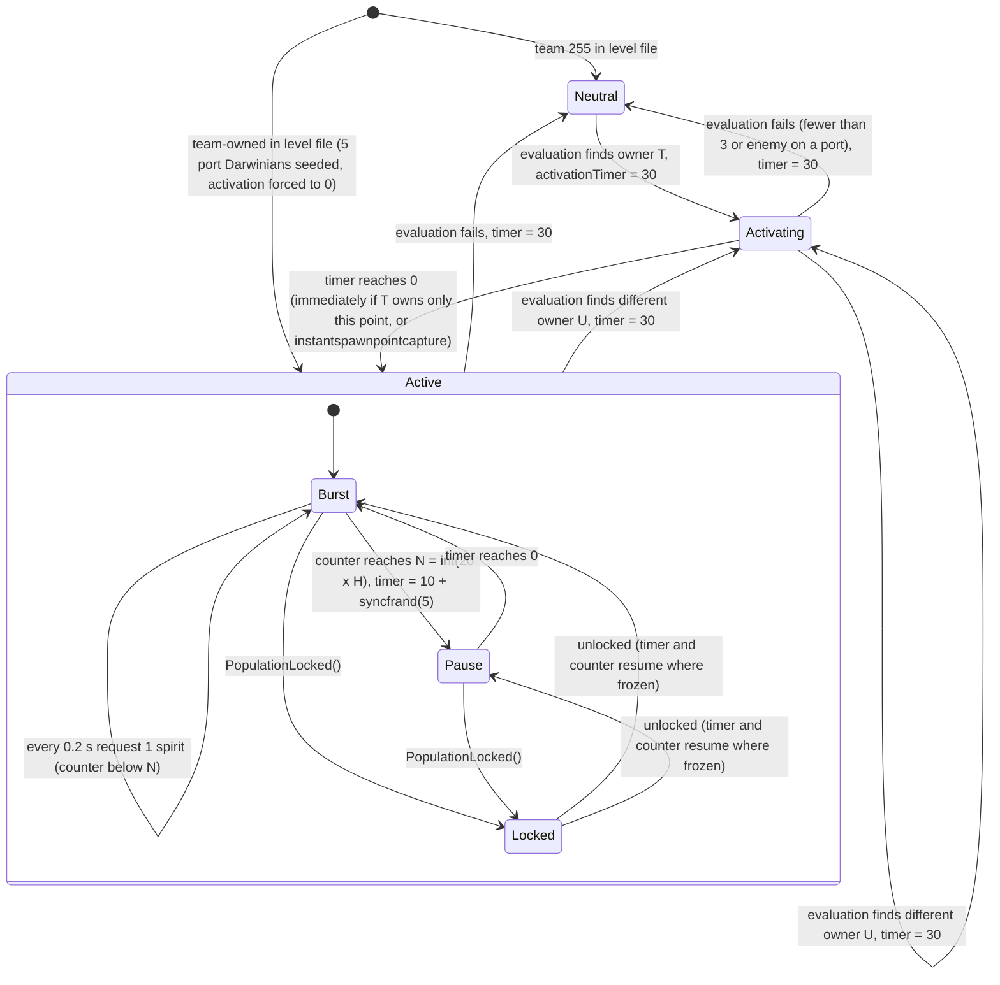
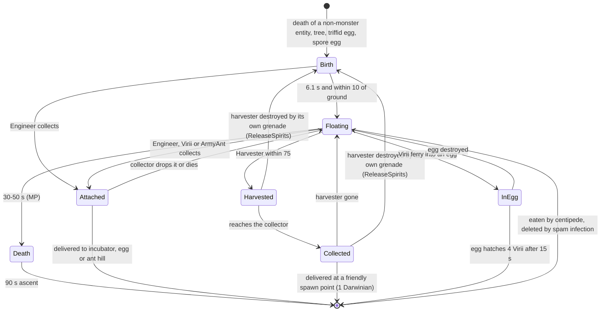

# 05 — Economy and population

> Part A · Baseline build: Release|Win32 (OpenGL) + TARGET_PC_FULLGAME ([B:FULL]); see _work/build_matrix.md.
> Evidence: [C] confirmed · [I] inferred · [U] unknown. Citations are `path:Symbol` relative to the multiwinia/ source root.
> Sources merged: P06_buildings_core (spawn-point economy), P02_game_modes (reinforcements, caps, handicap, starting powerups, crate drops, territory → score), P03_entity_core (souls, deaths, population accounting, Spirit), P05_entities_creatures (creature ↔ spirit interactions), P04_entities_military (Harvester), P08_crates_ai (crate rewards, retribution), P01_app_core (tick/slice model, Team), P18_ui_gamemenu (CPU slot fill), `_meta_*` notes, `phase2_log.md`; every numeric constant and state transition below was re-read in the code by S05. Generated tables: `_work/scripts/S_05_economy_tables.py`.

All times assume normal game speed (`SERVER_ADVANCE_PERIOD` = dt = 0.1 s per simulation tick, 10 ticks per second) unless stated; §8 gives the exact tick counts, which differ from the nominal seconds.

## Contents

1. [Economy model at a glance](#1-economy-model-at-a-glance)
2. [Territory capture: spawn points](#2-territory-capture-spawn-points)
3. [The spawn formula (burst/pause, handicap, transit)](#3-the-spawn-formula-burstpause-handicap-transit)
4. [The population cap](#4-the-population-cap)
5. [Spirit (soul) lifecycle](#5-spirit-soul-lifecycle)
6. [Reinforcement systems](#6-reinforcement-systems)
7. [Throughput analysis — territory value](#7-throughput-analysis--territory-value)
8. [Timer granularity effects](#8-timer-granularity-effects)
9. [Re-implementation guide (compact formula reference)](#9-re-implementation-guide-compact-formula-reference)
10. [Design notes for the new game](#10-design-notes-for-the-new-game)
- [Open questions and unknowns](#open-questions-and-unknowns)
- [Docs-vs-code discrepancies](#docs-vs-code-discrepancies)
- [IP items](#ip-items)
- [Source map](#source-map)
- [Appendix — dead/legacy code](#appendix--deadlegacy-code)

Related documents: building specs of the spawn network, trunk port, incubator and solar panel are in [03](03_buildings_and_world_objects.md); unit specs (Darwinian, Harvester, Engineer, creatures, Spirit motion) in [02](02_units_and_entities.md); crate outcomes and probabilities in [04](04_crates_powerups_and_weapons.md); mode rules and scoring in [01](01_game_modes.md); the per-slice update order and containers in [21](21_simulation_and_entity_model.md); determinism hazards in [22](22_determinism_and_networking.md); map list in [08](08_levels_and_level_design.md).

---

## 1 Economy model at a glance

### 1.1 Concept

Multiwinia has **no build queue and no currency**. A team's army is a *population* of Darwinians (plus a few special units obtained from crates and reinforcements). Population is created by four kinds of source and destroyed by combat; the only resource a player can fight over is **territory** — chiefly *spawn points*, which convert held territory into a steady stream of new Darwinians, subject to a per-team population cap [C] `code/worldobject/spawnpoint.cpp:SpawnPoint::Advance`, `SpawnPoint::PopulationLocked`.

| Population source | Mechanism | Gate | Section |
|---|---|---|---|
| Spawn points (territory) | owned + activated SpawnPoint requests "virtual spirits" from the level's master spawn point in bursts; each arrives after a link-count latency and becomes 1 Darwinian | population cap, 30 s activation delay, handicap | §2, §3 |
| Trunk ports (fixed reinforcement gates) | every 60 "mode seconds" each owned trunk port emits a wave of Darwinians (+ armour/turret/air-strike tasks) | population cap checked once per port per wave | §6.1 |
| Starting units | level `InstantUnits` + 5 Darwinians seeded on every port of every team-owned SpawnPoint / SolarPanel | none | §6.7 |
| Souls (spirits) recycled | every death of a non-monster entity through `Entity::ChangeHealth` leaves a Spirit; a Harvester (crate unit) collects floating spirits of **any** team and turns each into a Darwinian at a friendly spawn point | **no cap check**, no activation check | §5 |
| Crates and creatures | Darwinians crate (50–99), triffid-egg Darwinians (10–19), Spawn Mania (all spawn points request every tick for 5 s), exploding escape-rocket passengers, Futurewinian space ship (team 5) | none (except Spawn Mania, which goes through spawn points) | §6.10 |

### 1.2 Flow diagram with rates

Rates are mean values at normal speed; *k* = number of owned, activated, unlocked spawn points; *h* = spawn-link hops from the master to a spawn point; "mode s" = 11 ticks = 1.1 s (§8).

```mermaid
flowchart LR
    T["Territory: k owned spawn points<br/>(capture: >=3 of 5 ports, no enemy on any port,<br/>re-evaluated every 2-3 s, 30 s activation)"]
    M["Master spawn point<br/>(virtual spirit source)"]
    SP["Spawn point door"]
    TP["Owned trunk ports<br/>(fixed by level)"]
    ST["Start of game<br/>InstantUnits + 5 per owned SpawnPoint/SolarPanel"]
    CR["Crates / creatures<br/>Darwinians crate 50-99, triffid egg 10-19,<br/>rocket passengers, Futurewinians"]
    D(("Darwinians<br/>(team m_others, counted vs cap)"))
    CAP{"Population cap<br/>PopulationCap / NumPlayers<br/>(Assault: defender/attacker split)"}
    C["Combat and hazards"]
    S(("Spirits<br/>Birth 6.1 s, Floating 30-50 s,<br/>Ascent 90.1 s then gone"))
    H["Harvester (crate unit)<br/>capacity 100, range 75"]
    E["Engineer (crate unit)<br/>capacity 25"]
    I["Incubator<br/>(only mp_sandbox maps)"]
    X["Sinks: eggs to Virii, army ants,<br/>centipede, soul destroyer, spam"]

    T -->|"k x 1.22 /s (H=1) .. 1.90 /s (H=1.9) per point<br/>bursts of int(20H) every 0.2 s, pause 10-15 s"| M
    M -->|"latency ~h s (10h+1 ticks max), lost if point neutral on arrival"| SP
    SP -->|"1 Darwinian per spirit"| D
    TP -->|"count per port per wave: RR/Blitz 40, Assault 60-100,<br/>KOTH/CTS 100, wave every 66 s (33 s on 3 Blitzkrieg maps)"| D
    ST -->|"once at t=0"| D
    CR -->|"event-driven"| D
    CAP -.->|"freezes spawn timer, skips whole trunk wave"| T
    CAP -.-> TP
    D -->|"deaths"| C
    C -->|"1 spirit per death via Entity::ChangeHealth<br/>(none for monster team, armour, engineer, harvester, squaddie, egg)"| S
    S -->|"floating, any team, within 75 of harvester"| H
    H -->|"1 spirit per tick at a friendly spawn point,<br/>no cap, no activation check"| D
    S -->|"birth or floating, any team"| E
    E -->|"only if a friendly incubator exists"| I
    I -->|"1 Darwinian per 0.2 s"| D
    S -->|"virii ferry to eggs (1 to 4 virii), ants carry home (1 to 6 ants),<br/>centipede eats, soul destroyer and spam delete"| X
```



[C] `code/worldobject/spawnpoint.cpp:SpawnPoint::Advance`, `MasterSpawnPoint::RequestSpirit`, `SpawnBuilding::Advance`, `SpawnPoint::TriggerSpirit`; `code/multiwinia.cpp:Multiwinia::AdvanceTrunkPorts`; `code/location.cpp:Location::InitialiseTeam`, `Location::SpawnSpirit`; `code/worldobject/entity.cpp:Entity::ChangeHealth`; `code/worldobject/spirit.cpp:Spirit::Advance`; `code/worldobject/harvester.cpp:Harvester::AdvanceHarvesting`, `Harvester::AdvanceToSpawnPoint`; `code/worldobject/engineer.cpp:Engineer::SearchForSpirits`; `code/worldobject/incubator.cpp:Incubator::Advance`. Rates [I] derived from these constants (§3.3, §6.4).

### 1.3 Every population sink

| Sink | Spirit left? | Ref |
|---|---|---|
| Death through `Entity::ChangeHealth` (lasers, fire, explosions, drowning, plague, pulse wave on non-Futurewinians, nukes, turrets) — Darwinian, Officer, Virii, Spider, Centipede, SporeGenerator, TriffidEgg, Tripod, ArmyAnt, SoulDestroyer | yes, 1 of the dead entity's team, **except the monster team (4)** whose spirits are never created | [C] `code/worldobject/entity.cpp:Entity::ChangeHealth`, `code/location.cpp:Location::SpawnSpirit` |
| Death of Armour, Engineer, Harvester, Squaddie, Egg, Tank, SpaceInvader (custom `ChangeHealth` that never calls `Entity::ChangeHealth`) | no | [C] `code/worldobject/armour.cpp:Armour::ChangeHealth`, `engineer.cpp:Engineer::ChangeHealth`, `harvester.cpp:Harvester::ChangeHealth`, `insertion_squad.cpp:Squadie::ChangeHealth`, `egg.cpp:Egg::ChangeHealth`, `tank.cpp:Tank::ChangeHealth`, `airstrike.cpp:SpaceInvader::ChangeHealth` |
| Promotion to Officer (Darwinian removed, Officer added — net 0 for the cap) | no | [C] `code/worldobject/darwinian.cpp:Darwinian::Advance` (`m_promoted`), `code/taskmanager.cpp` (Officer spawn) |
| Boarding an escape rocket (Rocket Riot) | no (returned as burning Darwinians of the rocket's team if the rocket explodes, 1 per tick) | [C] `code/worldobject/rocket.cpp:EscapeRocket::BoardRocket`, `EscapeRocket::AdvanceExploding` |
| Abduction by the space ship | no (replaced by ≤ 100 Futurewinians of team 5) | [C] `code/worldobject/spaceship.cpp`; P05 |
| Conversion by subversion laser / Futurewinian pulse | no (converter gains a Darwinian) | [C] `code/worldobject/weapons.cpp`, `code/worldobject/darwinian.cpp`; P03 |
| Team eliminated (`Team::Eliminate`): every unit and `m_others` entity takes 2 × its health damage | yes for soul-producing types (they die through `ChangeHealth`) | [C] `code/team.cpp:Team::Eliminate` |

A dead entity stays in `Team::m_others` — and keeps counting against the cap — until its corpse fades: health is reset to 100 on death and decremented by `int(40·dt)` = 4 per tick on the ground (25 ticks = 2.5 s) or 2 per tick airborne (50 ticks) [C] `code/worldobject/entity.cpp:Entity::AdvanceDead`.

---

## 2 Territory capture: spawn points

### 2.1 Ports and occupancy

A SpawnPoint has **5 ports** (`MarkerPort01`–`MarkerPort05` in `data/shapes/spawnpointmultiwinia.shp`) [C]. Every tick, in `Building::Advance → EvaluatePorts`, each port's occupant is reset and then set to the **first** Darwinian found by an entity-grid neighbour query of radius 5.0 around the port position whose state is `StateOperatingPort` — of any team, and not necessarily the Darwinian that walked to that port [C] `code/worldobject/building.cpp:Building::EvaluatePorts`. (Whether the grid query honours the 5.0 radius exactly is a grid-implementation question, see [21](21_simulation_and_entity_model.md) [I].)

How Darwinians come to occupy ports [C] `code/worldobject/darwinian.cpp:Darwinian::SearchForPorts`, `AdvanceApproachingPort`, `AdvanceOperatingPort`:

1. An **idle** Darwinian re-targets every 1.0 + syncfrand(1.0) s (`m_retargetTimer`); the idle search order is threats → ports → carryable buildings → crates → armour → (Blitzkrieg) flags → officers → spirits (disabled in MP) → random position. Darwinians in `StateFollowingOrders` / `StateFollowingOfficer` / `StateApproachingArmour` also search ports right after threats, **unless** they are under direct player orders (`m_followingPlayerOrders`), in which case only threats are searched [C] `Darwinian::SearchForNewTask` (switch on `m_state`).
2. `SearchForPorts` considers every building with ports whose distance minus its radius is < `DARWINIAN_SEARCHRANGE_PORTS` = 100.0, that has at least one unoccupied port and is walkable from the Darwinian; it picks the **nearest** such building (the random pick is immediately overwritten by the nearest-distance loop). **There is no team test** — Darwinians walk onto the free ports of enemy-held spawn points [C].
3. A port is available if it has no occupant and the team's reservation counter `GetPortOperatorCount(p, team)` is < 1 in MP (< 20 in single-player); the approaching Darwinian increments that counter every tick (`OperatePort`, capped at 50); `EvaluatePorts` zeroes all counters of an occupied port and decays those of an empty port by 4 per tick [C] `Building::OperatePort`, `Building::EvaluatePorts`.
4. On arrival the Darwinian enters `StateOperatingPort` and stays there (in MP it does **not** even search for threats) until it is no longer the port's occupant, the building vanishes, or it is killed [C]; being re-ordered by the player through selection is the remaining exit [I] (selection/orders are specified in [06](06_player_control_and_input.md)).

Consequence: holding a spawn point ties up 3–5 Darwinians as operators; they keep counting toward the cap (§4.1) and are the first to die when the point is attacked [I].

### 2.2 Ownership evaluation — exact algorithm

`SpawnPoint::RecalculateOwnership` runs when `m_evaluateTimer` ≤ 0. The timer starts at `syncfrand(2.0)` (constructor) and is reset to `2.0 + syncfrand(1.0)` after each run (∈ [2, 3) s) [C] `code/worldobject/spawnpoint.cpp:SpawnPoint::SpawnPoint`, `SpawnPoint::Advance`.

```
teamCount[t] = number of the 5 ports whose current occupant belongs to team t      (t = 0..5)
winner = 255; multiple = false
for t in 0..NUM_TEAMS-1:
    if teamCount[t] > 0 and winner == 255:                                   winner = t
    elif winner != 255 and teamCount[t] > 2 and teamCount[t] > teamCount[winner]: winner = t
    if winner != 255 and teamCount[t] > 0:                                   multiple = true
    if winner != 255 and teamCount[winner] < 3:                              winner = 255
if multiple:
    for t in 0..NUM_TEAMS-1:
        if teamCount[t] > 0 and not IsFriend(t, winner): winner = 255; break
if winner != currentTeam:
    s_numSpawnPoints[currentTeam+1]--, s_numSpawnPoints[winner+1]++     (255 maps to index 0)
    m_activationTimer = 30.0
    sound "TurnOff" if winner == 255 else "TurnOn"
SetTeamId(winner)
```
[C] `SpawnPoint::RecalculateOwnership` (restated). `IsFriend(a, b)` is false if either is 255; in MP it is `a == b`, or same co-op group when co-op is on [C] `code/location.cpp:Location::IsFriend`.

Consequences [C unless marked]:
- Capture needs **≥ 3 of the 5 ports** held by one team **and no enemy Darwinian on any port**; a single enemy operator neutralises the point at the next evaluation.
- There is no "hold until taken": falling below 3 operators makes the point neutral; a point can flip directly A → B if at an evaluation instant only B holds ≥ 3 and A holds none.
- Allies may share ports; the ally with ≥ 3 operators owns the point (with 5 ports, two teams can never both have ≥ 3). Allies with 2 + 2 (or 2 + 1) leave it neutral.
- `multiple` becomes true as soon as any port is occupied (the flag is set for the first occupying team too), so the friend check always runs; it is harmless when `winner == 255`.

| Port occupants at evaluation (5 ports) | Result |
|---|---|
| A ×3, empty ×2 | A |
| A ×5 | A |
| A ×4, B ×1 (B enemy) | neutral |
| A ×3, A′ ×2 (A′ ally of A) | A |
| A ×2, A′ ×2 (allies) | neutral |
| A ×2, empty ×3 | neutral |
| B ×3 while A owned it at the previous evaluation, no A operators | B (direct flip, activation restarts) |

### 2.3 Activation delay

When owned (`team ≠ 255`) and `m_activationTimer > 0`, each tick [C] `SpawnPoint::Advance`:
1. `m_activationTimer -= dt`;
2. forced to 0 if the team now owns **exactly one** spawn point (`s_numSpawnPoints[team+1] == 1` — the code comment calls this "first (or last) spawn point"), or not multiplayer, or the level option `instantspawnpointcapture` > 0;
3. clamped to ≥ 0.

Spawning (§3.1) only runs while `m_activationTimer ≤ 0`. Every ownership change, including to neutral, resets the timer to **30.0 s**; the timer does not count down while neutral [C]. 30.0 s = exactly **300 ticks** (§8). The constructor value is also 30.0, but team-owned points at game start are forced to 0 by `Location::InitialiseTeam` (§6.7) [C].

Levels with `instantspawnpointcapture`: `mp_cts_2p_2`, `mp_cts_3P_2`, `mp_cts_3p_1`, `mp_cts_4P_2` [C] data (§4.6 table).

Render feedback: the glow blobs above the point lerp from grey (100,100,100,200) to the team colour as `m_activationTimer / 30` goes 1 → 0, with alpha = occupied ports / 5 [C] `SpawnPoint::RenderAlphas` (see [24](24_rendering.md)).

### 2.4 Spawn-point counters (`s_numSpawnPoints`)

`SpawnPoint::s_numSpawnPoints[NUM_TEAMS+1]` (7 entries): index 0 = neutral, index *t*+1 = owned by team *t* [C] `code/worldobject/spawnpoint.h`. Incremented in `SpawnPoint::Initialise` from the (position-remapped) level team (255 → index 0) and moved by `RecalculateOwnership` [C]. `Location::Init` zeroes indices **0..5 only** (loop `i < NUM_TEAMS`), so **index 6 — team 5, the Futurewinian team — is never reset between games** [C] `code/location.cpp:Location::Init`. Consumers: activation shortcut (§2.3), handicap (§3.2), Domination scoring and elimination, KOTH/CTS `IsEliminated`, crate validity of Harvester/Engineer/Spawn Mania (only offered when the sum of all 7 entries > 0), tutorial help [C] `code/multiwinia.cpp:Multiwinia::AdvanceSkirmish`, `Multiwinia::IsEliminated`, `code/worldobject/crate.cpp:Crate::IsValid`, `code/multiwiniahelp.cpp`.

### 2.5 State machine


[C] `SpawnPoint::Advance`, `RecalculateOwnership`, `PopulationLocked`; `code/location.cpp:Location::InitialiseTeam`. Spawn Mania (§3.6) overrides the timer in both Burst and Pause.

---

## 3 The spawn formula (burst/pause, handicap, transit)

### 3.1 Request cycle (Multiwinia)

Per SpawnPoint state: `m_spawnTimer` (constructor `2.0 + syncfrand(2.0)`), `m_spawnCounter` (0). **Neither is reset on capture or loss** — a new owner inherits a part-elapsed timer and a part-used burst [C] `SpawnPoint::SpawnPoint`, `SpawnPoint::Advance`.

Each tick, after ownership evaluation and activation handling (§2.2–2.3):
```
if m_activationTimer <= 0 and team != 255 and not PopulationLocked():
    m_spawnTimer -= dt
    if m_spawnTimer <= 0 or Location.m_spawnManiaTimer > 0:
        master = MasterSpawnPoint::GetMasterSpawnPoint()
        if master: master.RequestSpirit(this.id)          # tutorial 2 also counts m_numSpawned++
        m_spawnTimer = 0.2
        m_spawnCounter += 1
        if m_spawnCounter >= int(20 * CalculateHandicap(team)):
            m_spawnCounter = 0
            m_spawnTimer = 10 + syncfrand(5)                # [10, 15) s
```
[C] `SpawnPoint::Advance`. When `PopulationLocked()` is true the timer is **frozen** (not decremented) and nothing is requested. `fractionOccupied` (occupied ports / 5) is computed but unused in Multiwinia — the number of operators beyond the 3 needed for ownership has **no effect on the rate** [C]. If no master exists (`GetMasterSpawnPoint()` NULL, e.g. before the master has advanced once in a level) the counter and timer still advance but nothing is requested [C]. The handicap is re-evaluated at every emission, so *N* can change mid-burst [C].

### 3.2 Handicap

`SpawnPoint::CalculateHandicap(team)` returns the burst multiplier *H* [C] `code/worldobject/spawnpoint.cpp:SpawnPoint::CalculateHandicap`:

1. level option `nohandicap` > 0 → 1.0 (no shipped `mp_` map sets it [C] data); team 255 → 0.0;
2. any **neutral** spawn point on the map (`s_numSpawnPoints[0] > 0`) → 1.0;
3. `h` = game option `Handicap` (Domination, KOTH, Assault: 0–90, step 10, **default 90**; CTS, Rocket Riot, Blitzkrieg lack the option → `GetGameOption` returns −1) [C] `data/multiwinia.txt`, `code/multiwinia.cpp:Multiwinia::GetGameOption`; `h ∈ {0, −1}` → 1.0;
4. loop over teams 0..5 that are **not `TeamTypeUnused`**: `total += s_numSpawnPoints[t+1]`; for teams other than me also `others += s_numSpawnPoints[t+1]`, `n += 1`; `n == 0` → 1.0;
5. `average = others / n` — **integer division**;
6. if `average > 1.5 × mine` (mine = `s_numSpawnPoints[team+1]`): `factor = 1 − ((mine − 1) / total)` with **integer division** (always 0 for 1 ≤ mine ≤ total, so factor = 1) → return `1 + h/100 × factor`; else 1.0.

**Resolved (drafts incomplete):** P06 described *n* as "used teams other than me". The code counts every team whose `m_teamType` is not unused, and in every Multiwinia game `Location::Init` initialises the **monster team (4)** and the **Futurewinian team (5)** as CPU teams (`InitMonsterTeam`, `InitFuturewinianTeam`) [C] `code/location.cpp:Location::Init`, `Location::InitMonsterTeam`, `Location::InitFuturewinianTeam`. So *n* = (number of opponents and allies) + 2, and the two special teams normally contribute 0 points, which **dilutes the average** [C code; I effect]. Effective rule:

> **H = 1 + h/100 (1.9 at the default) only when no spawn point is neutral and ⌊Σ(other teams' points) / (players − 1 + 2)⌋ > 1.5 × mine; otherwise H = 1.** Allies count as "other teams" too.

| Players on map | *n* | Minimum Σ of the other teams' points for H to apply when I hold 1 | … when I hold 2 | … when I hold 3 |
|---|---|---|---|---|
| 2 | 3 | 6 (⌊6/3⌋ = 2 > 1.5) | 12 | 15 |
| 3 | 4 | 8 | 16 | 20 |
| 4 | 5 | 10 | 20 | 25 |

[I] arithmetic from the [C] rule, assuming the special teams own no points. On the shipped maps (1–15 spawn points, §4.6) this means the handicap can only ever help a team holding **one** point, and only on maps with at least 7 points (2 players), 9 points (3 players) or 11 points (4 players): e.g. 1 vs 7 on the 8-point `mp_domination_2P_1`/`2P_2`, 1 vs 8 on the 9-point 3-player KOTH maps, 1 vs 11 on the 12-point 4-player maps. It can never trigger on the 6-point `mp_koth_2P_1` (1 vs 5 → ⌊5/3⌋ = 1) or on 4-player maps with 10 points (1 vs 9 → ⌊9/5⌋ = 1); and since CTS, Rocket Riot and Blitzkrieg have no Handicap option and Assault maps have no spawn points, only Domination- and KOTH-typed games can use it at all. Burst size *N* = `int(20·H)` — verified in IEEE double: h = 0, 10, 20, 30, 40, 50, 60, 70, 80, 90 → N = 20, 22, 24, 26, 28, 30, 32, 34, 36, 38 [C arithmetic].

### 3.3 Per-spawn-point rate

Timing per cycle in ticks of 0.1 s [C constants, I arithmetic]: emissions at relative ticks 0, 2, 4, …, 2(N−1) (the 0.2 s timer is exactly 2 ticks: 0.2 − 0.1 − 0.1 = 0); then a pause of *P* ticks = number of 0.1 decrements needed to bring 10 + u (u ~ U[0,5)) to ≤ 0 — 101 ticks at u = 0 (10.0 after 100 subtractions of 0.1 is still 1.9·10⁻¹⁴ > 0), 150 at u → 5, **mean 125.5 ticks** (simulated). Cycle *C* = 2(N−1) + P ticks.

| Handicap option h (when H applies) | N | Burst length (s) | Mean cycle (s) | Mean rate per point (/s) | per minute | Range over the pause (/s) |
|---|---|---|---|---|---|---|
| H = 1 (normal case) | 20 | 3.8 | 16.35 | **1.223** | **73.4** | 1.06–1.44 |
| 10 | 22 | 4.2 | 16.75 | 1.313 | 78.8 | 1.15–1.54 |
| 20 | 24 | 4.6 | 17.15 | 1.399 | 84.0 | 1.22–1.63 |
| 30 | 26 | 5.0 | 17.55 | 1.481 | 88.9 | 1.30–1.72 |
| 40 | 28 | 5.4 | 17.95 | 1.560 | 93.6 | 1.37–1.81 |
| 50 | 30 | 5.8 | 18.35 | 1.635 | 98.1 | 1.44–1.89 |
| 60 | 32 | 6.2 | 18.75 | 1.706 | 102.4 | 1.51–1.96 |
| 70 | 34 | 6.6 | 19.15 | 1.775 | 106.5 | 1.57–2.04 |
| 80 | 36 | 7.0 | 19.55 | 1.841 | 110.5 | 1.64–2.11 |
| 90 (default) | 38 | 7.4 | 19.95 | **1.905** | **114.3** | 1.70–2.17 |

[I] arithmetic from the [C] constants (formulae in §9; pause mean from a 200 000-sample simulation of the decrement loop). The first request after activation comes after the inherited `m_spawnTimer` (2.0–4.0 s = 20–40 ticks for a never-used point).

### 3.4 Spirit transit through the spawn network

`MasterSpawnPoint::RequestSpirit(target)` creates a `SpawnBuildingSpirit{target, progress 0}` and calls `TriggerSpirit`, which places the **same pointer** on every outgoing link whose precomputed `m_targets` set contains the target (deleting it if none does). Every `SpawnBuilding::Advance` adds dt to the progress of each spirit on each of its links; at progress ≥ 1.0 the spirit is removed and handed to the link's target building's `TriggerSpirit(spirit, progress − 1.0)` (overshoot carried), or deleted if the target is missing or not a spawn building. A `SpawnPoint` receiving a spirit addressed to itself spawns one Darwinian **if it is owned at that moment** (by whoever owns it then) and deletes the spirit; a spirit for another point is forwarded [C] `code/worldobject/spawnpoint.cpp:MasterSpawnPoint::RequestSpirit`, `SpawnBuilding::TriggerSpirit`, `SpawnBuilding::Advance`, `SpawnPoint::TriggerSpirit`, `SpawnPoint::SpawnDarwinian`.

- **Latency** is per link, independent of distance. **Resolved:** drafts said "exactly 1.0 s per link"; in IEEE double ten additions of 0.1 sum to 0.9999999999999999 < 1.0, so the **first link takes 11 increments** and each later link 10 (the carried overshoot is 0.0999…) — *h* hops need **10h + 1 increments** [C arithmetic, verified numerically]. Because each building advances in array order within the tick, a hand-off to a building later in `Location::m_buildings` receives its first increment in the same tick, so wall latency is between 9h + 1 and 10h + 1 ticks [I]. Shipped maps have 1–11 hops (§4.6), i.e. 1.1 s to ≈ 11 s.
- **No population re-check on arrival** — requests made just before the cap was reached still arrive (overshoot, §4.4) [C].
- **Losses** [C]: target neutral on arrival; target unreachable (no link lists it); a link to a non-spawn building; master absent.
- **Spawned Darwinian**: `Location::SpawnEntities(doorPos, owner, unit −1, TypeDarwinian, 1, vel, spread 0)` with `vel = (door.front + (syncsfrand(1), syncsfrand(1), syncsfrand(1))) × 10` (each jitter ±0.5) in MP, `m_onGround = false` [C] `SpawnPoint::SpawnDarwinian`; `syncsfrand(x)` ∈ [−x/2, x/2) [C] `contrib/systemiv/lib/math/random_number.h`.
- Shipped graphs (all 32 MP levels with spawn points + `mp_benchmark_1`, `mp_sandbox_all`): one master, every SpawnPoint reachable, exactly one path to each, no cycles, no self-links [C] `_work/drafts/P06_spawn_graph.csv`. `ExploreLinks` has no cycle protection and the multi-link `TriggerSpirit` would double-deliver/double-free on a non-tree graph (latent defect) [I].

### 3.5 Worked numerical examples

**Example A — normal rate, KOTH 2-player.** `mp_koth_2P_1`: PopulationCap 2000, NumPlayers 2 → per-team cap 1000; each team starts with 40 InstantUnits Darwinians + 5 seeded on its one owned spawn point = 45 [C] data. A team that holds 3 activated points with H = 1 gets N = 20 per point:
- per point: 20 requests in 38 ticks, pause mean 125.5 ticks → cycle 163.5 ticks = 16.35 s → 1.223 Darwinians/s;
- 3 points → 3.67/s ≈ 220/min;
- time from 45 to the 1000 cap without losses ≈ (1000 − 45) / 3.67 ≈ 260 s ≈ 4.3 min; at the cap the timers freeze, and up to 20 requests per point already in flight still arrive (≤ 60 over cap).
[I] arithmetic.

**Example B — handicap, Domination 2-player.** `mp_domination_2P_1` (8 points, cap 1000/team, Handicap default 90). All 8 owned: A holds 1, B holds 7 [I scenario]:
- A: `s_numSpawnPoints[0] = 0`; others = 7 (B) + 0 (monster) + 0 (Futurewinian), n = 3 → average ⌊7/3⌋ = 2 > 1.5 × 1 → factor = 1 − ⌊0/8⌋ = 1 → **H = 1.9, N = 38** → 38 per 19.95 s = **1.905/s**.
- B: average ⌊1/3⌋ = 0 → H = 1 → 7 × 1.223 = **8.56/s**. Ratio 4.5 : 1 instead of 7 : 1.
- If A instead holds 2 vs 6: A's average ⌊6/3⌋ = 2 is not > 3 → H = 1 → A 2.45/s, B 7.34/s.
- If one point is neutral (1 vs 6 + 1 neutral) → H = 1 for everyone.

**Example C — Spawn Mania.** While `Location::m_spawnManiaTimer` > 0 (set to 5.0 by the crate; decremented by dt at slice 8 of every tick, so it is positive for ≈ 50–51 ticks) every activated, owned, unlocked SpawnPoint **of every team** requests a spirit every tick (10/s) regardless of its timer; the counter/pause bookkeeping still runs but is overridden. A point therefore requests ≈ 50 spirits in the 5 s instead of ≈ 6 at the normal mean rate, each request still subject to the cap check [C] `code/worldobject/crate.cpp:Crate::RunSpawnMania`, `code/location.cpp:Location::Advance`, `SpawnPoint::Advance`; [I] counts. It is global, not limited to the crate opener [C] (the timer lives on `Location`).

### 3.6 Spawn Mania

See Example C. The crate is offered only when at least one spawn point exists (`Crate::IsValid`) and only with advanced crates (`INCLUDE_CRATES_ADVANCED`, on in FULL; off when the lobby's "basic crates only" is set) [C] `code/worldobject/crate.cpp:Crate::IsValid`; probabilities in [04](04_crates_powerups_and_weapons.md).

### 3.7 Single-player formula [B:LEGACY]

`m_spawnTimer = 2 + 5·(1 − fractionOccupied) − (team == 1 ? 1.0 : 0.5)·difficulty/10 + syncfrand(1)` — fully-manned points spawn faster; unreachable in Multiwinia [C] `SpawnPoint::Advance` (`!Multiplayer()` branch).

---

## 4 The population cap

### 4.1 What is counted

Every cap check uses
```
currentPop(team) = Team::m_others.NumUsed() − Virii::s_viriiPopulation[team]
```
[C] `code/worldobject/spawnpoint.cpp:SpawnPoint::PopulationLocked`, `code/worldobject/trunkport.cpp:TrunkPort::PopulationLocked`, `code/worldobject/anthill.cpp:AntHill::PopulationLocked`. `m_others` is the team's `SliceDArray` of entities spawned with unit id −1 (`Team::NewEntity` with `_unitId == -1`); entities created inside a `Unit` (squads, airstrike bombers, centipedes, ants from an ant hill, tentacles) live in `Team::m_units` and are **not** counted [C] `code/team.cpp:Team::NewEntity`. Virii are subtracted because they have their own limit (`VIRII_POPULATIONLIMIT` = 250 per team, checked by eggs and triffid eggs) [C] `code/worldobject/virii.h`, `code/worldobject/egg.cpp:Egg::Advance`, `code/worldobject/triffid.cpp:TriffidEgg::Spawn`. Spirits in transit inside the spawn network are not entities and are not counted [C].

**Resolved (meta U3/U6, "which `m_others` count toward the cap"):** by enumerating every `SpawnEntities(…, -1, …)` call site [C]:

| Counted in `m_others` (unit id −1) | Created by | Not counted (in a `Unit`) |
|---|---|---|
| Darwinian (incl. operators on ports, corpses until faded, Futurewinians of team 5) | spawn points, trunk ports, InstantUnits, port seeding, crates, harvesters, incubators, rockets, triffid eggs, conversions | InsertionSquadie (squad task) — `code/taskmanager.cpp` |
| Officer | promote task | SpaceInvader (airstrike) — `code/worldobject/airstrike.cpp` |
| Engineer | Engineer task (crate) | Centipede segments (triffid egg) — `code/worldobject/triffid.cpp` |
| Armour | Armour task (crate, trunk port, InstantUnits `runAsTask`) | ArmyAnt from an AntHill unit — `code/worldobject/anthill.cpp` |
| Harvester | Harvester task (crate) | Tentacle [B:DEBUG] — `code/worldobject/portal.cpp` |
| AI (one per CPU team, incl. the two special teams) | `Location::InitialiseTeam` | |
| Nuke (while in flight), Meteor, Egg, TriffidEgg, Spider, SporeGenerator, SoulDestroyer, ArmyAnt (crate/triffid), SpaceShip | crates / creatures | |
| Virii | eggs, triffid eggs, crates | (counted in `m_others` but subtracted) |

[C] call sites: `code/location.cpp:Location::InitialiseTeam`, `code/taskmanager.cpp` (Task target functions), `code/worldobject/crate.cpp`, `code/worldobject/triffid.cpp:TriffidEgg::Spawn`, `code/worldobject/egg.cpp`, `code/worldobject/sporegenerator.cpp`, `code/worldobject/spider.cpp`, `code/worldobject/spaceship.cpp`. So the cap is a cap on *bodies*, not on Darwinians: a CPU team's AI entity, every armour/harvester/engineer, and creature eggs/spawn owned by a player (eggs-crate creatures belong to the player who placed the task, except Soul Destroyers which go to the monster team in MP [C] `TriffidEgg::Spawn`) all consume cap.

### 4.2 Computation

`SpawnPoint::PopulationLocked()` and `TrunkPort::PopulationLocked()` evaluate, in order (first applicable rule decides) [C]:

1. *(SpawnPoint only)* **Tutorial 2** (`m_multiwiniaTutorial && m_multiwiniaTutorialType == MultiwiniaTutorial2 && !m_tutorial2AICanSpawn`): locked if this point has requested ≥ 100 spirits (`m_numSpawned`, counted only in this tutorial), or its team is neither 255 nor 0, or team 0 has > 200 `m_others` [C] `SpawnPoint::PopulationLocked`. (If none of these hold, evaluation falls through to rule 2–4.)
2. **Assault with `DefenderPopulationCap` ≠ −1**: neutral → not locked; defending team (`Location::IsDefending` = position not in `AttackingTeams`) locked iff `currentPop ≥ DefenderPopulationCap`; attacking team locked iff `currentPop ≥ (PopulationCap − numDefenders × DefenderPopulationCap) / numAttackers` (integer division), with `numAttackers = Location::GetNumAttackers()` (count of `m_attacking[i]` for i < level NumPlayers) and `numDefenders = level NumPlayers − numAttackers` [C] `code/location.cpp:Location::GetNumAttackers`, `Location::IsDefending`.
3. **Map cap** `PopulationCap` ≠ −1: neutral → not locked; else locked iff `currentPop ≥ PopulationCap / NumPlayers` (integer division by the **level's** `NumPlayers`) [C].
4. **Fallback — SpawnPopulationLock** (only when no map cap, or not multiplayer): on first use the building caches the id of the **first** `SpawnPopulationLock` in building-list order whose `m_searchRadius` contains it (−2 = none); locked iff that lock's `m_teamCount[team] ≥ m_maxPopulation`. The cached id is only queried when `> 0`, so a lock whose unique id is 0 is ignored [C] `SpawnPoint::PopulationLocked`, `TrunkPort::PopulationLocked`. In MP every lock does nothing when the level sets `PopulationCap` (its `Advance` returns at once) [C] `SpawnPopulationLock::Advance`.
5. Otherwise not locked.

`AntHill::PopulationLocked` applies rule 3 only (then the lock fallback) to the monster team's ant hills, gating each ant sortie (one ant per 0.2 s in MP) [C] `code/worldobject/anthill.cpp:AntHill::PopulationLocked`, `AntHill::Advance`. The ants a hill emits are created inside the hill's `Unit` (`SpawnEntities(…, m_unitId, …)` in `AntHill::SpawnAnt`) and so are **not** in `m_others`: the check only sees the monster team's other bodies (its AI entity, crate creatures, eggs) [C code; I consequence].

`PopulationCap`, `DefenderPopulationCap` and `NumPlayers` come from the level's `MultiwiniaOptions` block; defaults −1; **the last `PopulationCap` line wins** (`mp_cts_4p_3` has `-1` then `2000`) [C] `code/level_file.cpp:LevelFile::ParseMultiwiniaOptions`, `LevelFile::LevelFile`. The editor exposes them as value controls (`editor_popcap` 1–5000 step 10, `editor_defenderpopcap` 50–5000) [B:EDITOR] `code/interface/multiwiniaoptions_window.cpp`.

The generic cap in `Location::SpawnEntities` (`Entity::s_entityPopulation ≥ m_populationCap`) is **commented out** — nothing else limits entity creation [C] `code/location.cpp:Location::SpawnEntities`.

**On "NumPlayers, not playing teams" (P06 concern):** the divisor is the level's NumPlayers, but at game start every empty slot below NumPlayers is filled with a CPU team (host auto-start and single-player Play both request CPU teams) [C] P18 `GameMenu` lobby flow, so at start the per-team cap equals cap ÷ teams in play. It stays fixed when a team is eliminated or leaves, so survivors never inherit the freed share [C code; I consequence].

### 4.3 Enforcement points

| Population source | Cap enforced? | Granularity | Ref |
|---|---|---|---|
| SpawnPoint request | yes, before each request; spawn timer frozen while locked | per request (but spirits already in transit still land) | [C] `SpawnPoint::Advance` |
| Trunk-port wave | yes, **once per port per wave** before spawning the whole `count` | per port-wave (overshoot ≤ count − 1 per port) | [C] `Multiwinia::AdvanceTrunkPorts` |
| AntHill ant emission (monster team) | yes, but its own ants are unit members and not counted | per ant | [C] `AntHill::PopulationLocked`, `AntHill::SpawnAnt` |
| Harvester delivery | **no** — `SpawnPoint::SpawnDarwinian` called directly; also bypasses the activation delay | — | [C] `Harvester::AdvanceToSpawnPoint` |
| Incubator | no | — | [C] `Incubator::SpawnEntity` |
| InstantUnits, port seeding | no | — | [C] `Location::InitialiseTeam` |
| Crates (Darwinians 50–99, triffid eggs, eggs, Futurewinians, nukes, armour, harvester, engineer, squads) | no | — | [C] `code/worldobject/crate.cpp:Crate::RunDarwinians`, `TriffidEgg::Spawn` |
| Rocket passengers returned on explosion | no | — | [C] `EscapeRocket::AdvanceExploding` |
| Conversions (subversion, pulse wave) | no | — | [C] `code/worldobject/weapons.cpp`, `code/worldobject/darwinian.cpp` |
| Virii | own limit 250 per team | per egg | [C] `Egg::Advance` |

### 4.4 Overshoot

Because only the request is gated, a team can exceed its cap by [I]:
- the spirits in flight in the spawn network (at most one burst, ≤ N, per point, typically far fewer because the latency of 1–11 s is short compared to the 10–15 s pause);
- a trunk-port wave that starts one below the cap (up to count − 1 per port; with several ports each port re-reads the count after the previous port's Darwinians were added);
- every uncapped source of §4.3 (harvesters can deliver up to 100 souls at 10 per second at any population);
- corpses (counted for 2.5–5 s after death) make the cap bite slightly *earlier* during heavy fighting.

### 4.5 Per-mode summary

| Mode | Cap source on shipped maps | Typical per-team cap | Notes |
|---|---|---|---|
| Domination | `PopulationCap / NumPlayers` | 500–1000 | `mp_domination_4P_2` (co-op) has no cap at all |
| King of the Hill | `PopulationCap / NumPlayers` | 500–1000 | `mp_koth_4P_3` (co-op) has no cap at all |
| Capture the Statue | `PopulationCap / NumPlayers` | 500–1000 | |
| Assault | defender `DefenderPopulationCap`; attackers share the remainder | defender 200–350; attacker 550–1725 | `mp_assault_2p_3`, `mp_assault_3p_3` set no defender cap → plain `PopulationCap / NumPlayers` for both sides |
| Rocket Riot | `PopulationCap / NumPlayers` | 450–900 | |
| Blitzkrieg | `PopulationCap / NumPlayers` | 350–1000 | |
| Tank Battle [B:DEBUG] | none | — | no spawn points or trunk ports |

[C] data, generated in §4.6.

### 4.6 Per-map table (every `data/levels/mp_*.txt`)

Columns: *Off.* = `OfficialLevel` flag; *PopulationCap* as parsed (last line wins); *Per-team cap* = PopulationCap / NumPlayers (integer); *Assault caps* = defender / attacker per team (rule 2); *SpawnPoints* = total with the count owned at start per level team **position** (`tN` = position N; positions are mapped to team ids at load); *SpawnLinks* = relay nodes; *Hops* = min–max links from the master to a spawn point (latency ≈ 1 s per hop, §3.4); *Pop-locks* = `SpawnPopulationLock` buildings (inert wherever PopulationCap ≠ −1); *TrunkPorts* = count with owners (`t255` = neutral, never reinforces); *InstantUnits Darwinians* and *Port-seeded Darwinians* (5 per owned SpawnPoint or SolarPanel) per position; *Other start units* (`(task)` = `runAsTask`, created as a task). Generated by `_work/scripts/S_05_economy_tables.py` (run with `python3 -I`) [C] data.

| Level | GameTypes | Off. | NumPlayers | PopulationCap | Per-team cap | Assault caps | Co-op | LevelOptions | SpawnPoints (owned at start) | SpawnLinks | Hops | Pop-locks | TrunkPorts (owners) | InstantUnits Darwinians per position | Port-seeded Darwinians per position | Other start units |
|---|---|---|---|---|---|---|---|---|---|---|---|---|---|---|---|---|
| `mp_assault_2P_1` | Assault | Y | 2 | 2000 | 1000 | def 350 / att 1650 |  | trunkportreinforcements=100 | 0 | 0 |  | 1 | 5 (t0:1 t1:4) | t0:325 |  | Armour(task)×1@0; Armour(task)×1@0 |
| `mp_assault_2P_2` | Assault | Y | 2 | 2000 | 1000 | def 275 / att 1725 |  | trunkportreinforcements=100 trunkportarmour=1 | 0 | 0 |  | 0 | 6 (t0:1 t1:5) | t0:209 | t0:50 |  |
| `mp_assault_2p_3` | Assault | Y | 2 | 2000 | 1000 |  |  | trunkportreinforcements=100 trunkportarmour=3 defenderreinforcementtype=AirStrike forceradarteammatch noradarcontrol | 0 | 0 |  | 0 | 3 (t0:3) | t0:8 t1:300 |  |  |
| `mp_assault_3P_2` | Assault | Y | 3 | 1500 | 500 | def 250 / att 625 |  | trunkportreinforcements=75 | 0 | 0 |  | 1 | 9 (t0:1 t1:4 t2:4) | t0:180 | t0:60 | Armour(task)×1@0; Armour(task)×1@0 |
| `mp_assault_3p_1` | Assault | Y | 2 | 1600 | 800 | def 250 / att 1350 |  | trunkportreinforcements=75 | 0 | 0 |  | 0 | 7 (t0:1 t1:6) | t0:103 t5:35 | t0:45 | Armour(task)×1@0 |
| `mp_assault_3p_3` | Assault | Y | 3 | 1800 | 600 |  |  | trunkportreinforcements=100 | 0 | 0 |  | 0 | 8 (t1:4 t2:4) | t0:260 |  |  |
| `mp_assault_4P_1` | Assault | Y | 4 | 1600 | 400 | def 200 / att 600 |  | trunkportreinforcements=75 | 0 | 0 |  | 0 | 8 (t0:3 t1:3 t2:1 t3:1) | t2:100 t3:68 | t3:30 | Armour(task)×1@2; Armour(task)×1@3 |
| `mp_assault_4P_2` | Assault | Y | 4 | 1500 | 375 | def 200 / att 550 |  | trunkportreinforcements=60 trunkportarmour=3 | 0 | 0 |  | 0 | 10 (t0:1 t1:1 t2:4 t3:4) | t0:63 t1:95 | t0:60 t1:30 |  |
| `mp_assault_stress` | none | Y | 2 | 2000 | 1000 |  |  | trunkportreinforcements=250 defenderreinforcementtype=Armour | 0 | 0 |  | 0 | 7 (t0:5 t1:2) | t1:90 | t1:30 |  |
| `mp_benchmark_1` | none | Y | 4 | -1 | none |  | Y |  | 24 (t0:5 t1:5 t2:5 t3:5) | 4 | 2–2 | 1 | 4 (t255:4) | t0:150 t1:150 t2:150 t3:150 | t0:25 t1:25 t2:25 t3:25 |  |
| `mp_blitzkrieg_2P_3` | Blitzkrieg | Y | 2 | 2000 | 1000 |  |  | trunkportreinforcements=100 trunkportarmour=3 | 4 | 9 | 3–8 | 0 | 3 (t0:1 t1:1 t255:1) |  |  |  |
| `mp_blitzkrieg_2P_4` | Blitzkrieg | Y | 2 | 1800 | 900 |  |  | nogunturrets | 3 | 7 | 3–4 | 2 | 3 (t0:1 t1:1 t255:1) | t0:36 t1:36 |  |  |
| `mp_blitzkrieg_2p_1` | Blitzkrieg | Y | 2 | 1500 | 750 |  |  | trunkportreinforcements=100 trunkportarmour=3 | 1 | 0 | 1–1 | 0 | 2 (t0:1 t1:1) | t0:40 t1:40 | t0:15 t1:15 |  |
| `mp_blitzkrieg_2p_2` | Blitzkrieg | Y | 2 | 2000 | 1000 |  |  | trunkportreinforcements=100 trunkportarmour=3 | 6 (t0:2 t1:2) | 8 | 2–5 | 6 | 2 (t0:1 t1:1) | t0:8 t1:8 | t0:10 t1:10 |  |
| `mp_blitzkrieg_3P_1` | Blitzkrieg | Y | 3 | 1500 | 500 |  |  | airstrikecapturezones=3 | 0 | 0 |  | 4 | 3 (t0:1 t1:1 t2:1) | t0:15 t1:15 t2:15 |  |  |
| `mp_blitzkrieg_3P_2` | Blitzkrieg | Y | 3 | 2000 | 666 |  |  | airstrikecapturezones=3 | 0 | 0 |  | 7 | 3 (t0:1 t1:1 t2:1) |  |  |  |
| `mp_blitzkrieg_4P_2` | Blitzkrieg | Y | 4 | 1400 | 350 |  |  | airstrikecapturezones=3 | 0 | 0 |  | 0 | 4 (t0:1 t1:1 t2:1 t3:1) |  | t0:15 t1:15 t2:15 t3:15 |  |
| `mp_cts_2p_1` | CaptureTheStatue | Y | 2 | 2000 | 1000 |  |  |  | 6 (t0:2 t1:2) | 0 | 1–1 | 4 | 0 | t0:40 t1:40 | t0:10 t1:10 |  |
| `mp_cts_2p_2` | CaptureTheStatue | Y | 2 | 2000 | 1000 |  |  | instantspawnpointcapture | 4 (t0:2 t1:2) | 0 | 1–1 | 2 | 0 | t0:40 t1:40 | t0:10 t1:10 |  |
| `mp_cts_2p_3` | CaptureTheStatue | Y | 2 | 2000 | 1000 |  |  |  | 4 (t0:1 t1:1) | 6 | 3–6 | 0 | 0 | t0:40 t1:40 | t0:5 t1:5 |  |
| `mp_cts_2p_4` | CaptureTheStatue | Y | 2 | 2000 | 1000 |  |  |  | 4 (t0:2 t1:2) | 0 | 1–1 | 5 | 0 | t0:40 t1:40 | t0:10 t1:10 |  |
| `mp_cts_3P_2` | CaptureTheStatue | Y | 3 | 1500 | 500 |  |  | instantspawnpointcapture | 9 (t0:3 t1:3 t2:3) | 0 | 1–1 | 0 | 0 | t0:40 t1:40 t2:40 | t0:15 t1:15 t2:15 |  |
| `mp_cts_3p_1` | CaptureTheStatue | Y | 3 | 1800 | 600 |  |  | instantspawnpointcapture | 6 (t0:2 t1:2 t2:2) | 0 | 1–1 | 6 | 0 | t0:40 t1:40 t2:40 | t0:10 t1:10 t2:10 |  |
| `mp_cts_3p_3` | CaptureTheStatue | Y | 3 | 2000 | 666 |  |  | trunkportreinforcements=100 attackerreinforcementtype=HotFeet | 0 | 0 |  | 0 | 3 (t0:1 t1:1 t2:1) |  |  |  |
| `mp_cts_4P_1` | CaptureTheStatue | Y | 4 | 2000 | 500 |  |  |  | 12 (t0:1 t1:1 t2:1 t3:1) | 0 | 1–1 | 1 | 0 | t0:40 t1:40 t2:40 t3:40 | t0:5 t1:5 t2:5 t3:5 |  |
| `mp_cts_4P_2` | CaptureTheStatue | Y | 4 | 2000 | 500 |  | Y | instantspawnpointcapture | 8 (t0:2 t1:2 t2:2 t3:2) | 0 | 1–1 | 9 | 0 | t0:40 t1:40 t2:40 t3:40 | t0:10 t1:10 t2:10 t3:10 |  |
| `mp_cts_4p_3` | CaptureTheStatue | Y | 4 | 2000 (lines -1 2000) | 500 |  |  |  | 8 (t0:2 t1:2 t2:2 t3:2) | 17 | 3–9 | 0 | 0 | t0:40 t1:40 t2:40 t3:40 | t0:10 t1:10 t2:10 t3:10 |  |
| `mp_domination_2P_1` | Domination | Y | 2 | 2000 | 1000 |  |  |  | 8 (t0:1 t1:1) | 13 | 2–7 | 1 | 0 | t0:45 t1:45 | t0:20 t1:20 |  |
| `mp_domination_2P_2` | Domination | Y | 2 | 2000 | 1000 |  |  |  | 8 (t0:1 t1:1) | 7 | 2–5 | 0 | 0 | t0:40 t1:40 | t0:5 t1:5 |  |
| `mp_domination_3P_1` | Domination | Y | 3 | 1800 | 600 |  |  |  | 10 (t0:2 t1:2 t2:2) | 14 | 4–9 | 0 | 0 | t0:40 t1:40 t2:40 | t0:10 t1:10 t2:10 |  |
| `mp_domination_4P_1` | Domination | Y | 4 | 2000 | 500 |  | Y |  | 10 (t0:1 t1:1 t2:1 t3:1) | 18 | 2–10 | 0 | 0 | t0:40 t1:40 t2:40 t3:40 | t0:5 t1:5 t2:5 t3:5 |  |
| `mp_domination_4P_2` | Domination | Y | 4 | -1 | none |  | Y |  | 12 (t0:2 t1:2 t2:2 t3:2) | 20 | 3–5 | 0 | 0 | t0:40 t1:40 t2:40 t3:40 | t0:10 t1:10 t2:10 t3:10 |  |
| `mp_koth_2P_1` | KingOfTheHill | Y | 2 | 2000 | 1000 |  |  |  | 6 (t0:1 t1:1) | 7 | 3–5 | 4 | 0 | t0:40 t1:40 | t0:5 t1:5 |  |
| `mp_koth_2P_2` | Domination | Y | 2 | 2000 | 1000 |  |  |  | 9 (t0:3 t1:3) | 10 | 3–7 | 0 | 1 (t255:1) |  | t0:15 t1:15 |  |
| `mp_koth_2P_3` | Domination | Y | 2 | 1500 | 750 |  |  |  | 10 (t0:2 t1:2) | 11 | 4–8 | 4 | 0 | t0:40 t1:40 | t0:10 t1:10 |  |
| `mp_koth_2P_3b` | KingOfTheHill | Y | 2 | 1500 | 750 |  |  |  | 10 (t0:2 t1:2) | 9 | 2–6 | 4 | 0 | t0:40 t1:40 | t0:10 t1:10 |  |
| `mp_koth_3P_1` | KingOfTheHill | Y | 3 | 1800 | 600 |  |  |  | 9 (t0:1 t1:1 t2:1) | 23 | 3–8 | 7 | 1 (t255:1) | t0:45 t1:45 t2:45 | t0:5 t1:5 t2:5 |  |
| `mp_koth_3P_2` | KingOfTheHill | Y | 3 | 1800 | 600 |  |  |  | 9 (t0:2 t1:2 t2:2) | 14 | 4–9 | 1 | 0 | t0:40 t1:40 t2:40 | t0:10 t1:10 t2:10 |  |
| `mp_koth_3P_3` | KingOfTheHill | Y | 3 | 1800 | 600 |  |  |  | 9 (t0:2 t1:2 t2:2) | 15 | 5–6 | 7 | 1 (t255:1) | t0:40 t1:40 t2:40 | t0:10 t1:10 t2:10 |  |
| `mp_koth_3P_4` | KingOfTheHill | Y | 3 | 1800 | 600 |  |  | trunkportreinforcements=100 | 0 | 0 |  | 0 | 6 (t0:2 t1:2 t2:2) |  |  |  |
| `mp_koth_4P_1` | KingOfTheHill | Y | 4 | 2000 | 500 |  | Y |  | 10 (t0:1 t1:1 t2:1 t3:1) | 18 | 2–11 | 9 | 0 | t0:40 t1:40 t2:40 t3:40 | t0:5 t1:5 t2:5 t3:5 |  |
| `mp_koth_4P_3` | KingOfTheHill | Y | 4 | -1 | none |  | Y |  | 12 (t0:2 t1:2 t2:2 t3:2) | 20 | 3–5 | 0 | 0 | t0:40 t1:40 t2:40 t3:40 | t0:10 t1:10 t2:10 t3:10 |  |
| `mp_koth_4P_4` | KingOfTheHill | Y | 4 | 2000 | 500 |  | Y |  | 12 (t0:3 t1:3 t2:3 t3:3) | 4 | 2–2 | 1 | 4 (t255:4) | t0:40 t1:40 t2:40 t3:40 | t0:15 t1:15 t2:15 t3:15 |  |
| `mp_rocketriot_2P_2` | RocketRiot | Y | 2 | 1500 | 750 |  |  |  | 2 | 0 | 1–1 | 0 | 2 (t0:1 t1:1) |  |  |  |
| `mp_rocketriot_2P_4` | RocketRiot | Y | 2 | 1500 | 750 |  |  |  | 0 | 0 |  | 0 | 2 (t0:1 t1:1) |  |  |  |
| `mp_rocketriot_2p_3` | RocketRiot | Y | 2 | 1800 | 900 |  |  |  | 0 | 0 |  | 0 | 2 (t0:1 t1:1) |  |  |  |
| `mp_rocketriot_3P_2` | RocketRiot | Y | 3 | 1800 | 600 |  |  |  | 0 | 0 |  | 0 | 3 (t0:1 t1:1 t2:1) |  |  |  |
| `mp_rocketriot_3P_3` | RocketRiot | Y | 3 | 1800 | 600 |  |  | nogunturrets | 0 | 0 |  | 0 | 3 (t0:1 t1:1 t2:1) | t0:8 t1:8 t2:8 |  |  |
| `mp_rocketriot_3p_1` | RocketRiot | Y | 3 | 1800 | 600 |  |  |  | 0 | 0 |  | 0 | 3 (t0:1 t1:1 t2:1) |  |  |  |
| `mp_rocketriot_4P_1` | RocketRiot | Y | 4 | 1800 | 450 |  |  |  | 12 | 0 | 1–1 | 0 | 4 (t0:1 t1:1 t2:1 t3:1) |  |  |  |
| `mp_sandbox` | none |  | 2 | 2500 | 1250 |  |  |  | 0 | 0 |  | 0 | 0 |  |  |  |
| `mp_sandbox_all` | none |  | -1 | -1 | none |  |  |  | 4 (t1:4) | 11 | 5–8 | 0 | 0 |  | t1:20 |  |
| `mp_skirmish_2p_4` | Domination | Y | 2 | 1800 | 900 |  |  |  | 10 (t0:1 t1:1) | 11 | 3–8 | 0 | 1 (t255:1) |  | t0:5 t1:5 |  |
| `mp_skirmish_3P_1` | Domination | Y | 3 | 1800 | 600 |  |  |  | 15 (t0:2 t1:2 t2:2) | 0 | 1–1 | 0 | 0 | t0:40 t1:40 t2:40 | t0:10 t1:10 t2:10 |  |
| `mp_tankbattle_2P` | TankBattle |  | 2 | -1 | none |  |  |  | 0 | 0 |  | 0 | 0 |  |  | Tank(task)×1@0; Tank(task)×1@1 |
| `mp_tankbattle_3P` | TankBattle |  | 3 | -1 | none |  |  |  | 0 | 0 |  | 0 | 0 |  |  | Tank(task)×1@0; Tank(task)×1@1; Tank(task)×1@2 |
| `mp_tankbattle_4P` | TankBattle |  | 4 | -1 | none |  | Y |  | 0 | 0 |  | 0 | 0 |  |  | Tank(task)×1@0; Tank(task)×1@1; Tank(task)×1@3; Tank(task)×1@2 |

Observations from the table [C] data:
- 32 official maps have spawn points: GameTypes Domination 9/9 (including `mp_koth_2P_2`, `mp_koth_2P_3`, `mp_skirmish_2p_4`, `mp_skirmish_3P_1`, whose GameTypes line says Domination), KingOfTheHill 8/9 (not `mp_koth_3P_4`), CaptureTheStatue 9/10 (not `mp_cts_3p_3`), Blitzkrieg 4/7, RocketRiot 2/7, Assault 0/8. `mp_benchmark_1` and `mp_sandbox_all` (GameTypes none) also have them.
- Only Assault maps set `DefenderPopulationCap` ≠ −1 (6 of 8); every other file that has the line sets −1.
- No shipped map uses `nohandicap`; four CTS maps use `instantspawnpointcapture`.
- Maps whose opening army is the **first trunk-port wave** (no InstantUnits Darwinians and nothing port-seeded): `mp_blitzkrieg_2P_3`, `mp_blitzkrieg_3P_2`, `mp_cts_3p_3`, `mp_koth_3P_4`, and Rocket Riot `2P_2`, `2P_4`, `2p_3`, `3P_2`, `3p_1`, `4P_1` (§6.4).
- Trunk ports also exist on `mp_koth_2P_2`, `mp_koth_3P_1`, `mp_koth_3P_3`, `mp_koth_4P_4`, `mp_skirmish_2p_4` but are neutral (team 255) and those maps set no trunk-port option → decorative.

### 4.7 Co-op and other anomalies

| Anomaly | Effect | Ref |
|---|---|---|
| `mp_domination_4P_2` and `mp_koth_4P_3` (both co-op 2 v 2) have `PopulationCap -1` and no SpawnPopulationLock | **no spawn-point population limit at all** — growth bounded only by territory, combat and performance | [C] data; [I] no other limiter (generic cap commented out) |
| Co-op teams | caps are per team, not per alliance: a 2-team alliance on a 4-player map gets 2 × PopulationCap/4 | [C] rule 3 |
| Divisor = level NumPlayers | eliminated/disconnected teams' shares are not redistributed | [C] |
| Every CPU team (and both special teams) owns an `AI` entity in `m_others` | CPU teams reach the cap one body earlier | [C] `Location::InitialiseTeam` |
| Monster team (4) | only its ant hills consult a cap (PopulationCap/NumPlayers against the team's non-unit bodies, which excludes the hills' own ants); all other monster spawns are uncapped; its deaths leave no spirits | [C] `AntHill::PopulationLocked`, `Location::SpawnSpirit` |
| Futurewinian team (5) | its Darwinians count for team 5; `s_numSpawnPoints[6]` is never reset between games (§2.4) | [C] |
| `mp_cts_4p_3` two `PopulationCap` lines | last one (2000) wins | [C] `LevelFile::ParseMultiwiniaOptions` |
| Trunk-port armour reinforcement levels | the **Armour crate is invalid** on any level with `trunkportarmour` > 0 and in every Rocket Riot game | [C] `Crate::IsValid` |

### 4.8 SpawnPopulationLock (fallback limiter) [B:FULL, inert on shipped maps]

Fields `m_searchRadius` (default 500.0), `m_maxPopulation` (default 100), `m_originalMaxPopulation`, `m_teamCount[6]`, `m_recountTimer` (initial `syncfrand(10)`), `m_recountTeamId` (10); statics `s_overpopulationTimer`, `s_overpopulation` reset by `SpawnPopulationLock::Reset` from `Location::Init`. Level line `SpawnPopulationLock id x z team fx fz isGlobal searchRadius maxPopulation` [C] `code/worldobject/spawnpoint.cpp:SpawnPopulationLock::Read`. Behaviour when active (no map cap, or single-player): every 1.0 s of network time `s_overpopulation = Σ_locks max(0, teamCount[0] − originalMax) / 2` (team 0 only); `m_maxPopulation = max(0, originalMax − s_overpopulation)`; a 10 + syncsfrand(2) s recount cycle recounts team *k* (0..5) via `EntityGrid::GetNumFriends(pos, radius, k)` when `int(m_recountTimer)` drops to *k* [C] `SpawnPopulationLock::Advance`. Level-file loading raises team-1 lock limits by a difficulty factor in single-player [B:LEGACY] `code/level_file.cpp:LevelFile::ParseBuildings`. All 21 official MP maps that contain locks also set PopulationCap, so the locks never act in shipped Multiwinia [C] data (§4.6).

---

## 5 Spirit (soul) lifecycle

Spirits are `Spirit` objects (a `WorldObject`, not an `Entity`) stored by value in `Location::m_spirits` and advanced once per tick in slice order [C] `code/worldobject/spirit.h`, `code/location.cpp:Location::AdvanceSpirits`. They are distinct from the *virtual* `SpawnBuildingSpirit` tokens of the spawn network (§3.4), which are never visible as Spirits. Motion details (wobble, building push, rendering) are in [02](02_units_and_entities.md).

### 5.1 Creation

`Location::SpawnSpirit(pos, vel, team, ownerId)` returns −1 and creates **nothing** when `team == GetMonsterTeamId()` (4); otherwise it takes a free slot, sets `pos + (0,1,0)`, `vel`, `m_teamId = team`, `m_worldObjectId = ownerId`, and calls `Begin()` (state Birth, `m_timeSync = 6.0`, random wobble phase/rates) [C] `code/location.cpp:Location::SpawnSpirit`, `code/worldobject/spirit.cpp:Spirit::Begin`.

| Producer | Team of the spirit | Count | Live in MP? | Ref |
|---|---|---|---|---|
| Any entity whose death goes through `Entity::ChangeHealth` (Darwinian, Officer, Virii, Spider, Centipede, SporeGenerator, TriffidEgg, Tripod; ArmyAnt and SoulDestroyer only if not monster-owned) | dead entity's team; velocity = corpse velocity × 0.5 | 1 | yes | [C] `code/worldobject/entity.cpp:Entity::ChangeHealth` |
| Magical Forest tree (crate) while healthy (`m_onFire` ∈ (−0.3, 0]) | **uniform random team 0–3** (re-rolled until not 4/5; may be an unused slot) | 1 with probability 1/(51 − dropRate) per tick, dropRate = 15–29 → ≈ 0.28–0.45 spirits/s per tree | yes | [C] `code/worldobject/tree.cpp:Tree::Advance`, `code/worldobject/crate.cpp` (`m_spiritDropRate = 15 + syncfrand(15)`) |
| TriffidEgg of type SpawnSpirits | egg's team | 5–9, speed 20–40 | yes | [C] `code/worldobject/triffid.cpp:TriffidEgg::Spawn` |
| SporeGenerator laying an egg (25 %: `syncrand() % 4 == 0`) | generator's team — **nothing if the generator is monster-owned** | 1 per lucky egg, immediately fertilising it | yes (player-owned generators from eggs crates) | [C] `code/worldobject/sporegenerator.cpp:SporeGenerator::AdvanceEggLaying` |
| AntHill destroyed: (ants inside + spirits inside) spirits | ant hill's team — **monster team in MP → none created** | — | effectively no | [C] `code/worldobject/anthill.cpp:AntHill::Damage`, `code/worldobject/crate.cpp:Crate::RunAntNest` |
| Officer shield (loss or attack) | **team 0** hard-coded | 1 per 10 shield | no — shield only grows through absorb mode, which MP cannot select [B:LEGACY] | [C] `code/worldobject/officer.cpp:Officer::ChangeHealth`, `Officer::Absorb` |
| Darwinian sacrifice at a Portal | own team, state Shaman | 1 | no [B:LEGACY] | [C] `code/worldobject/darwinian.cpp` |
| Single-player running programs (engineer spirits, team 1) | 1 | — | no [B:LEGACY] | [C] `code/location.cpp:Location::InitialiseTeam` |
| Cheat window "spawn spirits" | team 2 | 10 | [B:DEBUG] | [C] `code/interface/cheat_window.cpp` |

**Resolved (P05 vs code):** P05 said a destroyed ant hill "releases spirits of the Monster team" and that spore generators "create spirits from nothing"; `SpawnSpirit` refuses the monster team, so ant-hill releases never happen in MP (ant hills are always monster-owned) and only player-owned spore generators create spirits [C].

### 5.2 States and timers

| # | State | Timer behaviour (dt = 0.1) | Exit | Ref |
|---|---|---|---|---|
| 0 | Unknown | — | `Begin` | [C] |
| 1 | Birth | `m_timeSync` 6.0 counts down; rises slowly (hover.y ≥ U[0,0.5)); pulled down if > 10 above its spawn-time ground height | → Floating when `m_timeSync ≤ 0` **and** ≤ 10 above ground: 61 ticks (6.1 s) minimum | [C] `Spirit::Advance` |
| 2 | Floating | new `m_timeSync = (120 + syncsfrand(60)) / 3` in MP = **[30, 50) s** (SP 90–150 s); wobbles | → Death at timer ≤ 0; → Harvested / Attached / InEgg by collectors (§5.3) | [C] |
| 3 | Attached | no timer, no wobble, no ground clamp (carried by an Engineer, Virii or ArmyAnt) | `CollectorDrops` → Floating (keeps its remaining Floating time) | [C] `Spirit::CollectorArrives/CollectorDrops` |
| 4 | InStore | wobble and timer run but no transition — never expires | (incubator / spirit store consumes it) | [C] |
| 5 | InEgg | no timer | `EggDestroyed` → Floating; consumed when the egg hatches | [C] |
| 6 | Death (ascent) | new `m_timeSync = 180 / 2` = **90 s** in MP (SP 180); rises 2–4 u/s | removed at timer ≤ 0 (901 ticks) | [C] |
| 7 | Shaman | timer forced 0 | [B:LEGACY] | [C] |
| 8 | Harvested | no timer, no wobble; the Harvester moves it toward its collector | → Collected when within 2 of the orbit target (or within 50 and |Δy| < 5) | [C] `Harvester::AdvanceSpirits` |
| 9 | Collected | no timer; velocity = harvester velocity | delivered and removed; → Floating if the harvester no longer exists | [C] `Spirit::Advance` |

MP lifetime of an uncollected soul ≈ 6.1 + [30, 50) + 90.1 s ≈ **126–146 s**; it is **collectable by a harvester only during the 30–50 s Floating window** (engineers also take Birth-state spirits) [C/I arithmetic]. Each live spirit consumes 3 synced random numbers per tick (wobble), plus 1 in Birth/Death — a population-proportional load on the shared RNG stream ([22](22_determinism_and_networking.md)) [C].


[C] `code/worldobject/spirit.cpp`, `harvester.cpp`, `engineer.cpp`, `virii.cpp`, `armyant.cpp`, `egg.cpp`, `centipede.cpp:Centipede::EatSpirits`, `spam.cpp`. The SoulDestroyer deletes the spirit of each entity **it** kills (removes the slot) [C] `code/worldobject/souldestroyer.cpp:SoulDestroyer::Attack`.

### 5.3 Who can collect a spirit

| Collector | States taken | Team test | Range / capacity | Destination and conversion | Ref |
|---|---|---|---|---|---|
| **Harvester** (crate reward; task) | Floating, unbroken (`m_broken < 0`) | **none — collects any team's souls, incl. enemies'** | search nearest within `ENGINEER_SEARCHRANGE` 200 every `ENGINEER_RETARGETTIMER` 1.0 s while idle; then sucks every Floating spirit whose xz-distance < `HARVESTER_COLLECTION_RANGE` 75; capacity 100 (research level 3 in MP: 0/25/50/100/200 for levels 0–4) | nearest spawn point whose owner `IsFriend` the harvester's team; on arrival drops **one spirit per tick** (10/s), each → `SpawnPoint::SpawnDarwinian()` for the point's **current** owner; sound `DropSpirit` | [C] `code/worldobject/harvester.cpp:Harvester::SearchForSpirits`, `AdvanceHarvesting`, `GetMaxSpirits`, `SearchForSpawnPoint`, `AdvanceToSpawnPoint`; `code/location.cpp:Location::Init` (research levels) |
| **Engineer** (basic crate reward; task) | Birth or Floating, unbroken | none | nearest within 200 every 1.0 s while idle; capacity 25 (level 3: 0/10/15/25/30) | a friendly **Incubator** only — none exists on any shipped official map (only `mp_sandbox`, `mp_sandbox_all`), so in shipped games engineers **hoard** souls (Attached, never expiring) until they die (`CollectorDrops` → Floating) | [C] `code/worldobject/engineer.cpp:Engineer::SearchForSpirits`, `GetMaxSpirits`, `AdvanceIdle`, `Engineer::Advance`; data |
| Virii | Floating near dormant eggs | none | egg cache `SPIRIT_MAXNEARBYEGGS` 8 within `VIRII_MAXSEARCHRANGE` | fertilises an egg → 4 Virii of the **egg's** team after 15 s (if that team has < 250 Virii) | [C] `code/worldobject/virii.cpp`, `egg.cpp:Egg::Advance` |
| ArmyAnt | Floating (and captured Darwinians) | none | — | ant hill: each stored spirit → +6 ants, one conversion per 1.0 s (MP) | [C] `code/worldobject/armyant.cpp`, `anthill.cpp:AntHill::Advance` |
| Centipede | Floating within `CENTIPEDE_SPIRITEATRANGE` | none | eat chance = size / 2 | +1 segment per 4 eaten (max size); spirit destroyed | [C] `centipede.cpp:Centipede::EatSpirits` |
| SpamInfection | Floating | none | — | spirit deleted, a monster Virii/Spider spawned | [C] `code/worldobject/spam.cpp` |

**Resolved (P03 [I] / meta U4):** harvesters collect enemy souls — there is no team test anywhere in the search, harvest or delivery path [C]. Combined with delivery to the harvester owner's (or an ally's) spawn point, **a harvester converts the enemy's dead into your Darwinians**. Further harvester rules [C] `harvester.cpp`:
- Delivery bypasses the population cap and the 30 s activation delay (it calls `SpawnDarwinian` directly).
- `SearchForSpawnPoint` accepts an **ally's** point (`IsFriend`); the Darwinian is created for that ally.
- Once a target point is chosen, `AdvanceToSpawnPoint` does not re-check its owner: if it turned enemy, the souls become **enemy** Darwinians; if it turned neutral, each spirit is removed and `SpawnDarwinian` returns without spawning — **souls lost** [C code; I consequence].
- With no friendly spawn point the harvester looks for a friendly incubator, else idles holding its souls; collected spirits never expire (Collected has no timer).
- A harvester is damageable only while `m_vunerable`, which becomes true when it sucks up a thrown grenade within 75/3 = 25 and that grenade reaches it: it then takes `ChangeHealth(-999)` and `ReleaseSpirits()` re-`Begin()`s every held spirit (back to Birth with fresh timers, flung outward at up to 150 u/s) [C] `Harvester::AdvanceGrenades`, `ReleaseSpirits`. (Removal by any other path — e.g. task termination — leaves `Harvested` spirits with no timer and no owner; see 05-U3.)
- CPU harvesters (`Harvester::RunAI`, every 1.0 s when idle) waypoint to the nearest spirit of any state anywhere [C].
- Speed `StatSpeed` 28 (data/stats.txt), ×0.25 while idle; hover 50 above ground; collector 15 above the hull; when > 30 floating spirits lie within 75 on the way it stops at their centroid [C] `data/stats.txt`, `Harvester::AdvanceToTargetPos`, `AdvanceToSpirit`, `GetCollectorPos`.

### 5.4 Conversions summary

| Conversion | Ratio | Rate limit | Ref |
|---|---|---|---|
| Spirit → Darwinian at a spawn point (Harvester) | 1 : 1 | 10/s per harvester at the point | [C] `Harvester::AdvanceToSpawnPoint` |
| Spirit → Darwinian at an incubator (Engineer or Harvester) | 1 : 1 (`m_troopType` Darwinian, incubator owner's team, not the spirit's) | 1 per 0.2 s (`INCUBATOR_PROCESSTIME_MULTIPLAYER`) | [C] `code/worldobject/incubator.cpp:Incubator::Advance`, `Incubator::SpawnEntity` |
| Spirit → Virii (egg) | 1 : 4 | 15 s per egg | [C] `Egg::Advance` |
| Spirit → ants (ant hill) | 1 : 6 | 1 per 1 s per hill | [C] `AntHill::Advance` |
| Spirit → centipede growth | 4 : 1 segment | per eat roll | [C] P05 |
| Virtual spawn-network spirit → Darwinian | 1 : 1 | §3 | [C] |

### 5.5 Incubator [B:FULL code, content only on `mp_sandbox*`]

While owned and holding ≥ 1 stored spirit: `m_timer -= dt`; at ≤ 0 spawn one `m_troopType` at the exit marker (MP: +20 up, velocity (exit.front + syncsfrand(0.2) per axis) × 10, `m_onGround = true`) and remove one spirit; next timer 0.2 s in MP, `max(0.5, 5.0 − spirits/10)` in SP. Spawn aborted if the owner slot is unused. Inputs: `AddSpirit` from Engineers and Harvesters (copies the spirit's team into the store, state InStore), plus the level's starting spirits. No population-cap check. Unsynced `AppRandom`/`sfrand`/`frand` are used only for flash particles [C] `code/worldobject/incubator.cpp`. Building spec in [03](03_buildings_and_world_objects.md).

### 5.6 Darwinian soul worship [B:LEGACY in MP]

`Darwinian::SearchForSpirits` returns false and `AdvanceWorshipSpirit` resets to Idle in MP — Darwinians ignore souls [C] P03 `code/worldobject/darwinian.cpp`.

---

## 6 Reinforcement systems

### 6.1 Trunk-port reinforcement waves — `Multiwinia::AdvanceTrunkPorts`

Compiled out only under `MULTIWINIA_DEMOONLY` (so live in [B:FULL]) [C] `code/multiwinia.cpp:Multiwinia::AdvanceTrunkPorts`. **Call sites** [C]: every tick from `AdvanceRocketRiot` (unconditionally, after its once-per-mode-second block) and from `AdvanceBlitkrieg` (every tick), and from `Multiwinia::Advance` after the mode switch whenever the level has `trunkportreinforcements` > 0 **or** `trunkportarmour` > 0. `Multiwinia::Advance` runs once per tick at slice 8, returns early while `GameOver()`, during the grace period and while paused [C] `Multiwinia::Advance`. Trunk ports are never captured in MP: their owner is fixed by the level (position-remapped at load) and becomes 255 only when the owning team is eliminated (`Team::Eliminate`) [C] `code/location.cpp:Location::InitBuildings`, `code/team.cpp:Team::Eliminate`; no other trunk-port logic runs in MP (`TrunkPort::Advance` only drives a Darwinia global-world "online" effect) [C] `code/worldobject/trunkport.cpp:TrunkPort::Advance`.

Algorithm per call [C]:
1. `m_reinforcementTimer -= dt`; if ≤ 0 → `m_reinforcementTimer = 1.0`, `m_reinforcementCountdown -= 1`.
2. If `m_reinforcementCountdown ≤ 0` → **wave**:
   1. `MultiwiniaHelp::NotifyReinforcements()`; `timer = GetGameOption("ReinforcementTimer")` (< 0 → 60); `m_reinforcementCountdown = timer`, minus 1 on the very first wave (`m_firstReinforcements`).
   2. Read `maxArmour = MaxArmour`, `reinforcementCount = ReinforcementCount`, `turretTimer = TurretFrequency`, `maxTurrets = MaxTurrets` (−1 → 2) from the game options (−1 when the mode lacks the option). If `reinforcementCount == -1`: take level `trunkportreinforcements`; in Assault also `defenderCount = defenderreinforcements`, `attackerCount = attackerreinforcements` (each −1 → `reinforcementCount`). Always read level `defenderreinforcementtype` / `attackerreinforcementtype` (GlobalResearch type ids, −1 if absent). `maxArmour == -1` → level `trunkportarmour`. Level `nogunturrets` → `turretTimer = 0`.
   3. Turret cadence: if `turretTimer > 0`: `--m_turretTimer`; if ≤ 0 → `giveTurrets = true`, `m_turretTimer = turretTimer`. `m_turretTimer` starts at 0, so turrets come on waves 1, 1 + F, 1 + 2F, … (F = TurretFrequency).
   4. For every building of type TrunkPort with owner ≠ 255, in building-list order:
      - Assault: `count = attackerCount` if `m_attacking[position(owner)]` else `defenderCount`; other modes: `count = reinforcementCount`.
      - If `!TrunkPort::PopulationLocked()` (§4.2): spawn `count` Darwinians one at a time at `port.pos + up × 50 + r`, r = up-vector rotated about `port.front` by `syncfrand(2π)` and scaled to `syncfrand(40)`; velocity = `port.front` with `y = syncfrand(1)`, scaled by `20 + syncfrand(15)`; airborne (`m_onGround = false`).
      - Set `m_blockMostRecentPopup` (not on the first wave) and `Team::m_blockUnitChange` around the grants; remember and restore the current task selection.
      - **Armour:** if `CountNumTasks(Armour) < maxArmour` or `maxArmour == 0`, and the port's side has no override type (`defenderreinforcementtype == -1` for a non-attacking owner, `attackerreinforcementtype == -1` for an attacking owner — in non-Assault modes every owner counts as non-attacking because `m_attacking[]` is all false): create an Armour `Task`, `RunTask`; on success tag the source (`NotifyRecentTaskSource(1)`), target it at `port.pos + front × 75` (ground + 5) and register a task marker. A failed `RunTask` (task slots full) silently skips the armour.
      - **Turret:** task type GunTurret, upgraded to AirStrike in Blitzkrieg when the owner holds ≥ ⌊(s_numMultiwiniaZones + 1)/2⌋ flags, or more than `airstrikecapturezones` flags if that option is set (§6.6). If `giveTurrets && CountNumTasks(type) < maxTurrets` → `RunTask(type)` (untargeted; the player places it), source 1.
   5. If `defenderreinforcementtype != -1`: every **used** team in slots 0..NumPlayers−1 whose position is **not** attacking gets one task of that type with `m_option = defendreinforcementoption`.
   6. If `attackerreinforcementtype != -1`: every used team whose position **is** attacking — **or every team in a non-Assault mode** — gets one task of that type with `m_option = attackreinforcementoption`.
   Steps 4.x are per port (a team with 4 ports can get 4 armour grants per wave, bounded by the cap and task slots); steps 5–6 are per team.
3. `m_firstReinforcements = false` (end of every call).

The per-wave population check happens before the whole batch, so a team one below its cap still receives the full `count` from that port (§4.4) [C].

### 6.2 Parameters per mode

| Mode | ReinforcementTimer | Darwinians per owned port per wave | Armour per wave | Turret tasks | Source |
|---|---|---|---|---|---|
| Rocket Riot | option 10–300, step 10, **default 60** | option ReinforcementCount 1–100, **default 40** | option MaxArmour 1–10, default 2 (always on) | option TurretFrequency 0–10, default 7; MaxTurrets 0–5, default 3 | [C] `data/multiwinia.txt` |
| Blitzkrieg | same, default 60 | same, default 40 | MaxArmour default 2 | TurretFrequency default 2; MaxTurrets default 2; GunTurret → AirStrike by flags | [C] |
| Assault | 60 (no option) | level `attackerreinforcements` / `defenderreinforcements`, else `trunkportreinforcements` | level `trunkportarmour` as the cap (absent → none) | none (no TurretFrequency → −1) | [C] |
| KOTH / CTS / Domination | 60 (no option) | level `trunkportreinforcements` | level `trunkportarmour` (absent → none) | none | [C] |

Rocket Riot and Blitzkrieg ignore the level's `trunkportreinforcements` value (the game option wins) but the level option still triggers the second call (§6.4) [C].

### 6.3 Per-map trunk-port configuration

Every `mp_` file where `AdvanceTrunkPorts` runs and trunk ports exist (generated by `_work/scripts/S_05_economy_tables.py`; mode defaults assumed for Rocket Riot / Blitzkrieg options) [C] data:

| Level | GameTypes | AdvanceTrunkPorts calls / tick | Darwinians per owned port per wave | Armour cap | Turrets | Side tasks per wave |
|---|---|---|---|---|---|---|
| `mp_assault_2P_1` | Assault | 1 | attacker 100 / defender 100 | none | none | — |
| `mp_assault_2P_2` | Assault | 1 | attacker 100 / defender 100 | 1 | none | — |
| `mp_assault_2p_3` | Assault | 1 | attacker 100 / defender 100 | 3 | none | defenders: AirStrike |
| `mp_assault_3P_2` | Assault | 1 | attacker 75 / defender 75 | none | none | — |
| `mp_assault_3p_1` | Assault | 1 | attacker 75 / defender 75 | none | none | — |
| `mp_assault_3p_3` | Assault | 1 | attacker 100 / defender 100 | none | none | — |
| `mp_assault_4P_1` | Assault | 1 | attacker 75 / defender 75 | none | none | — |
| `mp_assault_4P_2` | Assault | 1 | attacker 60 / defender 60 | 3 | none | — |
| `mp_assault_stress` | none | 1 | 250 | none | none | defenders: Armour |
| `mp_blitzkrieg_2P_3` | Blitzkrieg | 2 (double-run bug) | 40 (option ReinforcementCount) | 2 (option MaxArmour) | every 2 waves, cap 2 (AirStrike when ≥ half the flags) | — |
| `mp_blitzkrieg_2P_4` | Blitzkrieg | 1 | 40 (option ReinforcementCount) | 2 (option MaxArmour) | none (nogunturrets) | — |
| `mp_blitzkrieg_2p_1` | Blitzkrieg | 2 (double-run bug) | 40 (option ReinforcementCount) | 2 (option MaxArmour) | every 2 waves, cap 2 (AirStrike when ≥ half the flags) | — |
| `mp_blitzkrieg_2p_2` | Blitzkrieg | 2 (double-run bug) | 40 (option ReinforcementCount) | 2 (option MaxArmour) | every 2 waves, cap 2 (AirStrike when ≥ half the flags) | — |
| `mp_blitzkrieg_3P_1` | Blitzkrieg | 1 | 40 (option ReinforcementCount) | 2 (option MaxArmour) | every 2 waves, cap 2 (AirStrike when ≥ half the flags) | — |
| `mp_blitzkrieg_3P_2` | Blitzkrieg | 1 | 40 (option ReinforcementCount) | 2 (option MaxArmour) | every 2 waves, cap 2 (AirStrike when ≥ half the flags) | — |
| `mp_blitzkrieg_4P_2` | Blitzkrieg | 1 | 40 (option ReinforcementCount) | 2 (option MaxArmour) | every 2 waves, cap 2 (AirStrike when ≥ half the flags) | — |
| `mp_cts_3p_3` | CaptureTheStatue | 1 | 100 | none | none | every team: HotFeet |
| `mp_koth_3P_4` | KingOfTheHill | 1 | 100 | none | none | — |
| `mp_rocketriot_2P_2` | RocketRiot | 1 | 40 (option ReinforcementCount) | 2 (option MaxArmour) | every 7 waves, cap 3 | — |
| `mp_rocketriot_2P_4` | RocketRiot | 1 | 40 (option ReinforcementCount) | 2 (option MaxArmour) | every 7 waves, cap 3 | — |
| `mp_rocketriot_2p_3` | RocketRiot | 1 | 40 (option ReinforcementCount) | 2 (option MaxArmour) | every 7 waves, cap 3 | — |
| `mp_rocketriot_3P_2` | RocketRiot | 1 | 40 (option ReinforcementCount) | 2 (option MaxArmour) | every 7 waves, cap 3 | — |
| `mp_rocketriot_3P_3` | RocketRiot | 1 | 40 (option ReinforcementCount) | 2 (option MaxArmour) | none (nogunturrets) | — |
| `mp_rocketriot_3p_1` | RocketRiot | 1 | 40 (option ReinforcementCount) | 2 (option MaxArmour) | every 7 waves, cap 3 | — |
| `mp_rocketriot_4P_1` | RocketRiot | 1 | 40 (option ReinforcementCount) | 2 (option MaxArmour) | every 7 waves, cap 3 | — |

### 6.4 Wave timing

The game clock is frozen during the grace period (`GameTimer` speed 0 until `AdvanceGracePeriod` requests speed 1.0), so all reinforcement timers start at the first post-grace tick [C] `code/gametimer.cpp:GameTimer::Reset`, `code/multiwinia.cpp:Multiwinia::AdvanceGracePeriod`. With `m_reinforcementCountdown` starting at 0, **wave 1 fires on the first post-grace tick** [C].

| Calls per tick | Wave 1 | Wave 2 | Later waves | Turret waves (Blitzkrieg F = 2 / RR F = 7) |
|---|---|---|---|---|
| 1 (normal) | tick 0 | tick 649 (64.9 s: 59 countdown steps × 11 ticks) | every **660 ticks (66.0 s)** for ReinforcementTimer 60 | waves 1, 3, 5, … / 1, 8, 15, … |
| 2 (double-run maps, §6.6) | tick 0 | tick 324 (32.4 s) | every **330 ticks (33.0 s)** | same wave numbers, twice as often in time |

[C] code; tick counts [I] from an exact replay of the countdown loop (one countdown step = 11 calls because 1.0 minus ten 0.1 steps is 1.4·10⁻¹⁶ > 0; with two calls per tick a step takes 5.5 ticks on average). **Resolved:** P02/meta D3 said "6-tick steps" for the double-run case; the replay gives 11 calls = 5.5 ticks per step, waves every 330 ticks. A general ReinforcementTimer value T gives waves every 11·T ticks (single call). The HUD shows `m_reinforcementCountdown` (string `multiwinia_reinforcements`, red at ≤ 5) as the "seconds" to the next wave whenever it is non-zero and the local team is not eliminated — i.e. on every map where trunk-port waves run, not only Rocket Riot as the code comment says — and it ticks every 1.1 s [C] `Multiwinia::Render` (see [01](01_game_modes.md)).

### 6.5 Assault specifics

- Teams: level `AttackingTeams` lists attacking **positions**; all others defend [C] `code/level_file.cpp:LevelFile::ParseMultiwiniaOptions`, `code/location.cpp:Location::IsAttacking`.
- Caps: defenders `DefenderPopulationCap` each; attackers split the rest (§4.2 rule 2). `mp_assault_2P_1`: defender 350, attacker (2000 − 350)/1 = 1650 [C data; I arithmetic].
- Defender economy: large InstantUnits garrisons (e.g. 325 on `mp_assault_2P_1`, 300 on `mp_assault_2p_3`) plus 0–1 trunk port per defending team; attacker economy: 3–6 trunk ports per attacking team delivering 60–100 Darwinians each per 66 s, capped by the larger attacker share — the attackers' army is almost entirely reinforcement-driven [C] §4.6/§6.3 tables.
- Side-specific task grants replace armour on that side (`mp_assault_2p_3`: defenders receive an AirStrike task per wave and no port armour; attackers receive port armour, cap 3) [C].
- No Assault map has spawn points, so the Assault branch of `SpawnPoint::PopulationLocked` governs nothing on shipped maps [C] data.
- The reinforcement-mode options (`attackreinforcementoption`, `defendreinforcementoption`) are passed raw as `Task::m_option`; their meaning depends on the task type (e.g. napalm vs normal air strike, turret type) — see [04](04_crates_powerups_and_weapons.md) [C/I].

### 6.6 Blitzkrieg specifics

- **Double-run bug:** on `mp_blitzkrieg_2P_3`, `mp_blitzkrieg_2p_1`, `mp_blitzkrieg_2p_2` (level options `trunkportreinforcements 100 trunkportarmour 3`) `AdvanceTrunkPorts` runs from `AdvanceBlitkrieg` **and** from `Multiwinia::Advance` → waves (and turret cadence) twice as frequent: 40 Darwinians per port every 33 s instead of 66 s [C] `Multiwinia::AdvanceBlitkrieg`, `Multiwinia::Advance`. Deterministic (every peer does it) but almost certainly unintended [I]. A second consequence of these options: the Armour crate is invalid on those three maps (`trunkportarmour` > 0) [C] `Crate::IsValid`.
- **Turret → AirStrike upgrade:** a team holding ≥ ⌊(s_numMultiwiniaZones + 1)/2⌋ flags, or more than `airstrikecapturezones` flags (3 on `mp_blitzkrieg_3P_1`, `3P_2`, `4P_2`), receives AirStrike tasks instead of GunTurret tasks on turret waves [C] `Multiwinia::AdvanceTrunkPorts`, `code/worldobject/multiwiniazone.cpp:MultiwiniaZone::GetNumZones`.
- **Stale zone counter:** the file-static `s_numMultiwiniaZones` is incremented by Blitzkrieg initialisation (`AdvanceBlitkrieg`, first call) without being reset; only KOTH's per-second scoring loop resets it. A second Blitzkrieg game in the same process therefore starts with a doubled count → a higher AirStrike threshold — and two peers with different play histories compute different thresholds (**desync hazard**) [C] `code/multiwinia.cpp` (`s_numMultiwiniaZones`, `AdvanceKingOfTheHill`, `AdvanceBlitkrieg`); see [22](22_determinism_and_networking.md).
- Blitzkrieg is the only mode where idle Darwinians also search for flags (`SearchForFlags`) [C] `Darwinian::SearchForNewTask`.

### 6.7 Starting units

At team initialisation [C] `code/location.cpp:Location::InitialiseTeam`:
1. CPU teams (incl. the monster and Futurewinian teams) get one `AI` entity at (−100, 0, −100) — it is in `m_others` and counts toward the cap.
2. Starting powerups (§6.8).
3. For every **SpawnPoint and SolarPanel** owned by the team (level team position remapped): one Darwinian per port (5) spawned directly in `StateOperatingPort` facing the port; then `EvaluatePorts()` + `RecalculateOwnership()`; SpawnPoints also get `m_activationTimer = 0` (productive immediately, first request after the inherited 2–4 s spawn timer).
4. `InstantUnits` whose team field equals the team's **position**: created as entities (optionally in a unit) at the given position with spread, route and waypoint (radar-dish waypoints snap to the dish), or — if `runAsTask` — as a task of the matching type (Armour, Squad, Harvester, Shaman, Engineer, Tank), targeted at the position, `m_lifeTimer = -1` (permanent). Officer and following-orders details in [02](02_units_and_entities.md).

Shipped values per map are in §4.6 (typically 40 Darwinians per position; 45 on `mp_domination_2P_1`, `mp_koth_3P_1`; Assault defender garrisons 63–325; Tank Battle 1 tank task per position) [C] data.

### 6.8 Starting powerups (option `StartingPowerups`)

Game option `StartingPowerups` (Domination and KOTH only: 0–3, default 0) [C] `data/multiwinia.txt`. For each non-special team, N rewards are drawn with `syncrand() % Crate::NumCrateRewards`, re-drawn until the reward is valid (`Crate::IsValid`) and not one of: Randomiser, CrateMania, Darwinians, Bitzkreig, SpawnMania, Plague, RocketDarwinians, SpaceShip, Spam, Triffids, SpeedUpTime, SlowDownTime, Forest, and (debug only) TheBeast; each is granted with `Crate::CaptureCrate(reward, team)`; afterwards every non-Shaman task of the team gets `m_startTimer = 30.0` [C] `Location::InitialiseTeam`. The draw loop is unbounded (it never terminates if no reward is valid) [C]; reward effects in [04](04_crates_powerups_and_weapons.md). Starting powerups never add Darwinians directly (the Darwinians reward is excluded) [C].

### 6.9 Retribution (comeback grants)

**Resolved (drafts disagreed):** P08 stated `AdvanceRetribution` is never called; P02 stated it is. The code calls it from `Multiwinia::Advance` whenever `GetGameOption("RetributionMode")` is non-zero — and −1 (option absent: Assault, Rocket Riot) converts to `true` [C] `code/multiwinia.cpp:Multiwinia::Advance`. Effect [C] `Multiwinia::AdvanceRetribution`: for each used, non-special team for which `IsEliminated(t)` is true (Domination/Blitzkrieg: `m_eliminated`; KOTH/CTS: the map has spawn points, the team owns none and has < 50 Darwinians; Assault/Rocket Riot: never), `m_eliminationBonusTimer[t]` (initial 5, reset to 45 while not eliminated) counts down; at ≤ 0 → 45 and, if the task manager has a free slot, one reward from {Airstrike} (basic crates only) or {Airstrike, Airstrike, Meteor, Forest, DarkForest, Eggs} via `syncrand()`, granted with `Crate::CaptureCrate`, source tag 2. It grants **tasks, not population** — although a Forest reward creates soul-dropping trees and Eggs can hatch triffid Darwinians [C/I]. Timing: 45.0 s = 450 ticks (§8). An older retribution that spawned 25–34 Darwinians at a random spot is commented out [C] (Appendix).

### 6.10 Crate- and creature-driven population

| Event | Population effect | Cap? | Ref |
|---|---|---|---|
| Darwinians crate | 50 + `syncrand() % 50` (50–99) Darwinians of the capturing team (or of the monster team for the "evil" variant), thrown up at speed 10–30 | no | [C] `code/worldobject/crate.cpp:Crate::RunDarwinians` |
| Spawn Mania crate | all teams' activated, unlocked spawn points request every tick for 5.0 s | yes (per request) | [C] §3.5 |
| Harvester crate | soul recycling, §5.3 | no | [C] |
| Engineer crate | soul hoarding (no incubators on shipped maps) | — | [C] |
| Eggs / Triffids crates → TriffidEgg types | SpawnDarwinians 10–19; SpawnVirii 20–39 in MP (0 if the team has ≥ 250); SpawnAnts 20–29; SpawnSpider 1; SpawnCentipede size 5–14; SpawnSporeGenerator 1; SpawnSpirits 5–9 spirits; SpawnSoulDestroyer → monster team (max 2 alive, not in Assault; else falls through to Virii) | no | [C] `code/worldobject/triffid.cpp:TriffidEgg::Spawn` |
| Space ship crate | abducts Darwinians (no spirits) and drops up to the same number (≤ 100) as Futurewinians of team 5 | no | [C] `code/worldobject/spaceship.cpp`; P05 |
| Rocket Riot rocket explodes | each passenger returns as a Darwinian of the rocket's team, one per tick, 50 % set on fire | no | [C] `EscapeRocket::AdvanceExploding` |
| Randomiser / subversion / pulse wave | converts existing entities to another team (no spirit) | no | [C] `code/worldobject/randomiser.cpp`, `code/worldobject/weapons.cpp`, `code/worldobject/darwinian.cpp` |

Crates themselves drop every `CrateDropRate × (1.5 − syncfrand(1))` s (default 40 → 20–60 s), at most `int(worldSizeX / 500)` at once, none in tutorial 1 or before the tutorial-2 AI release [C] `code/location.cpp:Location::AdvanceCrates`; placement weighting and reward probabilities in [04](04_crates_powerups_and_weapons.md).

---

## 7 Throughput analysis — territory value

All figures [I] from the [C] constants of §3 and §6 (mean pause 12.55 s, normal speed, no losses, below the cap).

### 7.1 Darwinians per minute from *k* spawn points

| k (owned, activated, unlocked) | Darwinians/s (H = 1) | per minute | Darwinians/s if H = 1.9 applied | per minute |
|---|---|---|---|---|
| 1 | 1.22 | 73 | 1.90 | 114 |
| 2 | 2.45 | 147 | 3.81 | 229 |
| 3 | 3.67 | 220 | 5.71 | 343 |
| 4 | 4.89 | 294 | 7.62 | 457 |
| 5 | 6.12 | 367 | 9.52 | 571 |
| 6 | 7.34 | 440 | 11.43 | 686 |
| 7 | 8.56 | 514 | 13.33 | 800 |
| 8 | 9.78 | 587 | 15.24 | 914 |
| 9 | 11.01 | 660 | 17.14 | 1028 |
| 10 | 12.23 | 734 | 19.05 | 1143 |
| 11 | 13.45 | 807 | 20.95 | 1257 |
| 12 | 14.68 | 881 | 22.85 | 1371 |
| 13 | 15.90 | 954 | 24.76 | 1486 |
| 14 | 17.12 | 1027 | 26.66 | 1600 |
| 15 | 18.35 | 1101 | 28.57 | 1714 |

The H = 1.9 column is hypothetical for k ≥ 2 on shipped maps (§3.2: the handicap can only trigger for a team holding one point). Spawn income is **linear in territory**, independent of how many operators stand on a point beyond the 3 needed to hold it, and independent of distance to the master except for the one-off latency.

### 7.2 Trunk-port throughput

| Configuration | Per owned port per wave | Wave period | Darwinians/s per port | per minute |
|---|---|---|---|---|
| Rocket Riot / Blitzkrieg defaults | 40 | 66 s | 0.61 | 36.4 |
| Blitzkrieg double-run maps (`2P_3`, `2p_1`, `2p_2`) | 40 | 33 s | 1.21 | 72.7 |
| Assault / KOTH / CTS with `trunkportreinforcements 100` | 100 | 66 s | 1.52 | 90.9 |
| Assault `75` | 75 | 66 s | 1.14 | 68.2 |
| Assault `60` | 60 | 66 s | 0.91 | 54.5 |

A default Rocket Riot trunk port is worth half a spawn point; an Assault port with 100 is worth 1.24 spawn points, delivered in one lump every 66 s (which, with the once-per-wave cap check, makes Assault attackers overshoot their cap by up to 99 per port) [I].

### 7.3 Time to fill the cap

| Scenario | Start pop | Cap | Income | Time to cap |
|---|---|---|---|---|
| `mp_koth_2P_1`, hold 3 points | 45 | 1000 | 3.67/s | ≈ 260 s |
| `mp_domination_4P_1`, hold 2 points | 45 | 500 | 2.45/s | ≈ 186 s |
| `mp_assault_2P_1` attackers, 4 ports × 100 per wave | 0 | 1650 | 400 per 66 s | waves 1–4 (t = 0, 64.9, 130.9, 196.9 s) give 1600; at wave 5 (262.9 s) the first port adds 100 (1700) and the other three ports are then locked — cap overshot by 50 |
| `mp_rocketriot_4P_1`, 1 port | 0 | 450 | 40 per 66 s | wave 12 (≈ 725 s ≈ 12 min) takes it from 440 to 480 (plus whatever the map's 12 neutral spawn points add) |

### 7.4 Value of a unit of territory

- **Marginal spawn point**: +1.22 Darwinians/s (+73/min) while below the cap; in Domination also +1 score per mode-second (11 ticks) [C] `Multiwinia::AdvanceSkirmish`.
- **Capture cost**: 3–5 Darwinians parked as operators (still counted against the cap), the 30 s activation delay (≈ 37 Darwinians of foregone production unless it is the team's only point), the link latency (1–11 s, one-off) and the risk that a single enemy on a port neutralises it within 2–3 s [I].
- **Saturation**: once at the cap, extra points add nothing until losses occur; territory then buys *replacement rate*. A team sustaining losses L/s stays at the cap while L < 1.22·k, otherwise declines [I].
- **Soul recycling**: every death in a fight leaves a harvestable soul for 30–50 s; a harvester (capacity 100, speed 28, delivery 10/s) parked near a battle can add up to its round-trip-limited rate — e.g. 100 souls per (2 × 500 / 28 ≈ 36 s travel + a few s collecting) ≈ 2.5 Darwinians/s, i.e. about two spawn points, without cap or activation limits, and including the enemy's dead [I].
- **Other territory types** convert to score, not units: KOTH zones (score per mode-second by ScoreMode), CTS statues (+1 per delivery), Blitzkrieg flags (flags held + elimination bonus; flags also upgrade turret reinforcements to air strikes), Rocket Riot solar panels (rocket fuel), Assault control stations (bomb arming/defence time) — specified in [01](01_game_modes.md) [C] P02.
- **Handicap**: the default Handicap 90 nearly doubles the burst of a team reduced to a single point while every other point is owned and its opponents (with the two special teams in the divisor) average ≥ 2 points; otherwise it is inactive (§3.2).

---

## 8 Timer granularity effects

### 8.1 Tick model

The server sequences a 10 Hz command stream; each client executes one simulation tick per server update as 10 *slices*; each `SliceDArray` container (buildings, spirits, team entities, effects) advances one tenth of its slots per slice, so **every object advances exactly once per tick with dt = `SERVER_ADVANCE_PERIOD` = 0.1 × game speed** [C] `code/gametimer.cpp:GameTimer::GetServerAdvancePeriod`, `code/location.cpp:Location::Advance`, `Location::AdvanceBuildings`, `Location::AdvanceSpirits`, `code/team.cpp:Team::Advance`; P01 (main loop, [20](20_architecture.md)). Within a slice the order is teams → weapons/effects → buildings → spirits → clouds (the `#pragma omp parallel for` in `Location::Advance` is inert: OpenMP is off in the project) [C] P01, `targets/vs2005/Darwinia.vcproj`. `Multiwinia::Advance` (scores, trunk ports, retribution) runs after `Location::Advance` of slice 8; crates and the Spawn Mania timer are advanced at slice 8 inside `Location::Advance` [C].

### 8.2 Nominal vs actual tick counts of every economy timer

All countdowns are `t -= dt; if (t <= 0) …` in IEEE double; repeated subtraction of 0.1 accumulates error, so whole-second values often take one extra tick [C pattern; tick counts verified numerically].

| Timer | Code value | Ticks at speed 1 | Effective time | Ref |
|---|---|---|---|---|
| Spawn burst interval | 0.2 | 2 | 0.2 s | `SpawnPoint::Advance` |
| Initial spawn timer | 2.0 + syncfrand(2.0) | 20–40 | 2–4 s | `SpawnPoint::SpawnPoint` |
| Burst pause | 10 + syncfrand(5) | 101–150 (mean 125.5) | 10.1–15.0 s | `SpawnPoint::Advance` |
| First ownership evaluation | syncfrand(2.0) | 1–20 | 0.1–2.0 s | `SpawnPoint::SpawnPoint` |
| Later evaluations | 2.0 + syncfrand(1.0) | 20–30 | 2.0–3.0 s | `SpawnPoint::Advance` |
| Activation | 30.0 | 300 | 30.0 s | `SpawnPoint::RecalculateOwnership` |
| Spawn-link transit | +0.1 per tick until ≥ 1.0, overshoot carried | 11 first link, 10 each further link (minus same-tick hand-offs) | ≈ 1.0–1.1 s per hop | `SpawnBuilding::Advance` |
| Mode "second" (`m_timer`, `m_reinforcementTimer`, `m_positionTimer`) | 1.0 | **11** | 1.1 s | `code/multiwinia.cpp` |
| Reinforcement wave (ReinforcementTimer 60) | 60 steps | 660 (first gap 649) | 66.0 s (64.9 s) | `Multiwinia::AdvanceTrunkPorts` |
| — double-run maps | 60 steps, 2 calls/tick | 330 (first gap 324) | 33.0 s | §6.6 |
| Domination elimination | 30 mode-seconds without spawn points (after the first 30 game s) | 330 | 33.0 s | `Multiwinia::AdvanceSkirmish` |
| Retribution | 45.0 (first 5.0) | 450 (50) | 45.0 s | `Multiwinia::AdvanceRetribution` |
| Spawn Mania | 5.0 | ≈ 50–51 ticks with timer > 0 | 5.0–5.1 s | `Location::Advance` |
| Spirit Birth | 6.0 | 61 | 6.1 s | `Spirit::Advance` |
| Spirit Floating (MP) | (120 + syncsfrand(60)) / 3 | 300–500 | 30–50 s | `Spirit::Advance` |
| Spirit Death ascent (MP) | 90.0 | 901 | 90.1 s | `Spirit::Advance` |
| Harvester / Engineer idle retarget | 1.0 (`ENGINEER_RETARGETTIMER`) | 11 | 1.1 s | `Harvester::AdvanceIdle`, `Engineer::AdvanceIdle` |
| Harvester spirit delivery | per tick | 1 | 10 souls/s | `Harvester::AdvanceToSpawnPoint` |
| CPU harvester think | 1.0 | 11 | 1.1 s | `Harvester::RunAI` |
| Incubator (MP) | 0.2 | 2 | 0.2 s | `Incubator::Advance` |
| Darwinian idle retarget | 1.0 + syncfrand(1.0) | 11–20 | 1.1–2.0 s | `Darwinian::Advance` |
| Darwinian corpse fade | health 100 − 4 or 2 per tick | 25 (ground) / 50 (air) | 2.5 / 5.0 s | `Entity::AdvanceDead` |
| SpawnPopulationLock recount cycle | 10 + syncsfrand(2) | 90–110 | 9–11 s | `SpawnPopulationLock::Advance` |
| Ant hill spirit → ants (MP) | `GetNetworkTime() + 1.0` | 10–11 | ≈ 1 s | `AntHill::Advance` |
| Egg hatch | `m_timer += dt` until ≥ 15.0 | 150–151 | 15 s | `Egg::Advance` |

### 8.3 Game-speed crates

`SlowDownTime` requests speed 0.2 + syncfrand(0.2) and `SpeedUpTime` 1.3 + syncfrand(0.7), each approached at 5 % of the difference per tick and held for 15 s of requested-speed time, then speed 1.0 [C] `code/worldobject/crate.cpp:Crate::RunSlowDownTime`, `Crate::RunSpeedUpTime`, `code/gametimer.cpp:GameTimer::Tick`. Because dt = 0.1 × speed while the tick rate stays 10 Hz:
- dt-based economy (spawn timers, activation, transit, waves, spirit lifetimes) scales with game time — at speed 2.0 the 0.2 s burst interval becomes **1 tick** and a "mode second" 6 ticks;
- per-tick behaviours **do not** scale: harvester delivery (1 soul/tick), Spawn Mania requests (1/tick), rocket passenger ejection, `SpawnBuilding` overshoot — at slow speed these become relatively fast in game time [C code; I consequence];
- speed changes are global, so no team gains relative to another [C].

| Speed | "1-second" timer | 0.2 s timer | 30 s activation |
|---|---|---|---|
| 0.2 | 50 ticks | 10 ticks | 1501 ticks |
| 0.3 | 34 | 7 | 1000 |
| 0.4 | 25 | 5 | 751 |
| 1.3 | 8 | 2 | 231 |
| 1.5 | 7 | 2 | 201 |
| 2.0 | 6 | 1 | 151 |
[I] computed by replaying the decrement loop.

### 8.4 Ordering and determinism hazards in the economy

| # | Hazard | Effect | Ref |
|---|---|---|---|
| E1 | `s_numSpawnPoints[6]` (Futurewinian team) never reset in `Location::Init` | stale count leaks into the next game's handicap totals, Domination special-team scoring and team-5 activation shortcut; peers with different histories diverge | [C] `code/location.cpp:Location::Init` |
| E2 | `s_numMultiwiniaZones` accumulates across Blitzkrieg games | AirStrike-vs-GunTurret reinforcement threshold depends on session history (desync) | [C] `code/multiwinia.cpp` |
| E3 | `MasterSpawnPoint::s_masterSpawnPointId` never reset | until the new level's master advances once, `GetMasterSpawnPoint` resolves a stale id (NULL unless a master happens to have that id); requests in that window are dropped | [C] `code/worldobject/spawnpoint.cpp:MasterSpawnPoint::GetMasterSpawnPoint` |
| E4 | Float accumulation in countdowns | 11-tick "seconds", 61-tick births, 10h+1-tick transits — deterministic on identical FPUs, but a re-implementation using integer ticks or float32 changes timing | [C] |
| E5 | Building/entity array order | same-tick hand-offs in the spawn network; order of trunk-port waves vs. cap; a Darwinian spawned into a later slot is advanced in the same tick | [C] `Location::AdvanceBuildings`, `Team::Advance` |
| E6 | Synced RNG consumption scales with live spirits (3–4 calls each per tick) and with every spawned Darwinian (`FindValidSpawnPosition` 2 calls per try, velocity jitter 3 calls) | any divergence in spirit count shifts all later random draws | [C] `Spirit::Advance`, `Location::FindValidSpawnPosition`, `SpawnPoint::SpawnDarwinian` |
| E7 | Integer divisions (cap, Assault split, handicap average and factor) | rounding rules must be reproduced exactly | [C] |
| E8 | `Engineer::Advance` / `Harvester::ReleaseSpirits` loop `while (m_spirits.Size() > 0)` and only remove an entry when its spirit slot is still valid | an invalid id (spirit removed elsewhere — e.g. an engineer took a spirit a harvester then delivered) would hang the simulation | [C] code; [I] reachability |

---

## 9 Re-implementation guide (compact formula reference)

Units: ticks of 10 Hz, dt = 0.1 s × speed; `U[a,b)` = synced uniform; integer division written `÷`.

```
# ---- Spawn point ownership (every 2.0 + U[0,1) s; first after U[0,2) s) ----
count[t] = ports (of 5) occupied by an operating Darwinian of team t
owner = the team with count >= 3, provided every other occupant is its friend; else NEUTRAL
on owner change: activation = 30 s; neutral/owned counters updated
activation counts down only while owned; = 0 if team owns exactly 1 point or level 'instantspawnpointcapture'

# ---- Spawn cycle (owned, activation == 0, not locked) ----
timer -= dt
if timer <= 0 or spawnManiaTimer > 0:
    request virtual spirit from master;  timer = 0.2;  counter += 1
    if counter >= floor(20 * H): counter = 0; timer = 10 + U[0,5)
locked  => timer frozen
H = 1 + h/100           if level lacks 'nohandicap', h = option Handicap (default 90, absent = off),
                           no neutral spawn point exists, and
                           (Σ points of all other non-unused teams incl. monster & Futurewinian) ÷ (their count) > 1.5 * mine
  = 1                     otherwise            # (the (mine-1)÷total term is always 0)
rate per point ≈ N / (0.2(N-1) + 12.55 s)      # N=20: 1.223/s ; N=38: 1.905/s
virtual spirit latency = per hop: progress += dt until >= 1.0 (overshoot carried)   # 11, 10, 10, ... ticks
arrival: spawn 1 Darwinian at the door for the CURRENT owner, else discard

# ---- Population cap ----
pop(team) = entities of team created outside units (incl. AI entity, armour, engineers, harvesters, officers,
            creatures, corpses) - virii(team)
Assault & DefenderPopulationCap != -1:
    defender locked iff pop >= DefenderPopulationCap
    attacker locked iff pop >= (PopulationCap - numDefenders*DefenderPopulationCap) ÷ numAttackers
elif PopulationCap != -1:  locked iff pop >= PopulationCap ÷ level.NumPlayers
else: SpawnPopulationLock fallback (none active on shipped maps) else unlocked
checked by: spawn-point requests (per request), trunk ports (once per port per wave), ant hills
NOT checked by: harvester delivery, incubators, crates, start units, rockets, conversions

# ---- Trunk ports (Rocket Riot, Blitzkrieg; any level with trunkportreinforcements/armour > 0) ----
every mode-second (11 ticks): countdown -= 1; wave when countdown <= 0; countdown = T (60; first wave T-1)
wave 1 on the first post-grace tick; later every 11*T ticks (twice as often on the 3 double-run Blitzkrieg maps)
per owned port: if not locked -> spawn C Darwinians (C = option 40 in RR/Blitz; level value otherwise;
                 Assault: attacker/defender value); armour task if armourTasks < cap (or cap == 0) and
                 the side has no override type; turret task (AirStrike in Blitz with >= half the flags) on
                 waves 1, 1+F, 1+2F.. if turretTasks < MaxTurrets
per team: override task type for defenders / attackers (all teams outside Assault)

# ---- Spirits (MP) ----
created on death through Entity::ChangeHealth for every team except monster (4)
Birth >= 6 s (61 ticks) -> Floating 30..50 s -> Death/ascent 90 s -> removed
Harvester: takes Floating spirits of ANY team within 75 (capacity 100), delivers 1/tick at the nearest
           friendly spawn point -> 1 Darwinian each, no cap, no activation check
Engineer: takes Birth/Floating spirits (capacity 25), delivers only to an incubator (1 Darwinian / 0.2 s)

# ---- Start of game ----
5 operating Darwinians per port of each owned SpawnPoint / SolarPanel (point active at once)
+ InstantUnits for the team's position; + StartingPowerups (Domination/KOTH, 0-3 random non-population rewards)
```

---

## 10 Design notes for the new game

Recommendations derived from the findings above (not evidence about the original):
1. Express every timer as an **integer tick count** and decide explicitly whether "60 seconds" means 600 or 660 ticks; the original's 11-tick seconds, 61-tick births and 10h+1-tick transits are accidents of float accumulation (§8.2).
2. Decide the intended **handicap**: the shipped formula is effectively binary and diluted by the two special teams (§3.2); a proportional catch-up (e.g. scale by share deficit) is probably what was meant.
3. Compute the per-team cap from **teams actually in play** (and decide whether alliances share a cap); re-check the cap on spirit **arrival** and on every reinforcement unit, and decide whether harvester deliveries and crates should respect it (§4.3–4.4).
4. Make all rule state **per match** (zone counters, spawn-point counters, master id) to remove E1–E3.
5. Keep the territory model (≥ 3 of 5 operators, any enemy contests, 30 s activation, linear income) — it is the core of the game's feel — but specify ally handling and the occupancy query radius precisely (§2).
6. Treat the soul economy as a deliberate design choice: either keep "harvest any team's dead" (a strong comeback/snowball lever) or restrict it; give engineer-collected souls a destination or remove spirit collection from engineers on maps without incubators (§5.3).

---

## Open questions and unknowns

| ID | Item | Status | What would resolve it |
|---|---|---|---|
| 05-U1 | Does the 5.0-radius neighbour query in `Building::EvaluatePorts` return only Darwinians within 5.0 of the port, or anything in the grid cell (P03 reports grid shortcuts ignoring the requested range)? Affects which Darwinian "occupies" a port and therefore capture. | [U] | Read `code/entity_grid.cpp:EntityGrid::GetNeighbours` (owned by [21](21_simulation_and_entity_model.md)) or instrument a run. |
| 05-U2 | Exact wall latency of the spawn network per map: depends on how many link hand-offs go to a building later in `m_buildings` (same-tick increment) — range 9h + 1 … 10h + 1 ticks. | [I] | Replay `SpawnBuilding::Advance` with each map's building order (ids in load order). |
| 05-U3 | Fate of spirits in `StateHarvested` / `StateCollected` when a Harvester disappears by a path other than its own grenade (task termination, `Team::StopAllTasks`); Harvested has no timer and no owner check, so such spirits may persist forever and occupy slots. Note `Team::Eliminate`'s `ChangeHealth` cannot kill a harvester (invulnerable unless `m_vunerable`). | [U] | Read `code/taskmanager.cpp` task stop/removal for TypeHarvester and the entity removal path; test. |
| 05-U4 | Do Futurewinian (team 5) Darwinians operate spawn-point ports and capture points? If yes, E1 (never-reset `s_numSpawnPoints[6]`) is reachable in shipped play. | [I] (they are ordinary Darwinians, so probably yes) | Runtime test with the space-ship crate on a spawn-point map; read team-5 AI (07). |
| 05-U5 | Design intent of the handicap (binary, diluted by the two special teams, `(mine−1)/total` always 0). Shipped behaviour is [C]; intent unknown. | [U] | Introversion design notes / patch history. |
| 05-U6 | Intent of the per-team cap divisor (level NumPlayers, alliances not pooled) and of the two uncapped co-op maps (`mp_domination_4P_2`, `mp_koth_4P_3`). | [U] | Design notes; play-testing data. |
| 05-U7 | Whether the doubled reinforcement rate on `mp_blitzkrieg_2P_3`, `2p_1`, `2p_2` was noticed and balanced around. | [I] unintended | Release notes / balance discussions. |
| 05-U8 | Engineer can target a spirit that is `Harvested`/`Collected`/`InEgg` (`Engineer::AdvanceToSpirit` rejects only Death/Attached) → one slot referenced by two collectors; combined with the `while (m_spirits.Size() > 0)` drop loops this could hang (E8). Reachability unknown. | [I] | Targeted test: engineer and harvester on the same soul field. |
| 05-U9 | Whether player selection/orders can pull an operating Darwinian off a port (would let a player "un-man" a point deliberately). | [I] | [06](06_player_control_and_input.md) selection rules / test. |
| 05-U10 | `Virii::s_viriiPopulation` returns to 0 between games because `Team::~Team` deletes `m_others` and `~Virii` decrements — holds only if every constructed Virii had `Begin()` called (always true via `SpawnEntities`). | [I] (resolves meta U3 of the creatures agent) | Confirm no `new Virii` outside `Entity::NewEntity` + `SpawnEntities`. |
| 05-U11 | Spawn Mania exact request count per point (50 or 51) depends on whether the crate is captured in a building slot before or after the point in the same tick. | [I] | Instrumented run. |
| 05-U12 | Harvester throughput figure (≈ 2.5 Darwinians/s for a 500-unit round trip) is a back-of-envelope estimate; real movement uses turning and acceleration filters. | [I] | Simulate `Harvester::AdvanceToTargetPos` on a map. |

Resolved in this document (previously open): meta U3/U6 composition of `m_others` (§4.1, [C]); meta U4 harvesters collect enemy souls (§5.3, [C]); P06 "each building once per tick?" (§8.1, [C] — yes); P06 "GetNetworkTime vs GetGameTime" — `GetNetworkTime` is a macro for `g_gameTimer.GetGameTime` [C] `code/gametimer.h`; per-team cap vs teams in play (§4.2: empty slots are CPU-filled, disconnected humans become CPU with a new AI entity [C] `code/multiwinia.cpp:Multiwinia::RemoveTeams`).

Contradictions resolved by re-reading code: (1) retribution called vs never called (§6.9); (2) destroyed ant hills releasing monster spirits (§5.1); (3) spore generators creating spirits regardless of team (§5.1); (4) handicap "other used teams" omitting the two special teams (§3.2); (5) spawn-link latency "exactly 1.0 s" vs 11/10 ticks (§3.4); (6) double-run step "6 ticks" vs 5.5 ticks / 330-tick waves (§6.4); (7) P03 labelling Engineer spirit collection and egg fertilisation "legacy" — both are live in [B:FULL] via crates (§5.3); (8) P05/P03 "harvester enemy souls [I]" → [C].

## Docs-vs-code discrepancies

| Doc / comment | Statement | Code behaviour | Ref |
|---|---|---|---|
| `docs/spirit resource system.txt` | a spirit "gradually floats away over the course of a minute" | MP: Birth 6.1 s + Floating 30–50 s (collectable) + ascent 90.1 s ≈ 126–146 s | `code/worldobject/spirit.cpp:Spirit::Advance` |
| `docs/spirit resource system.txt` | "When your creatures die they die for good and can not be respawned" | Harvesters recycle souls of every team, including your own | `code/worldobject/harvester.cpp:Harvester::AdvanceHarvesting` |
| `docs/spirit resource system.txt` | garbage collectors grab "2 or 3 at a time", "if they die they will drop their spirits"; factories need spirits | Harvester capacity 100 and sucks every soul within 75; it dies only by sucking up a grenade, which re-births its souls; spawn points use virtual master spirits; spirit factories are legacy/blocked | `harvester.cpp`, `spawnpoint.cpp`, `code/worldobject/factory.cpp` |
| `docs/multiwiniachanges-beta.txt` Issue 366 | "Magical forests produce red souls only if red around" | tree souls pick a uniform random team 0–3 regardless of surroundings (may be an unused slot) | `code/worldobject/tree.cpp:Tree::Advance` |
| `docs/multiwiniachanges-beta.txt` Issue 304 | "Engineer gets stuck trying to offload souls" | consistent: in MP an engineer can only unload at an incubator; no shipped official map has one, so engineers keep souls | `code/worldobject/engineer.cpp:Engineer::AdvanceIdle` |
| `docs/multiwiniachanges-beta.txt` Issue 612 and the `AdvanceSkirmish` comment ("ScoreMode 0: Final Population, 1: Population Per Second") | Domination scores population | ScoreMode 0 → score = spawn points owned now; 1 → cumulative spawn points per mode-second; population is never scored | `code/multiwinia.cpp:Multiwinia::AdvanceSkirmish` |
| `docs/multiwinia_manual.pdf` (via P02) | Handicap applies to "Domination, King of the Hill" | also an Assault option (inert there: no Assault map has spawn points) | `data/multiwinia.txt` |
| `docs/multiwinia-changes.txt` | "Virii no longer count towards your population limit, but have their own limit" | consistent (subtracted; 250 per team) | `SpawnPoint::PopulationLocked`, `code/worldobject/virii.h` |
| `code/level_file.h` comment on `LevelOptionDefenderReinforcementType` | "replaces the TrunkPortArmour option (which must be active for this option to have effect)" | applied whenever `AdvanceTrunkPorts` runs (`trunkportreinforcements` alone suffices); it suppresses port armour for that side | `Multiwinia::AdvanceTrunkPorts` |
| `code/level_file.h` comment on `LevelOptionNoGunTurrets` | "disables GunTurret tasks from TrunkPorts on RocketRiot" | disables all turret-wave tasks (incl. Blitzkrieg AirStrike upgrades) in any mode (used on `mp_blitzkrieg_2P_4`) | `Multiwinia::AdvanceTrunkPorts` |
| `code/level_file.h` comment on `LevelOptionTrunkPortReinforcements` | "activates the RocketRiot style trunk port reinforcements on a level" | in Rocket Riot/Blitzkrieg its count is ignored (game option wins) but it adds a second call per tick | `Multiwinia::Advance` |
| `SpawnPoint::Advance` comment | instant activation for "our first (or last) spawn point" | triggers whenever the team owns exactly one point at that moment | `code/worldobject/spawnpoint.cpp:SpawnPoint::Advance` |
| UI "seconds" (time remaining, reinforcement countdown) driven by `m_timer = 1.0` / `m_reinforcementTimer = 1.0` resets | one game second per decrement | one decrement per 11 ticks = 1.1 s, so displayed seconds and wave timers run 10 % slow relative to game time | `code/multiwinia.cpp:Multiwinia::AdvanceSkirmish`, `Multiwinia::AdvanceTrunkPorts`; §8.2 |
| `Multiwinia::Render` comment `// Rocket Riot` on the reinforcement countdown | countdown is a Rocket Riot feature | drawn on every map where trunk-port waves run (Assault, Blitzkrieg, `mp_koth_3P_4`, `mp_cts_3p_3`) | `code/multiwinia.cpp:Multiwinia::Render` |

## IP items

| Item | Kind | Ref | Neutral placeholder |
|---|---|---|---|
| "Darwinian(s)", "Multiwinian(s)" (unit name; crate name `cratename_darwinians` "Multiwinians"; "Evil Darwinians!" hard-coded) | name / text | `code/worldobject/crate.cpp:Crate::RunDarwinians`, `data/language/english.txt` | "worker(s)", "hostile workers" |
| "Futurewinian(s)" (team 5) | name | `code/location.cpp:Location::InitFuturewinianTeam` | "alt-faction" |
| "Spirit" / "soul" concept with green orb visual and ascent "to heaven" | concept / art | `code/worldobject/spirit.cpp`, `code/worldobject/spawnpoint.cpp:MasterSpawnPoint::Advance` | "essence orb" |
| "SpawnPoint", "SpawnPointMaster", "SpawnLink", "SpawnPopulationLock" (`buildingname_spawnpoint`, `buildingname_spawnpointmaster`) | name | `data/language/english.txt` | "Gateway", "Source Node", "Relay", "Population Limiter" |
| "TrunkPort" (`buildingname_trunkport`) | name | `data/language/english.txt` | "Warp Gate" |
| "Incubator" (`buildingname_incubator`) | name | `data/language/english.txt` | "Hatchery" |
| "Harvester", "Engineer" (`cratename_harvester`) | name | `data/language/english.txt` | "Collector", "Builder" |
| "Spawn Mania" (`cratename_spawnmania`), "Retribution" (`multiwinia_retribution_maxtasks`) | name / text | `data/language/english.txt` | "Spawn Surge", "Comeback Bonus" |
| UI strings `crate_message_darwinians` ("*T receives Reinforcements!"), `multiwinia_reinforcements` (wave countdown), `multiwinia_reinforcementsgiven`, `multiwinia_skirmish_elimination_30`, `multiwinia_player_left`, `objective_redpopulation` | text | `data/language/english.txt` | own string table |
| Shapes `spawnpointmultiwinia.shp`, `spawnpoint.shp`, `masterspawnpoint.shp`, `spawnlink.shp`, `trunkport_mp.shp`, `trunkport.shp`, `harvester.shp`, `incubator.shp`, `solarpanel.shp` | art | `data/shapes/` | new meshes |
| Textures used by the spawn network and ports: `textures/laser.bmp` (link beams), `textures/cloudyglow.bmp` (activation glow), `textures/starburst.bmp` (port status stars) | art | `SpawnBuilding::RenderAlphas`, `SpawnPoint::RenderAlphas`, `SpawnPoint::RenderPorts` | new VFX textures |
| Sound events `TurnOn`, `TurnOff` (spawn point), `DropSpirit` (harvester), `PickedUp` (spirit), `SpawnEntity` (incubator), `PowerUp` (trunk port) — the event names are generic, the samples bound to them in `data/sounds.txt` are IP | audio | [10](10_audio_design.md) | new samples |
| Level names and layouts `data/levels/mp_*.txt` | name / level design | §4.6 | new maps |
| Darwinia lore of a "central repository of spirits" | text / concept | `docs/sepulveda_interview.txt` | drop |

## Source map

| File | Role in the economy |
|---|---|
| `code/worldobject/spawnpoint.cpp` | SpawnBuilding link transit, MasterSpawnPoint, SpawnPoint capture/activation/spawn cycle/handicap/cap, SpawnPopulationLock |
| `code/worldobject/spawnpoint.h` | spawn-network classes, `s_numSpawnPoints`, members |
| `code/worldobject/spirit.cpp` | Spirit states and timers |
| `code/worldobject/spirit.h` | Spirit state enum, `SPIRIT_MAXNEARBYEGGS` |
| `code/worldobject/trunkport.cpp` | `TrunkPort::PopulationLocked`, trunk-port shape/markers |
| `code/worldobject/trunkport.h` | TrunkPort members |
| `code/worldobject/harvester.cpp` | soul collection and spawn-point delivery |
| `code/worldobject/harvester.h` | Harvester states |
| `code/worldobject/engineer.cpp` | engineer soul collection, incubator delivery, drop on death |
| `code/worldobject/engineer.h` | `ENGINEER_SEARCHRANGE`, `ENGINEER_RETARGETTIMER` |
| `code/worldobject/incubator.cpp` | spirit → Darwinian conversion |
| `code/worldobject/incubator.h` | `INCUBATOR_PROCESSTIME(_MULTIPLAYER)` |
| `code/worldobject/virii.cpp` | `s_viriiPopulation` bookkeeping, spirit ferrying |
| `code/worldobject/virii.h` | `VIRII_POPULATIONLIMIT` |
| `code/worldobject/egg.cpp` | fertilised egg → 4 Virii |
| `code/worldobject/egg.h` | Egg states |
| `code/worldobject/anthill.cpp` | ant-hill cap, spirit → ants, destruction release |
| `code/worldobject/anthill.h` | AntHill members |
| `code/worldobject/armyant.cpp` | ants carrying spirits |
| `code/worldobject/centipede.cpp` | spirit eating |
| `code/worldobject/centipede.h` | centipede constants |
| `code/worldobject/souldestroyer.cpp` | deletes spirits of its kills |
| `code/worldobject/souldestroyer.h` | SoulDestroyer members |
| `code/worldobject/spam.cpp` | SpamInfection spirit deletion / conversion |
| `code/worldobject/spam.h` | Spam classes |
| `code/worldobject/sporegenerator.cpp` | egg laying with spirits |
| `code/worldobject/sporegenerator.h` | SporeGenerator members |
| `code/worldobject/spider.cpp` | egg laying (creature population) |
| `code/worldobject/triffid.cpp` | TriffidEgg spawn table (Darwinians, Virii, spirits, …) |
| `code/worldobject/triffid.h` | spawn-type enum |
| `code/worldobject/tree.cpp` | Magical Forest soul drops |
| `code/worldobject/tree.h` | `m_spiritDropRate` |
| `code/worldobject/officer.cpp` | absorb / shield spirits (legacy) |
| `code/worldobject/officer.h` | Officer constants |
| `code/worldobject/darwinian.cpp` | port seeking/occupation, death, worship disabled in MP |
| `code/worldobject/darwinian.h` | `DARWINIAN_SEARCHRANGE_PORTS` |
| `code/worldobject/entity.cpp` | death → spirit, corpse fade |
| `code/worldobject/entity.h` | Entity base members |
| `code/worldobject/building.cpp` | ports, occupancy, reservation counters |
| `code/worldobject/building.h` | BuildingPort |
| `code/worldobject/generator.cpp` | SolarPanel (port-seeded at start) |
| `code/worldobject/generator.h` | SolarPanel class |
| `code/worldobject/crate.cpp` | Darwinians, Spawn Mania, speed, ant-nest, forest rewards; `Crate::IsValid` |
| `code/worldobject/crate.h` | crate reward enum |
| `code/worldobject/rocket.cpp` | passenger boarding/ejection |
| `code/worldobject/rocket.h` | EscapeRocket members |
| `code/worldobject/spaceship.cpp` | abduction / Futurewinian drop |
| `code/worldobject/spaceship.h` | SpaceShip members |
| `code/worldobject/randomiser.cpp` | team conversion |
| `code/worldobject/weapons.cpp` | subversion conversion |
| `code/worldobject/multiwiniazone.cpp` | `GetNumZones` for the Blitzkrieg air-strike upgrade |
| `code/worldobject/multiwiniazone.h` | zone class |
| `code/worldobject/armour.cpp` | Armour death (no spirit) |
| `code/worldobject/insertion_squad.cpp` | Squaddie death (no spirit), unit membership |
| `code/worldobject/airstrike.cpp` | SpaceInvader (no spirit, unit membership) |
| `code/worldobject/tank.cpp` | Tank death (no spirit) [B:DEBUG task] |
| `code/worldobject/portal.cpp` | Tentacle unit membership [B:DEBUG] |
| `code/worldobject/factory.cpp` | legacy spirit factory |
| `code/worldobject/spiritreceiver.cpp` | legacy spirit-receiver network |
| `code/worldobject/spiritstore.cpp` | legacy spirit store |
| `code/worldobject/dropship.cpp` | legacy DropShip reinforcement |
| `code/team.cpp` | `NewEntity` (m_others vs units), `Advance`, `Eliminate`, destructor |
| `code/team.h` | Team members (`m_others`, `m_units`, flags) |
| `code/location.cpp` | `Init` resets and special teams, research levels, `InitBuildings`, `InitialiseTeam`, `SpawnEntities`, `SpawnSpirit`, `Advance` slices, `AdvanceCrates`, `IsFriend`, position mapping |
| `code/location.h` | Location members (`m_spawnManiaTimer`, `m_spirits`) |
| `code/multiwinia.cpp` | `AdvanceTrunkPorts`, `Advance`, `AdvanceRocketRiot`, `AdvanceBlitkrieg`, `AdvanceSkirmish`, `AdvanceRetribution`, `IsEliminated`, `GetGameOption`, `RemoveTeams`, grace period |
| `code/multiwinia.h` | reinforcement members |
| `code/multiwiniahelp.cpp` | tutorial-2 spawn gating, reinforcement notification |
| `code/level_file.cpp` | MultiwiniaOptions parsing (caps, NumPlayers, LevelOptions, AttackingTeams) |
| `code/level_file.h` | LevelOption enum and comments |
| `code/gametimer.cpp` | dt = 0.1 × speed, speed changes, grace freeze |
| `code/gametimer.h` | `SERVER_ADVANCE_PERIOD`, `GetNetworkTime` macros |
| `code/globals.h` | `NUM_TEAMS`, `NUM_SLICES_PER_FRAME` |
| `code/taskmanager.cpp` | task spawns (squad in unit, armour/harvester/engineer/officer in m_others) |
| `code/network/clienttoserver.cpp` | slice scheduling, Multiwinia::Advance at slice 8 (P01) |
| `code/interface/multiwiniaoptions_window.cpp` | editor cap controls [B:EDITOR] |
| `code/interface/cheat_window.cpp` | debug spawn of Darwinians/spirits [B:DEBUG] |
| `contrib/systemiv/lib/math/random_number.cpp` | synced RNG |
| `contrib/systemiv/lib/math/random_number.h` | `syncfrand` / `syncsfrand` ranges |
| `targets/vs2005/Darwinia.vcproj` | OpenMP off (serial slice order) |
| `data/multiwinia.txt` | Handicap, ReinforcementTimer/Count, MaxArmour, TurretFrequency, MaxTurrets, StartingPowerups, CrateDropRate defaults |
| `data/stats.txt` | Darwinian and Harvester health/speed |
| `data/language/english.txt` | economy UI strings |
| `data/sounds.txt` | sample bindings of the economy sound events |
| `data/shapes/spawnpointmultiwinia.shp` | 5 ports, door marker |
| `data/shapes/masterspawnpoint.shp` | master shape |
| `data/shapes/spawnlink.shp` | relay shape |
| `data/shapes/trunkport_mp.shp` | MP trunk port |
| `data/shapes/harvester.shp` | harvester mesh |
| `data/shapes/incubator.shp` | incubator mesh |
| `data/shapes/solarpanel.shp` | 5 ports (port seeding) |
| `data/textures/laser.bmp` | spawn-link beams |
| `data/textures/cloudyglow.bmp` | spawn-point activation glow |
| `data/textures/starburst.bmp` | port status stars |
| `docs/spirit resource system.txt` | original soul-economy design note (discrepancies) |
| `docs/multiwinia-changes.txt` | Virii cap change note |
| `docs/multiwiniachanges-beta.txt` | beta issue reports on souls/engineers/scoring |
| `docs/multiwinia_manual.pdf` | manual statements on handicap (via P02) |
| `docs/sepulveda_interview.txt` | spirit lore (IP) |
| `data/levels/mp_assault_2P_1.txt` | level economy data (Assault): caps, options, spawn network, trunk ports, start units (§4.6, §6.3) |
| `data/levels/mp_assault_2P_2.txt` | level economy data (Assault): caps, options, spawn network, trunk ports, start units (§4.6, §6.3) |
| `data/levels/mp_assault_2p_3.txt` | level economy data (Assault): caps, options, spawn network, trunk ports, start units (§4.6, §6.3) |
| `data/levels/mp_assault_3P_2.txt` | level economy data (Assault): caps, options, spawn network, trunk ports, start units (§4.6, §6.3) |
| `data/levels/mp_assault_3p_1.txt` | level economy data (Assault): caps, options, spawn network, trunk ports, start units (§4.6, §6.3) |
| `data/levels/mp_assault_3p_3.txt` | level economy data (Assault): caps, options, spawn network, trunk ports, start units (§4.6, §6.3) |
| `data/levels/mp_assault_4P_1.txt` | level economy data (Assault): caps, options, spawn network, trunk ports, start units (§4.6, §6.3) |
| `data/levels/mp_assault_4P_2.txt` | level economy data (Assault): caps, options, spawn network, trunk ports, start units (§4.6, §6.3) |
| `data/levels/mp_assault_stress.txt` | level economy data (none): caps, options, spawn network, trunk ports, start units (§4.6, §6.3) |
| `data/levels/mp_benchmark_1.txt` | level economy data (none): caps, options, spawn network, trunk ports, start units (§4.6, §6.3) |
| `data/levels/mp_blitzkrieg_2P_3.txt` | level economy data (Blitzkrieg): caps, options, spawn network, trunk ports, start units (§4.6, §6.3) |
| `data/levels/mp_blitzkrieg_2P_4.txt` | level economy data (Blitzkrieg): caps, options, spawn network, trunk ports, start units (§4.6, §6.3) |
| `data/levels/mp_blitzkrieg_2p_1.txt` | level economy data (Blitzkrieg): caps, options, spawn network, trunk ports, start units (§4.6, §6.3) |
| `data/levels/mp_blitzkrieg_2p_2.txt` | level economy data (Blitzkrieg): caps, options, spawn network, trunk ports, start units (§4.6, §6.3) |
| `data/levels/mp_blitzkrieg_3P_1.txt` | level economy data (Blitzkrieg): caps, options, spawn network, trunk ports, start units (§4.6, §6.3) |
| `data/levels/mp_blitzkrieg_3P_2.txt` | level economy data (Blitzkrieg): caps, options, spawn network, trunk ports, start units (§4.6, §6.3) |
| `data/levels/mp_blitzkrieg_4P_2.txt` | level economy data (Blitzkrieg): caps, options, spawn network, trunk ports, start units (§4.6, §6.3) |
| `data/levels/mp_cts_2p_1.txt` | level economy data (CaptureTheStatue): caps, options, spawn network, trunk ports, start units (§4.6, §6.3) |
| `data/levels/mp_cts_2p_2.txt` | level economy data (CaptureTheStatue): caps, options, spawn network, trunk ports, start units (§4.6, §6.3) |
| `data/levels/mp_cts_2p_3.txt` | level economy data (CaptureTheStatue): caps, options, spawn network, trunk ports, start units (§4.6, §6.3) |
| `data/levels/mp_cts_2p_4.txt` | level economy data (CaptureTheStatue): caps, options, spawn network, trunk ports, start units (§4.6, §6.3) |
| `data/levels/mp_cts_3P_2.txt` | level economy data (CaptureTheStatue): caps, options, spawn network, trunk ports, start units (§4.6, §6.3) |
| `data/levels/mp_cts_3p_1.txt` | level economy data (CaptureTheStatue): caps, options, spawn network, trunk ports, start units (§4.6, §6.3) |
| `data/levels/mp_cts_3p_3.txt` | level economy data (CaptureTheStatue): caps, options, spawn network, trunk ports, start units (§4.6, §6.3) |
| `data/levels/mp_cts_4P_1.txt` | level economy data (CaptureTheStatue): caps, options, spawn network, trunk ports, start units (§4.6, §6.3) |
| `data/levels/mp_cts_4P_2.txt` | level economy data (CaptureTheStatue): caps, options, spawn network, trunk ports, start units (§4.6, §6.3) |
| `data/levels/mp_cts_4p_3.txt` | level economy data (CaptureTheStatue): caps, options, spawn network, trunk ports, start units (§4.6, §6.3) |
| `data/levels/mp_domination_2P_1.txt` | level economy data (Domination): caps, options, spawn network, trunk ports, start units (§4.6, §6.3) |
| `data/levels/mp_domination_2P_2.txt` | level economy data (Domination): caps, options, spawn network, trunk ports, start units (§4.6, §6.3) |
| `data/levels/mp_domination_3P_1.txt` | level economy data (Domination): caps, options, spawn network, trunk ports, start units (§4.6, §6.3) |
| `data/levels/mp_domination_4P_1.txt` | level economy data (Domination): caps, options, spawn network, trunk ports, start units (§4.6, §6.3) |
| `data/levels/mp_domination_4P_2.txt` | level economy data (Domination): caps, options, spawn network, trunk ports, start units (§4.6, §6.3) |
| `data/levels/mp_koth_2P_1.txt` | level economy data (KingOfTheHill): caps, options, spawn network, trunk ports, start units (§4.6, §6.3) |
| `data/levels/mp_koth_2P_2.txt` | level economy data (Domination): caps, options, spawn network, trunk ports, start units (§4.6, §6.3) |
| `data/levels/mp_koth_2P_3.txt` | level economy data (Domination): caps, options, spawn network, trunk ports, start units (§4.6, §6.3) |
| `data/levels/mp_koth_2P_3b.txt` | level economy data (KingOfTheHill): caps, options, spawn network, trunk ports, start units (§4.6, §6.3) |
| `data/levels/mp_koth_3P_1.txt` | level economy data (KingOfTheHill): caps, options, spawn network, trunk ports, start units (§4.6, §6.3) |
| `data/levels/mp_koth_3P_2.txt` | level economy data (KingOfTheHill): caps, options, spawn network, trunk ports, start units (§4.6, §6.3) |
| `data/levels/mp_koth_3P_3.txt` | level economy data (KingOfTheHill): caps, options, spawn network, trunk ports, start units (§4.6, §6.3) |
| `data/levels/mp_koth_3P_4.txt` | level economy data (KingOfTheHill): caps, options, spawn network, trunk ports, start units (§4.6, §6.3) |
| `data/levels/mp_koth_4P_1.txt` | level economy data (KingOfTheHill): caps, options, spawn network, trunk ports, start units (§4.6, §6.3) |
| `data/levels/mp_koth_4P_3.txt` | level economy data (KingOfTheHill): caps, options, spawn network, trunk ports, start units (§4.6, §6.3) |
| `data/levels/mp_koth_4P_4.txt` | level economy data (KingOfTheHill): caps, options, spawn network, trunk ports, start units (§4.6, §6.3) |
| `data/levels/mp_rocketriot_2P_2.txt` | level economy data (RocketRiot): caps, options, spawn network, trunk ports, start units (§4.6, §6.3) |
| `data/levels/mp_rocketriot_2P_4.txt` | level economy data (RocketRiot): caps, options, spawn network, trunk ports, start units (§4.6, §6.3) |
| `data/levels/mp_rocketriot_2p_3.txt` | level economy data (RocketRiot): caps, options, spawn network, trunk ports, start units (§4.6, §6.3) |
| `data/levels/mp_rocketriot_3P_2.txt` | level economy data (RocketRiot): caps, options, spawn network, trunk ports, start units (§4.6, §6.3) |
| `data/levels/mp_rocketriot_3P_3.txt` | level economy data (RocketRiot): caps, options, spawn network, trunk ports, start units (§4.6, §6.3) |
| `data/levels/mp_rocketriot_3p_1.txt` | level economy data (RocketRiot): caps, options, spawn network, trunk ports, start units (§4.6, §6.3) |
| `data/levels/mp_rocketriot_4P_1.txt` | level economy data (RocketRiot): caps, options, spawn network, trunk ports, start units (§4.6, §6.3) |
| `data/levels/mp_sandbox.txt` | level economy data (none): caps, options, spawn network, trunk ports, start units (§4.6, §6.3) |
| `data/levels/mp_sandbox_all.txt` | level economy data (none): caps, options, spawn network, trunk ports, start units (§4.6, §6.3) |
| `data/levels/mp_skirmish_2p_4.txt` | level economy data (Domination): caps, options, spawn network, trunk ports, start units (§4.6, §6.3) |
| `data/levels/mp_skirmish_3P_1.txt` | level economy data (Domination): caps, options, spawn network, trunk ports, start units (§4.6, §6.3) |
| `data/levels/mp_tankbattle_2P.txt` | level economy data (TankBattle): caps, options, spawn network, trunk ports, start units (§4.6, §6.3) |
| `data/levels/mp_tankbattle_3P.txt` | level economy data (TankBattle): caps, options, spawn network, trunk ports, start units (§4.6, §6.3) |
| `data/levels/mp_tankbattle_4P.txt` | level economy data (TankBattle): caps, options, spawn network, trunk ports, start units (§4.6, §6.3) |

## Appendix — dead/legacy code

| Item | Tag | Ref |
|---|---|---|
| Single-player spawn formula (`2 + 5·(1 − fractionOccupied) − difficulty term + U[0,1)`), red-team speed-up | [B:LEGACY] | `code/worldobject/spawnpoint.cpp:SpawnPoint::Advance` |
| `MasterSpawnPoint` single-player branch: global master forces every Birth/Floating Spirit to `SkipStage()` ("accelerate spirits to heaven"); red population < 10 sets the global building online; `GetObjectiveCounter` "red population" | [B:LEGACY] | `MasterSpawnPoint::Advance`, `MasterSpawnPoint::GetObjectiveCounter` |
| `SpawnPopulationLock` regional limiting with team-0 overpopulation feedback; team-1 lock limits scaled by difficulty at load | [B:LEGACY] (compiled, inert on every shipped MP map) | `SpawnPopulationLock::Advance`, `code/level_file.cpp:LevelFile::ParseBuildings` |
| Incubator single-player timing `max(0.5, 5 − spirits/10)`; yellow incubators spawning green Darwinians; incubators/control towers only on `mp_sandbox`, `mp_sandbox_all` (GameTypes none) | [B:LEGACY] content | `code/worldobject/incubator.cpp` |
| Spirit `AddToGlobalWorld` (SP spirits counted into the global world on ascent), `StateShaman`, `StateInStore` | [B:LEGACY] | `code/worldobject/spirit.cpp` |
| Darwinian soul worship (`SearchForSpirits`, `StateWorshipSpirit`, BoxKites) | [B:LEGACY] in MP | `code/worldobject/darwinian.cpp` |
| Officer absorb mode and shield spirits (team 0) — absorb not selectable in MP | [B:LEGACY] | `code/worldobject/officer.cpp:Officer::Absorb`, `Officer::ChangeHealth` |
| Shaman sacrifice spirits and Portal summoning | [B:LEGACY] (Shaman self-deletes) | `code/worldobject/darwinian.cpp`, `code/worldobject/shaman.cpp` |
| Spirit factory / SpiritStore; spirit-receiver network (`UnprocessedSpirit` rain from the `soulrain` level effect — used by no `mp_` map) | [B:LEGACY] | `code/worldobject/factory.cpp`, `code/worldobject/spiritstore.cpp`, `code/worldobject/spiritreceiver.cpp`, `code/location.cpp:Location::AdvanceSoulRain` |
| DropShip as a reinforcement type (`defenderreinforcementtype DropShip` in an `old/` map) | [B:LEGACY] | `code/worldobject/dropship.cpp` |
| `nohandicap` level option — used only by `data/levels/old/mp_koth_2P_4.txt` | [B:LEGACY] data | `code/level_file.cpp` |
| Generic population cap in `Location::SpawnEntities` (commented out) | [B:DEAD] | `code/location.cpp:Location::SpawnEntities` |
| Old retribution that spawned 25–34 Darwinians at a random high flat spot (commented out) | [B:DEAD] | `code/multiwinia.cpp` (block after `AdvanceRetribution`) |
| Commented-out `AdvanceTrunkPorts()` call inside the old Blitzkrieg implementation | [B:DEAD] | `code/multiwinia.cpp` (commented old `AdvanceBlitkrieg`) |
| Commented alternative team assignment in `RecalculateOwnership`; commented target-type check in `SpawnBuilding::SetBuildingLink`; "no partial control" `winningTeam = 255` line | [B:DEAD] | `code/worldobject/spawnpoint.cpp` |
| `AdvanceTrunkPorts` body compiled out in the demo-only target | [B:DEMO] (`MULTIWINIA_DEMOONLY`, not baseline) | `code/multiwinia.cpp:Multiwinia::AdvanceTrunkPorts` |
| Cheat window: spawn 20 Darwinians (spread 30), 20 monster Virii, 10 spirits of team 2, 3 Darwinians per port | [B:DEBUG] | `code/interface/cheat_window.cpp` |
| Editor population-cap value controls and lock radius sphere | [B:EDITOR] | `code/interface/multiwiniaoptions_window.cpp`, `SpawnPopulationLock::RenderAlphas` |
| `TheBeast` exclusion from starting powerups | [B:DEBUG] (`INCLUDE_THEBEAST` only under `TARGET_DEBUG`) | `code/location.cpp:Location::InitialiseTeam` |
