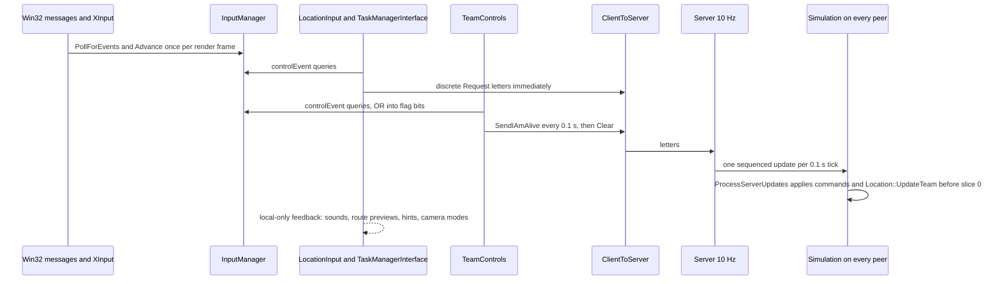
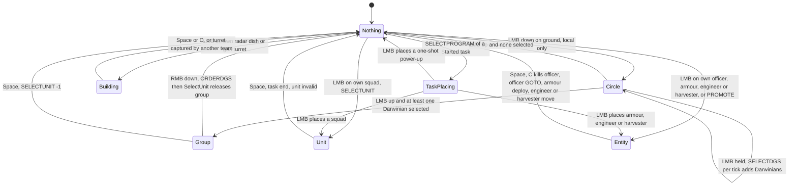
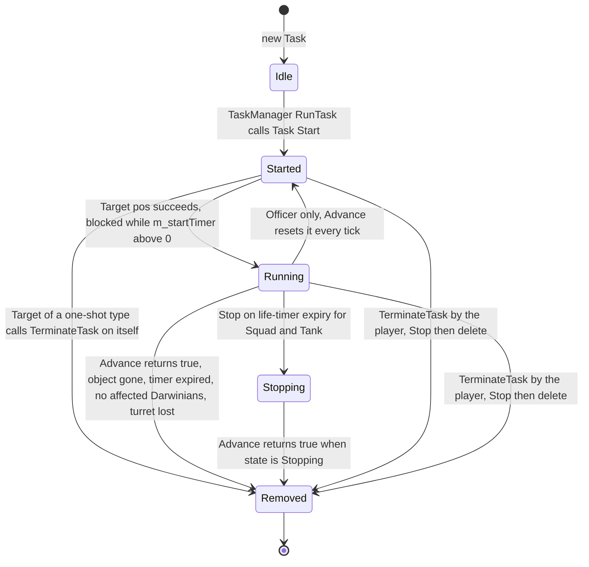
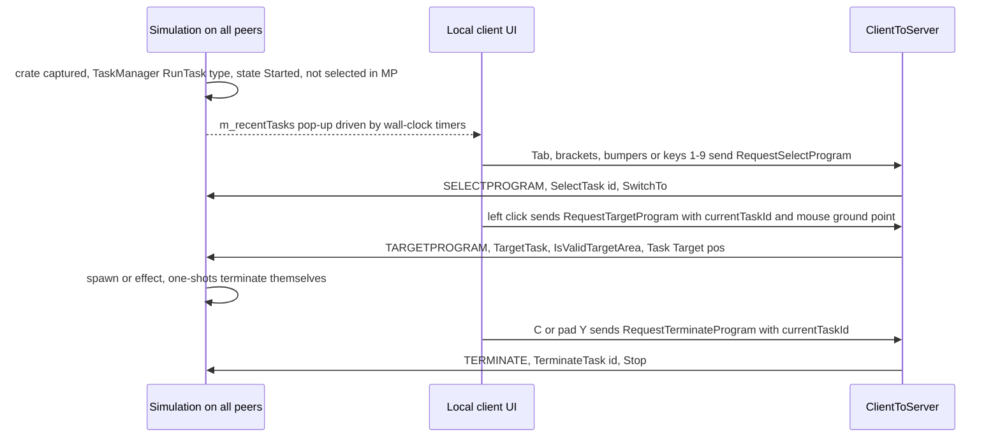
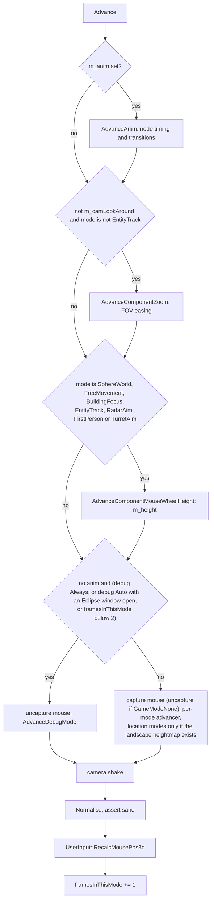
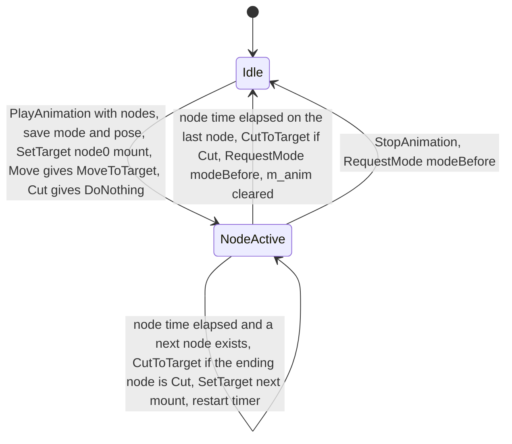
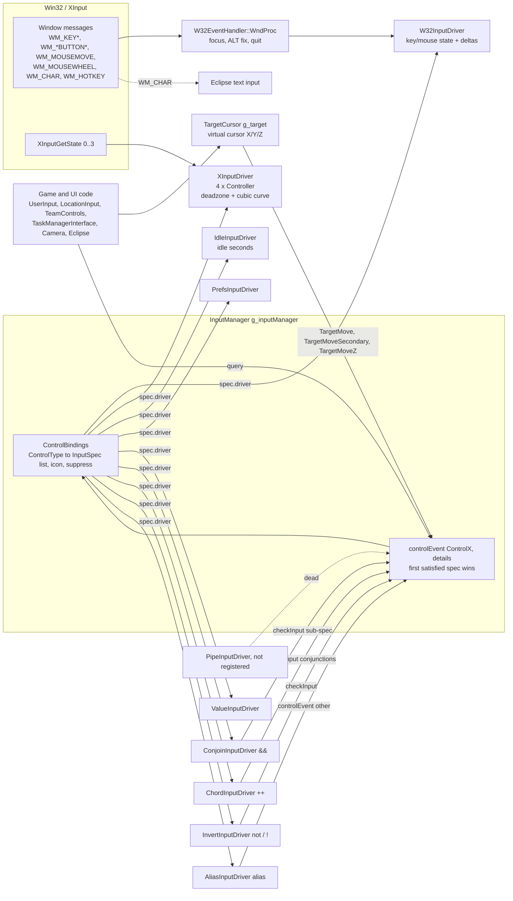
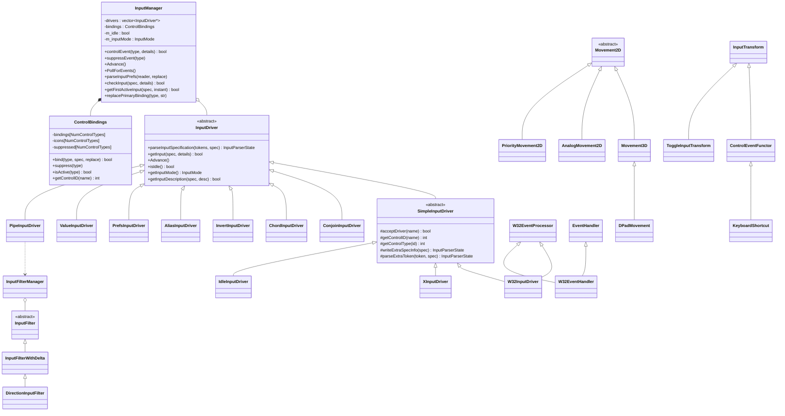

# 06 — Player control and input

> Part A · Baseline build: Release|Win32 (OpenGL) + TARGET_PC_FULLGAME ([B:FULL]); see _work/build_matrix.md.
> Evidence: [C] confirmed · [I] inferred · [U] unknown. Citations are `path:Symbol` relative to the multiwinia/ source root.
> Sources merged: P01_app_core (§5 in-match input, §4.5 TeamControls, determinism D15–D18), P08_crates_ai (§16 MarkerSystem), P09_control_taskmanager (§1–§6), P10_input_camera (§1–§5, determinism notes, bindings CSV and per-line CSV), with cross-checks against P03_entity_core (Officer), P04_entities_military (InsertionSquad, Armour, Shaman), P15_network (command catalogue), P17b_menus_options (options windows), P19_help_tutorial_script (MultiwiniaHelp hints) and the `_work/routed/_meta_*.md` notes. Generated tables: `_work/scripts/S_06_bindings_table.py` (§12), `_work/scripts/S_06_mount_census.py` (§9.8).

## Contents

- [At a glance](#at-a-glance)
- [1 Player-action master table](#1-player-action-master-table)
- [2 Selection model](#2-selection-model)
- [3 Task manager](#3-task-manager)
- [4 Task-manager interfaces](#4-task-manager-interfaces)
- [5 Officer orders promotion and formations](#5-officer-orders-promotion-and-formations)
- [6 Direct control of units and buildings](#6-direct-control-of-units-and-buildings)
- [7 Gesture recognition](#7-gesture-recognition)
- [8 Game cursor highlights and world markers](#8-game-cursor-highlights-and-world-markers)
- [9 Camera](#9-camera)
- [10 Control help and Multiwinia hint overlays](#10-control-help-and-multiwinia-hint-overlays)
- [11 Input architecture](#11-input-architecture)
- [12 Binding reference for all 164 control types](#12-binding-reference-for-all-164-control-types)
- [13 Known defects and desync paths in the input layer](#13-known-defects-and-desync-paths-in-the-input-layer)
- [14 Re-implementation notes](#14-re-implementation-notes)
- [Open questions and unknowns](#open-questions-and-unknowns)
- [Docs-vs-code discrepancies](#docs-vs-code-discrepancies)
- [IP items](#ip-items)
- [Source map](#source-map)
- [Appendix — dead/legacy code](#appendix--deadlegacy-code)

## At a glance

- **Control model.** Multiwinia is an indirect-control RTS: the player never builds units. They (a) draw a *selection circle* over their own Darwinians and right-click a destination, (b) promote a Darwinian to an *Officer* that redirects or leads Darwinians, (c) place *power-ups* granted by crates/reinforcements from a 6-slot *task manager*, and (d) directly steer a few special units (squad, armour, engineer, harvester) and buildings (gun turret, radar dish) [C] `code/location_input.cpp:LocationInput::AdvanceTeamControl`, `code/location.cpp:Location::UpdateTeam`.
- **Authority.** Input never mutates simulation state directly (with three documented exceptions, §13). Discrete actions become `ClientToServer` command letters; continuous mouse/stick state is packed into `TeamControls` and sent every 0.1 s; every peer executes both from the server's ordered command stream (lock-step) [C] `code/network/clienttoserver.cpp:ClientToServer::ProcessServerUpdates`, `code/main.cpp:SendTeamControlsToNetwork`.
- **One live control scheme.** Two binding files exist, but `PrefsManager::Load` forces `MultiwiniaControlMethod = 1` after every preferences load ("Hack by Chris to disable old-style control"), so the RTS-style `data/input/input_preferences.txt` (right mouse = orders) is always the system file in FULL [C] `code/lib/preferences.cpp:PrefsManager::Load`, `code/lib/input/file_paths.cpp:InputPrefs::GetSystemPrefsPath`. *Resolved: drafts P01/P10 described scheme 0 as selectable; code shows it is forced off.*
- **No in-game rebinding.** The key-binding window exists but its menu button is commented out (`OptionsMenuWindow::Create`); only a hand-edited `user_input_preferences.txt` or `preferences.txt` changes controls [C] `code/interface/mainmenus.cpp:OptionsMenuWindow::Create`. *Resolved: P10 listed controls as "user-rebindable (Options UI)"; P17b said rebinding is unreachable; the code confirms P17b.*
- **The task bar is not clickable.** In Multiwinia the task-manager overlay can never become visible, mouse hover is only evaluated while visible, so tasks are chosen with keys 1–9, Tab/`[`/`]`, pad bumpers, or by selecting the task's unit in the world [C] `code/taskmanager_interface_multiwinia.cpp:TaskManagerInterfaceMultiwinia::Advance`, `AdvanceScreenZones`.
- **Gestures, icon task manager and gamepad control help are dead in Multiwinia** (Darwinia-campaign only) [C] `code/taskmanager_interface.cpp:TaskManagerInterface::CreateTaskManager`, `code/control_help.cpp:ControlHelpSystem::Render`.
- **Input graph.** A query-driven binding graph: 164 logical controls, each an OR-list of specs evaluated by 9 registered drivers (3 composite: `&&`, `++`, `not`; 6 leaf/utility) [C] `code/main.cpp:InitialiseInputManager`, `code/lib/input/input.cpp:InputManager::controlEvent`.
- **Design-critical defects:** a confirmed desync path (`InsertionSquad::DirectControl` reads the local camera's look-around flag inside simulation), 1-byte task ids on the wire, render code writing simulation state, unknown binding conditions silently becoming "down" (§13).

## 1 Player-action master table

### 1.1 Conventions and global gates

- **Binding notation** (from `data/input/input_preferences.txt`, the only live system file, §11.10): *down* = became pressed this frame (edge), *up* = became released this frame, *pressed/held* = currently held (level). "LMB/RMB/MMB" = left/right/middle mouse button. Pad bindings are XInput and exist only when `xinput1_3.dll` loads (§11.6.6) [C] `code/main.cpp:InitialiseInputManager`.
- **"Single-player" in code means the Darwinia campaign.** `App::IsSinglePlayer()` is true only for `GameModeCampaign`/`GameModePrologue`; every Multiwinia game — online, LAN, versus CPU, and the tutorials — runs with `App::Multiplayer()` true, because `NET_DARWINIA_START_GAME` sets `m_gameMode = GameModeMultiwinia` [C] `code/app.cpp:App::IsSinglePlayer`, `App::Multiplayer`, `code/network/clienttoserver.cpp:ClientToServer::ProcessServerUpdates`. Every branch guarded by `IsSinglePlayer()` is therefore [B:LEGACY].
- **Common gates** used in the table:
  - *G-loc*: `LocationInput::AdvanceTeamControl` runs only if the local team id ≠ 255, **no Eclipse window is open**, and the chat log is not held (`Camera::ChatLogVisible`) [C] `code/location_input.cpp:LocationInput::Advance`.
  - *G-play*: not in the grace period, not game over, not paused (`Multiwinia::GameInGracePeriod`, `Multiwinia::GameOver`, `App::GamePaused`).
  - *G-TM*: the task-manager interface is hidden (`TaskManagerInterface::IsVisible`; always hidden in Multiwinia except when the cut Shaman UI is open, §4.2).
  - *Nothing selected*: team `m_currentUnitId`, `m_currentEntityId`, `m_currentBuildingId` all −1.
  - *Task placing*: the current task exists and is `Task::StateStarted` (§3.4).
- **Applied at the server tick.** Every "Network command" in the table takes effect on all peers when the server echoes it in the next 0.1 s update; selection and orders therefore appear with one round-trip of latency [C] `code/network/clienttoserver.cpp:ClientToServer::ProcessServerUpdates` (see [22](22_determinism_and_networking.md)).

### 1.2 Pipeline and authority model

Per-frame order inside the location loop [C] `code/main.cpp:LocationGameLoop` (P01 §2.6): `InputManager::PollForEvents` → escape/interface keys → `TeamControls::Advance` (if no Eclipse window) → `SendTeamControlsToNetwork` (every `IAMALIVE_PERIOD` = 0.1 s, `code/globals.h`) → simulation catch-up → `UserInput::Advance` → `Camera::Advance` (only while the window has focus) → `LocationInput::Advance` → `TaskManagerInterface::Advance` → script/sound/control-help/shaman/marker/help advances.



Local, non-networked feedback is applied immediately: sounds, the route preview line (generated every frame and deleted the next frame), help hints, camera mode changes (e.g. radar-aim and turret-aim are requested locally at click time, before the selection command executes) [C] `code/location_input.cpp:LocationInput::SelectObjectUnderMouse`.

### 1.3 Master table — Multiwinia live actions

Column "Cmd" lists the network command letter (full catalogue §1.4); "ALIVE" = carried in the continuous `TeamControls` packet (§6.1). All rows are [B:FULL] unless tagged.

| # | Action | Keyboard / mouse | Pad (XInput) | Context and conditions | Effect | Cmd | Code ref |
|---|---|---|---|---|---|---|---|
| **Camera and view** (local only, never networked) | | | | | | | |
| A1 | Pan camera | `CameraLeft/Right/Forwards/Backwards` = A/D/W/S or ←/→/↑/↓ (held) | `CameraMove` = left stick | Free-movement camera; TM and Shaman UI hidden | Target point moves 250 u/s along the horizontal camera basis; stick: 10 u/s per stick unit (≤ ≈393 u/s) | — | [C] `code/camera.cpp:Camera::AdvanceFreeMovementMode` |
| A2 | Fast pan | `CameraSpeedup` = Shift (held) | L3 (left-stick click, held) | with A1 | ×4 key speed (1000 u/s); the stick path ignores it | — | [C] same |
| A3 | Raise / lower camera | `CameraUp` = Q, `CameraDown` = E (held); `TargetMoveZ` = mouse wheel | `CameraUp` = right trigger, `CameraDown` = left trigger | No Eclipse window; Q/E/triggers ignored while aiming a radar dish or gun turret | Height `+= delta·2·√|h − ground|` (§9.4) | — | [C] `code/camera.cpp:Camera::AdvanceComponentMouseWheelHeight` |
| A4 | Aim (mouse-look) | `TargetMove` = mouse movement | `TargetMoveSecondary` = right stick (only with no window open and TM hidden) | Free-movement, radar-aim and turret-aim modes; not while chat log held | The camera turns to face the ground point under the cursor; the cursor stays glued to that ground point (§9.4) | — | [C] `code/lib/targetcursor.cpp:TargetCursor::Advance`; `Camera::AdvanceFreeMovementMode` |
| A5 | Zoom (narrow FOV) | `CameraZoom` = Z or MMB (held) | R3 (right-stick click, held) | No Eclipse window; not in entity-track (there it re-centres behind the squad, §9.6) | FOV target ÷4 (60° → 15°) while held | — | [C] `Camera::AdvanceComponentZoom` |
| A6 | Look around (freeze camera) | `CameraFreeMovement` = F2 (held) | R3 (held) | Ignored while `UnitPrimaryFireTarget` is held | Freezes camera position and entity tracking; orientation still follows the cursor. **Also changes squad simulation on this peer (desync, §13 X1)** | — | [C] `code/camera.cpp:Camera::SwitchEntityTracking` |
| A7 | Squad camera distance | — | `CameraSquadZoomIn/Out` = d-pad up/down (held) | Entity-track camera (pad default) | Distance ∓10 u/s, clamp [50, 500]; integer truncation makes zoom-out inert at normal frame rates (§13 X12) | — | [C] `Camera::AdvanceAutomaticTracking` |
| A8 | Show chat log | `IconsChatLog` = L (held) (`GesturesChatLog` if pref `ControlMethod` = 0) | — | No Eclipse window | Chat log visible; mouse-look frozen; `AdvanceTeamControl` skipped; continuous team-control flags cleared | — | [C] `code/camera.cpp:Camera::ChatLogVisible`; `code/main.cpp:SendTeamControlsToNetwork` |
| A9 | Hide interface | `ToggleInterface` = Alt held + X down | — | — | Toggles `m_hideInterface` (HUD, markers, task bar, cursor effects hidden) | — | [C] `code/main.cpp` (`ControlToggleInterface`) |
| A10 | Screenshot | `CreateScreenShot` = P (down) | — | No Eclipse window | Renders and saves a (tiled if `RenderPosterResolution` > 1) screenshot | — | [C] `code/renderer.cpp:Renderer::Render` |
| **Selection** | | | | | | | |
| S1 | Select object under cursor | `UnitSelect` = LMB down (also `SelectLocation` = LMB down when nothing is selected) | A down | G-loc, G-TM; pick rules §1.5; own objects only (buildings own or neutral) | Own RadarDish → select + camera radar-aim (unless level option `NoRadarControl` = 1); own GunTurret → select + camera turret-aim; own non-Darwinian entity or unit → select; success sound `SelectUnit` (≤ every 0.5 s) | `SELECTUNIT` | [C] `code/location_input.cpp:LocationInput::SelectObjectUnderMouse`, `AdvanceNoSelection` |
| S2 | Click on empty ground while something is selected | LMB down | A down | Something selected; not placing a task; not controlling a squad; not a pad-mode officer/armour; `UnitSetTarget` not held | Sound `MouseError` + "press SPACE to deselect" hint (§10.4) — no command | — | [C] `LocationInput::SelectObjectUnderMouse` |
| S3 | Deselect | `UnitDeselect` = Space down | B down | G-loc | Clears unit/entity/building selection, ends any Darwinian group selection, camera → free movement, `m_previousTaskId = −1` | `SELECTUNIT(−1,−1,−1)` | [C] `LocationInput::AdvanceTeamControl` |
| S4 | Begin selection circle | `BeginSelectionCircle` = LMB down | A down | G-loc; nothing selected; 0 Darwinians selected; no task placing; G-TM; no circle active; no officer under cursor; not grace period; cursor not over a building or an own non-Darwinian entity/unit | Local: circle centre = cursor ground point, radius 0, sound `SelectionCircle` | — | [C] `LocationInput::AdvanceTeamControl` |
| S5 | Grow selection circle | `EnlargeSelectionCircle` = LMB held | A held | as S4 (branch with 0 Darwinians selected) | Radius += 100 u/s (real frame time), max 100 u; whenever network time has advanced since the last send → select Darwinians inside | `SELECTDGS` | [C] same; `code/location.cpp:Location::SelectDarwinians` |
| S6 | End selection circle | `EndSelectionCircle` = LMB up | A up | G-loc | Circle centre := 0; `m_lastOrdersSet` := 0 | — | [C] same |
| S7 | Next task | `UnitCycleRight` = Tab or `]` down (`GesturesSwitchUnit` = Tab only if pref `ControlMethod` = 0) | RB down | TM hidden or keyboard mode | Next slot (wraps; anchor = current task, else `m_previousTaskId`, else slot 0); sound `MouseOverIcon`; squad task → camera entity-track, else free camera | `SELECTPROGRAM` | [C] `code/taskmanager_interface.cpp:TaskManagerInterface::AdvanceTab` |
| S8 | Previous task | `UnitCycleLeft` = `[` down | LB down | as S7 | Previous slot (wraps) | `SELECTPROGRAM` | [C] same |
| S9 | Select task slot 1–9 | `TaskManagerSelectTask1…9` = keys 1–9 down | — | Slot exists and its `m_startTimer ≤ 0` | Select that slot's task; sound `SelectTask` | `SELECTPROGRAM` | [C] `code/taskmanager_interface_multiwinia.cpp:TaskManagerInterfaceMultiwinia::RunScreenZone` |
| S10 | Select a task by its unit | S1 on the task's unit/entity | S1 | — | The `SELECTUNIT` handler also calls `TaskManager::SelectTask(WorldObjectId)` | `SELECTUNIT` | [C] `ClientToServer::ProcessServerUpdates` |
| **Orders** | | | | | | | |
| O1 | Order selected Darwinians | `IssueDarwinianOrders` = RMB down; Ctrl held (`OrderDirectRoute`) = straight-line route | X down | G-loc; nothing selected; ≥ 1 Darwinian selected; no circle active; no task placing; G-TM; ≥ 1.0 s of network time since the last order; target inside the landscape | Selected Darwinians walk to the target (snapped to RadarDish entrance, crate, non-full armour or officer under cursor, §1.5); armour within 30 u of target → they board it; direct route forced if ≥ 25 % carry a WallBuster; selection is released; sound `SetOrderGoto` | `ORDERDGS` | [C] `LocationInput::AdvanceTeamControl`; `code/location.cpp:Location::IssueDarwinianOrders` |
| O2 | Promote Darwinian to Officer | `DarwinianPromote` = RMB down on own Darwinian | X down | G-loc; nothing selected; 0 Darwinians selected; no task placing; G-play; nearest own selectable Darwinian ≤ 10 u of the cursor ground point; not consumed by O3/O4 | Darwinian replaced by an Officer, which becomes selected; tutorial notification | `PROMOTE` | [C] `LocationInput::AdvanceTeamControl`; `code/location.cpp:Location::PromoteDarwinian` |
| O3 | Toggle officer formation / cancel | `DarwinianPromote` = RMB down on an own Officer | X down | as O2 except: nothing selected **or** that officer is the selected entity | Officer in formation or with a GOTO order → `CancelOrders` (disband); otherwise → formation mode facing forward and the officer is (re)selected; sound `ToggleUnitState` | `TOGGLEENTITY` (secondary 0) | [C] same; `ClientToServer::ProcessServerUpdates` (TOGGLEENTITY) |
| O4 | Toggle armour load/unload | RMB down on own Armour | X down | as O3 | `Armour::ToggleLoading` (Idle → Unloading if passengers else Loading; Loading ↔ Unloading) | `TOGGLEENTITY` (secondary 0) | [C] `code/worldobject/armour.cpp:Armour::ToggleLoading` |
| O5 | Toggle armour arrival action | RMB down on the armour's **order marker** icon | X down | as O3, `MarkerSystem::m_isOrderMarkerUnderMouse` | `Armour::ToggleConversionAction` (cycles the load/unload-on-arrival order); deselects the armour if it was selected | `TOGGLEENTITY` (secondary 1) | [C] `Armour::ToggleConversionAction` |
| O6 | Officer GOTO / move formation | `IssueSpecialOrders` = RMB down; Ctrl = direct route | X down (`OrderSpecialMove`, inverted on pad) | Officer selected | `Officer::SetOrders(pos)`: in formation → formation marches to pos; click < 50 u from officer → enter formation; else GOTO signpost order; officer deselected (§5.3) | `ORDERGOTO` (force 0) | [C] `LocationInput::AdvanceTeamControl`; `code/worldobject/officer.cpp:Officer::SetOrders` |
| O7 | Officer walk | Shift (`OrderSpecialMove`) + RMB down | A down (`IssueSpecialOrders`, inverted on pad) | Officer selected | `Officer::SetWaypoint(pos)` — the officer itself walks (enters a connected radar dish within 5 u of the target) | `ORDERGOTO` (force 1) | [C] same; `Officer::SetWaypoint` |
| O8 | Armour move | RMB down | A down | Armour selected; target inside landscape | `Armour::SetWayPoint(pos)` (clears any arrival action; Loading → Idle); route highlighted; order marker for friendly teams; sound `SetOrders` | `ORDERGOTO` (force 1) | [C] `LocationInput::AdvanceTeamControl`; `Armour::SetWayPoint` |
| O9 | Armour move and deploy | Shift + RMB down | X down | as O8 | `Armour::SetOrders(pos)`: if > 50 u away → drive there and on arrival (< 15 u) start Unloading (passengers) or Loading; armour deselected | `ORDERGOTO` (force 0) | [C] `Armour::SetOrders`, `Armour::Advance` |
| O10 | Aim radar dish | `UnitSelect` = LMB down | A down | Own RadarDish selected (nothing else) | Aim at the start point of the other dish under the cursor, else at the cursor ground point | `AIMBUILDING` | [C] `LocationInput::AdvanceRadarDishControl`; `code/worldobject/radardish.cpp:RadarDish::Aim` |
| **Tasks and power-ups** | | | | | | | |
| T1 | Place / fire current power-up | `UnitCreate` = LMB down | A down | Task placing; G-TM; G-play | Target the current task at the cursor ground point (validity rules §3.6) | `TARGETPROGRAM` | [C] `LocationInput::AdvanceTeamControl`; `code/taskmanager.cpp:TaskManager::TargetTask` |
| T2 | Right-click while placing | `IssueSpecialOrders` = RMB down | — (suppressed in pad mode) | Task placing; G-play; not growing a circle | Sound `MouseError` + "press SPACE to deselect" hint; no command | — | [C] same |
| T3 | Cancel (terminate) current task | `IconsTaskManagerEndTask` = C down | Y down | No Eclipse window | Terminate the selected task (§3.8); with no task selected sends id 255 → no-op | `TERMINATE` | [C] `TaskManagerInterfaceMultiwinia::AdvanceTerminate` |
| T4 | Destroy own unit under cursor | C down | Y down | Nothing selected; 0 Darwinians selected; G-TM; own non-Darwinian entity under cursor | Entity `ChangeHealth(−999)` + deselect (the same key press also sends T3) | `TERMINATE` (entity) + `SELECTUNIT` | [C] `LocationInput::AdvanceNoSelection` |
| T5 | Destroy selected officer | C down | Y down | Officer selected | Officer `ChangeHealth(−999)` (killed, despite the code comment "demote"), deselect, camera free | `TERMINATE` (entity) + `SELECTUNIT` | [C] `LocationInput::AdvanceTeamControl` |
| T6 | Release gun turret | C down (or Space, S3) | Y down | Own GunTurret selected | Deselect, camera free (turret keeps existing); also automatic when the turret changes owner | `SELECTUNIT(−1)` | [C] same |
| **Direct control** (continuous, §6) | | | | | | | |
| D1 | Squad: move | `LeftButtonPressed` = LMB held | `UnitMove` = left stick (only with entity-track camera) | Squad selected; not firing | Waypoint = cursor ground point (pad: point man + stick vector) | ALIVE | [C] `code/location.cpp:Location::UpdateTeam`; `code/worldobject/insertion_squad.cpp:InsertionSquad::DirectControl` |
| D2 | Squad: fire lasers | `UnitPrimaryFireTarget` = RMB held | right trigger held (`righttriggerb`), aim with right stick | Squad selected; not look-around | `InsertionSquad::Attack(target,false)` each tick (≈6 shots/s for 3 squaddies) | ALIVE | [C] same |
| D3 | Squad: throw grenade | RMB held + LMB down (`UnitSecondaryFireTarget`) | left trigger down + right trigger | Squad selected | `InsertionSquad::Attack(target,true)` — nearest squaddie throws a grenade (4 s cooldown) | ALIVE | [C] same |
| D4 | Engineer / Harvester: move | `UnitSetTarget` = RMB held | X held | Engineer or Harvester selected | `SetWaypoint(cursor)` and deselect | ALIVE | [C] `Location::UpdateTeam` |
| D5 | Gun turret: aim and fire | aim = cursor; fire = RMB held or LMB held | aim = cursor; fire = X held, RT held or left stick | Own GunTurret selected (turret-aim camera) | `GunTurret::SetTarget(cursor)` every update; `PrimaryFire()` while firing | ALIVE | [C] `Location::UpdateTeam` |
| D6 | Officer: face cursor | cursor | cursor | Officer selected, order PrepareGoto, speed < 5 | Officer turns to face the cursor | ALIVE | [C] `Location::UpdateTeam` |
| **Match flow and meta** | | | | | | | |
| M1 | Ready up | `ToggleReady` = Space down | A or B down | Grace period; no Eclipse window | Toggles the team's ready flag | `TOGGLE_READY` | [C] `LocationInput::Advance` |
| M2 | Open chat | `LobbyChat` = Enter down | — (pad closes any open chat) | Not gamepad mode; chat closed; not toggled this update; no window | Opens `ChatInputWindow`; submitting sends the message | `SEND_CHATMESSAGE` | [C] `LocationInput::Advance`; `code/interface/chatinput_window.cpp` |
| M3 | Pause | `GamePause` = Pause down | — | No remote human team in the match; not grace period; not game over | Toggles pause (game speed ramps to 0 or 1 at rate 0.2) | `PAUSE` | [C] `code/user_input.cpp:UserInput::Advance`; `code/app.cpp:App::ToggleGamePaused` |
| M4 | In-game menu | `MenuEscape` = Esc down | Start down | Fade complete; no script running | Close all open windows (and un-hide the HUD), else hide the TM overlay, else set camera debug mode Auto and open `LocationWindow` (HUD hidden while it is open); then `UserInput::Advance` runs a second time this frame | — | [C] `code/main.cpp:LocationGameLoop` |
| M5 | Network statistics | `ToggleNetworkStats` = F9 down | — | `NETWORK_STATS_ENABLED` (defined in FULL) | Toggles the network stats window | — | [C] `UserInput::Advance` |
| M6 | UI clicks | `EclipseLMouseDown/Pressed` = LMB, `EclipseRMousePressed` = RMB **down** | LB held + A (`alias ShowMouseCursor && XInput a …`) | Over an Eclipse window | Drives the window framework; a left click over a window is suppressed from the game for the rest of the frame | — | [C] `UserInput::AdvanceMenus` |
| M7 | Controller unplugged / plugged | — | `ControllerUnplugged` = plug up; `ControllerPlugged` = plug down | — | Opens / closes the `controller_unplugged` dialog; while unplugged in pad mode the app treats itself as unfocused | — | [C] `code/main.cpp:HandleCommonConditions` |
| M8 | Quit | Alt+F4; window close | — | — | `m_requestQuit = true` | — | [C] `code/lib/input/inputdriver_win32.cpp:W32InputDriver::WndProc`, `code/lib/input/win32_eventhandler.cpp:W32EventHandler::WndProc` |

Front-end menu navigation (pad d-pad/sticks with `repeat`, A/B/Back/Start, `MenuLeft/Right/Up/Down`, `MenuActivate`, `MenuClose`, `MainMenuActivate`, `SkipMessage`, `ScrollSpeedup`) is owned by the UI framework, see [28](28_ui_framework.md) and [09](09_meta_systems.md); every binding is in §12.

### 1.4 Network commands emitted by player input

Command letters carry the field codes of [22](22_determinism_and_networking.md) (`TEAMID` `de` char, `UNITID` `dl` int, `ENTITYID` `dm` int, `BUILDINGID` `dn` int, `PROGRAM` `dq` char, `RADIUS` `dp` float, `POSITION` `df` Vector3, `DIRECTROUTE` `cob` char, `FORCEONLYMOVE` `cod` char, `SECONDARYFUNCTION` `coe` char) [C] `code/network/network_defines.h`. All are relayed by the server to every client and executed in sequence order. The server checks only that the sender is registered and TEAMID ≠ 255 — **not that the sender owns the team** [C] `code/network/server.cpp:Server::Advance` (P15).

| Command (code) | Sender function | Payload | Executed on every peer | Raised by (§1.3) |
|---|---|---|---|---|
| `ALIVE` (`cd`) | `ClientToServer::SendIAmAlive` | TEAMID, ALIVE_DATA (packed `TeamControls`, §6.1) | `Location::UpdateTeam(team, controls)`; server keeps only the latest per client per tick | A-/D-rows |
| `SELECTUNIT` (`ce`) | `RequestSelectUnit` | TEAMID, UNITID, ENTITYID, BUILDINGID (ints) | `Team::SelectUnit(u,e,b)` then `TaskManager::SelectTask(WorldObjectId(team,u,e,−1))`; latest-only per client per tick | S1, S3, T4–T6 |
| `AIMBUILDING` (`cf`) | `RequestAimBuilding` | TEAMID, BUILDINGID, POSITION | if the building exists, belongs to TEAMID and is a RadarDish: `RadarDish::Aim(pos)` | O10 |
| `RUNPROGRAM` (`ch`) | `RequestRunProgram` | TEAMID, PROGRAM (task **type**) | `TaskManager::RunTask(type)` | [B:LEGACY] only (Icons/Gestures interfaces, SP quick-units) |
| `TARGETPROGRAM` (`ci`) | `RequestTargetProgram` | TEAMID, PROGRAM (task **id**, 1 byte), POSITION | `TaskManager::TargetTask(id, pos)` | T1 |
| `SELECTPROGRAM` (`cj`) | `RequestSelectProgram` | TEAMID, PROGRAM (task id) | `TaskManager::SelectTask(id)` | S7–S9 |
| `TERMINATE` (`ck`) | `RequestTerminateProgram` / `RequestTerminateEntity` | TEAMID, PROGRAM (task id, or 255 = entity), ENTITYID (−1 for tasks) | PROGRAM ≠ 255: `TaskManager::TerminateTask(id)`; else if `m_others[ENTITYID]` valid: `ChangeHealth(−999)` | T3–T5 |
| `SELECTDGS` (`cm`) | `RequestSelectDarwinians` | TEAMID, RADIUS (float), POSITION | `Location::SelectDarwinians(team, pos, radius)` | S5 |
| `ORDERDGS` (`cn`) | `RequestIssueDarwinanOrders` | TEAMID, DIRECTROUTE, POSITION | `Location::IssueDarwinianOrders(team, pos, direct)` | O1 |
| `PROMOTE` (`co`) | `RequestPromoteDarwinian` | TEAMID, ENTITYID | if `m_others[id]` is an Officer: `Location::DemoteOfficer` + `SelectUnit(−1,−1,−1)`; else `Location::PromoteDarwinian` and `SelectUnit(−1, officerIndex, −1)` | O2 |
| `ORDERGOTO` (`coa`) | `RequestOfficerOrders` / `RequestArmourOrders` | TEAMID, DIRECTROUTE, FORCEONLYMOVE, POSITION. Armour writes DIRECTROUTE = `true` (bool) and FORCEONLYMOVE = `!deploy` | selected entity Officer: force ? `SetWaypoint` : `SetOrders(pos, direct)`; Armour: force ? `SetWayPoint` : `SetOrders`, plus `MarkerSystem::RegisterMarker_Orders` if TEAMID is a friend of the local team | O6–O9 |
| `TOGGLEENTITY` (`coc`) | `RequestToggleEntity` | TEAMID, ENTITYID, SECONDARYFUNCTION | Armour: secondary ? `ToggleConversionAction` : `ToggleLoading`; Officer: formation or `OrderGoto` → `CancelOrders`, else `SetOrders(pos + front)` **and the executing peer sends a new `SELECTUNIT`** (N peers → N identical commands, §13 X9) | O3–O5 |
| `FOLLOW` (`cya`) / `NONE` (`cyb`) | `RequestOfficerFollow` / `RequestOfficerNone` | TEAMID | selected Officer: `SetFollowMode` / `CancelOrders` | [B:LEGACY] only (SP officer controls) |
| `NEXTWEAPON` (`cx`) / `PREVWEAPON` (`cy`) | `RequestNextWeapon` (empty body) / none | — | Officer `SetNextMode`/`SetPreviousMode` (no-ops in MP), Armour `SetDirectOrders` | **never sent** [C] `ClientToServer::RequestNextWeapon` is empty; no `RequestPreviousWeapon` exists |
| `SHAMANSUMMON` (`cl`) | `RequestShamanSummon` | TEAMID, ENTITYID (shaman unique id), ENTITYTYPE | `Shaman::SummonEntity` | [B:LEGACY] (Shaman cut, §6.7) |
| `TOGGLE_READY` (`cca`) | `RequestToggleReady` | TEAMID | in game: `Team::m_ready ^= 1` | M1 |
| `PAUSE` (`cp`) | `RequestPause` | — | toggle `m_userRequestsPause`, speed request 0/1 at rate 0.2 | M3 |
| `SEND_CHATMESSAGE` (`cczz`) | `SendChatMessage` | UNICODEMESSAGE, CLIENTID | `Location::NewChatMessage` | M2 |

Evidence: [C] `code/network/clienttoserver.cpp` (all `Request*` senders and the matching `ProcessServerUpdates` branches, read for this document).

### 1.5 Context resolution helpers

**Object under the cursor** — `LocationInput::GetObjectUnderMouse(id, team)` [C] `code/location_input.cpp`:
1. Returns false for team 255, or while the team controls a GunTurret (no snapping while aiming).
2. A world-marker icon under the mouse wins (`MarkerSystem::m_markerUnderMouse`, §8.12).
3. Otherwise cast the camera click ray through the cursor and collect the nearest hit of each kind: building (`Location::GetBuildingId` — own or neutral buildings only, ControlTower excluded), unit (`Location::GetUnitId` — **own team only**), entity (`Location::GetEntityId` — own team only, Darwinians ignored) [C] `code/location.cpp:Location::GetBuildingId`, `GetUnitId`, `GetEntityId`.
4. Buildings other than RadarDish, GunTurret and FenceSwitch are discarded.
5. If no entity was hit and an **Officer task** is being placed, the nearest own Darwinian within 10 u of the cursor ground point counts (`Task::FindDarwinian`, distance 0).
6. The nearest of entity / unit / building along the ray wins (strict `<` comparisons); a building must be own or neutral. Unit ids are returned with the local team id.

Consequence: enemy units are never pickable; all player clicks address the player's own objects [C].

**Order target snapping** (`highlightedObjectPos`, used by O1, O6–O9 and the route previews): cursor ground point, replaced by the RadarDish entrance (`RadarDish::GetEntrance`) if a dish is under the cursor, by the crate position if a Crate is, by the armour position if a non-full Armour is, or by the officer position if an Officer is [C] `LocationInput::AdvanceTeamControl`.

**Cursor ground point** — `UserInput::RecalcMousePos3d()` (called by the camera after it moves): click ray → `Landscape::RayHit` → `m_mousePos3d`; on a miss the ray hits the inside of a sphere centred (worldSize/2, 0, worldSize/2) with radius `GlobalWorld::GetSize() × 40` (ray reversed from 4 radii out); outside a location a sphere of radius 36000 at the origin [C] `code/user_input.cpp:UserInput::RecalcMousePos3d`.

**Networked mouse position** — before each `ALIVE` send, `SendTeamControlsToNetwork` replaces `m_mousePos` with the position of the own entity under the cursor, or the RadarDish position if a dish is under it (the computed `checkMouse`, `orderGiven`, `entityUnderMouse` are unused) [C] `code/main.cpp:SendTeamControlsToNetwork`.

### 1.6 Legacy and dead actions

| Action | Binding | Status | Notes / ref |
|---|---|---|---|
| Darwinia-style scheme (`MultiwiniaControlMethod` = 0): LMB held = officer/armour move every frame (`ControlUnitSetTarget` then = LMB held), RMB on a formation officer first sends `NONE`, armour deploy inverted (plain RMB deploys), LMB down = order Darwinians | `data/input/input_preferences_darwinia.txt` | [B:LEGACY] forced off by `PrefsManager::Load` | [C] `code/location_input.cpp:LocationInput::AdvanceTeamControl`, `code/lib/preferences.cpp:PrefsManager::Load` |
| Quick-run program: d-pad left/right/up → Engineer/Armour/Squad | `IconsTaskManagerQuickUnitLeft/Right/Up` | [B:LEGACY] (`IsSinglePlayer()` only) | sends `RUNPROGRAM` [C] `LocationInput::AdvanceTeamControl` |
| SP officer orders: d-pad left = follow, d-pad down = none, RMB within 50 u (‖d‖² < 2500) = follow else GOTO (radar-dish snap never fires because `GetObjectUnderMouse(…, 255)` returns false) | `IconsTaskManagerQuickUnitLeft/Down`, `IssueSpecialOrders` | [B:LEGACY] | sends `FOLLOW`/`NONE`/`ORDERGOTO` [C] same |
| SP armour deployment: RMB → awaiting deployment; then LMB → `SetOrders(own pos)` (converts to a turret) — **local mutation of sim state, not networked** | `IssueSpecialOrders`, `UnitCreate` | [B:LEGACY] | [C] same |
| Squad weapon cycling (`WeaponCycleLeft/Right` = d-pad left/right) → `RUNPROGRAM(weapon)` | — | [B:DEAD] (commented out) | [C] same |
| Pad squad secondary cycling `InsertionSquad::CycleSecondary` on `m_unitSecondaryMode` | `IssueSpecialOrders` | [B:LEGACY] (`IsSinglePlayer()`) | [C] `Location::UpdateTeam` |
| Order Darwinians with pad right trigger (`UnitSecondaryFireDirected`) | unbound (icon line only) | dead (live code, no binding) | [C] `LocationInput::AdvanceTeamControl`; `data/input/input_preferences.txt` |
| Game over → press `ToggleReady` to return to menu | Space | [B:DEAD] (`TESTBED_ENABLED` only). *Resolved: P09 §2.6 listed it as live; code places it inside `#ifdef TESTBED_ENABLED`* | [C] `LocationInput::Advance` |
| `ToggleRendering` (R) testbed rendering switch | R | [B:DEAD] (`TESTBED_ENABLED`) | [C] same |
| Cheat menu (F11), special-lighting cheat (`RTLoaderPixelWaveIncrease/Decrease`) | F11; L/K | [B:DEBUG] (`CHEATMENU_ENABLED`) | [C] `UserInput::Advance`; `code/location.cpp:Location::RenderBuildings` |
| Debug quit (`GameDebugQuit`) | unbound (commented `XInput leftbumper down`) | dead | [C] `code/main.cpp:HandleCommonConditions` |
| Fence switch toggle by click (`FenceSwitch::Switch`, local, no network) | LMB on own FenceSwitch | [B:LEGACY] — FenceSwitch is a blocked type and no shipped level contains one (grep of `data/levels/*.txt`) | [C] `LocationInput::SelectObjectUnderMouse`; `code/worldobject/building.cpp:Building::BuildingIsBlocked`. *Resolves P01-U5.* |
| Tank / Shaman / Engineer bridge controls | see §6.7 | [B:LEGACY] | §6.7 |

## 2 Selection model

### 2.1 Selection state

Selection is **simulation state replicated by commands**: it is changed only by `SELECTUNIT`, `SELECTPROGRAM`, `SELECTDGS`, `ORDERDGS`, `PROMOTE`, `TOGGLEENTITY` and by simulation code reacting to them, on every peer ("Do not set these directly") [C] `code/team.h:Team`, `code/team.cpp:Team::SelectUnit`. A few purely local fields drive the selection UI.

| Field | Owner | Replicated? | Meaning |
|---|---|---|---|
| `Team::m_currentUnitId` | Team | yes (commands) | selected unit (squad) index in `m_units`, −1 none |
| `Team::m_currentEntityId` | Team | yes | selected free entity index in `m_others` (officer, armour, engineer, harvester, tank, shaman), −1 none |
| `Team::m_currentBuildingId` | Team | yes | selected building unique id (RadarDish, GunTurret; ChessPiece/FenceSwitch legacy), −1 none |
| `Darwinian::m_underPlayerControl` | each Darwinian | yes | member of the team's current **group selection** |
| `Team::m_numDarwiniansSelected`, `m_selectedDarwinianCentre` | Team | yes | latched at slice 0 from the previous tick's count/centroid of `m_underPlayerControl` Darwinians (centre = sum/count; **division by zero when 0**, only used for the route preview) [C] `Team::Advance` |
| `TaskManager::m_currentTaskId` | TaskManager | yes | selected task (§3.7) |
| `TaskManager::m_previousTaskId` | TaskManager | **local writes** | Tab-cycling anchor; set by `SelectTask` (replicated) but reset to −1 locally on deselect [C] `LocationInput::AdvanceTeamControl` |
| `Team::m_selectionCircleCentre`, `m_selectionCircleRadius` | Team | **no** (client-local UI) | the circle being drawn; read only by `LocationInput`, `GameCursor` and `MultiwiniaHelp` (grep) [C] — *resolves P09-U1: no simulation reader* |
| `Team::m_lastOrdersSet` | Team | no | throttle timestamp (network time) for O1 and the S5 send cadence |
| `Team::m_blockUnitChange` | Team | yes | while true `SelectUnit` is ignored (set while reinforcements spawn, [02](02_units_and_entities.md)) |

**Single selection**: at most one unit **or** entity **or** building, plus independently one current task and one Darwinian group [C] `Team::SelectUnit`. In practice LocationInput never sends a group order while a unit/entity/building is selected, and every `SelectUnit` call clears the group (below).

### 2.2 Selectable objects

| Kind | Selectable when | By | Ref |
|---|---|---|---|
| InsertionSquad (unit) | own; `InsertionSquad::IsSelectable` = true | S1, task select (`SwitchTo`) | [C] `code/worldobject/insertion_squad.cpp:InsertionSquad::IsSelectable` |
| Officer, Armour, Engineer, Harvester | own; `IsSelectable` = true | S1, `PROMOTE` (officer), task select | [C] `code/worldobject/officer.cpp:Officer::IsSelectable`, `armour.cpp:Armour::IsSelectable`, `engineer.cpp:Engineer::IsSelectable`, `harvester.cpp:Harvester::IsSelectable` |
| Tank, Shaman | own; `IsSelectable` = true | S1 | [B:LEGACY] unreachable in FULL (§6.7) |
| All other entities | `Entity::IsSelectable` = false | — | [C] `code/worldobject/entity.cpp:Entity::IsSelectable` |
| Darwinian | only into a group (S4–S6), never singly; `Darwinian::IsSelectable` false in states BeingSacraficed, InsideArmour, OnFire, OperatingPort (used for promotion) | selection circle, booster-family task select | [C] `code/worldobject/darwinian.cpp:Darwinian::IsSelectable` |
| RadarDish | own; not if level option `LevelOptionNoRadarControl` = 1 | S1 → radar-aim camera | [C] `LocationInput::SelectObjectUnderMouse` |
| GunTurret | own (and, for ChessPiece, legacy) | S1 → turret-aim camera; `Team::SelectUnit` sets `GunTurret::m_fireTimer = 0.5` | [C] same; `Team::SelectUnit` |
| FenceSwitch | own | click toggles locally (legacy, §1.6) | [C] |

Restrictions in `SelectObjectUnderMouse` [C]:
- Pref `ControlRemap == 0` would forbid selecting anything new while anything is selected; the key is absent from `data/default_preferences.txt`, so `GetInt` returns its default −1 and the restriction is **inactive** [C] `code/lib/preferences.h:PrefsManager::GetInt`.
- Nothing new can be selected while a RadarDish or GunTurret is selected (deselect first; S3/T6).
- An entity that is already selected, or a Darwinian, is ignored.
- The success sound plays at most every 0.5 s (wall clock).

### 2.3 Group selection and group orders

`Location::SelectDarwinians(team, pos, radius)` (from `SELECTDGS`) [C] `code/location.cpp`: every Darwinian of exactly that team inside `radius` (entity grid neighbour query) that is not OperatingPort, BeingSacraficed, OnFire or InsideArmour, and not already controlled, gets `m_underPlayerControl = true`; local team: sound `Selected` per Darwinian. Selection is **additive** while the button is held: each send (one per network tick while the circle grows) adds Darwinians; nothing is removed until the group is released.

`Location::IssueDarwinianOrders(team, pos, directRoute)` (from `ORDERDGS`) [C] `code/location.cpp`:
1. If a **connected** RadarDish whose obstruction cell contains `pos` is within its `m_radius` of `pos`, the Darwinians' target becomes the dish's entrance.
2. Centre = mean position of the team's controlled Darwinians (division by the count; NaN if 0).
3. `routeId = RoutingSystem::GenerateRoute(centre, pos, directRoute)` — note the route ends at the *unsnapped* `pos`; local team → `HighlightRoute`.
4. Look for a friendly (`EntityGrid::GetFriends`, so co-op allies included) Armour within 30 u of the target with free capacity.
5. For every controlled Darwinian: armour found → `StateApproachingArmour`, `m_manuallyApproachingArmour = true`, `m_armourId`, and an Unloading armour is switched to Idle; otherwise `Darwinian::GiveOrders(target, routeId)` and `m_followingPlayerOrders = true`; sound `GivenOrdersFromPlayer`.
6. [B:LEGACY] single-player particle trail; local team → `GameCursor::CreateMarker(pos)` (never drawn in MP, §8.10).
7. `Team::SelectUnit(−1,−1,−1)` — which releases the group (below).

Group release [C] `Team::SelectUnit`: whenever `SelectUnit` runs (any arguments) and `m_numDarwiniansSelected > 0`, every Darwinian of the team gets `m_underPlayerControl = false` and both counters are zeroed. *Resolves P03-U1 (where `m_underPlayerControl` is cleared): `Team::SelectUnit`, reached from `IssueDarwinianOrders`, deselect, promotion and every unit selection; additionally on teleport entry ([02](02_units_and_entities.md)).* Booster-family power-ups create a temporary group (§3.7 `SwitchTo`).

### 2.4 Selection lifecycle



Automatic deselection points [C]: `Officer::SetOrders` (GOTO, formation move) in MP; armour deploy (O9, local sender); engineer/harvester move (`Location::UpdateTeam`); selected unit/entity becoming invalid (`LocationInput::AdvanceTeamControl` resets the local field or sends `SELECTUNIT(−1)`); a task ending while current (`TaskManager::AdvanceTasks` → `Team::SelectUnit(−1,−1,−1)`); squad passing a radar dish re-selects the new task (§3.5).

## 3 Task manager

### 3.1 Overview

Each `Team` owns one `TaskManager` (`new TaskManager(m_teamId)`) [C] `code/team.cpp:Team::Initialise`. A **task** (called a "program" on the wire and in UI strings — Darwinia fiction) is a slot-limited, player-owned power: a spawned unit (squad, engineer, armour, harvester, officer promotion, shaman, tank) or a targetable one-shot or timed power-up (air strike, nuke, booster, …). In Multiwinia tasks are **never** created by the player directly: they are granted by the simulation (crates, reinforcements, retribution, starting power-ups, instant units, AI). The player only **selects**, **targets (places)** and **terminates** them; all three travel as network commands and execute identically on every peer (§3.9).

Lifetime in one sentence: *created (`RunTask`) → `StateStarted` (awaiting a target click, icon pulses) → `Target(pos)` spawns or fires the effect → `StateRunning` (tracked object alive or timer running) → removed when `Advance` returns true or `TerminateTask` is called; one-shot powers terminate themselves inside `Target`* [C] `code/taskmanager.cpp`.

### 3.2 Data model

`Task` fields [C] `code/taskmanager.h:Task`, initial values `code/taskmanager.cpp:Task::Task`:

| Field | Type | Init | Meaning |
|---|---|---|---|
| `m_teamId` | int | ctor arg | owning team |
| `m_id` | int | −1 | assigned by `RunTask`/`RegisterTask` from `m_nextTaskId++` (monotonic per team, never reused) |
| `m_type` | int | `GlobalResearch::TypeSquad` | task type = `GlobalResearch` enum value (§3.3) |
| `m_state` | int | `StateIdle` | §3.4 |
| `m_objId` | WorldObjectId | invalid | spawned unit/entity/building/effect being tracked |
| `m_pos` | Vector3 | (0,0,0) | click position (air strike, turret) or running centroid of affected Darwinians (booster family); used by `GetPosition()` |
| `m_route` | Route* | NULL | only for the disabled Controller task; deleted in the destructor |
| `m_lifeTimer` | float (s) | 0 | remaining life for timed tasks; −1 = infinite (instant units) |
| `m_startTimer` | float (s) | 0 | lock-out: while > 0 the task cannot be targeted or selected (UI greys it, shows a countdown) |
| `m_option` | int | −1 | sub-variant: air strike 1 = napalm; gun turret = `GunTurret::GunTurretType*` (0 Standard, 1 Rocket, 2 Mortar, 3 Flame, 4 Subversion); reinforcement tasks get `LevelOptionDefend/AttackReinforcementMode` |
| `m_screenX`, `m_screenY`, `m_screenH` | float | 0 | **UI-only**: last on-screen position/size of the task's icon in the task bar, written by the renderer, read by the pop-up fly-in |

`TaskSource` [C] `code/taskmanager.h:TaskSource` — record for the "power-up received" pop-up: `m_taskId` (−1), `m_timer` (double, wall clock; positive = showing, negative = minimising since `−m_timer`), `m_source` (0 crate, 1 reinforcement, 2 retribution), `m_rotation` (crate-icon spin angle).

`TaskTargetArea` [C] `code/taskmanager.h:TaskTargetArea`: `m_centre` (Vector3), `m_radius` (float), `m_stationary` (bool; true for building-anchored areas).

`TaskManager` fields [C] `code/taskmanager.h:TaskManager`, `code/taskmanager.cpp:TaskManager::TaskManager`:

| Field | Init | Meaning |
|---|---|---|
| `m_tasks` (`LList<Task*>`) | empty | ordered slot list; **order matters** (UI slot index, keys 1–9) |
| `m_teamId` | ctor | |
| `m_nextTaskId` | 0 | next id |
| `m_currentTaskId` | −1 | selected task (the one the next click places) |
| `m_verifyTargetting` | true | if false `IsValidTargetArea` accepts any in-landscape point (instant units, cheat window) |
| `m_mostRecentTaskId` | −1 | id of the last task created (read by sim code right after `RunTask`, and by help UI) |
| `m_mostRecentTaskIdTimer` | 0.0 | wall-clock time of creation (UI) |
| `m_blockMostRecentPopup` | false | set by reinforcement code; **no reader** (the guarding `if` in `RunTask` is commented out) [C] |
| `m_recentTasks` (`DArray<TaskSource*>`) | empty | pop-up queue |
| `m_previousTaskId` | −1 | last task explicitly selected (Tab-cycling anchor) |
| `m_mostRecentEntity` | invalid | id of the most recently promoted Officer (read by AI) |

`#define POWERUP_EFFECT_RANGE 70.0` (world units) [C] `code/taskmanager.h`.

### 3.3 Task types — complete enumeration (29)

Task type ids are the `GlobalResearch` enum (29 values, `NumResearchItems` = 29) [C] `code/global_world.h:GlobalResearch`; names from `GlobalResearch::GetTypeName` [C] `code/global_world.cpp` (used for `icons/icon_<Name>.bmp`, `icons/gesture_<Name>.bmp`, string ids `researchname_<Name>`, `crate_tooltip_<name>`, `newcontrols_select_<Name>`, `newcontrols_place_<Name>`, `newcontrols_delete_<Name>`).

| Id | Enum | Name string | Created by `RunTask(int)`? | `Start()` | `Target(pos)` effect | Ends (`Advance`) when | `Stop()` on terminate | Multiwinia source |
|---|---|---|---|---|---|---|---|---|
| 0 | TypeDarwinian | Darwinian | no (returns false) | – | – | – | – | – (research item only) |
| 1 | TypeOfficer | Officer | yes | – | promote nearest own Darwinian within 10 u to Officer, then **terminate own task** (§3.6) | never (state forced back to Started each tick) | – | AI only (`code/ai.cpp`); the player promotes with O2 |
| 2 | TypeSquad | Squad | yes | `m_lifeTimer = 60` | spawn a squad unit of `2 + CurrentLevel(TypeSquad)` InsertionSquadies (MP level 1 → **3**) at pos, spread 10; select it; optional camera tracking | MP: life timer reaches 0 → `Stop()`; any: unit gone or `NumAliveEntities() == 0` | every squaddie `ChangeHealth(−1000)` | crate "Squad" |
| 3 | TypeLaser | Laser | no | – | – | – | – | – (squad weapon research) |
| 4 | TypeGrenade | Grenade | special: sets the current squad's weapon | – | – | – | – | – |
| 5 | TypeRocket | Rocket | special: sets the current squad's weapon | – | – | – | – | – |
| 6 | TypeController | Controller | special: sets the current squad's weapon (Controller task creation commented out) | – | – | unit gone/empty (shares the Squad branch) | – | – |
| 7 | TypeAirStrike | AirStrike | MP: normal task; SP: squad weapon (falls through to the Grenade case) | – | `Crate::RunAirStrike(pos, team, m_option == 1)` → `m_objId` = effect; `m_pos = pos`; **terminates own task without a network message** | (effect gone) | – | crates "Airstrike", "Napalm Strike" (`m_option = 1`); Blitzkrieg reinforcement; retribution |
| 8 | TypeArmour | Armour | yes (`#ifndef DEMOBUILD`) | – | spawn Armour at pos; select it | entity gone/dead | `ChangeHealth(−1000)`; **refused during the Multiwinia tutorial** (`stop = false`) | crate "Armour"; trunk-port reinforcement (Rocket Riot, Blitzkrieg) |
| 9 | TypeTaskManager | TaskManager | no | – | – | – | – | – (capacity research, SP only) |
| 10 | TypeEngineer | Engineer | yes | – | spawn Engineer at pos + (0,10,0); select it | entity gone/dead | `ChangeHealth(−1000)` | crate "Engineer" |
| 11 | TypeHarvester | Harvester | yes | – | spawn Harvester at pos + (0,50,0); select it | entity gone/dead | `m_vunerable = true`, `ChangeHealth(−1000)` | crate "Harvester" |
| 12 | TypeNuke | Nuke | yes | – | `Crate::RunNuke(pos, team)`; terminate own task | (entity gone) | – | crate "Nuke" |
| 13 | TypeSubversion | Subversion | yes | `m_lifeTimer = 30` | `Crate::RunSubversion(pos, team, m_id)`; Running; `SwitchTo()` | life ≤ 0, or no Darwinian of the team still tagged `m_subversionTaskId == m_id` | – | crate "Subversion" |
| 14 | TypeBooster | PersonalShield | yes | `m_lifeTimer = 30` | `Crate::RunBooster(...)`; Running; `SwitchTo()` | as Subversion (`m_boosterTaskId`) | – | crate "Booster" (personal shield) |
| 15 | TypeHotFeet | HotFeet | yes | `m_lifeTimer = 30` | `Crate::RunHotFeet(...)`; Running; `SwitchTo()` | as Subversion (`m_hotFeetTaskId`) | – | crate "Hot Feet" |
| 16 | TypeGunTurret | GunTurret | yes | – | `Crate::RunGunTurret(pos, team, m_option or Standard)`; `m_pos = pos`; if game option `MaxTurrets == −1` terminate own task, else stay Running and clear `m_currentTaskId` | building gone → done; captured by another real team (≠ own, ≠ 255) → `Damage(−1000)` and done | if still own: `Damage(−1000)`; else **refuse** (`stop = false`) | crates "Gun Turret" / "Rocket Turret" / "Flame Turret"; reinforcement turret (Rocket Riot, Blitzkrieg) |
| 17 | TypeShaman | Shaman | yes | – | spawn Shaman at pos; select it | no branch — never auto-ends | – | instant units (`m_runAsTask`) — **cannot be terminated**; Shaman is cut (§6.7) |
| 18 | TypeInfection | Infection | yes | – | `Crate::RunInfection`; terminate own | – | – | crate "Spam" (Infection) |
| 19 | TypeMagicalForest | MagicalForest | yes | – | `Crate::RunMagicalForest`; terminate own | – | – | `Crate::CaptureCrate(id, team)` path (retribution "Forest") |
| 20 | TypeDarkForest | DarkForest | yes | – | `Crate::RunDarkForest`; terminate own | – | – | crate "Dark Forest"; retribution |
| 21 | TypeAntsNest | AntNest | yes | – | `Crate::RunAntNest`; terminate own | – | – | crate "Ant Nest" |
| 22 | TypePlague | Plague | yes | – | `Crate::RunPlague`; terminate own | – | – | none (crate mapping commented out) |
| 23 | TypeEggSpawn | Egg | yes | – | `Crate::RunEggs`; terminate own | – | – | crate "Eggs"; retribution |
| 24 | TypeMeteorShower | MeteorShower | yes | – | `Crate::RunMeteorShower`; terminate own | – | – | crate "Meteor"; retribution |
| 25 | TypeExtinguisher | FireExtinguisher | yes | – | **body commented out — no effect, task stays Started forever** | – | – | none (crate mapping commented out) |
| 26 | TypeRage | Rage | yes | `m_lifeTimer = 30` | `Crate::RunRage(...)`; Running; `SwitchTo()` | as Subversion (`m_rageTaskId`) | – | crate "Rage" |
| 27 | TypeTank | Tank | yes | `m_lifeTimer = 30` unless game type TankBattle | **body commented out** | MP non-TankBattle: life → `Stop()`; entity gone/dead | `ChangeHealth(−1000)` | none in FULL (TankBattle compiled out; crate mapping commented) |
| 28 | TypeDropShip | DropShip | no (not in the `RunTask(int)` switch) | – | spawn DropShip at the map corner nearest pos (corners inset 100 u, height 500 u), `SetWaypoint(pos)` | entity gone/dead | – | none [I] (only reachable via `RunTask(Task*)`) |

Evidence [C] `code/taskmanager.cpp:Task::Start`, `Task::Target` and every `Task::Target*`, `Task::Advance`, `Task::Stop`, `TaskManager::RunTask(int)`; crate mapping `code/worldobject/crate.cpp:Crate::CaptureCrate` (both overloads; crate semantics in [04](04_crates_powerups_and_weapons.md)); reinforcement and retribution `code/multiwinia.cpp:Multiwinia::AdvanceRetribution` and the reinforcement block ([01](01_game_modes.md)); instant units `code/location.cpp:Location::InitialiseTeam`.

Notes:
- `TypeController`, `TypeGrenade`, `TypeRocket` (and `TypeAirStrike` in SP) are not slot tasks: `RunTask(type)` looks up the *current* task; if it is a Squad whose unit is an `InsertionSquad` it calls `InsertionSquad::SetWeaponType(type)` and shows `MessageSuccess`, else `MessageFailure` and returns false — a squad **weapon selection** [C] `TaskManager::RunTask(int)`. No Multiwinia path calls it, so squads always throw grenades [I] (P04).
- Unknown types return false [C].
- `MapGestureToTask(gestureId)`: 0 → Squad, 1 → Engineer, 2 → Grenade, 3 → Rocket, 4 → AirStrike, 5 → Controller, 6 → Officer, 7 → Armour, else −1 [C] `TaskManager::MapGestureToTask` (§7.7).

### 3.4 Task states

`enum { StateIdle, StateStarted, StateRunning, StateStopping }` [C] `code/taskmanager.h:Task`.



One-shot types that self-terminate inside `Target`: AirStrike, Nuke, Infection, MagicalForest, DarkForest, AntsNest, Plague, Eggs, MeteorShower, GunTurret when `MaxTurrets == −1`, Officer after promotion [C].

- `Target()` is ignored unless `m_state == StateStarted` and `m_startTimer <= 0` [C] `Task::Target`.
- `Advance()` return value = "remove me"; it decrements `m_startTimer` by one tick if > 0 and returns `m_state == StateStopping` at the end [C] `Task::Advance`, so `m_startTimer` counts down in **all** states.
- When a Squad, Controller, Engineer, Armour, Harvester or Tank task dies while it is the current task of the local player, `MessageShutdown` is shown for 3.0 s [C].

### 3.5 Slots and capacity

`Capacity()` [C] `code/taskmanager.cpp:TaskManager::Capacity`: Multiplayer → **6**, or **2** if `Multiwinia::IsEliminated(team)`; single-player → `1 + research level(TypeTaskManager)` [B:LEGACY]. `CapacityUsed()` = `m_tasks.Size()` — **every** task occupies a slot, including Started (unplaced) ones and running turrets.

`RunTask(Task*)` [C] `TaskManager::RunTask(Task*)`:
1. If `CapacityUsed() >= Capacity()`: local player in MP gets the `dialog_powerup_limit` location message (SP: `MessageFailure` 2.5 s); the task is deleted; return false.
2. Else `m_id = m_nextTaskId++`.
3. **Insertion order**: MP — insert before the first task whose state is `StateStarted` (placed/running tasks stay left of unplaced ones); if none, append. SP — append.
4. `Start()`.
5. SP only: auto-select it. **MP never auto-selects a newly granted task.**
6. `m_mostRecentTaskId = id`, `m_mostRecentTaskIdTimer = GetHighResTime()`, push `TaskSource{id, GetHighResTime(), source 0}` (wall-clock values inside a replicated object, §13 X7).
7. MP, now full, local team → `dialog_powerup_limit` message.

`RegisterTask(Task*)`: capacity-checked append (no MP re-ordering) without `Start()` [C] `TaskManager::RegisterTask`. Users:
- **[B:FULL] Radar-dish squad migration**: when the first squaddie of an `InsertionSquad` enters a RadarDish and a new unit is created at the destination, the old Squad task is removed (no `Stop()`), a new `Task{type Squad, state Running, objId new unit}` is registered with the old `m_lifeTimer` carried over in MP, and — if registration succeeds — `SelectTask(newId)` is called (in the simulation, on all peers). The new task gets a **new id** and moves to the **end of the slot list**; weapon type and controller id are copied to the new unit [C] `code/worldobject/teleport.cpp:Teleport::EnterTeleport`.
- [B:LEGACY] restoring saved Darwinia running programs [C] `code/location.cpp:Location::InitialiseTeam`.

`TaskManager::Advance()` (simulation; once per tick from `Team::Advance` slice 1) [C] `TaskManager::Advance`, `code/team.cpp:Team::Advance`:
1. MP: one bubble pass from the end: if task *i* is Running and *i−1* is Started, swap them (Running tasks drift left one slot per tick).
2. `AdvanceTasks()`: if the current task is Started and the team is local, refresh `MessageSuccess(type)` for 2.5 s (keeps the "place your X" caption alive); then call each task's `Advance()`; when it returns true: if it was current → `m_currentTaskId = −1` and `Team::SelectUnit(−1,−1,−1)`; remove and delete.
3. `GlobalResearch::AdvanceResearch()` (called once per team per tick on the single global research object).
4. SP: clear `m_mostRecentTaskId` 1.0 s after creation. MP: after 3.0 s flip `m_mostRecentTaskIdTimer` negative (`−now`) = "minimising".
5. MP: for each `TaskSource`: after 3.0 s flip `m_timer` to `−now`; 1.0 s after that remove it.

`StopAllTasks()` empties and deletes all tasks without `Stop()`, `m_currentTaskId = −1` (team elimination) [C] `code/team.cpp:Team::Eliminate`.

### 3.6 Targeting rules

`TargetTask(id, pos)` [C] `TaskManager::TargetTask`: if `IsValidTargetArea(id, pos)` → `task->Target(pos)`; re-look-up the task (it may have deleted itself); if it still exists with a valid `m_objId` and type ≠ GunTurret → `MarkerSystem::RegisterMarker_Task(objId)` (§8.12). Returns validity. An invalid click does nothing on any peer.

`IsValidTargetArea(id, pos)` [C] `TaskManager::IsValidTargetArea`:
1. False if the task is missing or `pos` is outside the landscape.
2. If `m_verifyTargetting == false` → true.
3. Officer: true iff `EntityGrid::GetFriends(pos, r = 10.0)` contains a Darwinian of the team.
4. GunTurret: false if `RestrictionZone::IsRestricted(pos, true)`; false if any building's `DoesSphereHit(pos, 10.0)`; false if within **400 u** of a non-friendly owned (team ≠ 255) TrunkPort or within **200 u** of a non-friendly owned SpawnPoint; else true.
5. Booster / HotFeet / Subversion / Rage: true iff at least one entity of the own team is within `POWERUP_EFFECT_RANGE` = 70 u (`EntityGrid::GetNumNeighbours`).
6. Otherwise: true iff `pos` lies within any area from `GetTargetArea` (distance ≤ radius); for the "anywhere" area (centre (0,0,0)) a restricted point is rejected.

`RestrictionZone::IsRestricted(pos, powerups = true)` [C] `code/worldobject/restrictionzone.cpp:RestrictionZone::IsRestricted`: true iff some RestrictionZone building with `m_blockPowerups == 1` has horizontal distance (y set to the zone's y) from `pos` < its `m_size`. *Resolves P09-U4.*

`GetTargetArea(id)` [C] `TaskManager::GetTargetArea` (note the deliberate fall-throughs):

| Task type | Areas produced (MP) | Areas (SP, [B:LEGACY]) |
|---|---|---|
| Engineer, Harvester | circle r = **100** around each own unit whose troop type is InsertionSquadie or Engineer (non-stationary), **then falls through to Armour/Tank → (MP) falls through to Squad** | + own ControlTower r = 75; + open TrunkPorts r = 120 (break) |
| Armour, Tank | (MP) falls through to the Squad list | open TrunkPorts (`m_openTimer > 0`) r = 120 |
| Squad | r = **75** (stationary) around every friendly (`IsFriend`) SpawnPoint, GunTurret, MultiwiniaZone, TrunkPort | friendly ControlTowers r = 75 |
| Officer, AirStrike, Nuke, Subversion, Booster, HotFeet, GunTurret, Shaman, Infection, MagicalForest, DarkForest, AntsNest, Plague, EggSpawn, MeteorShower, Extinguisher, Rage, DropShip | one area centre (0,0,0), r = 99999.9 ("anywhere") | same |

(For Officer, GunTurret and the booster family the special checks in `IsValidTargetArea` pre-empt the area list.)

`Promote(id)` [C] `Task::Promote`: spawn an Officer at the Darwinian's position with its velocity; create `5 + AppRandom()%5` `Particle::TypeControlFlash` particles with velocity (sfrand(5), frand(15), sfrand(5)) — **non-synchronised RNG**, harmless because no code outside `code/particle_system.cpp` reads the particle array (grep) [C] (*resolves P09-U2*); set `darwinian->m_promoted = true` (the Darwinian removes itself, [02](02_units_and_entities.md)). `Task::Demote(id)` (static) spawns a team-0 Darwinian at an entity's position with the same flash — **no callers** (grep) [C].

`TargetOfficer(pos)` [C] `Task::TargetOfficer`: refused if the team has a unit, entity or building selected; else `FindDarwinian(pos, team)` = nearest (squared distance) Darwinian of the team (MP: exactly the team; SP: any friendly team) within 10 u; promote; `TerminateTask(self)`; select the new officer; `m_mostRecentEntity = officer id`; local: `MessageSuccess(Officer)` 2.5 s + sound `GestureSuccess`.

Spawn side effects for the local team: Squad → if pref `AutomaticCamera` (`OTHER_AUTOMATICCAM`) is 2, or 0 while in gamepad mode, request camera entity-track of the squad [C] `Task::TargetSquad`. Sounds: MP Squad/Armour/Harvester use `Crate::TriggerSoundEvent(CrateReward*, pos, team)`; others `GestureSuccess` (TypeGesture).

### 3.7 Selection and cycling

- `SelectTask(int id)` [C]: `m_currentTaskId = id`; if ≠ −1 `m_previousTaskId = id`; find the task (return silently if missing); `task->SwitchTo()`; `GameCursor::BoostSelectionArrows(2.0)` (UI effect called from simulation, §13 X5).
- `SelectTask(WorldObjectId)`: selects the task whose `m_objId` matches team/unit/index, else `m_currentTaskId = −1`. Called by the `SELECTUNIT` handler so that selecting a unit in the world also selects its task [C] `code/network/clienttoserver.cpp:ClientToServer::ProcessServerUpdates`.
- `SwitchTo()` [C] `Task::SwitchTo`: local team in RadarAim/TurretAim camera → camera FreeMovement. Then by type: Squad → `Team::SelectUnit(unitId,−1,−1)`; Engineer/Armour/Harvester/Shaman/Tank → `SelectUnit(−1, entityIndex, −1)`; Controller → select the Squad task with the same `m_objId`; Officer → deselect all; HotFeet/Booster/Subversion/Rage → for non-CPU teams set `m_underPlayerControl = true` on every Darwinian tagged with this task id, then `SelectUnit(−1,−1,−1)` — which releases groups only when `m_numDarwiniansSelected > 0` (latched at the previous slice 0), so with no prior group the tagged Darwinians stay controlled: **this is how a power-up's affected Darwinians become a directly orderable group**; if a group was already selected, the same call releases every Darwinian including the newly tagged ones [C] (order of operations in `Task::SwitchTo`, `Team::SelectUnit`); default → deselect all.
- `GetNextTaskId()` exists but has **no callers** (grep) [C].
- `TaskManagerInterface::AdvanceTab()` (client side, all interface variants; runs when the overlay is hidden or the input mode is keyboard) [C] `code/taskmanager_interface.cpp`:
  - **Cycle right** on `ControlUnitCycleRight` (`]`, Tab; pad RB) or on `ControlGesturesSwitchUnit` (Tab) when pref `ControlMethod == 0`: anchor = current task, or `m_previousTaskId` if none; next index (wrap to 0).
  - **Cycle left** on `ControlUnitCycleLeft` (`[`; pad LB): previous index (wrap to last).
  - No anchor → index 0. Sound `MouseOverIcon` (TypeInterface). Chosen task is a Squad → camera `RequestEntityTrackMode(objId)`, else `ModeFreeMovement`. SP: `SelectTask` directly; **MP: `ClientToServer::RequestSelectProgram(myTeam, taskId)`**.
- Locked tasks (`m_startTimer > 0`) cannot be selected by key (S9) or targeted; Tab/bumper cycling does **not** check the lock [C] `TaskManagerInterface::AdvanceTab`, so a locked task can become current but cannot be placed until its countdown ends.

### 3.8 Termination

`TerminateTask(id, showMessage = true)` [C] `TaskManager::TerminateTask`:
1. Not found → false.
2. Shaman → false ("you can't terminate shamans").
3. Squad: `ShutdownController()` first — every Darwinian of the team with `m_controllerId == task id` calls `LoseControl()`; if any were found, show `MessageShutdown(Controller)` (3 s) and **return true without removing the squad** (first press releases controlled Darwinians, second press kills the squad) [B:LEGACY in practice: controller grenades are unreachable].
4. GunTurret when `MaxTurrets != −1`: if the turret building now belongs to another team → false.
5. Multiwinia tutorial: tutorial 1, or tutorial 2 before `MultiwiniaHelp::m_tutorial2AICanSpawn` → false [C] (`g_app->m_multiwiniaTutorial`, [30](30_scripting_tutorial_and_cutscenes.md)).
6. `showMessage` and local team → `MessageShutdown(type)` 3.0 s.
7. Remove from the list, `Stop()`, delete; clear `m_currentTaskId` if it was current; return true.

`Stop()` may decline (`stop = false`: Armour in tutorial; turret not owned) but the task object is deleted regardless in step 7 — the entity survives while its slot is freed [C].

### 3.9 Mapping to network commands

| Player action | Sent by (client) | Command | Payload | Executed on every peer |
|---|---|---|---|---|
| Create task (legacy only; the MP UI never creates) | Icons/Gestures/Multiwinia `RunScreenZone("NewTask"/"SelectWeapon")`; SP quick-unit d-pad | `RUNPROGRAM` | TEAMID, PROGRAM (uchar task **type**) | `RunTask(type)` |
| Place / fire current task | `LocationInput` on `ControlUnitCreate` (T1) | `TARGETPROGRAM` | TEAMID, PROGRAM (uchar task **id**), POSITION = `UserInput::GetMousePos3d()` | `TargetTask(id, pos)` |
| Select task | `AdvanceTab` (S7/S8), `RunScreenZone("SelectTask")` (S9) | `SELECTPROGRAM` | TEAMID, PROGRAM (uchar task id) | `SelectTask(id)` |
| Terminate current task | `TaskManagerInterfaceMultiwinia::AdvanceTerminate` on `ControlIconsTaskManagerEndTask` (T3) | `TERMINATE` | TEAMID, PROGRAM (task id), ENTITYID = −1 | `TerminateTask(id)` |
| Select unit in world | `LocationInput` (S1) | `SELECTUNIT` | TEAMID, UNITID, ENTITYID, BUILDINGID | `Team::SelectUnit`, then `SelectTask(WorldObjectId)` |

Wire-format consequences [C] (the `unsigned char` parameter types of `RequestTargetProgram`, `RequestSelectProgram`, `RequestTerminateProgram` and `GetDataUChar` on receipt):
- Task **ids** are truncated to 8 bits while `m_nextTaskId` is an unbounded int: a team's 257th and later tasks (id ≥ 256) are addressed as `id mod 256` and can no longer be selected, targeted or terminated correctly (identically on all peers — wrong behaviour, not a desync). [I] Rarely reached (needs ≥ 256 tasks granted to one team in a match); use ≥ 16-bit ids.
- Terminating with no current task sends `PROGRAM = (uchar)−1 = 255` → interpreted as "terminate entity" with `ENTITYID = −1` → no-op. Task id 255 itself can never be terminated over the network.



### 3.10 Edge cases and defects (task core)

| # | Behaviour [C] | Ref |
|---|---|---|
| E1 | Multiwinia tutorial 1 (and tutorial 2 until `m_tutorial2AICanSpawn`): `TerminateTask` refuses, so one-shot tasks (Nuke, Infection, forests, AntNest, Plague, Eggs, Meteor) whose `Target` relies on self-termination remain `StateStarted` and **can be fired again**; AirStrike sets Running first and is removed by `Advance` when its effect object disappears. | `Task::TargetNuke` etc., `TaskManager::TerminateTask` |
| E2 | `Task::Stop()` refusing does not stop `TerminateTask` from deleting the task — the armour/turret survives without a slot. | `TaskManager::TerminateTask` |
| E3 | Extinguisher and Tank `Target*` bodies are commented out: such a task would stay Started forever (not reachable in FULL). | `Task::TargetExtinguisher`, `Task::TargetTank` |
| E4 | `Capacity()` in MP ignores research; an eliminated team gets 2 slots (for retribution powers, granted only if `CapacityUsed() < Capacity()`). *Resolves P02-U4: the "Two powerups max" string matches `Capacity()` = 2 for eliminated teams.* | `TaskManager::Capacity`; `Multiwinia::AdvanceRetribution` |
| E5 | Squad life timer only counts down in MP and only while > 0; instant-unit squads get `m_lifeTimer = −1` (permanent). | `Task::Advance`, `Location::InitialiseTeam` |
| E6 | `StartingPowerups` game option: each team gets N random crate rewards at team init (excluding Randomiser, CrateMania, Darwinians, Bitzkreig, SpawnMania, Plague, RocketDarwinians, SpaceShip, Spam, Triffids, SpeedUpTime, SlowDownTime, Forest, TheBeast and invalid ones); then every non-Shaman task gets `m_startTimer = 30.0` s (locked, greyed, countdown shown). | `Location::InitialiseTeam` |
| E7 | `TaskManager::Advance` calls `GlobalResearch::AdvanceResearch()` once per team per tick (research is one global object). | `TaskManager::Advance` |
| E8 | A squad passing through a RadarDish gets a **new task id** and moves to the last slot (key 1–9 mapping changes); if registration fails (capacity dropped to 2 on elimination) the squad continues **without a task** (no life timer, no slot, cannot be terminated via the task bar). | `Teleport::EnterTeleport` |
| E9 | Tab is bound to both `ControlUnitCycleRight` and `ControlIconsTaskManagerDisplay`: with a Shaman selected one Tab press would both request the next task and open the Shaman UI (moot: Shaman is cut). | `data/input/input_preferences.txt`; `TaskManagerInterfaceMultiwinia::Advance` |

### 3.11 Constants (task manager)

| Constant | Value | Kind | Ref |
|---|---|---|---|
| `POWERUP_EFFECT_RANGE` | 70.0 u | `#define` | `code/taskmanager.h` |
| Squad task life | 60.0 s (counts down in MP only) | literal | `Task::Start` |
| Booster / HotFeet / Subversion / Rage life | 30.0 s | literal | `Task::Start` |
| Tank life (non-TankBattle) | 30.0 s | literal | `Task::Start` |
| Squad size | 2 + research level(Squad); MP level 1 → 3 | formula / data | `Task::TargetSquad`; `code/location.cpp:Location::Init` |
| MP research levels | all 3, except Squad 1, Laser 2, Grenade 2, Rocket 2, AirStrike 2, Darwinian 4 | literal | `Location::Init` |
| Squad spawn spread | 10 u | literal | `Task::TargetSquad` |
| Engineer / Harvester spawn height offset | +10 / +50 u | literal | `Task::TargetEngineer`, `Task::TargetHarvester` |
| DropShip entry | map corners inset 100 u, height 500 u | literal | `Task::TargetDropShip` |
| Promote/demote flash particles | 5 + rand%5, velocity (±5, 0..15, ±5) | literal | `Task::Promote`, `Task::Demote` |
| `FindDarwinian` radius | 10.0 u | literal | `Task::FindDarwinian`, `IsValidTargetArea` |
| Capacity MP | 6 (2 when eliminated) | literal | `TaskManager::Capacity` |
| Capacity SP | 1 + research level(TaskManager) | formula | same |
| Turret placement exclusion | building sphere 10 u; enemy TrunkPort 400 u; enemy SpawnPoint 200 u; restriction zones | literal | `IsValidTargetArea` |
| Target-area radii | squad/engineer-anchored 100 u; building-anchored 75 u; open trunk port 120 u (SP); "anywhere" 99999.9 | literal | `GetTargetArea` |
| Turret limit | game option `MaxTurrets` (Rocket Riot default 3, range 0–5; Blitzkrieg default 2, range 0–5; other modes −1 = no limit) | data | `data/multiwinia.txt` |
| Starting power-up lock | 30.0 s (`m_startTimer`) | literal | `Location::InitialiseTeam` |
| Retribution grant interval | 45 s (eliminated teams) | literal | `Multiwinia::AdvanceRetribution` ([01](01_game_modes.md)) |
| Message durations | Success 2.5 s, Failure 2.5 s, Shutdown 3.0 s | literal | `code/taskmanager.cpp`, interfaces |
| Recent-task pop-up | show 3.0 s, minimise 1.0 s; SP clear after 1.0 s | literal | `TaskManager::Advance`, `RenderRecentRunTask` |

## 4 Task-manager interfaces

### 4.1 Variant selection — which interface is live

All three interface classes are compiled into FULL. `TaskManagerInterface::CreateTaskManager()` [C] `code/taskmanager_interface.cpp`:

```
delete old g_app->m_taskManagerInterface
if input mode != GAMEPAD and IsSinglePlayer() and pref "ControlMethod" == 0  -> TaskManagerInterfaceGestures
else if Multiplayer()                                                         -> TaskManagerInterfaceMultiwinia
else                                                                          -> TaskManagerInterfaceIcons
```

It is called at app start (`App::App`, game mode None → Icons), on every location entry (`code/main.cpp:DoEnterLocation`), by the (unreachable) key-binding window when the control method changes (`code/interface/prefs_keybindings_window.cpp`), and by `SwitchTaskManagerForX360Controller()` each client frame when the input mode switches to or from gamepad while the overlay is hidden (`code/main.cpp`). Because `NET_DARWINIA_START_GAME` sets `m_gameMode = GameModeMultiwinia` before the level loads, **every Multiwinia match, including the tutorials, uses `TaskManagerInterfaceMultiwinia`** [B:FULL]; Gestures and Icons are reachable only in Prologue/Campaign → [B:LEGACY] [C]. Default prefs `ControlMethod = 1`, `MultiwiniaControlMethod = 1` [C] `data/default_preferences.txt`.

| Variant | Build/runtime status | Player-facing model |
|---|---|---|
| `TaskManagerInterfaceMultiwinia` | **live** [B:FULL] | always-on bottom task bar (display-only for the mouse), power-up pop-up, centre messages, crate tooltip |
| `TaskManagerInterfaceIcons` | [B:LEGACY] (Darwinia campaign, `ControlMethod` ≠ 0 or gamepad) | Tab-toggled full-screen overlay with three sliding screens (task manager, objectives, research) |
| `TaskManagerInterfaceGestures` | [B:LEGACY] (Darwinia campaign, keyboard, `ControlMethod` = 0) | Alt-held overlay; tasks created by drawing gestures (§7) |

Per client frame `TaskManagerInterface::Advance()` runs after `LocationInput::Advance()`; `Render()` is the last overlay in `Renderer` after markers, help, Shaman UI, user input, game cursor and chat [C] `code/main.cpp`, `code/renderer.cpp`. Attract mode would set `m_lockTaskManager = true` (all variants return immediately) [B:DEAD] (`ATTRACTMODE_ENABLED` off) [C] `code/attract.cpp`.

### 4.2 Base class `TaskManagerInterface`

Fields [C] `code/taskmanager_interface.h`: `m_visible` (overlay shown), `m_highlightedTaskId` (task under the cursor/pad focus, read by `GameCursor::GetHighlightedObject`), `m_verifyTargetting` (unused here), `m_currentMessageType`, `m_currentTaskType`, `m_messageTimer` (wall-clock expiry), `m_viewingDefaultObjective`, `m_lockTaskManager`, `m_quickUnitVisible` (no reader), `m_showingRecentTask` (set by the MP pop-up renderer).

Message types: `MessageSuccess` = 0, `MessageFailure` = 1, `MessageShutdown` = 2, `MessageResearch` = 3, `MessageResearchUpgrade` = 4, `MessageObjectivesComplete` = 5, `NumMessages`. String id `taskmanager_msg<N>` (English: RUN PROGRAM, SYNTAX ERROR, PROGRAM TERMINATED, ACQUIRED, UPGRADED, OBJECTIVES COMPLETED) [C] `data/language/english.txt`. Special task-type values 999 → `taskmanager_mapeditor`, 998 → `taskmanager_accessallareas` [C] `RenderMessages`. `SetCurrentMessage(type, taskType, seconds)` sets expiry = now + seconds.

`enum TMControl { TMTerminate, TMDisplay }`; pure virtuals `ControlEvent(TMControl)`, `Advance`, `Render`, and four advisories consumed by `ControlHelpSystem` (§10): `AdviseCreateControlHelpBlue`, `AdviseCreateControlHelpGreen`, `AdviseCloseControlHelp`, `AdviseOverSelectableZone`.

`IsVisible()` = `m_visible || ShamanInterface::IsVisible()` [C] — the Shaman summon UI counts as "task manager visible" for input gating.

`ScreenZone` (clickable rectangle in the 600-high virtual canvas): `m_name` (action string, < 256 chars), `m_toolTip` (string id, < 1024), `m_x, m_y, m_w, m_h`, `m_data` (int argument), `m_scrollZone` (gamepad navigation group; −1 none), `m_subZones` (has child weapon zones) [C] `ScreenZone::ScreenZone`. Zones are regenerated every frame by the renderer into `m_newScreenZones` and swapped into `m_screenZones` at the start of the next `Advance` (one-frame latency).

`KeyboardShortcut` = `ControlEventFunctor(controlType)` + action name + data; `operator()` = `g_inputManager->controlEvent(type)`; `noun()` = the bound key's description, shown in tooltips as `help_keyboardshortcut` + " : " + noun [C] `code/lib/input/transform.cpp:ControlEventFunctor`.

`RunDefaultObjective(cond)` sets `m_viewingDefaultObjective` for BuildingOnline/Offline/ResearchOwned objectives (camera/Sepulveda parts are `USE_SEPULVEDA_HELP_TUTORIAL`) [B:LEGACY].

### 4.3 `TaskManagerInterfaceMultiwinia` — the live interface [B:FULL]

#### 4.3.1 What the player sees

The Multiwinia interface has **no pop-up task-manager screen in practice**: `SetVisible()` is reached only inside `if (g_app->IsSinglePlayer())` [C] `TaskManagerInterfaceMultiwinia::Advance`, so `m_visible` stays false for the whole match. The player-facing elements are always-on overlays:

| # | Element | When drawn | Layout (virtual canvas H = 600, W = 600·aspect) | Rendering | Ref |
|---|---|---|---|---|---|
| U1 | **Placement-area sparkles** (world) | current task Started and its target-area list is not the single "anywhere" area | per `TaskTargetArea`: two `Particle::TypeMuzzleFlash` particles (size 60) per frame at centre ± (r·sin a, 0, r·cos a), a = `g_gameTime`·3 rad/s, y = ground + 5 | particle system | `RenderTargetAreas` |
| U2 | **Power-up received pop-up** | per `TaskSource` whose task still exists; not after game over | stacked at (W/2, 600/4.1 + i·boxH·1.1); `overallScale` 0.4; iconSize = min(3t,1)·(600/5)·0.4; boxH = min(3t,1)·(600/4.2)·0.4; box width = max(text widths) + 1.5·iconSize | §4.3.4 | `RenderRecentRunTask` |
| U3 | **Centre status message** | `m_currentMessageType != −1` and not expired | centred (W/2, 370); size 40, growing by 15·√(2 − remaining) in the last 2 s | `g_titleFont`, outline pass alpha³ then fill alpha = clamp(remaining·0.5, 0, 1) | `RenderMessages` |
| U4 | **Crate help tooltip** | current task Started | box width 0.35·600 = 210, top y = 420, centred on W/2; text wrapped at 1.75·210, font 11 (+20 % line gap); black 0.75 fill, white 0.5 outline; text outline + fill (`g_editorFont`) | caption `crate_tooltip_<name>` (lower-cased); napalm → `crate_tooltip_napalmstrike`; turret option 0/1/3 → gun/rocket/flame tooltip, other → gun; missing → "Missing String:\n<id>" | `RenderCurrentCrateHelp` |
| U5 | **Running-task bar** | ≥ 1 task (drawn every frame in the `!m_visible` branch) | centred horizontally at y ≈ 550; slot pitch = iconSize + 10; iconSize eases 60 → 55; selected slot ×1.1, others ÷1.1 | §4.3.3 | `RenderRunningTasks` |
| U6 | **Tab / LB hint** | ≥ 1 task | left of the first slot: centre (x₀ − 1.2·size, y + size/2 − 0.2·size), half-size 0.4·size | `icons/button_tab.bmp` (keyboard mode) or `icons/button_lb.bmp`; black 0.75 pass then white 0.75 | `RenderRunningTasks` |
| U7 | Focus highlight | `m_currentScreenZone` valid — **never in MP**; the same highlight is drawn explicitly around the current, unplaced task icon (§4.3.3) | zone grown by 10 % of its height each side | `icons/mouse_highlight.bmp`, additive, a square of side h | `RenderScreenZones`, `RenderScreenZoneHighlight` |
| U8 | Standard cursor redraw | only if `m_visible` (never in MP) | – | `GameCursor::RenderStandardCursor` | `Render` |

`Render()` draws nothing when editing, with no location, with any Eclipse window open, with `m_hideInterface` (Alt+X), during the grace period, after game over, or while the local team controls a GunTurret [C] `TaskManagerInterfaceMultiwinia::Render`.

#### 4.3.2 Controls handled

`Advance()` order [C]: return if locked → `AdvanceTab()` (§3.7) → display/hide logic → `AdvanceScreenZones()` → `AdvanceKeyboardShortcuts()` → `AdvanceTerminate()` → default-objective cleanup → recent-task timer cleanup.

| Control | Default binding | Effect in MP | Ref |
|---|---|---|---|
| `IconsTaskManagerDisplay` / `IconsTaskManagerDisplayDown` | Tab down / pad Back down | Selected entity is a Shaman → `ShamanInterface::ShowInterface` (cut, §6.7). Otherwise nothing (the SP branch would show the overlay; Back-down records `m_taskManagerDownTime`) | `Advance` |
| `IconsTaskManagerHide` | Tab up; pad Back down; pad B down | Hides the Shaman interface if visible (overlay-hide path unreachable in MP) | `Advance` |
| `ControlUnitCycleRight` | `]`, Tab down; pad RB | next task (§3.7) | `TaskManagerInterface::AdvanceTab` |
| `ControlUnitCycleLeft` | `[` down; pad LB | previous task | same |
| `ControlGesturesSwitchUnit` (only if pref `ControlMethod == 0`) | Tab down | same as cycle right | same |
| `ControlTaskManagerSelectTask1…9` | keys 1…9 down | `RunScreenZone("SelectTask", 0…8)`: slot valid and `m_startTimer <= 0` → `RequestSelectProgram(myTeam, task id)` + sound `SelectTask` (Interface); pad mode also `HideTaskManager()` | `AdvanceKeyboardShortcuts`, `RunScreenZone` |
| `ControlTaskManagerEndTask` | **unbound** in every shipped file | would call `TerminateTask(current)` **locally** (not networked) — dormant desync path (§13 X8) | `RunScreenZone("DeleteTask")` |
| `ControlUnitCycleLeft/Right`, `ControlCameraForwards/Backwards` registered as shortcuts "ScreenUp"/"ScreenDown" | as above / W, ↑ / S, ↓ | **no handler** in the MP `RunScreenZone` → no-op | constructor, `RunScreenZone` |
| `ControlIconsTaskManagerEndTask` | **C** down; pad **Y** down | If no Eclipse window: `RequestTerminateProgram(myTeam, m_currentTaskId)` (T3) | `AdvanceTerminate` |
| `ControlActivateTMButton` | LMB up; pad A up; Enter down | activates `m_currentScreenZone` — **never fires in MP** (focus forced to −1 while hidden) | `AdvanceScreenZones` |
| `ControlIconsTaskManagerDisplayUp` (after Back held > 0.5 s) | pad Back up | activates the focused zone ("hold Back, release on a button") — never in MP | `ButtonHeld`, `ButtonHeldAndReleased` |
| `ControlMenuUp` / `ControlMenuDown` | pad d-pad/sticks up/down (repeat) | only while visible (never in MP): move focus within the current scroll zone, wrapping | `AdvanceScreenZones` |
| `ControlMenuLeft` / `ControlMenuRight` | pad d-pad/sticks left/right (repeat) | only while visible: switch scroll zone 1 ↔ 2, 2 → 3 when the zone has sub-zones, step through zone 3 | `AdvanceScreenZones` |
| `ControlCloseTaskHelp` | read, body commented out | no effect | `Advance` |

`RunScreenZone(name, data)` actions [C]: `NewTask` (refused with `MessageFailure` 2.5 s while another non-Officer task is Started; else if research owned → `RequestRunProgram` + sound `GestureBegin`; pad → hide), `SelectTask` (above), `DeleteTask` (local `TerminateTask(data or current)` + sound `DeleteTask` — only via zones rendered while visible or the unbound key), `SelectWeapon` (research owned → `RequestRunProgram(weapon)` + `GestureBegin` + `GestureSuccess`), `Research` (`SetCurrentResearch`), `Objective` (data = ±(index+10); runs a cut-scene script or default objective; hides). In MP only `SelectTask` zones are ever generated (by the bar, scroll zone 2) [C] `RenderRunningTasks`.

**The MP task bar is display-only for the mouse** [C] `AdvanceScreenZones`: hover is evaluated only `if (m_visible)`; while hidden `m_currentScreenZone` is reset to −1 every frame (the initial auto-focus only picks zones whose `m_scrollZone` equals `m_currentScrollZone` = 1, while bar zones use 2). Clicking a task icon does nothing.

**World-hover echo**: while hidden, if the object under the cursor (`LocationInput::GetObjectUnderMouse`) is the `m_objId` of one of the player's tasks, the matching `SelectTask` zone is flagged "highlight only"; the line that would focus it is commented out, so in MP it has no visible effect, and `m_highlightedTaskId` (task of the focused zone) is always −1 [C].

Advisories for `ControlHelpSystem` [C]: Blue = focus valid ∧ Back held > 0.5 s ∧ Back pressed ∧ free slot; Green = focus valid ∧ free slot ∧ focused zone is `NewTask`; OverSelectableZone = focused zone exists and is not `NewTask`; CloseControlHelp = visible ∧ ¬(focus valid ∧ held ∧ pressed). All are false in MP.

#### 4.3.3 Running-task bar (U5) — exact rendering

Per frame [C] `TaskManagerInterfaceMultiwinia::RenderRunningTasks`:
1. `numTasks = m_tasks.Size()` (capacity is computed but **not drawn** — empty slots are invisible). Static eased layout: `factor = min(g_advanceTime, 0.1)·10`; `s_iconSize → 55`, `s_iconX → W/2 − (s_iconSize+10)·numTasks/2 + s_iconSize/2 + 5`, `s_iconY → 550`, each `s = s·(1−factor) + target·factor` (statics start at 60 / initial x / 550).
2. For each slot i (x advancing by iconSize + 10); selected index = index of `m_currentTaskId`; k = 1.1 if selected else 1/1.1:
   - **Shadow**: `icons/marker_shadow.bmp`, colour (0,0,0,0.81), quad half-extent (iconSize+10)·k/2.2; blend SRC_ALPHA / ONE_MINUS_SRC_ALPHA.
   - **Colour disc**: `icons/marker_colour.bmp`, additive (SRC_ALPHA, ONE), half-extent (iconSize+10)·k/2.4; colour = team colour; for a GunTurret task the *current owner's* colour of the turret building, skipped if the turret is neutral (255); skipped if `m_startTimer > 0`; RGB ×0.1 if state ≠ Running; alpha × max(0.5, |sin(4·gameTime)|) while Started.
   - **Icon**: `icons/icon_<TypeName>.bmp`, additive, size iconSize·k; colour (0.5,0.5,0.5,1) if `m_startTimer > 0`, (1,1,1,0.6) if not Running, else white. Creates `ScreenZone("SelectTask", tooltip "newcontrols_select_<Name>" or "newcontrols_place_<Name>" if Started, icon rect, data = i, scrollZone = 2)` and stores `m_screenX/Y/H` in the task.
   - **Current-and-unplaced highlight**: task is current and not Running → `RenderScreenZoneHighlight` around the icon (+5 px each side).
   - **Extra info** `RenderExtraTaskInfo(task, centre, size, alpha = 1, targetOrders = false, taskManager = true)` (also used by `MarkerSystem` for world markers, §8.12):

| Condition | Text / graphic | Position (relative to icon centre) | Font size |
|---|---|---|---|
| `m_startTimer > 0` | countdown `%2.0f` s (the outline pass uses the malformed format `"%2.0"`, a code defect) | (+3, +2) | 12 |
| Engineer | current action (`Engineer::GetCurrentAction()` string id) + spirit count | action (+3, +25) size 7; count (+3, +2) | 7 / 12 |
| Harvester | spirit count | (+3, +19) | 12 |
| Squad | "x<alive>"; plus life timer `%1.0f` if > 0, red (1,0,0) when ≤ 10 s | count (+11, +5) size 10; timer (+3, +0.4·size) | 10 / 12 |
| Booster, HotFeet, Subversion, Rage, Tank (non-TankBattle), Running with life > 0 | life timer `%1.0f`, red when ≤ 10 s | (+3, +0.4·size) | 12 |
| Armour | passenger count (unless targetOrders); `icons/arrows_load.bmp` when state (or `m_conversionOrder` for targetOrders) = Loading, `icons/arrows_unload.bmp` when Unloading; `icons/arrows_moving.bmp` when in the task bar and > 30 u from its waypoint | count (+3, +0.33·size), font 0.2·size; arrows half-extent size/2.2, shadow pass (SRC_ALPHA, ONE_MINUS_SRC_COLOR) then additive 0.3 alpha | – |

   - **Compass** (`RenderCompass`) if `task->GetPosition() != 0`: a pointer around the icon toward the task's world position. On-screen target: vector from the icon to the projected point. Off-screen: cast the click ray through the icon, take the point 1000 u along it, step 100 u toward the target, project, use that direction. Quad half-size `compassSize` (= 0.77·iconSize, ×k) oriented along the vector; `icons/compass_shadow.bmp` black 0.8 alpha-blend then `icons/compass.bmp` additive, alpha 1.0 if current else 0.5.
   - **Delete icon** (only if visible → never in MP): `icons/icon_delete.bmp` at (x, y + 0.6·size), size 0.4·size, zone `DeleteTask` with data = task id.

#### 4.3.4 "Power-up received" pop-up (U2) — exact rendering

Data from `TaskManager::m_recentTasks` (§3.5). For entry i, t = now − |m_timer| [C] `RenderRecentRunTask`:
- Spin: while t < 3, `m_rotation += g_advanceTime · 20 · (3 − t)⁴`.
- scale = min(3t, 1); alpha = min(2t, 1).
- Not minimising (m_timer > 0, first 3 s): black 0.9 box, vertical gradient overlay (0.3 black → 0.3 white), white 0.4 outline; caption line 1 = source text (`multiwinia_cratepowerupfound` / `multiwinia_reinforcementsgiven` / `multiwinia_retributiongiven`) at 0.7·fontH in grey 0.7; line 2 = upper-cased power name (napalm → `cratename_napalmstrike`; turrets → `GunTurret::GetTurretTypeName(option)`), size fontH (×0.8 if `TextLanguage` ≠ english); fontH = 0.3·boxH. Crate source (0) also draws a faint (alpha 0.15) additive `icons/icon_crate.bmp` rotated by −0.02·m_rotation, clipped to the box.
- Minimising (negative timer, 1 s): the icon flies from the pop-up toward its slot (`m_screenX/Y`), lerp factor min(2t, 1); size lerps from 600/6 to `m_screenH`; alpha × (1 − min(t, 1)).
- Always: shadow `icons/icon_shadow.bmp` (1.25×, SRC_ALPHA/ONE_MINUS_SRC_COLOR, grey 0.9·alpha), team-colour ×0.6 disc `icons/marker_colour.bmp` additive, then the task icon additive.

#### 4.3.5 What the task manager contributes to selection

- Any task in `m_tasks` is selectable (slots 1–9 by key, all by Tab/bumpers). Selecting routes through `Task::SwitchTo` (§3.7): it selects the task's unit/entity, or for booster-family powers makes the affected Darwinians a group, or deselects for one-shot powers so the next left click places them.
- One current task and one current unit/entity/building per team. Selecting an Officer entity clears the current task (`Team::SelectUnit`).
- `m_startTimer > 0` blocks key selection and targeting.

### 4.4 `TaskManagerInterfaceIcons` [B:LEGACY]

(Prologue/Campaign with `ControlMethod` ≠ 0 or gamepad.) Three vertically-sliding screens over the 600-high canvas: `ScreenOverlay` = 0, `ScreenTaskManager` = 1, `ScreenObjectives` = 2, `ScreenResearch` = 3; `m_screenY` eases to `m_desiredScreenY` ∈ {−1 (research), 0, +1 (objectives)} with `diff = g_advanceTime·10`, snapping within 0.001 [C] `AdvanceScrolling` (despite the "Y" naming the projection offsets `left` horizontally by `m_screenY·600`, `SetupRenderMatrices`).

Shortcuts [C] constructor: `NewTask` Squad/Engineer/Officer/Armour ← `ControlIconsTaskManagerNewSquad/NewEngineer/NewOfficer/NewArmour` (F1–F4); `SelectWeapon` Grenade/Rocket/AirStrike/Controller ← `ControlIconsTaskManagerSelectGrenade/Rocket/AirStrike/Controller` (F5–F8); `SelectTask` 0–8 ← `ControlTaskManagerSelectTask1–9`; `DeleteTask` ← `ControlTaskManagerEndTask` (unbound); `ScreenUp` ← `ControlTaskManagerScrollUp` (W) and `ControlXBoxMenuCycleUp` (pad LB repeat); `ScreenDown` ← `ControlTaskManagerScrollDown` (S) and `ControlXBoxMenuCycleDown` (pad RB repeat).

Controls [C] `Advance`, `AdvanceScreenEdges`, `AdvanceTerminate`: Display (Tab down / pad Back down) → Shaman UI if a Shaman is selected, else SP shows the overlay (sound `Show`); Hide (Tab up / Back / B) → `HideTaskManager` (mouse warped to screen centre, re-select current task, `Gesture::EndGesture`, an extra `Camera::Advance`, sound `Hide`); screen edges: cursor y < 10 px → research, y > H − 10 → objectives (only when not scrolling; sound `Slide`); `ControlIconsTaskManagerEndTask` (C / pad Y) → `RequestTerminateProgram`; `ControlActivateTMButton` activates the zone; pad navigation as §4.3.2 but `ButtonHeld()` hard-wired false. Extra zone actions `ShowScreen` (data = screen id), `ScreenUp`, `ScreenDown`. `NewTask` for Squad also increments `GlobalWorld::m_spSquaddiesUsed[location index]` (location 12 → index 0, else id − 1; sentinel 3599999 → 1).

Elements [C] `Render*`: centre message (U3 formula, `g_gameFont`; the first `MessageObjectivesComplete` adds the mission time to `m_spLevelTimes`); title bar (`textures/interface_grey.bmp`, tint (0.5,0.5,1,0.7), 80 px, plus a line); bottom divider `textures/interface_divider.bmp` 26 px; tooltip with typewriter reveal (50 chars/s) at (20, H − 12) size 12 plus shortcut noun at (W − 250, H − 12); running-task column x ≈ 40 → 80, from y 130, icon 50 → 70 px, gap 10, slot shadows for **every capacity slot**, Started icons blink (invisible when `fmod(gameTime, 1) < 0.4`), current alpha 0.9 else 0.27, booster life timer, compass (0.75·size, yellow 0.8 when current), squad weapon sub-icons (Grenade/Rocket/AirStrike/Controller if researched; zones `SelectWeapon`, scroll zone 3; parent `m_subZones = true`), delete icons; "Create new task" menu (`newcontrols_createnewtask`) with Squad, Engineer, Officer, Armour, Harvester if researched (rows 46 px, zones `NewTask`, scroll zone 1, tooltips `newcontrols_create_<Name>`); objectives screen (primary/secondary lists, objective counter, statistics: time hh:mm:ss, kills = team 2 kills, survivors = team 0 Darwinians, squaddies used); research screen (one row per item, 3 progress bars of `RequiredProgress(level)·0.85` px, version "v<level>.0", current research pulses |sin(2·gameTime)|); navigation arrows or LB/RB icons (pad + `ControlHelpEnabled`), blinking 155/255 each second; Prologue "launchpad" progress bar with 5 hard-coded objectives (building ids 66, global buildings 1/2/3, research item 130, spawn points 18/51/52/54) and a 256-particle starburst celebration (`textures/starburst.bmp`, alpha decay 0.015–0.03 per frame, non-synced `frand`) [C] `EvaluteTutorialObjectives`, `AdvanceProgressBar`, `RenderProgressBar`. `RenderGestures` and `RenderOverview` exist but are never called in this variant.

### 4.5 `TaskManagerInterfaceGestures` [B:LEGACY]

(Prologue/Campaign, keyboard/mouse, `ControlMethod` = 0.) The overlay is **held**: visible while `ControlGesturesTaskManagerDisplay` (Alt pressed / pad X pressed) is true; release → `HideTaskManager` [C] `Advance`. Screens slide horizontally (`m_screenX` eases at `g_advanceTime·5`, ±1). Screen edge or `ControlGestureLeft` (A, ←, pad LB, pad d-pad left — the binding line has the typo `donw`, §11.3) / `ControlGestureRight` (D, →, pad RB, d-pad right) switch screens, 10 px border, only when not drawing [C] `AdvanceScreenEdges`.

Gesture capture [C] `AdvanceGestures` (while held, central screen shown, no zone focused):
1. If `ControlGestureActive` (LMB pressed / pad A pressed) or a recording is in progress while the current task is Started (not Officer) → `MessageFailure` 2.5 s, abort (must place first).
2. Begin: not recording ∧ GestureActive → `Gesture::BeginGesture`, sound `GestureBegin` (TypeGesture).
3. While held: `AddSample(g_target->X(), g_target->Y())` every client frame (screen pixels).
4. Release: `EndGesture`, sound `GestureEnd`; if `GestureSuccess()` → `taskType = MapGestureToTask(GetSymbolID())`; researched → `RequestRunProgram(taskType)` + sound `GestureSuccess`, else `MessageFailure`; not success → `MessageFailure` + sound `GestureFail`.

Terminate: `ControlGesturesTaskManagerEndTask` (Ctrl+C chord / pad Y) → **local** `TerminateTask(current)` and `m_currentTaskId = −1` (not networked) [C] `AdvanceTerminate`. Shortcuts `SelectTask` 0–8 (keys 1–9) set `m_currentTaskId` and call `SelectTask` locally.

Elements: title `taskmanager_taskmanager` size 50; grey title bar 100 px spanning 3 screens; silver dividers; central red panel `textures/interface_red.bmp` multiplied by the alpha mask `icons/gesture_alpha.bmp` (red channel → alpha, two texture units, GL_COMBINE); **gesture guide** `icons/gestureguide.bmp` 320×320 at (W/2, H/2 − 10), additive 0.7; running-task row at y = 490 (icon 70, shadow 78, gap 18, all capacity slots; Started blink; current alpha 1.0, visible 0.5, hidden 0.3; engineer/squad info; compass size 53); overview tabs (research / task manager / objectives) at y = 95, 100×16 boxes; objectives and research screens as in Icons (research rows also show `icons/gesture_<Name>.bmp` for every type except Darwinian, Laser, TaskManager); live gesture trail ([26](26_animation_and_vfx.md)) [C] `Render*`.

## 5 Officer orders promotion and formations

Officer behaviour as a unit (stats, state machine, AI, rendering) is specified in [02](02_units_and_entities.md); this section specifies what the **player** can make an officer do and the exact command semantics. All behaviour below is [B:FULL] unless tagged; evidence [C] `code/worldobject/officer.cpp` unless noted.

### 5.1 Promotion and demotion

- **Promote** (O2): `PROMOTE(team, entityIndex)` → `Location::PromoteDarwinian` (refused if the Darwinian is on fire): spawns an Officer at its position and velocity, control-flash particles, marks the Darwinian `m_promoted` (removed next tick, no spirit), registers an officer marker for the local team (`MarkerSystem::RegisterMarker_Officer`, §8.12); the handler then selects the new officer (`SelectUnit(−1, officerIndex, −1)`) [C] `code/location.cpp:Location::PromoteDarwinian`, `code/network/clienttoserver.cpp:ClientToServer::ProcessServerUpdates`.
- **Demote**: the same command applied to an Officer index calls `Location::DemoteOfficer` (officer `m_demoted = true`, removed on its next `Advance` with no spirit; one Darwinian of the team spawned at its position) and deselects. The live input layer never sends `PROMOTE` for an officer (the "click a selected officer to demote" block is commented out) [C] `LocationInput::AdvanceTeamControl` — so demotion is **unreachable** for players; C / pad Y *kills* a selected officer instead (T5).
- The CPU AI promotes through the Officer *task* (`Task::TargetOfficer`, §3.6) [C] `code/ai.cpp`.
- MP officer research level is 3 [C] `code/location.cpp:Location::Init`.

### 5.2 Order model

| Member / value | Meaning |
|---|---|
| `m_state` ∈ {StateIdle, StateToWaypoint, StateGivingOrders} | what the officer body is doing |
| `m_orders` ∈ {OrderNone = 0, OrderPrepareGoto = 1, OrderGoto = 2, OrderFollow = 3} | the order it broadcasts; **MP: OrderNone is replaced by OrderPrepareGoto every tick** (`Officer::Advance`) |
| `m_formation` (bool) | formation mode; `IsInFormationMode()` = `m_orders == OrderFollow && m_formation` |
| `m_orderPosition`, `m_orderRouteId`, `m_ordersBuildingId` | GOTO destination, its route, and the radar dish at it (also the dish the officer last used) |
| `m_wayPoint`, `m_wayPointTeleportId` | where the officer itself walks, and the dish to enter there |
| `m_formationEntities` (`DArray<OfficerFormation{uid, timer}>`), `m_formationAngleSet` | formation slots and turn-first flag |
| `m_noFormations` | disables the formation toggle |

The officer never fights. GOTO = **signpost**: the officer stands still and every idle Darwinian of its team passing within 100 u picks up the order and walks the route; FOLLOW (formation) = Darwinians within 150 u join a block in front of the officer and march with it ([02](02_units_and_entities.md), Darwinian `SearchForOfficers`) [C] `code/worldobject/darwinian.cpp:Darwinian::SearchForOfficers`.

### 5.3 Player commands and their effect

| Player input (RTS scheme) | Pad | Command | `Officer` call | Result |
|---|---|---|---|---|
| RMB down **on** an own officer (nothing else selected, or this officer selected) | X on it | `TOGGLEENTITY(idx, 0)` | in formation or `OrderGoto` → `CancelOrders()`; else `SetOrders(m_pos + m_front)` | Cancel: orders None (→ PrepareGoto next tick), formation off, waypoint = own position. Otherwise the target is 1 u in front → formation toggle (< 50 u) → **enter formation** facing forward; the handler (on every peer) also sends `SELECTUNIT` for the officer |
| RMB down elsewhere, officer selected | X (`OrderSpecialMove`, inverted on pad) | `ORDERGOTO(force 0, direct = Ctrl)` | `SetOrders(pos, direct)` | see the `SetOrders` rules below |
| Shift + RMB down, officer selected | A (`IssueSpecialOrders`, inverted on pad) | `ORDERGOTO(force 1)` | `SetWaypoint(pos)` | officer walks to pos (turn-first if in formation); connected RadarDish/Bridge within 5 u of pos → walk into it |
| C down, officer selected | Y | `TERMINATE(255, idx)` + `SELECTUNIT(−1)` | `ChangeHealth(−999)` | officer dies |
| (cursor) officer selected, order PrepareGoto, speed < 5 | (cursor) | ALIVE | `m_front` = toward cursor | the officer faces the cursor — previews the GOTO direction |

`Officer::SetOrders(orders, directRoute)` [C]:
1. SP and not walkable → ignored [B:LEGACY].
2. `toggle = IsFormationToggle(orders)` = not Tutorial 1, not `m_noFormations`, no RadarDish entrance within √5 u of the click (`IsThereATeleportClose`: entrance distance² < 5), and click distance from the officer < **50** u.
3. **Already in formation mode** → target = orders (or a 1-unit step toward the click if it was a toggle click, i.e. *re-face*); `SetWaypoint(target)`, `SetFormation(target)`, deselect the team's selection. The whole formation marches.
4. **Toggle, not in formation** → MP: `SetWaypoint(pos + dir)`, `SetFormation(pos + dir)` (enter formation facing the click). SP: 0.3 s debounce, research Officer > 2 → OrderFollow [B:LEGACY].
5. **Otherwise GOTO**: `m_orderPosition = orders`, OrderGoto, absorb and formation off, `m_orderRouteId = GenerateRoute(pos, orders, directRoute)` (highlighted for the local team); a RadarDish whose entrance is within √5 u → `m_ordersBuildingId`, order position = entrance; else order position = `PushFromObstructions(order position)`; SP-only particle preview; sound `SetOrderGoto`; **MP: deselects the officer**. The officer itself does not walk.

`SetFormation(target)` (no-op in Tutorial 1): first time → `m_orderPosition = 0`, `m_front` = toward target; already in formation → `m_orderPosition = target`. Sets OrderFollow, `m_formation = true`, re-arms turning. Local team: preview route + two `TypeMuzzleFlash` particles (size 40, team colour) at each of `EvolutionFormationSize` slot positions; sound `SetOrderFormation`.

`CancelOrders()`: OrderNone, formation off, waypoint = position, stop order sounds. `SetFollowMode()` (reached only by `FOLLOW`, legacy): research Officer > 2 → OrderFollow. `SetNextMode`/`SetPreviousMode` return immediately in MP.

### 5.4 Formation geometry and membership

`FormationFull()`: SP → always true (no formations); Tutorial 1 → true; else (used slots, ignoring gaps) ≥ `team->m_evolutions[EvolutionFormationSize]` = **90** (set in the `Team` constructor; the "formation increase" crate that would set 200 is commented out) [C] `Officer::FormationFull`, `code/team.cpp:Team::Team`, `code/worldobject/crate.cpp:Crate::RunFormtationIncrease`.

`GetFormationPosition(uid)`: existing slot index, or (if not full) a new slot `{uid, timer 5.0}` in the first free array index; full → zero vector. Members refresh their slot by +0.1 s per tick (`RegisterWithFormation`, `SERVER_ADVANCE_PERIOD`); the officer decrements every slot by dt each tick and drops expired ones, and empties the whole array when the run of consecutive gaps exceeds half its size (members re-join next tick with new indices) [C] `Officer::Advance`, `Officer::RegisterWithFormation`.

Slot position `GetFormationPositionFromIndex(officerPos, index, front, arraySize)` [C]:

| Array size (including gaps) | Row size |
|---|---|
| ≤ 24 | 6 |
| 25–47 | 9 |
| 48–89 | 12 |
| 90–199 | 15 |
| ≥ 200 | 25 |

`col = index % rowSize`, `row = index / rowSize`, spacing 6 × 6; `right = normalise(front × worldUp)`; position = `pos + front·(6·row + 12) + right·(6·col − 3·rowSize)`, y = terrain height. **The block forms in front of the officer**, first rank 12 u ahead, centred laterally, deepening forward as it fills.

### 5.5 Feedback

- **Formation preview** while an officer is selected: if the cursor would toggle formation → preview at the officer facing the cursor; else if in formation → preview at the cursor facing away from the officer; diamonds `textures/particle.bmp` in team colour, one per `EvolutionFormationSize` slot (§8.9) [C] `code/gamecursor.cpp:GameCursor::RenderMultiwinia`.
- **Hovering** an officer in formation that is walking to a waypoint (and not selected) shows its route line and a formation preview at the waypoint (§8.2).
- **Order trail**: while `OrderGoto`, every 2.0 s of network time a `MultiwiniaOfficerOrders` effect runs along the route dropping `OfficerOrderTrail` arrows (`icons/widearrow.bmp`), rendered for the local team / friends ([02](02_units_and_entities.md)) [C] `Officer::Advance`.
- **Flag**: the officer's banner shows its order (`icons/banner_none.bmp`, `banner_follow.bmp`, `banner_formation.bmp`); the local team's officer flags are drawn by the marker system (§8.12).
- **Hint**: hovering an officer with `OrderNone` shows "press c to terminate a unit" (§10.4).

## 6 Direct control of units and buildings

### 6.1 `TeamControls` — the continuous input packet

`TeamControls` captures continuously sampled control state; flags are OR-ed over all frames between sends (every 0.1 s) and cleared after each send (`Clear()` = memset) [C] `code/team.h:TeamControls`, `code/team.cpp:TeamControls::Advance`, `TeamControls::Pack`.

| Field | Bit | Sampled from (`TeamControls::Advance`) |
|---|---|---|
| `m_unitMove` | 0x0001 | `ControlUnitSetTarget` (RMB held / X held) ∧ ¬`m_secondaryFireTarget` ∧ canSetMove (false when gamepad mode and a squad is selected) |
| `m_directUnitMove` | 0x0002 | `ControlUnitMove` (left stick) produced a vector |
| `m_primaryFireTarget` | 0x0004 | `ControlUnitPrimaryFireTarget` (RMB held / RT held) ∧ ¬`Camera::m_camLookAround` |
| `m_secondaryFireTarget` | 0x0008 | `ControlUnitSecondaryFireTarget` (LMB down ∧ RMB held / LT down) |
| `m_targetDirected` | 0x0010 | `ControlTargetMoveSecondary` (right stick) or `ControlUnitTargetDirected` (right stick) |
| `m_secondaryFireDirected` | 0x0020 | `ControlUnitSecondaryFireDirected` (unbound) |
| `m_cameraEntityTracking` | 0x0040 | camera in `ModeEntityTrack` |
| `m_unitSecondaryMode` | 0x0080 | `ControlIssueSpecialOrders` (RMB down / A down) |
| `m_endSetTarget` | 0x0100 | `ControlUnitEndSetTarget` (RMB up / X up) |
| `m_consoleController` | 0x0200 | input mode == gamepad |
| `m_leftButtonPressed` | 0x0400 | `ControlLeftButtonPressed` (LMB held) |
| `m_mousePos` | – | `UserInput::GetMousePos3d()`, then snapped at send time (§1.5) |
| `m_directUnitMoveDx/Dy` (int16) | – | stick vector rotated into world space: `right = Camera::GetControlVector()`, `front = worldUp × −right`, `v = right·(−x) + front·(−y)`, stores (v.x, v.z) |
| `m_directUnitTargetDx/Dy` (int16) | – | right-stick target vector in world space; also steers `camera->m_wantedTargetVector` (acceleration 6, or 256 if ‖delta‖² > 175; clamped to length 125 when ‖v‖² > 15625); with a tracked squad point man the stored value becomes the absolute target `pointMan.pos + camera.m_targetVector` |

Wire format (`Pack`/`Unpack`): `uint16 flags`; if `directUnitMove`: `int16 dx, int16 dy`; if `targetDirected` or `secondaryFireDirected`: `int16 tdx, int16 tdy`; then `Vector3 m_mousePos` (three doubles) [C] `TeamControls::Pack` ([22](22_determinism_and_networking.md)). `SendTeamControlsToNetwork` clears the flags (position still sent) while the task-manager UI is visible, any Eclipse window is open or the chat log is held [C] `code/main.cpp:SendTeamControlsToNetwork`. Converting camera-relative stick directions to world space *before* sending is essential and must be preserved: peers must never read the sender's camera.

### 6.2 `Location::UpdateTeam` — dispatch per selection

Executed on every peer for every `ALIVE` letter [C] `code/location.cpp:Location::UpdateTeam`:
1. MP: ignored while `GamePaused()` or `GameOver()`.
2. `team->m_currentMousePos = mousePos` (used by squaddies to face the mouse; *resolves P04-U3: it is networked through ALIVE*).
3. `unitMove = m_unitMove`; `primaryFire = m_primaryFireTarget`; `secondaryFire = primaryFire ∧ m_secondaryFireTarget`.
4. Dispatch on the team's current selection:

| Selected | Behaviour |
|---|---|
| Unit (squad) | `unitMove = m_leftButtonPressed ∧ ¬primaryFire` (overrides the flag); `unit->DirectControl(controls)` (§6.3); if unitMove: `SetWayPoint(mouse)`, `m_targetDir = normalise(mouse − centre)`, `RecalculateOffsets()`; local team on `m_endSetTarget` after a move → `GameCursor::CreateMarker(mouse)` (function-static `unitMoved` shared by all teams — cosmetic); SP + pad + secondary mode → `CycleSecondary()` [B:LEGACY]; unless (pad ∧ squad): primaryFire → `Attack(mouse, false)`, secondaryFire → `Attack(mouse, true)` |
| Entity | local `m_endSetTarget` → marker; `entity->DirectControl(controls)`; then by type: Engineer (unitMove → `SetWaypoint`, deselect; secondaryFire → `BeginBridge(mouse)`), Officer (PrepareGoto ∧ speed < 5 → face mouse), Shaman (unitMove → `SetWaypoint`; primary → `ChangeMode`; secondary → `TeleportToPos`; neither → hide teleport targets), Harvester (unitMove → `SetWaypoint`, deselect), Tank (unitMove → `SetWayPoint`; keyboard: primary → `PrimaryFire`; pad: secondary mode → `PrimaryFire`; always `SetAttackTarget(mouse)`). Armour: block commented out — armour is driven by discrete orders (O4, O5, O8, O9) |
| Building (GunTurret) | `SetTarget(mouse)`; any of unitMove, primaryFire, directUnitMove, leftButtonPressed → `PrimaryFire()` |

### 6.3 Squad (InsertionSquad)

Keyboard/mouse (camera not tracking — the default for keyboard players because pref `AutomaticCamera` defaults to 0 = automatic, which tracks only in gamepad mode) [C] `code/camera.cpp:Camera::UpdateEntityTrackingMode`:
- **Move**: hold LMB → waypoint = cursor every update; squaddies follow the point man single-file along its breadcrumb trail ([02](02_units_and_entities.md)).
- **Fire**: hold RMB → `InsertionSquad::Attack(cursor, false)` each tick: ≈ 2 laser shots/s per squaddie (6/s for a full squad), range 120 u.
- **Grenade**: hold RMB and click LMB → `Attack(cursor, true)`: the alive squaddie nearest the target with its secondary timer ≤ 0 throws (4 s cooldown); in Multiwinia the secondary is always the grenade [I] (no reachable weapon setter, P04).
- Squaddies of the selected squad face `team->m_currentMousePos`.

Gamepad (camera entity-tracks the squad, §9.6) — `InsertionSquad::DirectControl` [C] `code/worldobject/insertion_squad.cpp`:
1. `m_focusPos = m_centrePos`. Returns immediately unless `controls.m_cameraEntityTracking` **or the local camera's `m_camLookAround`** (desync, §13 X1).
2. Needs a point man of type InsertionSquadie.
3. If `m_leftButtonPressed` or (pad ∧ `m_directUnitMove`): target = point man + (dx, 0, dy); if the target's obstruction cell contains a connected RadarDish/Bridge, target = that building's position; `SetWayPoint(target)`. Else if moving → `SetWayPoint(pointMan.pos)` (stop).
4. If `m_primaryFireTarget` (RT): target = (`m_directUnitTargetDx`, 0, `m_directUnitTargetDy`) when `m_targetDirected` (absolute world target, remembered in `m_lastTarget`), else `m_lastTarget`; `Attack(target, m_secondaryFireTarget)` (LT = grenade). Else zero the **local** camera's `m_targetVector` and `m_wantedTargetVector` (simulation writing camera state).
- `UpdateTeam` skips its own attack calls for pad squads, and `TeamControls` sets `canSetMove = false`, so pad squads move only by stick.

### 6.4 Armour

Armour has no continuous control in MP (the `UpdateTeam` branch is commented out: "Armour control is now handled in LocationInput::AdvanceTeamControl") [C]. Player commands: move (O8), move-and-deploy (O9), toggle load/unload (O4), toggle arrival action via its order marker (O5); Darwinians board it when ordered to a point within 30 u of it (O1). `Armour::SetOrders` semantics [C] `code/worldobject/armour.cpp`: target outside landscape → ignored; distance > 50 u (or awaiting deployment) → `SetConversionPoint(pos)` (waypoint = pos, conversion order = Unloading if passengers else Loading); ≤ 50 u → nothing (the old "toggle when ordering near itself" logic is commented out). On arrival (< 15 u of the conversion point): awaiting deployment → `ConvertToGunTurret()` [B:LEGACY in MP: `m_awaitingDeployment` is only set by the SP path]; else state := conversion order; `m_newOrdersTimer = 2.0`. `SetWayPoint` clears the conversion point and order and switches Loading → Idle. `ToggleLoading` (MP): Idle → Unloading (passengers) or Loading; Unloading → Loading; Loading → Unloading; conversion order cleared. `ToggleConversionAction`: Idle → Unloading (if passengers) else Loading; Loading → Idle; Unloading → Loading (if capacity) else Idle; Idle clears the conversion point.

### 6.5 Engineer and Harvester

Both: hold RMB (`UnitSetTarget`; pad X held) → `SetWaypoint(cursor)` and **deselect** (also clears the current task) — effectively a single move order per selection [C] `Location::UpdateTeam`. Engineer secondary (RMB held + LMB) → `Engineer::BeginBridge(cursor)` ([02](02_units_and_entities.md)). Placement areas: engineer/harvester power-ups can be placed within 100 u of an own squad or engineer, or anywhere a squad could be placed (§3.6).

### 6.6 Gun turret and radar dish

- **Gun turret** (crate turret or reinforcement turret, own): LMB on it → `SELECTUNIT(building)` + camera turret-aim (§9.7); `Team::SelectUnit` sets `m_fireTimer = 0.5`. Aim follows the cursor ground point every `ALIVE`; fire while RMB or LMB held (pad: X, RT or left stick). Crosshair §8.8. Release: Space or C (T6); automatic if captured. While controlling a turret, nothing else can be selected and `GetObjectUnderMouse` returns nothing.
- **Radar dish** (own, unless level option `NoRadarControl`): LMB on it → select + radar-aim camera; LMB on the ground or another dish → `AIMBUILDING` (O10). Darwinians are sent through it by ordering them onto its entrance (O1 target snapping).

### 6.7 Tank and Shaman [B:LEGACY]

- **Tank**: selectable and fully wired in `UpdateTeam`, but no Tank can be created in FULL (crate reward and task spawn commented out; TankBattle compiled out) [C] (P04, `Task::TargetTank`).
- **Shaman**: `Shaman::Advance` has its body commented out and returns true, so a Shaman deletes itself on its first tick; its controls (move, mode change, teleport, Tab summon ring via `ShamanInterface` → `SHAMANSUMMON`) are unreachable [C] `code/worldobject/shaman.cpp:Shaman::Advance`, `code/shaman_interface.cpp`.

## 7 Gesture recognition

### 7.1 Liveness

`App::App` always constructs `m_gesture = new Gesture("gestures.txt")`, which loads and trains on `data/gestures.txt` at start-up [C] `code/app.cpp:App::App`. The recogniser is **only driven** by `TaskManagerInterfaceGestures` (Darwinia campaign, [B:LEGACY]) and by the gesture editor window (`GESTURE_EDITOR` ∧ `USE_SEPULVEDA_HELP_TUTORIAL` → [B:DEAD]) [C] `code/interface/gesture_window.cpp`. In Multiwinia the only call is `EndGesture()` from `HideTaskManager()`, which recomputes features of a stale/empty buffer and prints "Sorry, not enough mouse samples" when < 3 samples [C] `code/gesture.cpp:Gesture::CalculateFeatureSet`. **Gestures are not a Multiwinia mechanic**; they are documented in full because the recogniser is self-contained and reusable.

### 7.2 Algorithm overview

A **Rubine-style linear statistical classifier**: 13 global stroke features, per-class mean vectors, a pooled ("common") covariance matrix, linear discriminant evaluation, soft-max confidence and Mahalanobis rejection [C] `code/gesture.cpp`; [I] the feature list and training maths match D. Rubine, "Specifying Gestures by Example" (SIGGRAPH 1991), a published algorithm — safe to re-implement.

| Constant | Value | Kind | Meaning |
|---|---|---|---|
| `GESTURE_MAX_MOUSE_SAMPLES` | 1024 | `#define` | sample buffer (debug assert on overflow) |
| `GESTURE_MAX_FEATURES` | 13 | `#define` | features f1..f13 (array index 0 unused, always 0) |
| `GESTURE_MAX_TRAINERS` | 32 | `#define` | max training examples per symbol (assert `< 32`) |
| `GESTURE_MIN_SAMPLE_DISTANCE` | 6.0 px | `#define` | a sample closer than this to the previous accepted one is dropped |
| `GESTURE_CONFIDENCETHRESHOLD` | 0.5 | `#define` | min confidence for success |
| `GESTURE_MAHALANOBISTHRESHOLD` | 3000.0 | `#define` | max Mahalanobis distance for success |
| soft-max temperature | 500.0 | literal | divisor in `RunComparison` |

[C] `code/gesture.h`.

### 7.3 Sampling

- `BeginGesture()`: clear samples and results, `recording = true`.
- `AddSample(x, y)` — once per client frame while the button is held, with **integer screen-pixel** coordinates of the virtual cursor (`g_target->X/Y`, origin top-left, y down). Dropped if its distance to the last accepted sample is < 6.0 px; else stored as `{x, y, time = GetHighResTime()·1000}` (milliseconds, double). No resampling, smoothing or normalisation of position/scale/rotation — the features are scale-dependent (lengths in px, speeds in px²/ms², durations in ms) [C] `Gesture::AddSample`.
- `EndGesture()`: `recording = false`; `CalculateFeatureSet()`; `RunComparison()`.

### 7.4 Features

Computed in `CalculateFeatureSet` with n = number of samples; requires n ≥ 3, otherwise the previous feature set is kept [C]. sᵢ = (xᵢ, yᵢ, tᵢ).

| f | Definition as implemented [C] | Note |
|---|---|---|
| f1 | (x₂ − x₀)/‖s₂ − s₀‖ | initial direction cosine (third point used to reduce noise) |
| f2 | (y₂ − y₀)/‖s₂ − s₀‖ | initial direction sine |
| f3 | √((R − L)² + (B − T)²) with L = min x, T = min y, B = max y, and **R updated as "if xᵢ > R then R = yᵢ"** (initial R = 0, L = T = 999999, B = 0) | bounding-box diagonal — **defect**: R takes a y value |
| f4 | atan((B − T)/(R − L)) (`iv_atan`) | bounding-box angle, same defect |
| f5 | ‖s_{n−1} − s₀‖ | start–end distance |
| f6 | (x_{n−1} − x₀)/f5 | start–end cosine (NaN if f5 = 0) |
| f7 | (y_{n−1} − y₀)/f5 | start–end sine |
| f8 | Σ_{j=0}^{n−3} ‖s_{j+1} − s_j‖ | total length — **defect**: last segment omitted |
| f9 | Σ_{k=1}^{n−2} θₖ, θₖ = atan((aₓ·b_y − bₓ·a_y)/(aₓ·bₓ + a_y·b_y)), a = s_{k+1} − s_k, b = s_k − s_{k−1} | total turning; CRT `atan` (not atan2) so each θ ∈ (−π/2, π/2) |
| f10 | Σ |θₖ| | |
| f11 | Σ θₖ² | |
| f12 | max over consecutive pairs of (Δx² + Δy²)/Δt² (pairs with Δt = 0 skipped) | max speed², px²/ms² |
| f13 | Σ Δt over pairs with Δt ≠ 0 | duration, ms |

### 7.5 Training (`TrainSystem`, run after loading and after every added sample)

For C symbols with nᶜ trainers each (vectors include index 0, always 0) [C] `Gesture::TrainSystem`:
1. Mean μᶜᵢ = (1/nᶜ) Σₑ fᵢ⁽ᵉ⁾ for i = 0..13.
2. Per-class scatter Sᶜᵢⱼ = Σₑ (fᵢ⁽ᵉ⁾ − μᶜᵢ)(fⱼ⁽ᵉ⁾ − μᶜⱼ), i, j = 0..13.
3. Pooled covariance **as implemented**: Σᵢⱼ = [ Σ_c ( Sᶜᵢⱼ / nᶜ − 1.0 ) ] / ( Σ_c nᶜ − C ). (The source writes `S / (double) n - 1.0`; precedence makes it "divide by n, then subtract 1", not "divide by n − 1". Because f0 ≡ 0, row/column 0 is the constant −C/(N − C), which keeps the 14×14 matrix invertible.) **A re-implementation must reproduce this formula to reproduce the shipped classification with `data/gestures.txt`.**
4. Σ⁻¹ by Gaussian elimination with scaled partial pivoting [C] `code/lib/invert_matrix.cpp:InvertMatrix`.
5. Weights: wᶜⱼ = Σ_{i=1}^{13} Σ⁻¹ᵢⱼ μᶜᵢ for j = 1..13; wᶜ₀ = −½ Σ_{i=1}^{13} wᶜᵢ μᶜᵢ.

### 7.6 Classification and thresholds

[C] `Gesture::RunComparison`, `GetSymbolID`, `GestureSuccess`:
- Score rᶜ = wᶜ₀ + Σ_{i=1}^{13} wᶜᵢ fᵢ (0 for classes with no trainers).
- Symbol = first index with the maximum score.
- Confidence of class i = 1 / Σⱼ exp((rⱼ − rᵢ)/500).
- Mahalanobis of class i = Σ_{j=1}^{12} Σ_{k=1}^{12} Σ⁻¹ⱼₖ (fⱼ − μⁱⱼ)(fₖ − μⁱₖ) — **defect**: loops stop at `< GESTURE_MAX_FEATURES`, so f13 (duration) is excluded.
- Success ⇔ confidence(best) ≥ 0.5 ∧ Mahalanobis(best) ≤ 3000.0.
- Accessors return −1.0 for out-of-range symbol ids.

Training-file format (`data/gestures.txt`, grammar in [29](29_data_formats_reference.md)) [C] `Gesture::LoadTrainingData`, `SaveTrainingData`: line 1 = number of symbols; then per symbol a line with the trainer count and a line with trainerCount × 14 floats (f0..f13 per trainer, f0 written as 0). Shipped file: **8 symbols × 20 trainers** [C] (parsed by `_work/scripts/P09_gestures.py`).

Validation [I] (simulation, not original code): a faithful Python port including all defects (`_work/scripts/P09_gesture_sim.py`) accepts 160/160 training vectors and classifies all eight `data/gesture_demos/*.txt` strokes (replayed at 40 ms/sample, screen heights 768 and 600) as their intended symbol with confidence 0.57–1.00 and Mahalanobis 72–887 (< 3000). These are usable as regression vectors for a port.

### 7.7 Symbol set (complete)

Symbol id = order in `data/gestures.txt`; mapping `TaskManager::MapGestureToTask` [C]; shapes [I] from the stroke coordinates in `data/gesture_demos/<name>.txt` (screen space, y down) and confirmed by the trained means [C] (`_work/scripts/P09_gestures.py`).

| Id | Task | Stroke (from demo file) | Mean f5 start–end px | Mean f13 duration ms | Mean f9 turning rad | Icon |
|---|---|---|---|---|---|---|
| 0 | Squad | closed triangle: from apex down-right, left along the base, back up to apex | 24.2 | 955 | −0.22 | `icons/gesture_squad.bmp` |
| 1 | Engineer | square arch "⊓": up, right, down | 234.7 | 739 | −1.29 | `icons/gesture_engineer.bmp` |
| 2 | Grenade | rounded arch "∩": up, curving over to the right, down | 351.8 | 482 | −3.14 | `icons/gesture_grenade.bmp` |
| 3 | Rocket | right-pointing arrow: shaft left → right, then up-left, down, back up-right to the tip | 449.4 | 902 | −2.84 | `icons/gesture_rocket.bmp` |
| 4 | AirStrike | three-spoke star drawn as out-and-back strokes from a centre (up, down-right, down-left) | 25.8 | 1845 | 0.15 | `icons/gesture_airstrike.bmp` |
| 5 | Controller | zig-zag with three peaks "/\/\/\" | 344.1 | 1133 | −0.04 | `icons/gesture_controller.bmp` |
| 6 | Officer | "V" / tick: down-right then up-right | 364.6 | 407 | −0.82 | `icons/gesture_officer.bmp` |
| 7 | Armour | closed shield/pentagon: right along top, down, down-left to a point, up-left, up to start | 30.3 | 1358 | −0.57 | `icons/gesture_armour.bmp` |

`icons/gestureguide.bmp` (all symbols) and `icons/gesture_alpha.bmp` (panel mask) are used only by the Gestures interface [C].

### 7.8 Gesture → action

Successful symbol → task type (above) → if `GlobalResearch::HasResearch(type)` → `RequestRunProgram(team, type)`; Squad/Engineer/Officer/Armour create tasks; Grenade/Rocket/AirStrike (SP)/Controller switch the current squad's weapon (§3.3) [C] `TaskManagerInterfaceGestures::AdvanceGestures`, `TaskManager::RunTask(int)`. Gesture-trail rendering: [26](26_animation_and_vfx.md). Gesture demo playback and recording (`GestureDemo`, `code/gesture_demo*.cpp`): Appendix.

## 8 Game cursor highlights and world markers

### 8.1 Cursor objects (9 members)

`MouseCursor` = a textured screen- or world-space quad with optional blurred shadow [C] `code/gamecursor.cpp:MouseCursor::MouseCursor`. Constructed from a BMP: the bitmap is registered as a texture under its file name, then a copy blurred with `ApplyBlurFilter(10.0)` is registered as `shadow_<file>`. Defaults: size 20, hotspot (0,0) (fraction of size; (0,0) = top-left, (1,1) = bottom-right), not animating, shadowed, additive, colour white.

`GameCursor` owns nine cursor members [C] `GameCursor::GameCursor`:

| Member | Texture | Hotspot | Size | Animated | Colour / blend | Used in MP? |
|---|---|---|---|---|---|---|
| `m_cursorStandard` | `icons/mouse_game.bmp` | (0.055, 0.070) | 35 px | no | white, additive, shadowed | **yes** — default pointer |
| `m_cursorPlacement` | `icons/mouse_placement.bmp` | (0.5, 0.5) | 40 (callers vary) | per call | white, additive | **yes** — "trying to enter" marker (§8.7) |
| `m_cursorDisabled` | `icons/mouse_disabled.bmp` | (0.5, 0.5) | 60 | no | red (255,0,0), additive | **yes** — invalid enter; the texture is also drawn as a red sprite for invalid placement / no route (§8.5) |
| `m_cursorMoveHere` | `icons/mouse_movehere.bmp` | (0.5, 0.5) | 30 | yes | (255,255,150) additive | SP only |
| `m_cursorHighlight` | `icons/mouse_highlight.bmp` | (0.5, 0.5) | default 20, set by callers | yes (switched off when used) | white additive | SP only (the same texture is the MP task-bar focus highlight) |
| `m_cursorTurretTarget` | `icons/mouse_turrettarget.bmp` | (0.5, 0.5) | set by callers | no | white, **alpha-blend**, **no shadow** | **yes** — crosshair (§8.8) |
| `m_cursorSelection` | `icons/mouse_selection.bmp` | (0.5, 0.5) | default 20, set by callers | no | team colour (set by caller) | SP only |
| `m_cursorEnter` | `icons/mouse_enter.bmp` | (0.5, 1.0) | 50 | yes | white additive | SP only |
| `m_cursorMissile` | – (NULL, never created) | – | – | – | – | no |

Animation: `GetSize() = size + |sin(4·g_gameTime)|·size·0.6` (pulses between 1.0× and 1.6× at 4 rad/s) [C] `MouseCursor::GetSize`.

2D render (`MouseCursor::Render(x, y, angle)`): top-left = (x − s·hotX, y − s·hotY); translate to quad centre, rotate by `angle` degrees about Z; shadow pass with the `shadow_` texture, blend (SRC_ALPHA, ONE_MINUS_SRC_COLOR), colour (1,1,1,0) (darkens what is beneath); main pass with colour, additive or alpha blend; depth writes off, culling off; V flipped (BMP bottom-up) [C].

3D render (`Render3D(pos, front, up, cameraScale)`): quad in the plane spanned by `right = front × up` and `front`, size s = `GetSize()` (+ (camDist − 300)/20 when the camera is farther than 300 u and cameraScale), offset by hotspot; same two passes (main pass always additive) [C]. (`Render3D(pos)` derives `up` from `normalMap(pos.x, pos.y)` — **defect**: should be pos.z; unused.) `RENDER_CURSOR_3D` is never defined, so every in-game cursor uses the projected 2D path [C].

### 8.2 Frame flow in Multiwinia

`Renderer` calls `GameCursor::Render()` then `GameCursor::RenderBasicCursorAlwaysOnTop()` [C] `code/renderer.cpp`.

1. `Render()`: return if the interface is hidden (Alt+X) and no window is open; return at a location without a local team (unless `SPECTATOR_ONLY`, defined only for the hardware-compat and assault-stress targets); in MP → `RenderMultiwinia()` and return [C].
2. `RenderMultiwinia()` (3D matrices; returns if no location or any Eclipse window is open) [C]:
   a. `RenderSelectionCircle()` (§8.6).
   b. Effect colour = team colour (or (255,255,100) if none) + (100,100,100) clamped, alpha 150.
   c. **Highlighted object** (§8.3): if any → `RenderUnitHighlightEffect(pos, radius, colour)`; Armour → route line from it to its waypoint (`RoutingSystem::RenderRouteLine`, intensity 0.5); Officer in formation mode, not my selected entity, in `StateToWaypoint` → route line to its waypoint + formation preview at the waypoint facing the travel direction. Store `m_objUnderMouse`.
   d. **Selected object**: unless it is a GunTurret building or a squad/squaddie in transit inside a RadarDish (`m_inTransit`), draw `RenderUnitHighlightEffect` with colour + (50,50,50), alpha 255.
   e. **Promotable Darwinian**: nothing highlighted or selected, no Darwinians selected and no selection circle → `Task::FindDarwinian(mouse3d, myTeam)`; if found and selectable → highlight ring at its predicted position, radius 2× entity radius (this is the only cue that a right-click will promote).
   f. **Officer formation preview**: my selected entity is an Officer and the cursor is not on it: `Officer::IsFormationToggle(mouse3d)` → preview at the officer facing the cursor; else if in formation → preview at the cursor facing away from the officer.
3. `RenderBasicCursorAlwaysOnTop()` (MP only; skipped when interface hidden and no window): 2D; if no window open → `RenderSelectedObjectNearCursor()` (§8.5) and `RenderTryingToEnterEffect()` (§8.7); then `RenderCrosshair()`; if it returned false → `RenderStandardCursor(x, y)`.

The standard pointer is drawn whenever no crosshair applies; with Eclipse windows open only the icon/enter effects are suppressed [C] `RenderBasicCursorAlwaysOnTop`.

### 8.3 Highlight and selection resolution

`GetHighlightedObject(id, pos, radius)` [C]:
- Source: TM overlay hidden → `LocationInput::GetObjectUnderMouse` (§1.5); visible → the task under the TM focus (`m_highlightedTaskId`).
- Accepted kinds: building = RadarDish, Bridge, own GunTurret, FenceSwitch (radius ×0.8; turret position raised by 0.5·radius); unit (if `IsSelectable`) at centre + vel·`g_predictionTime` + first entity's centre offset; entity (if `IsSelectable`) at predicted position, Darwinian radius ×2.
- Predicted position = pos + centrePos + vel·(`g_predictionTime` [+ `SERVER_ADVANCE_PERIOD` if the entity index is beyond the team's last-updated index this tick]) [C] `GetPredictedPosition` (client-side extrapolation, [22](22_determinism_and_networking.md)).
- Side effect: when the highlighted id changes, sound `UnitHighlight` (TypeMultiwiniaInterface) at most every 0.2 s.

`GetSelectedObject`: selected entity (predicted position) → else current building (centrePos) → else selected unit (centre + vel·prediction + first entity's centre) [C].

### 8.4 Unit highlight effect (rings and glow cylinder)

[C] `RenderUnitHighlightEffect(pos, radius, colour)`:
- `numSteps = max(25, 2·radius)`; main ring width 0.2·radius; outline width 0.075·radius.
- Projection near plane pushed to 1.03× to reduce z-fighting; alpha blend; depth writes off.
- Ring 1 (team colour): inner r − 0.2r, outer r. Ring 2 (black): inner r − 0.2r − 0.075r, outer r − 0.2r. Ring 3 (black): r → r + 0.075r.
- `RenderRing`: quad strip in the plane perpendicular to the ground normal at the centre; vertices blended toward terrain height by `amountToFollowLand = min(1, 75 / distance(camera, centre))` (applied only if > 0.1) — close objects drape on the terrain, far ones stay planar.
- Glow cylinder: radius r + 0.075r, height r·max(1, camDist/300), `numSteps` sides, colour alpha at the base fading to 0 at the top, up = normalised average of world up and ground normal.

### 8.5 Icon near the cursor — context rules

`RenderSelectedObjectNearCursor` [C]: not drawn after game over. Anchor: cursor + 5 px along n = normalise(0.85, 1) (down-right); icon size = screenH/24; drawn with `MarkerSystem::RenderShadow`, `RenderColourCircle` (team colour) and `RenderIcon` (§8.12). Priority:

| Priority | Context | What is drawn | Ref |
|---|---|---|---|
| 1 | A current task exists | task icon `icons/icon_<Name>.bmp`; while Started it blinks (shown when `fmod(now, 0.4) < 0.25`) | `RenderSelectedTaskIcon` |
| 1a | …Started and `IsValidTargetArea(mouse3d)` is false | red sprite `icons/mouse_disabled.bmp` (×1.2 of half icon) at the icon centre (anchor + 50 px along n) | same |
| 1b | …Started GunTurret / AntsNest | ghost model at the cursor: `battlecannonturret.shp` / `anthill.shp`, identity orientation (front (0,0,1)), blend (ONE, SRC_COLOR), depth writes off | same |
| 1c | …Started HotFeet, Booster, Subversion, Plague, Extinguisher, MeteorShower, Rage, Nuke | glowing area cylinder at the cursor (`RenderCyliner`, 100 sides, ground-attached, up = world up), team colour, alpha halved during the "off" phase of the 0.4 s blink. Radius/height: default 70 / 42 u; MeteorShower 280 / 70; Nuke 210 / 70 (= `POWERUP_EFFECT_RANGE` ×1, ×4, ×3; height ×0.6 or ×1) | same |
| 2 | No task, selected entity is an Officer | `icons/icon_officer.bmp` | `RenderSelectedUnitIcon` |
| 3 | Darwinians selected | `icons/icon_darwinian.bmp` + count (font 15, outline then 0.9 white) at anchor + 50 px + (2, 0.4·size); if `RoutingSystem::m_walkableRoute` is false, the red disabled sprite replaces the count ("no route") | `RenderSelectedDGsIcon` |

### 8.6 Selection circle visual

[C] `RenderSelectionCircle`: while `Team::m_selectionCircleCentre ≠ 0`, every frame create 30 `Particle::TypeControlFlash` particles, size = current radius, evenly spaced on the circle of `m_selectionCircleRadius` (max 100 u), rotating at 0.5 rad/s (angle offset = wall time · 0.5), 10 u above the terrain.

### 8.7 "Trying to enter" effect

[C] `RenderTryingToEnterEffect` when `m_objUnderMouse` is an Armour while Darwinians are selected (valid if passengers < capacity), or a RadarDish while Darwinians or an Officer are selected (entrance from `RadarDish::GetEntrance`, valid if `Connected()`). Draw `m_cursorPlacement` at the projected entrance, animated only if valid; if invalid also draw `m_cursorDisabled` (red, 60 px) on top.

### 8.8 Crosshair

`RenderCrosshair` returns false (→ standard pointer) if any window is open, no team, or no building/unit selected [C]:

| Selected | Crosshair | Size |
|---|---|---|
| Own GunTurret building | `m_cursorTurretTarget` at the projected `GunTurret::m_actualTargetPos`, smoothed (exponential lerp, factor 10·dt) — only when a target position exists; the standard pointer is suppressed either way | 1.5·screenH/10 |
| Any other selected building (in MP: RadarDish) | turret-target sprite at the projected cursor ground point | screenH/10 |
| InsertionSquad unit, gamepad mode, tracked entity | nothing drawn (early `return true`, comment "doesn't work") | – |
| InsertionSquad unit, gamepad mode, no tracking | turret-target at the projected cursor ground point | screenW/25.6 |
| Any other unit (keyboard) | none (standard pointer) | – |

**Defect** [C]: the RadarDish test is written `building->m_type = Building::TypeRadarDish` (assignment) — any selected non-turret building has its **type overwritten to RadarDish on the local client** while the crosshair renders. In Multiwinia only GunTurret and RadarDish can be selected (ChessPiece is a blocked type), so the write is a no-op in practice, but it is a render → simulation write (§13 X4).

### 8.9 Formation preview

For i in 0..`Team::m_evolutions[EvolutionFormationSize]` − 1: position = `Officer::GetFormationPositionFromIndex(pos, i, front, size)` (§5.4); a camera-facing diamond (vertices ±2·camUp, ±2·camRight) textured `textures/particle.bmp`, team colour, alpha blend; near plane ×1.03 [C] `GameCursor::RenderFormation`.

### 8.10 Selection arrows, off-screen arrow and move markers [B:LEGACY in MP]

- `BoostSelectionArrows(s)`: `m_selectionArrowBoost = max(current, s)`; called with 2.0 by `TaskManager::SelectTask` and `Team::SelectUnit` for the local team [C] — arrows are drawn only by the SP render path, so in MP the call has no visible effect.
- `RenderSelectionArrows(id, pos)` (SP): on-screen → four `icons/selectionarrow.bmp` triangles (size 40) at distance 1000/√camDist around the object, alpha = max(0.1, min(boost, 0.9), clamp((camDist − 200)/200, ·, 0.9)), boost decays 0.4/s; team colour in MP, (255,255,75) in SP; off-screen → a 60 px arrow at the screen edge (`FindScreenEdge`) pointing toward the object; `RenderOffscreenArrow` (dotted particle path from object to mouse, darkened ×0.2 if not walkable; disabled in MP).
- `CreateMarker(pos)` (move-order confirmation) is called by `Location` for the local team when orders are given, but `RenderMarkers` (which shrinks a 3D placement marker from 20 to 0 over 0.5 s and deletes it) is only called by the SP path → in MP the marker list **grows without bound** (leak) [C] `code/location.cpp:Location::IssueDarwinianOrders`, `Location::UpdateTeam`, `GameCursor::RenderMarkers`.
- `RenderWeaponMarker` (animated, shadowed 3D placement marker, size 40): **no callers** (grep) [C] — *resolves P09-U3*.

### 8.11 SP cursor state machine [B:LEGACY]

`Render()` non-MP branch [C]: editing/window → none; chat log → none; non-interactive camera (cut-scene) → none; global world → placement cursor (animated if the highlighted location is available, else + disabled); at a location: TM visible → selection arrows + selection sprite; placing a non-Officer task → placement cursor (animated if valid, else + disabled; sets `m_validPlacementOpportunity`) plus area sparkles (`Particle::TypeSelectionMarker`, 10 or 30 around radius 70/140/420) or ghost turret/anthill; entity-track camera → turret target when firing; otherwise highlight sprite, armour-enter cursor, move-here arrow rotated toward the selected unit, building crosshair (200 px), Darwinian-promote highlight, landscape highlight cursor. Advisories `AdviseHighlightingSomething`, `AdvisePlacementOpportunity`, `AdviseMoveableEntitySelected` are updated only in this branch (in MP they keep their initial false) — consumed by `ControlHelpSystem` (§10).

### 8.12 World markers (`MarkerSystem`) and their input role

`MarkerSystem` (`g_app->m_markerSystem`, created in the `App` constructor, `ClearAllMarkers` on level reset) is a **client-side presentation** list of `LocationMarker`s drawn as 2D icons over the 3D view, clamped to the screen edge with a compass arrow when off-screen. `Advance()` runs once per render frame in the client loop; `Render()` runs from `Renderer` after the 3D scene and before the help/cursor/task-manager overlays [C] `code/markersystem.cpp`, `code/main.cpp`, `code/renderer.cpp`. Registration is called from simulation code, but markers feed back only through `m_markerUnderMouse` / `m_isOrderMarkerUnderMouse`, which the local input layer reads (§1.5, O5) [C].

| Type | Registered by | Tracks | Persistent | Off-screen arrow | Selectable (clickable) | Flash on birth | Icon / colour |
|---|---|---|---|---|---|---|---|
| `TypeUnknown` (0) | — | — | — | — | — | — | — |
| `TypeFixed` | `RegisterMarker_Fixed(team, pos, icon, fromCrate = true)` — every crate/power-up effect (`Crate::Run*`) | fixed pos + 30 up | no: removed when `m_onscreenTimer ≥ 8 s` once seen | only until first seen | no | yes if team ≠ local team (after grace) | given icon; team-colour circle (grey 155 in SP); spins for 2.5 s (`rotation += (2.5 − t)²`) |
| `TypeAttachedToCrate` | `RegisterMarker_Crate(id)` — `Location::CreateRandomCrate`, tutorials, cheat | crate pos + 20 up; dies with crate | yes | **always** | yes (all teams) | no | `icons/icon_crate.bmp`; circle filled bottom-up by `GetPercentCaptured()` in the capturing team colour (grey 155 when neutral; α 1 when owned); rotation = `smoothedPercent × −10π` (`smoothed = 0.95·s + 0.05·p` per frame) |
| `TypeAttachedToTask` | `RegisterMarker_Task(objId, fromCrate)` — `TaskManager::TargetTask` (all task types except GunTurret, any team incl. CPU); trunk-port reinforcement armour (`Multiwinia::AdvanceTrunkPorts`, fromCrate = false) | `task->GetPosition()` + 20 up; dies when the task ends | yes | for the local team | local team only | local team (after grace) | `icons/icon_<TaskName>.bmp` on a team-colour circle; extra info (`TaskManagerInterfaceMultiwinia::RenderExtraTaskInfo`, §4.3.3) for friendly tasks; spin `(5 − t)²` for 5 s if from crate. `RegisterMarker_Task` forces `m_fromCrate = true` regardless of the argument [C] |
| `TypeAttachedToStatue` | `RegisterMarker_Statue` — CTS statue creation (`Multiwinia::EnsureStartingStatue`, `Multiwinia::AdvanceCaptureStatue`) | statue pos + up × radius × 4 | yes | **always** | no | no | `icons/icon_statue.bmp`; circle = `(numLifters − minLifters)/(maxLifters − minLifters)` in carrying-team colour, α × 0.5 |
| `TypeAttachedToResearch` | `RegisterMarker_Research` — Engineer reprogramming a ResearchItem [B:LEGACY] | item + 20 up | no | until seen | no | no | crate icon, percent `(100 − reprogrammed)/100` |
| `TypeAttachedToOfficer` | `RegisterMarker_Officer` — officer promotion for the local team (`code/location.cpp`) | officer pos + 20 | yes | until seen | local team | no | draws the officer's 3D **flag** (`Officer::RenderFlag`) with a ray-hit highlight instead of an icon |
| `TypeAttachedToOrders` | `RegisterMarker_Orders` — armour orders of any team friendly to the local team (`ORDERGOTO` handler, `code/network/clienttoserver.cpp`); the second call site in `code/location.cpp:Location::UpdateTeam` is inside the commented-out armour block (*resolved: P08 listed both as live*) | armour waypoint (sorted +50 behind) | yes | until seen | local team, if nothing else is selected or this unit is selected | local team (after grace) | 0.7× task icon + 3D ground highlight (`GameCursor::RenderUnitHighlightEffect`, size 10 + sin 5t); deactivates when the waypoint changes or the armour is within 15 u of it; ground-sphere (r = 8) mouse pick |

Per-frame update `MarkerSystem::Advance` [C]: (1) `SortMarkers()` — **one bubble-sort pass** per frame by squared camera distance with adjustments: own team −50; age < 3 s → key = age (newest first); hovered (non-officer) → 0; orders +50; nearest drawn last (on top). (2) Remove inactive markers; update position from the tracked object; smooth `pos = pos·(1 − 5·dt) + new·5·dt` (`dt = g_advanceTime`) unless pos is zero (snap).

Rendering `MarkerSystem::Render` [C]:
- Skipped when no location, in the editor, or `m_hideInterface`.
- `CalculateScreenPosition`: project; on-screen if in front of the camera and inside the viewport; otherwise project a point 100 u from `camPos + front×1000` toward the target and intersect the centre→point ray with the screen rectangle (`FindScreenEdge`). Off-screen markers get `lineNormal` = direction from edge point to screen centre; icons are offset 50 px inward along it and the compass is oriented along it.
- Alpha: on-screen accumulates `m_onscreenTimer`; seen after 1 s; seen and > 6 s → fade over 9 s; floor `minAlpha = max((camDist − 350)/500, 1 − distToCentre/(0.5·screenH))`; non-persistent markers additionally fade over 2 s after 6 s; `AlwaysAtFullAlpha` (own tasks/orders) ≥ 0.75 when visible; off-screen markers that may not show off-screen get α 0.
- Size: `icon = screenH/20`, `shadow = icon + 10`, `compass = icon + screenH/30`; ×1.3 alternating α 0.2/1.0 every 0.2 s for 3 s when flashing; ×(2 − camDist/500) when camDist < 500; ×1.2 and α 1 when hovered/selected. On-screen icons are lifted `5·screenH/camDist` px.
- Layers: `icons/marker_shadow.bmp` (black, α 0.9), compass `icons/compass_shadow.bmp` + `icons/compass.bmp` (additive) or `icons/compass_empty.bmp` when on-screen, `icons/marker_colour.bmp` colour circle (additive, filled to `percent`), then the icon (additive; texture coordinates rotated for spin).
- Hover: `IsMOuseInside` uses the icon's screen box → `m_newMarkerUnderMouse` → `m_markerUnderMouse` at end of frame; order markers set `m_isOrderMarkerUnderMouse`.
- Debug/AI overlays (pref `RenderAIInfo` 1, `AIInfoTeam`): AITargets print per-team priority text and draw team-coloured arrows; AIObjective spheres only under `LOCATION_EDITOR` [C] `code/worldobject/ai.cpp:AITarget::Render` ([07](07_ai.md)).

## 9 Camera

### 9.1 Model and conventions

[C] `code/camera.h:Camera`, `code/camera.cpp`.
- One global camera `g_app->m_camera` — **local per machine, never networked**. World is Y-up; sea level y = 0; units = world units ("metres" in comments).
- Orientation: `m_front` (unit view direction) and `m_up`, re-orthonormalised every frame by `Normalise()` (`right = up × front`, `up = front × right`). **`GetRight()` returns `m_up × m_front`, which with this handedness points to screen-left**, which explains the sign conventions below ("CameraLeft adds `GetRight()`"). `GetUp()` returns world up if `m_up` is zero.
- State: `m_pos`, `m_targetPos` (mode-specific goal point), `m_targetFront/m_targetUp` (goal orientation for cuts/moves), `m_height` (desired absolute y in free movement; height parameter in aim modes), `m_fov`/`m_targetFov` (vertical FOV, degrees), `m_mode`, `m_debugMode`, `m_framesInThisMode`, `m_vel`, `m_cameraShake`; animation cursor (`m_anim`, `m_animCurrentNode`, `m_animNodeStartTime`, `m_modeBeforeAnim`, `m_pos/front/upBeforeAnim`); entity tracking (`m_trackingEntity(Id)`, `m_trackingCameraDist`, `m_currentEntityTrackPos`, `m_lastEntityTrackPos`, `m_wantedPos`, `m_lastSquadieId`, `m_cameraTarget`, `m_predictedEntityPos`, `m_resettingCameraPos`, `m_controlVector`, `m_skipDirectionCalculation`); flags `m_entityTrack`, `m_camLookAround`; cosmetic aim helpers `m_targetVector`, `m_wantedTargetVector`.
- Constructor defaults [C] `Camera::Camera`: fov = targetFov = 60°, height 50, pos (1000, 500, 1000), front = normalise(0, −0.5, −1), up orthogonalised from world up, mode `ModeDoNothing`, debug mode `DebugModeAuto`, `m_distFromEntity` 100, `m_trackingCameraDist` 250 (**int**), `m_heightMultiplier` 1, `m_targettingFOVAngle` 0.939692621 (cos 20°), bounds ±1e6.
- Timing: camera motion uses the **render-frame** delta `g_advanceTime` (wall clock, capped at 0.25 s [C] `code/main.cpp:UpdateAdvanceTime`) or direct `GetHighResTime()` deltas; `g_gameTime` for animations and oscillations. The camera advances once per rendered frame, only while the window has focus [C] `code/main.cpp:LocationGameLoop`, plus an extra `Advance()` when the (legacy) icon task manager closes. Not advanced in the main-menu loop (call commented out) [C] `code/main.cpp:MainMenuLoop`.
- Most smoothing is first-order exponential `x = x·(1 − k·dt) + target·k·dt` without clamping `k·dt` — at low frame rates it can overshoot (free movement uses its own dt clamped to 1.0 s, so `4·dt` can reach 4).

### 9.2 Per-frame `Camera::Advance`

[C] `Camera::Advance`



Every mode request resets `m_framesInThisMode = 0`, so **the first two frames after any mode change run the debug advancer** (with no window open the camera keys fly the camera at world-size/30 per second for those frames) [C].

### 9.3 Mode enumeration (15 modes) and debug sub-modes

[C] `code/camera.h:Camera::Mode`

| # | Mode | Advancer | Entered by (live FULL code) | Build / reachability | `IsInteractive` | Wheel-height component |
|---|---|---|---|---|---|---|
| 0 | `ModeReplay` | none (no `case`) | only `code/lib/input_sdl.cpp` (not built) | [B:DEAD] | no | no |
| 1 | `ModeSphereWorld` | `AdvanceSphereWorldMode` | `EnterGlobalWorld`, script `CamReset` outside a location, end of outro | [B:LEGACY] Darwinia global world | yes | yes |
| 2 | `ModeFreeMovement` | `AdvanceFreeMovementMode` | `EnterLocation`; deselect (`UnitDeselect`), turret/officer release, task switch out of aim modes, entity-track exit, turret lost, script `CamReset` | [B:FULL] **the normal Multiwinia camera** | yes | yes |
| 3 | `ModeBuildingFocus` | `AdvanceBuildingFocusMode` | script `CamBuildingFocus`; task-manager hooks under `USE_SEPULVEDA_HELP_TUTORIAL` | [B:LEGACY] | no | yes |
| 4 | `ModeEntityTrack` | `AdvanceEntityTrackMode` | automatic from free movement (squad selected and tracking on); `Task::TargetSquad` when `AutomaticCamera` = 2 or gamepad; Tab cycling onto a squad task (`AdvanceTab`) | [B:FULL] (gamepad default, or pref) | yes | yes |
| 5 | `ModeRadarAim` | `AdvanceRadarAimMode` | selecting an own radar dish (`RequestRadarAimMode`, unless level option `NoRadarControl`) [C] `code/location_input.cpp` | [B:FULL] | yes | yes (clamped 50–120) |
| 6 | `ModeFirstPerson` | `AdvanceFirstPersonMode` | nobody | [B:LEGACY] unreachable | no | yes |
| 7 | `ModeMoveToTarget` | `AdvanceMoveToTargetMode` | camera animations, `RestoreCameraPosition(false)`, script `CamMove`/`CamBuildingApproach` | [B:LEGACY] (no shipped animation or script use in Multiwinia, §9.8) | no | no |
| 8 | `ModeDoNothing` | none (static) | constructor; end of MoveToTarget; `Cut` animation nodes | [B:FULL] (initial) | no | no |
| 9 | `ModeEntityFollow` | `AdvanceEntityFollowMode` | nobody (`RequestEntityFollowMode` has no caller) | [B:LEGACY] unreachable | no | no |
| 10 | `ModeTurretAim` | `AdvanceTurretAimMode` | selecting an own gun turret (or chess piece) [C] `code/location_input.cpp`; `Team::SelectUnit` when the current building is a turret [C] `code/team.cpp` | [B:FULL] | yes | yes (clamped 10–50) |
| 11 | `ModeSphereWorldScripted` | `AdvanceSphereWorldScriptedMode` | script `CamLocationFocus` | [B:LEGACY] | no | no |
| 12 | `ModeSphereWorldIntro` | `AdvanceSphereWorldIntroMode` | `StartSequence::Advance`; the sequence is only created by `RunBootloader`, compiled only under `USE_LOADERS` (off) [C] `code/main.cpp:RunBootloader` | [B:LEGACY] unreachable | no | no |
| 13 | `ModeSphereWorldOutro` | `AdvanceSphereWorldOutroMode` | script (`code/script.cpp`) | [B:LEGACY] | no | no |
| 14 | `ModeSphereWorldFocus` | `AdvanceSphereWorldFocusMode` | main menu (`GameMenu::CreateMenu` via plain `RequestMode`, then `SetTarget` + `CutToTarget`; the menu loop never advances the camera), script `CamGlobalWorldFocus` | [B:LEGACY] | no | no |

`IsMoving()` ⇔ MoveToTarget; `IsAnimPlaying()` ⇔ animation active or MoveToTarget. Debug sub-modes (`m_debugMode`): `DebugModeNever` 0, `DebugModeAlways` 1 (editors), `DebugModeAuto` 2 (game: debug advancer only while an Eclipse window is open); `SetNextDebugMode` cycles 0 → 1 → 2 → 0 (debug menu); `MenuEscape` sets Auto when opening the location menu [C].

### 9.4 Common components

**Zoom (FOV)** [C] `Camera::AdvanceComponentZoom` — skipped while the task manager is visible, in EntityTrack, or while `m_camLookAround`:
- `target = m_targetFov`; `change = 30`.
- `CameraZoom` held and no Eclipse window → `target /= 4` (60° → 15°), `change = 100`.
- `change = 10` in SphereWorldScripted; `change = 1` in MoveToTarget, DoNothing, BuildingFocus.
- `k = dt·change·0.1`; `fov = fov·(1 − k) + target·k` (time constant 1/3 s normal, 0.1 s while zooming).
- `SetFOV` sets fov and target; `SetTargetFOV` only the target. Mode targets: FreeMovement 60 (on request), TurretAim 50 (every frame), SphereWorld 100, SphereWorldFocus 100, Intro/Outro 70, editing 60.
- `CameraDeZoom` (key C) is bound but never read: there is no zoom-out beyond the base FOV.
- Projection clamps fov to [1°, 180°] [C] `Camera::SetupProjectionMatrix`.

**Height (mouse wheel / camera up-down)** [C] `Camera::AdvanceComponentMouseWheelHeight`:
- `delta = TargetCursor.dZ` (wheel notches this frame, forward positive). If no Eclipse window: `CameraUp` (Q / right trigger) adds `7·dt`, `CameraDown` (E / left trigger) subtracts `7·dt`, both suppressed while the current building is a gun turret or radar dish (`AimingBuilding()`).
- In a location: `land = max(heightmap(camera.xz), MIN_HEIGHT = 10)`; `m_height += delta·2·√|m_height − land|` (speed ∝ √altitude). Then TurretAim → clamp [10, 50]; RadarAim → clamp [50, 120]; other modes → `m_height ≥ land + MIN_GROUND_CLEARANCE (10)`. All: `m_height ≤ MAX_HEIGHT = 5000`.
- Outside a location: `m_height += delta·(0.1·m_height + 5)`; < 0 → 0.1; > 1000 → 1000.
- Holding Q rises `14·√alt` u/s (e.g. ≈ 140 u/s at 100 u altitude); one wheel notch at 100 u altitude = +20 u [I arithmetic].

**Camera shake** [C] `Camera::CreateCameraShake`, `Camera::Advance`: `shake = max(shake, intensity)`; per frame while > 0: yaw `front` by `sfrand(0.05·shake)` rad, `up` = world up rolled about front by `0.3·sfrand(shake)` rad, re-orthogonalise, `shake −= dt` (linear decay, 1 unit/s). Sources: portal 1.0, rocket (distance-scaled), weapons 0.5 and alpha-scaled [C] `code/worldobject/portal.cpp`, `code/worldobject/rocket.cpp`, `code/worldobject/weapons.cpp`. Uses the **unsynchronised** RNG `sfrand` [C] `contrib/systemiv/lib/math/random_number.h`.

**Cursor lock** (free movement, radar/turret aim, sphere world): before moving, project the cursor ground point (`UserInput::GetMousePos3d`) to screen; after moving, re-project it; add the pixel difference (accumulated in static sub-pixel remainders, floored) to the virtual cursor and clamp to [0, W−1]×[0, H−1] — the cursor stays glued to the same ground point while the camera moves [C] `Camera::AdvanceFreeMovementMode`.

### 9.5 `ModeFreeMovement` — the Multiwinia camera [B:FULL]

[C] `Camera::AdvanceFreeMovementMode`, `Camera::RequestMode`. On request: `m_targetPos = m_pos`, `m_height = m_pos.y`, `m_targetFov = 60`, cursor to screen centre.

Each frame (skipped while rendering a poster):
1. `UpdateEntityTrackingMode()` (§9.6). Tracking on and `GetEntityToTrack` yields an insertion-squad member → `RequestEntityTrackMode(id)` and return.
2. Set up matrices; record the cursor ground point's screen position.
3. If neither the task manager nor the Shaman UI is visible:
   - `moveRate = 250` u/s, ×4 (= 1000) while `CameraSpeedup` (Shift / L3). Basis: `fwd` = front projected to XZ, normalised; `left` = `GetRight()` projected to XZ.
   - Own timer `dt' = now − last` (function static, clamped ≤ 1.0 s — independent of `g_advanceTime`).
   - Keys: `CameraLeft` → `target += left·dt'·rate`; `CameraRight` → `−left`; `CameraForwards` → `+fwd`; `CameraBackwards` → `−fwd`.
   - Pad (only in FreeMovement): `CameraMove` (left stick, −40…+39) → `target −= left·dt'·x·10; target −= fwd·dt'·y·10` (stick up = negative y = forward; no speed-up multiplier) and records `CondMoveCameraOrUnit` for control help.
   - Only Forwards held (no other direction, no Shift) for > 4 s → `MultiwiniaHelp::ShowShiftSpeedupHelp()` every frame (3 s hint, §10.4) [C] `code/multiwiniahelp.cpp`.
   - **Cliff avoidance**: `dir` = horizontal direction to target; `d = DistanceToBlockage(dir, 100)` = first of 40 samples (2.5 u steps) where `land + 10 > m_height` (else 100). If `d < 100`: `s = max(0, (d − 30)/70)`; `target = pos + (target − pos)·s`; `m_height += (1 − s)·|horizontal(target − pos)|` (the camera climbs instead of hitting the slope).
   - **Ground clearance**: `land` = max heightmap at target and at (±10, ±10) around it, ≥ 10. If `land + 10 > m_height`: `target.y = m_height = land + 10`; else `target.y = m_height`.
   - **Position**: unless `m_camLookAround`, `pos = pos·(1 − 4dt') + target·4dt'`; `m_vel = Δpos/dt'`.
   - **Orientation (mouse-look)**: task manager hidden and chat log not held → if the cursor ground point exists, rotate `front` toward `normalise(cursor3D − pos)` about the axis `front × desired` by `|front × desired|·min(1, √dt')` rad; rebuild `up` from world up. **The camera always turns to face the point under the cursor** — moving the mouse (or the right stick via `TargetMoveSecondary`) aims the camera; the cursor lock then keeps the cursor on that ground point. There is **no edge scrolling and no rotate/orbit key** in this mode.
   - Cursor lock (§9.4).
4. Bounds: `SetBounds(−200, sizeX + 200, −200, sizeX + 200)` is called on level load (X size reused for Z) [C] `code/main.cpp:DoEnterLocation`, but the clamp code is commented out — **horizontal movement is unbounded** [C].

Chat log (`ChatLogVisible()`): true while `IconsChatLog` (pref `ControlMethod` 1) or `GesturesChatLog` (`ControlMethod` 0) — key L — is held and no Eclipse window is open; it freezes mouse-look [C] `Camera::ChatLogVisible`.

Holding `CameraFreeMovement` (F2 / R3) without `UnitPrimaryFireTarget` sets `m_camLookAround` (evaluated in `SwitchEntityTracking`, i.e. during the free-movement and entity-track advancers): position frozen, zoom skipped, orientation still follows the cursor, tracking suspended [C] `Camera::SwitchEntityTracking`.

### 9.6 `ModeEntityTrack` and automatic tracking [B:FULL]

[C] `Camera::AdvanceEntityTrackMode`, `AdvanceAutomaticTracking`, `AdvanceCameraMoveBehind`, `RotateTowardsEntity`, `UpdateControlVector`, `UpdateEntityTrackingMode`, `GetEntityToTrack`.

Tracking switch: pref `AutomaticCamera` (`OTHER_AUTOMATICCAM`, default 0; **no widget sets it** in the shipped options window [C] `code/interface/prefs_other_window.cpp`): 1 = never, 2 = always, other = automatic → on iff input mode is GAMEPAD; `m_entityTrack = (value == 2) ∧ ¬m_camLookAround`. Keyboard players therefore get tracking only by hand-editing `preferences.txt` [C].

`GetEntityToTrack`: false while `CameraFreeMovement` is held or with no location/team; else my team's selected entity (`GetMyEntity`, e.g. officer/armour) if any; else, if the current task is not stopping and the selected unit is an insertion squad, its point man. (Free movement only auto-switches for squad members.)

`RequestEntityTrackMode(id)`: `m_trackingCameraDist = 250`, `m_distFromEntity = 200`, clears targeting state, `m_cameraTarget = m_pos`, `m_targetPos = entity.pos`.

Per frame (returns immediately while the task manager is visible):
1. Re-evaluate tracking; exit to FreeMovement if tracking is off, the entity is missing/dead, the current task is not Running, there is no task and the entity is not an officer, or the id is invalid.
2. `predicted = pos + g_predictionTime·vel`.
3. `AdvanceAutomaticTracking`:
   - `CameraZoom` (R3 / Z / MMB) latches `m_resettingCameraPos` (snap behind).
   - `CameraSquadZoomIn/Out` (d-pad up/down held): `dist = clamp(dist ∓ 10·dt, 50, 500)` — `m_trackingCameraDist` is an **int**, so zoom-in moves 1 u per frame (frame-rate dependent) and **zoom-out never changes it unless dt ≥ 0.1 s** [C].
   - `k = min(1, 4·dt·(3 if resetting else 1))`.
   - Move-behind (only when the tracked entity is an insertion-squad member): on a new squad member `last = pos` (y = 0). `cur = member.pos` (y = 0). If `|cur − last|² > 10`: `c = dot(norm(cur − last), norm(wanted − last))`; if not resetting and `c > 0.5` (unit moving towards the camera within ±60°) the camera translates with the unit (`target = wanted + (cur − last)`); otherwise push `cur − last` into a static 10-sample history (initially filled with copies), average it, and place the camera `dist` behind the average direction of travel (`target = cur − avĝ·dist`); `target.y = dist`; `last = cur`; `wanted = target`.
   - `cameraTarget = lerp(cameraTarget, target (or pos if no input), k)`; snap it onto the horizontal circle of radius `dist` around `cur` at absolute height **y = dist** (not terrain-relative); `pos = lerp(pos, cameraTarget, k)`.
   - Reset ends when `pos − wanted < 5` on each axis (signed comparison).
   - `RotateTowardsEntity`: `k2 = min(1, 2·dt + √(ex² + ey²)/10)` where e = the entity's normalised screen offset from centre; `m_targetPos` eased to the entity; `front` eased toward it; up rebuilt.
   - `UpdateControlVector`: refresh `m_controlVector = GetRight()` unless the stick is held, no `UnitMoveDirectionChange`, and `|cos(worldUp·camUp)| ≥ 0.98` (the code takes `cos` of a dot product — effectively only when the camera looks almost straight down) — keeps stick-relative unit movement stable while the camera swings. `TeamControls` uses this vector to rotate the stick into world space (§6.1).
   - For non-squad entities (officer/armour) move-behind is skipped and the circle centre `m_currentEntityTrackPos` is stale (last squad position or origin) [C]. All three `RequestEntityTrackMode` callers pass a squad (`Camera::AdvanceFreeMovementMode`, `Task::TargetSquad`, `TaskManagerInterface::AdvanceTab`) [C] grep, so an officer/armour is tracked only when the player selects one while the camera is already tracking a squad (`GetEntityToTrack` prefers the selected entity) [I] — a rarely exercised path.
4. Virtual cursor forced to screen centre every frame.
5. `m_targetVector += (m_wantedTargetVector − m_targetVector)/4` (cosmetic aim helper).

The zoom-FOV component is disabled in this mode; the wheel-height component runs but has no effect (position uses `dist`).

### 9.7 Building-aim modes [B:FULL]

**Radar aim** [C] `Camera::RequestRadarAimMode`, `AdvanceRadarAimMode`: target = dish position (`RadarDish::GetDishPos(0)`), `m_height = 80`. Each frame: `ground = target` with y = heightmap; `k = 4·dt`; front eased toward the cursor ground point; `ideal = ground + (0, h, 0) − horiz(front)·1.5h`; `pos = lerp(pos, ideal, k)`; cursor lock. Height adjustable within [50, 120] (wheel only). FOV unchanged.

**Turret aim** [C] `Camera::RequestTurretAimMode`, `AdvanceTurretAimMode`: target = turret position, `m_height = 20`, `m_objectId` = building. Each frame: exit to FreeMovement unless my team's current building is my own `TypeGunTurret`; `SetTargetFOV(50)`; `ground = target + (0,20,0) − front·h`; front eased toward the cursor point (k = 4·dt); `ideal = ground + (0,h,0) − horiz(front)·0.8h`; position eased; cursor lock. Height within [10, 50]. Camera up/down keys and triggers are blocked while aiming a building (`AimingBuilding`). `Task::SwitchTo` drops back to free movement from either aim mode [C] `code/taskmanager.cpp:Task::SwitchTo`.

### 9.8 Mounts, animations and scripted modes

**Camera mounts** (level file `CameraMounts_StartDefinition … CameraMounts_EndDefinition`, one line per mount: `name px py pz fx fy fz ux uy uz`; front and up normalised on load) [C] `code/level_file.cpp:LevelFile::ParseCameraMounts` (grammar in [29](29_data_formats_reference.md)). `SetTarget(mountName)` looks a mount up case-insensitively; the magic name `CamPosBefore` (`MAGIC_MOUNT_NAME_START_POS`) means "the pose recorded before the animation started" [C] `code/level_file.h`, `Camera::SetTarget(char const*)`.

**Multiwinia use of mounts** [B:FULL] [C] `code/main.cpp:DoEnterLocation`, `LocationGameLoop`: on load `SetTarget((maxX, 1000, maxX), front (−1, −0.7, −1))` as a fallback, `SetTarget("start")`, `CutToTarget()`, `RequestMode(FreeMovement)`; then, as soon as the local team exists, `SetTarget("player<N>")` with `N = Location::GetTeamPosition(myTeamId)` and `CutToTarget()` (repeated after a level reset). Census (`_work/scripts/S_06_mount_census.py`, 87 top-level `data/levels/*.txt`, 57 of them `mp_*`): `player0` 51, `player1` 51, `player2` 31, `player3` 13, `start` 7 of the mp levels; 6 mp levels define no player mounts (`mp_assault_3p_3`, `mp_assault_stress`, `mp_sandbox`, `mp_sandbox_all`, `mp_tankbattle_3P`, `mp_tankbattle_4P`) and keep the `start`/fallback pose [C]. Level designers must author one mount per player slot.

**Camera animations** (level file `CameraAnimations_StartDefinition`: an animation name line, then node lines `Move|Cut <mountName|CamPosBefore> <duration 0..60 s>` until `End`) [C] `code/level_file.cpp:LevelFile::ParseCameraAnims`. **No top-level level file contains a non-empty animation block** (same census) [C]; playback is reachable only through script `CamAnim` (Darwinia scripts, [30](30_scripting_tutorial_and_cutscenes.md)) and the editor's camera-animation window (`LOCATION_EDITOR`).

Playback state machine [C] `Camera::PlayAnimation`, `AdvanceAnim`, `StopAnimation`:



The cut is applied when a Cut node *ends* (the camera holds its previous pose for the node's duration, then jumps) [C].

**`ModeMoveToTarget`** [C] `Camera::AdvanceMoveToTargetMode`: on request store start pos/front/up and `m_startTime = g_gameTime`. `f = max(0.2, (gameTime − start)/duration)`; `dir`, `dist` from start to target; `vmax = 2·dist/duration`; position integrates a triangular speed profile (`v = 2·vmax·f` for f < 0.5, `2·vmax·(1 − f)` for f < 1). Orientation: `mid` = start front rotated about `start × target` by `0.5·|start × target|` rad (½·sin θ — an approximation of half the angle); blend start → mid then mid → target with `RampUpAndDown` (quadratic ease-in/out) [C] `code/lib/math_utils.cpp:RampUpAndDown`. Up forced to world up. At f ≥ 1 → `ModeDoNothing`, `front = target front` (position not snapped). `RestoreCameraPosition(cut)` returns to the recorded pose by cut or a 3 s move.

**`ModeBuildingFocus`** [C] `Camera::RequestBuildingFocusMode`, `AdvanceBuildingFocusMode`: orbit `m_targetPos = building.centrePos`, radius `|r|·(1 + 0.3 sin 0.3t)`, height `h·(1 + 0.5 sin 0.3t)` above the centre, angular velocity −0.15 rad/s; ramp `mf = min(1, t_since_start)`; during the first 2 s lift `y += 0.75·distance·(2 − t)` capped at y 1000; `pos` eased with `0.5·mf·dt`, `front` with `mf·dt`; negative range flips the view horizontally; y ≥ land + 10.

**Sphere-world modes** [B:LEGACY] [C]: `SphereWorld` — fov 100; focus (0, −400h, 0); front eased (2·dt) toward the cursor point; pos eased (dt) to `focus − front·30000` (|ideal| ≤ 35000); `CameraMove` stick moves the cursor; cursor lock. `SphereWorldScripted` — height 50, focus wobble (±4000 x, ±2000 y, ±4000 z at 0.5/0.4/0.3 rad/s), front eased to `m_targetPos`. `SphereWorldIntro` — fov 70, start pose (−965852, 1720000, 2600000), flies toward (−1e6, 4e6, 397000) for 30 s then to (1000, 500, 1000), speed 3000×62 u/s scaled near the end, rolling. `SphereWorldOutro` — fov 70, from the origin outward (speed `clamp(4√|pos|, 1000, 2000)`×62), after 70 s runs the `credits` loader then `ModeSphereWorld` at (0,0,100). `SphereWorldFocus` — fov 100, orbit radius 100000·(1 + 0.4 sin 0.3t) at y −110000 + 50000 sin 0.2t, looking at (0, 10000, 0), up derived from (0, −1, 0). Intro/outro `_DEBUG` reset key `DebugCameraFixUp`.

**Unreachable modes** [B:LEGACY]: `ModeFirstPerson` — exits on `CameraFreeMovement`; fires `Location::FireLaser` from (right·−2, up·−3) along `front·200` every 0.1 s while `UnitPrimaryFireTarget`; `vel *= 0.9993` per frame; mouse yaw −0.01 rad/px, pitch 0.01 rad/px; y = land + 3. `ModeEntityFollow` — cursor recentred each frame, yaw −0.015 rad/px, pitch −0.01 rad/px (pitch limited so up.y > 0.1), distance `×(1 − 0.1·dZ)` clamped [15, 5000], target eased (5·dt) to the predicted entity position, `pos = target − front·dist`.

**Debug mode** [C] `Camera::AdvanceDebugMode`: speed = `worldSizeX/30` u/s (global world: `size/30`), ×10 with `CameraSpeedup`, ×0.1 with `CameraSlowdown` (RMB); a static `DPadMovement` of the six camera keys moves along −right, up, front only when no Eclipse window is open (or editing); `CameraDebugRotate` (RMB) yaw −0.005·dx and pitch −0.005·dy rad. Editing forces target fov 60.

### 9.9 Unused camera helpers

[C] `AdvanceNotTooLow` (min tracking height `MIN_TRACKING_HEIGHT` 200 × `m_heightMultiplier`), `AdvanceCanSeeUnits` (line of sight via `DirectDistanceToBlockage` + `GetHighestTangentPoint`), `AdvanceNotTooFarAway` (1.2 × `m_distFromEntity`), `AdvanceManualRotateCamera` (`CameraRotateLeft/Right` ±100 px equivalent, 0.015 rad/px), `AdvanceManualCameraHeight` (`m_heightMultiplier` ±0.05, clamp [0.25, 2]) are referenced only from a commented-out block in `AdvanceAutomaticTracking`; `TargetEntity` (auto-target enemies within 225 u in a 40° cone) and `GetHighestPoint` have no live callers; `Render()` is empty; `SetCubemapSide` is declared but never defined. Consequently **`CameraRotateLeft/Right` (triggers) do nothing in the shipped build** even though they are bound and help text exists (the §12 consumer column lists `code/camera.cpp` because the uncalled helper reads them).

### 9.10 Other public services

[C] `Camera::GetClickRay(x, y)`: `gluUnProject` at window depth 0 and 1 with the current GL matrices (y flipped: `viewport[3] − y − 1`); a degenerate modelview is reset to identity first. `Get2DScreenPos` = `gluProject`. `GetBestBuildingInView()`: camera speed > 5 u/s or no location → none; otherwise at most once per 1.0 s cast the centre-screen ray and choose the nearest building hit within 200 u (static cache). `WaterReflect()`: negate y of pos, front, up (applied twice around the reflection pass, [24](24_rendering.md)). `RecordCameraPosition`/`RestoreCameraPosition`; `SetTarget(focus, distance, height)` (place on the current bearing at `distance`, `height` above the focus, looking at it); `CutToTarget` (pose = target, `m_height = target.y`). Projection and frustum: [24](24_rendering.md).

### 9.11 Camera constants

Kind: `#define` (D), class constant (S), literal (L).

| Constant | Value | Kind | Ref (`code/camera.cpp:` unless noted) |
|---|---|---|---|
| `MIN_GROUND_CLEARANCE` | 10 | D | file scope |
| `MIN_HEIGHT` (above sea level) | 10 | D | file scope |
| `MAX_HEIGHT` | 5000 | D | file scope |
| `MIN_TRACKING_HEIGHT` | 200 (unused path) | D | file scope |
| Initial fov / height / pos / front | 60° / 50 / (1000,500,1000) / norm(0,−0.5,−1) | L | `Camera::Camera` |
| Free-move key speed | 250 u/s; ×4 with `CameraSpeedup` | L | `AdvanceFreeMovementMode` |
| Free-move stick gain | ×10 per stick unit (≤ ≈393 u/s) | L | same |
| Free-move dt clamp | 1.0 s | L | same |
| Free-move position smoothing | 4 /s | L | same |
| Mouse-look rate | `min(1, √dt)` × misalignment | L | same |
| Cliff probe | 100 u, 40 samples; slow band 30–100 u | L | `AdvanceFreeMovementMode`, `DistanceToBlockage` |
| Ground sample offsets | ±10 u (5 samples) | L | `AdvanceFreeMovementMode` |
| Shift-help trigger | Forwards alone held > 4 s | L | same |
| Zoom FOV divisor / rate | ÷4; change 100 (zooming), 30 (normal), 10 (sphere-scripted), 1 (move/do-nothing/building); factor `dt·change·0.1` | L | `AdvanceComponentZoom` |
| Height key rate | 7 per s (wheel-notch units) | L | `AdvanceComponentMouseWheelHeight` |
| Height scale (location) | `2·√|h − land|` per unit | L | same |
| Height scale (global) | `0.1·h + 5` per unit; clamp [0.1, 1000] | L | same |
| Turret / radar height clamp | [10, 50] / [50, 120] | L | same |
| Radar aim height / back-off | 80 / 1.5·h; smoothing 4 /s | L | `RequestRadarAimMode`, `AdvanceRadarAimMode` |
| Turret aim height / back-off / lift / FOV | 20 / 0.8·h / +20 / 50° | L | `RequestTurretAimMode`, `AdvanceTurretAimMode` |
| Entity-track distance | 250 default; squad zoom ±10/s clamp [50, 500] (int truncation) | L | `RequestEntityTrackMode`, `AdvanceAutomaticTracking` |
| Entity-track smoothing | 4 /s (×3 while resetting), clamp 1 | L | `AdvanceAutomaticTracking` |
| Move-behind | min move² 10; toward-camera cos > 0.5; 10-sample history | L | `AdvanceCameraMoveBehind` |
| Reset complete | < 5 u per axis (signed) | L | `AdvanceAutomaticTracking` |
| Rotate-towards factor | `2·dt + |screenOffset|/10`, clamp 1 | L | `RotateTowardsEntity` |
| Control-vector threshold | 0.98 | S | `UpdateControlVector` |
| Targeting cone | cos 20° = 0.939692621; range 225 u (unused) | L | `Camera::Camera`, `TargetEntity` |
| Building focus | orbit −0.15 rad/s; height ×(1 + 0.5 sin 0.3t); range ×(1 + 0.3 sin 0.3t); ramp 1/s; lift 0.75·d·(2 − t) ≤ y 1000 for 2 s; floor land + 10 | L | `AdvanceBuildingFocusMode` |
| MoveToTarget | min time fraction 0.2; `vmax = 2·dist/duration`; restore duration 3 s | L | `AdvanceMoveToTargetMode`, `RestoreCameraPosition` |
| Camera-animation node duration | 0 ≤ d < 60 s (asserted at load) | L | `code/level_file.cpp:LevelFile::ParseCameraAnims` |
| Shake | yaw ±0.05·s rad, roll ±0.3·s rad, decay 1/s | L | `Camera::Advance` |
| Best building | speed gate 5 u/s; recompute 1.0 s; reach 200 u | L | `GetBestBuildingInView` |
| `PosInViewFrustum` tolerance | 0.2 (on cosine) | L | `PosInViewFrustum` |
| Debug fly | worldSize/30 u/s; ×10 / ×0.1; rotate 0.005 rad/px | L | `AdvanceDebugMode` |
| Debug-advancer grace | first 2 frames after any mode request | L | `Camera::Advance` |
| Level bounds (stored, unused) | −200 … sizeX + 200 on both axes | L | `code/main.cpp:DoEnterLocation` |
| Sphere world | fov 100; ideal 30000 (≤ 35000); focus y −400·h | L | `AdvanceSphereWorldMode` |
| Intro / outro | fov 70; 30 s phase; credits after 70 s; speed ×62 | L | `AdvanceSphereWorldIntroMode`, `AdvanceSphereWorldOutroMode` |
| First person (unreachable) | speed 100 (unused), fire period 0.1 s, laser speed 200, damping 0.9993/frame, eye land + 3 | L | `AdvanceFirstPersonMode` |
| Entity follow (unreachable) | dist clamp [15, 5000]; smoothing 5 /s | L | `AdvanceEntityFollowMode` |
| Near / far (location) | 5 / 15000 | L | `code/renderer.cpp:Renderer::RenderFrame` |
| Near / far (no location) | 50 / 10 000 000 | L | same |
| Near / far (initial) | 5 / 150000 | L | `Renderer::Renderer` |
| Poster FOV divisor | 78 | L | `Renderer::SetupProjMatrixFor3D` |
| FOV clamp | [1°, 180°] | L | `Camera::SetupProjectionMatrix` |

## 10 Control help and Multiwinia hint overlays

### 10.1 Reachability — the gamepad control help never displays in Multiwinia

`g_app->m_controlHelpSystem` is created by `App`, advanced every location frame and rendered every frame [C] `code/main.cpp:LocationGameLoop`, `code/renderer.cpp:Renderer::RenderFrame`, but in the Multiwinia FULL build it draws nothing:
- `ControlHelpSystem::Render()` returns immediately if `g_app->Multiplayer()` — true for every Multiwinia game, tutorial included [C] `code/control_help.cpp:ControlHelpSystem::Render`, `code/app.cpp:App::Multiplayer`.
- Otherwise it would also require a location, `INPUT_MODE_GAMEPAD`, pref `ControlHelpEnabled` (`OTHER_CONTROLHELPENABLED`, default 1) ≠ 0, no running script, no `dialog_locationmenu` window; `RenderHelp` additionally requires `IsSinglePlayer()` (Prologue/Campaign), modes that only the `INCLUDEGAMEMODE_PROLOGUE/CAMPAIGN` buttons can set (not compiled in FULL) [C] `code/UI/PrologueButton.h`, `code/UI/CampaignButton.h`; build_matrix §5.
- `AddOnScreenAid` begins with `return;` and its only callers are in `code/tutorial_demo2.cpp` (`USE_SEPULVEDA_HELP_TUTORIAL`) [C].
- `CheckCondition` returns false (body commented out) and the `Advance` loop that would use it is commented out [C].

The whole system is therefore **[B:LEGACY]** (Darwinia-campaign gamepad help). Only `RecordCondUsed` bookkeeping runs (from camera, target cursor and team input). The live Multiwinia contextual hints are in `MultiwiniaHelp` (§10.4).

`Advance()` early-out: returns when input mode ≠ GAMEPAD **and** `ControlHelpEnabled` ≠ 0 (so on keyboard with help *disabled* it does run — inverted logic, harmless since aids are never added) [C]. Its aid loop examines only the first aid (unconditional `break`) and removes aids starting from index `Size()` (first index out of range) [C].

### 10.2 Icons and sets (old corner layout, rendered only by commented-out code)

[C] `ControlHelpSystem::InitialiseIcons`

| Icon id | Texture / shadow | Set-relative pos | Text anchors (x,y direction) |
|---|---|---|---|
| A | `icons/button_a.bmp` / `icons/button_abxy_shadow.bmp` | (50, 100) | (0, 1) |
| B | `icons/button_b.bmp` / abxy shadow | (100, 50) | (1, 0) |
| X | `icons/button_x.bmp` / abxy shadow | (0, 50) | (−1, 0) |
| Y | `icons/button_y.bmp` / abxy shadow | (50, 0) | (0, −1) |
| DPAD | `icons/button_dpad.bmp` / `icons/button_control_shadow.bmp` | (50, 0) | (1,0), (0,−1), (0,1) |
| LB | `icons/button_lb.bmp` / `icons/button_lb_shadow.bmp` | (0, 0) | (−1, 0) |
| RB | `icons/button_rb.bmp` / `icons/button_rb_shadow.bmp` | (100, 0) | (1, 0) |
| LA | `icons/button_la.bmp` / control shadow | (25, 0) | (1, 0) |
| LT | `icons/button_lt.bmp` / `icons/button_trigger_shadow.bmp` | (−25, 0) | (0, 1) |
| RA | `icons/button_ra.bmp` / control shadow | (75, 50) | (−1, 0) |
| RT | `icons/button_rt.bmp` / trigger shadow | (125, 50) | (0, 1) |

Sets (stacked vertically, set height in px): 0 = {A, B, X, Y} 175; 1 = {LB, RB} 75; 2 = {LA, RA, LT, RT} 150; 3 = {DPAD} 75. `HelpIcon::Render`: 50 px icon, 10 px gap, 12 px outlined text; icon alpha = max text alpha (min 0.3); blinks `0.75a + 0.25a·sin(8t)` for 1.5 s after its text changes; shadow `GL_SRC_ALPHA, GL_ONE_MINUS_SRC_COLOR`, icon additive. `HelpIconSet::Render`: 1.0 s fade in/out when any icon becomes (un)used.

### 10.3 Condition → hint table (29 conditions)

[C] `ControlHelpSystem::InitialiseConditions`; intended triggers from the commented-out `ControlHelpSystem::CheckCondition`. `TextIndicator(icon, textSlot, langId, minTime, maxTime, maxUsage, decayRate)`; usage bookkeeping: `RecordCondUsed` adds `2·dt` to `timeUsed` (capped at `maxUsage` if non-zero; `timeUsed` is never initialised); `DecayCond` subtracts `decayRate·dt`; `SetCondIcon` alpha = 1 below `minTime`, else `(maxTime − used)/(maxTime − minTime)`, hidden when < 0 (hints fade once the player has used the control enough).

| # | Condition | Icon | Text id (English) | min/max/maxUsage/decay | Intended trigger (commented code) | `RecordCondUsed` callers (live) |
|---|---|---|---|---|---|---|
| 0 | `CondDestroyUnit` | Y | `gc_destroy` (Destroy) | 0/0/0/1 | a program running or unit selected | — |
| 1 | `CondTaskManagerCreateBlue` | X | `gc_create` (Create) | 0/0/0/1 | task manager hidden, or TM advises create | — |
| 2 | `CondTaskManagerCloseBlue` | X | `gc_close` (Close) | 0/0/0/1 | never (too cluttered) | — |
| 3 | `CondTaskManagerCloseRed` | B | `gc_close` | 0/0/0/1 | task manager visible | — |
| 4 | `CondDeselectUnit` | B | `gc_deselect` (Deselect) | 0/0/0/1 | unit or building selected | — |
| 5 | `CondMoveUnit` | A | `gc_move` (Move) | 0/0/0/1 | TM hidden and cursor advises movable entity | — |
| 6 | `CondSelectUnit` | A | `gc_select` (Select) | 0/0/0/1 | TM hidden and cursor highlights something | — |
| 7 | `CondTaskManagerCreateGreen` | A | `gc_create` | 0/0/0/1 | TM visible and advises create | — |
| 8 | `CondTaskManagerSelect` | A | `gc_select` | 0/0/0/1 | TM visible over a selectable zone | — |
| 9 | `CondPlaceUnit` | A | `gc_place` (Place) | 0/0/0/1 | TM hidden and placement opportunity | — |
| 10 | `CondPromoteOfficer` | A | `gc_promote` (Promote) | 0/0/0/1 | highlighting + officer program being placed | — |
| 11 | `CondMoveCameraOrUnit` | LA | `gc_move` | 2/3/9/0.3 | free-movement or entity-track camera | camera stick move [C] `code/camera.cpp`; unit stick move [C] `code/team.cpp` |
| 12 | `CondZoom` | LT | `gc_zoom` (Zoom) | 0/0/0/1 | radar-aim camera | — |
| 13 | `CondCameraAim` | RA | `gc_aim` (Look) | 2/3/9/0.3 | free-movement camera | `TargetCursor` moved in free movement [C] `code/lib/targetcursor.cpp` |
| 14 | `CondSquaddieFire` | RA | `gc_fire` (Fire) | 2/3/9/1 | squad selected (entity-track) | (commented) |
| 15 | `CondChangeWeapon` | DPAD | `gc_changeweapon` (Change Weapon) | 1/2/8/0.3 | squad selected with > 1 secondary weapon researched | — |
| 16 | `CondChangeOrders` | DPAD | `gc_changeorders` (Change Orders) | 0/0/0/1 | officer or armour selected | — |
| 17 | `CondCameraUp` | RT | `gc_cameraup` (Up) | 1/2/3/0.3 | no LA/RA hint, TM hidden, no squad | camera up/down used [C] `code/camera.cpp` |
| 18 | `CondCameraDown` | LT | `gc_cameradown` (Down) | 1/2/3/0.3 | same | same |
| 19 | `CondFireGrenades` | RT | `gc_grenade` (Grenade) | 1/2/8/0.3 | `UnitPrimaryFireDirected` (non-existent control) + grenade selected | [C] `code/team.cpp` |
| 20 | `CondFireRocket` | RT | `gc_rocket` (Rocket) | 1/2/8/0.3 | same, rocket | same |
| 21 | `CondFireAirstrike` | RT | `gc_airstrike` (Airstrike) | 1/2/8/0.3 | same, airstrike | same |
| 22 | `CondOfficerSetGoto` | RT | `gc_setgoto` (Set Goto) | 0/0/0/1 | officer selected | — |
| 23 | `CondArmourSetTurret` | RT | `gc_setturret` (Set Turret) | 0/0/0/1 | armour selected | — |
| 24 | `CondSwitchPrevUnit` | LB | `gc_prev` (Prev) | 0/0/0/1 | > 1 task | — |
| 25 | `CondSwitchNextUnit` | RB | `gc_next` (Next) | 0/0/0/1 | > 1 task | — |
| 26 | `CondRadarAim` | A | `control_help_radar` (Aim Radar) | 0/0/0/1 | radar dish selected | — |
| 27 | `CondRotateCameraLeft` | LT | `control_help_camerarotateleft` (Look Left) | 0/0/0/1 | squad selected and not firing | — |
| 28 | `CondRotateCameraRight` | RT | `control_help_camerarotateright` (Look Right) | 0/0/0/1 | squad selected and not firing | — |

### 10.4 Live Multiwinia hint overlays (`MultiwiniaHelp`) — the replacement

The hints a Multiwinia player actually sees about controls come from `MultiwiniaHelp` (full specification in [30](30_scripting_tutorial_and_cutscenes.md) and [09](09_meta_systems.md)); the control-related ones are [C] `code/multiwiniahelp.cpp:MultiwiniaHelp::Render`, `ShowSpaceDeselectHelp`, `ShowShiftSpeedupHelp`, `RenderGracePeriodHelp`:

| # | Hint | Trigger | Text id (English) | Duration rule |
|---|---|---|---|---|
| H2 | Camera-controls picture | grace period of a **tutorial**, keyboard mode | image `mwhelp/control_camera.bmp` (`mwhelp/control_camera_french.bmp` when `InputPrefs::IsKeyboardFrenchLocale()`) | whole grace period |
| H3 | "Deselect" hint | post-grace, pref `HelpEnabled` ≠ 0 (default 1); (1) LMB on empty ground with something selected (S2), or (2) RMB while placing a task (T2) | `multiwinia_rmbhelp` "Right mouse button to move\npress SPACE to deselect" (from S2) / `multiwinia_deselect` "press SPACE to deselect" (from T2); `_xbox` variants in pad mode | state machine below |
| H4 | "Hold SHIFT to move faster" | post-grace, `HelpEnabled`, keyboard mode, camera-forward held alone > 4.0 s | `multiwinia_shiftspeedhelp` | re-armed to 3.0 s every frame while held; 3 s after release |
| H5 | Deselect-building hint | post-grace, `HelpEnabled`, local team's selected building is a GunTurret or RadarDish | `multiwinia_deselect` / `_xbox` (left-side "building" layout) | every frame while selected; box flashes white while camera keys are pressed |
| H6 | Terminate-officer hint | post-grace, `HelpEnabled`, entity under the cursor is an Officer with `OrderNone` | `multiwinia_officerterminate` "press c to terminate a unit" / `_xbox` | every frame while hovered |
| H7 | Toggle-armour-orders hint | post-grace, `HelpEnabled`, an order marker of an Armour with `m_conversionOrder == StateIdle` is under the cursor | `multiwinia_armourtoggle` "Right Click to toggle orders" / `_xbox` | every frame while hovered |

H3 state machine (`m_showSpaceDeselectHelp`, float seconds) [C] `MultiwiniaHelp::ShowSpaceDeselectHelp`, `MultiwiniaHelp::Render`:

```
on trigger(immediate, showRMB):
    if v > 0:  v = min(v + 1.0, 3.0)                    # extend while showing
    else:
        v -= 0.75
        if v < -1.0 or immediate: rmbFlag = showRMB; v = 3.0
per rendered frame (HelpEnabled, post-grace):
    if v > 0: draw with alpha = min(1, v); v -= dt
    elif v < 0: v = min(v + 0.33*dt, 0)                 # "suspicion" decays back to 0
```

So one stray click is tolerated; two within ≈ 1.5 s show the hint for 3 s; the RMB-while-placing trigger (immediate) shows it at once [C + I arithmetic]. Layout `RenderHelpMessage(alpha, caption, buildingPosition, oversize)` [C]: width 0.35·H (0.55·H if oversize, Mac-only), font 0.02·H (`g_editorFont`, outline + fill), box height (lines + 1)·font, centred at (W/2, 0.78·H); building layout x = 0.1·W, y = H − 1.5·boxH; black α·0.75 box, white α·0.5 border.

Phrase lookup picks `_kbd`/`_xin` mood variants from the current input mode [C] `code/lib/language_table.cpp:LangTable::RawDoesPhraseExist` (§11.2).

### 10.5 Selection-dependent help panel (`RenderHelp`) [B:LEGACY]

[C] `ControlHelpSystem::RenderHelp`, `RenderControlHelp`, `RenderControlHelpDPad`, `RenderControlHelpDPadIcon`. Layout: d-pad icon (`icons/button_dpad.bmp` + `icons/button_control_shadow.bmp`, 50 px) at `(W/2 − W/6, 0.75H + 12.5)` with captions around it (positions 1 = up, 2 = left, 3 = right, 4 = down; offsets ±1.5 box units); four button boxes mirrored at `(W/2 + W/6)` in a 2×2 grid (1 top-left, 2 top-right, 3 bottom-left, 4 bottom-right). Box `w = 0.15H`, `h = 0.3w`, base y `0.75H`, background black α 0.75·a, outline white α 0.2·a; optional highlight in team colour ×0.7 (timer decays 0.5/s); icon = `icons/<name>.bmp` scaled from 64-px units to `0.25w`; caption = upper-cased phrase, outlined, font `0.4h`. The keyboard icon variant (`mouse_lmb`) is chosen in KEYBOARD mode (never, since rendering requires GAMEPAD).

| Selected (team's entity type, else unit troop type) | D-pad captions (position: text id [flag icon]) | Buttons (position: text id, pad icon) |
|---|---|---|
| `Entity::TypeOfficer` | 1: `multiwinia_control_order` [`banner_goto`]; 2: `multiwinia_control_follow` [`banner_follow`]; 4: `multiwinia_control_noorder` [`banner_none`] | 1: `multiwinia_control_follow` if the cursor is within 50 u (√2500) of the officer else `multiwinia_control_order`, `button_x`; 2: `gc_destroy`, `button_y`; 3: `gc_move`, `button_a`; 4: `gc_deselect`, `button_b` |
| `Entity::TypeInsertionSquadie` | 1: `gc_zoomin`; 4: `gc_zoomout` | 1: `gc_changeweapon`, `button_x`; 2: `gc_destroy`, `button_y`; 4: `gc_deselect`, `button_b` |
| `Entity::TypeArmour` | 1: `gc_setturret` | 1: `multiwinia_control_unload` if passengers > 0 else `multiwinia_control_load`, `button_x`; 2: `gc_destroy`, `button_y`; 3: `gc_setturret` if awaiting deployment else `gc_move`, `button_a`; 4: `gc_cancel` if awaiting deployment else `gc_deselect`, `button_b` |
| nothing selected | 1: `researchname_squad`; 2: `researchname_engineer`; 3: `researchname_armour` (only if armour research level > 0) | 1: `multiwinia_control_promote`, `button_x`; 3: `multiwinia_control_select`, `button_a` |

`GetOrderNameAndBanner(order)` (unused helper): `OrderNone` → `multiwinia_control_noorder`/`banner_none`; `OrderFollow` → `multiwinia_control_follow`/`banner_follow`; `OrderGoto` and `OrderPrepareGoto` → `multiwinia_control_order`/`banner_goto`.

On-screen aids (disabled, §10.1): centred text at (W/2, H/3) with a W/40-sized icon pair to its left, alpha 0.8 fading 1/s after the aid's control fires (or its `CheckRunner` predicate, e.g. `BoolChecker<ControlHelpSystem>(&HasSquadRunning)`), removed 1 s after completion. Text ids passed by the dead tutorial: `control_help_cameramove` (CameraMove), `control_help_cameraturn` (TargetMoveSecondary), `control_help_cameraup` (CameraUp), `control_help_cameradown` (CameraDown), `control_help_quickunitstart` (IconsTaskManagerDisplayPressed), `control_help_quickunitcreate` (UnitCreate / HasSquadRunning), `control_help_quickunitplace` (UnitCreate), `control_help_move` (UnitMove), `control_help_camerarotateleft` (CameraRotateLeft), `control_help_camerarotateright` (CameraRotateRight), `darwinia_tutorial_engineer` (MenuDown), `darwinia_tutorial_grenade` (UnitPrimaryFireTarget), `darwinia_tutorial_taskmanager` (IconsTaskManagerDisplayPressed), `darwinia_tutorial_createunit` (UnitCreate) [C] `code/tutorial_demo2.cpp` [B:DEAD].

### 10.6 Control-help constants

| Constant | Value | Ref (`code/control_help.cpp:` unless noted) |
|---|---|---|
| `NUM_ON_SCREEN_AIDS` | 16 (unused) | `code/control_help.h` |
| `MaxSets` / icon count | 4 / 11 | `code/control_help.h` |
| Icon size / gap / font | 50 / 10 / 12 px | `HelpIcon::Render` |
| Blink | 1.5 s, `0.75 + 0.25 sin 8t` | `HelpIcon::Render` |
| Set fade | 1.0 s | `HelpIconSet::Render` |
| Panel box | `w = 0.15H`, `h = 0.3w`, base `0.75H`, side offset `W/6`, highlight decay 0.5/s | `RenderControlHelp` |
| Aid fade | alpha 0.8, −1/s after done, removal +1 s | `RenderOnScreenAids`, `Advance` |
| Officer follow-vs-order radius | 50 u (MagSquared < 2500) | `RenderHelp` |
| MW deselect hint | +1.0 (cap 3.0) while showing; −0.75 per stray click; show if < −1.0; 3.0 s; decay 0.33/s | `code/multiwiniahelp.cpp:MultiwiniaHelp::ShowSpaceDeselectHelp` |
| MW shift hint | forward held > 4.0 s; 3.0 s | `code/camera.cpp:Camera::AdvanceFreeMovementMode`; `MultiwiniaHelp::ShowShiftSpeedupHelp` |

## 11 Input architecture

### 11.1 Overview — a query-driven binding graph

[C] `code/lib/input/input.h:InputManager`
- Game code never reads hardware. It asks `g_inputManager->controlEvent(ControlX[, details])` — "did logical control X trigger this frame?" — and optionally receives an `InputDetails` payload (type + x/y integers + controller index).
- Each logical control (`ControlType`, 164 values + `ControlNull`, §12) owns an ordered list of `InputSpec`s (its bindings). A spec is a compiled record: *which driver*, *which control inside the driver*, *which condition* (down/up/pressed/…), a driver-private *handler id*, an *output type*.
- **Drivers** both *parse* binding strings (each recognises its own syntax) and *evaluate* specs. Leaf drivers read hardware or environment state (Win32 key/mouse, XInput pads, idle timer, preferences, constants). Composite drivers (`&&` conjunction, `++` chord, `not` inversion, `alias`) hold sub-spec lists and evaluate them by recursing into the manager — this recursion is what makes the system a graph.
- Bindings come from text files (`data/input/*.txt`) loaded at start-up, then overridden by a keyboard-layout file and the user's file (§11.10).
- Polling model: each frame the manager `Advance()`s every driver (snapshotting "this frame" vs "last frame"), then any number of `controlEvent` queries are answered from those snapshots. Queries are side-effect free except for XInput "repeat" timers (§11.6.6).

### 11.2 Lifecycle and frame order [B:FULL]

| Step | When | What | Ref |
|---|---|---|---|
| 1 | start-up, before `App` exists | `g_eventHandler = new W32EventHandler()` | [C] `code/main.cpp:AppMain` |
| 2 | start-up | `InitialiseInputManager()` creates `g_inputManager` and registers drivers **in this order** (index = `InputSpec::driver`): 0 `ConjoinInputDriver`, 1 `ChordInputDriver`, 2 `InvertInputDriver`, 3 `IdleInputDriver`, 4 `W32InputDriver`, 5 `XInputDriver` *only if* `LoadLibrary("XINPUT1_3")` succeeds, then `PrefsInputDriver`, `ValueInputDriver`, `AliasInputDriver` (indices 6–8, or 5–7 without XInput). `PipeInputDriver` is **never registered** and `g_inputFilterManager` is never created | [C] `code/main.cpp:InitialiseInputManager` |
| 3 | start-up, after `new App()` (which creates `g_prefsManager`, whose `Load` forces `MultiwiniaControlMethod = 1`) | `ReadInputPreferences()`: system file → keyboard-layout file (replace) → user file (replace) (§11.10) | [C] `code/main.cpp:ReadInputPreferences`, `code/app.cpp:App::App`, `code/lib/preferences.cpp:PrefsManager::Load` |
| 4 | start-up | `g_target = new TargetCursor()` (virtual cursor fed by `TargetMove`/`TargetMoveSecondary`/`TargetMoveZ`) | [C] `code/main.cpp:AppMain`; `code/lib/targetcursor.cpp:TargetCursor::Advance` |
| 5 | every render frame | `UserInput::Advance()` → `InputManager::Advance()`: (a) clear per-frame suppression flags; (b) for each driver in registration order `driver->Advance()`, accumulate idle and input mode; (c) `g_target->Advance()` | [C] `code/user_input.cpp:UserInput::Advance`; `code/lib/input/input.cpp:InputManager::Advance` |
| 6 | many times per frame (loading screens, main loops, D3D present) | `InputManager::PollForEvents()` → each driver's `PollForEvents()`; W32 pumps the Win32 message queue (`g_windowManager->NastyPollForMessages()`) | [C] `InputManager::PollForEvents`; `code/lib/input/inputdriver_win32.cpp:W32InputDriver::PollForEvents` |
| 7 | any time after step 5 | `controlEvent()` queries from game/UI code | — |

`UserInput::Advance` runs once per frame normally and once more on a frame where `ControlMenuEscape` fires; `InputManager::Advance` is also called at the bottom of the top-level loop in `AppMain`, so it can run 2–3 times in one frame [C] `code/main.cpp`.

`InputManager::Advance` derives two global facts [C]:
- **idle** = every driver reports `isIdle()`; consumed by the Idle driver (§11.6.4).
- **input mode** (`INPUT_MODE_KEYBOARD` = 1 or `INPUT_MODE_GAMEPAD` = 2): among non-idle drivers the highest `getInputMode()` wins ("prefers the gamepad"); if no driver was active the previous mode is kept; initial `INPUT_MODE_KEYBOARD`. W32 reports KEYBOARD, XInput GAMEPAD, all others NONE. The mode switches UI hints, language-phrase variants (`_kbd`/`_xin` suffix lookup [C] `code/lib/language_table.cpp:LangTable::RawDoesPhraseExist`), automatic camera tracking (§9.6), squad control (§6.3), chat availability (M2) and the task-manager interface variant (`SwitchTaskManagerForX360Controller`).

### 11.3 Core data types and conditions

`InputType` (bit flags) [C] `code/lib/input/input_types.h:InputType`:

| Name | Value | Meaning |
|---|---|---|
| `INPUT_TYPE_FAIL` | 0 | details invalid |
| `INPUT_TYPE_BOOL` | 1 | button-like |
| `INPUT_TYPE_ANALOG` | 2 | carries axis data (bit shared by 1D/2D) |
| `INPUT_TYPE_1D` | 6 | one axis in `x` (trigger, wheel, idle seconds); implies ANALOG |
| `INPUT_TYPE_2D` | 10 | two axes in `x`, `y` (mouse, thumbstick); implies ANALOG |
| `INPUT_TYPE_ANY` | 15 | wildcard (terminator row of the action table only) |

`InputDetails {type, int x, int y, int controller = −1}` [C] `input_types.h:InputDetails` (`controller` set only by XInput, index 0–3). `InputSpec {unsigned driver; inputtype_t type; int control_id; int handler_id; int condition}` [C] `code/lib/input/inputspec.h:InputSpec` (`handler_id` is driver-private: W32 1 = key, 2 = mouse; XInput: sensitivity percent). `InputDescription {noun, verb, pref, translated}` — human-readable description used by the key-binding UI; `pref` is the re-serialised binding string; `translate()` replaces noun/verb with language phrases if they exist [C] `code/lib/input/input_types.cpp:InputDescription::translate`. `InputMode {NONE = 0, KEYBOARD = 1, GAMEPAD = 2}`.

`InputCondition` [C] `code/lib/input/inputdriver.h:InputCondition`, shared word table `code/lib/input/inputdriver.cpp:s_conditions`:

| Id | Enum | Word | Applies to | Semantics |
|---|---|---|---|---|
| 0 | `COND_DOWN` | `down` | BOOL | became pressed this frame (edge) |
| 1 | `COND_UP` | `up` | BOOL | became released this frame (edge) |
| 2 | `COND_PRESSED` | `pressed` | BOOL | currently held (level) |
| 3 | `COND_REPEAT` | `repeat` (XInput BOOL controls only, not in the shared table) | BOOL | held: fires on the first frame and then every 0.3 s |
| 4 | `COND_ACTION` | (`action` commented out) | — | unused |
| 5 | `COND_RELEASED` | `release` | ANALOG | just returned to zero / dead zone |
| 6 | `COND_NONZERO` | `position` | ANALOG | outside dead zone; returns absolute position |
| 7 | `COND_MOVED` | `move` | ANALOG | changed since last frame; returns delta |
| 8 | `COND_ZERO` | `zero` | ANALOG | inside dead zone |
| 9 | `COND_READ` | `read` | ANALOG | always true; returns current value |

**Condition lookup bug (design-relevant)** [C] `InputDriver::getDefaultConditionID`: the loop advances until a word matches *and* `(controlType & rowType) == rowType`; if nothing matches it stops on the NULL terminator row (index 8) and, because the guard is `i < NumInputConditions` (= 10) instead of "found", returns condition 0 (`COND_DOWN`) with type 0 (`INPUT_TYPE_FAIL`); type 0 passes every bind-acceptance test (§11.4). In shipped data this silently turns `XInput dpadleft donw` (typo), `XInput lefttrigger repeat`, `XInput righttrigger repeat` and `XInput lefttrigger down` (BOOL word on a 1D control) into "down" edges (§12.2). A new implementation must reject unknown conditions — and then deliberately map these four bindings to "down" to preserve behaviour.

`InputParserState` (only `STATE_DONE` = success; when every driver fails the manager reports the error of the driver that progressed furthest, i.e. the highest state value) [C] `inputdriver.h:InputParserState`, `input.cpp:InputManager::parseInputSpecTokens`: `STATE_ERROR` 0, `STATE_WANT_DRIVER` 1, `STATE_WANT_CONTROL` 2, `STATE_WANT_COND` 3, `STATE_WANT_MODIFIER` 4, `STATE_WANT_OPTIONAL` 5, `STATE_BAD_EXTRA` 6, `STATE_OVERSTEP` 7, `STATE_CONJ_ERROR` 8, `STATE_DONE` 9. The per-driver error-string arrays (`inputdriver_simple.cpp`, `_alias.cpp`, `_prefs.cpp`, `_value.cpp`) have 9 entries ordered as if `STATE_WANT_OPTIONAL` did not exist, so messages for states ≥ 5 are off by one and state 9 indexes past the end [C] — cosmetic (stdout only).

### 11.4 `ControlBindings` — storage and acceptance

[C] `code/lib/input/control_bindings.{h,cpp}`
- `bindings[NumControlTypes]`: per control an ordered owning list of `InputSpec`. Order = order of successful bind calls; **index 0 is the primary binding** (shown in the key-binding UI, replaced by layout/user files).
- `icons[NumControlTypes]`: one icon path per control (`~` lines; last wins).
- `suppressed[NumControlTypes]`: set by `InputManager::suppressEvent(type)`, cleared at the start of each `InputManager::Advance`; a suppressed control returns false for the rest of the frame (e.g. `EclipseLMouseDown` is suppressed when a window is under the cursor so the click does not reach the game [C] `code/user_input.cpp:UserInput::AdvanceMenus`).
- `getControlID(name)`: case-insensitive (`stricmp`) linear search over names generated from `control_types.inc` (X-macro `DEF_CONTROL_TYPE(name, type)` → `"name"`) [C] `control_bindings.cpp:s_actions`.
- **Type acceptance** `isAcceptibleInputType(control, specType)`: `valid = controlType; if (valid has BOOL) valid |= INPUT_TYPE_1D; accept iff (valid & specType) == specType`. Hence BOOL controls accept BOOL, 1D (triggers) and ANALOG specs; 1D controls accept 1D/ANALOG; 2D controls accept 2D/ANALOG but **not** BOOL; type-0 specs are accepted everywhere. The default condition lookup rewrites an analogue spec's type to `INPUT_TYPE_ANALOG` (2); the concrete 1D/2D distinction is restored only at evaluation time when the driver fills `details.type`.
- `bind(type, spec, replace)`: if accepted, copy the spec; with `replace` and a non-empty list erase element 0 and insert the new spec at 0; otherwise append.
- `code/lib/input/control_types.cpp` defines a second, unused `static s_actions` whose names are the literal string `"x"` (macro bug) [C] — dead.

### 11.5 `InputManager` API semantics

[C] `code/lib/input/input.cpp`

| Method | Behaviour |
|---|---|
| `controlEvent(type, details)` | If `type` is not suppressed: iterate its specs **in order**; return true at the **first** spec whose driver's `getInput` returns true (details from that spec); otherwise `details.type = FAIL`, false. A control behaves as the logical OR of its bindings; the payload comes from the first satisfied binding |
| `checkInput(spec, details)` | `drivers[spec.driver]->getInput(spec, details)`; on false sets `details.type = FAIL`. Used by composite drivers |
| `parseInputPrefs(reader, replace)` | line parser (§11.11); with `replace` every successful line replaces the control's primary binding |
| `parseInputSpecString/Tokens` | whitespace tokenisation (`istringstream >>`); offer the tokens to each driver in registration order; first `STATE_DONE` wins and sets `spec.driver` |
| `replacePrimaryBinding(type, str)` | parse + `bind(type, spec, replace = true)`; silent on failure; used by the key-binding window |
| `getFirstActiveInput(spec, instant)` | asks drivers in order; only W32 implements it: first VK `i` in 0..222 (< `KEY_TILDE`, so TILDE itself is excluded) with a down edge this frame whose key name contains no space → `key <name> down` if `instant` else `key <name> pressed`. Mouse capture is commented out → **only keyboard keys can be captured for rebinding** [C] `W32InputDriver::getFirstActiveInput` |
| `getBoundInputDescription(type, desc)` | description of the first bound spec whose driver can describe it, then `translate()` |
| `controlIcon(type)` | icon path |
| `isIdle()`, `getInputMode()` | §11.2 |
| `Clear()` | remove all bindings (icons kept) |
| `printNumBindings()` | debug dump |

### 11.6 Driver catalogue

#### 11.6.0 `InputDriver` base and `SimpleInputDriver`

[C] `code/lib/input/inputdriver.{h,cpp}`, `code/lib/input/inputdriver_simple.{h,cpp}`. Base virtuals: `parseInputSpecification` (pure), `getInput` (pure), `Advance` (pure), `getLastParseError` (pure), `isIdle` (default true), `getInputMode` (default NONE), `getFirstActiveInput` (default false), `PollForEvents` (default no-op), `getInputDescription` (default false), `getName`. Helpers: condition lookup (§11.3), `getDefaultPrefsString` (condition → word; the safe version that checks for the terminator), `getDefaultVerb` → `"control_verb_" + word` (no `control_verb_*` phrases exist in `data/language/english.txt` [C], so verbs stay raw ids; [I] the UI shows only nouns).

`SimpleInputDriver` implements a 3-token state machine shared by Idle, W32 and XInput: `WANT_DRIVER —acceptDriver(tok)→ WANT_CONTROL —getControlID(tok) ≥ 0, type := getControlType→ WANT_COND —getConditionID(tok) ≥ 0→ writeExtraSpecInfo()`, which returns `DONE` or `WANT_OPTIONAL`/`WANT_MODIFIER`; optional tokens go to `parseExtraToken`. A token after `DONE` → `OVERSTEP` (fail). Ending in `WANT_OPTIONAL` counts as `DONE`. Any rejected token stops parsing with the current (non-DONE) state.

#### 11.6.1 Conjoin (`&&`) — driver 0

[C] `code/lib/input/inputdriver_conjoin.cpp`. Parse: no `&&` token → `STATE_ERROR` (not mine). Split at every `&&`; each part is parsed by the **full** manager (parts may be chords, inversions, aliases, leaf specs; an empty part fails). At most one part may have type > BOOL ("complex"); the conjunction's type = that part's type, else BOOL. Sub-specs stored in `m_specs`; `spec.control_id` = list index. Evaluate: all parts true (short-circuit on the first false); details = first part's, overridden by the complex part's if any. Description: noun/verb of the highest-typed part. Because Conjoin is driver 0, `&&` binds loosest: `a ++ b && c` = `(a ++ b) && c`.

#### 11.6.2 Chord (`++`) — driver 1

[C] `code/lib/input/inputdriver_chord.cpp`. Parse: no `++` → error. Split into N parts *without conditions* (e.g. `key control`, `key c`). Generate N conjunction strings; in string k part k gets ` down` and every other part ` pressed`: `key control ++ key c` → `key control down && key c pressed` and `key control pressed && key c down`. Each must parse to type BOOL. Evaluate: **OR** over the N conjunctions — "all parts held and at least one went down this frame" (order-independent chord edge). Description: nouns joined with `-` (e.g. `CTRL-C`).

#### 11.6.3 Invert (`not` / `!`) — driver 2

[C] `code/lib/input/inputdriver_invert.cpp`. Parse: first token `not` (case-insensitive) or `!`; remaining tokens parsed by the manager; must be exactly `INPUT_TYPE_BOOL` (type-0 fallback specs are rejected). Evaluate: logical NOT of the sub-spec. Description verb prefixed `not `. Unused in shipped data.

#### 11.6.4 Idle — driver 3

[C] `code/lib/input/inputdriver_idle.cpp`. Grammar `idle atleast <N>` | `idle reaches <N>` | `idle no longer` (N positive integer seconds, `istringstream >> int`).
- State: `m_idleTime` (s), `m_oldIdleTime`, `m_lastChecked`. `Advance`: `old = idle; if manager.isIdle() idle += now − lastChecked else idle = 0; lastChecked = now` (wall clock). Idle's own `isIdle()` is the default true and the manager's idle flag is assigned only after the driver loop, so Idle reads the **previous frame's** combined flag [C] `InputManager::Advance`.
- Evaluate: `atleast N`: `int(idle) >= N` (1D, x = idle seconds); `reaches N`: `old < N < idle` (one-frame edge); `no longer`: `idle == 0` (BOOL — true on every non-idle frame, not only on the transition).
- `getControlID` scans a 3-entry table without a terminator → an unknown word reads past the array (undefined behaviour) [C].
- Shipped use: `StopAttractMode = idle no longer`; `StartAttractMode = idle reaches 60` is commented out. Attract mode is `ATTRACTMODE_ENABLED`-gated → [B:DEAD].

#### 11.6.5 W32 key/mouse — driver 4

[C] `code/lib/input/inputdriver_win32.{h,cpp}`, `code/lib/input/keydefs.h`, `code/lib/input/keynames.cpp`. Grammar: `key <keyname> (down|up|pressed)` | `mouse (left|right|middle) (down|up|pressed)` | `mouse (axes|wheel) (move|read)` | `mouse any …` | `key any …`. Driver words case-sensitive (`key`, `mouse`); key names case-insensitive; mouse control words case-sensitive.

State (key arrays are globals `g_keys[256]`, `g_keyDeltas[256]`, also read directly by legacy code):

| Field | Written by | Meaning |
|---|---|---|
| `g_keys[vk]` | WndProc | 1 while held |
| `m_keyNewDeltas[vk]` | WndProc | +1 on press / −1 on release since the last Advance (last event wins) |
| `g_keyDeltas[vk]` | Advance (`= m_keyNewDeltas`, then new deltas zeroed) | this frame's edge |
| `m_mb[3]` | WndProc (L = 0, R = 1, M = 2) | button held |
| `m_mbDeltas[3]` | Advance: `m_mb − m_mbOld` | edge (+1/−1/0) |
| `m_mousePos[3]` | WndProc (`WM_MOUSEMOVE` absolute x, y; wheel z += `(short)HIWORD(wParam)/120`, integer division) | |
| `m_mouseVel[3]` | Advance: `pos − posOld` | per-frame delta |

Windows messages (`W32InputDriver::WndProc`): `WM_[LMR]BUTTONDOWN/UP` (also capture/uncapture the mouse), `WM_MOUSEWHEEL` (0x020A), `WM_MOUSEMOVE`, `WM_HOTKEY` id 0 (Alt-Tab hot-key → synthesises a TAB press), `WM_SYSKEYDOWN` (ALT itself sets `g_keys[ALT]`; another key with `KF_ALTDOWN` sets a down edge and `g_keys`; **Alt+F4 sets `g_app->m_requestQuit`**), `WM_SYSKEYUP` (clears `g_keys`, no edge), `WM_KEYDOWN` (edge only if not already held — auto-repeat ignored), `WM_KEYUP`, `WM_CHAR` (forwarded to Eclipse text input `EclUpdateKeyboard` with shift/ctrl/alt state). Unhandled → −1 (next processor).

Evaluation:
- key: `down` ⇔ `g_keyDeltas == +1`, `up` ⇔ −1, `pressed` ⇔ `g_keys == 1`. A press + release inside one frame leaves delta −1 → the **down edge is lost** (only `up` is seen) [C].
- ALT arrives as `WM_SYSKEYDOWN/UP`, which set/clear `g_keys[ALT]` **without deltas**, so `key alt down` / `key alt up` never fire (only `key alt pressed` works — the shipped `GesturesTaskManagerHide = key alt up` is inert); keys released while ALT is held (`WM_SYSKEYUP`) produce no up edge [C].
- With ALT held, `WM_SYSKEYDOWN` sets a down edge on **every keyboard auto-repeat** (no "already held" check, unlike `WM_KEYDOWN`), so holding Alt+X re-toggles the interface at the OS repeat rate [C] `W32InputDriver::WndProc`.
- F10 arrives as `WM_SYSKEYDOWN` without `KF_ALTDOWN` and is dropped by both branches — **F10 is unbindable** [C] (same).
- mouse button: `down/up/pressed` from `m_mbDeltas`/`m_mb`; a click shorter than one frame is lost entirely [C].
- `mouse axes move` → 2D, x, y = `m_mouseVel`, true if non-zero; `read` → always true. `mouse wheel move` → 1D x = wheel notches this frame. Other conditions on axes/wheel never fire.
- `mouse any` and `key any` (VK 255, "TODO: Any key not implemented") parse but **never fire** [C].
- `isIdle` = all key/delta arrays zero, no button held, zero mouse velocity (wheel included). `getInputMode` = KEYBOARD. `SetMousePosNoVelocity(x, y)` warps without generating velocity.

Key-name table (`getKeyNames()`, index = Windows VK; only names without spaces are bindable; lookup scans indices 0…223, so **`META` (224) is unbindable** — the Mac file's `key meta` lines fail) [C] `code/lib/input/keynames.cpp:getKeyNames`, `W32InputDriver::getKeyId`: 8 = `BACKSPACE`, 9 = `TAB`, 13 = `ENTER`, 16 = `SHIFT`, 17 = `CONTROL`, 18 = `ALT`, 19 = `PAUSE`, 20 = `CAPSLOCK`, 27 = `ESC`, 32 = `SPACE`, 33 = `PGUP`, 34 = `PGDN`, 35 = `END`, 36 = `HOME`, 37 = `LEFT`, 38 = `UP`, 39 = `RIGHT`, 40 = `DOWN`, 45 = `INSERT`, 46 = `DEL`, 48–57 = `0`…`9`, 65–90 = `A`…`Z`, 96–105 = `0_PAD`…`9_PAD`, 106 = `ASTERISK`, 107 = `PLUS_PAD`, 108 = `MINUS_PAD`, 109 = `Unknown`, 110 = `DEL_PAD`, 111 = `SLASH_PAD`, 112–123 = `F1`…`F12`, 144 = `NUMLOCK`, 145 = `SCRLOCK`, 186 = `COLON`, 187 = `EQUALS`, 188 = `COMMA`, 189 = `MINUS`, 190 = `STOP`, 191 = `SLASH`, 192 = `AT`, 219 = `OPENBRACE`, 220 = `BACKSLASH`, 221 = `CLOSEBRACE`, 222 = `QUOTE`, 223 = `TILDE`, 224 = `META` (all other indices are `"unknown N"` / `"unknown 146-185"` / `"unknown 193-218"`).

> **Table defect** [C]: `keydefs.h` defines `KEY_MINUS_PAD 109` (= `VK_SUBTRACT`) but the name table has `MINUS_PAD` at 108 (`VK_SEPARATOR`) and `Unknown` at 109; so `key minus_pad` binds the separator key and numpad-minus can only be named `key unknown`. A new game should derive names from one VK → name table.

Description (`getInputDescription`) for the binding UI: noun = phrase `control_<KEYNAME>` if it exists (case-insensitive), else the raw key name; verb `control_verb_<cond>`; **`pref` is built from the *translated* noun** (`"key " + noun + " " + cond`). For keys whose English phrase differs from the bindable name (`control_control` = `CTRL`, `control_insert` = `Ins`, `control_equals` = `=`, `control_minus` = `-`, `control_slash` = `/`, `control_stop` = `.`, `control_asterisk` = `*`, `control_at` = `@`, `control_backslash` = `\`, `control_tilde` = `~`, `control_openbrace` = `{`, `control_closebrace` = `}`, `control_plus_pad` = `NUM_+`, `control_minus_pad` = `NUM_-`, `control_del_pad` = `NUM_DEL`, `control_slash_pad` = `NUM_/`) the re-serialised string cannot be parsed back, so **rebinding a control to one of these keys silently fails** (in-session via `replacePrimaryBinding` and on the next start via the user file) [C] `W32InputDriver::getInputDescription` → `code/interface/prefs_keybindings_window.cpp:ApplyKeybindingsButton::MouseUp`; phrases `data/language/english.txt`; [I] assumes the `UnicodeString` → `std::string` assignment yields ASCII (06-U3). Moot in FULL because the window is unreachable (§11.10). Mouse nouns: `control_mouse_left_button`, `control_mouse_right_button`, `control_mouse_mid_button`, `control_mouse_wheel` (verb `control_verb_scroll`), `control_mouse`, `control_mouse_unknown` — none exist in English data → raw ids.

#### 11.6.6 XInput — driver 5 (present only if `xinput1_3.dll` loads)

[C] `code/lib/input/inputdriver_xinput.{h,cpp}`. Grammar: `XInput <control> <cond> [with sensitivity <1..200>]` (driver word case-sensitive). Controls:

| # | Name | Type | Evaluated as |
|---|---|---|---|
| 0 | `lefttrigger` | 1D | trigger value |
| 1 | `righttrigger` | 1D | trigger value |
| 2 | `leftbumper` | BOOL | LB |
| 3 | `rightbumper` | BOOL | RB |
| 4 | `leftthumbstick` | 2D\|BOOL | left stick (analogue conditions) / L3 click (BOOL conditions) |
| 5 | `rightthumbstick` | 2D\|BOOL | right stick / R3 click |
| 6–9 | `dpadleft`, `dpadright`, `dpadup`, `dpaddown` | BOOL | d-pad |
| 10–13 | `a`, `b`, `x`, `y` | BOOL | face buttons |
| 14 | `start` | BOOL | |
| 15 | `back` | BOOL | |
| 16 | `plug` | BOOL | controller connected (`down` = plugged this frame, `up` = unplugged this frame, `pressed` = connected) — evaluated even when disconnected |
| 17–20 | `leftthumbstickleft/right/up/down` | BOOL | left stick as 4 virtual buttons |
| 21–24 | `rightthumbstickleft/right/up/down` | BOOL | right stick as 4 virtual buttons |
| 25 | `lefttriggerb` | BOOL | `bLeftTrigger != 0` (ignores the condition; leaves `details.type` unset) |
| 26 | `righttriggerb` | BOOL | `bRightTrigger != 0` (same) |

`with sensitivity N` is accepted only on controls 0, 1, 4, 5 (sets `handler_id = N`, default 100 → multiplier N/100) — also after BOOL conditions on those controls; directional stick buttons get sensitivity 100 and accept no extra tokens. `repeat` is accepted only for BOOL-typed controls (`lefttrigger repeat` therefore falls into the unknown-condition fallback = `down`).

Per-frame acquisition, for each of 4 controllers (`MaxControllers = 4`; all polled; queried only if their bit is set in `m_controllerMask`, default `0x0F`): copy state → old; `XInputGetState(id)`; if connected: **dead zones** — if both stick axes are inside ±`XINPUT_GAMEPAD_LEFT/RIGHT_THUMB_DEADZONE` (square test) zero both; triggers below `XINPUT_GAMEPAD_TRIGGER_THRESHOLD` → 0 (SDK constants; [I] 7849 / 8689 / 30, 06-U1); then the **response curve** `v' = floor((raw·S/32768)³)` with S = 3.4 (left) / 2.7 (right), **Y negated** (up = negative, applied as `−floor(…)`), giving left x ∈ [−40, +39], left y ∈ [−39, +40], right x ∈ [−20, +19], right y ∈ [−19, +20] at sensitivity 100 (the floor makes the ranges asymmetric; drafts quoted ±39/±19); triggers `floor(raw·6.3)` stored back into a `BYTE` (values > 40 overflow — 06-U2; only zero/non-zero is robust) [C] `Controller::correctDeadZones`, `Controller::scaleInputs`, `Controller::Advance`.

Evaluation rules [C] `Controller::getInput`, `getButtonInput`, `getThumbInput`, `getTriggerInput`, `getThumbDirection`:
- Disconnected pad: false (except `plug`). If `dwPacketNumber` is unchanged since last frame, edge conditions (`down`, `up`, `release`, `move`) are false.
- Buttons: `down` = now ∧ ¬before; `up`; `pressed`; `repeat` = now ∧ (¬before ∨ now ≥ nextRepeat[control]); on fire nextRepeat = now + **0.3 s** (`REPEAT_FREQ`). The repeat table `s_nextrepeat[27]` is **static, shared by all four controllers and mutated during queries** (two bindings on the same control share it).
- Stick analogue: `position` (2D, x/y = round(v·sens), true if v ≠ 0); `move` (2D delta·sens, true if |dx| or |dy| > 3.4); `zero`; `release` (now zero, before non-zero); `read` (always).
- Trigger analogue: `position` (1D x = round(v·sens), v ≠ 0), `zero`, `release`, `move` (1D delta), `down` (non-zero now, zero before), `read`, `pressed` (x = v > 0).
- Stick-as-buttons: value = −y (up), y (down), x (right), −x (left), scaled by sensitivity; pressed ⇔ value > 3.4 (the left-stick constant is used for both sticks); `down/pressed/up/repeat` as buttons; the repeat timer is keyed by the **stick** id (shared by its four directions).
- `getInput` over the masked controllers returns the first controller that satisfies the spec and stores its index in `details.controller` — **any of the four pads drives the single local player**. `isIdle` = every masked connected pad reads all-zero. `getInputMode` = GAMEPAD.
- `setControllerMask(mask)` has no live caller (only an `extern` in `code/UI/GameMenuWindow.cpp`) [C] → all four pads are always active.
- Description: noun `control_gamepad_<name>`, verb `control_verb_squeeze` for trigger position/move/read; no such phrases in English data.

#### 11.6.7 Prefs (`pref [not|!] <key>` / `pref !<key>`)

[C] `code/lib/input/inputdriver_prefs.cpp`: true iff `g_prefsManager->GetInt(key, 0) > 0` (or its negation). The key must exist at parse time. **Index bug**: `keyPosition` returns `m_keys.size()` (1-based) after appending a new key but `getInput` indexes 0-based and range-checks `< size`, so the first spec referencing each new key reads the wrong slot (never true for the last-added key). Double negation (`not !x`, `!!x`) rejected. Unused in shipped data.

#### 11.6.8 Value (`value Pecan|Hummingbird`)

[C] `code/lib/input/inputdriver_value.cpp`, `code/lib/input/inputdriver_values.inc`: constants `Pecan` = true; `Hummingbird` = pref `Hummingbird` > 0. The parser never sets `spec.type` (left uninitialised by the caller) → bind acceptance is undefined. Unused in shipped data.

#### 11.6.9 Alias (`alias <ControlName>`)

[C] `code/lib/input/inputdriver_alias.cpp`: BOOL spec whose evaluation is `controlEvent(otherControl, details)` (recursion; a self-referential alias would recurse without bound — no guard). Shipped use: `EclipseLMouseDown = alias ShowMouseCursor && XInput a down` and `EclipseLMousePressed = alias ShowMouseCursor && XInput a pressed` — holding LB turns the pad's A button into a UI left click.

#### 11.6.10 Pipe (`[spec, spec, …] -> filter`) [B:LEGACY — compiled, never registered]

[C] `code/lib/input/inputdriver_pipe.cpp`: intended to feed several sub-specs into an `InputFilter`. Never added to the manager; `g_inputFilterManager` is never instantiated (NULL dereference if it were). Its arrow search starts at `tokens[tokens.length()]`, which throws "Index out of bounds." Not part of the shipped grammar.

### 11.7 Filters [B:LEGACY]

[C] `code/lib/input/inputfilter*.{h,cpp}`, `code/lib/input/inputfilterspec.h`: `InputFilter` (abstract `filter`, `parseFilterSpecification`, `Advance`) → `InputFilterWithDelta` (registers per-spec current/old `InputDetails`, `getDelta` with appear/disappear semantics, `Advance` that swaps x and y by mistake) → `DirectionInputFilter` (`direction (up|down|left|right) (down|pressed)`; `filter()` returns false; `calcDetails` empty). `InputFilterManager` (list of filters, parse, apply) has its `Advance` body commented out. `InputFilterSpec {filter, id, type, min_inputs, max_inputs, mode, condition}`. The whole subsystem is a stub; `inputfilterspec.cpp` (`newFilterSpecID`) is not in the vcproj [B:DEAD].

### 11.8 Helper abstractions

[C]
- `Movement2D`/`Movement3D` (integer velocity + sign helpers), `DPadMovement` (6 BOOL controls → `v = (pos − neg) × sensitivity` on X/Y/Z), `AnalogMovement2D` (2D control × sensitivity, zero if not 2D), `PriorityMovement2D` (first source unless zero) `code/lib/input/movement2d.{h,cpp}`. Live use: the camera debug mode's static `DPadMovement(CameraForwards, CameraBackwards, CameraLeft, CameraRight, CameraUp, CameraDown, 1)` `code/camera.cpp:Camera::AdvanceDebugMode`.
- `InputTransform` / `ControlEventFunctor` / `ToggleInputTransform` (latch `state = (state ∧ ¬off) ∨ (¬state ∧ on)`, re-evaluated on every query) `code/lib/input/transform.{h,cpp}`. Only `ControlEventFunctor` is used outside the library (base of `KeyboardShortcut`, §4.2); `ToggleInputTransform`, `AnalogMovement2D`, `PriorityMovement2D` have no users.
- `TargetCursor` (`g_target`) is the single source of "mouse position" for game code: per frame `TargetMove` (mouse delta) or — if no Eclipse window and the task manager is hidden — `TargetMoveSecondary` (right stick) 2D delta is added to the virtual cursor; `TargetMoveZ` (1D, disabled while windows or chat are open) accumulates wheel Z; `dX/dY/dZ` = this frame's deltas; moving it in free movement records `CondCameraAim` `code/lib/targetcursor.cpp:TargetCursor::Advance` ([24](24_rendering.md) for drawing).
- `InputPrefs` (static paths/locale), §11.10.

### 11.9 Event handling

[C] `code/lib/input/eventhandler.{h,cpp}`, `win32_eventhandler.{h,cpp}`, `win32_eventproc.h`. `EventHandler` (abstract `WindowHasFocus`) ← `W32EventHandler` (also a `W32EventProcessor`). `W32EventHandler::WndProc` (called by the window manager for every message):
1. Focus: `g_windowHasFocus = (GetForegroundWindow() == game window)`; when focus is lost (or was lost on the previous message) and ALT is held, force an ALT up (avoids a stuck ALT after Alt-Tab).
2. Returns −1 (let Windows handle) for `WM_CREATE`, `WM_DESTROY`, `WM_SIZING`, `WM_WINDOWPOSCHANGING`, `WM_WINDOWPOSCHANGED`, `WM_COMMAND`, `WM_NCHITTEST`; `WM_SETCURSOR` hides the OS cursor over the client area and then (missing `break`) falls through to `WM_MOVE` handling (`WindowMoved()`, return −1); `WM_CANCELMODE` → 0; `WM_CLOSE` → `m_requestQuit = true`; `WM_INPUTLANGCHANGE` is only logged (bindings and locale are **not** reloaded on a layout change).
3. Otherwise offers the message to the registered processors in order (only `W32InputDriver`) until one returns ≠ −1.

`BindAltTab`/`UnbindAltTab` register hot-key id 0 = Alt+Tab; the only caller is commented out → Alt-Tab is never captured [C] `code/main.cpp`. `RemoveEventProcessor` uses `std::remove` without `erase` (no-op) [C]. The camera advances only while `g_eventHandler->WindowHasFocus()` [C] `code/main.cpp:LocationGameLoop`.

### 11.10 Binding files, layering and locales

[C] `code/lib/input/file_paths.cpp`, `code/main.cpp:ReadInputPreferences`

| Layer | Path | Selection | Mode |
|---|---|---|---|
| System | `input/input_preferences.txt` | `InputPrefs::GetSystemPrefsPath`: pref `MultiwiniaControlMethod` 0 → `input/input_preferences_darwinia.txt`, else the main file (`input_preferences_mac.txt` replaces the main file under `TARGET_OS_MACOSX`). **In FULL the pref is always 1** because `PrefsManager::Load` ends with `SetInt("MultiwiniaControlMethod", 1)` ("Hack by Chris to disable old-style control") [C] `code/lib/preferences.cpp:PrefsManager::Load` | append |
| Keyboard layout | `input/keyboards/<layout>.txt` | `<layout>` = pref `KeyboardLayout`, default = `locales.txt` lookup of `GetKeyboardLayout(0) & 0xFFFF` (LANGID); path cached on first call; missing file silently skipped | replace (primary) |
| User | `<profile dir>/user_input_preferences.txt` | written by the key-binding window (`PrefsManager` key = control name, value = binding string) — **the window is unreachable in FULL**: its `KeybindingsOptionsButton` is commented out in `OptionsMenuWindow::Create` and no other menu creates it [C] `code/interface/mainmenus.cpp:OptionsMenuWindow::Create`; the file is still read if present (hand-edited) | replace (primary) |

`data/input/locales.txt` [C]: 1031 → `de_DE`, 1033 → `en_US`, 1036 → `fr_FR`, 2057 → `en_UK`, 4105 → `en_CA`. Only `de_DE.txt` and `fr_FR.txt` exist; each re-states the primary camera keys (de: `CameraZoom = key y pressed`, QWERTZ swap; fr: AZERTY — `CameraLeft = key q`, `CameraUp = key a`, `CameraForwards = key z`, `CameraZoom = key w`, all `pressed`); the secondary arrow-key bindings remain. `InputPrefs::IsKeyboardFrenchLocale()` (layout == `fr_FR`) also swaps the tutorial camera-help image to `mwhelp/control_camera_french.bmp` [C] `code/multiwiniahelp.cpp:MultiwiniaHelp::RenderGracePeriodHelp`.

Replace semantics: each replace line removes element 0 of the control's list and inserts the new spec at 0, so several replace lines for the same control in one file overwrite each other (last wins) and never add bindings. "Restore defaults" (in the unreachable window) re-reads only the system file after `Clear()` — the locale layer is **not** re-applied [C] `code/interface/prefs_keybindings_window.cpp:RestoreDefaultsButton::MouseUp`. Controls the window would offer: CameraLeft, CameraRight, CameraForwards, CameraBackwards, CameraUp, CameraDown, CameraZoom, UnitDeselect, SkipMessage, GesturesChatLog, IconsChatLog, IconsTaskManagerDisplay (also rewrites IconsTaskManagerHide to the `up` form), IconsTaskManagerEndTask [C] same file ([09](09_meta_systems.md)).

Control-scheme preferences [C]: `MultiwiniaControlMethod` (default 1, forced 1), `ControlMethod` (default 1; added as `ControlMethod = 1` by the `PrefsManager` constructor if missing; 0 = gestures-era chat/Tab controls), `ControlMouseButtons` (default 3, Mac 1), `ControlRemap` (absent → −1), `AutomaticCamera` (default 0), `ControlHelpEnabled` (default 1), `KeyboardLayout` — `code/lib/preferences.cpp:PrefsManager::CreateDefaultValues`, `data/default_preferences.txt`; and `HelpEnabled` (absent from both files; code default 1 in `code/multiwiniahelp.cpp:MultiwiniaHelp::Render`, gates the §10.4 hints). `ControlMouseButtons` is read into a local in `code/main.cpp:SendTeamControlsToNetwork` and never used.

### 11.11 Binding-file grammar (formal)

[C] `code/lib/input/input.cpp:InputManager::parseInputPrefs`, `contrib/systemiv/lib/filesys/text_stream_readers.cpp:TextReader` (full format reference in [29](29_data_formats_reference.md)).

```
file         := { line EOL }
line         := [ binding | icon ] [ '#' comment ]          ; '#' to end of line removed by TextReader
binding      := CONTROL sep '=' sep spec                     ; CONTROL: ControlType name, case-insensitive
icon         := CONTROL sep '~' sep PATH                     ; sets the control's icon (last wins)
sep          := one or more of  ' ' '\t' ':' ','              ; TextReader separators for the first two tokens
spec         := conj                                          ; rest of line, re-tokenised on whitespace only
conj         := chordOrUnary { '&&' chordOrUnary }           ; at most one complex (non-BOOL) operand
chordOrUnary := chord | unary
chord        := partial '++' partial { '++' partial }        ; partial = leaf spec without its condition word
unary        := ('not' | '!') unary | leaf                    ; operand must be BOOL
leaf         := 'key' KEYNAME BCOND
              | 'mouse' ('left'|'right'|'middle'|'any') BCOND
              | 'mouse' ('axes'|'wheel') ('move'|'read')
              | 'XInput' XBUTTON (BCOND | 'repeat')
              | 'XInput' XANALOG (ACOND | BCOND) [ 'with' 'sensitivity' INT1_200 ]
              | 'idle' ('atleast'|'reaches') POSINT | 'idle' 'no' 'longer'
              | 'pref' ['not'|'!'] ['!']PREFKEY
              | 'value' ('Pecan'|'Hummingbird')
              | 'alias' CONTROL
BCOND        := 'down' | 'up' | 'pressed'
ACOND        := 'position' | 'move' | 'release' | 'zero' | 'read'
XBUTTON      := leftbumper | rightbumper | dpadleft | dpadright | dpadup | dpaddown | a | b | x | y
              | start | back | plug | leftthumbstickleft | leftthumbstickright | leftthumbstickup
              | leftthumbstickdown | rightthumbstickleft | rightthumbstickright | rightthumbstickup
              | rightthumbstickdown | lefttriggerb | righttriggerb
XANALOG      := lefttrigger | righttrigger | leftthumbstick | rightthumbstick
KEYNAME      := any name of the key-name table (section 11.6.5) without a space, VK index 0..223
```

Unknown condition words are accepted as `down` (bug, §11.3). Lines whose second token is neither `=` nor `~` (e.g. `TaskManagerSwitchTask INPUT_TYPE_BOOL`), unknown control names (e.g. `UnitPrimaryFireDirected ~ …`) and unparsable specs (e.g. `SpaceNav …`) are skipped with a stdout message; parse failures never abort loading [C].

### 11.12 Graph diagrams



```mermaid
sequenceDiagram
  participant Loop as Main loop per render frame
  participant UI as UserInput Advance
  participant IM as InputManager
  participant D as Drivers in order
  participant TC as TargetCursor
  participant G as Game code
  Loop->>IM: PollForEvents, n times, pumps the Win32 queue
  Loop->>UI: Advance
  UI->>IM: Advance
  IM->>IM: clear suppress flags
  loop each driver
    IM->>D: Advance, snapshot current and old, deltas
    IM->>D: isIdle, getInputMode
  end
  IM->>TC: Advance, queries TargetMove
  G->>IM: controlEvent ControlX, details
  IM->>D: getInput spec for each bound spec until true
  D-->>IM: bool and details, composites recurse into IM
  IM-->>G: bool and details
```

### 11.13 Class diagram



### 11.14 Input constants

| Constant | Value | Kind | Ref |
|---|---|---|---|
| `NumControlTypes` | 165 (164 controls + `ControlNull`) | enum | `code/lib/input/control_types.h` |
| `KEY_MAX` | 256 | `#define` | `code/lib/input/keydefs.h` |
| `KEY_ANY` | 255 (never set) | `#define` | same |
| `KEY_TILDE` (last bindable index) | 223 | `#define` | same; `W32InputDriver::getKeyId` |
| `NUM_MB` / `NUM_AXES` | 3 / 3 | `#define` | `code/lib/input/inputdriver_win32.h` |
| Wheel notch | `HIWORD(wParam)/120` (integer) | literal | `W32InputDriver::WndProc` |
| `SCALE_JOYSTICK_L` | 3.4 (curve gain; also the press threshold for stick buttons and the `move` threshold) | class constant | `code/lib/input/inputdriver_xinput.cpp` |
| `SCALE_JOYSTICK_R` | 2.7 | class constant | same |
| `SCALE_TRIGGER` | 6.3 | class constant | same |
| `REPEAT_FREQ` | 0.3 s | class constant | same |
| `XINPUT_GAMEPAD_THUMB_MAX` | 32768 | `#define` | same |
| `XINPUT_GAMEPAD_TRIGGER_MAX` | 255 (unused) | `#define` | same |
| `MaxControllers` | 4 | class constant | `code/lib/input/inputdriver_xinput.h` |
| Controller mask default | `0x0F` | literal | `XInputDriver::XInputDriver` |
| Default sensitivity / range | 100 % / 1–200 | literal | `XInputDriver::writeExtraSpecInfo`, `parseExtraToken` |
| Thumb / trigger dead zones | `XINPUT_GAMEPAD_LEFT_THUMB_DEADZONE`, `…_RIGHT_THUMB_DEADZONE`, `XINPUT_GAMEPAD_TRIGGER_THRESHOLD` ([I] SDK values 7849, 8689, 30) | SDK | `Controller::correctDeadZones` |
| Stick output range at sens 100 | left x [−40, 39], y [−39, 40]; right x [−20, 19], y [−19, 20]; Y inverted | derived | `Controller::scaleInputs` |
| XInput DLL | `XINPUT1_3` (`LoadLibrary`) | literal | `code/main.cpp:InitialiseInputManager` |
| `IAMALIVE_PERIOD` | 0.1 s (TeamControls send period) | `#define` | `code/globals.h` |
| Input data dir / files | `input/`, `input_preferences.txt`, `input_preferences_darwinia.txt`, `input_preferences_mac.txt`, `user_input_preferences.txt`, `locales.txt`, `keyboards/<layout>.txt` | literal | `code/lib/input/file_paths.cpp` |
| Preference keys | `MultiwiniaControlMethod` (default 1, forced 1), `KeyboardLayout` (default from locale), `ControlMethod` (default 1), `ControlMouseButtons` (default 3), `AutomaticCamera` (default 0), `ControlHelpEnabled` (default 1), `ControlRemap` (absent), `Hummingbird` (value driver) | preference | `file_paths.cpp`, `code/lib/preferences.cpp`, `code/interface/prefs_other_window.h`, `inputdriver_values.inc` |
| Selection circle growth / max | +100 u/s (real time) / 100 u | literal | `code/location_input.cpp:LocationInput::AdvanceTeamControl` |
| Darwinian order throttle | 1.0 s network time | literal | same |
| Select-sound throttle | 0.5 s wall clock | literal | `LocationInput::SelectObjectUnderMouse` |
| Promote search radius | 10 u | literal | `Task::FindDarwinian` |
| WallBuster direct-route threshold | ≥ 25 % of selected Darwinians | literal | `LocationInput::AdvanceTeamControl` |
| Armour boarding radius (group order) | 30 u | literal | `Location::IssueDarwinianOrders` |
| Officer formation toggle radius | 50 u (teleport exclusion √5 u) | literal | `Officer::IsFormationToggle` |
| Armour deploy minimum distance / arrival | > 50 u / < 15 u | literal | `Armour::SetOrders`, `Armour::Advance` |

## 12 Binding reference for all 164 control types

### 12.1 How to read the table

- Source of truth: `code/lib/input/control_types.inc` (164 `DEF_CONTROL_TYPE` entries; enum value = row #; `ControlNull` = 164 is never bound and never fires; `NumControlTypes` = 165) [C]; bindings: `data/input/input_preferences.txt`, the only system file live in FULL (§11.10) [C]. Rows generated by `_work/scripts/S_06_bindings_table.py` from `_work/drafts/P10_input_camera_bindings.csv` (produced by `_work/scripts/P10_bindings.py`, which re-implements the engine parser including its quirks; per-line verdicts in `_work/drafts/P10_input_camera_preflines.csv`). The S06 script re-checks the CSV against the source: all 164 names/types match `control_types.inc` and all 224 `=` lines of the PC file are accounted for (0 problems).
- Several bindings in a cell are OR-ed in the listed order (`·` separator); the first is the *primary* (the one the binding UI would show and replace). ⚑ = binds only through the unknown-condition fallback (§11.3) and behaves as `down`.
- The pad column applies only when `xinput1_3.dll` is present (§11.2); otherwise those lines fail to parse and the control has only its keyboard/mouse bindings.
- "Consumers" lists the `code/` files of the baseline build that query the control in compiled code (comment- and `#if`-filtered by P10's script). "Use in FULL" classifies them: **match** = read by code that runs during a Multiwinia match (`code/location_input.cpp`, `code/team.cpp`, `code/camera.cpp`, `code/lib/targetcursor.cpp`, `code/main.cpp`, `code/user_input.cpp`, `code/taskmanager_interface.cpp`, `code/taskmanager_interface_multiwinia.cpp`, `code/gamecursor.cpp`, `code/multiwiniahelp.cpp`, `code/renderer.cpp`, `code/interface/input_field.cpp`, `code/interface/controllerunplugged_window.cpp`); **menus** = read only by Multiwinia front-end windows (`code/UI/GameMenuWindow.cpp`, `code/game_menu.cpp`, `code/interface/darwinia_window.cpp`, `code/interface/mainmenus.cpp`); **legacy only** = read only by unreachable code (icon/gesture task managers, global world, scripts, start sequence, loaders, attract mode, control help, leaderboard/profile/key-binding windows, Shaman UI, editor file dialogs); **none** = no reader. Fifteen controls carry a verified override (uncalled helper, overlay never visible, Shaman cut, empty body, `ControlMethod`-gated) [C] §4.3.2, §9.9, §6.7. The classification is [I] where it relies on window reachability owned by [09](09_meta_systems.md)/[28](28_ui_framework.md).
- Type column: BOOL / 1D / 2D per §11.3.

### 12.2 Control table (all 164)

| # | ControlType | Type | Purpose (source comment) | Keyboard / mouse default | Pad (XInput) default | Other drivers | Pad icon (`~`) | Consumers (compiled `code/` files) | Use in FULL |
|---|---|---|---|---|---|---|---|---|---|
| 0 | `MenuLeft` | BOOL | Select button to the left | — | `XInput dpadleft repeat` · `XInput leftthumbstickleft repeat` · `XInput rightthumbstickleft repeat` | — | `icons/button_dpad_lr.bmp` | `code/game_menu.cpp`, `code/shaman_interface.cpp`, `code/taskmanager_interface_icons.cpp`, `code/taskmanager_interface_multiwinia.cpp` | menus (in-match readers inert) |
| 1 | `MenuRight` | BOOL | Select button to the right | — | `XInput dpadright repeat` · `XInput leftthumbstickright repeat` · `XInput rightthumbstickright repeat` | — | — | `code/game_menu.cpp`, `code/shaman_interface.cpp`, `code/taskmanager_interface_icons.cpp`, `code/taskmanager_interface_multiwinia.cpp` | menus (in-match readers inert) |
| 2 | `MenuUp` | BOOL | Select button above | — | `XInput dpadup repeat` · `XInput leftthumbstickup repeat` · `XInput rightthumbstickup repeat` | — | — | `code/interface/darwinia_window.cpp`, `code/taskmanager_interface_icons.cpp`, `code/taskmanager_interface_multiwinia.cpp` | menus (in-match reader inert) |
| 3 | `MenuDown` | BOOL | Select button below | — | `XInput dpaddown repeat` · `XInput leftthumbstickdown repeat` · `XInput rightthumbstickdown repeat` | — | — | `code/interface/darwinia_window.cpp`, `code/taskmanager_interface_icons.cpp`, `code/taskmanager_interface_multiwinia.cpp` | menus (in-match reader inert) |
| 4 | `MenuActivate` | BOOL | Press menu button | — | `XInput a down` | — | `icons/button_a.bmp` | `code/interface/darwinia_window.cpp` | menus |
| 5 | `MenuEscape` | BOOL | Escape out of this menu | `key esc down` | `XInput start down` | — | — | `code/interface/controllerunplugged_window.cpp`, `code/main.cpp` | **match** |
| 6 | `MenuClose` | BOOL | close current window | — | `XInput back down` · `XInput b down` | — | — | `code/game_menu.cpp`, `code/interface/darwinia_window.cpp` | menus |
| 7 | `LeaderboardWeekly` | BOOL | Change to weekly leaderboards | — | `XInput y down` | — | — | `code/interface/leaderboards_window.cpp` | legacy only |
| 8 | `LeaderboardLTrigger` | BOOL | Cycle leaderboard selections up | — | `XInput lefttrigger repeat` ⚑ | — | — | `code/interface/leaderboards_window.cpp` | legacy only |
| 9 | `LeaderboardRTrigger` | BOOL | Cycle leaderboard selections down | — | `XInput righttrigger repeat` ⚑ | — | — | `code/interface/leaderboards_window.cpp` | legacy only |
| 10 | `SkipMessage` | BOOL | Skip chat message | `key enter down` · `key esc down` | `XInput start down` · `XInput a down` · `XInput b down` · `XInput y down` | — | — | `code/interface/prefs_keybindings_window.cpp`, `code/loaders/credits_loader.cpp`, `code/startsequence.cpp` | legacy only |
| 11 | `SkipCutscene` | BOOL | — | `key enter down` | `XInput b down` | — | — | `code/script.cpp` | legacy only |
| 12 | `CameraLeft` | BOOL | Move camera left (boolean) | `key a pressed` · `key left pressed` | — | — | — | `code/camera.cpp`, `code/interface/prefs_keybindings_window.cpp`, `code/multiwiniahelp.cpp` | **match** |
| 13 | `CameraRight` | BOOL | Move camera right (boolean) | `key d pressed` · `key right pressed` | — | — | — | `code/camera.cpp`, `code/interface/prefs_keybindings_window.cpp`, `code/multiwiniahelp.cpp` | **match** |
| 14 | `CameraUp` | BOOL | Move camera up (boolean) | `key q pressed` | `XInput righttrigger position` | — | `icons/button_la.bmp` | `code/camera.cpp`, `code/interface/prefs_keybindings_window.cpp` | **match** |
| 15 | `CameraDown` | BOOL | Move camera down (boolean) | `key e pressed` | `XInput lefttrigger position` | — | `icons/button_ra.bmp` | `code/camera.cpp`, `code/interface/prefs_keybindings_window.cpp` | **match** |
| 16 | `CameraForwards` | BOOL | Move camera forwards (boolean) | `key w pressed` · `key up pressed` | — | — | — | `code/camera.cpp`, `code/interface/prefs_keybindings_window.cpp`, `code/multiwiniahelp.cpp`, `code/taskmanager_interface_multiwinia.cpp` | **match** |
| 17 | `CameraBackwards` | BOOL | Move camera backwards (boolean) | `key s pressed` · `key down pressed` | — | — | — | `code/camera.cpp`, `code/interface/prefs_keybindings_window.cpp`, `code/multiwiniahelp.cpp`, `code/taskmanager_interface_multiwinia.cpp` | **match** |
| 18 | `CameraZoom` | BOOL | Zoom camera in (boolean) | `key z pressed` · `mouse middle pressed` | `XInput rightthumbstick pressed` | — | — | `code/camera.cpp`, `code/interface/prefs_keybindings_window.cpp` | **match** |
| 19 | `CameraDeZoom` | BOOL | Zoom camera out (boolean) | `key c pressed` | — | — | — | — | none |
| 20 | `CameraMove` | 2D | Analog camera control | — | `XInput leftthumbstick position` | — | `icons/button_la.bmp` | `code/camera.cpp` | **match** |
| 21 | `TargetMove` | 2D | Analog target control | `mouse axes move` | — | — | `icons/button_ra.bmp` | `code/lib/targetcursor.cpp` | **match** |
| 22 | `TargetMoveSecondary` | 2D | Analog target control | — | `XInput rightthumbstick position` | — | — | `code/lib/targetcursor.cpp`, `code/team.cpp` | **match** |
| 23 | `TargetMoveZ` | 1D | Analog target control | `mouse wheel move` | — | — | — | `code/lib/targetcursor.cpp` | **match** |
| 24 | `CameraZoomChange` | 1D | Analog camera zoom | — | — | — | — | — | none |
| 25 | `CameraSpeedup` | BOOL | Hold to go faster | `key shift pressed` | `XInput leftthumbstick pressed` | — | — | `code/camera.cpp` | **match** |
| 26 | `CameraSlowdown` | BOOL | Hold to go slower | `mouse right pressed` | — | — | — | `code/camera.cpp` | **match** |
| 27 | `CameraRotate` | BOOL | rotate the cam in entity track mode | — | `XInput lefttrigger position` | — | `icons/button_lt_ra.bmp` | — | none |
| 28 | `CameraRotateLeft` | BOOL | — | — | `XInput lefttrigger position` | — | — | `code/camera.cpp` | none (reader is an uncalled helper) |
| 29 | `CameraRotateRight` | BOOL | — | — | `XInput righttrigger position` | — | — | `code/camera.cpp` | none (reader is an uncalled helper) |
| 30 | `CameraSwitchMode` | BOOL | Switch from free to track cam | — | — | — | — | — | none |
| 31 | `CameraDebugRotate` | BOOL | Hold for debug rotate mode | `mouse right pressed` | — | — | — | `code/camera.cpp` | **match** |
| 32 | `GestureActive` | BOOL | Hold to write a gesture | `mouse left pressed` | `XInput a pressed` | — | — | `code/taskmanager_interface_gestures.cpp` | legacy only |
| 33 | `DarwinianPromote` | BOOL | — | `mouse right down` | `XInput x down` | — | — | `code/location_input.cpp`, `code/multiwiniahelp.cpp` | **match** |
| 34 | `BeginSelectionCircle` | BOOL | — | `mouse left down` | `XInput a down` | — | — | `code/location_input.cpp` | **match** |
| 35 | `EnlargeSelectionCircle` | BOOL | — | `mouse left pressed` | `XInput a pressed` | — | — | `code/location_input.cpp`, `code/multiwiniahelp.cpp` | **match** |
| 36 | `EndSelectionCircle` | BOOL | — | `mouse left up` | `XInput a up` | — | — | `code/location_input.cpp` | **match** |
| 37 | `IssueDarwinianOrders` | BOOL | — | `mouse right down` | `XInput x down` | — | — | `code/location_input.cpp`, `code/multiwiniahelp.cpp` | **match** |
| 38 | `OrderDirectRoute` | BOOL | — | `key control pressed` | — | — | — | `code/location_input.cpp` | **match** |
| 39 | `OrderSpecialMove` | BOOL | — | `key shift pressed` | `XInput x down` | — | — | `code/location_input.cpp` | **match** |
| 40 | `IssueSpecialOrders` | BOOL | — | `mouse right down` | `XInput a down` | — | — | `code/location_input.cpp`, `code/multiwiniahelp.cpp`, `code/team.cpp` | **match** |
| 41 | `LeftButtonPressed` | BOOL | — | `mouse left pressed` | — | — | — | `code/team.cpp` | **match** |
| 42 | `LeftButtonDown` | BOOL | — | `mouse left down` | — | — | — | — | none |
| 43 | `UnitSelect` | BOOL | — | `mouse left down` | `XInput a down` | — | `icons/button_a.bmp` | `code/location_input.cpp`, `code/multiwiniahelp.cpp` | **match** |
| 44 | `UnitDeselect` | BOOL | Escape unit control mode | `key space down` | `XInput b down` | — | `icons/button_b.bmp` | `code/interface/prefs_keybindings_window.cpp`, `code/location_input.cpp` | **match** |
| 45 | `UnitCycleLeft` | BOOL | Cycle left through tasks | `key openbrace down` | `XInput leftbumper down` | — | `icons/button_lb.bmp` | `code/taskmanager_interface.cpp`, `code/taskmanager_interface_multiwinia.cpp` | **match** |
| 46 | `UnitCycleRight` | BOOL | Cycle right through tasks | `key closebrace down` · `key tab down` | `XInput rightbumper down` | — | `icons/button_rb.bmp` | `code/taskmanager_interface.cpp`, `code/taskmanager_interface_multiwinia.cpp` | **match** |
| 47 | `UnitEndSetTarget` | BOOL | — | `mouse right up` | `XInput x up` | — | — | `code/team.cpp` | **match** |
| 48 | `UnitSetTarget` | BOOL | Click to go to target | `mouse right pressed` | `XInput x pressed` | — | `icons/button_x.bmp` | `code/location_input.cpp`, `code/team.cpp` | **match** |
| 49 | `UnitMove` | 2D | Analog unit movement | — | `XInput leftthumbstick position` | — | `icons/button_la.bmp` | `code/camera.cpp`, `code/team.cpp` | **match** |
| 50 | `UnitMoveDirectionChange` | 2D | — | — | `XInput leftthumbstick move` | — | — | `code/camera.cpp` | **match** |
| 51 | `UnitPrimaryFireTarget` | BOOL | Press button to fire at target | `mouse right pressed` | `XInput righttriggerb pressed` | — | — | `code/camera.cpp`, `code/control_help.cpp`, `code/gamecursor.cpp`, `code/multiwiniahelp.cpp`, `code/team.cpp` | **match** |
| 52 | `UnitTargetDirected` | 2D | Move joystick to fire | — | `XInput rightthumbstick position` | — | — | `code/team.cpp` | **match** |
| 53 | `UnitSecondaryFireTarget` | BOOL | Press button to fire at target | `mouse left down && mouse right pressed` | `XInput lefttrigger down` ⚑ | — | — | `code/multiwiniahelp.cpp`, `code/team.cpp` | **match** |
| 54 | `UnitSecondaryAim` | BOOL | — | — | — | — | `icons/button_rt_ra.bmp` | — | none |
| 55 | `UnitStartSecondaryFireDirected` | 2D | Start moving power arc | — | — | — | `icons/button_rt.bmp` | — | none |
| 56 | `UnitSecondaryFireDirected` | 2D | Fire wherever power arc is | — | — | — | `icons/button_lt.bmp` | `code/location_input.cpp`, `code/multiwiniahelp.cpp`, `code/team.cpp` | **match** (but unbound) |
| 57 | `UnitCreate` | BOOL | — | `mouse left down` | `XInput a down` | — | — | `code/location_input.cpp`, `code/multiwiniahelp.cpp` | **match** |
| 58 | `WeaponCycleLeft` | BOOL | Cycle left through weapons or unit modes | — | `XInput dpadleft down` | — | — | — | none |
| 59 | `WeaponCycleRight` | BOOL | Cycle right through weapons or unit modes | — | `XInput dpadright down` | — | — | — | none |
| 60 | `XBoxMenuCycleUp` | BOOL | Cycle left through weapons or unit modes | — | `XInput leftbumper repeat` | — | — | `code/interface/leaderboards_window.cpp`, `code/taskmanager_interface_icons.cpp` | legacy only |
| 61 | `XBoxMenuCycleDown` | BOOL | Cycle right through weapons or unit modes | — | `XInput rightbumper repeat` | — | — | `code/interface/leaderboards_window.cpp`, `code/taskmanager_interface_icons.cpp` | legacy only |
| 62 | `TaskManagerSelectNextTask` | BOOL | Select Next active task | — | — | — | — | — | none |
| 63 | `TaskManagerDisplay` | BOOL | Show the task manager | — | — | — | — | — | none |
| 64 | `TaskManagerHide` | BOOL | Hide the task manager | — | — | — | — | — | none |
| 65 | `TaskManagerSwitchTask` | BOOL | Switch task | — | — | — | — | — | none |
| 66 | `TaskManagerEndTask` | BOOL | Kill task | — | — | — | — | `code/taskmanager_interface_icons.cpp`, `code/taskmanager_interface_multiwinia.cpp` | **match** (but unbound) |
| 67 | `GesturesTaskManagerDisplay` | BOOL | Show the gestural task manager | `key alt pressed` | `XInput x pressed` | — | — | `code/taskmanager_interface_gestures.cpp` | legacy only |
| 68 | `GesturesTaskManagerHide` | BOOL | Hide the gestural task manager | `key alt up` | `XInput x up` | — | — | — | none |
| 69 | `GesturesTaskManagerEndTask` | BOOL | Kill task | `key control ++ key c` | `XInput y down` | — | — | `code/taskmanager_interface_gestures.cpp` | legacy only |
| 70 | `GesturesChatLog` | BOOL | — | `key l pressed` | — | — | — | `code/camera.cpp`, `code/interface/prefs_keybindings_window.cpp` | match only if pref ControlMethod = 0 |
| 71 | `GesturesSwitchUnit` | BOOL | — | `key tab down` | — | — | — | `code/taskmanager_interface.cpp` | match only if pref ControlMethod = 0 |
| 72 | `GestureLeft` | BOOL | — | `key a down` · `key left down` | `XInput leftbumper down` · `XInput dpadleft donw` ⚑ | — | — | `code/taskmanager_interface_gestures.cpp` | legacy only |
| 73 | `GestureRight` | BOOL | — | `key d down` · `key right down` | `XInput rightbumper down` · `XInput dpadright down` | — | — | `code/taskmanager_interface_gestures.cpp` | legacy only |
| 74 | `IconsTaskManagerDisplay` | BOOL | Show the iconic task manager | `key tab down` | — | — | `icons/button_x.bmp` | `code/interface/prefs_keybindings_window.cpp`, `code/taskmanager_interface_icons.cpp`, `code/taskmanager_interface_multiwinia.cpp` | inert (opens only the cut Shaman UI) |
| 75 | `IconsTaskManagerDisplayDown` | BOOL | When icon task manager key has been pressed down | — | `XInput back down` | — | — | `code/taskmanager_interface_icons.cpp`, `code/taskmanager_interface_multiwinia.cpp` | inert (opens only the cut Shaman UI) |
| 76 | `IconsTaskManagerDisplayPressed` | BOOL | When icon task manager key is pressed | — | `XInput back pressed` | — | — | `code/taskmanager_interface_icons.cpp`, `code/taskmanager_interface_multiwinia.cpp` | inert (TM overlay never visible) |
| 77 | `IconsTaskManagerDisplayUp` | BOOL | When icon task manager key is released | — | `XInput back up` | — | — | `code/taskmanager_interface_icons.cpp`, `code/taskmanager_interface_multiwinia.cpp` | inert (TM overlay never visible) |
| 78 | `IconsTaskManagerHide` | BOOL | Hide the iconic task manager | `key tab up` | `XInput back down` · `XInput b down` | — | — | `code/interface/prefs_keybindings_window.cpp`, `code/taskmanager_interface_icons.cpp`, `code/taskmanager_interface_multiwinia.cpp` | inert (hides only the cut Shaman UI) |
| 79 | `IconsTaskManagerEndTask` | BOOL | Kill task | `key c down` | `XInput y down` | — | `icons/button_y.bmp` | `code/interface/prefs_keybindings_window.cpp`, `code/multiwiniahelp.cpp`, `code/taskmanager_interface_icons.cpp`, `code/taskmanager_interface_multiwinia.cpp` | **match** |
| 80 | `IconsChatLog` | BOOL | Show chat log | `key l pressed` | — | — | — | `code/camera.cpp`, `code/interface/prefs_keybindings_window.cpp` | **match** |
| 81 | `ActivateTMButton` | BOOL | Activate Task Manager buttons | `mouse left up` · `key enter down` | `XInput a up` | — | — | `code/shaman_interface.cpp`, `code/taskmanager_interface_gestures.cpp`, `code/taskmanager_interface_icons.cpp`, `code/taskmanager_interface_multiwinia.cpp` | inert (TM overlay never visible; Shaman cut) |
| 82 | `EclipseLMouseDown` | BOOL | Eclipse left mouse button down | `mouse left down` | `alias ShowMouseCursor && XInput a down` | — | — | `code/interface/input_field.cpp`, `code/user_input.cpp` | **match** |
| 83 | `EclipseLMousePressed` | BOOL | Eclipse left mouse button is pressed | `mouse left pressed` | `alias ShowMouseCursor && XInput a pressed` | — | — | `code/interface/input_field.cpp`, `code/interface/profilewindow.cpp`, `code/user_input.cpp` | **match** |
| 84 | `EclipseRMousePressed` | BOOL | Eclipse right mouse button is pressed | `mouse right down` | — | — | — | `code/user_input.cpp` | **match** |
| 85 | `ScrollSpeedup` | BOOL | Hold to scroll faster | `key shift pressed` | — | — | — | `code/interface/input_field.cpp` | **match** |
| 86 | `SelectLocation` | BOOL | Select a location on the world screen | `mouse left down` | `XInput a down` | — | — | `code/global_world.cpp`, `code/location_input.cpp` | **match** |
| 87 | `LocationDragActive` | BOOL | Hold to drag a location | `mouse left pressed` | — | — | — | `code/global_world.cpp` | legacy only |
| 88 | `DeselectLocation` | BOOL | Deselect a location after dragging | `mouse left up` | — | — | — | `code/global_world.cpp` | legacy only |
| 89 | `TileSelect` | BOOL | Location editor tile select | `mouse left down` | — | — | — | — | none |
| 90 | `TileDrop` | BOOL | Location editor tile drop | `mouse left up` | — | — | — | — | none |
| 91 | `TileDrag` | BOOL | Location editor tile drag | `mouse left pressed` | — | — | — | — | none |
| 92 | `FileMultiSelect` | BOOL | Hold to select multiple files | `key control pressed` | — | — | — | `code/interface/filedialog.cpp`, `code/interface/multiwinia_filedialog.cpp` | legacy only |
| 93 | `DebugDropPacket` | BOOL | For stress testing the network system | `key f pressed` | — | — | — | — | none |
| 94 | `TaskManagerSelectTask1` | BOOL | Go to task manager screenzone 0 | `key 1 down` | — | — | — | `code/taskmanager_interface_gestures.cpp`, `code/taskmanager_interface_icons.cpp`, `code/taskmanager_interface_multiwinia.cpp` | **match** |
| 95 | `TaskManagerSelectTask2` | BOOL | Go to task manager screenzone 1 | `key 2 down` | — | — | — | `code/taskmanager_interface_gestures.cpp`, `code/taskmanager_interface_icons.cpp`, `code/taskmanager_interface_multiwinia.cpp` | **match** |
| 96 | `TaskManagerSelectTask3` | BOOL | Go to task manager screenzone 2 | `key 3 down` | — | — | — | `code/taskmanager_interface_gestures.cpp`, `code/taskmanager_interface_icons.cpp`, `code/taskmanager_interface_multiwinia.cpp` | **match** |
| 97 | `TaskManagerSelectTask4` | BOOL | Go to task manager screenzone 3 | `key 4 down` | — | — | — | `code/taskmanager_interface_gestures.cpp`, `code/taskmanager_interface_icons.cpp`, `code/taskmanager_interface_multiwinia.cpp` | **match** |
| 98 | `TaskManagerSelectTask5` | BOOL | Go to task manager screenzone 4 | `key 5 down` | — | — | — | `code/taskmanager_interface_gestures.cpp`, `code/taskmanager_interface_icons.cpp`, `code/taskmanager_interface_multiwinia.cpp` | **match** |
| 99 | `TaskManagerSelectTask6` | BOOL | Go to task manager screenzone 5 | `key 6 down` | — | — | — | `code/taskmanager_interface_gestures.cpp`, `code/taskmanager_interface_icons.cpp`, `code/taskmanager_interface_multiwinia.cpp` | **match** |
| 100 | `TaskManagerSelectTask7` | BOOL | Go to task manager screenzone 6 | `key 7 down` | — | — | — | `code/taskmanager_interface_gestures.cpp`, `code/taskmanager_interface_icons.cpp`, `code/taskmanager_interface_multiwinia.cpp` | **match** |
| 101 | `TaskManagerSelectTask8` | BOOL | Go to task manager screenzone 7 | `key 8 down` | — | — | — | `code/taskmanager_interface_gestures.cpp`, `code/taskmanager_interface_icons.cpp`, `code/taskmanager_interface_multiwinia.cpp` | **match** |
| 102 | `TaskManagerSelectTask9` | BOOL | Go to task manager screenzone 8 | `key 9 down` | — | — | — | `code/taskmanager_interface_gestures.cpp`, `code/taskmanager_interface_icons.cpp`, `code/taskmanager_interface_multiwinia.cpp` | **match** |
| 103 | `IconsTaskManagerNewSquad` | BOOL | Make a new Insertion Squad | `key f1 down` | — | — | — | `code/taskmanager_interface_icons.cpp` | legacy only |
| 104 | `IconsTaskManagerNewEngineer` | BOOL | Make a new Engineer | `key f2 down` | — | — | — | `code/taskmanager_interface_icons.cpp` | legacy only |
| 105 | `IconsTaskManagerNewOfficer` | BOOL | Make a new Officer | `key f3 down` | — | — | — | `code/taskmanager_interface_icons.cpp` | legacy only |
| 106 | `IconsTaskManagerNewArmour` | BOOL | Make a new Armour | `key f4 down` | — | — | — | `code/taskmanager_interface_icons.cpp` | legacy only |
| 107 | `IconsTaskManagerSelectGrenade` | BOOL | Select Grenade as the current secondary weapon | `key f5 down` | — | — | — | `code/taskmanager_interface_icons.cpp` | legacy only |
| 108 | `IconsTaskManagerSelectRocket` | BOOL | Select Rocket as the current secondary weapon | `key f6 down` | — | — | — | `code/taskmanager_interface_icons.cpp` | legacy only |
| 109 | `IconsTaskManagerSelectAirStrike` | BOOL | Select AirStrike as the current secondary weapon | `key f7 down` | — | — | — | `code/taskmanager_interface_icons.cpp` | legacy only |
| 110 | `IconsTaskManagerSelectController` | BOOL | Select Controller as the current secondary weapon | `key f8 down` | — | — | — | `code/taskmanager_interface_icons.cpp` | legacy only |
| 111 | `LoaderHelp` | BOOL | Hold for a help screen | `key h pressed` | — | — | — | — | none |
| 112 | `SepulvedaHelp` | BOOL | Activate Sepulveda | `key h down` | — | — | — | — | none |
| 113 | `GOLLoaderSpeedup` | BOOL | Game of Life Loader keys | `key p pressed` | — | — | — | — | none |
| 114 | `GOLLoaderSlowdown` | BOOL | — | `key o pressed` | — | — | — | — | none |
| 115 | `GOLLoaderReset` | BOOL | — | `key g down` | — | — | — | — | none |
| 116 | `RTLoaderReflectivenessIncrease` | BOOL | Ray Tracer Loader keys | `key p pressed` | — | — | — | — | none |
| 117 | `RTLoaderReflectivenessDecrease` | BOOL | — | `key o pressed` | — | — | — | — | none |
| 118 | `RTLoaderPixelWaveIncrease` | BOOL | — | `key l pressed` | — | — | — | — | none |
| 119 | `RTLoaderPixelWaveDecrease` | BOOL | — | `key k pressed` | — | — | — | — | none |
| 120 | `RTLoaderMotionBlurIncrease` | BOOL | — | `key m pressed` | — | — | — | — | none |
| 121 | `RTLoaderMotionBlurDecrease` | BOOL | — | — | — | — | — | — | none |
| 122 | `RTLoaderPixelBlurIncrease` | BOOL | — | `key i down` | — | — | — | — | none |
| 123 | `RTLoaderPixelBlurDecrease` | BOOL | — | `key u down` | — | — | — | — | none |
| 124 | `RTLoaderBrightnessIncrease` | BOOL | — | `key b pressed` | — | — | — | — | none |
| 125 | `RTLoaderBrightnessDecrease` | BOOL | — | `key v pressed` | — | — | — | — | none |
| 126 | `RTLoaderResolutionIncrease` | BOOL | — | `key x down` | — | — | — | — | none |
| 127 | `RTLoaderResolutionDecrease` | BOOL | — | `key c down` | — | — | — | — | none |
| 128 | `RTLoaderCameraMode1` | BOOL | — | `key 1 pressed` | — | — | — | — | none |
| 129 | `RTLoaderCameraMode2` | BOOL | — | `key 2 pressed` | — | — | — | — | none |
| 130 | `RTLoaderCameraMode3` | BOOL | — | `key 3 pressed` | — | — | — | — | none |
| 131 | `RTLoaderLMB` | BOOL | — | `mouse left pressed` · `mouse right pressed` | — | — | — | — | none |
| 132 | `RTLoaderRMB` | BOOL | — | — | — | — | — | — | none |
| 133 | `StartAttractMode` | BOOL | Activate Attract Mode | — | — | — | — | `code/attract.cpp` | legacy only |
| 134 | `StopAttractMode` | BOOL | Deactivate Attract Mode | `key space down` · `key enter down` · `key esc down` | `XInput start down` · `XInput b down` | `idle no longer` | — | `code/attract.cpp` | legacy only |
| 135 | `CameraFreeMovement` | BOOL | Change to free from first person | `key f2 pressed` | `XInput rightthumbstick pressed` | — | — | `code/camera.cpp` | **match** |
| 136 | `DebugCameraFixUp` | BOOL | — | `key g pressed` | — | — | — | — | none |
| 137 | `SkipTutorial` | BOOL | — | `key t pressed` | — | — | — | — | none |
| 138 | `GamePause` | BOOL | — | `key pause down` | — | — | — | `code/user_input.cpp` | **match** |
| 139 | `ToggleEditor` | BOOL | — | `key f9 down` | — | — | — | — | none |
| 140 | `CreateScreenShot` | BOOL | — | `key p down` | — | — | — | `code/renderer.cpp` | **match** |
| 141 | `ToggleCheatMenu` | BOOL | — | `key f11 down` | — | — | — | — | none |
| 142 | `MouseMovement` | 2D | — | — | — | — | — | — | none |
| 143 | `IconsTaskManagerQuickUnit` | BOOL | — | — | — | — | — | — | none |
| 144 | `IconsTaskManagerQuickUnitCreate` | BOOL | — | — | — | — | — | — | none |
| 145 | `IconsTaskManagerQuickUnitLeft` | BOOL | — | — | `XInput dpadleft down` | — | — | `code/location_input.cpp` | **match** |
| 146 | `IconsTaskManagerQuickUnitRight` | BOOL | — | — | `XInput dpadright down` | — | — | `code/location_input.cpp` | **match** |
| 147 | `IconsTaskManagerQuickUnitUp` | BOOL | — | — | `XInput dpadup down` | — | — | `code/location_input.cpp` | **match** |
| 148 | `IconsTaskManagerQuickUnitDown` | BOOL | — | — | `XInput dpaddown down` | — | — | `code/location_input.cpp` | **match** |
| 149 | `CameraSquadZoomIn` | BOOL | — | — | `XInput dpadup pressed` | — | — | `code/camera.cpp` | **match** |
| 150 | `CameraSquadZoomOut` | BOOL | — | — | `XInput dpaddown pressed` | — | — | `code/camera.cpp` | **match** |
| 151 | `ControllerUnplugged` | BOOL | — | — | `XInput plug up` | — | — | `code/main.cpp` | **match** |
| 152 | `ControllerPlugged` | BOOL | — | — | `XInput plug down` | — | — | `code/main.cpp` | **match** |
| 153 | `ToggleNetworkStats` | BOOL | — | `key f9 down` | — | — | — | `code/user_input.cpp` | **match** |
| 154 | `ToggleInterface` | BOOL | — | `key alt pressed && key x down` | — | — | — | `code/main.cpp` | **match** |
| 155 | `GameDebugQuit` | BOOL | — | — | — | — | — | `code/main.cpp` | **match** (but unbound) |
| 156 | `ToggleReady` | BOOL | — | `key space down` | `XInput a down` · `XInput b down` | — | — | `code/location_input.cpp` | **match** |
| 157 | `ShowMouseCursor` | BOOL | — | — | `XInput leftbumper pressed` | — | — | — | none |
| 158 | `MainMenuActivate` | BOOL | — | — | `XInput start down` | — | — | `code/interface/darwinia_window.cpp` | menus |
| 159 | `CloseTaskHelp` | BOOL | — | `mouse left down` · `key space down` · `key enter down` · `key esc down` | `XInput a down` | — | — | `code/UI/GameMenuWindow.cpp`, `code/interface/mainmenus.cpp`, `code/taskmanager_interface_multiwinia.cpp` | menus (in-match read has an empty body) |
| 160 | `TaskManagerScrollUp` | BOOL | — | `key w down` | — | — | — | `code/taskmanager_interface_icons.cpp` | legacy only |
| 161 | `TaskManagerScrollDown` | BOOL | — | `key s down` | — | — | — | `code/taskmanager_interface_icons.cpp` | legacy only |
| 162 | `ToggleRendering` | BOOL | — | `key r down` | — | — | — | — | none |
| 163 | `LobbyChat` | BOOL | — | `key enter down` | — | — | — | `code/UI/GameMenuWindow.cpp`, `code/location_input.cpp` | **match** |

### 12.3 Variant files (rows that differ only)

Every control not listed here has identical bindings in `data/input/input_preferences_darwinia.txt` (the Darwinia-style scheme, [B:LEGACY] because `MultiwiniaControlMethod` is forced to 1), `data/input/input_preferences_mac.txt` ([B:DEAD] on PC) and has no override in `data/input/keyboards/de_DE.txt` / `fr_FR.txt`. "(none)" = the binding is absent in that file. Layout files replace only the primary binding (§11.10).

| # | ControlType | Darwinia-scheme file: KB/M | Darwinia-scheme file: pad | Mac file KB/M [B:DEAD] | `de_DE` primary override | `fr_FR` primary override |
|---|---|---|---|---|---|---|
| 0 | `MenuLeft` | `key left down` | — | — | — | — |
| 1 | `MenuRight` | `key right down` | — | — | — | — |
| 2 | `MenuUp` | `key up down` | — | — | — | — |
| 3 | `MenuDown` | `key down down` | — | — | — | — |
| 4 | `MenuActivate` | `key enter down` | — | — | — | — |
| 12 | `CameraLeft` | — | — | — | `key a pressed` | `key q pressed` |
| 13 | `CameraRight` | — | — | — | `key d pressed` | `key d pressed` |
| 14 | `CameraUp` | — | — | — | `key q pressed` | `key a pressed` |
| 15 | `CameraDown` | — | — | — | `key e pressed` | `key e pressed` |
| 16 | `CameraForwards` | — | — | — | `key w pressed` | `key z pressed` |
| 17 | `CameraBackwards` | — | — | — | `key s pressed` | `key s pressed` |
| 18 | `CameraZoom` | — | — | — | `key y pressed` | `key w pressed` |
| 19 | `CameraDeZoom` | — | — | — | `key c pressed` | `key c pressed` |
| 33 | `DarwinianPromote` | — | — | `mouse right down` · `key control pressed && mouse left down` | — | — |
| 37 | `IssueDarwinianOrders` | `mouse left down` | — | `mouse right down` · `key control pressed && mouse left down` | — | — |
| 38 | `OrderDirectRoute` | — | — | `(none)` | — | — |
| 39 | `OrderSpecialMove` | — | `(none)` | — | — | — |
| 40 | `IssueSpecialOrders` | — | `XInput x down` | `mouse right down` · `key control pressed && mouse left down` | — | — |
| 41 | `LeftButtonPressed` | `(none)` | — | — | — | — |
| 42 | `LeftButtonDown` | `(none)` | — | — | — | — |
| 43 | `UnitSelect` | — | `XInput a pressed` | — | — | — |
| 47 | `UnitEndSetTarget` | `mouse left up` | — | `mouse right up` · `key control pressed && mouse left up` | — | — |
| 48 | `UnitSetTarget` | `mouse left pressed` | — | `mouse right pressed` · `key control pressed && mouse left pressed` | — | — |
| 51 | `UnitPrimaryFireTarget` | — | — | `mouse right pressed` · `key control pressed && mouse left pressed` | — | — |
| 162 | `ToggleRendering` | `(none)` | — | — | — | — |
| 163 | `LobbyChat` | `(none)` | — | — | — | — |

### 12.4 Icons (`~` lines) in `input_preferences.txt` (last per control wins)

| Control | Icon |
|---|---|
| `MenuLeft` | `icons/button_dpad_lr.bmp` |
| `MenuActivate` | `icons/button_a.bmp` |
| `CameraMove` | `icons/button_la.bmp` |
| `CameraUp` | `icons/button_la.bmp` (sic — a left-stick icon for the right trigger) |
| `CameraDown` | `icons/button_ra.bmp` (sic) |
| `CameraRotate` | `icons/button_lt_ra.bmp` |
| `TargetMove` | `icons/button_ra.bmp` |
| `UnitSelect` | `icons/button_a.bmp` |
| `UnitDeselect` | `icons/button_b.bmp` |
| `UnitCycleLeft` | `icons/button_lb.bmp` |
| `UnitCycleRight` | `icons/button_rb.bmp` |
| `UnitSetTarget` | `icons/button_x.bmp` |
| `UnitMove` | `icons/button_la.bmp` |
| `UnitStartSecondaryFireDirected` | `icons/button_rt.bmp` |
| `UnitSecondaryFireDirected` | `icons/button_lt.bmp` |
| `UnitSecondaryAim` | `icons/button_rt_ra.bmp` |
| `IconsTaskManagerEndTask` | `icons/button_y.bmp` |
| `IconsTaskManagerDisplay` | `icons/button_x.bmp` |

### 12.5 Lines of the shipped binding files that fail, are ignored, or bind only through a parser quirk

| File:line | Control | Op | Spec | Status | Reason |
|---|---|---|---|---|---|
| `data/input/input_preferences.txt:16` | `LeaderboardLTrigger` | `=` | `XInput lefttrigger repeat` | BOUND | unknown condition "repeat" silently parsed as COND_DOWN with type 0 |
| `data/input/input_preferences.txt:17` | `LeaderboardRTrigger` | `=` | `XInput righttrigger repeat` | BOUND | same |
| `data/input/input_preferences.txt:106` | `UnitDeselect` | `=` | `SpaceNav rightbutton down` | PARSE_FAIL | no driver accepts "SpaceNav" |
| `data/input/input_preferences.txt:110` | `UnitCycleRight` | `=` | `SpaceNav leftbutton down` | PARSE_FAIL | no driver accepts "SpaceNav" |
| `data/input/input_preferences.txt:137` | `UnitSecondaryFireTarget` | `=` | `XInput lefttrigger down` | BOUND | BOOL word "down" on a 1D control → fallback COND_DOWN, type 0 |
| `data/input/input_preferences.txt:142` | `UnitPrimaryFireDirected` | `~` | `icons/button_ra.bmp` | IGNORED | control id not found |
| `data/input/input_preferences.txt:165` | `TaskManagerSwitchTask` | `INPUT_TYPE_BOOL` | — | IGNORED | assignment not found (no `=` or `~`) |
| `data/input/input_preferences.txt:169` | `GesturesTaskManagerEndTask` | `=` | `key control ++ key c` | BOUND | expanded to 2 conjunctions (one part `down`, the other `pressed`) |
| `data/input/input_preferences.txt:178` | `GestureLeft` | `=` | `XInput dpadleft donw` | BOUND | typo "donw" → fallback COND_DOWN, type 0 |
| `data/input/input_preferences.txt:309` | `ToggleReady` | `=` | `SpaceNav rightbutton down` | PARSE_FAIL | no driver accepts "SpaceNav" |
| `data/input/input_preferences.txt:310` | `ToggleReady` | `=` | `SpaceNav leftbutton down` | PARSE_FAIL | no driver accepts "SpaceNav" |
| `data/input/input_preferences.txt:317` | `EclipseLMouseDown` | `=` | `alias ShowMouseCursor && XInput a down` | BOUND | alias of ShowMouseCursor |
| `data/input/input_preferences.txt:318` | `EclipseLMousePressed` | `=` | `alias ShowMouseCursor && XInput a pressed` | BOUND | alias of ShowMouseCursor |
| `data/input/input_preferences_darwinia.txt:21` | `LeaderboardLTrigger` | `=` | `XInput lefttrigger repeat` | BOUND | unknown condition → COND_DOWN |
| `data/input/input_preferences_darwinia.txt:22` | `LeaderboardRTrigger` | `=` | `XInput righttrigger repeat` | BOUND | same |
| `data/input/input_preferences_darwinia.txt:136` | `UnitSecondaryFireTarget` | `=` | `XInput lefttrigger down` | BOUND | same |
| `data/input/input_preferences_darwinia.txt:141` | `UnitPrimaryFireDirected` | `~` | `icons/button_ra.bmp` | IGNORED | control id not found |
| `data/input/input_preferences_darwinia.txt:164` | `TaskManagerSwitchTask` | `INPUT_TYPE_BOOL` | — | IGNORED | assignment not found |
| `data/input/input_preferences_darwinia.txt:168` | `GesturesTaskManagerEndTask` | `=` | `key control ++ key c` | BOUND | chord expansion |
| `data/input/input_preferences_darwinia.txt:177` | `GestureLeft` | `=` | `XInput dpadleft donw` | BOUND | typo → COND_DOWN |
| `data/input/input_preferences_darwinia.txt:312` | `EclipseLMouseDown` | `=` | `alias ShowMouseCursor && XInput a down` | BOUND | alias |
| `data/input/input_preferences_darwinia.txt:313` | `EclipseLMousePressed` | `=` | `alias ShowMouseCursor && XInput a pressed` | BOUND | alias |
| `data/input/input_preferences_mac.txt:16` | `LeaderboardLTrigger` | `=` | `XInput lefttrigger repeat` | BOUND | unknown condition → COND_DOWN |
| `data/input/input_preferences_mac.txt:17` | `LeaderboardRTrigger` | `=` | `XInput righttrigger repeat` | BOUND | same |
| `data/input/input_preferences_mac.txt:99` | `OrderDirectRoute` | `=` | `key meta pressed` | PARSE_FAIL | unknown key "meta" (index 224 outside the lookup range) |
| `data/input/input_preferences_mac.txt:108` | `UnitDeselect` | `=` | `SpaceNav rightbutton down` | PARSE_FAIL | no SpaceNav driver |
| `data/input/input_preferences_mac.txt:112` | `UnitCycleRight` | `=` | `SpaceNav leftbutton down` | PARSE_FAIL | no SpaceNav driver |
| `data/input/input_preferences_mac.txt:143` | `UnitSecondaryFireTarget` | `=` | `key meta down && mouse left pressed` | PARSE_FAIL | part "key meta down" failed |
| `data/input/input_preferences_mac.txt:144` | `UnitSecondaryFireTarget` | `=` | `XInput lefttrigger down` | BOUND | → COND_DOWN |
| `data/input/input_preferences_mac.txt:149` | `UnitPrimaryFireDirected` | `~` | `icons/button_ra.bmp` | IGNORED | control id not found |
| `data/input/input_preferences_mac.txt:172` | `TaskManagerSwitchTask` | `INPUT_TYPE_BOOL` | — | IGNORED | assignment not found |
| `data/input/input_preferences_mac.txt:176` | `GesturesTaskManagerEndTask` | `=` | `key control ++ key c` | BOUND | chord expansion |
| `data/input/input_preferences_mac.txt:185` | `GestureLeft` | `=` | `XInput dpadleft donw` | BOUND | typo → COND_DOWN |
| `data/input/input_preferences_mac.txt:316` | `ToggleReady` | `=` | `SpaceNav rightbutton down` | PARSE_FAIL | no SpaceNav driver |
| `data/input/input_preferences_mac.txt:317` | `ToggleReady` | `=` | `SpaceNav leftbutton down` | PARSE_FAIL | no SpaceNav driver |
| `data/input/input_preferences_mac.txt:324` | `EclipseLMouseDown` | `=` | `alias ShowMouseCursor && XInput a down` | BOUND | alias |
| `data/input/input_preferences_mac.txt:325` | `EclipseLMousePressed` | `=` | `alias ShowMouseCursor && XInput a pressed` | BOUND | alias |

[C] verdicts from the P10 parser re-implementation, spot-checked against `code/lib/input/inputdriver.cpp:InputDriver::getDefaultConditionID` and `code/lib/input/keynames.cpp`.

### 12.6 Notes on the bindings

1. **Control schemes.** `MultiwiniaControlMethod` (0 = Darwinia-like: left mouse sets unit targets/orders; 1 = RTS-like: right mouse) picks the system binding file [C] `code/lib/input/file_paths.cpp:InputPrefs::GetSystemPrefsPath`, but is **forced to 1** at every preferences load [C] `code/lib/preferences.cpp:PrefsManager::Load`. `ControlMethod` (0 = gestures-era controls, 1 = icon-era; default 1 [C] `data/default_preferences.txt`) chooses which of the parallel `Gestures*`/`Icons*` controls are consulted (chat log key, Tab cycling) [C] `code/camera.cpp:Camera::ChatLogVisible`, `code/taskmanager_interface.cpp:TaskManagerInterface::AdvanceTab`.
2. **Darwinia-scheme differences** (only in `input_preferences_darwinia.txt`): `MenuLeft/Right/Up/Down = key left/right/up/down down`, `MenuActivate = key enter down`; `UnitSetTarget = mouse left pressed`, `UnitEndSetTarget = mouse left up`, `IssueDarwinianOrders = mouse left down` (instead of the right-button versions); `IssueSpecialOrders = XInput x down` (instead of `a`); `UnitSelect = XInput a pressed` (instead of `down`). **Absent** there: `OrderSpecialMove = XInput x down`, `LeftButtonPressed`, `LeftButtonDown`, `LobbyChat`, `ToggleRendering`, and the four `SpaceNav` lines.
3. **Multiwinia-only bindings** (main file, not the Darwinia file): `LeftButtonPressed = mouse left pressed` (squad move, §6.3), `LeftButtonDown`, `LobbyChat = key enter down`, `ToggleRendering = key r down` (`TESTBED_ENABLED` only), `OrderSpecialMove = XInput x down`.
4. **Mac file** ([B:DEAD] on PC) adds Ctrl+left-click equivalents for every right-button action (`DarwinianPromote`, `IssueSpecialOrders`, `UnitSetTarget`, `UnitEndSetTarget`, `IssueDarwinianOrders`, `UnitPrimaryFireTarget`) and moves `OrderDirectRoute` to `key meta pressed` and `UnitSecondaryFireTarget` to `key meta down && mouse left pressed` — both of which **fail to parse** (`META` outside the key lookup range).
5. **Keyboard-layout overrides** (primary binding replaced): de_DE `CameraZoom = key y pressed` (the other camera keys restated unchanged); fr_FR `CameraLeft = key q pressed`, `CameraUp = key a pressed`, `CameraForwards = key z pressed`, `CameraZoom = key w pressed` (others restated). The secondary arrow-key bindings remain.
6. **Duplicate physical inputs** are resolved by the consumers' context checks, not by the input layer; the complete reverse index is §12.7 (e.g. left mouse feeds 20 control bindings, pad A 15, right mouse 11). Design consequence: the same right-click means *promote*, *toggle*, *order*, *fire* or *move* depending on context (§1.3) — a new game should model this as an explicit context resolver rather than as overlapping bindings.
7. **Failed / ignored lines in the PC file**: four `SpaceNav` lines (no 3D-mouse driver exists in this tree), `UnitPrimaryFireDirected ~ icons/button_ra.bmp` (no such control), `TaskManagerSwitchTask INPUT_TYPE_BOOL` (no `=`).
8. **Controls with no binding** in the PC file (17): `CameraZoomChange`, `CameraSwitchMode` (commented out), `UnitSecondaryAim`, `UnitStartSecondaryFireDirected`, `UnitSecondaryFireDirected` (icons only), `TaskManagerSelectNextTask`, `TaskManagerDisplay`, `TaskManagerHide`, `TaskManagerSwitchTask`, `TaskManagerEndTask`, `RTLoaderMotionBlurDecrease`, `RTLoaderRMB`, `StartAttractMode`, `MouseMovement`, `IconsTaskManagerQuickUnit`, `IconsTaskManagerQuickUnitCreate`, `GameDebugQuit`. Of these, `UnitSecondaryFireDirected`, `TaskManagerEndTask` and `GameDebugQuit` are read by live code but can never fire.
9. **Bound but unread in the FULL build**: `CameraDeZoom`, `CameraRotate`, `CameraRotateLeft/Right` (uncalled helper), `LeftButtonDown`, `WeaponCycleLeft`, `WeaponCycleRight`, `GesturesTaskManagerHide`, `TileSelect`/`TileDrop`/`TileDrag` (`LOCATION_EDITOR`), `DebugDropPacket` (`TARGET_DEBUG`), `LoaderHelp` and all `GOLLoader*`/`RTLoader*` (`USE_LOADERS`; `RTLoaderPixelWave*` also read by the `CHEATMENU_ENABLED` lighting cheat), `SepulvedaHelp` and `SkipTutorial` (`USE_SEPULVEDA_HELP_TUTORIAL`), `DebugCameraFixUp` (`_DEBUG`), `ToggleEditor` (commented out under `LOCATION_EDITOR`), `ToggleCheatMenu` (`CHEATMENU_ENABLED`), `ToggleRendering` (`TESTBED_ENABLED`), `StopAttractMode`/`StartAttractMode` (read only in `AttractMode::Advance`, called only under `ATTRACTMODE_ENABLED`) [C] `code/main.cpp`, `code/attract.cpp:AttractMode::Advance`.
10. **Gamepad-only controls** (no keyboard/mouse binding): all `Menu*` navigation except `MenuEscape`, `MenuClose`, `MainMenuActivate`; `Leaderboard*`, `XBoxMenuCycle*`, `CameraMove`, `TargetMoveSecondary`, `CameraRotate*`, `UnitMove`, `UnitMoveDirectionChange`, `UnitTargetDirected`, `WeaponCycle*`, `IconsTaskManagerDisplayDown/Pressed/Up`, `IconsTaskManagerQuickUnit{Left,Right,Up,Down}`, `CameraSquadZoomIn/Out`, `ControllerPlugged/Unplugged`, `ShowMouseCursor`. On keyboard, menu navigation is mouse-driven (Eclipse windows) and the analogue camera/unit controls have digital equivalents.
11. **Controller hot-plug** [C] `code/main.cpp:HandleCommonConditions`: `ControllerUnplugged` (`XInput plug up`) opens the `controller_unplugged` dialog once; `ControllerPlugged` (`XInput plug down`) closes it; while unplugged and the input mode is still GAMEPAD the app treats itself as unfocused (`m_lostFocusPause`). `ControlGameDebugQuit` would set `m_requestQuit` but is unbound.
12. **Analogue payload conventions**: `CameraMove`/`UnitMove`/`TargetMoveSecondary`/`UnitTargetDirected` deliver the scaled stick (x right-positive, **y up-negative**, left about ±40, right about ±20 at sensitivity 100, §11.6.6); `TargetMove` delivers mouse pixels per frame; `TargetMoveZ` wheel notches per frame (forward = +1). `CameraUp`/`CameraDown` on the triggers are BOOL controls fed by 1D specs (true while the trigger is outside its threshold).

### 12.7 Reverse index — physical input to controls (PC default file)

Generated by `_work/scripts/S_06_reverse_index.py` from the same CSV (every binding that parses in `data/input/input_preferences.txt`; ⚑ = unknown-condition fallback). Operands of `&&` and `++` are indexed individually.

| Physical input | Bound controls (condition; "+&&" = operand of a conjunction, "+chord" = operand of a chord) | Count |
|---|---|---|
| `key 1` | `TaskManagerSelectTask1` (down), `RTLoaderCameraMode1` (pressed) | 2 |
| `key 2` | `TaskManagerSelectTask2` (down), `RTLoaderCameraMode2` (pressed) | 2 |
| `key 3` | `TaskManagerSelectTask3` (down), `RTLoaderCameraMode3` (pressed) | 2 |
| `key 4` | `TaskManagerSelectTask4` (down) | 1 |
| `key 5` | `TaskManagerSelectTask5` (down) | 1 |
| `key 6` | `TaskManagerSelectTask6` (down) | 1 |
| `key 7` | `TaskManagerSelectTask7` (down) | 1 |
| `key 8` | `TaskManagerSelectTask8` (down) | 1 |
| `key 9` | `TaskManagerSelectTask9` (down) | 1 |
| `key a` | `CameraLeft` (pressed), `GestureLeft` (down) | 2 |
| `key alt` | `GesturesTaskManagerDisplay` (pressed), `GesturesTaskManagerHide` (up), `ToggleInterface` (pressed +&&) | 3 |
| `key b` | `RTLoaderBrightnessIncrease` (pressed) | 1 |
| `key c` | `CameraDeZoom` (pressed), `GesturesTaskManagerEndTask` (down/pressed +chord), `IconsTaskManagerEndTask` (down), `RTLoaderResolutionDecrease` (down) | 4 |
| `key closebrace` | `UnitCycleRight` (down) | 1 |
| `key control` | `OrderDirectRoute` (pressed), `GesturesTaskManagerEndTask` (down/pressed +chord), `FileMultiSelect` (pressed) | 3 |
| `key d` | `CameraRight` (pressed), `GestureRight` (down) | 2 |
| `key down` | `CameraBackwards` (pressed) | 1 |
| `key e` | `CameraDown` (pressed) | 1 |
| `key enter` | `SkipMessage` (down), `SkipCutscene` (down), `ActivateTMButton` (down), `StopAttractMode` (down), `CloseTaskHelp` (down), `LobbyChat` (down) | 6 |
| `key esc` | `MenuEscape` (down), `SkipMessage` (down), `StopAttractMode` (down), `CloseTaskHelp` (down) | 4 |
| `key f` | `DebugDropPacket` (pressed) | 1 |
| `key f1` | `IconsTaskManagerNewSquad` (down) | 1 |
| `key f11` | `ToggleCheatMenu` (down) | 1 |
| `key f2` | `IconsTaskManagerNewEngineer` (down), `CameraFreeMovement` (pressed) | 2 |
| `key f3` | `IconsTaskManagerNewOfficer` (down) | 1 |
| `key f4` | `IconsTaskManagerNewArmour` (down) | 1 |
| `key f5` | `IconsTaskManagerSelectGrenade` (down) | 1 |
| `key f6` | `IconsTaskManagerSelectRocket` (down) | 1 |
| `key f7` | `IconsTaskManagerSelectAirStrike` (down) | 1 |
| `key f8` | `IconsTaskManagerSelectController` (down) | 1 |
| `key f9` | `ToggleEditor` (down), `ToggleNetworkStats` (down) | 2 |
| `key g` | `GOLLoaderReset` (down), `DebugCameraFixUp` (pressed) | 2 |
| `key h` | `LoaderHelp` (pressed), `SepulvedaHelp` (down) | 2 |
| `key i` | `RTLoaderPixelBlurIncrease` (down) | 1 |
| `key k` | `RTLoaderPixelWaveDecrease` (pressed) | 1 |
| `key l` | `GesturesChatLog` (pressed), `IconsChatLog` (pressed), `RTLoaderPixelWaveIncrease` (pressed) | 3 |
| `key left` | `CameraLeft` (pressed), `GestureLeft` (down) | 2 |
| `key m` | `RTLoaderMotionBlurIncrease` (pressed) | 1 |
| `key o` | `GOLLoaderSlowdown` (pressed), `RTLoaderReflectivenessDecrease` (pressed) | 2 |
| `key openbrace` | `UnitCycleLeft` (down) | 1 |
| `key p` | `GOLLoaderSpeedup` (pressed), `RTLoaderReflectivenessIncrease` (pressed), `CreateScreenShot` (down) | 3 |
| `key pause` | `GamePause` (down) | 1 |
| `key q` | `CameraUp` (pressed) | 1 |
| `key r` | `ToggleRendering` (down) | 1 |
| `key right` | `CameraRight` (pressed), `GestureRight` (down) | 2 |
| `key s` | `CameraBackwards` (pressed), `TaskManagerScrollDown` (down) | 2 |
| `key shift` | `CameraSpeedup` (pressed), `OrderSpecialMove` (pressed), `ScrollSpeedup` (pressed) | 3 |
| `key space` | `UnitDeselect` (down), `StopAttractMode` (down), `ToggleReady` (down), `CloseTaskHelp` (down) | 4 |
| `key t` | `SkipTutorial` (pressed) | 1 |
| `key tab` | `UnitCycleRight` (down), `GesturesSwitchUnit` (down), `IconsTaskManagerDisplay` (down), `IconsTaskManagerHide` (up) | 4 |
| `key u` | `RTLoaderPixelBlurDecrease` (down) | 1 |
| `key up` | `CameraForwards` (pressed) | 1 |
| `key v` | `RTLoaderBrightnessDecrease` (pressed) | 1 |
| `key w` | `CameraForwards` (pressed), `TaskManagerScrollUp` (down) | 2 |
| `key x` | `RTLoaderResolutionIncrease` (down), `ToggleInterface` (down +&&) | 2 |
| `key z` | `CameraZoom` (pressed) | 1 |
| `mouse axes` | `TargetMove` (move) | 1 |
| `mouse left` | `GestureActive` (pressed), `BeginSelectionCircle` (down), `EnlargeSelectionCircle` (pressed), `EndSelectionCircle` (up), `LeftButtonPressed` (pressed), `LeftButtonDown` (down), `UnitSelect` (down), `UnitSecondaryFireTarget` (down +&&), `UnitCreate` (down), `ActivateTMButton` (up), `EclipseLMouseDown` (down), `EclipseLMousePressed` (pressed), `SelectLocation` (down), `LocationDragActive` (pressed), `DeselectLocation` (up), `TileSelect` (down), `TileDrop` (up), `TileDrag` (pressed), `RTLoaderLMB` (pressed), `CloseTaskHelp` (down) | 20 |
| `mouse middle` | `CameraZoom` (pressed) | 1 |
| `mouse right` | `CameraSlowdown` (pressed), `CameraDebugRotate` (pressed), `DarwinianPromote` (down), `IssueDarwinianOrders` (down), `IssueSpecialOrders` (down), `UnitEndSetTarget` (up), `UnitSetTarget` (pressed), `UnitPrimaryFireTarget` (pressed), `UnitSecondaryFireTarget` (pressed +&&), `EclipseRMousePressed` (down), `RTLoaderLMB` (pressed) | 11 |
| `mouse wheel` | `TargetMoveZ` (move) | 1 |
| `XInput a` | `MenuActivate` (down), `SkipMessage` (down), `GestureActive` (pressed), `BeginSelectionCircle` (down), `EnlargeSelectionCircle` (pressed), `EndSelectionCircle` (up), `IssueSpecialOrders` (down), `UnitSelect` (down), `UnitCreate` (down), `ActivateTMButton` (up), `EclipseLMouseDown` (down +&&), `EclipseLMousePressed` (pressed +&&), `SelectLocation` (down), `ToggleReady` (down), `CloseTaskHelp` (down) | 15 |
| `XInput b` | `MenuClose` (down), `SkipMessage` (down), `SkipCutscene` (down), `UnitDeselect` (down), `IconsTaskManagerHide` (down), `StopAttractMode` (down), `ToggleReady` (down) | 7 |
| `XInput back` | `MenuClose` (down), `IconsTaskManagerDisplayDown` (down), `IconsTaskManagerDisplayPressed` (pressed), `IconsTaskManagerDisplayUp` (up), `IconsTaskManagerHide` (down) | 5 |
| `XInput dpaddown` | `MenuDown` (repeat), `IconsTaskManagerQuickUnitDown` (down), `CameraSquadZoomOut` (pressed) | 3 |
| `XInput dpadleft` | `MenuLeft` (repeat), `WeaponCycleLeft` (down), `GestureLeft` (donw ⚑), `IconsTaskManagerQuickUnitLeft` (down) | 4 |
| `XInput dpadright` | `MenuRight` (repeat), `WeaponCycleRight` (down), `GestureRight` (down), `IconsTaskManagerQuickUnitRight` (down) | 4 |
| `XInput dpadup` | `MenuUp` (repeat), `IconsTaskManagerQuickUnitUp` (down), `CameraSquadZoomIn` (pressed) | 3 |
| `XInput leftbumper` | `UnitCycleLeft` (down), `XBoxMenuCycleUp` (repeat), `GestureLeft` (down), `ShowMouseCursor` (pressed) | 4 |
| `XInput leftthumbstick` | `CameraMove` (position), `CameraSpeedup` (pressed), `UnitMove` (position), `UnitMoveDirectionChange` (move) | 4 |
| `XInput leftthumbstickdown` | `MenuDown` (repeat) | 1 |
| `XInput leftthumbstickleft` | `MenuLeft` (repeat) | 1 |
| `XInput leftthumbstickright` | `MenuRight` (repeat) | 1 |
| `XInput leftthumbstickup` | `MenuUp` (repeat) | 1 |
| `XInput lefttrigger` | `LeaderboardLTrigger` (repeat ⚑), `CameraDown` (position), `CameraRotate` (position), `CameraRotateLeft` (position), `UnitSecondaryFireTarget` (down ⚑) | 5 |
| `XInput plug` | `ControllerUnplugged` (up), `ControllerPlugged` (down) | 2 |
| `XInput rightbumper` | `UnitCycleRight` (down), `XBoxMenuCycleDown` (repeat), `GestureRight` (down) | 3 |
| `XInput rightthumbstick` | `CameraZoom` (pressed), `TargetMoveSecondary` (position), `UnitTargetDirected` (position), `CameraFreeMovement` (pressed) | 4 |
| `XInput rightthumbstickdown` | `MenuDown` (repeat) | 1 |
| `XInput rightthumbstickleft` | `MenuLeft` (repeat) | 1 |
| `XInput rightthumbstickright` | `MenuRight` (repeat) | 1 |
| `XInput rightthumbstickup` | `MenuUp` (repeat) | 1 |
| `XInput righttrigger` | `LeaderboardRTrigger` (repeat ⚑), `CameraUp` (position), `CameraRotateRight` (position) | 3 |
| `XInput righttriggerb` | `UnitPrimaryFireTarget` (pressed) | 1 |
| `XInput start` | `MenuEscape` (down), `SkipMessage` (down), `StopAttractMode` (down), `MainMenuActivate` (down) | 4 |
| `XInput x` | `DarwinianPromote` (down), `IssueDarwinianOrders` (down), `OrderSpecialMove` (down), `UnitEndSetTarget` (up), `UnitSetTarget` (pressed), `GesturesTaskManagerDisplay` (pressed), `GesturesTaskManagerHide` (up) | 7 |
| `XInput y` | `LeaderboardWeekly` (down), `SkipMessage` (down), `GesturesTaskManagerEndTask` (down), `IconsTaskManagerEndTask` (down) | 4 |
| `alias ShowMouseCursor` | `EclipseLMouseDown` (— +&&), `EclipseLMousePressed` (— +&&) | 2 |
| `idle` | `StopAttractMode` (no longer) | 1 |


## 13 Known defects and desync paths in the input layer

Severity: **desync** = can make peers' simulations diverge; **latent** = would desync if a dormant path became reachable; **wrong** = deterministic but incorrect behaviour; **UX** = player-facing quirk; **robustness** = parser/driver bug. Determinism context: [22](22_determinism_and_networking.md).

| # | Defect | Severity | Status in FULL | Evidence |
|---|---|---|---|---|
| X1 | `InsertionSquad::DirectControl` (simulation, run on every peer for the networked `TeamControls` of whichever team is processed) early-outs on `!controls.m_cameraEntityTracking && !g_app->m_camera->m_camLookAround` — the **local** camera's look-around flag — and then uses the **local** `Camera::GetControlVector()`; a peer holding F2/R3 runs way-point, stop and extra `Attack` logic (which consumes `syncfrand`) for other teams' squads that peers not holding it skip. It also writes the local camera's `m_targetVector`/`m_wantedTargetVector` | **desync** | live (rare trigger: a player holding look-around while any squad is controlled without entity tracking) | [C] `code/worldobject/insertion_squad.cpp:InsertionSquad::DirectControl`; called from `code/location.cpp:Location::UpdateTeam`, whose own comment warns that input state is invalid there |
| X2 | `FenceSwitch::Switch()` toggled directly on the clicking client, no network message | latent desync | unreachable: FenceSwitch is blocked and appears in no shipped level | [C] `code/location_input.cpp:LocationInput::SelectObjectUnderMouse`, `code/worldobject/switch.cpp:FenceSwitch::Switch` |
| X3 | Route-preview lines (generated every frame, deleted next frame) are allocated from the same `RoutingSystem` free list as simulation routes (`IssueDarwinianOrders`, `Officer::SetOrders`), so route **ids** handed to Darwinians may differ between peers | possible desync | live; impact depends on whether route ids are ever compared/hashed (06-U4) | [C] `LocationInput::AdvanceTeamControl` (`m_routeId`), `code/routing_system.cpp`; [I] impact (P01 D15) |
| X4 | `GameCursor::RenderCrosshair` uses `building->m_type = Building::TypeRadarDish` (assignment) — render code overwrites the selected building's type on the local client | latent desync | no-op today (only GunTurret and RadarDish are selectable) | [C] `code/gamecursor.cpp:GameCursor::RenderCrosshair` |
| X5 | Simulation calls UI singletons: `TaskManager::SelectTask` → `GameCursor::BoostSelectionArrows`; `Task::*` → `TaskManagerInterface::SetCurrentMessage`, sounds, camera requests; `Location::IssueDarwinianOrders`/`UpdateTeam` → `GameCursor::CreateMarker`; `Team::SelectUnit` → camera turret-aim. All guarded by "local team" or cosmetic | latent | live (cosmetic) | [C] `code/taskmanager.cpp`, `code/location.cpp`, `code/team.cpp:Team::SelectUnit` |
| X6 | UI writes a replicated field: `TaskManagerInterfaceMultiwinia::Advance` sets `tm->m_mostRecentTaskId = −1` on the owning client only (1 s after the pop-up starts minimising, or 1 s after creation with `HelpEnabled` 0). Simulation reads `m_mostRecentTaskId` right after `RunTask` (crate turret/napalm option, instant units, AI officer) — safe only because those reads follow a successful `RunTask` in the same tick | latent desync | live | [C] `code/taskmanager_interface_multiwinia.cpp:TaskManagerInterfaceMultiwinia::Advance`; `code/worldobject/crate.cpp:Crate::CaptureCrate` |
| X7 | Wall-clock values inside replicated objects: `m_mostRecentTaskIdTimer`, `TaskSource::m_timer`, edited by `TaskManager::Advance` (simulation tick) | latent | live (UI-only readers) | [C] `TaskManager::RunTask`, `TaskManager::Advance` |
| X8 | Dormant **local** task terminations: `RunScreenZone("DeleteTask")` (unbound key / never-visible zones) and the Gestures interface's `AdvanceTerminate` call `TerminateTask` without a network message | latent desync | unreachable in MP | [C] `TaskManagerInterfaceMultiwinia::RunScreenZone`, `TaskManagerInterfaceGestures::AdvanceTerminate` |
| X9 | The `TOGGLEENTITY` officer branch calls `RequestSelectUnit` from inside command execution on **every** peer → N identical `SELECTUNIT` commands from one click (idempotent; the server keeps only the last `SELECTUNIT` per client per tick) | wrong (benign) | live | [C] `ClientToServer::ProcessServerUpdates`; `code/network/server.cpp:Server::Advance` (`SaveLast`) |
| X10 | Task ids travel as one byte: ids ≥ 256 alias (`id mod 256`); id 255 is the "entity" sentinel for `TERMINATE` and cannot be terminated | wrong | live (needs ≥ 256 tasks for one team) | [C] `ClientToServer::RequestTargetProgram`, `RequestSelectProgram`, `RequestTerminateProgram` |
| X11 | The server relays any team command from any registered client (only TEAMID ≠ 255 is checked) — a modified client can order, select or terminate for another team | security | live | [C] `code/network/server.cpp:Server::Advance` (P15) |
| X12 | Squad camera distance is an `int`: zoom-in moves 1 u per frame (frame-rate dependent), zoom-out (+10·dt) never changes it unless dt ≥ 0.1 s | UX | live (pad) | [C] `code/camera.h:Camera::m_trackingCameraDist`, `Camera::AdvanceAutomaticTracking` |
| X13 | Unknown binding-condition words are accepted as `down` with type 0 (4 shipped bindings rely on it) | robustness | live | [C] `code/lib/input/inputdriver.cpp:InputDriver::getDefaultConditionID` |
| X14 | Analogue trigger value `floor(raw·6.3)` stored in a `BYTE` overflows for raw > 40 (06-U2); only zero/non-zero is robust | robustness | live (no shipped binding uses trigger magnitude) | [C] `code/lib/input/inputdriver_xinput.cpp:Controller::scaleInputs` |
| X15 | Rebinding writes the *translated* key noun into the binding string; 16 keys (CTRL, Ins, `=`, `-`, `/`, `.`, `*`, `@`, `\`, `~`, `{`, `}`, NUM_+, NUM_-, NUM_DEL, NUM_/) produce unreadable strings, so the rebind silently fails | robustness | unreachable (key-binding window not reachable in FULL) | [C] `W32InputDriver::getInputDescription`, `code/interface/prefs_keybindings_window.cpp:ApplyKeybindingsButton::MouseUp` |
| X16 | Lost or phantom edges: a press and release within one frame loses the `down` edge; mouse clicks shorter than one frame are lost entirely; `key alt down/up` never fire; keys released while ALT is held give no `up`; Alt+key auto-repeat re-fires `down` (Alt+X toggles repeatedly); F10 is unbindable | UX | live | [C] `code/lib/input/inputdriver_win32.cpp:W32InputDriver::WndProc`, `W32InputDriver::Advance` |
| X17 | `key minus_pad` binds VK 108 (separator) because the name table and `KEY_MINUS_PAD` (109) disagree; `META` (224) is outside the lookup range | robustness | live | [C] `code/lib/input/keynames.cpp:getKeyNames`, `code/lib/input/keydefs.h` |
| X18 | Driver bugs with no shipped trigger: Prefs driver key index off by one; Value driver leaves `spec.type` uninitialised; Idle driver reads past its 3-entry word table on an unknown word; Pipe driver throws on parse and needs a never-created filter manager; Alias recursion unguarded | robustness | dormant | [C] `inputdriver_prefs.cpp`, `inputdriver_value.cpp`, `inputdriver_idle.cpp`, `inputdriver_pipe.cpp`, `inputdriver_alias.cpp` |
| X19 | The XInput `repeat` timer table is static, shared by all four pads and by every binding on the same control, and mutated during queries | robustness | live (menus) | [C] `inputdriver_xinput.cpp` (`s_nextrepeat`) |
| X20 | Any of the four connected pads drives the single local player (first pad satisfying a spec wins); there is no per-player pad assignment | UX | live | [C] `XInputDriver::getInput`; `setControllerMask` has no caller |
| X21 | The MP task bar is display-only for the mouse; clicking an icon does nothing (selection by keys, Tab, bumpers or world click only) | UX | live | [C] `TaskManagerInterfaceMultiwinia::AdvanceScreenZones` |
| X22 | In MP, `GameCursor::CreateMarker` adds a move-confirmation marker on every order but only the SP path renders and deletes them → unbounded list growth during a match | wrong (leak) | live | [C] `code/gamecursor.cpp:GameCursor::RenderMarkers`, `code/location.cpp:Location::IssueDarwinianOrders` |
| X23 | `Location::IssueDarwinianOrders` divides by the number of controlled Darwinians; if they all died between the click and the command (or the group was released), the route starts at NaN | wrong (deterministic) | live [I] (timing-dependent) | [C] `code/location.cpp:Location::IssueDarwinianOrders` |
| X24 | One left click with nothing selected calls `SelectObjectUnderMouse` twice (`ControlUnitSelect` and `ControlSelectLocation` are both LMB down) → two identical `SELECTUNIT` letters (collapsed by the server's latest-only rule) and two local camera-mode requests | wrong (benign) | live | [C] `LocationInput::AdvanceTeamControl`, `LocationInput::AdvanceNoSelection` |
| X25 | The first two frames after any camera mode change run the debug fly-camera advancer | UX | live | [C] `code/camera.cpp:Camera::Advance` |
| X26 | Horizontal camera bounds are stored but the clamp is commented out — the camera can fly arbitrarily far from the map | UX | live | [C] `Camera::AdvanceFreeMovementMode`, `code/main.cpp:DoEnterLocation` |
| X27 | `WM_INPUTLANGCHANGE` is only logged: a keyboard-layout change at run time does not reload the layout bindings; "Restore defaults" does not re-apply the layout layer | UX | live / unreachable window | [C] `code/lib/input/win32_eventhandler.cpp:W32EventHandler::WndProc`, `RestoreDefaultsButton::MouseUp` |
| X28 | `Team::SelectUnit` triggers interface sounds `TaskManagerSelectTask`/`TaskManagerDeselectTask` for **every** team's selection (not only the local team); harmless only because neither event is defined in `data/sounds.txt` | latent UX | silent | [C] `code/team.cpp:Team::SelectUnit`; grep of `data/` |
| X29 | Control help is computed every frame but never displayed in MP; the gamepad has no on-screen control guidance during a match except the §10.4 text hints | UX | live | [C] `code/control_help.cpp:ControlHelpSystem::Render` |

## 14 Re-implementation notes

Design guidance distilled from the findings above (not a description of the original; see [40](40_carry_forward_assessment.md) for the full carry-forward assessment).

1. **Command model.** Keep the split between *discrete commands* (select, place, terminate, promote, order, toggle) and a *continuous control packet* sampled at the simulation rate — but convert every camera-relative quantity to world space on the sending client and make simulation code read only the packet (fixes X1). Emit no network commands from simulation code (X9) and route every simulation → UI side effect through an event queue consumed by the local presentation layer (X5, X6, X7, X22).
2. **Authority.** Validate on the host that the sender owns the team a command addresses (X11); use ≥ 16-bit task ids with no in-band sentinel (X10).
3. **Context resolver.** The original overloads the right button with five meanings (§12.6 note 6). Model "what does a click mean here?" as an explicit, testable resolver over (selection, hovered object, placing task, modifiers), with the priority order of §1.3 (toggle on hovered officer/armour → promote hovered Darwinian → order selection → error hint).
4. **Input layer.** A binding graph with drivers and composite operators is a good fit for DirectInput/XInput/GameInput back-ends; keep the formal grammar (§11.11) but reject unknown conditions (map the four shipped quirks explicitly), use one VK → name table, use Raw Input or per-event queues so sub-frame presses are not lost (X16), support per-player pad assignment (X20), and expose a reachable rebinding UI that serialises canonical names, not translated nouns (X15).
5. **Camera.** The cursor-follow free camera (§9.5) is distinctive and cheap; store distances as floats (X12), clamp to level bounds (X26), and drop the debug-advancer grace frames (X25). Camera mounts per player slot are the only mount feature Multiwinia uses.
6. **Task bar.** Make the power-up bar clickable (X21), show empty slots (capacity 6) explicitly, and keep the slot-ordering rules (§3.5) only if keyboard slot numbers must stay stable — otherwise prefer stable slot positions.
7. **Gestures** are optional; if kept, port the recogniser with the documented defects only if the original training data is reused, otherwise fix f3/f4/f8/Mahalanobis and retrain on new symbols (IP).

