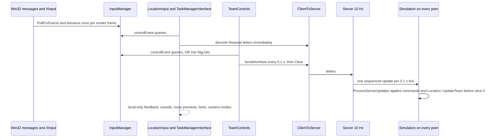
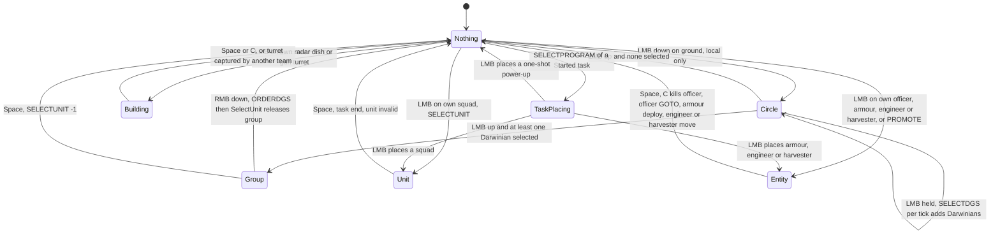
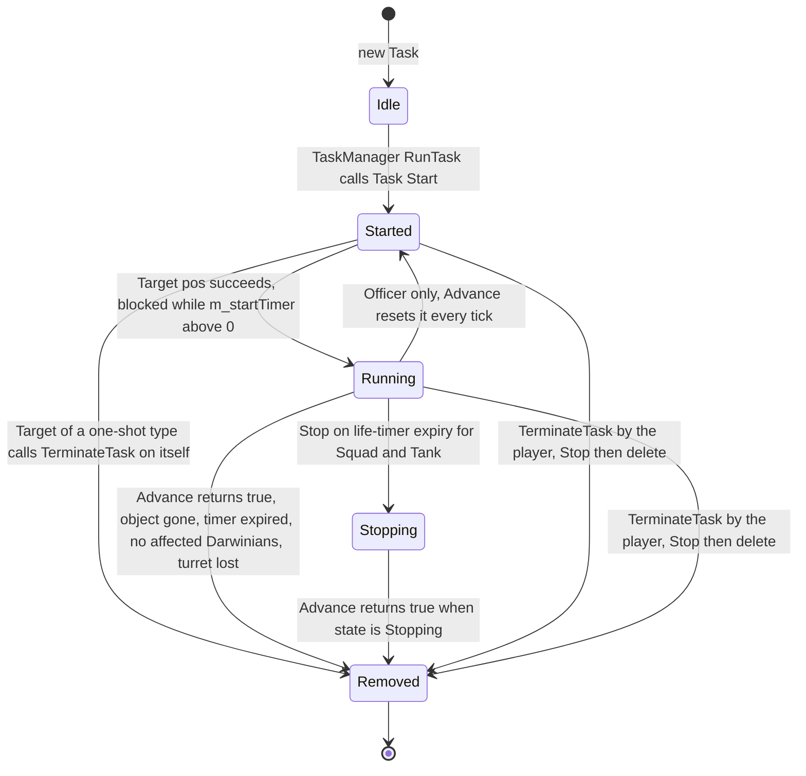
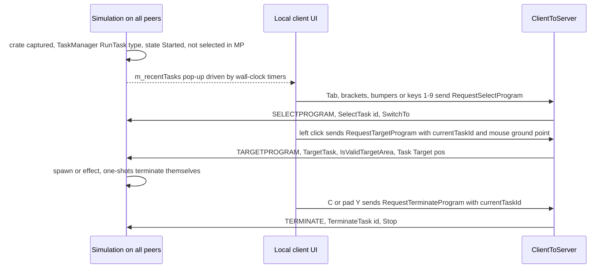

# 06 — Player control and input

> Part A · Baseline build: Release|Win32 (OpenGL) + TARGET_PC_FULLGAME ([B:FULL]); see _work/build_matrix.md.
> Evidence: [C] confirmed · [I] inferred · [U] unknown. Citations are `path:Symbol` relative to the multiwinia/ source root.
> Sources merged: P01_app_core (§5 in-match input, §4.5 TeamControls, determinism D15–D18), P08_crates_ai (§16 MarkerSystem), P09_control_taskmanager (§1–§6), P10_input_camera (§1–§5, determinism notes, bindings CSV and per-line CSV), with cross-checks against P03_entity_core (Officer), P04_entities_military (InsertionSquad, Armour, Shaman), P15_network (command catalogue), P17b_menus_options (options windows), P19_help_tutorial_script (MultiwiniaHelp hints) and the `_work/routed/_meta_*.md` notes. Generated tables: `_work/scripts/S_06_bindings_table.py` (§12), `_work/scripts/S_06_mount_census.py` (§9.8).

## Contents

- [At a glance](#at-a-glance)
- [1 Player-action master table](#1-player-action-master-table)
- [2 Selection model](#2-selection-model)
- [3 Task manager](#3-task-manager)
- [4 Task-manager interfaces](#4-task-manager-interfaces)
- [5 Officer orders promotion and formations](#5-officer-orders-promotion-and-formations)
- [6 Direct control of units and buildings](#6-direct-control-of-units-and-buildings)
- [7 Gesture recognition](#7-gesture-recognition)
- [8 Game cursor highlights and world markers](#8-game-cursor-highlights-and-world-markers)
- [9 Camera](#9-camera)
- [10 Control help and Multiwinia hint overlays](#10-control-help-and-multiwinia-hint-overlays)
- [11 Input architecture](#11-input-architecture)
- [12 Binding reference for all 164 control types](#12-binding-reference-for-all-164-control-types)
- [13 Known defects and desync paths in the input layer](#13-known-defects-and-desync-paths-in-the-input-layer)
- [14 Re-implementation notes](#14-re-implementation-notes)
- [Open questions and unknowns](#open-questions-and-unknowns)
- [Docs-vs-code discrepancies](#docs-vs-code-discrepancies)
- [IP items](#ip-items)
- [Source map](#source-map)
- [Appendix — dead/legacy code](#appendix--deadlegacy-code)

## At a glance

- **Control model.** Multiwinia is an indirect-control RTS: the player never builds units. They (a) draw a *selection circle* over their own Darwinians and right-click a destination, (b) promote a Darwinian to an *Officer* that redirects or leads Darwinians, (c) place *power-ups* granted by crates/reinforcements from a 6-slot *task manager*, and (d) directly steer a few special units (squad, armour, engineer, harvester) and buildings (gun turret, radar dish) [C] `code/location_input.cpp:LocationInput::AdvanceTeamControl`, `code/location.cpp:Location::UpdateTeam`.
- **Authority.** Input never mutates simulation state directly (with three documented exceptions, §13). Discrete actions become `ClientToServer` command letters; continuous mouse/stick state is packed into `TeamControls` and sent every 0.1 s; every peer executes both from the server's ordered command stream (lock-step) [C] `code/network/clienttoserver.cpp:ClientToServer::ProcessServerUpdates`, `code/main.cpp:SendTeamControlsToNetwork`.
- **One live control scheme.** Two binding files exist, but `PrefsManager::Load` forces `MultiwiniaControlMethod = 1` after every preferences load ("Hack by Chris to disable old-style control"), so the RTS-style `data/input/input_preferences.txt` (right mouse = orders) is always the system file in FULL [C] `code/lib/preferences.cpp:PrefsManager::Load`, `code/lib/input/file_paths.cpp:InputPrefs::GetSystemPrefsPath`. *Resolved: drafts P01/P10 described scheme 0 as selectable; code shows it is forced off.*
- **No in-game rebinding.** The key-binding window exists but its menu button is commented out (`OptionsMenuWindow::Create`); only a hand-edited `user_input_preferences.txt` or `preferences.txt` changes controls [C] `code/interface/mainmenus.cpp:OptionsMenuWindow::Create`. *Resolved: P10 listed controls as "user-rebindable (Options UI)"; P17b said rebinding is unreachable; the code confirms P17b.*
- **The task bar is not clickable.** In Multiwinia the task-manager overlay can never become visible, mouse hover is only evaluated while visible, so tasks are chosen with keys 1–9, Tab/`[`/`]`, pad bumpers, or by selecting the task's unit in the world [C] `code/taskmanager_interface_multiwinia.cpp:TaskManagerInterfaceMultiwinia::Advance`, `AdvanceScreenZones`.
- **Gestures, icon task manager and gamepad control help are dead in Multiwinia** (Darwinia-campaign only) [C] `code/taskmanager_interface.cpp:TaskManagerInterface::CreateTaskManager`, `code/control_help.cpp:ControlHelpSystem::Render`.
- **Input graph.** A query-driven binding graph: 164 logical controls, each an OR-list of specs evaluated by 9 registered drivers (3 composite: `&&`, `++`, `not`; 6 leaf/utility) [C] `code/main.cpp:InitialiseInputManager`, `code/lib/input/input.cpp:InputManager::controlEvent`.
- **Design-critical defects:** a confirmed desync path (`InsertionSquad::DirectControl` reads the local camera's look-around flag inside simulation), 1-byte task ids on the wire, render code writing simulation state, unknown binding conditions silently becoming "down" (§13).

## 1 Player-action master table

### 1.1 Conventions and global gates

- **Binding notation** (from `data/input/input_preferences.txt`, the only live system file, §11.10): *down* = became pressed this frame (edge), *up* = became released this frame, *pressed/held* = currently held (level). "LMB/RMB/MMB" = left/right/middle mouse button. Pad bindings are XInput and exist only when `xinput1_3.dll` loads (§11.6.6) [C] `code/main.cpp:InitialiseInputManager`.
- **"Single-player" in code means the Darwinia campaign.** `App::IsSinglePlayer()` is true only for `GameModeCampaign`/`GameModePrologue`; every Multiwinia game — online, LAN, versus CPU, and the tutorials — runs with `App::Multiplayer()` true, because `NET_DARWINIA_START_GAME` sets `m_gameMode = GameModeMultiwinia` [C] `code/app.cpp:App::IsSinglePlayer`, `App::Multiplayer`, `code/network/clienttoserver.cpp:ClientToServer::ProcessServerUpdates`. Every branch guarded by `IsSinglePlayer()` is therefore [B:LEGACY].
- **Common gates** used in the table:
  - *G-loc*: `LocationInput::AdvanceTeamControl` runs only if the local team id ≠ 255, **no Eclipse window is open**, and the chat log is not held (`Camera::ChatLogVisible`) [C] `code/location_input.cpp:LocationInput::Advance`.
  - *G-play*: not in the grace period, not game over, not paused (`Multiwinia::GameInGracePeriod`, `Multiwinia::GameOver`, `App::GamePaused`).
  - *G-TM*: the task-manager interface is hidden (`TaskManagerInterface::IsVisible`; always hidden in Multiwinia except when the cut Shaman UI is open, §4.2).
  - *Nothing selected*: team `m_currentUnitId`, `m_currentEntityId`, `m_currentBuildingId` all −1.
  - *Task placing*: the current task exists and is `Task::StateStarted` (§3.4).
- **Applied at the server tick.** Every "Network command" in the table takes effect on all peers when the server echoes it in the next 0.1 s update; selection and orders therefore appear with one round-trip of latency [C] `code/network/clienttoserver.cpp:ClientToServer::ProcessServerUpdates` (see [22](22_determinism_and_networking.md)).

### 1.2 Pipeline and authority model

Per-frame order inside the location loop [C] `code/main.cpp:LocationGameLoop` (P01 §2.6): `InputManager::PollForEvents` → escape/interface keys → `TeamControls::Advance` (if no Eclipse window) → `SendTeamControlsToNetwork` (every `IAMALIVE_PERIOD` = 0.1 s, `code/globals.h`) → simulation catch-up → `UserInput::Advance` → `Camera::Advance` (only while the window has focus) → `LocationInput::Advance` → `TaskManagerInterface::Advance` → script/sound/control-help/shaman/marker/help advances.

Local, non-networked feedback is applied immediately: sounds, the route preview line (generated every frame and deleted the next frame), help hints, camera mode changes (e.g. radar-aim and turret-aim are requested locally at click time, before the selection command executes) [C] `code/location_input.cpp:LocationInput::SelectObjectUnderMouse`.

### 1.3 Master table — Multiwinia live actions

Column "Cmd" lists the network command letter (full catalogue §1.4); "ALIVE" = carried in the continuous `TeamControls` packet (§6.1). All rows are [B:FULL] unless tagged.

| # | Action | Keyboard / mouse | Pad (XInput) | Context and conditions | Effect | Cmd | Code ref |
|---|---|---|---|---|---|---|---|
| **Camera and view** (local only, never networked) | | | | | | | |
| A1 | Pan camera | `CameraLeft/Right/Forwards/Backwards` = A/D/W/S or ←/→/↑/↓ (held) | `CameraMove` = left stick | Free-movement camera; TM and Shaman UI hidden | Target point moves 250 u/s along the horizontal camera basis; stick: 10 u/s per stick unit (≤ ≈393 u/s) | — | [C] `code/camera.cpp:Camera::AdvanceFreeMovementMode` |
| A2 | Fast pan | `CameraSpeedup` = Shift (held) | L3 (left-stick click, held) | with A1 | ×4 key speed (1000 u/s); the stick path ignores it | — | [C] same |
| A3 | Raise / lower camera | `CameraUp` = Q, `CameraDown` = E (held); `TargetMoveZ` = mouse wheel | `CameraUp` = right trigger, `CameraDown` = left trigger | No Eclipse window; Q/E/triggers ignored while aiming a radar dish or gun turret | Height `+= delta·2·√|h − ground|` (§9.4) | — | [C] `code/camera.cpp:Camera::AdvanceComponentMouseWheelHeight` |
| A4 | Aim (mouse-look) | `TargetMove` = mouse movement | `TargetMoveSecondary` = right stick (only with no window open and TM hidden) | Free-movement, radar-aim and turret-aim modes; not while chat log held | The camera turns to face the ground point under the cursor; the cursor stays glued to that ground point (§9.4) | — | [C] `code/lib/targetcursor.cpp:TargetCursor::Advance`; `Camera::AdvanceFreeMovementMode` |
| A5 | Zoom (narrow FOV) | `CameraZoom` = Z or MMB (held) | R3 (right-stick click, held) | No Eclipse window; not in entity-track (there it re-centres behind the squad, §9.6) | FOV target ÷4 (60° → 15°) while held | — | [C] `Camera::AdvanceComponentZoom` |
| A6 | Look around (freeze camera) | `CameraFreeMovement` = F2 (held) | R3 (held) | Ignored while `UnitPrimaryFireTarget` is held | Freezes camera position and entity tracking; orientation still follows the cursor. **Also changes squad simulation on this peer (desync, §13 X1)** | — | [C] `code/camera.cpp:Camera::SwitchEntityTracking` |
| A7 | Squad camera distance | — | `CameraSquadZoomIn/Out` = d-pad up/down (held) | Entity-track camera (pad default) | Distance ∓10 u/s, clamp [50, 500]; integer truncation makes zoom-out inert at normal frame rates (§13 X12) | — | [C] `Camera::AdvanceAutomaticTracking` |
| A8 | Show chat log | `IconsChatLog` = L (held) (`GesturesChatLog` if pref `ControlMethod` = 0) | — | No Eclipse window | Chat log visible; mouse-look frozen; `AdvanceTeamControl` skipped; continuous team-control flags cleared | — | [C] `code/camera.cpp:Camera::ChatLogVisible`; `code/main.cpp:SendTeamControlsToNetwork` |
| A9 | Hide interface | `ToggleInterface` = Alt held + X down | — | — | Toggles `m_hideInterface` (HUD, markers, task bar, cursor effects hidden) | — | [C] `code/main.cpp` (`ControlToggleInterface`) |
| A10 | Screenshot | `CreateScreenShot` = P (down) | — | No Eclipse window | Renders and saves a (tiled if `RenderPosterResolution` > 1) screenshot | — | [C] `code/renderer.cpp:Renderer::Render` |
| **Selection** | | | | | | | |
| S1 | Select object under cursor | `UnitSelect` = LMB down (also `SelectLocation` = LMB down when nothing is selected) | A down | G-loc, G-TM; pick rules §1.5; own objects only (buildings own or neutral) | Own RadarDish → select + camera radar-aim (unless level option `NoRadarControl` = 1); own GunTurret → select + camera turret-aim; own non-Darwinian entity or unit → select; success sound `SelectUnit` (≤ every 0.5 s) | `SELECTUNIT` | [C] `code/location_input.cpp:LocationInput::SelectObjectUnderMouse`, `AdvanceNoSelection` |
| S2 | Click on empty ground while something is selected | LMB down | A down | Something selected; not placing a task; not controlling a squad; not a pad-mode officer/armour; `UnitSetTarget` not held | Sound `MouseError` + "press SPACE to deselect" hint (§10.4) — no command | — | [C] `LocationInput::SelectObjectUnderMouse` |
| S3 | Deselect | `UnitDeselect` = Space down | B down | G-loc | Clears unit/entity/building selection, ends any Darwinian group selection, camera → free movement, `m_previousTaskId = −1` | `SELECTUNIT(−1,−1,−1)` | [C] `LocationInput::AdvanceTeamControl` |
| S4 | Begin selection circle | `BeginSelectionCircle` = LMB down | A down | G-loc; nothing selected; 0 Darwinians selected; no task placing; G-TM; no circle active; no officer under cursor; not grace period; cursor not over a building or an own non-Darwinian entity/unit | Local: circle centre = cursor ground point, radius 0, sound `SelectionCircle` | — | [C] `LocationInput::AdvanceTeamControl` |
| S5 | Grow selection circle | `EnlargeSelectionCircle` = LMB held | A held | as S4 (branch with 0 Darwinians selected) | Radius += 100 u/s (real frame time), max 100 u; whenever network time has advanced since the last send → select Darwinians inside | `SELECTDGS` | [C] same; `code/location.cpp:Location::SelectDarwinians` |
| S6 | End selection circle | `EndSelectionCircle` = LMB up | A up | G-loc | Circle centre := 0; `m_lastOrdersSet` := 0 | — | [C] same |
| S7 | Next task | `UnitCycleRight` = Tab or `]` down (`GesturesSwitchUnit` = Tab only if pref `ControlMethod` = 0) | RB down | TM hidden or keyboard mode | Next slot (wraps; anchor = current task, else `m_previousTaskId`, else slot 0); sound `MouseOverIcon`; squad task → camera entity-track, else free camera | `SELECTPROGRAM` | [C] `code/taskmanager_interface.cpp:TaskManagerInterface::AdvanceTab` |
| S8 | Previous task | `UnitCycleLeft` = `[` down | LB down | as S7 | Previous slot (wraps) | `SELECTPROGRAM` | [C] same |
| S9 | Select task slot 1–9 | `TaskManagerSelectTask1…9` = keys 1–9 down | — | Slot exists and its `m_startTimer ≤ 0` | Select that slot's task; sound `SelectTask` | `SELECTPROGRAM` | [C] `code/taskmanager_interface_multiwinia.cpp:TaskManagerInterfaceMultiwinia::RunScreenZone` |
| S10 | Select a task by its unit | S1 on the task's unit/entity | S1 | — | The `SELECTUNIT` handler also calls `TaskManager::SelectTask(WorldObjectId)` | `SELECTUNIT` | [C] `ClientToServer::ProcessServerUpdates` |
| **Orders** | | | | | | | |
| O1 | Order selected Darwinians | `IssueDarwinianOrders` = RMB down; Ctrl held (`OrderDirectRoute`) = straight-line route | X down | G-loc; nothing selected; ≥ 1 Darwinian selected; no circle active; no task placing; G-TM; ≥ 1.0 s of network time since the last order; target inside the landscape | Selected Darwinians walk to the target (snapped to RadarDish entrance, crate, non-full armour or officer under cursor, §1.5); armour within 30 u of target → they board it; direct route forced if ≥ 25 % carry a WallBuster; selection is released; sound `SetOrderGoto` | `ORDERDGS` | [C] `LocationInput::AdvanceTeamControl`; `code/location.cpp:Location::IssueDarwinianOrders` |
| O2 | Promote Darwinian to Officer | `DarwinianPromote` = RMB down on own Darwinian | X down | G-loc; nothing selected; 0 Darwinians selected; no task placing; G-play; nearest own selectable Darwinian ≤ 10 u of the cursor ground point; not consumed by O3/O4 | Darwinian replaced by an Officer, which becomes selected; tutorial notification | `PROMOTE` | [C] `LocationInput::AdvanceTeamControl`; `code/location.cpp:Location::PromoteDarwinian` |
| O3 | Toggle officer formation / cancel | `DarwinianPromote` = RMB down on an own Officer | X down | as O2 except: nothing selected **or** that officer is the selected entity | Officer in formation or with a GOTO order → `CancelOrders` (disband); otherwise → formation mode facing forward and the officer is (re)selected; sound `ToggleUnitState` | `TOGGLEENTITY` (secondary 0) | [C] same; `ClientToServer::ProcessServerUpdates` (TOGGLEENTITY) |
| O4 | Toggle armour load/unload | RMB down on own Armour | X down | as O3 | `Armour::ToggleLoading` (Idle → Unloading if passengers else Loading; Loading ↔ Unloading) | `TOGGLEENTITY` (secondary 0) | [C] `code/worldobject/armour.cpp:Armour::ToggleLoading` |
| O5 | Toggle armour arrival action | RMB down on the armour's **order marker** icon | X down | as O3, `MarkerSystem::m_isOrderMarkerUnderMouse` | `Armour::ToggleConversionAction` (cycles the load/unload-on-arrival order); deselects the armour if it was selected | `TOGGLEENTITY` (secondary 1) | [C] `Armour::ToggleConversionAction` |
| O6 | Officer GOTO / move formation | `IssueSpecialOrders` = RMB down; Ctrl = direct route | X down (`OrderSpecialMove`, inverted on pad) | Officer selected | `Officer::SetOrders(pos)`: in formation → formation marches to pos; click < 50 u from officer → enter formation; else GOTO signpost order; officer deselected (§5.3) | `ORDERGOTO` (force 0) | [C] `LocationInput::AdvanceTeamControl`; `code/worldobject/officer.cpp:Officer::SetOrders` |
| O7 | Officer walk | Shift (`OrderSpecialMove`) + RMB down | A down (`IssueSpecialOrders`, inverted on pad) | Officer selected | `Officer::SetWaypoint(pos)` — the officer itself walks (enters a connected radar dish within 5 u of the target) | `ORDERGOTO` (force 1) | [C] same; `Officer::SetWaypoint` |
| O8 | Armour move | RMB down | A down | Armour selected; target inside landscape | `Armour::SetWayPoint(pos)` (clears any arrival action; Loading → Idle); route highlighted; order marker for friendly teams; sound `SetOrders` | `ORDERGOTO` (force 1) | [C] `LocationInput::AdvanceTeamControl`; `Armour::SetWayPoint` |
| O9 | Armour move and deploy | Shift + RMB down | X down | as O8 | `Armour::SetOrders(pos)`: if > 50 u away → drive there and on arrival (< 15 u) start Unloading (passengers) or Loading; armour deselected | `ORDERGOTO` (force 0) | [C] `Armour::SetOrders`, `Armour::Advance` |
| O10 | Aim radar dish | `UnitSelect` = LMB down | A down | Own RadarDish selected (nothing else) | Aim at the start point of the other dish under the cursor, else at the cursor ground point | `AIMBUILDING` | [C] `LocationInput::AdvanceRadarDishControl`; `code/worldobject/radardish.cpp:RadarDish::Aim` |
| **Tasks and power-ups** | | | | | | | |
| T1 | Place / fire current power-up | `UnitCreate` = LMB down | A down | Task placing; G-TM; G-play | Target the current task at the cursor ground point (validity rules §3.6) | `TARGETPROGRAM` | [C] `LocationInput::AdvanceTeamControl`; `code/taskmanager.cpp:TaskManager::TargetTask` |
| T2 | Right-click while placing | `IssueSpecialOrders` = RMB down | — (suppressed in pad mode) | Task placing; G-play; not growing a circle | Sound `MouseError` + "press SPACE to deselect" hint; no command | — | [C] same |
| T3 | Cancel (terminate) current task | `IconsTaskManagerEndTask` = C down | Y down | No Eclipse window | Terminate the selected task (§3.8); with no task selected sends id 255 → no-op | `TERMINATE` | [C] `TaskManagerInterfaceMultiwinia::AdvanceTerminate` |
| T4 | Destroy own unit under cursor | C down | Y down | Nothing selected; 0 Darwinians selected; G-TM; own non-Darwinian entity under cursor | Entity `ChangeHealth(−999)` + deselect (the same key press also sends T3) | `TERMINATE` (entity) + `SELECTUNIT` | [C] `LocationInput::AdvanceNoSelection` |
| T5 | Destroy selected officer | C down | Y down | Officer selected | Officer `ChangeHealth(−999)` (killed, despite the code comment "demote"), deselect, camera free | `TERMINATE` (entity) + `SELECTUNIT` | [C] `LocationInput::AdvanceTeamControl` |
| T6 | Release gun turret | C down (or Space, S3) | Y down | Own GunTurret selected | Deselect, camera free (turret keeps existing); also automatic when the turret changes owner | `SELECTUNIT(−1)` | [C] same |
| **Direct control** (continuous, §6) | | | | | | | |
| D1 | Squad: move | `LeftButtonPressed` = LMB held | `UnitMove` = left stick (only with entity-track camera) | Squad selected; not firing | Waypoint = cursor ground point (pad: point man + stick vector) | ALIVE | [C] `code/location.cpp:Location::UpdateTeam`; `code/worldobject/insertion_squad.cpp:InsertionSquad::DirectControl` |
| D2 | Squad: fire lasers | `UnitPrimaryFireTarget` = RMB held | right trigger held (`righttriggerb`), aim with right stick | Squad selected; not look-around | `InsertionSquad::Attack(target,false)` each tick (≈6 shots/s for 3 squaddies) | ALIVE | [C] same |
| D3 | Squad: throw grenade | RMB held + LMB down (`UnitSecondaryFireTarget`) | left trigger down + right trigger | Squad selected | `InsertionSquad::Attack(target,true)` — nearest squaddie throws a grenade (4 s cooldown) | ALIVE | [C] same |
| D4 | Engineer / Harvester: move | `UnitSetTarget` = RMB held | X held | Engineer or Harvester selected | `SetWaypoint(cursor)` and deselect | ALIVE | [C] `Location::UpdateTeam` |
| D5 | Gun turret: aim and fire | aim = cursor; fire = RMB held or LMB held | aim = cursor; fire = X held, RT held or left stick | Own GunTurret selected (turret-aim camera) | `GunTurret::SetTarget(cursor)` every update; `PrimaryFire()` while firing | ALIVE | [C] `Location::UpdateTeam` |
| D6 | Officer: face cursor | cursor | cursor | Officer selected, order PrepareGoto, speed < 5 | Officer turns to face the cursor | ALIVE | [C] `Location::UpdateTeam` |
| **Match flow and meta** | | | | | | | |
| M1 | Ready up | `ToggleReady` = Space down | A or B down | Grace period; no Eclipse window | Toggles the team's ready flag | `TOGGLE_READY` | [C] `LocationInput::Advance` |
| M2 | Open chat | `LobbyChat` = Enter down | — (pad closes any open chat) | Not gamepad mode; chat closed; not toggled this update; no window | Opens `ChatInputWindow`; submitting sends the message | `SEND_CHATMESSAGE` | [C] `LocationInput::Advance`; `code/interface/chatinput_window.cpp` |
| M3 | Pause | `GamePause` = Pause down | — | No remote human team in the match; not grace period; not game over | Toggles pause (game speed ramps to 0 or 1 at rate 0.2) | `PAUSE` | [C] `code/user_input.cpp:UserInput::Advance`; `code/app.cpp:App::ToggleGamePaused` |
| M4 | In-game menu | `MenuEscape` = Esc down | Start down | Fade complete; no script running | Close all open windows (and un-hide the HUD), else hide the TM overlay, else set camera debug mode Auto and open `LocationWindow` (HUD hidden while it is open); then `UserInput::Advance` runs a second time this frame | — | [C] `code/main.cpp:LocationGameLoop` |
| M5 | Network statistics | `ToggleNetworkStats` = F9 down | — | `NETWORK_STATS_ENABLED` (defined in FULL) | Toggles the network stats window | — | [C] `UserInput::Advance` |
| M6 | UI clicks | `EclipseLMouseDown/Pressed` = LMB, `EclipseRMousePressed` = RMB **down** | LB held + A (`alias ShowMouseCursor && XInput a …`) | Over an Eclipse window | Drives the window framework; a left click over a window is suppressed from the game for the rest of the frame | — | [C] `UserInput::AdvanceMenus` |
| M7 | Controller unplugged / plugged | — | `ControllerUnplugged` = plug up; `ControllerPlugged` = plug down | — | Opens / closes the `controller_unplugged` dialog; while unplugged in pad mode the app treats itself as unfocused | — | [C] `code/main.cpp:HandleCommonConditions` |
| M8 | Quit | Alt+F4; window close | — | — | `m_requestQuit = true` | — | [C] `code/lib/input/inputdriver_win32.cpp:W32InputDriver::WndProc`, `code/lib/input/win32_eventhandler.cpp:W32EventHandler::WndProc` |

Front-end menu navigation (pad d-pad/sticks with `repeat`, A/B/Back/Start, `MenuLeft/Right/Up/Down`, `MenuActivate`, `MenuClose`, `MainMenuActivate`, `SkipMessage`, `ScrollSpeedup`) is owned by the UI framework, see [28](28_ui_framework.md) and [09](09_meta_systems.md); every binding is in §12.

### 1.4 Network commands emitted by player input

Command letters carry the field codes of [22](22_determinism_and_networking.md) (`TEAMID` `de` char, `UNITID` `dl` int, `ENTITYID` `dm` int, `BUILDINGID` `dn` int, `PROGRAM` `dq` char, `RADIUS` `dp` float, `POSITION` `df` Vector3, `DIRECTROUTE` `cob` char, `FORCEONLYMOVE` `cod` char, `SECONDARYFUNCTION` `coe` char) [C] `code/network/network_defines.h`. All are relayed by the server to every client and executed in sequence order. The server checks only that the sender is registered and TEAMID ≠ 255 — **not that the sender owns the team** [C] `code/network/server.cpp:Server::Advance` (P15).

| Command (code) | Sender function | Payload | Executed on every peer | Raised by (§1.3) |
|---|---|---|---|---|
| `ALIVE` (`cd`) | `ClientToServer::SendIAmAlive` | TEAMID, ALIVE_DATA (packed `TeamControls`, §6.1) | `Location::UpdateTeam(team, controls)`; server keeps only the latest per client per tick | A-/D-rows |
| `SELECTUNIT` (`ce`) | `RequestSelectUnit` | TEAMID, UNITID, ENTITYID, BUILDINGID (ints) | `Team::SelectUnit(u,e,b)` then `TaskManager::SelectTask(WorldObjectId(team,u,e,−1))`; latest-only per client per tick | S1, S3, T4–T6 |
| `AIMBUILDING` (`cf`) | `RequestAimBuilding` | TEAMID, BUILDINGID, POSITION | if the building exists, belongs to TEAMID and is a RadarDish: `RadarDish::Aim(pos)` | O10 |
| `RUNPROGRAM` (`ch`) | `RequestRunProgram` | TEAMID, PROGRAM (task **type**) | `TaskManager::RunTask(type)` | [B:LEGACY] only (Icons/Gestures interfaces, SP quick-units) |
| `TARGETPROGRAM` (`ci`) | `RequestTargetProgram` | TEAMID, PROGRAM (task **id**, 1 byte), POSITION | `TaskManager::TargetTask(id, pos)` | T1 |
| `SELECTPROGRAM` (`cj`) | `RequestSelectProgram` | TEAMID, PROGRAM (task id) | `TaskManager::SelectTask(id)` | S7–S9 |
| `TERMINATE` (`ck`) | `RequestTerminateProgram` / `RequestTerminateEntity` | TEAMID, PROGRAM (task id, or 255 = entity), ENTITYID (−1 for tasks) | PROGRAM ≠ 255: `TaskManager::TerminateTask(id)`; else if `m_others[ENTITYID]` valid: `ChangeHealth(−999)` | T3–T5 |
| `SELECTDGS` (`cm`) | `RequestSelectDarwinians` | TEAMID, RADIUS (float), POSITION | `Location::SelectDarwinians(team, pos, radius)` | S5 |
| `ORDERDGS` (`cn`) | `RequestIssueDarwinanOrders` | TEAMID, DIRECTROUTE, POSITION | `Location::IssueDarwinianOrders(team, pos, direct)` | O1 |
| `PROMOTE` (`co`) | `RequestPromoteDarwinian` | TEAMID, ENTITYID | if `m_others[id]` is an Officer: `Location::DemoteOfficer` + `SelectUnit(−1,−1,−1)`; else `Location::PromoteDarwinian` and `SelectUnit(−1, officerIndex, −1)` | O2 |
| `ORDERGOTO` (`coa`) | `RequestOfficerOrders` / `RequestArmourOrders` | TEAMID, DIRECTROUTE, FORCEONLYMOVE, POSITION. Armour writes DIRECTROUTE = `true` (bool) and FORCEONLYMOVE = `!deploy` | selected entity Officer: force ? `SetWaypoint` : `SetOrders(pos, direct)`; Armour: force ? `SetWayPoint` : `SetOrders`, plus `MarkerSystem::RegisterMarker_Orders` if TEAMID is a friend of the local team | O6–O9 |
| `TOGGLEENTITY` (`coc`) | `RequestToggleEntity` | TEAMID, ENTITYID, SECONDARYFUNCTION | Armour: secondary ? `ToggleConversionAction` : `ToggleLoading`; Officer: formation or `OrderGoto` → `CancelOrders`, else `SetOrders(pos + front)` **and the executing peer sends a new `SELECTUNIT`** (N peers → N identical commands, §13 X9) | O3–O5 |
| `FOLLOW` (`cya`) / `NONE` (`cyb`) | `RequestOfficerFollow` / `RequestOfficerNone` | TEAMID | selected Officer: `SetFollowMode` / `CancelOrders` | [B:LEGACY] only (SP officer controls) |
| `NEXTWEAPON` (`cx`) / `PREVWEAPON` (`cy`) | `RequestNextWeapon` (empty body) / none | — | Officer `SetNextMode`/`SetPreviousMode` (no-ops in MP), Armour `SetDirectOrders` | **never sent** [C] `ClientToServer::RequestNextWeapon` is empty; no `RequestPreviousWeapon` exists |
| `SHAMANSUMMON` (`cl`) | `RequestShamanSummon` | TEAMID, ENTITYID (shaman unique id), ENTITYTYPE | `Shaman::SummonEntity` | [B:LEGACY] (Shaman cut, §6.7) |
| `TOGGLE_READY` (`cca`) | `RequestToggleReady` | TEAMID | in game: `Team::m_ready ^= 1` | M1 |
| `PAUSE` (`cp`) | `RequestPause` | — | toggle `m_userRequestsPause`, speed request 0/1 at rate 0.2 | M3 |
| `SEND_CHATMESSAGE` (`cczz`) | `SendChatMessage` | UNICODEMESSAGE, CLIENTID | `Location::NewChatMessage` | M2 |

Evidence: [C] `code/network/clienttoserver.cpp` (all `Request*` senders and the matching `ProcessServerUpdates` branches, read for this document).

### 1.5 Context resolution helpers

**Object under the cursor** — `LocationInput::GetObjectUnderMouse(id, team)` [C] `code/location_input.cpp`:
1. Returns false for team 255, or while the team controls a GunTurret (no snapping while aiming).
2. A world-marker icon under the mouse wins (`MarkerSystem::m_markerUnderMouse`, §8.12).
3. Otherwise cast the camera click ray through the cursor and collect the nearest hit of each kind: building (`Location::GetBuildingId` — own or neutral buildings only, ControlTower excluded), unit (`Location::GetUnitId` — **own team only**), entity (`Location::GetEntityId` — own team only, Darwinians ignored) [C] `code/location.cpp:Location::GetBuildingId`, `GetUnitId`, `GetEntityId`.
4. Buildings other than RadarDish, GunTurret and FenceSwitch are discarded.
5. If no entity was hit and an **Officer task** is being placed, the nearest own Darwinian within 10 u of the cursor ground point counts (`Task::FindDarwinian`, distance 0).
6. The nearest of entity / unit / building along the ray wins (strict `<` comparisons); a building must be own or neutral. Unit ids are returned with the local team id.

Consequence: enemy units are never pickable; all player clicks address the player's own objects [C].

**Order target snapping** (`highlightedObjectPos`, used by O1, O6–O9 and the route previews): cursor ground point, replaced by the RadarDish entrance (`RadarDish::GetEntrance`) if a dish is under the cursor, by the crate position if a Crate is, by the armour position if a non-full Armour is, or by the officer position if an Officer is [C] `LocationInput::AdvanceTeamControl`.

**Cursor ground point** — `UserInput::RecalcMousePos3d()` (called by the camera after it moves): click ray → `Landscape::RayHit` → `m_mousePos3d`; on a miss the ray hits the inside of a sphere centred (worldSize/2, 0, worldSize/2) with radius `GlobalWorld::GetSize() × 40` (ray reversed from 4 radii out); outside a location a sphere of radius 36000 at the origin [C] `code/user_input.cpp:UserInput::RecalcMousePos3d`.

**Networked mouse position** — before each `ALIVE` send, `SendTeamControlsToNetwork` replaces `m_mousePos` with the position of the own entity under the cursor, or the RadarDish position if a dish is under it (the computed `checkMouse`, `orderGiven`, `entityUnderMouse` are unused) [C] `code/main.cpp:SendTeamControlsToNetwork`.

### 1.6 Legacy and dead actions

| Action | Binding | Status | Notes / ref |
|---|---|---|---|
| Darwinia-style scheme (`MultiwiniaControlMethod` = 0): LMB held = officer/armour move every frame (`ControlUnitSetTarget` then = LMB held), RMB on a formation officer first sends `NONE`, armour deploy inverted (plain RMB deploys), LMB down = order Darwinians | `data/input/input_preferences_darwinia.txt` | [B:LEGACY] forced off by `PrefsManager::Load` | [C] `code/location_input.cpp:LocationInput::AdvanceTeamControl`, `code/lib/preferences.cpp:PrefsManager::Load` |
| Quick-run program: d-pad left/right/up → Engineer/Armour/Squad | `IconsTaskManagerQuickUnitLeft/Right/Up` | [B:LEGACY] (`IsSinglePlayer()` only) | sends `RUNPROGRAM` [C] `LocationInput::AdvanceTeamControl` |
| SP officer orders: d-pad left = follow, d-pad down = none, RMB within 50 u (‖d‖² < 2500) = follow else GOTO (radar-dish snap never fires because `GetObjectUnderMouse(…, 255)` returns false) | `IconsTaskManagerQuickUnitLeft/Down`, `IssueSpecialOrders` | [B:LEGACY] | sends `FOLLOW`/`NONE`/`ORDERGOTO` [C] same |
| SP armour deployment: RMB → awaiting deployment; then LMB → `SetOrders(own pos)` (converts to a turret) — **local mutation of sim state, not networked** | `IssueSpecialOrders`, `UnitCreate` | [B:LEGACY] | [C] same |
| Squad weapon cycling (`WeaponCycleLeft/Right` = d-pad left/right) → `RUNPROGRAM(weapon)` | — | [B:DEAD] (commented out) | [C] same |
| Pad squad secondary cycling `InsertionSquad::CycleSecondary` on `m_unitSecondaryMode` | `IssueSpecialOrders` | [B:LEGACY] (`IsSinglePlayer()`) | [C] `Location::UpdateTeam` |
| Order Darwinians with pad right trigger (`UnitSecondaryFireDirected`) | unbound (icon line only) | dead (live code, no binding) | [C] `LocationInput::AdvanceTeamControl`; `data/input/input_preferences.txt` |
| Game over → press `ToggleReady` to return to menu | Space | [B:DEAD] (`TESTBED_ENABLED` only). *Resolved: P09 §2.6 listed it as live; code places it inside `#ifdef TESTBED_ENABLED`* | [C] `LocationInput::Advance` |
| `ToggleRendering` (R) testbed rendering switch | R | [B:DEAD] (`TESTBED_ENABLED`) | [C] same |
| Cheat menu (F11), special-lighting cheat (`RTLoaderPixelWaveIncrease/Decrease`) | F11; L/K | [B:DEBUG] (`CHEATMENU_ENABLED`) | [C] `UserInput::Advance`; `code/location.cpp:Location::RenderBuildings` |
| Debug quit (`GameDebugQuit`) | unbound (commented `XInput leftbumper down`) | dead | [C] `code/main.cpp:HandleCommonConditions` |
| Fence switch toggle by click (`FenceSwitch::Switch`, local, no network) | LMB on own FenceSwitch | [B:LEGACY] — FenceSwitch is a blocked type and no shipped level contains one (grep of `data/levels/*.txt`) | [C] `LocationInput::SelectObjectUnderMouse`; `code/worldobject/building.cpp:Building::BuildingIsBlocked`. *Resolves P01-U5.* |
| Tank / Shaman / Engineer bridge controls | see §6.7 | [B:LEGACY] | §6.7 |

## 2 Selection model

### 2.1 Selection state

Selection is **simulation state replicated by commands**: it is changed only by `SELECTUNIT`, `SELECTPROGRAM`, `SELECTDGS`, `ORDERDGS`, `PROMOTE`, `TOGGLEENTITY` and by simulation code reacting to them, on every peer ("Do not set these directly") [C] `code/team.h:Team`, `code/team.cpp:Team::SelectUnit`. A few purely local fields drive the selection UI.

| Field | Owner | Replicated? | Meaning |
|---|---|---|---|
| `Team::m_currentUnitId` | Team | yes (commands) | selected unit (squad) index in `m_units`, −1 none |
| `Team::m_currentEntityId` | Team | yes | selected free entity index in `m_others` (officer, armour, engineer, harvester, tank, shaman), −1 none |
| `Team::m_currentBuildingId` | Team | yes | selected building unique id (RadarDish, GunTurret; ChessPiece/FenceSwitch legacy), −1 none |
| `Darwinian::m_underPlayerControl` | each Darwinian | yes | member of the team's current **group selection** |
| `Team::m_numDarwiniansSelected`, `m_selectedDarwinianCentre` | Team | yes | latched at slice 0 from the previous tick's count/centroid of `m_underPlayerControl` Darwinians (centre = sum/count; **division by zero when 0**, only used for the route preview) [C] `Team::Advance` |
| `TaskManager::m_currentTaskId` | TaskManager | yes | selected task (§3.7) |
| `TaskManager::m_previousTaskId` | TaskManager | **local writes** | Tab-cycling anchor; set by `SelectTask` (replicated) but reset to −1 locally on deselect [C] `LocationInput::AdvanceTeamControl` |
| `Team::m_selectionCircleCentre`, `m_selectionCircleRadius` | Team | **no** (client-local UI) | the circle being drawn; read only by `LocationInput`, `GameCursor` and `MultiwiniaHelp` (grep) [C] — *resolves P09-U1: no simulation reader* |
| `Team::m_lastOrdersSet` | Team | no | throttle timestamp (network time) for O1 and the S5 send cadence |
| `Team::m_blockUnitChange` | Team | yes | while true `SelectUnit` is ignored (set while reinforcements spawn, [02](02_units_and_entities.md)) |

**Single selection**: at most one unit **or** entity **or** building, plus independently one current task and one Darwinian group [C] `Team::SelectUnit`. In practice LocationInput never sends a group order while a unit/entity/building is selected, and every `SelectUnit` call clears the group (below).

### 2.2 Selectable objects

| Kind | Selectable when | By | Ref |
|---|---|---|---|
| InsertionSquad (unit) | own; `InsertionSquad::IsSelectable` = true | S1, task select (`SwitchTo`) | [C] `code/worldobject/insertion_squad.cpp:InsertionSquad::IsSelectable` |
| Officer, Armour, Engineer, Harvester | own; `IsSelectable` = true | S1, `PROMOTE` (officer), task select | [C] `code/worldobject/officer.cpp:Officer::IsSelectable`, `armour.cpp:Armour::IsSelectable`, `engineer.cpp:Engineer::IsSelectable`, `harvester.cpp:Harvester::IsSelectable` |
| Tank, Shaman | own; `IsSelectable` = true | S1 | [B:LEGACY] unreachable in FULL (§6.7) |
| All other entities | `Entity::IsSelectable` = false | — | [C] `code/worldobject/entity.cpp:Entity::IsSelectable` |
| Darwinian | only into a group (S4–S6), never singly; `Darwinian::IsSelectable` false in states BeingSacraficed, InsideArmour, OnFire, OperatingPort (used for promotion) | selection circle, booster-family task select | [C] `code/worldobject/darwinian.cpp:Darwinian::IsSelectable` |
| RadarDish | own; not if level option `LevelOptionNoRadarControl` = 1 | S1 → radar-aim camera | [C] `LocationInput::SelectObjectUnderMouse` |
| GunTurret | own (and, for ChessPiece, legacy) | S1 → turret-aim camera; `Team::SelectUnit` sets `GunTurret::m_fireTimer = 0.5` | [C] same; `Team::SelectUnit` |
| FenceSwitch | own | click toggles locally (legacy, §1.6) | [C] |

Restrictions in `SelectObjectUnderMouse` [C]:
- Pref `ControlRemap == 0` would forbid selecting anything new while anything is selected; the key is absent from `data/default_preferences.txt`, so `GetInt` returns its default −1 and the restriction is **inactive** [C] `code/lib/preferences.h:PrefsManager::GetInt`.
- Nothing new can be selected while a RadarDish or GunTurret is selected (deselect first; S3/T6).
- An entity that is already selected, or a Darwinian, is ignored.
- The success sound plays at most every 0.5 s (wall clock).

### 2.3 Group selection and group orders

`Location::SelectDarwinians(team, pos, radius)` (from `SELECTDGS`) [C] `code/location.cpp`: every Darwinian of exactly that team inside `radius` (entity grid neighbour query) that is not OperatingPort, BeingSacraficed, OnFire or InsideArmour, and not already controlled, gets `m_underPlayerControl = true`; local team: sound `Selected` per Darwinian. Selection is **additive** while the button is held: each send (one per network tick while the circle grows) adds Darwinians; nothing is removed until the group is released.

`Location::IssueDarwinianOrders(team, pos, directRoute)` (from `ORDERDGS`) [C] `code/location.cpp`:
1. If a **connected** RadarDish whose obstruction cell contains `pos` is within its `m_radius` of `pos`, the Darwinians' target becomes the dish's entrance.
2. Centre = mean position of the team's controlled Darwinians (division by the count; NaN if 0).
3. `routeId = RoutingSystem::GenerateRoute(centre, pos, directRoute)` — note the route ends at the *unsnapped* `pos`; local team → `HighlightRoute`.
4. Look for a friendly (`EntityGrid::GetFriends`, so co-op allies included) Armour within 30 u of the target with free capacity.
5. For every controlled Darwinian: armour found → `StateApproachingArmour`, `m_manuallyApproachingArmour = true`, `m_armourId`, and an Unloading armour is switched to Idle; otherwise `Darwinian::GiveOrders(target, routeId)` and `m_followingPlayerOrders = true`; sound `GivenOrdersFromPlayer`.
6. [B:LEGACY] single-player particle trail; local team → `GameCursor::CreateMarker(pos)` (never drawn in MP, §8.10).
7. `Team::SelectUnit(−1,−1,−1)` — which releases the group (below).

Group release [C] `Team::SelectUnit`: whenever `SelectUnit` runs (any arguments) and `m_numDarwiniansSelected > 0`, every Darwinian of the team gets `m_underPlayerControl = false` and both counters are zeroed. *Resolves P03-U1 (where `m_underPlayerControl` is cleared): `Team::SelectUnit`, reached from `IssueDarwinianOrders`, deselect, promotion and every unit selection; additionally on teleport entry ([02](02_units_and_entities.md)).* Booster-family power-ups create a temporary group (§3.7 `SwitchTo`).

### 2.4 Selection lifecycle

Automatic deselection points [C]: `Officer::SetOrders` (GOTO, formation move) in MP; armour deploy (O9, local sender); engineer/harvester move (`Location::UpdateTeam`); selected unit/entity becoming invalid (`LocationInput::AdvanceTeamControl` resets the local field or sends `SELECTUNIT(−1)`); a task ending while current (`TaskManager::AdvanceTasks` → `Team::SelectUnit(−1,−1,−1)`); squad passing a radar dish re-selects the new task (§3.5).

## 3 Task manager

### 3.1 Overview

Each `Team` owns one `TaskManager` (`new TaskManager(m_teamId)`) [C] `code/team.cpp:Team::Initialise`. A **task** (called a "program" on the wire and in UI strings — Darwinia fiction) is a slot-limited, player-owned power: a spawned unit (squad, engineer, armour, harvester, officer promotion, shaman, tank) or a targetable one-shot or timed power-up (air strike, nuke, booster, …). In Multiwinia tasks are **never** created by the player directly: they are granted by the simulation (crates, reinforcements, retribution, starting power-ups, instant units, AI). The player only **selects**, **targets (places)** and **terminates** them; all three travel as network commands and execute identically on every peer (§3.9).

Lifetime in one sentence: *created (`RunTask`) → `StateStarted` (awaiting a target click, icon pulses) → `Target(pos)` spawns or fires the effect → `StateRunning` (tracked object alive or timer running) → removed when `Advance` returns true or `TerminateTask` is called; one-shot powers terminate themselves inside `Target`* [C] `code/taskmanager.cpp`.

### 3.2 Data model

`Task` fields [C] `code/taskmanager.h:Task`, initial values `code/taskmanager.cpp:Task::Task`:

| Field | Type | Init | Meaning |
|---|---|---|---|
| `m_teamId` | int | ctor arg | owning team |
| `m_id` | int | −1 | assigned by `RunTask`/`RegisterTask` from `m_nextTaskId++` (monotonic per team, never reused) |
| `m_type` | int | `GlobalResearch::TypeSquad` | task type = `GlobalResearch` enum value (§3.3) |
| `m_state` | int | `StateIdle` | §3.4 |
| `m_objId` | WorldObjectId | invalid | spawned unit/entity/building/effect being tracked |
| `m_pos` | Vector3 | (0,0,0) | click position (air strike, turret) or running centroid of affected Darwinians (booster family); used by `GetPosition()` |
| `m_route` | Route* | NULL | only for the disabled Controller task; deleted in the destructor |
| `m_lifeTimer` | float (s) | 0 | remaining life for timed tasks; −1 = infinite (instant units) |
| `m_startTimer` | float (s) | 0 | lock-out: while > 0 the task cannot be targeted or selected (UI greys it, shows a countdown) |
| `m_option` | int | −1 | sub-variant: air strike 1 = napalm; gun turret = `GunTurret::GunTurretType*` (0 Standard, 1 Rocket, 2 Mortar, 3 Flame, 4 Subversion); reinforcement tasks get `LevelOptionDefend/AttackReinforcementMode` |
| `m_screenX`, `m_screenY`, `m_screenH` | float | 0 | **UI-only**: last on-screen position/size of the task's icon in the task bar, written by the renderer, read by the pop-up fly-in |

`TaskSource` [C] `code/taskmanager.h:TaskSource` — record for the "power-up received" pop-up: `m_taskId` (−1), `m_timer` (double, wall clock; positive = showing, negative = minimising since `−m_timer`), `m_source` (0 crate, 1 reinforcement, 2 retribution), `m_rotation` (crate-icon spin angle).

`TaskTargetArea` [C] `code/taskmanager.h:TaskTargetArea`: `m_centre` (Vector3), `m_radius` (float), `m_stationary` (bool; true for building-anchored areas).

`TaskManager` fields [C] `code/taskmanager.h:TaskManager`, `code/taskmanager.cpp:TaskManager::TaskManager`:

| Field | Init | Meaning |
|---|---|---|
| `m_tasks` (`LList<Task*>`) | empty | ordered slot list; **order matters** (UI slot index, keys 1–9) |
| `m_teamId` | ctor | |
| `m_nextTaskId` | 0 | next id |
| `m_currentTaskId` | −1 | selected task (the one the next click places) |
| `m_verifyTargetting` | true | if false `IsValidTargetArea` accepts any in-landscape point (instant units, cheat window) |
| `m_mostRecentTaskId` | −1 | id of the last task created (read by sim code right after `RunTask`, and by help UI) |
| `m_mostRecentTaskIdTimer` | 0.0 | wall-clock time of creation (UI) |
| `m_blockMostRecentPopup` | false | set by reinforcement code; **no reader** (the guarding `if` in `RunTask` is commented out) [C] |
| `m_recentTasks` (`DArray<TaskSource*>`) | empty | pop-up queue |
| `m_previousTaskId` | −1 | last task explicitly selected (Tab-cycling anchor) |
| `m_mostRecentEntity` | invalid | id of the most recently promoted Officer (read by AI) |

`#define POWERUP_EFFECT_RANGE 70.0` (world units) [C] `code/taskmanager.h`.

### 3.3 Task types — complete enumeration (29)

Task type ids are the `GlobalResearch` enum (29 values, `NumResearchItems` = 29) [C] `code/global_world.h:GlobalResearch`; names from `GlobalResearch::GetTypeName` [C] `code/global_world.cpp` (used for `icons/icon_<Name>.bmp`, `icons/gesture_<Name>.bmp`, string ids `researchname_<Name>`, `crate_tooltip_<name>`, `newcontrols_select_<Name>`, `newcontrols_place_<Name>`, `newcontrols_delete_<Name>`).

| Id | Enum | Name string | Created by `RunTask(int)`? | `Start()` | `Target(pos)` effect | Ends (`Advance`) when | `Stop()` on terminate | Multiwinia source |
|---|---|---|---|---|---|---|---|---|
| 0 | TypeDarwinian | Darwinian | no (returns false) | – | – | – | – | – (research item only) |
| 1 | TypeOfficer | Officer | yes | – | promote nearest own Darwinian within 10 u to Officer, then **terminate own task** (§3.6) | never (state forced back to Started each tick) | – | AI only (`code/ai.cpp`); the player promotes with O2 |
| 2 | TypeSquad | Squad | yes | `m_lifeTimer = 60` | spawn a squad unit of `2 + CurrentLevel(TypeSquad)` InsertionSquadies (MP level 1 → **3**) at pos, spread 10; select it; optional camera tracking | MP: life timer reaches 0 → `Stop()`; any: unit gone or `NumAliveEntities() == 0` | every squaddie `ChangeHealth(−1000)` | crate "Squad" |
| 3 | TypeLaser | Laser | no | – | – | – | – | – (squad weapon research) |
| 4 | TypeGrenade | Grenade | special: sets the current squad's weapon | – | – | – | – | – |
| 5 | TypeRocket | Rocket | special: sets the current squad's weapon | – | – | – | – | – |
| 6 | TypeController | Controller | special: sets the current squad's weapon (Controller task creation commented out) | – | – | unit gone/empty (shares the Squad branch) | – | – |
| 7 | TypeAirStrike | AirStrike | MP: normal task; SP: squad weapon (falls through to the Grenade case) | – | `Crate::RunAirStrike(pos, team, m_option == 1)` → `m_objId` = effect; `m_pos = pos`; **terminates own task without a network message** | (effect gone) | – | crates "Airstrike", "Napalm Strike" (`m_option = 1`); Blitzkrieg reinforcement; retribution |
| 8 | TypeArmour | Armour | yes (`#ifndef DEMOBUILD`) | – | spawn Armour at pos; select it | entity gone/dead | `ChangeHealth(−1000)`; **refused during the Multiwinia tutorial** (`stop = false`) | crate "Armour"; trunk-port reinforcement (Rocket Riot, Blitzkrieg) |
| 9 | TypeTaskManager | TaskManager | no | – | – | – | – | – (capacity research, SP only) |
| 10 | TypeEngineer | Engineer | yes | – | spawn Engineer at pos + (0,10,0); select it | entity gone/dead | `ChangeHealth(−1000)` | crate "Engineer" |
| 11 | TypeHarvester | Harvester | yes | – | spawn Harvester at pos + (0,50,0); select it | entity gone/dead | `m_vunerable = true`, `ChangeHealth(−1000)` | crate "Harvester" |
| 12 | TypeNuke | Nuke | yes | – | `Crate::RunNuke(pos, team)`; terminate own task | (entity gone) | – | crate "Nuke" |
| 13 | TypeSubversion | Subversion | yes | `m_lifeTimer = 30` | `Crate::RunSubversion(pos, team, m_id)`; Running; `SwitchTo()` | life ≤ 0, or no Darwinian of the team still tagged `m_subversionTaskId == m_id` | – | crate "Subversion" |
| 14 | TypeBooster | PersonalShield | yes | `m_lifeTimer = 30` | `Crate::RunBooster(...)`; Running; `SwitchTo()` | as Subversion (`m_boosterTaskId`) | – | crate "Booster" (personal shield) |
| 15 | TypeHotFeet | HotFeet | yes | `m_lifeTimer = 30` | `Crate::RunHotFeet(...)`; Running; `SwitchTo()` | as Subversion (`m_hotFeetTaskId`) | – | crate "Hot Feet" |
| 16 | TypeGunTurret | GunTurret | yes | – | `Crate::RunGunTurret(pos, team, m_option or Standard)`; `m_pos = pos`; if game option `MaxTurrets == −1` terminate own task, else stay Running and clear `m_currentTaskId` | building gone → done; captured by another real team (≠ own, ≠ 255) → `Damage(−1000)` and done | if still own: `Damage(−1000)`; else **refuse** (`stop = false`) | crates "Gun Turret" / "Rocket Turret" / "Flame Turret"; reinforcement turret (Rocket Riot, Blitzkrieg) |
| 17 | TypeShaman | Shaman | yes | – | spawn Shaman at pos; select it | no branch — never auto-ends | – | instant units (`m_runAsTask`) — **cannot be terminated**; Shaman is cut (§6.7) |
| 18 | TypeInfection | Infection | yes | – | `Crate::RunInfection`; terminate own | – | – | crate "Spam" (Infection) |
| 19 | TypeMagicalForest | MagicalForest | yes | – | `Crate::RunMagicalForest`; terminate own | – | – | `Crate::CaptureCrate(id, team)` path (retribution "Forest") |
| 20 | TypeDarkForest | DarkForest | yes | – | `Crate::RunDarkForest`; terminate own | – | – | crate "Dark Forest"; retribution |
| 21 | TypeAntsNest | AntNest | yes | – | `Crate::RunAntNest`; terminate own | – | – | crate "Ant Nest" |
| 22 | TypePlague | Plague | yes | – | `Crate::RunPlague`; terminate own | – | – | none (crate mapping commented out) |
| 23 | TypeEggSpawn | Egg | yes | – | `Crate::RunEggs`; terminate own | – | – | crate "Eggs"; retribution |
| 24 | TypeMeteorShower | MeteorShower | yes | – | `Crate::RunMeteorShower`; terminate own | – | – | crate "Meteor"; retribution |
| 25 | TypeExtinguisher | FireExtinguisher | yes | – | **body commented out — no effect, task stays Started forever** | – | – | none (crate mapping commented out) |
| 26 | TypeRage | Rage | yes | `m_lifeTimer = 30` | `Crate::RunRage(...)`; Running; `SwitchTo()` | as Subversion (`m_rageTaskId`) | – | crate "Rage" |
| 27 | TypeTank | Tank | yes | `m_lifeTimer = 30` unless game type TankBattle | **body commented out** | MP non-TankBattle: life → `Stop()`; entity gone/dead | `ChangeHealth(−1000)` | none in FULL (TankBattle compiled out; crate mapping commented) |
| 28 | TypeDropShip | DropShip | no (not in the `RunTask(int)` switch) | – | spawn DropShip at the map corner nearest pos (corners inset 100 u, height 500 u), `SetWaypoint(pos)` | entity gone/dead | – | none [I] (only reachable via `RunTask(Task*)`) |

Evidence [C] `code/taskmanager.cpp:Task::Start`, `Task::Target` and every `Task::Target*`, `Task::Advance`, `Task::Stop`, `TaskManager::RunTask(int)`; crate mapping `code/worldobject/crate.cpp:Crate::CaptureCrate` (both overloads; crate semantics in [04](04_crates_powerups_and_weapons.md)); reinforcement and retribution `code/multiwinia.cpp:Multiwinia::AdvanceRetribution` and the reinforcement block ([01](01_game_modes.md)); instant units `code/location.cpp:Location::InitialiseTeam`.

Notes:
- `TypeController`, `TypeGrenade`, `TypeRocket` (and `TypeAirStrike` in SP) are not slot tasks: `RunTask(type)` looks up the *current* task; if it is a Squad whose unit is an `InsertionSquad` it calls `InsertionSquad::SetWeaponType(type)` and shows `MessageSuccess`, else `MessageFailure` and returns false — a squad **weapon selection** [C] `TaskManager::RunTask(int)`. No Multiwinia path calls it, so squads always throw grenades [I] (P04).
- Unknown types return false [C].
- `MapGestureToTask(gestureId)`: 0 → Squad, 1 → Engineer, 2 → Grenade, 3 → Rocket, 4 → AirStrike, 5 → Controller, 6 → Officer, 7 → Armour, else −1 [C] `TaskManager::MapGestureToTask` (§7.7).

### 3.4 Task states

`enum { StateIdle, StateStarted, StateRunning, StateStopping }` [C] `code/taskmanager.h:Task`.

One-shot types that self-terminate inside `Target`: AirStrike, Nuke, Infection, MagicalForest, DarkForest, AntsNest, Plague, Eggs, MeteorShower, GunTurret when `MaxTurrets == −1`, Officer after promotion [C].

- `Target()` is ignored unless `m_state == StateStarted` and `m_startTimer <= 0` [C] `Task::Target`.
- `Advance()` return value = "remove me"; it decrements `m_startTimer` by one tick if > 0 and returns `m_state == StateStopping` at the end [C] `Task::Advance`, so `m_startTimer` counts down in **all** states.
- When a Squad, Controller, Engineer, Armour, Harvester or Tank task dies while it is the current task of the local player, `MessageShutdown` is shown for 3.0 s [C].

### 3.5 Slots and capacity

`Capacity()` [C] `code/taskmanager.cpp:TaskManager::Capacity`: Multiplayer → **6**, or **2** if `Multiwinia::IsEliminated(team)`; single-player → `1 + research level(TypeTaskManager)` [B:LEGACY]. `CapacityUsed()` = `m_tasks.Size()` — **every** task occupies a slot, including Started (unplaced) ones and running turrets.

`RunTask(Task*)` [C] `TaskManager::RunTask(Task*)`:
1. If `CapacityUsed() >= Capacity()`: local player in MP gets the `dialog_powerup_limit` location message (SP: `MessageFailure` 2.5 s); the task is deleted; return false.
2. Else `m_id = m_nextTaskId++`.
3. **Insertion order**: MP — insert before the first task whose state is `StateStarted` (placed/running tasks stay left of unplaced ones); if none, append. SP — append.
4. `Start()`.
5. SP only: auto-select it. **MP never auto-selects a newly granted task.**
6. `m_mostRecentTaskId = id`, `m_mostRecentTaskIdTimer = GetHighResTime()`, push `TaskSource{id, GetHighResTime(), source 0}` (wall-clock values inside a replicated object, §13 X7).
7. MP, now full, local team → `dialog_powerup_limit` message.

`RegisterTask(Task*)`: capacity-checked append (no MP re-ordering) without `Start()` [C] `TaskManager::RegisterTask`. Users:
- **[B:FULL] Radar-dish squad migration**: when the first squaddie of an `InsertionSquad` enters a RadarDish and a new unit is created at the destination, the old Squad task is removed (no `Stop()`), a new `Task{type Squad, state Running, objId new unit}` is registered with the old `m_lifeTimer` carried over in MP, and — if registration succeeds — `SelectTask(newId)` is called (in the simulation, on all peers). The new task gets a **new id** and moves to the **end of the slot list**; weapon type and controller id are copied to the new unit [C] `code/worldobject/teleport.cpp:Teleport::EnterTeleport`.
- [B:LEGACY] restoring saved Darwinia running programs [C] `code/location.cpp:Location::InitialiseTeam`.

`TaskManager::Advance()` (simulation; once per tick from `Team::Advance` slice 1) [C] `TaskManager::Advance`, `code/team.cpp:Team::Advance`:
1. MP: one bubble pass from the end: if task *i* is Running and *i−1* is Started, swap them (Running tasks drift left one slot per tick).
2. `AdvanceTasks()`: if the current task is Started and the team is local, refresh `MessageSuccess(type)` for 2.5 s (keeps the "place your X" caption alive); then call each task's `Advance()`; when it returns true: if it was current → `m_currentTaskId = −1` and `Team::SelectUnit(−1,−1,−1)`; remove and delete.
3. `GlobalResearch::AdvanceResearch()` (called once per team per tick on the single global research object).
4. SP: clear `m_mostRecentTaskId` 1.0 s after creation. MP: after 3.0 s flip `m_mostRecentTaskIdTimer` negative (`−now`) = "minimising".
5. MP: for each `TaskSource`: after 3.0 s flip `m_timer` to `−now`; 1.0 s after that remove it.

`StopAllTasks()` empties and deletes all tasks without `Stop()`, `m_currentTaskId = −1` (team elimination) [C] `code/team.cpp:Team::Eliminate`.

### 3.6 Targeting rules

`TargetTask(id, pos)` [C] `TaskManager::TargetTask`: if `IsValidTargetArea(id, pos)` → `task->Target(pos)`; re-look-up the task (it may have deleted itself); if it still exists with a valid `m_objId` and type ≠ GunTurret → `MarkerSystem::RegisterMarker_Task(objId)` (§8.12). Returns validity. An invalid click does nothing on any peer.

`IsValidTargetArea(id, pos)` [C] `TaskManager::IsValidTargetArea`:
1. False if the task is missing or `pos` is outside the landscape.
2. If `m_verifyTargetting == false` → true.
3. Officer: true iff `EntityGrid::GetFriends(pos, r = 10.0)` contains a Darwinian of the team.
4. GunTurret: false if `RestrictionZone::IsRestricted(pos, true)`; false if any building's `DoesSphereHit(pos, 10.0)`; false if within **400 u** of a non-friendly owned (team ≠ 255) TrunkPort or within **200 u** of a non-friendly owned SpawnPoint; else true.
5. Booster / HotFeet / Subversion / Rage: true iff at least one entity of the own team is within `POWERUP_EFFECT_RANGE` = 70 u (`EntityGrid::GetNumNeighbours`).
6. Otherwise: true iff `pos` lies within any area from `GetTargetArea` (distance ≤ radius); for the "anywhere" area (centre (0,0,0)) a restricted point is rejected.

`RestrictionZone::IsRestricted(pos, powerups = true)` [C] `code/worldobject/restrictionzone.cpp:RestrictionZone::IsRestricted`: true iff some RestrictionZone building with `m_blockPowerups == 1` has horizontal distance (y set to the zone's y) from `pos` < its `m_size`. *Resolves P09-U4.*

`GetTargetArea(id)` [C] `TaskManager::GetTargetArea` (note the deliberate fall-throughs):

| Task type | Areas produced (MP) | Areas (SP, [B:LEGACY]) |
|---|---|---|
| Engineer, Harvester | circle r = **100** around each own unit whose troop type is InsertionSquadie or Engineer (non-stationary), **then falls through to Armour/Tank → (MP) falls through to Squad** | + own ControlTower r = 75; + open TrunkPorts r = 120 (break) |
| Armour, Tank | (MP) falls through to the Squad list | open TrunkPorts (`m_openTimer > 0`) r = 120 |
| Squad | r = **75** (stationary) around every friendly (`IsFriend`) SpawnPoint, GunTurret, MultiwiniaZone, TrunkPort | friendly ControlTowers r = 75 |
| Officer, AirStrike, Nuke, Subversion, Booster, HotFeet, GunTurret, Shaman, Infection, MagicalForest, DarkForest, AntsNest, Plague, EggSpawn, MeteorShower, Extinguisher, Rage, DropShip | one area centre (0,0,0), r = 99999.9 ("anywhere") | same |

(For Officer, GunTurret and the booster family the special checks in `IsValidTargetArea` pre-empt the area list.)

`Promote(id)` [C] `Task::Promote`: spawn an Officer at the Darwinian's position with its velocity; create `5 + AppRandom()%5` `Particle::TypeControlFlash` particles with velocity (sfrand(5), frand(15), sfrand(5)) — **non-synchronised RNG**, harmless because no code outside `code/particle_system.cpp` reads the particle array (grep) [C] (*resolves P09-U2*); set `darwinian->m_promoted = true` (the Darwinian removes itself, [02](02_units_and_entities.md)). `Task::Demote(id)` (static) spawns a team-0 Darwinian at an entity's position with the same flash — **no callers** (grep) [C].

`TargetOfficer(pos)` [C] `Task::TargetOfficer`: refused if the team has a unit, entity or building selected; else `FindDarwinian(pos, team)` = nearest (squared distance) Darwinian of the team (MP: exactly the team; SP: any friendly team) within 10 u; promote; `TerminateTask(self)`; select the new officer; `m_mostRecentEntity = officer id`; local: `MessageSuccess(Officer)` 2.5 s + sound `GestureSuccess`.

Spawn side effects for the local team: Squad → if pref `AutomaticCamera` (`OTHER_AUTOMATICCAM`) is 2, or 0 while in gamepad mode, request camera entity-track of the squad [C] `Task::TargetSquad`. Sounds: MP Squad/Armour/Harvester use `Crate::TriggerSoundEvent(CrateReward*, pos, team)`; others `GestureSuccess` (TypeGesture).

### 3.7 Selection and cycling

- `SelectTask(int id)` [C]: `m_currentTaskId = id`; if ≠ −1 `m_previousTaskId = id`; find the task (return silently if missing); `task->SwitchTo()`; `GameCursor::BoostSelectionArrows(2.0)` (UI effect called from simulation, §13 X5).
- `SelectTask(WorldObjectId)`: selects the task whose `m_objId` matches team/unit/index, else `m_currentTaskId = −1`. Called by the `SELECTUNIT` handler so that selecting a unit in the world also selects its task [C] `code/network/clienttoserver.cpp:ClientToServer::ProcessServerUpdates`.
- `SwitchTo()` [C] `Task::SwitchTo`: local team in RadarAim/TurretAim camera → camera FreeMovement. Then by type: Squad → `Team::SelectUnit(unitId,−1,−1)`; Engineer/Armour/Harvester/Shaman/Tank → `SelectUnit(−1, entityIndex, −1)`; Controller → select the Squad task with the same `m_objId`; Officer → deselect all; HotFeet/Booster/Subversion/Rage → for non-CPU teams set `m_underPlayerControl = true` on every Darwinian tagged with this task id, then `SelectUnit(−1,−1,−1)` — which releases groups only when `m_numDarwiniansSelected > 0` (latched at the previous slice 0), so with no prior group the tagged Darwinians stay controlled: **this is how a power-up's affected Darwinians become a directly orderable group**; if a group was already selected, the same call releases every Darwinian including the newly tagged ones [C] (order of operations in `Task::SwitchTo`, `Team::SelectUnit`); default → deselect all.
- `GetNextTaskId()` exists but has **no callers** (grep) [C].
- `TaskManagerInterface::AdvanceTab()` (client side, all interface variants; runs when the overlay is hidden or the input mode is keyboard) [C] `code/taskmanager_interface.cpp`:
  - **Cycle right** on `ControlUnitCycleRight` (`]`, Tab; pad RB) or on `ControlGesturesSwitchUnit` (Tab) when pref `ControlMethod == 0`: anchor = current task, or `m_previousTaskId` if none; next index (wrap to 0).
  - **Cycle left** on `ControlUnitCycleLeft` (`[`; pad LB): previous index (wrap to last).
  - No anchor → index 0. Sound `MouseOverIcon` (TypeInterface). Chosen task is a Squad → camera `RequestEntityTrackMode(objId)`, else `ModeFreeMovement`. SP: `SelectTask` directly; **MP: `ClientToServer::RequestSelectProgram(myTeam, taskId)`**.
- Locked tasks (`m_startTimer > 0`) cannot be selected by key (S9) or targeted; Tab/bumper cycling does **not** check the lock [C] `TaskManagerInterface::AdvanceTab`, so a locked task can become current but cannot be placed until its countdown ends.

### 3.8 Termination

`TerminateTask(id, showMessage = true)` [C] `TaskManager::TerminateTask`:
1. Not found → false.
2. Shaman → false ("you can't terminate shamans").
3. Squad: `ShutdownController()` first — every Darwinian of the team with `m_controllerId == task id` calls `LoseControl()`; if any were found, show `MessageShutdown(Controller)` (3 s) and **return true without removing the squad** (first press releases controlled Darwinians, second press kills the squad) [B:LEGACY in practice: controller grenades are unreachable].
4. GunTurret when `MaxTurrets != −1`: if the turret building now belongs to another team → false.
5. Multiwinia tutorial: tutorial 1, or tutorial 2 before `MultiwiniaHelp::m_tutorial2AICanSpawn` → false [C] (`g_app->m_multiwiniaTutorial`, [30](30_scripting_tutorial_and_cutscenes.md)).
6. `showMessage` and local team → `MessageShutdown(type)` 3.0 s.
7. Remove from the list, `Stop()`, delete; clear `m_currentTaskId` if it was current; return true.

`Stop()` may decline (`stop = false`: Armour in tutorial; turret not owned) but the task object is deleted regardless in step 7 — the entity survives while its slot is freed [C].

### 3.9 Mapping to network commands

| Player action | Sent by (client) | Command | Payload | Executed on every peer |
|---|---|---|---|---|
| Create task (legacy only; the MP UI never creates) | Icons/Gestures/Multiwinia `RunScreenZone("NewTask"/"SelectWeapon")`; SP quick-unit d-pad | `RUNPROGRAM` | TEAMID, PROGRAM (uchar task **type**) | `RunTask(type)` |
| Place / fire current task | `LocationInput` on `ControlUnitCreate` (T1) | `TARGETPROGRAM` | TEAMID, PROGRAM (uchar task **id**), POSITION = `UserInput::GetMousePos3d()` | `TargetTask(id, pos)` |
| Select task | `AdvanceTab` (S7/S8), `RunScreenZone("SelectTask")` (S9) | `SELECTPROGRAM` | TEAMID, PROGRAM (uchar task id) | `SelectTask(id)` |
| Terminate current task | `TaskManagerInterfaceMultiwinia::AdvanceTerminate` on `ControlIconsTaskManagerEndTask` (T3) | `TERMINATE` | TEAMID, PROGRAM (task id), ENTITYID = −1 | `TerminateTask(id)` |
| Select unit in world | `LocationInput` (S1) | `SELECTUNIT` | TEAMID, UNITID, ENTITYID, BUILDINGID | `Team::SelectUnit`, then `SelectTask(WorldObjectId)` |

Wire-format consequences [C] (the `unsigned char` parameter types of `RequestTargetProgram`, `RequestSelectProgram`, `RequestTerminateProgram` and `GetDataUChar` on receipt):
- Task **ids** are truncated to 8 bits while `m_nextTaskId` is an unbounded int: a team's 257th and later tasks (id ≥ 256) are addressed as `id mod 256` and can no longer be selected, targeted or terminated correctly (identically on all peers — wrong behaviour, not a desync). [I] Rarely reached (needs ≥ 256 tasks granted to one team in a match); use ≥ 16-bit ids.
- Terminating with no current task sends `PROGRAM = (uchar)−1 = 255` → interpreted as "terminate entity" with `ENTITYID = −1` → no-op. Task id 255 itself can never be terminated over the network.

### 3.10 Edge cases and defects (task core)

| # | Behaviour [C] | Ref |
|---|---|---|
| E1 | Multiwinia tutorial 1 (and tutorial 2 until `m_tutorial2AICanSpawn`): `TerminateTask` refuses, so one-shot tasks (Nuke, Infection, forests, AntNest, Plague, Eggs, Meteor) whose `Target` relies on self-termination remain `StateStarted` and **can be fired again**; AirStrike sets Running first and is removed by `Advance` when its effect object disappears. | `Task::TargetNuke` etc., `TaskManager::TerminateTask` |
| E2 | `Task::Stop()` refusing does not stop `TerminateTask` from deleting the task — the armour/turret survives without a slot. | `TaskManager::TerminateTask` |
| E3 | Extinguisher and Tank `Target*` bodies are commented out: such a task would stay Started forever (not reachable in FULL). | `Task::TargetExtinguisher`, `Task::TargetTank` |
| E4 | `Capacity()` in MP ignores research; an eliminated team gets 2 slots (for retribution powers, granted only if `CapacityUsed() < Capacity()`). *Resolves P02-U4: the "Two powerups max" string matches `Capacity()` = 2 for eliminated teams.* | `TaskManager::Capacity`; `Multiwinia::AdvanceRetribution` |
| E5 | Squad life timer only counts down in MP and only while > 0; instant-unit squads get `m_lifeTimer = −1` (permanent). | `Task::Advance`, `Location::InitialiseTeam` |
| E6 | `StartingPowerups` game option: each team gets N random crate rewards at team init (excluding Randomiser, CrateMania, Darwinians, Bitzkreig, SpawnMania, Plague, RocketDarwinians, SpaceShip, Spam, Triffids, SpeedUpTime, SlowDownTime, Forest, TheBeast and invalid ones); then every non-Shaman task gets `m_startTimer = 30.0` s (locked, greyed, countdown shown). | `Location::InitialiseTeam` |
| E7 | `TaskManager::Advance` calls `GlobalResearch::AdvanceResearch()` once per team per tick (research is one global object). | `TaskManager::Advance` |
| E8 | A squad passing through a RadarDish gets a **new task id** and moves to the last slot (key 1–9 mapping changes); if registration fails (capacity dropped to 2 on elimination) the squad continues **without a task** (no life timer, no slot, cannot be terminated via the task bar). | `Teleport::EnterTeleport` |
| E9 | Tab is bound to both `ControlUnitCycleRight` and `ControlIconsTaskManagerDisplay`: with a Shaman selected one Tab press would both request the next task and open the Shaman UI (moot: Shaman is cut). | `data/input/input_preferences.txt`; `TaskManagerInterfaceMultiwinia::Advance` |

### 3.11 Constants (task manager)

| Constant | Value | Kind | Ref |
|---|---|---|---|
| `POWERUP_EFFECT_RANGE` | 70.0 u | `#define` | `code/taskmanager.h` |
| Squad task life | 60.0 s (counts down in MP only) | literal | `Task::Start` |
| Booster / HotFeet / Subversion / Rage life | 30.0 s | literal | `Task::Start` |
| Tank life (non-TankBattle) | 30.0 s | literal | `Task::Start` |
| Squad size | 2 + research level(Squad); MP level 1 → 3 | formula / data | `Task::TargetSquad`; `code/location.cpp:Location::Init` |
| MP research levels | all 3, except Squad 1, Laser 2, Grenade 2, Rocket 2, AirStrike 2, Darwinian 4 | literal | `Location::Init` |
| Squad spawn spread | 10 u | literal | `Task::TargetSquad` |
| Engineer / Harvester spawn height offset | +10 / +50 u | literal | `Task::TargetEngineer`, `Task::TargetHarvester` |
| DropShip entry | map corners inset 100 u, height 500 u | literal | `Task::TargetDropShip` |
| Promote/demote flash particles | 5 + rand%5, velocity (±5, 0..15, ±5) | literal | `Task::Promote`, `Task::Demote` |
| `FindDarwinian` radius | 10.0 u | literal | `Task::FindDarwinian`, `IsValidTargetArea` |
| Capacity MP | 6 (2 when eliminated) | literal | `TaskManager::Capacity` |
| Capacity SP | 1 + research level(TaskManager) | formula | same |
| Turret placement exclusion | building sphere 10 u; enemy TrunkPort 400 u; enemy SpawnPoint 200 u; restriction zones | literal | `IsValidTargetArea` |
| Target-area radii | squad/engineer-anchored 100 u; building-anchored 75 u; open trunk port 120 u (SP); "anywhere" 99999.9 | literal | `GetTargetArea` |
| Turret limit | game option `MaxTurrets` (Rocket Riot default 3, range 0–5; Blitzkrieg default 2, range 0–5; other modes −1 = no limit) | data | `data/multiwinia.txt` |
| Starting power-up lock | 30.0 s (`m_startTimer`) | literal | `Location::InitialiseTeam` |
| Retribution grant interval | 45 s (eliminated teams) | literal | `Multiwinia::AdvanceRetribution` ([01](01_game_modes.md)) |
| Message durations | Success 2.5 s, Failure 2.5 s, Shutdown 3.0 s | literal | `code/taskmanager.cpp`, interfaces |
| Recent-task pop-up | show 3.0 s, minimise 1.0 s; SP clear after 1.0 s | literal | `TaskManager::Advance`, `RenderRecentRunTask` |

