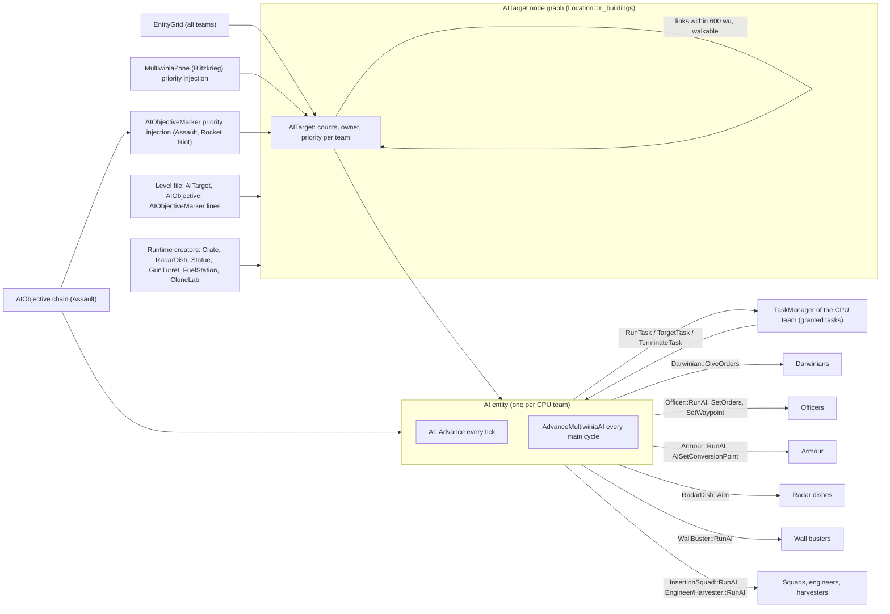
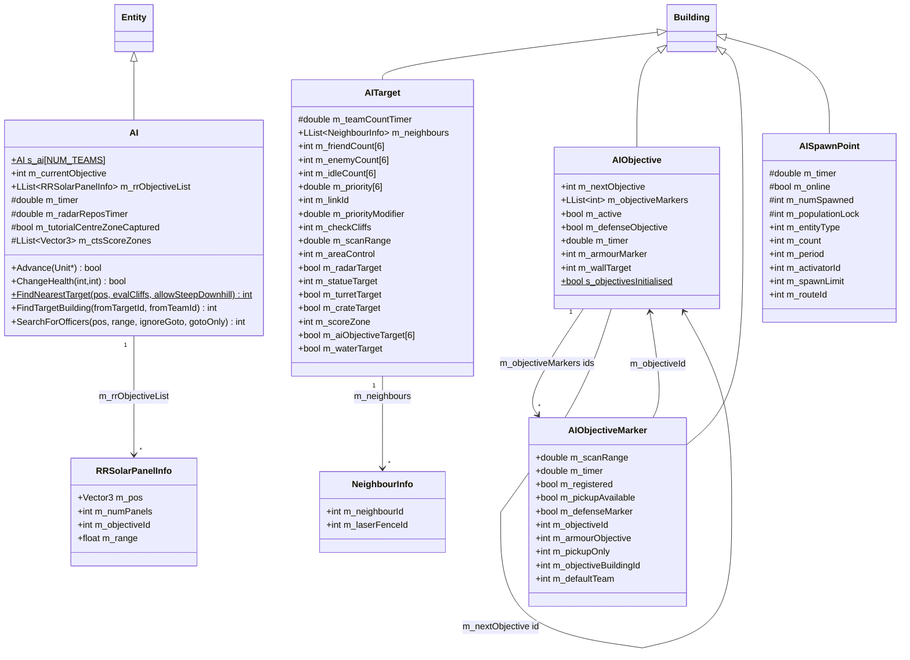
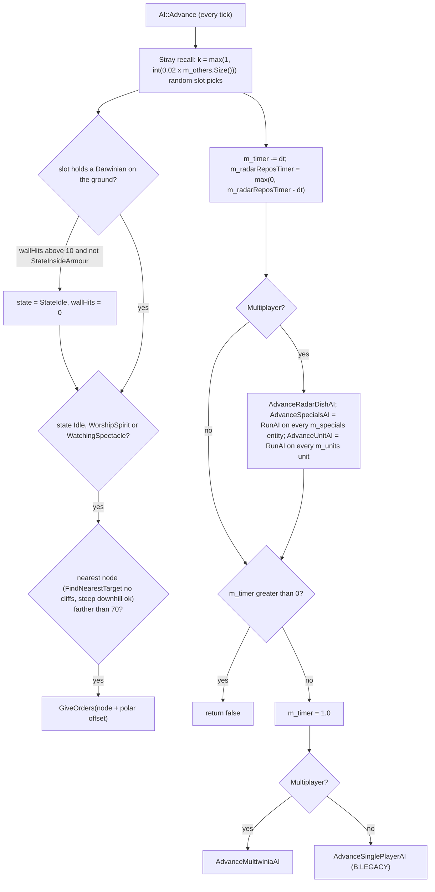
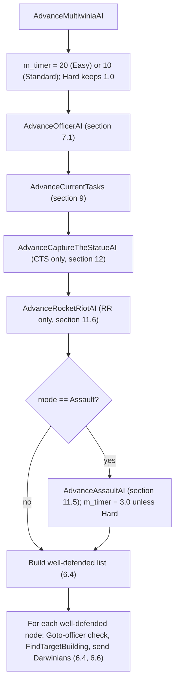
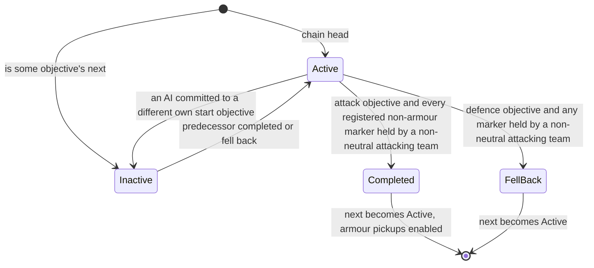

# 07 — AI (CPU players)

> Part A · Baseline build: Release|Win32 (OpenGL) + TARGET_PC_FULLGAME ([B:FULL]); see _work/build_matrix.md.
> Evidence: [C] confirmed · [I] inferred · [U] unknown. Citations are `path:Symbol` relative to the multiwinia/ source root.
> Sources merged: P08_crates_ai (primary, §10–§15, §17–§18, appendix), P02_game_modes (§4.8 per-mode AI pointers, Assault/Blitzkrieg/retribution rules), P01_app_core (Team/CPU team set-up, `Location::Init` order), P09_control_taskmanager (task placement, `m_mostRecentTaskId`), P15_network (§11 virtual players), P06_buildings_core (RadarDish/GunTurret AI targets), P04_entities_military (§4.7, §5.8 unit AI), P03_entity_core (Officer AI, Darwinian AI fields), P19_help_tutorial_script (tutorial AI gates), P18_ui_gamemenu (AI drop-down), routed `_meta_*.md`. All load-bearing claims re-read against code for this synthesis.

## Contents

1. [Overview](#1-overview)
2. [Architecture](#2-architecture)
3. [Data structures (every field)](#3-data-structures-every-field)
4. [The AITarget node graph — the AI's map](#4-the-aitarget-node-graph--the-ais-map)
5. [Priority model — every formula](#5-priority-model--every-formula)
6. [Decision loop and timing](#6-decision-loop-and-timing)
7. [Officers and formations](#7-officers-and-formations)
8. [Radar dishes](#8-radar-dishes)
9. [Using tasks (crate rewards) — the 19 handlers](#9-using-tasks-crate-rewards--the-19-handlers)
10. [Unit-level AI hooks (`RunAI`)](#10-unit-level-ai-hooks-runai)
11. [AI objectives — Assault objective chain and Rocket Riot markers](#11-ai-objectives--assault-objective-chain-and-rocket-riot-markers)
12. [Per-mode strategies](#12-per-mode-strategies)
13. [Difficulty levels — every parameter](#13-difficulty-levels--every-parameter)
14. [Cheats and advantages](#14-cheats-and-advantages)
15. [Determinism, lockstep and the network model](#15-determinism-lockstep-and-the-network-model)
16. [Known bugs that shape shipped behaviour](#16-known-bugs-that-shape-shipped-behaviour)
17. [Tutorial-specific AI behaviour](#17-tutorial-specific-ai-behaviour)
18. [Debug visualisation](#18-debug-visualisation)
19. [Constants](#19-constants)
20. [Re-implementation guide](#20-re-implementation-guide)
- [Open questions and unknowns](#open-questions-and-unknowns)
- [Docs-vs-code discrepancies](#docs-vs-code-discrepancies)
- [IP items](#ip-items)
- [Source map](#source-map)
- [Appendix — dead/legacy code](#appendix--deadlegacy-code)

---

## 1 Overview

A **CPU player** in Multiwinia is an ordinary team slot whose `m_teamType` is `TeamTypeCPU` plus exactly one invisible, immortal **`AI` entity** living in that team's free-entity list (`Team::m_others`) [C] `code/location.cpp:Location::InitialiseTeam`, `code/team.h:Team`. The AI entity is simulated like every other entity, on every peer, inside the lockstep simulation; it sends no network traffic (§15).

The AI "thinks" through five cooperating mechanisms [C] `code/worldobject/ai.cpp`, `code/worldobject/aiobjective.cpp`:

| # | Mechanism | Where | What it decides |
|---|---|---|---|
| 1 | **AITarget node graph** — designer-placed and runtime-created way-nodes, each holding per-team head-counts, an owner and a per-team **priority** in [0, 1] (Assault: unbounded) that diffuses along graph links | `AITarget` building | where Darwinians should be |
| 2 | **Dispatcher** — every main cycle, for each friendly node judged "well defended", choose a linked node (`FindTargetBuilding`) and walk idle Darwinians there | `AI::AdvanceMultiwiniaAI`, `AI::FindTargetBuilding` | flow of the army along the graph |
| 3 | **Officers** — Goto officers that redirect spawn-point output, and formation officers that defend threatened nodes | `AI::AdvanceOfficerAI`, `AI::AdvanceMultiwiniaAI`, `Officer::RunAI` | throughput and defence |
| 4 | **Task handlers** — place every power-up/unit the team has been granted (crates, retribution, starting power-ups) | `AI::AdvanceCurrentTasks` + 19 `Run*` functions | when/where to use powers |
| 5 | **Mode logic** — Assault objective chain (`AIObjective`/`AIObjectiveMarker`), Rocket Riot panel list and armour logistics, Blitzkrieg zone priorities, CTS statue un-sticking, radar-dish aiming, per-unit `RunAI` hooks | `AI::AdvanceAssaultAI`, `AdvanceRocketRiotAI`, `AdvanceCaptureTheStatueAI`, `AdvanceRadarDishAI`, `Armour::RunAI`, `InsertionSquad::RunAI`, `WallBuster::RunAI`, `Officer::RunAI`, `Engineer::RunAI`, `Harvester::RunAI`, `Tank::RunAI` | mode objectives |

Build tagging: everything in the main text is **[B:FULL]** unless tagged. `AI::AdvanceSinglePlayerAI` and `AISpawnPoint` are **[B:LEGACY]** (Darwinia campaign); `Tank::RunTankBattleAI` is **[B:DEBUG]** for availability: the TankBattle blueprint, its dispatch and `Tank::RunTankBattleAI` are compiled in FULL, but the mode is permitted only where `INCLUDEGAMEMODE_TANKBATTLE` is defined (the `TARGET_DEBUG` block); in FULL `App::IsGameModePermitted` refuses it, the lobby button is inactive and the body of `Multiwinia::AdvanceTankBattle` is compiled out; editor rendering of AI buildings is **[B:EDITOR]** [C] `code/lib/universal_include.h`, `code/app.cpp:App::IsGameModePermitted`, `code/multiwinia.cpp:Multiwinia::AdvanceTankBattle`, `code/UI/GameMenuWindow.cpp` (TankBattle button `m_inactive`), `code/worldobject/aiobjective.cpp:AIObjective::RenderAlphas` (`#ifdef LOCATION_EDITOR`).

One global difficulty (`Multiwinia::m_aiType` ∈ {Easy, Standard, Hard}) applies to all CPU teams (§13). The AI has perfect information and no economic, population, damage or vision cheats (§14).

---

## 2 Architecture

### 2.1 Component diagram



### 2.2 Class diagram (all AI classes, every field)



### 2.3 Instantiation and lifetime [C]

| Event | What happens | Ref |
|---|---|---|
| Level load, every used team | `Location::InitTeams` → `Location::InitialiseTeam(i)`; in Multiwinia mode a `TeamTypeCPU` team gets `SpawnEntities((-100, 0, -100), team, -1, Entity::TypeAI, 1, 0, 0)` — **one** AI entity. The requested point is off-map, so `Location::FindValidSpawnPosition(pos, spread 0)` makes 10 failed tries (consuming 20 `syncfrand` draws) and then clamps to `(max(x,20), y, max(z,20))` = **(20, 0, 20)**; the entity (radius 0) is inserted into entity-grid cell (0, 0) of its team. Resolved: P01/P02/P15 give (−100, 0, −100) — that is the request, the stored position is (20, 0, 20) [C] | `code/location.cpp:Location::InitTeams`, `Location::InitialiseTeam`, `Location::SpawnEntities`, `Location::FindValidSpawnPosition` |
| Monster team (id 4) and Futurewinian team (id 5) | `Location::Init` calls `InitMonsterTeam(4)` / `InitFuturewinianTeam(5)` **after** `InitTeams()` has set `m_teamsInitialised = true`; each calls `Multiwinia::InitialiseTeam(id, TeamTypeCPU, -1)`, which calls `Location::InitialiseTeam(id)` because `g_app->m_location` is already assigned (`g_app->m_location = new Location()` precedes `Init`) and `m_teamsInitialised` is true. `Team::m_teamType` is a *reference* to the lobby team's type, so the in-world team becomes CPU too. **Both neutral-hostile teams therefore always own an AI entity** in every Multiwinia game. Resolved: P08/meta U4 left this unconfirmed; the call order in code confirms it. | `code/location.cpp:Location::Init`, `InitMonsterTeam`, `InitFuturewinianTeam`; `code/multiwinia.cpp:Multiwinia::InitialiseTeam`, `Multiwinia::ResetLocation`; `code/team.h:Team::m_teamType` |
| `AI::AI()` | `SetType(TypeAI)`; `Entity::s_entityPopulation--` (removes it from the *global* entity counter, whose cap is commented out — it **does** still count toward its team's population cap, because `Location` spawns it with unit id −1 into `Team::m_others`, which is what the cap counts; corrected by coordinator after 00, see [05](05_economy_and_population.md)); `m_currentObjective = −1`; `m_tutorialCentreZoneCaptured = false`; `m_radarReposTimer = syncfrand(10)`; `m_timer = syncfrand(20)` (Easy) / `syncfrand(10)` (Standard) / `syncfrand(1)` (Hard and any other value) — random phase so CPU teams do not think in the same tick | `code/worldobject/ai.cpp:AI::AI` |
| `AI::Begin()` | `Entity::Begin()`; `AI::s_ai[team] = this`. (A `RecalculateAITargets()` call here is commented out.) | `AI::Begin` |
| Death | never: `AI::ChangeHealth` returns false; `AI::Advance` always returns false | `AI::ChangeHealth`, `AI::Advance` |
| Human leaves a running game | `Multiwinia::RemoveTeams(clientId)`: every non-CPU, non-unused team of that client becomes `TeamTypeCPU`, a new AI entity is spawned at (−100, 0, −100) (clamped to (20, 0, 20) as above), `m_accurateCPUTakeOverTime = GetGameTime()`, message `multiwinia_player_left`. The new AI inherits the team's existing officers, armour, tasks and Darwinians. In the lobby the slot is freed instead. | `code/multiwinia.cpp:Multiwinia::RemoveTeams` |
| Late (re)initialised team | `Multiwinia::InitialiseTeam` → `Location::InitialiseTeam` if the location is running | `Multiwinia::InitialiseTeam` |
| Location reset | `Location::Init` resets `AI::s_ai[i] = NULL` for all 6 teams, `AIObjective::s_objectivesInitialised = false`, `Armour::s_armourObjectives.Empty()` | `code/location.cpp:Location::Init`, `Location::Empty` |
| `AI::~AI` | `m_rrObjectiveList.EmptyAndDelete()` | `AI::~AI` |
| Render | only when `g_app->m_editing`: sphere r 20 at y 400 in team colour, plus team-0/team-1 counts | `AI::Render` |

Consequences: the number of AI entities in a match = (lobby CPU teams) + 2 (monster, Futurewinian) + (humans who left). There is no "AI for a human team" (no autopilot) [C].

### 2.4 How the AI acts — the actuators [C]

The AI never synthesises player input; it calls simulation methods directly:

| Actuator | Used by | Ref |
|---|---|---|
| `Darwinian::GiveOrders(pos)` (walk to a point; radar/bridge in the target cell redirects to the building) | stray recall, dispatcher, CTS un-sticking | `code/worldobject/darwinian.cpp:Darwinian::GiveOrders` |
| `TaskManager::RunTask(GlobalResearch::TypeOfficer)` + `TaskManager::TargetTask(id, pos)` (promote the Darwinian at `pos`) | officer creation | `code/taskmanager.cpp:TaskManager::RunTask`, `TargetTask`, `Task::TargetOfficer` |
| `TaskManager::TargetTask(id, pos)` for granted tasks | task handlers | `code/taskmanager.cpp:TaskManager::TargetTask` |
| `TaskManager::TerminateTask(id, false)` | Assault attacker discards turret tasks | `AI::RunGunTurret` |
| `Officer::SetOrders`, `SetWaypoint`, `SetFormation`, `m_noFormations`, `m_targetFront`, `m_turnToTarget` | officer AI | `code/worldobject/officer.cpp:Officer::RunAI` |
| `Armour::AISetConversionPoint`, `SetWayPoint`, `m_state`, `ChangeHealth(-1000)` | armour AI | `code/worldobject/armour.cpp:Armour::RunAI` family |
| `RadarDish::Aim(dishPos)` | radar AI | `AI::AdvanceRadarDishAI` |
| `InsertionSquad::SetWayPoint`, `Attack` | squad AI | `code/worldobject/insertion_squad.cpp:InsertionSquad::RunAI` |
| `Engineer/Harvester::SetWaypoint` | unit AI | `Engineer::RunAI`, `Harvester::RunAI` |
| `WallBuster::m_routeId` via `RoutingSystem::GenerateRoute` | Assault attackers | `code/worldobject/wallbuster.cpp:WallBuster::RunAI` |
| Writes to `AITarget::m_priority[t]`, `m_aiObjectiveTarget[t]`; `AIObjective::m_active` | priority model and objective chain | §5, §11 |

### 2.5 What the AI reads — perfect information [C]

| Information | Source | Used for |
|---|---|---|
| Every building of every team (linear scans of `Location::m_buildings`) | `Location::m_buildings` | spawn points, turrets, zones, rockets, trunk ports, walls, radar dishes, crates |
| Per-node, per-team head counts of **all** entity types inside each node's range, for all 6 teams | `AITarget::RecountTeams` over `EntityGrid::GetNeighbours` | priorities, dispatch, officer and power-up decisions |
| Arbitrary entity-grid queries around any point for any team (`GetEnemies`, `GetFriends`, `GetNumEnemies`, `GetNumFriends`, `AreEnemiesPresent`) | `code/entity_grid.cpp` | squads, armour, meteor/officer/turret logic |
| Enemy rocket fuel and state, enemy team scores/elimination flags, Blitzkrieg score state | `EscapeRocket::m_fuel`, `m_state`; `Multiwinia::m_teams[].m_score`; `m_eliminated[]` | Rocket Riot/Blitzkrieg AI |
| Every spirit position | `Location::m_spirits` | engineer/harvester AI |
| Level-file attacker/defender flags | `Location::IsAttacking/IsDefending` | Assault |

There is no fog of war, no reaction delay other than the think periods (§6.1), and no sensing radius beyond the explicit query radii listed in §19.

---

## 3 Data structures (every field)

### 3.1 `AI` (entity `TypeAI`) [C] `code/worldobject/ai.h:AI`

| Field | Type | Init | Meaning |
|---|---|---|---|
| `s_ai[NUM_TEAMS]` | static `AI*` | NULL (reset in `Location::Init`) | team → AI entity lookup (used by `AITarget::NeedsDefending`, priority code, markers) |
| `m_timer` | double | `syncfrand(20/10/1)` by difficulty | main-cycle countdown (§6.1) |
| `m_radarReposTimer` | double | 10.0 then overwritten by `syncfrand(10)` | radar retarget countdown, clamped ≥ 0 |
| `m_tutorialCentreZoneCaptured` | bool | false | Tutorial 1 random-walk filter latch (§17) |
| `m_ctsScoreZones` | `LList<Vector3>` | empty | cache for `GetClosestScoreZonePos` (only caller is commented out) |
| `m_currentObjective` | int | −1 | Assault: building id of the `AIObjective` this team works on |
| `m_rrObjectiveList` | `LList<RRSolarPanelInfo*>` | empty | Rocket Riot: own-team `AIObjectiveMarker` cache (filled once) |

### 3.2 `RRSolarPanelInfo` [C] `code/worldobject/ai.h`

| Field | Type | Meaning |
|---|---|---|
| `m_pos` | Vector3 | marker position |
| `m_numPanels` | int | number of `SolarPanel` buildings within `m_range` of the marker (`CountPanels`, `≤`) |
| `m_objectiveId` | int | the marker's own building id |
| `m_range` | float | the marker's `m_scanRange` |

### 3.3 `AITarget` (building `TypeAITarget`, id 42) [C] `code/worldobject/ai.h:AITarget`, `code/worldobject/ai.cpp:AITarget::AITarget`, `AITarget::Initialise`

| Field | Type | Init | Meaning |
|---|---|---|---|
| `m_teamCountTimer` | double | `syncfrand(2.0)` | recount countdown (random phase) |
| `m_neighbours` | `LList<NeighbourInfo*>` | empty | outgoing links (directed; normally symmetric) |
| `m_friendCount[6]` | int | 0 | entities of team t within range |
| `m_enemyCount[6]` | int | 0 | entities of teams not allied with t within range |
| `m_idleCount[6]` | int | 0 | Darwinians of team t within range in `StateIdle`, `StateWorshipSpirit` or `StateWatchingSpectacle` |
| `m_priority[6]` | double | 0 | per-team desirability (§5) |
| `m_linkId` | int | −1 (level) | manual link to another AITarget regardless of distance |
| `m_priorityModifier` | double | 0.0 (level) | additive designer bias |
| `m_checkCliffs` | int | 1 (level) | 0 → links from/to this node ignore slope tests |
| `m_scanRange` | double | uninitialised | **declared, never read or written** in AITarget code [C grep] |
| `m_areaControl` | int | uninitialised | **declared, never used** (comment describes a "pass/always update" scheme) [C grep] |
| `m_radarTarget` | bool | false | node sits at a connected radar-dish entrance |
| `m_statueTarget` | int | −1 | id of the CTS statue this node follows |
| `m_turretTarget` | bool | false | node sits on a gun turret |
| `m_crateTarget` | bool | false | node sits under a landed crate |
| `m_scoreZone` | int | −1 | id of the neutral KOTH/CTS `MultiwiniaZone` containing this node (set once, never cleared) |
| `m_aiObjectiveTarget[6]` | bool | false | per team: priority is externally driven (markers, Blitzkrieg zones) — skip own recalculation |
| `m_waterTarget` | bool | false; true if `m_pos.y ≤ 0` (`Initialise`, `RecalculateNeighbours`) | sea node: armour path-finding only, never a walking destination |
| shape | — | `aitarget.shp` | editor-visible only |

`NeighbourInfo` [C] `code/worldobject/ai.h`: `m_neighbourId` (AITarget building id), `m_laserFenceId` (id of an **enabled** laser fence crossed by the straight link at link-build time, −1 if none — see §4.2).

`#define AITARGET_LINKRANGE 600.0` [C] `code/worldobject/ai.h`.

### 3.4 `AIObjective` (building `TypeAIObjective`, id 71) [C] `code/worldobject/aiobjective.h`, `code/worldobject/aiobjective.cpp:AIObjective::AIObjective`

| Field | Type | Init | Meaning |
|---|---|---|---|
| `m_nextObjective` | int | −1 / level | objective activated when this one completes (or falls back) |
| `m_objectiveMarkers` | `LList<int>` | empty | registered marker ids (filled by markers, §11.4) |
| `m_active` | bool | true | objective currently in play |
| `m_defenseObjective` | bool | false | objective belongs to a defending team (fall-back semantics) |
| `m_timer` | double | 5.0 | evaluation countdown (no random phase) |
| `m_armourMarker` | int | −1 | id of the marker that is the armour drop point |
| `m_wallTarget` | int | −1 | written by `Wall::Advance` for a wall whose `m_objectiveLink` names this objective; **never read** [C grep] |
| `s_objectivesInitialised` | static bool | false (reset in `Location::Init`, `Location::Empty`) | one-shot initialisation latch |

### 3.5 `AIObjectiveMarker` (building `TypeAIObjectiveMarker`, id 72) [C] `code/worldobject/aiobjective.h`, `AIObjectiveMarker::AIObjectiveMarker`, `Initialise`

| Field | Type | Init | Meaning |
|---|---|---|---|
| `m_scanRange` | double | 100.0 / level | head-count radius; 0 → ownership from bound building or default team |
| `m_timer` | double | `syncfrand(1.0)` | evaluation countdown |
| `m_registered` | bool | false | registered with its objective |
| `m_pickupAvailable` | bool | false | armour may pick up here (set when its objective completes) |
| `m_defenseMarker` | bool | false | copied from the objective's `m_defenseObjective` at registration |
| `m_objectiveId` | int | −1 / level | owning `AIObjective` id (Rocket Riot markers: −1) |
| `m_armourObjective` | int | 0 / level | 1 → armour marker (drop/pickup point), excluded from capture test |
| `m_pickupOnly` | int | 0 / level | 1 → pickup only (not registered as the objective's armour marker); −1 → never becomes a pickup |
| `m_objectiveBuildingId` | int | −1 | building found within 20 wu at registration whose team decides the marker |
| `m_defaultTeam` | int | **uninitialised** unless the level team ≠ 255 | team restored when `m_scanRange == 0` and no bound building |

### 3.6 AI-related fields in other classes [C]

| Class::field | Written by | Read by | Ref |
|---|---|---|---|
| `Multiwinia::m_aiType` (`AITypeEasy=0`, `AITypeStandard=1`, `AITypeHard=2`, `NumAITypes=3`) | lobby option `GAMEOPTION_AIMODE`, `App::StartSinglePlayerServer/StartMultiPlayerServer`, tutorial | all AI code | `code/multiwinia.h`, `code/network/clienttoserver.cpp` |
| `Darwinian::m_closestAITarget` | `AITarget::RecountTeams` | dispatcher filter | `code/worldobject/darwinian.h` |
| `Darwinian::m_wallHits` | Darwinian movement | stray recall (reset) | `AI::Advance` |
| `Officer::m_noFormations`, `m_orders`, `m_orderPosition`, `m_targetFront`, `m_turnToTarget`, `m_aiTimer` | AI | Officer | `code/worldobject/officer.h` |
| `Armour::m_aiTimer`, `m_recheckPathTimer`, `m_suicideBuildingId`, `m_currentAIObjective`, `m_pickupPoint`, `m_conversionPoint`, `m_turretRushing`; static `Armour::s_armourObjectives` | armour AI, `AIObjective::InitialiseObjectives` | armour AI | `code/worldobject/armour.h` |
| `TaskManager::m_mostRecentTaskId`, `m_mostRecentEntity` | `RunTask`, `Task::TargetOfficer` | officer creation | `code/taskmanager.h` |
| `RadarDish::m_aiTarget`, `Statue::m_aiTarget`, `GunTurret::m_aiTarget`, `Crate::m_aiTarget`, `FuelStation::m_aiTarget`, `CloneLab::m_aiTarget` | owner building | radar AI, graph | §4.1 |
| `MultiwiniaZone::s_blitzkriegBaseZone[6]`, `m_blitzkriegLinks` | Blitzkrieg | turret/armour AI | `code/worldobject/multiwiniazone.cpp` |
| `LobbyTeam::m_rocketId` | Rocket Riot | RR AI | `code/multiwinia.h` |
| `MultiwiniaHelp::m_tutorial2AICanAct`, `m_tutorial2AICanSpawn` | tutorial director | AI gates | `code/multiwiniahelp.cpp` |

---

## 4 The AITarget node graph — the AI's map

The AI never path-finds over terrain. Its whole model of the map is a sparse, directed graph of `AITarget` buildings; Darwinians are ordered from node to node and walk the straight line between them (their own local avoidance handles obstacles, see [02](02_units_and_entities.md) and [21](21_simulation_and_entity_model.md)).

### 4.1 Placement — level file vs runtime

**Designer-placed (level file)** [C] `code/worldobject/ai.cpp:AITarget::Read`, `AITarget::Write`; census by `_work/scripts/S_07_ai_level_census.py` over `data/levels/mp_*.txt`:

```
AITarget <id> <x> <z> <team> <rx> <rz> <isGlobal> [<linkId> [<priorityModifier> [<checkCliffs>]]]
e.g.  AITarget 56 602.17 1461.32 255 1.00 0.00 0 -1 0.00 0
```

The first seven fields are the generic `Building::Read` header ([29](29_data_formats_reference.md)); `Initialise` copies `m_linkId`, `m_priorityModifier`, `m_checkCliffs` from the template and sets `m_waterTarget = (y ≤ 0)`. The level team is irrelevant (ownership is recomputed every 2 s).

| Census of 57 shipped `mp_*.txt` levels [C data] | Value |
|---|---|
| AITargets total | 1112 (assault 311 in 9 files, blitzkrieg 159/7, cts 177/10, domination 78/5, koth 191/11, rocketriot 123/7, skirmish 55/2, benchmark 13/1, sandbox 5) |
| Lines with all three optional fields / with two | 1107 / 5 |
| AITargets with a manual link (`linkId ≠ −1`) | 23 |
| `priorityModifier` values used | 0.00 ×1083, 0.30 ×16, 0.20 ×5, 1.00 ×4, −0.50 ×2, 0.05 ×1, −1.00 ×1 |
| AITargets with `checkCliffs = 0` | 165 |
| AIObjective / AIObjectiveMarker | 95 / 250 in the 9 `mp_assault_*` files (8 playable + `mp_assault_stress`, the `TARGET_ASSAULT_STRESSTEST` map); 0 / 90 in the 7 `mp_rocketriot_*` files |

Resolved: P02 lists 8 Assault maps, P08 says 9 — the ninth is `mp_assault_stress.txt`, used only by the separate `TARGET_ASSAULT_STRESSTEST` product target (`PERMITTED_MAPS = ASSAULT_STRESS`, not built for FULL; see build_matrix §3).

**Runtime-created** — each uses a stack template, `Building::CreateBuilding(TypeAITarget)`, `Initialise(template)`, a fresh id from `GlobalWorld::GenerateBuildingId()`, `m_buildings.PutData`, then a full `RecalculateAITargets()` (except CloneLab) [C]:

| Creator | Created when | Position (y = terrain height) | Flags set | Removed | Ref |
|---|---|---|---|---|---|
| `Crate` | first `AdvanceOnGround` (crate has landed) | crate position | `m_priorityModifier = 0.5`, `m_crateTarget = true` | with the crate (captured or expired) | `code/worldobject/crate.cpp:Crate::AdvanceOnGround` |
| `RadarDish` | `AdvanceAITarget` while `m_signal > 0` (multiplayer) | dish entrance (`m_entrancePos`), height of dish position | `m_radarTarget = true`; `m_linkId` = receiver dish's AITarget once that exists (second recalc) | when signal drops to 0 | `code/worldobject/radardish.cpp:RadarDish::AdvanceAITarget` |
| `Statue` (CTS) | first Advance | statue; moved to the statue (with recalc) whenever the statue is > `m_carryRadius × 1.5` from it | `m_priorityModifier = 1.0`, `m_statueTarget = statue id` | `Statue::Destroy` | `code/worldobject/statue.cpp:Statue::Advance` |
| `GunTurret` (level or crate turret) | first Advance | turret | `m_turretTarget = true` | with the turret | `code/worldobject/gunturret.cpp:GunTurret::Advance` |
| `FuelStation` (Rocket Riot) | while its rocket is `StateLoading` and `SafeToLaunch()` (always true in MP) | station | `m_priorityModifier = 1.0` | when the rocket stops loading | `code/worldobject/rocket.cpp:FuelStation::Advance` |
| `CloneLab` | `InitialiseAITarget` (no recalc) | exit marker | — | — | **[B:LEGACY]** (no shipped map) `code/worldobject/clonelab.cpp:CloneLab::InitialiseAITarget` |

Resolved: P08's table also listed `WallBuster` as a creator ("follows the buster"); in code the WallBuster's AITarget creation block is commented out, `m_aiTarget` stays NULL and only the dead follow-code remains [C] `code/worldobject/wallbuster.cpp:WallBuster::Advance`. WallBusters are steered by `WallBuster::RunAI` instead (§10.5).

Note: constructing the template calls the `AITarget` constructor, which itself draws `syncfrand(2.0)` — every runtime creation consumes **two** synced random numbers (template + real node) [C] `AITarget::AITarget`.

### 4.2 Link construction — `AITarget::RecalculateNeighbours` [C]

For node A (not in the editor), `m_neighbours` is cleared, `m_waterTarget` re-evaluated, then for every other non-destroyed AITarget B in `m_buildings` order:

```
inRange   = |A − B| ≤ 600  or  A.m_linkId == B.id
checkCliff = A.m_checkCliffs and B.m_checkCliffs;   if A.m_linkId == B.id: checkCliff = false
fenceId   = −1
link if inRange and ( IsWalkable(A, B, checkCliff, permitSteepDownhill = false, &fenceId)
                      or (A.m_radarTarget and B.m_radarTarget)
                      or A.m_waterTarget or B.m_waterTarget )
NeighbourInfo{ B.id, fenceId }
```

`Location::IsWalkable(from, to, evaluateCliffs, permitSteepDownhill, &fenceId)` [C] `code/location.cpp:Location::IsWalkable`:
- false if either end has y ≤ 0 (water level 0.0) — so water nodes are linked only through the explicit water clause and are never "walkable";
- steps of 20 wu (`numSteps = int(distance / 20)`; a link shorter than 20 wu is always walkable);
- false once ≥ 40 wu of the samples lie at or below water;
- if `evaluateCliffs`: `gradient = (h(sample) − from.y) / 20` — `oldPosition` is never advanced in the loop, so this is the rise **relative to the start point**, not per step — false if `gradient > 2.4` (any sample more than 48 wu above the start); and, unless `permitSteepDownhill` and the sample is not higher than the start, false if the landscape normal's y < 0.8 at the sample;
- false if a `Wall` within the obstruction-grid cell is hit by a sphere of radius 13.2 (0.66 × step);
- an **enabled** `LaserFence` hit by a sphere of radius 10 is *recorded* in `fenceId` (last one wins) but does not block;
- all wall/fence tests are skipped when `Location::m_obstructionGrid` is NULL.

**Initial-build caveat** [C, consequence I]: `Location::Init` calls `InitBuildings(); RecalculateAITargets();` *before* `m_obstructionGrid = new ObstructionGrid(32, 32)`. The first link set therefore ignores every wall and laser fence (all `m_laserFenceId = −1`). The graph is rebuilt correctly at the first runtime trigger (§4.5): on the first tick on every map with a `GunTurret` or `Statue` (all Assault and CTS maps), otherwise at the first crate landing, radar connection or fuel-station activation. Maps with fences but no turrets — `mp_blitzkrieg_2P_3`, `_2p_1`, `_3P_1`, `_3P_2`, `_4P_2`, `mp_domination_2P_1`, `mp_rocketriot_2p_3` [C data] — run their opening seconds with fence-blind links.

**Stale fence information** [C]: links are not rebuilt when a fence is toggled (no `RecalculateAITargets` call in `code/worldobject/laserfence.cpp`). A link built while its fence was disabled has `m_laserFenceId = −1` and is treated as fence-free afterwards; a link built across an enabled fence keeps the id and the fence's *current* `IsEnabled()` and team are tested at use time.

### 4.3 Link culling — `Location::RecalculateAITargets` [C]

After every node has rebuilt its list, a second pass removes "redundant" links:

```
for each AITarget A (in m_buildings order), skipping A.m_turretTarget:
  for each neighbour C of A (index n), skipping C == A.m_linkId (manual links are never culled) and C.m_turretTarget:
    d_AC = A.IsNearTo(C)
    for each other neighbour B of A (index x ≠ n):
      d_AB = A.IsNearTo(B);  d_BC = B.IsNearTo(C)        # IsNearTo returns −1 if not linked
      if d_BC > 0 and d_AC > 0.8 × (d_AB + d_BC):  delete link A→C; n -= 1; break
```

The pass is order-dependent (B's list may already have been culled) and `B` may be a turret node. Complexity: O(N²) link tests (each with an `IsWalkable` ray) plus O(N·k²) culling, run on every trigger [C; cost noted in [32](32_debug_test_and_performance.md)].

### 4.4 Score-zone tagging (same pass) [C] `AITarget::RecalculateNeighbours`

While scanning buildings, if a `MultiwiniaZone` Z has `|A − Z| ≤ Z.m_radius` and Z is neutral (team 255) at that moment:
- CTS → `A.m_scoreZone = Z.id` (the neutral statue-spawn zone);
- King of the Hill → `A.m_scoreZone = Z.id` (the hill).

`m_scoreZone` is never reset, so a node keeps its zone after the zone is captured [C].

### 4.5 Recalculation triggers [C] (all call `Location::RecalculateAITargets`)

`Location::Init` (§4.2 caveat); `Location::AdvanceBuildings` when an `AITarget` or `Wall` building is removed (walls opening holes); `Crate::AdvanceOnGround` (create) and crate removal; `RadarDish::AdvanceAITarget` (create, link to receiver, destroy); `Statue::Advance` (create, move > 1.5 × carry radius); `GunTurret::Advance` (create); `FuelStation::Advance` (create). [C] grep of `RecalculateAITargets` in `code/`.

### 4.6 Head counts and ownership — `AITarget::Advance` [C]

Every tick: `m_teamCountTimer -= SERVER_ADVANCE_PERIOD`; when ≤ 0 (every 20 ticks = 2.0 game-s, random initial phase):
1. `RecalculatePriority()` — uses the **previous** counts (§5);
2. `m_teamCountTimer = 2.0`;
3. `RecountTeams()`;
4. `RecalculateOwnership()`.

`GetRange()` = 200 wu in multiplayer (100 in single-player [B:LEGACY]); if `m_scoreZone ≠ −1` and the zone still exists, `range = zone.m_size`.

`RecountTeams()`: zero the three arrays; query all entities of all teams within `range` (`EntityGrid::GetNeighbours`, every entity type of every team, including the AI entity itself when near (20, 0, 20)); for each entity e of team `e.t` and each team t in 0..5: if `e.t == t` → `friendCount[t]++`, else if `!IsFriend(e.t, t)` → `enemyCount[t]++` (co-op allies count in neither). If e is a Darwinian in `StateIdle`, `StateWorshipSpirit` or `StateWatchingSpectacle` → `idleCount[e.t]++`. Every Darwinian found also updates `m_closestAITarget` to this node if it has none or this node is nearer than its current one.

`RecalculateOwnership()`: owner = the team with the highest `friendCount`, scanning t = 0..5 with strict `>` from 0 — **ties go to the lowest team id**; no entities → 255. Resolved: P08 wrote "strictly highest"; the code's strict `>` scan makes the lower index win ties.

### 4.7 Node predicates [C]

**`IsImportant(&id)`**: scans `m_buildings` in order and returns true with the first building b with `|A − b| < 100` that is any of: has at least one port (`b.m_ports.Size() > 0`; the port-carrying building types are listed in [03](03_buildings_and_world_objects.md)), a `Crate`, a `RadarDish`, a `TrunkPort` (Rocket Riot only), a `MultiwiniaZone` (all modes except CTS). `id` = that building's id.

**`NeedsDefending(team)`**:
```
if owner != team: return false
officers = s_ai[team].SearchForOfficers(pos, 300)          # all officers of the team, any order type
if m_scoreZone != −1 and mode != CTS: return true
for each neighbour N: if !IsFriend(owner, N.owner) and N.owner != 255 and N.enemyCount[owner] > 30 and officers == 0: return true
return false
```

**`AI::SearchForOfficers(pos, range, ignoreGoto, gotoOnly)`**: counts the team's live Officers within `range` (≤): `gotoOnly` → only `OrderGoto` officers; else if `ignoreGoto` → only non-Goto officers; else all.

**`AI::FindNearestTarget(pos, evalCliffs = true, allowSteepDownhill = false)`** (static): linear scan of all AITargets (any owner, including water nodes); among those strictly nearer than the best so far, accept the first for which `IsWalkable(pos, node, evalCliffs, allowSteepDownhill)` holds; returns −1 if none. Because water nodes are never walkable, they are never returned.

---

## 5 Priority model — every formula

`m_priority[t]` is "how much team t wants to be at this node". It is recomputed per node every 2.0 s (§4.6) and read by the dispatcher (§6.5), officers (§7), squads (§10.3) and radar AI (§8). Priorities **diffuse**: most formulas use the neighbours' priorities from their own last evaluation, so information spreads one link per node evaluation (random phases make this asynchronous).

### 5.1 Dispatch — `AITarget::RecalculatePriority` [C]

```
if node.id == 92 and tutorial and tutorialType == Tutorial2:            # tutorial hack, §17
    if !tutorial2AICanSpawn:              p[2] = 1.0                     # then continue
    elif SpawnPoint::s_numSpawnPoints[2] == 1:  p[2] = 0.0; return
if aiType == Easy and mode != Assault: return                            # Easy: priorities frozen (initially 0)
switch mode:
    Assault, Blitzkrieg       → RecalculatePriorityAssault
    CaptureTheStatue          → RecalculatePriorityCTS
    RocketRiot                → RecalculatePriorityRocketRiot
    otherwise (Domination = GameTypeSkirmish, KingOfTheHill, TankBattle) → RecalculatePriorityStandard
```

Every variant loops t = 0..5 and **skips any team with `m_aiObjectiveTarget[t] == true`** (that team's priority on this node is externally driven, §5.6). Priorities are computed for all six teams, including human teams (whose values are only read by debug rendering) [C].

Notation used below, for node A and team t: `own(A)` = owner (255 = neutral); `F = A.friendCount[t]`, `E = A.enemyCount[t]`; `U(A,t)` = set of *usable* neighbours N (a link counts unless it has a recorded fence φ that is currently enabled and hostile — the hostility test differs per variant, stated each time); `imp` = the building returned by `IsImportant` (or none); `IsFriend(255, x) = false`.

### 5.2 Standard (Domination, King of the Hill, TankBattle) — `RecalculatePriorityStandard` [C]

```
grab = (not Multiplayer)  or  (imp exists and imp.team ≠ t and imp.type ≠ TrunkPort)
if grab:
    p = 0.95
elif not IsFriend(own(A), t):                      # enemy-owned OR neutral
    p = 0.8
    if F > 0.5 · E:  p = 1.0                       # "we are attacking"
else:                                              # owned by t (or a co-op ally)
    if E > 0.5 · F:  p = 1.0                       # "we are under attack"
    else:
        U = { N : φ(A→N) is none, or φ.team == t, or not φ.IsEnabled() }
        p = ( Σ_{N∈U} N.p[t] ) / |U|               # no zero check: |U| = 0 → 0/0 = NaN
        p = p / 2                                  # (always true in this branch)
if A.m_radarTarget:  p = p + 0.35
p = p + 0.01 · |A.m_neighbours| + A.m_priorityModifier
p = std::min(p, 1.0)                               # NaN stays NaN
if Multiplayer and A.m_scoreZone ≠ −1 and zone exists and mode == KingOfTheHill:
    if zone.team ≠ t  or  zone.m_totalCount − zone.m_teamCount[t] > 10:  p = 0.95
```

Reading: anything "important" not held by t (enemy or neutral spawn point, crate, radar dish, KOTH hill, solar panel) is 0.95 before bonuses — after `+ 0.01·k + modifier` and the clamp a crate node (modifier 0.5) is always 1.0. Plain enemy/neutral nodes are 0.8 (1.0 once t outnumbers half the enemy). Own quiet nodes take half the average of their neighbours, so the gradient points away from the interior toward contested frontier nodes.

### 5.3 Capture the Statue — `RecalculatePriorityCTS` [C]

```
U = { N : φ none, or φ.team == t, or not φ.IsEnabled() }
if |U| > 0:  p = ( Σ_{N∈U} std::max(0.0, N.p[t]) ) / |U|          # else p keeps its previous value
if IsFriend(own(A), t):  p = p / 2                                  # applied even when |U| = 0
p = p + A.m_priorityModifier
if IsImportant(A) and own(A) == 255:  p = 0.95                      # note: node owner, not building owner
if A.m_statueTarget ≠ −1 and statue exists:
    if statue.team ≠ t  or  statue.m_numLifters < statue.m_maxLifters  or  E > 10:  p = 1.0
p = std::min(1.0, p)
```

`std::max(0.0, NaN)` returns 0.0, so NaN cannot propagate in CTS. Statue nodes (modifier 1.0) are 1.0 for every team except one that is already carrying it with a full lifter crew (min 20, max 50 lifters, see [01](01_game_modes.md)) and not under pressure.

### 5.4 Assault and Blitzkrieg — `RecalculatePriorityAssault` (diffusion with decay) [C]

```
p = 0;  S = 0;  n = 0;  radarNeighbour = false
for each neighbour N with ( φ none, or IsFriend(φ.team, t), or not φ.IsEnabled() ):
    if N.p[t] > 0:  S += N.p[t];  n += 1
    if N.m_radarTarget:  radarNeighbour = true
if n > 0:  p = S / (n + 1)
if A.m_radarTarget and not radarNeighbour:  p = p + 0.35      # receiving dish not connected → no AITarget on far side
p = p + A.m_priorityModifier
if A.m_crateTarget and s_ai[t] exists and s_ai[t].currentObjective.m_nextObjective == −1:
    p = 0.0                                                     # on the final objective, ignore crates
# no clamp
```

Sources are the externally pinned nodes (§5.6): AIObjectiveMarker targets (Assault) or Blitzkrieg zone targets, each pinned at 1.0. Every hop divides by (n + 1) ≥ 2, so the field decays geometrically with graph distance and points along the shortest link chain to the pinned objective. Designer modifiers (e.g. 0.30, −0.50, −1.00 in the census) bend the field.

### 5.5 Rocket Riot — `RecalculatePriorityRocketRiot` [C]

```
mod = 0;  grab = false
if imp exists:
    if imp.team ≠ t and imp.type ≠ TrunkPort:  grab = true
    if imp.type == TrunkPort and imp.team == t:                   # own trunk port
        rocket = rocket of team t
        if rocket exists:
            if rocket.m_state == StateLoading:  grab = true        # gather at the port for the armour shuttle
            else:  mod = 0.1
if grab:  p = 0.95
else:
    U = { N : φ none, or φ.team == t, or not φ.IsEnabled() }
    p = ( Σ_{N∈U} N.p[t] ) / (|U| + 1)
    if IsFriend(own(A), t):  p = p / 2
if A.m_radarTarget:  p = p + 0.35
p = p + A.m_priorityModifier + mod                                # no per-neighbour bonus in RR
p = std::min(p, 1.0)
```

### 5.6 External priority overrides [C]

These writers pin a node's priority for a team and set `m_aiObjectiveTarget[t] = true` so §5.2–§5.5 leave it alone (or clear the flag to release it).

| Writer | Period | Node affected | Rule | Ref |
|---|---|---|---|---|
| Blitzkrieg zone (`MultiwiniaZone::Advance_Blitzkrieg`) | each zone recount (`m_recountTimer = GetNetworkTime() + 1.0`, ≈ 1 game-s) | `FindNearestTarget(zone.pos)` | for every team i in 0..5: `p = 1.0` if `aiType` is neither Standard nor Hard (i.e. Easy), else `p = GetBlitzkriegPriority(zone, i)`; `m_priority[i] = p`; `m_aiObjectiveTarget[i] = (p > 0)` | `code/worldobject/multiwiniazone.cpp:MultiwiniaZone::Advance_Blitzkrieg` |
| `AIObjectiveMarker::AdvanceStandard` (Assault, attack objectives) | 2.0 s | `FindNearestTarget(marker.pos)` | for each **attacking** team i with an AI: if `s_ai[i].m_currentObjective == marker.m_objectiveId`: if `marker.m_armourObjective == 0` and `!IsFriend(marker.team, i)` → `p[i] = 1.0`, flag true; else flag false. If the AI is on another objective: `m_pickupAvailable` → `p[i] = 1.0`, flag true; else flag false | `code/worldobject/aiobjective.cpp:AIObjectiveMarker::AdvanceStandard` |
| `AIObjectiveMarker::AdvanceDefensive` (Assault, defence objectives) | 2.0 s | nearest node | for each **defending** team i with an AI: on this objective and `IsFriend(marker.team, i)` → `p[i] = 1.0`, flag true; otherwise flag false | `AIObjectiveMarker::AdvanceDefensive` |
| `AIObjectiveMarker::AdvanceRocketRiot` | 2.0 s | nearest node | team k = marker's level team (255 → nothing): if k's rocket exists, is **not** `StateLoading`, and the node is not owned by k → `p[k] = 1.0`; else `p[k] = 0.0`; flag true either way | `AIObjectiveMarker::AdvanceRocketRiot` |
| Tutorial node 92 | 2.0 s | itself | §5.1, §17 | `AITarget::RecalculatePriority` |

`GetBlitzkriegPriority(zone, i)` by team i's Blitzkrieg status `m_teams[i].m_score` [C] `MultiwiniaZone::GetBlitzkriegPriority`; constants `code/multiwinia.h`:

| i's score | Constant | Priority of zone Z for team i |
|---|---|---|
| `BLITZKRIEGSCORE_SAFE` | 10005 | 1.0 if Z.team ≠ i |
| `BLITZKRIEGSCORE_ENEMYOCCUPIED`, `_UNDERATTACK`, `_UNOCCUPIED` | 10001, 10002, 10003 | 1.0 if Z is a Blitzkrieg base zone owned by a non-neutral, non-eliminated team |
| `BLITZKRIEGSCORE_UNDERTHREAT` | 10004 | 1.0 if Z links to i's base zone and Z.team ≠ i |
| `BLITZKRIEGSCORE_ELIMINATED` (≤ 10000) | 10000 | 0 |
| final override | — | 0.0 if Z is not a base zone and Z.team == i |

If several markers or zones share the same nearest node, the last writer in building-advance order wins [I from code order].

### 5.7 Numerical edge cases [C code, I effect]

- Standard: an own node with zero usable neighbours computes 0/0 = NaN; `std::min(NaN, 1.0)` returns NaN (Win32 uses `std::min`/`std::max`, `code/lib/universal_include.h`), and every own node averaging over it becomes NaN in turn. NaN is cleared only when ownership changes (constant branches). NaN nodes are never chosen by `FindTargetBuilding` (all `>` comparisons false) and a NaN *source* node makes the dispatcher pick nothing (§6.5). Rare in shipped maps (isolated own nodes) [I].
- Assault: no clamp — values can exceed 1.0 (modifiers) or go negative (negative modifiers); negative-priority neighbours are excluded from the sum (`> 0` test).
- Easy (non-Assault): priorities are never recomputed, so they stay 0 except where pinned (Blitzkrieg zones 1.0; markers in RR). Easy movement is random (§6.5), so this mostly matters to squads and radar aiming, which read priorities.

---

## 6 Decision loop and timing

### 6.1 Tick model and every AI timer

The simulation advances in ticks of `SERVER_ADVANCE_PERIOD = 0.1 × gameSpeed` game-seconds (`code/gametimer.cpp:GameTimer::GetServerAdvancePeriod`; speed crates change `gameSpeed`, so all AI periods are in game time and scale with it). Each tick, `Location::Advance(slice)` runs slices 0..9; within a slice the order is teams (entities, including the AI entity) → weapons → buildings (AITargets, AIObjectives, markers, zones) → spirits → clouds [C] `code/location.cpp:Location::Advance`, `Location::AdvanceTeams`, `Location::AdvanceBuildings`; every entity/building is advanced exactly once per tick in its own slice (`SliceDArray::GetNextSliceBounds`) [C] `code/team.cpp:Team::Advance`. The AI entity is normally the first entity created for its team, so it usually sits in slice 0 [I].

Every countdown uses `t -= SERVER_ADVANCE_PERIOD; if (t > 0) wait` in IEEE double. General rule: the real period is the smallest *n* for which `t0 − dt − dt − …` (*n* subtractions, evaluated in double) is ≤ 0, with dt = `0.1 × gameSpeed` of each tick. Because 0.1 is inexact, at gameSpeed 1.0 the real period differs from the nominal one; the table gives those speed-1.0 counts. While a Speed-up or Slow-down crate (or the Meteor-shower slow-down) is active, or while the speed ramps, dt changes and the counts must be recomputed with the same rule. Values from exact IEEE-double replay of the code (generated by `_work/scripts/S_07_timer_ticks.py`; Resolved: drafts gave only nominal seconds; P02 D1 found the 11-tick "second") [C arithmetic]:

| Timer | Owner | Nominal | Real period (ticks) | Initial phase | Ref |
|---|---|---|---|---|---|
| Main cycle, Hard | `AI::m_timer` | 1.0 s | **11** | `syncfrand(1)` | `AI::Advance` |
| Main cycle, Standard | `AI::m_timer` | 10.0 s | **101** | `syncfrand(10)` | `AI::AdvanceMultiwiniaAI` |
| Main cycle, Easy | `AI::m_timer` | 20.0 s | **200** | `syncfrand(20)` | same |
| Main cycle, Assault, Easy/Standard | `AI::m_timer` | 3.0 s | **30** | as above | `AI::AdvanceAssaultAI` |
| Radar retarget | `AI::m_radarReposTimer` | 10.0 s | **101** | `syncfrand(10)` | `AI::AdvanceRadarDishAI` |
| Node recount + priority | `AITarget::m_teamCountTimer` | 2.0 s | **20** | `syncfrand(2)` | `AITarget::Advance` |
| Objective evaluation | `AIObjective::m_timer` | 5.0 s | **51** | 5.0 (no phase) | `AIObjective::Advance` |
| Marker evaluation | `AIObjectiveMarker::m_timer` | 2.0 s | **20** | `syncfrand(1)` | `AIObjectiveMarker::Advance` |
| Officer, formation | `Officer::m_aiTimer` | 1.0 s | 11 | 0 (fires on first call) | `Officer::RunAI` |
| Officer, Goto | `Officer::m_aiTimer` | 10.0 s | 101 | — | same |
| Armour, Hard / Standard / Easy (non-Assault) | `Armour::m_aiTimer` | 1 / 10 / 20 s | 11 / 101 / 200 | 0 | `Armour::RunStandardAI`, `RunBlitzkriegAI`, `RunRocketRiotAI` |
| Armour, Assault, Hard / Standard / Easy | `Armour::m_aiTimer` | 1 / 5 / 10 s | 11 / 51 / 101 | 0 | `Armour::RunAssaultAI` |
| Armour path re-check while moving | `Armour::m_recheckPathTimer` | 1.0 s | 11 | — | `Armour::RunAI` |
| Insertion squad retarget | `InsertionSquad::m_aiTimer` | 1.0 s | 11 (firing check every tick) | — | `InsertionSquad::RunAI` |
| Engineer / Harvester | `m_aiTimer` | 1.0 s | 11 | — | `Engineer::RunAI`, `Harvester::RunAI` |
| Wall-buster re-route | `WallBuster::m_waypointCheck` | `GetNetworkTime() + 1.0` | 10 or 11, set by the absolute game time ([03 §1.2](03_buildings_and_world_objects.md#12-time-base)) [C arithmetic] | — | `WallBuster::RunAI` |
| Blitzkrieg zone injection | `MultiwiniaZone::m_recountTimer` | `GetNetworkTime() + 1.0` | 10 or 11, set by the absolute game time ([03 §1.2](03_buildings_and_world_objects.md#12-time-base)) [C arithmetic] | — | `MultiwiniaZone::Advance_Blitzkrieg` |
| Tank (TankBattle) | — | every tick | 1 | — | `Tank::RunTankBattleAI` [B:DEBUG] |

`GetNetworkTime` is `g_gameTimer.GetGameTime` (synchronised game time) [C] `code/gametimer.h`.

**Staggering** [C]: each AI's main cycle, each node's recount and each marker start at a random synced phase; two CPU teams of equal difficulty therefore think on different ticks. Unit `RunAI` timers start at 0 and thereafter keep their own phase.

### 6.2 `AI::Advance` — every tick [C]



Stray recall details [C] `AI::Advance`:
- `k = max(1, int(m_others.Size() × 0.02))` where `Size()` is the **allocated** slot count of the team's `SliceDArray` (grows in steps of 100), not the live count [C] `contrib/systemiv/lib/tosser/darray.cpp:DArray::Size`; each pick is `syncrand() % Size()` and may hit an empty slot or a non-Darwinian (wasted pick). Net effect: about 2 checks per 100 slots per tick, i.e. each idle Darwinian is examined roughly every 50 ticks (5 s) on average [I].
- Offset: `r = 20 + syncfrand(20)` (Blitzkrieg: `r = 0 + syncfrand(20)`), `θ = syncfrand(2π)`, `target = node + (r·sin θ, 0, r·cos θ)` (`iv_sin`/`iv_cos`). A local `minDistance` (20 in Blitzkrieg) is computed but the test uses the literal 70 in every mode [C].
- Effect: idle Darwinians never stay more than 70 wu from a node; they bunch on nodes, where the head counts see them.

The stray recall, radar AI, specials AI and unit AI run on **every** tick regardless of the main-cycle timer; only `AdvanceMultiwiniaAI` is gated by it.

### 6.3 `AI::AdvanceMultiwiniaAI` — the main cycle [C]



### 6.4 Well-defended nodes and the send rule [C] `AI::AdvanceMultiwiniaAI`

**Selection.** For every AITarget A with `IsFriend(own(A), team)` (own or co-op ally; neutral excluded), with `I = A.idleCount[team]`, `E = A.enemyCount[team]`, `F = A.friendCount[team]`:

```
limit = 10
(for each neighbour: if it IsImportant and that building is neutral → limit = 10)   # no-op: assigns the same value
noAttack = E < 0.33 · F
if aiType ≠ Easy and mode ≠ Assault and E > 0:  noAttack = false   # "never send Darwinians away if enemies present"
if mode == Assault and A.m_radarTarget and IsAttacking(team):  limit = limit · 3        # 30
wellDefended(A) = ( I > limit and noAttack )  or  not IsImportant(A)
```

So **unimportant** friendly nodes always release their Darwinians (they are corridors), and important ones release only their surplus idle troops while unthreatened.

**Dispatch**, for each well-defended A in building order:

1. *Spawn-point Goto officer* (§7.3): find the first own `SpawnPoint` b with `|A − b| < 200` and `FindNearestTarget(b.pos) == A`. If one exists: if `SearchForOfficers(A.pos, 200, gotoOnly)` == 0 → `useOfficer = true`; **otherwise skip A entirely** (an officer is already streaming that spawn point's output).
2. `dest = FindTargetBuilding(A, team)` (§6.5); if −1, skip A.
3. Send probability:
```
sendChance = clamp( 1.5 · dest.enemyCount[team] / I , 0.6, 1.0 )     # std::max then std::min
if mode == Assault:
    if IsAttacking(team):  sendChance = 1.1                           # attackers send everyone
    for each own Armour within 100 of A in StateUnloading:  sendChance = 0.0   # wait until fully unloaded
(destImportant, impId) = dest.IsImportant()
if not destImportant:  sendChance = 1.1                               # corridor node: send everyone
```
   `I = 0` gives `x/0`: +∞ → 1.0, or 0/0 → NaN (no-one sent unless overridden to 1.1) [C arithmetic].
4. Candidates: own entities within 150 of A (`EntityGrid::GetNeighbours`, own team only).
5. If `useOfficer` → Goto-officer creation (§7.3) and stop for this A.
6. Else, for each candidate in **grid order** — the enumeration order of `EntityGrid::GetNeighbours`: ascending cell x, then ascending cell z, then team 0…5, then the cell's slot order, duplicates removed ([21 §6.2](21_simulation_and_entity_model.md#62-entitygrid); used everywhere "grid order" appears in this document) [C] `code/entity_grid.cpp:EntityGrid::GetNeighbours`:
   - keep-garrison rule (not Easy, `A.m_scoreZone ≠ −1`): stop as soon as `A.friendCount[team] − numSent < keep`, where `keep = 10` if dest is important and that building is neutral, else 50;
   - a Darwinian is sent if `syncfrand(1) < sendChance` **and** it is in `StateIdle`/`StateWorshipSpirit`/`StateWatchingSpectacle`, not in a formation, on the ground, and `m_closestAITarget == A`. Note the random draw is consumed before the state tests (for every Darwinian candidate) [C];
   - order point: if dest is a radar node → the position of the last `RadarDish` or `Bridge` in dest's obstruction-grid cell (no jitter); otherwise `dest + (r·sin θ, 0, r·cos θ)`, `r = 20 + syncfrand(20)`, `θ = syncfrand(2π)` → `Darwinian::GiveOrders`.

There is no cap on how many Darwinians move per cycle; there is no pathing beyond the straight line to dest; the AI re-evaluates only at the next main cycle [C].

### 6.5 Target selection — `AI::FindTargetBuilding(from, team)` [C]

```
if Multiplayer:
    random = true                     if aiType == Easy or tutorial
           = syncfrand(1) < 0.5       if aiType == Standard
           = false                    otherwise (Hard)
    if mode == Assault or mode == RocketRiot:  random = false
else:
    random = syncfrand(1) < 0.25      # [B:LEGACY]
if gameMode == Prologue:  random = false   # [B:LEGACY]

if random:
    if |from.neighbours| == 0: return −1
    i = syncrand() % n;  tries = 0
    loop:
        if ++tries > 100: return −1
        (tutorial filters, §17 — may re-roll i, or return −1)
        N = neighbour[i]
        if from.m_radarTarget and N.m_radarTarget: return from        # stay; the dish will carry them
        if N.m_waterTarget: continue                                  # NB: no re-roll → burns the 100 tries → −1
        if link has no fence: break
        fence = building(link.fenceId)
        if fence missing or fence.team == AI team: break               # any other team's fence (enabled or not) → re-roll
        i = syncrand() % n
    return N.id if (N.p[AI team] > 0 or Multiplayer) else −1          # MP: always accepted
else:                                                                  # best-priority mode
    best = from.p[team];  id = −1;  turret = false;  turretList = []
    for each neighbour N (index i), skipping water nodes:
        if N.p[team] > best and (link has no fence or IsFriend(fence.team, team) or not fence.IsEnabled()):
            best = N.p[team];  id = N;  turret = N.m_turretTarget
            if from.m_radarTarget and N.m_radarTarget:  id = from
        if N.m_turretTarget and not IsFriend(N.owner, team) and N.owner ≠ 255:  turretList += i
        if N.m_statueTarget ≠ −1:  id = N                              # statue wins regardless of priority/fence (last one)
    if turret and |turretList| > 1:                                    # spread assaults over clustered turrets
        repeat up to 1000 times:
            M = neighbour[ turretList[ syncrand() % |turretList| ] ]
            if |M − node(id)| < 200 and (no fence or not enabled or IsFriend(fence.team, team)):  id = M; break
    return id                                                          # −1 = "stay"
```

Key behaviour [C]: in best mode the destination must be **strictly better than the source**, so armies stop at local maxima (the "front"); in random mode any linked node is accepted (Easy armies wander). Note the random branch uses the AI's own team for priorities/fences while the best branch uses `_fromTeamId` — identical in every call site [C].

Resolved: P08 described water neighbours as re-rolled; the code `continue`s without drawing a new index, so a random pick that lands on a water node makes the whole call return −1 after 100 iterations.

### 6.6 Single-player loop (legacy)

`AI::AdvanceSinglePlayerAI` [B:LEGACY] — same structure with `limit = 30` (as in multiplayer, a non-important node always counts as well defended), no enemies-present rule, no officers; per dispatching node **one** order point is computed (`dest + polar(20 + syncfrand(20), syncfrand(2π))`, pushed out of obstructions, snapped to terrain) and shared by every Darwinian sent; send chance `clamp(1.5·E/I, 0.6, 1.0)`; candidates are own Darwinians within 150; `target->RecountTeams()` runs once per node, after that node's send loop [C] `code/worldobject/ai.cpp:AI::AdvanceSinglePlayerAI`. Unreachable: `App::Multiplayer()` is true in every Multiwinia game [C] `code/app.cpp:App::Multiplayer`.

---

## 7 Officers and formations

The AI creates two kinds of officer: **formation (defence) officers** from `AdvanceOfficerAI`, and **Goto (conveyor) officers** at its spawn points from the dispatcher. Both are made by running an Officer *task* and targeting it at a Darwinian (`Task::TargetOfficer` promotes the nearest own Darwinian within 10 wu of the point, terminates the task and records the new officer in `TaskManager::m_mostRecentEntity`) [C] `code/taskmanager.cpp:Task::TargetOfficer`, `Task::FindDarwinian`, `Task::Promote`.

### 7.1 Formation officers — `AI::AdvanceOfficerAI` (each main cycle) [C]

Skipped entirely in Rocket Riot, Assault and Blitzkrieg, for the Futurewinian team, and in tutorials.

```
limit = 70   (CTS: 150)
for each AITarget A with IsFriend(own(A), team):
    count = A.friendCount[team]          (CTS: A.idleCount[team])
    if A.NeedsDefending(team) and count ≥ limit and SearchForOfficers(A.pos, 300, ignoreGoto) == 0:
        RunTask(TypeOfficer)                                   # may fail if 6 slots are used
        taskId = id of the FIRST Officer task in the task list (may be an older, still-unused one)
        for each own entity within 100 of A (grid order, §6.4):
            if it is a Darwinian not in StateBeingSacraficed, StateCapturedByAnt, StateInsideArmour, StateOperatingPort:
                TargetTask(taskId, its position); break
```

### 7.2 `Officer::RunAI` — officers of CPU teams [C] `code/worldobject/officer.cpp:Officer::RunAI`

Called every tick through `AdvanceSpecialsAI`; acts when `m_aiTimer` expires (1 s; 10 s for Goto officers).

**Goto officers** (`m_orders == OrderGoto`): `cur = FindNearestTarget(pos)`; `dest = FindTargetBuilding(cur, team)` (§6.5); if dest exists and `|m_orderPosition − dest| > 60` → new order `dest + (r·sin θ, 0, r·cos θ)` with `r = 20 + syncfrand(20)`, `θ = syncfrand(2π)` (radar node → the `RadarDish` entrance found in dest's obstruction cell), `SetOrders(orderPos)`. Return. (If no nearest node exists, falls through to the formation logic.)

**Formation officers** (every other order type):
```
if not m_formation: SetFormation(pos + front × 50)
threats = enemies within 270 (DARWINIAN_SEARCHRANGE_THREATS × 3 = 90 × 3)
if |threats| > 10:  SetWaypoint(pos); m_targetFront = norm(centroid(threats) − pos); m_turnToTarget = true; return
if m_state == StateToWaypoint: return
t = node(FindNearestTarget(pos))
moveOn = true
if t.IsImportant():
    if |pos − t| > 20: SetWaypoint(t.pos)
    if t.NeedsDefending(team):
        moveOn = false
        for each neighbour N of t with N.owner ≠ team and N.owner ≠ 255:  dir = norm(t − N)     # last one wins
    else:
        dir = norm(N0 − t) for the first existing neighbour N0
    if dir ≠ 0: m_targetFront = dir; m_turnToTarget = true
if moveOn and FormationFull():
    j = index of the nearest AITarget (IsWalkable with cliffs) that is enemy-owned (≠ team, ≠ 255) or important-and-neutral
    if j ≠ −1: SetWaypoint( GetBuilding(j).pos )        # BUG: j is an array index, GetBuilding expects a unique id
```

Resolved: P08 said the defending officer "faces the hostile neighbour"; the code sets `dir = t − N` (from the hostile neighbour towards the node), i.e. the officer faces **away** from it, while the non-defending branch faces **toward** the first neighbour — the sign inconsistency suggests a bug [C code, I intent]. Effect [C]: `m_targetFront` is not cosmetic. While it is non-zero and the officer is not in `StateToWaypoint`, `Officer::Advance` blends `m_front` towards it by `3 × 0.2 × dt` (0.06 per tick at speed 1.0); the formation slots are laid out ahead of `m_front` (`Officer::GetFormationPositionFromIndex`: rows at `front × (row + 2) × 6`); and each formation Darwinian searches for threats in a circle of radius 90 (`DARWINIAN_SEARCHRANGE_THREATS`) centred `0.66 × 90` ≈ 59 wu **ahead** along the officer's `m_front` (`Darwinian::SearchForThreats`). Formation Darwinians fire only at threats found by that search (`Darwinian::AdvanceCombat`). A defending formation turned away from the hostile neighbour therefore cannot see enemies more than ≈ 31 wu behind each of its Darwinians on that side [C code, I effect]. Resolved: 07-U6. `FormationFull()` = occupied formation slots ≥ `Team::m_evolutions[EvolutionFormationSize]` [C] `Officer::FormationFull`. The final attack waypoint uses the wrong id space, so the formation advance goes to whichever building happens to have unique id = j (or nowhere) [C code, I effect].

### 7.3 Goto (conveyor) officers at spawn points [C] `AI::AdvanceMultiwiniaAI`

When a well-defended node A is the nearest node of an own spawn point within 200 wu and no Goto officer is within 200 of A (§6.4 step 1):
```
RunTask(TypeOfficer);  id = TaskManager.m_mostRecentTaskId
for each candidate within 150 of A that is a Darwinian in StateIdle:
    TargetTask(id, d.pos)
    o = Officer(TaskManager.m_mostRecentEntity)                # stale (last promoted officer) if TargetTask was refused, §7.4
    if o exists:
        orderPos = dest + polar(20 + syncfrand(20), syncfrand(2π)), y = terrain   (radar dest → last RadarDish/Bridge in the cell)
        o.m_noFormations = true
        o.SetOrders(orderPos)                                  # Goto order (formation-mode branch if o is a stale formation officer); deselects (MP)
        o.SetWaypoint(spawnPoint.pos + spawnPoint.front × 60)  # the officer stands in front of the spawn point
        break
```
The officer then intercepts freshly spawned Darwinians and forwards them to `orderPos`, re-aimed every 10 s (§7.2). This path is **not** gated by mode or tutorial: it runs in all six modes wherever a CPU team owns a spawn point (Resolved: P08's per-mode table "no officers" in Assault/RR/Blitzkrieg applies only to §7.1).

### 7.4 Selection-state coupling (shipped hazard) [C code, I effect]

`Task::TargetOfficer` refuses to promote while the owning team has anything selected (`m_currentUnitId`, `m_currentEntityId` or `m_currentBuildingId` ≠ −1) [C] `code/taskmanager.cpp:Task::TargetOfficer`. A CPU team sends no selection commands, so its "selection" changes only as a side effect of simulation calls, and `Team::SelectUnit` is a no-op while `Team::m_blockUnitChange` is set [C] `code/team.cpp:Team::SelectUnit`. The CPU-reachable calls are:

| Effect | Call (CPU path) | Ref |
|---|---|---|
| selects | successful `Task::TargetOfficer` selects the new officer (§7.1, §7.3) | `code/taskmanager.cpp:Task::TargetOfficer` |
| selects | `Task::TargetSquad`, `TargetEngineer`, `TargetArmour`, `TargetHarvester` select the placed unit: the AI handlers `RunSquad`, `RunEngineer`, `RunArmour`, `RunHarvester` (§9.4), and level instant units with `runAsTask` targeted at team start (§9.2; a CPU team that starts with such a unit starts selected) | `code/taskmanager.cpp`, `code/location.cpp:Location::InitialiseTeam` |
| clears | `Officer::SetOrders`, both in its Goto branch (multiplayer, `!IsSinglePlayer()`) and in its formation-mode branch (`IsInFormationMode()`, i.e. `OrderFollow` with `m_formation`): every Goto re-aim > 60 wu (§7.2) and every run of the spawn-point officer path (§7.3), including the stale-entity case below | `code/worldobject/officer.cpp:Officer::SetOrders` |
| clears | `Task::SwitchTo` → `SelectUnit(−1, −1, −1)` when a Darwinian power-up is placed: `Task::TargetSubversion`, `TargetRage`, `TargetBooster`, `TargetHotFeet`, reached from `AI::RunPowerup(pos)` (§9.4 #19) | `code/taskmanager.cpp:Task::SwitchTo`, `code/worldobject/ai.cpp:AI::RunPowerup` |

Not CPU-reachable [C]: trunk-port armour reinforcements run with `m_blockUnitChange = true`, so their `TargetArmour` does not select (`code/multiwinia.cpp:Multiwinia::AdvanceTrunkPorts`); `Task::TargetTank`'s body (including its `SelectUnit`) is commented out; the deselect in `TaskManager::AdvanceTasks` needs `m_currentTaskId`, which `TaskManager::RunTask` sets only in single-player and which no CPU path selects; `Location::IssueDarwinianOrders` runs only from a network command. **Stale-entity unblock** [C]: when the §7.3 spawn-point path runs while the team is blocked, `TargetOfficer` refuses, but `TaskManager::m_mostRecentEntity` (written only on a successful promotion) still names the last officer the team promoted. If that officer is still alive, `AI::AdvanceMultiwiniaAI` re-orders **it**: `m_noFormations = true`, `SetOrders(orderPos)` — the formation-mode branch if it is a formation officer, else the Goto branch, both of which deselect — and `SetWaypoint` in front of this spawn point. A blocked team therefore unblocks at its next spawn-point officer attempt, at the cost of pulling its most recent officer (possibly a defence officer) to that spawn point; if that officer is dead, nothing is deselected. Consequently [C code, I effect]:
- after a formation officer is promoted (§7.1) or a unit task is placed (§9), further promotions fail until the team re-aims a Goto officer by more than 60 wu (checked every 10 s per officer), runs the spawn-point officer path while its last-promoted officer is alive (stale-entity unblock), or places a Darwinian power-up;
- each failed attempt leaves an Officer task in `StateStarted`; Officer tasks never expire (`Task::Advance` forces them back to `StateStarted`) and occupy one of the 6 task slots, so repeated failures can fill the slots and make the CPU team lose crate rewards ("Powerup Limit Reached!") [I];
- if `RunTask(TypeOfficer)` fails because the slots are full, §7.3 targets the **stale** `m_mostRecentTaskId` at an idle Darwinian's position — if that id is a still-unplaced power-up (e.g. a Meteor Shower whose handler found no target), the power-up fires on the AI's own troops [I].
Teams that own a spawn point with a well-defended node, hold Goto officers whose destinations move, or collect Darwinian power-ups unblock often; a team with none of these (e.g. on maps without spawn points: Assault, most Rocket Riot maps, `mp_koth_3P_4`) can stay blocked for long periods. How often this happens in real matches is unmeasured (07-U1, 07-U2).

---

## 8 Radar dishes

`AI::AdvanceRadarDishAI` [C].

Runs every tick from `AI::Advance`; acts when `m_radarReposTimer` (clamped at 0) is ≤ 0, then resets it to 10.0 (101 ticks). Disabled when the level option `noradarcontrol` is set (only `mp_assault_2p_3` uses it [C data]).

```
ourRadars = own RadarDishes with ≤ 20 own entities in m_inTransit (more → "busy", not moved)
radars    = all RadarDishes
for d in ourRadars:
    best = −1.0; pick = none
    for r in radars, r ≠ d:
        if dot( norm(r.pos − d.pos), r.GetDishFront(0) ) < 0                # r's dish faces towards d
           and Location::IsVisible(d.GetDishPos(0), r.GetDishPos(0))
           and d.ValidReceiverDish(r.id):
            (tutorial-2 filters, §17)
            pr = r.m_aiTarget ? r.m_aiTarget.p[team] : node(FindNearestTarget(r.pos, false, true)).p[team]
            if pr > best: best = pr; pick = r
    if pick and d.GetConnectedDishId() ≠ pick.id:  d.Aim(pick.GetDishPos(0))
```

Helpers [C] `code/worldobject/radardish.cpp`: `GetDishPos(t)` = world position of the dish's `MarkerFocus`; `GetDishFront(t)` = the unit vector from this dish's focus to its receiver's focus while connected (`m_receiverId ≠ −1` and the receiver exists), else the `MarkerFocus` front; `GetConnectedDishId()` = `m_receiverId`. `Location::IsVisible(from, to)` casts a landscape ray from `from + 20·dir` and is true if nothing is hit or the hit lies beyond `|to − from| + 20` ([21 §5.11](21_simulation_and_entity_model.md#511-location-query-and-service-api), [23 §14](23_terrain_and_landscape.md#14-landscape-queries-used-by-gameplay)). Dish geometry and the connection test: [03 §5.3](03_buildings_and_world_objects.md#53-radardish).

Radar nodes get +0.35 in Standard/RR priorities (§5) and Darwinians ordered to a radar node walk to the dish itself (§6.4), so the AI uses dishes as teleport highways; `FindTargetBuilding` returns "stay" for radar→radar links so the dish does the carrying [C]. Dish aiming rules (`Aim`, `ValidReceiverDish`, forced connections) are in [03](03_buildings_and_world_objects.md).

---

## 9 Using tasks (crate rewards) — the 19 handlers

### 9.1 `AI::AdvanceCurrentTasks` (each main cycle) [C]

For every task in the team's `TaskManager::m_tasks` with `m_state ≠ StateRunning` and `m_startTimer ≤ 0` (StartingPowerups set a 30 s lock), dispatch by `m_type`:

| Task type (`GlobalResearch::Type*`) | Handler |
|---|---|
| `TypeSquad` | `RunSquad` |
| `TypeArmour` | `RunArmour` |
| `TypeHarvester` | `RunHarvester` |
| `TypeEngineer` | `RunEngineer` |
| `TypeAirStrike` (incl. Napalm, `m_option = 1`) | `RunAirStrike` |
| `TypeNuke` | `RunNuke` |
| `TypeGunTurret` (standard/rocket/flame via `m_option`) | `RunGunTurret` → `RunGunTurretBlitzkrieg` / `RunGunTurretRocketRiot` |
| `TypeInfection` | `RunSpam` |
| `TypeMagicalForest` | `RunForest` |
| `TypePlague` | `RunPlague` |
| `TypeAntsNest` | `RunAntNest` |
| `TypeDarkForest` | `RunDarkForest` |
| `TypeEggSpawn` | `RunEggs` |
| `TypeMeteorShower` | `RunMeteor` |
| `TypeTank` | `RunTank` |
| `TypeBooster`, `TypeSubversion`, `TypeHotFeet`, `TypeRage` | `RunPowerup()` → `RunPowerup(pos)` |
| not handled: `TypeOfficer` (handled by §7), `TypeShaman` (cut, [02](02_units_and_entities.md)), `TypeExtinguisher` (reward commented out), `TypeDropShip` (unreachable), `TypeController`/`TypeGrenade`/`TypeRocket`/`TypeLaser`/`TypeDarwinian`/`TypeTaskManager` (never tasks in MW) | — |

A handler that finds no acceptable target simply returns; the task stays `StateStarted` and is retried next cycle (it occupies a slot meanwhile). `TaskManager::TargetTask(id, pos)` applies only if `IsValidTargetArea(id, pos)` holds and then calls `Task::Target`, which itself requires `m_startTimer ≤ 0` and `m_state == StateStarted` [C] `code/taskmanager.cpp:TaskManager::TargetTask`, `Task::Target`.

### 9.2 Where tasks come from (reachability in FULL) [C]

| Source | Task types granted | Ref |
|---|---|---|
| Good crate, `Crate::CaptureCrate()` | Squad, Harvester, Engineer, Armour, AirStrike (Airstrike and Napalm Strike), Nuke, Subversion, Booster, HotFeet, GunTurret (Gun/Rocket/Flame turret), DarkForest, AntsNest, EggSpawn, MeteorShower, Rage; Infection only for a *forced* `m_rewardId = Spam` (random choice excludes Spam) | `code/worldobject/crate.cpp:Crate::CaptureCrate` |
| Starting power-ups, `Crate::CaptureCrate(id, team)` from `Location::InitialiseTeam` | same pool minus Randomiser, CrateMania, Darwinians, Bitzkreig, SpawnMania, Plague, RocketDarwinians, SpaceShip, Spam, Triffids, SpeedUpTime, SlowDownTime, Forest; all get `m_startTimer = 30` | `code/location.cpp:Location::InitialiseTeam` |
| Retribution, `Multiwinia::AdvanceRetribution` → `Crate::CaptureCrate(id, team)` | to an eliminated team other than the monster and Futurewinian teams: the timer is held at 45 while the team is not eliminated, so the first grant comes 45 game-s (450 ticks) after elimination and then every 45 game-s; at each expiry the grant is made only if a task slot is free (otherwise the period is lost and the local player sees `multiwinia_retribution_maxtasks`): AirStrike (basic crates only) or uniformly {AirStrike, AirStrike, MeteorShower, MagicalForest, DarkForest, EggSpawn}. `Multiwinia::IsEliminated` is always false in Assault and Rocket Riot, so retribution never fires there; in KOTH and CTS it needs a map with spawn points, no owned spawn point and < 50 Darwinians | `code/multiwinia.cpp:Multiwinia::AdvanceRetribution`, `Multiwinia::IsEliminated`, `Multiwinia::Advance` |
| Trunk-port armour reinforcements | Armour, created and targeted at once (`StateRunning`) — never reaches a handler | `code/multiwinia.cpp:Multiwinia::AdvanceTrunkPorts` |
| Level instant units with `m_runAsTask` | Armour, Squad, Harvester, Shaman, Engineer, Tank — targeted at once with verification off | `Location::InitialiseTeam` |
| Forced crate rewards | tutorial: AirStrike (T1), Armour (T2) — human team; debug cheat window: any [B:DEBUG] | `code/multiwiniahelp.cpp`, `code/interface/cheat_window.cpp` |

Resolved: P08 states "`AdvanceRetribution` never called / RetributionMode inert" while P02 documents it as live. Code: `Multiwinia::Advance` calls `AdvanceRetribution()` whenever `GetGameOption("RetributionMode")` is non-zero; the option defaults to 1 in Domination, KOTH, CTS and Blitzkrieg (`data/multiwinia.txt`) and the −1 returned for modes without the option also converts to `true` [C]. Retribution is therefore live, which makes `RunForest` reachable (only source of `TypeMagicalForest`).

### 9.3 Placement validity — `TaskManager::IsValidTargetArea` / `GetTargetArea` (multiplayer) [C] `code/taskmanager.cpp`

| Task types | Valid positions |
|---|---|
| all | task exists; `Landscape::IsInLandscape(pos)`; then the rule below (skipped when `m_verifyTargetting` is false — instant units only) |
| Officer | an own Darwinian within 10 wu |
| GunTurret | not in a restricting `RestrictionZone` (`IsRestricted(pos, true)`); no building's `DoesSphereHit(pos, 10)`; not within 400 of a non-allied, non-neutral `TrunkPort`; not within 200 of a non-allied, non-neutral `SpawnPoint` |
| Booster, HotFeet, Subversion, Rage | ≥ 1 own-team entity within `POWERUP_EFFECT_RANGE` = 70 |
| Squad, Armour, Tank | within 75 of a friendly (`IsFriend`) `SpawnPoint`, `GunTurret`, `MultiwiniaZone` or `TrunkPort` |
| Engineer, Harvester | within 100 of the centre of any own unit of troop type InsertionSquadie or Engineer, or any Squad area (75) |
| AirStrike, Nuke, Infection, MagicalForest, DarkForest, AntsNest, Plague, EggSpawn, MeteorShower, Extinguisher, Shaman, DropShip | anywhere (area centre (0,0,0), radius 99999.9) except inside a restricting `RestrictionZone` |

`syncsfrand(r)` returns a value in [−r/2, r/2) (`(syncfrand(1) − 0.5) · r`) despite its header comment [C] `contrib/systemiv/lib/math/random_number.cpp:_syncsfrand`.

### 9.4 The 19 handlers [C] `code/worldobject/ai.cpp`

"Enemy" below = `!IsFriend(AI team, x)`; "hostile" = enemy and not neutral (255); "monster" = team 4. Ties are broken by building order (strict `>` from 0, so "max enemies" requires ≥ 1 enemy). In `centre + (syncsfrand(r), 0, syncsfrand(r))` (#1–#4, #7), *r* is the `m_radius` of the chosen `TaskTargetArea` from `TaskManager::GetTargetArea` (§9.3): **75** for the Squad-type areas around friendly SpawnPoints, GunTurrets, MultiwiniaZones and TrunkPorts (used by Squad, Armour and Tank in multiplayer), **100** for the Engineer/Harvester areas around own InsertionSquadie or Engineer units (Engineer and Harvester also get the 75 areas by fall-through); the jitter is therefore ±37.5 or ±50 per axis [C] `code/taskmanager.cpp:TaskManager::GetTargetArea`, `code/worldobject/ai.cpp:AI::RunSquad`, `AI::RunArmour`, `AI::RunHarvester`, `AI::RunEngineer`.

| # | Handler | Trigger | Reachable in FULL | Target selection | Position / placement | If nothing found / notes |
|---|---|---|---|---|---|---|
| 1 | `RunSquad` | `TypeSquad` | yes (crate, starting power-up) | the AITarget (any owner) **inside a valid Squad area** with the most `enemyCount[team]` — i.e. the own-base node under most pressure | nearest valid area (centre) to that node; `pos = centre`, then while invalid: `centre + (syncsfrand(r), 0, syncsfrand(r))` | no node with ≥ 1 enemy → wait. **Unbounded** retry loop |
| 2 | `RunArmour` | `TypeArmour` | yes (crate) | random valid area (`syncrand() % n`) | `centre + (syncsfrand(r), 0, syncsfrand(r))`, `PushFromObstructions`, repeated while invalid | no areas → wait. **Unbounded**; a push out of the 75 wu circle can repeat indefinitely [I] |
| 3 | `RunHarvester` | `TypeHarvester` | yes | random valid area | `centre`, then random `centre ± r/2` while invalid | **Unbounded** |
| 4 | `RunEngineer` | `TypeEngineer` | yes | random valid area | as Harvester | **Unbounded** |
| 5 | `RunAirStrike` | `TypeAirStrike` | yes (crate, Napalm, retribution, starting) | over buildings in a valid area: if any hostile `GunTurret` exists → a random one (`syncrand() % n`); else the AITarget not owned by the monster team with the most `enemyCount[team]` | the chosen building's position | `pos == (0,0,0)` → wait |
| 6 | `RunNuke` | `TypeNuke` | yes (crate) | AITarget not owned by the monster team, in valid area, most `enemyCount[team]` | node position | none → wait. The effect (`Crate::RunNuke`) launches 10 missiles from random **sea** points found by an unbounded `FRAND` loop (§16) |
| 7 | `RunTank` | `TypeTank` | **no** — Tank tasks arise only pre-targeted (instant units, TankBattle [B:DEBUG]) | AITarget with most enemies (no area test) | nearest valid area, random valid point (unbounded) | [B:LEGACY] |
| 8 | `RunGunTurret` | `TypeGunTurret` | yes (3 turret crates, starting) | Assault & `IsAttacking` → **`TerminateTask(id, false)`** (discard); Blitzkrieg → #9; Rocket Riot & `aiType > Easy` → #10; else: for each AITarget owned exactly by the team and inside a valid turret area: its hostile neighbour with most `enemyCount[team]`, else (any neutral neighbour) the own node itself; **the last such own node in building order wins** | centroid of own-team Darwinians within 150 (`DARWINIAN_SEARCHRANGE_ARMOUR`) of the chosen node that are on the ground, alive, not `StateInsideArmour`/`StateOnFire`; `PushFromTurrets` (move in 10 wu steps until ≥ 60 from each turret, one pass in building order); `PushFromObstructions` | no Darwinians → wait; invalid spot → `TargetTask` refuses, retried next cycle. Resolved: P08 described a global "neighbour with most enemies"; the outer loop overwrites the choice per own node |
| 9 | `RunGunTurretBlitzkrieg` | turret task in Blitzkrieg | yes | own base zone `s_blitzkriegBaseZone[team]`; count `GunTurret`s **of any team** within `zone.m_size` of it; `turretLimit = 1` (Easy) / 2 | if count < limit: `base + RotateY(zone.front, syncfrand(2π)) × zone.m_size` (rim), y = terrain, `PushFromObstructions(pos, false)`; if a turret exists, re-roll while within 50 of the last-found turret (**unbounded**). Else: rim point of a random other own zone | no base zone or pos zero → wait |
| 10 | `RunGunTurretRocketRiot` | turret task in RR, Standard/Hard | yes | own rocket (`LobbyTeam::m_rocketId`; missing → wait); count own turrets within 300 of it | < 2: `rocket + (cos a, 0, sin a) × (75 + syncfrand(50))`, `a = syncfrand(π/2)` (always the +x/+z quadrant); else a random own AITarget → centroid of own Darwinians within 150 + `(syncsfrand(200), 0, syncsfrand(200))` → `PushFromObstructions(pos, false)` | no Darwinians → wait. (A computed `trunkPortTotalPos` is unused.) |
| 11 | `RunSpam` | `TypeInfection` | **no** (forced reward via [B:DEBUG] cheat window only) | AITargets not allied (neutral included): "good" = no neighbour owned by the team → most enemies; else "acceptable" → stores **the AI entity's own unique id** (bug) | `GetBuilding(id).pos` | acceptable path dereferences a building looked up by an entity id → likely NULL crash [I] |
| 12 | `RunForest` | `TypeMagicalForest` | yes, via retribution only | requires an own Harvester in `m_specials` (entities dereferenced without NULL check); for **each** own AITarget, its first neighbour owned by the team | midpoint of the two nodes; `TargetTask` is called for every such pair (only the first can succeed) | no harvester → wait forever (slot held) |
| 13 | `RunAntNest` | `TypeAntsNest` | yes | random hostile, non-monster `SpawnPoint` in a valid area | spawn-point position | none → wait |
| 14 | `RunEggs` | `TypeEggSpawn` | yes (crate, retribution) | random hostile, non-monster AITarget in a valid area | `node + norm(syncsfrand(1), 0, syncsfrand(1)) × 150`, y = terrain | none → wait |
| 15 | `RunPlague` | `TypePlague` | **no** — both `CaptureCrate` cases are commented out | like `RunSpam` but also excludes monster-owned nodes; stores the **array index** `i` as the id (bug) | `GetBuilding(i).pos` | unreachable |
| 16 | `RunMeteor` | `TypeMeteorShower` | yes (crate, retribution) | the **first** hostile, non-monster AITarget in a valid area with `GetNumFriends(node, 420) < 30` and `GetNumEnemies(node, 420) > 50` (420 = `POWERUP_EFFECT_RANGE` × 6) | node position | none → wait (common: the slot stays occupied) |
| 17 | `RunDarkForest` | `TypeDarkForest` | yes (crate, retribution) | as `RunAntNest` | spawn-point position | none → wait |
| 18 | `RunPowerup()` | Booster / Subversion / HotFeet / Rage | yes | the **first** AITarget (any owner) with `friendCount > 30` and `enemyCount > friendCount` | `range = 100` (or the node's score-zone `m_size`); `pos = Σ(positions of Darwinians among GetFriends(range)) / numFound`, where `numFound` counts **all** friendly entities (officers, armour, allies) — the centroid is pulled toward the world origin when non-Darwinians are present; `numFound = 0` → NaN | then `RunPowerup(pos)`; none qualifying → wait |
| 19 | `RunPowerup(pos)` | called by #18 | yes | — | targets **every** not-running Booster/Subversion/HotFeet/Rage task at `pos` in one go (validity: ≥ 1 own entity within 70) | all Darwinian power-ups are spent together on one fight |

`AI::HasDarwinianPowerup()` exists but has no caller [C grep].

---

## 10 Unit-level AI hooks (`RunAI`)

`AI::AdvanceSpecialsAI` calls `Entity::RunAI(this)` on every entity in the team's `m_specials` list, and `AI::AdvanceUnitAI` calls `Unit::RunAI(this)` on every unit in `m_units`, **every tick** in multiplayer [C] `AI::AdvanceSpecialsAI`, `AI::AdvanceUnitAI`. `Entity::RunAI` is empty by default [C] `code/worldobject/entity.cpp:Entity::RunAI`. Overrides:

| Class | Think period | Summary | Ref |
|---|---|---|---|
| `Officer` | 1 s / 10 s | §7.2 | `Officer::RunAI` |
| `Armour` | §6.1 | §10.1–10.2 | `Armour::RunAI` |
| `InsertionSquad` | 1 s + every tick | §10.3 | `InsertionSquad::RunAI` |
| `Engineer`, `Harvester` | 1 s | §10.4 | `Engineer::RunAI`, `Harvester::RunAI` |
| `WallBuster` (a building; called from `AdvanceAssaultAI`) | ≈ 1 s | §10.5 | `WallBuster::RunAI` |
| `Tank` | every tick | §10.6 | `Tank::RunAI` |

Human-team units never run these hooks (no AI entity) — unless the human leaves and the team becomes CPU (§2.3).

### 10.1 Armour — dispatch and common helpers [C] `code/worldobject/armour.cpp`

`Armour::RunAI`: Rocket Riot → `RunRocketRiotAI`; Assault → `RunAssaultAI`; Blitzkrieg → `RunBlitzkriegAI`; otherwise → `RunStandardAI`. Then, if moving (`m_speed > 0`), every 1 s (11 ticks): if `!IsRouteClear(m_wayPoint)` (an enabled enemy laser fence now crosses the path) → `AISetConversionPoint(m_wayPoint)` to re-plot.

| Helper | Behaviour |
|---|---|
| `AISetConversionPoint(p)` | `q = PushFromObstructions(p)`; `m_conversionPoint = q + (SFRAND(10), 0, SFRAND(10))` (±5), y = terrain; `m_state = StateIdle`; `m_conversionOrder = StateUnloading` if carrying else `StateLoading`; `CreateRoute(q)` (direct if clear, else sea-routing system) |
| `CountApproachingDarwinians()` | own-team friends within 150 in `Darwinian::StateApproachingArmour` |
| `FindPickupPoint()` (Assault) | scanning buildings in order: an `AIObjectiveMarker` with `m_pickupAvailable`, `m_armourObjective == 1`, more than 225 (150 × 1.5) from the armour and > 25 own entities within 150 → pickup there and stop scanning; every own `TrunkPort` seen sets `pos + front × 75` (later ones overwrite, a qualifying marker overrides). Result + `(SFRAND(10), 0, SFRAND(10))` → `m_pickupPoint`, `m_wayPoint`, `StateIdle` |
| `PreventLoadOverlap()` (RR) | while empty: if another own armour within 150 is `StateLoading` → `StateIdle`, return true |
| `RRValidPickupPoint(p)` | false if any own armour's conversion point is within 100 of p, or any own loading armour is within 100 |
| `FindIdleDarwinians()` (RR ferry) | the **first** AITarget (building order) with `idleCount[team] > 10`, > 400 from the own rocket and `RRValidPickupPoint` → conversion point there; else the own `TrunkPort` front × 75 (if no trunk port: the world origin). Resolved: P04 said "the AITarget with the most idle"; the loop `break`s at the first node with > 10 |
| `RRFindPickupPoint()` | the first building that is an own `TrunkPort`, an AITarget within 250 of the own rocket, or an own `SpawnPoint`, with > 20 own friends within 200 → conversion point `pos + front × 100` |
| `RRFindDropoffPoint()` | (1) the first other team whose rocket has fuel ≥ 75 and more fuel than ours → their rocket; else over `AI::m_rrObjectiveList`: (2) a panel group with 0 friends and 0 enemies within its range → go there at once; (3) else the group with enemies > 1.3 × friends having the most panels; (4) else the reinforcement group: among groups with 0 enemies, one with friends ≤ 5 × panels (last such) or else the fewest friends. Non-Easy: `pos += (100·cos a₁, 0, 100·sin a₂)` with **two independent** angles `a₁, a₂ = syncfrand(2π)`, re-drawn until `IsWalkable(pos, building, true)` (**unbounded**) |
| `GetBlitzkriegDropPoint(zone)` | count non-own `GunTurret`s within `1.2 × zone.m_size`: 0 → conversion point at the zone; ≥ 1 → at the **last** turret found and `m_turretRushing = true` (comment: "TEMP – needs to be updated") |
| `RunMobileBombAI()` (Assault; unreachable in practice, §11.2) | `StateIdle`; pick the nearest non-neutral, non-own `GunTurret` or `SpawnPoint`, `SetWayPoint` to it; within 20 → `ChangeHealth(−1000)` (self-destruct) |

Resolved: the routed draft said self-destruct "within 10 wu", P04 "within 20" — both are right for different paths: `RunStandardAI` explodes within 10, `RunMobileBombAI` within 20 [C].

### 10.2 Armour — per-mode logic [C]

**Standard (Domination, KOTH, CTS, TankBattle)** — `RunStandardAI`, every 1/10/20 s (Hard/Std/Easy):
1. If a suicide target is set: building gone → clear; within 10 → `ChangeHealth(−1000)` ("bit of a cheat"); return.
2. Empty and Idle → conversion point at the nearest own `SpawnPoint` front × 100 (load there).
3. More than 50 passengers and no conversion point → nearest non-own, non-neutral `SpawnPoint`; conversion point **behind** it (`pos − front × 100`, "much less likely to be defended").
4. Empty and Unloading (just dropped) → `syncrand() % 2`: 1 → nearest such enemy spawn point farther than 200 becomes the suicide target (drive and explode); 0 → Idle (reload next cycle).

**Assault** — `RunAssaultAI`, every 1/5/10 s:
1. Level has armour objectives (`s_armourObjectives` non-empty), armour empty, and the AI's current objective has no armour marker → `RunMobileBombAI`, return. **Dead in practice**: `s_armourObjectives` is always empty (§11.2) [C]. Resolved: P04/P08 described the mobile bomb as live Assault behaviour; the initialisation order makes it unreachable.
2. Track `m_currentAIObjective`; if the AI's objective changed → stop (`SetWayPoint(pos)`).
3. Empty and Unloading → `FindPickupPoint`.
4. If stationary: with > 20 passengers, not unloading and none approaching → drop at the objective's armour marker, else a random marker of the objective (attacker: markers not friendly to us; defender: any marker); otherwise if empty or (none approaching and not unloading) → Idle + `FindPickupPoint`.
5. Within 150 of the pickup point → `StateLoading`; else if carrying and within 75 of the conversion point → `StateUnloading`.

**Blitzkrieg** — `RunBlitzkriegAI`:
- every tick: carrying and within 100 of the conversion point → `StateUnloading`; if turret-rushing, keep driving to `pos + (front × up) × 50 + front × 100` so the troops land on the turret;
- every 1/10/20 s: empty → load at the first own `TrunkPort` with > 20 friends within 200 (`pos + front × 100`); with > 20 passengers, stationary and none approaching → candidate zones = non-owned zones linked to owned zones; if a linked zone is an enemy **base** zone of a non-eliminated team → only that one; else if our score is `BLITZKRIEGSCORE_UNDERTHREAT` → defend: Easy always, Standard with probability 0.5 (`syncfrand`), Hard never → candidates = non-owned zones linked to our base. Choose `syncrand() % n` (a computed `random` flag is unused but still consumes `syncfrand` on Standard). Easy → conversion point at the zone; Standard/Hard → `GetBlitzkriegDropPoint`.

**Rocket Riot** — `RunRocketRiotAI`: `PreventLoadOverlap()` every tick; then every 1/10/20 s: `ferry = (own rocket is StateLoading)`, `limit = ferry ? 0 : 20`; empty and stationary → ferry ? `FindIdleDarwinians` : (unless overlap) `RRFindPickupPoint`; passengers > limit, stationary, none approaching → ferry ? conversion point at the rocket (non-Easy: + the two-angle 100 wu offset) : `RRFindDropoffPoint`.

### 10.3 Insertion squad — `InsertionSquad::RunAI` [C] `code/worldobject/insertion_squad.cpp`

```
maxRange = ThrowableWeapon::GetApproxMaxRange( GetMaxForce(grenade research level) )   # 2.3125 × force; research is 3 in MP
every 1 s:
    enemies = GetEnemies(centre, 500)
    scan in grid order (§6.4) keeping a running nearest distance; the first enemy e that improves it AND has
        GetNumEnemies(e.pos, 75) ≥ 20 → goal = e.pos; stop
    if goal: SetWayPoint( goal − 0.8 · maxRange · norm(goal − centre) )                 # stand off just inside range
    else:    t = node(FindNearestTarget(centre)); among t's neighbours walkable (cliffs) from centre pick the highest
             p[team] > 0 → SetWayPoint(it), else SetWayPoint(t)
every tick:
    enemies = GetEnemies(centre, maxRange)
    if any: aim = centroid + (syncsfrand(30), 0, syncsfrand(30));  if |centre − aim| ≤ maxRange: Attack(aim, secondary = (syncrand() % 5 == 0))
```
Squads only ever throw grenades in Multiwinia ([02](02_units_and_entities.md)); the 20 % "secondary" flag picks the alternate fire.

### 10.4 Engineer and Harvester [C]

Every 1 s, if `StateIdle`: `SetWaypoint` to the nearest spirit in `Location::m_spirits` (any spirit, anywhere; none → nothing) [C] `Engineer::RunAI`, `Harvester::RunAI`.

### 10.5 WallBuster (Assault attackers) [C] `code/worldobject/wallbuster.cpp:WallBuster::RunAI`

Called from `AI::AdvanceAssaultAI` for every own `WallBuster` while the AI is attacking and has a current objective. When the buster has no useful waypoint (`|waypoint − pos| < 1` or zero) and ≥ 1 s has passed since the last check: the nearest `Wall` (to the buster) that lies within 500 of any marker of the AI's current objective → `m_routeId = RoutingSystem::GenerateRoute(pos, wall.pos, false, true)`. (Dereferences the current objective without a NULL check.)

### 10.6 Tank [C] `code/worldobject/tank.cpp:Tank::RunAI`

- TankBattle [B:DEBUG]: every tick, best enemy within 50..3000 → waypoint `enemy ± (syncsfrand(250), syncsfrand(250))` (±125), attack target = enemy, fire if 50 < d < 300.
- Other modes [B:LEGACY] (tank tasks unreachable): if no waypoint → nearest non-own, non-neutral AITarget farther than 50; fire at the best enemy within 50..300.

---

## 11 AI objectives — Assault objective chain and Rocket Riot markers

### 11.1 Level grammar and census [C] `code/worldobject/aiobjective.cpp:AIObjective::Read`, `AIObjectiveMarker::Read`; census `S_07_ai_level_census.py`

```
AIObjective       <id> <x> <z> <team> <rx> <rz> <isGlobal> <nextObjectiveId>
AIObjectiveMarker <id> <x> <z> <team> <rx> <rz> <isGlobal> <scanRange> <objectiveId> [<armourObjective> [<pickupOnly>]]
```

| Fact (shipped levels) | Value |
|---|---|
| Assault objectives | 95 (77 linked to a next objective, 18 chain ends) |
| Assault markers | 250, all with an objective; level team 255 ×155, team 0 ×10, 1 ×55, 2 ×22, 3 ×8; `scanRange` 0.00 ×94, 100.00 ×116, others 39.77–193.14; `armourObjective` 1 ×12; `pickupOnly` −1 ×7, 1 ×1 |
| Assault markers with level team 255 **and** `scanRange == 0` (would read the uninitialised `m_defaultTeam`) | 0 |
| Rocket Riot markers | 90, all with `objectiveId = −1`, team 0/1/2/3 = 32/32/22/4, `scanRange` 100–306.6 |

The header comment says an unlinked starting objective is "selected randomly" when there are several; in code all unlinked objectives stay active and each AI chooses (§11.5) [C] — logged under discrepancies.

### 11.2 Initialisation — `AIObjective::InitialiseObjectives` [C]

Run by the first `AIObjective::Advance` (latch `s_objectivesInitialised`); markers in Assault wait for it. In building order, for each objective O:
1. `next = O.m_nextObjective`; if it exists → `next.m_active = false` (so only chain heads start active);
2. if `O.m_armourMarker ≠ −1` → append O to `Armour::s_armourObjectives`. **This never fires**: `m_armourMarker` is set only by `RegisterObjectiveMarker`, and in Assault every marker returns early until `s_objectivesInitialised` is true, i.e. until after this pass; nothing else fills the list [C] grep of `s_armourObjectives`. The list is therefore always empty and the Assault "mobile bomb" branch of the armour AI (§10.2) is dead in shipped play;
3. if `IsDefending(O.team)` → `O.m_defenseObjective = true`; if O is a defence objective and `next` exists → `next.m_defenseObjective = true` (one step per pass; order-dependent for chains longer than two).

`IsAttacking(team) = levelFile.m_attacking[GetTeamPosition(team)]`; `IsDefending(team) = !IsAttacking(team)` (both false for 255) [C] `code/location.cpp:Location::IsAttacking`.

### 11.3 `AIObjective::Advance` — state machine (every 5.0 s / 51 ticks) [C]



- **Attack** (`AdvanceStandard`): `captured = true`; for each registered marker that exists: if its team is 255 or a defending team **and** `m_armourObjective == 0` → `captured = false`. If captured (vacuously true with no markers): `m_active = false`; `next.m_active = true`; every marker with `m_armourObjective == 1 && m_pickupOnly ≠ −1` gets `m_pickupAvailable = true`.
- **Defence** (`AdvanceDefensive`): if any existing marker has a team ≠ 255 that is not defending → `m_active = false`, `next.m_active = true`.

### 11.4 `AIObjectiveMarker::Advance` [C]

First call (after initialisation in Assault): if not registered and `m_objectiveId ≠ −1`: `objective.RegisterObjectiveMarker(id, armourMarker = (m_armourObjective == 1 && m_pickupOnly ≠ 1))` (the armour marker becomes `objective.m_armourMarker`); `m_defenseMarker = objective.m_defenseObjective`; if the level team ≠ 255 → `m_defaultTeam = team`, `SetTeamId(255)`; bind `m_objectiveBuildingId` = the first building within 20 wu that is not an `AIObjectiveMarker`, `AITarget`, `Wall`, `LaserFence` or `StaticShape`.

Then every 2.0 s: Rocket Riot → `AdvanceRocketRiot` (§5.6); defence marker → `AdvanceDefensive`; else `AdvanceStandard`.

**Ownership, attack markers** (only while the objective is active):
```
if bound building: gone/destroyed → unbind; SolarPanel with 0 ports → unbind; else marker.team = building.team
if unbound:
    if scanRange == 0: marker.team = m_defaultTeam
    else:
        total = entities within scanRange of all teams except monster and Futurewinian
        if total == 0: marker.team = 255
        else:
            c[i] = GetNumFriends(pos, scanRange, i)   (i ≠ monster, Futurewinian; allies included)
            w = 0;  for i in 0..5: if c[i] > 4 · c[w] and c[w] < 10: w = i
            marker.team = w
```
**Ownership, defence markers** (objective active): unbind as above (missing building or 0-port solar panel); `c[i]` as above; `w = 0; D = 0`; for i in 0..5: if `IsDefending(i)`: `D += c[i]`; if `D ≥ 15` or (bound building exists and is defender-owned) → `w = i`, stop; then (for every i) if `c[i] > 2 · c[w]` → `w = i`. `marker.team = w`. With nobody near and no defender-owned building the marker defaults to team 0 [C]; if team 0 is an attacker this immediately counts as "lost" [I].

The priority injection that follows in both variants (and in RR) is in §5.6; it runs every 2 s even while the objective is inactive [C].

### 11.5 `AI::AdvanceAssaultAI` — choosing and following objectives (each main cycle) [C]

```
if aiType ≠ Hard: m_timer = 3.0
if not s_objectivesInitialised: return
attacking = IsAttacking(team)
if m_currentObjective == −1:
    mine   = active objectives whose team == AI team
    allied = active objectives of other allied teams
    if |mine| > 0:
        if not attacking and |mine| > 1:                       # defender with alternative start points: wait
            commit to the first objective having a marker with enemies within 450 (EntityGrid::AreEnemiesPresent)
        else:
            m_currentObjective = mine[ syncrand() % |mine| ]
        if committed: set m_active = false on every other objective in `mine`
    elif |allied| > 0:
        m_currentObjective = allied[ syncrand() % |allied| ]
if m_currentObjective ≠ −1:
    if not objective.m_active: m_currentObjective = objective.m_nextObjective      # −1 at chain end → re-select next cycle
    if attacking: for every own WallBuster: WallBuster::RunAI(this)
```

Who-uses-what: the attacker's AI works on its own team's attack objectives; the defender's AI on its own defence objectives; markers pin priorities only for AIs whose `m_currentObjective` is the marker's objective (§5.6). Armour drops at the current objective's armour marker or its markers (§10.2). Attack priority sources are 1.0 at the marker nodes and diffuse through §5.4; the attacker also sends everyone (`sendChance = 1.1`, §6.4) and discards turret tasks (§9.4 #8).

### 11.6 Rocket Riot markers and `AI::AdvanceRocketRiotAI` [C]

Rocket Riot markers have no objective: they keep their level team and mark the solar-panel fields each team should fuel. Each main cycle `AdvanceRocketRiotAI` fills `m_rrObjectiveList` **once** (while empty) with one `RRSolarPanelInfo` per marker owned by the AI's team (`m_numPanels = CountPanels(pos, scanRange)`); it is used only by `Armour::RRFindDropoffPoint` (§10.1). The marker's own 2 s update pins its nearest node at 1.0 for its team while that team's rocket is not loading and the node is not yet held, else 0.0 (§5.6) — Darwinians are drawn to un-held panel fields, then released to gather at the trunk port (`RecalculatePriorityRocketRiot` grab) while the rocket loads.

---

## 12 Per-mode strategies

### 12.1 Summary table [C]

| Mode (`Multiwinia::GameType*`) | Priority model (§5) | `FindTargetBuilding` random? | Mode-specific AI | Formation officers (§7.1) | Goto officers (§7.3) | Turret placement (§9.4) | Armour AI (§10.2) |
|---|---|---|---|---|---|---|---|
| Domination (`GameTypeSkirmish`) | Standard | Easy always, Standard 50 %, Hard never | — | yes (≥ 70 friends) | yes | standard (#8) | Standard |
| King of the Hill | Standard + hill override (0.95 until held with ≤ 10 others inside) | as Domination | keep-garrison 10/50 on hill nodes (not Easy); own hill nodes always `NeedsDefending` | yes | yes | standard | Standard |
| Capture the Statue | CTS (statue nodes 1.0) | as Domination; statue neighbour always chosen in best mode | `AdvanceCaptureTheStatueAI` (§12.2); statue self-routes to the carrier's zone | yes (≥ 150 **idle**) | yes | standard | Standard |
| Assault | Assault diffusion from marker sources | **never** (all difficulties) | objective chain (§11.5); attacker `sendChance = 1.1`; ×3 idle limit on attacker radar nodes; WallBuster routing; Easy/Std cycle 3 s | no | yes | attacker discards turret tasks; defender standard | Assault (mobile bomb dead) |
| Rocket Riot | RocketRiot + marker pins | **never** | `AdvanceRocketRiotAI` panel list; fuel-station node (modifier 1.0); trunk-port gather while loading | no | yes | Easy: standard; Std/Hard: rocket defence (#10) | Rocket Riot (ferry / panels / enemy rocket) |
| Blitzkrieg (`GameTypeBlitzkreig`) | Assault diffusion seeded by zone pins | Easy always, Standard 50 %, Hard never | zone pins (`GetBlitzkriegPriority`, Easy = 1.0 everywhere); stray-recall ring r ∈ [0, 20) | no | yes | base-zone rim (#9), 1 (Easy) / 2 turrets | Blitzkrieg (zone assault, turret rush, base defence) |
| TankBattle [B:DEBUG] | Standard | as Domination | `Tank::RunTankBattleAI` | yes | yes | standard | Standard |

All modes also share: stray recall, well-defended dispatch, radar aiming, task handlers and squad/engineer/harvester AI. Retribution powers when eliminated (§9.2) apply in Domination, KOTH, CTS and Blitzkrieg only: `Multiwinia::IsEliminated` is always false in Assault and Rocket Riot [C] `code/multiwinia.cpp:Multiwinia::IsEliminated`.

### 12.2 Narrative per mode

**Domination.** Priorities make every enemy or neutral important building (spawn points first) 0.95–1.0 and quiet own territory half its neighbours' average, so each AI army drains from its interior along graph links toward the nearest capturable or contested node. Standard/Hard never leave a node while any enemy is in range; formation officers appear on threatened own nodes with ≥ 70 friends; Goto officers stand at each own spawn point and stream new Darwinians to the best neighbour [C] §5.2, §6.4, §7.

**King of the Hill.** Hill nodes (`m_scoreZone`) are always 0.95 for a team that does not hold the hill outright (or holds it with > 10 others inside), so every AI converges on hills; nodes inside a held hill keep at least 50 Darwinians (10 when the destination is a neutral important building), and hill nodes always count as needing defence (officers) [C] §5.2, §6.4, §4.7.

**Capture the Statue.** Statue nodes are 1.0 until the team carries the statue with a full crew and is not under pressure; `FindTargetBuilding` always picks a linked statue node. Delivery is not AI-driven: `Statue::Advance` itself routes a carried statue to the nearest zone owned by the carrying team (or, for monster/Futurewinian carriers, to a neutral zone) once it has no waypoint [C] `code/worldobject/statue.cpp:Statue::Advance`. `AdvanceCaptureTheStatueAI` only un-sticks: for each statue owned by the AI's team with zero velocity that collides with other carryables (`CalculateCollisions`), it orders its carriers within 50 (`StateCarryingBuilding`, carrying this statue) to `statue + 20 × norm(statue − c)`, where `c` = sum of colliding carryables' positions ÷ total collision count (non-carryable collisions dilute the centroid). Formation officers use idle counts ≥ 150 [C] `AI::AdvanceCaptureTheStatueAI`.

**Assault.** Attack and defence objectives (§11) pin 1.0 at marker nodes for the AI on that objective; diffusion (§5.4) pulls all Darwinians to the chain's current step; attackers dispatch everyone every 3 s (Hard every 1.1 s), break walls with WallBusters, ignore turret crates and ignore crates entirely on the final objective; defenders with several possible start objectives wait until enemies come within 450 of one before committing, then fall back objective by objective [C].

**Rocket Riot.** Marker nodes on the team's solar-panel fields pin 1.0 while the field is not held and the rocket is not loading; while the rocket loads, the own trunk port is a "grab" node and the fuel-station node (modifier 1.0) attracts boarders, while armour shuttles idle Darwinians to the rocket; otherwise armour ferries reinforcements from the trunk port to uncontrolled, out-numbered or weakest panel fields, or attacks an enemy rocket with ≥ 75 fuel that is ahead of ours. Non-Easy AIs ring their rocket with two turrets [C] §5.5, §5.6, §10.2.

**Blitzkrieg.** Zone (flag) nodes are pinned by `GetBlitzkriegPriority` (Easy: all 1.0): safe teams attack any zone not theirs; teams whose base is threatened/occupied go for live enemy bases; under-threat teams retake zones linked to their base. Armour carries > 20 Darwinians from the trunk port to enemy base zones linked to ours (or to zones linked to our base when under threat), dropping onto the zone's turret (turret rush) on Standard/Hard. Turret crates go on the base-zone rim [C].

**TankBattle** [B:DEBUG]: compiled in FULL but not permitted there (`INCLUDEGAMEMODE_TANKBATTLE` is defined only for `TARGET_DEBUG`, so `App::IsGameModePermitted` refuses the mode and `Multiwinia::AdvanceTankBattle` is empty); tanks chase and shell the best enemy within 3000.

---

## 13 Difficulty levels — every parameter

`Multiwinia::m_aiType` is one value for every CPU team (including monster and Futurewinian). Lobby drop-down `multiwinia_menu_aimode` ("AI Type"): `dialog_easy_difficulty` = Easy (0), `multiwinia_menu_normal` = Normal (1, `AITypeStandard`), `multiwinia_menu_hard` = Hard (2); synced as `GAMEOPTION_AIMODE` (= 4) through `NetworkValue`; default Standard (`Multiwinia::Multiwinia`, `Multiwinia::Reset`); `App::StartSinglePlayerServer/StartMultiPlayerServer` reset it to Standard unless a tutorial is starting; tutorial set-up forces Easy and Tutorial 2's final step sets Standard; the drop-down is created disabled for demo keys [C] `code/UI/GameMenuWindow.cpp:SetupMultiplayerPage`, `SetupTutorial`, `SetupTutorial2`, `code/app.cpp`, `code/multiwiniahelp.cpp`, `code/network/clienttoserver.cpp`. Resolved: P08 ("forced to Standard … by tutorial 2") and P02/P19 ("tutorials force Easy") describe two steps of the same sequence.

The server accepts `0 ≤ v ≤ NumAITypes` — an off-by-one admits **3** (no UI offers it). Value 3 behaves as Hard everywhere (all tests are `== Easy`, `== Standard`, `> Easy` or "else") except the Blitzkrieg zone pins, which test `== Hard || == Standard` and therefore give 3 the Easy value 1.0 [C].

| Parameter | Easy (0) | Standard / "Normal" (1) | Hard (2) | Ref |
|---|---|---|---|---|
| Initial main-cycle phase | `syncfrand(20)` | `syncfrand(10)` | `syncfrand(1)` | `AI::AI` |
| Main-cycle period (real ticks) | 20 s (200) | 10 s (101) | 1 s (11) | `AI::Advance`, `AdvanceMultiwiniaAI` |
| Main-cycle period in Assault | 3 s (30) | 3 s (30) | 1 s (11) | `AI::AdvanceAssaultAI` |
| Node priority recalculation | **off** except in Assault (values frozen) | on | on | `AITarget::RecalculatePriority` |
| `FindTargetBuilding` choice | always random neighbour | random with p = 0.5 (one `syncfrand` per call) | best priority | `AI::FindTargetBuilding` (Assault, Rocket Riot: best for all) |
| Hold a node while any enemy is in range (`noAttack = false` if E > 0) | no (only the 0.33 ratio) | yes, except Assault | yes, except Assault | `AdvanceMultiwiniaAI` |
| Keep garrison in an occupied score zone (10 / 50) | no | yes | yes | same |
| Blitzkrieg zone pins | 1.0 for every zone | `GetBlitzkriegPriority` | `GetBlitzkriegPriority` | `MultiwiniaZone::Advance_Blitzkrieg` |
| Blitzkrieg base turret target count | 1 | 2 | 2 | `AI::RunGunTurretBlitzkrieg` |
| Rocket Riot turret logic | standard (#8) | rocket defence (#10) | rocket defence (#10) | `AI::RunGunTurret` |
| Armour think period (Std/Blitz/RR) | 20 s (200) | 10 s (101) | 1 s (11) | `Armour::RunStandardAI`, `RunBlitzkriegAI`, `RunRocketRiotAI` |
| Armour think period (Assault) | 10 s (101) | 5 s (51) | 1 s (11) | `Armour::RunAssaultAI` |
| Blitzkrieg armour defends base links when under threat | always | p = 0.5 | never | `Armour::RunBlitzkriegAI` |
| Blitzkrieg armour drop point | zone centre | `GetBlitzkriegDropPoint` (turret rush) | same | same |
| Rocket Riot armour drop offset (rocket and drop-off) | exact point | 100 wu two-angle offset | same | `Armour::RRFindDropoffPoint`, `RunRocketRiotAI` |
| Tutorial | forced random movement + filters (§17) | — | — | `FindTargetBuilding` |

Difficulty-**independent** (verified by grep of `m_aiType` in `code/`): stray recall, well-defended thresholds (10, 0.33), send-chance formula, officer thresholds (70/150, 300, 100), Goto officers, task handlers other than the two turret rows, radar AI, squad/engineer/harvester/officer/wall-buster AI, Assault objective logic, all spawn/population/combat code (no handicaps or bonuses) [C].

Design reading [I]: Easy is slow (20 s) and aimless (frozen priorities, random walks); Standard is half-random with 10 s reactions; Hard is greedy (always uphill on the priority field) and re-thinks every 1.1 s, but uses the same thresholds — its edge is tempo and focus, not information.

---

## 14 Cheats and advantages

**No resource, population, damage, speed or vision cheats** [C]: the only references to `m_aiType` outside `code/worldobject/ai.cpp`/UI/network are in `code/worldobject/armour.cpp` (think periods, drop logic) and `code/worldobject/multiwiniazone.cpp` (zone pins); the only `TeamTypeCPU` branches in simulation code are `Location::InitialiseTeam` (spawn the AI), `Multiwinia::RemoveTeams` (take-over), `AntHill::Advance` (ant hills act only for a CPU owner — ant hills are always owned by the monster team, `Crate::RunAntNest`), `Task::SwitchTo` (only human teams get `m_underPlayerControl` groups), `LevelFile::GenerateInstantUnits` (Darwinia mission-save, [B:LEGACY]), plus naming (`Team::GetTeamName` "(CPU)"/"(LEFT)" prefixes), the ready display and achievement gating [C] grep in `code/`.

Structural advantages a human does not have [C]:

| Advantage | Detail |
|---|---|
| Perfect information | §2.5 — every count, building, rocket fuel, score state, spirit |
| Unlimited command rate | any number of Darwinians re-ordered per cycle; officers created without input; tasks targeted anywhere `IsValidTargetArea` allows, instantly |
| Per-Darwinian targeting | individual Darwinians are ordered (humans order groups via selection/officers) |
| Free units | **None (corrected).** `Entity::s_entityPopulation--` only adjusts the global entity counter (its cap is commented out); the AI entity is spawned by `code/location.cpp:Location` via `SpawnEntities(…, _teamId, −1, Entity::TypeAI, …)` into `Team::m_others` and therefore occupies one slot of the team's population cap ([05](05_economy_and_population.md)) [C] |
| Armour self-destruct | AI armour explodes itself at enemy spawn points (`ChangeHealth(−1000)`; code comment "bit of a cheat") — humans cannot trigger this |
| Armour unload control | AI sets conversion points directly (`AISetConversionPoint`) without the human's toggle/deploy UI |

Disadvantages / weaknesses [C code, I effect]: Easy priorities frozen; no memory of past fights; straight-line movement between nodes; officer creation can stall on selection state (§7.4); crate handlers can hold slots indefinitely (§9.4 #12, #16).

---

## 15 Determinism, lockstep and the network model

**Who simulates the AI** [C]: every peer. A CPU team is a `ServerTeam`/`LobbyTeam` slot of `TeamTypeCPU` owned by the client that requested it (in practice the host: single-player and the host's lobby auto-fill call `RequestTeam(TeamTypeCPU, -1)` for each empty slot, P15 §11, [09](09_meta_systems.md)); monster/Futurewinian teams have `m_clientId = −1`. The AI entity is created on every peer by the same deterministic `Location::InitialiseTeam` / sequenced `CLIENTGOODBYE` processing, advanced by `Team::Advance` inside `Location::Advance` on every peer, and never produces network commands [C] `code/team.cpp:Team::Advance`, `code/network/clienttoserver.cpp:ClientToServer::AdvanceAndCatchUp`, `code/multiwinia.cpp:Multiwinia::RemoveTeams`. See [22](22_determinism_and_networking.md).

**Inputs are all simulated state** [C]: AI and AI-hook code read only `m_buildings`, entities, the entity grid, game time (`GetNetworkTime` = `g_gameTimer.GetGameTime`), synced options and level data; randomness is only `syncrand`/`syncfrand`/`syncsfrand` and the order-fixing `FRAND`/`SFRAND` wrappers. The only non-synced calls are presentation: `GetHighResTime` in `AI::Begin` (debug timing), `g_prefsManager` in render functions, `AppRandom`/`sfrand`/`frand` for promotion particles in `Task::Promote`, and `m_myTeamId` checks guarding messages/route highlighting [C] grep of `code/worldobject/ai.cpp`, `code/worldobject/aiobjective.cpp`, `code/worldobject/armour.cpp`, `code/worldobject/officer.cpp`.

Implications for the original and for a re-implementation:
1. AI CPU cost is paid on every machine; heavy scans (`RecalculateAITargets` O(N²) rays, per-cycle O(buildings²) loops) hit all peers equally ([32](32_debug_test_and_performance.md)).
2. Any divergence in AI inputs (float differences, building order, entity-grid order) diverges its RNG consumption — rejection loops (§9.4, §10.1) draw a data-dependent number of values — which desynchronises the shared stream. The per-frame sync byte in FULL is derived from the synced RNG stream (P15), so AI divergence is detected quickly, and a detected desync freezes the game ([22](22_determinism_and_networking.md)).
3. Iteration order is semantics: "first found", "last wins" and strict `>` tie-breaks over `m_buildings` index order and entity-grid order (cell x, cell z, team, slot; §6.4, [21 §6.2](21_simulation_and_entity_model.md#62-entitygrid)) decide targets — and, because many loops draw `syncfrand` per candidate (§6.4 step 6), also how many random numbers are consumed; building indices and the free-slot reuse policy must be identical on all peers [I].
4. Float semantics are semantics: NaN propagation (§5.7), `iv_sin`/`iv_cos` low-nibble truncation, 0.1-step timers (§6.1) are all observable in AI behaviour.
5. A late joiner re-simulates the AI from frame 0 with everything else (P15 [I]); a dropped human is replaced by a fresh AI deterministically because `CLIENTGOODBYE` is sequenced.
6. Latent UI→sim coupling: `TaskManager::m_mostRecentTaskId` is reset by the local UI only for the local team (P09 D2); AI teams are never the local team, so this does not currently desync, but the AI's reliance on `m_mostRecentTaskId` after a possibly failed `RunTask` (§7.4) is fragile.

---

## 16 Known bugs that shape shipped behaviour

Each confirmed against code at `f909630` [C code]; the effect column is [I] unless stated.

| # | Bug | Code fact | Effect on shipped behaviour | Ref |
|---|---|---|---|---|
| B1 | Nuke launch needs sea | `Crate::RunNuke` draws `FRAND(worldX−100), FRAND(worldZ−100)` until the height is ≤ 0, with no bound, for each of 10 missiles | a map with no sea point would hang the simulation when any team (AI or human) fires a Nuke; whether every shipped map has sea is unverified (07-U4) | `code/worldobject/crate.cpp:Crate::RunNuke` |
| B2 | `RunSpam` wrong id | "acceptable" target stores `m_id.GetUniqueId()` of the AI entity; then `GetBuilding(id)->m_pos` | likely NULL dereference; unreachable in FULL (Infection task only via debug forced reward) | `AI::RunSpam` |
| B3 | `RunPlague` wrong id | stores array index `i` and passes it to `GetBuilding` | wrong or NULL building; unreachable (Plague never a task) | `AI::RunPlague` |
| B4 | Officer advance wrong id | `Officer::RunAI` passes array index `j` to `GetBuilding` | full formations advance to an arbitrary building with unique id j, or not at all | `Officer::RunAI` |
| B5 | Turret target overwrite | `RunGunTurret` overwrites `targetBuilding` for every own node; neutral case stores the own node's id | turret goes to the last qualifying own frontier node in building order, not the most threatened | `AI::RunGunTurret` |
| B6 | Power-up centroid | sum over Darwinians ÷ count of all friendly entities; `numFound = 0` → NaN | Darwinian power-ups land short of the fight (toward the origin) when officers/armour/allies are present | `AI::RunPowerup` |
| B7 | Unbounded placement loops | `RunSquad`, `RunArmour`, `RunHarvester`, `RunEngineer`, `RunTank` (valid point), `RunGunTurretBlitzkrieg` (≥ 50 from turret), `Armour::RRFindDropoffPoint` (walkable offset) loop without a cap | normally terminate quickly; a degenerate area (pushed outside its 75 wu circle, tiny zone, unwalkable ring) would hang every peer | `code/worldobject/ai.cpp`, `code/worldobject/armour.cpp` |
| B8 | Random walk onto water | random branch `continue`s on a water neighbour without re-rolling | returns −1 after 100 iterations (army stays) whenever the random pick is a sea node | `AI::FindTargetBuilding` |
| B9 | Fence/wall-blind initial graph | `Location::Init` builds links before `m_obstructionGrid` exists | until the first runtime rebuild, links cross walls and fences and record no fence ids | `Location::Init`, `Location::IsWalkable` |
| B10 | Stale fence ids | no rebuild on fence toggle | links built while a fence was off ignore it later | `Location::RecalculateAITargets` call sites |
| B11 | Armour objectives never registered | `s_armourObjectives` filled before markers register | Assault "mobile bomb" armour behaviour never runs | `AIObjective::InitialiseObjectives`, `Armour::RunAssaultAI` |
| B12 | Stale `m_mostRecentTaskId` | Goto-officer path reads it after an unchecked `RunTask` | with full slots, a pending power-up may be fired at the AI's own idle Darwinians (07-U2) | `AI::AdvanceMultiwiniaAI` |
| B13 | Selection gate on promotion | `Task::TargetOfficer` returns if the team has any selection; AI unit placements and formation-officer promotions select, and only `Officer::SetOrders` (Goto re-aims, the spawn-point officer path — which re-orders the stale last-promoted officer when promotion is refused) and Darwinian power-up placements deselect (§7.4) | officer promotions stall until one of those deselects; a refused spawn-point promotion commandeers the last-promoted officer; orphan Officer tasks (never expiring) can fill the 6 slots and cause lost crate rewards (07-U1) | `Task::TargetOfficer`, `Task::SwitchTo`, `Officer::SetOrders`, `Task::Advance` |
| B14 | NaN priorities / send chance | `prioritySum /= num` with `num = 0`; `std::min/max` keep NaN; `1.5·E/I` with `I = 0` | isolated own nodes poison neighbours' priorities in Standard modes; a NaN send chance sends nobody | `AITarget::RecalculatePriorityStandard`, `AI::AdvanceMultiwiniaAI` |
| B15 | Defending officer faces away | `dir = norm(t − hostileNeighbour)` vs `norm(neighbour − t)` in the other branch | defending formations face away from the threat; their forward-offset threat search (centre ≈ 59 wu ahead, radius 90) misses enemies more than ≈ 31 wu behind them (§7.2) | `Officer::RunAI`, `Officer::Advance`, `Darwinian::SearchForThreats` |
| B16 | Uninitialised `m_defaultTeam` | set only if the level team ≠ 255 | harmless with shipped data (no neutral marker has `scanRange = 0`) [C data] | `AIObjectiveMarker::Advance` |
| B17 | Empty defence marker → team 0 | winner starts at team 0 | an unbound, empty defence marker reads as owned by team 0; if team 0 attacks, the defence objective falls back at once | `AIObjectiveMarker::AdvanceDefensive` |
| B18 | Unchecked entity in `RunForest` | `GetEntity(specials[i])->m_type` without NULL check | crash if a special id is stale (docs list "Crash AI::RunForest" as fixed — Issue 328) | `AI::RunForest`, `docs/multiwiniachanges-beta.txt` |
| B19 | Stray recall on capacity | `m_others.Size()` is the allocated size | recall rate scales with array capacity, many picks wasted | `AI::Advance` |
| B20 | AI-mode range check | `value > NumAITypes` rejects only ≥ 4 | value 3 accepted (Hard with Easy Blitzkrieg pins) | `ClientToServer` `GAMEOPTION_AIMODE` handler |
| B21 | One-quadrant / non-ring offsets | `RunGunTurretRocketRiot` angle ∈ [0, π/2); RR armour offsets use two independent angles | rocket turrets always sit on the rocket's +x/+z side; RR drops spread in a square-ish pattern, not a ring | `AI::RunGunTurretRocketRiot`, `Armour::RRFindDropoffPoint`, `Armour::RunRocketRiotAI` |
| B22 | AI entity on the map corner | spawn clamped to (20, 0, 20) | the AI entity is a real (immortal) entity in grid cell (0, 0): counted by any query near that corner and potentially targetable by enemies there (07-U7) | `Location::FindValidSpawnPosition` |
| B23 | CTS un-stick centroid | sum of carryable positions ÷ all collisions | push direction biased when a statue also collides with non-carryables | `AI::AdvanceCaptureTheStatueAI` |
| B24 | Officer task leak | `RunTask(TypeOfficer)` in `AdvanceOfficerAI` even when an unused Officer task exists | extra Officer tasks accumulate while promotions are blocked (B13, §7.4) | `AI::AdvanceOfficerAI` |

---

## 17 Tutorial-specific AI behaviour

[C] `code/worldobject/ai.cpp`, `code/multiwiniahelp.cpp`, `code/location.cpp`.

Both tutorials are King-of-the-Hill matches against Easy CPUs (`mp_koth_2P_1`, `mp_koth_3P_1`) driven by `MultiwiniaHelp` ([30](30_scripting_tutorial_and_cutscenes.md)).

| Rule | Tutorial 1 | Tutorial 2 | Ref |
|---|---|---|---|
| Difficulty | Easy (set by `SetupTutorial`) | Easy until the final step sets Standard | `GameMenuWindow::SetupTutorial`, `SetupTutorial2`; `MultiwiniaHelp` final step |
| Movement | always random; while zone 9 is neutral, re-roll neighbours inside zone 9 (latch `m_tutorialCentreZoneCaptured` once zone 9 is owned), and re-roll owned important nodes, node 41 and crate nodes | `!m_tutorial2AICanAct` → never move (−1); until `m_tutorial2AICanSpawn`: team 1 never moves, team 2 may only move to radar nodes | `AI::FindTargetBuilding` |
| Node 92 priority (team 2) | — | 1.0 while `!AICanSpawn`; 0.0 (and return) once team 2 owns exactly 1 spawn point | `AITarget::RecalculatePriority` |
| Radar AI | normal | once `AICanAct`: skip dishes whose nearest node has priority 0; dishes outside {7, 9, 10, 12, 13, 15} are skipped if their nearest node is owned by another team or by us with > 30 friends | `AI::AdvanceRadarDishAI` |
| Formation officers | never (`AdvanceOfficerAI` returns) | never | `AI::AdvanceOfficerAI` |
| Goto officers | **not gated** (§7.3); formations are disabled in T1 (`SetFormation` returns, `FormationFull` true) | not gated | `AI::AdvanceMultiwiniaAI`, `Officer::SetFormation` |
| Task termination | refused | refused until `AICanSpawn` | `TaskManager::TerminateTask` |
| CPU colours | colour id = team index | same | `Location::Init` |

Resolved: P19 says "AI creates officers: never"; that holds for formation officers only — the spawn-point Goto-officer path has no tutorial gate [C].

---

## 18 Debug visualisation

| Feature | Build | Behaviour | Ref |
|---|---|---|---|
| Preference `RenderAIInfo` = 1 (+ `AIInfoTeam`, default 1, a team *position*) | [B:FULL] | each AITarget draws `"%2.2f"` of `m_priority[t]` for that team (outlined text, team colour) 60 + 15·t above the node, and half-length arrows along every link (grey for neutral, team colour otherwise) | `AITarget::Render`, `AITarget::RenderAlphas` |
| AIObjective sphere (red; blue = defence; flashing white when active), marker sphere/scan circle/arrow to bound building | [B:EDITOR] (bodies inside `#ifdef LOCATION_EDITOR`) | — | `AIObjective::RenderAlphas`, `AIObjectiveMarker::RenderAlphas` |
| AI entity sphere and team counts; AITarget link-range sphere (600) | editor only (`m_editing` / `LOCATION_EDITOR`) | — | `AI::Render`, `AITarget::RenderAlphas` |
| Editor controls for markers: `editor_searchradius` → `m_scanRange` (step 1, 1–500), `editor_armourtarget` → `m_armourObjective` (0–1), `editor_pickuponly` → `m_pickupOnly` (−1..1); the editor minimum of 1 means the 94 shipped `scanRange = 0.00` markers were authored by other means [I] | [B:EDITOR] | — | `code/interface/buildings_window.cpp` |

---

## 19 Constants

All are literals in code unless the kind says otherwise; distances in world units (wu), times in game-seconds (real tick counts in §6.1) [C].

| Name / use | Value | Kind | Ref |
|---|---|---|---|
| `AITARGET_LINKRANGE` | 600.0 | `#define` | `code/worldobject/ai.h` |
| link cull factor | 0.8 | literal | `Location::RecalculateAITargets` |
| `IsWalkable` step / water run / gradient / normal y | 20 / 40 / 2.4 / 0.8 | literal | `Location::IsWalkable` |
| `IsWalkable` wall / fence sphere radius | 13.2 (0.66 × 20) / 10 | expr | same |
| node recount period | 2.0 (initial `syncfrand(2)`) | literal | `AITarget::Advance` |
| node range | MP 200, SP 100, else score-zone `m_size` | literal | `AITarget::GetRange` |
| `IsImportant` radius | 100 (strict <) | literal | `AITarget::IsImportant` |
| `NeedsDefending` enemy threshold / officer radius | > 30 / 300 | literal | `AITarget::NeedsDefending` |
| Standard priorities | grab 0.95; enemy/neutral 0.8; attack 1.0 if F > 0.5E; defend 1.0 if E > 0.5F; own = mean/2; +0.35 radar; +0.01 per neighbour; clamp 1.0 | literal | `RecalculatePriorityStandard` |
| KOTH hill override | 0.95 if hill not ours or > 10 others in it | literal | same |
| CTS | important & neutral 0.95; statue 1.0 if not ours / lifters < max / E > 10 | literal | `RecalculatePriorityCTS` |
| Assault/Blitz diffusion | sum / (n + 1); +0.35 radar without radar neighbour; crates 0 on final objective | literal | `RecalculatePriorityAssault` |
| Rocket Riot | grab 0.95; own trunk port +0.1 when not loading; sum/(n+1); halve if friendly; +0.35 radar | literal | `RecalculatePriorityRocketRiot` |
| runtime node modifiers | crate 0.5; statue 1.0; fuel station 1.0 | literal | `Crate::AdvanceOnGround`, `Statue::Advance`, `FuelStation::Advance` |
| statue node follow threshold | 1.5 × `m_carryRadius` (33) | expr | `Statue::Advance` |
| main cycle | Easy 20, Standard 10, Hard 1; Assault non-Hard 3 | literal | `AI::AdvanceMultiwiniaAI`, `AdvanceAssaultAI` |
| stray recall | 2 % of `m_others.Size()` (≥ 1) per tick; trigger > 70; offset 20 + U[0,20) (Blitz U[0,20)) | literal | `AI::Advance` |
| well-defended idle limit | 10 (×3 = 30 Assault attacker radar node) | literal | `AdvanceMultiwiniaAI` |
| noAttack ratio | E < 0.33 × F | literal | same |
| send chance | clamp(1.5 × E_dest / I, 0.6, 1.0); 1.1 attacker/corridor; 0.0 unloading armour within 100 | literal | same |
| gather radius | 150 | literal | same |
| spawn-point association / Goto-officer search radius | 200 / 200 | literal | same |
| score-zone garrison | 50 (10 if destination is a neutral important building) | literal | same |
| order jitter | r = 20 + U[0,20), θ = U[0,2π) | literal | `AdvanceMultiwiniaAI`, `Officer::RunAI` |
| Goto-officer post | spawn point + front × 60 | literal | `AdvanceMultiwiniaAI` |
| random-walk tries / turret-spread tries / turret-spread radius | 100 / 1000 / 200 | literal | `AI::FindTargetBuilding` |
| Standard random-walk probability | 0.5 (SP legacy 0.25) | literal | same |
| formation officer threshold | 70 friends (CTS 150 idle); no non-Goto officer within 300; promote within 100 | literal | `AI::AdvanceOfficerAI` |
| `Task::FindDarwinian` radius | 10 | literal | `code/taskmanager.cpp:Task::FindDarwinian` |
| officer threat scan | > 10 enemies within 270 (`DARWINIAN_SEARCHRANGE_THREATS` 90 × 3) | `#define` × literal | `Officer::RunAI`, `code/worldobject/darwinian.h` |
| officer Goto re-aim | every 10 s if moved > 60 | literal | `Officer::RunAI` |
| officer formation seed / node approach | pos + front × 50 / > 20 | literal | same |
| radar retarget | 10 s; busy if > 20 own in transit | literal | `AI::AdvanceRadarDishAI` |
| tutorial-2 dish whitelist | {7, 9, 10, 12, 13, 15}; > 30 friends | literal | same |
| `POWERUP_EFFECT_RANGE` | 70.0 | `#define` | `code/taskmanager.h` |
| meteor test radius / friends / enemies | 420 (70 × 6) / < 30 / > 50 | expr | `AI::RunMeteor` |
| power-up trigger | friends > 30 and enemies > friends; radius 100 or zone size | literal | `AI::RunPowerup` |
| eggs offset | 150 | literal | `AI::RunEggs` |
| `DARWINIAN_SEARCHRANGE_ARMOUR` | 150.0 | `#define` | `code/worldobject/darwinian.h` |
| turret spacing (`PushFromTurrets`) | ≥ 60, steps of 10 | literal | `code/worldobject/ai.cpp:PushFromTurrets` |
| RR turret ring | < 2 own turrets within 300; 75 + U[0,50) at angle U[0, π/2); fallback ± U[−100,100) | literal | `AI::RunGunTurretRocketRiot` |
| Blitz turret limit / spacing | 1 Easy, 2 otherwise / ≥ 50 | literal | `AI::RunGunTurretBlitzkrieg` |
| task slots (MP) | 6 (2 when eliminated) | literal | `TaskManager::Capacity` |
| starting power-up lock | 30 s | literal | `Location::InitialiseTeam` |
| retribution interval | 45 s (450 ticks), first grant 45 s after elimination; never in Assault or Rocket Riot | literal | `Multiwinia::AdvanceRetribution`, `Multiwinia::IsEliminated` |
| AIObjective period / marker period | 5.0 / 2.0 (marker phase `syncfrand(1)`) | literal | `code/worldobject/aiobjective.cpp` |
| marker defaults / bind radius | scanRange 100 / 20 | literal | `AIObjectiveMarker` |
| marker capture rule | attack: > 4 × leader while leader < 10; defence: cumulative defenders ≥ 15 or 2 × leader | literal | `AdvanceStandard`, `AdvanceDefensive` |
| defender commit radius | 450 | literal | `AI::AdvanceAssaultAI` |
| armour loading/unloading | > 20 passengers to leave (Standard: > 50 to attack); trunk-port load needs > 20 friends within 200; conversion jitter ±5; unload within 75 (Assault) / 100 (Blitz) | literal | `code/worldobject/armour.cpp` |
| armour pickup marker | > 225 away, > 25 own within 150 | literal | `Armour::FindPickupPoint` |
| armour Standard park / attack / suicide | own spawn + front × 100; enemy spawn − front × 100; explode within 10 (mobile bomb 20); suicide target > 200 away; p = 0.5 | literal | `Armour::RunStandardAI`, `RunMobileBombAI` |
| RR armour | ferry from node with > 10 idle, > 400 from rocket; validity 100; pickup > 20 friends within 200, node within 250 of rocket; enemy rocket fuel ≥ 75; out-numbered 1.3×; reinforce ≤ 5 per panel; offset 100 | literal | `code/worldobject/armour.cpp` |
| Blitz armour | drop zone turret scan 1.2 × zone size (200 for non-zones); unload within 100; turret rush +50 side, +100 forward | literal | `Armour::RunBlitzkriegAI`, `GetBlitzkriegDropPoint` |
| squad AI | scan 500; cluster ≥ 20 within 75; stand-off 0.8 × max range; aim jitter ±15; secondary 1 in 5 | literal | `InsertionSquad::RunAI` |
| wall-buster wall search | wall within 500 of a current-objective marker | literal | `WallBuster::RunAI` |
| AI entity spawn | request (−100, 0, −100) → stored (20, 0, 20) | literal | `Location::InitialiseTeam`, `FindValidSpawnPosition` |

---

## 20 Re-implementation guide

### 20.1 What a new AI must reproduce (gameplay-defining)

1. **Node-graph model**: designer-placed way-nodes plus runtime nodes on crates, connected dishes, turrets, statues and loading fuel stations; links ≤ 600 wu that are walkable (or manual), redundant-link culling at 0.8; per-node per-team head counts every 2 s over a 200 wu radius (zone size inside hills/statue zones); owner = largest head count.
2. **Priority fields per mode** (§5) including the external pins (Assault markers, Blitzkrieg zones, RR markers) and the diffusion `sum/(n+1)` for objective modes. These encode the designers' level intent (modifiers, manual links, `checkCliffs`) — new maps authored for the new game need the same knobs.
3. **Dispatcher semantics**: only friendly nodes release troops; corridors release everyone; important nodes release surplus idle troops only when unthreatened (Standard/Hard: no enemies at all); destination must beat the source (Hard) or be random (Easy, half of Standard); send chance `clamp(1.5·E/I, 0.6, 1)`.
4. **Officer usage**: conveyor (Goto) officers in front of every owned spawn point; defensive formation officers at threatened nodes with ≥ 70 friends (CTS 150 idle).
5. **Task use**: one handler per power-up type with the targeting rules of §9.4 (turret rim/ring placements, power-ups spent together, meteor/nuke on the biggest enemy concentrations, Assault attackers discarding turrets).
6. **Mode behaviour** (§12): Assault objective chain with defender commitment and fall-back; Rocket Riot armour logistics and panel targeting; Blitzkrieg zone priorities and turret rush; KOTH garrisons; CTS statue focus.
7. **Difficulty table** (§13) — tempo (20/10/1 s), randomness (100/50/0 %), frozen priorities on Easy, the enemy-present hold rule and garrisons on Standard/Hard; no handicaps. A faithful port should reproduce the *real* periods (200/101/11 ticks) if pacing must match.
8. **Lockstep discipline**: AI runs in the deterministic simulation on all peers, uses only the synchronised RNG and simulated state, in a fixed iteration order (§15).
9. **Information model**: perfect information is part of the shipped balance (Hard's strength depends on it).

### 20.2 What a new AI may (and should) improve

| Area | Original | Recommendation |
|---|---|---|
| Bugs B2–B6, B8, B11–B15, B17–B24 | §16 | fix; keep a "legacy behaviour" switch only if replays/tuning need it |
| Unbounded loops (B1, B7) | rejection sampling without caps | cap attempts, fall back deterministically (e.g. nearest valid point); never hang the simulation |
| Selection coupling (B13) | AI promotions depend on UI selection state | give the AI a selection-free promotion API; make tasks expire |
| Stale ids (B12) | reads `m_mostRecentTaskId` after unchecked `RunTask` | return the created task id from `RunTask` |
| Ids vs indices (B3, B4) | mixed id spaces | strong typed handles ([21](21_simulation_and_entity_model.md)) |
| Graph rebuilds | O(N²) ray tests on every crate/radar/turret/statue event; initial build without obstruction grid; no rebuild on fence toggle | incremental link updates; build after the obstruction grid; store fence crossings independent of fence state |
| Float timers | `t -= 0.1` drift (11-tick seconds) | integer tick counters |
| NaN handling (B14) | no zero guards | guard divisions; clamp |
| Iteration-order tie-breaks | building index order | keep deterministic but explicit (sorted by stable id) |
| Movement | straight lines between nodes | node graph + proper path-finding/flow fields |
| Information | omniscient | optional sensing limits for "fair" difficulty tiers (new design decision) |
| Difficulty | one global value | per-CPU difficulty; scale thresholds as well as tempo |
| Monster/Futurewinian AI | full AI entity with officers and dispatch | decide explicitly what neutral-hostile teams should do |

### 20.3 Suggested module split for the new engine [I]

`AIGraph` (nodes, links, counts, ownership) · `AIPriority` (per-mode field + pins) · `AIDirector` (per CPU team: dispatcher, officers, task handlers, mode strategy objects) · `UnitBehaviours` (armour/squad/officer/engineer/harvester policies) · `ObjectiveChain` (Assault) — all inside the deterministic simulation, all timers in ticks, all randomness from the simulation RNG.

---

## Open questions and unknowns

| Id | Item | Status | What would resolve it |
|---|---|---|---|
| 07-U1 | How often the selection gate in `Task::TargetOfficer` stalls AI officer creation and how many orphan Officer tasks accumulate (B13, B24) — and therefore how often CPU teams lose crate rewards to full slots | [I] mechanism and the complete list of CPU selecting/deselecting calls confirmed in code (§7.4); impact unmeasured | instrumented runs on every shipped map logging each CPU team's task list, `m_currentEntityId/UnitId/BuildingId` and promotion attempts |
| 07-U2 | Whether the stale `m_mostRecentTaskId` path (B12) ever fires a pending power-up (Meteor, Nuke, Air Strike) at the AI's own Darwinians | [I] | same instrumentation, forcing full task slots with a pending power-up |
| 07-U3 | Whether the retail Multiwinia build's AI matches this source release (patch level of `f909630` vs the last shipped patch) | [U] | compare against retail binary behaviour/replays, or version strings |
| 07-U4 | Whether every shipped map has at least one sea sample (height ≤ 0) inside [0, worldSize − 100)², otherwise `Crate::RunNuke` hangs (B1) | [U] | heightmap scan of every `mp_*` landscape definition ([23](23_terrain_and_landscape.md)) |
| 07-U5 | Practical effect of the fence/wall-blind initial graph (B9) on the seven maps with fences and no turrets before the first rebuild | [I] | offline comparison of the initial and rebuilt link sets per map; observe opening minute |
| 07-U6 | Whether an officer's `m_targetFront` controls where its formation fires, i.e. whether B15 (defenders facing away) changes combat outcomes | **Resolved** [C] | yes: it turns `m_front`, which places the formation slots and offsets each member's threat search 59 wu ahead (§7.2). `code/worldobject/officer.cpp:Officer::Advance`, `Officer::GetFormationPositionFromIndex`, `code/worldobject/darwinian.cpp:Darwinian::SearchForThreats`, `Darwinian::AdvanceCombat` |
| 07-U7 | Whether hostile units, turrets or ants can select the immortal AI entity at (20, 0, 20) as a target (B22) and get stuck on it | [U] | inspect target filters of `EntityGrid::GetBestEnemy` callers and creature AIs for entity-type checks |
| 07-U8 | How often isolated own nodes occur (NaN priorities, B14) in shipped graphs | [I] | offline graph build per map with the §4.2 rules |
| 07-U9 | Whether the host can switch `RetributionMode` off in the lobby (P18 lists it as a "−1 → checkbox" option) — governs how often eliminated CPU teams get retribution powers | [I] default on | read the Advanced Options page builder ([09](09_meta_systems.md)) |
| 07-U10 | Whether any shipped Assault defence marker is unbound, has `scanRange > 0` and sits where no defender stands, so the B17 team-0 default makes its objective fall back at once | [U] | offline marker/bound-building analysis of the 8 Assault maps plus a run per map |
| 07-U11 | Whether `Team::m_specials` can hold ids of dead entities (would make `AI::RunForest` crash, B18, contrary to the changelog's "fixed") | [U] | read `Team::m_specials` maintenance ([21](21_simulation_and_entity_model.md)) |
| 07-U12 | The AI entity's slice (index 0 assumed) and the one-tick ordering between AI decisions and node recounts | [I] | read `Team::NewEntity` and `SliceDArray::GetNextSliceBounds`; only affects one-tick latency |

## Docs-vs-code discrepancies

| Document / comment | Claim | Code | Ref |
|---|---|---|---|
| `docs/integrating virtual players into network system.txt` | a client may play "with an AI running locally" | the AI is a simulation entity run identically on every peer; CPU teams produce no network commands | `code/location.cpp:Location::InitialiseTeam`, `code/team.cpp:Team::Advance` |
| `docs/multiwinia_todo.txt` (Outstanding issues) | "Creating a CPU player should automatically spawn an AI entity" is outstanding | implemented: `Location::InitialiseTeam` and `Multiwinia::RemoveTeams` spawn one | `code/location.cpp`, `code/multiwinia.cpp` |
| `code/worldobject/aiobjective.h` header comment | several unlinked start objectives → "one will be selected randomly" | all stay active; each AI picks one (random, or a defender waits for the first one attacked) and deactivates its other own start objectives | `AI::AdvanceAssaultAI` |
| `docs/multiwiniachanges-beta.txt` v1.9.7 | "Crash AI::RunForest (Issue 328)" fixed | `RunForest` still dereferences `GetEntity(specials[i])` without a NULL check (07-U11) | `AI::RunForest` |
| `contrib/systemiv/lib/math/random_number.h` | `_syncsfrand`: "−range < result < range" | returns `(U[0,1) − 0.5) × range`, i.e. ±range/2 | `contrib/systemiv/lib/math/random_number.cpp:_syncsfrand` |
| `code/worldobject/ai.h` comment on `AITarget::m_areaControl` | pass / always-update scheme for clustered targets | field never read or written | `code/worldobject/ai.cpp` |
| `code/worldobject/armour.cpp` comment "bit of a cheat" | self-destruct at enemy spawn points is a shortcut | live AI-only behaviour (Standard armour) | `Armour::RunStandardAI` |
| `docs/multiwiniachanges-beta.txt` v1.9.7 "AI places two turrets inside one another (Issue 350)", "KOTH AI abandons hills (Issue 352)", "Multiple officers at the same point (Issue 314)" | fixed | consistent with code: `PushFromTurrets` + turret `DoesSphereHit(10)` validity; KOTH garrison 50/10 and hill override; `SearchForOfficers` checks (no discrepancy — recorded for traceability) | `code/worldobject/ai.cpp`, `code/taskmanager.cpp` |

## IP items

| Item | Kind | Ref | Neutral placeholder |
|---|---|---|---|
| "Darwinian(s)", "Multiwinian(s)" as the name of the AI-controlled unit and in Darwinian state names (`StateWorshipSpirit`, `StateWatchingSpectacle`) | name | `code/worldobject/darwinian.h`; throughout | "Trooper(s)"; states "Idle/Rallying/Spectating" |
| "Multiwinia" (game/mode class name, `Multiwinia::m_aiType`) | brand | `code/multiwinia.h` | "Match", "MatchRules" |
| "Evilinians" (`multiwinia_team_virus`), "Futurewinians" (`multiwinia_team_future`) — the two AI-driven neutral-hostile teams | name/text | `data/language/english.txt`, `Team::GetTeamName` | "Corrupted", "Visitors" |
| "(CPU)" `teamtype_2`, "(LEFT)" `teamtype_left`, "Open/CPU" `multiwinia_open_or_cpu` | UI text | `data/language/english.txt`, `Team::GetTeamName` | own strings ("Bot", "Disconnected", "Open slot") |
| "AI Type" `multiwinia_menu_aimode`, "Controls the difficulty of any CPU Players on this level." `multiwinia_menu_aimode_description`; "Easy" `dialog_easy_difficulty`, "Normal" `multiwinia_menu_normal`, "Hard" `multiwinia_menu_hard` | UI text | `code/UI/GameMenuWindow.cpp`, `data/language/english.txt` | own strings |
| "*T left the game!" `multiwinia_player_left`; "Powerup Limit Reached!" `dialog_powerup_limit` | UI text | `Multiwinia::RemoveTeams`, `TaskManager::RunTask` | own strings |
| AI target model `aitarget.shp` | art | `AITarget::AITarget`, `data/shapes/aitarget.shp` | editor gizmo of the new engine |
| Developer names in comments ("Chris", "Gary", "Leander") and "Rocket demo" remark | text | `code/worldobject/ai.cpp:AI::FindTargetBuilding`, `code/worldobject/aiobjective.h`, `code/location.cpp:Location::IsFriend` | do not carry over |
| Map-specific tutorial ids (`mp_koth_2P_1`, `mp_koth_3P_1`, node 41, node 92, zone 9, dishes 7/9/10/12/13/15) | level data / names | `code/worldobject/ai.cpp`, `code/multiwiniahelp.cpp` | new tutorial maps with data-driven AI scripting instead of hard-coded ids |
| Technical class names `AITarget`, `AIObjective`, `AIObjectiveMarker`, `AISpawnPoint` | generic technical names | `code/worldobject/ai.h`, `code/worldobject/aiobjective.h` | may be kept (not distinctive IP) |

## Source map

| File | Role |
|---|---|
| `code/worldobject/ai.h` | `AI`, `RRSolarPanelInfo`, `NeighbourInfo`, `AITarget`, `AISpawnPoint` declarations; `AITARGET_LINKRANGE` |
| `code/worldobject/ai.cpp` | the whole CPU brain: `AI::Advance`, `AdvanceMultiwiniaAI`, `FindTargetBuilding`, `FindNearestTarget`, officers, radar, CTS/RR/Assault AI, 19 task handlers, `PushFromTurrets`, `CountPanels`; `AITarget` links, counts, ownership, 4 priority models; `AISpawnPoint` (legacy) |
| `code/worldobject/aiobjective.h` | `AIObjective`, `AIObjectiveMarker` declarations and design comment |
| `code/worldobject/aiobjective.cpp` | objective chain initialisation/evaluation, marker registration, ownership rules, priority injection (Assault, Rocket Riot) |
| `code/worldobject/armour.cpp` | armour AI: `RunAI`, `RunStandardAI`, `RunAssaultAI`, `RunBlitzkriegAI`, `RunRocketRiotAI`, `RunMobileBombAI`, pickup/drop-off helpers, `AISetConversionPoint`; `s_armourObjectives` |
| `code/worldobject/armour.h` | armour AI fields (`m_aiTimer`, `m_suicideBuildingId`, `m_currentAIObjective`, `m_turretRushing`, `s_armourObjectives`) |
| `code/worldobject/officer.cpp` | `Officer::RunAI` (Goto re-aim, formation defence/advance), `SetOrders` (deselect), `SetFormation`, `FormationFull` |
| `code/worldobject/officer.h` | officer AI fields (`m_noFormations`, `m_orders`, `m_targetFront`) |
| `code/worldobject/insertion_squad.cpp` | `InsertionSquad::RunAI` (cluster seeking, grenade attack) |
| `code/worldobject/insertion_squad.h` | squad declarations (`m_aiTimer`, `m_centrePos`) |
| `code/worldobject/weapons.cpp` | `ThrowableWeapon::GetMaxForce`/`GetApproxMaxRange` used for squad stand-off |
| `code/worldobject/engineer.cpp` | `Engineer::RunAI` (go to nearest spirit) |
| `code/worldobject/harvester.cpp` | `Harvester::RunAI` (go to nearest spirit) |
| `code/worldobject/wallbuster.cpp` | `WallBuster::RunAI` (route to walls near objective markers); commented-out AITarget creation |
| `code/worldobject/tank.cpp` | `Tank::RunAI`, `RunStandardAI` (legacy), `RunTankBattleAI` (debug) |
| `code/worldobject/multiwiniazone.cpp` | Blitzkrieg zone priority pins, `GetBlitzkriegPriority`, `GetBaseTeamId`, `s_blitzkriegBaseZone` |
| `code/worldobject/multiwiniazone.h` | zone fields read by AI (`m_size`, `m_totalCount`, `m_teamCount`, `m_blitzkriegLinks`) |
| `code/worldobject/radardish.cpp` | `RadarDish::AdvanceAITarget` (radar nodes), `Aim`, `ValidReceiverDish` |
| `code/worldobject/radardish.h` | `m_aiTarget`, `m_inTransit`, dish geometry accessors |
| `code/worldobject/statue.cpp` | statue AITarget (modifier 1.0, follows statue); self-routing of carried statues to zones |
| `code/worldobject/statue.h` | `m_numLifters`, `m_maxLifters`, `m_aiTarget` |
| `code/worldobject/carryablebuilding.cpp` | carry radius, `CalculateCollisions` used by CTS un-sticking |
| `code/worldobject/gunturret.cpp` | turret AITarget (`m_turretTarget`) |
| `code/worldobject/gunturret.h` | turret type enum used by turret tasks |
| `code/worldobject/rocket.cpp` | `FuelStation` AITarget while loading; `EscapeRocket` state and fuel read by RR AI |
| `code/worldobject/rocket.h` | `EscapeRocket::StateLoading`, `m_fuel` |
| `code/worldobject/crate.cpp` | crate AITarget (modifier 0.5); task grants (`CaptureCrate` ×2); `RunNuke` sea search |
| `code/worldobject/crate.h` | reward enum feeding task types |
| `code/worldobject/clonelab.cpp` | legacy CloneLab AITarget |
| `code/worldobject/wall.cpp` | writes `AIObjective::m_wallTarget`; wall removal triggers graph rebuild |
| `code/worldobject/wallbuster.h` | `m_waypointCheck`, `m_routeId` |
| `code/worldobject/laserfence.cpp` | `IsEnabled` read by link/fence tests; no graph rebuild on toggle |
| `code/worldobject/darwinian.cpp` | `GiveOrders`, idle states, formation membership used by dispatcher |
| `code/worldobject/darwinian.h` | `m_closestAITarget`, `m_wallHits`, `DARWINIAN_SEARCHRANGE_*` |
| `code/worldobject/entity.cpp` | `Entity::RunAI` default, `m_aiTimer`, `m_radius = 0` default |
| `code/worldobject/entity.h` | `TypeAI`, `RunAI` virtual |
| `code/worldobject/building.h` | building type ids `TypeAITarget`, `TypeAIObjective`, `TypeAIObjectiveMarker`, `TypeAISpawnPoint` |
| `code/worldobject/building.cpp` | `CreateBuilding`, `BuildingIsBlocked` (AISpawnPoint blocked) |
| `code/worldobject/spawnpoint.cpp` | own/enemy spawn points used by dispatcher, armour, ant-nest/dark-forest handlers; tutorial spawn lock |
| `code/worldobject/spawnpoint.h` | `SpawnPoint::s_numSpawnPoints` (tutorial node-92 rule) |
| `code/worldobject/anthill.cpp` | `AntHill::Advance` active only for a CPU owner |
| `code/worldobject/engineer.h` | engineer state enum |
| `code/worldobject/harvester.h` | harvester state enum |
| `code/worldobject/tank.h` | tank AI declarations |
| `code/worldobject/blueprintstore.cpp` | legacy `AISpawnPoint` activator |
| `code/location.cpp` | `InitTeams`, `InitialiseTeam` (AI spawn), `InitMonsterTeam`, `InitFuturewinianTeam`, `Init` order, `RecalculateAITargets` (cull), `IsWalkable`, `IsFriend`, `IsAttacking/IsDefending`, `SpawnEntities`, `FindValidSpawnPosition`, `AdvanceBuildings` |
| `code/location.h` | `m_buildings`, `m_entityGrid`, `m_obstructionGrid` |
| `code/team.cpp` | `Team::Advance` (slice advance of AI entity), `GetTeamName` CPU prefix, `SelectUnit` |
| `code/team.h` | `m_teamType` reference, `m_others`, `m_specials`, `m_units`, selection fields, `m_futurewinianTeam` |
| `code/taskmanager.cpp` | `RunTask`, `TargetTask`, `TerminateTask`, `Capacity`, `IsValidTargetArea`, `GetTargetArea`, `Task::Target*`, `Task::TargetOfficer`, `Task::Advance` |
| `code/taskmanager.h` | task states, `m_mostRecentTaskId`, `m_mostRecentEntity`, `POWERUP_EFFECT_RANGE` |
| `code/taskmanager_interface_multiwinia.cpp` | local-UI reset of `m_mostRecentTaskId` (P09 D2) |
| `code/global_world.h` | `GlobalResearch::Type*` task-type enum |
| `code/multiwinia.cpp` | `InitialiseTeam`, `RemoveTeams` (CPU take-over), `ResetLocation`, `Advance` (retribution call), `AdvanceRetribution`, `AdvanceTrunkPorts`, `GetGameOption` |
| `code/multiwinia.h` | `AITypeEasy/Standard/Hard`, `m_aiType`, `BLITZKRIEGSCORE_*` |
| `code/multiwiniahelp.cpp` | tutorial AI gates `m_tutorial2AICanAct/CanSpawn`, final switch to Standard |
| `code/app.cpp` | `StartSinglePlayerServer/StartMultiPlayerServer` reset AI type; `Multiplayer()` |
| `code/network/clienttoserver.cpp` | `GAMEOPTION_AIMODE` handling (off-by-one); `AdvanceAndCatchUp` lockstep advance |
| `code/network/network_defines.h` | `GAMEOPTION_AIMODE = 4` |
| `code/UI/GameMenuWindow.cpp` | AI-mode drop-down, tutorial set-up (Easy), CPU slot requests |
| `code/interface/buildings_window.cpp` | editor controls for marker fields [B:EDITOR] |
| `code/interface/cheat_window.cpp` | forced crate rewards (only route to Infection tasks) [B:DEBUG] |
| `code/level_file.cpp` | `noradarcontrol` level option; instant-unit CPU export |
| `code/entity_grid.cpp` | `GetNeighbours`, `GetFriends/GetEnemies`, `GetNumFriends/GetNumEnemies`, `AreEnemiesPresent` semantics; cell indexing |
| `code/entity_grid.h` | grid declarations |
| `code/obstruction_grid.cpp` | buildings per cell used by `IsWalkable` and radar/bridge redirection |
| `code/routing_system.cpp` | `GenerateRoute` for wall busters; AITarget-based route nodes |
| `code/gametimer.cpp` | `GetServerAdvancePeriod` = 0.1 × speed |
| `code/gametimer.h` | `SERVER_ADVANCE_PERIOD`, `GetNetworkTime` macros |
| `code/globals.h` | `NUM_TEAMS`, `NUM_SLICES_PER_FRAME` |
| `code/lib/universal_include.h` | `std::min/std::max` on Win32; build targets (TankBattle, tutorial) |
| `code/lib/slice_darray.h` | per-slice iteration of `m_others` |
| `code/lib/vector3.cpp` | `FRAND`/`SFRAND` synced wrappers |
| `code/lib/vector3.h` | wrapper macros |
| `contrib/systemiv/lib/math/random_number.cpp` | synced RNG (`_syncfrand`, `_syncsfrand`) |
| `contrib/systemiv/lib/math/random_number.h` | `syncrand/syncfrand/syncsfrand` macros |
| `contrib/systemiv/lib/tosser/darray.cpp` | `DArray::Size` (allocated size) used by stray recall |
| `contrib/systemiv/lib/tosser/darray.h` | DArray declarations |
| `contrib/systemiv/lib/debug_utils.h` | `AppDebugAssert` compiled out in release |
| `data/multiwinia.txt` | per-mode `RetributionMode` defaults (feeds retribution tasks) |
| `data/language/english.txt` | AI-related UI strings |
| `data/shapes/aitarget.shp` | editor mesh of AITarget |
| `docs/integrating virtual players into network system.txt` | virtual-player design note (discrepancy) |
| `docs/multiwinia_todo.txt` | outstanding-issue note on AI entity spawning (discrepancy) |
| `docs/multiwiniachanges-beta.txt` | beta changelog AI fixes (Issues 314, 328, 350, 352) |
| `data/levels/mp_assault_2P_1.txt` | level data: places 41 AITarget, 12 AIObjective, 36 AIObjectiveMarker |
| `data/levels/mp_assault_2P_2.txt` | level data: places 29 AITarget, 9 AIObjective, 28 AIObjectiveMarker |
| `data/levels/mp_assault_2p_3.txt` | level data: places 22 AITarget, 11 AIObjective, 25 AIObjectiveMarker; level option `noradarcontrol` (disables AI radar aiming) |
| `data/levels/mp_assault_3p_1.txt` | level data: places 31 AITarget, 10 AIObjective, 27 AIObjectiveMarker |
| `data/levels/mp_assault_3P_2.txt` | level data: places 37 AITarget, 12 AIObjective, 27 AIObjectiveMarker |
| `data/levels/mp_assault_3p_3.txt` | level data: places 39 AITarget, 6 AIObjective, 29 AIObjectiveMarker |
| `data/levels/mp_assault_4P_1.txt` | level data: places 31 AITarget, 14 AIObjective, 24 AIObjectiveMarker |
| `data/levels/mp_assault_4P_2.txt` | level data: places 51 AITarget, 18 AIObjective, 44 AIObjectiveMarker |
| `data/levels/mp_assault_stress.txt` | level data: places 30 AITarget, 3 AIObjective, 10 AIObjectiveMarker |
| `data/levels/mp_benchmark_1.txt` | level data: places 13 AITarget |
| `data/levels/mp_blitzkrieg_2p_1.txt` | level data: places 12 AITarget |
| `data/levels/mp_blitzkrieg_2p_2.txt` | level data: places 31 AITarget |
| `data/levels/mp_blitzkrieg_2P_3.txt` | level data: places 17 AITarget |
| `data/levels/mp_blitzkrieg_2P_4.txt` | level data: places 19 AITarget |
| `data/levels/mp_blitzkrieg_3P_1.txt` | level data: places 19 AITarget |
| `data/levels/mp_blitzkrieg_3P_2.txt` | level data: places 24 AITarget |
| `data/levels/mp_blitzkrieg_4P_2.txt` | level data: places 37 AITarget |
| `data/levels/mp_cts_2p_1.txt` | level data: places 9 AITarget |
| `data/levels/mp_cts_2p_2.txt` | level data: places 13 AITarget |
| `data/levels/mp_cts_2p_3.txt` | level data: places 11 AITarget |
| `data/levels/mp_cts_2p_4.txt` | level data: places 5 AITarget |
| `data/levels/mp_cts_3p_1.txt` | level data: places 18 AITarget |
| `data/levels/mp_cts_3P_2.txt` | level data: places 16 AITarget |
| `data/levels/mp_cts_3p_3.txt` | level data: places 35 AITarget |
| `data/levels/mp_cts_4P_1.txt` | level data: places 23 AITarget |
| `data/levels/mp_cts_4P_2.txt` | level data: places 21 AITarget |
| `data/levels/mp_cts_4p_3.txt` | level data: places 26 AITarget |
| `data/levels/mp_domination_2P_1.txt` | level data: places 12 AITarget |
| `data/levels/mp_domination_2P_2.txt` | level data: places 13 AITarget |
| `data/levels/mp_domination_3P_1.txt` | level data: places 10 AITarget |
| `data/levels/mp_domination_4P_1.txt` | level data: places 27 AITarget |
| `data/levels/mp_domination_4P_2.txt` | level data: places 16 AITarget |
| `data/levels/mp_koth_2P_1.txt` | level data: places 15 AITarget |
| `data/levels/mp_koth_2P_2.txt` | level data: places 16 AITarget |
| `data/levels/mp_koth_2P_3.txt` | level data: places 21 AITarget |
| `data/levels/mp_koth_2P_3b.txt` | level data: places 24 AITarget |
| `data/levels/mp_koth_3P_1.txt` | level data: places 21 AITarget |
| `data/levels/mp_koth_3P_2.txt` | level data: places 10 AITarget |
| `data/levels/mp_koth_3P_3.txt` | level data: places 16 AITarget |
| `data/levels/mp_koth_3P_4.txt` | level data: places 12 AITarget |
| `data/levels/mp_koth_4P_1.txt` | level data: places 27 AITarget |
| `data/levels/mp_koth_4P_3.txt` | level data: places 16 AITarget |
| `data/levels/mp_koth_4P_4.txt` | level data: places 13 AITarget |
| `data/levels/mp_rocketriot_2P_2.txt` | level data: places 15 AITarget, 10 AIObjectiveMarker |
| `data/levels/mp_rocketriot_2p_3.txt` | level data: places 17 AITarget, 6 AIObjectiveMarker |
| `data/levels/mp_rocketriot_2P_4.txt` | level data: places 9 AITarget, 6 AIObjectiveMarker |
| `data/levels/mp_rocketriot_3p_1.txt` | level data: places 18 AITarget, 15 AIObjectiveMarker |
| `data/levels/mp_rocketriot_3P_2.txt` | level data: places 19 AITarget, 21 AIObjectiveMarker |
| `data/levels/mp_rocketriot_3P_3.txt` | level data: places 18 AITarget, 15 AIObjectiveMarker |
| `data/levels/mp_rocketriot_4P_1.txt` | level data: places 27 AITarget, 17 AIObjectiveMarker |
| `data/levels/mp_sandbox.txt` | level data: places 5 AITarget |
| `data/levels/mp_skirmish_2p_4.txt` | level data: places 13 AITarget |
| `data/levels/mp_skirmish_3P_1.txt` | level data: places 42 AITarget |

## Appendix — dead/legacy code

- **[B:LEGACY] `AI::AdvanceSinglePlayerAI`** (Darwinia campaign; `App::Multiplayer()` is always true in Multiwinia): well-defended rule with idle limit 30 and `noAttack = E < 0.33·F` only; same `FindTargetBuilding` (25 % random in single player) and send chance; a single jittered, `PushFromObstructions`-ed, terrain-snapped order point per node, shared by all Darwinians sent; all candidates within 150; `target->RecountTeams()` once after each node's send loop [C] `code/worldobject/ai.cpp:AI::AdvanceSinglePlayerAI`.
- **[B:LEGACY] `AISpawnPoint`** (building type blocked by `BLOCK_OLD_DARWINIA_OBJECTS`, `Building::BuildingIsBlocked`): level fields `<activatorId> <entityType> <count> <period> [<spawnLimit> [<routeId>]]`; defaults Darwinian, 20, 60 s, −1, −1; timer starts at `period` (0 in MP). Comes online when its activator is a `BlueprintStore` with fewer than `BLUEPRINTSTORE_NUMSEGMENTS` clean and ≤ 2 infected segments, a `BlueprintConsole` owned by team 0, or a global building that is absent or online. While online, not population-locked (a `SpawnPopulationLock` within its search radius whose team count ≥ max) and not after all primary objectives are met, it counts down; at ≤ 0 spawns one entity per tick (spread 20, roam 100, route `m_routeId`) until `m_count`, then waits `period + syncsfrand(period/3)` (±period/6) and decrements `m_spawnLimit` (0 stops it) [C] `code/worldobject/ai.cpp:AISpawnPoint::Advance`.
- **Single-player branches**: `FindTargetBuilding` random probability 0.25 and the Prologue override; `AITarget::GetRange` 100; `RecountTeams` friend/enemy via the single-player `IsFriend` table [B:LEGACY] [C].
- **Compiled but unreachable in FULL**: `AI::RunTank`, `Tank::RunStandardAI` (no un-targeted Tank task), `AI::RunPlague` (Plague never a task), `AI::RunSpam` (Infection only via the [B:DEBUG] cheat window), `AI::HasDarwinianPowerup` (no caller), `AI::GetClosestScoreZonePos` and `m_ctsScoreZones` (caller commented out in `AdvanceCaptureTheStatueAI`), `Armour::RunMobileBombAI` (never selected, §11.2), `CloneLab` AITarget (no shipped map) [C].
- **[B:DEBUG]** TankBattle (compiled in FULL, but permitted only where `INCLUDEGAMEMODE_TANKBATTLE` is defined, i.e. `TARGET_DEBUG`): `Tank::RunTankBattleAI`; `TRACK_SYNC_RAND` logging around entity/building advances.
- **[B:EDITOR]** AI entity sphere/counts render, AITarget link-range sphere, AIObjective/marker gizmos, marker edit controls, editor-mode `RecalculateNeighbours` over `LevelFile::m_buildings` (no fence ids, water rule only).
- **Declared or written but never used**: `AITarget::m_scanRange`, `AITarget::m_areaControl`, `AIObjective::m_wallTarget` (written by `Wall::Advance`), `RRSolarPanelInfo` is used; the `trunkPortTotalPos` accumulator in `RunGunTurretRocketRiot`; the `random` flag in `Armour::RunBlitzkriegAI`; `minDistance` in `AI::Advance`.
- **Commented-out code**: `RecalculateAITargets` in `AI::Begin`; the fence filter in `FindNearestTarget`; the "too close" spacing test and score-zone limit 100 in the well-defended loop; the `break` after the statue pick in `FindTargetBuilding`; `RunGunTurret` ±7.5 jitter; WallBuster AITarget creation; RadarDish fixed-priority block (0.5, or 0.9 × receiver in Assault); `CaptureCrate` Plague/Tank/Extinguisher task grants; `AdvanceAssaultAI` early `return` and the "deactivate other objectives on random pick" block (re-implemented after it) [C].
