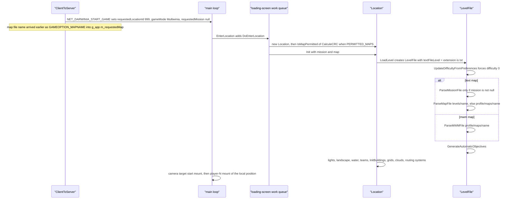
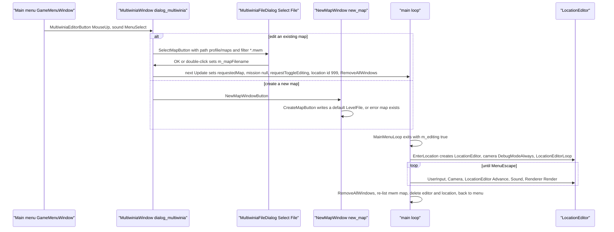
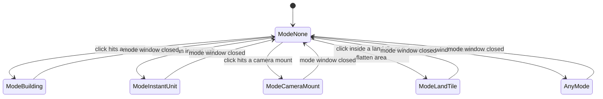

# 08 — Levels and level design

> Part A · Baseline build: Release|Win32 (OpenGL) + TARGET_PC_FULLGAME ([B:FULL]); see _work/build_matrix.md.
> Evidence: [C] confirmed · [I] inferred · [U] unknown. Citations are `path:Symbol` relative to the multiwinia/ source root.
> Sources merged: X4_level_catalogue (§1–13), P11_terrain_world (§8.1–8.8), P17a_ui_framework_editor (E1–E5), P17b_menus_options (§10), X1a_text_formats (§2 level files, level-design semantics only), P06_buildings_core (`P06_level_building_usage.csv` cross-check), routed `_meta_*` notes (contradictions, unknowns, constants, IP, appendix). Generated tables: `_work/scripts/S_08_tables.py` (inputs `_work/drafts/X4_levels.csv`, `X4_level_buildings.csv`, `X4_thumbnails.csv`, `X4_mode_maplists.csv`, `P06_level_building_usage.csv` and the raw level files).

## Contents

- [1 Scope, build reality and related documents](#1-scope-build-reality-and-related-documents)
- [2 Map inventory, discovery and identity](#2-map-inventory-discovery-and-identity)
- [3 Master catalogue of the 57 Multiwinia maps](#3-master-catalogue-of-the-57-multiwinia-maps)
- [4 Per-mode map lists and level conventions](#4-per-mode-map-lists-and-level-conventions)
- [5 Per-level options (`MultiwiniaOptions`)](#5-per-level-options-multiwiniaoptions)
- [6 Level-design capabilities](#6-level-design-capabilities)
- [7 Darwinia `map_`/`mission_` files, `data/levels/old/` and `level_enum.txt`](#7-darwinia-map_mission_-files-datalevelsold-and-level_enumtxt)
- [8 The map editor [B:EDITOR]](#8-the-map-editor-beditor)
- [9 Level-design guide for the new game](#9-level-design-guide-for-the-new-game)
- [Open questions and unknowns](#open-questions-and-unknowns)
- [Docs-vs-code discrepancies](#docs-vs-code-discrepancies)
- [IP items](#ip-items)
- [Source map](#source-map)
- [Appendix — dead/legacy code](#appendix--deadlegacy-code)

## 1 Scope, build reality and related documents

This document is the functional description of Multiwinia's **maps** as a level designer sees them: which maps exist and in which build each is visible, what every level file can express, which of those capabilities the shipped maps actually use, the per-mode conventions the designers followed, and the in-game map editor that produced them.

Build reality in one paragraph [C]:

- **[B:FULL]** — the baseline executable lists and loads every `data/levels/mp_*.txt` whose `GameTypes` names one of the six compiled modes (Domination, King of the Hill, Capture the Statue, Assault, Rocket Riot, Blitzkrieg). With the retail data set (`tools/multiwinia_exclusions.txt`) that is **49 maps**. TankBattle (`INCLUDEGAMEMODE_TANKBATTLE`) is compiled only in `TARGET_DEBUG` [C] `code/lib/universal_include.h`.
- **[B:EDITOR]** — the map editor (`code/location_editor.*` and 13 window files) is compiled only under `LOCATION_EDITOR`, which is commented out in every target; even the menu entry is compiled out. Custom `.mwm` maps can be loaded by FULL code but are listed and created only in an editor build (§8.1).
- **[B:LEGACY]** — the Darwinia campaign levels (`data/levels/map_*.txt`, `data/levels/mission_*.txt`) are parseable by the same `LevelFile` code but are excluded from every Multiwinia data build and reachable only through the dead Darwinia global world (§7.1). `data/levels/old/` is never listed by any build (§7.2).

Related documents (linked, not duplicated):

| Topic | Document |
|---|---|
| Terrain maths: tile generation, guide grids, flatten areas, cell size, water, colour ramps | [23 Terrain and landscape](23_terrain_and_landscape.md) |
| Per-building behaviour and the level-file parameters of each building type | [03 Buildings and world objects](03_buildings_and_world_objects.md) (§3.10 line format, §3.16 parameter quick reference) |
| Mode rules that read level options (teams, Assault sides, co-op groups, reinforcements) | [01 Game modes](01_game_modes.md) (§2.5, §3.7, §4) |
| Crate outcomes and `InvalidCrates` exclusion semantics | [04 Crates, power-ups and weapons](04_crates_powerups_and_weapons.md) |
| Population cap and spawn economy | [05 Economy and population](05_economy_and_population.md) |
| Map-select page, lobby, demo gating, achievements | [09 Meta systems](09_meta_systems.md) (§2.4, §3.5, §6, §7) |
| Lighting model, special lighting, weather rendering | [24 Rendering](24_rendering.md) (§5.5) |
| Camera mounts and animations at run time | [30 Scripting, tutorial and cutscenes](30_scripting_tutorial_and_cutscenes.md) (§4) |
| Window/widget framework used by the editor windows | [28 UI framework](28_ui_framework.md) (§3.7 value controls, §4.9) |
| **Formal grammar of every level-file block** (EBNF, column tables, crash conditions) | [29 Data formats reference](29_data_formats_reference.md) |
| Data packaging, archives, MapCRC tool | [31 Platform, build and tools](31_platform_build_and_tools.md) |
| Determinism of level loading (synced RNG during building construction) | [22 Determinism and networking](22_determinism_and_networking.md) |

## 2 Map inventory, discovery and identity

### 2.1 File kinds and counts

Directory listing [C] (`_work/scripts/S_08_tables.py` table `inventory`):

<!-- S08:inventory -->
<!-- /S08:inventory -->

| Kind | Naming | Content | Who loads it | Build tag |
|---|---|---|---|---|
| Multiwinia map | `mp_<mode>_<N>P_<k>.txt` (+ `mp_sandbox`, `mp_sandbox_all`, `mp_benchmark_1`, `mp_assault_stress`, `mp_tankbattle_<N>P`) | everything in one file: `MultiwiniaOptions`, `Landscape`, `LandscapeTiles`, `LandFlattenAreas`, `Lights`, `Buildings`, `CameraMounts`, optionally `CameraAnimations` (always empty), a second (empty) `Buildings`, `InstantUnits`, `PrimaryObjectives` | menu list (`code/game_menu.cpp:GameMenu::CreateMapList`, pattern `mp_*`) and `code/level_file.cpp:LevelFile::LevelFile` with mission `"null"` | [B:FULL] |
| Darwinia map | `map_<location>.txt` | landscape, static buildings, lights (`map_sandbox` also camera mounts) | Darwinia global world (`code/global_world.cpp:GlobalWorld::LoadGame`) | [B:LEGACY] |
| Darwinia mission | `mission_<location>[_<name>].txt` | dynamic buildings, instant units, camera mounts, objectives, difficulty | `LevelFile::ParseMissionFile` | [B:LEGACY] |
| Level enumeration | `level_enum.txt` | `<mp file name> <id>` pairs | `code/achievement_tracker.cpp:AchievementTracker::AchievementTracker` | [B:FULL] code, file excluded from retail data (§7.3) |
| Custom map | `<profile>/maps/<name>.mwm` | zlib-compressed `Directory` with the map text and optional textures (§8.8) | `LevelFile::ParseMWMFile` when the map name's extension is not `txt` | load path [B:FULL]; creation and listing [B:EDITOR] |
| Superseded maps | `data/levels/old/mp_*.txt` | older Multiwinia maps (Shaman, Chess, early Skirmish/Assault prototypes) | nothing | never loaded |

Block counts across all of `data/levels/**` [C] (`_work/scripts/P11_levelstats.py`): Landscape 69, LandscapeTiles 69, LandFlattenAreas 69, Lights 69, Buildings 134, CameraMounts 75, CameraAnimations 65, InstantUnits 75, PrimaryObjectives 65, Difficulty 3, MultiwiniaOptions 57. No shipped file contains `Routes`, `RunningPrograms` or `LeaderboardStats` [C] `_work/drafts/X1a_level_field_usage.csv`.

### 2.2 How the game discovers maps (menu catalogue)

[C] `code/game_menu.cpp:GameMenu::CreateMapList`, `GameMenu::AddMap`, `code/lib/resource.cpp:Resource::ListResources`, `contrib/systemiv/lib/filesys/file_system.cpp:OrderedInsert`, `code/UI/MapData.cpp:MapData::CalculeMapId`. The page that displays the result is specified in [09 §2.4 and §3.5](09_meta_systems.md#24-map-catalogue-built-at-start-up-gamemenucreatemaplist-gamemenuaddmap).

1. `ListResources("levels/", "mp_*", false)` lists loose files in `data/levels/` and every pre-loaded archive entry whose directory part equals `data/levels/` (`stricmp`). The scan is **non-recursive**, so `data/levels/old/` is never seen. Results are merged with `OrderedInsert`, which compares with `strcmp` (case-sensitive), drops exact duplicates and inserts before the first larger entry — but its loop runs only to `Size()−1`, so a name that sorts after every entry except the last is appended **after** the last one. The base order is therefore "nearly alphabetical"; archive entry names are lower-cased when an archive is indexed [I] (X4 reading of `code/lib/resource.cpp`).
2. Only names whose extension is exactly `txt` are opened; `AddMap` then scans lines until the first `MultiwiniaOptions_EndDefinition` with **case-sensitive** `strcmp` keyword tests for `Name`, `GameTypes`, `NumPlayers`, `Author`, `Description`, `PlayTime`, `Difficulty`, `CoopMode`, `ForceCoop`, `OfficialLevel` (it does not check that it is inside the block).
3. `GameTypes`: **every** following token that equals a blueprint name of `data/multiwinia.txt` (`Domination`, `KingOfTheHill`, `CaptureTheStatue`, `Assault`, `RocketRiot`, `Blitzkrieg`, `TankBattle`) adds the map to that mode's list. A map with no matching token is discarded with the log line "Discarded map … because it didn't contain a game type".
4. `MapData::CalculeMapId()` = `LevelFile::CalculeCRC(fileName)` (§2.3); −1 (not readable as a resource) marks the map as custom.
5. The number of `OfficialLevel` maps is passed to `AchievementTracker::SetNumLevels`.
6. Per mode, an n-pass adjacent-swap sort (stable) orders maps by `NumPlayers` ascending, then by difficulty rank: substring `basic` → 1, `inter` → 2, `advan` → 3, absent → 0.
7. `#ifdef LOCATION_EDITOR` only: every `<profile>/maps/*.mwm` is opened with `MapFile` and added the same way [B:EDITOR].

Two parsers read the same header [C]: the menu (`AddMap`, case-sensitive keys, all `GameTypes` tokens) and the game (`LevelFile::ParseMultiwiniaOptions`, case-insensitive keys, **first** `GameTypes` token only). Resolved: drafts called `LevelFile::m_gameTypes` "single type vs bitmask [U]"; code shows a plain index written by the parser and read only by `LevelFile::WriteMultiwiniaOptions` and the editor drop-down (`code/interface/multiwiniaoptions_window.cpp:MultiwiniaOptionsWindow::Create`) — it is a single blueprint index, never a bitmask, and the running game takes its mode from the lobby, not from this field [C] (grep of `m_gameTypes`). No shipped file lists more than one mode, so the two parsers never disagree on shipped data [C].

Display strings [C] `code/UI/LevelSelectButton.h`, `contrib/systemiv/lib/tosser/hash_table.cpp:HashFunc`: the menu shows the language phrase `<file stem>_name` and `<file stem>_description` (`GameMenu::GetMapNameId` strips `.txt`); language-table keys hash case-insensitively, so `mp_assault_3p_1_name` finds `mp_assault_3P_1_name`. The level's own `Name` is shown only for custom maps. `PlayTime` is shown as `"0:%02d"` and copied into the mode's time option when the map is selected; absent/0 → blueprint default (ordering caveat in [09 §4.5](09_meta_systems.md)).

Thumbnails [C] `code/UI/MapImageButton.h`, `code/UI/GameMenuWindow.cpp:SetupMapSelectPage`: file `thumbnails/<file stem>.bmp` (`TEXTURE_EXTENSION` = `bmp`), lower-cased with `strlwr`; if the texture does not exist, `thumbnails/default.bmp`. Displayed at width `rightW × 0.8`, height = width × 0.75. The catalogue of all 57 thumbnails is §3.5.

### 2.3 Map identity: MapCRC

[C] `code/level_file.cpp:LevelFile::CalculeCRC`, `contrib/systemiv/lib/math/filecrc.cpp:FileCRC`, `contrib/unrar/crc.cpp:CRC`, `code/mapcrc.h`, `tools/MapCRC/main.cpp:GenerateMapCRCs`.

- Input: the raw bytes of resource `levels/<filename>` read byte-by-byte until EOF **plus one trailing 0xFF byte** (the EOF read is stored before the loop notices EOF), into a static 100 000-byte buffer (a file larger than that would overflow by one byte [I]; the largest shipped level is 46 085 bytes [C] `X4_levels.csv`).
- Algorithm: CRC-32, reflected polynomial `0xEDB88320`, **initial value 0, no final XOR**; returned as `int`; −1 if the file cannot be opened.
- `code/mapcrc.h` is generated ("Auto-generated IDs for each map. DO NOT MODIFY") by `tools/MapCRC/main.cpp`: one `#define MAPID_<NAME> 0x%08x` per `data/levels/*.txt`, name = file name minus `.txt`, upper-cased, `.`/`-`/space → `_`.
- Verified in this phase: `python3 -I _work/scripts/P11_mapcrc.py <SRC>` reproduces **87 of 87** `MAPID_*` constants [C]. Resolved: drafts said "86/86" (X4, phase-2 log) and "87/87" (P11); both are right — the 87 `.txt` files in `data/levels/` are 86 level files (57 `mp_*`, 12 `map_*`, 17 `mission_*`) plus `level_enum.txt` (`MAPID_LEVEL_ENUM 0x95ed5f58`); the 30 files in `old/` are not in `mapcrc.h`.

Uses of the map id [C]: (1) `MapData::m_mapId` and `App::GetMapID(gameMode, crc)` → index into the mode's menu list (`code/app.cpp:App::GetMapID`); (2) the metaserver listing (`NET_METASERVER_MAPCRC`, resolved by clients with `GameMenu::GetMapName(mode, crc)`) `code/network/server.cpp`; (3) demo gating (`code/network/demo_limitations.cpp:DemoLimitations::Initialise` default list `MAPID_MP_KOTH_2P_1`, `MAPID_MP_KOTH_4P_1`, `MAPID_MP_CTS_2P_1`, `MAPID_MP_KOTH_3P_1`, `MAPID_MP_ROCKETRIOT_3P_1`, or a list sent by the metaserver); (4) compile-time `PERMITTED_MAPS` whitelists (§2.4); (5) the two tutorials (`MAPID_MP_KOTH_2P_1`, `MAPID_MP_KOTH_3P_1` in `code/UI/GameMenuWindow.cpp:SetupTutorial`, `SetupTutorial2`). A match is started by **file name** (`GAMEOPTION_MAPNAME`), and no map CRC is compared between peers before simulation — a locally modified map file desyncs rather than being rejected [C] grep of the start-game path in `code/network/clienttoserver.cpp`; consequences in [22](22_determinism_and_networking.md).

Because `CalculeCRC` hashes the file bytes, any edit — including a whitespace change or a load→save round trip (§8.7) — changes the id and so silently changes demo/whitelist/tutorial eligibility [I].

### 2.4 Permitted maps per build target and runtime gate

[C] `code/lib/universal_include.h` (`PERMITTED_MAPS`), `code/app.cpp:App::IsMapPermitted`, `App::IsGameModePermitted`, `code/main.cpp:DoEnterLocation`.

| Target / gate | Mechanism | Maps |
|---|---|---|
| `TARGET_PC_FULLGAME` [B:FULL] | `PERMITTED_MAPS` undefined → `IsMapPermitted(id)` is true when `IsFullVersion()`; mode filter `IsGameModePermitted` (six modes) | every listed map |
| Runtime demo (`!IsFullVersion()`) [B:DEMO runtime] | `DemoLimitations::MapPermitted(id)` against the metaserver list or the 5-map default above; restricted maps greyed, selecting one opens the buy page | 5 by default |
| `TARGET_PC_PREVIEW` | `{MAPID_MP_KOTH_2P_1, MAPID_MP_KOTH_4P_1, MAPID_MP_CTS_2P_1, 0}` | 3 |
| `TARGET_PC_HARDWARECOMPAT` | `{MAPID_MP_KOTH_2P_1, MAPID_MP_BENCHMARK_1, MAPID_MP_KOTH_4P_1, 0}` | 3 (benchmark never menu-listed: `GameTypes none`) |
| `TARGET_ASSAULT_STRESSTEST` | `{MAPID_MP_ASSAULT_STRESS, 0}` | 1 (also `GameTypes none`) |
| `TARGET_BETATEST_GROUP_A` | `{MAPID_MP_CTS_2P_1, MAPID_MP_CTS_3P_1, MAPID_MP_CTS_4P_3, 0}` | 3 |
| `TARGET_BETATEST_GROUP_B` | `{MAPID_MP_BLITZKRIEG_2P_2, MAPID_MP_BLITZKRIEG_3P_2, MAPID_MP_BLITZKRIEG_4P_2, 0}` | 3 |
| `TARGET_BETATEST_GROUP_C` | `{MAPID_MP_ROCKETRIOT_2P_4, MAPID_MP_ROCKETRIOT_2P_3, MAPID_MP_ROCKETRIOT_3P_1, 0}` | 3 |
| `TARGET_BETATEST_GROUP_ALL`, `TARGET_DEBUG`, `TARGET_MULTIWINIA_DEMOONLY` | none (`GROUP_ALL` has a commented-out 13-map list: KOTH_2P_1, KOTH_3P_1, ASSAULT_2P_3, ASSAULT_3P_2, ASSAULT_3P_3, ASSAULT_4P_2, ROCKETRIOT_2P_3, ROCKETRIOT_3P_2, ROCKETRIOT_4P_1, CTS_2P_2, CTS_2P_4, CTS_3P_1, CTS_4P_1) | all |

Enforcement [C]: `GameMenuWindow::SetupMapSelectPage` skips non-permitted maps under `#ifdef PERMITTED_MAPS` and greys buttons via `IsMapPermitted(gameType, id)`; `DoEnterLocation` recomputes `IsMapPermitted(CalculeCRC(requestedMap))` before `Location::Init` and, if false, sets `m_requestedLocationId = −1` and returns to the menu after loading; tutorial buttons are inactive when their map is missing or not permitted. The whitelist terminator is `0` (`for( i = 0; permittedMaps[i]; i++ )`), so a map whose CRC were 0 could never be whitelisted.

Data packaging per build [C] `tools/build_multiwinia_data.bat`, `tools/listfiles.pl`, `tools/copyfiles.pl`, exclusion/inclusion lists (grammar in [31](31_platform_build_and_tools.md)):

| Script / platform | Exclusions | Inclusions | Level/thumbnail result |
|---|---|---|---|
| `tools/build_multiwinia_retail.bat`, `build_multiwinia.bat`, `_gold`, `_crashreporter` | `tools/multiwinia_exclusions.txt`: `levels/old/*`, `levels/pdlc/*`, `levels/level_enum.txt`, `levels/map_*`, `levels/mission_*`, `levels/mp_assault_stress.txt`, `levels/mp_benchmark_*`, `levels/mp_sandbox*`, `levels/mp_tankbattle_*`, `thumbnails/mp_benchmark_*`, `thumbnails/mp_tankbattle_*`, `levels/mp_cts_3p_3.txt`, `thumbnails/mp_cts_3p_3.bmp` | — | 49 `mp_*` maps + 52 thumbnails (incl. `default.bmp` and the level-less `mp_koth_2P_4.bmp`, `mp_skirmish_2p_3.bmp`) |
| `tools/build_multiwinia_pc_preview.bat` (`pcpreview`) | `tools/multiwinia_exclusions_beta_test.txt` (all `levels/mp_*`, `thumbnails/mp_*`) | `tools/multiwinia_inclusions_previewcopy.txt`: koth_2P_1, koth_4P_1, cts_2P_1 (+ thumbnails) | 3 maps = its whitelist |
| `tools/build_multiwinia_hwcompat.bat` family (`pchwcompat`) | `tools/multiwinia_exclusions_hwcompat.txt` | `tools/multiwinia_inclusions_hwcompat.txt`: koth_2P_1, benchmark_1, koth_4P_1 | 3 maps |
| `pcassaultstress` (no script in tree) | `multiwinia_exclusions_hwcompat.txt` | `tools/multiwinia_inclusions_assaultstresstest.txt`: assault_stress | 1 map |
| `pcbetatest` + group (no script in tree) | `multiwinia_exclusions_beta_test.txt` | `tools/multiwinia_inclusions_beta_test_group_a.txt` (13 maps = the commented-out GROUP_ALL list), `_group_b.txt` (3 Blitzkrieg), `_group_c.txt` (3 Rocket Riot) | per group |
| `platambx` | `multiwinia_exclusions_beta_test.txt` | `multiwinia_inclusions_ambx.txt` — **absent from the tree** | [U] 08-U3 |

Inconsistency [I]: the group-A inclusion list ships 13 maps but the group-A whitelist permits only `mp_cts_3p_1` of them, and with only `INCLUDEGAMEMODE_CTS` compiled that build would list one CTS map (X4 contradiction 2).

### 2.5 How a level is loaded



[C] `code/network/clienttoserver.cpp` (`NET_DARWINIA_START_GAME`, `GAMEOPTION_MAPNAME`), `code/main.cpp:EnterLocation`, `DoEnterLocation`, `code/location.cpp:Location::Init`, `Location::LoadLevel`, `code/level_file.cpp:LevelFile::LevelFile`. Terrain construction order and maths: [23 §2](23_terrain_and_landscape.md#2-pipeline-overview).

File lookup [C] `LevelFile::ParseMapFile(char const*)`, `ParseMissionFile`: a map is opened as resource `levels/<name>` (loose file or `.dat` archive), else as plain file `<profile>/maps/<name>`; a mission (Darwinia only) first as `<profile>/users/<user>/<name>` (save game) unless editing, else resource `levels/<name>`. `AppReleaseAssert` ("Invalid map file specified" / "Invalid level specified") if neither opens.

Block dispatch (first token of a line, `stricmp`) [C] `LevelFile::ParseMapFile(TextReader*)`, `LevelFile::ParseMissionFile`:

| Block start keyword | In a map file | In a mission file |
|---|---|---|
| `MultiwiniaOptions_StartDefinition` | `ParseMultiwiniaOptions` (§5) | not recognised (debug assert, lines skipped) |
| `Landscape_StartDefinition`, `LandscapeTiles_StartDefinition`, `LandFlattenAreas_StartDefinition`, `Lights_StartDefinition` | parsed (§6.1, §6.2) | debug assert, ignored |
| `Buildings_StartDefinition` | `ParseBuildings(dynamic = false)`; a second branch with `dynamic = true` is unreachable, so a second `Buildings` block is also static | `ParseBuildings(dynamic = true)` |
| `CameraMounts_StartDefinition`, `CameraAnimations_StartDefinition`, `InstantUnits_StartDefinition`, `Routes_StartDefinition`, `PrimaryObjectives_StartDefinition` | parsed | parsed |
| `RunningPrograms_StartDefinition`, `Difficulty_StartDefinition`, `LeaderboardStats_StartDefinition` | not recognised | parsed [B:LEGACY] |
| anything else | `AppDebugAssert(0)` (no-op in release), line skipped | same |

Lights precedence [C] `LevelFile::ParseLights`: a `Lights` block met when lights already exist is ignored (`ignoreLights`). The comment says mission lights override map lights, but mission files cannot contain `Lights`, so only a second `Lights` block in the same map file is affected.

Post-parse derivation [C] `LevelFile::GenerateAutomaticObjectives` (always called by the constructor): if there are no primary objectives a single `NeverTrue` condition is added; secondary objectives are derived for `ResearchItem`/`TrunkPort` buildings via `GlobalWorld::GetLocationIdFromMapFilename`, which always returns −1 because it executes `*mapName += 4` (adds 4 to the first character) instead of advancing the pointer [C] `code/global_world.cpp:GlobalWorld::GetLocationIdFromMapFilename`; in Multiwinia `GetBuilding(id, −1)` finds nothing, so no trunk-port objective is ever created and `ResearchItem` rows are blocked anyway [C].

Resolved: X2b reported that `Darwinian::BeginVictoryDance` treats an empty objective list as victory, so the 10 `mp_*` files without a `PrimaryObjectives` block "should" make idle team-0 Darwinians jump. Code: `GenerateAutomaticObjectives` runs for every level and adds `NeverTrue` to an empty list, and `BeginVictoryDance` requires every objective to evaluate true, so **no shipped Multiwinia map ever triggers victory jumps** [C] `code/level_file.cpp:LevelFile::GenerateAutomaticObjectives`, `code/worldobject/darwinian.cpp:Darwinian::BeginVictoryDance`.

Start positions → teams [C] `code/location.cpp:Location::GetTeamPosition`, `Location::GetTeamFromPosition`, `Location::InitBuildings`, `Location::InitialiseTeam`:

- Every team id `0 … NumPlayers−1` is assigned a **start position** in `[0, NumPlayers)`: drawn with `syncrand() % unused.Size()` among unused positions (deterministic across peers); in a tutorial position = team id; the monster team (4) and Futurewinian team (5) always have position = team id; outside Multiwinia mode (`!Multiplayer()`) position = team id.
- The `team` column of a building row is a **position**: `InitBuildings` replaces it with the team that holds that position, or **255 (neutral)** when no team holds it (e.g. position 3 on a 4-player map played by 3 teams). Rows with team 255 stay neutral. Because the search only covers teams `0 … NumPlayers−1`, a building row with position 4 or 5 would become neutral [C]; no shipped row uses 4 or 5 [C] (`_work/drafts/X1a_level_field_usage.csv`).
- Instant units are spawned per team in `InitialiseTeam`: a unit row belongs to the team whose position equals its `team` column (§6.6).
- Duplicate unique ids across the parsed buildings are fatal (`AppReleaseAssert` "duplicate building found"); after init `GlobalWorld::s_nextUniqueBuildingId = highest id + 1`.
- In Assault, `InitBuildings` binds every `ControlStation` whose id appears in the `PulseBomb`'s link list via `ControlStation::LinkToPulseBomb` (§4.5).

Camera on entry [C] `code/main.cpp:DoEnterLocation`, the in-game loop in `code/main.cpp`: camera bounds are set to `[−200, worldSizeX + 200]` on **both** axes (the X size is used for Z too — harmless because every shipped map is square); the camera first targets `(maxX, 1000, maxX)` looking along `(−1, −0.7, −1)` "in case start doesn't exist", then mount `start`; once the local team exists it cuts to mount `player<position>` (§6.5).

### 2.6 Two on-disk section layouts of `mp_*` files

[C] data (`X4_levels.csv` column `sections`), [I] origin.

| Layout | Block order | Files |
|---|---|---|
| A ("old writer") | `MultiwiniaOptions, Landscape, LandscapeTiles, LandFlattenAreas, Lights, Buildings, CameraMounts, CameraAnimations, Buildings (empty), InstantUnits, PrimaryObjectives` | 47 top-level files and every `old/` file that has an options block |
| B ("current writer") | `MultiwiniaOptions, Landscape, LandscapeTiles, LandFlattenAreas, Lights, Buildings, CameraMounts, InstantUnits` | 10: `mp_assault_2p_3`, `mp_assault_3p_1`, `mp_assault_3p_3`, `mp_assault_4P_2`, `mp_blitzkrieg_4P_2`, `mp_domination_2P_1`, `mp_domination_4P_1`, `mp_koth_2P_3`, `mp_koth_2P_3b`, `mp_skirmish_3P_1` |

Layout B is exactly what `LevelFile::SaveMapFile` writes today (camera-animation, dynamic-building and objective writers commented out) [C] `code/level_file.cpp:LevelFile::SaveMapFile`. Forensic corollary [C]: those 10 files — and only they — carry `Name NewLevel`, because the current `WriteMultiwiniaOptions` always writes `Name` (default `"NewLevel"`); 31 layout-A files also carry an explicit `DefenderPopulationCap` line (always written today) but none of the `old/` files do, so an intermediate writer already had it [I]. The second, empty `Buildings` block of layout A is parsed as static and contains no rows in any shipped file [C] (`buildings_in_2nd_block` = 0).

## 3 Master catalogue of the 57 Multiwinia maps

### 3.1 Master table

One row per `data/levels/mp_*.txt` (generated by `S_08_tables.py` table `master` from `_work/drafts/X4_levels.csv` and `X4_level_buildings.csv`; every value [C] from the files). Columns: **Modes** = `GameTypes` tokens (DOM Domination, KOTH King of the Hill, CTS Capture the Statue, ASLT Assault, RR Rocket Riot, BLITZ Blitzkrieg, TANK TankBattle); **Players** = `NumPlayers`; **World** = `worldSizeX×worldSizeZ` in world units (wu); **Grid** = height-map cells per axis = `ceil(worldSize / cellSize)` ([23 §9](23_terrain_and_landscape.md#9-world-grid-cell-size-world-size-outside-height-and-world-edge-handling)); **Tiles** / **Flatten** = `LandscapeTiles` / `LandFlattenAreas` rows; **SpawnPoints by pos** = `SpawnPoint` rows per start position (`255` = neutral); **Notable objects** = row counts of the other gameplay/placement types (full matrix in §6.3); **PopCap** = `PopulationCap` (−1 = none) and, when set, `DefenderPopulationCap`; **InvalidCrates** = crate outcomes removed from this map; **Starting units** = `InstantUnits` as `type@position×count`; **Retail** = shipped in the retail `main.dat`; **Class** = hidden/test status.

<!-- S08:master -->
<!-- /S08:master -->

### 3.2 Identity and availability

Generated table `identity`. CRC = `LevelFile::CalculeCRC` = the map id (§2.3); "CRC check" = recomputed value equals the `MAPID_*` constant; "level_enum id" = achievement index (§7.3); "Data shipped in" = which data builds package the file (retail, `prev` PC preview, `hw` hardware-compat, `stress` Assault stress test, `βA`/`βB`/`βC` beta groups; §2.4); "FULL menu" = what the baseline binary does with the file (`listed`; `permitted, data absent` = would be listed but retail data omits it; `mode not compiled` = TankBattle; `never listed` = no valid `GameTypes`); "Demo default" = in `DemoLimitations`' fallback list; "Tutorial" = map hard-wired by `GameMenuWindow::SetupTutorial`/`SetupTutorial2`.

<!-- S08:identity -->
<!-- /S08:identity -->

### 3.3 Summary

[C] from §3.1–3.2:

- **49 maps are menu-listed in the retail product**: Domination 9 (5 `mp_domination_*`, 2 `mp_skirmish_*`, and `mp_koth_2P_2`, `mp_koth_2P_3`, whose `GameTypes` is `Domination`), King of the Hill 9, Capture the Statue 9, Assault 8, Rocket Riot 7, Blitzkrieg 7. This set equals `level_enum.txt` ids 1–49 and `VALID_ACHIEVEMENT_LEVELS = 49` (`code/achievement_tracker.cpp`).
- **8 files are in the tree but not in retail data**: `mp_assault_stress`, `mp_benchmark_1`, `mp_sandbox`, `mp_sandbox_all`, `mp_tankbattle_2P`, `mp_tankbattle_3P`, `mp_tankbattle_4P`, `mp_cts_3p_3` (§3.4).
- Player counts of the 49: 2-player 22, 3-player 15, 4-player 12. `mp_assault_3p_1` is named "3p" but declares `NumPlayers 2` (its `old/` precursor had 3).
- World sizes 2000–7000 wu, all square; cell sizes 9.00–27.08 wu; grids 137² – 334² cells; 1–25 tiles per map.
- **Twin terrains** — the same terrain re-skinned for two modes by swapping objective buildings [I intent, C data]: byte-identical `LandscapeTiles` blocks (after whitespace normalisation) for `mp_koth_2P_1`≡`mp_domination_2P_2` ("The Eternal Guardians"), `mp_koth_3P_2`≡`mp_domination_3P_1` ("Field of Unending Dawn"), `mp_koth_4P_1`≡`mp_domination_4P_1` ("The Holy Tree"), `mp_koth_4P_3`≡`mp_domination_4P_2` ("A Monument to the Heavens"), `mp_benchmark_1`≡`mp_koth_4P_4`, `mp_sandbox`≡`mp_sandbox_all`, `mp_koth_2P_3b`≡`old/mp_shaman_2P_3`, `old/mp_temple`≡`map_temple`. `mp_koth_2P_3`/`mp_koth_2P_3b` ("The Bitter Front") share the `Landscape` block and lights but have different tiles and flatten areas. Each KOTH/Domination twin pair shares 25–95 identical building rows.
- `mp_rocketriot_2p_3` "Stairway to Heaven" shares its English name with the thumbnail-only `mp_skirmish_2p_3` string (§3.5).

### 3.4 Hidden, test, stress, benchmark, sandbox, TankBattle and cut maps

| File | Class | Why it is not a normal map | Contents worth knowing | Build tag |
|---|---|---|---|---|
| `data/levels/mp_assault_stress.txt` ("Assault Stress Test") | stress test | `GameTypes none` → discarded by `AddMap` in every build; excluded from retail; included and whitelisted only for `TARGET_ASSAULT_STRESSTEST` | Assault layout: 1 PulseBomb (position 1, `startTime 600`), 3 ControlStation, 7 GunTurret, 26 LaserFence, 30 Wall, 6 SolarPanel, 5 Pylon, 2 PylonEnd, TrunkPort ×5 (pos 0) + ×2 (pos 1), 3 AIObjective, 10 AIObjectiveMarker, 30 AITarget; `AttackingTeams 0`; `trunkportreinforcements 250`, `defenderreinforcementtype Armour`; 90 Darwinians at position 1; 3 `AIObjective` rows carry 2 surplus tokens (ignored) | stress target only |
| `data/levels/mp_benchmark_1.txt` ("Stress Test" — "spawn Multiwinians indefinitely" per its language description) | benchmark | `GameTypes none` (never menu-listed); excluded from retail; included and whitelisted for `TARGET_PC_HARDWARECOMPAT` | terrain and zones copied from `mp_koth_4P_4`; 5 SpawnPoint per position + 4 neutral, 15 neutral MultiwiniaZone, 4 neutral TrunkPort, 1 SpawnPopulationLock (radius 1169.84, max 1200), 150 Darwinians per position; `PopulationCap -1`, `CoopMode` | hardware-compat only; how it was launched is [U] 08-U2 |
| `data/levels/mp_sandbox.txt` | developer sandbox | `GameTypes none`; excluded from retail | 11 rows: ControlTower, Incubator, **Statue** (blocked → dropped at parse), 3 Wall, 5 AITarget; `PopulationCap 2500`, `NumPlayers 2`, `AttackingTeams 1`; `PrimaryObjectives BuildingOnline :sandbox,2` twice (Darwinia condition; location "sandbox" does not exist in Multiwinia's empty global world → id −1 → condition false) | none |
| `data/levels/mp_sandbox_all.txt` | developer sandbox | as above; also **no `NumPlayers`** (→ −1) | same terrain as `mp_sandbox`; 2 ControlTower, 2 Incubator, 4 SpawnPoint (position 1), 11 SpawnLink, 1 SpawnPointMaster, 2 Tree | none |
| `data/levels/mp_tankbattle_2P.txt`, `data/levels/mp_tankbattle_3P.txt`, `data/levels/mp_tankbattle_4P.txt` ("2P/3P/4P TankBattle Arena") | TankBattle mode | `GameTypes TankBattle` → listed under mode 6 only where `INCLUDEGAMEMODE_TANKBATTLE` is compiled (`TARGET_DEBUG`); excluded from retail data | 2000×2000 / 12 arenas, only Trees (18/18/23); one `Tank` instant unit per position; `PopulationCap -1`; 4P has `CoopMode`; 3P/4P have **no camera mounts** | [B:DEBUG] |
| `data/levels/mp_cts_3p_3.txt` ("The Outreach Peaks") | cut CTS map | complete CTS map but explicitly excluded from retail data, no `level_enum` id, no `Difficulty` | the only CTS map with trunk ports instead of spawn points: 1 TrunkPort per position, `trunkportreinforcements 100`, `attackerreinforcementtype HotFeet`, 3 team drop zones (r 75) + 6 statue zones (r 50), `PlayTime 10`, no starting Darwinians; 24-bit thumbnail (also excluded) | FULL code would list it if the file were present |

### 3.5 Thumbnails (`data/thumbnails/`, 57 files)

Format from each BMP header [C]: 53 files are 400×300 8-bit palettised (52 × 121 078 bytes, `default.bmp` 120 778 bytes) and 4 are 400×300 24-bit (360 056 bytes: `mp_cts_3p_3`, `mp_cts_4p_3`, `mp_koth_2P_2`, `mp_koth_3P_4`). No in-engine writer produces map thumbnails — the only screenshot-to-thumbnail routine, `App::SaveThumbnailScreenshot` (256×192), is compiled only under `TARGET_OS_VISTA` for saved-game headers [B:DEAD] [C] `code/app.cpp` — so the 400×300 files were made outside the engine [I] (08-U7). The `LevelFile::m_thumbnailFilename` field (default `default.bmp`) is used only by the `.mwm` writer (§8.8). Generated table `thumbs`:

<!-- S08:thumbs -->
<!-- /S08:thumbs -->

Mismatches [C]: every top-level `mp_*` file except `mp_assault_stress`, `mp_sandbox` and `mp_sandbox_all` has a thumbnail (those three would show `default.bmp`); two thumbnails have no top-level level: `mp_koth_2P_4.bmp` (level only in `data/levels/old/mp_koth_2P_4.txt`, "Pillar of Light") and `mp_skirmish_2p_3.bmp` (no level anywhere; the language file has `mp_skirmish_2P_3_name` "Stairway to Heaven" with description "INSERT DESCRIPTION HERE" — probably the precursor of `mp_rocketriot_2p_3` [I]). Both ship in retail data although nothing can display them.

## 4 Per-mode map lists and level conventions

Mode rules themselves (scoring, timers, win conditions) are in [01 §4](01_game_modes.md#4-per-mode-specifications); building behaviour in [03 §8](03_buildings_and_world_objects.md#8-mode-objective-objects). This section gives the **menu lists** and the **authoring conventions** a level must follow for each mode, recomputed from the raw level files by `S_08_tables.py` [C data].

### 4.1 Menu lists in menu order (retail data set)

Order as produced by `GameMenu::CreateMapList` (§2.2): nearly-alphabetical base order, then stable sort by `NumPlayers`, then difficulty rank. The sort keys are [C]; the order of ties depends on the archive index order through `OrderedInsert` and is [I] (08-U4). Mode index = blueprint index (`data/multiwinia.txt` order = `Multiwinia::GameType*` enum). TankBattle is shown from the source tree (no retail data; mode not compiled in FULL). Generated table `modes` from `_work/drafts/X4_mode_maplists.csv`:

<!-- S08:modes -->
<!-- /S08:modes -->

Start positions and colours: Location-side start positions are assigned at load (§2.5); the lobby's colour/side choice and Assault side assignment are in [01 §2.5](01_game_modes.md#25-teams-slots-start-positions-colours-co-op-and-assault-sides).

### 4.2 Domination (`GameTypes Domination`, blueprint 0, `GameTypeSkirmish`) — 9 maps

- Objects [C data]: spawn-point economy only — 1–3 `SpawnPoint` per start position plus 3–9 neutral ones, exactly one `SpawnPointMaster`, a `SpawnLink` tree; no `MultiwiniaZone`. Variants: `mp_koth_2P_2` adds 6 neutral `RadarDish` and a neutral `TrunkPort`; `mp_domination_4P_2` 8 `RadarDish`; `mp_skirmish_2p_4` a neutral `TrunkPort`; `mp_skirmish_3P_1` 18 `JumpPad`, 6 neutral `GunTurret`, 95 `LaserFence` and **no `SpawnLink`** (the master links straight to the spawn points).
- Naming [C]: `mp_domination_*`, `mp_skirmish_*` (legacy name of the mode — old maps use `GameTypes … Skirmish`, §7.2) and two `mp_koth_*` files whose `GameTypes` was switched to Domination (`mp_koth_2P_2`, `mp_koth_2P_3`).
- Twin terrains with KOTH (§3.3): the Domination twin replaces hill zones by extra neutral spawn points.
- Spawn-graph semantics (master → links → spawn points, link timing): [03 §4](03_buildings_and_world_objects.md#4-spawn-network), [05](05_economy_and_population.md).

### 4.3 King of the Hill (`KingOfTheHill`, blueprint 1) — 9 maps

- Hills = `MultiwiniaZone` rows: 1–15 per map, almost always neutral, radius 50–555.24 wu [C data].
- **Concentric zones** convention: several zones with (nearly) the same centre and different radii so the central area counts as 2–3 zones — `mp_koth_3P_3` (zones 20 and 6: r 101.17 and 140), `mp_koth_4P_1` (one triple 200/125/50 + four pairs 100/50), `mp_koth_4P_3` (two big zones r 233.01 and 220 each containing three r 90 zones, plus two 100/50 pairs), `mp_koth_4P_4` (central 555.24/193.87/50 triple + four 122/50 pairs + four single r 50; same layout in `mp_benchmark_1`) [C data]; [I] intent: each zone scores separately ([01 §4](01_game_modes.md#4-per-mode-specifications)).
- Team-owned zones: only `mp_koth_3P_3` tags three r 150 zones with positions 0/1/2 (zone ids 0/1/2); at load the owner field becomes the real team via `GetTeamFromPosition` (§2.5), so those hills start owned [I].
- Economy: spawn-point graph on every KOTH map except `mp_koth_3P_4` (2 `TrunkPort` per position + `trunkportreinforcements 100`, 6 neutral `GunTurret`, one central zone r 86.2). `mp_koth_3P_1` adds 12 neutral `RadarDish`, 6 neutral `ControlStation` and a neutral `TrunkPort`; `mp_koth_3P_3` one neutral `TrunkPort`; `mp_koth_4P_3` 8 neutral `RadarDish`.
- Tutorials: Tutorial 1 = `mp_koth_2P_1`, Tutorial 2 = `mp_koth_3P_1` ([30 §3](30_scripting_tutorial_and_cutscenes.md#3-live-multiwinia-tutorials-bfull)).

### 4.4 Capture the Statue (`CaptureTheStatue`, blueprint 2) — 9 maps (+ cut `mp_cts_3p_3`)

- **Exactly one team-owned `MultiwiniaZone` per start position = that player's drop (capture) zone** (r 80, 100 or 109.27; 75 on the cut map), plus **1–6 neutral zones = statue spawn zones** (r 40–75) [C data]. The statue is never placed in the level (`Statue` is a blocked level type, §6.3); the rules object spawns it at a neutral zone [C] `code/multiwinia.cpp` (details [01 §4](01_game_modes.md#4-per-mode-specifications), [03 §8.4](03_buildings_and_world_objects.md#84-statue)).
- Duplicate statue zones at identical coordinates occur on `mp_cts_2p_2` (ids 5/29), `mp_cts_4P_2` (6/107) and `mp_cts_3p_3` (0/64, 10/65, 29/66) [C data] — [I] intended to weight those spawn points.
- Economy: spawn-point graph (1–3 per position, up to 8 neutral on `mp_cts_4P_1`); `mp_cts_2p_2`, `mp_cts_3p_1`, `mp_cts_3P_2`, `mp_cts_4P_2` set `instantspawnpointcapture`; `mp_cts_3p_3` uses trunk ports instead.
- Starting force: 40 Darwinians per position on every shipped CTS map.

Zone table for KOTH and CTS (generated table `zones`; owner `pN` = start position, `n` = neutral; position rounded to wu):

<!-- S08:zones -->
<!-- /S08:zones -->

### 4.5 Assault (`Assault`, blueprint 3) — 8 maps (+ `mp_assault_stress`)

- **Attackers/defenders are start positions**: `AttackingTeams` lists attacker positions; every other position `< NumPlayers` defends. The lobby assigns teams to free attacker/defender positions with `syncrand`; with co-op, `CoopGroup1Positions`/`CoopGroup2Positions` fix the alliances [C] `code/location.cpp:Location::SetupAssault` (rules in [01 §2.5](01_game_modes.md#25-teams-slots-start-positions-colours-co-op-and-assault-sides)).
- Generated table `assault` (recomputed from the raw `Buildings` blocks):

<!-- S08:assault -->
<!-- /S08:assault -->

Conventions [C data]:
- One `PulseBomb` per map, owned by a defender position, whose link list names the 3 (4 on `mp_assault_4P_1`) `ControlStation`s that `Location::InitBuildings` binds with `LinkToPulseBomb` (§2.5). `mp_assault_2p_3` has two extra stations (ids 55, 43) whose `controlBuildingId` points at radar dishes (42, 45) — radar control, not bomb control.
- `startTime` = `PlayTime` × 60 s (900 s, 1200 s on `mp_assault_4P_2`, 600 s on the stress map): the bomb countdown equals the match length.
- Attackers get more trunk ports (3–6 per attacker position) than defenders (0–1 per defender position) and no starting Darwinians (sole exception `mp_assault_2p_3`, attacker position 0 gets 8); defenders get 63–325 starting Darwinians (+1–2 `Armour` on `mp_assault_2P_1`, `mp_assault_3p_1`, `mp_assault_3P_2`, `mp_assault_4P_1`), the fortification kit (walls and laser fences owned by defender positions or neutral; 7–40 neutral `GunTurret`, including Flame turrets on `mp_assault_2p_3`, `mp_assault_3p_1`, `mp_assault_3p_3`), 3–18 `AIObjective` chains and their markers for the CPU ([07](07_ai.md)).
- `InvalidCrates` removes `Armour` (`mp_assault_3p_1`, `mp_assault_3P_2`, `mp_assault_4P_1`, `mp_assault_4P_2`) or `Squad Airstrike Nuke Meteor` (`mp_assault_2P_1`, `mp_assault_2p_3`).
- `mp_assault_3p_1` ("The Third Kind") places 35 Darwinians at position 5: the Futurewinian team (id 5, position 5), which `Location::Init` always initialises in Multiwinia (`InitMonsterTeam(4)`, `InitFuturewinianTeam(5)`) [C] `code/location.cpp:Location::Init`, `Location::GetTeamPosition`.
- Every Assault `RestrictionZone` has `blockPowerups 1` ([04](04_crates_powerups_and_weapons.md)).

### 4.6 Rocket Riot (`RocketRiot`, blueprint 4) — 7 maps

Generated table `rr` (owner field per position; `255` = neutral):

<!-- S08:rr -->
<!-- /S08:rr -->

Conventions [C data]: per start position **1 `EscapeRocket`** (extra tokens `fuelLink −1, fuel 0.00, passengers 0, spawnBuildingId −1, spawnCompleted 0`), **3 `FuelStation`**, **1 `TrunkPort`**, **3 team-owned `Pylon`**; **3 `FuelGenerator` per position** (team-owned on `mp_rocketriot_2P_2`, `mp_rocketriot_2p_3`, `mp_rocketriot_3p_1`; neutral on the other four), `FuelPipe` chains, a shared neutral power grid (`SolarPanel` 15–24, `PowerSplitter` 3–5, `PylonEnd` 3 per position, neutral `Pylon`s). The trunk port is the main Darwinian source; starting Darwinians only on `mp_rocketriot_3P_3` (8 per position). Resolved: X4 stated that Rocket Riot maps have "no spawn points"; the data show neutral spawn networks on `mp_rocketriot_2P_2` (2 `SpawnPoint` + `SpawnPointMaster`) and `mp_rocketriot_4P_1` (12 + master) [C]. No `LevelOptions` are needed (trunk-port reinforcements are intrinsic to the mode, [01](01_game_modes.md)); `mp_rocketriot_3P_3` sets `nogunturrets` and has 6 neutral turrets; `mp_rocketriot_2P_4` bans `Armour` crates. **Special lighting is forced for every Rocket Riot match** regardless of the level's `Effects` (§5.3) [C] `code/location.cpp:Location::RenderBuildings`.

### 4.7 Blitzkrieg (`Blitzkrieg`, blueprint 5) — 7 maps

Flags are `MultiwiniaZone` rows (r 100; 75 on `mp_blitzkrieg_3P_2`) whose extra tokens after `size` are an **adjacency list** of other flag ids. **One team-owned zone per position = that player's base flag** (recorded per team and reset to neutral at initialisation, [03 §8.1](03_buildings_and_world_objects.md#81-multiwiniazone)), plus 1–5 neutral flags. Links are written one-way in the files and made bidirectional at run time ([01 §4](01_game_modes.md#4-per-mode-specifications)). Generated table `blitz` (flags in file order; `pN` = position, `n` = neutral):

<!-- S08:blitz -->
<!-- /S08:blitz -->

Economy [C data]: 1 `TrunkPort` per position on all 7 (+1 neutral on `mp_blitzkrieg_2P_3`, `mp_blitzkrieg_2P_4`); the 2-player maps also have spawn points (`mp_blitzkrieg_2p_2`: 2 per position + 2 neutral; the others 1–4 neutral); the 2-player maps use `trunkportreinforcements 100` + `trunkportarmour 3` (`mp_blitzkrieg_2P_4` instead `nogunturrets`); the 3- and 4-player maps use `airstrikecapturezones 3`.

### 4.8 Tank Battle (`TankBattle`, blueprint 6) [B:DEBUG]

Three 2000×2000 arenas containing only `Tree`s, one `Tank` instant unit per position, `PopulationCap −1`, no mode objects [C data]; the mode is compiled only under `INCLUDEGAMEMODE_TANKBATTLE` (`TARGET_DEBUG`).

## 5 Per-level options (`MultiwiniaOptions`)

The `MultiwiniaOptions_StartDefinition … _EndDefinition` block is the per-map rules header. It must be the **first** block (the menu scanner stops at its end keyword; `SaveMapFile` writes it first "to reduce the amount of time taken for the menu to compile the level list") [C] `code/level_file.cpp:LevelFile::SaveMapFile`. Formal grammar and crash conditions: [29](29_data_formats_reference.md). How the rules consume each value: [01 §3.7](01_game_modes.md#37-level-file-options-that-change-mode-rules).

### 5.1 Every key

[C] `code/level_file.cpp:LevelFile::ParseMultiwiniaOptions`, defaults `LevelFile::LevelFile`; menu reader `code/game_menu.cpp:GameMenu::AddMap`. In `LevelFile` keys are compared case-insensitively and unknown keys are ignored; in the menu reader the ten keys it knows are case-sensitive. Scalars: the last occurrence wins (`mp_cts_4p_3` has `PopulationCap -1` then `2000` → 2000); lists accumulate. A key with a missing argument passes `NULL` to `atoi`/`strcpy` (crash) [C].

| Key | Arguments | `LevelFile` field | Default | Semantics |
|---|---|---|---|---|
| `Name` | rest of line | `m_levelName[512]` | `"NewLevel"` | display name, shown only for custom maps (shipped maps use the language table); 10 shipped files carry the placeholder `NewLevel` |
| `GameTypes` | blueprint names (case-sensitive `strcmp`) | `m_gameTypes` (int) | −1 | `LevelFile`: index of the **first** matching blueprint (0 Domination, 1 KingOfTheHill, 2 CaptureTheStatue, 3 Assault, 4 RocketRiot, 5 Blitzkrieg, 6 TankBattle); menu: every matching token lists the map under that mode; `none` (4 files) matches nothing → map never listed |
| `PopulationCap` | int | `m_populationCap` | −1 (no map cap) | total Darwinian cap; each team's cap = cap / `NumPlayers` ([05 §4](05_economy_and_population.md#4-the-population-cap)); shipped 1400–2500 or −1 |
| `DefenderPopulationCap` | int | `m_defenderPopulationCap` | −1 | Assault defender cap ([05](05_economy_and_population.md)); shipped 200–350 on 6 Assault maps |
| `NumPlayers` | int | `m_numPlayers` | −1 | number of start positions (2–4 shipped); lobby slot count via `MapData::m_numPlayers` |
| `PlayTime` | int (minutes) | `m_defaultPlayTime` | −1 | suggested time limit copied into the mode's time option on map selection (§2.2); shipped 5, 10, 15, 20 |
| `Difficulty` | word | `m_difficultyRating` (`strdup`) | NULL | `basic` / `intermediate` / `advanced`: menu sort key and display |
| `Effects` | `snow` `dustwind` `soulrain` `lightning` `SpecialLighting` (case-sensitive) | `m_effects[5]` | all false | §5.3 |
| `LevelOptions` | option words, some with an argument | `m_levelOptions[15]` | −1 (`memset`), then options 0, 1, 4, 9, 10 forced to 0 | §5.2; an unknown word is ignored without consuming an argument |
| `InvalidCrates` | crate names (`Crate::GetName`, case-insensitive) | `m_invalidCrates[NumCrateRewards]` | false | crate outcomes excluded on this map ([04 §4](04_crates_powerups_and_weapons.md#4-exclusion-lists-and-grant-options)) |
| `AttackingTeams` | start positions | `m_attacking[pos] = true` | false | Assault attacker positions; **index not bounds-checked** (a value ≥ 6 writes past `m_attacking[NUM_TEAMS]`) |
| `CoopMode` | – | `m_coop` | false | co-op allowed (menu `MapData::m_coop`) |
| `ForceCoop` | – | `m_forceCoop` | false | co-op mandatory |
| `CoopGroup1Positions`, `CoopGroup2Positions` | start positions | `m_coopGroup1Positions`, `m_coopGroup2Positions` | empty | fixed co-op alliances ([01 §2.5](01_game_modes.md#25-teams-slots-start-positions-colours-co-op-and-assault-sides)) |
| `OfficialLevel` | – | `m_official = true`, `m_mapId = 0` (comment "### CRC based method here") | false / −1 | official map; counted by the menu for `AchievementTracker::SetNumLevels` |
| `Author` | rest of line | `m_author[64]` (no length check) | `"Author"` | never set in shipped maps |
| `Description` | rest of line | `m_description[512]` | `"LevelDescription"` | never set in shipped maps (descriptions come from the language table) |

### 5.2 `LevelOptions` (enum `LevelFile::LevelOption*`, `NumLevelOptions = 15`)

[C] `code/level_file.h` (enum and header comments), `LevelFile::ParseMultiwiniaOptions`; consumers as cited.

| # | Word | Argument | Default | Meaning (verified consumer) |
|---|---|---|---|---|
| 0 | `nohandicap` | – | 0 | handicap multiplier returns 1.0 (no handicap) regardless of the game option — `code/worldobject/spawnpoint.cpp` (handicap function, `> 0` test); the header comment says "overridden to 0" |
| 1 | `instantspawnpointcapture` | – | 0 | spawn points skip the 30 s capture/activation delay — `code/worldobject/spawnpoint.cpp` ([05 §2.3](05_economy_and_population.md#2-territory-capture-spawn-points)) |
| 2 | `trunkportreinforcements` | int (Darwinians per wave) | −1 | `> 0` (or option 3 `> 0`) enables `Multiwinia::AdvanceTrunkPorts` in **any** mode; used as the wave size when the mode has no `ReinforcementCount` option — `code/multiwinia.cpp:Multiwinia::Advance`, `Multiwinia::AdvanceTrunkPorts` |
| 3 | `trunkportarmour` | int | −1 | armour cap for waves when the mode has no `MaxArmour` option; `> 0` also enables waves and makes the Armour crate invalid — `code/multiwinia.cpp`, `code/worldobject/crate.cpp` |
| 4 | `nogunturrets` | – | 0 | turret timer forced to 0: no GunTurret tasks from waves — `code/multiwinia.cpp:Multiwinia::AdvanceTrunkPorts` |
| 5 | `attackerreinforcements` | int | −1 | Assault attacker wave size (falls back to option 2) |
| 6 | `defenderreinforcements` | int | −1 | Assault defender wave size (falls back to option 2) |
| 7 | `defenderreinforcementtype` | research name (`GlobalResearch::GetType`; unknown → −1) | −1 | task given to defenders per wave instead of armour (header: "requires TrunkPortArmour") |
| 8 | `attackerreinforcementtype` | research name | −1 | task given to attackers per wave (non-Assault: to every team) |
| 9 | `forceradarteammatch` | – | 0 | two radar dishes connect only if owned by the same team — `code/worldobject/radardish.cpp` |
| 10 | `noradarcontrol` | – | 0 | radar dishes cannot be aimed by players or the AI — `code/location_input.cpp`, `code/worldobject/ai.cpp`, `code/gamecursor.cpp` |
| 11 | `airstrikecapturezones` | int (flags) | −1 | Blitzkrieg: a team holding **more than** n flags gets AirStrike tasks instead of gun turrets (also when it holds at least half of all flags) — `code/multiwinia.cpp:Multiwinia::AdvanceTrunkPorts` |
| 12 | `futurewinianteam` | int | −1 | the team whose **start position** equals n fields Futurewinians instead of Darwinians — `code/team.cpp` (compares with `GetTeamPosition`), `code/worldobject/darwinian.cpp`; the header comment says "team id" |
| 13 | `attackreinforcementoption` | int | −1 | `Task::m_option` of attacker reinforcement tasks (e.g. napalm strike, turret type) — `code/multiwinia.cpp` |
| 14 | `defendreinforcementoption` | int | −1 | `Task::m_option` of defender reinforcement tasks |

Shipped usage [C] (`X4_levels.csv`, top-level files): `trunkportreinforcements` 60/75/100/250 on 14 maps, `trunkportarmour` 1/3 on 6, `instantspawnpointcapture` 4, `airstrikecapturezones 3` 3, `defenderreinforcementtype` (`AirStrike`, `Armour`) 2, `nogunturrets` 2, `attackerreinforcementtype HotFeet` 1 (cut map), `forceradarteammatch` 1, `noradarcontrol` 1. Never used at top level: `nohandicap` (only `old/mp_koth_2P_4`), `attackerreinforcements`, `defenderreinforcements`, `futurewinianteam`, `attackreinforcementoption`, `defendreinforcementoption` (the last three only in `old/mp_assault_3P_1`).

### 5.3 `Effects` (enum `LevelFile::LevelEffect*`)

[C] `code/level_file.h`, `code/location.cpp:Location::Advance` (slice 3), `Location::RenderBuildings`.

| Index | Enum | File token | Run-time effect | Shipped maps |
|---|---|---|---|---|
| 0 | `LevelEffectSnow` | `snow` | `Location::AdvanceChristmas` every slice-3 advance: snowflake effects spawned at random positions over the whole world: 150 at heights 0–1000 on the first call (timer starts at −99.9 `Location::Location`), then one at height 700–1000 whenever the 0.1 s timer expires | `mp_assault_3p_3`, `mp_blitzkrieg_2P_4`, `mp_blitzkrieg_4P_2`, `mp_cts_2p_2`, `mp_koth_2P_3`, `mp_koth_2P_3b` |
| 1 | `LevelEffectLightning` | `lightning` | `Location::AdvanceLightning` | `mp_blitzkrieg_3P_2`, `mp_cts_4P_2` |
| 2 | `LevelEffectDustStorm` | `dustwind` | `Location::AdvanceDustWind` | `mp_cts_3p_1` |
| 3 | `LevelEffectSoulRain` | `soulrain` | `Location::AdvanceSoulRain` | none |
| 4 | `LevelEffectSpecialLighting` | `SpecialLighting` | `Location::SetupSpecialLights` for the building pass (one warm key light, [24 §5.5](24_rendering.md)); the same lighting is also forced by preference `RenderSpecialLighting = 1`, by **every Rocket Riot match**, and by the Prologue game mode | `mp_koth_2P_3`, `mp_koth_2P_3b`, `mp_koth_3P_1` |

The lobby's seasonal snow ("Christmas mode", `ChristmasModEnabled`) also calls `AdvanceChristmas` independently of the level ([09 §5.16](09_meta_systems.md)). `LevelFile::HasEffect(char*)` always returns false (body commented out) [C]. Weather-effect visuals and their RNG use: [24](24_rendering.md), [26](26_animation_and_vfx.md), [22](22_determinism_and_networking.md). Music is **not** a level property — no block or option names a track [C] `code/level_file.cpp`.

### 5.4 What the writer saves

[C] `code/level_file.cpp:LevelFile::WriteMultiwiniaOptions`: `Name` (whenever non-empty, so always), `GameTypes` (the single `m_gameTypes` blueprint name, if ≠ −1), `PopulationCap`, `DefenderPopulationCap`, `NumPlayers` (always, even −1), `Effects`, `LevelOptions` (**only values > 0** — an explicit 0 and a research type 0 (`Darwinian`) are lost), `InvalidCrates`, `PlayTime` (if ≠ −1), `Author`/`Description` (if changed from the defaults), `Difficulty` (if set), `AttackingTeams` (positions 0–3 only), `CoopMode`, `ForceCoop`, `CoopGroup1Positions`, `CoopGroup2Positions`, `OfficialLevel`. **Bug**: the `futurewinianteam` case has no `break`, so the writer also emits `attackreinforcementoption <same value>`; a genuine `attackreinforcementoption` written later wins on reload because the parser overwrites — fingerprint visible in `data/levels/old/mp_assault_3P_1.txt` (`futurewinianteam 2 attackreinforcementoption 2 attackreinforcementoption 1`). A re-implementation must not replicate it.

### 5.5 Per-map values

Values exactly as interpreted by `ParseMultiwiniaOptions` (blank = key absent → default). `AttackingTeams` and `CoopGroup*` values are **start positions**. Generated table `options`:

<!-- S08:options -->
<!-- /S08:options -->

### 5.6 Observations

[C] from §5.5:
- `PopulationCap` is 1400–2500 when set; −1 on `mp_domination_4P_2`, `mp_koth_4P_3`, `mp_benchmark_1`, `mp_sandbox_all`, `mp_tankbattle_*` (so the two co-op maps `mp_domination_4P_2` and `mp_koth_4P_3` have no spawn cap, [05](05_economy_and_population.md)).
- `DefenderPopulationCap` is set (200–350) only on 6 Assault maps; the others leave −1 or omit it.
- `PlayTime` is set on 21 files (5 ×1, 10 ×11, 15 ×8, 20 ×1); every shipped Assault map has 15 (20 on `mp_assault_4P_2`), matching its `PulseBomb` `startTime` / 60.
- `Effects`: `snow` 6 maps, `SpecialLighting` 3, `lightning` 2, `dustwind` 1, `soulrain` never; `old/mp_koth_2P_4` and `old/mp_shaman_2P_3` also use `snow`.
- `InvalidCrates`: `Squad Airstrike Nuke Meteor` (2 Assault maps), `Armour` (4 Assault maps + `mp_rocketriot_2P_4`).
- Co-op: `CoopMode` on 8 files, all 4-player (6 retail: `mp_cts_4P_2`, `mp_domination_4P_1`, `mp_domination_4P_2`, `mp_koth_4P_1`, `mp_koth_4P_3`, `mp_koth_4P_4`; plus `mp_benchmark_1`, `mp_tankbattle_4P`); `ForceCoop` on 4 Assault maps (`mp_assault_3P_2`, `mp_assault_3p_3`, `mp_assault_4P_1`, `mp_assault_4P_2`); explicit groups on those 4 plus `mp_domination_4P_2`, `mp_koth_4P_3` (`0 2 / 1 3`). `docs/multiwinia-changes.txt` records that co-op was removed from "Field of Unlife" (`mp_cts_4P_1`), consistent with the data.
- `Author` and `Description` are never set.

## 6 Level-design capabilities

This section lists what a level file **can** express (engine capability, [C] from the parsers) and what the shipped maps **actually use** (envelope, [C] from the data). Column-level grammar is in [29](29_data_formats_reference.md); algorithms are in the linked documents.

### 6.1 Terrain: `Landscape`, `LandscapeTiles`, `LandFlattenAreas`

Summary of the three blocks (full field tables with every default, range and parser reference: [23 §4.2–4.4](23_terrain_and_landscape.md#4-landscape-definition-data--every-field); generation algorithm [23 §5–§8](23_terrain_and_landscape.md#5-tile-generation--exact-algorithm-all-three-generation-methods)) [C] `code/level_file.cpp:LevelFile::ParseLandscapeData`, `ParseLandscapeTiles`, `ParseLandFlattenAreas`, `code/level_file.h:LandscapeDef`, `LandscapeFlattenArea`, `code/landscape.h:LandscapeTile`:

| Block | Per-row content | Design meaning |
|---|---|---|
| `Landscape` (`key value`) | `worldSizeX`, `worldSizeZ` (int wu, default 2000), `cellSize` (wu per height sample, default 12.0), `outsideHeight` (default −10: sea floor and the base of every tile), `maxHeight` (default 0.0; colour-ramp normaliser only), `landColourFile` / `wavesColourFile` / `waterColourFile` (files in `data/terrain/`, defaults `landscape_default.bmp`, `waves_default.bmp`, `water_default.bmp`) | the playable square, its height-map resolution, the sea and the three colour ramps; no blank lines allowed inside the block (crash) |
| `LandscapeTiles` (positional) | `posX posY posZ size fractalDimension heightScale desiredHeight generationMethod randomSeed lowlandSmoothingFactor guideGridPower [guideGrid]` | each tile is a square fractal "island" with its own private RNG; `desiredHeight` is the height of its highest point; a hand-painted guide grid (2^p − 1 cells per side, letters `A`–`P`) pins the coarse shape; tiles are merged in file order (later tiles win where they overlap, [23 §7](23_terrain_and_landscape.md#7-height-map-composition-across-tiles-merge-and-bilinear-resampling)) |
| `LandFlattenAreas` (positional) | `centreX centreY centreZ size [flattenType heightThreshold]` | axis-aligned square of half-width `size`: type 0 Absolute (set to `centreY`), 1 Add, 2 Subtract, 3 Smooth, 4 Subtract2; `heightThreshold` (default 40.0) used by 2–4; absent type → 0 ([23 §8](23_terrain_and_landscape.md#8-smoothing-and-flatten-areas-five-types)) |

Envelope used by the 57 top-level maps [C] (`X4_levels.csv`):

| Parameter | Used range / values | Notes |
|---|---|---|
| World size | 2000–7000 wu, **square in every top-level file** (28 distinct sizes); only `old/mp_cauldron` is non-square (2220×2200) | most common 3000 (12 files), 2000 (8) |
| `cellSize` | 9.00–27.08 (17 distinct) → grids 137×137 … 334×334 | finer cells on small maps (9.0 `mp_cts_2p_4`, 9.87 `mp_rocketriot_2P_4`, 9.95 `mp_assault_3p_3`) |
| `outsideHeight` | −6.93 … −30.00 (−10.00 in 40 files; 8 distinct values) | every map has sea (minimum 26.2 % of cells, coordinator check `_work/scripts/C_nuke_sea_check.py`) |
| `maxHeight` | 0.00 in 40 files, 200.00 in `mp_cts_3p_3` only, absent in 16 | colour ramp only ([23 §4.2](23_terrain_and_landscape.md#4-landscape-definition-data--every-field)) |
| Colour ramps (`data/terrain/`) | land 14 distinct: icecaps 10, default 10, earth 8, dark 5, launchpad 5, mine 5, desert 3, firetop 3, stronghold 2, jailbreak 2, marble 1, trippy 1, silver 1, shrine 1; waves 8: default 17, earth 11, containmentfield 10, icecaps 8, launchpad 4, yellow 3, generator 3, dull 1; water 4: default 30, icecaps 20, launchpad 5, yellow 2 | several names are Darwinia locations (launchpad, mine, containment, generator) = reused Darwinia art (IP items) |
| Tiles per map | 1–25 (445 tiles in total) | |
| Tile `size` | 124–4484 wu | |
| Tile `posY` | −25.93 … 83.90 | |
| `fractalDimension` | 0.57–7.88 | |
| `heightScale` | 0.0–10.0 | |
| `desiredHeight` | 30–961 | |
| `generationMethod` | 0 ×30, 1 ×356, 2 ×59 | all three methods used |
| `lowlandSmoothingFactor` | 0.0–3.0 | |
| Guide-grid power | 0 ×71, 1 ×26, 2 ×209, 3 ×30, 4 ×93, 5 ×16 → hand-painted guide grids on 374 of 445 tiles | |
| Flatten areas | 53 areas in 19 files (0–6 per file); types Absolute ×17, Add ×1, Subtract ×5, Smooth ×27, Subtract2 ×3; half-size 8.4–1000; centre y −26 … 886.2; threshold −3.9 … 348.9 | Smooth is the most used |

Per-level landscape parameters for **every map-bearing file** (57 `mp_*`, 12 `map_*`, 30 `old/`): ranges are min..max over the file's tiles; "flatten type:n" uses the enum numbers above; "light colours" lists each light's RGB multiplier (§6.2). Generated table `landscape`:

<!-- S08:landscape -->
<!-- /S08:landscape -->

### 6.2 Lights

[C] `code/level_file.cpp:LevelFile::ParseLights`, `WriteLights`, `code/worldobject/worldobject.h:Light`, `code/location.cpp:Location::SetupLights`; rendering model in [24 §5.5](24_rendering.md).

- Row: `frontX frontY frontZ r g b` — an infinitely distant directional light; `front` is normalised at load (w = 0); colour components are unclamped multipliers. `Light` defaults (editor "new light"): colour (1.3, 1.3, 1.3), front (0, 0, 1).
- Shipped data [C] (survey of all 57 `mp_*`): **exactly two lights in every top-level map** (and in every `map_*`; only `old/mp_knightspatch` and `old/mp_shaman_2P_1` have one). Colour components: R 0.26–5.23, G 0.26–3.15, B 0.00–2.07; normalised `front.y` 0.00–0.86. Resolved: X1a stated "shipped values reach 2.00"; the recount gives R up to 5.23 (X4 was right) [C].
- Pattern [C data, I reading]: one neutral grey "fill" light (equal RGB 0.33–1.25) plus one warm "key" light (R > G > B, e.g. `2.77 1.07 0`, `3.19 2.07 1.22`).
- Special lighting replaces the level lights for buildings on 3 maps by `Effects SpecialLighting`, and on every Rocket Riot map by mode (§5.3).
- The editor writes lights from the **running** `Location`'s list, not from the parsed file (§8.7).

### 6.3 Building placement

Line format (`<TypeName> id x z team frontX frontZ isGlobal <type-specific columns>`) and every type's extra columns: [03 §3.10, §3.16](03_buildings_and_world_objects.md#310-level-file-line-format) and [29](29_data_formats_reference.md). Load rules a designer must respect [C] `code/level_file.cpp:LevelFile::ParseBuildings`, `code/worldobject/building.cpp:Building::CreateBuilding`, `Building::BuildingIsBlocked`, `code/location.cpp:Location::InitBuildings`:

1. Type names are matched case-insensitively. Unknown names and the **39 types blocked by `BLOCK_OLD_DARWINIA_OBJECTS`** return NULL and the whole row is silently ignored: BlueprintConsole, BlueprintRelay, BlueprintStore, Bridge, Cave, ChessBase, ChessPiece, Crate, DisplayScreen, DynamicHub, DynamicNode, Factory, FenceSwitch, Generator, GodDish, Library, Mine, Portal, Powerstation, PrimaryUpgradePort, ReceiverLink, ReceiverSpiritSpawner, Refinery, ResearchItem, SafeArea, ScriptTrigger, Spam, SpiritProcessor, SpiritReceiver, Statue, TrackEnd, TrackJunction, TrackLink, TrackStart, UpgradePort, Yard, PylonStart, FeedingTube, AISpawnPoint.
2. The unique `id` must not repeat inside the level (`AppReleaseAssert` "UniqueId was not unique", fatal in release); link columns of other rows refer to these ids.
3. `TrunkPort`, `ControlTower`, `RadarDish`, `Incubator` and `FenceSwitch` rows must have `isGlobal = 1` (`AppReleaseAssert` "Non-global %s found", fatal). All shipped rows comply.
4. `team` is a start position or 255 (neutral) and is remapped at load (§2.5).
5. y is taken from the terrain; positions and fronts are written back with 2 decimals by the editor (§8.7).
6. Darwinia difficulty scaling of team-1 `SpawnPopulationLock`, `AntHill`, `AISpawnPoint`, `Triffid` rows (`f = 1 + difficulty/5`) is inert because Multiwinia forces difficulty 0 [C] `code/app.cpp:App::UpdateDifficultyFromPreferences`.
7. Every row constructs a template object and some constructors draw from the synchronised RNG, so the set and order of rows must be identical on every peer ([22](22_determinism_and_networking.md)).

Resolved (phase-2 log): P01 flagged `FenceSwitch::Switch()` as a desync risk "if any MW map has a fence switch". `FenceSwitch` is a blocked type in FULL and appears in **no** data file of the tree (case-insensitive grep of `data/`: 0 hits) [C] `Building::BuildingIsBlocked` — the risk does not arise with shipped or editor-made Multiwinia maps.

Type totals over the 57 top-level files (owner field summed per start position; generated table `typetotals`). The only blocked type that occurs is `Statue` (1 row, `mp_sandbox`), dropped at parse:

<!-- S08:typetotals -->
<!-- /S08:typetotals -->

Counts matrix — rows of each building type per map (generated table `objects` from `_work/drafts/X4_level_buildings.csv`, abbreviations below; blank = 0):

<!-- S08:legend -->
<!-- /S08:legend -->

<!-- S08:objects -->
<!-- /S08:objects -->

Placement patterns [C data; I where marked]:
- **Spawn economy graph** (Domination, KOTH, CTS, 2-player Blitzkrieg, two Rocket Riot maps): every map with `SpawnPoint`s has exactly **one `SpawnPointMaster`** whose link list starts a tree of `SpawnLink`s (link lists = next link ids and/or spawn-point ids) reaching every spawn point (34 files; 0–23 links). Start positions own 1–3 spawn points each; 3–9 neutral capturable ones sit between them. Graph semantics: [03 §4](03_buildings_and_world_objects.md#4-spawn-network); per-map graph `_work/drafts/P06_spawn_graph.csv`.
- `SpawnPopulationLock` areas (87 rows in 22 files): radius 272.77–1169.84 wu, max population 100–1200 — local crowding caps at hubs.
- AI hints: `AITarget` (1112 rows in 53 files; link id −1…206, priority modifier −1…1, `checkCliffs` 0/1); Assault `AIObjective` chains (95 rows in 9 files, `nextObjective` link) with `AIObjectiveMarker`s (340 rows in 16 files: scan range 0–306.6, objective id, armour flag, pickup-only flag); use by the CPU: [07](07_ai.md).
- Fortification kit: `Wall` 356 (11 files; optional objective link), `LaserFence` 703 (15 files; next-fence chain, scale 0.25–3.0, mode Enabled ×658, Disabled ×20, AlwaysOn ×23, NeverOn ×2), `GunTurret` 207 (14 files, **all neutral**; turret type in the `state` column: Standard ×196, Flame ×11; target pos/radius/force all 0), `RestrictionZone` 35 (14 files; size 300–1118.8; `blockPowerups` 0/1), `JumpPad` 23 (3 files; force 76.17–227.38, angle 0.51–1.08 rad), `RadarDish` 46 (7 files; `forceConnection`, `autoConnectAtStart`, optional valid-link list).
- Power and fuel chains: `SolarPanel` 231, `Pylon` 301, `PylonEnd` 88, `PowerSplitter` 26 (each row = next power link; splitter = link list) feed `FuelGenerator` 57 → `FuelPipe` 178 → `FuelStation` 57 → `EscapeRocket` 19 (Rocket Riot) and also appear on several Assault and Blitzkrieg maps ([03 §6](03_buildings_and_world_objects.md#6-power-network)).
- Set dressing: `Tree` 755 rows in 45 files (11 extra columns `height budsize pushOut pushUp iterations seed branchColour leafColour [leafDropRate [spiritDropRate [evil]]]`; 753 rows give all 11, 2 give 9; height 43.54–272.65; procedural, [03 §7.3](03_buildings_and_world_objects.md#73-tree)), `StaticShape` 193 rows in 19 files (scale 0.83–6.1; shapes `beachheadobstruction.shp` 67, `temple2.shp` 56, `rockhead.shp` 32, `temple4.shp` 27, `temple3.shp` 8, `spaceship.shp` 1, from `data/shapes/`), markers `EruptionMarker` (1, `mp_blitzkrieg_3P_2`), `SmokeMarker` (6, `mp_assault_3p_1`), `WallBuster` (3, `mp_assault_2P_1`).
- Building types compiled and loadable but **absent from every shipped (retail) map**: `CloneLab` (only in `old/`), `ControlTower` and `Incubator` (only in the two sandboxes) ([03 §11](03_buildings_and_world_objects.md#11-compiled-loadable-but-unused-by-shipped-content)); `AntHill` and `Triffid` appear only in Darwinia and `old/` files — in Multiwinia they are created by crates ([03 §9](03_buildings_and_world_objects.md#9-crate-spawned-world-objects)) [C].

### 6.4 Routes

Grammar [C] `code/level_file.cpp:LevelFile::ParseRoutes`, `ParseRoute`, `code/routing_system.h:WayPoint`: `Route <id>` (0 ≤ id < 10000, debug assert) then waypoint rows `0 x y z` (`Type3DPos`), `1 x z` (`TypeGroundPos`) or `2 buildingId` (`TypeBuilding`) until `End`. No shipped file contains a `Routes` block [C].

Capability status: **legacy in Multiwinia** [C] `code/worldobject/entity.cpp:Entity::FollowRoute`, `code/worldobject/darwinian.cpp`: a route id is first looked up in `LevelFile::GetRoute`, then **overridden** by `m_routingSystem.GetRoute(id)` whenever `App::Multiplayer()` (true for every Multiwinia game). Level-file routes are therefore never followed in Multiwinia; an instant unit's `routeId` would index the run-time routing system that holds player-drawn routes ([21](21_simulation_and_entity_model.md)). The editor has no route tools (§8.9 D-E17).

### 6.5 Camera mounts and animations

[C] `code/level_file.cpp:LevelFile::ParseCameraMounts`, `ParseCameraAnims`, `code/level_file.h` (`CAMERA_MOUNT_MAX_NAME_LEN`, `MAGIC_MOUNT_NAME_START_POS`), `code/main.cpp`. Run-time camera behaviour: [30 §4](30_scripting_tutorial_and_cutscenes.md#4-camera-animation-and-camera-mounts).

| Element | Grammar | Semantics |
|---|---|---|
| Camera mount | `name posX posY posZ frontX frontY frontZ upX upY upZ` | named camera pose; name copied with `strncpy` into `char[64]` (keep ≤ 62 characters, a 63+ name is not NUL-terminated); front and up normalised; looked up case-insensitively |
| `player<N>` | mount name | start view of start position N: once the local team exists the game cuts to `player<GetTeamPosition(myTeam)>` [C] `code/main.cpp` |
| `start` | mount name | target set after load; if absent the camera stays at `(maxX, 1000, maxX)` looking `(−1, −0.7, −1)` |
| `CamPosBefore` | reserved | pose before an animation started; may be referenced by animations without being defined |
| Camera animation | `name` line, then `Move|Cut <mount> <duration>` lines until `End` | transition 0 Move / 1 Cut; the mount must be defined earlier or be `CamPosBefore`; duration 0 ≤ d < 60 s; violations are fatal `AppReleaseAssert`s. Played only by scripts [B:LEGACY] |

Shipped data [C]: `player0` 51 files, `player1` 51, `player2` 31, `player3` 13, `start` 7; every `CameraAnimations` block in `data/levels/**` is empty. Missing mounts: `mp_assault_3p_3`, `mp_tankbattle_3P`, `mp_tankbattle_4P` have none (the camera stays at its post-load target); `mp_blitzkrieg_2p_1` and `mp_skirmish_2p_4` define a spurious `player2` on 2-player maps.

Per-map camera mounts, starting units and objectives (generated table `camunits`; "Layout" = A/B of §2.6):

<!-- S08:camunits -->
<!-- /S08:camunits -->

### 6.6 Instant units (starting forces)

Grammar [C] `code/level_file.cpp:LevelFile::ParseInstantUnits`, `code/level_file.h:InstantUnit`: `type team x z count inAUnit state spread [waypointX waypointZ [routeId [routeWaypointId [runAsTask]]]]`. Defaults: state −1, spread 200.0, waypoint (0, 0), routeId −1, routeWaypointId −1, runAsTask false. Unknown entity names and the 16 blocked entity types (`InvalidType`, `LaserTroop`, `Egg`, `Lander`, `Tripod`, `SpaceInvader`, `Officer`, `ArmyAnt`, `TriffidEgg`, `AI`, `Shaman`, `Nuke`, `Tentacle`, `Meteor`, `SpaceShip`, `DropShip`) are skipped [C] `code/worldobject/entity.cpp:Entity::EntityIsBlocked`; a `Squadie` row with `inAUnit 0` is skipped. Entity type names: [02](02_units_and_entities.md), [29](29_data_formats_reference.md).

Spawning [C] `code/location.cpp:Location::InitialiseTeam`:
- A row belongs to the team whose **start position** equals its `team` column (so positions 4/5 address the monster and Futurewinian teams).
- `runAsTask 1` converts the row into a running task at (x, z) with no lifetime limit: Armour → Armour task, Squadie → Squad, Harvester → Harvester, Shaman → Shaman, Engineer → Engineer, Tank → Tank; other types with `runAsTask` are skipped.
- Otherwise `count` entities are spawned around (x, z) within `spread`; with `inAUnit` they form one `Unit` with its waypoint at the spawn point; a single Darwinian with state `StateFollowingOrders` is ordered to the waypoint (snapped to the centre of a radar dish whose radius contains it); Armour gets the waypoint and the row's state.
- Team-1 Darwinia difficulty scaling (count × f, centipede splitting, spread × 1.2^(difficulty/5)) is inert (f = 1).

Shipped data [C]: starting Darwinians per position on non-Assault maps are 8–150 (40 on most; 45 on `mp_domination_2P_1`, `mp_koth_3P_1`; 8 on `mp_blitzkrieg_2p_2`, `mp_rocketriot_3P_3`; 150 on `mp_benchmark_1`); none on 15 files (6 of 7 Rocket Riot maps, `mp_blitzkrieg_2P_3`, `mp_blitzkrieg_3P_2`, `mp_blitzkrieg_4P_2`, `mp_koth_2P_2`, `mp_koth_3P_4`, `mp_skirmish_2p_4`, `mp_cts_3p_3`, both sandboxes); Assault: §4.5; `Tank` ×1 per position on TankBattle. No instant unit uses a route, a waypoint or `runAsTask`.

### 6.7 Objectives, running programs, difficulty and leaderboard blocks

| Block | Status in Multiwinia | Evidence |
|---|---|---|
| `PrimaryObjectives` (`AlwaysTrue`, `BuildingOnline`, `BuildingOffline`, `ResearchOwned`, `NotInLocation`, `DebugKey`, `NeverTrue` conditions + string id + cut-scene script) | parsed; shipped maps contain only `NeverTrue` (45 files) or `BuildingOnline :sandbox,2` (2 sandboxes) or nothing (10 files → `NeverTrue` added). Level files **never script a Multiwinia win condition**; `Location::MissionComplete` never fires on them | `LevelFile::ParsePrimaryObjectives`, `GenerateAutomaticObjectives`, `code/global_world.h:GlobalEventCondition` |
| `RunningPrograms` | mission files only; save-game record of running Engineer/Squad tasks; [B:LEGACY] | `LevelFile::ParseRunningPrograms` |
| `Difficulty` (`CreatedAsDifficulty n`) | mission files only; 3 Darwinia attract missions; [B:LEGACY] | `LevelFile::ParseDifficulty` |
| `LeaderboardStats` | mission files only; never present; [B:LEGACY] | `LevelFile::ParseLeaderboardStats` |

### 6.8 Research

[C] `code/global_world.h:GlobalResearch`, `code/global_world.cpp:GlobalResearch::GetTypeName`, `code/location.cpp:Location::Init`. A level cannot set research levels; in Multiwinia `Location::Init` sets every research item to level 3, then Squad 1, Laser 2, Grenade 2, Rocket 2, AirStrike 2, Darwinian 4, and the lobby option `GAMEOPTION_GAME_RESEARCH_LEVEL` can change them ([01](01_game_modes.md)). Levels refer to research **types by name** in `defenderreinforcementtype` / `attackerreinforcementtype` (case-insensitive `GlobalResearch::GetType`):

| Id | Enum | Name |
|---|---|---|
| 0 | `TypeDarwinian` | Darwinian |
| 1 | `TypeOfficer` | Officer |
| 2 | `TypeSquad` | Squad |
| 3 | `TypeLaser` | Laser |
| 4 | `TypeGrenade` | Grenade |
| 5 | `TypeRocket` | Rocket |
| 6 | `TypeController` | Controller |
| 7 | `TypeAirStrike` | AirStrike |
| 8 | `TypeArmour` | Armour |
| 9 | `TypeTaskManager` | TaskManager |
| 10 | `TypeEngineer` | Engineer |
| 11 | `TypeHarvester` | Harvester |
| 12 | `TypeNuke` | Nuke |
| 13 | `TypeSubversion` | Subversion |
| 14 | `TypeBooster` | PersonalShield |
| 15 | `TypeHotFeet` | HotFeet |
| 16 | `TypeGunTurret` | GunTurret |
| 17 | `TypeShaman` | Shaman |
| 18 | `TypeInfection` | Infection |
| 19 | `TypeMagicalForest` | MagicalForest |
| 20 | `TypeDarkForest` | DarkForest |
| 21 | `TypeAntsNest` | AntNest |
| 22 | `TypePlague` | Plague |
| 23 | `TypeEggSpawn` | Egg |
| 24 | `TypeMeteorShower` | MeteorShower |
| 25 | `TypeExtinguisher` | FireExtinguisher |
| 26 | `TypeRage` | Rage |
| 27 | `TypeTank` | Tank |
| 28 | `TypeDropShip` | DropShip |

`NumResearchItems = 29`. The Darwinia research progression (levels 0–4, progress `{1, 50, 100, 200}`, `GLOBALRESEARCH_TIMEPERPOINT = 10` s) is [B:LEGACY] [C] `code/global_world.cpp:GlobalResearch::AdvanceResearch`.

### 6.9 What a level cannot express

[C] by absence in `code/level_file.cpp`: music track, sky/cloud settings, fog, per-map AI difficulty, crate frequency or crate probabilities (only exclusions), research levels, team colours, time-of-day, scripted events or win conditions for Multiwinia modes, per-map sound ambience. These come from the mode blueprint (`data/multiwinia.txt`, [01 §3](01_game_modes.md#3-the-option-system)), the lobby, or are hard-coded.

## 7 Darwinia `map_`/`mission_` files, `data/levels/old/` and `level_enum.txt`

### 7.1 Darwinia campaign levels [B:LEGACY]

All 29 files are Darwinia (2005) campaign levels kept in the tree. They are **excluded from every Multiwinia data build** (`levels/map_*`, `levels/mission_*` in all three exclusion lists) and reachable in code only through the Darwinia global world: `App::LoadProfile` → `GlobalWorld::LoadGame(game*.txt)` (which loads every `map_*` of the `Locations` table and every `mission_<loc>*.txt`), called from the Prologue/Campaign buttons (`PrologueButton` sets `game_demo2.txt`, `CampaignButton` `game.txt`; page `PageDarwinia` is reachable only in `TARGET_DEBUG`, [09](09_meta_systems.md)), attract mode (`ATTRACTMODE_ENABLED`, [B:DEAD]), `Script::RunCommand_EnterLocation` and the user-profile/mods windows [C] `code/app.cpp:App::LoadProfile`, `code/global_world.cpp:GlobalWorld::LoadGame`, `code/UI/PrologueButton.h`, `code/UI/CampaignButton.h`. Under `BLOCK_OLD_DARWINIA_OBJECTS` many of their building types are dropped at parse (column "Blocked in FULL"). `data/levels/map_sandbox.txt` contains a `CarryableBuilding` row — not a building type name, so the row is skipped [C].

Pairing [C] `GlobalWorld::LoadGame`, `GlobalWorld::ParseLocations`: a Darwinia level = `map_<location>.txt` + `mission_<location>[_<name>].txt`, paired by location name in the `Locations` table (`id avail mapFile missionFile`) of `data/game.txt`; 11 maps have at least one mission; `map_launchpad` pairs with `mission_launchpad.txt` (no suffix). The Darwinia global-world formats (`data/game.txt` family, `data/locations.txt`) are specified in [29](29_data_formats_reference.md).

References to these files (exact file-name matches) [C]: `data/game.txt` (`Locations` 1 sandbox, 2 garden + `mission_garden_liberate`, 3 containment, 4 generator, 5 mine, 6 yard, 7 escort + `mission_escort_escort`, 8 pattern_buffer, 9 biosphere, 10 receiver, 11 temple; `Events … Action SetMission` for containment_enable, mine_enable, generator_enable, yard_enable, receiver_recapture, pattern_buffer_recapture, biosphere_recapture, temple_cutscene); `data/game_unlockall.txt` (all 11 locations, each with a mission incl. `mission_sandbox_tutorial`); `data/game_demo.txt` (location 5 mine + `mission_mine_demo`); `data/game_demo2.txt` (Prologue: 2, 3, 4, 5, 7, 9, 11 with null missions + 12 `map_launchpad` + `mission_launchpad`); `data/purity/game.txt` (copy of an older `game.txt`; `purity` is excluded from data builds, and `data/purity/map_mine.txt`, `data/purity/mission_mine_enable.txt` are never opened); `data/scripts/attractmode.txt` (`SetMission` mine/pattern_buffer/biosphere `_attract`), `data/scripts/temple_intro.txt` (`mission_temple_recapture`); `data/scripts/gameover.txt` references are commented out; `data/locations.txt` holds the 12 island positions.

Generated table `darwinia`:

<!-- S08:darwinia -->
<!-- /S08:darwinia -->

### 7.2 `data/levels/old/` — 30 superseded maps, never loaded

Status [C]: not listed by `CreateMapList` (non-recursive scan, §2.2); excluded by `levels/old/*` in every exclusion list; no code or data file references any of them by name (the only textual hits are language strings `mp_koth_2P_4_name/_description` and `mp_assault_3P_1_*`, which case-insensitively belong to the top-level `mp_assault_3p_1`); none of their CRCs is in `code/mapcrc.h`. Even if listed, most would be discarded or truncated by the current parsers: `GameTypes` tokens `Skirmish` (former name of Domination), `Shaman` (a removed mode) and `Chess` match no blueprint (a `KingOfTheHill Skirmish` file would appear under KOTH only); `none` or an empty line discards the map; `Portal`, `ChessBase`, `GodDish`, `AISpawnPoint` rows are blocked types; `Shaman` and `AI` instant units are blocked entities [C]. Generated table `old`:

<!-- S08:old -->
<!-- /S08:old -->

Families and lineage [C data, I lineage]:
- **Shaman-mode prototypes** (10): `mp_gateway`, `mp_shaman`, `mp_shaman2`, `mp_shaman_2P`, `mp_shaman_2P_1`, `mp_shaman_2P_2`, `mp_shaman_2P_3`, `mp_shaman_3P_1`, `mp_shaman_3P_2`, `mp_shaman_3P_3` — `GameTypes Shaman`, built around `Portal`s (91 rows) and `Shaman` instant units; `mp_shaman_2P_3` terrain was reused verbatim for the shipped `mp_koth_2P_3b`.
- **Early Skirmish/KOTH maps** (`KingOfTheHill Skirmish` or `Skirmish`): `mp_hamburgerhill` (the English name "Hamburger Hill" now belongs to `mp_skirmish_2p_4`), `mp_knightspatch`, `mp_marblecanyon`, `mp_sabrepoint` (Engineer instant units, CloneLab, Triffid), `mp_silverisle`, `mp_temple` (Darwinia `map_temple` terrain).
- **Assault prototypes**: `mp_assault1` (no options block), `mp_crossroads`, `mp_kingspass`, `mp_thestretch` (blocked `AISpawnPoint` enemy generators and Darwinia-style AI), and `mp_assault_3P_1` — the 3-player precursor of "The Third Kind" (`NumPlayers 3`, `AttackingTeams 0 1`, `ForceCoop`, groups `0 1 / 2`, `futurewinianteam 2`, `defenderreinforcementtype DropShip`, `attackerreinforcementtype AirStrike`, `InvalidCrates SpaceShip`) carrying the writer-bug fingerprint of §5.4.
- **Others**: `mp_koth_2P_4` ("Pillar of Light": empty `GameTypes`, `nohandicap instantspawnpointcapture`, `snow`; its thumbnail still ships), `mp_rocketriot_2p_1` (2-rocket Rocket Riot precursor), `mp_chess1` (`GameTypes Chess` written as a bare line before the `Landscape` block; ChessBase pieces), `mp_cauldron` (non-square 2220×2200), `mp_crucible`, `mp_firetop`, `mp_ghosttown`, `mp_taintedflats`, `mp_twistedhighlands` (`GameTypes none`).

### 7.3 `data/levels/level_enum.txt`, achievements and PDLC remnants

- 59 lines `<file name> <id>` [C]; ids **1–49** = exactly the 49 retail menu maps (same set as §3.3; `mp_cts_3p_3` has none); ids **50–59** name PDLC maps that do not exist in the tree (and `levels/pdlc/*` is excluded from builds). Generated table `levelenum`:

<!-- S08:levelenum -->
<!-- /S08:levelenum -->

- Consumer [C] `code/achievement_tracker.cpp:AchievementTracker::AchievementTracker`: loads `ACHIEVEMENT_LEVEL_ENUM` = `levels/level_enum.txt` into a case-insensitive `HashTable<int>`; `AddVictoryOnLevel(map)` / `AddVisitedLevel(map)` set bit `id` of `m_won[]` / `m_visited[]` for `id ≤ MAX_LEVEL_ID = 49`; when the number of won levels reaches `VALID_ACHIEVEMENT_LEVELS` (49 with `INCLUDEGAMEMODE_ASSAULT`, else 41) the "Master of Multiwinia" achievement fires ([09 §7](09_meta_systems.md#7-achievements-statistics-and-leaderboards)). A duplicate map name in the file is fatal (`HashTable::GetInsertPos` → `AppAbort`); the shipped file has none. The file lacks a final newline (harmless: id 59 > 49).
- **Contradiction kept open**: `tools/multiwinia_exclusions.txt` (retail), `_beta_test` and `_hwcompat` all exclude `levels/level_enum.txt`, so a retail `main.dat` built by these scripts lacks it → the tracker logs "Failed to load level_enum.txt", every lookup returns −1 and no level is ever recorded [C] lists and code; whether a patch archive supplied it is [U] 08-U1.
- PDLC remnants [C]: menu page names "Downloaded PDLC", "PDLC Upsell" (`code/game_menu.cpp:s_pageNames`), `Server::Disconnect_ClientNeedsPDLC`, network option `NET_DARWINIA_GAMEOPTION_PDLC_BITMASK`, `App::m_checkedForPDLC` and a declared-but-undefined `App::DoCheckForPDLC()`; no code loads PDLC maps [C] grep. Treated as Xbox Live Arcade-era remnants [I] (appendix).

## 8 The map editor [B:EDITOR]

The in-game editor (`LocationEditor` plus 16 editor windows) is the tool that produced the shipped maps; it is complete enough to author every Multiwinia map feature of §6 except routes and camera animations, but it never shipped (§8.1). Every row below is [C] from the cited file unless marked. Widget semantics (value controls with `<`/`>` scrollers, drop-downs, check boxes, colour widgets) are in [28 §3.7, §4](28_ui_framework.md#4-widgets-inputs-scroll-bars-check-boxes-drop-downs-dialogs).

### 8.1 Build status and reachability

Per-file gating [C]:

| File(s) | Gate | Notes |
|---|---|---|
| `code/location_editor.h`, `code/location_editor.cpp` | whole class inside `#ifdef LOCATION_EDITOR` | |
| `code/interface/editor_window.*`, `buildings_window.*`, `camera_anim_window.*`, `camera_mount_window.*`, `landscape_window.*`, `lights_window.*`, `instant_unit_window.*`, `tree_window.*`, `multiwiniaoptions_window.*` | whole body inside `#ifdef LOCATION_EDITOR` | compile to empty objects in every shipped target |
| `code/interface/invalidcrates_window.*` | none | compiled into FULL; only instantiated by `LocationEditor` |
| `code/interface/multiwinia_window.*`, `code/interface/multiwinia_filedialog.*` | none | compiled into FULL; openers gated (below) |
| `code/interface/globalworldeditor_window.*` | none | Darwinia global-world editor [B:LEGACY] |
| `code/interface/filedialog.*` | none | generic; used by the editor and the sound editor |
| `code/main.cpp` (`LocationEditorLoop`, editor branch of `EnterLocation`), `code/renderer.cpp` (editor render call), `code/UI/GameMenuWindow.cpp` ("Map Editor" button), `code/game_menu.cpp` (`.mwm` listing), `code/network/clienttoserver.cpp`, `code/network/server.cpp`, `code/UI/GameServerButton.h` (custom-map request, `NET_METASERVER_CUSTOMMAPNAME`), `code/interface/debugmenu.cpp` (`EditorButton`), `code/user_input.cpp` (F9 `ToggleEditor`, commented out even inside the `#ifdef`), `code/worldobject/ai.cpp`, `aiobjective.cpp`, `eruptionmarker.cpp`, `gunturret.cpp`, `jumppad.cpp`, `restrictionzone.cpp`, `smokemarker.cpp`, `spawnpoint.cpp`, `triffid.cpp` (selected-building gizmos) | `#ifdef LOCATION_EDITOR` | — |

`LOCATION_EDITOR` is commented out in every target of `code/lib/universal_include.h` ([build matrix](_work/build_matrix.md)).

**Is any editor functionality reachable in FULL? — No** [C chain]:
1. The Multiwinia main-menu entry `MultiwiniaEditorButton` (caption `taskmanager_mapeditor` "Map Editor"; inactive in demo, a click then opens the buy page) is created only under `#ifdef LOCATION_EDITOR` in `code/UI/GameMenuWindow.cpp`.
2. The only other opener of `MultiwiniaWindow` is `MultiwiniaButton` in the Darwinia-era `MainMenuWindow` (`code/interface/mainmenus.cpp`), registered only by the Esc handler inside `GlobalWorldGameLoop` (`code/main.cpp`), which breaks on its first check (`m_atMainMenu` is already true) and never runs its body.
3. Every other setter of `m_requestToggleEditing = true` is gated: `DebugKeyBindings::EditorButton` (`LOCATION_EDITOR`, plus `modsEnabled`, hard-wired false without `USE_DARWINIA_MOD_SYSTEM`), `code/interface/mods_window.cpp` (`USE_DARWINIA_MOD_SYSTEM`).
4. Even with `m_editing` true, `EnterLocation()` would load the level and skip the compiled-out editor branch.
5. Consequently FULL players cannot create, edit, list or host custom `.mwm` maps (the listing in `code/game_menu.cpp` and the network custom-map request are also `LOCATION_EDITOR`-only); a FULL client could load one only if given its name, which no FULL UI does [I].

### 8.2 Entry and exit flow



[C] `code/interface/multiwinia_window.cpp:SelectMapButton::MouseUp`, `MultiwiniaWindow::Update`, `NewMapWindow::NewMapWindow`, `CreateMapButton::MouseUp`; `code/UI/MultiwiniaEditorButton.h`; `code/main.cpp:MainMenuLoop`, `EnterLocation`, `LocationEditorLoop`.

Details [C]:
- `MultiwiniaWindow` ("dialog_multiwinia"): full-screen page; `m_mapFilename` defaults to `mp_blank.txt` (absent from the tree); `Update` starts editing as soon as the name is not `mp_blank.txt` and a reader for `levels/<name>` or `<profile>/maps/<name>` exists (the fallback `new TextFileReader` is never NULL, so any non-blank name is treated as found). A `TARGET_DEBUG` second picker "Edit Official Maps" lists `levels/` with filter `mp_*`. Unused buttons `PlayMapButton`, `EditMapButton`, `CurrentMapButton` (creation commented out) would have started a test game. Members `m_gameType = 0`, `m_researchLevel[i] = 3`, `m_params[MULTIWINIA_MAXPARAMS]`.
- `NewMapWindow` ("new_map"): file-name field default `mp_newmap.txt`; `CreateMapButton` creates `<profile>/maps/` if needed, refuses an existing name (`multiwinia_editor_mapexists`), else saves a default `LevelFile` (map name lower-cased, mission `"null"`) as **plain text** through `LevelFile::Save` and reports `multiwinia_editor_mapcreated`. The default file has the §5.4 options, a 2000×2000 default landscape, no tiles and no lights (`WriteLights` writes nothing when no `Location` exists).
- Resolved (P17a U1): can a new map be opened? The picker lists only `*.mwm`, and a plain-text file given a `.mwm` name cannot be read: `Location::LoadLevel` treats any non-`txt` extension as a container and `MapFile::MapFile` interprets the first 4 bytes (ASCII of `Mult…`) as the uncompressed length, allocates that many bytes and calls `uncompress` without checking its result before `Directory::Read` [C] `code/mapfile.cpp:MapFile::MapFile` — failure is certain, a crash is likely [I]. A `.txt` new map is loadable only if its name reaches `m_mapFilename` by some other path. The designed workflow is evidently: edit, then **Publish** (§8.4) to produce a `.mwm` [I].
- The editor loop does **not** advance the simulation (no `Location::Advance`) — the world is static while editing; there is no save prompt on exit; on exit a `.mwm` map is re-registered in the menu list (`GameMenu::RemoveMap`/`AddMap`); `requestedLocationId = 999` is the id used for editor and custom maps [C] `code/main.cpp:LocationEditorLoop`.
- In editor mode `Location::GetBuilding(id)` resolves against `levelFile->GetBuilding(id)`, so every edit acts on the level-file objects that `LevelFile::Save` writes [C] `code/location.cpp:Location::GetBuilding`.

### 8.3 `LocationEditor` core (`code/location_editor.*`)

State [C] `code/location_editor.h:LocationEditor`:

| Member | Type | Initial | Meaning |
|---|---|---|---|
| `m_mode` | int (Mode) | `ModeNone` | current editing mode |
| `m_tool` | int (Tool) | `ToolNone` | current manipulation tool |
| `m_selectionId` | int | −1 | building unique id (ModeBuilding); tile / flatten-area / instant-unit **list index**; light index; camera-animation index |
| `m_subSelectionId` | int | −1 | declared for routes/waypoints ("eg ModeRoute"); unused |
| `m_waitingForRelease` | bool | false | swallow the drag/release that follows a selecting click |
| `m_landscapeGrabX`, `m_landscapeGrabZ` | int | — | grab offset between mouse and tile/area origin |
| `m_newLandscapeX`, `m_newLandscapeZ` | int | — | pending (dragged) tile origin, applied on release |
| `m_moveBuildingsWithLandscape` | int | 1 | move buildings with a dragged tile |

Modes [C] `LocationEditor::CreateEditWindowForMode`:

| Mode | Value | Edit window created | Window name | Width |
|---|---|---|---|---|
| `ModeNone` | 0 | none | — | — |
| `ModeLandTile` | 1 | `LandscapeEditWindow` | `editor_landscape` | 220 |
| `ModeLandFlat` | 2 | `LandscapeEditWindow` | `editor_landscape` | 220 |
| `ModeBuilding` | 3 | `BuildingsCreateWindow` | `editor_buildings` | 220 |
| `ModeLight` | 4 | `LightsEditWindow` | `editor_lights` | 220 |
| `ModeInstantUnit` | 5 | `InstantUnitCreateWindow` | `editor_instantunits` | 220 |
| `ModeCameraMount` | 6 | `CameraMountEditWindow` (the camera-animation windows are commented out here) | `editor_cameramounts` | 320 |
| `ModeMultiwinia` | 7 | `MultiwiniaOptionsWindow` | `multiwiniaoptions_window` | 300 |
| `ModeInvalidCrates` | 8 | `InvalidCratesWindow` | `InvalidCratesWindow` | 300 |
| `ModeNumModes` | 9 | (reused as `MainEditWindowButton::TypeSave`) | | |

Tools: `ToolNone` 0 (default), `ToolMove` 1 (buildings, instant units; set when a tile is selected), `ToolRotate` 2 (buildings, lights), `ToolLink` 3 (buildings), `ToolCreate` 4 (declared, unused), `ToolNumTypes` 5.

Construction: `MainEditWindow("editor_mainedit")`, w 150, h 140, x = screen width (clamped on registration to top-right), y 0. `RequestMode(m)`: no-op if unchanged; for m ≠ None `CreateEditWindowForMode(m)` removes the previous mode window and creates the new one with h 100 at the bottom-left (x 0, y = screenH − 100), recording it in `MainEditWindow::m_currentEditWindow`; then `m_mode = m`, `m_selectionId = −1`. Every mode window's destructor except the Multiwinia and InvalidCrates windows calls `RequestMode(ModeNone)`.



`AnyMode` stands for the eight modes selectable from the main edit window (§8.4). The clicked object is not selected by the ModeNone click (`RequestMode` resets the selection); a second click selects it. A click on a flatten area enters **ModeLandTile**, not ModeLandFlat (D-E4).

Per-frame dispatch [C] `LocationEditor::Advance`: if a UI window is under the cursor nothing reaches the world; if `m_waitingForRelease` and the left button is held or released this frame, return; then dispatch on the mode (Multiwinia and InvalidCrates have no viewport interaction). Bindings [C] `data/input/input_preferences.txt`: `SelectLocation` = left mouse down (also pad A), `TileSelect` = left down, `TileDrag` = left held, `TileDrop` = left up. Mouse world position = `UserInput::GetMousePos3d()`; pick rays = `Camera::GetClickRay(cursor)`. Every *create*/*clone* button instead ray-casts from the **screen centre**, marked by a white ±30 px crosshair.

Picking [C]:

| Function | Test | Returns |
|---|---|---|
| `DoesRayHitBuilding` | `Building::DoesRayHit(ray)` over `levelFile->m_buildings` in list order | unique id of the **first** hit (not the nearest), −1 |
| `DoesRayHitInstantUnit` | ray–sphere, centre (x, terrain height, z), radius `√count × INSTANT_UNIT_SIZE_FACTOR` (6.0) | list index of the first hit |
| `DoesRayHitCameraMount` | ray–sphere, radius = bounding radius of `data/shapes/camera.shp` around the mount | list index |
| `IsPosInLandTile(pos)` | `posX < x < posX + size` and the same for z (strict) | index of the **smallest** containing tile |
| `IsPosInFlattenArea(pos)` | `|x − cx| < size` and `|z − cz| < size` (`size` is a half-extent) | index of the first |

Per-mode behaviour [C] `LocationEditor::AdvanceMode*`:

**ModeLandTile** (tiles = `levelFile->m_landscape.m_tiles`):
```text
newSel = TileSelect ? IsPosInLandTile(mouse3D) : -1
if no selection and newSel != -1:
    select newSel; tool = Move; newOrigin = tile origin; waitingForRelease = true
    open LandscapeTileEditWindow "editor_landscapetile" (w = landscape window w, h 150, 10 px above it)
if selection:
    if TileDrop and newOrigin != tile origin:
        if moveBuildingsWithLandscape: every building with tile.pos <= b.pos.xz <= tile.pos + size moves by the delta
        tile origin = newOrigin; Landscape::Init(level landscape); rebuild Water
    if TileSelect:
        if newSel == selection: grab = mouse3D - tile origin          (start drag)
        else: deselect; tool None; close "editor_landscapetile" and "editor_guidegrid"
    elif TileDrag: newOrigin = mouse3D - grab                          (preview only; integers)
```

**ModeLandFlat** (areas = `m_flattenAreas`): select on `TileSelect` → window "Flatten Area" (`LandscapeFlattenAreaEditWindow`, w = landscape window w, h 100, above it). With a selection: `TileSelect` on the same area → grab offset from the centre; on another area or none → `m_selectionId = newSel` and close the window (so selecting another area leaves it selected without a window — quirk); `TileDrag` → centre.xz = mouse − grab **live** (terrain regenerates only on *Generate*).

**ModeBuilding**:
```text
if window "editor_buildingid" exists and the cursor is in it: return
newSel = TileSelect ? DoesRayHitBuilding(cursor ray) : -1
if no selection and newSel != -1:
    select; open BuildingEditWindow "editor_buildingid" (w = create window w, h 140, above it); waitingForRelease
    if the building is a Tree: open TreeWindow "editor_treeditor" (h 230) above that
elif selection:
    if TileSelect:
        newSel == -1        -> close "editor_buildingid", deselect
        tool == Link        -> building.SetBuildingLink(newSel); tool = None
        (clicking another building otherwise does nothing - click empty ground first)
    elif TileDrag:
        tool == Move   -> building.pos = mouse3D (y = terrain height)
        tool == Rotate -> building.front.RotateAroundY(cursor dX * 0.01 rad per pixel)
```

**ModeLight**: if `m_selectionId` is a valid index into `location->m_lights` and `TileDrag` → front rotated about Y by `dX × 0.05` rad/pixel (`Light::SetFront`). Selection only from the Lights window.

**ModeInstantUnit**: select on a `TileSelect` hit → `InstantUnitEditWindow "editor_instantuniteditor"` (h 160, above the create window); with a selection, `TileSelect` not on it → deselect and close; `TileDrag` with `ToolMove` → x, z = mouse3D.xz.

**ModeCameraMount**: on `TileSelect`, only if window `"editor_cameraanim"` exists and is armed: a hit mount is appended as a `CamAnimNode` to animation `m_selectionId`. Nothing creates `"editor_cameraanim"` (§8.5.10), so this path is unreachable even in an editor build.

Editor rendering [C] `LocationEditor::Render` (called after `Location::Render` from `code/renderer.cpp` when editing), in order:
1. Object lighting on; every level-file building `Render(0.0)`; lighting off. In ModeBuilding also every building's `RenderAlphas(0.0)` and `RenderLink()` (link lines). A selected building of one of these types draws a gizmo inside its own `#ifdef LOCATION_EDITOR` block: `AITarget` — sphere of radius `AITARGET_LINKRANGE`, colour (255,100,100) (`code/worldobject/ai.cpp`); `AIObjective` — radius-50 sphere while editing (red; blue for defence objectives) plus a radius-60 red sphere when selected (`code/worldobject/aiobjective.cpp`; the radius-50 sphere also shows in game when pref `RenderAIInfo` ≠ 0); `EruptionMarker`, `JumpPad`, `RestrictionZone`, `SmokeMarker` — radius-30 sphere plus a larger selection sphere (EruptionMarker 35); `GunTurret` (mortar) — 20-segment red circle of `m_targetRadius` around `pos + m_targetPos` at terrain + 10 and a force indicator when `m_targetForce > 0` (`code/worldobject/gunturret.cpp:GunTurret::RenderAlphas`); `SpawnPoint` — sphere of `m_searchRadius` (`code/worldobject/spawnpoint.cpp`); `Triffid` — simulated egg trajectory and trigger location (`code/worldobject/triffid.cpp`).
2. Camera mounts: `camera.shp` at each mount oriented by (front, up), skipped when the camera is within 20.0 wu.
3. Instant units: 3D label `"%d %s(s)"` (count, type name) at terrain + 15, size 15; a dot grid `maxX = ⌊√n⌋`, `maxZ = n / maxX`, pitch 10, centred, each dot a camera-facing quad of half-size 5 at terrain + 2 in team colour, alpha 200 (additive, no depth write, no culling); in ModeInstantUnit a 30-segment spread circle of radius `spread` at terrain + 10 (min y 2), alpha 100, line width 2.
4. Mode overlays — LandTile: every tile under the mouse except the selected one as a translucent cube RGBA (128,255,128,99) with footprint origin (posX − cellSizeX, posZ − cellSizeY) and size (size, desiredHeight − outsideHeight, size); the selected tile opaque (128,255,128); a pending move as a blue (0,0,255) outline at (newX, 1.0, newZ); with `"editor_guidegrid"` open, guide-grid cells drawn as quads at heights `desiredHeight × value / 256` over posY (cell size `size / (N+1)`, offset one cell), two passes (no depth, width 1, (1,0,0,0.2); depth, width 3, (1,0,0,0.8)). LandFlat: all areas as cubes centred at `centre`, size (2·size, centre.y + 20, 2·size), alpha 99 (selected 255). Building: the selected building's white bounding sphere (or `RenderHitCheck()` without a shape); with ToolLink a line from `pos + (0,10,0)` to the mouse with a two-stroke arrowhead (10 % back, ±3 up), colour (1,0.5,0.5), no depth test. InstantUnit: the selected unit's sphere radius `√n × 6.0`. CameraMount: arrows between consecutive animation nodes' mounts (segments touching `CamPosBefore` skipped), (255,255,0) for animation `m_selectionId`, else (90,90,0).
5. World axes: arrow (10,200,0)→(worldSizeX/2,200,0), width 4, with an "X" glyph of two lines at x = sizeX…sizeX+90, y = 150…250; arrow (0,200,10)→(0,200,worldSizeZ/2) with a "Z" glyph.
6. 2D crosshair: white lines ±30 px through the screen centre.

### 8.4 `MainEditWindow` (`code/interface/editor_window.*`)

`"editor_mainedit"`, top-right, 150 wide; `Create()` does not call the base, so there is **no close box**. Buttons are `MainEditWindowButton` (borderless), x 7, w 135, y = 3 + 18k; the button whose type equals the current mode renders pressed [C] `MainEditWindow::Create`:

| # | Name | Caption (English) | y | Action |
|---|---|---|---|---|
| 1 | `editor_editlandtiles` | Edit Land Tiles | 21 | `RequestMode(ModeLandTile)` |
| 2 | `editor_editflattenareas` | Edit Flatten Areas | 39 | `ModeLandFlat` |
| 3 | `editor_editlights` | Edit Lights | 57 | `ModeLight` |
| 4 | `editor_editbuildings` | Edit Buildings | 75 | `ModeBuilding` |
| 5 | `editor_editinstantunits` | Edit Instant Units | 93 | `ModeInstantUnit` |
| 6 | `editor_editcameramounts` | Edit Camera Mounts | 111 | `ModeCameraMount` |
| 7 | `editor_multiwiniaoptions` | `dialog_otheroptions` "Other Options" | 129 | `ModeMultiwinia` |
| 8 | `editor_invalidcrates` | `dialog_invalidcrates` "Invalid Crates" | 147 | `ModeInvalidCrates` |
| 9 | `editor_save` (`TARGET_DEBUG` only) | Save | 171 | `levelFile->Save()` (§8.7) |
| 10 | `editor_publish` | "Publish" (debug) / "Save" (non-debug) | 171 / 189 | `MapFile().Save(<profile>/maps/<m_mapFilename>)` → `.mwm` (§8.8) |

`TypeSave = ModeNumModes (9)`, `TypePublish = 255`. A commented-out guard once refused saving without a loaded MOD.

### 8.5 Every editor window and control

Conventions: *VC* = `CreateValueControl` (label + field + `<`/`>` scrollers for numbers, [28 §3.7](28_ui_framework.md#37-value-control-factory-c-darwiniawindowcreatevaluecontrol-removevaluecontrol-createcolourcontrol)); "step" = change per scroller tick; "gen" = the control's callback is the window's *Generate*, so **every value change (each tick; every frame while a float scroller is held) re-runs `Landscape::Init`** (plus a water rebuild where noted); all windows have the standard close box unless stated; row pitch in px.

#### 8.5.1 `LandscapeEditWindow` "editor_landscape" (`code/interface/landscape_window.cpp`) — modes LandTile and LandFlat

Rows from y 5, pitch 17, x 10, w 200:

| Control | Type | Target / action | Step | Range |
|---|---|---|---|---|
| `editor_generate` "Generate" | button | `Landscape::Init(level landscape)`; delete and recreate `Water` | | |
| `editor_newtile` "New Tile" | button | new `LandscapeTile` appended: `size = 384`, origin = crosshair hit − 192 (x, z), posY 0; other fields from the constructor (fractalDimension 1.2, heightScale 1.0, desiredHeight 200, generationMethod 1, randomSeed 1, lowlandSmoothingFactor 1.0, guide power 0) [C] `code/landscape.cpp:LandscapeTile::LandscapeTile`; then `Init` (no water rebuild) | | |
| `editor_newflattenarea` "New Flatten Area" | button | new `LandscapeFlattenArea` at the crosshair hit (incl. y), size 40 (type Absolute, threshold 40 by default); `Init` | | |
| `editor_scaledown` / `editor_scaleup` | button | uniform horizontal rescale by **0.95 / 1.05**: tiles `posX`, `posZ`, `size` (ints, truncated), `worldSizeX/Z` (ints), `Init`; buildings `pos.x/z`; instant units `posX/Z` and `spread`; camera mounts `pos.x/z`. **Not** scaled: tile heights, flatten areas, lights, routes [C] `ScaleLandscapeButton::MouseUp` | | |
| `editor_outsideheight` | VC double, gen | `LandscapeDef::m_outsideHeight` | 1.0 | [−100, 100] |
| `editor_cellsize` | VC double, gen | `m_cellSize` | 1 | [1, 100] |
| `editor_worldsizex` | VC int, gen | `m_worldSizeX` | 10 | [1, 1e6] |
| `editor_worldsizez` | VC int, gen | `m_worldSizeZ` | 10 | [1, 1e6] |
| `editor_maxheight` | VC float, gen | `m_maxHeight` | 1.0 | [0, 2000] |
| `editor_movebuildings` | VC int | `LocationEditor::m_moveBuildingsWithLandscape` | 1 | [0, 1] |
| `terrain_dialog` "Select Terrain Colour" | button | `TerrainSelectorFileDialog("Select Terrain", path "terrain/", filter "landscape_*")`, 300×300 at (0,0); OK → `levelFile->m_landscapeColourFilename`; `Init` | | |
| `waves_dialog` "Select Wave Colour" | button | filter `waves_*` → `m_wavesColourFilename`; recreate `Water` | | |
| `water_dialog` "Select Water Colour" | button | filter `water_*` → `m_waterColourFilename` (no rebuild) | | |

Commented-out controls (moved to §8.5.11): population cap, number of players, level options. Destructor: `RequestMode(ModeNone)`, close `"editor_landscapetile"` and `"editor_guidegrid"`.

#### 8.5.2 `LandscapeTileEditWindow` "editor_landscapetile" (selected tile; w 220, h 150)

| Control | Type | Target / action | Step | Range |
|---|---|---|---|---|
| `editor_generate` | button | `Init` + recreate water | | |
| `editor_randomise` | button | `m_randomSeed = (int)(GetHighResTime() × 1000)`; refresh `editor_seed`; `Init` | | |
| `editor_delete` | button | `Landscape::DeleteTile(tileId)`; close | | |
| `editor_clone` | button | new tile at crosshair − size/2 copying `size, posY, fractalDimension, heightScale, desiredHeight, randomSeed, lowlandSmoothingFactor, generationMethod` (not the guide grid, not `outsideHeight`); `Init` | | |
| `editor_guidegrid` | button | open `LandscapeGuideGridWindow` "editor_guidegrid" 300×330 at (window.x + w + 10, window.y) | | |
| `editor_noiseperiod` | VC double, gen | `m_fractalDimension` | 0.01 | [0, 10] |
| `editor_noisescale` | VC double, gen | `m_heightScale` | 0.02 | [0, 10] |
| `editor_height` | VC double, gen | `m_desiredHeight` | 5.0 | [0, 1000] |
| `editor_method` | VC int, gen | `m_generationMethod` | 1 | [0, 2] |
| `editor_lowlandsmooth` | VC double, gen | `m_lowlandSmoothingFactor` | 0.02 | [0, 3] |
| `editor_posX` | VC int, gen | `m_posX` | ⌊cellSize⌋ of the main height map | [−10000, 10000] |
| `editor_posY` | VC double, gen | `m_posY` | 0.5 | [−1000, 1000] |
| `editor_posZ` | VC int, gen | `m_posZ` | ⌊cellSize⌋ | [−10000, 10000] |
| `editor_size` | VC int, gen | `m_size` | 10 | [0, 10000] |
| `editor_seed` | VC int, gen | `m_randomSeed` | 1 | [0, 1e10] |

Destructor resets `m_selectionId = −1` (tool stays Move).

#### 8.5.3 `LandscapeFlattenAreaEditWindow` "Flatten Area" (w 220, h 100)

| Control | Type | Target | Step | Range |
|---|---|---|---|---|
| `editor_generate` | button | `Init` + water | | |
| `editor_size` | VC double, gen | `m_size` (half-extent) | 1 | [0, 1000] |
| `editor_height` | VC double, gen | `m_centre.y` | 1 | [−1000, 1000] |
| `FlattenType` (label `editor_flattentype`) | DropDownMenu (sorted, translated) → `m_flattenType` | Absolute 0, Add 1, Subtract 2, Subtract 2 = 4, Smooth 3 — no callback | | |
| "Threshold" (`editor_threshold`) | VC double, gen | `m_heightThreshold` | 1 | [0, 1000] |
| `editor_delete` | button | remove from `m_flattenAreas` (object not deleted — leak), deselect, close | | |

#### 8.5.4 `LandscapeGuideGridWindow` "editor_guidegrid" (300×330) — hand-painted height guide

`Create()` builds the controls first and calls `DarwiniaWindow::Create()` last. `m_guideGridPower = tile.GuideGridGetPower()`; canvas `gridW = m_w − 80` (220), `gridH = m_h − 100` (230); `pixelsPerSample = min(gridW, gridH) / numColumns` (0 if power is 0).

| Control | Pos | Type | Target / action | Step | Range |
|---|---|---|---|---|---|
| `editor_generate` | (10,25) w 75 | button | `tile.GuideGridSetPower(power)` (re-allocates the grid), `Init` + water, rebuild window | | |
| `editor_resolution` | (100,25) w 150 | VC int, callback generate | `m_guideGridPower` | 1 | [0, 5] |
| `editor_toolsize` | (100,45) | VC float | `m_toolSize` (brush diameter in samples), default 1 | 1 | [1, 40] |
| `editor_maxheight` | (100,65) | VC float | `m_maxHeight` (write multiplier), default 1.0 | 0.01 | [0, 1] |
| `editor_guidegrid` | (10,90, gridW, gridH) | `GuideGrid` canvas | paint, below | | |
| `editor_freehand` / `editor_flatten` / `editor_binary` | x 235, y 90/107/124, w 60 | tool buttons | brush = Freehand (default) / Flatten / Binary; active tool pressed | | |

Canvas: each sample a grey quad (0–255 → grey), blue (0,0,0.8) lines through sample centres, white border, yellow outlines (intensity = brush effect) for samples under the brush, additive. Painting [C] `GuideGrid::HandleMouseInput`, `GetToolEffect` (runs inside `Render`, once per rendered frame):
```text
m = (cursor - canvasOrigin) / pixelsPerSample                       # in samples
effect(x,z) = 1                     if toolSize == 1 and floor(m) == (x,z)
            = 0                     if |(x+0.5, z+0.5) - m| > toolSize/2
            = 1 - d / (toolSize/2)  otherwise
active if (left button held or right button pressed this frame) and cursor inside the canvas
for each sample with effect > 0:
  Freehand: new = cur + toolSize*effect (left) | cur - toolSize*effect (right)
  Flatten:  new = cur - toolSize*effect if cur > 20 else cur + toolSize*effect   # pulls toward 20
  Binary:   new = 255 (left) | 0 (right)
  stored = clamp(new, 0, 255) * maxHeight  (unsigned char)
```
Left-button painting is continuous and frame-rate dependent; the right button applies one step per click; `maxHeight < 1` rescales every touched sample on every application. Terrain changes only after *Generate*. How the guide grid shapes the tile: [23 §6](23_terrain_and_landscape.md#6-guide-grid-encoding).

#### 8.5.5 `LightsEditWindow` "editor_lights" (w 220)

| Control | Type | Action | Step | Range |
|---|---|---|---|---|
| `editor_newlight` | button | `new Light()` appended to `location->m_lights` (colour (1.3,1.3,1.3,0), front (0,0,1)) [C] `code/worldobject/worldobject.cpp:Light::Light`; rebuild window | | |
| `editor_deselectlights` | LightButton(−1) | `m_selectionId = −1`, tool None | | |
| per light *i*: `editor_selectlight` | LightButton(i) | select light *i*, ToolRotate (drag in the viewport rotates it); pressed when selected | | |
| per light: `editor_adjustbrightness` | label | — | | |
| per light: `down i` "<" / `up i` ">" (x = w−42 / w−25, w 15) | LightGammaButton | multiply `m_colour[0..2]` by **0.9 / 1.1** | | |
| per light: `Y<i>` | VC double | `m_front[1]` (direct write; not renormalised) | 0.01 | [−20, 20] |
| per light: `R<i>`, `G<i>`, `B<i>` | VC double | `m_colour[0]`, `[1]`, `[2]` | 0.02 | [0, 5] |

No delete-light control. All select buttons share the name `editor_selectlight` (clicks are hit-tested, but name lookups are ambiguous).

#### 8.5.6 `BuildingsCreateWindow` "editor_buildings" (w 220)

| Control | Pos | Action |
|---|---|---|
| `editor_buildingtype` | (10,25) w 200 | sorted DropDownMenu of every building type id in (TypeInvalid, NumBuildingTypes) with `!Building::BuildingIsBlocked(i)`, label `Building::GetTypeName(i)`, bound to `m_buildingType` (initially 0) |
| `editor_createbuilding` | (10,45) | `Building::CreateBuilding(type)` at the crosshair terrain hit, unique id `GlobalWorld::GenerateBuildingId()`, team 255, appended to `levelFile->m_buildings` (no `Initialise`/`SetDetail` — constructor defaults) |

Destructor: `RequestMode(ModeNone)`, close `"editor_buildingid"`.

#### 8.5.7 `BuildingEditWindow` "editor_buildingid" (selected building; w 220, h 140)

The title bar also shows the building's unique id (editor font 13.2 at `x + w − 43`). Common rows (x 10, w 200, pitch 18 from y 6):

| y | Control | Action |
|---|---|---|
| 24 | `editor_move` ToolButton | `ToolMove` (pressed while active) |
| 42 | `editor_rotate` ToolButton | `ToolRotate` |
| 60 | `editor_clone` | `CreateBuilding(same type)`, `Initialise(source)` (copies the level parameters), `SetDetail(1)`, new unique id, at the crosshair, appended |
| 78 | `editor_delete` | first click: caption → "!DELETE!" (`editor_deletenow`); second click: `levelFile->RemoveBuilding(id)`, close, tool None, deselect |
| 96 | `editor_link` ToolButton | `ToolLink`; shows the current `GetBuildingLink()` id right-aligned (size 14); the next click on a building sets the link |
| 114 | team buttons `T-1`, `T0`, `T1`, `T2`, `T3` | width `m_w/5 − 7`, x = `50 + i·(m_w/5 − 4)` for i = −1…3; `T-1` → team **255** (neutral); click → `m_id.SetTeamId(team)`; colour swatch at x+20…x+30 (grey (100,100,100) for 255); current team highlighted |
| 132 | `editor_dynamic` VC bool | `Building::m_dynamic` ("only on this level, not all levels for this map") step 1 [0,1] |
| 150 | `editor_isglobal` VC bool | `Building::m_isGlobal` [0,1] |

Type-specific rows (appended below, pitch 18) [C] `BuildingEditWindow::Create`. Rows for types that are blocked in FULL/EDITOR builds (marked †) can never be shown, because such buildings can be neither created (the type drop-down skips them) nor loaded (§6.3) [C] — they are Darwinia leftovers:

| Building type | Control | Field (C++ type) | Step | Range / options |
|---|---|---|---|---|
| Factory † | `editor_spirits` InputField | `Factory::m_initialCapacity` (int) | — | [0, 1e4] |
| TrunkPort | `editor_targetlocation` InputField | `TrunkPort::m_targetLocationId` (int) | — | [0, 1e4] |
| LaserFence | `editor_scale` | `m_scale` (double) | 0.01 | [0, 100] |
| LaserFence | `editor_mode` DropDown (sorted) | `m_mode` (int) | | Disabled 0, Enabling 1, Enabled 2, Disabling 3, NeverOn 4, AlwaysOn 5 |
| AntHill | `editor_numants` | `m_numAntsInside` (int) | 1 | [0, 1000] |
| SafeArea † | `editor_size` | `m_size` (double) | 1.0 | [0, 1000] |
| SafeArea † | `editor_capacity` | `m_entitiesRequired` (int) | 1 | [0, 10000] |
| SafeArea † | `editor_entitytype` DropDown (sorted) | `m_entityTypeRequired` (int) | | every Entity type by name |
| TrackStart †, TrackEnd †, PylonStart † | `editor_toggledby` | `m_reqBuildingId` (int) | 1 | [−1, 1000] |
| ResearchItem † | `editor_research` DropDown (sorted) | `m_researchType` (int) | | every GlobalResearch type (§6.8) |
| ResearchItem † | `editor_level` | `m_level` (int) | 1 | [0, 4] |
| Triffid | `editor_size` | `m_size` (double) | 0.1 | [0, 50] |
| Triffid | `editor_pitch` | `m_pitch` (double, rad) | 0.1 | [−π, π] |
| Triffid | `editor_force` | `m_force` (double) | 1.0 | [0, 1000] |
| Triffid | `editor_variance` | `m_variance` (double, rad) | 0.01 | [0, π] |
| Triffid | `editor_reload` | `m_reloadTime` (double, s) | 1.0 | [0, 1000] |
| Triffid | one row per spawn type (label `Triffid::GetSpawnName(i)`) | `m_spawn[i]` (bool) | 1 | [0, 1] |
| Triffid | `editor_usetrigger` | `m_useTrigger` (int) | 1 | [0, 1] |
| Triffid | `editor_triggerX` / `editor_triggerZ` | `m_triggerLocation.x/.z` (offset from pos) | 1.0 | [−1e4, 1e4] |
| Triffid | `editor_triggerrad` | `m_triggerRadius` (double) | 1.0 | [0, 1000] |
| BlueprintRelay † | `editor_altitude` | `m_altitude` (double) | 1.0 | [0, 1000] |
| BlueprintConsole † | `editor_segment` | `m_segment` (int) | 1 | [0, 3] |
| AISpawnPoint † | `editor_entitytype` DropDown (unsorted) | `m_entityType` (int) | | every Entity type |
| AISpawnPoint † | `editor_count` / `editor_period` / `editor_spawnlimit` | `m_count`, `m_period`, `m_spawnLimit` (int) | 1 | [0, 1000] each |
| SpawnPopulationLock | `editor_searchradius` | `m_searchRadius` (double) | 1.0 | [0, 10000] |
| SpawnPopulationLock | `editor_maxpopulation` | `m_maxPopulation` (int) | 1 | [0, 10000] |
| SpawnLink, SpawnPointMaster, SpawnPoint | `editor_clearlinks` button | `SpawnBuilding::ClearLinks()` | | |
| ScriptTrigger † | `editor_range` | `m_range` (double) | 0.5 | [0, 1000] |
| ScriptTrigger † | `editor_script` (text) | `m_scriptFilename` char[256] | | |
| ScriptTrigger † | `editor_entitytype` DropDown (sorted) | `m_entityType` (int) | | Always 999, Never 998, CameraEnter 997, CameraView 996 (`SCRIPTRIGGER_RUN*`) + every Entity type |
| StaticShape | `editor_scale` | `m_scale` (double) | 0.1 | [0, 100] |
| StaticShape | `editor_shape` (text) | `m_shapeName` char[256] | | |
| Incubator, CloneLab | `editor_spirits` | `Incubator::m_numStartingSpirits` (int) | 1 | [0, 1000] |
| EscapeRocket | `editor_fuel` | `m_fuel` (double) | 0.1 | [0, 100] |
| EscapeRocket | `editor_passengers` | `m_passengers` (int) | 1 | [0, 100] |
| EscapeRocket | `editor_spawnport` | `m_spawnBuildingId` (int) | 1 | [0, 9999] |
| DynamicHub † | `editor_shape` (text) / `editor_requiredscore` / `editor_minlinks` | `m_shapeName`, `m_requiredScore` (int, [0, 100000]), `m_minActiveLinks` (int, [0, 100]) | 1 | |
| DynamicNode † | `editor_shape` (text) / `editor_pointspersec` | `m_shapeName`, `m_scoreValue` (int, points per second) | 1 | [0, 1000] |
| FenceSwitch † | `editor_switchonce` | `m_lockable` (int) | **0** | **[1, 0]** (inverted bounds and zero step: scrollers inert, value only typeable) |
| FenceSwitch † | `editor_script` (text) | `m_script` char[256] | | |
| MultiwiniaZone | `editor_size` | `m_size` (double) | 1.0 | [0, 1000] |
| ChessBase † | `editor_width` / `editor_depth` | `m_width`, `m_depth` (double) | 1.0 | [0, 99999.9] |
| AITarget | `editor_priority` | `m_priorityModifier` (double) | 0.05 | [−1, 1] |
| AITarget | `editor_checkcliffs` | `m_checkCliffs` (int) | 1 | [0, 1] |
| RadarDish | `editor_clearlinks` button | `RadarDish::ClearLinks()` | | |
| RadarDish | `editor_forceconnection` / `editor_autoconnect` | `m_forceConnection`, `m_autoConnectAtStart` (int) | 1 | [0, 1] |
| Portal † | `editor_clearlinks` button | **no-op** (body commented out) | | |
| PulseBomb | `editor_timer` | `m_startTime` (double, s) | 60 | [300, 1800] |
| RestrictionZone | `editor_size` | `m_size` (double) | 1.0 | [0, 10000] |
| RestrictionZone | `editor_blockpowerups` | `m_blockPowerups` (int) | 1 | [0, 1] |
| GunTurret | `editor_turrettype` DropDown (sorted) | `m_state` (int) | | GunTurret 0 (Standard), RocketTurret 1, GrenadeTurret 2 (Mortar), FlameTurret 3, Subversion Turret 4 |
| GunTurret | `editor_triggerX` / `editor_triggerZ` | `m_targetPos.x/.z` | 1.0 | [−1e4, 1e4] |
| GunTurret | `editor_triggerrad` / `editor_force` | `m_targetRadius`, `m_targetForce` (double) | 1.0 | [0, 1000] |
| JumpPad | `editor_pitch` / `editor_force` | `m_angle` (rad, [−π, π], step 0.1), `m_force` ([0, 1000], step 1) | | |
| AIObjectiveMarker | `editor_searchradius` | `m_scanRange` (double) | 1.0 | [1, 500] |
| AIObjectiveMarker | `editor_armourtarget` | `m_armourObjective` (int) | 1 | [0, 1] |
| AIObjectiveMarker | `editor_pickuponly` | `m_pickupOnly` (int) | 1 | [−1, 1] |
| Tree | (TreeWindow, §8.5.8) | | | |

Field semantics: [03](03_buildings_and_world_objects.md). Class `IsGlobalButton` is defined but never instantiated.

#### 8.5.8 `TreeWindow` "editor_treeditor" (selected Tree; w 220, h 230) (`code/interface/tree_window.cpp`)

| y | Control | Type | Target / action | Step | Range |
|---|---|---|---|---|---|
| 25 | `editor_generate` | button | `Tree::Generate()` | | |
| 43 | `editor_randomise` | button | `m_seed = (int) frand(99999)` (non-synced RNG); `Generate` | | |
| 61 | `editor_clonesimilar` | button | `CreateBuilding(TypeTree)`, `Initialise(source)`, `SetDetail(1)`, new id, appended; **`AppSeedRandom(time(NULL))`**; position = crosshair hit; `m_seed = frand(99999)`; `m_height = source height × (1 + sfrand(0.3))` where `sfrand(r) ∈ (−r/2, r/2)` → ×0.85…1.15 [C] `contrib/systemiv/lib/math/random_number.cpp:sfrand`; `Generate` | | |
| 79 | `editor_branchcolour` | ColourWidget | `m_branchColour` (packed RGBA int) — no regenerate callback | | 0–255 per byte |
| 97 | `editor_leafcolour` | ColourWidget | `m_leafColour` | | |
| 115 | `editor_height` | VC double | `m_height` | 1.0 | [1, 1000] |
| 133 | `editor_budsize` | VC double, gen | `m_budsize` | 0.05 | [0, 50] |
| 151 | `editor_pushup` | VC double, gen | `m_pushUp` | 0.01 | [0, 5] |
| 169 | `editor_pushout` | VC double, gen | `m_pushOut` | 0.01 | [0, 5] |
| 187 | `editor_iterations` | VC int, gen | `m_iterations` | 1 | [1, 10] |
| 205 | `editor_seed` | VC int, gen | `m_seed` | 1 | [0, 99999] |
| 223 | `editor_leafdrop` | VC int | `m_leafDropRate` | 1 | [0, 50] |
| 241 | `editor_spiritdrop` | VC int | `m_spiritDropRate` | 1 | [0, 50] |
| 259 | `editor_evil` | VC bool | `m_evil` | 1 | [0, 1] |

("gen" = `Tree::Generate` here.) `Update` closes the window when the editor is gone, the selection changes, or the selected building is no longer a tree; it does not call the base `Update` (no pad navigation). Tree generation: [03 §7.3](03_buildings_and_world_objects.md#73-tree).

#### 8.5.9 Instant units — `InstantUnitCreateWindow` "editor_instantunits" and `InstantUnitEditWindow` "editor_instantuniteditor" (`code/interface/instant_unit_window.cpp`)

Create window (w 220): one button per entity type, ordered alphabetically by type name (repeated case-insensitive minimum search), skipping `Entity::EntityIsBlocked(type)`; name = caption = type name; y = 3 + 18k. Click → `ToolMove`; close any open unit editor; new `InstantUnit{type, number 40, pos = crosshair hit (x,z), team 0, inAUnit false}` with other fields at constructor defaults (spread 200.0, state −1, routeId −1, routeWaypointId −1, runAsTask false, waypoint (0,0)) [C] `code/level_file.h:InstantUnit`; it is selected (index = old list size) and the edit window opens. Destructor: `RequestMode(ModeNone)`, close the edit window.

Edit window (w 220, h 160):

| y | Control | Action / target | Step | Range |
|---|---|---|---|---|
| 22 | `editor_move` | `ToolMove` (drag in the viewport moves x, z) | | |
| 40 | `editor_clone` | new unit at the crosshair copying `number, spread, teamId, type, inAUnit` (not `runAsTask`, route, state); debug-asserts that a *building* with the unit's index exists (copy-paste bug) | | |
| 58 | `editor_delete` | two-click "!DELETE!": delete the unit, remove the index, close, tool None, deselect | | |
| 76 | `T0` … `T3` (caption `LANGUAGEPHRASE("T<i>")`, fallback "T<i>") | `m_teamId = i` (a start position); swatch x+30…x+40; width `m_w/4 − 8`, x = `10 + i·(w+2)`; no neutral option | | |
| 101 | `editor_numentities` | `m_number` (int) | 1 | [1, 1000] |
| 119 | `editor_spread` | `m_spread` (double, wu radius) | 1.0 | [0, 1000] |
| 137 | `editor_inunit` | `m_inAUnit` (bool) | 1 | [0, 1] |
| 155 | `editor_runastask` | `m_runAsTask` (bool) | 1 | [0, 1] |

Instant units are identified by list index; deleting shifts later indices (no stale-selection guard beyond closing the window).

#### 8.5.10 Camera mounts and animations (`code/interface/camera_mount_window.cpp`, `code/interface/camera_anim_window.cpp`)

`CameraMountEditWindow` "editor_cameramounts" (w 320):

| Control | Pos | Action |
|---|---|---|
| `editor_createnewmount` | (10,22) | new `CameraMount` = current camera position/front/up, name `"blah<AppRandom()>"`, appended; rebuild window |
| per mount *m* (rows from y 49, pitch 17): `Name:<m>` InputField (label "Name:", w 150) | x 10 | edits `m_name` (char[64], `CAMERA_MOUNT_MAX_NAME_LEN` 63) in place — rename to `player0`…`player3`/`start` for the game to use it (§6.5) |
| `Delete:<m>` | x 170 | remove and delete the mount; rebuild |
| `Goto:<m>` | x 220 | `Camera::SetTarget(pos, front, up)` + `CutToTarget()` |
| `Update:<m>` | x 260 | overwrite the mount pose with the current camera pose |

Destructor: close `"editor_cameraanims"` and `"editor_cameraanim"`; `RequestMode(ModeNone)`.

`CameraAnimMainEditWindow` / `CameraAnimSecondaryEditWindow` — compiled in editor builds but **never opened** (creation in `CreateEditWindowForMode(ModeCameraMount)` and in `SelectAnimButton::MouseUp` is commented out) [C]. Designed behaviour: main window "Create New Anim" → `CameraAnimation` named `"CamAnim<AppRandom() & 0x3ff>"`; per animation a name field (`name:<anim>`, w 150), "Del" (x 170) and "Select" (x 210, sets `m_selectionId`). Secondary window (310×100, bottom-right): "Add Link" toggles `m_newNodeArmed` (blinks at 2 Hz on `g_gameTime`); "CameStart" (sic) appends a node with mount `CamPosBefore` when armed; "Preview" → `Camera::PlayAnimation(anim)`; "Stop" → `StopAnimation()`; per node a transition drop-down (Move 0, Cut 1) bound to `m_transitionMode`, a duration VC (double, step 0.5, [0.1, 100] s, label blanked), the mount label and "Del" (removes the first node with that mount name). While armed, clicking a mount in the viewport appends a node (§8.3). Node defaults: Move, 1.0 s [C] `code/level_file.h:CamAnimNode`.

#### 8.5.11 `MultiwiniaOptionsWindow` "multiwiniaoptions_window" (w 300) (`code/interface/multiwiniaoptions_window.cpp`)

Opened in `ModeMultiwinia`; edits the loaded `LevelFile` directly (no Apply). Section labels are `TextTab`s (white editor font, size 12). Rows pitch 17 from y 5 [C] `MultiwiniaOptionsWindow::Create`. Resolved: P17a named the first two controls `map_name`/`map_description`, P17b `dialog_name`/`editor_description`; code shows the button names are `map_name` and `map_description` and the **labels** are the phrases `dialog_name` ("Name:") and `editor_description`.

| Section | Control | Target (`LevelFile` member) | Step | Range / options |
|---|---|---|---|---|
| Basic (`editor_basic`) | `map_name` InputField (label `dialog_name`) | `m_levelName` (32-character limit) | | |
| | `map_description` InputField (label `editor_description`) | `m_description` char[512] | | |
| | `gametype` DropDown (label `multiwinia_gametype`) | `m_gameTypes` (single index) | | each game type i with `g_app->IsGameModePermitted(i)`, caption = translated blueprint name, value i |
| | `editor_popcap` | `m_populationCap` | 10 | [1, 5000] |
| | `editor_numplayers` | `m_numPlayers` | 1 | [1, 4] |
| | `dialog_playtime` | `m_defaultPlayTime` (minutes) | 1 | [5, 30] |
| Co-op (`editor_coop_options`) | `editor_coop` CheckBox | `m_coop` | | |
| | `editor_forcecoop` CheckBox | `m_forceCoop` | | |
| | "Co-op Group 1" `coop_group_1_t0…t3`, "Co-op Group 2" `coop_group_2_t0…t3` (35×15 swatches at x = 135 + 40i, colour `Multiwinia::GetColour(team)`) | `m_coopGroup1Positions` / `m_coopGroup2Positions` | | toggle membership; a group holds ≤ 2 positions; a position cannot be in both; positions ≥ `m_numPlayers` inactive (grey 100,100,100) |
| Assault (`editor_assault_options`) | `editor_defenderpopcap` | `m_defenderPopulationCap` | 10 | [50, 5000] |
| | "Attacking Teams" `attacking_team_t0…t3` swatches | `m_attacking[pos]` | | ≤ 2 attackers; positions ≥ `m_numPlayers` inactive |
| Map options (`editor_map_options`) | `editor_leveloption_<i>` per `LevelFile::LevelOption*` | `m_levelOptions[i]` | | next table |
| Effects (`editor_effects`) | CheckBoxes `editor_effects_snow`, `editor_effects_lightning`, `editor_effects_dustwind`, `editor_effects_soulrain`, `editor_effects_speciallights` | `m_effects[Snow, Lightning, DustStorm, SoulRain, SpecialLighting]` | | |

| Level option (index) | English label | Control | Step | Range / options |
|---|---|---|---|---|
| `NoHandicap` (0) | NoHandicap | CheckBox | | 0/1 |
| `InstantSpawnPointCapture` (1) | InstantSpawnCapture | CheckBox | | 0/1 |
| `TrunkPortReinforcements` (2) | Trunkport Reinforcements | VC int | 10 | [0, 300] |
| `TrunkPortArmour` (3) | Trunkport Armour | VC int | 1 | [0, 5] |
| `NoGunTurrets` (4) | No GunTurrets | CheckBox | | 0/1 |
| `AttackerReinforcements` (5) | Attacker Reinforcements | VC int | 10 | [0, 300] |
| `DefenderReinforcements` (6) | Defender Reinforcements | VC int | 10 | [0, 300] |
| `DefenderReinforcementType` (7) | Def. Reinforcement Type | DropDown | | GlobalResearch types AirStrike, AntsNest, Armour, Booster, DarkForest, EggSpawn, Engineer, GunTurret, Harvester, HotFeet, MagicalForest, MeteorShower, Nuke, Rage, Squad, Subversion (value = research id, §6.8) |
| `AttackerReinforcementType` (8) | Att. Reinforcement Type | DropDown | | same list |
| `ForceRadarTeamMatch` (9) | Force Radar Team Match | CheckBox | | 0/1 |
| `NoRadarControl` (10) | No Radar Control | CheckBox | | 0/1 |
| `AirstrikeCaptureZones` (11) | Num Zones for Airstrike (BK) | VC int | 1 | [0, 20] |
| `FuturewinianTeam` (12) | Futurewinian Team | VC int | 1 | [0, 3] |
| `AttackReinforcementMode` (13) | Att. Reinforcement Mode | DropDown | | `cratename_airstrike` 0, `cratename_napalmstrike` 1, `buildingname_flameturret` = `GunTurretTypeFlame` (3), `buildingname_rocketturret` = `GunTurretTypeRocket` (1), `buildingname_gunturret` = `GunTurretTypeStandard` (0) |
| `DefendReinforcementMode` (14) | Def. Reinforcement Mode | DropDown | | same list |

The reinforcement-mode values collide (0 = airstrike = standard turret, 1 = napalm = rocket turret); the value is stored in `Task::m_option` and its meaning depends on the task type it is applied to [C] `code/multiwinia.cpp` (resolution of the P17a open question).

#### 8.5.12 `InvalidCratesWindow` "InvalidCratesWindow" (w 300) (`code/interface/invalidcrates_window.cpp`, compiled in FULL, editor-only use)

One `CheckBox` per crate reward `i ∈ [0, Crate::NumCrateRewards)`: name `crate_<i>`, caption `Crate::GetNameTranslated(i)`, rows from y 22 pitch 17, bound to `levelFile->m_invalidCrates[i]`; **checked = this crate outcome is excluded on this map**. Crate list: [04](04_crates_powerups_and_weapons.md).

#### 8.5.13 File dialogs and colour editor

| Window | File | Use |
|---|---|---|
| `MultiwiniaFileDialog` "Select File" | `code/interface/multiwinia_filedialog.cpp` | front-end-styled file picker of `MultiwiniaWindow` (path `<profile>/maps/`, filter `*.mwm`; debug: `levels/`, `mp_*`) |
| `TerrainSelectorFileDialog` "Select Terrain" / "Select Waves" / "Select Water" | `code/interface/landscape_window.cpp` (subclass of `FileDialog`, `code/interface/filedialog.cpp`) | 300×300 at (0,0); lists `data/terrain/` with filter `landscape_*` / `waves_*` / `water_*` |
| `ColourWindow` "editor_coloureditor" | `code/interface/input_field.cpp` | 200×100 near the parent; edits a packed RGBA int for `ColourWidget` (tree colours) |

#### 8.5.14 `GlobalWorldEditorWindow` "editor_globalworldeditor" (200×100 at (20,20)) [B:LEGACY]

Darwinia campaign-world editor (`code/interface/globalworldeditor_window.cpp`): `editor_editlocations` (GlobalWorld `m_editorMode = 0`: clicking a location loads it for editing), `editor_movelocations` (mode 1: drag locations on the sphere) [C] `code/global_world.cpp:GlobalWorld::Advance`; `editor_createnewlocation` (non-debug requires a loaded MOD, else `MessageDialog(dialog_newlocationfail1/2)`; writes `map_<name>.txt` + `mission_<name>.txt` via `LevelFile::Save`, adds a `GlobalLocation` at (−96.25, −274.02, 75.16), saves `game.txt` and `locations.txt`); `dialog_name` text field (`s_locationName[256]`, default "NewLevel"); `editor_savelocations` → `SaveLocations("locations.txt")`. Non-functional even in editor builds: `GlobalWorldEditorLoop` registers it and immediately returns (`if (true) { m_editing = false; return; }`) [C] `code/main.cpp:GlobalWorldEditorLoop`.

### 8.6 Window naming and geometry summary

| Window | Name | Default size | Placement |
|---|---|---|---|
| Main edit | `editor_mainedit` | 150 × 140 (+ growth) | top-right |
| Mode window | §8.3 table | 220 / 300 / 320 × 100 (+ growth) | bottom-left, grows upward |
| Selection window (tile / flatten / building / unit) | `editor_landscapetile` / `Flatten Area` / `editor_buildingid` / `editor_instantuniteditor` | w = mode window, h 150 / 100 / 140 / 160 | stacked 10 px above the mode window |
| Tree | `editor_treeditor` | 220 × 230 | above the building window |
| Guide grid | `editor_guidegrid` | 300 × 330 | right of the tile window |
| File dialogs | `Select Terrain` / `Select Waves` / `Select Water` | 300 × 300 | (0,0) |
| Colour editor | `editor_coloureditor` | 200 × 100 | near the parent |

The 16 editor windows: `MainEditWindow`, `LandscapeEditWindow`, `LandscapeTileEditWindow`, `LandscapeFlattenAreaEditWindow`, `LandscapeGuideGridWindow`, `LightsEditWindow`, `BuildingsCreateWindow`, `BuildingEditWindow`, `TreeWindow`, `InstantUnitCreateWindow`, `InstantUnitEditWindow`, `CameraMountEditWindow`, `CameraAnimMainEditWindow`, `CameraAnimSecondaryEditWindow`, `MultiwiniaOptionsWindow`, `InvalidCratesWindow`; plus the front-end pages `MultiwiniaWindow`, `NewMapWindow`, the dialogs of §8.5.13 and the legacy `GlobalWorldEditorWindow`.

### 8.7 Saving a level as text (`LevelFile::Save`)

[C] `code/level_file.cpp:LevelFile::Save`, `SaveMapFile`, `SaveMissionFile`, `Write*`, `code/worldobject/building.cpp:Building::Write`:
- `Save()`: if the mission name does not contain "null" → `SaveMissionFile` [B:LEGACY]; if the map name does not contain "null" → map written to `levels/<map>` through the resource writer under `TARGET_DEBUG`, else to `<profile>/maps/<map>` (plain, unencrypted).
- `SaveMapFile` order: `MultiwiniaOptions` (when `g_app->m_multiwinia` exists — always in this build), `Landscape`, `LandscapeTiles`, `LandFlattenAreas`, `Lights` (from the **running** `Location`'s lights; none if no location), `Buildings` (static only), `CameraMounts`, `InstantUnits` (writers for camera animations, dynamic buildings and objectives are commented out) = layout B of §2.6.

| Block | Row format |
|---|---|
| Landscape | `worldSizeX %d`, `worldSizeZ %d`, `cellSize %.2f`, `outsideHeight %.2f`, `maxHeight %.2f`, `landColourFile %s`, `wavesColourFile %s`, `waterColourFile %s` |
| LandscapeTiles | `%6d %6.2f %6d ` `%6d ` `%5.2f ` `%6.2f ` `%6.0f ` `%6d ` `%6d ` `%6.2f` `%6d` [`   %s` guide] — `desiredHeight` written with 0 decimals, `fractalDimension`/`lowlandSmoothingFactor` with 2; `lowlandSmoothing` and `guidePower` are concatenated without a separator (works only thanks to the field widths) |
| LandFlattenAreas | `%6.1f %6.1f %6.1f %6.1f %6d %6.1f` (type and threshold always written) |
| Lights | `%6.2f %6.2f %6.2f   %6.2f %6.2f %6.2f` |
| Buildings | `\t%-20s` type name, then `%-8d %-8.2f %-8.2f %-8d %-8.2f %-8.2f %-8d` (id, x, z, team, frontX, frontZ, isGlobal), then the class's own `Write` |
| CameraMounts | `%-15s %7.2f %7.2f %7.2f %4.2f %4.2f %4.2f %4.2f %4.2f %4.2f` |
| CameraAnimations (writer unused) | `\t%s`, then `\t\t%-8s %-15s %.2f`, `\t\tEnd` |
| InstantUnits | `%-15s %2d %7.1f %7.1f %6d %4d %7d %7.1f %7.1f %7.1f %4d %4d %4d` (13 columns) |
| Routes (writer unused for maps) | `Route %d`; `%-3d %6.2f %6.2f %6.2f` / `%-3d %6.2f %6.2f` / `%-3d %6d`; `End` |
| MultiwiniaOptions | §5.4 |

**Precision loss** [C]: positions and fronts are written with 2 decimals, `desiredHeight` is rounded to an integer, flatten values to 1 decimal, light values to 2 — a load → save → load round trip can change the generated terrain and therefore the map CRC [I]. `SaveMissionFile` [B:LEGACY] order: Difficulty, CameraMounts, CameraAnimations, Buildings (dynamic), InstantUnits, Routes, PrimaryObjectives, RunningPrograms (squad branch uses `%8.2` without a conversion letter — malformed), LeaderboardStats; `GenerateInstantUnits` / `GenerateDynamicBuildings` snapshot a running Darwinia level for save games.

### 8.8 `.mwm` custom-map container (`MapFile`) and save path

[C] `code/mapfile.h`, `code/mapfile.cpp:MapFile::Save`, `MapFile::MapFile`, `MapFile::SaveTextures`, `MapFile::LoadTextures`, `code/level_file.cpp:LevelFile::ParseMWMFile`, `code/app.cpp:App::GetMapDirectory`. Binary layout (formal definition in [29](29_data_formats_reference.md)):

```text
int32 (little-endian on PC, WriteNetworkValue<int>)   uncompressed length of the Directory blob
bytes                                                 zlib compress2(level 9) of Directory::Write()
```

The `Directory` (tosser key/value tree, [29](29_data_formats_reference.md)) is named `"NewMap"`:

| Key | Type | Content |
|---|---|---|
| `MapData` | bytes | the full map text written by `LevelFile::Save(TextWriter*)` → `SaveMapFile` |
| `MapLandscapeTexture`, `MapWavesTexture`, `MapWaterTexture`, `MapThumbnail` | bytes | raw `RGBAColour` pixels, `w·h·4` bytes, BitmapRGBA row order |
| `<textureKey>Filename` | string | resource name the bitmap is registered under (e.g. `terrain/landscape_x.bmp`) |
| `TextureHeight<n>`, `TextureWidth<n>` | int | dimensions; n = 1-based index over the textures actually stored, in the order landscape, waves, water, thumbnail |

- Save (`editor_publish`, [B:EDITOR]): file = `<profile>/maps/<map name with its last 4 characters replaced by .mwm>` (done with an overlapping `sprintf` into the same buffer — undefined behaviour [I]); the profile `maps/` directory is created if missing; a terrain texture is embedded only if `Resource::GetUncompressedFile(terrain/<name>)` fails (i.e. it is not a stock file); the thumbnail only if `m_thumbnailFilename != "default.bmp"` (read from `<profile>/maps/`).
- Load: reads the length, reads the rest of the file into a buffer sized to the **whole** file length and passes that length to `uncompress` (4 bytes too many; zlib ignores trailing bytes [I]); return values are not checked; copies `MapData`; with `loadTextures` (always, from `ParseMWMFile`) registers each embedded bitmap via `Resource::AddBitmap(filename)` so the landscape/water code finds it under its normal name. No checksum.
- Menu use: §2.2 step 7. Network: a host advertises the custom map name (`NET_METASERVER_CUSTOMMAPNAME`) and clients can request it — all [B:EDITOR] ([22](22_determinism_and_networking.md)).

### 8.9 Editor defects and gaps (input for the new editor)

| # | Defect / gap | Ref |
|---|---|---|
| D-E1 | Closing a mode window with its close box leaves `MainEditWindow::m_currentEditWindow` dangling; the next `CreateEditWindowForMode` reads `m_name` from the freed window (use-after-free) | `LocationEditor::CreateEditWindowForMode`, mode-window destructors |
| D-E2 | Ray picking returns the first list hit, not the nearest | §8.3 |
| D-E3 | With a building selected, clicking another building does nothing (deselect first) | `LocationEditor::AdvanceModeBuilding` |
| D-E4 | A ModeNone click on a flatten area enters ModeLandTile | `LocationEditor::AdvanceModeNone` |
| D-E5 | Index-based selection for tiles, areas, units, lights, animations; deletions shift indices | §8.3 |
| D-E6 | Landscape regenerates on every value tick (float scrollers: every frame) — expensive | §8.5.1–8.5.3 |
| D-E7 | Scale up/down truncates integer tile coordinates and ignores flatten areas, lights, routes | `ScaleLandscapeButton::MouseUp` |
| D-E8 | Tree "clone similar" reseeds the app RNG with wall-clock time | `code/interface/tree_window.cpp` |
| D-E9 | `CamBeforeMountButton` stores a string literal in `m_mountName`, which `~CamAnimNode` frees | `code/interface/camera_anim_window.cpp`, `code/level_file.h:CamAnimNode` |
| D-E10 | FenceSwitch "switch once" control has step 0 and bounds [1, 0] | `BuildingEditWindow::Create` |
| D-E11 | Portal "clear links" is a no-op; `IsGlobalButton` unused; `ToolCreate` unused; rows for blocked types unreachable | `code/interface/buildings_window.cpp`, `code/location_editor.h` |
| D-E12 | Instant-unit clone asserts that a building exists with the unit's index | `code/interface/instant_unit_window.cpp` |
| D-E13 | Flatten-area delete leaks the object | `code/interface/landscape_window.cpp` |
| D-E14 | No undo, no dirty flag, no save prompt on Esc; simulation frozen while editing (no in-editor play-test) | `code/main.cpp:LocationEditorLoop` |
| D-E15 | Camera-animation authoring and the global-world editor are unreachable even in editor builds | §8.5.10, §8.5.14 |
| D-E16 | New-map flow writes plain text (default `.txt`) while "Edit existing" lists only `*.mwm`; a text file named `.mwm` cannot be read | §8.2 |
| D-E17 | No editing UI for routes or waypoints (`m_subSelectionId` unused); mode semantics only through generic building parameters — zone ownership via the team buttons, and Blitzkrieg flag links (`MultiwiniaZone::SetBuildingLink`) and PulseBomb links (`PulseBomb::SetBuildingLink`) can only be **appended**, one per Link-tool click, with no clear-links control for these types | `code/location_editor.h`, `code/worldobject/multiwiniazone.cpp:MultiwiniaZone::SetBuildingLink`, `code/worldobject/pulsebomb.cpp:PulseBomb::SetBuildingLink` |
| D-E18 | `LevelFile::Save` quantises values (§8.7) and the options writer drops 0-valued options and duplicates `futurewinianteam` (§5.4) | `code/level_file.cpp` |

