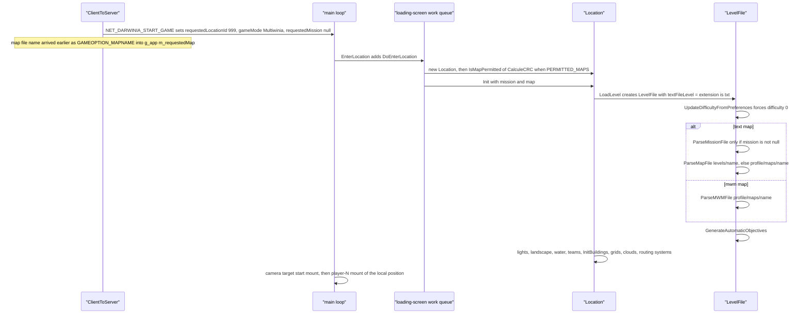
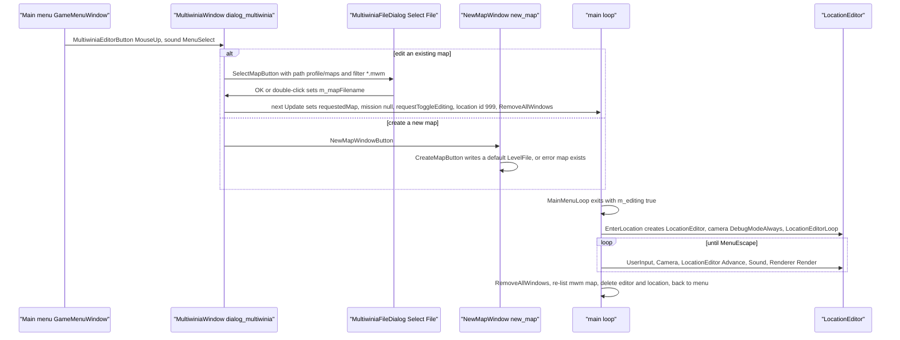
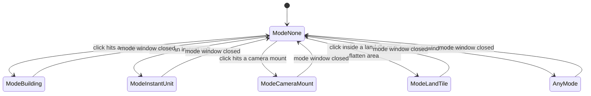

# 08 — Levels and level design

> Part A · Baseline build: Release|Win32 (OpenGL) + TARGET_PC_FULLGAME ([B:FULL]); see _work/build_matrix.md.
> Evidence: [C] confirmed · [I] inferred · [U] unknown. Citations are `path:Symbol` relative to the multiwinia/ source root.
> Sources merged: X4_level_catalogue (§1–13), P11_terrain_world (§8.1–8.8), P17a_ui_framework_editor (E1–E5), P17b_menus_options (§10), X1a_text_formats (§2 level files, level-design semantics only), P06_buildings_core (`P06_level_building_usage.csv` cross-check), routed `_meta_*` notes (contradictions, unknowns, constants, IP, appendix). Generated tables: `_work/scripts/S_08_tables.py` (inputs `_work/drafts/X4_levels.csv`, `X4_level_buildings.csv`, `X4_thumbnails.csv`, `X4_mode_maplists.csv`, `P06_level_building_usage.csv` and the raw level files).

## Contents

- [1 Scope, build reality and related documents](#1-scope-build-reality-and-related-documents)
- [2 Map inventory, discovery and identity](#2-map-inventory-discovery-and-identity)
- [3 Master catalogue of the 57 Multiwinia maps](#3-master-catalogue-of-the-57-multiwinia-maps)
- [4 Per-mode map lists and level conventions](#4-per-mode-map-lists-and-level-conventions)
- [5 Per-level options (`MultiwiniaOptions`)](#5-per-level-options-multiwiniaoptions)
- [6 Level-design capabilities](#6-level-design-capabilities)
- [7 Darwinia `map_`/`mission_` files, `data/levels/old/` and `level_enum.txt`](#7-darwinia-map_mission_-files-datalevelsold-and-level_enumtxt)
- [8 The map editor [B:EDITOR]](#8-the-map-editor-beditor)
- [9 Level-design guide for the new game](#9-level-design-guide-for-the-new-game)
- [Open questions and unknowns](#open-questions-and-unknowns)
- [Docs-vs-code discrepancies](#docs-vs-code-discrepancies)
- [IP items](#ip-items)
- [Source map](#source-map)
- [Appendix — dead/legacy code](#appendix--deadlegacy-code)

## 1 Scope, build reality and related documents

This document is the functional description of Multiwinia's **maps** as a level designer sees them: which maps exist and in which build each is visible, what every level file can express, which of those capabilities the shipped maps actually use, the per-mode conventions the designers followed, and the in-game map editor that produced them.

Build reality in one paragraph [C]:

- **[B:FULL]** — the baseline executable lists and loads every `data/levels/mp_*.txt` whose `GameTypes` names one of the six compiled modes (Domination, King of the Hill, Capture the Statue, Assault, Rocket Riot, Blitzkrieg). With the retail data set (`tools/multiwinia_exclusions.txt`) that is **49 maps**. TankBattle's mode code (blueprint, `Multiwinia` dispatch, Tank AI) is compiled into FULL too, but `App::IsGameModePermitted` returns true for it, and `Multiwinia::AdvanceTankBattle` has a body, only under `INCLUDEGAMEMODE_TANKBATTLE`, which is defined only in `TARGET_DEBUG` — so its availability is [B:DEBUG] [C] `code/lib/universal_include.h`, `code/app.cpp:App::IsGameModePermitted`, `code/multiwinia.cpp:Multiwinia::AdvanceTankBattle`.
- **[B:EDITOR]** — the map editor (`code/location_editor.*` and the nine editor-window source pairs listed in §8.1) is compiled only under `LOCATION_EDITOR`, which is commented out in every target; even the menu entry is compiled out. Custom `.mwm` maps can be loaded by FULL code but are listed and created only in an editor build (§8.1).
- **[B:LEGACY]** — the Darwinia campaign levels (`data/levels/map_*.txt`, `data/levels/mission_*.txt`) are parseable by the same `LevelFile` code but are excluded from every Multiwinia data build and reachable only through the dead Darwinia global world (§7.1). `data/levels/old/` is never listed by any build (§7.2).

Related documents (linked, not duplicated):

| Topic | Document |
|---|---|
| Terrain maths: tile generation, guide grids, flatten areas, cell size, water, colour ramps | [23 Terrain and landscape](23_terrain_and_landscape.md) |
| Per-building behaviour and the level-file parameters of each building type | [03 Buildings and world objects](03_buildings_and_world_objects.md) (§3.10 line format, §3.16 parameter quick reference) |
| Mode rules that read level options (teams, Assault sides, co-op groups, reinforcements) | [01 Game modes](01_game_modes.md) (§2.5, §3.7, §4) |
| Crate outcomes and `InvalidCrates` exclusion semantics | [04 Crates, power-ups and weapons](04_crates_powerups_and_weapons.md) |
| Population cap and spawn economy | [05 Economy and population](05_economy_and_population.md) |
| Map-select page, lobby, demo gating, achievements | [09 Meta systems](09_meta_systems.md) (§2.4, §3.5, §6, §7) |
| Lighting model, special lighting, weather rendering | [24 Rendering](24_rendering.md) (§5.5) |
| Camera mounts and animations at run time | [30 Scripting, tutorial and cutscenes](30_scripting_tutorial_and_cutscenes.md) (§4) |
| Window/widget framework used by the editor windows | [28 UI framework](28_ui_framework.md) (§3.7 value controls, §4.9) |
| **Formal grammar of every level-file block** (EBNF, column tables, crash conditions) | [29 Data formats reference](29_data_formats_reference.md) |
| Data packaging, archives, MapCRC tool | [31 Platform, build and tools](31_platform_build_and_tools.md) |
| Determinism of level loading (synced RNG during building construction) | [22 Determinism and networking](22_determinism_and_networking.md) |

## 2 Map inventory, discovery and identity

### 2.1 File kinds and counts

Directory listing [C] (`_work/scripts/S_08_tables.py` table `inventory`):

<!-- S08:inventory -->
| Location | Files | Kind | Build tag |
|---|---|---|---|
| `data/levels/mp_*.txt` | 57 | Multiwinia map (single file) | [B:FULL] |
| `data/levels/map_*.txt` | 12 | Darwinia location map | [B:LEGACY] |
| `data/levels/mission_*.txt` | 17 | Darwinia mission overlay | [B:LEGACY] |
| `data/levels/level_enum.txt` | 1 | achievement level index | [B:FULL] code; excluded from retail data |
| `data/levels/old/mp_*.txt` | 30 | superseded Multiwinia maps | never loaded |
| `data/thumbnails/*.bmp` | 57 | map-select thumbnails (56 `mp_*` + `default.bmp`) | [B:FULL] |
<!-- /S08:inventory -->

| Kind | Naming | Content | Who loads it | Build tag |
|---|---|---|---|---|
| Multiwinia map | `mp_<mode>_<N>P_<k>.txt` (+ `mp_sandbox`, `mp_sandbox_all`, `mp_benchmark_1`, `mp_assault_stress`, `mp_tankbattle_<N>P`) | everything in one file: `MultiwiniaOptions`, `Landscape`, `LandscapeTiles`, `LandFlattenAreas`, `Lights`, `Buildings`, `CameraMounts`, optionally `CameraAnimations` (always empty), a second (empty) `Buildings`, `InstantUnits`, `PrimaryObjectives` | menu list (`code/game_menu.cpp:GameMenu::CreateMapList`, pattern `mp_*`) and `code/level_file.cpp:LevelFile::LevelFile` with mission `"null"` | [B:FULL] |
| Darwinia map | `map_<location>.txt` | landscape, static buildings, lights (`map_sandbox` also camera mounts) | Darwinia global world (`code/global_world.cpp:GlobalWorld::LoadGame`) | [B:LEGACY] |
| Darwinia mission | `mission_<location>[_<name>].txt` | dynamic buildings, instant units, camera mounts, objectives, difficulty | `LevelFile::ParseMissionFile` | [B:LEGACY] |
| Level enumeration | `level_enum.txt` | `<mp file name> <id>` pairs | `code/achievement_tracker.cpp:AchievementTracker::AchievementTracker` | [B:FULL] code, file excluded from retail data (§7.3) |
| Custom map | `<profile>/maps/<name>.mwm` | zlib-compressed `Directory` with the map text and optional textures (§8.8) | `LevelFile::ParseMWMFile` when the map name's extension is not `txt` | load path [B:FULL]; creation and listing [B:EDITOR] |
| Superseded maps | `data/levels/old/mp_*.txt` | older Multiwinia maps (Shaman, Chess, early Skirmish/Assault prototypes) | nothing | never loaded |

Block counts (number of files containing each block) across the 87 top-level `data/levels/*.txt` files [C] (keyword census of those files): Landscape 69, LandscapeTiles 69, LandFlattenAreas 69, Lights 69, Buildings 134 blocks in 86 files, CameraMounts 75, CameraAnimations 65, InstantUnits 75, PrimaryObjectives 65, Difficulty 3, MultiwiniaOptions 57. No file under `data/levels/` (top level or `old/`) contains `Routes`, `RunningPrograms` or `LeaderboardStats` [C] (keyword census of the files).

### 2.2 How the game discovers maps (menu catalogue)

[C] `code/game_menu.cpp:GameMenu::CreateMapList`, `GameMenu::AddMap`, `code/lib/resource.cpp:Resource::ListResources`, `contrib/systemiv/lib/filesys/file_system.cpp:OrderedInsert`, `code/UI/MapData.cpp:MapData::CalculeMapId`. The page that displays the result is specified in [09 §2.4 and §3.5](09_meta_systems.md#24-map-catalogue-built-at-start-up-gamemenucreatemaplist-gamemenuaddmap).

1. `ListResources("levels/", "mp_*", false)` lists loose files in `data/levels/` and every pre-loaded archive entry whose directory part equals `data/levels/` (`stricmp`). The scan is **non-recursive**, so `data/levels/old/` is never seen. Results are merged with `OrderedInsert`, which compares with `strcmp` (case-sensitive), drops exact duplicates and inserts before the first larger entry — but its loop runs only to `Size()−1`, so the current **last** entry is never compared: a name that sorts after every entry except the last is appended **after** the last one, and an exact duplicate of the last entry is **not** dropped but appended again (with a one-entry list every new name is appended). The base order is therefore "nearly alphabetical"; archive entry names are lower-cased when an archive is indexed (`strlwr(file->m_filename)` in `code/lib/resource.cpp:Resource::ParseArchive`) [C], so in a packaged build the menu sees lower-case file names.
2. Only names whose extension is exactly `txt` are opened; `AddMap` then scans lines until the first `MultiwiniaOptions_EndDefinition` with **case-sensitive** `strcmp` keyword tests for `Name`, `GameTypes`, `NumPlayers`, `Author`, `Description`, `PlayTime`, `Difficulty`, `CoopMode`, `ForceCoop`, `OfficialLevel` (it does not check that it is inside the block).
3. `GameTypes`: **every** following token that equals a blueprint name of `data/multiwinia.txt` (`Domination`, `KingOfTheHill`, `CaptureTheStatue`, `Assault`, `RocketRiot`, `Blitzkrieg`, `TankBattle`) adds the map to that mode's list. A map with no matching token is discarded with the log line "Discarded map … because it didn't contain a game type".
4. `MapData::CalculeMapId()` = `LevelFile::CalculeCRC(fileName)` (§2.3); −1 (not readable as a resource) marks the map as custom.
5. The number of `OfficialLevel` maps is passed to `AchievementTracker::SetNumLevels`.
6. Per mode, an n-pass adjacent-swap sort (stable) orders maps by `NumPlayers` ascending, then by difficulty rank: substring `basic` → 1, `inter` → 2, `advan` → 3, absent → 0.
7. `#ifdef LOCATION_EDITOR` only: every `<profile>/maps/*.mwm` is opened with `MapFile` and added the same way [B:EDITOR].

Two parsers read the same header [C]: the menu (`AddMap`, case-sensitive keys, all `GameTypes` tokens) and the game (`LevelFile::ParseMultiwiniaOptions`, case-insensitive keys, **first** `GameTypes` token only). Resolved: drafts called `LevelFile::m_gameTypes` "single type vs bitmask [U]"; code shows a plain index written by the parser and read only by `LevelFile::WriteMultiwiniaOptions` and the editor drop-down (`code/interface/multiwiniaoptions_window.cpp:MultiwiniaOptionsWindow::Create`) — it is a single blueprint index, never a bitmask, and the running game takes its mode from the lobby, not from this field [C] (grep of `m_gameTypes`). No shipped file lists more than one mode, so the two parsers never disagree on shipped data [C].

Display strings [C] `code/UI/LevelSelectButton.h`, `contrib/systemiv/lib/tosser/hash_table.cpp:HashFunc`: the menu shows the language phrase `<file stem>_name` and `<file stem>_description` (`GameMenu::GetMapNameId` strips `.txt`); language-table keys hash case-insensitively, so `mp_assault_3p_1_name` finds `mp_assault_3P_1_name`. The level's own `Name` is shown only for custom maps. `PlayTime` is shown as `"0:%02d"` and copied into the mode's time option when the map is selected; absent/0 → blueprint default (ordering caveat in [09 §4.5](09_meta_systems.md)).

Thumbnails [C] `code/UI/MapImageButton.h`, `code/UI/GameMenuWindow.cpp:SetupMapSelectPage`: file `thumbnails/<file stem>.bmp` (`TEXTURE_EXTENSION` = `bmp`), lower-cased with `strlwr`. If that texture does not exist (`Resource::DoesTextureExist`), the code sets the name to `thumbnails/default.bmp` but draws **nothing** — the textured quad is inside `if (exists)` — so only the white outline (and, in a demo, the "full version only" caption) appears. The second fallback, to `default.bmp` when an existing file returns texture id −1, is unreachable: `Resource::GetTextureWithFlags` raises a fatal `AppReleaseAssert` instead of returning −1 [C] `code/lib/resource.cpp:Resource::GetTextureWithFlags`. Displayed at width `rightW × 0.8`, height = width × 0.75. The catalogue of all 57 thumbnails is §3.5.

### 2.3 Map identity: MapCRC

[C] `code/level_file.cpp:LevelFile::CalculeCRC`, `contrib/systemiv/lib/math/filecrc.cpp:FileCRC`, `contrib/unrar/crc.cpp:CRC`, `code/mapcrc.h`, `tools/MapCRC/main.cpp:GenerateMapCRCs`.

- Input: the raw bytes of resource `levels/<filename>` read byte-by-byte until EOF **plus one trailing 0xFF byte** (the EOF read is stored before the loop notices EOF), into a static 100 000-byte buffer (a file larger than that would overflow by one byte [I]; the largest file under `data/levels/` is `data/levels/mp_assault_4P_2.txt`, 46 085 bytes [C] file sizes).
- Algorithm: CRC-32, reflected polynomial `0xEDB88320`, **initial value 0, no final XOR**; returned as `int`; −1 if the file cannot be opened.
- `code/mapcrc.h` is generated ("Auto-generated IDs for each map. DO NOT MODIFY") by `tools/MapCRC/main.cpp`: one `#define MAPID_<NAME> 0x%08x` per `data/levels/*.txt`, name = file name minus `.txt`, upper-cased, `.`/`-`/space → `_`.
- Verified in this phase: `python3 -I _work/scripts/P11_mapcrc.py <SRC>` reproduces **87 of 87** `MAPID_*` constants [C]. Resolved: drafts said "86/86" (X4, phase-2 log) and "87/87" (P11); both are right — the 87 `.txt` files in `data/levels/` are 86 level files (57 `mp_*`, 12 `map_*`, 17 `mission_*`) plus `level_enum.txt` (`MAPID_LEVEL_ENUM 0x95ed5f58`); the 30 files in `old/` are not in `mapcrc.h`.

Uses of the map id [C]: (1) `MapData::m_mapId` and `App::GetMapID(gameMode, crc)` → index into the mode's menu list (`code/app.cpp:App::GetMapID`); (2) the metaserver listing (`NET_METASERVER_MAPCRC`, resolved by clients with `GameMenu::GetMapName(mode, crc)`) `code/network/server.cpp`; (3) demo gating (`code/network/demo_limitations.cpp:DemoLimitations::Initialise` default list `MAPID_MP_KOTH_2P_1`, `MAPID_MP_KOTH_4P_1`, `MAPID_MP_CTS_2P_1`, `MAPID_MP_KOTH_3P_1`, `MAPID_MP_ROCKETRIOT_3P_1`, or a list sent by the metaserver); (4) compile-time `PERMITTED_MAPS` whitelists (§2.4); (5) the two tutorials (`MAPID_MP_KOTH_2P_1`, `MAPID_MP_KOTH_3P_1` in `code/UI/GameMenuWindow.cpp:SetupTutorial`, `SetupTutorial2`). A match is started by **file name** (`GAMEOPTION_MAPNAME`), and no map CRC is compared between peers before simulation — a locally modified map file desyncs rather than being rejected [C] grep of the start-game path in `code/network/clienttoserver.cpp`; consequences in [22](22_determinism_and_networking.md).

Because `CalculeCRC` hashes the file bytes, any edit — including a whitespace change or a load→save round trip (§8.7) — changes the id and so silently changes demo/whitelist/tutorial eligibility [I].

### 2.4 Permitted maps per build target and runtime gate

[C] `code/lib/universal_include.h` (`PERMITTED_MAPS`), `code/app.cpp:App::IsMapPermitted`, `App::IsGameModePermitted`, `code/main.cpp:DoEnterLocation`.

| Target / gate | Mechanism | Maps |
|---|---|---|
| `TARGET_PC_FULLGAME` [B:FULL] | `PERMITTED_MAPS` undefined → `IsMapPermitted(id)` is true when `IsFullVersion()`; mode filter `IsGameModePermitted` (six modes) | every listed map |
| Runtime demo (`!IsFullVersion()`) [B:DEMO runtime] | `DemoLimitations::MapPermitted(id)` against the metaserver list or the 5-map default above; restricted maps greyed, selecting one opens the buy page | 5 by default |
| `TARGET_PC_PREVIEW` | `{MAPID_MP_KOTH_2P_1, MAPID_MP_KOTH_4P_1, MAPID_MP_CTS_2P_1, 0}` | 3 |
| `TARGET_PC_HARDWARECOMPAT` | `{MAPID_MP_KOTH_2P_1, MAPID_MP_BENCHMARK_1, MAPID_MP_KOTH_4P_1, 0}` | 3 (benchmark never menu-listed: `GameTypes none`) |
| `TARGET_ASSAULT_STRESSTEST` | `{MAPID_MP_ASSAULT_STRESS, 0}` | 1 (also `GameTypes none`) |
| `TARGET_BETATEST_GROUP_A` | `{MAPID_MP_CTS_2P_1, MAPID_MP_CTS_3P_1, MAPID_MP_CTS_4P_3, 0}` | 3 |
| `TARGET_BETATEST_GROUP_B` | `{MAPID_MP_BLITZKRIEG_2P_2, MAPID_MP_BLITZKRIEG_3P_2, MAPID_MP_BLITZKRIEG_4P_2, 0}` | 3 |
| `TARGET_BETATEST_GROUP_C` | `{MAPID_MP_ROCKETRIOT_2P_4, MAPID_MP_ROCKETRIOT_2P_3, MAPID_MP_ROCKETRIOT_3P_1, 0}` | 3 |
| `TARGET_BETATEST_GROUP_ALL`, `TARGET_DEBUG`, `TARGET_MULTIWINIA_DEMOONLY` | none (`GROUP_ALL` has a commented-out 13-map list: KOTH_2P_1, KOTH_3P_1, ASSAULT_2P_3, ASSAULT_3P_2, ASSAULT_3P_3, ASSAULT_4P_2, ROCKETRIOT_2P_3, ROCKETRIOT_3P_2, ROCKETRIOT_4P_1, CTS_2P_2, CTS_2P_4, CTS_3P_1, CTS_4P_1) | all |

Enforcement [C]: `GameMenuWindow::SetupMapSelectPage` skips non-permitted maps under `#ifdef PERMITTED_MAPS` and greys buttons via `IsMapPermitted(gameType, id)`; `DoEnterLocation` recomputes `IsMapPermitted(CalculeCRC(requestedMap))` before `Location::Init` and, if false, sets `m_requestedLocationId = −1` and returns to the menu after loading — but only under `#if defined(PERMITTED_MAPS)` (both the check and the bail-out), so in [B:FULL] there is **no load-time map check** and a demo-mode client is gated only by the menu (`LevelSelectButton`, `PlayGameButton`, `SetupMapSelectPage`) [C] `code/main.cpp:DoEnterLocation`; tutorial buttons are inactive when their map is missing or not permitted. The whitelist terminator is `0` (`for( i = 0; permittedMaps[i]; i++ )`), so a map whose CRC were 0 could never be whitelisted.

Data packaging per build [C] `tools/build_multiwinia_data.bat`, `tools/listfiles.pl`, `tools/copyfiles.pl`, exclusion/inclusion lists (grammar in [31](31_platform_build_and_tools.md)):

| Script / platform | Exclusions | Inclusions | Level/thumbnail result |
|---|---|---|---|
| `tools/build_multiwinia_retail.bat`, `build_multiwinia.bat`, `_gold`, `_crashreporter` | `tools/multiwinia_exclusions.txt`: `levels/old/*`, `levels/pdlc/*`, `levels/level_enum.txt`, `levels/map_*`, `levels/mission_*`, `levels/mp_assault_stress.txt`, `levels/mp_benchmark_*`, `levels/mp_sandbox*`, `levels/mp_tankbattle_*`, `thumbnails/mp_benchmark_*`, `thumbnails/mp_tankbattle_*`, `levels/mp_cts_3p_3.txt`, `thumbnails/mp_cts_3p_3.bmp` | — | 49 `mp_*` maps + 52 thumbnails (incl. `default.bmp` and the level-less `mp_koth_2P_4.bmp`, `mp_skirmish_2p_3.bmp`) |
| `tools/build_multiwinia_pc_preview.bat` (`pcpreview`) | `tools/multiwinia_exclusions_beta_test.txt` (all `levels/mp_*`, `thumbnails/mp_*`) | `tools/multiwinia_inclusions_previewcopy.txt`: koth_2P_1, koth_4P_1, cts_2P_1 (+ thumbnails) | 3 maps = its whitelist |
| `tools/build_multiwinia_hwcompat.bat` family (`pchwcompat`) | `tools/multiwinia_exclusions_hwcompat.txt` | `tools/multiwinia_inclusions_hwcompat.txt`: koth_2P_1, benchmark_1, koth_4P_1 | 3 maps |
| `pcassaultstress` (no script in tree) | `multiwinia_exclusions_hwcompat.txt` | `tools/multiwinia_inclusions_assaultstresstest.txt`: assault_stress | 1 map |
| `pcbetatest` + group (no script in tree) | `multiwinia_exclusions_beta_test.txt` | `tools/multiwinia_inclusions_beta_test_group_a.txt` (13 maps = the commented-out GROUP_ALL list), `_group_b.txt` (3 Blitzkrieg), `_group_c.txt` (3 Rocket Riot) | per group |
| `platambx` | `multiwinia_exclusions_beta_test.txt` | `multiwinia_inclusions_ambx.txt` — **absent from the tree** | [U] 08-U3 |

Inconsistency [I]: the group-A inclusion list ships 13 maps but the group-A whitelist permits only `mp_cts_3p_1` of them, and with only `INCLUDEGAMEMODE_CTS` compiled that build would list one CTS map (X4 contradiction 2).

### 2.5 How a level is loaded



[C] `code/network/clienttoserver.cpp` (`NET_DARWINIA_START_GAME`, `GAMEOPTION_MAPNAME`), `code/main.cpp:EnterLocation`, `DoEnterLocation`, `code/location.cpp:Location::Init`, `Location::LoadLevel`, `code/level_file.cpp:LevelFile::LevelFile`. Terrain construction order and maths: [23 §2](23_terrain_and_landscape.md#2-pipeline-overview).

File lookup [C] `LevelFile::ParseMapFile(char const*)`, `ParseMissionFile`: a map is opened as resource `levels/<name>` (loose file or `.dat` archive), else as plain file `<profile>/maps/<name>`; a mission (Darwinia only) first as `<profile>/users/<user>/<name>` (save game) unless editing, else resource `levels/<name>`. `AppReleaseAssert` ("Invalid map file specified" / "Invalid level specified") if neither opens.

Block dispatch (first token of a line, `stricmp`) [C] `LevelFile::ParseMapFile(TextReader*)`, `LevelFile::ParseMissionFile`:

| Block start keyword | In a map file | In a mission file |
|---|---|---|
| `MultiwiniaOptions_StartDefinition` | `ParseMultiwiniaOptions` (§5) | not recognised (debug assert, lines skipped) |
| `Landscape_StartDefinition`, `LandscapeTiles_StartDefinition`, `LandFlattenAreas_StartDefinition`, `Lights_StartDefinition` | parsed (§6.1, §6.2) | debug assert, ignored |
| `Buildings_StartDefinition` | `ParseBuildings(dynamic = false)`; a second branch with `dynamic = true` is unreachable, so a second `Buildings` block is also static | `ParseBuildings(dynamic = true)` |
| `CameraMounts_StartDefinition`, `CameraAnimations_StartDefinition`, `InstantUnits_StartDefinition`, `Routes_StartDefinition`, `PrimaryObjectives_StartDefinition` | parsed | parsed |
| `RunningPrograms_StartDefinition`, `Difficulty_StartDefinition`, `LeaderboardStats_StartDefinition` | not recognised | parsed [B:LEGACY] |
| anything else | `AppDebugAssert(0)` (no-op in release), line skipped | same |

Lights precedence [C] `LevelFile::ParseLights`: a `Lights` block met when lights already exist is ignored (`ignoreLights`). The comment says mission lights override map lights, but mission files cannot contain `Lights`, so only a second `Lights` block in the same map file is affected.

Post-parse derivation [C] `LevelFile::GenerateAutomaticObjectives` (always called by the constructor): if there are no primary objectives a single `NeverTrue` condition is added; secondary objectives are derived for `ResearchItem`/`TrunkPort` buildings via `GlobalWorld::GetLocationIdFromMapFilename`, which always returns −1 because it executes `*mapName += 4` (adds 4 to the first character) instead of advancing the pointer [C] `code/global_world.cpp:GlobalWorld::GetLocationIdFromMapFilename`; in Multiwinia `GetBuilding(id, −1)` finds nothing, so no trunk-port objective is ever created and `ResearchItem` rows are blocked anyway [C].

Resolved: X2b reported that `Darwinian::BeginVictoryDance` treats an empty objective list as victory, so the 10 `mp_*` files without a `PrimaryObjectives` block "should" make idle team-0 Darwinians jump. Code: `GenerateAutomaticObjectives` runs for every level and adds `NeverTrue` to an empty list, and `BeginVictoryDance` requires every objective to evaluate true, so **no shipped Multiwinia map ever triggers victory jumps** [C] `code/level_file.cpp:LevelFile::GenerateAutomaticObjectives`, `code/worldobject/darwinian.cpp:Darwinian::BeginVictoryDance`.

Start positions → teams [C] `code/location.cpp:Location::GetTeamPosition`, `Location::GetTeamFromPosition`, `Location::InitBuildings`, `Location::InitialiseTeam`:

- Every team id `0 … NumPlayers−1` is assigned a **start position** in `[0, NumPlayers)`: drawn with `syncrand() % unused.Size()` among unused positions (deterministic across peers); in a tutorial position = team id; the monster team (4) and Futurewinian team (5) always have position = team id; outside Multiwinia mode (`!Multiplayer()`) position = team id.
- **Order and timing of the draws** (needed to reproduce the `syncrand` sequence) [C] `code/location.cpp:Location::Init`, `Location::GetTeamPosition`: `Location::Init` calls `LoadLevel`, then `AppSeedRandom(1)` (the non-synchronised generator), then, in its static-reset loop, `GetTeamPosition(i)` for `i = 0 … NUM_TEAMS−1` in ascending order — before lights, landscape and buildings. Team *i* < NumPlayers consumes exactly one `syncrand()` (`% (NumPlayers − i)`; the last one is `% 1`) whether or not that slot is in use; ids ≥ NumPlayers consume none (no free position, or pinned 4/5). Positions already set before `Init` are kept: `Multiwinia::ResetLocation` copies the rotated positions (`Location::RotatePositions`) into the new `Location` first, so no draw happens. Afterwards, Assault re-assigns every position with `Location::SetupAssault` (memset −1; per team *i* < NumPlayers: an unset `m_colourId` is forced to defender/attacker when that side is full, else `syncrand() % 2`; then `GetFreeDefenderPosition` / `GetFreeAttackerPosition`, each one `syncrand() % free.Size()`); in co-op mode `Location::SetupCoop(i)` (for each team *i* < NumPlayers not yet grouped, ascending) may move a team to the other co-op group's position and then calls `GetTeamPosition` again for the displaced team, drawing again. Only then does `InitBuildings` map building rows to teams.
- The `team` column of a building row is a **position**: `InitBuildings` replaces it with the team that holds that position (`Location::GetTeamFromPosition`, which searches team ids `0 … NumPlayers−1`), or **255 (neutral)** when none of them holds it. Because `Init` gives every team id below NumPlayers a position whether or not the slot is playing, this happens only for position values ≥ NumPlayers — so a building row with position 4 or 5 would become neutral [C]; no shipped row uses 4 or 5 [C] (census of the `Buildings` rows of `data/levels/mp_*.txt`). Empty slots do not arise in practice: before sending START_GAME both the single-player Play button and the host's start fill every unused slot below NumPlayers with a CPU team [C] `code/UI/PlayGameButton.h:PlayGameButton::MouseUp`, `code/UI/GameMenuWindow.cpp:GameMenuWindow::UpdateMultiplayerPage`. Rows with team 255 stay neutral.
- Instant units are spawned per team in `InitialiseTeam`: a unit row belongs to the team whose position equals its `team` column (§6.6).
- Duplicate unique ids across the parsed buildings are fatal (`AppReleaseAssert` "duplicate building found"); after init `GlobalWorld::s_nextUniqueBuildingId = highest id + 1`.
- In Assault, `InitBuildings` binds every `ControlStation` whose id appears in the `PulseBomb`'s link list via `ControlStation::LinkToPulseBomb` (§4.5).

Camera on entry [C] `code/main.cpp:DoEnterLocation`, the in-game loop in `code/main.cpp`: camera bounds are set to `[−200, worldSizeX + 200]` on **both** axes (the X size is used for Z too — harmless because every shipped map is square); the camera first targets `(maxX, 1000, maxX)` looking along `(−1, −0.7, −1)` "in case start doesn't exist", then mount `start`; once the local team exists it cuts to mount `player<position>` (§6.5).

### 2.6 Two on-disk section layouts of `mp_*` files

[C] data (block-order census of the 57 `data/levels/mp_*.txt`), [I] origin.

| Layout | Block order | Files |
|---|---|---|
| A ("old writer") | `MultiwiniaOptions, Landscape, LandscapeTiles, LandFlattenAreas, Lights, Buildings, CameraMounts, CameraAnimations, Buildings (empty), InstantUnits, PrimaryObjectives` | 47 top-level files and every `old/` file that has an options block |
| B ("current writer") | `MultiwiniaOptions, Landscape, LandscapeTiles, LandFlattenAreas, Lights, Buildings, CameraMounts, InstantUnits` | 10: `mp_assault_2p_3`, `mp_assault_3p_1`, `mp_assault_3p_3`, `mp_assault_4P_2`, `mp_blitzkrieg_4P_2`, `mp_domination_2P_1`, `mp_domination_4P_1`, `mp_koth_2P_3`, `mp_koth_2P_3b`, `mp_skirmish_3P_1` |

Layout B is exactly what `LevelFile::SaveMapFile` writes today (camera-animation, dynamic-building and objective writers commented out) [C] `code/level_file.cpp:LevelFile::SaveMapFile`. Forensic corollary [C]: those 10 files — and only they — carry `Name NewLevel`, because the current `WriteMultiwiniaOptions` always writes `Name` (default `"NewLevel"`); 31 layout-A files also carry an explicit `DefenderPopulationCap` line (always written today) but none of the `old/` files do, so an intermediate writer already had it [I]. The second, empty `Buildings` block of layout A is parsed as static and contains no rows in any shipped file [C] (`buildings_in_2nd_block` = 0).

## 3 Master catalogue of the 57 Multiwinia maps

### 3.1 Master table

One row per `data/levels/mp_*.txt` (generated by `S_08_tables.py` table `master` from `_work/drafts/X4_levels.csv` and `X4_level_buildings.csv`; every value [C] from the files). Columns: **Modes** = `GameTypes` tokens (DOM Domination, KOTH King of the Hill, CTS Capture the Statue, ASLT Assault, RR Rocket Riot, BLITZ Blitzkrieg, TANK TankBattle); **Players** = `NumPlayers`; **World** = `worldSizeX×worldSizeZ` in world units (wu); **Grid** = height-map cells per axis = `ceil(worldSize / cellSize)` ([23 §9](23_terrain_and_landscape.md#9-world-grid-cell-size-world-size-outside-height-and-world-edge-handling)); **Tiles** / **Flatten** = `LandscapeTiles` / `LandFlattenAreas` rows; **SpawnPoints by pos** = `SpawnPoint` rows per start position (`255` = neutral); **Notable objects** = row counts of the other gameplay/placement types (full matrix in §6.3); **PopCap** = `PopulationCap` (−1 = none) and, when set, `DefenderPopulationCap`; **InvalidCrates** = crate outcomes removed from this map; **Starting units** = `InstantUnits` as `type@position×count`; **Retail** = shipped in the retail `main.dat`; **Class** = hidden/test status.

<!-- S08:master -->
| File | English name (IP) | Modes | Players | World (wu) | cellSize | Grid | Tiles | Flatten | SpawnPoints by pos | Notable objects (counts) | PopCap / DefenderPopCap | InvalidCrates | Starting units type@pos×n | Thumbnail | Retail | Class |
|---|---|---|---|---|---|---|---|---|---|---|---|---|---|---|---|---|
| `data/levels/mp_assault_2P_1.txt` | Beneath the Baleful Eye | ASLT | 2 | 3000×3000 | 22.00 | 137x137 | 5 | 0 | 0 | TrunkPort 5, PulseBomb 1, CtrlStn 3, Turret 20, Wall 78, PopLock 1, WallBuster 3, Tree 13, Shape 5 | 2000 / def 350 | Squad Airstrike Nuke Meteor | Armour@0x2 Darwinian@0x325 | `data/thumbnails/mp_assault_2P_1.bmp` | Y | official retail |
| `data/levels/mp_assault_2P_2.txt` | The Woeful Plateau | ASLT | 2 | 2991×2991 | 20.00 | 150x150 | 7 | 0 | 0 | TrunkPort 6, PulseBomb 1, CtrlStn 3, Turret 12, Wall 14, Fence 58, JumpPad 3, RestrZone 1, Tree 36 | 2000 / def 275 | — | Darwinian@0x209 | `data/thumbnails/mp_assault_2P_2.bmp` | Y | official retail |
| `data/levels/mp_assault_2p_3.txt` | Dog Green Sector | ASLT | 2 | 5143×5143 | 17.03 | 302x302 | 10 | 3 | 0 | TrunkPort 3, PulseBomb 1, CtrlStn 5, Turret 19, Radar 4, Wall 20, Fence 23, RestrZone 1, Tree 5, Shape 21 | 2000 | Squad Airstrike Nuke Meteor | Darwinian@0x8 Darwinian@1x300 | `data/thumbnails/mp_assault_2p_3.bmp` | Y | official retail |
| `data/levels/mp_assault_3p_1.txt` | The Third Kind | ASLT | 2 | 5000×5000 | 22.32 | 225x225 | 11 | 2 | 0 | TrunkPort 7, PulseBomb 1, CtrlStn 3, Turret 18, Radar 2, Wall 94, Fence 48, RestrZone 2, Smoke 6, Shape 11 | 1600 / def 250 | Armour | Armour@0x1 Darwinian@0x103 Darwinian@5x35 | `data/thumbnails/mp_assault_3P_1.bmp` | Y | official retail |
| `data/levels/mp_assault_3P_2.txt` | The Hard Way | ASLT | 3 | 5000×5000 | 26.00 | 193x193 | 1 | 0 | 0 | TrunkPort 9, PulseBomb 1, CtrlStn 3, Turret 13, Wall 29, Fence 66, RestrZone 2, PopLock 1, Tree 6 | 1500 / def 250 | Armour | Armour@0x2 Darwinian@0x180 | `data/thumbnails/mp_assault_3P_2.bmp` | Y | official retail |
| `data/levels/mp_assault_3p_3.txt` | Fort Zulu | ASLT | 3 | 2549×2549 | 9.95 | 257x257 | 7 | 1 | 0 | TrunkPort 8, PulseBomb 1, CtrlStn 3, Turret 40, Wall 25, Shape 10 | 1800 | — | Darwinian@0x260 | `data/thumbnails/mp_assault_3P_3.bmp` | Y | official retail |
| `data/levels/mp_assault_4P_1.txt` | Beyond the Pale | ASLT | 4 | 4070×4070 | 20.00 | 204x204 | 15 | 5 | 0 | TrunkPort 8, PulseBomb 1, CtrlStn 4, Turret 18, Radar 6, Fence 81, RestrZone 1, Tree 26, Shape 5 | 1600 / def 200 | Armour | Armour@2x1 Armour@3x1 Darwinian@2x100 Darwinian@3x68 | `data/thumbnails/mp_assault_4P_1.bmp` | Y | official retail |
| `data/levels/mp_assault_4P_2.txt` | The Last Stand | ASLT | 4 | 7000×7000 | 26.00 | 270x270 | 19 | 5 | 0 | TrunkPort 10, PulseBomb 1, CtrlStn 3, Turret 20, Wall 34, Fence 124, RestrZone 2, Shape 27 | 1500 / def 200 | Armour | Darwinian@0x63 Darwinian@1x95 | `data/thumbnails/mp_assault_4P_2.bmp` | Y | official retail |
| `data/levels/mp_assault_stress.txt` | Assault Stress Test | none | 2 | 4000×4000 | 20.00 | 200x200 | 5 | 0 | 0 | TrunkPort 7, PulseBomb 1, CtrlStn 3, Turret 7, Wall 30, Fence 26 | 2000 | — | Darwinian@1x90 | none (no image drawn, §2.2) | N | stress test; hidden (GameTypes none); not in retail data |
| `data/levels/mp_benchmark_1.txt` | Stress Test | none | 4 | 3000×3000 | 18.00 | 167x167 | 10 | 0 | 0:5;1:5;2:5;3:5;255:4 | Zone 15, TrunkPort 4, PopLock 1, Tree 18 | -1 | — | Darwinian@0x150 Darwinian@1x150 Darwinian@2x150 Darwinian@3x150 | `data/thumbnails/mp_benchmark_1.bmp` | N | benchmark; hidden (GameTypes none); not in retail data |
| `data/levels/mp_blitzkrieg_2p_1.txt` | Confrontation Point | BLITZ | 2 | 3500×3500 | 12.00 | 292x292 | 6 | 2 | 255:1 | Zone 3, TrunkPort 2, Fence 23, Tree 7 | 1500 | — | Darwinian@0x40 Darwinian@1x40 | `data/thumbnails/mp_blitzkrieg_2p_1.bmp` | Y | official retail |
| `data/levels/mp_blitzkrieg_2p_2.txt` | The Bleak Mountains | BLITZ | 2 | 4000×4000 | 18.00 | 223x223 | 8 | 4 | 0:2;1:2;255:2 | Zone 5, TrunkPort 2, Turret 4, Wall 17, PopLock 6 | 2000 | — | Darwinian@0x8 Darwinian@1x8 | `data/thumbnails/mp_blitzkrieg_2p_2.bmp` | Y | official retail |
| `data/levels/mp_blitzkrieg_2P_3.txt` | The Eye of the World | BLITZ | 2 | 3000×3000 | 16.00 | 188x188 | 12 | 0 | 255:4 | Zone 3, TrunkPort 3, Fence 21, JumpPad 2 | 2000 | — | — | `data/thumbnails/mp_blitzkrieg_2p_3.bmp` | Y | official retail |
| `data/levels/mp_blitzkrieg_2P_4.txt` | The Apex of Infinity | BLITZ | 2 | 3000×3000 | 20.00 | 150x150 | 7 | 1 | 255:3 | Zone 6, TrunkPort 3, Turret 18, PopLock 2, Tree 9, Shape 19 | 1800 | — | Darwinian@0x36 Darwinian@1x36 | `data/thumbnails/mp_blitzkrieg_2p_4.bmp` | Y | official retail |
| `data/levels/mp_blitzkrieg_3P_1.txt` | Upon the Blazing Sea | BLITZ | 3 | 4000×4000 | 12.00 | 334x334 | 7 | 1 | 0 | Zone 7, TrunkPort 3, Fence 34, PopLock 4, Tree 16 | 1500 | — | Darwinian@0x15 Darwinian@1x15 Darwinian@2x15 | `data/thumbnails/mp_blitzkrieg_3P_1.bmp` | Y | official retail |
| `data/levels/mp_blitzkrieg_3P_2.txt` | The Wheel | BLITZ | 3 | 2938×2938 | 16.00 | 184x184 | 9 | 0 | 0 | Zone 7, TrunkPort 3, Fence 20, RestrZone 3, PopLock 7, Eruption 1, Tree 16 | 2000 | — | — | `data/thumbnails/mp_blitzkrieg_3P_2.bmp` | Y | official retail |
| `data/levels/mp_blitzkrieg_4P_2.txt` | Gridlock | BLITZ | 4 | 4000×4000 | 20.00 | 200x200 | 25 | 0 | 0 | Zone 9, TrunkPort 4, Fence 39, RestrZone 4 | 1400 | — | — | `data/thumbnails/mp_blitzkrieg_4P_2.bmp` | Y | official retail |
| `data/levels/mp_cts_2p_1.txt` | Mountain of Lost Souls | CTS | 2 | 2332×2332 | 15.76 | 148x148 | 4 | 0 | 0:2;1:2;255:2 | Zone 4, PopLock 4, Tree 4 | 2000 | — | Darwinian@0x40 Darwinian@1x40 | `data/thumbnails/mp_cts_2p_1.bmp` | Y | official retail |
| `data/levels/mp_cts_2p_2.txt` | The Bloody Shrine | CTS | 2 | 2332×2332 | 15.76 | 148x148 | 1 | 0 | 0:2;1:2 | Zone 4, PopLock 2, Tree 10 | 2000 | — | Darwinian@0x40 Darwinian@1x40 | `data/thumbnails/mp_cts_2p_2.bmp` | Y | official retail |
| `data/levels/mp_cts_2p_3.txt` | Price of War | CTS | 2 | 2000×2000 | 12.00 | 167x167 | 5 | 0 | 0:1;1:1;255:2 | Zone 4, Tree 17 | 2000 | — | Darwinian@0x40 Darwinian@1x40 | `data/thumbnails/mp_cts_2p_3.bmp` | Y | official retail |
| `data/levels/mp_cts_2p_4.txt` | The Unending Peaks | CTS | 2 | 2000×2000 | 9.00 | 223x223 | 3 | 0 | 0:2;1:2 | Zone 3, PopLock 5, Tree 11 | 2000 | — | Darwinian@0x40 Darwinian@1x40 | `data/thumbnails/mp_cts_2p_4.bmp` | Y | official retail |
| `data/levels/mp_cts_3p_1.txt` | Melting Pot | CTS | 3 | 3000×3000 | 15.80 | 190x190 | 5 | 0 | 0:2;1:2;2:2 | Zone 6, PopLock 6, Tree 24, Shape 8 | 1800 | — | Darwinian@0x40 Darwinian@1x40 Darwinian@2x40 | `data/thumbnails/mp_cts_3p_1.bmp` | Y | official retail |
| `data/levels/mp_cts_3P_2.txt` | The Tortured Expanse | CTS | 3 | 2999×2999 | 16.00 | 188x188 | 17 | 6 | 0:3;1:3;2:3 | Zone 8, Tree 45 | 1500 | — | Darwinian@0x40 Darwinian@1x40 Darwinian@2x40 | `data/thumbnails/mp_cts_3P_2.bmp` | Y | official retail |
| `data/levels/mp_cts_3p_3.txt` | The Outreach Peaks | CTS | 3 | 2570×2570 | 12.00 | 215x215 | 5 | 0 | 0 | Zone 9, TrunkPort 3, Tree 15 | 2000 | — | — | `data/thumbnails/mp_cts_3p_3.bmp` | N | cut map; not in retail data |
| `data/levels/mp_cts_4P_1.txt` | Field of Unlife | CTS | 4 | 3000×3000 | 16.00 | 188x188 | 14 | 6 | 0:1;1:1;2:1;3:1;255:8 | Zone 7, PopLock 1, Tree 7 | 2000 | — | Darwinian@0x40 Darwinian@1x40 Darwinian@2x40 Darwinian@3x40 | `data/thumbnails/mp_cts_4P_1.bmp` | Y | official retail |
| `data/levels/mp_cts_4P_2.txt` | Scorched Earth | CTS | 4 | 3428×3428 | 16.00 | 215x215 | 18 | 0 | 0:2;1:2;2:2;3:2 | Zone 10, PopLock 9, Tree 59 | 2000 | — | Darwinian@0x40 Darwinian@1x40 Darwinian@2x40 Darwinian@3x40 | `data/thumbnails/mp_cts_4P_2.bmp` | Y | official retail |
| `data/levels/mp_cts_4p_3.txt` | Maze of Despair | CTS | 4 | 2720×2720 | 15.00 | 182x182 | 7 | 0 | 0:2;1:2;2:2;3:2 | Zone 7 | 2000 | — | Darwinian@0x40 Darwinian@1x40 Darwinian@2x40 Darwinian@3x40 | `data/thumbnails/mp_cts_4p_3.bmp` | Y | official retail |
| `data/levels/mp_domination_2P_1.txt` | Barriers to Progress | DOM | 2 | 2000×2000 | 12.00 | 167x167 | 8 | 0 | 0:1;1:1;255:6 | Fence 14, PopLock 1, Tree 6, Shape 1 | 2000 | — | Darwinian@0x45 Darwinian@1x45 | `data/thumbnails/mp_domination_2P_1.bmp` | Y | official retail |
| `data/levels/mp_domination_2P_2.txt` | The Eternal Guardians | DOM | 2 | 2700×2700 | 15.76 | 172x172 | 3 | 0 | 0:1;1:1;255:6 | Tree 21, Shape 5 | 2000 | — | Darwinian@0x40 Darwinian@1x40 | `data/thumbnails/mp_domination_2P_2.bmp` | Y | official retail |
| `data/levels/mp_domination_3P_1.txt` | Field of Unending Dawn | DOM | 3 | 2345×2345 | 16.00 | 147x147 | 1 | 0 | 0:2;1:2;2:2;255:4 | Tree 12, Shape 11 | 1800 | — | Darwinian@0x40 Darwinian@1x40 Darwinian@2x40 | `data/thumbnails/mp_domination_3P_1.bmp` | Y | official retail |
| `data/levels/mp_domination_4P_1.txt` | The Holy Tree | DOM | 4 | 3000×3000 | 16.00 | 188x188 | 15 | 1 | 0:1;1:1;2:1;3:1;255:6 | Tree 8 | 2000 | — | Darwinian@0x40 Darwinian@1x40 Darwinian@2x40 Darwinian@3x40 | `data/thumbnails/mp_domination_4P_1.bmp` | Y | official retail |
| `data/levels/mp_domination_4P_2.txt` | A Monument to the Heavens | DOM | 4 | 3000×3000 | 14.00 | 215x215 | 5 | 0 | 0:2;1:2;2:2;3:2;255:4 | Radar 8, Tree 20, Shape 18 | -1 | — | Darwinian@0x40 Darwinian@1x40 Darwinian@2x40 Darwinian@3x40 | `data/thumbnails/mp_domination_4P_2.bmp` | Y | official retail |
| `data/levels/mp_koth_2P_1.txt` | The Eternal Guardians | KOTH | 2 | 2700×2700 | 15.76 | 172x172 | 3 | 0 | 0:1;1:1;255:4 | Zone 3, PopLock 4, Tree 7, Shape 5 | 2000 | — | Darwinian@0x40 Darwinian@1x40 | `data/thumbnails/mp_koth_2P_1.bmp` | Y | official retail |
| `data/levels/mp_koth_2P_2.txt` | Shrine of Memory | DOM | 2 | 2677×2677 | 14.00 | 192x192 | 3 | 0 | 0:3;1:3;255:3 | TrunkPort 1, Radar 6, Tree 37, Shape 12 | 2000 | — | — | `data/thumbnails/mp_koth_2P_2.bmp` | Y | official retail |
| `data/levels/mp_koth_2P_3.txt` | The Bitter Front | DOM | 2 | 2754×2754 | 16.00 | 173x173 | 10 | 0 | 0:2;1:2;255:6 | PopLock 4, Tree 11, Shape 3 | 1500 | — | Darwinian@0x40 Darwinian@1x40 | `data/thumbnails/mp_koth_2P_3.bmp` | Y | official retail |
| `data/levels/mp_koth_2P_3b.txt` | The Bitter Front | KOTH | 2 | 2754×2754 | 16.00 | 173x173 | 11 | 4 | 0:2;1:2;255:6 | Zone 4, PopLock 4, Tree 13, Shape 7 | 1500 | — | Darwinian@0x40 Darwinian@1x40 | `data/thumbnails/mp_koth_2P_3b.bmp` | Y | official retail |
| `data/levels/mp_koth_3P_1.txt` | Pursuit of Victory | KOTH | 3 | 3000×3000 | 12.00 | 250x250 | 8 | 1 | 0:1;1:1;2:1;255:6 | Zone 4, TrunkPort 1, CtrlStn 6, Radar 12, RestrZone 3, PopLock 7, Tree 5, Shape 4 | 1800 | — | Darwinian@0x45 Darwinian@1x45 Darwinian@2x45 | `data/thumbnails/mp_koth_3P_1.bmp` | Y | official retail |
| `data/levels/mp_koth_3P_2.txt` | Field of Unending Dawn | KOTH | 3 | 2345×2345 | 16.00 | 147x147 | 1 | 0 | 0:2;1:2;2:2;255:3 | Zone 4, PopLock 1, Tree 9, Shape 3 | 1800 | — | Darwinian@0x40 Darwinian@1x40 Darwinian@2x40 | `data/thumbnails/mp_koth_3P_2.bmp` | Y | official retail |
| `data/levels/mp_koth_3P_3.txt` | The Deceitful Vale | KOTH | 3 | 2800×2800 | 16.00 | 175x175 | 8 | 3 | 0:2;1:2;2:2;255:3 | Zone 5, TrunkPort 1, PopLock 7, Tree 15 | 1800 | — | Darwinian@0x40 Darwinian@1x40 Darwinian@2x40 | `data/thumbnails/mp_koth_3P_3.bmp` | Y | official retail |
| `data/levels/mp_koth_3P_4.txt` | The Walled Garden | KOTH | 3 | 2750×2750 | 12.00 | 230x230 | 3 | 1 | 0 | Zone 1, TrunkPort 6, Turret 6, Wall 12, Tree 22 | 1800 | — | — | `data/thumbnails/mp_koth_3P_4.bmp` | Y | official retail |
| `data/levels/mp_koth_4P_1.txt` | The Holy Tree | KOTH | 4 | 3000×3000 | 16.00 | 188x188 | 15 | 3 | 0:1;1:1;2:1;3:1;255:6 | Zone 11, PopLock 9, Tree 8 | 2000 | — | Darwinian@0x40 Darwinian@1x40 Darwinian@2x40 Darwinian@3x40 | `data/thumbnails/mp_koth_4P_1.bmp` | Y | official retail |
| `data/levels/mp_koth_4P_3.txt` | A Monument to the Heavens | KOTH | 4 | 3000×3000 | 14.00 | 215x215 | 5 | 0 | 0:2;1:2;2:2;3:2;255:4 | Zone 12, Radar 8, Tree 20, Shape 18 | -1 | — | Darwinian@0x40 Darwinian@1x40 Darwinian@2x40 Darwinian@3x40 | `data/thumbnails/mp_koth_4P_3.bmp` | Y | official retail |
| `data/levels/mp_koth_4P_4.txt` | Barbs of Madness | KOTH | 4 | 3000×3000 | 18.00 | 167x167 | 10 | 0 | 0:3;1:3;2:3;3:3 | Zone 15, TrunkPort 4, PopLock 1, Tree 18 | 2000 | — | Darwinian@0x40 Darwinian@1x40 Darwinian@2x40 Darwinian@3x40 | `data/thumbnails/mp_koth_4P_4.bmp` | Y | official retail |
| `data/levels/mp_rocketriot_2P_2.txt` | Echoes of the Future | RR | 2 | 5000×5000 | 18.00 | 278x278 | 6 | 0 | 255:2 | TrunkPort 2, Rocket 2, FuelStn 6, RestrZone 2, Tree 44 | 1500 | — | — | `data/thumbnails/mp_rocketriot_2P_2.bmp` | Y | official retail |
| `data/levels/mp_rocketriot_2p_3.txt` | Stairway to Heaven | RR | 2 | 3756×3756 | 27.08 | 139x139 | 15 | 0 | 0 | TrunkPort 2, Rocket 2, FuelStn 6, Fence 31, Tree 24 | 1800 | — | — | `data/thumbnails/mp_rocketriot_2p_3.bmp` | Y | official retail |
| `data/levels/mp_rocketriot_2P_4.txt` | Bridge of Light | RR | 2 | 2000×2000 | 9.87 | 203x203 | 1 | 0 | 0 | TrunkPort 2, Rocket 2, FuelStn 6, Tree 14 | 1500 | Armour | — | `data/thumbnails/mp_rocketriot_2P_4.bmp` | Y | official retail |
| `data/levels/mp_rocketriot_3p_1.txt` | The Second Beginning | RR | 3 | 5000×5000 | 18.00 | 278x278 | 7 | 0 | 0 | TrunkPort 3, Rocket 3, FuelStn 9, RestrZone 3 | 1800 | — | — | `data/thumbnails/mp_rocketriot_3p_1.bmp` | Y | official retail |
| `data/levels/mp_rocketriot_3P_2.txt` | Wake of Eternity | RR | 3 | 4285×4285 | 18.00 | 239x239 | 22 | 0 | 0 | TrunkPort 3, Rocket 3, FuelStn 9, RestrZone 4, Tree 18 | 1800 | — | — | `data/thumbnails/mp_rocketriot_3P_2.bmp` | Y | official retail |
| `data/levels/mp_rocketriot_3P_3.txt` | Heart of Chaos | RR | 3 | 4500×4500 | 16.00 | 282x282 | 7 | 3 | 0 | TrunkPort 3, Rocket 3, FuelStn 9, Turret 6 | 1800 | — | Darwinian@0x8 Darwinian@1x8 Darwinian@2x8 | `data/thumbnails/mp_rocketriot_3P_3.bmp` | Y | official retail |
| `data/levels/mp_rocketriot_4P_1.txt` | Threads of Fate | RR | 4 | 4186×4186 | 18.00 | 233x233 | 17 | 0 | 255:12 | TrunkPort 4, Rocket 4, FuelStn 12, RestrZone 4 | 1800 | — | — | `data/thumbnails/mp_rocketriot_4P_1.bmp` | Y | official retail |
| `data/levels/mp_sandbox.txt` | — | none | 2 | 3290×3290 | 20.35 | 162x162 | 1 | 0 | 0 | Wall 3, CtrlTower 1, Incubator 1, Statue(blocked) 1 | 2500 | — | — | none (no image drawn, §2.2) | N | sandbox; hidden (GameTypes none); not in retail data |
| `data/levels/mp_sandbox_all.txt` | — | none | — | 3290×3290 | 20.35 | 162x162 | 1 | 0 | 1:4 | CtrlTower 2, Incubator 2, Tree 2 | -1 | — | — | none (no image drawn, §2.2) | N | sandbox; hidden (GameTypes none); not in retail data |
| `data/levels/mp_skirmish_2p_4.txt` | Hamburger Hill | DOM | 2 | 2000×2000 | 12.00 | 167x167 | 2 | 0 | 0:1;1:1;255:8 | TrunkPort 1, Tree 9 | 1800 | — | — | `data/thumbnails/mp_skirmish_2p_4.bmp` | Y | official retail |
| `data/levels/mp_skirmish_3P_1.txt` | Leap of Faith | DOM | 3 | 6000×6000 | 20.00 | 300x300 | 10 | 1 | 0:2;1:2;2:2;255:9 | Turret 6, Fence 95, JumpPad 18, RestrZone 3, Tree 9 | 1800 | — | Darwinian@0x40 Darwinian@1x40 Darwinian@2x40 | `data/thumbnails/mp_skirmish_3P_1.bmp` | Y | official retail |
| `data/levels/mp_tankbattle_2P.txt` | 2P TankBattle Arena | TANK | 2 | 2000×2000 | 12.00 | 167x167 | 1 | 0 | 0 | Tree 18 | -1 | — | Tank@0x1 Tank@1x1 | `data/thumbnails/mp_tankbattle_2P.bmp` | N | TankBattle [B:DEBUG]; not in retail data |
| `data/levels/mp_tankbattle_3P.txt` | 3P TankBattle Arena | TANK | 3 | 2000×2000 | 12.00 | 167x167 | 2 | 0 | 0 | Tree 18 | -1 | — | Tank@0x1 Tank@1x1 Tank@2x1 | `data/thumbnails/mp_tankbattle_3P.bmp` | N | TankBattle [B:DEBUG]; not in retail data |
| `data/levels/mp_tankbattle_4P.txt` | 4P TankBattle Arena | TANK | 4 | 2000×2000 | 12.00 | 167x167 | 1 | 0 | 0 | Tree 23 | -1 | — | Tank@0x1 Tank@1x1 Tank@2x1 Tank@3x1 | `data/thumbnails/mp_tankbattle_4P.bmp` | N | TankBattle [B:DEBUG]; not in retail data |
<!-- /S08:master -->

### 3.2 Identity and availability

Generated table `identity`. CRC = `LevelFile::CalculeCRC` = the map id (§2.3); "CRC check" = recomputed value equals the `MAPID_*` constant; "level_enum id" = achievement index (§7.3); "Data shipped in" = which data builds package the file (retail, `prev` PC preview, `hw` hardware-compat, `stress` Assault stress test, `βA`/`βB`/`βC` beta groups; §2.4); "FULL menu" = what the baseline binary does with the file (`listed`; `permitted, data absent` = would be listed but retail data omits it; `mode not permitted` = TankBattle (added to mode 6's list, but `App::IsGameModePermitted(6)` is false in FULL, so the mode is never offered); `never listed` = no valid `GameTypes`); "Demo default" = in `DemoLimitations`' fallback list; "Tutorial" = map hard-wired by `GameMenuWindow::SetupTutorial`/`SetupTutorial2`.

<!-- S08:identity -->
| File | Bytes | MAPID macro (`code/mapcrc.h`) | CRC = map id | CRC check | level_enum id | Data shipped in | FULL menu (retail data) | PERMITTED_MAPS of other targets | Demo default | Tutorial |
|---|---|---|---|---|---|---|---|---|---|---|
| `data/levels/mp_assault_2P_1.txt` | 27478 | MAPID_MP_ASSAULT_2P_1 | 0xd4cd2a76 | OK | 1 | retail | listed | — | — | — |
| `data/levels/mp_assault_2P_2.txt` | 31538 | MAPID_MP_ASSAULT_2P_2 | 0xabbfd0b7 | OK | 2 | retail | listed | — | — | — |
| `data/levels/mp_assault_2p_3.txt` | 24237 | MAPID_MP_ASSAULT_2P_3 | 0x56caa33d | OK | 3 | retail βA | listed | — | — | — |
| `data/levels/mp_assault_3p_1.txt` | 39102 | MAPID_MP_ASSAULT_3P_1 | 0xb55bfb4f | OK | 4 | retail | listed | — | — | — |
| `data/levels/mp_assault_3P_2.txt` | 27299 | MAPID_MP_ASSAULT_3P_2 | 0x86e07c2c | OK | 5 | retail βA | listed | — | — | — |
| `data/levels/mp_assault_3p_3.txt` | 21878 | MAPID_MP_ASSAULT_3P_3 | 0x0617fad4 | OK | 6 | retail βA | listed | — | — | — |
| `data/levels/mp_assault_4P_1.txt` | 35113 | MAPID_MP_ASSAULT_4P_1 | 0xf9a4dc74 | OK | 7 | retail | listed | — | — | — |
| `data/levels/mp_assault_4P_2.txt` | 46085 | MAPID_MP_ASSAULT_4P_2 | 0x9a54fad8 | OK | 8 | retail βA | listed | — | — | — |
| `data/levels/mp_assault_stress.txt` | 16725 | MAPID_MP_ASSAULT_STRESS | 0x6d970875 | OK | — | stress | never listed | STRESS | — | — |
| `data/levels/mp_benchmark_1.txt` | 12157 | MAPID_MP_BENCHMARK_1 | 0x49bda3c0 | OK | — | hw | never listed | HW | — | — |
| `data/levels/mp_blitzkrieg_2p_1.txt` | 9212 | MAPID_MP_BLITZKRIEG_2P_1 | 0x5f6db8c1 | OK | 9 | retail | listed | — | — | — |
| `data/levels/mp_blitzkrieg_2p_2.txt` | 11372 | MAPID_MP_BLITZKRIEG_2P_2 | 0xb96c43ef | OK | 10 | retail βB | listed | βB | — | — |
| `data/levels/mp_blitzkrieg_2P_3.txt` | 9278 | MAPID_MP_BLITZKRIEG_2P_3 | 0xddeed663 | OK | 11 | retail | listed | — | — | — |
| `data/levels/mp_blitzkrieg_2P_4.txt` | 15740 | MAPID_MP_BLITZKRIEG_2P_4 | 0xfd2d4309 | OK | 12 | retail | listed | — | — | — |
| `data/levels/mp_blitzkrieg_3P_1.txt` | 13870 | MAPID_MP_BLITZKRIEG_3P_1 | 0x26843f9a | OK | 13 | retail | listed | — | — | — |
| `data/levels/mp_blitzkrieg_3P_2.txt` | 17158 | MAPID_MP_BLITZKRIEG_3P_2 | 0x5493f725 | OK | 14 | retail βB | listed | βB | — | — |
| `data/levels/mp_blitzkrieg_4P_2.txt` | 24174 | MAPID_MP_BLITZKRIEG_4P_2 | 0x8a7a997b | OK | 15 | retail βB | listed | βB | — | — |
| `data/levels/mp_cts_2p_1.txt` | 5972 | MAPID_MP_CTS_2P_1 | 0x00486fb0 | OK | 16 | retail prev | listed | PREV βA | Y | — |
| `data/levels/mp_cts_2p_2.txt` | 8520 | MAPID_MP_CTS_2P_2 | 0xa6483bea | OK | 17 | retail βA | listed | — | — | — |
| `data/levels/mp_cts_2p_3.txt` | 12081 | MAPID_MP_CTS_2P_3 | 0xe933d619 | OK | 18 | retail | listed | — | — | — |
| `data/levels/mp_cts_2p_4.txt` | 6234 | MAPID_MP_CTS_2P_4 | 0x1b0eb72d | OK | 19 | retail βA | listed | — | — | — |
| `data/levels/mp_cts_3p_1.txt` | 11514 | MAPID_MP_CTS_3P_1 | 0x8a093da3 | OK | 20 | retail βA | listed | βA | — | — |
| `data/levels/mp_cts_3P_2.txt` | 15731 | MAPID_MP_CTS_3P_2 | 0xbd40d916 | OK | 21 | retail | listed | — | — | — |
| `data/levels/mp_cts_3p_3.txt` | 17985 | MAPID_MP_CTS_3P_3 | 0x8d1184ad | OK | — | — | permitted, data absent | — | — | — |
| `data/levels/mp_cts_4P_1.txt` | 9691 | MAPID_MP_CTS_4P_1 | 0x532eacda | OK | 22 | retail βA | listed | — | — | — |
| `data/levels/mp_cts_4P_2.txt` | 19417 | MAPID_MP_CTS_4P_2 | 0x79f72913 | OK | 23 | retail | listed | — | — | — |
| `data/levels/mp_cts_4p_3.txt` | 10740 | MAPID_MP_CTS_4P_3 | 0x926e6071 | OK | 24 | retail | listed | βA | — | — |
| `data/levels/mp_domination_2P_1.txt` | 10186 | MAPID_MP_DOMINATION_2P_1 | 0x1959ed1e | OK | 25 | retail | listed | — | — | — |
| `data/levels/mp_domination_2P_2.txt` | 9608 | MAPID_MP_DOMINATION_2P_2 | 0x15e6fc2c | OK | 26 | retail | listed | — | — | — |
| `data/levels/mp_domination_3P_1.txt` | 9048 | MAPID_MP_DOMINATION_3P_1 | 0x297bcdfb | OK | 27 | retail | listed | — | — | — |
| `data/levels/mp_domination_4P_1.txt` | 10478 | MAPID_MP_DOMINATION_4P_1 | 0xe5667f49 | OK | 28 | retail | listed | — | — | — |
| `data/levels/mp_domination_4P_2.txt` | 13775 | MAPID_MP_DOMINATION_4P_2 | 0x6cbcaf9f | OK | 29 | retail | listed | — | — | — |
| `data/levels/mp_koth_2P_1.txt` | 7770 | MAPID_MP_KOTH_2P_1 | 0xfa61f648 | OK | 30 | retail prev hw βA | listed | PREV HW | Y | Tutorial 1 |
| `data/levels/mp_koth_2P_2.txt` | 14153 | MAPID_MP_KOTH_2P_2 | 0xd009251b | OK | 31 | retail | listed | — | — | — |
| `data/levels/mp_koth_2P_3.txt` | 9653 | MAPID_MP_KOTH_2P_3 | 0xa29190a0 | OK | 32 | retail | listed | — | — | — |
| `data/levels/mp_koth_2P_3b.txt` | 11139 | MAPID_MP_KOTH_2P_3B | 0xf63c8b47 | OK | 33 | retail | listed | — | — | — |
| `data/levels/mp_koth_3P_1.txt` | 12920 | MAPID_MP_KOTH_3P_1 | 0xc5dbe61e | OK | 34 | retail βA | listed | — | Y | Tutorial 2 |
| `data/levels/mp_koth_3P_2.txt` | 8030 | MAPID_MP_KOTH_3P_2 | 0xa7581956 | OK | 35 | retail | listed | — | — | — |
| `data/levels/mp_koth_3P_3.txt` | 11048 | MAPID_MP_KOTH_3P_3 | 0xdb2380e7 | OK | 36 | retail | listed | — | — | — |
| `data/levels/mp_koth_3P_4.txt` | 10376 | MAPID_MP_KOTH_3P_4 | 0xc59930ef | OK | 37 | retail | listed | — | — | — |
| `data/levels/mp_koth_4P_1.txt` | 12694 | MAPID_MP_KOTH_4P_1 | 0x88897d17 | OK | 38 | retail prev hw | listed | PREV HW | Y | — |
| `data/levels/mp_koth_4P_3.txt` | 14797 | MAPID_MP_KOTH_4P_3 | 0x2ba30b8b | OK | 39 | retail | listed | — | — | — |
| `data/levels/mp_koth_4P_4.txt` | 11142 | MAPID_MP_KOTH_4P_4 | 0x1d6b4438 | OK | 40 | retail | listed | — | — | — |
| `data/levels/mp_rocketriot_2P_2.txt` | 21014 | MAPID_MP_ROCKETRIOT_2P_2 | 0x0101a2ca | OK | 41 | retail | listed | — | — | — |
| `data/levels/mp_rocketriot_2p_3.txt` | 22521 | MAPID_MP_ROCKETRIOT_2P_3 | 0x9df8d46e | OK | 42 | retail βA βC | listed | βC | — | — |
| `data/levels/mp_rocketriot_2P_4.txt` | 12792 | MAPID_MP_ROCKETRIOT_2P_4 | 0x2ca54a88 | OK | 43 | retail βC | listed | βC | — | — |
| `data/levels/mp_rocketriot_3p_1.txt` | 15677 | MAPID_MP_ROCKETRIOT_3P_1 | 0x847aae73 | OK | 44 | retail βC | listed | βC | Y | — |
| `data/levels/mp_rocketriot_3P_2.txt` | 25082 | MAPID_MP_ROCKETRIOT_3P_2 | 0xacef90f0 | OK | 45 | retail βA | listed | — | — | — |
| `data/levels/mp_rocketriot_3P_3.txt` | 16716 | MAPID_MP_ROCKETRIOT_3P_3 | 0x133f8ea6 | OK | 46 | retail | listed | — | — | — |
| `data/levels/mp_rocketriot_4P_1.txt` | 30571 | MAPID_MP_ROCKETRIOT_4P_1 | 0xc3c28aa1 | OK | 47 | retail βA | listed | — | — | — |
| `data/levels/mp_sandbox.txt` | 3314 | MAPID_MP_SANDBOX | 0xb2db706d | OK | — | — | never listed | — | — | — |
| `data/levels/mp_sandbox_all.txt` | 4329 | MAPID_MP_SANDBOX_ALL | 0xa3f63f95 | OK | — | — | never listed | — | — | — |
| `data/levels/mp_skirmish_2p_4.txt` | 7279 | MAPID_MP_SKIRMISH_2P_4 | 0xa3a30f75 | OK | 48 | retail | listed | — | — | — |
| `data/levels/mp_skirmish_3P_1.txt` | 21730 | MAPID_MP_SKIRMISH_3P_1 | 0x177cc7b3 | OK | 49 | retail | listed | — | — | — |
| `data/levels/mp_tankbattle_2P.txt` | 5660 | MAPID_MP_TANKBATTLE_2P | 0x840ab50d | OK | — | — | mode not permitted | — | — | — |
| `data/levels/mp_tankbattle_3P.txt` | 5683 | MAPID_MP_TANKBATTLE_3P | 0x2b3a6c4c | OK | — | — | mode not permitted | — | — | — |
| `data/levels/mp_tankbattle_4P.txt` | 6585 | MAPID_MP_TANKBATTLE_4P | 0x43fa87ed | OK | — | — | mode not permitted | — | — | — |
<!-- /S08:identity -->

### 3.3 Summary

[C] from §3.1–3.2:

- **49 maps are menu-listed in the retail product**: Domination 9 (5 `mp_domination_*`, 2 `mp_skirmish_*`, and `mp_koth_2P_2`, `mp_koth_2P_3`, whose `GameTypes` is `Domination`), King of the Hill 9, Capture the Statue 9, Assault 8, Rocket Riot 7, Blitzkrieg 7. This set equals `level_enum.txt` ids 1–49 and `VALID_ACHIEVEMENT_LEVELS = 49` (`code/achievement_tracker.cpp`).
- **8 files are in the tree but not in retail data**: `mp_assault_stress`, `mp_benchmark_1`, `mp_sandbox`, `mp_sandbox_all`, `mp_tankbattle_2P`, `mp_tankbattle_3P`, `mp_tankbattle_4P`, `mp_cts_3p_3` (§3.4).
- Player counts of the 49: 2-player 22, 3-player 15, 4-player 12. `mp_assault_3p_1` is named "3p" but declares `NumPlayers 2` (its `old/` precursor had 3).
- World sizes 2000–7000 wu, all square; cell sizes 9.00–27.08 wu; grids 137² – 334² cells; 1–25 tiles per map.
- **Twin terrains** — the same terrain re-skinned for two modes by swapping objective buildings [I intent, C data]: byte-identical `LandscapeTiles` blocks (after whitespace normalisation) for `mp_koth_2P_1`≡`mp_domination_2P_2` ("The Eternal Guardians"), `mp_koth_3P_2`≡`mp_domination_3P_1` ("Field of Unending Dawn"), `mp_koth_4P_1`≡`mp_domination_4P_1` ("The Holy Tree"), `mp_koth_4P_3`≡`mp_domination_4P_2` ("A Monument to the Heavens"), `mp_benchmark_1`≡`mp_koth_4P_4`, `mp_sandbox`≡`mp_sandbox_all`, `mp_koth_2P_3b`≡`old/mp_shaman_2P_3`, `old/mp_temple`≡`map_temple`. `mp_koth_2P_3`/`mp_koth_2P_3b` ("The Bitter Front") share the `Landscape` block and lights but have different tiles and flatten areas. Each KOTH/Domination twin pair shares 25–95 identical building rows.
- `mp_rocketriot_2p_3` "Stairway to Heaven" shares its English name with the thumbnail-only `mp_skirmish_2p_3` string (§3.5).

### 3.4 Hidden, test, stress, benchmark, sandbox, TankBattle and cut maps

| File | Class | Why it is not a normal map | Contents worth knowing | Build tag |
|---|---|---|---|---|
| `data/levels/mp_assault_stress.txt` ("Assault Stress Test") | stress test | `GameTypes none` → discarded by `AddMap` in every build; excluded from retail; included and whitelisted only for `TARGET_ASSAULT_STRESSTEST` | Assault layout: 1 PulseBomb (position 1, `startTime 600`), 3 ControlStation, 7 GunTurret, 26 LaserFence, 30 Wall, 6 SolarPanel, 5 Pylon, 2 PylonEnd, TrunkPort ×5 (pos 0) + ×2 (pos 1), 3 AIObjective, 10 AIObjectiveMarker, 30 AITarget; `AttackingTeams 0`; `trunkportreinforcements 250`, `defenderreinforcementtype Armour`; 90 Darwinians at position 1; 3 `AIObjective` rows carry 2 surplus tokens (ignored) | stress target only |
| `data/levels/mp_benchmark_1.txt` ("Stress Test" — "spawn Multiwinians indefinitely" per its language description) | benchmark | `GameTypes none` (never menu-listed); excluded from retail; included and whitelisted for `TARGET_PC_HARDWARECOMPAT` | terrain and zones copied from `mp_koth_4P_4`; 5 SpawnPoint per position + 4 neutral, 15 neutral MultiwiniaZone, 4 neutral TrunkPort, 1 SpawnPopulationLock (radius 1169.84, max 1200), 150 Darwinians per position; `PopulationCap -1`, `CoopMode` | hardware-compat only; how it was launched is [U] 08-U2 |
| `data/levels/mp_sandbox.txt` | developer sandbox | `GameTypes none`; excluded from retail | 11 rows: ControlTower, Incubator, **Statue** (blocked → dropped at parse), 3 Wall, 5 AITarget; `PopulationCap 2500`, `NumPlayers 2`, `AttackingTeams 1`; `PrimaryObjectives BuildingOnline :sandbox,2` twice (Darwinia condition; location "sandbox" does not exist in Multiwinia's empty global world → id −1 → condition false) | none |
| `data/levels/mp_sandbox_all.txt` | developer sandbox | as above; also **no `NumPlayers`** (→ −1) | same terrain as `mp_sandbox`; 2 ControlTower, 2 Incubator, 4 SpawnPoint (position 1), 11 SpawnLink, 1 SpawnPointMaster, 2 Tree | none |
| `data/levels/mp_tankbattle_2P.txt`, `data/levels/mp_tankbattle_3P.txt`, `data/levels/mp_tankbattle_4P.txt` ("2P/3P/4P TankBattle Arena") | TankBattle mode | `GameTypes TankBattle` → `AddMap` puts it in mode 6's list in every build, but the mode is offered only where `App::IsGameModePermitted(6)` is true (`INCLUDEGAMEMODE_TANKBATTLE`, `TARGET_DEBUG`); excluded from retail data | 2000×2000 / 12 arenas, only Trees (18/18/23); one `Tank` instant unit per position; `PopulationCap -1`; 4P has `CoopMode`; 3P/4P have **no camera mounts** | [B:DEBUG] |
| `data/levels/mp_cts_3p_3.txt` ("The Outreach Peaks") | cut CTS map | complete CTS map but explicitly excluded from retail data, no `level_enum` id, no `Difficulty` | the only CTS map with trunk ports instead of spawn points: 1 TrunkPort per position, `trunkportreinforcements 100`, `attackerreinforcementtype HotFeet`, 3 team drop zones (r 75) + 6 statue zones (r 50), `PlayTime 10`, no starting Darwinians; 24-bit thumbnail (also excluded) | FULL code would list it if the file were present |

### 3.5 Thumbnails (`data/thumbnails/`, 57 files)

Format from each BMP header [C]: 53 files are 400×300 8-bit palettised (52 × 121 078 bytes, `default.bmp` 120 778 bytes) and 4 are 400×300 24-bit (360 056 bytes: `mp_cts_3p_3`, `mp_cts_4p_3`, `mp_koth_2P_2`, `mp_koth_3P_4`). No in-engine writer produces map thumbnails — the only screenshot-to-thumbnail routine, `App::SaveThumbnailScreenshot` (256×192), is compiled only under `TARGET_OS_VISTA` for saved-game headers [B:DEAD] [C] `code/app.cpp` — so the 400×300 files were made outside the engine [I] (08-U7). The `LevelFile::m_thumbnailFilename` field (default `default.bmp`) is used only by the `.mwm` writer (§8.8). Generated table `thumbs`:

<!-- S08:thumbs -->
| Thumbnail | Bytes | Format | Level (case-insensitive stem) | Note | Data shipped in |
|---|---|---|---|---|---|
| `data/thumbnails/default.bmp` | 120778 | 400×300×8bpp | — | named by MapImageButton as the fallback, but never drawn: a missing thumbnail draws no image (§2.2) | retail prev hw stress βA βB βC |
| `data/thumbnails/mp_assault_2P_1.bmp` | 121078 | 400×300×8bpp | `data/levels/mp_assault_2P_1.txt` | — | retail |
| `data/thumbnails/mp_assault_2P_2.bmp` | 121078 | 400×300×8bpp | `data/levels/mp_assault_2P_2.txt` | — | retail |
| `data/thumbnails/mp_assault_2p_3.bmp` | 121078 | 400×300×8bpp | `data/levels/mp_assault_2p_3.txt` | — | retail βA |
| `data/thumbnails/mp_assault_3P_1.bmp` | 121078 | 400×300×8bpp | `data/levels/mp_assault_3p_1.txt` | — | retail |
| `data/thumbnails/mp_assault_3P_2.bmp` | 121078 | 400×300×8bpp | `data/levels/mp_assault_3P_2.txt` | — | retail βA |
| `data/thumbnails/mp_assault_3P_3.bmp` | 121078 | 400×300×8bpp | `data/levels/mp_assault_3p_3.txt` | — | retail βA |
| `data/thumbnails/mp_assault_4P_1.bmp` | 121078 | 400×300×8bpp | `data/levels/mp_assault_4P_1.txt` | — | retail |
| `data/thumbnails/mp_assault_4P_2.bmp` | 121078 | 400×300×8bpp | `data/levels/mp_assault_4P_2.txt` | — | retail βA |
| `data/thumbnails/mp_benchmark_1.bmp` | 121078 | 400×300×8bpp | `data/levels/mp_benchmark_1.txt` | — | hw |
| `data/thumbnails/mp_blitzkrieg_2p_1.bmp` | 121078 | 400×300×8bpp | `data/levels/mp_blitzkrieg_2p_1.txt` | — | retail |
| `data/thumbnails/mp_blitzkrieg_2p_2.bmp` | 121078 | 400×300×8bpp | `data/levels/mp_blitzkrieg_2p_2.txt` | — | retail βB |
| `data/thumbnails/mp_blitzkrieg_2p_3.bmp` | 121078 | 400×300×8bpp | `data/levels/mp_blitzkrieg_2P_3.txt` | — | retail |
| `data/thumbnails/mp_blitzkrieg_2p_4.bmp` | 121078 | 400×300×8bpp | `data/levels/mp_blitzkrieg_2P_4.txt` | — | retail |
| `data/thumbnails/mp_blitzkrieg_3P_1.bmp` | 121078 | 400×300×8bpp | `data/levels/mp_blitzkrieg_3P_1.txt` | — | retail |
| `data/thumbnails/mp_blitzkrieg_3P_2.bmp` | 121078 | 400×300×8bpp | `data/levels/mp_blitzkrieg_3P_2.txt` | — | retail βB |
| `data/thumbnails/mp_blitzkrieg_4P_2.bmp` | 121078 | 400×300×8bpp | `data/levels/mp_blitzkrieg_4P_2.txt` | — | retail βB |
| `data/thumbnails/mp_cts_2p_1.bmp` | 121078 | 400×300×8bpp | `data/levels/mp_cts_2p_1.txt` | — | retail prev |
| `data/thumbnails/mp_cts_2p_2.bmp` | 121078 | 400×300×8bpp | `data/levels/mp_cts_2p_2.txt` | — | retail βA |
| `data/thumbnails/mp_cts_2p_3.bmp` | 121078 | 400×300×8bpp | `data/levels/mp_cts_2p_3.txt` | — | retail |
| `data/thumbnails/mp_cts_2p_4.bmp` | 121078 | 400×300×8bpp | `data/levels/mp_cts_2p_4.txt` | — | retail βA |
| `data/thumbnails/mp_cts_3p_1.bmp` | 121078 | 400×300×8bpp | `data/levels/mp_cts_3p_1.txt` | — | retail βA |
| `data/thumbnails/mp_cts_3P_2.bmp` | 121078 | 400×300×8bpp | `data/levels/mp_cts_3P_2.txt` | — | retail |
| `data/thumbnails/mp_cts_3p_3.bmp` | 360056 | 400×300×24bpp | `data/levels/mp_cts_3p_3.txt` | — | — |
| `data/thumbnails/mp_cts_4P_1.bmp` | 121078 | 400×300×8bpp | `data/levels/mp_cts_4P_1.txt` | — | retail βA |
| `data/thumbnails/mp_cts_4P_2.bmp` | 121078 | 400×300×8bpp | `data/levels/mp_cts_4P_2.txt` | — | retail |
| `data/thumbnails/mp_cts_4p_3.bmp` | 360056 | 400×300×24bpp | `data/levels/mp_cts_4p_3.txt` | — | retail |
| `data/thumbnails/mp_domination_2P_1.bmp` | 121078 | 400×300×8bpp | `data/levels/mp_domination_2P_1.txt` | — | retail |
| `data/thumbnails/mp_domination_2P_2.bmp` | 121078 | 400×300×8bpp | `data/levels/mp_domination_2P_2.txt` | — | retail |
| `data/thumbnails/mp_domination_3P_1.bmp` | 121078 | 400×300×8bpp | `data/levels/mp_domination_3P_1.txt` | — | retail |
| `data/thumbnails/mp_domination_4P_1.bmp` | 121078 | 400×300×8bpp | `data/levels/mp_domination_4P_1.txt` | — | retail |
| `data/thumbnails/mp_domination_4P_2.bmp` | 121078 | 400×300×8bpp | `data/levels/mp_domination_4P_2.txt` | — | retail |
| `data/thumbnails/mp_koth_2P_1.bmp` | 121078 | 400×300×8bpp | `data/levels/mp_koth_2P_1.txt` | — | retail prev hw βA |
| `data/thumbnails/mp_koth_2P_2.bmp` | 360056 | 400×300×24bpp | `data/levels/mp_koth_2P_2.txt` | — | retail |
| `data/thumbnails/mp_koth_2P_3.bmp` | 121078 | 400×300×8bpp | `data/levels/mp_koth_2P_3.txt` | — | retail |
| `data/thumbnails/mp_koth_2P_3b.bmp` | 121078 | 400×300×8bpp | `data/levels/mp_koth_2P_3b.txt` | — | retail |
| `data/thumbnails/mp_koth_2P_4.bmp` | 121078 | 400×300×8bpp | — | level only in data/levels/old: data/levels/old/mp_koth_2P_4.txt | retail |
| `data/thumbnails/mp_koth_3P_1.bmp` | 121078 | 400×300×8bpp | `data/levels/mp_koth_3P_1.txt` | — | retail βA |
| `data/thumbnails/mp_koth_3P_2.bmp` | 121078 | 400×300×8bpp | `data/levels/mp_koth_3P_2.txt` | — | retail |
| `data/thumbnails/mp_koth_3P_3.bmp` | 121078 | 400×300×8bpp | `data/levels/mp_koth_3P_3.txt` | — | retail |
| `data/thumbnails/mp_koth_3P_4.bmp` | 360056 | 400×300×24bpp | `data/levels/mp_koth_3P_4.txt` | — | retail |
| `data/thumbnails/mp_koth_4P_1.bmp` | 121078 | 400×300×8bpp | `data/levels/mp_koth_4P_1.txt` | — | retail prev hw |
| `data/thumbnails/mp_koth_4P_3.bmp` | 121078 | 400×300×8bpp | `data/levels/mp_koth_4P_3.txt` | — | retail |
| `data/thumbnails/mp_koth_4P_4.bmp` | 121078 | 400×300×8bpp | `data/levels/mp_koth_4P_4.txt` | — | retail |
| `data/thumbnails/mp_rocketriot_2P_2.bmp` | 121078 | 400×300×8bpp | `data/levels/mp_rocketriot_2P_2.txt` | — | retail |
| `data/thumbnails/mp_rocketriot_2p_3.bmp` | 121078 | 400×300×8bpp | `data/levels/mp_rocketriot_2p_3.txt` | — | retail βA βC |
| `data/thumbnails/mp_rocketriot_2P_4.bmp` | 121078 | 400×300×8bpp | `data/levels/mp_rocketriot_2P_4.txt` | — | retail βC |
| `data/thumbnails/mp_rocketriot_3p_1.bmp` | 121078 | 400×300×8bpp | `data/levels/mp_rocketriot_3p_1.txt` | — | retail βC |
| `data/thumbnails/mp_rocketriot_3P_2.bmp` | 121078 | 400×300×8bpp | `data/levels/mp_rocketriot_3P_2.txt` | — | retail βA |
| `data/thumbnails/mp_rocketriot_3P_3.bmp` | 121078 | 400×300×8bpp | `data/levels/mp_rocketriot_3P_3.txt` | — | retail |
| `data/thumbnails/mp_rocketriot_4P_1.bmp` | 121078 | 400×300×8bpp | `data/levels/mp_rocketriot_4P_1.txt` | — | retail βA |
| `data/thumbnails/mp_skirmish_2p_3.bmp` | 121078 | 400×300×8bpp | — | no level file in tree | retail |
| `data/thumbnails/mp_skirmish_2p_4.bmp` | 121078 | 400×300×8bpp | `data/levels/mp_skirmish_2p_4.txt` | — | retail |
| `data/thumbnails/mp_skirmish_3P_1.bmp` | 121078 | 400×300×8bpp | `data/levels/mp_skirmish_3P_1.txt` | — | retail |
| `data/thumbnails/mp_tankbattle_2P.bmp` | 121078 | 400×300×8bpp | `data/levels/mp_tankbattle_2P.txt` | — | — |
| `data/thumbnails/mp_tankbattle_3P.bmp` | 121078 | 400×300×8bpp | `data/levels/mp_tankbattle_3P.txt` | — | — |
| `data/thumbnails/mp_tankbattle_4P.bmp` | 121078 | 400×300×8bpp | `data/levels/mp_tankbattle_4P.txt` | — | — |
<!-- /S08:thumbs -->

Mismatches [C]: every top-level `mp_*` file except `mp_assault_stress`, `mp_sandbox` and `mp_sandbox_all` has a thumbnail (those three would show no image, §2.2 — moot, because all three are `GameTypes none` and never listed); two thumbnails have no top-level level: `mp_koth_2P_4.bmp` (level only in `data/levels/old/mp_koth_2P_4.txt`, "Pillar of Light") and `mp_skirmish_2p_3.bmp` (no level anywhere; the language file has `mp_skirmish_2P_3_name` "Stairway to Heaven" with description "INSERT DESCRIPTION HERE" — probably the precursor of `mp_rocketriot_2p_3` [I]). Both ship in retail data although nothing can display them.

## 4 Per-mode map lists and level conventions

Mode rules themselves (scoring, timers, win conditions) are in [01 §4](01_game_modes.md#4-per-mode-specifications); building behaviour in [03 §8](03_buildings_and_world_objects.md#8-mode-objective-objects). This section gives the **menu lists** and the **authoring conventions** a level must follow for each mode, recomputed from the raw level files by `S_08_tables.py` [C data].

### 4.1 Menu lists in menu order (retail data set)

Order as produced by `GameMenu::CreateMapList` (§2.2): nearly-alphabetical base order, then stable sort by `NumPlayers`, then difficulty rank. The sort keys are [C]; the order of ties depends on the archive index order through `OrderedInsert` and is [I] (08-U4). Mode index = blueprint index (`data/multiwinia.txt` order = `Multiwinia::GameType*` enum). TankBattle is shown from the source tree (no retail data; mode not permitted in FULL). Generated table `modes` from `_work/drafts/X4_mode_maplists.csv`:

<!-- S08:modes -->
**0 Domination** (retail data, 9 maps)

| Menu index | File | English name (IP) | Players | Difficulty | PlayTime (min) |
|---|---|---|---|---|---|
| 0 | `data/levels/mp_domination_2P_2.txt` | The Eternal Guardians | 2 | basic | — |
| 1 | `data/levels/mp_skirmish_2p_4.txt` | Hamburger Hill | 2 | basic | — |
| 2 | `data/levels/mp_domination_2P_1.txt` | Barriers to Progress | 2 | intermediate | — |
| 3 | `data/levels/mp_koth_2P_2.txt` | Shrine of Memory | 2 | intermediate | 10 |
| 4 | `data/levels/mp_koth_2P_3.txt` | The Bitter Front | 2 | intermediate | 10 |
| 5 | `data/levels/mp_domination_3P_1.txt` | Field of Unending Dawn | 3 | basic | 10 |
| 6 | `data/levels/mp_skirmish_3P_1.txt` | Leap of Faith | 3 | advanced | — |
| 7 | `data/levels/mp_domination_4P_1.txt` | The Holy Tree | 4 | intermediate | 15 |
| 8 | `data/levels/mp_domination_4P_2.txt` | A Monument to the Heavens | 4 | advanced | 10 |

**1 KingOfTheHill** (retail data, 9 maps)

| Menu index | File | English name (IP) | Players | Difficulty | PlayTime (min) |
|---|---|---|---|---|---|
| 0 | `data/levels/mp_koth_2P_1.txt` | The Eternal Guardians | 2 | basic | — |
| 1 | `data/levels/mp_koth_2P_3b.txt` | The Bitter Front | 2 | intermediate | 10 |
| 2 | `data/levels/mp_koth_3P_2.txt` | Field of Unending Dawn | 3 | basic | 5 |
| 3 | `data/levels/mp_koth_3P_1.txt` | Pursuit of Victory | 3 | intermediate | 10 |
| 4 | `data/levels/mp_koth_3P_3.txt` | The Deceitful Vale | 3 | intermediate | 10 |
| 5 | `data/levels/mp_koth_3P_4.txt` | The Walled Garden | 3 | intermediate | 10 |
| 6 | `data/levels/mp_koth_4P_4.txt` | Barbs of Madness | 4 | basic | — |
| 7 | `data/levels/mp_koth_4P_1.txt` | The Holy Tree | 4 | intermediate | 10 |
| 8 | `data/levels/mp_koth_4P_3.txt` | A Monument to the Heavens | 4 | advanced | 10 |

**2 CaptureTheStatue** (retail data, 9 maps)

| Menu index | File | English name (IP) | Players | Difficulty | PlayTime (min) |
|---|---|---|---|---|---|
| 0 | `data/levels/mp_cts_2p_1.txt` | Mountain of Lost Souls | 2 | basic | — |
| 1 | `data/levels/mp_cts_2p_4.txt` | The Unending Peaks | 2 | basic | — |
| 2 | `data/levels/mp_cts_2p_2.txt` | The Bloody Shrine | 2 | intermediate | — |
| 3 | `data/levels/mp_cts_2p_3.txt` | Price of War | 2 | intermediate | — |
| 4 | `data/levels/mp_cts_3p_1.txt` | Melting Pot | 3 | intermediate | — |
| 5 | `data/levels/mp_cts_3P_2.txt` | The Tortured Expanse | 3 | intermediate | — |
| 6 | `data/levels/mp_cts_4P_1.txt` | Field of Unlife | 4 | advanced | — |
| 7 | `data/levels/mp_cts_4P_2.txt` | Scorched Earth | 4 | advanced | — |
| 8 | `data/levels/mp_cts_4p_3.txt` | Maze of Despair | 4 | advanced | — |

**3 Assault** (retail data, 8 maps)

| Menu index | File | English name (IP) | Players | Difficulty | PlayTime (min) |
|---|---|---|---|---|---|
| 0 | `data/levels/mp_assault_2P_1.txt` | Beneath the Baleful Eye | 2 | basic | 15 |
| 1 | `data/levels/mp_assault_2p_3.txt` | Dog Green Sector | 2 | intermediate | 15 |
| 2 | `data/levels/mp_assault_2P_2.txt` | The Woeful Plateau | 2 | advanced | 15 |
| 3 | `data/levels/mp_assault_3p_1.txt` | The Third Kind | 2 | advanced | 15 |
| 4 | `data/levels/mp_assault_3p_3.txt` | Fort Zulu | 3 | intermediate | 15 |
| 5 | `data/levels/mp_assault_3P_2.txt` | The Hard Way | 3 | advanced | 15 |
| 6 | `data/levels/mp_assault_4P_1.txt` | Beyond the Pale | 4 | advanced | 15 |
| 7 | `data/levels/mp_assault_4P_2.txt` | The Last Stand | 4 | advanced | 20 |

**4 RocketRiot** (retail data, 7 maps)

| Menu index | File | English name (IP) | Players | Difficulty | PlayTime (min) |
|---|---|---|---|---|---|
| 0 | `data/levels/mp_rocketriot_2P_4.txt` | Bridge of Light | 2 | basic | — |
| 1 | `data/levels/mp_rocketriot_2P_2.txt` | Echoes of the Future | 2 | intermediate | — |
| 2 | `data/levels/mp_rocketriot_2p_3.txt` | Stairway to Heaven | 2 | intermediate | — |
| 3 | `data/levels/mp_rocketriot_3p_1.txt` | The Second Beginning | 3 | basic | — |
| 4 | `data/levels/mp_rocketriot_3P_2.txt` | Wake of Eternity | 3 | intermediate | — |
| 5 | `data/levels/mp_rocketriot_3P_3.txt` | Heart of Chaos | 3 | advanced | — |
| 6 | `data/levels/mp_rocketriot_4P_1.txt` | Threads of Fate | 4 | advanced | — |

**5 Blitzkrieg** (retail data, 7 maps)

| Menu index | File | English name (IP) | Players | Difficulty | PlayTime (min) |
|---|---|---|---|---|---|
| 0 | `data/levels/mp_blitzkrieg_2p_1.txt` | Confrontation Point | 2 | basic | — |
| 1 | `data/levels/mp_blitzkrieg_2P_3.txt` | The Eye of the World | 2 | intermediate | — |
| 2 | `data/levels/mp_blitzkrieg_2p_2.txt` | The Bleak Mountains | 2 | advanced | — |
| 3 | `data/levels/mp_blitzkrieg_2P_4.txt` | The Apex of Infinity | 2 | advanced | — |
| 4 | `data/levels/mp_blitzkrieg_3P_2.txt` | The Wheel | 3 | basic | — |
| 5 | `data/levels/mp_blitzkrieg_3P_1.txt` | Upon the Blazing Sea | 3 | intermediate | — |
| 6 | `data/levels/mp_blitzkrieg_4P_2.txt` | Gridlock | 4 | advanced | — |

**6 TankBattle** (source tree only, 3 maps)

| Menu index | File | English name (IP) | Players | Difficulty | PlayTime (min) |
|---|---|---|---|---|---|
| 0 | `data/levels/mp_tankbattle_2P.txt` | 2P TankBattle Arena | 2 | basic | — |
| 1 | `data/levels/mp_tankbattle_3P.txt` | 3P TankBattle Arena | 3 | basic | — |
| 2 | `data/levels/mp_tankbattle_4P.txt` | 4P TankBattle Arena | 4 | basic | — |
<!-- /S08:modes -->

Start positions and colours: Location-side start positions are assigned at load (§2.5); the lobby's colour/side choice and Assault side assignment are in [01 §2.5](01_game_modes.md#25-teams-slots-start-positions-colours-co-op-and-assault-sides).

### 4.2 Domination (`GameTypes Domination`, blueprint 0, `GameTypeSkirmish`) — 9 maps

- Objects [C data]: spawn-point economy only — 1–3 `SpawnPoint` per start position plus 3–9 neutral ones, exactly one `SpawnPointMaster`, a `SpawnLink` tree; no `MultiwiniaZone`. Variants: `mp_koth_2P_2` adds 6 neutral `RadarDish` and a neutral `TrunkPort`; `mp_domination_4P_2` 8 `RadarDish`; `mp_skirmish_2p_4` a neutral `TrunkPort`; `mp_skirmish_3P_1` 18 `JumpPad`, 6 neutral `GunTurret`, 95 `LaserFence` and **no `SpawnLink`** (the master links straight to the spawn points).
- Naming [C]: `mp_domination_*`, `mp_skirmish_*` (legacy name of the mode — old maps use `GameTypes … Skirmish`, §7.2) and two `mp_koth_*` files whose `GameTypes` was switched to Domination (`mp_koth_2P_2`, `mp_koth_2P_3`).
- Twin terrains with KOTH (§3.3): the Domination twin replaces hill zones by extra neutral spawn points.
- Spawn-graph semantics (master → links → spawn points, link timing): [03 §4](03_buildings_and_world_objects.md#4-spawn-network), [05](05_economy_and_population.md).

### 4.3 King of the Hill (`KingOfTheHill`, blueprint 1) — 9 maps

- Hills = `MultiwiniaZone` rows: 1–15 per map, almost always neutral, radius 50–555.24 wu [C data].
- **Concentric zones** convention: several zones with (nearly) the same centre and different radii so the central area counts as 2–3 zones — `mp_koth_3P_3` (zones 20 and 6: r 101.17 and 140), `mp_koth_4P_1` (one triple 200/125/50 + four pairs 100/50), `mp_koth_4P_3` (two big zones r 233.01 and 220 each containing three r 90 zones, plus two 100/50 pairs), `mp_koth_4P_4` (central 555.24/193.87/50 triple + four 122/50 pairs + four single r 50; same layout in `mp_benchmark_1`) [C data]; [I] intent: each zone scores separately ([01 §4](01_game_modes.md#4-per-mode-specifications)).
- Team-owned zones: only `mp_koth_3P_3` tags three r 150 zones with positions 0/1/2 (zone ids 0/1/2); at load the owner field becomes the real team via `GetTeamFromPosition` (§2.5), so those hills start owned [I].
- Economy: spawn-point graph on every KOTH map except `mp_koth_3P_4` (2 `TrunkPort` per position + `trunkportreinforcements 100`, 6 neutral `GunTurret`, one central zone r 86.2). `mp_koth_3P_1` adds 12 neutral `RadarDish`, 6 neutral `ControlStation` and a neutral `TrunkPort`; `mp_koth_3P_3` one neutral `TrunkPort`; `mp_koth_4P_3` 8 neutral `RadarDish`.
- Tutorials: Tutorial 1 = `mp_koth_2P_1`, Tutorial 2 = `mp_koth_3P_1` ([30 §3](30_scripting_tutorial_and_cutscenes.md#3-live-multiwinia-tutorials-bfull)).

### 4.4 Capture the Statue (`CaptureTheStatue`, blueprint 2) — 9 maps (+ cut `mp_cts_3p_3`)

- **Exactly one team-owned `MultiwiniaZone` per start position = that player's drop (capture) zone** (r 80, 100 or 109.27; 75 on the cut map), plus **1–6 neutral zones = statue spawn zones** (r 40–75) [C data]. The statue is never placed in the level (`Statue` is a blocked level type, §6.3); the rules object spawns it at a neutral zone [C] `code/multiwinia.cpp` (details [01 §4](01_game_modes.md#4-per-mode-specifications), [03 §8.4](03_buildings_and_world_objects.md#84-statue)).
- Duplicate statue zones at identical coordinates occur on `mp_cts_2p_2` (ids 5/29), `mp_cts_4P_2` (6/107) and `mp_cts_3p_3` (0/64, 10/65, 29/66) [C data] — [I] intended to weight those spawn points.
- Economy: spawn-point graph (1–3 per position, up to 8 neutral on `mp_cts_4P_1`); `mp_cts_2p_2`, `mp_cts_3p_1`, `mp_cts_3P_2`, `mp_cts_4P_2` set `instantspawnpointcapture`; `mp_cts_3p_3` uses trunk ports instead.
- Starting force: 40 Darwinians per position on every shipped CTS map.

Zone table for KOTH and CTS (generated table `zones`; owner `pN` = start position, `n` = neutral; position rounded to wu):

<!-- S08:zones -->
| File | Mode | Players | Zones | Zone id:owner radius @(x,z) |
|---|---|---|---|---|
| `data/levels/mp_cts_2p_1.txt` | CTS | 2 | 4 | 9:p0 r80 @(1610,1442); 10:p1 r80 @(801,866); 13:n r40 @(722,1648); 1:n r40 @(1686,550) |
| `data/levels/mp_cts_2p_2.txt` | CTS | 2 | 4 | 5:n r69.8 @(1133,1178); 6:p0 r80 @(1107,1810); 7:p1 r80 @(1087,546); 29:n r69.8 @(1133,1178) |
| `data/levels/mp_cts_2p_3.txt` | CTS | 2 | 4 | 0:p0 r109.27 @(1003,1358); 1:p1 r109.27 @(1356,1344); 2:n r50 @(1072,620); 4:n r50 @(1204,617) |
| `data/levels/mp_cts_2p_4.txt` | CTS | 2 | 3 | 0:p1 r100 @(737,1293); 1:p0 r100 @(1471,773); 2:n r50 @(1107,1033) |
| `data/levels/mp_cts_3p_1.txt` | CTS | 3 | 6 | 0:p2 r100 @(1435,1328); 1:p0 r100 @(1631,1400); 2:p1 r100 @(1462,1541); 3:n r50 @(1908,1992); 4:n r50 @(821,1482); 5:n r50 @(1763,793) |
| `data/levels/mp_cts_3P_2.txt` | CTS | 3 | 8 | 0:n r60.54 @(1062,1347); 1:n r50 @(352,285); 2:n r50 @(944,2561); 3:n r50 @(2465,801); 4:p0 r100 @(608,1413); 5:p1 r100 @(1118,780); 6:p2 r100 @(1524,1577); 81:n r60 @(1154,1259) |
| `data/levels/mp_cts_3p_3.txt` | CTS | 3 | 9 | 0:n r50 @(735,824); 10:n r50 @(1014,1719); 29:n r50 @(1717,758); 30:p1 r75 @(1224,1108); 31:p2 r75 @(1337,1272); 32:p0 r75 @(1114,1275); 64:n r50 @(735,824); 65:n r50 @(1014,1719); 66:n r50 @(1717,758) |
| `data/levels/mp_cts_4P_1.txt` | CTS | 4 | 7 | 1:n r60 @(1390,1500); 2:n r60 @(1221,1541); 3:p1 r100 @(1283,485); 4:p0 r100 @(437,1409); 5:p3 r100 @(1275,2363); 6:p2 r100 @(2182,1513); 0:n r60 @(1269,1377) |
| `data/levels/mp_cts_4P_2.txt` | CTS | 4 | 10 | 0:p0 r100 @(1513,1074); 1:p1 r100 @(2287,1478); 2:p2 r100 @(1805,2270); 3:p3 r100 @(1084,1806); 4:n r50 @(2167,604); 7:n r50 @(682,980); 8:n r50 @(1003,2694); 9:n r50 @(2560,2407); 6:n r63.38 @(1606,1676); 107:n r50 @(1606,1677) |
| `data/levels/mp_cts_4p_3.txt` | CTS | 4 | 7 | 0:p1 r100 @(2230,1760); 1:p0 r100 @(1024,2168); 2:p2 r100 @(2237,471); 5:p3 r100 @(583,615); 6:n r75 @(1578,984); 7:n r75 @(1545,1337); 8:n r75 @(1163,1494) |
| `data/levels/mp_koth_2P_1.txt` | KOTH | 2 | 3 | 21:n r150 @(1879,1923); 23:n r150 @(1844,750); 9:n r150 @(1209,1400) |
| `data/levels/mp_koth_2P_3b.txt` | KOTH | 2 | 4 | 0:n r100 @(1927,1379); 1:n r100 @(1089,1189); 2:n r100 @(986,2124); 3:n r100 @(505,787) |
| `data/levels/mp_koth_3P_1.txt` | KOTH | 3 | 4 | 0:n r160 @(1595,1595); 16:n r80 @(437,1157); 17:n r80 @(2563,566); 18:n r80 @(1766,2714) |
| `data/levels/mp_koth_3P_2.txt` | KOTH | 3 | 4 | 0:n r80 @(791,1187); 1:n r80 @(929,1445); 2:n r80 @(939,917); 3:n r80 @(500,1173) |
| `data/levels/mp_koth_3P_3.txt` | KOTH | 3 | 5 | 0:p0 r150 @(1389,1943); 1:p1 r150 @(1899,1135); 2:p2 r150 @(900,949); 20:n r101.17 @(1389,1394); 6:n r140 @(1388,1393) |
| `data/levels/mp_koth_3P_4.txt` | KOTH | 3 | 1 | 0:n r86.2 @(1558,1411) |
| `data/levels/mp_koth_4P_1.txt` | KOTH | 4 | 11 | 0:n r200 @(1329,1461); 1:n r125 @(1329,1461); 2:n r50 @(1329,1461); 3:n r100 @(623,642); 4:n r100 @(550,2134); 5:n r100 @(2211,2275); 6:n r100 @(2078,595); 84:n r50 @(2212,2274); 85:n r50 @(549,2134); 86:n r50 @(624,642); 87:n r50 @(2078,595) |
| `data/levels/mp_koth_4P_3.txt` | KOTH | 4 | 12 | 0:n r233.01 @(2142,2092); 1:n r90 @(2195,1988); 2:n r90 @(2198,2184); 4:n r90 @(2022,2091); 5:n r220 @(841,830); 6:n r90 @(953,836); 7:n r90 @(778,737); 8:n r90 @(777,933); 26:n r100 @(2137,896); 27:n r50 @(2137,896); 28:n r100 @(807,2103); 29:n r50 @(807,2103) |
| `data/levels/mp_koth_4P_4.txt` | KOTH | 4 | 15 | 0:n r555.24 @(1344,1481); 1:n r50 @(1344,1481); 2:n r193.87 @(1343,1482); 3:n r122.63 @(1629,1708); 4:n r122 @(1052,1723); 5:n r122 @(1084,1210); 6:n r122 @(1609,1217); 7:n r50 @(1630,1709); 8:n r50 @(1608,1219); 9:n r50 @(1085,1211); 10:n r50 @(1052,1724); 11:n r50 @(1341,1856); 12:n r50 @(1335,1120); 13:n r50 @(986,1462); 14:n r50 @(1726,1464) |
<!-- /S08:zones -->

### 4.5 Assault (`Assault`, blueprint 3) — 8 maps (+ `mp_assault_stress`)

- **Attackers/defenders are start positions**: `AttackingTeams` lists attacker positions; every other position `< NumPlayers` defends. The lobby assigns teams to free attacker/defender positions with `syncrand`; with co-op, `CoopGroup1Positions`/`CoopGroup2Positions` fix the alliances [C] `code/location.cpp:Location::SetupAssault` (rules in [01 §2.5](01_game_modes.md#25-teams-slots-start-positions-colours-co-op-and-assault-sides)).
- Generated table `assault` (recomputed from the raw `Buildings` blocks):

<!-- S08:assault -->
| File | Players | Attacker pos | Defender pos | PulseBomb (id, owner, startTime, links) | ControlStations id(owner→controlBuildingId) | TrunkPorts pos:n | DefenderPopCap | PlayTime | LevelOptions | InvalidCrates | Co-op groups | Starting units |
|---|---|---|---|---|---|---|---|---|---|---|---|---|
| `data/levels/mp_assault_2P_1.txt` | 2 | 1 | 0 | id 103 p0 t=900s links 15 12 11 | 11(n→-1) 12(n→-1) 15(n→-1) | 0:1;1:4 | 350 | 15 | trunkportreinforcements=100 | Squad Airstrike Nuke Meteor | — | Armour@0x2 Darwinian@0x325 |
| `data/levels/mp_assault_2P_2.txt` | 2 | 1 | 0 | id 0 p0 t=900s links 52 51 50 | 50(n→-1) 51(n→-1) 52(n→-1) | 0:1;1:5 | 275 | 15 | trunkportreinforcements=100 trunkportarmour=1 | — | — | Darwinian@0x209 |
| `data/levels/mp_assault_2p_3.txt` | 2 | 0 | 1 | id 82 p1 t=900s links 86 88 87 | 55(n→42) 43(n→45) 86(n→-1) 87(n→-1) 88(n→-1) | 0:3 | -1 | 15 | trunkportreinforcements=100 trunkportarmour=3 defenderreinforcementtype=AirStrike forceradarteammatch noradarcontrol | Squad Airstrike Nuke Meteor | — | Darwinian@0x8 Darwinian@1x300 |
| `data/levels/mp_assault_3p_1.txt` | 2 | 1 | 0 | id 7 p0 t=900s links 65 64 63 | 63(n→-1) 64(n→-1) 65(n→-1) | 0:1;1:6 | 250 | 15 | trunkportreinforcements=75 | Armour | — | Armour@0x1 Darwinian@0x103 Darwinian@5x35 |
| `data/levels/mp_assault_3P_2.txt` | 3 | 1 2 | 0 | id 0 p0 t=900s links 157 159 158 | 157(n→-1) 158(n→-1) 159(n→-1) | 0:1;1:4;2:4 | 250 | 15 | trunkportreinforcements=75 | Armour | 0 / 1 2 | Armour@0x2 Darwinian@0x180 |
| `data/levels/mp_assault_3p_3.txt` | 3 | 1 2 | 0 | id 60 p0 t=900s links 62 61 63 | 61(p0→-1) 62(p0→-1) 63(p0→-1) | 1:4;2:4 | -1 | 15 | trunkportreinforcements=100 | — | 0 / 1 2 | Darwinian@0x260 |
| `data/levels/mp_assault_4P_1.txt` | 4 | 0 1 | 2 3 | id 0 p2 t=900s links 44 43 41 42 | 41(n→-1) 42(n→-1) 43(n→-1) 44(n→-1) | 0:3;1:3;2:1;3:1 | 200 | 15 | trunkportreinforcements=75 | Armour | 0 1 / 2 3 | Armour@2x1 Armour@3x1 Darwinian@2x100 Darwinian@3x68 |
| `data/levels/mp_assault_4P_2.txt` | 4 | 2 3 | 0 1 | id 0 p1 t=1200s links 134 135 133 | 133(n→-1) 134(n→-1) 135(n→-1) | 0:1;1:1;2:4;3:4 | 200 | 20 | trunkportreinforcements=60 trunkportarmour=3 | Armour | 0 1 / 2 3 | Darwinian@0x63 Darwinian@1x95 |
| `data/levels/mp_assault_stress.txt` | 2 | 0 | 1 | id 34 p1 t=600s links 35 37 36 | 35(n→-1) 36(n→-1) 37(n→-1) | 0:5;1:2 | — | — | trunkportreinforcements=250 defenderreinforcementtype=Armour | — | — | Darwinian@1x90 |
<!-- /S08:assault -->

Conventions [C data]:
- One `PulseBomb` per map, owned by a defender position, whose link list names the 3 (4 on `mp_assault_4P_1`) `ControlStation`s that `Location::InitBuildings` binds with `LinkToPulseBomb` (§2.5). `mp_assault_2p_3` has two extra stations (ids 55, 43) whose `controlBuildingId` points at radar dishes (42, 45) — radar control, not bomb control.
- `startTime` = `PlayTime` × 60 s (900 s, 1200 s on `mp_assault_4P_2`, 600 s on the stress map): the bomb countdown equals the match length.
- Attackers get more trunk ports (3–6 per attacker position) than defenders (0–1 per defender position) and no starting Darwinians (sole exception `mp_assault_2p_3`, attacker position 0 gets 8); defenders get 63–325 starting Darwinians (+1–2 `Armour` on `mp_assault_2P_1`, `mp_assault_3p_1`, `mp_assault_3P_2`, `mp_assault_4P_1`), the fortification kit (walls and laser fences owned by defender positions or neutral; 7–40 neutral `GunTurret`, including Flame turrets on `mp_assault_2p_3`, `mp_assault_3p_1`, `mp_assault_3p_3`), 3–18 `AIObjective` chains and their markers for the CPU ([07](07_ai.md)).
- `InvalidCrates` removes `Armour` (`mp_assault_3p_1`, `mp_assault_3P_2`, `mp_assault_4P_1`, `mp_assault_4P_2`) or `Squad Airstrike Nuke Meteor` (`mp_assault_2P_1`, `mp_assault_2p_3`).
- `mp_assault_3p_1` ("The Third Kind") places 35 Darwinians at position 5: the Futurewinian team (id 5, position 5), which `Location::Init` always initialises in Multiwinia (`InitMonsterTeam(4)`, `InitFuturewinianTeam(5)`) [C] `code/location.cpp:Location::Init`, `Location::GetTeamPosition`.
- Every Assault `RestrictionZone` has `blockPowerups 1` ([04](04_crates_powerups_and_weapons.md)).

### 4.6 Rocket Riot (`RocketRiot`, blueprint 4) — 7 maps

Generated table `rr` (owner field per position; `255` = neutral):

<!-- S08:rr -->
| File | Players | EscapeRocket | FuelStation | FuelGenerator | FuelPipe | TrunkPort | Pylon | SolarPanel | PowerSplitter | PylonEnd | SpawnPoints | Starting units | LevelOptions | InvalidCrates |
|---|---|---|---|---|---|---|---|---|---|---|---|---|---|---|
| `data/levels/mp_rocketriot_2P_2.txt` | 2 | 0:1;1:1 | 0:3;1:3 | 0:3;1:3 | 22 | 0:1;1:1 | 0:3;1:3;255:13 | 21 | 3 | 255:6 | 255:2 | — | — | — |
| `data/levels/mp_rocketriot_2p_3.txt` | 2 | 0:1;1:1 | 0:3;1:3 | 0:3;1:3 | 56 | 0:1;1:1 | 0:3;1:3;255:6 | 15 | 3 | 255:6 | — | — | — | — |
| `data/levels/mp_rocketriot_2P_4.txt` | 2 | 0:1;1:1 | 0:3;1:3 | 255:6 | 10 | 0:1;1:1 | 0:3;1:3;255:12 | 16 | 3 | 255:6 | — | — | — | Armour |
| `data/levels/mp_rocketriot_3p_1.txt` | 3 | 0:1;1:1;2:1 | 0:3;1:3;2:3 | 0:3;1:3;2:3 | 21 | 0:1;1:1;2:1 | 0:3;1:3;2:3;255:17 | 21 | 4 | 255:9 | — | — | — | — |
| `data/levels/mp_rocketriot_3P_2.txt` | 3 | 0:1;1:1;2:1 | 0:3;1:3;2:3 | 255:9 | 21 | 0:1;1:1;2:1 | 0:3;1:3;2:3;255:31 | 24 | 4 | 255:9 | — | — | — | — |
| `data/levels/mp_rocketriot_3P_3.txt` | 3 | 0:1;1:1;2:1 | 0:3;1:3;2:3 | 255:9 | 24 | 0:1;1:1;2:1 | 0:3;1:3;2:3;255:16 | 18 | 4 | 255:9 | — | Darwinian@0x8 Darwinian@1x8 Darwinian@2x8 | nogunturrets | — |
| `data/levels/mp_rocketriot_4P_1.txt` | 4 | 0:1;1:1;2:1;3:1 | 0:3;1:3;2:3;3:3 | 255:12 | 24 | 0:1;1:1;2:1;3:1 | 0:3;1:3;2:3;3:3;255:51 | 22 | 5 | 255:12 | 255:12 | — | — | — |
<!-- /S08:rr -->

Conventions [C data]: per start position **1 `EscapeRocket`** (extra tokens `fuelLink −1, fuel 0.00, passengers 0, spawnBuildingId −1, spawnCompleted 0`), **3 `FuelStation`**, **1 `TrunkPort`**, **3 team-owned `Pylon`**; **3 `FuelGenerator` per position** (team-owned on `mp_rocketriot_2P_2`, `mp_rocketriot_2p_3`, `mp_rocketriot_3p_1`; neutral on the other four), `FuelPipe` chains, a shared neutral power grid (`SolarPanel` 15–24, `PowerSplitter` 3–5, `PylonEnd` 3 per position, neutral `Pylon`s) — every `SolarPanel`, `PylonEnd` and `PowerSplitter` row is neutral except one `PowerSplitter` owned by position 0 on `mp_rocketriot_3P_2` (owners 0:1, 255:3) [C data]. The trunk port is the main Darwinian source; starting Darwinians only on `mp_rocketriot_3P_3` (8 per position). Resolved: X4 stated that Rocket Riot maps have "no spawn points"; the data show neutral spawn networks on `mp_rocketriot_2P_2` (2 `SpawnPoint` + `SpawnPointMaster`) and `mp_rocketriot_4P_1` (12 + master) [C]. No `LevelOptions` are needed (trunk-port reinforcements are intrinsic to the mode, [01](01_game_modes.md)); `mp_rocketriot_3P_3` sets `nogunturrets` and has 6 neutral turrets; `mp_rocketriot_2P_4` bans `Armour` crates. **Special lighting is forced for every Rocket Riot match** regardless of the level's `Effects` (§5.3) [C] `code/location.cpp:Location::RenderBuildings`.

### 4.7 Blitzkrieg (`Blitzkrieg`, blueprint 5) — 7 maps

Flags are `MultiwiniaZone` rows (r 100; 75 on `mp_blitzkrieg_3P_2`) whose extra tokens after `size` are an **adjacency list** of other flag ids. **One team-owned zone per position = that player's base flag** (recorded per team and reset to neutral at initialisation, [03 §8.1](03_buildings_and_world_objects.md#81-multiwiniazone)), plus 1–5 neutral flags. Links are written one-way in the files and made bidirectional at run time ([01 §4](01_game_modes.md#4-per-mode-specifications)). Generated table `blitz` (flags in file order; `pN` = position, `n` = neutral):

<!-- S08:blitz -->
| File | Players | Flags | Flag id:owner radius→links (file order) | TrunkPorts | SpawnPoints | LevelOptions |
|---|---|---|---|---|---|---|
| `data/levels/mp_blitzkrieg_2p_1.txt` | 2 | 3 | 4:n r100→6; 5:p0 r100→4; 6:p1 r100→— | 0:1;1:1 | 255:1 | trunkportreinforcements=100 trunkportarmour=3 |
| `data/levels/mp_blitzkrieg_2p_2.txt` | 2 | 5 | 0:p0 r100→—; 1:n r100→0; 2:n r100→1; 3:p1 r100→4; 4:n r100→2 | 0:1;1:1 | 0:2;1:2;255:2 | trunkportreinforcements=100 trunkportarmour=3 |
| `data/levels/mp_blitzkrieg_2P_3.txt` | 2 | 3 | 0:n r100→1; 1:p0 r100→—; 2:p1 r100→0 | 0:1;1:1;255:1 | 255:4 | trunkportreinforcements=100 trunkportarmour=3 |
| `data/levels/mp_blitzkrieg_2P_4.txt` | 2 | 6 | 0:p0 r100→2,4; 1:p1 r100→—; 2:n r100→3; 3:n r100→1; 4:n r100→5; 5:n r100→1 | 0:1;1:1;255:1 | 255:3 | nogunturrets |
| `data/levels/mp_blitzkrieg_3P_1.txt` | 3 | 7 | 0:p0 r100→4; 1:p1 r100→5; 2:p2 r100→5,3; 3:n r100→0; 4:n r100→1; 5:n r100→6; 6:n r100→4,3 | 0:1;1:1;2:1 | — | airstrikecapturezones=3 |
| `data/levels/mp_blitzkrieg_3P_2.txt` | 3 | 7 | 0:p0 r75→2,3,1; 1:n r75→6; 2:n r75→6; 3:n r75→4; 4:p1 r75→2,5; 5:n r75→6; 6:p2 r75→— | 0:1;1:1;2:1 | — | airstrikecapturezones=3 |
| `data/levels/mp_blitzkrieg_4P_2.txt` | 4 | 9 | 1:p1 r100→8,11; 2:p0 r100→10; 4:p2 r100→—; 6:p3 r100→9; 8:n r100→4; 9:n r100→4; 10:n r100→6; 11:n r100→2; 12:n r100→10,9,8,11 | 0:1;1:1;2:1;3:1 | — | airstrikecapturezones=3 |
<!-- /S08:blitz -->

Economy [C data]: 1 `TrunkPort` per position on all 7 (+1 neutral on `mp_blitzkrieg_2P_3`, `mp_blitzkrieg_2P_4`); the 2-player maps also have spawn points (`mp_blitzkrieg_2p_2`: 2 per position + 2 neutral; the others 1–4 neutral); the 2-player maps use `trunkportreinforcements 100` + `trunkportarmour 3` (`mp_blitzkrieg_2P_4` instead `nogunturrets`); the 3- and 4-player maps use `airstrikecapturezones 3`.

### 4.8 Tank Battle (`TankBattle`, blueprint 6) [B:DEBUG]

Three 2000×2000 arenas containing only `Tree`s, one `Tank` instant unit per position (`runAsTask 1`), `PopulationCap −1`, no mode objects [C data]. The mode code is compiled in every target, but it is permitted (`App::IsGameModePermitted`) and `Multiwinia::AdvanceTankBattle` has a body only under `INCLUDEGAMEMODE_TANKBATTLE` (`TARGET_DEBUG`); `Task::TargetTank` is commented out everywhere, so the `Tank` rows would only create inert Tank tasks (§6.6).

## 5 Per-level options (`MultiwiniaOptions`)

The `MultiwiniaOptions_StartDefinition … _EndDefinition` block is the per-map rules header. It must be the **first** block (the menu scanner stops at its end keyword; `SaveMapFile` writes it first "to reduce the amount of time taken for the menu to compile the level list") [C] `code/level_file.cpp:LevelFile::SaveMapFile`. Formal grammar and crash conditions: [29](29_data_formats_reference.md). How the rules consume each value: [01 §3.7](01_game_modes.md#37-level-file-options-that-change-mode-rules).

### 5.1 Every key

[C] `code/level_file.cpp:LevelFile::ParseMultiwiniaOptions`, defaults `LevelFile::LevelFile`; menu reader `code/game_menu.cpp:GameMenu::AddMap`. In `LevelFile` keys are compared case-insensitively and unknown keys are ignored; in the menu reader the ten keys it knows are case-sensitive. Scalars: the last occurrence wins (`mp_cts_4p_3` has `PopulationCap -1` then `2000` → 2000); lists accumulate. A key with a missing argument passes `NULL` to `atoi`/`strcpy` (crash) [C].

| Key | Arguments | `LevelFile` field | Default | Semantics |
|---|---|---|---|---|
| `Name` | rest of line | `m_levelName[512]` | `"NewLevel"` | display name, shown only for custom maps (shipped maps use the language table); 10 shipped files carry the placeholder `NewLevel` |
| `GameTypes` | blueprint names (case-sensitive `strcmp`) | `m_gameTypes` (int) | −1 | `LevelFile`: index of the **first** matching blueprint (0 Domination, 1 KingOfTheHill, 2 CaptureTheStatue, 3 Assault, 4 RocketRiot, 5 Blitzkrieg, 6 TankBattle); menu: every matching token lists the map under that mode; `none` (4 files) matches nothing → map never listed |
| `PopulationCap` | int | `m_populationCap` | −1 (no map cap) | total Darwinian cap; each team's cap = cap / `NumPlayers` ([05 §4](05_economy_and_population.md#4-the-population-cap)); shipped 1400–2500 or −1 |
| `DefenderPopulationCap` | int | `m_defenderPopulationCap` | −1 | Assault defender cap ([05](05_economy_and_population.md)); shipped 200–350 on 6 Assault maps |
| `NumPlayers` | int | `m_numPlayers` | −1 | number of start positions (2–4 shipped); lobby slot count via `MapData::m_numPlayers` |
| `PlayTime` | int (minutes) | `m_defaultPlayTime` | −1 | suggested time limit copied into the mode's time option on map selection (§2.2); shipped 5, 10, 15, 20 |
| `Difficulty` | word | `m_difficultyRating` (`strdup`) | NULL | `basic` / `intermediate` / `advanced`: menu sort key and display |
| `Effects` | `snow` `dustwind` `soulrain` `lightning` `SpecialLighting` (case-sensitive) | `m_effects[5]` | all false | §5.3 |
| `LevelOptions` | option words, some with an argument | `m_levelOptions[15]` | −1 (`memset`), then options 0, 1, 4, 9, 10 forced to 0 | §5.2; an unknown word is ignored without consuming an argument |
| `InvalidCrates` | crate names (`Crate::GetName`, case-insensitive) | `m_invalidCrates[NumCrateRewards]` | false | crate outcomes excluded on this map ([04 §4](04_crates_powerups_and_weapons.md#4-exclusion-lists-and-grant-options)) |
| `AttackingTeams` | start positions | `m_attacking[pos] = true` | false | Assault attacker positions; **index not bounds-checked** (a value ≥ 6 writes past `m_attacking[NUM_TEAMS]`) |
| `CoopMode` | – | `m_coop` | false | co-op allowed (menu `MapData::m_coop`) |
| `ForceCoop` | – | `m_forceCoop` | false | co-op mandatory |
| `CoopGroup1Positions`, `CoopGroup2Positions` | start positions | `m_coopGroup1Positions`, `m_coopGroup2Positions` | empty | fixed co-op alliances ([01 §2.5](01_game_modes.md#25-teams-slots-start-positions-colours-co-op-and-assault-sides)) |
| `OfficialLevel` | – | `m_official = true`, `m_mapId = 0` (comment "### CRC based method here") | false / −1 | official map; counted by the menu for `AchievementTracker::SetNumLevels` |
| `Author` | rest of line | `m_author[64]` (no length check) | `"Author"` | never set in shipped maps |
| `Description` | rest of line | `m_description[512]` | `"LevelDescription"` | never set in shipped maps (descriptions come from the language table) |

### 5.2 `LevelOptions` (enum `LevelFile::LevelOption*`, `NumLevelOptions = 15`)

[C] `code/level_file.h` (enum and header comments), `LevelFile::ParseMultiwiniaOptions`; consumers as cited.

| # | Word | Argument | Default | Meaning (verified consumer) |
|---|---|---|---|---|
| 0 | `nohandicap` | – | 0 | handicap multiplier returns 1.0 (no handicap) regardless of the game option — `code/worldobject/spawnpoint.cpp` (handicap function, `> 0` test); the header comment says "overridden to 0" |
| 1 | `instantspawnpointcapture` | – | 0 | spawn points skip the 30 s capture/activation delay — `code/worldobject/spawnpoint.cpp` ([05 §2.3](05_economy_and_population.md#2-territory-capture-spawn-points)) |
| 2 | `trunkportreinforcements` | int (Darwinians per wave) | −1 | `> 0` (or option 3 `> 0`) enables `Multiwinia::AdvanceTrunkPorts` in **any** mode; used as the wave size when the mode has no `ReinforcementCount` option — `code/multiwinia.cpp:Multiwinia::Advance`, `Multiwinia::AdvanceTrunkPorts` |
| 3 | `trunkportarmour` | int | −1 | armour cap for waves when the mode has no `MaxArmour` option; `> 0` also enables waves and makes the Armour crate invalid — `code/multiwinia.cpp`, `code/worldobject/crate.cpp` |
| 4 | `nogunturrets` | – | 0 | turret timer forced to 0: no GunTurret tasks from waves — `code/multiwinia.cpp:Multiwinia::AdvanceTrunkPorts` |
| 5 | `attackerreinforcements` | int | −1 | Assault attacker wave size (falls back to option 2) |
| 6 | `defenderreinforcements` | int | −1 | Assault defender wave size (falls back to option 2) |
| 7 | `defenderreinforcementtype` | research name (`GlobalResearch::GetType`; unknown → −1) | −1 | task given to defenders per wave instead of armour (header: "requires TrunkPortArmour") |
| 8 | `attackerreinforcementtype` | research name | −1 | task given to attackers per wave (non-Assault: to every team) |
| 9 | `forceradarteammatch` | – | 0 | two radar dishes connect only if owned by the same team — `code/worldobject/radardish.cpp` |
| 10 | `noradarcontrol` | – | 0 | radar dishes cannot be aimed by players or the AI — `code/location_input.cpp`, `code/worldobject/ai.cpp`, `code/gamecursor.cpp` |
| 11 | `airstrikecapturezones` | int (flags) | −1 | Blitzkrieg: a team holding **more than** n flags gets AirStrike tasks instead of gun turrets (also when it holds at least half of all flags) — `code/multiwinia.cpp:Multiwinia::AdvanceTrunkPorts` |
| 12 | `futurewinianteam` | int | −1 | the team whose **start position** equals n fields Futurewinians instead of Darwinians — `code/team.cpp` (compares with `GetTeamPosition`), `code/worldobject/darwinian.cpp`; the header comment says "team id" |
| 13 | `attackreinforcementoption` | int | −1 | `Task::m_option` of attacker reinforcement tasks (e.g. napalm strike, turret type) — `code/multiwinia.cpp` |
| 14 | `defendreinforcementoption` | int | −1 | `Task::m_option` of defender reinforcement tasks |

Shipped usage [C] (census of the 57 top-level `data/levels/mp_*.txt`): `trunkportreinforcements` 60/75/100/250 on 14 maps, `trunkportarmour` 1/3 on 6, `instantspawnpointcapture` 4, `airstrikecapturezones 3` 3, `defenderreinforcementtype` (`AirStrike`, `Armour`) 2, `nogunturrets` 2, `attackerreinforcementtype HotFeet` 1 (cut map), `forceradarteammatch` 1, `noradarcontrol` 1. Never used at top level: `nohandicap` (only `old/mp_koth_2P_4`), `attackerreinforcements`, `defenderreinforcements`, `futurewinianteam`, `attackreinforcementoption`, `defendreinforcementoption` (the last three only in `old/mp_assault_3P_1`).

### 5.3 `Effects` (enum `LevelFile::LevelEffect*`)

[C] `code/level_file.h`, `code/location.cpp:Location::Advance` (slice 3), `Location::RenderBuildings`.

| Index | Enum | File token | Run-time effect | Shipped maps |
|---|---|---|---|---|
| 0 | `LevelEffectSnow` | `snow` | `Location::AdvanceChristmas` every slice-3 advance: snowflake effects spawned at random positions over the whole world: 150 at heights 0–1000 on the first call (timer starts at −99.9 `Location::Location`), then one at height 700–1000 whenever the 0.1 s timer expires | `mp_assault_3p_3`, `mp_blitzkrieg_2P_4`, `mp_blitzkrieg_4P_2`, `mp_cts_2p_2`, `mp_koth_2P_3`, `mp_koth_2P_3b` |
| 1 | `LevelEffectLightning` | `lightning` | `Location::AdvanceLightning` | `mp_blitzkrieg_3P_2`, `mp_cts_4P_2` |
| 2 | `LevelEffectDustStorm` | `dustwind` | `Location::AdvanceDustWind` | `mp_cts_3p_1` |
| 3 | `LevelEffectSoulRain` | `soulrain` | `Location::AdvanceSoulRain` | none |
| 4 | `LevelEffectSpecialLighting` | `SpecialLighting` | `Location::SetupSpecialLights` for the building pass (one warm key light, [24 §5.5](24_rendering.md)); the same lighting is also forced by preference `RenderSpecialLighting = 1`, by **every Rocket Riot match**, and by the Prologue game mode | `mp_koth_2P_3`, `mp_koth_2P_3b`, `mp_koth_3P_1` |

The lobby's seasonal snow ("Christmas mode", `ChristmasModEnabled`) also calls `AdvanceChristmas` independently of the level ([09 §5.16](09_meta_systems.md)). `LevelFile::HasEffect(char*)` always returns false (body commented out) [C]. Weather-effect visuals and their RNG use: [24](24_rendering.md), [26](26_animation_and_vfx.md), [22](22_determinism_and_networking.md). Music is **not** a level property — no block or option names a track [C] `code/level_file.cpp`.

### 5.4 What the writer saves

[C] `code/level_file.cpp:LevelFile::WriteMultiwiniaOptions`: `Name` (whenever non-empty, so always), `GameTypes` (the single `m_gameTypes` blueprint name, if ≠ −1), `PopulationCap`, `DefenderPopulationCap`, `NumPlayers` (always, even −1), `Effects`, `LevelOptions` (**only values > 0** — an explicit 0 and a research type 0 (`Darwinian`) are lost), `InvalidCrates`, `PlayTime` (if ≠ −1), `Author`/`Description` (if changed from the defaults), `Difficulty` (if set), `AttackingTeams` (positions 0–3 only), `CoopMode`, `ForceCoop`, `CoopGroup1Positions`, `CoopGroup2Positions`, `OfficialLevel`. **Bug**: the `futurewinianteam` case has no `break`, so the writer also emits `attackreinforcementoption <same value>`; a genuine `attackreinforcementoption` written later wins on reload because the parser overwrites — fingerprint visible in `data/levels/old/mp_assault_3P_1.txt` (`futurewinianteam 2 attackreinforcementoption 2 attackreinforcementoption 1`). A re-implementation must not replicate it.

### 5.5 Per-map values

Values exactly as interpreted by `ParseMultiwiniaOptions` (blank = key absent → default). `AttackingTeams` and `CoopGroup*` values are **start positions**. Generated table `options`:

<!-- S08:options -->
| File | GameTypes | NumPlayers | PopulationCap | DefenderPopulationCap | PlayTime | Difficulty | Effects | LevelOptions | InvalidCrates | AttackingTeams | Coop | CoopGroup1 / 2 | OfficialLevel | Name |
|---|---|---|---|---|---|---|---|---|---|---|---|---|---|---|
| `data/levels/mp_assault_2P_1.txt` | Assault | 2 | 2000 | 350 | 15 | basic | — | trunkportreinforcements=100 | Squad Airstrike Nuke Meteor | 1 | — | — | Y | — |
| `data/levels/mp_assault_2P_2.txt` | Assault | 2 | 2000 | 275 | 15 | advanced | — | trunkportreinforcements=100 trunkportarmour=1 | — | 1 | — | — | Y | — |
| `data/levels/mp_assault_2p_3.txt` | Assault | 2 | 2000 | -1 | 15 | intermediate | — | trunkportreinforcements=100 trunkportarmour=3 defenderreinforcementtype=AirStrike forceradarteammatch noradarcontrol | Squad Airstrike Nuke Meteor | 0 | — | — | Y | NewLevel |
| `data/levels/mp_assault_3p_1.txt` | Assault | 2 | 1600 | 250 | 15 | advanced | — | trunkportreinforcements=75 | Armour | 1 | — | — | Y | NewLevel |
| `data/levels/mp_assault_3P_2.txt` | Assault | 3 | 1500 | 250 | 15 | advanced | — | trunkportreinforcements=75 | Armour | 1 2 |  ForceCoop | 0 / 1 2 | Y | — |
| `data/levels/mp_assault_3p_3.txt` | Assault | 3 | 1800 | -1 | 15 | intermediate | snow | trunkportreinforcements=100 | — | 1 2 |  ForceCoop | 0 / 1 2 | Y | NewLevel |
| `data/levels/mp_assault_4P_1.txt` | Assault | 4 | 1600 | 200 | 15 | advanced | — | trunkportreinforcements=75 | Armour | 0 1 |  ForceCoop | 0 1 / 2 3 | Y | — |
| `data/levels/mp_assault_4P_2.txt` | Assault | 4 | 1500 | 200 | 20 | advanced | — | trunkportreinforcements=60 trunkportarmour=3 | Armour | 2 3 |  ForceCoop | 0 1 / 2 3 | Y | NewLevel |
| `data/levels/mp_assault_stress.txt` | none | 2 | 2000 | — | — | advanced | — | trunkportreinforcements=250 defenderreinforcementtype=Armour | — | 0 | — | — | Y | — |
| `data/levels/mp_benchmark_1.txt` | none | 4 | -1 | — | — | intermediate | — | — | — | — | CoopMode | — | Y | — |
| `data/levels/mp_blitzkrieg_2p_1.txt` | Blitzkrieg | 2 | 1500 | -1 | — | basic | — | trunkportreinforcements=100 trunkportarmour=3 | — | — | — | — | Y | — |
| `data/levels/mp_blitzkrieg_2p_2.txt` | Blitzkrieg | 2 | 2000 | -1 | — | advanced | — | trunkportreinforcements=100 trunkportarmour=3 | — | — | — | — | Y | — |
| `data/levels/mp_blitzkrieg_2P_3.txt` | Blitzkrieg | 2 | 2000 | -1 | — | intermediate | — | trunkportreinforcements=100 trunkportarmour=3 | — | — | — | — | Y | — |
| `data/levels/mp_blitzkrieg_2P_4.txt` | Blitzkrieg | 2 | 1800 | — | — | advanced | snow | nogunturrets | — | — | — | — | Y | — |
| `data/levels/mp_blitzkrieg_3P_1.txt` | Blitzkrieg | 3 | 1500 | -1 | — | intermediate | — | airstrikecapturezones=3 | — | — | — | — | Y | — |
| `data/levels/mp_blitzkrieg_3P_2.txt` | Blitzkrieg | 3 | 2000 | — | — | basic | lightning | airstrikecapturezones=3 | — | — | — | — | Y | — |
| `data/levels/mp_blitzkrieg_4P_2.txt` | Blitzkrieg | 4 | 1400 | -1 | — | advanced | snow | airstrikecapturezones=3 | — | — | — | — | Y | NewLevel |
| `data/levels/mp_cts_2p_1.txt` | CaptureTheStatue | 2 | 2000 | -1 | — | basic | — | — | — | — | — | — | Y | — |
| `data/levels/mp_cts_2p_2.txt` | CaptureTheStatue | 2 | 2000 | — | — | intermediate | snow | instantspawnpointcapture | — | — | — | — | Y | — |
| `data/levels/mp_cts_2p_3.txt` | CaptureTheStatue | 2 | 2000 | -1 | — | intermediate | — | — | — | — | — | — | Y | — |
| `data/levels/mp_cts_2p_4.txt` | CaptureTheStatue | 2 | 2000 | — | — | basic | — | — | — | — | — | — | Y | — |
| `data/levels/mp_cts_3p_1.txt` | CaptureTheStatue | 3 | 1800 | -1 | — | intermediate | dustwind | instantspawnpointcapture | — | — | — | — | Y | — |
| `data/levels/mp_cts_3P_2.txt` | CaptureTheStatue | 3 | 1500 | -1 | — | intermediate | — | instantspawnpointcapture | — | — | — | — | Y | — |
| `data/levels/mp_cts_3p_3.txt` | CaptureTheStatue | 3 | 2000 | -1 | 10 | — | — | trunkportreinforcements=100 attackerreinforcementtype=HotFeet | — | — | — | — | Y | — |
| `data/levels/mp_cts_4P_1.txt` | CaptureTheStatue | 4 | 2000 | -1 | — | advanced | — | — | — | — | — | — | Y | — |
| `data/levels/mp_cts_4P_2.txt` | CaptureTheStatue | 4 | 2000 | — | — | advanced | lightning | instantspawnpointcapture | — | — | CoopMode | — | Y | — |
| `data/levels/mp_cts_4p_3.txt` | CaptureTheStatue | 4 | 2000 (lines -1/2000) | — | — | advanced | — | — | — | — | — | — | Y | — |
| `data/levels/mp_domination_2P_1.txt` | Domination | 2 | 2000 | -1 | — | intermediate | — | — | — | — | — | — | Y | NewLevel |
| `data/levels/mp_domination_2P_2.txt` | Domination | 2 | 2000 | -1 | — | basic | — | — | — | — | — | — | Y | — |
| `data/levels/mp_domination_3P_1.txt` | Domination | 3 | 1800 | -1 | 10 | basic | — | — | — | — | — | — | Y | — |
| `data/levels/mp_domination_4P_1.txt` | Domination | 4 | 2000 | -1 | 15 | intermediate | — | — | — | — | CoopMode | — | Y | NewLevel |
| `data/levels/mp_domination_4P_2.txt` | Domination | 4 | -1 | -1 | 10 | advanced | — | — | — | — | CoopMode | 0 2 / 1 3 | Y | — |
| `data/levels/mp_koth_2P_1.txt` | KingOfTheHill | 2 | 2000 | — | — | basic | — | — | — | — | — | — | Y | — |
| `data/levels/mp_koth_2P_2.txt` | Domination | 2 | 2000 | -1 | 10 | intermediate | — | — | — | — | — | — | Y | — |
| `data/levels/mp_koth_2P_3.txt` | Domination | 2 | 1500 | -1 | 10 | intermediate | snow SpecialLighting | — | — | — | — | — | Y | NewLevel |
| `data/levels/mp_koth_2P_3b.txt` | KingOfTheHill | 2 | 1500 | -1 | 10 | intermediate | snow SpecialLighting | — | — | — | — | — | Y | NewLevel |
| `data/levels/mp_koth_3P_1.txt` | KingOfTheHill | 3 | 1800 | -1 | 10 | intermediate | SpecialLighting | — | — | — | — | — | Y | — |
| `data/levels/mp_koth_3P_2.txt` | KingOfTheHill | 3 | 1800 | — | 5 | basic | — | — | — | — | — | — | Y | — |
| `data/levels/mp_koth_3P_3.txt` | KingOfTheHill | 3 | 1800 | -1 | 10 | intermediate | — | — | — | — | — | — | Y | — |
| `data/levels/mp_koth_3P_4.txt` | KingOfTheHill | 3 | 1800 | -1 | 10 | intermediate | — | trunkportreinforcements=100 | — | — | — | — | Y | — |
| `data/levels/mp_koth_4P_1.txt` | KingOfTheHill | 4 | 2000 | -1 | 10 | intermediate | — | — | — | — | CoopMode | — | Y | — |
| `data/levels/mp_koth_4P_3.txt` | KingOfTheHill | 4 | -1 | -1 | 10 | advanced | — | — | — | — | CoopMode | 0 2 / 1 3 | Y | — |
| `data/levels/mp_koth_4P_4.txt` | KingOfTheHill | 4 | 2000 | — | — | basic | — | — | — | — | CoopMode | — | Y | — |
| `data/levels/mp_rocketriot_2P_2.txt` | RocketRiot | 2 | 1500 | -1 | — | intermediate | — | — | — | — | — | — | Y | — |
| `data/levels/mp_rocketriot_2p_3.txt` | RocketRiot | 2 | 1800 | -1 | — | intermediate | — | — | — | — | — | — | Y | — |
| `data/levels/mp_rocketriot_2P_4.txt` | RocketRiot | 2 | 1500 | -1 | — | basic | — | — | Armour | — | — | — | Y | — |
| `data/levels/mp_rocketriot_3p_1.txt` | RocketRiot | 3 | 1800 | -1 | — | basic | — | — | — | — | — | — | Y | — |
| `data/levels/mp_rocketriot_3P_2.txt` | RocketRiot | 3 | 1800 | -1 | — | intermediate | — | — | — | — | — | — | Y | — |
| `data/levels/mp_rocketriot_3P_3.txt` | RocketRiot | 3 | 1800 | -1 | — | advanced | — | nogunturrets | — | — | — | — | Y | — |
| `data/levels/mp_rocketriot_4P_1.txt` | RocketRiot | 4 | 1800 | -1 | — | advanced | — | — | — | — | — | — | Y | — |
| `data/levels/mp_sandbox.txt` | none | 2 | 2500 | — | — | basic | — | — | — | 1 | — | — | — | — |
| `data/levels/mp_sandbox_all.txt` | none | — | -1 | — | — | — | — | — | — | — | — | — | — | — |
| `data/levels/mp_skirmish_2p_4.txt` | Domination | 2 | 1800 | -1 | — | basic | — | — | — | — | — | — | Y | — |
| `data/levels/mp_skirmish_3P_1.txt` | Domination | 3 | 1800 | -1 | — | advanced | — | — | — | — | — | — | Y | NewLevel |
| `data/levels/mp_tankbattle_2P.txt` | TankBattle | 2 | -1 | — | — | basic | — | — | — | — | — | — | — | — |
| `data/levels/mp_tankbattle_3P.txt` | TankBattle | 3 | -1 | — | — | basic | — | — | — | — | — | — | — | — |
| `data/levels/mp_tankbattle_4P.txt` | TankBattle | 4 | -1 | — | — | basic | — | — | — | — | CoopMode | — | — | — |
<!-- /S08:options -->

### 5.6 Observations

[C] from §5.5:
- `PopulationCap` is 1400–2500 when set; −1 on `mp_domination_4P_2`, `mp_koth_4P_3`, `mp_benchmark_1`, `mp_sandbox_all`, `mp_tankbattle_*` (so the two co-op maps `mp_domination_4P_2` and `mp_koth_4P_3` have no spawn cap, [05](05_economy_and_population.md)).
- `DefenderPopulationCap` is set (200–350) only on 6 Assault maps; the others leave −1 or omit it.
- `PlayTime` is set on 21 files (5 ×1, 10 ×11, 15 ×8, 20 ×1); every shipped Assault map has 15 (20 on `mp_assault_4P_2`), matching its `PulseBomb` `startTime` / 60.
- `Effects`: `snow` 6 maps, `SpecialLighting` 3, `lightning` 2, `dustwind` 1, `soulrain` never; `old/mp_koth_2P_4` and `old/mp_shaman_2P_3` also use `snow`.
- `InvalidCrates`: `Squad Airstrike Nuke Meteor` (2 Assault maps), `Armour` (4 Assault maps + `mp_rocketriot_2P_4`).
- Co-op: `CoopMode` on 8 files, all 4-player (6 retail: `mp_cts_4P_2`, `mp_domination_4P_1`, `mp_domination_4P_2`, `mp_koth_4P_1`, `mp_koth_4P_3`, `mp_koth_4P_4`; plus `mp_benchmark_1`, `mp_tankbattle_4P`); `ForceCoop` on 4 Assault maps (`mp_assault_3P_2`, `mp_assault_3p_3`, `mp_assault_4P_1`, `mp_assault_4P_2`); explicit groups on those 4 plus `mp_domination_4P_2`, `mp_koth_4P_3` (`0 2 / 1 3`). `docs/multiwinia-changes.txt` records that co-op was removed from "Field of Unlife" (`mp_cts_4P_1`), consistent with the data.
- `Author` and `Description` are never set.

## 6 Level-design capabilities

This section lists what a level file **can** express (engine capability, [C] from the parsers) and what the shipped maps **actually use** (envelope, [C] from the data). Column-level grammar is in [29](29_data_formats_reference.md); algorithms are in the linked documents.

### 6.1 Terrain: `Landscape`, `LandscapeTiles`, `LandFlattenAreas`

Summary of the three blocks (full field tables with every default, range and parser reference: [23 §4.2–4.4](23_terrain_and_landscape.md#4-landscape-definition-data--every-field); generation algorithm [23 §5–§8](23_terrain_and_landscape.md#5-tile-generation--exact-algorithm-all-three-generation-methods)) [C] `code/level_file.cpp:LevelFile::ParseLandscapeData`, `ParseLandscapeTiles`, `ParseLandFlattenAreas`, `code/level_file.h:LandscapeDef`, `LandscapeFlattenArea`, `code/landscape.h:LandscapeTile`:

| Block | Per-row content | Design meaning |
|---|---|---|
| `Landscape` (`key value`) | `worldSizeX`, `worldSizeZ` (int wu, default 2000), `cellSize` (wu per height sample, default 12.0), `outsideHeight` (default −10: sea floor and the base of every tile), `maxHeight` (default 0.0; colour-ramp normaliser only), `landColourFile` / `wavesColourFile` / `waterColourFile` (files in `data/terrain/`, defaults `landscape_default.bmp`, `waves_default.bmp`, `water_default.bmp`) | the playable square, its height-map resolution, the sea and the three colour ramps; no blank lines allowed inside the block (crash) |
| `LandscapeTiles` (positional) | `posX posY posZ size fractalDimension heightScale desiredHeight generationMethod randomSeed lowlandSmoothingFactor guideGridPower [guideGrid]` | each tile is a square fractal "island" with its own private RNG; `desiredHeight` is the height of its highest point; a hand-painted guide grid (2^p − 1 cells per side, letters `A`–`P`) pins the coarse shape; where tiles overlap the **higher** sample wins (`Landscape::MergeTileIntoLandscape` writes a tile's scaled height only if it exceeds the value already there), so tile order does not matter; the flatten areas are applied afterwards, in file order ([23 §7](23_terrain_and_landscape.md#7-height-map-composition-across-tiles-merge-and-bilinear-resampling)) [C] `code/landscape.cpp:Landscape::MergeTileIntoLandscape`, `Landscape::GenerateHeightMap` |
| `LandFlattenAreas` (positional) | `centreX centreY centreZ size [flattenType heightThreshold]` | axis-aligned square of half-width `size`: type 0 Absolute (set to `centreY`), 1 Add, 2 Subtract, 3 Smooth, 4 Subtract2; `heightThreshold` (default 40.0) used by 2–4; absent type → 0 ([23 §8](23_terrain_and_landscape.md#8-smoothing-and-flatten-areas-five-types)) |

Envelope used by the 57 top-level maps [C] (census of the `data/levels/mp_*.txt` files):

| Parameter | Used range / values | Notes |
|---|---|---|
| World size | 2000–7000 wu, **square in every top-level file** (28 distinct sizes); only `old/mp_cauldron` is non-square (2220×2200) | most common 3000 (12 files), 2000 (8) |
| `cellSize` | 9.00–27.08 (17 distinct) → grids 137×137 … 334×334 | finer cells on small maps (9.0 `mp_cts_2p_4`, 9.87 `mp_rocketriot_2P_4`, 9.95 `mp_assault_3p_3`) |
| `outsideHeight` | −6.93 … −30.00 (−10.00 in 40 files; 8 distinct values) | every map has sea (minimum 26.2 % of cells, coordinator check `_work/scripts/C_nuke_sea_check.py`) |
| `maxHeight` | 0.00 in 40 files, 200.00 in `mp_cts_3p_3` only, absent in 16 | colour ramp only ([23 §4.2](23_terrain_and_landscape.md#4-landscape-definition-data--every-field)) |
| Colour ramps (`data/terrain/`) | land 14 distinct: icecaps 10, default 10, earth 8, dark 5, launchpad 5, mine 5, desert 3, firetop 3, stronghold 2, jailbreak 2, marble 1, trippy 1, silver 1, shrine 1; waves 8: default 17, earth 11, containmentfield 10, icecaps 8, launchpad 4, yellow 3, generator 3, dull 1; water 4: default 30, icecaps 20, launchpad 5, yellow 2 | several names are Darwinia locations (launchpad, mine, containment, generator) = reused Darwinia art (IP items) |
| Tiles per map | 1–25 (445 tiles in total) | |
| Tile `size` | 124–4484 wu | |
| Tile `posY` | −25.93 … 83.90 | |
| `fractalDimension` | 0.57–7.88 | |
| `heightScale` | 0.0–10.0 | |
| `desiredHeight` | 30–961 | |
| `generationMethod` | 0 ×30, 1 ×356, 2 ×59 | all three methods used |
| `lowlandSmoothingFactor` | 0.0–3.0 | |
| Guide-grid power | 0 ×71, 1 ×26, 2 ×209, 3 ×30, 4 ×93, 5 ×16 → hand-painted guide grids on 374 of 445 tiles | |
| Flatten areas | 53 areas in 19 files (0–6 per file); types Absolute ×17, Add ×1, Subtract ×5, Smooth ×27, Subtract2 ×3; half-size 8.4–1000; centre y −26 … 886.2; threshold −3.9 … 348.9 | Smooth is the most used |

Per-level landscape parameters for **every map-bearing file** (57 `mp_*`, 12 `map_*`, 30 `old/`): ranges are min..max over the file's tiles; "flatten type:n" uses the enum numbers above; "light colours" lists each light's RGB multiplier (§6.2). Generated table `landscape`:

<!-- S08:landscape -->
| File | worldSize | cellSize | grid | outsideHeight | maxHeight | land ramp | waves | water | tiles | tile size | tile posY | fracDim | heightScale | desiredHeight | genMethods | guidePower | lowland | flatten | flatten type:n | lights | light colours (r,g,b) |
|---|---|---|---|---|---|---|---|---|---|---|---|---|---|---|---|---|---|---|---|---|---|
| `data/levels/map_biosphere.txt` | 4580 | 20.00 | 229x229 | -26.13 | — | earth | earth | icecaps | 8 | 1124..1714 | -4.54..8.91 | 1.15 | 1.82 | 150..250 | 1 | 0 | 1..1.01 | 0 | — | 2 | (0.66,0.66,0.66) / (0.59,0.59,0.59) |
| `data/levels/map_containment.txt` | 4442 | 17.20 | 259x259 | -2.25 | — | default | containmentfield | default | 12 | 124..1944 | -1.97..0 | 0.63..2.07 | 0.01..2.94 | 50..309 | 0 1 | 0 | 0.93..1.19 | 0 | — | 2 | (1,1,1) / (2.77,1.07,0) |
| `data/levels/map_escort.txt` | 3972 | 12.87 | 309x309 | -26.13 | — | default | generator | default | 4 | 804..1884 | -13.27..0 | 1.14..4 | 0.22..2.07 | 84..290 | 1 | 0 4 | 1 | 0 | — | 2 | (1.39,1.09,1) / (3,1.68,1.04) |
| `data/levels/map_garden.txt` | 2002 | 10.66 | 188x188 | -26.13 | — | default | default | default | 7 | 564..884 | -14.77..19.2 | 1.87..3.23 | 2..4.66 | 43..107 | 1 | 0 | 0.7..0.87 | 0 | — | 2 | (1.06,0.96,0.72) / (3.58,0.79,0.14) |
| `data/levels/map_generator.txt` | 5372 | 15.61 | 345x345 | -26.13 | — | mine | generator | default | 11 | 284..1884 | -27.41..1.29 | 0.8..1.55 | 0..2.59 | 50..406 | 0 1 2 | 0 4 | 0..1 | 1 | 0:1 | 2 | (0.71,0.71,0.71) / (5,2.35,0.77) |
| `data/levels/map_launchpad.txt` | 3677 | 15.76 | 234x234 | -15.39 | — | launchpad | launchpad | launchpad | 13 | 104..1450 | -4.86..0 | 0.71..5 | 1..3.12 | 42..300 | 0 1 | 0 1 2 | 1 | 0 | — | 2 | (1,1,1) / (2,1,0.4) |
| `data/levels/map_mine.txt` | 3782 | 20.00 | 190x190 | -26.13 | — | mine | containmentfield | default | 13 | 234..1334 | -17.56..67.81 | 0.8..1.5 | 0.2..1.2 | 23..300 | 0 1 2 | 0 2 3 4 | 0..1 | 4 | 0:4 | 2 | (1.6,0.8,0.36) / (5,2.42,1.15) |
| `data/levels/map_pattern_buffer.txt` | 3900 | 16.00 | 244x244 | -26.13 | — | icecaps | icecaps | icecaps | 6 | 384..1534 | -12.32..0 | 1.2..3 | 0..1 | 21..424 | 1 2 | 3 4 5 | 0..1 | 0 | — | 2 | (1.25,1.25,1.25) / (1.03,1.03,1.03) |
| `data/levels/map_receiver.txt` | 4800 | 20.00 | 240x240 | -26.13 | — | mine | containmentfield | default | 18 | 424..1500 | 0..0.85 | 1..1.5 | 0.4..1 | 50..400 | 1 | 0 | 1 | 0 | — | 2 | (2.52,1.41,0.31) / (3.28,2.21,1.38) |
| `data/levels/map_sandbox.txt` | 5000 | 20.35 | 246x246 | -15.39 | — | default | default | default | 2 | 1834..2224 | -4.96..-3.08 | 0.57..1.2 | 1..1.12 | 398..400 | 0 1 | 3 5 | 1 | 0 | — | 2 | (1.24,1.16,1.04) / (1.04,1.16,1.24) |
| `data/levels/map_temple.txt` | 4360 | 14.29 | 306x306 | -26.13 | — | desert | earth | icecaps | 9 | 934..1394 | -11.13..11.5 | 1.2 | 1 | 50..275 | 1 | 0 | 1..1.77 | 0 | — | 2 | (1.05,0.81,0.81) / (1.05,1.02,0.72) |
| `data/levels/map_yard.txt` | 4990 | 21.17 | 236x236 | -26.13 | — | default | containmentfield | default | 12 | 677..1958 | -21.23..15.39 | 1.2..1.23 | 1.92..2 | 50..393 | 1 | 0 5 | 1 | 3 | 0:3 | 2 | (1.05,1.03,0.93) / (5,2.16,0.62) |
| `data/levels/mp_assault_2P_1.txt` | 3000 | 22.00 | 137x137 | -10.00 | — | desert | default | default | 5 | 284..2884 | 0 | 1.2..5.72 | 1..2.5 | 106..200 | 1 | 3 4 | 0.05..1 | 0 | — | 2 | (0.76,0.76,0.76) / (3.28,1.61,0.85) |
| `data/levels/mp_assault_2P_2.txt` | 2991 | 20.00 | 150x150 | -10.00 | 0.00 | firetop | icecaps | icecaps | 7 | 754..2734 | -5..0 | 1.2..1.8 | 1..2.5 | 200 | 1 | 2 4 | 0..1 | 0 | — | 2 | (0.72,0.55,0.5) / (1.93,1.61,1.05) |
| `data/levels/mp_assault_2p_3.txt` | 5143 | 17.03 | 302x302 | -10.00 | 0.00 | dark | default | default | 10 | 124..1887 | -6.79..0 | 1.2..7.88 | 0..2 | 35..262 | 0 1 2 | 2 3 4 5 | 0..2 | 3 | 0:3 | 2 | (1.17,1.17,1.17) / (1.58,1.05,0.82) |
| `data/levels/mp_assault_3p_1.txt` | 5000 | 22.32 | 225x225 | -10.00 | 0.00 | earth | earth | icecaps | 11 | 224..3134 | -5.55..0 | 1.2..3 | 1..4.25 | 58..200 | 1 | 0 2 4 5 | 1 | 2 | 2:2 | 2 | (1.15,0.86,0.58) / (1.3,1.3,1.3) |
| `data/levels/mp_assault_3P_2.txt` | 5000 | 26.00 | 193x193 | -10.00 | 0.00 | launchpad | earth | icecaps | 1 | 4484 | -6.57 | 1.1 | 3.52 | 305 | 1 | 2 | 1 | 0 | — | 2 | (1,1,1) / (2.77,1.07,0) |
| `data/levels/mp_assault_3p_3.txt` | 2549 | 9.95 | 257x257 | -10.00 | 0.00 | icecaps | icecaps | icecaps | 7 | 245..2376 | 0 | 1.2..3.02 | 0.98..1.49 | 62..176 | 0 1 2 | 0 3 4 5 | 1..1.06 | 1 | 3:1 | 2 | (2,1.3,1) / (0.89,0.89,0.99) |
| `data/levels/mp_assault_4P_1.txt` | 4070 | 20.00 | 204x204 | -10.00 | 0.00 | desert | default | default | 15 | 384..1984 | -1.85..0 | 1.2..3.23 | 1 | 128..261 | 0 1 | 0 1 3 4 5 | 1 | 5 | 3:4;4:1 | 2 | (0.48,0.45,0.38) / (2.04,1.85,1.64) |
| `data/levels/mp_assault_4P_2.txt` | 7000 | 26.00 | 270x270 | -10.00 | 0.00 | icecaps | earth | icecaps | 19 | 164..1534 | -25.93..0 | 0.87..2.11 | 1..6.07 | 89..303 | 1 | 0 2 3 4 | 1..1.15 | 5 | 2:2;3:3 | 2 | (0.5,0.5,0.5) / (2.22,1.73,1.3) |
| `data/levels/mp_assault_stress.txt` | 4000 | 20.00 | 200x200 | -10.00 | — | default | default | default | 5 | 1074..1754 | 0 | 1.2 | 1 | 200 | 1 | 3 4 | 1 | 0 | — | 2 | (0.77,0.77,0.77) / (3.55,1.74,1.3) |
| `data/levels/mp_benchmark_1.txt` | 3000 | 18.00 | 167x167 | -10.00 | — | stronghold | default | default | 10 | 234..2954 | -5..0 | 1.2 | 1..4 | 200 | 0 1 | 0 2 | 1 | 0 | — | 2 | (0.33,0.33,0.33) / (5,3.15,1.23) |
| `data/levels/mp_blitzkrieg_2p_1.txt` | 3500 | 12.00 | 292x292 | -10.00 | 0.00 | earth | earth | icecaps | 6 | 284..1354 | -5.4..1.29 | 4.86 | 10 | 36..282 | 1 | 0 1 2 3 | 0.03..1 | 2 | 3:2 | 2 | (0.81,0.81,0.81) / (3.19,2.07,1.22) |
| `data/levels/mp_blitzkrieg_2p_2.txt` | 4000 | 18.00 | 223x223 | -10.00 | 0.00 | earth | earth | icecaps | 8 | 514..3354 | -0.77..0 | 1.2..3.69 | 1 | 77..426 | 1 2 | 0 3 | 1 | 4 | 3:4 | 2 | (0.81,0.81,0.81) / (3.19,2.07,1.22) |
| `data/levels/mp_blitzkrieg_2P_3.txt` | 3000 | 16.00 | 188x188 | -10.00 | 0.00 | default | default | default | 12 | 474..1544 | -7.94..0 | 4 | 4..5.37 | 49..237 | 1 | 1 4 | 0.13..1.87 | 0 | — | 2 | (2.06,1.52,0.67) / (0.42,0.36,0.19) |
| `data/levels/mp_blitzkrieg_2P_4.txt` | 3000 | 20.00 | 150x150 | -10.00 | — | icecaps | earth | icecaps | 7 | 314..2884 | -3.38..0 | 1.2..5 | 1 | 117..381 | 1 | 0 2 4 | 1 | 1 | 3:1 | 2 | (0.62,0.62,0.62) / (1.5,1.07,0.85) |
| `data/levels/mp_blitzkrieg_3P_1.txt` | 4000 | 12.00 | 334x334 | -10.00 | 0.00 | marble | containmentfield | yellow | 7 | 634..2234 | -5.11..0 | 1.2..4 | 1..4 | 200..296 | 1 | 0 1 | 1 | 1 | 3:1 | 2 | (0.85,0.85,0.85) / (2.39,1.63,1.3) |
| `data/levels/mp_blitzkrieg_3P_2.txt` | 2938 | 16.00 | 184x184 | -10.00 | — | dark | default | default | 9 | 279..2279 | -5.84..0 | 1.2 | 1 | 200 | 1 | 0 4 5 | 1 | 0 | — | 2 | (1.3,1.3,1.3) / (2.64,1.21,0.85) |
| `data/levels/mp_blitzkrieg_4P_2.txt` | 4000 | 20.00 | 200x200 | -10.00 | 0.00 | icecaps | earth | icecaps | 25 | 384..1464 | 0 | 1.2 | 1 | 91..200 | 1 | 0 1 4 | 1 | 0 | — | 2 | (0.77,0.64,0.7) / (0.9,0.7,0.39) |
| `data/levels/mp_cts_2p_1.txt` | 2332 | 15.76 | 148x148 | -15.39 | 0.00 | launchpad | launchpad | launchpad | 4 | 242..1903 | -7..1.57 | 1.2..2.07 | 2.04..4 | 220..334 | 0 1 | 0 2 | 1 | 0 | — | 2 | (1,1,1) / (4.31,1,0.4) |
| `data/levels/mp_cts_2p_2.txt` | 2332 | 15.76 | 148x148 | -15.39 | — | icecaps | icecaps | icecaps | 1 | 1784 | 0 | 3.25 | 1 | 201 | 2 | 5 | 1 | 0 | — | 2 | (1.25,1.25,1.25) / (1.03,1.03,1.03) |
| `data/levels/mp_cts_2p_3.txt` | 2000 | 12.00 | 167x167 | -10.00 | 0.00 | jailbreak | containmentfield | default | 5 | 352..1655 | -5..0 | 0.84..1.2 | 1..2.5 | 38..294 | 1 | 0 2 5 | 1..1.13 | 0 | — | 2 | (0.67,0.67,0.67) / (0.93,0.49,0.55) |
| `data/levels/mp_cts_2p_4.txt` | 2000 | 9.00 | 223x223 | -10.00 | — | earth | default | default | 3 | 284..1534 | -5..0 | 1.2..2.3 | 2.2..4 | 200..322 | 1 | 0 2 | 1..3 | 0 | — | 2 | (2.64,2.27,2.07) / (0.26,0.26,0.26) |
| `data/levels/mp_cts_3p_1.txt` | 3000 | 15.80 | 190x190 | -10.00 | 0.00 | desert | yellow | default | 5 | 254..2924 | -5..0 | 1.2..2 | 1..4.82 | 200..320 | 1 | 0 2 | 1 | 0 | — | 2 | (0.95,0.95,0.95) / (1.99,1.27,0.55) |
| `data/levels/mp_cts_3P_2.txt` | 2999 | 16.00 | 188x188 | -18.32 | 0.00 | icecaps | containmentfield | default | 17 | 439..1125 | -5 | 1.2..3.07 | 2 | 41..489 | 1 | 0 2 3 | 1 | 6 | 3:4;4:2 | 2 | (0.62,0.62,0.62) / (2.89,1.3,0.21) |
| `data/levels/mp_cts_3p_3.txt` | 2570 | 12.00 | 215x215 | -10.00 | 200.00 | trippy | dull | icecaps | 5 | 542..2042 | 0 | 1.2..2.17 | 0..2.8 | 200..238 | 1 | 4 5 | 1..1.91 | 0 | — | 2 | (0.67,0.56,0.4) / (4.62,2.99,1.58) |
| `data/levels/mp_cts_4P_1.txt` | 3000 | 16.00 | 188x188 | -10.00 | 0.00 | default | containmentfield | default | 14 | 167..1367 | -5 | 1.2 | 4.5 | 68..239 | 1 | 2 | 1.2..1.57 | 6 | 0:4;1:1;3:1 | 2 | (1,1,1) / (2.77,1.07,0) |
| `data/levels/mp_cts_4P_2.txt` | 3428 | 16.00 | 215x215 | -21.05 | — | dark | default | default | 18 | 310..1013 | -5 | 2 | 6 | 120..283 | 1 | 2 | 1 | 0 | — | 2 | (0.45,0.45,0.45) / (1.08,0.72,0.56) |
| `data/levels/mp_cts_4p_3.txt` | 2720 | 15.00 | 182x182 | -26.13 | 0.00 | icecaps | icecaps | icecaps | 7 | 480..2577 | -1 | 3..5 | 1 | 35..318 | 2 | 0 2 3 5 | 0 | 0 | — | 2 | (1.25,1.25,1.25) / (1.03,1.03,1.03) |
| `data/levels/mp_domination_2P_1.txt` | 2000 | 12.00 | 167x167 | -10.00 | 0.00 | silver | yellow | yellow | 8 | 184..1934 | -4.81..0 | 0.96..4.03 | 1..2.87 | 49..305 | 0 1 | 0 2 3 | 1 | 0 | — | 2 | (0.85,0.85,0.85) / (1.19,0.72,0.5) |
| `data/levels/mp_domination_2P_2.txt` | 2700 | 15.76 | 172x172 | -15.39 | 0.00 | launchpad | launchpad | launchpad | 3 | 834..2264 | -3.98..1.57 | 1.2 | 1..4 | 220..300 | 0 1 | 0 2 | 1 | 0 | — | 2 | (1,1,1) / (2,1,0.4) |
| `data/levels/mp_domination_3P_1.txt` | 2345 | 16.00 | 147x147 | -10.00 | 0.00 | default | containmentfield | default | 1 | 2286 | -5 | 1.2 | 2.29 | 200 | 1 | 2 | 0.88 | 0 | — | 2 | (1,1,1) / (2.77,1.07,0) |
| `data/levels/mp_domination_4P_1.txt` | 3000 | 16.00 | 188x188 | -10.00 | 0.00 | default | containmentfield | default | 15 | 167..1367 | -5 | 1.2 | 4.5 | 88..239 | 1 | 2 | 1.2..1.57 | 1 | 0:1 | 2 | (1,1,1) / (2.77,1.07,0) |
| `data/levels/mp_domination_4P_2.txt` | 3000 | 14.00 | 215x215 | -30.00 | 0.00 | mine | generator | default | 5 | 344..1434 | -5 | 1.2 | 4 | 200 | 1 | 2 | 1.1 | 0 | — | 2 | (0.72,0.72,0.62) / (3,2.4,1) |
| `data/levels/mp_koth_2P_1.txt` | 2700 | 15.76 | 172x172 | -15.39 | — | launchpad | launchpad | launchpad | 3 | 834..2264 | -3.98..1.57 | 1.2 | 1..4 | 220..300 | 0 1 | 0 2 | 1 | 0 | — | 2 | (1,1,1) / (2,1,0.4) |
| `data/levels/mp_koth_2P_2.txt` | 2677 | 14.00 | 192x192 | -10.00 | 0.00 | shrine | default | default | 3 | 1335 | -5 | 1.2 | 4 | 200 | 1 | 2 | 1.1 | 0 | — | 2 | (0.75,0.75,0.75) / (3,1.5,1) |
| `data/levels/mp_koth_2P_3.txt` | 2754 | 16.00 | 173x173 | -10.00 | 0.00 | icecaps | icecaps | icecaps | 10 | 384..946 | -5..0 | 1.2 | 3 | 61..200 | 1 | 2 | 0.9..1.4 | 0 | — | 2 | (2,1.3,1) / (0.89,0.89,0.99) |
| `data/levels/mp_koth_2P_3b.txt` | 2754 | 16.00 | 173x173 | -10.00 | 0.00 | icecaps | icecaps | icecaps | 11 | 384..1150 | -5..0 | 1.2 | 3 | 34..200 | 1 | 2 | 0.9..1.4 | 4 | 0:4 | 2 | (2,1.3,1) / (0.89,0.89,0.99) |
| `data/levels/mp_koth_3P_1.txt` | 3000 | 12.00 | 250x250 | -10.00 | 0.00 | earth | earth | icecaps | 8 | 584..1294 | -5 | 1.2 | 2.7 | 200..242 | 1 | 2 | 1.2 | 1 | 3:1 | 2 | (0.66,0.66,0.66) / (0.59,0.59,0.59) |
| `data/levels/mp_koth_3P_2.txt` | 2345 | 16.00 | 147x147 | -10.00 | — | default | containmentfield | default | 1 | 2286 | -5 | 1.2 | 2.29 | 200 | 1 | 2 | 0.88 | 0 | — | 2 | (1,1,1) / (2.77,1.07,0) |
| `data/levels/mp_koth_3P_3.txt` | 2800 | 16.00 | 175x175 | -18.32 | 0.00 | mine | containmentfield | default | 8 | 567..949 | -5 | 1.2 | 2..3 | 63..200 | 1 | 2 | 0.9..1.22 | 3 | 0:3 | 2 | (0.62,0.62,0.61) / (1.71,1.49,0.93) |
| `data/levels/mp_koth_3P_4.txt` | 2750 | 12.00 | 230x230 | -10.00 | 0.00 | earth | icecaps | icecaps | 3 | 294..2244 | -5.11..0 | 1.2..2.14 | 1..6.4 | 605..846 | 1 2 | 0 4 | 1 | 1 | 3:1 | 2 | (0.99,0.89,0.76) / (1.61,0.85,0.44) |
| `data/levels/mp_koth_4P_1.txt` | 3000 | 16.00 | 188x188 | -10.00 | 0.00 | default | containmentfield | default | 15 | 167..1367 | -5 | 1.2 | 4.5 | 88..239 | 1 | 2 | 1.2..1.57 | 3 | 0:2;3:1 | 2 | (1,1,1) / (2.77,1.07,0) |
| `data/levels/mp_koth_4P_3.txt` | 3000 | 14.00 | 215x215 | -30.00 | 0.00 | mine | generator | default | 5 | 344..1434 | -5 | 1.2 | 4 | 200 | 1 | 2 | 1.1 | 0 | — | 2 | (0.72,0.72,0.62) / (3,2.4,1) |
| `data/levels/mp_koth_4P_4.txt` | 3000 | 18.00 | 167x167 | -10.00 | — | stronghold | default | default | 10 | 234..2954 | -5..0 | 1.2 | 1..4 | 200 | 0 1 | 0 2 | 1 | 0 | — | 2 | (0.33,0.33,0.33) / (5,3.15,1.23) |
| `data/levels/mp_rocketriot_2P_2.txt` | 5000 | 18.00 | 278x278 | -6.93 | 0.00 | dark | icecaps | icecaps | 6 | 384..1734 | -5..0 | 1.2..2 | 2.07..3 | 200..270 | 1 | 0 2 | 1 | 0 | — | 2 | (0.68,0.68,0.68) / (3.09,2.57,1.73) |
| `data/levels/mp_rocketriot_2p_3.txt` | 3756 | 27.08 | 139x139 | -26.13 | 0.00 | mine | generator | default | 15 | 284..2602 | 0 | 2.52..5 | 0.95..1.15 | 66..543 | 2 | 0 1 2 | 0.39..1.17 | 0 | — | 2 | (0.71,0.71,0.71) / (1.38,1.13,0.77) |
| `data/levels/mp_rocketriot_2P_4.txt` | 2000 | 9.87 | 203x203 | -10.00 | 0.00 | earth | default | default | 1 | 1964 | 0 | 1.2 | 1 | 200 | 1 | 4 | 1 | 0 | — | 2 | (0.69,0.69,0.69) / (3.28,1.39,0.85) |
| `data/levels/mp_rocketriot_3p_1.txt` | 5000 | 18.00 | 278x278 | -15.39 | 0.00 | launchpad | launchpad | launchpad | 7 | 1320..1360 | -2.37 | 1.2 | 3 | 127..282 | 1 | 1 2 | 1 | 0 | — | 2 | (1,1,1) / (2,1,0.4) |
| `data/levels/mp_rocketriot_3P_2.txt` | 4285 | 18.00 | 239x239 | -26.13 | 0.00 | firetop | containmentfield | default | 22 | 327..1054 | -15.27..23.69 | 1..1.2 | 0.4..1 | 30..290 | 2 | 0 2 3 4 | 0..1 | 0 | — | 2 | (0.59,0.35,0.37) / (2.11,1.49,1.02) |
| `data/levels/mp_rocketriot_3P_3.txt` | 4500 | 16.00 | 282x282 | -10.00 | 0.00 | mine | earth | launchpad | 7 | 1254..1574 | -7.1 | 1.12 | 4 | 484 | 1 | 2 | 1.3 | 3 | 3:3 | 2 | (0.82,0.52,0.28) / (5.23,1.8,1.05) |
| `data/levels/mp_rocketriot_4P_1.txt` | 4186 | 18.00 | 233x233 | -10.00 | 0.00 | icecaps | yellow | icecaps | 17 | 265..1068 | -8.94..0 | 1.7 | 1..4.74 | 200..260 | 0 1 | 0 4 | 0..1 | 0 | — | 2 | (0.62,0.62,0.62) / (2.39,1.55,0.77) |
| `data/levels/mp_sandbox.txt` | 3290 | 20.35 | 162x162 | -15.39 | — | default | default | default | 1 | 2224 | -3.08 | 0.57 | 1.12 | 398 | 0 | 3 | 1 | 0 | — | 2 | (1.24,1.16,1.04) / (1.04,1.16,1.24) |
| `data/levels/mp_sandbox_all.txt` | 3290 | 20.35 | 162x162 | -15.39 | — | default | default | default | 1 | 2224 | -3.08 | 0.57 | 1.12 | 398 | 0 | 3 | 1 | 0 | — | 2 | (1.24,1.16,1.04) / (1.04,1.16,1.24) |
| `data/levels/mp_skirmish_2p_4.txt` | 2000 | 12.00 | 167x167 | -10.00 | 0.00 | earth | earth | icecaps | 2 | 384..1834 | 0..83.9 | 4.86..4.9 | 10 | 125..200 | 1 | 0 | 1 | 0 | — | 2 | (0.81,0.81,0.81) / (3.19,2.07,1.22) |
| `data/levels/mp_skirmish_3P_1.txt` | 6000 | 20.00 | 300x300 | -10.00 | 0.00 | firetop | default | default | 10 | 744..2854 | -5..0 | 1.4 | 1.07..4 | 303..961 | 1 | 0 2 | 1..1.74 | 1 | 2:1 | 2 | (0.77,0.77,0.77) / (1.1,0.85,0.19) |
| `data/levels/mp_tankbattle_2P.txt` | 2000 | 12.00 | 167x167 | -10.00 | — | default | default | default | 1 | 1934 | -4.54 | 1.82 | 3.96 | 200 | 1 | 2 | 0.72 | 0 | — | 2 | (0.5,0.5,0.5) / (4.52,2.51,1.3) |
| `data/levels/mp_tankbattle_3P.txt` | 2000 | 12.00 | 167x167 | -10.00 | — | jailbreak | earth | icecaps | 2 | 384..1924 | -5..0 | 1.2..1.51 | 1..4.06 | 200..396 | 1 | 0 2 | 1..1.08 | 0 | — | 2 | (0.95,0.95,0.95) / (1.58,0.81,0.58) |
| `data/levels/mp_tankbattle_4P.txt` | 2000 | 12.00 | 167x167 | -27.89 | — | dark | default | default | 1 | 1934 | -5 | 0.74 | 2.9 | 368 | 1 | 2 | 1.25 | 0 | — | 2 | (0.85,0.85,0.85) / (1.59,1.2,0.86) |
| `data/levels/old/mp_assault1.txt` | 2000 | 12.00 | 167x167 | -10.00 | — | default | default | default | 7 | 514..614 | 0..36.36 | 1.2..3.08 | 1..5 | 66..250 | 1 | 0 3 4 | 1 | 0 | — | 2 | (2.62,1.73,1.3) / (1.3,1.3,1.3) |
| `data/levels/old/mp_assault_3P_1.txt` | 4000 | 20.00 | 200x200 | -10.00 | — | icecaps | default | default | 7 | 1034..2024 | -10.41..0 | 1..2.58 | 0.4..1 | 29..393 | 1 2 | 2 3 4 5 | 0..1 | 1 | 0:1 | 2 | (0.44,0.45,0.45) / (1.67,1.43,1.33) |
| `data/levels/old/mp_cauldron.txt` | 2220×2200 | 12.00 | 185x184 | -10.00 | — | mine2 | icecaps | icecaps | 3 | 384..1924 | 0 | 0.8 | 2 | 40..240 | 0 | 0 | 1 | 0 | — | 2 | (1.6,0.8,0.7) / (3,2,1.05) |
| `data/levels/old/mp_chess1.txt` | 2676 | 12.00 | 223x223 | -10.00 | — | default | default | default | 1 | 1985 | 0 | 1.2 | 1 | 200 | 2 | 4 | 1 | 0 | — | 2 | (1.59,1.45,1.3) / (2.44,2.07,1.3) |
| `data/levels/old/mp_crossroads.txt` | 3000 | 14.00 | 215x215 | -10.00 | — | desert | desert | icecaps | 1 | 2900 | -10 | 1.2 | 1 | 200 | 1 | 5 | 1 | 0 | — | 2 | (0.51,0.51,0.22) / (2,2,2) |
| `data/levels/old/mp_crucible.txt` | 2000 | 12.00 | 167x167 | -10.00 | — | desert | default | default | 2 | 450..1604 | 0 | 1.8 | 1.2 | 75..200 | 1 | 0 | 0.5 | 1 | 0:1 | 2 | (1.05,0.6,0.49) / (1.35,1.07,0.48) |
| `data/levels/old/mp_firetop.txt` | 2000 | 12.00 | 167x167 | -10.00 | — | firetop | default | default | 1 | 1900 | 0 | 1.2 | 1 | 200 | 1 | 5 | 1 | 0 | — | 2 | (1.43,1.43,1.43) / (3,2,1) |
| `data/levels/old/mp_gateway.txt` | 2950 | 16.00 | 185x185 | -10.00 | — | mine | containmentfield | default | 3 | 1624 | -5 | 1.7 | 1.4 | 170..200 | 1 | 2 | 0.5 | 0 | — | 2 | (1.76,1.46,1.76) / (3.22,1.61,0.81) |
| `data/levels/old/mp_ghosttown.txt` | 3000 | 16.00 | 188x188 | -10.00 | — | icecaps | default | default | 1 | 2750 | 0 | 1.8 | 1.8 | 230 | 1 | 0 | 1 | 0 | — | 2 | (0.7,0.7,0.7) / (2.8,2,0.8) |
| `data/levels/old/mp_hamburgerhill.txt` | 2000 | 12.00 | 167x167 | -10.00 | — | earth | earth | icecaps | 1 | 1834 | 83.9 | 4.86 | 10 | 200 | 1 | 0 | 1 | 0 | — | 2 | (0.81,0.81,0.81) / (3.19,2.07,1.22) |
| `data/levels/old/mp_kingspass.txt` | 2533 | 18.00 | 141x141 | -10.00 | — | containment | desert | default | 1 | 2447 | -5 | 1.2 | 1 | 200 | 1 | 5 | 1 | 0 | — | 2 | (0.5,0.5,0.5) / (5,2,3) |
| `data/levels/old/mp_knightspatch.txt` | 2000 | 12.00 | 167x167 | -10.00 | — | earth | default | default | 3 | 574..1950 | 0 | 2 | 7 | 50..200 | 1 | 0 | 1 | 0 | — | 1 | (1.3,1.3,1.3) |
| `data/levels/old/mp_koth_2P_4.txt` | 3000 | 16.00 | 188x188 | -10.00 | — | icecaps | launchpad | icecaps | 16 | 750..1154 | -5 | 1 | 3.5 | 200 | 1 | 5 | 1 | 0 | — | 2 | (0.82,0.82,0.82) / (1.51,1.31,1.32) |
| `data/levels/old/mp_marblecanyon.txt` | 3000 | 12.00 | 250x250 | -10.00 | — | marble2 | default | default | 2 | 1664..2510 | -10..0 | 0.8..3 | 1..1.5 | 200..260 | 1 2 | 5 | 0..1 | 0 | — | 2 | (2.5,2,1) / (1.09,0.78,0.78) |
| `data/levels/old/mp_rocketriot_2p_1.txt` | 5372 | 20.00 | 269x269 | -26.13 | — | mine | generator | default | 5 | 1294..2094 | 0 | 1.2..1.5 | 1 | 97..200 | 0 1 | 1 | 1 | 0 | — | 2 | (0.71,0.71,0.71) / (5,2.35,0.77) |
| `data/levels/old/mp_sabrepoint.txt` | 2500 | 12.00 | 209x209 | -10.00 | — | mine | generator | default | 4 | 544..1900 | 0 | 1.2 | 1.5 | 200 | 1 | 0 | 0.8 | 0 | — | 2 | (0.72,0.72,0.62) / (3,2.4,1) |
| `data/levels/old/mp_shaman.txt` | 2393 | 16.00 | 150x150 | -10.00 | — | desert | default | default | 10 | 622..814 | 0 | 2 | 3 | 200..270 | 1 | 0 | 0.5 | 0 | — | 2 | (1.05,0.81,0.81) / (1.05,1.02,0.72) |
| `data/levels/old/mp_shaman2.txt` | 1500 | 12.00 | 125x125 | -10.00 | — | containment | icecaps | icecaps | 1 | 1457 | 0 | 2 | 3 | 200 | 1 | 0 | 0.5 | 0 | — | 2 | (0.62,0.62,0.62) / (2,1.3,1.3) |
| `data/levels/old/mp_shaman_2P.txt` | 2300 | 14.00 | 165x165 | -12.37 | — | default | default | default | 2 | 508..1939 | -2.25..0 | 1.2 | 1..4 | 250..259 | 0 1 | 0 2 | 1 | 0 | — | 2 | (0.64,0.64,0.64) / (2.71,1.33,0.53) |
| `data/levels/old/mp_shaman_2P_1.txt` | 2500 | 16.00 | 157x157 | -10.00 | — | earth | containmentfield | default | 11 | 547..1329 | -5 | 1.9 | 6.87 | 107..200 | 1 | 2 | 1 | 0 | — | 1 | (1.3,1.3,1.3) |
| `data/levels/old/mp_shaman_2P_2.txt` | 4000 | 20.00 | 200x200 | -10.00 | — | default | generator | default | 13 | 364..1854 | -5 | 1 | 1..2.7 | 54..214 | 1 | 2 5 | 1..1.2 | 0 | — | 2 | (1.39,1.09,1) / (3,1.68,1.04) |
| `data/levels/old/mp_shaman_2P_3.txt` | 2754 | 16.00 | 173x173 | -10.00 | — | icecaps | icecaps | icecaps | 11 | 384..1150 | -5..0 | 1.2 | 3 | 34..200 | 1 | 2 | 0.9..1.4 | 4 | 0:4 | 2 | (2,1.3,1) / (0.89,0.89,0.99) |
| `data/levels/old/mp_shaman_3P_1.txt` | 3000 | 16.00 | 188x188 | -10.00 | — | mine | containmentfield | default | 23 | 361..979 | -5 | 1.2 | 3 | 200 | 1 | 2 | 0.9 | 0 | — | 2 | (1.6,0.8,0.36) / (5,2.42,1.15) |
| `data/levels/old/mp_shaman_3P_2.txt` | 2300 | 12.00 | 192x192 | -10.00 | — | marble | default | default | 2 | 494..1982 | -5..0 | 1.2 | 4 | 50..200 | 1 | 2 | 0.8 | 0 | — | 2 | (0.6,0.55,0.51) / (2.18,1.9,1.3) |
| `data/levels/old/mp_shaman_3P_3.txt` | 3000 | 12.00 | 250x250 | -12.98 | — | shrine | default | default | 12 | 494..854 | -5 | 1.2 | 4 | 200 | 1 | 2 | 1.3 | 0 | — | 2 | (0.69,0.69,0.69) / (1.57,1.42,0.8) |
| `data/levels/old/mp_silverisle.txt` | 3391 | 20.00 | 170x170 | -10.00 | — | silver | default | default | 13 | 333..1161 | 0 | 3 | 0.5..1 | 50..200 | 1 | 0 | 1 | 1 | 0:1 | 2 | (1.3,1.3,1.8) / (2.3,2,1.3) |
| `data/levels/old/mp_taintedflats.txt` | 3000 | 12.00 | 250x250 | -10.00 | — | default | default | default | 1 | 2634 | 0 | 2 | 2 | 249 | 1 | 1 | 1 | 0 | — | 2 | (5,2.3,1.57) / (1.47,1.41,1.3) |
| `data/levels/old/mp_temple.txt` | 4360 | 14.29 | 306x306 | -26.13 | — | desert | earth | icecaps | 9 | 934..1394 | -11.13..11.5 | 1.2 | 1 | 50..275 | 1 | 0 | 1..1.77 | 0 | — | 2 | (1.05,0.81,0.81) / (1.05,1.02,0.72) |
| `data/levels/old/mp_thestretch.txt` | 3252 | 16.00 | 204x204 | -10.00 | — | earth | earth | icecaps | 1 | 3089 | 0 | 1.2 | 1 | 100 | 1 | 5 | 1 | 0 | — | 2 | (1,0.71,0.71) / (1.8,1.8,1) |
| `data/levels/old/mp_twistedhighlands.txt` | 2570 | 12.00 | 215x215 | -10.00 | — | default | default | default | 1 | 2234 | 0 | 1.2 | 1.99 | 330 | 1 | 1 | 1 | 0 | — | 2 | (1.3,1.3,1.3) / (2.85,2.03,1.05) |
<!-- /S08:landscape -->

### 6.2 Lights

[C] `code/level_file.cpp:LevelFile::ParseLights`, `WriteLights`, `code/worldobject/worldobject.h:Light`, `code/location.cpp:Location::SetupLights`; rendering model in [24 §5.5](24_rendering.md).

- Row: `frontX frontY frontZ r g b` — an infinitely distant directional light; `front` is normalised at load (w = 0); colour components are unclamped multipliers. `Light` defaults (editor "new light"): colour (1.3, 1.3, 1.3), front (0, 0, 1).
- Shipped data [C] (survey of all 57 `mp_*`): **exactly two lights in every top-level map** (and in every `map_*`; only `old/mp_knightspatch` and `old/mp_shaman_2P_1` have one). Colour components: R 0.26–5.23, G 0.26–3.15, B 0.00–2.07; normalised `front.y` 0.00–0.86. Resolved: X1a stated "shipped values reach 2.00"; the recount gives R up to 5.23 (X4 was right) [C].
- Pattern [C data, I reading]: one neutral grey "fill" light (equal RGB 0.33–1.25) plus one warm "key" light (R > G > B, e.g. `2.77 1.07 0`, `3.19 2.07 1.22`).
- Special lighting replaces the level lights for buildings on 3 maps by `Effects SpecialLighting`, and on every Rocket Riot map by mode (§5.3).
- The editor writes lights from the **running** `Location`'s list, not from the parsed file (§8.7).

### 6.3 Building placement

Line format (`<TypeName> id x z team frontX frontZ isGlobal <type-specific columns>`) and every type's extra columns: [03 §3.10, §3.16](03_buildings_and_world_objects.md#310-level-file-line-format) and [29](29_data_formats_reference.md). Load rules a designer must respect [C] `code/level_file.cpp:LevelFile::ParseBuildings`, `code/worldobject/building.cpp:Building::CreateBuilding`, `Building::BuildingIsBlocked`, `code/location.cpp:Location::InitBuildings`:

1. Type names are matched case-insensitively. Unknown names and the **39 types blocked by `BLOCK_OLD_DARWINIA_OBJECTS`** return NULL and the whole row is silently ignored: BlueprintConsole, BlueprintRelay, BlueprintStore, Bridge, Cave, ChessBase, ChessPiece, Crate, DisplayScreen, DynamicHub, DynamicNode, Factory, FenceSwitch, Generator, GodDish, Library, Mine, Portal, Powerstation, PrimaryUpgradePort, ReceiverLink, ReceiverSpiritSpawner, Refinery, ResearchItem, SafeArea, ScriptTrigger, Spam, SpiritProcessor, SpiritReceiver, Statue, TrackEnd, TrackJunction, TrackLink, TrackStart, UpgradePort, Yard, PylonStart, FeedingTube, AISpawnPoint.
2. The unique `id` must not repeat inside the level (`AppReleaseAssert` "UniqueId was not unique", fatal in release); link columns of other rows refer to these ids.
3. `TrunkPort`, `ControlTower`, `RadarDish`, `Incubator` and `FenceSwitch` rows must have `isGlobal = 1` (`AppReleaseAssert` "Non-global %s found", fatal). All shipped rows comply.
4. `team` is a start position or 255 (neutral) and is remapped at load (§2.5).
5. y is taken from the terrain; positions and fronts are written back with 2 decimals by the editor (§8.7).
6. Darwinia difficulty scaling of team-1 `SpawnPopulationLock`, `AntHill`, `AISpawnPoint`, `Triffid` rows (`f = 1 + difficulty/5`) is inert because Multiwinia forces difficulty 0 [C] `code/app.cpp:App::UpdateDifficultyFromPreferences`.
7. Every row constructs a template object and some constructors draw from the synchronised RNG, so the set and order of rows must be identical on every peer ([22](22_determinism_and_networking.md)).

Resolved (phase-2 log): P01 flagged `FenceSwitch::Switch()` as a desync risk "if any MW map has a fence switch". `FenceSwitch` is a blocked type in FULL and appears in **no** data file of the tree (case-insensitive grep of `data/`: 0 hits) [C] `Building::BuildingIsBlocked` — the risk does not arise with shipped or editor-made Multiwinia maps.

Type totals over the 57 top-level files (owner field summed per start position; generated table `typetotals`). The only blocked type that occurs is `Statue` (1 row, `mp_sandbox`), dropped at parse:

<!-- S08:typetotals -->
| Building type | Rows in the 57 mp_* files | Files | Owner field (start position / neutral) |
|---|---|---|---|
| AIObjective | 95 | 9 | neutral 62, pos0 18, pos1 8, pos2 4, pos3 3 |
| AIObjectiveMarker | 340 | 16 | neutral 155, pos0 42, pos1 87, pos2 44, pos3 12 |
| AITarget | 1112 | 53 | neutral 1101, pos1 11 |
| ControlStation | 36 | 10 | neutral 33, pos0 3 |
| ControlTower | 3 | 2 | pos0 2, pos1 1 |
| EruptionMarker | 1 | 1 | neutral 1 |
| EscapeRocket | 19 | 7 | pos0 7, pos1 7, pos2 4, pos3 1 |
| FuelGenerator | 57 | 7 | neutral 36, pos0 9, pos1 9, pos2 3 |
| FuelPipe | 178 | 7 | neutral 114, pos0 25, pos1 25, pos2 14 |
| FuelStation | 57 | 7 | pos0 21, pos1 21, pos2 12, pos3 3 |
| GunTurret | 207 | 14 | neutral 207 |
| Incubator | 3 | 2 | pos0 2, pos1 1 |
| JumpPad | 23 | 3 | neutral 23 |
| LaserFence | 703 | 15 | neutral 141, pos0 288, pos1 154, pos2 77, pos3 43 |
| MultiwiniaZone | 176 | 27 | neutral 126, pos0 18, pos1 18, pos2 10, pos3 4 |
| PowerSplitter | 26 | 7 | neutral 25, pos0 1 |
| PulseBomb | 9 | 9 | pos0 5, pos1 3, pos2 1 |
| Pylon | 301 | 17 | neutral 244, pos0 21, pos1 21, pos2 12, pos3 3 |
| PylonEnd | 88 | 17 | neutral 88 |
| RadarDish | 46 | 7 | neutral 44, pos0 2 |
| RestrictionZone | 35 | 14 | neutral 35 |
| SmokeMarker | 6 | 1 | neutral 6 |
| SolarPanel | 231 | 17 | neutral 146, pos0 52, pos1 21, pos2 3, pos3 9 |
| SpawnLink | 276 | 23 | neutral 265, pos1 11 |
| SpawnPoint | 286 | 34 | neutral 124, pos0 53, pos1 57, pos2 33, pos3 19 |
| SpawnPointMaster | 34 | 34 | neutral 33, pos1 1 |
| SpawnPopulationLock | 87 | 22 | neutral 87 |
| StaticShape | 193 | 19 | neutral 193 |
| Statue | 1 | 1 | pos0 1 |
| Tree | 755 | 45 | neutral 704, pos1 51 |
| TrunkPort | 123 | 31 | neutral 14, pos0 33, pos1 46, pos2 23, pos3 7 |
| Wall | 356 | 11 | neutral 356 |
| WallBuster | 3 | 1 | neutral 3 |
<!-- /S08:typetotals -->

Counts matrix — rows of each building type per map (generated table `objects` from `_work/drafts/X4_level_buildings.csv`, abbreviations below; blank = 0):

<!-- S08:legend -->
| Abbrev. | Building type |
|---|---|
| AIO | AIObjective |
| AIOM | AIObjectiveMarker |
| AIT | AITarget |
| CS | ControlStation |
| CT | ControlTower |
| ER | EruptionMarker |
| Rkt | EscapeRocket |
| FG | FuelGenerator |
| FP | FuelPipe |
| FS | FuelStation |
| GT | GunTurret |
| Inc | Incubator |
| JP | JumpPad |
| LF | LaserFence |
| Zone | MultiwiniaZone |
| PSp | PowerSplitter |
| PB | PulseBomb |
| Py | Pylon |
| PyE | PylonEnd |
| RD | RadarDish |
| RZ | RestrictionZone |
| SM | SmokeMarker |
| Sol | SolarPanel |
| SL | SpawnLink |
| SP | SpawnPoint |
| SPM | SpawnPointMaster |
| SPL | SpawnPopulationLock |
| Shp | StaticShape |
| Stat | Statue |
| Tree | Tree |
| TP | TrunkPort |
| Wall | Wall |
| WB | WallBuster |
<!-- /S08:legend -->

<!-- S08:objects -->
| File | AIO | AIOM | AIT | CS | CT | ER | Rkt | FG | FP | FS | GT | Inc | JP | LF | Zone | PSp | PB | Py | PyE | RD | RZ | SM | Sol | SL | SP | SPM | SPL | Shp | Stat | Tree | TP | Wall | WB | Total rows |
|---|---|---|---|---|---|---|---|---|---|---|---|---|---|---|---|---|---|---|---|---|---|---|---|---|---|---|---|---|---|---|---|---|---|---|
| `data/levels/mp_assault_2P_1.txt` | 12 | 36 | 41 | 3 | — | — | — | — | — | — | 20 | — | — | — | — | — | 1 | — | — | — | — | — | — | — | — | — | 1 | 5 | — | 13 | 5 | 78 | 3 | 218 |
| `data/levels/mp_assault_2P_2.txt` | 9 | 28 | 29 | 3 | — | — | — | — | — | — | 12 | — | 3 | 58 | — | — | 1 | 17 | 3 | — | 1 | — | 10 | — | — | — | — | — | — | 36 | 6 | 14 | — | 230 |
| `data/levels/mp_assault_2p_3.txt` | 11 | 25 | 22 | 5 | — | — | — | — | — | — | 19 | — | — | 23 | — | — | 1 | — | — | 4 | 1 | — | — | — | — | — | — | 21 | — | 5 | 3 | 20 | — | 160 |
| `data/levels/mp_assault_3p_1.txt` | 10 | 27 | 31 | 3 | — | — | — | — | — | — | 18 | — | — | 48 | — | — | 1 | 9 | 3 | 2 | 2 | 6 | 9 | — | — | — | — | 11 | — | — | 7 | 94 | — | 281 |
| `data/levels/mp_assault_3P_2.txt` | 12 | 27 | 37 | 3 | — | — | — | — | — | — | 13 | — | — | 66 | — | — | 1 | 25 | 4 | — | 2 | — | 12 | — | — | — | 1 | — | — | 6 | 9 | 29 | — | 247 |
| `data/levels/mp_assault_3p_3.txt` | 6 | 29 | 39 | 3 | — | — | — | — | — | — | 40 | — | — | — | — | — | 1 | — | — | — | — | — | — | — | — | — | — | 10 | — | — | 8 | 25 | — | 161 |
| `data/levels/mp_assault_4P_1.txt` | 14 | 24 | 31 | 4 | — | — | — | — | — | — | 18 | — | — | 81 | — | — | 1 | 3 | 2 | 6 | 1 | — | 6 | — | — | — | — | 5 | — | 26 | 8 | — | — | 230 |
| `data/levels/mp_assault_4P_2.txt` | 18 | 44 | 51 | 3 | — | — | — | — | — | — | 20 | — | — | 124 | — | — | 1 | 22 | 6 | — | 2 | — | 18 | — | — | — | — | 27 | — | — | 10 | 34 | — | 380 |
| `data/levels/mp_assault_stress.txt` | 3 | 10 | 30 | 3 | — | — | — | — | — | — | 7 | — | — | 26 | — | — | 1 | 5 | 2 | — | — | — | 6 | — | — | — | — | — | — | — | 7 | 30 | — | 130 |
| `data/levels/mp_benchmark_1.txt` | — | — | 13 | — | — | — | — | — | — | — | — | — | — | — | 15 | — | — | — | — | — | — | — | — | 4 | 24 | 1 | 1 | — | — | 18 | 4 | — | — | 80 |
| `data/levels/mp_blitzkrieg_2p_1.txt` | — | — | 12 | — | — | — | — | — | — | — | — | — | — | 23 | 3 | — | — | 1 | 2 | — | — | — | 6 | — | 1 | 1 | — | — | — | 7 | 2 | — | — | 58 |
| `data/levels/mp_blitzkrieg_2p_2.txt` | — | — | 31 | — | — | — | — | — | — | — | 4 | — | — | — | 5 | — | — | — | — | — | — | — | — | 8 | 6 | 1 | 6 | — | — | — | 2 | 17 | — | 80 |
| `data/levels/mp_blitzkrieg_2P_3.txt` | — | — | 17 | — | — | — | — | — | — | — | — | — | 2 | 21 | 3 | — | — | — | — | — | — | — | — | 9 | 4 | 1 | — | — | — | — | 3 | — | — | 60 |
| `data/levels/mp_blitzkrieg_2P_4.txt` | — | — | 19 | — | — | — | — | — | — | — | 18 | — | — | — | 6 | — | — | — | — | — | — | — | — | 7 | 3 | 1 | 2 | 19 | — | 9 | 3 | — | — | 87 |
| `data/levels/mp_blitzkrieg_3P_1.txt` | — | — | 19 | — | — | — | — | — | — | — | — | — | — | 34 | 7 | — | — | 5 | 3 | — | — | — | 9 | — | — | — | 4 | — | — | 16 | 3 | — | — | 100 |
| `data/levels/mp_blitzkrieg_3P_2.txt` | — | — | 24 | — | — | 1 | — | — | — | — | — | — | — | 20 | 7 | — | — | — | — | — | 3 | — | — | — | — | — | 7 | — | — | 16 | 3 | — | — | 81 |
| `data/levels/mp_blitzkrieg_4P_2.txt` | — | — | 37 | — | — | — | — | — | — | — | — | — | — | 39 | 9 | — | — | 5 | 4 | — | 4 | — | 12 | — | — | — | — | — | — | — | 4 | — | — | 114 |
| `data/levels/mp_cts_2p_1.txt` | — | — | 9 | — | — | — | — | — | — | — | — | — | — | — | 4 | — | — | — | — | — | — | — | — | — | 6 | 1 | 4 | — | — | 4 | — | — | — | 28 |
| `data/levels/mp_cts_2p_2.txt` | — | — | 13 | — | — | — | — | — | — | — | — | — | — | — | 4 | — | — | — | — | — | — | — | — | — | 4 | 1 | 2 | — | — | 10 | — | — | — | 34 |
| `data/levels/mp_cts_2p_3.txt` | — | — | 11 | — | — | — | — | — | — | — | — | — | — | — | 4 | — | — | — | — | — | — | — | — | 6 | 4 | 1 | — | — | — | 17 | — | — | — | 43 |
| `data/levels/mp_cts_2p_4.txt` | — | — | 5 | — | — | — | — | — | — | — | — | — | — | — | 3 | — | — | — | — | — | — | — | — | — | 4 | 1 | 5 | — | — | 11 | — | — | — | 29 |
| `data/levels/mp_cts_3p_1.txt` | — | — | 18 | — | — | — | — | — | — | — | — | — | — | — | 6 | — | — | — | — | — | — | — | — | — | 6 | 1 | 6 | 8 | — | 24 | — | — | — | 69 |
| `data/levels/mp_cts_3P_2.txt` | — | — | 16 | — | — | — | — | — | — | — | — | — | — | — | 8 | — | — | — | — | — | — | — | — | — | 9 | 1 | — | — | — | 45 | — | — | — | 79 |
| `data/levels/mp_cts_3p_3.txt` | — | — | 35 | — | — | — | — | — | — | — | — | — | — | — | 9 | — | — | — | — | — | — | — | — | — | — | — | — | — | — | 15 | 3 | — | — | 62 |
| `data/levels/mp_cts_4P_1.txt` | — | — | 23 | — | — | — | — | — | — | — | — | — | — | — | 7 | — | — | — | — | — | — | — | — | — | 12 | 1 | 1 | — | — | 7 | — | — | — | 51 |
| `data/levels/mp_cts_4P_2.txt` | — | — | 21 | — | — | — | — | — | — | — | — | — | — | — | 10 | — | — | — | — | — | — | — | — | — | 8 | 1 | 9 | — | — | 59 | — | — | — | 108 |
| `data/levels/mp_cts_4p_3.txt` | — | — | 26 | — | — | — | — | — | — | — | — | — | — | — | 7 | — | — | — | — | — | — | — | — | 17 | 8 | 1 | — | — | — | — | — | — | — | 59 |
| `data/levels/mp_domination_2P_1.txt` | — | — | 12 | — | — | — | — | — | — | — | — | — | — | 14 | — | — | — | 6 | 2 | — | — | — | 6 | 13 | 8 | 1 | 1 | 1 | — | 6 | — | — | — | 70 |
| `data/levels/mp_domination_2P_2.txt` | — | — | 13 | — | — | — | — | — | — | — | — | — | — | — | — | — | — | — | — | — | — | — | — | 7 | 8 | 1 | — | 5 | — | 21 | — | — | — | 55 |
| `data/levels/mp_domination_3P_1.txt` | — | — | 10 | — | — | — | — | — | — | — | — | — | — | — | — | — | — | — | — | — | — | — | — | 14 | 10 | 1 | — | 11 | — | 12 | — | — | — | 58 |
| `data/levels/mp_domination_4P_1.txt` | — | — | 27 | — | — | — | — | — | — | — | — | — | — | — | — | — | — | — | — | — | — | — | — | 18 | 10 | 1 | — | — | — | 8 | — | — | — | 64 |
| `data/levels/mp_domination_4P_2.txt` | — | — | 16 | — | — | — | — | — | — | — | — | — | — | — | — | — | — | — | — | 8 | — | — | — | 20 | 12 | 1 | — | 18 | — | 20 | — | — | — | 95 |
| `data/levels/mp_koth_2P_1.txt` | — | — | 15 | — | — | — | — | — | — | — | — | — | — | — | 3 | — | — | — | — | — | — | — | — | 7 | 6 | 1 | 4 | 5 | — | 7 | — | — | — | 48 |
| `data/levels/mp_koth_2P_2.txt` | — | — | 16 | — | — | — | — | — | — | — | — | — | — | — | — | — | — | — | — | 6 | — | — | — | 10 | 9 | 1 | — | 12 | — | 37 | 1 | — | — | 92 |
| `data/levels/mp_koth_2P_3.txt` | — | — | 21 | — | — | — | — | — | — | — | — | — | — | — | — | — | — | — | — | — | — | — | — | 11 | 10 | 1 | 4 | 3 | — | 11 | — | — | — | 61 |
| `data/levels/mp_koth_2P_3b.txt` | — | — | 24 | — | — | — | — | — | — | — | — | — | — | — | 4 | — | — | — | — | — | — | — | — | 9 | 10 | 1 | 4 | 7 | — | 13 | — | — | — | 72 |
| `data/levels/mp_koth_3P_1.txt` | — | — | 21 | 6 | — | — | — | — | — | — | — | — | — | — | 4 | — | — | — | — | 12 | 3 | — | — | 23 | 9 | 1 | 7 | 4 | — | 5 | 1 | — | — | 96 |
| `data/levels/mp_koth_3P_2.txt` | — | — | 10 | — | — | — | — | — | — | — | — | — | — | — | 4 | — | — | — | — | — | — | — | — | 14 | 9 | 1 | 1 | 3 | — | 9 | — | — | — | 51 |
| `data/levels/mp_koth_3P_3.txt` | — | — | 16 | — | — | — | — | — | — | — | — | — | — | — | 5 | — | — | — | — | — | — | — | — | 15 | 9 | 1 | 7 | — | — | 15 | 1 | — | — | 69 |
| `data/levels/mp_koth_3P_4.txt` | — | — | 12 | — | — | — | — | — | — | — | 6 | — | — | — | 1 | — | — | — | — | — | — | — | — | — | — | — | — | — | — | 22 | 6 | 12 | — | 59 |
| `data/levels/mp_koth_4P_1.txt` | — | — | 27 | — | — | — | — | — | — | — | — | — | — | — | 11 | — | — | — | — | — | — | — | — | 18 | 10 | 1 | 9 | — | — | 8 | — | — | — | 84 |
| `data/levels/mp_koth_4P_3.txt` | — | — | 16 | — | — | — | — | — | — | — | — | — | — | — | 12 | — | — | — | — | 8 | — | — | — | 20 | 12 | 1 | — | 18 | — | 20 | — | — | — | 107 |
| `data/levels/mp_koth_4P_4.txt` | — | — | 13 | — | — | — | — | — | — | — | — | — | — | — | 15 | — | — | — | — | — | — | — | — | 4 | 12 | 1 | 1 | — | — | 18 | 4 | — | — | 68 |
| `data/levels/mp_rocketriot_2P_2.txt` | — | 10 | 15 | — | — | — | 2 | 6 | 22 | 6 | — | — | — | — | — | 3 | — | 19 | 6 | — | 2 | — | 21 | — | 2 | 1 | — | — | — | 44 | 2 | — | — | 161 |
| `data/levels/mp_rocketriot_2p_3.txt` | — | 6 | 17 | — | — | — | 2 | 6 | 56 | 6 | — | — | — | 31 | — | 3 | — | 12 | 6 | — | — | — | 15 | — | — | — | — | — | — | 24 | 2 | — | — | 186 |
| `data/levels/mp_rocketriot_2P_4.txt` | — | 6 | 9 | — | — | — | 2 | 6 | 10 | 6 | — | — | — | — | — | 3 | — | 18 | 6 | — | — | — | 16 | — | — | — | — | — | — | 14 | 2 | — | — | 98 |
| `data/levels/mp_rocketriot_3p_1.txt` | — | 15 | 18 | — | — | — | 3 | 9 | 21 | 9 | — | — | — | — | — | 4 | — | 26 | 9 | — | 3 | — | 21 | — | — | — | — | — | — | — | 3 | — | — | 141 |
| `data/levels/mp_rocketriot_3P_2.txt` | — | 21 | 19 | — | — | — | 3 | 9 | 21 | 9 | — | — | — | — | — | 4 | — | 40 | 9 | — | 4 | — | 24 | — | — | — | — | — | — | 18 | 3 | — | — | 184 |
| `data/levels/mp_rocketriot_3P_3.txt` | — | 15 | 18 | — | — | — | 3 | 9 | 24 | 9 | 6 | — | — | — | — | 4 | — | 25 | 9 | — | — | — | 18 | — | — | — | — | — | — | — | 3 | — | — | 143 |
| `data/levels/mp_rocketriot_4P_1.txt` | — | 17 | 27 | — | — | — | 4 | 12 | 24 | 12 | — | — | — | — | — | 5 | — | 63 | 12 | — | 4 | — | 22 | — | 12 | 1 | — | — | — | — | 4 | — | — | 219 |
| `data/levels/mp_sandbox.txt` | — | — | 5 | — | 1 | — | — | — | — | — | — | 1 | — | — | — | — | — | — | — | — | — | — | — | — | — | — | — | — | 1 | — | — | 3 | — | 11 |
| `data/levels/mp_sandbox_all.txt` | — | — | — | — | 2 | — | — | — | — | — | — | 2 | — | — | — | — | — | — | — | — | — | — | — | 11 | 4 | 1 | — | — | — | 2 | — | — | — | 22 |
| `data/levels/mp_skirmish_2p_4.txt` | — | — | 13 | — | — | — | — | — | — | — | — | — | — | — | — | — | — | — | — | — | — | — | — | 11 | 10 | 1 | — | — | — | 9 | 1 | — | — | 45 |
| `data/levels/mp_skirmish_3P_1.txt` | — | — | 42 | — | — | — | — | — | — | — | 6 | — | 18 | 95 | — | — | — | — | — | — | 3 | — | — | — | 15 | 1 | — | — | — | 9 | — | — | — | 189 |
| `data/levels/mp_tankbattle_2P.txt` | — | — | — | — | — | — | — | — | — | — | — | — | — | — | — | — | — | — | — | — | — | — | — | — | — | — | — | — | — | 18 | — | — | — | 18 |
| `data/levels/mp_tankbattle_3P.txt` | — | — | — | — | — | — | — | — | — | — | — | — | — | — | — | — | — | — | — | — | — | — | — | — | — | — | — | — | — | 18 | — | — | — | 18 |
| `data/levels/mp_tankbattle_4P.txt` | — | — | — | — | — | — | — | — | — | — | — | — | — | — | — | — | — | — | — | — | — | — | — | — | — | — | — | — | — | 23 | — | — | — | 23 |

cross-check against `_work/drafts/P06_level_building_usage.csv`: 0 mismatching (type, map) pairs [C].
<!-- /S08:objects -->

Placement patterns [C data; I where marked]:
- **Spawn economy graph** (Domination, KOTH, CTS, 2-player Blitzkrieg, two Rocket Riot maps): every map with `SpawnPoint`s has exactly **one `SpawnPointMaster`** whose link list starts a tree of `SpawnLink`s (link lists = next link ids and/or spawn-point ids) reaching every spawn point (34 files; 0–23 links). Start positions own 1–3 spawn points each; 3–9 neutral capturable ones sit between them. Graph semantics: [03 §4](03_buildings_and_world_objects.md#4-spawn-network); per-map graph `_work/drafts/P06_spawn_graph.csv`.
- `SpawnPopulationLock` areas (87 rows in 22 files): radius 272.77–1169.84 wu, max population 100–1200 — local crowding caps at hubs.
- AI hints: `AITarget` (1112 rows in 53 files; link id −1…206, priority modifier −1…1, `checkCliffs` 0/1); Assault `AIObjective` chains (95 rows in 9 files, `nextObjective` link) with `AIObjectiveMarker`s (340 rows in 16 files: scan range 0–306.6, objective id, armour flag, pickup-only flag); use by the CPU: [07](07_ai.md).
- Fortification kit: `Wall` 356 (11 files; optional objective link), `LaserFence` 703 (15 files; next-fence chain, scale 0.25–3.0, mode Enabled ×658, Disabled ×20, AlwaysOn ×23, NeverOn ×2), `GunTurret` 207 (14 files, **all neutral**; turret type in the `state` column: Standard ×196, Flame ×11; target pos/radius/force all 0), `RestrictionZone` 35 (14 files; size 300–1118.8; `blockPowerups` 0/1), `JumpPad` 23 (3 files; force 76.17–227.38, angle 0.51–1.08 rad), `RadarDish` 46 (7 files; `forceConnection`, `autoConnectAtStart`, optional valid-link list).
- Power and fuel chains: `SolarPanel` 231, `Pylon` 301, `PylonEnd` 88, `PowerSplitter` 26 (each row = next power link; splitter = link list) feed `FuelGenerator` 57 → `FuelPipe` 178 → `FuelStation` 57 → `EscapeRocket` 19 (Rocket Riot) and also appear on several Assault and Blitzkrieg maps ([03 §6](03_buildings_and_world_objects.md#6-power-network)).
- Set dressing: `Tree` 755 rows in 45 files (11 extra columns `height budsize pushOut pushUp iterations seed branchColour leafColour [leafDropRate [spiritDropRate [evil]]]`; 753 rows give all 11, 2 give 9; height 43.54–272.65; procedural, [03 §7.3](03_buildings_and_world_objects.md#73-tree)), `StaticShape` 193 rows in 19 files (scale 0.83–6.1; shapes `beachheadobstruction.shp` 67, `temple2.shp` 56, `rockhead.shp` 32, `temple4.shp` 27, `temple3.shp` 8, `spaceship.shp` 1, from `data/shapes/`), markers `EruptionMarker` (1, `mp_blitzkrieg_3P_2`), `SmokeMarker` (6, `mp_assault_3p_1`), `WallBuster` (3, `mp_assault_2P_1`).
- Building types compiled and loadable but **absent from every shipped (retail) map**: `CloneLab` (only in `old/`), `ControlTower` and `Incubator` (only in the two sandboxes) ([03 §11](03_buildings_and_world_objects.md#11-compiled-loadable-but-unused-by-shipped-content)); `AntHill` and `Triffid` appear only in Darwinia and `old/` files — in Multiwinia they are created by crates ([03 §9](03_buildings_and_world_objects.md#9-crate-spawned-world-objects)) [C].

### 6.4 Routes

Grammar [C] `code/level_file.cpp:LevelFile::ParseRoutes`, `ParseRoute`, `code/routing_system.h:WayPoint`: `Route <id>` (0 ≤ id < 10000, debug assert) then waypoint rows `0 x y z` (`Type3DPos`), `1 x z` (`TypeGroundPos`) or `2 buildingId` (`TypeBuilding`) until `End`. No shipped file contains a `Routes` block [C].

Capability status: **legacy in Multiwinia** [C] `code/worldobject/entity.cpp:Entity::FollowRoute`, `code/worldobject/darwinian.cpp`: a route id is first looked up in `LevelFile::GetRoute`, then **overridden** by `m_routingSystem.GetRoute(id)` whenever `App::Multiplayer()` (true for every Multiwinia game). Level-file routes are therefore never followed in Multiwinia; an instant unit's `routeId` would index the run-time routing system that holds player-drawn routes ([21](21_simulation_and_entity_model.md)). The editor has no route tools (§8.9 D-E17).

### 6.5 Camera mounts and animations

[C] `code/level_file.cpp:LevelFile::ParseCameraMounts`, `ParseCameraAnims`, `code/level_file.h` (`CAMERA_MOUNT_MAX_NAME_LEN`, `MAGIC_MOUNT_NAME_START_POS`), `code/main.cpp`. Run-time camera behaviour: [30 §4](30_scripting_tutorial_and_cutscenes.md#4-camera-animation-and-camera-mounts).

| Element | Grammar | Semantics |
|---|---|---|
| Camera mount | `name posX posY posZ frontX frontY frontZ upX upY upZ` | named camera pose; name copied with `strncpy` into `char[64]` (keep ≤ 62 characters, a 63+ name is not NUL-terminated); front and up normalised; looked up case-insensitively |
| `player<N>` | mount name | start view of start position N: once the local team exists the game cuts to `player<GetTeamPosition(myTeam)>` [C] `code/main.cpp` |
| `start` | mount name | target set after load; if absent the camera stays at `(maxX, 1000, maxX)` looking `(−1, −0.7, −1)` |
| `CamPosBefore` | reserved | pose before an animation started; may be referenced by animations without being defined |
| Camera animation | `name` line, then `Move <mount> <duration>` or `Cut <mount> <duration>` lines until `End` | transition 0 Move / 1 Cut; the mount must be defined earlier or be `CamPosBefore`; duration 0 ≤ d < 60 s; violations are fatal `AppReleaseAssert`s. Played only by scripts [B:LEGACY] |

Shipped data [C]: `player0` 51 files, `player1` 51, `player2` 31, `player3` 13, `start` 7; every `CameraAnimations` block in `data/levels/**` is empty. Missing mounts: `mp_assault_3p_3`, `mp_tankbattle_3P`, `mp_tankbattle_4P` have none (the camera stays at its post-load target); `mp_blitzkrieg_2p_1` and `mp_skirmish_2p_4` define a spurious `player2` on 2-player maps.

Per-map camera mounts, starting units and objectives (generated table `camunits`; "Layout" = A/B of §2.6):

<!-- S08:camunits -->
| File | Camera mounts | Camera anims | InstantUnits type@pos×n | Units total | Units on routes | Routes | PrimaryObjectives | Layout |
|---|---|---|---|---|---|---|---|---|
| `data/levels/mp_assault_2P_1.txt` | player0 player1 | 0 | Armour@0x2 Darwinian@0x325 | 327 | 0 | 0 | NeverTrue | A |
| `data/levels/mp_assault_2P_2.txt` | player1 player0 | 0 | Darwinian@0x209 | 209 | 0 | 0 | NeverTrue | A |
| `data/levels/mp_assault_2p_3.txt` | player0 player1 | — | Darwinian@0x8 Darwinian@1x300 | 308 | 0 | 0 | (none → NeverTrue added) | B |
| `data/levels/mp_assault_3p_1.txt` | player1 player2 player0 | — | Armour@0x1 Darwinian@0x103 Darwinian@5x35 | 139 | 0 | 0 | (none → NeverTrue added) | B |
| `data/levels/mp_assault_3P_2.txt` | player1 player2 player0 | 0 | Armour@0x2 Darwinian@0x180 | 182 | 0 | 0 | NeverTrue | A |
| `data/levels/mp_assault_3p_3.txt` | — | — | Darwinian@0x260 | 260 | 0 | 0 | (none → NeverTrue added) | B |
| `data/levels/mp_assault_4P_1.txt` | player1 player0 player2 player3 | 0 | Armour@2x1 Armour@3x1 Darwinian@2x100 Darwinian@3x68 | 170 | 0 | 0 | NeverTrue | A |
| `data/levels/mp_assault_4P_2.txt` | player0 player1 player2 player3 | — | Darwinian@0x63 Darwinian@1x95 | 158 | 0 | 0 | (none → NeverTrue added) | B |
| `data/levels/mp_assault_stress.txt` | — | 0 | Darwinian@1x90 | 90 | 0 | 0 | NeverTrue | A |
| `data/levels/mp_benchmark_1.txt` | player0 player2 player1 player3 | 0 | Darwinian@0x150 Darwinian@1x150 Darwinian@2x150 Darwinian@3x150 | 600 | 0 | 0 | NeverTrue | A |
| `data/levels/mp_blitzkrieg_2p_1.txt` | player0 player2 player1 | 0 | Darwinian@0x40 Darwinian@1x40 | 80 | 0 | 0 | NeverTrue | A |
| `data/levels/mp_blitzkrieg_2p_2.txt` | player0 player1 | 0 | Darwinian@0x8 Darwinian@1x8 | 16 | 0 | 0 | NeverTrue | A |
| `data/levels/mp_blitzkrieg_2P_3.txt` | player0 player1 | 0 | — | 0 | 0 | 0 | NeverTrue | A |
| `data/levels/mp_blitzkrieg_2P_4.txt` | player0 player1 | 0 | Darwinian@0x36 Darwinian@1x36 | 72 | 0 | 0 | NeverTrue | A |
| `data/levels/mp_blitzkrieg_3P_1.txt` | player0 player1 player2 | 0 | Darwinian@0x15 Darwinian@1x15 Darwinian@2x15 | 45 | 0 | 0 | NeverTrue | A |
| `data/levels/mp_blitzkrieg_3P_2.txt` | player0 player1 player2 | 0 | — | 0 | 0 | 0 | NeverTrue | A |
| `data/levels/mp_blitzkrieg_4P_2.txt` | player3 player2 player1 player0 | — | — | 0 | 0 | 0 | (none → NeverTrue added) | B |
| `data/levels/mp_cts_2p_1.txt` | start player0 player1 | 0 | Darwinian@0x40 Darwinian@1x40 | 80 | 0 | 0 | NeverTrue | A |
| `data/levels/mp_cts_2p_2.txt` | start player0 player1 | 0 | Darwinian@0x40 Darwinian@1x40 | 80 | 0 | 0 | NeverTrue | A |
| `data/levels/mp_cts_2p_3.txt` | player0 player1 | 0 | Darwinian@0x40 Darwinian@1x40 | 80 | 0 | 0 | NeverTrue | A |
| `data/levels/mp_cts_2p_4.txt` | player0 player1 | 0 | Darwinian@0x40 Darwinian@1x40 | 80 | 0 | 0 | NeverTrue | A |
| `data/levels/mp_cts_3p_1.txt` | player0 player1 player2 | 0 | Darwinian@0x40 Darwinian@1x40 Darwinian@2x40 | 120 | 0 | 0 | NeverTrue | A |
| `data/levels/mp_cts_3P_2.txt` | player0 player1 player2 | 0 | Darwinian@0x40 Darwinian@1x40 Darwinian@2x40 | 120 | 0 | 0 | NeverTrue | A |
| `data/levels/mp_cts_3p_3.txt` | player2 player1 player0 | 0 | — | 0 | 0 | 0 | NeverTrue | A |
| `data/levels/mp_cts_4P_1.txt` | player0 player1 player2 player3 | 0 | Darwinian@0x40 Darwinian@1x40 Darwinian@2x40 Darwinian@3x40 | 160 | 0 | 0 | NeverTrue | A |
| `data/levels/mp_cts_4P_2.txt` | player2 player0 player1 player3 | 0 | Darwinian@0x40 Darwinian@1x40 Darwinian@2x40 Darwinian@3x40 | 160 | 0 | 0 | NeverTrue | A |
| `data/levels/mp_cts_4p_3.txt` | player0 player1 player2 player3 | 0 | Darwinian@0x40 Darwinian@1x40 Darwinian@2x40 Darwinian@3x40 | 160 | 0 | 0 | NeverTrue | A |
| `data/levels/mp_domination_2P_1.txt` | player0 player1 | — | Darwinian@0x45 Darwinian@1x45 | 90 | 0 | 0 | (none → NeverTrue added) | B |
| `data/levels/mp_domination_2P_2.txt` | start player0 player1 | 0 | Darwinian@0x40 Darwinian@1x40 | 80 | 0 | 0 | NeverTrue | A |
| `data/levels/mp_domination_3P_1.txt` | player0 player1 player2 | 0 | Darwinian@0x40 Darwinian@1x40 Darwinian@2x40 | 120 | 0 | 0 | NeverTrue | A |
| `data/levels/mp_domination_4P_1.txt` | player0 player1 player2 player3 | — | Darwinian@0x40 Darwinian@1x40 Darwinian@2x40 Darwinian@3x40 | 160 | 0 | 0 | (none → NeverTrue added) | B |
| `data/levels/mp_domination_4P_2.txt` | player3 player2 player0 player1 | 0 | Darwinian@0x40 Darwinian@1x40 Darwinian@2x40 Darwinian@3x40 | 160 | 0 | 0 | NeverTrue | A |
| `data/levels/mp_koth_2P_1.txt` | start player1 player0 | 0 | Darwinian@0x40 Darwinian@1x40 | 80 | 0 | 0 | NeverTrue | A |
| `data/levels/mp_koth_2P_2.txt` | player0 player1 | 0 | — | 0 | 0 | 0 | NeverTrue | A |
| `data/levels/mp_koth_2P_3.txt` | player0 player1 | — | Darwinian@0x40 Darwinian@1x40 | 80 | 0 | 0 | (none → NeverTrue added) | B |
| `data/levels/mp_koth_2P_3b.txt` | player0 player1 | — | Darwinian@0x40 Darwinian@1x40 | 80 | 0 | 0 | (none → NeverTrue added) | B |
| `data/levels/mp_koth_3P_1.txt` | player0 player1 player2 | 0 | Darwinian@0x45 Darwinian@1x45 Darwinian@2x45 | 135 | 0 | 0 | NeverTrue | A |
| `data/levels/mp_koth_3P_2.txt` | player0 player1 player2 | 0 | Darwinian@0x40 Darwinian@1x40 Darwinian@2x40 | 120 | 0 | 0 | NeverTrue | A |
| `data/levels/mp_koth_3P_3.txt` | player2 player0 player1 | 0 | Darwinian@0x40 Darwinian@1x40 Darwinian@2x40 | 120 | 0 | 0 | NeverTrue | A |
| `data/levels/mp_koth_3P_4.txt` | player0 player1 player2 | 0 | — | 0 | 0 | 0 | NeverTrue | A |
| `data/levels/mp_koth_4P_1.txt` | player0 player1 player2 player3 | 0 | Darwinian@0x40 Darwinian@1x40 Darwinian@2x40 Darwinian@3x40 | 160 | 0 | 0 | NeverTrue | A |
| `data/levels/mp_koth_4P_3.txt` | player3 player2 player0 player1 | 0 | Darwinian@0x40 Darwinian@1x40 Darwinian@2x40 Darwinian@3x40 | 160 | 0 | 0 | NeverTrue | A |
| `data/levels/mp_koth_4P_4.txt` | player0 player2 player1 player3 | 0 | Darwinian@0x40 Darwinian@1x40 Darwinian@2x40 Darwinian@3x40 | 160 | 0 | 0 | NeverTrue | A |
| `data/levels/mp_rocketriot_2P_2.txt` | player1 player0 | 0 | — | 0 | 0 | 0 | NeverTrue | A |
| `data/levels/mp_rocketriot_2p_3.txt` | start player1 player0 | 0 | — | 0 | 0 | 0 | NeverTrue | A |
| `data/levels/mp_rocketriot_2P_4.txt` | player0 player1 | 0 | — | 0 | 0 | 0 | NeverTrue | A |
| `data/levels/mp_rocketriot_3p_1.txt` | player0 player1 player2 | 0 | — | 0 | 0 | 0 | NeverTrue | A |
| `data/levels/mp_rocketriot_3P_2.txt` | player0 player1 player2 | 0 | — | 0 | 0 | 0 | NeverTrue | A |
| `data/levels/mp_rocketriot_3P_3.txt` | player0 player1 player2 | 0 | Darwinian@0x8 Darwinian@1x8 Darwinian@2x8 | 24 | 0 | 0 | NeverTrue | A |
| `data/levels/mp_rocketriot_4P_1.txt` | player0 player1 player2 player3 | 0 | — | 0 | 0 | 0 | NeverTrue | A |
| `data/levels/mp_sandbox.txt` | start | 0 | — | 0 | 0 | 0 | BuildingOnline :sandbox,2 // BuildingOnline :sandbox,2 | A |
| `data/levels/mp_sandbox_all.txt` | start | 0 | — | 0 | 0 | 0 | BuildingOnline :sandbox,2 // BuildingOnline :sandbox,2 | A |
| `data/levels/mp_skirmish_2p_4.txt` | player0 player2 player1 | 0 | — | 0 | 0 | 0 | NeverTrue | A |
| `data/levels/mp_skirmish_3P_1.txt` | player0 player1 player2 | — | Darwinian@0x40 Darwinian@1x40 Darwinian@2x40 | 120 | 0 | 0 | (none → NeverTrue added) | B |
| `data/levels/mp_tankbattle_2P.txt` | player0 player1 | 0 | Tank@0x1 Tank@1x1 | 2 | 0 | 0 | NeverTrue | A |
| `data/levels/mp_tankbattle_3P.txt` | — | 0 | Tank@0x1 Tank@1x1 Tank@2x1 | 3 | 0 | 0 | NeverTrue | A |
| `data/levels/mp_tankbattle_4P.txt` | — | 0 | Tank@0x1 Tank@1x1 Tank@2x1 Tank@3x1 | 4 | 0 | 0 | NeverTrue | A |
<!-- /S08:camunits -->

### 6.6 Instant units (starting forces)

Grammar [C] `code/level_file.cpp:LevelFile::ParseInstantUnits`, `code/level_file.h:InstantUnit`: `type team x z count inAUnit state spread [waypointX waypointZ [routeId [routeWaypointId [runAsTask]]]]`. Defaults: state −1, spread 200.0, waypoint (0, 0), routeId −1, routeWaypointId −1, runAsTask false. Unknown entity names and the 16 blocked entity types (`InvalidType`, `LaserTroop`, `Egg`, `Lander`, `Tripod`, `SpaceInvader`, `Officer`, `ArmyAnt`, `TriffidEgg`, `AI`, `Shaman`, `Nuke`, `Tentacle`, `Meteor`, `SpaceShip`, `DropShip`) are skipped [C] `code/worldobject/entity.cpp:Entity::EntityIsBlocked`; a `Squadie` row with `inAUnit 0` is skipped. Entity type names: [02](02_units_and_entities.md), [29](29_data_formats_reference.md).

Spawning [C] `code/location.cpp:Location::InitialiseTeam`:
- A row belongs to the team whose **start position** equals its `team` column (so positions 4/5 address the monster and Futurewinian teams).
- `runAsTask 1` converts the row into a running task at (x, z) with no lifetime limit: Armour → Armour task, Squadie → Squad, Harvester → Harvester, Shaman → Shaman, Engineer → Engineer, Tank → Tank; other types with `runAsTask` are skipped.
- Otherwise `count` entities are spawned around (x, z) within `spread`; with `inAUnit` they form one `Unit` with its waypoint at the spawn point; a single Darwinian with state `StateFollowingOrders` is ordered to the waypoint (snapped to the centre of a radar dish whose radius contains it); Armour gets the waypoint and the row's state.
- Team-1 Darwinia difficulty scaling (count × f, centipede splitting, spread × 1.2^(difficulty/5)) is inert (f = 1).

Shipped data [C]: starting Darwinians per position on non-Assault maps are 8–150 (40 on most; 45 on `mp_domination_2P_1`, `mp_koth_3P_1`; 8 on `mp_blitzkrieg_2p_2`, `mp_rocketriot_3P_3`; 150 on `mp_benchmark_1`); none on 15 files (6 of 7 Rocket Riot maps, `mp_blitzkrieg_2P_3`, `mp_blitzkrieg_3P_2`, `mp_blitzkrieg_4P_2`, `mp_koth_2P_2`, `mp_koth_3P_4`, `mp_skirmish_2p_4`, `mp_cts_3p_3`, both sandboxes); Assault: §4.5; `Tank` ×1 per position on TankBattle. No instant unit uses a route or a waypoint (every row: waypoint 0.0 0.0, `routeId` −1, `routeWaypointId` −1, or the fields omitted). `runAsTask 1` is set on every `Armour` row of the Assault maps (7 rows: `mp_assault_2P_1` ×2, `mp_assault_3p_1` ×1, `mp_assault_3P_2` ×2, `mp_assault_4P_1` ×2) and every `Tank` row of the three TankBattle arenas; all other rows have 0 or omit it [C] (census of the `InstantUnits` rows of `data/levels/*.txt`). So the defenders' starting armour on those Assault maps begins as running Armour **tasks** with no lifetime limit, occupying task slots ([06 §3.3](06_player_control_and_input.md#33-task-types--complete-enumeration-29)).

### 6.7 Objectives, running programs, difficulty and leaderboard blocks

| Block | Status in Multiwinia | Evidence |
|---|---|---|
| `PrimaryObjectives` (`AlwaysTrue`, `BuildingOnline`, `BuildingOffline`, `ResearchOwned`, `NotInLocation`, `DebugKey`, `NeverTrue` conditions + string id + cut-scene script) | parsed; shipped maps contain only `NeverTrue` (45 files) or `BuildingOnline :sandbox,2` (2 sandboxes) or nothing (10 files → `NeverTrue` added). Level files **never script a Multiwinia win condition**; `Location::MissionComplete` never fires on them | `LevelFile::ParsePrimaryObjectives`, `GenerateAutomaticObjectives`, `code/global_world.h:GlobalEventCondition` |
| `RunningPrograms` | mission files only; save-game record of running Engineer/Squad tasks; [B:LEGACY] | `LevelFile::ParseRunningPrograms` |
| `Difficulty` (`CreatedAsDifficulty n`) | mission files only; 3 Darwinia attract missions; [B:LEGACY] | `LevelFile::ParseDifficulty` |
| `LeaderboardStats` | mission files only; never present; [B:LEGACY] | `LevelFile::ParseLeaderboardStats` |

### 6.8 Research

[C] `code/global_world.h:GlobalResearch`, `code/global_world.cpp:GlobalResearch::GetTypeName`, `code/location.cpp:Location::Init`. A level cannot set research levels; in Multiwinia `Location::Init` sets every research item to level 3, then Squad 1, Laser 2, Grenade 2, Rocket 2, AirStrike 2, Darwinian 4, and the lobby option `GAMEOPTION_GAME_RESEARCH_LEVEL` can change them ([01](01_game_modes.md)). Levels refer to research **types by name** in `defenderreinforcementtype` / `attackerreinforcementtype` (case-insensitive `GlobalResearch::GetType`):

| Id | Enum | Name |
|---|---|---|
| 0 | `TypeDarwinian` | Darwinian |
| 1 | `TypeOfficer` | Officer |
| 2 | `TypeSquad` | Squad |
| 3 | `TypeLaser` | Laser |
| 4 | `TypeGrenade` | Grenade |
| 5 | `TypeRocket` | Rocket |
| 6 | `TypeController` | Controller |
| 7 | `TypeAirStrike` | AirStrike |
| 8 | `TypeArmour` | Armour |
| 9 | `TypeTaskManager` | TaskManager |
| 10 | `TypeEngineer` | Engineer |
| 11 | `TypeHarvester` | Harvester |
| 12 | `TypeNuke` | Nuke |
| 13 | `TypeSubversion` | Subversion |
| 14 | `TypeBooster` | PersonalShield |
| 15 | `TypeHotFeet` | HotFeet |
| 16 | `TypeGunTurret` | GunTurret |
| 17 | `TypeShaman` | Shaman |
| 18 | `TypeInfection` | Infection |
| 19 | `TypeMagicalForest` | MagicalForest |
| 20 | `TypeDarkForest` | DarkForest |
| 21 | `TypeAntsNest` | AntNest |
| 22 | `TypePlague` | Plague |
| 23 | `TypeEggSpawn` | Egg |
| 24 | `TypeMeteorShower` | MeteorShower |
| 25 | `TypeExtinguisher` | FireExtinguisher |
| 26 | `TypeRage` | Rage |
| 27 | `TypeTank` | Tank |
| 28 | `TypeDropShip` | DropShip |

`NumResearchItems = 29`. The Darwinia research progression (levels 0–4, progress `{1, 50, 100, 200}`, `GLOBALRESEARCH_TIMEPERPOINT = 10` s) is [B:LEGACY] [C] `code/global_world.cpp:GlobalResearch::AdvanceResearch`.

### 6.9 What a level cannot express

[C] by absence in `code/level_file.cpp`: music track, sky/cloud settings, fog, per-map AI difficulty, crate frequency or crate probabilities (only exclusions), research levels, team colours, time-of-day, scripted events or win conditions for Multiwinia modes, per-map sound ambience. These come from the mode blueprint (`data/multiwinia.txt`, [01 §3](01_game_modes.md#3-the-option-system)), the lobby, or are hard-coded.

## 7 Darwinia `map_`/`mission_` files, `data/levels/old/` and `level_enum.txt`

### 7.1 Darwinia campaign levels [B:LEGACY]

All 29 files are Darwinia (2005) campaign levels kept in the tree. They are **excluded from every Multiwinia data build** (`levels/map_*`, `levels/mission_*` in all three exclusion lists) and reachable in code only through the Darwinia global world: `App::LoadProfile` → `GlobalWorld::LoadGame(game*.txt)` (which loads every `map_*` of the `Locations` table and every `mission_<loc>*.txt`), called from the Prologue/Campaign buttons (`PrologueButton` sets `game_demo2.txt`, `CampaignButton` `game.txt`; page `PageDarwinia` is reachable only in `TARGET_DEBUG`, [09](09_meta_systems.md)), attract mode (`ATTRACTMODE_ENABLED`, [B:DEAD]), `Script::RunCommand_EnterLocation` and the user-profile/mods windows [C] `code/app.cpp:App::LoadProfile`, `code/global_world.cpp:GlobalWorld::LoadGame`, `code/UI/PrologueButton.h`, `code/UI/CampaignButton.h`. Under `BLOCK_OLD_DARWINIA_OBJECTS` many of their building types are dropped at parse (column "Blocked in FULL"). `data/levels/map_sandbox.txt` contains a `CarryableBuilding` row — not a building type name, so the row is skipped [C].

Pairing [C] `GlobalWorld::LoadGame`, `GlobalWorld::ParseLocations`: a Darwinia level = `map_<location>.txt` + `mission_<location>[_<name>].txt`, paired by location name in the `Locations` table (`id avail mapFile missionFile`) of `data/game.txt`; 11 maps have at least one mission; `map_launchpad` pairs with `mission_launchpad.txt` (no suffix). The Darwinia global-world formats (`data/game.txt` family, `data/locations.txt`) are specified in [29](29_data_formats_reference.md).

References to these files (exact file-name matches) [C]: `data/game.txt` (`Locations` 1 sandbox, 2 garden + `mission_garden_liberate`, 3 containment, 4 generator, 5 mine, 6 yard, 7 escort + `mission_escort_escort`, 8 pattern_buffer, 9 biosphere, 10 receiver, 11 temple; `Events … Action SetMission` for containment_enable, mine_enable, generator_enable, yard_enable, receiver_recapture, pattern_buffer_recapture, biosphere_recapture, temple_cutscene); `data/game_unlockall.txt` (all 11 locations, each with a mission incl. `mission_sandbox_tutorial`); `data/game_demo.txt` (location 5 mine + `mission_mine_demo`); `data/game_demo2.txt` (Prologue: 2, 3, 4, 5, 7, 9, 11 with null missions + 12 `map_launchpad` + `mission_launchpad`); `data/purity/game.txt` (copy of an older `game.txt`; `purity` is excluded from data builds, and `data/purity/map_mine.txt`, `data/purity/mission_mine_enable.txt` are never opened); `data/scripts/attractmode.txt` (`SetMission` mine/pattern_buffer/biosphere `_attract`), `data/scripts/temple_intro.txt` (`mission_temple_recapture`); `data/scripts/gameover.txt` references are commented out; `data/locations.txt` holds the 12 island positions.

Generated table `darwinia`:

<!-- S08:darwinia -->
| File | Kind | Paired with | Sections | Bldgs | Blocked in FULL | Unknown types | Cam mounts | Cam anims | Instant units | Routes | Primary objectives (truncated at 70 chars) | CreatedAsDifficulty | Referenced by |
|---|---|---|---|---|---|---|---|---|---|---|---|---|---|
| `data/levels/map_biosphere.txt` | map | `data/levels/mission_biosphere_attract.txt` `data/levels/mission_biosphere_recapture.txt` | landscape landscapetiles landflattenareas lights buildings | 144 | 13 | — | — | — | 0 | 0 | — | — | `data/game.txt` `data/game_demo2.txt` `data/game_unlockall.txt` `data/purity/game.txt` |
| `data/levels/map_containment.txt` | map | `data/levels/mission_containment_enable.txt` | landscape landscapetiles landflattenareas lights buildings | 87 | 2 | — | — | — | 0 | 0 | — | — | `data/game.txt` `data/game_demo2.txt` `data/game_unlockall.txt` `data/purity/game.txt` |
| `data/levels/map_escort.txt` | map | `data/levels/mission_escort_escort.txt` | landscape landscapetiles landflattenareas lights buildings | 16 | 1 | — | — | — | 0 | 0 | — | — | `data/game.txt` `data/game_demo2.txt` `data/game_unlockall.txt` `data/purity/game.txt` |
| `data/levels/map_garden.txt` | map | `data/levels/mission_garden_liberate.txt` | landscape landscapetiles landflattenareas lights buildings | 11 | 1 | — | — | — | 0 | 0 | — | — | `data/game.txt` `data/game_demo2.txt` `data/game_unlockall.txt` `data/purity/game.txt` |
| `data/levels/map_generator.txt` | map | `data/levels/mission_generator_enable.txt` | landscape landscapetiles landflattenareas lights buildings | 70 | 1 | — | — | — | 0 | 0 | — | — | `data/game.txt` `data/game_demo2.txt` `data/game_unlockall.txt` `data/purity/game.txt` |
| `data/levels/map_launchpad.txt` | map | `data/levels/mission_launchpad.txt` | landscape landscapetiles landflattenareas lights buildings | 91 | 3 | — | — | — | 0 | 0 | — | — | `data/game_demo2.txt` |
| `data/levels/map_mine.txt` | map | `data/levels/mission_mine_attract.txt` `data/levels/mission_mine_demo.txt` `data/levels/mission_mine_enable.txt` | landscape landscapetiles landflattenareas lights buildings | 93 | 71 | — | — | — | 0 | 0 | — | — | `data/game.txt` `data/game_demo.txt` `data/game_demo2.txt` `data/game_unlockall.txt` `data/purity/game.txt` |
| `data/levels/map_pattern_buffer.txt` | map | `data/levels/mission_pattern_buffer_attract.txt` `data/levels/mission_pattern_buffer_recapture.txt` | landscape landscapetiles landflattenareas lights buildings | 60 | 20 | — | — | — | 0 | 0 | — | — | `data/game.txt` `data/game_unlockall.txt` `data/purity/game.txt` |
| `data/levels/map_receiver.txt` | map | `data/levels/mission_receiver_recapture.txt` | landscape landscapetiles landflattenareas lights buildings | 143 | 122 | — | — | — | 0 | 0 | — | — | `data/game.txt` `data/game_unlockall.txt` `data/purity/game.txt` |
| `data/levels/map_sandbox.txt` | map | `data/levels/mission_sandbox_tutorial.txt` | landscape landscapetiles landflattenareas lights buildings cameramounts cameraanimations buildings instantunits primaryobjectives | 11 | 0 | CarryableBuilding | 10 | 0 | 0 | 0 | BuildingOnline :sandbox,2 // BuildingOnline :sandbox,2 | — | `data/game.txt` `data/game_unlockall.txt` `data/purity/game.txt` |
| `data/levels/map_temple.txt` | map | `data/levels/mission_temple_cutscene.txt` `data/levels/mission_temple_recapture.txt` | landscape landscapetiles landflattenareas lights buildings | 78 | 1 | — | — | — | 0 | 0 | — | — | `data/game.txt` `data/game_demo2.txt` `data/game_unlockall.txt` `data/purity/game.txt` |
| `data/levels/map_yard.txt` | map | `data/levels/mission_yard_enable.txt` | landscape landscapetiles landflattenareas lights buildings | 99 | 56 | — | — | — | 0 | 0 | — | — | `data/game.txt` `data/game_unlockall.txt` `data/purity/game.txt` |
| `data/levels/mission_biosphere_attract.txt` | mission | `data/levels/map_biosphere.txt` | difficulty cameramounts cameraanimations buildings instantunits primaryobjectives | 0 | 0 | — | 7 | 0 | 1158 | 0 | BuildingOnline :biosphere,90 biosphere_objective1 biosphere_intro.txt  | 1 | `data/scripts/attractmode.txt` |
| `data/levels/mission_biosphere_recapture.txt` | mission | `data/levels/map_biosphere.txt` | cameramounts cameraanimations buildings instantunits primaryobjectives | 1 | 1 | — | 6 | 0 | 678 | 0 | BuildingOnline :biosphere,90 biosphere_objective1 biosphere_intro.txt  | — | `data/game.txt` `data/game_unlockall.txt` `data/scripts/gameover.txt` |
| `data/levels/mission_containment_enable.txt` | mission | `data/levels/map_containment.txt` | cameramounts cameraanimations buildings instantunits primaryobjectives | 7 | 4 | — | 5 | 0 | 589 | 0 | BuildingOnline :containment,85 containment_objective_2 containment_pri | — | `data/game.txt` `data/game_unlockall.txt` `data/purity/game.txt` `data/scripts/gameover.txt` |
| `data/levels/mission_escort_escort.txt` | mission | `data/levels/map_escort.txt` | cameramounts cameraanimations buildings instantunits primaryobjectives | 8 | 1 | — | 3 | 0 | 636 | 0 | BuildingOnline :escort,1 biospherealpha_objective biospherealpha_prima | — | `data/game.txt` `data/game_unlockall.txt` `data/purity/game.txt` |
| `data/levels/mission_garden_liberate.txt` | mission | `data/levels/map_garden.txt` | cameramounts cameraanimations buildings instantunits primaryobjectives | 3 | 3 | — | 1 | 0 | 229 | 0 | BuildingOnline :garden,8 objective_capture_trunk // ResearchOwned :Gre | — | `data/game.txt` `data/game_unlockall.txt` `data/purity/game.txt` |
| `data/levels/mission_generator_enable.txt` | mission | `data/levels/map_generator.txt` | cameramounts cameraanimations buildings instantunits primaryobjectives | 4 | 0 | — | 3 | 0 | 436 | 0 | BuildingOnline :generator,0 generator_objective1 generator_primary1.tx | — | `data/game.txt` `data/game_unlockall.txt` |
| `data/levels/mission_launchpad.txt` | mission | `data/levels/map_launchpad.txt` | cameramounts cameraanimations buildings instantunits primaryobjectives | 9 | 6 | — | 41 | 0 | 407 | 0 | BuildingOnline :launchpad,1 launchpad_objective1 launchpad_primary1.tx | — | `data/game_demo2.txt` |
| `data/levels/mission_mine_attract.txt` | mission | `data/levels/map_mine.txt` | difficulty cameramounts cameraanimations buildings instantunits primaryobjectives | 7 | 0 | — | 6 | 0 | 504 | 0 | BuildingOnline :mine,90 pixelmines_objective1 mine_primary1.txt // Bui | 1 | `data/scripts/attractmode.txt` |
| `data/levels/mission_mine_demo.txt` | mission | `data/levels/map_mine.txt` | cameramounts cameraanimations buildings instantunits primaryobjectives | 7 | 4 | — | 13 | 0 | 434 | 0 | BuildingOnline :mine,90 pixelmines_objective1 mine_primary1.txt // Bui | — | `data/game_demo.txt` |
| `data/levels/mission_mine_enable.txt` | mission | `data/levels/map_mine.txt` | cameramounts cameraanimations buildings instantunits primaryobjectives | 11 | 4 | — | 4 | 0 | 434 | 0 | BuildingOnline :mine,90 pixelmines_objective1 mine_primary1.txt // Bui | — | `data/game.txt` `data/game_unlockall.txt` `data/purity/game.txt` |
| `data/levels/mission_pattern_buffer_attract.txt` | mission | `data/levels/map_pattern_buffer.txt` | difficulty cameramounts cameraanimations buildings instantunits primaryobjectives | 9 | 0 | — | 7 | 0 | 940 | 0 | BuildingOnline :pattern_buffer,1 patternbuffer_objective1 patternbuffe | 1 | `data/scripts/attractmode.txt` |
| `data/levels/mission_pattern_buffer_recapture.txt` | mission | `data/levels/map_pattern_buffer.txt` | cameramounts cameraanimations buildings instantunits primaryobjectives | 8 | 1 | — | 3 | 0 | 598 | 0 | BuildingOnline :pattern_buffer,1 patternbuffer_objective1 patternbuffe | — | `data/game.txt` `data/game_unlockall.txt` |
| `data/levels/mission_receiver_recapture.txt` | mission | `data/levels/map_receiver.txt` | cameramounts cameraanimations buildings instantunits primaryobjectives | 13 | 0 | — | 4 | 0 | 646 | 0 | BuildingOnline :receiver,1 receiver_objective1 receiver_primary1.txt / | — | `data/game.txt` `data/game_unlockall.txt` `data/scripts/gameover.txt` |
| `data/levels/mission_sandbox_tutorial.txt` | mission | `data/levels/map_sandbox.txt` | cameramounts cameraanimations buildings instantunits primaryobjectives | 0 | 0 | — | 10 | 0 | 0 | 0 | BuildingOnline :sandbox,2 // BuildingOnline :sandbox,2 | — | `data/game_unlockall.txt` |
| `data/levels/mission_temple_cutscene.txt` | mission | `data/levels/map_temple.txt` | cameramounts cameraanimations buildings instantunits primaryobjectives | 4 | 1 | — | 9 | 0 | 378 | 0 | NeverTrue -1 -1 | — | `data/game.txt` `data/game_unlockall.txt` |
| `data/levels/mission_temple_recapture.txt` | mission | `data/levels/map_temple.txt` | cameramounts cameraanimations buildings instantunits primaryobjectives | 6 | 3 | — | 2 | 0 | 434 | 0 | BuildingOnline :temple,81 temple_objective temple_primary.txt // Build | — | `data/scripts/temple_intro.txt` |
| `data/levels/mission_yard_enable.txt` | mission | `data/levels/map_yard.txt` | cameramounts cameraanimations buildings instantunits primaryobjectives | 14 | 1 | — | 2 | 0 | 781 | 0 | BuildingOnline :yard,5 yard_objective_1 yard_primary1.txt // BuildingO | — | `data/game.txt` `data/game_unlockall.txt` |
<!-- /S08:darwinia -->

### 7.2 `data/levels/old/` — 30 superseded maps, never loaded

Status [C]: not listed by `CreateMapList` (non-recursive scan, §2.2); excluded by `levels/old/*` in every exclusion list; no code or data file references any of them by name (the only textual hits are language strings `mp_koth_2P_4_name/_description` and `mp_assault_3P_1_*`, which case-insensitively belong to the top-level `mp_assault_3p_1`); none of their CRCs is in `code/mapcrc.h`. Even if listed, most would be discarded or truncated by the current parsers: `GameTypes` tokens `Skirmish` (former name of Domination), `Shaman` (a removed mode) and `Chess` match no blueprint (a `KingOfTheHill Skirmish` file would appear under KOTH only); `none` or an empty line discards the map; `Portal`, `ChessBase`, `GodDish`, `AISpawnPoint` rows are blocked types; `Shaman` and `AI` instant units are blocked entities [C]. Generated table `old`:

<!-- S08:old -->
| File | English name | GameTypes | Players | PopCap | worldSize | cell | tiles | Bldgs | Blocked in FULL | SpawnPoint by pos | InstantUnits | LevelOptions | Effects | InvalidCrates |
|---|---|---|---|---|---|---|---|---|---|---|---|---|---|---|
| `data/levels/old/mp_assault1.txt` | — | (no options block) | — | — | 2000 | 12.00 | 7 | 25 | 2 | — | Darwinian@1x150 | — | — | — |
| `data/levels/old/mp_assault_3P_1.txt` | The Third Kind | Assault | 3 | 1000 | 4000 | 20.00 | 7 | 126 | 0 | — | Darwinian@2x135 | trunkportreinforcements=100 defenderreinforcementtype=DropShip attackerreinforcementtype=AirStrike futurewinianteam=2 attackreinforcementoption=2 attackreinforcementoption=1 | — | SpaceShip |
| `data/levels/old/mp_cauldron.txt` | — | none | — | 800 | 2220 | 12.00 | 3 | 29 | 0 | 1:8 | — | — | — | — |
| `data/levels/old/mp_chess1.txt` | — | (no options block) | — | — | 2676 | 12.00 | 1 | 8 | 2 | — | — | — | — | — |
| `data/levels/old/mp_crossroads.txt` | — | Assault | — | -1 | 3000 | 14.00 | 1 | 33 | 4 | — | Darwinian@1x200 | — | — | — |
| `data/levels/old/mp_crucible.txt` | — | none | — | 1000 | 2000 | 12.00 | 2 | 49 | 0 | 1:3;255:10 | — | — | — | — |
| `data/levels/old/mp_firetop.txt` | — | none | — | -1 | 2000 | 12.00 | 1 | 25 | 0 | — | — | — | — | — |
| `data/levels/old/mp_gateway.txt` | — | Shaman | — | -1 | 2950 | 16.00 | 3 | 42 | 1 | 1:6 | Darwinian@0x40 Darwinian@1x40 Shaman@0x1[blocked] Shaman@1x1[blocked] | — | — | — |
| `data/levels/old/mp_ghosttown.txt` | — | none | — | 1500 | 3000 | 16.00 | 1 | 65 | 0 | 1:11 | — | — | — | — |
| `data/levels/old/mp_hamburgerhill.txt` | — | KingOfTheHill Skirmish | — | 1000 | 2000 | 12.00 | 1 | 35 | 0 | 255:8 | — | — | — | — |
| `data/levels/old/mp_kingspass.txt` | — | Assault | — | -1 | 2533 | 18.00 | 1 | 31 | 3 | — | Darwinian@1x120 | — | — | — |
| `data/levels/old/mp_knightspatch.txt` | — | KingOfTheHill Skirmish | — | 1000 | 2000 | 12.00 | 3 | 19 | 0 | 1:9 | Darwinian@0x10 Darwinian@1x10 | — | — | — |
| `data/levels/old/mp_koth_2P_4.txt` | Pillar of Light | (empty GameTypes line) | 2 | -1 | 3000 | 16.00 | 16 | 43 | 0 | 255:8 | Darwinian@0x100 Darwinian@1x80 | nohandicap instantspawnpointcapture | snow | — |
| `data/levels/old/mp_marblecanyon.txt` | — | Skirmish | — | 1500 | 3000 | 12.00 | 2 | 43 | 0 | 1:13 | — | — | — | — |
| `data/levels/old/mp_rocketriot_2p_1.txt` | — | RocketRiot | 2 | -1 | 5372 | 20.00 | 5 | 87 | 4 | — | — | — | — | — |
| `data/levels/old/mp_sabrepoint.txt` | — | KingOfTheHill Skirmish | — | 1500 | 2500 | 12.00 | 4 | 48 | 0 | — | Engineer@1x2 Engineer@2x2 Engineer@3x2 | — | — | — |
| `data/levels/old/mp_shaman.txt` | — | Shaman | — | -1 | 2393 | 16.00 | 10 | 5 | 1 | — | Shaman@0x1[blocked] Shaman@1x1[blocked] Shaman@2x1[blocked] Shaman@3x1[blocked] | — | — | — |
| `data/levels/old/mp_shaman2.txt` | — | Shaman | — | -1 | 1500 | 12.00 | 1 | 24 | 1 | 1:6 | Shaman@0x1[blocked] Shaman@1x1[blocked] | — | — | — |
| `data/levels/old/mp_shaman_2P.txt` | — | Shaman | 2 | -1 | 2300 | 14.00 | 2 | 54 | 7 | 255:3 | Darwinian@0x10 Darwinian@1x10 | — | — | — |
| `data/levels/old/mp_shaman_2P_1.txt` | — | Shaman | 2 | -1 | 2500 | 16.00 | 11 | 78 | 11 | 255:8 | Darwinian@0x40 Darwinian@1x40 | — | — | — |
| `data/levels/old/mp_shaman_2P_2.txt` | — | Shaman | 2 | -1 | 4000 | 20.00 | 13 | 119 | 15 | 255:10 | Darwinian@0x45 Darwinian@1x45 | — | — | — |
| `data/levels/old/mp_shaman_2P_3.txt` | — | Shaman | 2 | -1 | 2754 | 16.00 | 11 | 65 | 11 | 255:10 | Darwinian@0x40 Darwinian@1x40 | — | snow | — |
| `data/levels/old/mp_shaman_3P_1.txt` | — | Shaman | 3 | -1 | 3000 | 16.00 | 23 | 101 | 16 | 255:10 | Darwinian@0x40 Darwinian@1x40 Darwinian@2x40 | — | — | — |
| `data/levels/old/mp_shaman_3P_2.txt` | — | Shaman | 3 | -1 | 2300 | 12.00 | 2 | 77 | 16 | 255:6 | Darwinian@0x40 Darwinian@1x40 Darwinian@2x40 | — | — | — |
| `data/levels/old/mp_shaman_3P_3.txt` | — | Shaman | 3 | -1 | 3000 | 12.00 | 12 | 101 | 12 | 255:9 | Darwinian@0x40 Darwinian@1x40 Darwinian@2x40 | — | — | — |
| `data/levels/old/mp_silverisle.txt` | — | KingOfTheHill Skirmish | — | -1 | 3391 | 20.00 | 13 | 68 | 0 | 1:4 | — | — | — | — |
| `data/levels/old/mp_taintedflats.txt` | — | none | — | -1 | 3000 | 12.00 | 1 | 16 | 0 | — | — | — | — | — |
| `data/levels/old/mp_temple.txt` | — | KingOfTheHill Skirmish | — | -1 | 4360 | 14.29 | 9 | 78 | 1 | 1:8 | Shaman@0x1[blocked] | — | — | — |
| `data/levels/old/mp_thestretch.txt` | — | Assault | — | 2000 | 3252 | 16.00 | 1 | 56 | 3 | — | AI@0x1[blocked] Darwinian@1x260 | — | — | — |
| `data/levels/old/mp_twistedhighlands.txt` | — | none | — | -1 | 2570 | 12.00 | 1 | 12 | 0 | — | — | — | — | — |
<!-- /S08:old -->

Families and lineage [C data, I lineage]:
- **Shaman-mode prototypes** (10): `mp_gateway`, `mp_shaman`, `mp_shaman2`, `mp_shaman_2P`, `mp_shaman_2P_1`, `mp_shaman_2P_2`, `mp_shaman_2P_3`, `mp_shaman_3P_1`, `mp_shaman_3P_2`, `mp_shaman_3P_3` — `GameTypes Shaman`, built around `Portal`s (91 rows) and `Shaman` instant units; `mp_shaman_2P_3` terrain was reused verbatim for the shipped `mp_koth_2P_3b`.
- **Early Skirmish/KOTH maps** (`KingOfTheHill Skirmish` or `Skirmish`): `mp_hamburgerhill` (the English name "Hamburger Hill" now belongs to `mp_skirmish_2p_4`), `mp_knightspatch`, `mp_marblecanyon`, `mp_sabrepoint` (Engineer instant units, CloneLab, Triffid), `mp_silverisle`, `mp_temple` (Darwinia `map_temple` terrain).
- **Assault prototypes**: `mp_assault1` (no options block), `mp_crossroads`, `mp_kingspass`, `mp_thestretch` (blocked `AISpawnPoint` enemy generators and Darwinia-style AI), and `mp_assault_3P_1` — the 3-player precursor of "The Third Kind" (`NumPlayers 3`, `AttackingTeams 0 1`, `ForceCoop`, groups `0 1 / 2`, `futurewinianteam 2`, `defenderreinforcementtype DropShip`, `attackerreinforcementtype AirStrike`, `InvalidCrates SpaceShip`) carrying the writer-bug fingerprint of §5.4.
- **Others**: `mp_koth_2P_4` ("Pillar of Light": empty `GameTypes`, `nohandicap instantspawnpointcapture`, `snow`; its thumbnail still ships), `mp_rocketriot_2p_1` (2-rocket Rocket Riot precursor), `mp_chess1` (`GameTypes Chess` written as a bare line before the `Landscape` block; ChessBase pieces), `mp_cauldron` (non-square 2220×2200), `mp_crucible`, `mp_firetop`, `mp_ghosttown`, `mp_taintedflats`, `mp_twistedhighlands` (`GameTypes none`).

### 7.3 `data/levels/level_enum.txt`, achievements and PDLC remnants

- 59 lines `<file name> <id>` [C]; ids **1–49** = exactly the 49 retail menu maps (same set as §3.3; `mp_cts_3p_3` has none); ids **50–59** name PDLC maps that do not exist in the tree (and `levels/pdlc/*` is excluded from builds). Generated table `levelenum`:

<!-- S08:levelenum -->
| Id | Map file | Status |
|---|---|---|
| 1 | `data/levels/mp_assault_2P_1.txt` | in tree |
| 2 | `data/levels/mp_assault_2P_2.txt` | in tree |
| 3 | `data/levels/mp_assault_2p_3.txt` | in tree |
| 4 | `data/levels/mp_assault_3p_1.txt` | in tree |
| 5 | `data/levels/mp_assault_3P_2.txt` | in tree |
| 6 | `data/levels/mp_assault_3p_3.txt` | in tree |
| 7 | `data/levels/mp_assault_4P_1.txt` | in tree |
| 8 | `data/levels/mp_assault_4P_2.txt` | in tree |
| 9 | `data/levels/mp_blitzkrieg_2p_1.txt` | in tree |
| 10 | `data/levels/mp_blitzkrieg_2p_2.txt` | in tree |
| 11 | `data/levels/mp_blitzkrieg_2P_3.txt` | in tree |
| 12 | `data/levels/mp_blitzkrieg_2P_4.txt` | in tree |
| 13 | `data/levels/mp_blitzkrieg_3P_1.txt` | in tree |
| 14 | `data/levels/mp_blitzkrieg_3P_2.txt` | in tree |
| 15 | `data/levels/mp_blitzkrieg_4P_2.txt` | in tree |
| 16 | `data/levels/mp_cts_2p_1.txt` | in tree |
| 17 | `data/levels/mp_cts_2p_2.txt` | in tree |
| 18 | `data/levels/mp_cts_2p_3.txt` | in tree |
| 19 | `data/levels/mp_cts_2p_4.txt` | in tree |
| 20 | `data/levels/mp_cts_3p_1.txt` | in tree |
| 21 | `data/levels/mp_cts_3P_2.txt` | in tree |
| 22 | `data/levels/mp_cts_4P_1.txt` | in tree |
| 23 | `data/levels/mp_cts_4P_2.txt` | in tree |
| 24 | `data/levels/mp_cts_4p_3.txt` | in tree |
| 25 | `data/levels/mp_domination_2P_1.txt` | in tree |
| 26 | `data/levels/mp_domination_2P_2.txt` | in tree |
| 27 | `data/levels/mp_domination_3P_1.txt` | in tree |
| 28 | `data/levels/mp_domination_4P_1.txt` | in tree |
| 29 | `data/levels/mp_domination_4P_2.txt` | in tree |
| 30 | `data/levels/mp_koth_2P_1.txt` | in tree |
| 31 | `data/levels/mp_koth_2P_2.txt` | in tree |
| 32 | `data/levels/mp_koth_2P_3.txt` | in tree |
| 33 | `data/levels/mp_koth_2P_3b.txt` | in tree |
| 34 | `data/levels/mp_koth_3P_1.txt` | in tree |
| 35 | `data/levels/mp_koth_3P_2.txt` | in tree |
| 36 | `data/levels/mp_koth_3P_3.txt` | in tree |
| 37 | `data/levels/mp_koth_3P_4.txt` | in tree |
| 38 | `data/levels/mp_koth_4P_1.txt` | in tree |
| 39 | `data/levels/mp_koth_4P_3.txt` | in tree |
| 40 | `data/levels/mp_koth_4P_4.txt` | in tree |
| 41 | `data/levels/mp_rocketriot_2P_2.txt` | in tree |
| 42 | `data/levels/mp_rocketriot_2p_3.txt` | in tree |
| 43 | `data/levels/mp_rocketriot_2P_4.txt` | in tree |
| 44 | `data/levels/mp_rocketriot_3p_1.txt` | in tree |
| 45 | `data/levels/mp_rocketriot_3P_2.txt` | in tree |
| 46 | `data/levels/mp_rocketriot_3P_3.txt` | in tree |
| 47 | `data/levels/mp_rocketriot_4P_1.txt` | in tree |
| 48 | `data/levels/mp_skirmish_2p_4.txt` | in tree |
| 49 | `data/levels/mp_skirmish_3P_1.txt` | in tree |
| 50 | mp_PDLC1_skirmish_2p_1.txt | absent (PDLC) |
| 51 | mp_PDLC1_koth_4p_2.txt | absent (PDLC) |
| 52 | mp_PDLC1_cts_4p_3.txt | absent (PDLC) |
| 53 | mp_PDLC1_rocketriot_4p_2.txt | absent (PDLC) |
| 54 | mp_PDLC1_blitzkrieg_4p_1.txt | absent (PDLC) |
| 55 | mp_PDLC2_blitzkrieg_3P_1.txt | absent (PDLC) |
| 56 | mp_PDLC2_cts_3P_1.txt | absent (PDLC) |
| 57 | mp_PDLC2_domination_3P_1.txt | absent (PDLC) |
| 58 | mp_PDLC2_koth_3P_1.txt | absent (PDLC) |
| 59 | mp_PDLC2_rocketriot_3P_1.txt | absent (PDLC) |
<!-- /S08:levelenum -->

- Consumer [C] `code/achievement_tracker.cpp:AchievementTracker::AchievementTracker`: loads `ACHIEVEMENT_LEVEL_ENUM` = `levels/level_enum.txt` into a case-insensitive `HashTable<int>`; `AddVictoryOnLevel(map)` / `AddVisitedLevel(map)` set bit `id` of `m_won[]` / `m_visited[]` for `id ≤ MAX_LEVEL_ID = 49`; when the number of won levels reaches `VALID_ACHIEVEMENT_LEVELS` (49 with `INCLUDEGAMEMODE_ASSAULT`, else 41) the "Master of Multiwinia" achievement fires ([09 §7](09_meta_systems.md#7-achievements-statistics-and-leaderboards)). A duplicate map name in the file is fatal (`HashTable::GetInsertPos` → `AppAbort`); the shipped file has none. The file lacks a final newline (harmless: id 59 > 49).
- **Contradiction kept open**: `tools/multiwinia_exclusions.txt` (retail), `_beta_test` and `_hwcompat` all exclude `levels/level_enum.txt`, so a retail `main.dat` built by these scripts lacks it → the tracker logs "Failed to load level_enum.txt", every lookup returns −1 and no level is ever recorded [C] lists and code; whether a patch archive supplied it is [U] 08-U1.
- PDLC remnants [C]: menu page names "Downloaded PDLC", "PDLC Upsell" (`code/game_menu.cpp:s_pageNames`), `Server::Disconnect_ClientNeedsPDLC`, network option `NET_DARWINIA_GAMEOPTION_PDLC_BITMASK`, `App::m_checkedForPDLC` and a declared-but-undefined `App::DoCheckForPDLC()`; no code loads PDLC maps [C] grep. Treated as Xbox Live Arcade-era remnants [I] (appendix).

## 8 The map editor [B:EDITOR]

The in-game editor (`LocationEditor` plus 16 editor windows) is the tool that produced the shipped maps; it is complete enough to author every Multiwinia map feature of §6 except routes and camera animations, but it never shipped (§8.1). Every row below is [C] from the cited file unless marked. Widget semantics (value controls with `<`/`>` scrollers, drop-downs, check boxes, colour widgets) are in [28 §3.7, §4](28_ui_framework.md#4-widgets-inputs-scroll-bars-check-boxes-drop-downs-dialogs).

### 8.1 Build status and reachability

Per-file gating [C]:

| File(s) | Gate | Notes |
|---|---|---|
| `code/location_editor.h`, `code/location_editor.cpp` | whole class inside `#ifdef LOCATION_EDITOR` | |
| `code/interface/editor_window.*`, `buildings_window.*`, `camera_anim_window.*`, `camera_mount_window.*`, `landscape_window.*`, `lights_window.*`, `instant_unit_window.*`, `tree_window.*`, `multiwiniaoptions_window.*` | whole body inside `#ifdef LOCATION_EDITOR` | compile to empty objects in every shipped target |
| `code/interface/invalidcrates_window.*` | none | compiled into FULL; only instantiated by `LocationEditor` |
| `code/interface/multiwinia_window.*`, `code/interface/multiwinia_filedialog.*` | none | compiled into FULL; openers gated (below) |
| `code/interface/globalworldeditor_window.*` | none | Darwinia global-world editor [B:LEGACY] |
| `code/interface/filedialog.*` | none | generic; used by the editor and the sound editor |
| `code/main.cpp` (`LocationEditorLoop`, editor branch of `EnterLocation`), `code/renderer.cpp` (editor render call), `code/UI/GameMenuWindow.cpp` ("Map Editor" button), `code/game_menu.cpp` (`.mwm` listing), `code/network/clienttoserver.cpp`, `code/network/server.cpp`, `code/UI/GameServerButton.h` (custom-map request, `NET_METASERVER_CUSTOMMAPNAME`), `code/interface/debugmenu.cpp` (`EditorButton`), `code/user_input.cpp` (F9 `ToggleEditor`, commented out even inside the `#ifdef`), `code/worldobject/ai.cpp`, `aiobjective.cpp`, `eruptionmarker.cpp`, `gunturret.cpp`, `jumppad.cpp`, `restrictionzone.cpp`, `smokemarker.cpp`, `spawnpoint.cpp`, `triffid.cpp` (selected-building gizmos) | `#ifdef LOCATION_EDITOR` | — |

`LOCATION_EDITOR` is commented out in every target of `code/lib/universal_include.h` ([build matrix](_work/build_matrix.md)).

**Is any editor functionality reachable in FULL? — No** [C chain]:
1. The Multiwinia main-menu entry `MultiwiniaEditorButton` (caption `taskmanager_mapeditor` "Map Editor"; inactive in demo, a click then opens the buy page) is created only under `#ifdef LOCATION_EDITOR` in `code/UI/GameMenuWindow.cpp`.
2. The only other opener of `MultiwiniaWindow` is `MultiwiniaButton` in the Darwinia-era `MainMenuWindow` (`code/interface/mainmenus.cpp`), registered only by the Esc handler inside `GlobalWorldGameLoop` (`code/main.cpp`), which breaks on its first check (`m_atMainMenu` is already true) and never runs its body.
3. Every other setter of `m_requestToggleEditing = true` is gated: `DebugKeyBindings::EditorButton` (`LOCATION_EDITOR`, plus `modsEnabled`, hard-wired false without `USE_DARWINIA_MOD_SYSTEM`), `code/interface/mods_window.cpp` (`USE_DARWINIA_MOD_SYSTEM`).
4. Even with `m_editing` true, `EnterLocation()` would load the level and skip the compiled-out editor branch.
5. Consequently FULL players cannot create, edit, list or host custom `.mwm` maps (the listing in `code/game_menu.cpp` and the network custom-map request are also `LOCATION_EDITOR`-only); a FULL client could load one only if given its name, which no FULL UI does [I].

### 8.2 Entry and exit flow



[C] `code/interface/multiwinia_window.cpp:SelectMapButton::MouseUp`, `MultiwiniaWindow::Update`, `NewMapWindow::NewMapWindow`, `CreateMapButton::MouseUp`; `code/UI/MultiwiniaEditorButton.h`; `code/main.cpp:MainMenuLoop`, `EnterLocation`, `LocationEditorLoop`.

Details [C]:
- `MultiwiniaWindow` ("dialog_multiwinia"): full-screen page; `m_mapFilename` defaults to `mp_blank.txt` (absent from the tree); `Update` starts editing as soon as the name is not `mp_blank.txt` and a reader for `levels/<name>` or `<profile>/maps/<name>` exists (the fallback `new TextFileReader` is never NULL, so any non-blank name is treated as found). A `TARGET_DEBUG` second picker "Edit Official Maps" lists `levels/` with filter `mp_*`. Unused buttons `PlayMapButton`, `EditMapButton`, `CurrentMapButton` (creation commented out) would have started a test game. Members `m_gameType = 0`, `m_researchLevel[i] = 3`, `m_params[MULTIWINIA_MAXPARAMS]`.
- `NewMapWindow` ("new_map"): file-name field default `mp_newmap.txt`; `CreateMapButton` creates `<profile>/maps/` if needed, refuses an existing name (`multiwinia_editor_mapexists`), else saves a default `LevelFile` (map name lower-cased, mission `"null"`) as **plain text** through `LevelFile::Save` and reports `multiwinia_editor_mapcreated`. The default file has the §5.4 options, a 2000×2000 default landscape, no tiles and no lights (`WriteLights` writes nothing when no `Location` exists).
- Resolved (P17a U1): can a new map be opened? The picker lists only `*.mwm`, and a plain-text file given a `.mwm` name cannot be read: `Location::LoadLevel` treats any non-`txt` extension as a container and `MapFile::MapFile` interprets the first 4 bytes (ASCII of `Mult…`) as the uncompressed length, allocates that many bytes and calls `uncompress` without checking its result before `Directory::Read` [C] `code/mapfile.cpp:MapFile::MapFile` — failure is certain, a crash is likely [I]. A `.txt` new map is loadable only if its name reaches `m_mapFilename` by some other path. The designed workflow is evidently: edit, then **Publish** (§8.4) to produce a `.mwm` [I].
- The editor loop does **not** advance the simulation (no `Location::Advance`) — the world is static while editing; there is no save prompt on exit; on exit a `.mwm` map is re-registered in the menu list (`GameMenu::RemoveMap`/`AddMap`); `requestedLocationId = 999` is the id used for editor and custom maps [C] `code/main.cpp:LocationEditorLoop`.
- In editor mode `Location::GetBuilding(id)` resolves against `levelFile->GetBuilding(id)`, so every edit acts on the level-file objects that `LevelFile::Save` writes [C] `code/location.cpp:Location::GetBuilding`.

### 8.3 `LocationEditor` core (`code/location_editor.*`)

State [C] `code/location_editor.h:LocationEditor`:

| Member | Type | Initial | Meaning |
|---|---|---|---|
| `m_mode` | int (Mode) | `ModeNone` | current editing mode |
| `m_tool` | int (Tool) | `ToolNone` | current manipulation tool |
| `m_selectionId` | int | −1 | building unique id (ModeBuilding); tile / flatten-area / instant-unit **list index**; light index; camera-animation index |
| `m_subSelectionId` | int | −1 | declared for routes/waypoints ("eg ModeRoute"); unused |
| `m_waitingForRelease` | bool | false | swallow the drag/release that follows a selecting click |
| `m_landscapeGrabX`, `m_landscapeGrabZ` | int | — | grab offset between mouse and tile/area origin |
| `m_newLandscapeX`, `m_newLandscapeZ` | int | — | pending (dragged) tile origin, applied on release |
| `m_moveBuildingsWithLandscape` | int | 1 | move buildings with a dragged tile |

Modes [C] `LocationEditor::CreateEditWindowForMode`:

| Mode | Value | Edit window created | Window name | Width |
|---|---|---|---|---|
| `ModeNone` | 0 | none | — | — |
| `ModeLandTile` | 1 | `LandscapeEditWindow` | `editor_landscape` | 220 |
| `ModeLandFlat` | 2 | `LandscapeEditWindow` | `editor_landscape` | 220 |
| `ModeBuilding` | 3 | `BuildingsCreateWindow` | `editor_buildings` | 220 |
| `ModeLight` | 4 | `LightsEditWindow` | `editor_lights` | 220 |
| `ModeInstantUnit` | 5 | `InstantUnitCreateWindow` | `editor_instantunits` | 220 |
| `ModeCameraMount` | 6 | `CameraMountEditWindow` (the camera-animation windows are commented out here) | `editor_cameramounts` | 320 |
| `ModeMultiwinia` | 7 | `MultiwiniaOptionsWindow` | `multiwiniaoptions_window` | 300 |
| `ModeInvalidCrates` | 8 | `InvalidCratesWindow` | `InvalidCratesWindow` | 300 |
| `ModeNumModes` | 9 | (reused as `MainEditWindowButton::TypeSave`) | | |

Tools: `ToolNone` 0 (default), `ToolMove` 1 (buildings, instant units; set when a tile is selected), `ToolRotate` 2 (buildings, lights), `ToolLink` 3 (buildings), `ToolCreate` 4 (declared, unused), `ToolNumTypes` 5.

Construction: `MainEditWindow("editor_mainedit")`, w 150, h 140, x = screen width (clamped on registration to top-right), y 0. `RequestMode(m)`: no-op if unchanged; for m ≠ None `CreateEditWindowForMode(m)` removes the previous mode window and creates the new one with h 100 at the bottom-left (x 0, y = screenH − 100), recording it in `MainEditWindow::m_currentEditWindow`; then `m_mode = m`, `m_selectionId = −1`. Every mode window's destructor except the Multiwinia and InvalidCrates windows calls `RequestMode(ModeNone)`.



`AnyMode` stands for the eight modes selectable from the main edit window (§8.4). The clicked object is not selected by the ModeNone click (`RequestMode` resets the selection); a second click selects it. A click on a flatten area enters **ModeLandTile**, not ModeLandFlat (D-E4).

Per-frame dispatch [C] `LocationEditor::Advance`: if a UI window is under the cursor nothing reaches the world; if `m_waitingForRelease` and the left button is held or released this frame, return; then dispatch on the mode (Multiwinia and InvalidCrates have no viewport interaction). Bindings [C] `data/input/input_preferences.txt`: `SelectLocation` = left mouse down (also pad A), `TileSelect` = left down, `TileDrag` = left held, `TileDrop` = left up. Mouse world position = `UserInput::GetMousePos3d()`; pick rays = `Camera::GetClickRay(cursor)`. Every *create*/*clone* button instead ray-casts from the **screen centre**, marked by a white ±30 px crosshair.

Picking [C]:

| Function | Test | Returns |
|---|---|---|
| `DoesRayHitBuilding` | `Building::DoesRayHit(ray)` over `levelFile->m_buildings` in list order | unique id of the **first** hit (not the nearest), −1 |
| `DoesRayHitInstantUnit` | ray–sphere, centre (x, terrain height, z), radius `√count × INSTANT_UNIT_SIZE_FACTOR` (6.0) | list index of the first hit |
| `DoesRayHitCameraMount` | ray–sphere, radius = bounding radius of `data/shapes/camera.shp` around the mount | list index |
| `IsPosInLandTile(pos)` | `posX < x < posX + size` and the same for z (strict) | index of the **smallest** containing tile |
| `IsPosInFlattenArea(pos)` | `abs(x − cx) < size` and `abs(z − cz) < size` (`size` is a half-extent) | index of the first |

Per-mode behaviour [C] `LocationEditor::AdvanceMode*`:

**ModeLandTile** (tiles = `levelFile->m_landscape.m_tiles`):
```text
newSel = TileSelect ? IsPosInLandTile(mouse3D) : -1
if no selection and newSel != -1:
    select newSel; tool = Move; newOrigin = tile origin; waitingForRelease = true
    open LandscapeTileEditWindow "editor_landscapetile" (w = landscape window w, h 150, 10 px above it)
if selection:
    if TileDrop and newOrigin != tile origin:
        if moveBuildingsWithLandscape: every building with tile.pos <= b.pos.xz <= tile.pos + size moves by the delta
        tile origin = newOrigin; Landscape::Init(level landscape); rebuild Water
    if TileSelect:
        if newSel == selection: grab = mouse3D - tile origin          (start drag)
        else: deselect; tool None; close "editor_landscapetile" and "editor_guidegrid"
    elif TileDrag: newOrigin = mouse3D - grab                          (preview only; integers)
```

**ModeLandFlat** (areas = `m_flattenAreas`): select on `TileSelect` → window "Flatten Area" (`LandscapeFlattenAreaEditWindow`, w = landscape window w, h 100, above it). With a selection: `TileSelect` on the same area → grab offset from the centre; on another area or none → `m_selectionId = newSel` and close the window (so selecting another area leaves it selected without a window — quirk); `TileDrag` → centre.xz = mouse − grab **live** (terrain regenerates only on *Generate*).

**ModeBuilding**:
```text
if window "editor_buildingid" exists and the cursor is in it: return
newSel = TileSelect ? DoesRayHitBuilding(cursor ray) : -1
if no selection and newSel != -1:
    select; open BuildingEditWindow "editor_buildingid" (w = create window w, h 140, above it); waitingForRelease
    if the building is a Tree: open TreeWindow "editor_treeditor" (h 230) above that
elif selection:
    if TileSelect:
        newSel == -1        -> close "editor_buildingid", deselect
        tool == Link        -> building.SetBuildingLink(newSel); tool = None
        (clicking another building otherwise does nothing - click empty ground first)
    elif TileDrag:
        tool == Move   -> building.pos = mouse3D (y = terrain height)
        tool == Rotate -> building.front.RotateAroundY(cursor dX * 0.01 rad per pixel)
```

**ModeLight**: if `m_selectionId` is a valid index into `location->m_lights` and `TileDrag` → front rotated about Y by `dX × 0.05` rad/pixel (`Light::SetFront`). Selection only from the Lights window.

**ModeInstantUnit**: select on a `TileSelect` hit → `InstantUnitEditWindow "editor_instantuniteditor"` (h 160, above the create window); with a selection, `TileSelect` not on it → deselect and close; `TileDrag` with `ToolMove` → x, z = mouse3D.xz.

**ModeCameraMount**: on `TileSelect`, only if window `"editor_cameraanim"` exists and is armed: a hit mount is appended as a `CamAnimNode` to animation `m_selectionId`. Nothing creates `"editor_cameraanim"` (§8.5.10), so this path is unreachable even in an editor build.

Editor rendering [C] `LocationEditor::Render` (called after `Location::Render` from `code/renderer.cpp` when editing), in order:
1. Object lighting on; every level-file building `Render(0.0)`; lighting off. In ModeBuilding also every building's `RenderAlphas(0.0)` and `RenderLink()` (link lines). A selected building of one of these types draws a gizmo inside its own `#ifdef LOCATION_EDITOR` block: `AITarget` — sphere of radius `AITARGET_LINKRANGE`, colour (255,100,100) (`code/worldobject/ai.cpp`); `AIObjective` — radius-50 sphere while editing (red; blue for defence objectives) plus a radius-60 red sphere when selected (`code/worldobject/aiobjective.cpp`; the radius-50 sphere also shows in game when pref `RenderAIInfo` ≠ 0); `EruptionMarker`, `JumpPad`, `RestrictionZone`, `SmokeMarker` — radius-30 sphere plus a larger selection sphere (EruptionMarker 35); `GunTurret` (mortar) — 20-segment red circle of `m_targetRadius` around `pos + m_targetPos` at terrain + 10 and a force indicator when `m_targetForce > 0` (`code/worldobject/gunturret.cpp:GunTurret::RenderAlphas`); `SpawnPoint` — sphere of `m_searchRadius` (`code/worldobject/spawnpoint.cpp`); `Triffid` — simulated egg trajectory and trigger location (`code/worldobject/triffid.cpp`).
2. Camera mounts: `camera.shp` at each mount oriented by (front, up), skipped when the camera is within 20.0 wu.
3. Instant units: 3D label `"%d %s(s)"` (count, type name) at terrain + 15, size 15; a dot grid `maxX = ⌊√n⌋`, `maxZ = n / maxX`, pitch 10, centred, each dot a camera-facing quad of half-size 5 at terrain + 2 in team colour, alpha 200 (additive, no depth write, no culling); in ModeInstantUnit a 30-segment spread circle of radius `spread` at terrain + 10 (min y 2), alpha 100, line width 2.
4. Mode overlays — LandTile: every tile under the mouse except the selected one as a translucent cube RGBA (128,255,128,99) with footprint origin (posX − cellSizeX, posZ − cellSizeY) and size (size, desiredHeight − outsideHeight, size); the selected tile opaque (128,255,128); a pending move as a blue (0,0,255) outline at (newX, 1.0, newZ); with `"editor_guidegrid"` open, guide-grid cells drawn as quads at heights `desiredHeight × value / 256` over posY (cell size `size / (N+1)`, offset one cell), two passes (no depth, width 1, (1,0,0,0.2); depth, width 3, (1,0,0,0.8)). LandFlat: all areas as cubes centred at `centre`, size (2·size, centre.y + 20, 2·size), alpha 99 (selected 255). Building: the selected building's white bounding sphere (or `RenderHitCheck()` without a shape); with ToolLink a line from `pos + (0,10,0)` to the mouse with a two-stroke arrowhead (10 % back, ±3 up), colour (1,0.5,0.5), no depth test. InstantUnit: the selected unit's sphere radius `√n × 6.0`. CameraMount: arrows between consecutive animation nodes' mounts (segments touching `CamPosBefore` skipped), (255,255,0) for animation `m_selectionId`, else (90,90,0).
5. World axes: arrow (10,200,0)→(worldSizeX/2,200,0), width 4, with an "X" glyph of two lines at x = sizeX…sizeX+90, y = 150…250; arrow (0,200,10)→(0,200,worldSizeZ/2) with a "Z" glyph.
6. 2D crosshair: white lines ±30 px through the screen centre.

### 8.4 `MainEditWindow` (`code/interface/editor_window.*`)

`"editor_mainedit"`, top-right, 150 wide; `Create()` does not call the base, so there is **no close box**. Buttons are `MainEditWindowButton` (borderless), x 7, w 135, y = 3 + 18k; the button whose type equals the current mode renders pressed [C] `MainEditWindow::Create`:

| # | Name | Caption (English) | y | Action |
|---|---|---|---|---|
| 1 | `editor_editlandtiles` | Edit Land Tiles | 21 | `RequestMode(ModeLandTile)` |
| 2 | `editor_editflattenareas` | Edit Flatten Areas | 39 | `ModeLandFlat` |
| 3 | `editor_editlights` | Edit Lights | 57 | `ModeLight` |
| 4 | `editor_editbuildings` | Edit Buildings | 75 | `ModeBuilding` |
| 5 | `editor_editinstantunits` | Edit Instant Units | 93 | `ModeInstantUnit` |
| 6 | `editor_editcameramounts` | Edit Camera Mounts | 111 | `ModeCameraMount` |
| 7 | `editor_multiwiniaoptions` | `dialog_otheroptions` "Other Options" | 129 | `ModeMultiwinia` |
| 8 | `editor_invalidcrates` | `dialog_invalidcrates` "Invalid Crates" | 147 | `ModeInvalidCrates` |
| 9 | `editor_save` (`TARGET_DEBUG` only) | Save | 171 | `levelFile->Save()` (§8.7) |
| 10 | `editor_publish` | "Publish" (debug) / "Save" (non-debug) | 171 / 189 | `MapFile().Save(<profile>/maps/<m_mapFilename>)` → `.mwm` (§8.8) |

`TypeSave = ModeNumModes (9)`, `TypePublish = 255`. A commented-out guard once refused saving without a loaded MOD.

### 8.5 Every editor window and control

Conventions: *VC* = `CreateValueControl` (label + field + `<`/`>` scrollers for numbers, [28 §3.7](28_ui_framework.md#37-value-control-factory-c-darwiniawindowcreatevaluecontrol-removevaluecontrol-createcolourcontrol)); "step" = change per scroller tick; "gen" = the control's callback is the window's *Generate*, so **every value change (each tick; every frame while a float scroller is held) re-runs `Landscape::Init`** (plus a water rebuild where noted); all windows have the standard close box unless stated; row pitch in px.

#### 8.5.1 `LandscapeEditWindow` "editor_landscape" (`code/interface/landscape_window.cpp`) — modes LandTile and LandFlat

Rows from y 5, pitch 17, x 10, w 200:

| Control | Type | Target / action | Step | Range |
|---|---|---|---|---|
| `editor_generate` "Generate" | button | `Landscape::Init(level landscape)`; delete and recreate `Water` | | |
| `editor_newtile` "New Tile" | button | new `LandscapeTile` appended: `size = 384`, origin = crosshair hit − 192 (x, z), posY 0; other fields from the constructor (fractalDimension 1.2, heightScale 1.0, desiredHeight 200, generationMethod 1, randomSeed 1, lowlandSmoothingFactor 1.0, guide power 0) [C] `code/landscape.cpp:LandscapeTile::LandscapeTile`; then `Init` (no water rebuild) | | |
| `editor_newflattenarea` "New Flatten Area" | button | new `LandscapeFlattenArea` at the crosshair hit (incl. y), size 40 (type Absolute, threshold 40 by default); `Init` | | |
| `editor_scaledown` / `editor_scaleup` | button | uniform horizontal rescale by **0.95 / 1.05**: tiles `posX`, `posZ`, `size` (ints, truncated), `worldSizeX/Z` (ints), `Init`; buildings `pos.x/z`; instant units `posX/Z` and `spread`; camera mounts `pos.x/z`. **Not** scaled: tile heights, flatten areas, lights, routes [C] `ScaleLandscapeButton::MouseUp` | | |
| `editor_outsideheight` | VC double, gen | `LandscapeDef::m_outsideHeight` | 1.0 | [−100, 100] |
| `editor_cellsize` | VC double, gen | `m_cellSize` | 1 | [1, 100] |
| `editor_worldsizex` | VC int, gen | `m_worldSizeX` | 10 | [1, 1e6] |
| `editor_worldsizez` | VC int, gen | `m_worldSizeZ` | 10 | [1, 1e6] |
| `editor_maxheight` | VC float, gen | `m_maxHeight` | 1.0 | [0, 2000] |
| `editor_movebuildings` | VC int | `LocationEditor::m_moveBuildingsWithLandscape` | 1 | [0, 1] |
| `terrain_dialog` "Select Terrain Colour" | button | `TerrainSelectorFileDialog("Select Terrain", path "terrain/", filter "landscape_*")`, 300×300 at (0,0); OK → `levelFile->m_landscapeColourFilename`; `Init` | | |
| `waves_dialog` "Select Wave Colour" | button | filter `waves_*` → `m_wavesColourFilename`; recreate `Water` | | |
| `water_dialog` "Select Water Colour" | button | filter `water_*` → `m_waterColourFilename` (no rebuild) | | |

Commented-out controls (moved to §8.5.11): population cap, number of players, level options. Destructor: `RequestMode(ModeNone)`, close `"editor_landscapetile"` and `"editor_guidegrid"`.

#### 8.5.2 `LandscapeTileEditWindow` "editor_landscapetile" (selected tile; w 220, h 150)

| Control | Type | Target / action | Step | Range |
|---|---|---|---|---|
| `editor_generate` | button | `Init` + recreate water | | |
| `editor_randomise` | button | `m_randomSeed = (int)(GetHighResTime() × 1000)`; refresh `editor_seed`; `Init` | | |
| `editor_delete` | button | `Landscape::DeleteTile(tileId)`; close | | |
| `editor_clone` | button | new tile at crosshair − size/2 copying `size, posY, fractalDimension, heightScale, desiredHeight, randomSeed, lowlandSmoothingFactor, generationMethod` (not the guide grid, not `outsideHeight`); `Init` | | |
| `editor_guidegrid` | button | open `LandscapeGuideGridWindow` "editor_guidegrid" 300×330 at (window.x + w + 10, window.y) | | |
| `editor_noiseperiod` | VC double, gen | `m_fractalDimension` | 0.01 | [0, 10] |
| `editor_noisescale` | VC double, gen | `m_heightScale` | 0.02 | [0, 10] |
| `editor_height` | VC double, gen | `m_desiredHeight` | 5.0 | [0, 1000] |
| `editor_method` | VC int, gen | `m_generationMethod` | 1 | [0, 2] |
| `editor_lowlandsmooth` | VC double, gen | `m_lowlandSmoothingFactor` | 0.02 | [0, 3] |
| `editor_posX` | VC int, gen | `m_posX` | ⌊cellSize⌋ of the main height map | [−10000, 10000] |
| `editor_posY` | VC double, gen | `m_posY` | 0.5 | [−1000, 1000] |
| `editor_posZ` | VC int, gen | `m_posZ` | ⌊cellSize⌋ | [−10000, 10000] |
| `editor_size` | VC int, gen | `m_size` | 10 | [0, 10000] |
| `editor_seed` | VC int, gen | `m_randomSeed` | 1 | [0, 1e10] |

Destructor resets `m_selectionId = −1` (tool stays Move).

#### 8.5.3 `LandscapeFlattenAreaEditWindow` "Flatten Area" (w 220, h 100)

| Control | Type | Target | Step | Range |
|---|---|---|---|---|
| `editor_generate` | button | `Init` + water | | |
| `editor_size` | VC double, gen | `m_size` (half-extent) | 1 | [0, 1000] |
| `editor_height` | VC double, gen | `m_centre.y` | 1 | [−1000, 1000] |
| `FlattenType` (label `editor_flattentype`) | DropDownMenu (sorted, translated) → `m_flattenType` | Absolute 0, Add 1, Subtract 2, Subtract 2 = 4, Smooth 3 — no callback | | |
| "Threshold" (`editor_threshold`) | VC double, gen | `m_heightThreshold` | 1 | [0, 1000] |
| `editor_delete` | button | remove from `m_flattenAreas` (object not deleted — leak), deselect, close | | |

#### 8.5.4 `LandscapeGuideGridWindow` "editor_guidegrid" (300×330) — hand-painted height guide

`Create()` builds the controls first and calls `DarwiniaWindow::Create()` last. `m_guideGridPower = tile.GuideGridGetPower()`; canvas `gridW = m_w − 80` (220), `gridH = m_h − 100` (230); `pixelsPerSample = min(gridW, gridH) / numColumns` (0 if power is 0).

| Control | Pos | Type | Target / action | Step | Range |
|---|---|---|---|---|---|
| `editor_generate` | (10,25) w 75 | button | `tile.GuideGridSetPower(power)` (re-allocates the grid), `Init` + water, rebuild window | | |
| `editor_resolution` | (100,25) w 150 | VC int, callback generate | `m_guideGridPower` | 1 | [0, 5] |
| `editor_toolsize` | (100,45) | VC float | `m_toolSize` (brush diameter in samples), default 1 | 1 | [1, 40] |
| `editor_maxheight` | (100,65) | VC float | `m_maxHeight` (write multiplier), default 1.0 | 0.01 | [0, 1] |
| `editor_guidegrid` | (10,90, gridW, gridH) | `GuideGrid` canvas | paint, below | | |
| `editor_freehand` / `editor_flatten` / `editor_binary` | x 235, y 90/107/124, w 60 | tool buttons | brush = Freehand (default) / Flatten / Binary; active tool pressed | | |

Canvas: each sample a grey quad (0–255 → grey), blue (0,0,0.8) lines through sample centres, white border, yellow outlines (intensity = brush effect) for samples under the brush, additive. Painting [C] `GuideGrid::HandleMouseInput`, `GetToolEffect` (runs inside `Render`, once per rendered frame):
```text
m = (cursor - canvasOrigin) / pixelsPerSample                       # in samples
effect(x,z) = 1                     if toolSize == 1 and floor(m) == (x,z)
            = 0                     if |(x+0.5, z+0.5) - m| > toolSize/2
            = 1 - d / (toolSize/2)  otherwise
active if (left button held or right button pressed this frame) and cursor inside the canvas
for each sample with effect > 0:
  Freehand: new = cur + toolSize*effect (left) | cur - toolSize*effect (right)
  Flatten:  new = cur - toolSize*effect if cur > 20 else cur + toolSize*effect   # pulls toward 20
  Binary:   new = 255 (left) | 0 (right)
  stored = clamp(new, 0, 255) * maxHeight  (unsigned char)
```
Left-button painting is continuous and frame-rate dependent; the right button applies one step per click; `maxHeight < 1` rescales every touched sample on every application. Terrain changes only after *Generate*. How the guide grid shapes the tile: [23 §6](23_terrain_and_landscape.md#6-guide-grid-encoding).

#### 8.5.5 `LightsEditWindow` "editor_lights" (w 220)

| Control | Type | Action | Step | Range |
|---|---|---|---|---|
| `editor_newlight` | button | `new Light()` appended to `location->m_lights` (colour (1.3,1.3,1.3,0), front (0,0,1)) [C] `code/worldobject/worldobject.cpp:Light::Light`; rebuild window | | |
| `editor_deselectlights` | LightButton(−1) | `m_selectionId = −1`, tool None | | |
| per light *i*: `editor_selectlight` | LightButton(i) | select light *i*, ToolRotate (drag in the viewport rotates it); pressed when selected | | |
| per light: `editor_adjustbrightness` | label | — | | |
| per light: `down i` "<" / `up i` ">" (x = w−42 / w−25, w 15) | LightGammaButton | multiply `m_colour[0..2]` by **0.9 / 1.1** | | |
| per light: `Y<i>` | VC double | `m_front[1]` (direct write; not renormalised) | 0.01 | [−20, 20] |
| per light: `R<i>`, `G<i>`, `B<i>` | VC double | `m_colour[0]`, `[1]`, `[2]` | 0.02 | [0, 5] |

No delete-light control. All select buttons share the name `editor_selectlight` (clicks are hit-tested, but name lookups are ambiguous).

#### 8.5.6 `BuildingsCreateWindow` "editor_buildings" (w 220)

| Control | Pos | Action |
|---|---|---|
| `editor_buildingtype` | (10,25) w 200 | sorted DropDownMenu of every building type id in (TypeInvalid, NumBuildingTypes) with `!Building::BuildingIsBlocked(i)`, label `Building::GetTypeName(i)`, bound to `m_buildingType` (initially 0) |
| `editor_createbuilding` | (10,45) | `Building::CreateBuilding(type)` at the crosshair terrain hit, unique id `GlobalWorld::GenerateBuildingId()`, team 255, appended to `levelFile->m_buildings` (no `Initialise`/`SetDetail` — constructor defaults) |

Destructor: `RequestMode(ModeNone)`, close `"editor_buildingid"`.

#### 8.5.7 `BuildingEditWindow` "editor_buildingid" (selected building; w 220, h 140)

The title bar also shows the building's unique id (editor font 13.2 at `x + w − 43`). Common rows (x 10, w 200, pitch 18 from y 6):

| y | Control | Action |
|---|---|---|
| 24 | `editor_move` ToolButton | `ToolMove` (pressed while active) |
| 42 | `editor_rotate` ToolButton | `ToolRotate` |
| 60 | `editor_clone` | `CreateBuilding(same type)`, `Initialise(source)` (copies the level parameters), `SetDetail(1)`, new unique id, at the crosshair, appended |
| 78 | `editor_delete` | first click: caption → "!DELETE!" (`editor_deletenow`); second click: `levelFile->RemoveBuilding(id)`, close, tool None, deselect |
| 96 | `editor_link` ToolButton | `ToolLink`; shows the current `GetBuildingLink()` id right-aligned (size 14); the next click on a building sets the link |
| 114 | team buttons `T-1`, `T0`, `T1`, `T2`, `T3` | width `m_w/5 − 7`, x = `50 + i·(m_w/5 − 4)` for i = −1…3; `T-1` → team **255** (neutral); click → `m_id.SetTeamId(team)`; colour swatch at x+20…x+30 (grey (100,100,100) for 255); current team highlighted |
| 132 | `editor_dynamic` VC bool | `Building::m_dynamic` ("only on this level, not all levels for this map") step 1 [0,1] |
| 150 | `editor_isglobal` VC bool | `Building::m_isGlobal` [0,1] |

Type-specific rows (appended below, pitch 18) [C] `BuildingEditWindow::Create`. Rows for types that are blocked in FULL/EDITOR builds (marked †) can never be shown, because such buildings can be neither created (the type drop-down skips them) nor loaded (§6.3) [C] — they are Darwinia leftovers:

| Building type | Control | Field (C++ type) | Step | Range / options |
|---|---|---|---|---|
| Factory † | `editor_spirits` InputField | `Factory::m_initialCapacity` (int) | — | [0, 1e4] |
| TrunkPort | `editor_targetlocation` InputField | `TrunkPort::m_targetLocationId` (int) | — | [0, 1e4] |
| LaserFence | `editor_scale` | `m_scale` (double) | 0.01 | [0, 100] |
| LaserFence | `editor_mode` DropDown (sorted) | `m_mode` (int) | | Disabled 0, Enabling 1, Enabled 2, Disabling 3, NeverOn 4, AlwaysOn 5 |
| AntHill | `editor_numants` | `m_numAntsInside` (int) | 1 | [0, 1000] |
| SafeArea † | `editor_size` | `m_size` (double) | 1.0 | [0, 1000] |
| SafeArea † | `editor_capacity` | `m_entitiesRequired` (int) | 1 | [0, 10000] |
| SafeArea † | `editor_entitytype` DropDown (sorted) | `m_entityTypeRequired` (int) | | every Entity type by name |
| TrackStart †, TrackEnd †, PylonStart † | `editor_toggledby` | `m_reqBuildingId` (int) | 1 | [−1, 1000] |
| ResearchItem † | `editor_research` DropDown (sorted) | `m_researchType` (int) | | every GlobalResearch type (§6.8) |
| ResearchItem † | `editor_level` | `m_level` (int) | 1 | [0, 4] |
| Triffid | `editor_size` | `m_size` (double) | 0.1 | [0, 50] |
| Triffid | `editor_pitch` | `m_pitch` (double, rad) | 0.1 | [−π, π] |
| Triffid | `editor_force` | `m_force` (double) | 1.0 | [0, 1000] |
| Triffid | `editor_variance` | `m_variance` (double, rad) | 0.01 | [0, π] |
| Triffid | `editor_reload` | `m_reloadTime` (double, s) | 1.0 | [0, 1000] |
| Triffid | one row per spawn type (label `Triffid::GetSpawnName(i)`) | `m_spawn[i]` (bool) | 1 | [0, 1] |
| Triffid | `editor_usetrigger` | `m_useTrigger` (int) | 1 | [0, 1] |
| Triffid | `editor_triggerX` / `editor_triggerZ` | `m_triggerLocation.x/.z` (offset from pos) | 1.0 | [−1e4, 1e4] |
| Triffid | `editor_triggerrad` | `m_triggerRadius` (double) | 1.0 | [0, 1000] |
| BlueprintRelay † | `editor_altitude` | `m_altitude` (double) | 1.0 | [0, 1000] |
| BlueprintConsole † | `editor_segment` | `m_segment` (int) | 1 | [0, 3] |
| AISpawnPoint † | `editor_entitytype` DropDown (unsorted) | `m_entityType` (int) | | every Entity type |
| AISpawnPoint † | `editor_count` / `editor_period` / `editor_spawnlimit` | `m_count`, `m_period`, `m_spawnLimit` (int) | 1 | [0, 1000] each |
| SpawnPopulationLock | `editor_searchradius` | `m_searchRadius` (double) | 1.0 | [0, 10000] |
| SpawnPopulationLock | `editor_maxpopulation` | `m_maxPopulation` (int) | 1 | [0, 10000] |
| SpawnLink, SpawnPointMaster, SpawnPoint | `editor_clearlinks` button | `SpawnBuilding::ClearLinks()` | | |
| ScriptTrigger † | `editor_range` | `m_range` (double) | 0.5 | [0, 1000] |
| ScriptTrigger † | `editor_script` (text) | `m_scriptFilename` char[256] | | |
| ScriptTrigger † | `editor_entitytype` DropDown (sorted) | `m_entityType` (int) | | Always 999, Never 998, CameraEnter 997, CameraView 996 (`SCRIPTRIGGER_RUN*`) + every Entity type |
| StaticShape | `editor_scale` | `m_scale` (double) | 0.1 | [0, 100] |
| StaticShape | `editor_shape` (text) | `m_shapeName` char[256] | | |
| Incubator, CloneLab | `editor_spirits` | `Incubator::m_numStartingSpirits` (int) | 1 | [0, 1000] |
| EscapeRocket | `editor_fuel` | `m_fuel` (double) | 0.1 | [0, 100] |
| EscapeRocket | `editor_passengers` | `m_passengers` (int) | 1 | [0, 100] |
| EscapeRocket | `editor_spawnport` | `m_spawnBuildingId` (int) | 1 | [0, 9999] |
| DynamicHub † | `editor_shape` (text) / `editor_requiredscore` / `editor_minlinks` | `m_shapeName`, `m_requiredScore` (int, [0, 100000]), `m_minActiveLinks` (int, [0, 100]) | 1 | |
| DynamicNode † | `editor_shape` (text) / `editor_pointspersec` | `m_shapeName`, `m_scoreValue` (int, points per second) | 1 | [0, 1000] |
| FenceSwitch † | `editor_switchonce` | `m_lockable` (int) | **0** | **[1, 0]** (inverted bounds and zero step: scrollers inert, value only typeable) |
| FenceSwitch † | `editor_script` (text) | `m_script` char[256] | | |
| MultiwiniaZone | `editor_size` | `m_size` (double) | 1.0 | [0, 1000] |
| ChessBase † | `editor_width` / `editor_depth` | `m_width`, `m_depth` (double) | 1.0 | [0, 99999.9] |
| AITarget | `editor_priority` | `m_priorityModifier` (double) | 0.05 | [−1, 1] |
| AITarget | `editor_checkcliffs` | `m_checkCliffs` (int) | 1 | [0, 1] |
| RadarDish | `editor_clearlinks` button | `RadarDish::ClearLinks()` | | |
| RadarDish | `editor_forceconnection` / `editor_autoconnect` | `m_forceConnection`, `m_autoConnectAtStart` (int) | 1 | [0, 1] |
| Portal † | `editor_clearlinks` button | **no-op** (body commented out) | | |
| PulseBomb | `editor_timer` | `m_startTime` (double, s) | 60 | [300, 1800] |
| RestrictionZone | `editor_size` | `m_size` (double) | 1.0 | [0, 10000] |
| RestrictionZone | `editor_blockpowerups` | `m_blockPowerups` (int) | 1 | [0, 1] |
| GunTurret | `editor_turrettype` DropDown (sorted) | `m_state` (int) | | GunTurret 0 (Standard), RocketTurret 1, GrenadeTurret 2 (Mortar), FlameTurret 3, Subversion Turret 4 |
| GunTurret | `editor_triggerX` / `editor_triggerZ` | `m_targetPos.x/.z` | 1.0 | [−1e4, 1e4] |
| GunTurret | `editor_triggerrad` / `editor_force` | `m_targetRadius`, `m_targetForce` (double) | 1.0 | [0, 1000] |
| JumpPad | `editor_pitch` / `editor_force` | `m_angle` (rad, [−π, π], step 0.1), `m_force` ([0, 1000], step 1) | | |
| AIObjectiveMarker | `editor_searchradius` | `m_scanRange` (double) | 1.0 | [1, 500] |
| AIObjectiveMarker | `editor_armourtarget` | `m_armourObjective` (int) | 1 | [0, 1] |
| AIObjectiveMarker | `editor_pickuponly` | `m_pickupOnly` (int) | 1 | [−1, 1] |
| Tree | (TreeWindow, §8.5.8) | | | |

Field semantics: [03](03_buildings_and_world_objects.md). Class `IsGlobalButton` is defined but never instantiated.

#### 8.5.8 `TreeWindow` "editor_treeditor" (selected Tree; w 220, h 230) (`code/interface/tree_window.cpp`)

| y | Control | Type | Target / action | Step | Range |
|---|---|---|---|---|---|
| 25 | `editor_generate` | button | `Tree::Generate()` | | |
| 43 | `editor_randomise` | button | `m_seed = (int) frand(99999)` (non-synced RNG); `Generate` | | |
| 61 | `editor_clonesimilar` | button | `CreateBuilding(TypeTree)`, `Initialise(source)`, `SetDetail(1)`, new id, appended; **`AppSeedRandom(time(NULL))`**; position = crosshair hit; `m_seed = frand(99999)`; `m_height = source height × (1 + sfrand(0.3))` where `sfrand(r) ∈ (−r/2, r/2)` → ×0.85…1.15 [C] `contrib/systemiv/lib/math/random_number.cpp:sfrand`; `Generate` | | |
| 79 | `editor_branchcolour` | ColourWidget | `m_branchColour` (packed RGBA int) — no regenerate callback | | 0–255 per byte |
| 97 | `editor_leafcolour` | ColourWidget | `m_leafColour` | | |
| 115 | `editor_height` | VC double | `m_height` | 1.0 | [1, 1000] |
| 133 | `editor_budsize` | VC double, gen | `m_budsize` | 0.05 | [0, 50] |
| 151 | `editor_pushup` | VC double, gen | `m_pushUp` | 0.01 | [0, 5] |
| 169 | `editor_pushout` | VC double, gen | `m_pushOut` | 0.01 | [0, 5] |
| 187 | `editor_iterations` | VC int, gen | `m_iterations` | 1 | [1, 10] |
| 205 | `editor_seed` | VC int, gen | `m_seed` | 1 | [0, 99999] |
| 223 | `editor_leafdrop` | VC int | `m_leafDropRate` | 1 | [0, 50] |
| 241 | `editor_spiritdrop` | VC int | `m_spiritDropRate` | 1 | [0, 50] |
| 259 | `editor_evil` | VC bool | `m_evil` | 1 | [0, 1] |

("gen" = `Tree::Generate` here.) `Update` closes the window when the editor is gone, the selection changes, or the selected building is no longer a tree; it does not call the base `Update` (no pad navigation). Tree generation: [03 §7.3](03_buildings_and_world_objects.md#73-tree).

#### 8.5.9 Instant units — `InstantUnitCreateWindow` "editor_instantunits" and `InstantUnitEditWindow` "editor_instantuniteditor" (`code/interface/instant_unit_window.cpp`)

Create window (w 220): one button per entity type, ordered alphabetically by type name (repeated case-insensitive minimum search), skipping `Entity::EntityIsBlocked(type)`; name = caption = type name; y = 3 + 18k. Click → `ToolMove`; close any open unit editor; new `InstantUnit{type, number 40, pos = crosshair hit (x,z), team 0, inAUnit false}` with other fields at constructor defaults (spread 200.0, state −1, routeId −1, routeWaypointId −1, runAsTask false, waypoint (0,0)) [C] `code/level_file.h:InstantUnit`; it is selected (index = old list size) and the edit window opens. Destructor: `RequestMode(ModeNone)`, close the edit window.

Edit window (w 220, h 160):

| y | Control | Action / target | Step | Range |
|---|---|---|---|---|
| 22 | `editor_move` | `ToolMove` (drag in the viewport moves x, z) | | |
| 40 | `editor_clone` | new unit at the crosshair copying `number, spread, teamId, type, inAUnit` (not `runAsTask`, route, state); debug-asserts that a *building* with the unit's index exists (copy-paste bug) | | |
| 58 | `editor_delete` | two-click "!DELETE!": delete the unit, remove the index, close, tool None, deselect | | |
| 76 | `T0` … `T3` (caption `LANGUAGEPHRASE("T<i>")`, fallback "T<i>") | `m_teamId = i` (a start position); swatch x+30…x+40; width `m_w/4 − 8`, x = `10 + i·(w+2)`; no neutral option | | |
| 101 | `editor_numentities` | `m_number` (int) | 1 | [1, 1000] |
| 119 | `editor_spread` | `m_spread` (double, wu radius) | 1.0 | [0, 1000] |
| 137 | `editor_inunit` | `m_inAUnit` (bool) | 1 | [0, 1] |
| 155 | `editor_runastask` | `m_runAsTask` (bool) | 1 | [0, 1] |

Instant units are identified by list index; deleting shifts later indices (no stale-selection guard beyond closing the window).

#### 8.5.10 Camera mounts and animations (`code/interface/camera_mount_window.cpp`, `code/interface/camera_anim_window.cpp`)

`CameraMountEditWindow` "editor_cameramounts" (w 320):

| Control | Pos | Action |
|---|---|---|
| `editor_createnewmount` | (10,22) | new `CameraMount` = current camera position/front/up, name `"blah<AppRandom()>"`, appended; rebuild window |
| per mount *m* (rows from y 49, pitch 17): `Name:<m>` InputField (label "Name:", w 150) | x 10 | edits `m_name` (char[64], `CAMERA_MOUNT_MAX_NAME_LEN` 63) in place — rename to `player0`…`player3`/`start` for the game to use it (§6.5) |
| `Delete:<m>` | x 170 | remove and delete the mount; rebuild |
| `Goto:<m>` | x 220 | `Camera::SetTarget(pos, front, up)` + `CutToTarget()` |
| `Update:<m>` | x 260 | overwrite the mount pose with the current camera pose |

Destructor: close `"editor_cameraanims"` and `"editor_cameraanim"`; `RequestMode(ModeNone)`.

`CameraAnimMainEditWindow` / `CameraAnimSecondaryEditWindow` — compiled in editor builds but **never opened** (creation in `CreateEditWindowForMode(ModeCameraMount)` and in `SelectAnimButton::MouseUp` is commented out) [C]. Designed behaviour: main window "Create New Anim" → `CameraAnimation` named `"CamAnim<AppRandom() & 0x3ff>"`; per animation a name field (`name:<anim>`, w 150), "Del" (x 170) and "Select" (x 210, sets `m_selectionId`). Secondary window (310×100, bottom-right): "Add Link" toggles `m_newNodeArmed` (while armed its highlight toggles every 0.5 s, `(int)(g_gameTime × 2) & 1` — a 1 Hz on/off cycle); "CameStart" (sic) appends a node with mount `CamPosBefore` when armed; "Preview" → `Camera::PlayAnimation(anim)`; "Stop" → `StopAnimation()`; per node a transition drop-down (Move 0, Cut 1) bound to `m_transitionMode`, a duration VC (double, step 0.5, [0.1, 100] s, label blanked), the mount label and "Del" (removes the first node with that mount name). While armed, clicking a mount in the viewport appends a node (§8.3). Node defaults: Move, 1.0 s [C] `code/level_file.h:CamAnimNode`.

#### 8.5.11 `MultiwiniaOptionsWindow` "multiwiniaoptions_window" (w 300) (`code/interface/multiwiniaoptions_window.cpp`)

Opened in `ModeMultiwinia`; edits the loaded `LevelFile` directly (no Apply). Section labels are `TextTab`s (white editor font, size 12). Rows pitch 17 from y 5 [C] `MultiwiniaOptionsWindow::Create`. Resolved: P17a named the first two controls `map_name`/`map_description`, P17b `dialog_name`/`editor_description`; code shows the button names are `map_name` and `map_description` and the **labels** are the phrases `dialog_name` ("Name:") and `editor_description`.

| Section | Control | Target (`LevelFile` member) | Step | Range / options |
|---|---|---|---|---|
| Basic (`editor_basic`) | `map_name` InputField (label `dialog_name`) | `m_levelName` (32-character limit) | | |
| | `map_description` InputField (label `editor_description`) | `m_description` char[512] | | |
| | `gametype` DropDown (label `multiwinia_gametype`) | `m_gameTypes` (single index) | | each game type i with `g_app->IsGameModePermitted(i)`, caption = translated blueprint name, value i |
| | `editor_popcap` | `m_populationCap` | 10 | [1, 5000] |
| | `editor_numplayers` | `m_numPlayers` | 1 | [1, 4] |
| | `dialog_playtime` | `m_defaultPlayTime` (minutes) | 1 | [5, 30] |
| Co-op (`editor_coop_options`) | `editor_coop` CheckBox | `m_coop` | | |
| | `editor_forcecoop` CheckBox | `m_forceCoop` | | |
| | "Co-op Group 1" `coop_group_1_t0…t3`, "Co-op Group 2" `coop_group_2_t0…t3` (35×15 swatches at x = 135 + 40i, colour `Multiwinia::GetColour(team)`) | `m_coopGroup1Positions` / `m_coopGroup2Positions` | | toggle membership; a group holds ≤ 2 positions; a position cannot be in both; positions ≥ `m_numPlayers` inactive (grey 100,100,100) |
| Assault (`editor_assault_options`) | `editor_defenderpopcap` | `m_defenderPopulationCap` | 10 | [50, 5000] |
| | "Attacking Teams" `attacking_team_t0…t3` swatches | `m_attacking[pos]` | | ≤ 2 attackers; positions ≥ `m_numPlayers` inactive |
| Map options (`editor_map_options`) | `editor_leveloption_<i>` per `LevelFile::LevelOption*` | `m_levelOptions[i]` | | next table |
| Effects (`editor_effects`) | CheckBoxes `editor_effects_snow`, `editor_effects_lightning`, `editor_effects_dustwind`, `editor_effects_soulrain`, `editor_effects_speciallights` | `m_effects[Snow, Lightning, DustStorm, SoulRain, SpecialLighting]` | | |

| Level option (index) | English label | Control | Step | Range / options |
|---|---|---|---|---|
| `NoHandicap` (0) | NoHandicap | CheckBox | | 0/1 |
| `InstantSpawnPointCapture` (1) | InstantSpawnCapture | CheckBox | | 0/1 |
| `TrunkPortReinforcements` (2) | Trunkport Reinforcements | VC int | 10 | [0, 300] |
| `TrunkPortArmour` (3) | Trunkport Armour | VC int | 1 | [0, 5] |
| `NoGunTurrets` (4) | No GunTurrets | CheckBox | | 0/1 |
| `AttackerReinforcements` (5) | Attacker Reinforcements | VC int | 10 | [0, 300] |
| `DefenderReinforcements` (6) | Defender Reinforcements | VC int | 10 | [0, 300] |
| `DefenderReinforcementType` (7) | Def. Reinforcement Type | DropDown | | GlobalResearch types AirStrike, AntsNest, Armour, Booster, DarkForest, EggSpawn, Engineer, GunTurret, Harvester, HotFeet, MagicalForest, MeteorShower, Nuke, Rage, Squad, Subversion (value = research id, §6.8) |
| `AttackerReinforcementType` (8) | Att. Reinforcement Type | DropDown | | same list |
| `ForceRadarTeamMatch` (9) | Force Radar Team Match | CheckBox | | 0/1 |
| `NoRadarControl` (10) | No Radar Control | CheckBox | | 0/1 |
| `AirstrikeCaptureZones` (11) | Num Zones for Airstrike (BK) | VC int | 1 | [0, 20] |
| `FuturewinianTeam` (12) | Futurewinian Team | VC int | 1 | [0, 3] |
| `AttackReinforcementMode` (13) | Att. Reinforcement Mode | DropDown | | `cratename_airstrike` 0, `cratename_napalmstrike` 1, `buildingname_flameturret` = `GunTurretTypeFlame` (3), `buildingname_rocketturret` = `GunTurretTypeRocket` (1), `buildingname_gunturret` = `GunTurretTypeStandard` (0) |
| `DefendReinforcementMode` (14) | Def. Reinforcement Mode | DropDown | | same list |

The reinforcement-mode values collide (0 = airstrike = standard turret, 1 = napalm = rocket turret); the value is stored in `Task::m_option` and its meaning depends on the task type it is applied to [C] `code/multiwinia.cpp` (resolution of the P17a open question).

#### 8.5.12 `InvalidCratesWindow` "InvalidCratesWindow" (w 300) (`code/interface/invalidcrates_window.cpp`, compiled in FULL, editor-only use)

One `CheckBox` per crate reward `i ∈ [0, Crate::NumCrateRewards)`: name `crate_<i>`, caption `Crate::GetNameTranslated(i)`, rows from y 22 pitch 17, bound to `levelFile->m_invalidCrates[i]`; **checked = this crate outcome is excluded on this map**. Crate list: [04](04_crates_powerups_and_weapons.md).

#### 8.5.13 File dialogs and colour editor

| Window | File | Use |
|---|---|---|
| `MultiwiniaFileDialog` "Select File" | `code/interface/multiwinia_filedialog.cpp` | front-end-styled file picker of `MultiwiniaWindow` (path `<profile>/maps/`, filter `*.mwm`; debug: `levels/`, `mp_*`) |
| `TerrainSelectorFileDialog` "Select Terrain" / "Select Waves" / "Select Water" | `code/interface/landscape_window.cpp` (subclass of `FileDialog`, `code/interface/filedialog.cpp`) | 300×300 at (0,0); lists `data/terrain/` with filter `landscape_*` / `waves_*` / `water_*` |
| `ColourWindow` "editor_coloureditor" | `code/interface/input_field.cpp` | 200×100 near the parent; edits a packed RGBA int for `ColourWidget` (tree colours) |

#### 8.5.14 `GlobalWorldEditorWindow` "editor_globalworldeditor" (200×100 at (20,20)) [B:LEGACY]

Darwinia campaign-world editor (`code/interface/globalworldeditor_window.cpp`): `editor_editlocations` (GlobalWorld `m_editorMode = 0`: clicking a location loads it for editing), `editor_movelocations` (mode 1: drag locations on the sphere) [C] `code/global_world.cpp:GlobalWorld::Advance`; `editor_createnewlocation` (non-debug requires a loaded MOD, else `MessageDialog(dialog_newlocationfail1/2)`; writes `map_<name>.txt` + `mission_<name>.txt` via `LevelFile::Save`, adds a `GlobalLocation` at (−96.25, −274.02, 75.16), saves `game.txt` and `locations.txt`); `dialog_name` text field (`s_locationName[256]`, default "NewLevel"); `editor_savelocations` → `SaveLocations("locations.txt")`. Non-functional even in editor builds: `GlobalWorldEditorLoop` registers it and immediately returns (`if (true) { m_editing = false; return; }`) [C] `code/main.cpp:GlobalWorldEditorLoop`.

### 8.6 Window naming and geometry summary

| Window | Name | Default size | Placement |
|---|---|---|---|
| Main edit | `editor_mainedit` | 150 × 140 (+ growth) | top-right |
| Mode window | §8.3 table | 220 / 300 / 320 × 100 (+ growth) | bottom-left, grows upward |
| Selection window (tile / flatten / building / unit) | `editor_landscapetile` / `Flatten Area` / `editor_buildingid` / `editor_instantuniteditor` | w = mode window, h 150 / 100 / 140 / 160 | stacked 10 px above the mode window |
| Tree | `editor_treeditor` | 220 × 230 | above the building window |
| Guide grid | `editor_guidegrid` | 300 × 330 | right of the tile window |
| File dialogs | `Select Terrain` / `Select Waves` / `Select Water` | 300 × 300 | (0,0) |
| Colour editor | `editor_coloureditor` | 200 × 100 | near the parent |

The 16 editor windows: `MainEditWindow`, `LandscapeEditWindow`, `LandscapeTileEditWindow`, `LandscapeFlattenAreaEditWindow`, `LandscapeGuideGridWindow`, `LightsEditWindow`, `BuildingsCreateWindow`, `BuildingEditWindow`, `TreeWindow`, `InstantUnitCreateWindow`, `InstantUnitEditWindow`, `CameraMountEditWindow`, `CameraAnimMainEditWindow`, `CameraAnimSecondaryEditWindow`, `MultiwiniaOptionsWindow`, `InvalidCratesWindow`; plus the front-end pages `MultiwiniaWindow`, `NewMapWindow`, the dialogs of §8.5.13 and the legacy `GlobalWorldEditorWindow`.

### 8.7 Saving a level as text (`LevelFile::Save`)

[C] `code/level_file.cpp:LevelFile::Save`, `SaveMapFile`, `SaveMissionFile`, `Write*`, `code/worldobject/building.cpp:Building::Write`:
- `Save()`: if the mission name does not contain "null" → `SaveMissionFile` [B:LEGACY]; if the map name does not contain "null" → map written to `levels/<map>` through the resource writer under `TARGET_DEBUG`, else to `<profile>/maps/<map>` (plain, unencrypted).
- `SaveMapFile` order: `MultiwiniaOptions` (when `g_app->m_multiwinia` exists — always in this build), `Landscape`, `LandscapeTiles`, `LandFlattenAreas`, `Lights` (from the **running** `Location`'s lights; none if no location), `Buildings` (static only), `CameraMounts`, `InstantUnits` (writers for camera animations, dynamic buildings and objectives are commented out) = layout B of §2.6.

| Block | Row format |
|---|---|
| Landscape | `worldSizeX %d`, `worldSizeZ %d`, `cellSize %.2f`, `outsideHeight %.2f`, `maxHeight %.2f`, `landColourFile %s`, `wavesColourFile %s`, `waterColourFile %s` |
| LandscapeTiles | `%6d %6.2f %6d ` `%6d ` `%5.2f ` `%6.2f ` `%6.0f ` `%6d ` `%6d ` `%6.2f` `%6d` [`   %s` guide] — `desiredHeight` written with 0 decimals, `fractalDimension`/`lowlandSmoothingFactor` with 2; `lowlandSmoothing` and `guidePower` are concatenated without a separator (works only thanks to the field widths) |
| LandFlattenAreas | `%6.1f %6.1f %6.1f %6.1f %6d %6.1f` (type and threshold always written) |
| Lights | `%6.2f %6.2f %6.2f   %6.2f %6.2f %6.2f` |
| Buildings | `\t%-20s` type name, then `%-8d %-8.2f %-8.2f %-8d %-8.2f %-8.2f %-8d` (id, x, z, team, frontX, frontZ, isGlobal), then the class's own `Write` |
| CameraMounts | `%-15s %7.2f %7.2f %7.2f %4.2f %4.2f %4.2f %4.2f %4.2f %4.2f` |
| CameraAnimations (writer unused) | `\t%s`, then `\t\t%-8s %-15s %.2f`, `\t\tEnd` |
| InstantUnits | `%-15s %2d %7.1f %7.1f %6d %4d %7d %7.1f %7.1f %7.1f %4d %4d %4d` (13 columns) |
| Routes (writer unused for maps) | `Route %d`; `%-3d %6.2f %6.2f %6.2f` / `%-3d %6.2f %6.2f` / `%-3d %6d`; `End` |
| MultiwiniaOptions | §5.4 |

**Precision loss** [C]: positions and fronts are written with 2 decimals, `desiredHeight` is rounded to an integer, flatten values to 1 decimal, light values to 2 — a load → save → load round trip can change the generated terrain and therefore the map CRC [I]. `SaveMissionFile` [B:LEGACY] order: Difficulty, CameraMounts, CameraAnimations, Buildings (dynamic), InstantUnits, Routes, PrimaryObjectives, RunningPrograms (squad branch uses `%8.2` without a conversion letter — malformed), LeaderboardStats; `GenerateInstantUnits` / `GenerateDynamicBuildings` snapshot a running Darwinia level for save games.

### 8.8 `.mwm` custom-map container (`MapFile`) and save path

[C] `code/mapfile.h`, `code/mapfile.cpp:MapFile::Save`, `MapFile::MapFile`, `MapFile::SaveTextures`, `MapFile::LoadTextures`, `code/level_file.cpp:LevelFile::ParseMWMFile`, `code/app.cpp:App::GetMapDirectory`. Binary layout (formal definition in [29](29_data_formats_reference.md)):

```text
int32 (little-endian on PC, WriteNetworkValue<int>)   uncompressed length of the Directory blob
bytes                                                 zlib compress2(level 9) of Directory::Write()
```

The `Directory` (tosser key/value tree, [29](29_data_formats_reference.md)) is named `"NewMap"`:

| Key | Type | Content |
|---|---|---|
| `MapData` | bytes | the full map text written by `LevelFile::Save(TextWriter*)` → `SaveMapFile` |
| `MapLandscapeTexture`, `MapWavesTexture`, `MapWaterTexture`, `MapThumbnail` | bytes | raw `RGBAColour` pixels, `w·h·4` bytes, BitmapRGBA row order |
| `<textureKey>Filename` | string | resource name the bitmap is registered under (e.g. `terrain/landscape_x.bmp`) |
| `TextureHeight<n>`, `TextureWidth<n>` | int | dimensions; n = 1-based index over the textures actually stored, in the order landscape, waves, water, thumbnail |

- Save (`editor_publish`, [B:EDITOR]): file = `<profile>/maps/<map name with its last 4 characters replaced by .mwm>` (done with an overlapping `sprintf` into the same buffer — undefined behaviour [I]); the profile `maps/` directory is created if missing; a terrain texture is embedded only if `Resource::GetUncompressedFile(terrain/<name>)` fails (i.e. it is not a stock file); the thumbnail only if `m_thumbnailFilename != "default.bmp"` (read from `<profile>/maps/`).
- Load: reads the length, reads the rest of the file into a buffer sized to the **whole** file length and passes that length to `uncompress` (4 bytes too many; zlib ignores trailing bytes [I]); return values are not checked; copies `MapData`; with `loadTextures` (always, from `ParseMWMFile`) registers each embedded bitmap via `Resource::AddBitmap(filename)` so the landscape/water code finds it under its normal name. No checksum.
- Menu use: §2.2 step 7. Network: a host advertises the custom map name (`NET_METASERVER_CUSTOMMAPNAME`) and clients can request it — all [B:EDITOR] ([22](22_determinism_and_networking.md)).

### 8.9 Editor defects and gaps (input for the new editor)

| # | Defect / gap | Ref |
|---|---|---|
| D-E1 | Closing a mode window with its close box leaves `MainEditWindow::m_currentEditWindow` dangling; the next `CreateEditWindowForMode` reads `m_name` from the freed window (use-after-free) | `LocationEditor::CreateEditWindowForMode`, mode-window destructors |
| D-E2 | Ray picking returns the first list hit, not the nearest | §8.3 |
| D-E3 | With a building selected, clicking another building does nothing (deselect first) | `LocationEditor::AdvanceModeBuilding` |
| D-E4 | A ModeNone click on a flatten area enters ModeLandTile | `LocationEditor::AdvanceModeNone` |
| D-E5 | Index-based selection for tiles, areas, units, lights, animations; deletions shift indices | §8.3 |
| D-E6 | Landscape regenerates on every value tick (float scrollers: every frame) — expensive | §8.5.1–8.5.3 |
| D-E7 | Scale up/down truncates integer tile coordinates and ignores flatten areas, lights, routes | `ScaleLandscapeButton::MouseUp` |
| D-E8 | Tree "clone similar" reseeds the app RNG with wall-clock time | `code/interface/tree_window.cpp` |
| D-E9 | `CamBeforeMountButton` stores a string literal in `m_mountName`, which `~CamAnimNode` frees | `code/interface/camera_anim_window.cpp`, `code/level_file.h:CamAnimNode` |
| D-E10 | FenceSwitch "switch once" control has step 0 and bounds [1, 0] | `BuildingEditWindow::Create` |
| D-E11 | Portal "clear links" is a no-op; `IsGlobalButton` unused; `ToolCreate` unused; rows for blocked types unreachable | `code/interface/buildings_window.cpp`, `code/location_editor.h` |
| D-E12 | Instant-unit clone asserts that a building exists with the unit's index | `code/interface/instant_unit_window.cpp` |
| D-E13 | Flatten-area delete leaks the object | `code/interface/landscape_window.cpp` |
| D-E14 | No undo, no dirty flag, no save prompt on Esc; simulation frozen while editing (no in-editor play-test) | `code/main.cpp:LocationEditorLoop` |
| D-E15 | Camera-animation authoring and the global-world editor are unreachable even in editor builds | §8.5.10, §8.5.14 |
| D-E16 | New-map flow writes plain text (default `.txt`) while "Edit existing" lists only `*.mwm`; a text file named `.mwm` cannot be read | §8.2 |
| D-E17 | No editing UI for routes or waypoints (`m_subSelectionId` unused); mode semantics only through generic building parameters — zone ownership via the team buttons, and Blitzkrieg flag links (`MultiwiniaZone::SetBuildingLink`) and PulseBomb links (`PulseBomb::SetBuildingLink`) can only be **appended**, one per Link-tool click, with no clear-links control for these types | `code/location_editor.h`, `code/worldobject/multiwiniazone.cpp:MultiwiniaZone::SetBuildingLink`, `code/worldobject/pulsebomb.cpp:PulseBomb::SetBuildingLink` |
| D-E18 | `LevelFile::Save` quantises values (§8.7) and the options writer drops 0-valued options and duplicates `futurewinianteam` (§5.4) | `code/level_file.cpp` |

## 9 Level-design guide for the new game

Brief recommendations distilled from the data envelope (§6), the conventions (§4) and the defects (§5.4, §8.9). Carry-forward decisions belong to [40](40_carry_forward_assessment.md).

1. **One file per map, header first.** Keep Multiwinia's single-file map (options + terrain + objects + start cameras) but use a structured, versioned format (e.g. JSON or a binary chunk format) with an explicit schema; put the menu header (name id, modes, player count, difficulty, suggested time, thumbnail) in a separately readable section so the front end never parses terrain. One parser for menu and game (no case-sensitivity split, §2.2).
2. **Identity = content hash, exchanged.** Keep a content-derived map id (§2.3) but compute it over a canonical serialisation, exchange it in the lobby and refuse to start on a mismatch (the original starts by file name only).
3. **Explicit start positions.** Keep "owner = start position, remapped at load" (§2.5) — it is what lets one map serve 2–4 players — but give positions their own records (camera pose, Assault side, co-op group) instead of `player<N>` naming conventions and parallel lists.
4. **Mode objects as typed records.** Express hills, drop zones, statue spawns, flags and flag adjacency, pulse bomb + linked control stations, rockets and fuel chains as typed objects with validated links (bidirectional adjacency stored as such), and validate per mode at save time: CTS = exactly one drop zone per position + ≥ 1 statue zone; Blitzkrieg = one base flag per position + connected graph; Assault = one bomb owned by a defender + ≥ 3 linked stations, `bomb time = time limit`; Rocket Riot = per position 1 rocket, 3 fuel stations, 1 reinforcement port.
5. **Terrain stays procedural but deterministic.** Store the tile parameters and guide grids (compact and editable) and additionally ship a baked height field plus its hash, so that clients never depend on CRT `pow`/`exp` rounding ([23 §17](23_terrain_and_landscape.md#17-determinism-and-conformance)).
6. **Lighting and weather as named presets** (two directional lights + optional key-light override, snow/lightning/dust/soul-rain) rather than per-map raw multipliers; the shipped maps use exactly two lights everywhere (§6.2).
7. **Per-map rule overrides as a typed table**, not a flat array of ints with sentinel −1 and silently dropped zeros (§5.2, §5.4); keep the shipped option set (reinforcement waves, armour, turret suppression, instant capture, radar rules, alien faction, Blitzkrieg air-strike threshold, crate exclusions, population caps).
8. **Lossless editor round trip**: full-precision floats, no quantisation, an undo stack, a dirty flag and an in-editor play-test that runs the real simulation (§8.9 D-E14, D-E18).
9. **Editor picking and selection by stable object id**, nearest-hit ray picking, and dedicated tools for links, zones, routes and camera paths (§8.9 D-E2, D-E5, D-E15, D-E17).
10. **Thumbnails generated by the engine** from a top-down render of the map, 4:3 (§3.5), and no orphan assets in the shipping data (§3.5, §7.3).
11. **Ship the achievement/level index with the data** it describes, generated by the build (the original excluded `level_enum.txt` from retail data, §7.3).

## Open questions and unknowns

| Id | Question | Status | What would resolve it |
|---|---|---|---|
| 08-U1 | Did the retail product ship `levels/level_enum.txt` (e.g. in a patch archive)? Without it no level is recorded for the "Master of Multiwinia" achievement | [U] | list a retail `main.dat` / `patch.dat` |
| 08-U2 | How `mp_benchmark_1` and `mp_assault_stress` were started in the hardware-compat / stress builds despite `GameTypes none` | [U] | data of those builds, or a launcher/test-bed path not in this tree |
| 08-U3 | Contents of the inclusion list `multiwinia_inclusions_ambx.txt` (referenced by `tools/build_multiwinia_data.bat` for platform `platambx`; the file is absent from `tools/`) | [U] | the missing file |
| 08-U4 | Exact tie order inside each menu list (depends on archive index order through `OrderedInsert`'s off-by-one) | [I] | run `CreateMapList` against a real `main.dat` |
| 08-U5 | Content of the 10 PDLC maps named in `level_enum.txt` (ids 50–59) | [U] | PDLC data (not in the tree) |
| 08-U6 | Whether the released metaserver sent a demo map list different from the 5-map default | [U] | metaserver data / retail logs |
| 08-U7 | Tool used to make the 400×300 thumbnails (no in-engine writer) | [U] | art-pipeline notes |
| 08-U8 | Effect of a load → save → load round trip on terrain and CRC (writer quantisation, §8.7) | [I] | run `scripts/S_23_terrain_oracle.py` on a re-saved map |
| 08-U9 | Outcome of opening a plain-text map named `.mwm` (certain failure in `MapFile::MapFile`; crash vs. garbage level) | [I] mechanism [C] | run an editor build |
| 08-U10 | Whether a `.mwm` read with 4 trailing bytes past the zlib stream and an unchecked `uncompress` ever mis-loads | [I] | fuzz `MapFile::MapFile` with editor-written files |
| 08-U11 | Group-A beta build: 13 included maps vs 3 whitelisted, with only CTS compiled → would list 1 map | [I] | the group-A build or its release notes |
| 08-U12 | Design intent of concentric KOTH zones, duplicate CTS statue zones, KOTH team-owned zones starting owned, fill/key light pairs, twin terrains | [I] | designer notes; play-test in the original |
| 08-U13 | `CalculeCRC` buffer is 100 000 bytes: a > 100 000-byte level overflows by one byte (largest shipped 46 085) | [I] | n/a for shipped data; avoid in the new design |

## Docs-vs-code discrepancies

| Doc (or code comment) | Says | Code / data | Ref |
|---|---|---|---|
| `docs/changes.txt` ("Editor changes") | moving a land tile moves its buildings; option "in the land tiles menu" | behaviour confirmed; the toggle `editor_movebuildings` is in the main Landscape window shown in land-tile mode, not in the per-tile window | `LocationEditor::AdvanceModeLandTile`, `LandscapeEditWindow::Create` |
| `docs/top level map.txt` | "Each level file specifies a map file at the start"; static vs dynamic buildings per map/level | Darwinia pairing is given by `data/game.txt` `Locations` rows; Multiwinia maps are single files with mission `"null"`; the `m_dynamic` flag exists (`editor_dynamic`) | §2.1, §7.1 |
| `docs/new building docs.txt` (FenceSwitch editor linking order) | fence switches are placed and linked in the editor | `FenceSwitch` is a blocked type in FULL/editor builds and occurs in no level file | §6.3 |
| `docs/multiwinia_manual.pdf` (per P02's reading) | Assault: "sabotage the three control stations" | 3 linked stations, 4 on `mp_assault_4P_1` | §4.5 |
| `docs/multiwinia_manual.pdf` (per P02's reading) | co-op "(4 players required) – Domination and King of the Hill" | `CoopMode`/`ForceCoop` also on CTS `mp_cts_4P_2`, the 3-player Assault maps and `mp_tankbattle_4P` | §5.6 |
| `code/level_file.cpp:ParseLights` comment | mission-file lights take precedence over map lights | mission files cannot contain a `Lights` block | §2.5 |
| `code/level_file.h` comment on `LevelOptionNoHandicap` | "Handicap is overridden to 0" | the handicap function returns a multiplier of 1.0 (no handicap) | §5.2 |
| `code/level_file.h` comment on `LevelOptionFuturewinianTeam` | "the team id specified here" | compared with the team's **start position** | §5.2 |

## IP items

| Item | Kind | Ref | Neutral placeholder |
|---|---|---|---|
| Map file names `mp_<mode>_<N>P_<k>`, `MAPID_*` macro names, PDLC map names | name | `data/levels/`, `code/mapcrc.h`, `data/levels/level_enum.txt` | `map_<mode>_<players>p_<nn>` |
| 49 English map names and descriptions ("Beneath the Baleful Eye" … "Threads of Fate"), `mp_*_name`/`_description` phrases | text | `data/language/english.txt` | new names written for the new maps |
| Map layouts, terrain parameters, building placements of all shipped maps | level design content | `data/levels/mp_*.txt` | new maps |
| Thumbnails (56 `mp_*` + `default.bmp`) | art | `data/thumbnails/` | engine-generated thumbnails |
| Terrain/wave/water colour-ramp names used by maps (landscape_icecaps, launchpad, mine, containmentfield, stronghold, jailbreak, firetop, shrine, trippy, marble, silver, dark, desert, earth, dull, generator, yellow, default) | art + names | `data/terrain/*.bmp` via the three level-file colour-ramp fields `LevelFile::m_landscapeColourFilename`, `m_wavesColourFilename`, `m_waterColourFilename` (`code/level_file.h`) | procedurally generated `ramp_<theme>` |
| Static shapes referenced by maps (`beachheadobstruction.shp`, `temple2.shp`, `temple3.shp`, `temple4.shp`, `rockhead.shp`, `spaceship.shp`) and the editor gizmo `camera.shp` | art | `data/shapes/` | new meshes |
| "Multiwinia" in `MultiwiniaOptions_StartDefinition`, `MultiwiniaZone`, `MultiwiniaWindow` | brand | `code/level_file.cpp`, `code/worldobject/multiwiniazone.cpp` | `MatchOptions`, `Zone` |
| "Darwinian", "Futurewinian" (`futurewinianteam`), "Multiwinians" in map descriptions | names | `code/level_file.h`, `data/language/english.txt` | "unit", "alien faction" |
| Darwinia location names (garden, containment, generator, mine, yard, escort, pattern_buffer, biosphere, receiver, temple, launchpad, sandbox) | names | `data/levels/map_*`, `data/game.txt` | drop |
| Camera-mount conventions `player0`–`player3`, `start`, `CamPosBefore`; editor defaults `NewLevel`, `mp_blank.txt`, `mp_newmap.txt`, `blah<n>`, `CamAnim<n>` | names/text | `code/level_file.h`, `code/main.cpp`, `code/interface/*` | `spawn_view_<n>`, `default_view`, `__start_pose`, neutral defaults |
| Editor UI strings (`editor_*`, `dialog_otheroptions`, `dialog_invalidcrates`, `taskmanager_mapeditor` "Map Editor", `multiwinia_editor_*`) | text | `data/language/english.txt`, `code/interface/*` | new string table |
| Achievement "Master of Multiwinia" tied to the level index | name | `code/achievement_tracker.cpp` | new achievement names |

## Source map

Code, tools and non-level data (one row per file):

| File | Role |
|---|---|
| `code/level_file.h` | `LevelFile`, `LandscapeDef`, `LandscapeFlattenArea`, `InstantUnit`, `CameraMount`, `CameraAnimation`, `CamAnimNode`, `LevelOption*`/`LevelEffect*` enums (§5, §6) |
| `code/level_file.cpp` | every block parser and writer, defaults, `CalculeCRC`, `GenerateAutomaticObjectives`, `Save` (§2.3, §2.5, §5, §6, §8.7) |
| `code/mapfile.h` | `MapFile` keys (§8.8) |
| `code/mapfile.cpp` | `.mwm` save/load, embedded textures (§8.2, §8.8) |
| `code/mapcrc.h` | generated `MAPID_*` constants (§2.3) |
| `code/location.h` | `Location` level-facing members |
| `code/location.cpp` | `Init`, `LoadLevel`, `InitBuildings`, `InitialiseTeam`, `GetTeamPosition`, `GetTeamFromPosition`, weather advances, special lighting gate, `GetBuilding` in editor mode (§2.5, §5.3, §6.6) |
| `code/location_editor.h` | editor state, modes, tools (§8.3) |
| `code/location_editor.cpp` | editor input, picking, per-mode behaviour, rendering (§8.3) |
| `code/game_menu.h` | `GameMenu::m_maps` per mode (§2.2) |
| `code/game_menu.cpp` | `CreateMapList`, `AddMap`, `.mwm` listing, PDLC page names (§2.2, §7.3) |
| `code/UI/MapData.h` | menu map record (§2.2) |
| `code/UI/MapData.cpp` | `CalculeMapId` (§2.2) |
| `code/UI/LevelSelectButton.h` | map-name/PlayTime display, demo gating click (§2.2) |
| `code/UI/MapImageButton.h` | thumbnail lookup; a missing thumbnail draws no image (§2.2, §3.5) |
| `code/UI/PlayGameButton.h` | single-player start: fills empty slots below NumPlayers with CPU teams (§2.5) |
| `code/UI/GameMenuWindow.h` | map-select page declarations |
| `code/UI/GameMenuWindow.cpp` | `SetupMapSelectPage`, tutorials' map ids, "Map Editor" button (§2.2, §2.4, §8.1) |
| `code/UI/MultiwiniaEditorButton.h` | main-menu editor entry [B:EDITOR] (§8.1) |
| `code/UI/PrologueButton.h` | Darwinia Prologue start (`game_demo2.txt`) [B:LEGACY] (§7.1) |
| `code/UI/CampaignButton.h` | Darwinia Campaign start (`game.txt`) [B:LEGACY] (§7.1) |
| `code/UI/GameServerButton.h` | custom-map request flag [B:EDITOR] (§8.1) |
| `code/app.h` | `App` map/editing members |
| `code/app.cpp` | `IsMapPermitted`, `IsGameModePermitted`, `GetMapID`, `Multiplayer`, `UpdateDifficultyFromPreferences`, `LoadProfile`, `GetMapDirectory` (§2.3, §2.4, §6.3) |
| `code/main.cpp` | `EnterLocation`, `DoEnterLocation` (whitelist, camera start), `LocationEditorLoop`, `GlobalWorldEditorLoop` (§2.5, §8.2) |
| `code/achievement_tracker.h` | level-id constants |
| `code/achievement_tracker.cpp` | `level_enum.txt` loader and level achievements (§7.3) |
| `code/network/demo_limitations.cpp` | demo map whitelist (§2.3, §2.4) |
| `code/network/clienttoserver.cpp` | `NET_DARWINIA_START_GAME`, `GAMEOPTION_MAPNAME`, custom-map request (§2.5) |
| `code/network/server.cpp` | map CRC advertising (§2.3) |
| `code/lib/universal_include.h` | `PERMITTED_MAPS`, `LOCATION_EDITOR`, mode macros (§1, §2.4) |
| `code/lib/resource.cpp` | `ListResources` (non-recursive scan); `DoesTextureExist`, fatal `GetTextureWithFlags` on a missing texture (§2.2) |
| `contrib/systemiv/lib/filesys/file_system.cpp` | `OrderedInsert` (§2.2) |
| `contrib/systemiv/lib/math/filecrc.cpp` | `FileCRC` (§2.3) |
| `contrib/unrar/crc.cpp` | CRC-32 table (§2.3) |
| `code/global_world.h` | `GlobalResearch`, `GlobalEventCondition` (§6.7, §6.8) |
| `code/global_world.cpp` | research names, `GetLocationIdFromMapFilename` bug, Darwinia `LoadGame` (§2.5, §6.8, §7.1) |
| `code/multiwinia.cpp` | consumers of level options (§5.2); empty `AdvanceTankBattle` in FULL (§4.8); `ResetLocation` keeps rotated start positions (§2.5) |
| `code/taskmanager.cpp` | `Task::TargetTank` commented out — TankBattle `Tank` rows create inert tasks (§4.8, §6.6) |
| `code/team.cpp` | Futurewinian position test (§5.2) |
| `code/location_input.cpp` | `noradarcontrol` consumer (§5.2) |
| `code/gamecursor.cpp` | `noradarcontrol` consumer (§5.2) |
| `code/worldobject/building.cpp` | `CreateBuilding`, `BuildingIsBlocked`, `Write` (§6.3) |
| `code/worldobject/entity.cpp` | `EntityIsBlocked`, `FollowRoute` (§6.4, §6.6) |
| `code/worldobject/darwinian.cpp` | `BeginVictoryDance`, Futurewinian check (§2.5, §5.2) |
| `code/worldobject/spawnpoint.cpp` | `nohandicap`, `instantspawnpointcapture` consumers; editor gizmo (§5.2, §8.3) |
| `code/worldobject/radardish.cpp` | `forceradarteammatch` consumer (§5.2) |
| `code/worldobject/multiwiniazone.cpp` | zone link list (§4.7, §8.9) |
| `code/worldobject/pulsebomb.cpp` | bomb link list (§4.5, §8.9) |
| `code/worldobject/worldobject.h` | `Light` (§6.2) |
| `code/worldobject/worldobject.cpp` | `Light` defaults (§6.2, §8.5.5) |
| `code/worldobject/crate.cpp` | `trunkportarmour` → Armour crate invalid (§5.2) |
| `code/worldobject/ai.cpp` | `noradarcontrol` consumer; AITarget editor gizmo (§5.2, §8.3) |
| `code/worldobject/aiobjective.cpp` | AIObjective editor gizmo (§8.3) |
| `code/worldobject/eruptionmarker.cpp` | editor gizmo (§8.3) |
| `code/worldobject/gunturret.cpp` | mortar editor gizmo (§8.3) |
| `code/worldobject/jumppad.cpp` | editor gizmo (§8.3) |
| `code/worldobject/restrictionzone.cpp` | editor gizmo (§8.3) |
| `code/worldobject/smokemarker.cpp` | editor gizmo (§8.3) |
| `code/worldobject/triffid.cpp` | editor trajectory gizmo (§8.3) |
| `code/worldobject/tree.cpp` | tree row columns, `Generate` (§6.3, §8.5.8) |
| `code/landscape.h` | `LandscapeTile` (§6.1) |
| `code/landscape.cpp` | tile merge by per-sample maximum, flatten areas after tiles (§6.1); tile constructor defaults, `DeleteTile`, guide grid (§8.5) |
| `code/renderer.cpp` | editor render call (§8.3) |
| `code/routing_system.h` | `WayPoint` types (§6.4) |
| `code/script.cpp` | camera-animation consumer [B:LEGACY] (§6.5) |
| `code/user_input.cpp` | commented-out editor toggle (§8.1) |
| `code/interface/editor_window.h` | `MainEditWindow` (§8.4) |
| `code/interface/editor_window.cpp` | main editor window, Save/Publish (§8.4) |
| `code/interface/landscape_window.h` | landscape windows |
| `code/interface/landscape_window.cpp` | landscape, tile, flatten-area, guide-grid windows, terrain file dialogs (§8.5.1–8.5.4, §8.5.13) |
| `code/interface/lights_window.h` | `LightsEditWindow` |
| `code/interface/lights_window.cpp` | lights window (§8.5.5) |
| `code/interface/buildings_window.h` | building windows |
| `code/interface/buildings_window.cpp` | building create/edit windows (§8.5.6, §8.5.7) |
| `code/interface/tree_window.h` | `TreeWindow` |
| `code/interface/tree_window.cpp` | tree editor (§8.5.8) |
| `code/interface/instant_unit_window.h` | instant-unit windows |
| `code/interface/instant_unit_window.cpp` | instant-unit create/edit (§8.5.9) |
| `code/interface/camera_mount_window.h` | `CameraMountEditWindow` |
| `code/interface/camera_mount_window.cpp` | camera mounts (§8.5.10) |
| `code/interface/camera_anim_window.h` | camera-animation windows |
| `code/interface/camera_anim_window.cpp` | camera animations, never opened (§8.5.10) |
| `code/interface/multiwiniaoptions_window.h` | `MultiwiniaOptionsWindow` |
| `code/interface/multiwiniaoptions_window.cpp` | map options editor (§8.5.11) |
| `code/interface/invalidcrates_window.h` | `InvalidCratesWindow` |
| `code/interface/invalidcrates_window.cpp` | crate exclusions editor (§8.5.12) |
| `code/interface/multiwinia_window.h` | `MultiwiniaWindow`, `NewMapWindow` |
| `code/interface/multiwinia_window.cpp` | editor front page and new-map flow (§8.2) |
| `code/interface/multiwinia_filedialog.h` | `MultiwiniaFileDialog` |
| `code/interface/multiwinia_filedialog.cpp` | map picker (§8.5.13) |
| `code/interface/filedialog.h` | `FileDialog` base |
| `code/interface/filedialog.cpp` | generic file dialog (§8.5.13) |
| `code/interface/input_field.cpp` | `ColourWidget`/`ColourWindow` (§8.5.13) |
| `code/interface/globalworldeditor_window.h` | `GlobalWorldEditorWindow` |
| `code/interface/globalworldeditor_window.cpp` | Darwinia world editor [B:LEGACY] (§8.5.14) |
| `code/interface/mainmenus.cpp` | unreachable `MultiwiniaButton` (§8.1) |
| `code/interface/debugmenu.cpp` | `EditorButton` [B:EDITOR] (§8.1) |
| `code/interface/mods_window.cpp` | mod-system editor toggle [B:DEAD] (§8.1) |
| `tools/MapCRC/main.cpp` | `mapcrc.h` generator (§2.3) |
| `tools/build_multiwinia_data.bat` | data packaging per platform (§2.4) |
| `tools/build_multiwinia_retail.bat` | retail packaging (§2.4) |
| `tools/build_multiwinia.bat` | packaging (§2.4) |
| `tools/build_multiwinia_gold.bat` | packaging (§2.4) |
| `tools/build_multiwinia_crashreporter.bat` | packaging (§2.4) |
| `tools/build_multiwinia_pc_preview.bat` | preview packaging (§2.4) |
| `tools/build_multiwinia_hwcompat.bat` | hardware-compat packaging (§2.4) |
| `tools/build_multiwinia_hwcompat_crashreporter.bat` | hardware-compat packaging (§2.4) |
| `tools/listfiles.pl` | exclusion matching (§2.4) |
| `tools/copyfiles.pl` | inclusion copy-back (§2.4) |
| `tools/init.list` | pre-load list (does not contain `level_enum.txt`, §7.3) |
| `tools/multiwinia_exclusions.txt` | retail exclusions (§2.4, §7.3) |
| `tools/multiwinia_exclusions_beta_test.txt` | beta/preview exclusions (§2.4) |
| `tools/multiwinia_exclusions_hwcompat.txt` | hardware-compat exclusions (§2.4) |
| `tools/multiwinia_inclusions_previewcopy.txt` | preview map set (§2.4) |
| `tools/multiwinia_inclusions_hwcompat.txt` | hardware-compat map set (§2.4) |
| `tools/multiwinia_inclusions_assaultstresstest.txt` | stress map set (§2.4) |
| `tools/multiwinia_inclusions_beta_test_group_a.txt` | beta group A map set (§2.4) |
| `tools/multiwinia_inclusions_beta_test_group_b.txt` | beta group B map set (§2.4) |
| `tools/multiwinia_inclusions_beta_test_group_c.txt` | beta group C map set (§2.4) |
| `data/multiwinia.txt` | blueprint names = valid `GameTypes` tokens (§2.2) |
| `data/game.txt` | Darwinia locations/missions [B:LEGACY] (§7.1) |
| `data/game_demo.txt` | Darwinia demo world [B:LEGACY] (§7.1) |
| `data/game_demo2.txt` | Darwinia Prologue world [B:LEGACY] (§7.1) |
| `data/game_unlockall.txt` | Darwinia unlock-all world [B:LEGACY] (§7.1) |
| `data/locations.txt` | Darwinia island positions [B:LEGACY] (§7.1) |
| `data/purity/game.txt` | old copy of `game.txt`, never opened (§7.1) |
| `data/purity/map_mine.txt` | old Darwinia map copy, never opened (§7.1) |
| `data/purity/mission_mine_enable.txt` | old Darwinia mission copy, never opened (§7.1) |
| `data/scripts/attractmode.txt` | references `_attract` missions [B:DEAD] (§7.1) |
| `data/scripts/temple_intro.txt` | references `mission_temple_recapture` [B:LEGACY] (§7.1) |
| `data/scripts/gameover.txt` | commented-out mission references (§7.1) |
| `data/input/input_preferences.txt` | editor bindings `SelectLocation`, `TileSelect`, `TileDrag`, `TileDrop` (§8.3) |
| `data/shapes/camera.shp` | editor camera-mount gizmo (§8.3) |
| `data/language/english.txt` | map names/descriptions, editor strings (§2.2, IP) |
| `docs/changes.txt` | editor change notes (discrepancies) |
| `docs/top level map.txt` | Darwinia map/mission design note (discrepancies) |
| `docs/new building docs.txt` | FenceSwitch editor note (discrepancies) |
| `docs/multiwinia-changes.txt` | map fixes, co-op removal on "Field of Unlife" (§5.6) |
| `docs/multiwinia_manual.pdf` | player manual (discrepancies) |

Level and thumbnail files (one row per file; generated table `sourcemap`):

<!-- S08:sourcemap -->
| File | Role |
|---|---|
| `data/levels/map_biosphere.txt` | Darwinia location map [B:LEGACY] (§7.1) |
| `data/levels/map_containment.txt` | Darwinia location map [B:LEGACY] (§7.1) |
| `data/levels/map_escort.txt` | Darwinia location map [B:LEGACY] (§7.1) |
| `data/levels/map_garden.txt` | Darwinia location map [B:LEGACY] (§7.1) |
| `data/levels/map_generator.txt` | Darwinia location map [B:LEGACY] (§7.1) |
| `data/levels/map_launchpad.txt` | Darwinia location map [B:LEGACY] (§7.1) |
| `data/levels/map_mine.txt` | Darwinia location map [B:LEGACY] (§7.1) |
| `data/levels/map_pattern_buffer.txt` | Darwinia location map [B:LEGACY] (§7.1) |
| `data/levels/map_receiver.txt` | Darwinia location map [B:LEGACY] (§7.1) |
| `data/levels/map_sandbox.txt` | Darwinia location map [B:LEGACY] (§7.1) |
| `data/levels/map_temple.txt` | Darwinia location map [B:LEGACY] (§7.1) |
| `data/levels/map_yard.txt` | Darwinia location map [B:LEGACY] (§7.1) |
| `data/levels/mission_biosphere_attract.txt` | Darwinia mission [B:LEGACY] (§7.1) |
| `data/levels/mission_biosphere_recapture.txt` | Darwinia mission [B:LEGACY] (§7.1) |
| `data/levels/mission_containment_enable.txt` | Darwinia mission [B:LEGACY] (§7.1) |
| `data/levels/mission_escort_escort.txt` | Darwinia mission [B:LEGACY] (§7.1) |
| `data/levels/mission_garden_liberate.txt` | Darwinia mission [B:LEGACY] (§7.1) |
| `data/levels/mission_generator_enable.txt` | Darwinia mission [B:LEGACY] (§7.1) |
| `data/levels/mission_launchpad.txt` | Darwinia mission [B:LEGACY] (§7.1) |
| `data/levels/mission_mine_attract.txt` | Darwinia mission [B:LEGACY] (§7.1) |
| `data/levels/mission_mine_demo.txt` | Darwinia mission [B:LEGACY] (§7.1) |
| `data/levels/mission_mine_enable.txt` | Darwinia mission [B:LEGACY] (§7.1) |
| `data/levels/mission_pattern_buffer_attract.txt` | Darwinia mission [B:LEGACY] (§7.1) |
| `data/levels/mission_pattern_buffer_recapture.txt` | Darwinia mission [B:LEGACY] (§7.1) |
| `data/levels/mission_receiver_recapture.txt` | Darwinia mission [B:LEGACY] (§7.1) |
| `data/levels/mission_sandbox_tutorial.txt` | Darwinia mission [B:LEGACY] (§7.1) |
| `data/levels/mission_temple_cutscene.txt` | Darwinia mission [B:LEGACY] (§7.1) |
| `data/levels/mission_temple_recapture.txt` | Darwinia mission [B:LEGACY] (§7.1) |
| `data/levels/mission_yard_enable.txt` | Darwinia mission [B:LEGACY] (§7.1) |
| `data/levels/mp_assault_2P_1.txt` | Multiwinia map, official retail (§3) |
| `data/levels/mp_assault_2P_2.txt` | Multiwinia map, official retail (§3) |
| `data/levels/mp_assault_2p_3.txt` | Multiwinia map, official retail (§3) |
| `data/levels/mp_assault_3p_1.txt` | Multiwinia map, official retail (§3) |
| `data/levels/mp_assault_3P_2.txt` | Multiwinia map, official retail (§3) |
| `data/levels/mp_assault_3p_3.txt` | Multiwinia map, official retail (§3) |
| `data/levels/mp_assault_4P_1.txt` | Multiwinia map, official retail (§3) |
| `data/levels/mp_assault_4P_2.txt` | Multiwinia map, official retail (§3) |
| `data/levels/mp_assault_stress.txt` | Multiwinia map, stress test; hidden (GameTypes none); not in retail data (§3) |
| `data/levels/mp_benchmark_1.txt` | Multiwinia map, benchmark; hidden (GameTypes none); not in retail data (§3) |
| `data/levels/mp_blitzkrieg_2p_1.txt` | Multiwinia map, official retail (§3) |
| `data/levels/mp_blitzkrieg_2p_2.txt` | Multiwinia map, official retail (§3) |
| `data/levels/mp_blitzkrieg_2P_3.txt` | Multiwinia map, official retail (§3) |
| `data/levels/mp_blitzkrieg_2P_4.txt` | Multiwinia map, official retail (§3) |
| `data/levels/mp_blitzkrieg_3P_1.txt` | Multiwinia map, official retail (§3) |
| `data/levels/mp_blitzkrieg_3P_2.txt` | Multiwinia map, official retail (§3) |
| `data/levels/mp_blitzkrieg_4P_2.txt` | Multiwinia map, official retail (§3) |
| `data/levels/mp_cts_2p_1.txt` | Multiwinia map, official retail (§3) |
| `data/levels/mp_cts_2p_2.txt` | Multiwinia map, official retail (§3) |
| `data/levels/mp_cts_2p_3.txt` | Multiwinia map, official retail (§3) |
| `data/levels/mp_cts_2p_4.txt` | Multiwinia map, official retail (§3) |
| `data/levels/mp_cts_3p_1.txt` | Multiwinia map, official retail (§3) |
| `data/levels/mp_cts_3P_2.txt` | Multiwinia map, official retail (§3) |
| `data/levels/mp_cts_3p_3.txt` | Multiwinia map, cut map; not in retail data (§3) |
| `data/levels/mp_cts_4P_1.txt` | Multiwinia map, official retail (§3) |
| `data/levels/mp_cts_4P_2.txt` | Multiwinia map, official retail (§3) |
| `data/levels/mp_cts_4p_3.txt` | Multiwinia map, official retail (§3) |
| `data/levels/mp_domination_2P_1.txt` | Multiwinia map, official retail (§3) |
| `data/levels/mp_domination_2P_2.txt` | Multiwinia map, official retail (§3) |
| `data/levels/mp_domination_3P_1.txt` | Multiwinia map, official retail (§3) |
| `data/levels/mp_domination_4P_1.txt` | Multiwinia map, official retail (§3) |
| `data/levels/mp_domination_4P_2.txt` | Multiwinia map, official retail (§3) |
| `data/levels/mp_koth_2P_1.txt` | Multiwinia map, official retail (§3) |
| `data/levels/mp_koth_2P_2.txt` | Multiwinia map, official retail (§3) |
| `data/levels/mp_koth_2P_3.txt` | Multiwinia map, official retail (§3) |
| `data/levels/mp_koth_2P_3b.txt` | Multiwinia map, official retail (§3) |
| `data/levels/mp_koth_3P_1.txt` | Multiwinia map, official retail (§3) |
| `data/levels/mp_koth_3P_2.txt` | Multiwinia map, official retail (§3) |
| `data/levels/mp_koth_3P_3.txt` | Multiwinia map, official retail (§3) |
| `data/levels/mp_koth_3P_4.txt` | Multiwinia map, official retail (§3) |
| `data/levels/mp_koth_4P_1.txt` | Multiwinia map, official retail (§3) |
| `data/levels/mp_koth_4P_3.txt` | Multiwinia map, official retail (§3) |
| `data/levels/mp_koth_4P_4.txt` | Multiwinia map, official retail (§3) |
| `data/levels/mp_rocketriot_2P_2.txt` | Multiwinia map, official retail (§3) |
| `data/levels/mp_rocketriot_2p_3.txt` | Multiwinia map, official retail (§3) |
| `data/levels/mp_rocketriot_2P_4.txt` | Multiwinia map, official retail (§3) |
| `data/levels/mp_rocketriot_3p_1.txt` | Multiwinia map, official retail (§3) |
| `data/levels/mp_rocketriot_3P_2.txt` | Multiwinia map, official retail (§3) |
| `data/levels/mp_rocketriot_3P_3.txt` | Multiwinia map, official retail (§3) |
| `data/levels/mp_rocketriot_4P_1.txt` | Multiwinia map, official retail (§3) |
| `data/levels/mp_sandbox.txt` | Multiwinia map, sandbox; hidden (GameTypes none); not in retail data (§3) |
| `data/levels/mp_sandbox_all.txt` | Multiwinia map, sandbox; hidden (GameTypes none); not in retail data (§3) |
| `data/levels/mp_skirmish_2p_4.txt` | Multiwinia map, official retail (§3) |
| `data/levels/mp_skirmish_3P_1.txt` | Multiwinia map, official retail (§3) |
| `data/levels/mp_tankbattle_2P.txt` | Multiwinia map, TankBattle [B:DEBUG]; not in retail data (§3) |
| `data/levels/mp_tankbattle_3P.txt` | Multiwinia map, TankBattle [B:DEBUG]; not in retail data (§3) |
| `data/levels/mp_tankbattle_4P.txt` | Multiwinia map, TankBattle [B:DEBUG]; not in retail data (§3) |
| `data/levels/old/mp_assault1.txt` | superseded Multiwinia map, never loaded (§7.2) |
| `data/levels/old/mp_assault_3P_1.txt` | superseded Multiwinia map, never loaded (§7.2) |
| `data/levels/old/mp_cauldron.txt` | superseded Multiwinia map, never loaded (§7.2) |
| `data/levels/old/mp_chess1.txt` | superseded Multiwinia map, never loaded (§7.2) |
| `data/levels/old/mp_crossroads.txt` | superseded Multiwinia map, never loaded (§7.2) |
| `data/levels/old/mp_crucible.txt` | superseded Multiwinia map, never loaded (§7.2) |
| `data/levels/old/mp_firetop.txt` | superseded Multiwinia map, never loaded (§7.2) |
| `data/levels/old/mp_gateway.txt` | superseded Multiwinia map, never loaded (§7.2) |
| `data/levels/old/mp_ghosttown.txt` | superseded Multiwinia map, never loaded (§7.2) |
| `data/levels/old/mp_hamburgerhill.txt` | superseded Multiwinia map, never loaded (§7.2) |
| `data/levels/old/mp_kingspass.txt` | superseded Multiwinia map, never loaded (§7.2) |
| `data/levels/old/mp_knightspatch.txt` | superseded Multiwinia map, never loaded (§7.2) |
| `data/levels/old/mp_koth_2P_4.txt` | superseded Multiwinia map, never loaded (§7.2) |
| `data/levels/old/mp_marblecanyon.txt` | superseded Multiwinia map, never loaded (§7.2) |
| `data/levels/old/mp_rocketriot_2p_1.txt` | superseded Multiwinia map, never loaded (§7.2) |
| `data/levels/old/mp_sabrepoint.txt` | superseded Multiwinia map, never loaded (§7.2) |
| `data/levels/old/mp_shaman.txt` | superseded Multiwinia map, never loaded (§7.2) |
| `data/levels/old/mp_shaman2.txt` | superseded Multiwinia map, never loaded (§7.2) |
| `data/levels/old/mp_shaman_2P.txt` | superseded Multiwinia map, never loaded (§7.2) |
| `data/levels/old/mp_shaman_2P_1.txt` | superseded Multiwinia map, never loaded (§7.2) |
| `data/levels/old/mp_shaman_2P_2.txt` | superseded Multiwinia map, never loaded (§7.2) |
| `data/levels/old/mp_shaman_2P_3.txt` | superseded Multiwinia map, never loaded (§7.2) |
| `data/levels/old/mp_shaman_3P_1.txt` | superseded Multiwinia map, never loaded (§7.2) |
| `data/levels/old/mp_shaman_3P_2.txt` | superseded Multiwinia map, never loaded (§7.2) |
| `data/levels/old/mp_shaman_3P_3.txt` | superseded Multiwinia map, never loaded (§7.2) |
| `data/levels/old/mp_silverisle.txt` | superseded Multiwinia map, never loaded (§7.2) |
| `data/levels/old/mp_taintedflats.txt` | superseded Multiwinia map, never loaded (§7.2) |
| `data/levels/old/mp_temple.txt` | superseded Multiwinia map, never loaded (§7.2) |
| `data/levels/old/mp_thestretch.txt` | superseded Multiwinia map, never loaded (§7.2) |
| `data/levels/old/mp_twistedhighlands.txt` | superseded Multiwinia map, never loaded (§7.2) |
| `data/levels/level_enum.txt` | achievement level ids 1–59; excluded from retail data (§7.3) |
| `data/thumbnails/default.bmp` | map-select thumbnail named as fallback, never drawn (§3.5) |
| `data/thumbnails/mp_assault_2P_1.bmp` | map-select thumbnail of mp_assault_2P_1.txt (§3.5) |
| `data/thumbnails/mp_assault_2P_2.bmp` | map-select thumbnail of mp_assault_2P_2.txt (§3.5) |
| `data/thumbnails/mp_assault_2p_3.bmp` | map-select thumbnail of mp_assault_2p_3.txt (§3.5) |
| `data/thumbnails/mp_assault_3P_1.bmp` | map-select thumbnail of mp_assault_3p_1.txt (§3.5) |
| `data/thumbnails/mp_assault_3P_2.bmp` | map-select thumbnail of mp_assault_3P_2.txt (§3.5) |
| `data/thumbnails/mp_assault_3P_3.bmp` | map-select thumbnail of mp_assault_3p_3.txt (§3.5) |
| `data/thumbnails/mp_assault_4P_1.bmp` | map-select thumbnail of mp_assault_4P_1.txt (§3.5) |
| `data/thumbnails/mp_assault_4P_2.bmp` | map-select thumbnail of mp_assault_4P_2.txt (§3.5) |
| `data/thumbnails/mp_benchmark_1.bmp` | map-select thumbnail of mp_benchmark_1.txt (§3.5) |
| `data/thumbnails/mp_blitzkrieg_2p_1.bmp` | map-select thumbnail of mp_blitzkrieg_2p_1.txt (§3.5) |
| `data/thumbnails/mp_blitzkrieg_2p_2.bmp` | map-select thumbnail of mp_blitzkrieg_2p_2.txt (§3.5) |
| `data/thumbnails/mp_blitzkrieg_2p_3.bmp` | map-select thumbnail of mp_blitzkrieg_2P_3.txt (§3.5) |
| `data/thumbnails/mp_blitzkrieg_2p_4.bmp` | map-select thumbnail of mp_blitzkrieg_2P_4.txt (§3.5) |
| `data/thumbnails/mp_blitzkrieg_3P_1.bmp` | map-select thumbnail of mp_blitzkrieg_3P_1.txt (§3.5) |
| `data/thumbnails/mp_blitzkrieg_3P_2.bmp` | map-select thumbnail of mp_blitzkrieg_3P_2.txt (§3.5) |
| `data/thumbnails/mp_blitzkrieg_4P_2.bmp` | map-select thumbnail of mp_blitzkrieg_4P_2.txt (§3.5) |
| `data/thumbnails/mp_cts_2p_1.bmp` | map-select thumbnail of mp_cts_2p_1.txt (§3.5) |
| `data/thumbnails/mp_cts_2p_2.bmp` | map-select thumbnail of mp_cts_2p_2.txt (§3.5) |
| `data/thumbnails/mp_cts_2p_3.bmp` | map-select thumbnail of mp_cts_2p_3.txt (§3.5) |
| `data/thumbnails/mp_cts_2p_4.bmp` | map-select thumbnail of mp_cts_2p_4.txt (§3.5) |
| `data/thumbnails/mp_cts_3p_1.bmp` | map-select thumbnail of mp_cts_3p_1.txt (§3.5) |
| `data/thumbnails/mp_cts_3P_2.bmp` | map-select thumbnail of mp_cts_3P_2.txt (§3.5) |
| `data/thumbnails/mp_cts_3p_3.bmp` | map-select thumbnail of mp_cts_3p_3.txt (§3.5) |
| `data/thumbnails/mp_cts_4P_1.bmp` | map-select thumbnail of mp_cts_4P_1.txt (§3.5) |
| `data/thumbnails/mp_cts_4P_2.bmp` | map-select thumbnail of mp_cts_4P_2.txt (§3.5) |
| `data/thumbnails/mp_cts_4p_3.bmp` | map-select thumbnail of mp_cts_4p_3.txt (§3.5) |
| `data/thumbnails/mp_domination_2P_1.bmp` | map-select thumbnail of mp_domination_2P_1.txt (§3.5) |
| `data/thumbnails/mp_domination_2P_2.bmp` | map-select thumbnail of mp_domination_2P_2.txt (§3.5) |
| `data/thumbnails/mp_domination_3P_1.bmp` | map-select thumbnail of mp_domination_3P_1.txt (§3.5) |
| `data/thumbnails/mp_domination_4P_1.bmp` | map-select thumbnail of mp_domination_4P_1.txt (§3.5) |
| `data/thumbnails/mp_domination_4P_2.bmp` | map-select thumbnail of mp_domination_4P_2.txt (§3.5) |
| `data/thumbnails/mp_koth_2P_1.bmp` | map-select thumbnail of mp_koth_2P_1.txt (§3.5) |
| `data/thumbnails/mp_koth_2P_2.bmp` | map-select thumbnail of mp_koth_2P_2.txt (§3.5) |
| `data/thumbnails/mp_koth_2P_3.bmp` | map-select thumbnail of mp_koth_2P_3.txt (§3.5) |
| `data/thumbnails/mp_koth_2P_3b.bmp` | map-select thumbnail of mp_koth_2P_3b.txt (§3.5) |
| `data/thumbnails/mp_koth_2P_4.bmp` | map-select thumbnail without a top-level level (§3.5) |
| `data/thumbnails/mp_koth_3P_1.bmp` | map-select thumbnail of mp_koth_3P_1.txt (§3.5) |
| `data/thumbnails/mp_koth_3P_2.bmp` | map-select thumbnail of mp_koth_3P_2.txt (§3.5) |
| `data/thumbnails/mp_koth_3P_3.bmp` | map-select thumbnail of mp_koth_3P_3.txt (§3.5) |
| `data/thumbnails/mp_koth_3P_4.bmp` | map-select thumbnail of mp_koth_3P_4.txt (§3.5) |
| `data/thumbnails/mp_koth_4P_1.bmp` | map-select thumbnail of mp_koth_4P_1.txt (§3.5) |
| `data/thumbnails/mp_koth_4P_3.bmp` | map-select thumbnail of mp_koth_4P_3.txt (§3.5) |
| `data/thumbnails/mp_koth_4P_4.bmp` | map-select thumbnail of mp_koth_4P_4.txt (§3.5) |
| `data/thumbnails/mp_rocketriot_2P_2.bmp` | map-select thumbnail of mp_rocketriot_2P_2.txt (§3.5) |
| `data/thumbnails/mp_rocketriot_2p_3.bmp` | map-select thumbnail of mp_rocketriot_2p_3.txt (§3.5) |
| `data/thumbnails/mp_rocketriot_2P_4.bmp` | map-select thumbnail of mp_rocketriot_2P_4.txt (§3.5) |
| `data/thumbnails/mp_rocketriot_3p_1.bmp` | map-select thumbnail of mp_rocketriot_3p_1.txt (§3.5) |
| `data/thumbnails/mp_rocketriot_3P_2.bmp` | map-select thumbnail of mp_rocketriot_3P_2.txt (§3.5) |
| `data/thumbnails/mp_rocketriot_3P_3.bmp` | map-select thumbnail of mp_rocketriot_3P_3.txt (§3.5) |
| `data/thumbnails/mp_rocketriot_4P_1.bmp` | map-select thumbnail of mp_rocketriot_4P_1.txt (§3.5) |
| `data/thumbnails/mp_skirmish_2p_3.bmp` | map-select thumbnail without a top-level level (§3.5) |
| `data/thumbnails/mp_skirmish_2p_4.bmp` | map-select thumbnail of mp_skirmish_2p_4.txt (§3.5) |
| `data/thumbnails/mp_skirmish_3P_1.bmp` | map-select thumbnail of mp_skirmish_3P_1.txt (§3.5) |
| `data/thumbnails/mp_tankbattle_2P.bmp` | map-select thumbnail of mp_tankbattle_2P.txt (§3.5) |
| `data/thumbnails/mp_tankbattle_3P.bmp` | map-select thumbnail of mp_tankbattle_3P.txt (§3.5) |
| `data/thumbnails/mp_tankbattle_4P.bmp` | map-select thumbnail of mp_tankbattle_4P.txt (§3.5) |
<!-- /S08:sourcemap -->

## Appendix — dead/legacy code

| Item | Tag | Ref |
|---|---|---|
| Darwinia campaign load path for `map_*`/`mission_*` (`GlobalWorld::LoadGame`, `ParseMissionFile`, mission-only blocks `RunningPrograms`, `Difficulty`, `LeaderboardStats`, `SaveMissionFile`, `GenerateInstantUnits`, `GenerateDynamicBuildings`) | [B:LEGACY] | `code/global_world.cpp`, `code/level_file.cpp` |
| Team-1 difficulty scaling of buildings and instant units (factor forced to 1) | [B:LEGACY] (inert) | `LevelFile::ParseBuildings`, `ParseInstantUnits`, `App::UpdateDifficultyFromPreferences` |
| Level-file `Routes` (overridden by the run-time routing system in Multiwinia) and `CameraAnimations` (script-only) | [B:LEGACY] | `Entity::FollowRoute`, `code/script.cpp` |
| Secondary objectives for trunk ports / research items (`GetLocationIdFromMapFilename` always −1) | [B:LEGACY] | `LevelFile::GenerateAutomaticObjectives` |
| `LevelFile::HasEffect` (always false) | dead function | `code/level_file.cpp` |
| Map editor, `.mwm` creation/listing/network request, camera-animation windows, editor gizmos | [B:EDITOR] | §8 |
| Global-world editor (`GlobalWorldEditorWindow`, `GlobalWorldEditorLoop` returns immediately) | [B:LEGACY] / dead even in editor builds | `code/main.cpp:GlobalWorldEditorLoop` |
| `App::SaveThumbnailScreenshot` (Vista saved-game thumbnail) | [B:DEAD] (`TARGET_OS_VISTA`) | `code/app.cpp` |
| PDLC remnants (page names, `Disconnect_ClientNeedsPDLC`, `NET_DARWINIA_GAMEOPTION_PDLC_BITMASK`, undefined `App::DoCheckForPDLC`) | Xbox Live Arcade remnant [I] | §7.3 |
| `data/levels/old/` (30 maps), `data/purity/` level copies | data never loaded | §7.2, §7.1 |
| TankBattle maps and mode | [B:DEBUG] | §4.8 |
