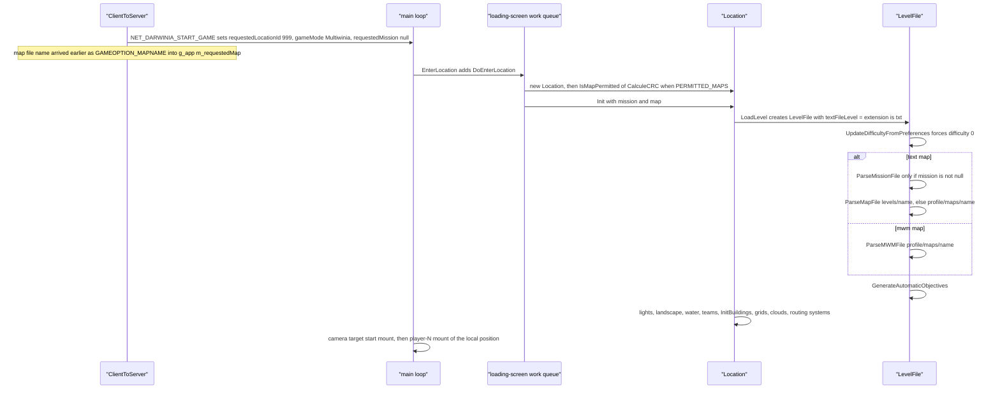

# 08 — Levels and level design

> Part A · Baseline build: Release|Win32 (OpenGL) + TARGET_PC_FULLGAME ([B:FULL]); see _work/build_matrix.md.
> Evidence: [C] confirmed · [I] inferred · [U] unknown. Citations are `path:Symbol` relative to the multiwinia/ source root.
> Sources merged: X4_level_catalogue (§1–13), P11_terrain_world (§8.1–8.8), P17a_ui_framework_editor (E1–E5), P17b_menus_options (§10), X1a_text_formats (§2 level files, level-design semantics only), P06_buildings_core (`P06_level_building_usage.csv` cross-check), routed `_meta_*` notes (contradictions, unknowns, constants, IP, appendix). Generated tables: `_work/scripts/S_08_tables.py` (inputs `_work/drafts/X4_levels.csv`, `X4_level_buildings.csv`, `X4_thumbnails.csv`, `X4_mode_maplists.csv`, `P06_level_building_usage.csv` and the raw level files).

## Contents

- [1 Scope, build reality and related documents](#1-scope-build-reality-and-related-documents)
- [2 Map inventory, discovery and identity](#2-map-inventory-discovery-and-identity)
- [3 Master catalogue of the 57 Multiwinia maps](#3-master-catalogue-of-the-57-multiwinia-maps)
- [4 Per-mode map lists and level conventions](#4-per-mode-map-lists-and-level-conventions)
- [5 Per-level options (`MultiwiniaOptions`)](#5-per-level-options-multiwiniaoptions)
- [6 Level-design capabilities](#6-level-design-capabilities)
- [7 Darwinia `map_`/`mission_` files, `data/levels/old/` and `level_enum.txt`](#7-darwinia-map_mission_-files-datalevelsold-and-level_enumtxt)
- [8 The map editor [B:EDITOR]](#8-the-map-editor-beditor)
- [9 Level-design guide for the new game](#9-level-design-guide-for-the-new-game)
- [Open questions and unknowns](#open-questions-and-unknowns)
- [Docs-vs-code discrepancies](#docs-vs-code-discrepancies)
- [IP items](#ip-items)
- [Source map](#source-map)
- [Appendix — dead/legacy code](#appendix--deadlegacy-code)

## 1 Scope, build reality and related documents

This document is the functional description of Multiwinia's **maps** as a level designer sees them: which maps exist and in which build each is visible, what every level file can express, which of those capabilities the shipped maps actually use, the per-mode conventions the designers followed, and the in-game map editor that produced them.

Build reality in one paragraph [C]:

- **[B:FULL]** — the baseline executable lists and loads every `data/levels/mp_*.txt` whose `GameTypes` names one of the six compiled modes (Domination, King of the Hill, Capture the Statue, Assault, Rocket Riot, Blitzkrieg). With the retail data set (`tools/multiwinia_exclusions.txt`) that is **49 maps**. TankBattle (`INCLUDEGAMEMODE_TANKBATTLE`) is compiled only in `TARGET_DEBUG` [C] `code/lib/universal_include.h`.
- **[B:EDITOR]** — the map editor (`code/location_editor.*` and 13 window files) is compiled only under `LOCATION_EDITOR`, which is commented out in every target; even the menu entry is compiled out. Custom `.mwm` maps can be loaded by FULL code but are listed and created only in an editor build (§8.1).
- **[B:LEGACY]** — the Darwinia campaign levels (`data/levels/map_*.txt`, `data/levels/mission_*.txt`) are parseable by the same `LevelFile` code but are excluded from every Multiwinia data build and reachable only through the dead Darwinia global world (§7.1). `data/levels/old/` is never listed by any build (§7.2).

Related documents (linked, not duplicated):

| Topic | Document |
|---|---|
| Terrain maths: tile generation, guide grids, flatten areas, cell size, water, colour ramps | [23 Terrain and landscape](23_terrain_and_landscape.md) |
| Per-building behaviour and the level-file parameters of each building type | [03 Buildings and world objects](03_buildings_and_world_objects.md) (§3.10 line format, §3.16 parameter quick reference) |
| Mode rules that read level options (teams, Assault sides, co-op groups, reinforcements) | [01 Game modes](01_game_modes.md) (§2.5, §3.7, §4) |
| Crate outcomes and `InvalidCrates` exclusion semantics | [04 Crates, power-ups and weapons](04_crates_powerups_and_weapons.md) |
| Population cap and spawn economy | [05 Economy and population](05_economy_and_population.md) |
| Map-select page, lobby, demo gating, achievements | [09 Meta systems](09_meta_systems.md) (§2.4, §3.5, §6, §7) |
| Lighting model, special lighting, weather rendering | [24 Rendering](24_rendering.md) (§5.5) |
| Camera mounts and animations at run time | [30 Scripting, tutorial and cutscenes](30_scripting_tutorial_and_cutscenes.md) (§4) |
| Window/widget framework used by the editor windows | [28 UI framework](28_ui_framework.md) (§3.7 value controls, §4.9) |
| **Formal grammar of every level-file block** (EBNF, column tables, crash conditions) | [29 Data formats reference](29_data_formats_reference.md) |
| Data packaging, archives, MapCRC tool | [31 Platform, build and tools](31_platform_build_and_tools.md) |
| Determinism of level loading (synced RNG during building construction) | [22 Determinism and networking](22_determinism_and_networking.md) |

## 2 Map inventory, discovery and identity

### 2.1 File kinds and counts

Directory listing [C] (`_work/scripts/S_08_tables.py` table `inventory`):

<!-- S08:inventory -->
<!-- /S08:inventory -->

| Kind | Naming | Content | Who loads it | Build tag |
|---|---|---|---|---|
| Multiwinia map | `mp_<mode>_<N>P_<k>.txt` (+ `mp_sandbox`, `mp_sandbox_all`, `mp_benchmark_1`, `mp_assault_stress`, `mp_tankbattle_<N>P`) | everything in one file: `MultiwiniaOptions`, `Landscape`, `LandscapeTiles`, `LandFlattenAreas`, `Lights`, `Buildings`, `CameraMounts`, optionally `CameraAnimations` (always empty), a second (empty) `Buildings`, `InstantUnits`, `PrimaryObjectives` | menu list (`code/game_menu.cpp:GameMenu::CreateMapList`, pattern `mp_*`) and `code/level_file.cpp:LevelFile::LevelFile` with mission `"null"` | [B:FULL] |
| Darwinia map | `map_<location>.txt` | landscape, static buildings, lights (`map_sandbox` also camera mounts) | Darwinia global world (`code/global_world.cpp:GlobalWorld::LoadGame`) | [B:LEGACY] |
| Darwinia mission | `mission_<location>[_<name>].txt` | dynamic buildings, instant units, camera mounts, objectives, difficulty | `LevelFile::ParseMissionFile` | [B:LEGACY] |
| Level enumeration | `level_enum.txt` | `<mp file name> <id>` pairs | `code/achievement_tracker.cpp:AchievementTracker::AchievementTracker` | [B:FULL] code, file excluded from retail data (§7.3) |
| Custom map | `<profile>/maps/<name>.mwm` | zlib-compressed `Directory` with the map text and optional textures (§8.8) | `LevelFile::ParseMWMFile` when the map name's extension is not `txt` | load path [B:FULL]; creation and listing [B:EDITOR] |
| Superseded maps | `data/levels/old/mp_*.txt` | older Multiwinia maps (Shaman, Chess, early Skirmish/Assault prototypes) | nothing | never loaded |

Block counts across all of `data/levels/**` [C] (`_work/scripts/P11_levelstats.py`): Landscape 69, LandscapeTiles 69, LandFlattenAreas 69, Lights 69, Buildings 134, CameraMounts 75, CameraAnimations 65, InstantUnits 75, PrimaryObjectives 65, Difficulty 3, MultiwiniaOptions 57. No shipped file contains `Routes`, `RunningPrograms` or `LeaderboardStats` [C] `_work/drafts/X1a_level_field_usage.csv`.

### 2.2 How the game discovers maps (menu catalogue)

[C] `code/game_menu.cpp:GameMenu::CreateMapList`, `GameMenu::AddMap`, `code/lib/resource.cpp:Resource::ListResources`, `contrib/systemiv/lib/filesys/file_system.cpp:OrderedInsert`, `code/UI/MapData.cpp:MapData::CalculeMapId`. The page that displays the result is specified in [09 §2.4 and §3.5](09_meta_systems.md#24-map-catalogue-built-at-start-up-gamemenucreatemaplist-gamemenuaddmap).

1. `ListResources("levels/", "mp_*", false)` lists loose files in `data/levels/` and every pre-loaded archive entry whose directory part equals `data/levels/` (`stricmp`). The scan is **non-recursive**, so `data/levels/old/` is never seen. Results are merged with `OrderedInsert`, which compares with `strcmp` (case-sensitive), drops exact duplicates and inserts before the first larger entry — but its loop runs only to `Size()−1`, so a name that sorts after every entry except the last is appended **after** the last one. The base order is therefore "nearly alphabetical"; archive entry names are lower-cased when an archive is indexed [I] (X4 reading of `code/lib/resource.cpp`).
2. Only names whose extension is exactly `txt` are opened; `AddMap` then scans lines until the first `MultiwiniaOptions_EndDefinition` with **case-sensitive** `strcmp` keyword tests for `Name`, `GameTypes`, `NumPlayers`, `Author`, `Description`, `PlayTime`, `Difficulty`, `CoopMode`, `ForceCoop`, `OfficialLevel` (it does not check that it is inside the block).
3. `GameTypes`: **every** following token that equals a blueprint name of `data/multiwinia.txt` (`Domination`, `KingOfTheHill`, `CaptureTheStatue`, `Assault`, `RocketRiot`, `Blitzkrieg`, `TankBattle`) adds the map to that mode's list. A map with no matching token is discarded with the log line "Discarded map … because it didn't contain a game type".
4. `MapData::CalculeMapId()` = `LevelFile::CalculeCRC(fileName)` (§2.3); −1 (not readable as a resource) marks the map as custom.
5. The number of `OfficialLevel` maps is passed to `AchievementTracker::SetNumLevels`.
6. Per mode, an n-pass adjacent-swap sort (stable) orders maps by `NumPlayers` ascending, then by difficulty rank: substring `basic` → 1, `inter` → 2, `advan` → 3, absent → 0.
7. `#ifdef LOCATION_EDITOR` only: every `<profile>/maps/*.mwm` is opened with `MapFile` and added the same way [B:EDITOR].

Two parsers read the same header [C]: the menu (`AddMap`, case-sensitive keys, all `GameTypes` tokens) and the game (`LevelFile::ParseMultiwiniaOptions`, case-insensitive keys, **first** `GameTypes` token only). Resolved: drafts called `LevelFile::m_gameTypes` "single type vs bitmask [U]"; code shows a plain index written by the parser and read only by `LevelFile::WriteMultiwiniaOptions` and the editor drop-down (`code/interface/multiwiniaoptions_window.cpp:MultiwiniaOptionsWindow::Create`) — it is a single blueprint index, never a bitmask, and the running game takes its mode from the lobby, not from this field [C] (grep of `m_gameTypes`). No shipped file lists more than one mode, so the two parsers never disagree on shipped data [C].

Display strings [C] `code/UI/LevelSelectButton.h`, `contrib/systemiv/lib/tosser/hash_table.cpp:HashFunc`: the menu shows the language phrase `<file stem>_name` and `<file stem>_description` (`GameMenu::GetMapNameId` strips `.txt`); language-table keys hash case-insensitively, so `mp_assault_3p_1_name` finds `mp_assault_3P_1_name`. The level's own `Name` is shown only for custom maps. `PlayTime` is shown as `"0:%02d"` and copied into the mode's time option when the map is selected; absent/0 → blueprint default (ordering caveat in [09 §4.5](09_meta_systems.md)).

Thumbnails [C] `code/UI/MapImageButton.h`, `code/UI/GameMenuWindow.cpp:SetupMapSelectPage`: file `thumbnails/<file stem>.bmp` (`TEXTURE_EXTENSION` = `bmp`), lower-cased with `strlwr`; if the texture does not exist, `thumbnails/default.bmp`. Displayed at width `rightW × 0.8`, height = width × 0.75. The catalogue of all 57 thumbnails is §3.5.

### 2.3 Map identity: MapCRC

[C] `code/level_file.cpp:LevelFile::CalculeCRC`, `contrib/systemiv/lib/math/filecrc.cpp:FileCRC`, `contrib/unrar/crc.cpp:CRC`, `code/mapcrc.h`, `tools/MapCRC/main.cpp:GenerateMapCRCs`.

- Input: the raw bytes of resource `levels/<filename>` read byte-by-byte until EOF **plus one trailing 0xFF byte** (the EOF read is stored before the loop notices EOF), into a static 100 000-byte buffer (a file larger than that would overflow by one byte [I]; the largest shipped level is 46 085 bytes [C] `X4_levels.csv`).
- Algorithm: CRC-32, reflected polynomial `0xEDB88320`, **initial value 0, no final XOR**; returned as `int`; −1 if the file cannot be opened.
- `code/mapcrc.h` is generated ("Auto-generated IDs for each map. DO NOT MODIFY") by `tools/MapCRC/main.cpp`: one `#define MAPID_<NAME> 0x%08x` per `data/levels/*.txt`, name = file name minus `.txt`, upper-cased, `.`/`-`/space → `_`.
- Verified in this phase: `python3 -I _work/scripts/P11_mapcrc.py <SRC>` reproduces **87 of 87** `MAPID_*` constants [C]. Resolved: drafts said "86/86" (X4, phase-2 log) and "87/87" (P11); both are right — the 87 `.txt` files in `data/levels/` are 86 level files (57 `mp_*`, 12 `map_*`, 17 `mission_*`) plus `level_enum.txt` (`MAPID_LEVEL_ENUM 0x95ed5f58`); the 30 files in `old/` are not in `mapcrc.h`.

Uses of the map id [C]: (1) `MapData::m_mapId` and `App::GetMapID(gameMode, crc)` → index into the mode's menu list (`code/app.cpp:App::GetMapID`); (2) the metaserver listing (`NET_METASERVER_MAPCRC`, resolved by clients with `GameMenu::GetMapName(mode, crc)`) `code/network/server.cpp`; (3) demo gating (`code/network/demo_limitations.cpp:DemoLimitations::Initialise` default list `MAPID_MP_KOTH_2P_1`, `MAPID_MP_KOTH_4P_1`, `MAPID_MP_CTS_2P_1`, `MAPID_MP_KOTH_3P_1`, `MAPID_MP_ROCKETRIOT_3P_1`, or a list sent by the metaserver); (4) compile-time `PERMITTED_MAPS` whitelists (§2.4); (5) the two tutorials (`MAPID_MP_KOTH_2P_1`, `MAPID_MP_KOTH_3P_1` in `code/UI/GameMenuWindow.cpp:SetupTutorial`, `SetupTutorial2`). A match is started by **file name** (`GAMEOPTION_MAPNAME`), and no map CRC is compared between peers before simulation — a locally modified map file desyncs rather than being rejected [C] grep of the start-game path in `code/network/clienttoserver.cpp`; consequences in [22](22_determinism_and_networking.md).

Because `CalculeCRC` hashes the file bytes, any edit — including a whitespace change or a load→save round trip (§8.7) — changes the id and so silently changes demo/whitelist/tutorial eligibility [I].

### 2.4 Permitted maps per build target and runtime gate

[C] `code/lib/universal_include.h` (`PERMITTED_MAPS`), `code/app.cpp:App::IsMapPermitted`, `App::IsGameModePermitted`, `code/main.cpp:DoEnterLocation`.

| Target / gate | Mechanism | Maps |
|---|---|---|
| `TARGET_PC_FULLGAME` [B:FULL] | `PERMITTED_MAPS` undefined → `IsMapPermitted(id)` is true when `IsFullVersion()`; mode filter `IsGameModePermitted` (six modes) | every listed map |
| Runtime demo (`!IsFullVersion()`) [B:DEMO runtime] | `DemoLimitations::MapPermitted(id)` against the metaserver list or the 5-map default above; restricted maps greyed, selecting one opens the buy page | 5 by default |
| `TARGET_PC_PREVIEW` | `{MAPID_MP_KOTH_2P_1, MAPID_MP_KOTH_4P_1, MAPID_MP_CTS_2P_1, 0}` | 3 |
| `TARGET_PC_HARDWARECOMPAT` | `{MAPID_MP_KOTH_2P_1, MAPID_MP_BENCHMARK_1, MAPID_MP_KOTH_4P_1, 0}` | 3 (benchmark never menu-listed: `GameTypes none`) |
| `TARGET_ASSAULT_STRESSTEST` | `{MAPID_MP_ASSAULT_STRESS, 0}` | 1 (also `GameTypes none`) |
| `TARGET_BETATEST_GROUP_A` | `{MAPID_MP_CTS_2P_1, MAPID_MP_CTS_3P_1, MAPID_MP_CTS_4P_3, 0}` | 3 |
| `TARGET_BETATEST_GROUP_B` | `{MAPID_MP_BLITZKRIEG_2P_2, MAPID_MP_BLITZKRIEG_3P_2, MAPID_MP_BLITZKRIEG_4P_2, 0}` | 3 |
| `TARGET_BETATEST_GROUP_C` | `{MAPID_MP_ROCKETRIOT_2P_4, MAPID_MP_ROCKETRIOT_2P_3, MAPID_MP_ROCKETRIOT_3P_1, 0}` | 3 |
| `TARGET_BETATEST_GROUP_ALL`, `TARGET_DEBUG`, `TARGET_MULTIWINIA_DEMOONLY` | none (`GROUP_ALL` has a commented-out 13-map list: KOTH_2P_1, KOTH_3P_1, ASSAULT_2P_3, ASSAULT_3P_2, ASSAULT_3P_3, ASSAULT_4P_2, ROCKETRIOT_2P_3, ROCKETRIOT_3P_2, ROCKETRIOT_4P_1, CTS_2P_2, CTS_2P_4, CTS_3P_1, CTS_4P_1) | all |

Enforcement [C]: `GameMenuWindow::SetupMapSelectPage` skips non-permitted maps under `#ifdef PERMITTED_MAPS` and greys buttons via `IsMapPermitted(gameType, id)`; `DoEnterLocation` recomputes `IsMapPermitted(CalculeCRC(requestedMap))` before `Location::Init` and, if false, sets `m_requestedLocationId = −1` and returns to the menu after loading; tutorial buttons are inactive when their map is missing or not permitted. The whitelist terminator is `0` (`for( i = 0; permittedMaps[i]; i++ )`), so a map whose CRC were 0 could never be whitelisted.

Data packaging per build [C] `tools/build_multiwinia_data.bat`, `tools/listfiles.pl`, `tools/copyfiles.pl`, exclusion/inclusion lists (grammar in [31](31_platform_build_and_tools.md)):

| Script / platform | Exclusions | Inclusions | Level/thumbnail result |
|---|---|---|---|
| `tools/build_multiwinia_retail.bat`, `build_multiwinia.bat`, `_gold`, `_crashreporter` | `tools/multiwinia_exclusions.txt`: `levels/old/*`, `levels/pdlc/*`, `levels/level_enum.txt`, `levels/map_*`, `levels/mission_*`, `levels/mp_assault_stress.txt`, `levels/mp_benchmark_*`, `levels/mp_sandbox*`, `levels/mp_tankbattle_*`, `thumbnails/mp_benchmark_*`, `thumbnails/mp_tankbattle_*`, `levels/mp_cts_3p_3.txt`, `thumbnails/mp_cts_3p_3.bmp` | — | 49 `mp_*` maps + 52 thumbnails (incl. `default.bmp` and the level-less `mp_koth_2P_4.bmp`, `mp_skirmish_2p_3.bmp`) |
| `tools/build_multiwinia_pc_preview.bat` (`pcpreview`) | `tools/multiwinia_exclusions_beta_test.txt` (all `levels/mp_*`, `thumbnails/mp_*`) | `tools/multiwinia_inclusions_previewcopy.txt`: koth_2P_1, koth_4P_1, cts_2P_1 (+ thumbnails) | 3 maps = its whitelist |
| `tools/build_multiwinia_hwcompat.bat` family (`pchwcompat`) | `tools/multiwinia_exclusions_hwcompat.txt` | `tools/multiwinia_inclusions_hwcompat.txt`: koth_2P_1, benchmark_1, koth_4P_1 | 3 maps |
| `pcassaultstress` (no script in tree) | `multiwinia_exclusions_hwcompat.txt` | `tools/multiwinia_inclusions_assaultstresstest.txt`: assault_stress | 1 map |
| `pcbetatest` + group (no script in tree) | `multiwinia_exclusions_beta_test.txt` | `tools/multiwinia_inclusions_beta_test_group_a.txt` (13 maps = the commented-out GROUP_ALL list), `_group_b.txt` (3 Blitzkrieg), `_group_c.txt` (3 Rocket Riot) | per group |
| `platambx` | `multiwinia_exclusions_beta_test.txt` | `multiwinia_inclusions_ambx.txt` — **absent from the tree** | [U] 08-U3 |

Inconsistency [I]: the group-A inclusion list ships 13 maps but the group-A whitelist permits only `mp_cts_3p_1` of them, and with only `INCLUDEGAMEMODE_CTS` compiled that build would list one CTS map (X4 contradiction 2).

### 2.5 How a level is loaded

[C] `code/network/clienttoserver.cpp` (`NET_DARWINIA_START_GAME`, `GAMEOPTION_MAPNAME`), `code/main.cpp:EnterLocation`, `DoEnterLocation`, `code/location.cpp:Location::Init`, `Location::LoadLevel`, `code/level_file.cpp:LevelFile::LevelFile`. Terrain construction order and maths: [23 §2](23_terrain_and_landscape.md#2-pipeline-overview).

File lookup [C] `LevelFile::ParseMapFile(char const*)`, `ParseMissionFile`: a map is opened as resource `levels/<name>` (loose file or `.dat` archive), else as plain file `<profile>/maps/<name>`; a mission (Darwinia only) first as `<profile>/users/<user>/<name>` (save game) unless editing, else resource `levels/<name>`. `AppReleaseAssert` ("Invalid map file specified" / "Invalid level specified") if neither opens.

Block dispatch (first token of a line, `stricmp`) [C] `LevelFile::ParseMapFile(TextReader*)`, `LevelFile::ParseMissionFile`:

| Block start keyword | In a map file | In a mission file |
|---|---|---|
| `MultiwiniaOptions_StartDefinition` | `ParseMultiwiniaOptions` (§5) | not recognised (debug assert, lines skipped) |
| `Landscape_StartDefinition`, `LandscapeTiles_StartDefinition`, `LandFlattenAreas_StartDefinition`, `Lights_StartDefinition` | parsed (§6.1, §6.2) | debug assert, ignored |
| `Buildings_StartDefinition` | `ParseBuildings(dynamic = false)`; a second branch with `dynamic = true` is unreachable, so a second `Buildings` block is also static | `ParseBuildings(dynamic = true)` |
| `CameraMounts_StartDefinition`, `CameraAnimations_StartDefinition`, `InstantUnits_StartDefinition`, `Routes_StartDefinition`, `PrimaryObjectives_StartDefinition` | parsed | parsed |
| `RunningPrograms_StartDefinition`, `Difficulty_StartDefinition`, `LeaderboardStats_StartDefinition` | not recognised | parsed [B:LEGACY] |
| anything else | `AppDebugAssert(0)` (no-op in release), line skipped | same |

Lights precedence [C] `LevelFile::ParseLights`: a `Lights` block met when lights already exist is ignored (`ignoreLights`). The comment says mission lights override map lights, but mission files cannot contain `Lights`, so only a second `Lights` block in the same map file is affected.

Post-parse derivation [C] `LevelFile::GenerateAutomaticObjectives` (always called by the constructor): if there are no primary objectives a single `NeverTrue` condition is added; secondary objectives are derived for `ResearchItem`/`TrunkPort` buildings via `GlobalWorld::GetLocationIdFromMapFilename`, which always returns −1 because it executes `*mapName += 4` (adds 4 to the first character) instead of advancing the pointer [C] `code/global_world.cpp:GlobalWorld::GetLocationIdFromMapFilename`; in Multiwinia `GetBuilding(id, −1)` finds nothing, so no trunk-port objective is ever created and `ResearchItem` rows are blocked anyway [C].

Resolved: X2b reported that `Darwinian::BeginVictoryDance` treats an empty objective list as victory, so the 10 `mp_*` files without a `PrimaryObjectives` block "should" make idle team-0 Darwinians jump. Code: `GenerateAutomaticObjectives` runs for every level and adds `NeverTrue` to an empty list, and `BeginVictoryDance` requires every objective to evaluate true, so **no shipped Multiwinia map ever triggers victory jumps** [C] `code/level_file.cpp:LevelFile::GenerateAutomaticObjectives`, `code/worldobject/darwinian.cpp:Darwinian::BeginVictoryDance`.

Start positions → teams [C] `code/location.cpp:Location::GetTeamPosition`, `Location::GetTeamFromPosition`, `Location::InitBuildings`, `Location::InitialiseTeam`:

- Every team id `0 … NumPlayers−1` is assigned a **start position** in `[0, NumPlayers)`: drawn with `syncrand() % unused.Size()` among unused positions (deterministic across peers); in a tutorial position = team id; the monster team (4) and Futurewinian team (5) always have position = team id; outside Multiwinia mode (`!Multiplayer()`) position = team id.
- The `team` column of a building row is a **position**: `InitBuildings` replaces it with the team that holds that position, or **255 (neutral)** when no team holds it (e.g. position 3 on a 4-player map played by 3 teams). Rows with team 255 stay neutral. Because the search only covers teams `0 … NumPlayers−1`, a building row with position 4 or 5 would become neutral [C]; no shipped row uses 4 or 5 [C] (`_work/drafts/X1a_level_field_usage.csv`).
- Instant units are spawned per team in `InitialiseTeam`: a unit row belongs to the team whose position equals its `team` column (§6.6).
- Duplicate unique ids across the parsed buildings are fatal (`AppReleaseAssert` "duplicate building found"); after init `GlobalWorld::s_nextUniqueBuildingId = highest id + 1`.
- In Assault, `InitBuildings` binds every `ControlStation` whose id appears in the `PulseBomb`'s link list via `ControlStation::LinkToPulseBomb` (§4.5).

Camera on entry [C] `code/main.cpp:DoEnterLocation`, the in-game loop in `code/main.cpp`: camera bounds are set to `[−200, worldSizeX + 200]` on **both** axes (the X size is used for Z too — harmless because every shipped map is square); the camera first targets `(maxX, 1000, maxX)` looking along `(−1, −0.7, −1)` "in case start doesn't exist", then mount `start`; once the local team exists it cuts to mount `player<position>` (§6.5).

### 2.6 Two on-disk section layouts of `mp_*` files

[C] data (`X4_levels.csv` column `sections`), [I] origin.

| Layout | Block order | Files |
|---|---|---|
| A ("old writer") | `MultiwiniaOptions, Landscape, LandscapeTiles, LandFlattenAreas, Lights, Buildings, CameraMounts, CameraAnimations, Buildings (empty), InstantUnits, PrimaryObjectives` | 47 top-level files and every `old/` file that has an options block |
| B ("current writer") | `MultiwiniaOptions, Landscape, LandscapeTiles, LandFlattenAreas, Lights, Buildings, CameraMounts, InstantUnits` | 10: `mp_assault_2p_3`, `mp_assault_3p_1`, `mp_assault_3p_3`, `mp_assault_4P_2`, `mp_blitzkrieg_4P_2`, `mp_domination_2P_1`, `mp_domination_4P_1`, `mp_koth_2P_3`, `mp_koth_2P_3b`, `mp_skirmish_3P_1` |

Layout B is exactly what `LevelFile::SaveMapFile` writes today (camera-animation, dynamic-building and objective writers commented out) [C] `code/level_file.cpp:LevelFile::SaveMapFile`. Forensic corollary [C]: those 10 files — and only they — carry `Name NewLevel`, because the current `WriteMultiwiniaOptions` always writes `Name` (default `"NewLevel"`); 31 layout-A files also carry an explicit `DefenderPopulationCap` line (always written today) but none of the `old/` files do, so an intermediate writer already had it [I]. The second, empty `Buildings` block of layout A is parsed as static and contains no rows in any shipped file [C] (`buildings_in_2nd_block` = 0).

## 3 Master catalogue of the 57 Multiwinia maps

### 3.1 Master table

One row per `data/levels/mp_*.txt` (generated by `S_08_tables.py` table `master` from `_work/drafts/X4_levels.csv` and `X4_level_buildings.csv`; every value [C] from the files). Columns: **Modes** = `GameTypes` tokens (DOM Domination, KOTH King of the Hill, CTS Capture the Statue, ASLT Assault, RR Rocket Riot, BLITZ Blitzkrieg, TANK TankBattle); **Players** = `NumPlayers`; **World** = `worldSizeX×worldSizeZ` in world units (wu); **Grid** = height-map cells per axis = `ceil(worldSize / cellSize)` ([23 §9](23_terrain_and_landscape.md#9-world-grid-cell-size-world-size-outside-height-and-world-edge-handling)); **Tiles** / **Flatten** = `LandscapeTiles` / `LandFlattenAreas` rows; **SpawnPoints by pos** = `SpawnPoint` rows per start position (`255` = neutral); **Notable objects** = row counts of the other gameplay/placement types (full matrix in §6.3); **PopCap** = `PopulationCap` (−1 = none) and, when set, `DefenderPopulationCap`; **InvalidCrates** = crate outcomes removed from this map; **Starting units** = `InstantUnits` as `type@position×count`; **Retail** = shipped in the retail `main.dat`; **Class** = hidden/test status.

<!-- S08:master -->
<!-- /S08:master -->

### 3.2 Identity and availability

Generated table `identity`. CRC = `LevelFile::CalculeCRC` = the map id (§2.3); "CRC check" = recomputed value equals the `MAPID_*` constant; "level_enum id" = achievement index (§7.3); "Data shipped in" = which data builds package the file (retail, `prev` PC preview, `hw` hardware-compat, `stress` Assault stress test, `βA`/`βB`/`βC` beta groups; §2.4); "FULL menu" = what the baseline binary does with the file (`listed`; `permitted, data absent` = would be listed but retail data omits it; `mode not compiled` = TankBattle; `never listed` = no valid `GameTypes`); "Demo default" = in `DemoLimitations`' fallback list; "Tutorial" = map hard-wired by `GameMenuWindow::SetupTutorial`/`SetupTutorial2`.

<!-- S08:identity -->
<!-- /S08:identity -->

### 3.3 Summary

[C] from §3.1–3.2:

- **49 maps are menu-listed in the retail product**: Domination 9 (5 `mp_domination_*`, 2 `mp_skirmish_*`, and `mp_koth_2P_2`, `mp_koth_2P_3`, whose `GameTypes` is `Domination`), King of the Hill 9, Capture the Statue 9, Assault 8, Rocket Riot 7, Blitzkrieg 7. This set equals `level_enum.txt` ids 1–49 and `VALID_ACHIEVEMENT_LEVELS = 49` (`code/achievement_tracker.cpp`).
- **8 files are in the tree but not in retail data**: `mp_assault_stress`, `mp_benchmark_1`, `mp_sandbox`, `mp_sandbox_all`, `mp_tankbattle_2P`, `mp_tankbattle_3P`, `mp_tankbattle_4P`, `mp_cts_3p_3` (§3.4).
- Player counts of the 49: 2-player 22, 3-player 15, 4-player 12. `mp_assault_3p_1` is named "3p" but declares `NumPlayers 2` (its `old/` precursor had 3).
- World sizes 2000–7000 wu, all square; cell sizes 9.00–27.08 wu; grids 137² – 334² cells; 1–25 tiles per map.
- **Twin terrains** — the same terrain re-skinned for two modes by swapping objective buildings [I intent, C data]: byte-identical `LandscapeTiles` blocks (after whitespace normalisation) for `mp_koth_2P_1`≡`mp_domination_2P_2` ("The Eternal Guardians"), `mp_koth_3P_2`≡`mp_domination_3P_1` ("Field of Unending Dawn"), `mp_koth_4P_1`≡`mp_domination_4P_1` ("The Holy Tree"), `mp_koth_4P_3`≡`mp_domination_4P_2` ("A Monument to the Heavens"), `mp_benchmark_1`≡`mp_koth_4P_4`, `mp_sandbox`≡`mp_sandbox_all`, `mp_koth_2P_3b`≡`old/mp_shaman_2P_3`, `old/mp_temple`≡`map_temple`. `mp_koth_2P_3`/`mp_koth_2P_3b` ("The Bitter Front") share the `Landscape` block and lights but have different tiles and flatten areas. Each KOTH/Domination twin pair shares 25–95 identical building rows.
- `mp_rocketriot_2p_3` "Stairway to Heaven" shares its English name with the thumbnail-only `mp_skirmish_2p_3` string (§3.5).

### 3.4 Hidden, test, stress, benchmark, sandbox, TankBattle and cut maps

| File | Class | Why it is not a normal map | Contents worth knowing | Build tag |
|---|---|---|---|---|
| `data/levels/mp_assault_stress.txt` ("Assault Stress Test") | stress test | `GameTypes none` → discarded by `AddMap` in every build; excluded from retail; included and whitelisted only for `TARGET_ASSAULT_STRESSTEST` | Assault layout: 1 PulseBomb (position 1, `startTime 600`), 3 ControlStation, 7 GunTurret, 26 LaserFence, 30 Wall, 6 SolarPanel, 5 Pylon, 2 PylonEnd, TrunkPort ×5 (pos 0) + ×2 (pos 1), 3 AIObjective, 10 AIObjectiveMarker, 30 AITarget; `AttackingTeams 0`; `trunkportreinforcements 250`, `defenderreinforcementtype Armour`; 90 Darwinians at position 1; 3 `AIObjective` rows carry 2 surplus tokens (ignored) | stress target only |
| `data/levels/mp_benchmark_1.txt` ("Stress Test" — "spawn Multiwinians indefinitely" per its language description) | benchmark | `GameTypes none` (never menu-listed); excluded from retail; included and whitelisted for `TARGET_PC_HARDWARECOMPAT` | terrain and zones copied from `mp_koth_4P_4`; 5 SpawnPoint per position + 4 neutral, 15 neutral MultiwiniaZone, 4 neutral TrunkPort, 1 SpawnPopulationLock (radius 1169.84, max 1200), 150 Darwinians per position; `PopulationCap -1`, `CoopMode` | hardware-compat only; how it was launched is [U] 08-U2 |
| `data/levels/mp_sandbox.txt` | developer sandbox | `GameTypes none`; excluded from retail | 11 rows: ControlTower, Incubator, **Statue** (blocked → dropped at parse), 3 Wall, 5 AITarget; `PopulationCap 2500`, `NumPlayers 2`, `AttackingTeams 1`; `PrimaryObjectives BuildingOnline :sandbox,2` twice (Darwinia condition; location "sandbox" does not exist in Multiwinia's empty global world → id −1 → condition false) | none |
| `data/levels/mp_sandbox_all.txt` | developer sandbox | as above; also **no `NumPlayers`** (→ −1) | same terrain as `mp_sandbox`; 2 ControlTower, 2 Incubator, 4 SpawnPoint (position 1), 11 SpawnLink, 1 SpawnPointMaster, 2 Tree | none |
| `data/levels/mp_tankbattle_2P.txt`, `data/levels/mp_tankbattle_3P.txt`, `data/levels/mp_tankbattle_4P.txt` ("2P/3P/4P TankBattle Arena") | TankBattle mode | `GameTypes TankBattle` → listed under mode 6 only where `INCLUDEGAMEMODE_TANKBATTLE` is compiled (`TARGET_DEBUG`); excluded from retail data | 2000×2000 / 12 arenas, only Trees (18/18/23); one `Tank` instant unit per position; `PopulationCap -1`; 4P has `CoopMode`; 3P/4P have **no camera mounts** | [B:DEBUG] |
| `data/levels/mp_cts_3p_3.txt` ("The Outreach Peaks") | cut CTS map | complete CTS map but explicitly excluded from retail data, no `level_enum` id, no `Difficulty` | the only CTS map with trunk ports instead of spawn points: 1 TrunkPort per position, `trunkportreinforcements 100`, `attackerreinforcementtype HotFeet`, 3 team drop zones (r 75) + 6 statue zones (r 50), `PlayTime 10`, no starting Darwinians; 24-bit thumbnail (also excluded) | FULL code would list it if the file were present |

### 3.5 Thumbnails (`data/thumbnails/`, 57 files)

Format from each BMP header [C]: 53 files are 400×300 8-bit palettised (52 × 121 078 bytes, `default.bmp` 120 778 bytes) and 4 are 400×300 24-bit (360 056 bytes: `mp_cts_3p_3`, `mp_cts_4p_3`, `mp_koth_2P_2`, `mp_koth_3P_4`). No in-engine writer produces map thumbnails — the only screenshot-to-thumbnail routine, `App::SaveThumbnailScreenshot` (256×192), is compiled only under `TARGET_OS_VISTA` for saved-game headers [B:DEAD] [C] `code/app.cpp` — so the 400×300 files were made outside the engine [I] (08-U7). The `LevelFile::m_thumbnailFilename` field (default `default.bmp`) is used only by the `.mwm` writer (§8.8). Generated table `thumbs`:

<!-- S08:thumbs -->
<!-- /S08:thumbs -->

Mismatches [C]: every top-level `mp_*` file except `mp_assault_stress`, `mp_sandbox` and `mp_sandbox_all` has a thumbnail (those three would show `default.bmp`); two thumbnails have no top-level level: `mp_koth_2P_4.bmp` (level only in `data/levels/old/mp_koth_2P_4.txt`, "Pillar of Light") and `mp_skirmish_2p_3.bmp` (no level anywhere; the language file has `mp_skirmish_2P_3_name` "Stairway to Heaven" with description "INSERT DESCRIPTION HERE" — probably the precursor of `mp_rocketriot_2p_3` [I]). Both ship in retail data although nothing can display them.

## 4 Per-mode map lists and level conventions

Mode rules themselves (scoring, timers, win conditions) are in [01 §4](01_game_modes.md#4-per-mode-specifications); building behaviour in [03 §8](03_buildings_and_world_objects.md#8-mode-objective-objects). This section gives the **menu lists** and the **authoring conventions** a level must follow for each mode, recomputed from the raw level files by `S_08_tables.py` [C data].

### 4.1 Menu lists in menu order (retail data set)

Order as produced by `GameMenu::CreateMapList` (§2.2): nearly-alphabetical base order, then stable sort by `NumPlayers`, then difficulty rank. The sort keys are [C]; the order of ties depends on the archive index order through `OrderedInsert` and is [I] (08-U4). Mode index = blueprint index (`data/multiwinia.txt` order = `Multiwinia::GameType*` enum). TankBattle is shown from the source tree (no retail data; mode not compiled in FULL). Generated table `modes` from `_work/drafts/X4_mode_maplists.csv`:

<!-- S08:modes -->
<!-- /S08:modes -->

Start positions and colours: Location-side start positions are assigned at load (§2.5); the lobby's colour/side choice and Assault side assignment are in [01 §2.5](01_game_modes.md#25-teams-slots-start-positions-colours-co-op-and-assault-sides).

### 4.2 Domination (`GameTypes Domination`, blueprint 0, `GameTypeSkirmish`) — 9 maps

- Objects [C data]: spawn-point economy only — 1–3 `SpawnPoint` per start position plus 3–9 neutral ones, exactly one `SpawnPointMaster`, a `SpawnLink` tree; no `MultiwiniaZone`. Variants: `mp_koth_2P_2` adds 6 neutral `RadarDish` and a neutral `TrunkPort`; `mp_domination_4P_2` 8 `RadarDish`; `mp_skirmish_2p_4` a neutral `TrunkPort`; `mp_skirmish_3P_1` 18 `JumpPad`, 6 neutral `GunTurret`, 95 `LaserFence` and **no `SpawnLink`** (the master links straight to the spawn points).
- Naming [C]: `mp_domination_*`, `mp_skirmish_*` (legacy name of the mode — old maps use `GameTypes … Skirmish`, §7.2) and two `mp_koth_*` files whose `GameTypes` was switched to Domination (`mp_koth_2P_2`, `mp_koth_2P_3`).
- Twin terrains with KOTH (§3.3): the Domination twin replaces hill zones by extra neutral spawn points.
- Spawn-graph semantics (master → links → spawn points, link timing): [03 §4](03_buildings_and_world_objects.md#4-spawn-network), [05](05_economy_and_population.md).

### 4.3 King of the Hill (`KingOfTheHill`, blueprint 1) — 9 maps

- Hills = `MultiwiniaZone` rows: 1–15 per map, almost always neutral, radius 50–555.24 wu [C data].
- **Concentric zones** convention: several zones with (nearly) the same centre and different radii so the central area counts as 2–3 zones — `mp_koth_3P_3` (zones 20 and 6: r 101.17 and 140), `mp_koth_4P_1` (one triple 200/125/50 + four pairs 100/50), `mp_koth_4P_3` (two big zones r 233.01 and 220 each containing three r 90 zones, plus two 100/50 pairs), `mp_koth_4P_4` (central 555.24/193.87/50 triple + four 122/50 pairs + four single r 50; same layout in `mp_benchmark_1`) [C data]; [I] intent: each zone scores separately ([01 §4](01_game_modes.md#4-per-mode-specifications)).
- Team-owned zones: only `mp_koth_3P_3` tags three r 150 zones with positions 0/1/2 (zone ids 0/1/2); at load the owner field becomes the real team via `GetTeamFromPosition` (§2.5), so those hills start owned [I].
- Economy: spawn-point graph on every KOTH map except `mp_koth_3P_4` (2 `TrunkPort` per position + `trunkportreinforcements 100`, 6 neutral `GunTurret`, one central zone r 86.2). `mp_koth_3P_1` adds 12 neutral `RadarDish`, 6 neutral `ControlStation` and a neutral `TrunkPort`; `mp_koth_3P_3` one neutral `TrunkPort`; `mp_koth_4P_3` 8 neutral `RadarDish`.
- Tutorials: Tutorial 1 = `mp_koth_2P_1`, Tutorial 2 = `mp_koth_3P_1` ([30 §3](30_scripting_tutorial_and_cutscenes.md#3-live-multiwinia-tutorials-bfull)).

### 4.4 Capture the Statue (`CaptureTheStatue`, blueprint 2) — 9 maps (+ cut `mp_cts_3p_3`)

- **Exactly one team-owned `MultiwiniaZone` per start position = that player's drop (capture) zone** (r 80, 100 or 109.27; 75 on the cut map), plus **1–6 neutral zones = statue spawn zones** (r 40–75) [C data]. The statue is never placed in the level (`Statue` is a blocked level type, §6.3); the rules object spawns it at a neutral zone [C] `code/multiwinia.cpp` (details [01 §4](01_game_modes.md#4-per-mode-specifications), [03 §8.4](03_buildings_and_world_objects.md#84-statue)).
- Duplicate statue zones at identical coordinates occur on `mp_cts_2p_2` (ids 5/29), `mp_cts_4P_2` (6/107) and `mp_cts_3p_3` (0/64, 10/65, 29/66) [C data] — [I] intended to weight those spawn points.
- Economy: spawn-point graph (1–3 per position, up to 8 neutral on `mp_cts_4P_1`); `mp_cts_2p_2`, `mp_cts_3p_1`, `mp_cts_3P_2`, `mp_cts_4P_2` set `instantspawnpointcapture`; `mp_cts_3p_3` uses trunk ports instead.
- Starting force: 40 Darwinians per position on every shipped CTS map.

Zone table for KOTH and CTS (generated table `zones`; owner `pN` = start position, `n` = neutral; position rounded to wu):

<!-- S08:zones -->
<!-- /S08:zones -->

### 4.5 Assault (`Assault`, blueprint 3) — 8 maps (+ `mp_assault_stress`)

- **Attackers/defenders are start positions**: `AttackingTeams` lists attacker positions; every other position `< NumPlayers` defends. The lobby assigns teams to free attacker/defender positions with `syncrand`; with co-op, `CoopGroup1Positions`/`CoopGroup2Positions` fix the alliances [C] `code/location.cpp:Location::SetupAssault` (rules in [01 §2.5](01_game_modes.md#25-teams-slots-start-positions-colours-co-op-and-assault-sides)).
- Generated table `assault` (recomputed from the raw `Buildings` blocks):

<!-- S08:assault -->
<!-- /S08:assault -->

Conventions [C data]:
- One `PulseBomb` per map, owned by a defender position, whose link list names the 3 (4 on `mp_assault_4P_1`) `ControlStation`s that `Location::InitBuildings` binds with `LinkToPulseBomb` (§2.5). `mp_assault_2p_3` has two extra stations (ids 55, 43) whose `controlBuildingId` points at radar dishes (42, 45) — radar control, not bomb control.
- `startTime` = `PlayTime` × 60 s (900 s, 1200 s on `mp_assault_4P_2`, 600 s on the stress map): the bomb countdown equals the match length.
- Attackers get more trunk ports (3–6 per attacker position) than defenders (0–1 per defender position) and no starting Darwinians (sole exception `mp_assault_2p_3`, attacker position 0 gets 8); defenders get 63–325 starting Darwinians (+1–2 `Armour` on `mp_assault_2P_1`, `mp_assault_3p_1`, `mp_assault_3P_2`, `mp_assault_4P_1`), the fortification kit (walls and laser fences owned by defender positions or neutral; 7–40 neutral `GunTurret`, including Flame turrets on `mp_assault_2p_3`, `mp_assault_3p_1`, `mp_assault_3p_3`), 3–18 `AIObjective` chains and their markers for the CPU ([07](07_ai.md)).
- `InvalidCrates` removes `Armour` (`mp_assault_3p_1`, `mp_assault_3P_2`, `mp_assault_4P_1`, `mp_assault_4P_2`) or `Squad Airstrike Nuke Meteor` (`mp_assault_2P_1`, `mp_assault_2p_3`).
- `mp_assault_3p_1` ("The Third Kind") places 35 Darwinians at position 5: the Futurewinian team (id 5, position 5), which `Location::Init` always initialises in Multiwinia (`InitMonsterTeam(4)`, `InitFuturewinianTeam(5)`) [C] `code/location.cpp:Location::Init`, `Location::GetTeamPosition`.
- Every Assault `RestrictionZone` has `blockPowerups 1` ([04](04_crates_powerups_and_weapons.md)).

### 4.6 Rocket Riot (`RocketRiot`, blueprint 4) — 7 maps

Generated table `rr` (owner field per position; `255` = neutral):

<!-- S08:rr -->
<!-- /S08:rr -->

Conventions [C data]: per start position **1 `EscapeRocket`** (extra tokens `fuelLink −1, fuel 0.00, passengers 0, spawnBuildingId −1, spawnCompleted 0`), **3 `FuelStation`**, **1 `TrunkPort`**, **3 team-owned `Pylon`**; **3 `FuelGenerator` per position** (team-owned on `mp_rocketriot_2P_2`, `mp_rocketriot_2p_3`, `mp_rocketriot_3p_1`; neutral on the other four), `FuelPipe` chains, a shared neutral power grid (`SolarPanel` 15–24, `PowerSplitter` 3–5, `PylonEnd` 3 per position, neutral `Pylon`s). The trunk port is the main Darwinian source; starting Darwinians only on `mp_rocketriot_3P_3` (8 per position). Resolved: X4 stated that Rocket Riot maps have "no spawn points"; the data show neutral spawn networks on `mp_rocketriot_2P_2` (2 `SpawnPoint` + `SpawnPointMaster`) and `mp_rocketriot_4P_1` (12 + master) [C]. No `LevelOptions` are needed (trunk-port reinforcements are intrinsic to the mode, [01](01_game_modes.md)); `mp_rocketriot_3P_3` sets `nogunturrets` and has 6 neutral turrets; `mp_rocketriot_2P_4` bans `Armour` crates. **Special lighting is forced for every Rocket Riot match** regardless of the level's `Effects` (§5.3) [C] `code/location.cpp:Location::RenderBuildings`.

### 4.7 Blitzkrieg (`Blitzkrieg`, blueprint 5) — 7 maps

Flags are `MultiwiniaZone` rows (r 100; 75 on `mp_blitzkrieg_3P_2`) whose extra tokens after `size` are an **adjacency list** of other flag ids. **One team-owned zone per position = that player's base flag** (recorded per team and reset to neutral at initialisation, [03 §8.1](03_buildings_and_world_objects.md#81-multiwiniazone)), plus 1–5 neutral flags. Links are written one-way in the files and made bidirectional at run time ([01 §4](01_game_modes.md#4-per-mode-specifications)). Generated table `blitz` (flags in file order; `pN` = position, `n` = neutral):

<!-- S08:blitz -->
<!-- /S08:blitz -->

Economy [C data]: 1 `TrunkPort` per position on all 7 (+1 neutral on `mp_blitzkrieg_2P_3`, `mp_blitzkrieg_2P_4`); the 2-player maps also have spawn points (`mp_blitzkrieg_2p_2`: 2 per position + 2 neutral; the others 1–4 neutral); the 2-player maps use `trunkportreinforcements 100` + `trunkportarmour 3` (`mp_blitzkrieg_2P_4` instead `nogunturrets`); the 3- and 4-player maps use `airstrikecapturezones 3`.

### 4.8 Tank Battle (`TankBattle`, blueprint 6) [B:DEBUG]

Three 2000×2000 arenas containing only `Tree`s, one `Tank` instant unit per position, `PopulationCap −1`, no mode objects [C data]; the mode is compiled only under `INCLUDEGAMEMODE_TANKBATTLE` (`TARGET_DEBUG`).

## 5 Per-level options (`MultiwiniaOptions`)

The `MultiwiniaOptions_StartDefinition … _EndDefinition` block is the per-map rules header. It must be the **first** block (the menu scanner stops at its end keyword; `SaveMapFile` writes it first "to reduce the amount of time taken for the menu to compile the level list") [C] `code/level_file.cpp:LevelFile::SaveMapFile`. Formal grammar and crash conditions: [29](29_data_formats_reference.md). How the rules consume each value: [01 §3.7](01_game_modes.md#37-level-file-options-that-change-mode-rules).

### 5.1 Every key

[C] `code/level_file.cpp:LevelFile::ParseMultiwiniaOptions`, defaults `LevelFile::LevelFile`; menu reader `code/game_menu.cpp:GameMenu::AddMap`. In `LevelFile` keys are compared case-insensitively and unknown keys are ignored; in the menu reader the ten keys it knows are case-sensitive. Scalars: the last occurrence wins (`mp_cts_4p_3` has `PopulationCap -1` then `2000` → 2000); lists accumulate. A key with a missing argument passes `NULL` to `atoi`/`strcpy` (crash) [C].

| Key | Arguments | `LevelFile` field | Default | Semantics |
|---|---|---|---|---|
| `Name` | rest of line | `m_levelName[512]` | `"NewLevel"` | display name, shown only for custom maps (shipped maps use the language table); 10 shipped files carry the placeholder `NewLevel` |
| `GameTypes` | blueprint names (case-sensitive `strcmp`) | `m_gameTypes` (int) | −1 | `LevelFile`: index of the **first** matching blueprint (0 Domination, 1 KingOfTheHill, 2 CaptureTheStatue, 3 Assault, 4 RocketRiot, 5 Blitzkrieg, 6 TankBattle); menu: every matching token lists the map under that mode; `none` (4 files) matches nothing → map never listed |
| `PopulationCap` | int | `m_populationCap` | −1 (no map cap) | total Darwinian cap; each team's cap = cap / `NumPlayers` ([05 §4](05_economy_and_population.md#4-the-population-cap)); shipped 1400–2500 or −1 |
| `DefenderPopulationCap` | int | `m_defenderPopulationCap` | −1 | Assault defender cap ([05](05_economy_and_population.md)); shipped 200–350 on 6 Assault maps |
| `NumPlayers` | int | `m_numPlayers` | −1 | number of start positions (2–4 shipped); lobby slot count via `MapData::m_numPlayers` |
| `PlayTime` | int (minutes) | `m_defaultPlayTime` | −1 | suggested time limit copied into the mode's time option on map selection (§2.2); shipped 5, 10, 15, 20 |
| `Difficulty` | word | `m_difficultyRating` (`strdup`) | NULL | `basic` / `intermediate` / `advanced`: menu sort key and display |
| `Effects` | `snow` `dustwind` `soulrain` `lightning` `SpecialLighting` (case-sensitive) | `m_effects[5]` | all false | §5.3 |
| `LevelOptions` | option words, some with an argument | `m_levelOptions[15]` | −1 (`memset`), then options 0, 1, 4, 9, 10 forced to 0 | §5.2; an unknown word is ignored without consuming an argument |
| `InvalidCrates` | crate names (`Crate::GetName`, case-insensitive) | `m_invalidCrates[NumCrateRewards]` | false | crate outcomes excluded on this map ([04 §4](04_crates_powerups_and_weapons.md#4-exclusion-lists-and-grant-options)) |
| `AttackingTeams` | start positions | `m_attacking[pos] = true` | false | Assault attacker positions; **index not bounds-checked** (a value ≥ 6 writes past `m_attacking[NUM_TEAMS]`) |
| `CoopMode` | – | `m_coop` | false | co-op allowed (menu `MapData::m_coop`) |
| `ForceCoop` | – | `m_forceCoop` | false | co-op mandatory |
| `CoopGroup1Positions`, `CoopGroup2Positions` | start positions | `m_coopGroup1Positions`, `m_coopGroup2Positions` | empty | fixed co-op alliances ([01 §2.5](01_game_modes.md#25-teams-slots-start-positions-colours-co-op-and-assault-sides)) |
| `OfficialLevel` | – | `m_official = true`, `m_mapId = 0` (comment "### CRC based method here") | false / −1 | official map; counted by the menu for `AchievementTracker::SetNumLevels` |
| `Author` | rest of line | `m_author[64]` (no length check) | `"Author"` | never set in shipped maps |
| `Description` | rest of line | `m_description[512]` | `"LevelDescription"` | never set in shipped maps (descriptions come from the language table) |

### 5.2 `LevelOptions` (enum `LevelFile::LevelOption*`, `NumLevelOptions = 15`)

[C] `code/level_file.h` (enum and header comments), `LevelFile::ParseMultiwiniaOptions`; consumers as cited.

| # | Word | Argument | Default | Meaning (verified consumer) |
|---|---|---|---|---|
| 0 | `nohandicap` | – | 0 | handicap multiplier returns 1.0 (no handicap) regardless of the game option — `code/worldobject/spawnpoint.cpp` (handicap function, `> 0` test); the header comment says "overridden to 0" |
| 1 | `instantspawnpointcapture` | – | 0 | spawn points skip the 30 s capture/activation delay — `code/worldobject/spawnpoint.cpp` ([05 §2.3](05_economy_and_population.md#2-territory-capture-spawn-points)) |
| 2 | `trunkportreinforcements` | int (Darwinians per wave) | −1 | `> 0` (or option 3 `> 0`) enables `Multiwinia::AdvanceTrunkPorts` in **any** mode; used as the wave size when the mode has no `ReinforcementCount` option — `code/multiwinia.cpp:Multiwinia::Advance`, `Multiwinia::AdvanceTrunkPorts` |
| 3 | `trunkportarmour` | int | −1 | armour cap for waves when the mode has no `MaxArmour` option; `> 0` also enables waves and makes the Armour crate invalid — `code/multiwinia.cpp`, `code/worldobject/crate.cpp` |
| 4 | `nogunturrets` | – | 0 | turret timer forced to 0: no GunTurret tasks from waves — `code/multiwinia.cpp:Multiwinia::AdvanceTrunkPorts` |
| 5 | `attackerreinforcements` | int | −1 | Assault attacker wave size (falls back to option 2) |
| 6 | `defenderreinforcements` | int | −1 | Assault defender wave size (falls back to option 2) |
| 7 | `defenderreinforcementtype` | research name (`GlobalResearch::GetType`; unknown → −1) | −1 | task given to defenders per wave instead of armour (header: "requires TrunkPortArmour") |
| 8 | `attackerreinforcementtype` | research name | −1 | task given to attackers per wave (non-Assault: to every team) |
| 9 | `forceradarteammatch` | – | 0 | two radar dishes connect only if owned by the same team — `code/worldobject/radardish.cpp` |
| 10 | `noradarcontrol` | – | 0 | radar dishes cannot be aimed by players or the AI — `code/location_input.cpp`, `code/worldobject/ai.cpp`, `code/gamecursor.cpp` |
| 11 | `airstrikecapturezones` | int (flags) | −1 | Blitzkrieg: a team holding **more than** n flags gets AirStrike tasks instead of gun turrets (also when it holds at least half of all flags) — `code/multiwinia.cpp:Multiwinia::AdvanceTrunkPorts` |
| 12 | `futurewinianteam` | int | −1 | the team whose **start position** equals n fields Futurewinians instead of Darwinians — `code/team.cpp` (compares with `GetTeamPosition`), `code/worldobject/darwinian.cpp`; the header comment says "team id" |
| 13 | `attackreinforcementoption` | int | −1 | `Task::m_option` of attacker reinforcement tasks (e.g. napalm strike, turret type) — `code/multiwinia.cpp` |
| 14 | `defendreinforcementoption` | int | −1 | `Task::m_option` of defender reinforcement tasks |

Shipped usage [C] (`X4_levels.csv`, top-level files): `trunkportreinforcements` 60/75/100/250 on 14 maps, `trunkportarmour` 1/3 on 6, `instantspawnpointcapture` 4, `airstrikecapturezones 3` 3, `defenderreinforcementtype` (`AirStrike`, `Armour`) 2, `nogunturrets` 2, `attackerreinforcementtype HotFeet` 1 (cut map), `forceradarteammatch` 1, `noradarcontrol` 1. Never used at top level: `nohandicap` (only `old/mp_koth_2P_4`), `attackerreinforcements`, `defenderreinforcements`, `futurewinianteam`, `attackreinforcementoption`, `defendreinforcementoption` (the last three only in `old/mp_assault_3P_1`).

### 5.3 `Effects` (enum `LevelFile::LevelEffect*`)

[C] `code/level_file.h`, `code/location.cpp:Location::Advance` (slice 3), `Location::RenderBuildings`.

| Index | Enum | File token | Run-time effect | Shipped maps |
|---|---|---|---|---|
| 0 | `LevelEffectSnow` | `snow` | `Location::AdvanceChristmas` every slice-3 advance: snowflake effects spawned over the whole world (150 at once when the timer is below −90, then one every 0.1 s at height 700–1000) | `mp_assault_3p_3`, `mp_blitzkrieg_2P_4`, `mp_blitzkrieg_4P_2`, `mp_cts_2p_2`, `mp_koth_2P_3`, `mp_koth_2P_3b` |
| 1 | `LevelEffectLightning` | `lightning` | `Location::AdvanceLightning` | `mp_blitzkrieg_3P_2`, `mp_cts_4P_2` |
| 2 | `LevelEffectDustStorm` | `dustwind` | `Location::AdvanceDustWind` | `mp_cts_3p_1` |
| 3 | `LevelEffectSoulRain` | `soulrain` | `Location::AdvanceSoulRain` | none |
| 4 | `LevelEffectSpecialLighting` | `SpecialLighting` | `Location::SetupSpecialLights` for the building pass (one warm key light, [24 §5.5](24_rendering.md#55-lighting-model-c-codelevel_filecppparselights-codelocationcppsetuplights-setupspeciallights-coderenderercpprenderersetobjectlighting)); the same lighting is also forced by preference `RenderSpecialLighting = 1`, by **every Rocket Riot match**, and by the Prologue game mode | `mp_koth_2P_3`, `mp_koth_2P_3b`, `mp_koth_3P_1` |

The lobby's seasonal snow ("Christmas mode", `ChristmasModEnabled`) also calls `AdvanceChristmas` independently of the level ([09 §5.16](09_meta_systems.md#516-seasonal-christmas-mode-lobby-negotiated-snow-bfull)). `LevelFile::HasEffect(char*)` always returns false (body commented out) [C]. Weather-effect visuals and their RNG use: [24](24_rendering.md), [26](26_animation_and_vfx.md), [22](22_determinism_and_networking.md). Music is **not** a level property — no block or option names a track [C] `code/level_file.cpp`.

### 5.4 What the writer saves

[C] `code/level_file.cpp:LevelFile::WriteMultiwiniaOptions`: `Name` (whenever non-empty, so always), `GameTypes` (the single `m_gameTypes` blueprint name, if ≠ −1), `PopulationCap`, `DefenderPopulationCap`, `NumPlayers` (always, even −1), `Effects`, `LevelOptions` (**only values > 0** — an explicit 0 and a research type 0 (`Darwinian`) are lost), `InvalidCrates`, `PlayTime` (if ≠ −1), `Author`/`Description` (if changed from the defaults), `Difficulty` (if set), `AttackingTeams` (positions 0–3 only), `CoopMode`, `ForceCoop`, `CoopGroup1Positions`, `CoopGroup2Positions`, `OfficialLevel`. **Bug**: the `futurewinianteam` case has no `break`, so the writer also emits `attackreinforcementoption <same value>`; a genuine `attackreinforcementoption` written later wins on reload because the parser overwrites — fingerprint visible in `data/levels/old/mp_assault_3P_1.txt` (`futurewinianteam 2 attackreinforcementoption 2 attackreinforcementoption 1`). A re-implementation must not replicate it.

### 5.5 Per-map values

Values exactly as interpreted by `ParseMultiwiniaOptions` (blank = key absent → default). `AttackingTeams` and `CoopGroup*` values are **start positions**. Generated table `options`:

<!-- S08:options -->
<!-- /S08:options -->

### 5.6 Observations

[C] from §5.5:
- `PopulationCap` is 1400–2500 when set; −1 on `mp_domination_4P_2`, `mp_koth_4P_3`, `mp_benchmark_1`, `mp_sandbox_all`, `mp_tankbattle_*` (so the two co-op maps `mp_domination_4P_2` and `mp_koth_4P_3` have no spawn cap, [05](05_economy_and_population.md)).
- `DefenderPopulationCap` is set (200–350) only on 6 Assault maps; the others leave −1 or omit it.
- `PlayTime` is set on 21 files (5 ×1, 10 ×11, 15 ×8, 20 ×1); every shipped Assault map has 15 (20 on `mp_assault_4P_2`), matching its `PulseBomb` `startTime` / 60.
- `Effects`: `snow` 6 maps, `SpecialLighting` 3, `lightning` 2, `dustwind` 1, `soulrain` never; `old/mp_koth_2P_4` and `old/mp_shaman_2P_3` also use `snow`.
- `InvalidCrates`: `Squad Airstrike Nuke Meteor` (2 Assault maps), `Armour` (4 Assault maps + `mp_rocketriot_2P_4`).
- Co-op: `CoopMode` on 8 files, all 4-player (6 retail: `mp_cts_4P_2`, `mp_domination_4P_1`, `mp_domination_4P_2`, `mp_koth_4P_1`, `mp_koth_4P_3`, `mp_koth_4P_4`; plus `mp_benchmark_1`, `mp_tankbattle_4P`); `ForceCoop` on 4 Assault maps (`mp_assault_3P_2`, `mp_assault_3p_3`, `mp_assault_4P_1`, `mp_assault_4P_2`); explicit groups on those 4 plus `mp_domination_4P_2`, `mp_koth_4P_3` (`0 2 / 1 3`). `docs/multiwinia-changes.txt` records that co-op was removed from "Field of Unlife" (`mp_cts_4P_1`), consistent with the data.
- `Author` and `Description` are never set.

