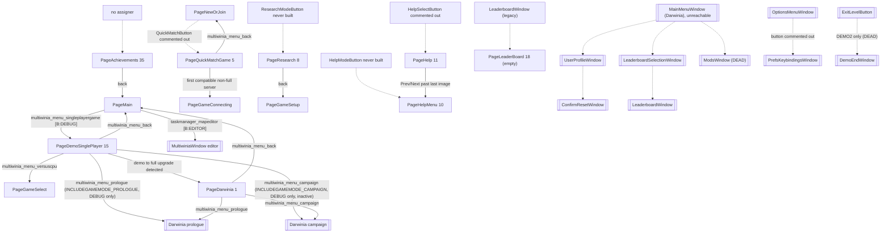

# 09 — Meta systems

> Part A · Baseline build: Release|Win32 (OpenGL) + TARGET_PC_FULLGAME ([B:FULL]); see _work/build_matrix.md.
> Evidence: [C] confirmed · [I] inferred · [U] unknown. Citations are `path:Symbol` relative to the multiwinia/ source root.
> Sources merged: P18_ui_gamemenu, P17b_menus_options, P19_help_tutorial_script, P20_sequences_loaders_bench, P02_game_modes, P15_network, P16_sound, P14_platform_lib, P17a_ui_framework_editor, P12_render_core, P10_input_camera (routed sections in `_work/routed/09.md` and the `_work/routed/_meta_*.md` notes); generated tables from `_work/drafts/P17b_prefs_accesses.csv`, `P14_platform_lib_pref_keys.csv`, `P17b_strings.csv`, `P02_game_modes_strings.csv`; new script `_work/scripts/S_09_lang_coverage.py`.

## Contents

1. [Scope, build reality and reachability of every screen](#1-scope-build-reality-and-reachability-of-every-screen)
2. [Front-end architecture and full screen flow](#2-front-end-architecture-and-full-screen-flow)
3. [Page-by-page and window-by-window specification](#3-page-by-page-and-window-by-window-specification)
4. [Game setup options](#4-game-setup-options)
5. [Multiplayer front end: versus CPU, quick match, LAN/WAN browser, host/join, lobby](#5-multiplayer-front-end-versus-cpu-quick-match-lanwan-browser-hostjoin-lobby)
6. [Demo/full-game gating and the authentication-key UI](#6-demofull-game-gating-and-the-authentication-key-ui)
7. [Achievements, statistics and leaderboards](#7-achievements-statistics-and-leaderboards)
8. [Help system and tutorial content](#8-help-system-and-tutorial-content)
9. [Attract mode, start sequences, loading screens, animated panels and credits](#9-attract-mode-start-sequences-loading-screens-animated-panels-and-credits)
10. [Localisation coverage](#10-localisation-coverage)
11. [Preferences and every user option](#11-preferences-and-every-user-option)
12. [Constants](#12-constants)
13. [Design notes for the new game](#13-design-notes-for-the-new-game)
- [Open questions and unknowns](#open-questions-and-unknowns)
- [Docs-vs-code discrepancies](#docs-vs-code-discrepancies)
- [IP items](#ip-items)
- [Source map](#source-map)
- [Appendix — dead/legacy code](#appendix--deadlegacy-code)

Cross-references: game-mode rules and the in-match HUD are specified in [01](01_game_modes.md); the UI widget framework (Eclipse windows, `GameMenuButton`, navigation, `m_buttonOrder`, page lifecycle internals) in [28](28_ui_framework.md); the tutorial director state machines, script language, Sepulveda and `StartSequence` timeline in [30](30_scripting_tutorial_and_cutscenes.md); the network protocol, metaserver and authentication internals in [22](22_determinism_and_networking.md); sound-option engine effects in [27](27_audio_engine.md); preference-file and language-file grammars in [29](29_data_formats_reference.md); data packaging and localisation builds in [31](31_platform_build_and_tools.md); fonts in [24](24_rendering.md).

---

## 1 Scope, build reality and reachability of every screen

### 1.1 What is live in the shipped product

In the baseline build the player-visible meta layer is [C] (each row of §1.2 cites the evidence):

- **One full-screen front-end window** (`GameMenuWindow`, Eclipse window name `"multiwinia_mainmenu_title"`) that is a page state machine with 38 page slots, of which **18 are live** (§2, §3).
- **Help and Options** (`HelpAndOptionsWindow`) opened on top of the front end or the in-game Esc menu, leading to **How To Play** help pages and **Settings → {Screen, Graphics, Sound, Other} Options** (§3.20, §11).
- **In-game Esc menu** (`LocationWindow` + `ConfirmExitWindow`), in-game **chat input**, and a **controller-unplugged** dialogue (§3.22).
- The **in-match HUD**: grace-period "press SPACE when ready" countdown, scoreboard, timer, game-over results overlay (owned by [01 §3](01_game_modes.md)); summarised in §3.23.
- **Loading screen** on a background worker thread, and **animated game-mode panels** shown while waiting for players to ready up (§9).
- **Two tutorials** implemented as a help-tab director in `MultiwiniaHelp` running on King-of-the-Hill maps `mp_koth_2P_1` / `mp_koth_3P_1` (§8.4; mechanics in [30 §2](30_scripting_tutorial_and_cutscenes.md)).
- A runtime **demo/full gate** driven by the authentication key (`IS_DEMO`), with a key-entry page, a buy-now page and metaserver-supplied demo limits (§6).

Compiled but never reachable by a player: achievements (all twelve are computed then discarded by a stub), the Achievements page, leaderboards (stub, no backend), quick match (button commented out), user profiles, mods, key rebinding, demo-end screen, the Darwinia main menu, `StartSequence` intro, boot-loader mini-programs, attract mode, benchmark (§1.2, §7, §9, Appendix).

### 1.2 Reachability table of every screen and window

Status vocabulary: **live** = reachable by a player in [B:FULL]; **unreachable** = compiled into [B:FULL] but no call chain from the shipped loop reaches it ([B:LEGACY]); **debug** = only `TARGET_DEBUG` ([B:DEBUG]); **editor** = only `LOCATION_EDITOR` ([B:EDITOR]); **dead** = not compiled in any PC configuration ([B:DEAD]); **gap** = page slot with no enum constant.

#### 1.2.1 `GameMenuWindow` page slots (`code/UI/GameMenuWindow.h` anonymous page enum, `code/game_menu.cpp:s_pageNames`)

`NumPages = 38`; the debug-name table `s_pageNames[38]` has one string per slot including the gaps (removed Xbox Live Arcade, PDLC and Darwinia+ pages); the constructor release-asserts that the two sizes match [C] `code/UI/GameMenuWindow.cpp:GameMenuWindow::GameMenuWindow`.

| Slot | Enum | `s_pageNames` | Status | Evidence | Spec |
|---|---|---|---|---|---|
| 0 | `PageMain` | "Main" | live (default page) | `GameMenuWindow::GameMenuWindow` sets `m_newPage = PageMain` | §3.1 |
| 1 | `PageDarwinia` | "Darwinia" | debug | only entered from `PageDemoSinglePlayer` when the demo→full status changes (`GameMenuWindow::Update`, L548–550); `PageDemoSinglePlayer` is itself debug-only (`code/UI/DarwiniaModeButton.h:DarwiniaModeButton::MouseUp` `#ifdef TARGET_DEBUG`) | §3.19 |
| 2 | `PageGameSelect` | "GameSelect" | live | `DarwiniaModeButton` (non-debug branch), `NewServerButton` | §3.4 |
| 3 | `PageNewOrJoin` | "NewOrJoin" | live | `NewOrJoinButton` | §3.3 |
| 4 | `PageJoinGame` | "JoinGame" | live | `JoinGameButton` | §3.9 |
| 5 | `PageQuickMatchGame` | "QuickMatchGame" | unreachable | `QuickMatchButton` creation commented out in `GameMenuWindow::SetupNewOrJoinPage` with "Removed by Chris. It doesn't work." (L3671–3673) | §5.9 |
| 6 | `PageGameSetup` | "GameSetup" | live (the lobby) | `LevelSelectButton::MouseUp`, `UpdateGameConnectingPage` | §3.6 |
| 7 | `PageGameConnecting` | "GameConnecting" | live | `GameMenuWindow::JoinServer` | §3.12 |
| 8 | `PageResearch` | "Research" | unreachable | `ResearchModeButton` never instantiated | §3.19 |
| 9 | `PageMapSelect` | "MapSelect" | live | `GameTypeButton::MouseUp` | §3.5 |
| 10 | `PageHelpMenu` | "HelpMenu" | unreachable | `HelpModeButton` never instantiated | §3.19 |
| 11 | `PageHelp` | "Help" | unreachable | `HelpSelectButton` creation commented out | §3.19 |
| 12 | `PageAdvancedOptions` | "AdvancedOptions" | live (host with full key) | `AdvancedOptionsModeButton` | §3.7 |
| 13 | — | "XBLASelectSessionType" | gap | no enum constant | — |
| 14 | `PageXBLASignIn` | "XBLASignIn" | dead | no setup function: `SetupNewPage` default case release-asserts "Game menu invalid page" | Appendix |
| 15 | `PageDemoSinglePlayer` | "DemoSinglePlayer" | debug | `DarwiniaModeButton` targets it only under `TARGET_DEBUG` [C] | §3.19 |
| 16 | `PageBuyMeNow` | "BuyMeNow" | live with a demo key ([B:DEMO] runtime) | `BuyNowModeButton`, demo-restricted mode/map/server clicks, inactive Multiplayer button | §6.6 |
| 17 | `PageLeaderBoardSelect` | "LeaderBoardSelect" | unreachable (setup is `return;`) | `GameMenuWindow::SetupLeaderBoardSelectPage` | §7.5 |
| 18 | `PageLeaderBoard` | "Leaderboards" | unreachable (setup is `return;`) | `GameMenuWindow::SetupLeaderboardPage`; only requested by `LeaderboardWindow`, itself unreachable | §7.5 |
| 19 | — | "XBLASelectGameType" | gap | — | — |
| 20 | — | "XBLASelectCustomMatchtype" | gap | — | — |
| 21 | — | "Downloaded PDLC" | gap | — | — |
| 22 | — | "PDLC Upsell" | gap | — | — |
| 23 | `PageAuthKeyEntry` | "AuthKeyEntry" | live | constructor auth gate; `AuthPageButton` in Help and Options | §6.4 |
| 24 | `PagePlayerOptions` | "PlayerOptions" | live | own gamer-tag click in the lobby | §3.8 |
| 25 | `PageSearchFilters` | "SearcHFilters" (sic) | live | `FiltersPageButton` | §3.10 |
| 26 | — | "DarwiniaPlus SP Page" | gap | — | — |
| 27 | — | "DarwiniaPlus MP Page" | gap | — | — |
| 28 | — | "DarwiniaPlus Darwinia Page" | gap | — | — |
| 29 | — | "DarwiniaPlus Darwinia SP Page" | gap | — | — |
| 30 | — | "DarwiniaPlus Darwinia MP Page" | gap | — | — |
| 31 | `PageUpdateAvailable` | "Updates Available Page" | live (only when the metaserver reports a different version) | `UpdatePageButton` | §3.17 |
| 32 | `PageCredits` | "Credits Page" | live | `CreditsButton` | §3.18 |
| 33 | `PageTutorials` | "Tutorial Page" | live (`INCLUDE_TUTORIAL`) | `TutorialPageButton`; `GameMenu::CreateMenu` after a tutorial | §3.2 |
| 34 | `PageError` | "Error Page" | live | `GameMenuWindow::CreateErrorDialogue` | §3.14 |
| 35 | `PageAchievements` | "Achievements Page" | unreachable | no code assigns `m_newPage = PageAchievements`; no `AchievementButton` constructed [C] grep of `code/` | §7.2 |
| 36 | `PageEnterPassword` | "Password Entry" | live | `GameServerButton::MouseUp` on a passworded server | §3.11 |
| 37 | `PageWaitForGameToStart` | "Wait for Game to Start" | live (host only) | `GameMenuWindow::UpdateMultiplayerPage` after `RequestStartGame` | §3.13 |

Counts [C]: **18 live** (0, 2, 3, 4, 6, 7, 9, 12, 16, 23, 24, 25, 31, 32, 33, 34, 36, 37); **10 compiled-but-unreachable** (1, 5, 8, 10, 11, 14, 15, 17, 18, 35 — of which 1 and 15 are debug-reachable and 14 has no setup); **10 gap slots** (13, 19, 20, 21, 22, 26, 27, 28, 29, 30). 18 + 10 + 10 = 38.

Resolved: P20 described `PageDarwinia` (and hence `CampaignButton`) as "edge-reachable in FULL"; the code shows its only entry is from `PageDemoSinglePlayer`, which `DarwiniaModeButton::MouseUp` selects only `#ifdef TARGET_DEBUG` (the non-debug branch goes straight to `PageGameSelect`) [C] `code/UI/DarwiniaModeButton.h`, `code/UI/GameMenuWindow.cpp:GameMenuWindow::Update`. `PageDarwinia` is therefore [B:DEBUG], and the `RequestBootloaderSequence` fade-out bug of §9.2.6 is latent, not player-visible, in [B:FULL].

#### 1.2.2 Eclipse windows other than `GameMenuWindow`

"Reachable" = there is a call chain from the shipped game loop to `EclRegisterWindow(new X)`; each entry was traced with a grep for `new X` over `code/` [C].

| Window class (Eclipse name) | File | Opened from | Status | Spec |
|---|---|---|---|---|
| `GameMenu` (controller object, not a window) | `code/game_menu.cpp` | `App::Initialise` (`m_gameMenu = new GameMenu()`); `MainMenuLoop` calls `CreateMenu()` | live | §2.1 |
| `GameOptionsWindow` (base of full-screen menu windows) | `code/interface/mainmenus.cpp` | base class | live | [28](28_ui_framework.md) |
| `HelpAndOptionsWindow` ("multiwinia_menu_helpandoptions") | `code/interface/helpandoptions_windows.cpp` | `HelpAndOptionsButton::MouseUp`, instantiated by `GameMenuWindow::SetupMainPage` and `LocationWindow::Create` | live | §3.20 |
| `SelectHelpWindow` ("multiwinia_menu_selecthelp", "How To Play") | `code/interface/helpandoptions_windows.cpp` | `HelpWindowButton` | live | §3.20, §8.1 |
| `GeneralHelpWindow` ("multiwinia_help_general") | same | `HelpTypeButton` with `m_helpType == -1` | live | §8.1 |
| `GameTypeHelpWindow` (name = game-type blueprint name) | same | `HelpTypeButton` with `m_helpType = i` | live | §8.1 |
| `CrateHelpWindow` ("Crate Information") | same | `CrateHelpWindowButton`, created only `#ifdef INCLUDE_CRATE_HELP_WINDOW` (defined only by `TARGET_DEBUG`) | debug | §3.20 |
| `OptionsMenuWindow` ("dialog_options", "Settings") | `code/interface/mainmenus.cpp` | `OptionsButton::MouseUp` in `HelpAndOptionsWindow`; re-created by `SetScreenButton::MouseUp` | live | §11.4 |
| `PrefsScreenWindow` ("dialog_screenoptions") | `code/interface/prefs_screen_window.cpp` | `ScreenOptionsButton` | live | §11.5 |
| `PrefsGraphicsWindow` ("dialog_graphicsoptions") | `code/interface/prefs_graphics_window.cpp` | `GraphicsOptionsButton` | live | §11.6 |
| `PrefsSoundWindow` ("dialog_soundoptions") | `code/interface/prefs_sound_window.cpp` | `SoundOptionsButton` | live | §11.7 |
| `PrefsOtherWindow` ("dialog_otheroptions") | `code/interface/prefs_other_window.cpp` | `OtherOptionsButton` | live | §11.8 |
| `PrefsKeybindingsWindow` ("dialog_inputoptions", "Control Options") | `code/interface/prefs_keybindings_window.cpp` | `KeybindingsOptionsButton`, whose only instantiation in `OptionsMenuWindow::Create` is commented out | unreachable | §11.9 |
| `LocationWindow` ("dialog_locationmenu", in-game Esc menu) | `code/interface/mainmenus.cpp` | `LocationGameLoop` on `ControlMenuEscape`; re-created by Other/Screen Options apply when not at the main menu | live | §3.22 |
| `ConfirmExitWindow` ("multiwinia_confirmexit") | same | `ConfirmExitButton` in `LocationWindow` while the game is not over | live | §3.22 |
| `ChatInputWindow` ("location_chat") | `code/interface/chatinput_window.cpp` | `LocationInput::Advance` on `ControlLobbyChat` (Enter) with no windows open and keyboard input mode | live | §5.13 |
| `ChatInputField` (button) | same | inside `ChatInputWindow`; embedded in the lobby page | live | §5.13 |
| `ControllerUnpluggedWindow` ("controller_unplugged") | `code/interface/controllerunplugged_window.cpp` | `HandleCommonConditions` on `ControlControllerUnplugged` (XInput unplug), `#ifdef TARGET_MSVC` | live | §3.22 |
| `MultiwiniaWindow` (map editor front page) | `code/interface/multiwinia_window.cpp` | `MultiwiniaEditorButton` (`LOCATION_EDITOR` only) and the unreachable `MainMenuWindow` | editor | [08](08_levels_and_level_design.md) |
| `MultiwiniaOptionsWindow` ("multiwiniaoptions_window") | `code/interface/multiwiniaoptions_window.cpp` | `LocationEditor` mode; whole file `#ifdef LOCATION_EDITOR` | editor | [08](08_levels_and_level_design.md) |
| `MainMenuWindow` ("dialog_mainmenu", Darwinia global-world Esc menu) | `code/interface/mainmenus.cpp` | `GlobalWorldGameLoop` on Esc — that loop sets `m_atMainMenu = true` and `break`s on its first iteration | unreachable | Appendix A.5 |
| `UserProfileWindow` ("dialog_profile") | `code/interface/userprofile_window.cpp` | `MainMenuUserProfileButton` in `MainMenuWindow` | unreachable | Appendix A.6 |
| `NewUserProfileWindow` ("dialog_newprofile") | same | `NewProfileWindowButton`, only instantiation commented out | unreachable | Appendix A.6 |
| `ConfirmResetWindow` ("multiwinia_confirmreset") | `code/interface/mainmenus.cpp` | `ConfirmResetButton` in `UserProfileWindow` | unreachable | Appendix A.6 |
| `LeaderboardSelectionWindow` ("leaderboardselection") | `code/interface/leaderboards_window.cpp` | `LeaderBoardButton` in `MainMenuWindow`, created `m_inactive = true`; `MouseUp` returns when inactive | unreachable (doubly) | §7.5 |
| `LeaderboardWindow` ("leaderboards") | same | `LeaderBoardTypeButton` in `LeaderboardSelectionWindow` | unreachable (stub, no data source) | §7.5 |
| `ResetLocationWindow` ("dialog_resetlocation") | `code/interface/mainmenus.cpp` | `ResetLevelButton`, never instantiated | unreachable | Appendix A.5 |
| `AboutDarwiniaWindow` ("about_darwinia") | same | `AboutDarwiniaButton`, only `#ifdef OBERONBUILD` | dead | Appendix A.5 |
| `ModsWindow` ("dialog_mods"), `NewModWindow` ("dialog_createnewmod") | `code/interface/mods_window.cpp` | file body `#ifdef USE_DARWINIA_MOD_SYSTEM` + pref `ModSystemEnabled` | dead | Appendix A.7 |
| `DemoEndWindow` ("DemoEnd") | `code/interface/demoend_window.cpp` | `ExitLevelButton::MouseUp` only `#ifdef DEMO2` | dead (compiled, never instantiated) | §6.6, Appendix A.8 |
| `ReallyQuitWindow` ("Really Quit?") | `code/interface/reallyquit_window.cpp` | `DebugKeyBindings::ReallyQuitButton` — no caller | unreachable | Appendix A.5 |
| `SaveOnQuitWindow` ("editor_savesettings") | `code/interface/save_on_quit_window.cpp` | `SoundSystem::AreBlueprintsModified` after an unconditional `return false;`, inside `#ifdef SOUND_EDITOR` | dead | Appendix A.5 |
| `ProfileWindow` ("Profiler", CPU profiler) | `code/interface/profilewindow.cpp` | `DebugKeyBindings::ProfileButton` from `CheatWindow` (`CHEATMENU_ENABLED`) and `DebugMenu` | debug | [32](32_debug_test_and_performance.md) |

#### 1.2.3 Full-screen sequences and overlays (not Eclipse windows)

| Screen | Implementation | Status | Evidence | Spec |
|---|---|---|---|---|
| Loading screen (spinner, first-run publisher logo, rating notice) | `code/loading_screen.cpp:LoadingScreen` | live | created in `code/main.cpp:Initialise`; used at start-up, every level load, map-select thumbnail preload | §9.2 |
| Animated game-mode panel | `code/animatedpanel*.cpp`, `code/multiwiniahelp.cpp:MultiwiniaHelp::RenderAnimatedPanel` | live | grace period, not in a tutorial | §9.3 |
| Grace-period ready/countdown overlay | `code/multiwinia.cpp:Multiwinia::RenderOverlay_GracePeriod` | live | every match | §3.23, [01 §3.7](01_game_modes.md) |
| In-match HUD and game-over results overlay | `code/multiwinia.cpp:Multiwinia::Render` | live | every match | §3.23, [01 §3.10](01_game_modes.md) |
| Rocket Riot status panel | `code/rocket_status_panel.cpp:RocketStatusPanel` | live (Rocket Riot) | `Multiwinia::RenderRocketStatusPanel` | §7.4.2 |
| In-game contextual help messages | `code/multiwiniahelp.cpp:MultiwiniaHelp::Render` | live (pref `HelpEnabled`) | — | §8.2 |
| Tutorial instruction tabs | `MultiwiniaHelp::RenderTutorialHelp` | live (tutorials only) | `INCLUDE_TUTORIAL` | §8.4 |
| Objective tabs (non-tutorial) | `MultiwiniaHelp::Render` | unreachable (renderer under a never-defined macro) | §8.3 | §8.3 |
| Gamepad control prompts | `code/control_help.cpp:ControlHelpSystem` | live in gamepad mode only (pref `ControlHelpEnabled`) | — | [06](06_player_control_and_input.md) |
| Overlay error dialogue inside `GameMenuWindow` (`RenderErrorDialogue`) | `code/UI/GameMenuWindow.cpp` | unreachable (`m_showingErrorDialogue` assignments commented out) | — | §3.14 |
| `StartSequence` first-time intro | `code/startsequence.cpp` | unreachable (only constructed in `RunBootloader`, which is `#ifdef USE_LOADERS`) | `code/main.cpp:RunBootloader` | §9.4.2, [30 §6](30_scripting_tutorial_and_cutscenes.md) |
| Boot-loader mini-programs (Spectrum, Matrix, Fodder, Raytrace, Soul, Game of Life ×2, Amiga) | `code/loaders/*` | dead (`USE_LOADERS` commented out) | `code/lib/universal_include.h` L68 | §9.5, Appendix A.1 |
| Credits roll with carrier sprites | `code/loaders/credits_loader.cpp:CreditsLoader` | unreachable (Darwinia ending and script op only) | §9.6.2 | §9.6.2 |
| Front-end credits page | `GameMenuWindow::SetupCreditsPage` | live | — | §3.18 |
| Attract mode | `code/attract.cpp:AttractMode` | dead (`ATTRACTMODE_ENABLED` defined nowhere) | `code/app.cpp:App::App` L394–396 | §9.7 |
| Demo end sequence (prologue) | `code/demoendsequence.cpp` | dead (`USE_SEPULVEDA_HELP_TUTORIAL`) | — | [30 §7](30_scripting_tutorial_and_cutscenes.md) |
| Distributor splashes (`EgamesLoader`, `OberonLoader`) | `code/loaders/egames_loader.cpp`, `code/loaders/oberon_loader.cpp` | dead | — | Appendix A.1 |
| Benchmark recorder / FTP upload | `code/benchmark.cpp` | dead (`BENCHMARK_AND_FTP` commented out) | — | [32](32_debug_test_and_performance.md) |
| Darwinia context help (`HelpSystem`) | `code/helpsystem.cpp` | dead (`USE_SEPULVEDA_HELP_TUTORIAL`) | — | Appendix A.4 |

**Key consequence for the new game.** The only live option screens are Settings → {Screen, Graphics, Sound, Other}, reached through *Help and Options* from both the front end and the in-game Esc menu. Everything that would need a persistent online service (achievements, leaderboards, statistics, profiles) is absent or stubbed in this source release.

---
## 2 Front-end architecture and full screen flow

### 2.1 Lifecycle: `GameMenu` (controller) and `GameMenuWindow` (the screen)

`GameMenu` is a persistent controller object owned by `App` (`g_app->m_gameMenu`, created once in `App::Initialise`) — **not a window** [C] `code/app.cpp:App::Initialise`. It owns the map catalogue, the 3D backdrop and creation/destruction of the one front-end window, `GameMenuWindow` ("multiwinia_mainmenu_title", the name doubles as the phrase id of the title) [C] `code/game_menu.cpp`, `code/UI/GameMenuWindow.cpp`. Everything else (pages, transitions, lobby logic, browser) lives in `GameMenuWindow`.

| Step | Behaviour | Ref |
|---|---|---|
| Main loop | `MainMenuLoop` runs while `g_app->m_atMainMenu`; whenever `!m_gameMenu->m_menuCreated` and the renderer fade is complete it calls `GameMenu::CreateMenu()` | [C] `code/main.cpp:MainMenuLoop` |
| `GameMenu::GameMenu()` | zero `m_numDemoMaps[7]`; `CreateMapList()` (§2.4); `m_clouds = new Clouds(); m_clouds->Advance()` | [C] `code/game_menu.cpp:GameMenu::GameMenu` |
| `GameMenu::CreateMenu()` | `Renderer::StartFadeIn(0.25)`; `RemoveAllWindows()`; `g_app->m_multiwinia->Reset()`; `EclRegisterWindow(new GameMenuWindow())`; camera `RequestMode(ModeSphereWorldFocus)`, `SetTarget((-900, 3000, 3970), front (0, 0.5, -1))`, `CutToTarget()`, `SetDebugMode(0)`; `g_app->m_gameMode = GameModeNone`; if `g_app->m_multiwiniaTutorial` is set (returning from a tutorial) the new window's `m_newPage = PageTutorials`; clear the flag; `m_menuCreated = true` | [C] `code/game_menu.cpp:GameMenu::CreateMenu` |
| `GameMenuWindow` constructor | full screen (0, 0, ScreenW, ScreenH), not resizable / movable / closeable; `m_currentPage = -1`, `m_newPage = PageMain`; **auth gate**: `Authentication_GetKey`, `Authentication_SimpleKeyCheck(key, METASERVER_GAMETYPE_MULTIWINIA)`; if not `AuthenticationAccepted` → `m_newPage = PageAuthKeyEntry` (a stored value `"authkey not found"` is blanked) — gate compiled out under `MULTIWINIA_DEMOONLY`; player name from pref `PlayerName` (default token `multiwina_playername_default` → localised "NewPlayer"), every `%` replaced by a space, stored through `PlayerNameString::Set` (which also writes the pref and saves the prefs file); browser filters from prefs `FilterShowDemos`, `FilterShowIncompatible`, `FilterShowFullGames`, `FilterShowCustomMaps`, `FilterShowPassworded` (all default 1) | [C] `code/UI/GameMenuWindow.cpp:GameMenuWindow::GameMenuWindow` |
| First `Update` | page −1 → `SetupNewPage(m_newPage)`; on the first update after the sound system is ready the window triggers interface sound `LobbyAmbience` | [C] `GameMenuWindow::Update` |
| Leaving to a game | the server's sequenced `NET_DARWINIA_START_GAME` sets `m_loadingLocation = true`, `m_requestedLocationId = 999`, `m_gameMode = GameModeMultiwinia`, `m_atMainMenu = false`, `m_hideInterface = false`, `m_atLobby = false`, `g_gameTimer.Reset()`; `MainMenuLoop` exits, stops sound `"MultiwiniaInterface LobbyAmbience"`, calls `GameMenu::DestroyMenu()` (removes the window, fade out) | [C] `code/network/clienttoserver.cpp` (START_GAME handler L2607–2625), `code/main.cpp:MainMenuLoop`, `code/game_menu.cpp:GameMenu::DestroyMenu` |
| Returning | the in-game menu's leave button sets `m_requestedLocationId = -1` and `m_atMainMenu = true`; the main-menu loop re-creates a **fresh** `GameMenuWindow` at `PageMain` (or `PageTutorials` after a tutorial, or `PageAuthKeyEntry` if the key has become invalid). No lobby state survives except preferences | [C] `code/interface/mainmenus.cpp:ExitLevelButton::MouseUp`; [I] fresh object ⇒ no carried state |
| Results | the end-of-game results are an **in-game overlay** drawn by `Multiwinia::Render` (§3.23); the front end has no results page | [C] absence of a results page in the `GameMenuWindow.h` enum |

Resolved: P02 described "game over → press `ControlToggleReady` → lobby" as the way back to the menu. In [B:FULL] the `GameOver()` block in `LocationInput::Advance` is empty — the `ToggleReady`-to-exit branch exists only `#ifdef TESTBED_ENABLED` (L1232–1262) [C] `code/location_input.cpp:LocationInput::Advance`. The only live exit is Esc → `LocationWindow` → "Exit Game", which in a finished game is the `ExitLevelButton` directly (no confirmation) [C] `code/interface/mainmenus.cpp:LocationWindow::Create`. The on-screen prompt "Press ESC to Exit" (`multiwinia_spacetoexit` / gamepad "Press START to Exit") is therefore accurate for the shipped build.

### 2.2 Shared screen layout (every front-end page and every `GameOptionsWindow`)

[C] `code/game_menu.cpp:GetPositions`, `GetPosition_TitleBar`, `GetPosition_LeftBox`, `GetPosition_RightBox`, `GetFontSizes`, `GetButtonSizes` (W = screen width px, H = screen height px).

| Quantity | Formula |
|---|---|
| `horizSplit` | 0.26·H |
| `vertSplit` | 0.6·W |
| `gap` | 0.05·vertSplit (= 0.03·W) |
| outer edges | left = top = gap; right = W − gap; bottom = H − gap; if W/H > 1.4 (widescreen): left += 0.08·W, right −= 0.08·W |
| Title bar | x = left, y = top, w = right − left, h = horizSplit − 0.5·gap − top |
| Left box | x = left, y = horizSplit + 0.5·gap, w = vertSplit − 0.5·gap − left, h = bottom − y |
| Right box | x = vertSplit + 0.5·gap, y = horizSplit + 0.5·gap, w = right − x, h = bottom − y |
| Fonts | large = 0.095·H, med = 0.04·H, small = 0.022·H |
| Standard button | w = 0.9·leftW, h = 1.3·med (= 0.052·H), gap = 0.1·med (= 0.004·H) |

Standard page skeleton (e.g. `GameMenuWindow::SetupNewOrJoinPage`) [C]: buttons centred in the left box at `buttonX = leftX + (leftW − buttonW)/2`; title `GameMenuTitleButton` "title" at (leftX + 10, leftY + 10, leftW − 20, 1.5·buttonH), med font, rendered upper-cased, shrunk to fit, over a highlight beam (`code/game_menu.cpp:GameMenuTitleButton::Render`); first stacked button at `yPos = leftY + 0.5·buttonH + 1.3·buttonH + (buttonH + gap)`, each further button `+= buttonH + gap`; Back at `leftY + leftH − 2·buttonH`; the right box carries an information panel (image, description, MOTD or chat) outside the navigation order.

Symbols used in the page tables below: `bx` = buttonX, `bw`/`bh` = standard button width/height, `lX/lY/lW/lH`, `rX/rY/rW/rH` = left/right box. "Base MouseUp" = `GameMenuButton::MouseUp`: plays `MenuSelect` (or `MenuCancel` when `m_transitionDirection == -1`) and starts a 1.0 s menu transition in that direction [C] `code/game_menu.cpp:GameMenuButton::MouseUp`. Page building, transitions, `BackPageButton` semantics ("Back(prev)" returns to whatever page was showing before, because `SetupNewPage` assigns `m_currentPage` last) and controller navigation are specified in [28 §12](28_ui_framework.md).

### 2.3 Persistent background behind every page

`GameMenuWindow::Render` draws, in order [C]:

1. **`RenderBigDarwinian()`** (static; also used by other menus, `code/interface/mainmenus.cpp`, `code/game_menu.cpp:GameMenuDropDownWindow::Render`): full-screen additive quad, black at three corners and RGB (1.0, 0.5, 0.1) at the bottom-left vertex (smooth-shaded glow); a giant mascot sprite (`sprites/darwinian.bmp`, nearest filtering, tint (1, 0, 0, 1)) centred at (0.75·W, 0.7·H), half-size `0.3·W + 5·sin(t)` px (breathing), quad rotated 0.2 rad; in high detail 10 echo copies, each `size *= 1.02`, centre shifted (−6, −6) px, tint (1, 0.2, 0.2) alpha `0.2·(1 − i/10)`; a rotating gear (`mwhelp/gear.bmp`) half-size 0.6·W centred on screen, angle `0.2·t` rad, additive white alpha 0.06, drawn 10 times each rotated a further 0.02 rad (0 times in low detail). Detail switch (only evaluated while `Multiwinia::GameInLobby()`): `smoothFps = smoothFps·(1 − k) + fps·k`, `k = g_advanceTime·0.5`; low detail when `smoothFps < 20`, high again when `≥ 60` (hysteresis), initial 60 [C] `GameMenuWindow::RenderBigDarwinian`.
2. **Title bar**: fill box; if the localised `multiwinia_mainmenu_title` equals `"MULTIWINIA"` the bitmap `textures/mwtitle.bmp` is drawn (width = title-font text width for that many characters at large size × 1.1, height = width/5.4, top at titleY + 0.1·titleH), otherwise the text is drawn with outline; subtitle `multiwinia_mainmenu_subtitle` at med size one large line below; logo `icons/mwlogo.bmp` (aspect 277/194, height 0.8·titleH) at x = titleX + 0.05·titleW and mirrored at the right.
3. **Per-page content boxes** (`DrawFillBox`, shadowed panel): GameSetup → left + right; JoinGame and Achievements → one box of title-bar width; GameConnecting → left; GameSelect / MapSelect / LeaderBoardSelect / AdvancedOptions / DemoSinglePlayer / BuyMeNow → left + right; Main → left, plus MOTD box (right, height rightH, or 0.75·rightH when the auth box is shown) once a MOTD has arrived, plus the auth box (rightY + 0.8·rightH, height 0.2·rightH) when `ShowAuthBox()`; all other pages → left only.
4. **Overlays**: JoinGame with an empty list → blinking "requesting list" / "no servers found" caption (§5.8.1); Achievements → blinking "loading achievements" caption (blink: alpha 1.0 for the first 0.5 s of each second, 0.5 otherwise) [C] `RenderRequestingEffect`, `RenderLoadingAchievementsEffect`.
5. **Buttons** (`EclWindow::Render`); if a drop-down list is open (`GameMenuDropDownWindow::s_window`) only the button owning it is drawn.

The 3D backdrop behind the window is `GameMenu::Render()`, called by `Renderer::RenderFrame` when `m_atMainMenu && m_menuCreated` and by the loading screen: `Camera::Advance`; camera at the origin, FOV 90; eye (0, 600, 0), front (0, 0, 1), up (0, 1, 0), each rotated about Y by −1.899 rad then about Z by −1.079 rad; focus = eye + front×100; `m_clouds->Render(−GetHighResTime())` (sky grid + cloud layers; the Sky Detail option applies) [C] `code/game_menu.cpp:GameMenu::Render`, `code/renderer.cpp:Renderer::RenderFrame`.

### 2.4 Map catalogue built at start-up (`GameMenu::CreateMapList`, `GameMenu::AddMap`)

1. `Resource::ListResources("levels/", "mp_*", false)`; each name ending in `.txt` is opened with a `TextReader` and passed to `AddMap` [C] `code/game_menu.cpp:GameMenu::CreateMapList`.
2. `AddMap` creates a `MapData` (`code/UI/MapData.h`) with `m_fileName` and reads tokenised header lines until `MultiwiniaOptions_EndDefinition`:

| Token | Field / effect |
|---|---|
| `Name` | `m_levelName` = rest of line |
| `GameTypes` | each following token compared (`strcmp`, case-sensitive) with each blueprint's `m_name`; on a match the map is appended to `m_maps[j]` and `m_gameTypes[j] = true` |
| `NumPlayers` | `m_numPlayers = atoi(next)` |
| `Author` | `m_author` = rest of line (not displayed) |
| `Description` | `m_description` = rest of line (displayed for custom maps only) |
| `PlayTime` | `m_playTime = atoi(next)` (minutes) |
| `Difficulty` | `m_difficulty` = next token (`basic` / `intermediate` / `advanced`) |
| `CoopMode` | `m_coop = true` |
| `ForceCoop` | `m_forceCoop = true` |
| `OfficialLevel` | `m_officialMap = true` |

3. `MapData::CalculeMapId()` → `m_mapId = LevelFile::CalculeCRC(filename)` (CRC of `levels/<file>`); `−1` (unreadable) marks `m_customMap` [C] `code/UI/MapData.cpp:MapData::CalculeMapId`, `code/level_file.cpp:LevelFile::CalculeCRC`.
4. If `IS_DEMO`: for each game type the map supports, `m_numDemoMaps[j]++` when `App::IsMapAvailableInDemo(j, mapId)` [C].
5. A map with no recognised game type is discarded (log "Discarded map … because it didn't contain a game type"); otherwise added to `m_allMaps`. The count of `OfficialLevel` maps is passed to `AchievementTracker::SetNumLevels(n)` (stored, never used) [C] `code/game_menu.cpp` L757.
6. Per game type, bubble sort: ascending `m_numPlayers`, ties by difficulty rank (substring `basic` = 1, `inter` = 2, `advan` = 3, else 0) [C].
7. `#ifdef LOCATION_EDITOR` [B:EDITOR]: player maps `*.mwm` from `App::GetMapDirectory()` are also loaded through `MapFile`.

Quirk [C]: a map whose `GameTypes` line lists one type twice is appended to `m_maps[j]` twice. The shipped map list per mode is catalogued in [08](08_levels_and_level_design.md).

`MapData` fields: `m_fileName`, `m_levelName`, `m_description`, `m_author`, `m_difficulty` (all `char*`, default NULL, freed by `~MapData`); `m_numPlayers` (int, 0); `m_playTime` (int, 0); `m_coop`, `m_forceCoop`, `m_officialMap`, `m_customMap` (bool, false); `m_mapId` (int, −1); `m_gameTypes[MAX_GAME_TYPES = 7]` (bool) [C] `code/UI/MapData.h`. `CalculeMapId` is re-run before every start/permission check in the lobby [C] `GameMenuWindow::UpdateMultiplayerPage`, `code/UI/PlayGameButton.h`.

### 2.5 Full live screen flow (front end → lobby → game → results → front end)

Edge labels are button caption phrase ids (or the condition). Double-bordered nodes are separate Eclipse windows layered over the page underneath. [C] for every edge (sources: the `Setup*Page` functions and button `MouseUp` handlers cited in §3).

```mermaid
flowchart TD
    BOOT(["App start: LoadingScreen (publisher logo), App::Initialise on worker"]) --> START
    START(["MainMenuLoop: GameMenu::CreateMenu, new GameMenuWindow"]) --> AUTHCHK{"auth key passes SimpleKeyCheck?"}
    AUTHCHK -- "no" --> AUTH["PageAuthKeyEntry 23"]
    AUTHCHK -- "yes, returning from a tutorial" --> TUT["PageTutorials 33"]
    AUTHCHK -- "yes" --> MAIN["PageMain 0"]

    AUTH -- "multiwinia_menu_done / Enter (key accepted locally)" --> MAIN
    AUTH -- "multiwinia_menu_play_demo (demo key generated)" --> MAIN
    AUTH -- "multiwinia_menu_paste" --> AUTH

    MAIN -- "multiwinia_menu_singleplayergame" --> GSSP["PageGameSelect 2 (single player, local server)"]
    MAIN -- "multiwinia_menu_multiplayergame" --> NOJ["PageNewOrJoin 3"]
    MAIN -- "multiwinia_menu_multiplayergame inactive (demo, no MP)" --> BUY["PageBuyMeNow 16"]
    MAIN -- "multiwinia_menu_tutorial_short" --> TUT
    MAIN -- "multiwinia_menu_helpandoptions" --> HO[["HelpAndOptionsWindow"]]
    MAIN -- "multiwinia_update_available (only if newer version)" --> UPD["PageUpdateAvailable 31"]
    MAIN -- "dialog_credits" --> CRED["PageCredits 32"]
    MAIN -- "multiwinia_menu_buyfullgame (demo only)" --> BUY
    MAIN -- "multiwinia_menu_quit" --> QUIT(["m_requestQuit = true"])

    HO -- "multiwinia_menu_howtoplay" --> SH[["SelectHelpWindow"]]
    SH -- "multiwinia_helppage_1 General" --> GH[["GeneralHelpWindow 5 pages"]]
    SH -- "one button per mode 0 to 5" --> GTH[["GameTypeHelpWindow 1 to 4 pages"]]
    HO -- "multiwinia_menu_settings" --> OM[["OptionsMenuWindow Settings"]]
    OM --> SCR[["PrefsScreenWindow"]]
    OM --> GFX[["PrefsGraphicsWindow"]]
    OM --> SND[["PrefsSoundWindow"]]
    OM --> OTH[["PrefsOtherWindow"]]
    HO -- "multiwinia_auth (main menu only)" --> AUTH

    TUT -- "multiwinia_menu_tutorial1 / tutorial2" --> QS[["quick start: local server, KOTH, Easy CPU, RequestStartGame"]]
    TUT -- "multiwinia_menu_back" --> MAIN

    NOJ -- "multiwinia_menu_hostgame (HostGamePermitted)" --> GSMP["PageGameSelect 2 (multiplayer, advertised server)"]
    NOJ -- "multiwinia_menu_joingame" --> JOIN["PageJoinGame 4 (LAN/WAN browser)"]
    NOJ -- "multiwinia_menu_back" --> MAIN

    GSSP -- "multiwinia_gametype_* (permitted)" --> MAPSEL["PageMapSelect 9"]
    GSMP -- "multiwinia_gametype_* (permitted)" --> MAPSEL
    GSSP -- "demo and mode not permitted" --> BUY
    GSMP -- "demo and mode not permitted" --> BUY
    GSSP -- "multiwinia_menu_back (ShutdownCurrentGame)" --> MAIN
    GSMP -- "multiwinia_menu_back (ShutdownCurrentGame)" --> NOJ

    MAPSEL -- "map row" --> LOBBY["PageGameSetup 6 (lobby)"]
    MAPSEL -- "demo-restricted map" --> BUY
    MAPSEL -- "multiwinia_menu_back" --> GSANY["PageGameSelect 2"]

    LOBBY -- "multiwinia_menu_advanceoptions (host, full key)" --> ADV["PageAdvancedOptions 12"]
    ADV -- "multiwinia_menu_back" --> LOBBY
    LOBBY -- "own gamer tag" --> PO["PagePlayerOptions 24"]
    PO -- "colour row (free)" --> LOBBY
    PO -- "multiwinia_menu_back (ApplyNameButton)" --> LOBBY
    LOBBY -- "multiwinia_menu_play (single player)" --> LOAD
    LOBBY -- "multiwinia_menu_ready (toggle)" --> LOBBY
    LOBBY -- "host: every human team ready" --> WAIT["PageWaitForGameToStart 37"]
    WAIT -- "NET START_GAME" --> LOAD
    LOBBY -- "client: NET START_GAME" --> LOAD
    LOBBY -- "back, single player" --> MAPSEL
    LOBBY -- "back, host" --> GSANY
    LOBBY -- "back, client" --> NOJ

    JOIN -- "row: compatible, not full, map installed, no password" --> CONN["PageGameConnecting 7"]
    JOIN -- "row: passworded" --> PASS["PageEnterPassword 36"]
    JOIN -- "row: incompatible / full / missing map" --> ERR["PageError 34"]
    JOIN -- "row: demo-restricted" --> BUY
    JOIN -- "multiwinia_menu_filters" --> FILT["PageSearchFilters 25"]
    JOIN -- "multiwinia_menu_back" --> NOJ
    FILT -- "multiwinia_menu_back (SaveFiltersButton)" --> JOIN
    PASS -- "multiwinia_menu_connect (password non-empty)" --> CONN
    PASS -- "multiwinia_menu_back" --> JOIN
    CONN -- "connected and game type received" --> LOBBY
    CONN -- "multiwinia_menu_back" --> JOIN
    CONN -- "disconnect: server full / bad password" --> ERR
    CONN -- "disconnect: kicked / duplicate key / connection error" --> ERR
    ERR -- "multiwinia_menu_back (stored back page)" --> JOIN
    ERR -- "multiwinia_menu_back (stored back page)" --> MAIN

    BUY -- "launchpad_button_buynow (open store URL)" --> BUY
    BUY -- "Back(prev)" --> MAIN
    UPD -- "multiwinia_menu_autopatch (run autopatch.exe, exit)" --> QUIT
    UPD -- "dialog_visitwebsite" --> UPD
    UPD -- "Back(prev)" --> MAIN
    CRED -- "Back(prev)" --> MAIN

    QS --> LOAD
    LOAD[["LoadingScreen: DoEnterLocation on worker thread"]] --> GRACE["in game: grace period (ready-up, animated panel, 3-2-1)"]
    GRACE --> PLAY["in game: running match"]
    PLAY -- "Esc" --> LW[["LocationWindow"]]
    LW -- "multiwinia_menu_helpandoptions" --> HO
    LW -- "multiwinia_menu_back" --> PLAY
    LW -- "multiwinia_menu_leavegame, game not over" --> CEW[["ConfirmExitWindow"]]
    CEW -- "No" --> LW
    CEW -- "Yes (ExitLevelButton)" --> START
    PLAY -- "winner declared" --> RES["in game: GAME OVER results overlay"]
    RES -- "Esc, then multiwinia_menu_leavegame (ExitLevelButton)" --> START
    PLAY -- "Enter" --> CHAT[["ChatInputWindow"]]
    CHAT -- "Enter / focus lost" --> PLAY
```

Notes [C] unless stated:

- `GSANY`, `GSSP` and `GSMP` are the same page; single player vs multiplayer is the boolean `m_singlePlayer` (set by `DarwiniaModeButton`, cleared by `SetupMainPage` / `SetupNewOrJoinPage` because LAN/WAN play is compiled in).
- `PageBuyMeNow` "Back(prev)" returns to whichever page opened it (Main, GameSelect, MapSelect or JoinGame); only the Main edge is drawn.
- `PageError` stores its back page in `m_errorBackPage` (default `PageMain`); browser-row errors and "server full" / "bad password" disconnects use `PageJoinGame`; kick, duplicate key and connection errors use `PageMain`; any other disconnect reason sends the window straight to `PageMain` without an error page [C] `code/UI/GameServerButton.h:GameServerButton::MouseUp`, `code/network/clienttoserver.cpp` disconnect handler.
- After a Screen-Options Apply the user lands back on Screen Options (all windows rebuilt); after an Other-Options Apply that changed language or large-menu mode all windows are removed and the user lands on `PageMain` (front end) or a fresh `LocationWindow` (in game) — not back in Other Options [C] `code/interface/prefs_screen_window.cpp:SetScreenButton::MouseUp`, `code/interface/prefs_other_window.cpp:ApplyOtherButton::MouseUp`.
- `ControllerUnpluggedWindow` can appear over any screen (§3.22.4).

### 2.6 Compiled-but-unreachable and non-baseline flow

### 2.7 Back / Esc rules and front-end audio

- Every full-screen window registers a Back `MenuCloseButton` as `m_backButton`; `DarwiniaWindow::Update` invokes it on `ControlMenuClose` (gamepad Back or B) [C] `code/interface/darwinia_window.cpp:DarwiniaWindow::Update`. Keyboard Esc (`ControlMenuEscape`, `key esc down` / `XInput start down`) inside `LocationGameLoop` removes **all** windows at once (and unhides the interface) rather than going back one level [C] `code/main.cpp:LocationGameLoop`, `data/input/input_preferences.txt` L1, L10–12.
- Windows stack: each new window registers on top; closing one reveals the one beneath.
- Front-end interface sound events (all `SoundSourceBlueprint::TypeMultiwiniaInterface`) [C]:

| Event | When | Ref |
|---|---|---|
| `LobbyAmbience` | first update once sounds are ready; stopped (`"MultiwiniaInterface LobbyAmbience"`) when leaving the main-menu loop | `GameMenuWindow::Update`, `code/main.cpp:MainMenuLoop` |
| `MenuSelect` | forward button press (base MouseUp), level-row click, editor button | `code/game_menu.cpp:GameMenuButton::MouseUp`, `code/UI/LevelSelectButton.h` |
| `MenuCancel` | buttons with `m_transitionDirection == -1` that call the base MouseUp (Done, Play Demo) play it instead of `MenuSelect` (Paste and the auth status box set −1 but never call the base, so they are silent); every `BackPageButton` (direction left at +1) plays `MenuSelect` via the base call **and then** `MenuCancel`, and re-initialises the transition with direction −1 | same, `code/game_menu.cpp:BackPageButton::MouseUp` |
| `MenuRollOver` | focus moves to a new button (base render, level rows, colour rows) | `GameMenuButton::Render`, `code/UI/LevelSelectButton.h`, `code/UI/FancyColourButton.h` |
| `ChatMessage` | lobby chat message received (not join notices) | `GameMenuWindow::NewChatMessage` |

---
