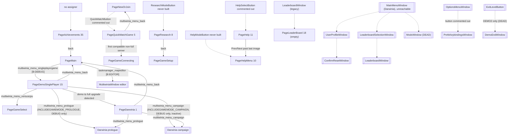
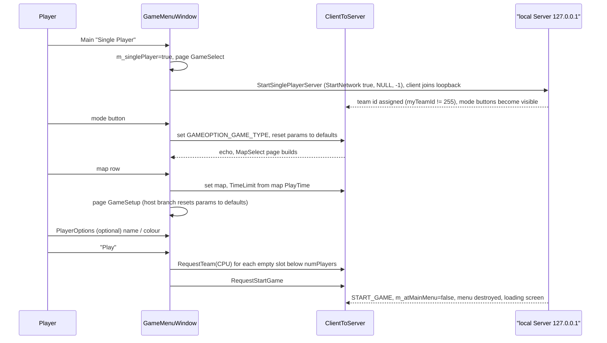
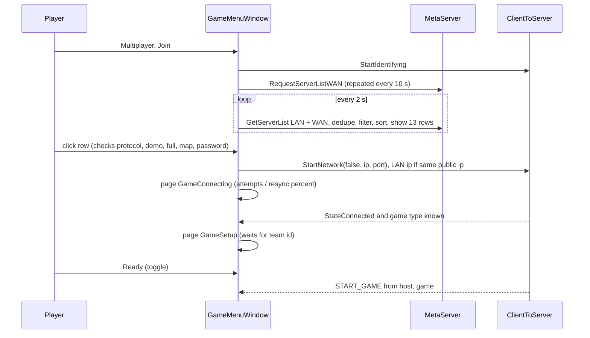
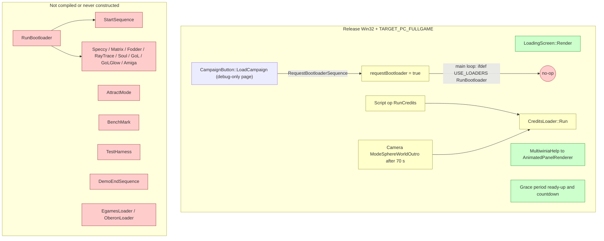
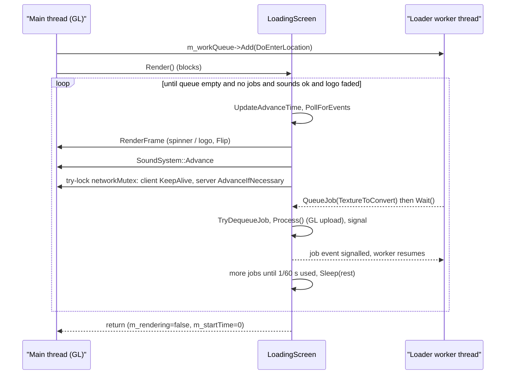
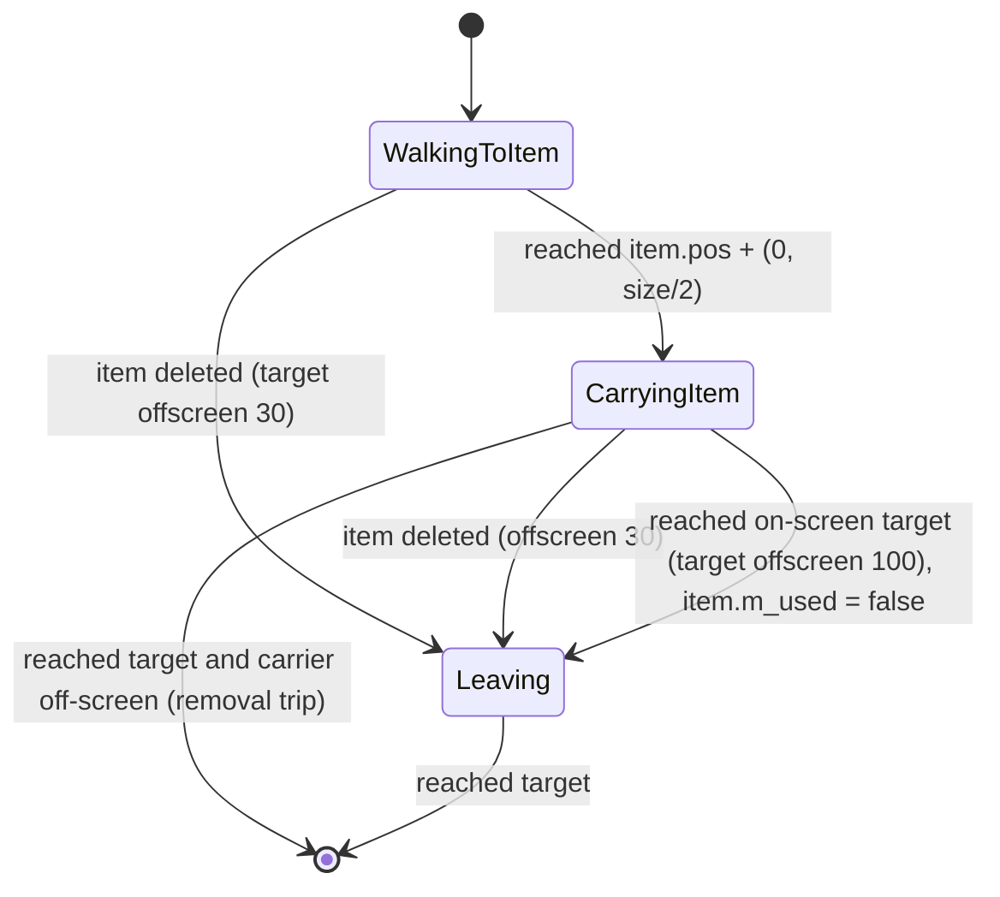
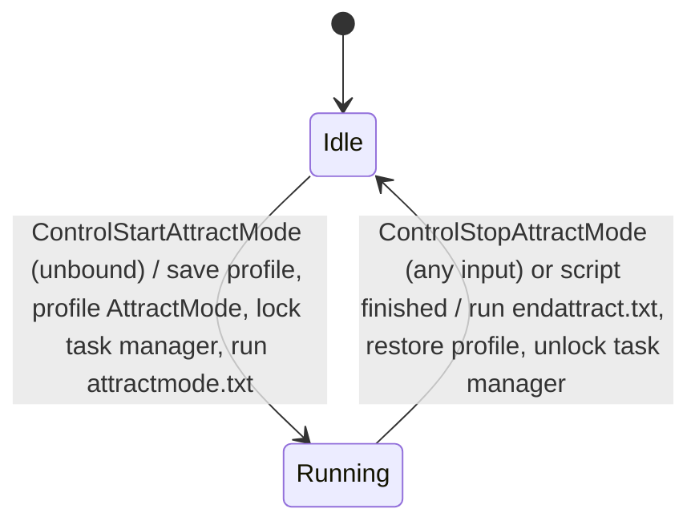

# 09 — Meta systems

> Part A · Baseline build: Release|Win32 (OpenGL) + TARGET_PC_FULLGAME ([B:FULL]); see _work/build_matrix.md.
> Evidence: [C] confirmed · [I] inferred · [U] unknown. Citations are `path:Symbol` relative to the multiwinia/ source root.
> Sources merged: P18_ui_gamemenu, P17b_menus_options, P19_help_tutorial_script, P20_sequences_loaders_bench, P02_game_modes, P15_network, P16_sound, P14_platform_lib, P17a_ui_framework_editor, P12_render_core, P10_input_camera (routed sections in `_work/routed/09.md` and the `_work/routed/_meta_*.md` notes); generated tables from `_work/drafts/P17b_prefs_accesses.csv`, `P14_platform_lib_pref_keys.csv`, `P17b_strings.csv`, `P02_game_modes_strings.csv`; new script `_work/scripts/S_09_lang_coverage.py`.

## Contents

1. [Scope, build reality and reachability of every screen](#1-scope-build-reality-and-reachability-of-every-screen)
2. [Front-end architecture and full screen flow](#2-front-end-architecture-and-full-screen-flow)
3. [Page-by-page and window-by-window specification](#3-page-by-page-and-window-by-window-specification)
4. [Game setup options](#4-game-setup-options)
5. [Multiplayer front end: versus CPU, quick match, LAN/WAN browser, host/join, lobby](#5-multiplayer-front-end-versus-cpu-quick-match-lanwan-browser-hostjoin-lobby)
6. [Demo/full-game gating and the authentication-key UI](#6-demofull-game-gating-and-the-authentication-key-ui)
7. [Achievements, statistics and leaderboards](#7-achievements-statistics-and-leaderboards)
8. [Help system and tutorial content](#8-help-system-and-tutorial-content)
9. [Attract mode, start sequences, loading screens, animated panels and credits](#9-attract-mode-start-sequences-loading-screens-animated-panels-and-credits)
10. [Localisation coverage](#10-localisation-coverage)
11. [Preferences and every user option](#11-preferences-and-every-user-option)
12. [Constants](#12-constants)
13. [Design notes for the new game](#13-design-notes-for-the-new-game)
- [Open questions and unknowns](#open-questions-and-unknowns)
- [Docs-vs-code discrepancies](#docs-vs-code-discrepancies)
- [IP items](#ip-items)
- [Source map](#source-map)
- [Appendix — dead/legacy code](#appendix--deadlegacy-code)

Cross-references: game-mode rules and the in-match HUD are specified in [01](01_game_modes.md); the UI widget framework (Eclipse windows, `GameMenuButton`, navigation, `m_buttonOrder`, page lifecycle internals) in [28](28_ui_framework.md); the tutorial director state machines, script language, Sepulveda and `StartSequence` timeline in [30](30_scripting_tutorial_and_cutscenes.md); the network protocol, metaserver and authentication internals in [22](22_determinism_and_networking.md); sound-option engine effects in [27](27_audio_engine.md); preference-file and language-file grammars in [29](29_data_formats_reference.md); data packaging and localisation builds in [31](31_platform_build_and_tools.md); fonts in [24](24_rendering.md).

---

## 1 Scope, build reality and reachability of every screen

### 1.1 What is live in the shipped product

In the baseline build the player-visible meta layer is [C] (each row of §1.2 cites the evidence):

- **One full-screen front-end window** (`GameMenuWindow`, Eclipse window name `"multiwinia_mainmenu_title"`) that is a page state machine with 38 page slots, of which **18 are live** (§2, §3).
- **Help and Options** (`HelpAndOptionsWindow`) opened on top of the front end or the in-game Esc menu, leading to **How To Play** help pages and **Settings → {Screen, Graphics, Sound, Other} Options** (§3.20, §11).
- **In-game Esc menu** (`LocationWindow` + `ConfirmExitWindow`), in-game **chat input**, and a **controller-unplugged** dialogue (§3.22).
- The **in-match HUD**: grace-period "press SPACE when ready" countdown, scoreboard, timer, game-over results overlay (owned by [01 §3](01_game_modes.md)); summarised in §3.23.
- **Loading screen** on a background worker thread, and **animated game-mode panels** shown while waiting for players to ready up (§9).
- **Two tutorials** implemented as a help-tab director in `MultiwiniaHelp` running on King-of-the-Hill maps `mp_koth_2P_1` / `mp_koth_3P_1` (§8.4; mechanics in [30 §2](30_scripting_tutorial_and_cutscenes.md)).
- A runtime **demo/full gate** driven by the authentication key (`IS_DEMO`), with a key-entry page, a buy-now page and metaserver-supplied demo limits (§6).

Compiled but never reachable by a player: achievements (all twelve are computed then discarded by a stub), the Achievements page, leaderboards (stub, no backend), quick match (button commented out), user profiles, mods, key rebinding, demo-end screen, the Darwinia main menu, `StartSequence` intro, boot-loader mini-programs, attract mode, benchmark (§1.2, §7, §9, Appendix).

### 1.2 Reachability table of every screen and window

Status vocabulary: **live** = reachable by a player in [B:FULL]; **unreachable** = compiled into [B:FULL] but no call chain from the shipped loop reaches it ([B:LEGACY]); **debug** = only `TARGET_DEBUG` ([B:DEBUG]); **editor** = only `LOCATION_EDITOR` ([B:EDITOR]); **dead** = not compiled in any PC configuration ([B:DEAD]); **gap** = page slot with no enum constant.

#### 1.2.1 `GameMenuWindow` page slots (`code/UI/GameMenuWindow.h` anonymous page enum, `code/game_menu.cpp:s_pageNames`)

`NumPages = 38`; the debug-name table `s_pageNames[38]` has one string per slot including the gaps (removed Xbox Live Arcade, PDLC and Darwinia+ pages); the constructor release-asserts that the two sizes match [C] `code/UI/GameMenuWindow.cpp:GameMenuWindow::GameMenuWindow`.

| Slot | Enum | `s_pageNames` | Status | Evidence | Spec |
|---|---|---|---|---|---|
| 0 | `PageMain` | "Main" | live (default page) | `GameMenuWindow::GameMenuWindow` sets `m_newPage = PageMain` | §3.1 |
| 1 | `PageDarwinia` | "Darwinia" | debug | only entered from `PageDemoSinglePlayer` when the demo→full status changes (`GameMenuWindow::Update`, L548–550); `PageDemoSinglePlayer` is itself debug-only (`code/UI/DarwiniaModeButton.h:DarwiniaModeButton::MouseUp` `#ifdef TARGET_DEBUG`) | §3.19 |
| 2 | `PageGameSelect` | "GameSelect" | live | `DarwiniaModeButton` (non-debug branch), `NewServerButton` | §3.4 |
| 3 | `PageNewOrJoin` | "NewOrJoin" | live | `NewOrJoinButton` | §3.3 |
| 4 | `PageJoinGame` | "JoinGame" | live | `JoinGameButton` | §3.9 |
| 5 | `PageQuickMatchGame` | "QuickMatchGame" | unreachable | `QuickMatchButton` creation commented out in `GameMenuWindow::SetupNewOrJoinPage` with "Removed by Chris. It doesn't work." (L3671–3673) | §5.9 |
| 6 | `PageGameSetup` | "GameSetup" | live (the lobby) | `LevelSelectButton::MouseUp`, `UpdateGameConnectingPage` | §3.6 |
| 7 | `PageGameConnecting` | "GameConnecting" | live | `GameMenuWindow::JoinServer` | §3.12 |
| 8 | `PageResearch` | "Research" | unreachable | `ResearchModeButton` never instantiated | §3.19 |
| 9 | `PageMapSelect` | "MapSelect" | live | `GameTypeButton::MouseUp` | §3.5 |
| 10 | `PageHelpMenu` | "HelpMenu" | unreachable | `HelpModeButton` never instantiated | §3.19 |
| 11 | `PageHelp` | "Help" | unreachable | `HelpSelectButton` creation commented out | §3.19 |
| 12 | `PageAdvancedOptions` | "AdvancedOptions" | live (host with full key) | `AdvancedOptionsModeButton` | §3.7 |
| 13 | — | "XBLASelectSessionType" | gap | no enum constant | — |
| 14 | `PageXBLASignIn` | "XBLASignIn" | dead | no setup function: `SetupNewPage` default case release-asserts "Game menu invalid page" | Appendix |
| 15 | `PageDemoSinglePlayer` | "DemoSinglePlayer" | debug | `DarwiniaModeButton` targets it only under `TARGET_DEBUG` [C] | §3.19 |
| 16 | `PageBuyMeNow` | "BuyMeNow" | live with a demo key ([B:DEMO] runtime) | `BuyNowModeButton`, demo-restricted mode/map/server clicks, inactive Multiplayer button | §6.6 |
| 17 | `PageLeaderBoardSelect` | "LeaderBoardSelect" | unreachable (setup is `return;`) | `GameMenuWindow::SetupLeaderBoardSelectPage` | §7.5 |
| 18 | `PageLeaderBoard` | "Leaderboards" | unreachable (setup is `return;`) | `GameMenuWindow::SetupLeaderboardPage`; only requested by `LeaderboardWindow`, itself unreachable | §7.5 |
| 19 | — | "XBLASelectGameType" | gap | — | — |
| 20 | — | "XBLASelectCustomMatchtype" | gap | — | — |
| 21 | — | "Downloaded PDLC" | gap | — | — |
| 22 | — | "PDLC Upsell" | gap | — | — |
| 23 | `PageAuthKeyEntry` | "AuthKeyEntry" | live | constructor auth gate; `AuthPageButton` in Help and Options | §6.4 |
| 24 | `PagePlayerOptions` | "PlayerOptions" | live | own gamer-tag click in the lobby | §3.8 |
| 25 | `PageSearchFilters` | "SearcHFilters" (sic) | live | `FiltersPageButton` | §3.10 |
| 26 | — | "DarwiniaPlus SP Page" | gap | — | — |
| 27 | — | "DarwiniaPlus MP Page" | gap | — | — |
| 28 | — | "DarwiniaPlus Darwinia Page" | gap | — | — |
| 29 | — | "DarwiniaPlus Darwinia SP Page" | gap | — | — |
| 30 | — | "DarwiniaPlus Darwinia MP Page" | gap | — | — |
| 31 | `PageUpdateAvailable` | "Updates Available Page" | live (only when the metaserver reports a different version) | `UpdatePageButton` | §3.17 |
| 32 | `PageCredits` | "Credits Page" | live | `CreditsButton` | §3.18 |
| 33 | `PageTutorials` | "Tutorial Page" | live (`INCLUDE_TUTORIAL`) | `TutorialPageButton`; `GameMenu::CreateMenu` after a tutorial | §3.2 |
| 34 | `PageError` | "Error Page" | live | `GameMenuWindow::CreateErrorDialogue` | §3.14 |
| 35 | `PageAchievements` | "Achievements Page" | unreachable | no code assigns `m_newPage = PageAchievements`; no `AchievementButton` constructed [C] grep of `code/` | §7.2 |
| 36 | `PageEnterPassword` | "Password Entry" | live | `GameServerButton::MouseUp` on a passworded server | §3.11 |
| 37 | `PageWaitForGameToStart` | "Wait for Game to Start" | live (host only) | `GameMenuWindow::UpdateMultiplayerPage` after `RequestStartGame` | §3.13 |

Counts [C]: **18 live** (0, 2, 3, 4, 6, 7, 9, 12, 16, 23, 24, 25, 31, 32, 33, 34, 36, 37); **10 compiled-but-unreachable** (1, 5, 8, 10, 11, 14, 15, 17, 18, 35 — of which 1 and 15 are debug-reachable and 14 has no setup); **10 gap slots** (13, 19, 20, 21, 22, 26, 27, 28, 29, 30). 18 + 10 + 10 = 38.

Resolved: P20 described `PageDarwinia` (and hence `CampaignButton`) as "edge-reachable in FULL"; the code shows its only entry is from `PageDemoSinglePlayer`, which `DarwiniaModeButton::MouseUp` selects only `#ifdef TARGET_DEBUG` (the non-debug branch goes straight to `PageGameSelect`) [C] `code/UI/DarwiniaModeButton.h`, `code/UI/GameMenuWindow.cpp:GameMenuWindow::Update`. `PageDarwinia` is therefore [B:DEBUG], and the `RequestBootloaderSequence` fade-out bug of §9.2.6 is latent, not player-visible, in [B:FULL].

#### 1.2.2 Eclipse windows other than `GameMenuWindow`

"Reachable" = there is a call chain from the shipped game loop to `EclRegisterWindow(new X)`; each entry was traced with a grep for `new X` over `code/` [C].

| Window class (Eclipse name) | File | Opened from | Status | Spec |
|---|---|---|---|---|
| `GameMenu` (controller object, not a window) | `code/game_menu.cpp` | `App::Initialise` (`m_gameMenu = new GameMenu()`); `MainMenuLoop` calls `CreateMenu()` | live | §2.1 |
| `GameOptionsWindow` (base of full-screen menu windows) | `code/interface/mainmenus.cpp` | base class | live | [28](28_ui_framework.md) |
| `HelpAndOptionsWindow` ("multiwinia_menu_helpandoptions") | `code/interface/helpandoptions_windows.cpp` | `HelpAndOptionsButton::MouseUp`, instantiated by `GameMenuWindow::SetupMainPage` and `LocationWindow::Create` | live | §3.20 |
| `SelectHelpWindow` ("multiwinia_menu_selecthelp", "How To Play") | `code/interface/helpandoptions_windows.cpp` | `HelpWindowButton` | live | §3.20, §8.1 |
| `GeneralHelpWindow` ("multiwinia_help_general") | same | `HelpTypeButton` with `m_helpType == -1` | live | §8.1 |
| `GameTypeHelpWindow` (name = game-type blueprint name) | same | `HelpTypeButton` with `m_helpType = i` | live | §8.1 |
| `CrateHelpWindow` ("Crate Information") | same | `CrateHelpWindowButton`, created only `#ifdef INCLUDE_CRATE_HELP_WINDOW` (defined only by `TARGET_DEBUG`) | debug | §3.20 |
| `OptionsMenuWindow` ("dialog_options", "Settings") | `code/interface/mainmenus.cpp` | `OptionsButton::MouseUp` in `HelpAndOptionsWindow`; re-created by `SetScreenButton::MouseUp` | live | §11.4 |
| `PrefsScreenWindow` ("dialog_screenoptions") | `code/interface/prefs_screen_window.cpp` | `ScreenOptionsButton` | live | §11.5 |
| `PrefsGraphicsWindow` ("dialog_graphicsoptions") | `code/interface/prefs_graphics_window.cpp` | `GraphicsOptionsButton` | live | §11.6 |
| `PrefsSoundWindow` ("dialog_soundoptions") | `code/interface/prefs_sound_window.cpp` | `SoundOptionsButton` | live | §11.7 |
| `PrefsOtherWindow` ("dialog_otheroptions") | `code/interface/prefs_other_window.cpp` | `OtherOptionsButton` | live | §11.8 |
| `PrefsKeybindingsWindow` ("dialog_inputoptions", "Control Options") | `code/interface/prefs_keybindings_window.cpp` | `KeybindingsOptionsButton`, whose only instantiation in `OptionsMenuWindow::Create` is commented out | unreachable | §11.9 |
| `LocationWindow` ("dialog_locationmenu", in-game Esc menu) | `code/interface/mainmenus.cpp` | `LocationGameLoop` on `ControlMenuEscape`; re-created by Other/Screen Options apply when not at the main menu | live | §3.22 |
| `ConfirmExitWindow` ("multiwinia_confirmexit") | same | `ConfirmExitButton` in `LocationWindow` while the game is not over | live | §3.22 |
| `ChatInputWindow` ("location_chat") | `code/interface/chatinput_window.cpp` | `LocationInput::Advance` on `ControlLobbyChat` (Enter) with no windows open and keyboard input mode | live | §5.13 |
| `ChatInputField` (button) | same | inside `ChatInputWindow`; embedded in the lobby page | live | §5.13 |
| `ControllerUnpluggedWindow` ("controller_unplugged") | `code/interface/controllerunplugged_window.cpp` | `HandleCommonConditions` on `ControlControllerUnplugged` (XInput unplug), `#ifdef TARGET_MSVC` | live | §3.22 |
| `MultiwiniaWindow` (map editor front page) | `code/interface/multiwinia_window.cpp` | `MultiwiniaEditorButton` (`LOCATION_EDITOR` only) and the unreachable `MainMenuWindow` | editor | [08](08_levels_and_level_design.md) |
| `MultiwiniaOptionsWindow` ("multiwiniaoptions_window") | `code/interface/multiwiniaoptions_window.cpp` | `LocationEditor` mode; whole file `#ifdef LOCATION_EDITOR` | editor | [08](08_levels_and_level_design.md) |
| `MainMenuWindow` ("dialog_mainmenu", Darwinia global-world Esc menu) | `code/interface/mainmenus.cpp` | `GlobalWorldGameLoop` on Esc — that loop sets `m_atMainMenu = true` and `break`s on its first iteration | unreachable | Appendix A.5 |
| `UserProfileWindow` ("dialog_profile") | `code/interface/userprofile_window.cpp` | `MainMenuUserProfileButton` in `MainMenuWindow` | unreachable | Appendix A.6 |
| `NewUserProfileWindow` ("dialog_newprofile") | same | `NewProfileWindowButton`, only instantiation commented out | unreachable | Appendix A.6 |
| `ConfirmResetWindow` ("multiwinia_confirmreset") | `code/interface/mainmenus.cpp` | `ConfirmResetButton` in `UserProfileWindow` | unreachable | Appendix A.6 |
| `LeaderboardSelectionWindow` ("leaderboardselection") | `code/interface/leaderboards_window.cpp` | `LeaderBoardButton` in `MainMenuWindow`, created `m_inactive = true`; `MouseUp` returns when inactive | unreachable (doubly) | §7.5 |
| `LeaderboardWindow` ("leaderboards") | same | `LeaderBoardTypeButton` in `LeaderboardSelectionWindow` | unreachable (stub, no data source) | §7.5 |
| `ResetLocationWindow` ("dialog_resetlocation") | `code/interface/mainmenus.cpp` | `ResetLevelButton`, never instantiated | unreachable | Appendix A.5 |
| `AboutDarwiniaWindow` ("about_darwinia") | same | `AboutDarwiniaButton`, only `#ifdef OBERONBUILD` | dead | Appendix A.5 |
| `ModsWindow` ("dialog_mods"), `NewModWindow` ("dialog_createnewmod") | `code/interface/mods_window.cpp` | file body `#ifdef USE_DARWINIA_MOD_SYSTEM` + pref `ModSystemEnabled` | dead | Appendix A.7 |
| `DemoEndWindow` ("DemoEnd") | `code/interface/demoend_window.cpp` | `ExitLevelButton::MouseUp` only `#ifdef DEMO2` | dead (compiled, never instantiated) | §6.6, Appendix A.8 |
| `ReallyQuitWindow` ("Really Quit?") | `code/interface/reallyquit_window.cpp` | `DebugKeyBindings::ReallyQuitButton` — no caller | unreachable | Appendix A.5 |
| `SaveOnQuitWindow` ("editor_savesettings") | `code/interface/save_on_quit_window.cpp` | `SoundSystem::AreBlueprintsModified` after an unconditional `return false;`, inside `#ifdef SOUND_EDITOR` | dead | Appendix A.5 |
| `ProfileWindow` ("Profiler", CPU profiler) | `code/interface/profilewindow.cpp` | `DebugKeyBindings::ProfileButton` from `CheatWindow` (`CHEATMENU_ENABLED`) and `DebugMenu` | debug | [32](32_debug_test_and_performance.md) |

#### 1.2.3 Full-screen sequences and overlays (not Eclipse windows)

| Screen | Implementation | Status | Evidence | Spec |
|---|---|---|---|---|
| Loading screen (spinner, first-run publisher logo, rating notice) | `code/loading_screen.cpp:LoadingScreen` | live | created in `code/main.cpp:Initialise`; used at start-up, every level load, map-select thumbnail preload | §9.2 |
| Animated game-mode panel | `code/animatedpanel*.cpp`, `code/multiwiniahelp.cpp:MultiwiniaHelp::RenderAnimatedPanel` | live | grace period, not in a tutorial | §9.3 |
| Grace-period ready/countdown overlay | `code/multiwinia.cpp:Multiwinia::RenderOverlay_GracePeriod` | live | every match | §3.23, [01 §3.7](01_game_modes.md) |
| In-match HUD and game-over results overlay | `code/multiwinia.cpp:Multiwinia::Render` | live | every match | §3.23, [01 §3.10](01_game_modes.md) |
| Rocket Riot status panel | `code/rocket_status_panel.cpp:RocketStatusPanel` | live (Rocket Riot) | `Multiwinia::RenderRocketStatusPanel` | §7.4.2 |
| In-game contextual help messages | `code/multiwiniahelp.cpp:MultiwiniaHelp::Render` | live (pref `HelpEnabled`) | — | §8.2 |
| Tutorial instruction tabs | `MultiwiniaHelp::RenderTutorialHelp` | live (tutorials only) | `INCLUDE_TUTORIAL` | §8.4 |
| Objective tabs (non-tutorial) | `MultiwiniaHelp::Render` | unreachable (renderer under a never-defined macro) | §8.3 | §8.3 |
| Gamepad control prompts | `code/control_help.cpp:ControlHelpSystem` | live in gamepad mode only (pref `ControlHelpEnabled`) | — | [06](06_player_control_and_input.md) |
| Overlay error dialogue inside `GameMenuWindow` (`RenderErrorDialogue`) | `code/UI/GameMenuWindow.cpp` | unreachable (`m_showingErrorDialogue` assignments commented out) | — | §3.14 |
| `StartSequence` first-time intro | `code/startsequence.cpp` | unreachable (only constructed in `RunBootloader`, which is `#ifdef USE_LOADERS`) | `code/main.cpp:RunBootloader` | §9.4.2, [30 §6](30_scripting_tutorial_and_cutscenes.md) |
| Boot-loader mini-programs (Spectrum, Matrix, Fodder, Raytrace, Soul, Game of Life ×2, Amiga) | `code/loaders/*` | dead (`USE_LOADERS` commented out) | `code/lib/universal_include.h` L68 | §9.5, Appendix A.1 |
| Credits roll with carrier sprites | `code/loaders/credits_loader.cpp:CreditsLoader` | unreachable (Darwinia ending and script op only) | §9.6.2 | §9.6.2 |
| Front-end credits page | `GameMenuWindow::SetupCreditsPage` | live | — | §3.18 |
| Attract mode | `code/attract.cpp:AttractMode` | dead (`ATTRACTMODE_ENABLED` defined nowhere) | `code/app.cpp:App::App` L394–396 | §9.7 |
| Demo end sequence (prologue) | `code/demoendsequence.cpp` | dead (`USE_SEPULVEDA_HELP_TUTORIAL`) | — | [30 §7](30_scripting_tutorial_and_cutscenes.md) |
| Distributor splashes (`EgamesLoader`, `OberonLoader`) | `code/loaders/egames_loader.cpp`, `code/loaders/oberon_loader.cpp` | dead | — | Appendix A.1 |
| Benchmark recorder / FTP upload | `code/benchmark.cpp` | dead (`BENCHMARK_AND_FTP` commented out) | — | [32](32_debug_test_and_performance.md) |
| Darwinia context help (`HelpSystem`) | `code/helpsystem.cpp` | dead (`USE_SEPULVEDA_HELP_TUTORIAL`) | — | Appendix A.4 |

**Key consequence for the new game.** The only live option screens are Settings → {Screen, Graphics, Sound, Other}, reached through *Help and Options* from both the front end and the in-game Esc menu. Everything that would need a persistent online service (achievements, leaderboards, statistics, profiles) is absent or stubbed in this source release.

---
## 2 Front-end architecture and full screen flow

### 2.1 Lifecycle: `GameMenu` (controller) and `GameMenuWindow` (the screen)

`GameMenu` is a persistent controller object owned by `App` (`g_app->m_gameMenu`, created once in `App::Initialise`) — **not a window** [C] `code/app.cpp:App::Initialise`. It owns the map catalogue, the 3D backdrop and creation/destruction of the one front-end window, `GameMenuWindow` ("multiwinia_mainmenu_title", the name doubles as the phrase id of the title) [C] `code/game_menu.cpp`, `code/UI/GameMenuWindow.cpp`. Everything else (pages, transitions, lobby logic, browser) lives in `GameMenuWindow`.

| Step | Behaviour | Ref |
|---|---|---|
| Main loop | `MainMenuLoop` runs while `g_app->m_atMainMenu`; whenever `!m_gameMenu->m_menuCreated` and the renderer fade is complete it calls `GameMenu::CreateMenu()` | [C] `code/main.cpp:MainMenuLoop` |
| `GameMenu::GameMenu()` | zero `m_numDemoMaps[7]`; `CreateMapList()` (§2.4); `m_clouds = new Clouds(); m_clouds->Advance()` | [C] `code/game_menu.cpp:GameMenu::GameMenu` |
| `GameMenu::CreateMenu()` | `Renderer::StartFadeIn(0.25)`; `RemoveAllWindows()`; `g_app->m_multiwinia->Reset()`; `EclRegisterWindow(new GameMenuWindow())`; camera `RequestMode(ModeSphereWorldFocus)`, `SetTarget((-900, 3000, 3970), front (0, 0.5, -1))`, `CutToTarget()`, `SetDebugMode(0)`; `g_app->m_gameMode = GameModeNone`; if `g_app->m_multiwiniaTutorial` is set (returning from a tutorial) the new window's `m_newPage = PageTutorials`; clear the flag; `m_menuCreated = true` | [C] `code/game_menu.cpp:GameMenu::CreateMenu` |
| `GameMenuWindow` constructor | full screen (0, 0, ScreenW, ScreenH), not resizable / movable / closeable; `m_currentPage = -1`, `m_newPage = PageMain`; **auth gate**: `Authentication_GetKey`, `Authentication_SimpleKeyCheck(key, METASERVER_GAMETYPE_MULTIWINIA)`; if not `AuthenticationAccepted` → `m_newPage = PageAuthKeyEntry` (a stored value `"authkey not found"` is blanked) — gate compiled out under `MULTIWINIA_DEMOONLY`; player name from pref `PlayerName` (default token `multiwina_playername_default` → localised "NewPlayer"), every `%` replaced by a space, stored through `PlayerNameString::Set` (which also writes the pref and saves the prefs file); browser filters from prefs `FilterShowDemos`, `FilterShowIncompatible`, `FilterShowFullGames`, `FilterShowCustomMaps`, `FilterShowPassworded` (all default 1) | [C] `code/UI/GameMenuWindow.cpp:GameMenuWindow::GameMenuWindow` |
| First `Update` | page −1 → `SetupNewPage(m_newPage)`; on the first update after the sound system is ready the window triggers interface sound `LobbyAmbience` | [C] `GameMenuWindow::Update` |
| Leaving to a game | the server's sequenced `NET_DARWINIA_START_GAME` sets `m_loadingLocation = true`, `m_requestedLocationId = 999`, `m_gameMode = GameModeMultiwinia`, `m_atMainMenu = false`, `m_hideInterface = false`, `m_atLobby = false`, `g_gameTimer.Reset()`; `MainMenuLoop` exits, stops sound `"MultiwiniaInterface LobbyAmbience"`, calls `GameMenu::DestroyMenu()` (removes the window, fade out) | [C] `code/network/clienttoserver.cpp` (START_GAME handler L2607–2625), `code/main.cpp:MainMenuLoop`, `code/game_menu.cpp:GameMenu::DestroyMenu` |
| Returning | the in-game menu's leave button sets `m_requestedLocationId = -1` and `m_atMainMenu = true`; the main-menu loop re-creates a **fresh** `GameMenuWindow` at `PageMain` (or `PageTutorials` after a tutorial, or `PageAuthKeyEntry` if the key has become invalid). No lobby state survives except preferences | [C] `code/interface/mainmenus.cpp:ExitLevelButton::MouseUp`; [I] fresh object ⇒ no carried state |
| Results | the end-of-game results are an **in-game overlay** drawn by `Multiwinia::Render` (§3.23); the front end has no results page | [C] absence of a results page in the `GameMenuWindow.h` enum |

Resolved: P02 described "game over → press `ControlToggleReady` → lobby" as the way back to the menu. In [B:FULL] the `GameOver()` block in `LocationInput::Advance` is empty — the `ToggleReady`-to-exit branch exists only `#ifdef TESTBED_ENABLED` (L1232–1262) [C] `code/location_input.cpp:LocationInput::Advance`. The only live exit is Esc → `LocationWindow` → "Exit Game", which in a finished game is the `ExitLevelButton` directly (no confirmation) [C] `code/interface/mainmenus.cpp:LocationWindow::Create`. The on-screen prompt "Press ESC to Exit" (`multiwinia_spacetoexit` / gamepad "Press START to Exit") is therefore accurate for the shipped build.

### 2.2 Shared screen layout (every front-end page and every `GameOptionsWindow`)

[C] `code/game_menu.cpp:GetPositions`, `GetPosition_TitleBar`, `GetPosition_LeftBox`, `GetPosition_RightBox`, `GetFontSizes`, `GetButtonSizes` (W = screen width px, H = screen height px).

| Quantity | Formula |
|---|---|
| `horizSplit` | 0.26·H |
| `vertSplit` | 0.6·W |
| `gap` | 0.05·vertSplit (= 0.03·W) |
| outer edges | left = top = gap; right = W − gap; bottom = H − gap; if W/H > 1.4 (widescreen): left += 0.08·W, right −= 0.08·W |
| Title bar | x = left, y = top, w = right − left, h = horizSplit − 0.5·gap − top |
| Left box | x = left, y = horizSplit + 0.5·gap, w = vertSplit − 0.5·gap − left, h = bottom − y |
| Right box | x = vertSplit + 0.5·gap, y = horizSplit + 0.5·gap, w = right − x, h = bottom − y |
| Fonts | large = 0.095·H, med = 0.04·H, small = 0.022·H |
| Standard button | w = 0.9·leftW, h = 1.3·med (= 0.052·H), gap = 0.1·med (= 0.004·H) |

Standard page skeleton (e.g. `GameMenuWindow::SetupNewOrJoinPage`) [C]: buttons centred in the left box at `buttonX = leftX + (leftW − buttonW)/2`; title `GameMenuTitleButton` "title" at (leftX + 10, leftY + 10, leftW − 20, 1.5·buttonH), med font, rendered upper-cased, shrunk to fit, over a highlight beam (`code/game_menu.cpp:GameMenuTitleButton::Render`); first stacked button at `yPos = leftY + 0.5·buttonH + 1.3·buttonH + (buttonH + gap)`, each further button `+= buttonH + gap`; Back at `leftY + leftH − 2·buttonH`; the right box carries an information panel (image, description, MOTD or chat) outside the navigation order.

Symbols used in the page tables below: `bx` = buttonX, `bw`/`bh` = standard button width/height, `lX/lY/lW/lH`, `rX/rY/rW/rH` = left/right box. "Base MouseUp" = `GameMenuButton::MouseUp`: plays `MenuSelect` (or `MenuCancel` when `m_transitionDirection == -1`) and starts a 1.0 s menu transition in that direction [C] `code/game_menu.cpp:GameMenuButton::MouseUp`. Page building, transitions, `BackPageButton` semantics ("Back(prev)" returns to whatever page was showing before, because `SetupNewPage` assigns `m_currentPage` last) and controller navigation are specified in [28 §12](28_ui_framework.md).

### 2.3 Persistent background behind every page

`GameMenuWindow::Render` draws, in order [C]:

1. **`RenderBigDarwinian()`** (static; also used by other menus, `code/interface/mainmenus.cpp`, `code/game_menu.cpp:GameMenuDropDownWindow::Render`): full-screen additive quad, black at three corners and RGB (1.0, 0.5, 0.1) at the bottom-left vertex (smooth-shaded glow); a giant mascot sprite (`sprites/darwinian.bmp`, nearest filtering, tint (1, 0, 0, 1)) centred at (0.75·W, 0.7·H), half-size `0.3·W + 5·sin(t)` px (breathing), quad rotated 0.2 rad; in high detail 10 echo copies, each `size *= 1.02`, centre shifted (−6, −6) px, tint (1, 0.2, 0.2) alpha `0.2·(1 − i/10)`; a rotating gear (`mwhelp/gear.bmp`) half-size 0.6·W centred on screen, angle `0.2·t` rad, additive white alpha 0.06, drawn 10 times each rotated a further 0.02 rad (0 times in low detail). Detail switch (only evaluated while `Multiwinia::GameInLobby()`): `smoothFps = smoothFps·(1 − k) + fps·k`, `k = g_advanceTime·0.5`; low detail when `smoothFps < 20`, high again when `≥ 60` (hysteresis), initial 60 [C] `GameMenuWindow::RenderBigDarwinian`.
2. **Title bar**: fill box; if the localised `multiwinia_mainmenu_title` equals `"MULTIWINIA"` the bitmap `textures/mwtitle.bmp` is drawn (width = title-font text width for that many characters at large size × 1.1, height = width/5.4, top at titleY + 0.1·titleH), otherwise the text is drawn with outline; subtitle `multiwinia_mainmenu_subtitle` at med size one large line below; logo `icons/mwlogo.bmp` (aspect 277/194, height 0.8·titleH) at x = titleX + 0.05·titleW and mirrored at the right.
3. **Per-page content boxes** (`DrawFillBox`, shadowed panel): GameSetup → left + right; JoinGame and Achievements → one box of title-bar width; GameConnecting → left; GameSelect / MapSelect / LeaderBoardSelect / AdvancedOptions / DemoSinglePlayer / BuyMeNow → left + right; Main → left, plus MOTD box (right, height rightH, or 0.75·rightH when the auth box is shown) once a MOTD has arrived, plus the auth box (rightY + 0.8·rightH, height 0.2·rightH) when `ShowAuthBox()`; all other pages → left only.
4. **Overlays**: JoinGame with an empty list → blinking "requesting list" / "no servers found" caption (§5.8.1); Achievements → blinking "loading achievements" caption (blink: alpha 1.0 for the first 0.5 s of each second, 0.5 otherwise) [C] `RenderRequestingEffect`, `RenderLoadingAchievementsEffect`.
5. **Buttons** (`EclWindow::Render`); if a drop-down list is open (`GameMenuDropDownWindow::s_window`) only the button owning it is drawn.

The 3D backdrop behind the window is `GameMenu::Render()`, called by `Renderer::RenderFrame` when `m_atMainMenu && m_menuCreated` and by the loading screen: `Camera::Advance`; camera at the origin, FOV 90; eye (0, 600, 0), front (0, 0, 1), up (0, 1, 0), each rotated about Y by −1.899 rad then about Z by −1.079 rad; focus = eye + front×100; `m_clouds->Render(−GetHighResTime())` (sky grid + cloud layers; the Sky Detail option applies) [C] `code/game_menu.cpp:GameMenu::Render`, `code/renderer.cpp:Renderer::RenderFrame`.

### 2.4 Map catalogue built at start-up (`GameMenu::CreateMapList`, `GameMenu::AddMap`)

1. `Resource::ListResources("levels/", "mp_*", false)`; each name ending in `.txt` is opened with a `TextReader` and passed to `AddMap` [C] `code/game_menu.cpp:GameMenu::CreateMapList`.
2. `AddMap` creates a `MapData` (`code/UI/MapData.h`) with `m_fileName` and reads tokenised header lines until `MultiwiniaOptions_EndDefinition`:

| Token | Field / effect |
|---|---|
| `Name` | `m_levelName` = rest of line |
| `GameTypes` | each following token compared (`strcmp`, case-sensitive) with each blueprint's `m_name`; on a match the map is appended to `m_maps[j]` and `m_gameTypes[j] = true` |
| `NumPlayers` | `m_numPlayers = atoi(next)` |
| `Author` | `m_author` = rest of line (not displayed) |
| `Description` | `m_description` = rest of line (displayed for custom maps only) |
| `PlayTime` | `m_playTime = atoi(next)` (minutes) |
| `Difficulty` | `m_difficulty` = next token (`basic` / `intermediate` / `advanced`) |
| `CoopMode` | `m_coop = true` |
| `ForceCoop` | `m_forceCoop = true` |
| `OfficialLevel` | `m_officialMap = true` |

3. `MapData::CalculeMapId()` → `m_mapId = LevelFile::CalculeCRC(filename)` (CRC of `levels/<file>`); `−1` (unreadable) marks `m_customMap` [C] `code/UI/MapData.cpp:MapData::CalculeMapId`, `code/level_file.cpp:LevelFile::CalculeCRC`.
4. If `IS_DEMO`: for each game type the map supports, `m_numDemoMaps[j]++` when `App::IsMapAvailableInDemo(j, mapId)` [C].
5. A map with no recognised game type is discarded (log "Discarded map … because it didn't contain a game type"); otherwise added to `m_allMaps`. The count of `OfficialLevel` maps is passed to `AchievementTracker::SetNumLevels(n)` (stored, never used) [C] `code/game_menu.cpp` L757.
6. Per game type, bubble sort: ascending `m_numPlayers`, ties by difficulty rank (substring `basic` = 1, `inter` = 2, `advan` = 3, else 0) [C].
7. `#ifdef LOCATION_EDITOR` [B:EDITOR]: player maps `*.mwm` from `App::GetMapDirectory()` are also loaded through `MapFile`.

Quirk [C]: a map whose `GameTypes` line lists one type twice is appended to `m_maps[j]` twice. The shipped map list per mode is catalogued in [08](08_levels_and_level_design.md).

`MapData` fields: `m_fileName`, `m_levelName`, `m_description`, `m_author`, `m_difficulty` (all `char*`, default NULL, freed by `~MapData`); `m_numPlayers` (int, 0); `m_playTime` (int, 0); `m_coop`, `m_forceCoop`, `m_officialMap`, `m_customMap` (bool, false); `m_mapId` (int, −1); `m_gameTypes[MAX_GAME_TYPES = 7]` (bool) [C] `code/UI/MapData.h`. `CalculeMapId` is re-run before every start/permission check in the lobby [C] `GameMenuWindow::UpdateMultiplayerPage`, `code/UI/PlayGameButton.h`.

### 2.5 Full live screen flow (front end → lobby → game → results → front end)

Edge labels are button caption phrase ids (or the condition). Double-bordered nodes are separate Eclipse windows layered over the page underneath. [C] for every edge (sources: the `Setup*Page` functions and button `MouseUp` handlers cited in §3).


Notes [C] unless stated:

- `GSANY`, `GSSP` and `GSMP` are the same page; single player vs multiplayer is the boolean `m_singlePlayer` (set by `DarwiniaModeButton`, cleared by `SetupMainPage` / `SetupNewOrJoinPage` because LAN/WAN play is compiled in).
- `PageBuyMeNow` "Back(prev)" returns to whichever page opened it (Main, GameSelect, MapSelect or JoinGame); only the Main edge is drawn.
- `PageError` stores its back page in `m_errorBackPage` (default `PageMain`); browser-row errors and "server full" / "bad password" disconnects use `PageJoinGame`; kick, duplicate key and connection errors use `PageMain`; any other disconnect reason sends the window straight to `PageMain` without an error page [C] `code/UI/GameServerButton.h:GameServerButton::MouseUp`, `code/network/clienttoserver.cpp` disconnect handler.
- After a Screen-Options Apply the user lands back on Screen Options (all windows rebuilt); after an Other-Options Apply that changed language or large-menu mode all windows are removed and the user lands on `PageMain` (front end) or a fresh `LocationWindow` (in game) — not back in Other Options [C] `code/interface/prefs_screen_window.cpp:SetScreenButton::MouseUp`, `code/interface/prefs_other_window.cpp:ApplyOtherButton::MouseUp`.
- `ControllerUnpluggedWindow` can appear over any screen (§3.22.4).

### 2.6 Compiled-but-unreachable and non-baseline flow



### 2.7 Back / Esc rules and front-end audio

- Every full-screen window registers a Back `MenuCloseButton` as `m_backButton`; `DarwiniaWindow::Update` invokes it on `ControlMenuClose` (gamepad Back or B) [C] `code/interface/darwinia_window.cpp:DarwiniaWindow::Update`. Keyboard Esc (`ControlMenuEscape`, `key esc down` / `XInput start down`) inside `LocationGameLoop` removes **all** windows at once (and unhides the interface) rather than going back one level [C] `code/main.cpp:LocationGameLoop`, `data/input/input_preferences.txt` L1, L10–12.
- Windows stack: each new window registers on top; closing one reveals the one beneath.
- Front-end interface sound events (all `SoundSourceBlueprint::TypeMultiwiniaInterface`) [C]:

| Event | When | Ref |
|---|---|---|
| `LobbyAmbience` | first update once sounds are ready; stopped (`"MultiwiniaInterface LobbyAmbience"`) when leaving the main-menu loop | `GameMenuWindow::Update`, `code/main.cpp:MainMenuLoop` |
| `MenuSelect` | forward button press (base MouseUp), level-row click, editor button | `code/game_menu.cpp:GameMenuButton::MouseUp`, `code/UI/LevelSelectButton.h` |
| `MenuCancel` | buttons with `m_transitionDirection == -1` that call the base MouseUp (Done, Play Demo) play it instead of `MenuSelect` (Paste and the auth status box set −1 but never call the base, so they are silent); every `BackPageButton` (direction left at +1) plays `MenuSelect` via the base call **and then** `MenuCancel`, and re-initialises the transition with direction −1 | same, `code/game_menu.cpp:BackPageButton::MouseUp` |
| `MenuRollOver` | focus moves to a new button (base render, level rows, colour rows) | `GameMenuButton::Render`, `code/UI/LevelSelectButton.h`, `code/UI/FancyColourButton.h` |
| `ChatMessage` | lobby chat message received (not join notices) | `GameMenuWindow::NewChatMessage` |

---
## 3 Page-by-page and window-by-window specification

Conventions: **#** = position in the controller navigation list `m_buttonOrder` (— = not navigable: decorative/info widget); **Name** = Eclipse button name (unique per page; also the key for `<name>_description` help text); **Caption** = phrase id passed to `LANGUAGEPHRASE` (a missing id renders as the id itself [C] `code/lib/language_table.cpp:LangTable::LookupPhrase`). Geometry symbols per §2.2.

### 3.1 PageMain (0) — title screen

[C] `GameMenuWindow::SetupMainPage`, `GameMenuWindow::UpdateMainPage`. On setup: `m_singlePlayer = false` (LAN/WAN compiled in), `m_settingUpCustomGame = false`, `m_localSelectedLevel = -1`.

| # | Class (file) | Name | Caption | Shown when | Action on click |
|---|---|---|---|---|---|
| — | `GameMenuTitleButton` (`code/game_menu.h`) | `title` | `multiwinia_menu_mainmenutitle` | always | — |
| 1 | `TutorialPageButton` (`code/UI/TutorialButton.h`) | `multiwinia_menu_tutorial_short` | `multiwinia_menu_tutorial_short` ("Tutorials") | `INCLUDE_TUTORIAL` **and demo key** (listed first for demo users) | base MouseUp; → `PageTutorials` |
| 2 | `DarwiniaModeButton` (`code/UI/DarwiniaModeButton.h`) | `multiwinia_menu_singleplayergame` | same | always | base MouseUp; `m_singlePlayer = true`; → `PageGameSelect` ([B:DEBUG]: → `PageDemoSinglePlayer`) |
| 3 | `NewOrJoinButton` (`code/UI/NewOrJoinButton.h`) | `multiwinia_menu_multiplayergame` | same | always; `m_inactive = !App::MultiplayerPermitted()` | base MouseUp; inactive → `PageBuyMeNow`, else → `PageNewOrJoin` (`MULTIPLAYER_DISABLED` builds: inactive click ignored) |
| 4 | `TutorialPageButton` | `multiwinia_menu_tutorial_short` | same | `INCLUDE_TUTORIAL` **and full key** | → `PageTutorials` |
| 5 | `HelpAndOptionsButton` (`code/interface/mainmenus.h`) | `helpandoptions` | `multiwinia_menu_helpandoptions` | always | base MouseUp; opens `HelpAndOptionsWindow` as child; `m_doMenuTransition = true` |
| (6) | `StartTestbedButton` ×2 (`code/UI/TestBedButtons.h`) | `start_testbed_server` | `start_testbed_server`, `start_testbed_client` | `TESTBED_ENABLED` [B:DEAD] | Appendix |
| (7) | `MultiwiniaEditorButton` (`code/UI/MultiwiniaEditorButton.h`) | `editor` | `taskmanager_mapeditor` | `LOCATION_EDITOR` [B:EDITOR]; inactive with a demo key | inactive → `PageBuyMeNow`; else sound `MenuSelect`, transition, open `MultiwiniaWindow` |
| 8 | `UpdatePageButton` (`code/UI/update_page_buttons.h`) | `multiwinia_update` | `multiwinia_update_available` | metaserver datum `LatestVersion` present and ≠ `APP_VERSION` | base MouseUp; → `PageUpdateAvailable` |
| 9 | `CreditsButton` (`code/UI/credits_button.h`) | `credits_button` | `dialog_credits` | always | base MouseUp; → `PageCredits` |
| 10 | `BuyNowModeButton` (`code/UI/BuyNowModeButton.h`) | `multiwinia_menu_buyfullgame` | same | `IS_DEMO` | base MouseUp; → `PageBuyMeNow` |
| 11 | `QuitButton` (`code/UI/QuitButton.h`) | `multiwinia_menu_quit` | same | always, at `lY + lH − 2bh` | `g_app->m_requestQuit = true` (no sound, no transition) |
| — | `MOTDButton` (`code/UI/motdButton.h`) | `multiwinia_motd` | — | right box (rX + 0.05rW, rY + 0.05rH, 0.9rW, 0.675rH), small font | §5.15 |
| — | `AuthStatusButton` (`code/UI/AuthStatusButton.h`) | `multiwinia_authStatus` | — | right box (rX + 0.05rW, rY + 0.85rH, 0.9rW, 0.18rH), med font; drawn only if `ShowAuthBox()` | none (`MouseUp` empty) — §6.5 |

`UpdateMainPage` (also run on `PageTutorials`, and on `PageDemoSinglePlayer` during a tutorial): (a) if `m_singlePlayer` and no local server → `App::StartMultiPlayerServer()`; (b) once per process (function-static flag) polls `MetaServer_RequestData(NET_METASERVER_DATA_LATESTVERSION)`; when it first arrives and differs from `APP_VERSION` the main page is rebuilt so the Update button appears [C].

### 3.2 PageTutorials (33) [B:FULL] (`INCLUDE_TUTORIAL`)

[C] `GameMenuWindow::SetupTutorialPage`, `code/UI/TutorialButton.h`. On setup also `g_app->m_multiwiniaHelp->m_currentTutorialHelp = -1`.

| # | Class | Name | Caption → English | Condition | Action |
|---|---|---|---|---|---|
| — | `GameMenuTitleButton` | `title` | `multiwinia_menu_tutorial_short` "Tutorials" | | |
| 1 | `TutorialButton` (`m_tutorialType = App::MultiwiniaTutorial1`) | `multiwinia_menu_tutorial1` | "Part 1: The Basics" | inactive if map `MAPID_MP_KOTH_2P_1` is not in the KOTH list or not permitted (always inactive under `TARGET_PC_HARDWARECOMPAT`) | ignore if inactive or `m_quickStart`; base MouseUp; `m_singlePlayer = true`, `m_quickStart = true`, `g_app->m_multiwiniaTutorial = true`, `g_app->m_multiwiniaTutorialType = type`, `m_lockMenu = true` (freezes navigation) |
| 2 | `TutorialButton` (`MultiwiniaTutorial2`) | `multiwinia_menu_tutorial2` | "Part 2: Advanced Concepts" | needs `MAPID_MP_KOTH_3P_1` | same |
| 3 | `BackPageButton(PageMain)` | `multiwinia_menu_back` | | | → Main |

Launch sequence: §5.1.3. Tutorial content: §8.4.

### 3.3 PageNewOrJoin (3) — host or join

[C] `GameMenuWindow::SetupNewOrJoinPage`. Sets `m_xblaSessionType = -1`, `m_singlePlayer = false`, `m_settingUpCustomGame = false`.

| # | Class | Name | Caption | Condition | Action |
|---|---|---|---|---|---|
| — | `GameMenuTitleButton` | `title` | `multiwinia_neworjoin_title` | | |
| 1 | `NewServerButton` (`code/UI/NewServerButton.h`) | `multiwinia_menu_hostgame` | same | `m_disabled = !App::HostGamePermitted()` | base MouseUp; → `PageGameSelect` (whose setup starts the advertised server) |
| 2 | `JoinGameButton` (`code/UI/JoinGameButton.h`) | `multiwinia_menu_joingame` | same | always | base MouseUp; → `PageJoinGame` |
| — | (`QuickMatchButton`, `quickmatch`, `multiwinia_menu_quickmatch`) | | | **commented out** "It doesn't work" | [B:LEGACY], §5.9 |
| 3 | `BackPageButton(PageMain)` | `multiwinia_menu_back` | | | |

### 3.4 PageGameSelect (2) — game-mode select

[C] `GameMenuWindow::SetupGameSelectPage`, `code/UI/GameTypeButton.h`, `code/UI/GameTypeImageButton.h`, `code/UI/GameTypeInfoButton.h`.

- **Server start**: if there is no local server: single player → `App::StartSinglePlayerServer()` (reachable on 127.0.0.1 only; the local client joins over loopback); multiplayer → `App::StartMultiPlayerServer()` (listens on the local host IP and the listener port; created with `m_noAdvertise = true`, cleared when a non-null map is chosen). Both reset the AI type to `AITypeStandard` unless a tutorial is running [C] `code/app.cpp:App::StartSinglePlayerServer`, `App::StartMultiPlayerServer`, `App::StartNetwork`.
- One `GameTypeButton` per entry of `Multiwinia::s_gameBlueprints` (loaded from `data/multiwinia.txt` in file order: Domination 0, KingOfTheHill 1, CaptureTheStatue 2, Assault 3, RocketRiot 4, Blitzkrieg 5, TankBattle 6). Name = caption = `MultiwiniaGameBlueprint::GetName()` = `multiwinia_gametype_<lower-case name>` if that phrase exists, else the raw name.
  - A button whose *name* is literally `"TankBattle"` (phrase `multiwinia_gametype_tankbattle` is absent from all nine language files) is flagged inactive and **never registered** → Tank Battle is invisible [C].
  - Every other button is registered; afterwards, if `!App::IsGameModePermitted(i)` it is marked inactive (visible greyed, skipped by pad navigation). `HIDE_INVALID_GAMETYPES` builds skip non-permitted modes entirely (not baseline).
- A `GameTypeButton` renders **only after the local client has a team** (`myTeamId != 255`, or spectator) — the list appears once the just-started local server has accepted the local player [C] `GameTypeButton::Render`. Complexity icon at the right edge (0.1·w × 0.05·w): `icons/menu_basic.bmp` (Domination, KOTH), `icons/menu_intermediate.bmp` (CTS, Assault, TankBattle), `icons/menu_advanced.bmp` (Rocket Riot, Blitzkrieg) from `MultiwiniaGameBlueprint::GetDifficulty` [C] `code/multiwinia.cpp`. Focus sets `m_highlightedGameType`.
- `GameTypeButton::MouseUp`: demo key and mode not permitted → base MouseUp, → `PageBuyMeNow`; inactive → ignore; if a team is assigned: → `PageMapSelect`, `m_gameType = type` (network request), `m_uiGameType = -1`, `m_clickGameType = type`, every parameter of that blueprint reset to its default (network requests) [C].

| # | Class | Name | Caption | Notes |
|---|---|---|---|---|
| — | `GameMenuTitleButton` | `title` | `multiwinia_gameselect_title` | |
| 1–6 | `GameTypeButton` | `multiwinia_gametype_domination`, `_kingofthehill`, `_capturethestatue`, `_assault`, `_rocketriot`, `_blitzkrieg` | same as name | see above |
| 7 | `FinishMultiwiniaButton(page)` (`code/UI/FinishMultiwiniaButton.h`) | `multiwinia_menu_back` | same | page = `PageMain` (single player) or `PageNewOrJoin`; shuts the local game/server down (§5.12.5) |
| — | `GameTypeImageButton` | `gametype` | — | right box (rX + 0.1rW, rY + 0.1rW, 0.8rW, 0.8rW·2/3): `mwhelp/mode_<lower name>.bmp` of the highlighted mode, alpha 0.8, outline alpha 0.5; "Full Game Only" (`dialog_fullonly`) overlay for non-permitted modes on demo |
| — | `GameTypeInfoButton` | `gametypeinfo` | — | below the image (height 0.85rH − imageH), small font; auto-scrolling text `multiwinia_help_<lower name>` |

All `mwhelp/mode_*.bmp` textures are pre-loaded at setup "to avoid laggy interface" [C].

### 3.5 PageMapSelect (9) — map list

[C] `GameMenuWindow::SetupMapSelectPage`, `GameMenuWindow::UpdateMapSelectPage`, `code/UI/LevelSelectButton.h`, `code/UI/LevelSelectButtonBase.h`, `code/UI/MapListTitlesButton.h`, `code/UI/MapImageButton.h`, `code/UI/MapInfoButton.h`.

- Thumbnails of the current mode are preloaded on the loading-screen worker (`g_loadingScreen->m_workQueue->Add(&PreloadThumbnails)` then `g_loadingScreen->Render()`; the loading screen spinner is shown over the menu while caching) [C].
- **Network echo wait**: if `m_clickGameType != -1` and the networked `m_gameType` has not yet changed to it, setup returns with an empty page; `UpdateMapSelectPage` re-runs setup every frame until they match [C].
- Rows: one `LevelSelectButton` per map of the mode (`g_app->m_gameMenu->m_maps[gameType]`, pre-sorted §2.4). Row height 0.7·bh, row step 0.7·(bh + gap), width bw, small font. Button name = map `Name` field or file name; inactive if `!App::IsMapPermitted(mode, crc)`.

| # | Class | Name | Caption | Notes |
|---|---|---|---|---|
| — | `GameMenuTitleButton` | `title` | `multiwinia_gametype_<mode>` | |
| — | `MapListTitlesButton` (`m_screenId = PageMapSelect`) | `Titles` | — | header strip at (bx, lY + 10 + 1.8bh, bw, 0.7bh), black 50 %: columns `multiwinia_mapname` / `multiwinia_playtime` / `multiwinia_players` (grey 0.6) |
| (1) | `AnyLevelSelectButton` (`code/UI/AnyLevelSelectButton.h`) | `multiwinia_level_any` | same | only when `m_settingUpCustomGame` — never true [B:LEGACY] |
| 1..n | `LevelSelectButton` | `<map name or file>` | localised `<file-without-ext>_name` | row rendering below |
| n+1 | `BackPageButton(PageGameSelect)` | `multiwinia_menu_back` | | always to GameSelect |
| — | `MapImageButton` | `MapThumbnail` | — | right (rX + 0.1rW, rY + 0.1rW, 0.8rW, 0.6rW) |
| — | `MapInfoButton` | `MapInfo` | — | below the thumbnail (height 0.85rH − thumbH), font 1.1·small |

Row rendering [C] `LevelSelectButton::Render`, `LevelSelectButtonBase::GetColumnPositions`, `LevelSelectButtonBase::RenderMapName`:
- Columns: name at x + 0.025w, play time at x + 0.65w, players at x + 0.83w (co-op x + 0.93w and difficulty x + 1.03w are computed but unused).
- Name: localised `<file>_name` (custom maps: raw level name); green (0.65, 1, 0.4), red (1, 0.3, 0.3) when focused, dark grey (0.3) when demo-restricted; the currently requested map is drawn "clicked".
- Play time: map `PlayTime` (minutes) or, if 0, the mode's `TimeLimit` default, printed `"0:%02d"` (10 → "0:10"); "-" if still 0.
- Players: up to 4 player icons (`textures/darwinian.bmp`, height 0.9·rowH, spacing 0.55·iconW, rotated −π/8), coloured `Multiwinia::GetColour(i)`; for `ForceCoop` maps colour index = i/2 (3-player: icon 1 uses index 1); grey (75, 75, 75) when demo-restricted.
- Slide-in: each row appears `1.0·rowY/H` s after creation, sliding from `−0.1·W·(remaining s)` with an additive white flash of alpha = remaining s.
- Rollover sound `MenuRollOver` when focus moves onto a row; focus sets `m_highlightedLevel` (drives thumbnail and description).

`LevelSelectButton::MouseUp` [C]: start transition (+1); reject invalid indices; sound `MenuSelect`; demo-restricted → `PageBuyMeNow`; (custom-game branch dead); `m_requestedMapId = index` (network), `m_localSelectedLevel = index`; → `PageGameSetup`; if co-op is on and the map is not `CoopMode` → co-op off; if the map is `ForceCoop` → co-op on; if the mode has a `TimeLimit` parameter it is set to the map's `PlayTime` if non-zero, else to the blueprint default (but see §4.5).

Thumbnail [C] `MapImageButton::Render`: map index = focused row, else requested map; texture `thumbnails/<file-without-ext>.bmp` (lower-cased), drawn only if it exists (fallback name `thumbnails/default.bmp` computed but used only if loading an existing file fails); demo-restricted maps get a centred "Full Game Only" (`dialog_fullonly`, font w/10) overlay; white outline. Description [C] `MapInfoButton::Render`: custom maps → the file's `Description` text; official maps → phrase `<file-without-ext>_description`, auto-scrolling.

### 3.6 PageGameSetup (6) — the lobby (single-player setup, host lobby and client lobby share one page)

[C] `GameMenuWindow::SetupMultiplayerPage`, `GameMenuWindow::UpdateMultiplayerPage`, `code/UI/PlayGameButton.h`, `code/UI/GamerTagButton.h`, `code/UI/KickPlayerButton.h`, `code/UI/MapSelectModeButton.h`, `code/UI/AdvancedOptionsModeButton.h`, `code/UI/FinishMultiwiniaButton.h`.

#### 3.6.1 Preconditions and state on entry

1. `_gameType == -1` → nothing is built.
2. `mapId = m_localSelectedLevel` (or the networked `m_requestedMapId` if −1). If `mapId == -1` **or** the local player has no team yet (`myTeamId == 255` and not spectator) → `m_waitingForTeamID = true`, remember the type, return with an empty page; `UpdateMultiplayerPage` calls setup again once a team id (or spectator flag) arrives.
3. Coming from MapSelect with a different `m_uiGameType` → rebuild MapSelect instead. Coming from any page other than Research / AdvancedOptions / PlayerOptions (and not MapSelect): `m_uiGameType = _gameType` and, **on the host**, `m_requestedMapId = 0` [C]; [I] in practice this branch is reached only by the game-type-changed rebuild of the lobby, because every normal entry comes from MapSelect, PlayerOptions, AdvancedOptions or (clients) GameConnecting.
4. `g_app->m_atLobby = true`.
5. Returning from PlayerOptions with an empty name → name reset to the localised default.
6. Unless returning from PlayerOptions / AdvancedOptions: colour request initialised — Assault or co-op: remember the old request in `m_previousRequestedColour`, request −1 (no colour; side chosen later); otherwise request pref `PlayerPreferedColour` if that colour is free, else `Multiwinia::GetNextAvailableColour()` (lowest id 0–7 not used by any used team) [C] `code/multiwinia.cpp:Multiwinia::GetNextAvailableColour`.
7. **Host only, unless returning from Research / AdvancedOptions / PlayerOptions**: every blueprint parameter is reset to its default (`m_params[i] = default`, network requests) [C] `SetupMultiplayerPage` (L4055–4090).

#### 3.6.2 Widgets

Stacked controls use the small font; title, Play and Back use med.

| # | Class | Name | Caption | Who sees it | Geometry | Action |
|---|---|---|---|---|---|---|
| — | `GameMenuTitleButton` | `title` | `multiwinia_gametype_<mode>` | all | standard | — |
| 1 (initial focus) | `PlayGameButton` | `Play` | `multiwinia_menu_ready` (MP) / `multiwinia_menu_play` (SP) | all; **not drawn** when demo key and map demo-restricted | (bx, lY + bh + 1.8bh, bw, bh) | §5.12 |
| 2 | `AdvancedOptionsModeButton` | `Advanced Options` | `multiwinia_menu_advanceoptions` | host only (`g_app->m_server`), not in `SPECTATOR_ONLY` builds | height 0.66bh | demo key → ignored (created disabled + inactive); else base MouseUp, → `PageAdvancedOptions` |
| 3 | `GameMenuDropDown` | `multiwinia_menu_aimode` | `multiwinia_menu_aimode` | host only | height 0.66bh; no background; cycle mode (left/right cycles values) | options `dialog_easy_difficulty` = 0 (`AITypeEasy`), `multiwinia_menu_normal` = 1 (`AITypeStandard`), `multiwinia_menu_hard` = 2 (`AITypeHard`); bound to networked `m_aiMode` (`GAMEOPTION_AIMODE`); disabled + inactive with a demo key |
| 4.. | `GamertagButton` × `numPlayers` | `tag0` … `tag<n-1>` | dynamic (§5.11.1) | all | column at (bx, lY + 6bh), w = 0.45bw, h = 0.75bh, row step 1.125bh | own row → `PagePlayerOptions` (base MouseUp); other rows no-op |
| (interleaved) | `KickPlayerButton` | `kick1` … `kick<n-1>` (none for slot 0) | — | host in multiplayer only | (bx + 1.05·0.45bw, rowY, 0.75bh, 0.75bh) | visible only while that slot is a `TeamTypeRemotePlayer`; click → `Server::KickClient(team.m_clientId)` if not disconnected |
| last | `FinishSinglePlayerButton(PageMapSelect)` (SP) / `FinishMultiwiniaButton(PageGameSelect)` (MP host) / `FinishMultiwiniaButton(PageNewOrJoin)` (MP client) | `multiwinia_menu_back` | same | all | (bx, lY + lH − 2bh) | §5.12.5 |
| — | `GameTypeImageButton` | `gametype` | — | all | (lX + lW − 0.45bw − (lW − bw)/2, lY + 6bh, 0.45bw, 0.3bw) beside the gamer tags | mode picture |
| — | `MapImageButton` | `MapThumbnail` | — | all | right (rX + 0.1rW, rY + 0.1rW, 0.8rW, 0.6rW) | thumbnail |
| — | `MapSelectModeButton` | `Map` | " " | all | under the thumbnail, height 0.66bh, small font | shows the requested map's localised name over a highlight beam; **click does nothing** (`MouseUp` returns immediately — the in-lobby map change is disabled) |
| — | `MapInfoButton` (SP) **or** `GameMenuChatButton` (MP, font 0.8·small) | `chat_button` (both) | — | all | under the map name; height = rH − thumbH − 0.5·small − 2(bh + gap) − gap | SP: map description; MP: chat log (§5.13) |
| — | `ChatInputField` | `chat_input` | — | MP only | (rX + 0.1rW, rY + 0.95rH, 0.8rW, 1.2·small) | bound to `m_currentChatMessage` (§5.13) |
| (dead) | `CSpectatorButton` × n (`code/UI/CSpectatorButton.h`) | `tag` | `teamtype_2` | `#ifdef TESTBED` (never defined) [B:DEAD] | second column + 280 px | register as spectator |
| (dead) | `MapDetailsButton` (`code/UI/mapDetailsButton.h`) | `MapDetails` | — | commented out | | Appendix |

### 3.7 PageAdvancedOptions (12) — host-only mode parameters

[C] `GameMenuWindow::SetupAdvancedOptionsPage`, `GameMenuWindow::UpdateAdvancedOptionsPage`, `code/UI/OptionDetailsButton.h`. Control height 0.65·bh, small font.

| # | Widget | Name | Caption | Created when | Binding |
|---|---|---|---|---|---|
| — | `GameMenuTitleButton` | `title` | `multiwinia_menu_advanceoptions` | always | |
| 1..k | one control per blueprint parameter *i* (type chosen by the parameter's `Change` column, §4.1) | `multiwinia_param_<lower name>` | checkbox: `multiwinia_param_<name>`; drop-down: `LANGUAGEPHRASE(<raw name>)` (§4.1 note); numeric: translated `multiwinia_param_<name>` | `m_gameType != -1` | `m_params[i]` (network) |
| k+1 | `GameMenuCheckBox` | `multiwinia_param_basiccrates` | same | `INCLUDE_CRATES_ADVANCED` (on in FULL) | `m_basicCrates` (`GAMEOPTION_BASICCRATES`) |
| k+2 | `GameMenuCheckBox` | `multiwinia_menu_coop` | same | map has `CoopMode` **and** full key | `m_coopMode` (`GAMEOPTION_COOPMODE`) |
| k+3 | `GameMenuInputField` (text) | `multiwinia_menu_serverpassword` | same | host and **not** single player (one blank row before it) | `m_serverPassword` (≤ 16 chars; setting it on the host calls `Server::SetPassword`) [C] `code/UI/GameMenuWindow.h:ServerPasswordString` |
| last | `BackPageButton(PageGameSetup)` | `multiwinia_menu_back` | | always | |
| — | `OptionDetailsButton` | `option_details` | — | right box (5 % inset, 90 % size), small font | help text for the focused control: `<focused button name>_description_<gameType>` if it exists, else `<name>_description`; auto-scrolling |

Per-frame rule (`UpdateAdvancedOptionsPage`): the `SuddenDeath` control is inactive whenever `GetGameOption("TimeLimit") == 0`; on each change of that inactive state the control is **forced** to 0 (becoming inactive) or 1 (becoming active) — checkbox via `Set`, drop-down via `SelectOption` [C] (L2133–2161).

### 3.8 PagePlayerOptions (24) — name and colour / side

[C] `GameMenuWindow::SetupPlayerOptionsPage`, `code/UI/FancyColourButton.h`, `code/UI/ApplyNameButton.h`, `GameMenuWindow::SetTeamNameAndColour`. Height 0.65·bh, small font (title also small).

| # | Widget | Name | Caption | When | Action |
|---|---|---|---|---|---|
| — | `GameMenuTitleButton` | `title` | `multiwinia_playeroptions` | | |
| 1 | `GameMenuInputField` (text, ≤ 16 chars) | `multiwinia_player_name` | same | always | `m_teamName` — `PlayerNameString::Set` truncates to 16, stores the truncated name (or the localised default if empty) in pref `PlayerName`, saves the prefs file and sends `ReliableSetTeamName` [C] `code/game_menu.cpp:PlayerNameString::Set` |
| 2–4 | `FancyColourButton(-1)`, `(1)`, `(0)` | `multiwinia_random`, `multiwinia_attackers`, `multiwinia_defenders` | `multiwinia_option_0_7_0` ("Random"), `multiwinia_attackers`, `multiwinia_defenders` | Assault (`ASSAULT_ATTACKER_COLOURID = 1`, `ASSAULT_DEFENDER_COLOURID = 0`) | choose side |
| 2–9 | `FancyColourButton(i)`, i = 0..7 | `multiwinia_colour_green, _red, _yellow, _blue, _orange, _cyan, _purple, _pink` (by i) | `multiwinia_colour_green, _red, _yellow, _blue, _orange, _purple, _cyan, _pink` (by i) | all other modes (`MULTIWINIA_NUM_TEAMCOLOURS = 8`) | choose colour |
| last | `ApplyNameButton(prev)` | `multiwinia_menu_back` | | | saves pref `PlayerName` + prefs file, then Back to the lobby |

Resolved: P17b stated the persisted name is the untruncated input; `PlayerNameString::Set` assigns `name = m_name` after `m_name.Truncate(m_maxLength)`, so the stored pref is the truncated name [C].

Colour selection rules: §5.11.

### 3.9 PageJoinGame (4) — LAN/WAN server browser

Fully specified in §5.8.

### 3.10 PageSearchFilters (25) — browser filters

Fully specified in §5.8.6.

### 3.11 PageEnterPassword (36)

[C] `GameMenuWindow::SetupPageEnterPassword`, `code/UI/ConnectButton.h`.

| # | Widget | Name | Caption | Notes |
|---|---|---|---|---|
| — | title | `title` | `multiwinia_enterpassword` | |
| — | `TextButton` (`code/interface/helpandoptions_windows.h`) | `passrequired_text` | `multiwinia_passwordrequired` | small, centred, shadow |
| 1 | `GameMenuInputField` (text, style 2, height 0.65bh) | `multiwinia_enterpassword` | same | bound to `m_serverPassword` (≤ 16); text edit starts immediately |
| 2 | `ServerConnectButton` | `multiwinia_menu_connect` | same | at lY + lH − 3bh; inactive while the password is empty; click → `JoinServer(m_serverIndex)` (no sound) |
| 3 | `BackPageButton(PageJoinGame)` | `multiwinia_menu_back` | | |

A wrong password returns as disconnect reason `Disconnect_BadPassword` → `PageError` "multiwinia_error_badpass", back → JoinGame [C] `code/network/clienttoserver.cpp`.

### 3.12 PageGameConnecting (7)

[C] `GameMenuWindow::SetupGameConnectingPage`, `GameMenuWindow::UpdateGameConnectingPage`, `GameMenuWindow::ShutdownGameConnectingPage`, `code/UI/WaitingButton.h`.

- Title `multiwinia_menu_joining`; `WaitingButton("multiwinia_menu_connecting")` named `connecting` (med font); `FinishMultiwiniaButton(page)` back, page = JoinGame if arriving from JoinGame, otherwise NewOrJoin (e.g. from the password page).
- `WaitingButton` text by `ClientToServer::m_connectionState`: Connecting → `multiwinia_menu_connecting` + 0–3 dots (`(int)(t·2) mod 4`, one step per 0.5 s), second line (0.6× font) `multiwinia_menu_attempts` with flag `T` = `m_connectionAttempts`; Handshaking / Connected → `multiwinia_menu_connected`, second line `multiwinia_menu_resyncing` with `T` = `100·lastProcessedSequenceId / serverSequenceId` formatted `"%2.0f"`; Disconnected → blank. If `m_joinServer` is set, a details block (0.5× font, rows 0.7× font apart, values at x + 200 px): `multiwinia_join_host` name; `multiwinia_join_address` `"<ip>, port <port>"` (actual target); `multiwinia_gametype` full mode name; `multiwinia_join_map` map name; `multiwinia_join_players` `"n/max"`. Text drawn twice (outline then fill).
- Transition: state Connected **and** networked `m_gameType != -1` → `PageGameSetup` (which may then wait for a team id, §3.6.1). **No timeout** in [B:FULL] (a 10 s timeout exists only under `TESTBED_ENABLED`).
- Leaving the page stops public-address identification.

### 3.13 PageWaitForGameToStart (37)

Empty page (no buttons; default left fill box) shown on the host between `RequestStartGame()` and the server's start broadcast; it prevents the auto-start block from firing twice [C] `GameMenuWindow::UpdateMultiplayerPage`, `GameMenuWindow::SetupNewPage`.

### 3.14 PageError (34)

[C] `GameMenuWindow::CreateErrorDialogue`, `GameMenuWindow::SetupErrorPage`. `CreateErrorDialogue(msg, back = PageMain)` stores message and back page, sets `m_newPage = PageError`, clears `m_atLobby` and the chat log. Page: title `error`; `TextButton(message)` `error_text` (small, centred) at lY + 0.5bh + 2bh; `BackPageButton(m_errorBackPage)`; back page then reset to −1.

| Trigger | Message | Back page | Ref |
|---|---|---|---|
| browser row: protocol mismatch | `multiwinia_error_incompatible` | JoinGame | `GameServerButton::MouseUp` |
| browser row: full | `multiwinia_error_serverfull` | JoinGame | same |
| browser row: map not installed | `multiwinia_error_missingmap` | JoinGame | same |
| disconnect `Disconnect_ServerFull` | `multiwinia_error_serverfull` | JoinGame | `code/network/clienttoserver.cpp` |
| disconnect `Disconnect_DuplicateKey` | `dialog_duplicate_key` | Main | same |
| disconnect `Disconnect_KickedByServer` | `multiwinia_error_kickedbyserver` | Main | same |
| disconnect `Disconnect_BadPassword` | `multiwinia_error_badpass` | JoinGame | same |
| client id received twice | `multiwinia_error_connection` | Main | same |
| joined as spectator when not allowed / server-side removal of our client id | `multiwinia_error_serverfull` | JoinGame / Main | same |
| any other disconnect reason | (no error page) | → Main directly | same |

A second, overlay-style error dialogue (`m_showingErrorDialogue`, `RenderErrorDialogue`: centred box W/3 × H/3, `error` title, word-wrapped text, dismissed with `ControlCloseTaskHelp`) is never switched on (assignments commented out) [B:LEGACY] [C].

### 3.15 PageAuthKeyEntry (23)

Specified in §6.4.

### 3.16 PageBuyMeNow (16)

Specified in §6.6.

### 3.17 PageUpdateAvailable (31)

[C] `GameMenuWindow::SetupUpdatePage`, `code/UI/update_page_buttons.h`. Title `multiwinia_update_available`; `RunAutoPatcherButton` `multiwinia_menu_autopatch` with a **hard-coded caption "Update"** ("FIXME: localize"; macOS uses `RunSparkleButton` with the phrase) — click (Win32): `CreateProcess("autopatch.exe")` then `exit(0)`; `VisitWebsiteButton` `dialog_visitwebsite` — lazily fetches metaserver datum `UpdateURL` while rendering and opens it on click (no-op until fetched); `BackPageButton(prev)`.

### 3.18 PageCredits (32) — the live credits

[C] `GameMenuWindow::SetupCreditsPage`, `GameMenuWindow::ReadCredits`, `GameMenuWindow::ReadMultiwiniaBetaTesters`, `code/UI/ScrollingTextButton.h`. Title `dialog_credits`; one `ScrollingTextButton` `credits_box` (small font) at (bx, lY + 1.8bh, bw, lH − 1.5bh − 1.3bh − bh − 2gap); text = phrases `multiwinia_credits_1`, `_2`, … concatenated with `" \n"` until the first missing index; a phrase whose text is exactly `*BETATESTERS` is replaced by every line of `data/multiwinia_betatesters.txt`. Lines starting with `-` render 1.25× larger without the dash (section headings). `BackPageButton(prev)`. Scrolling behaviour of `ScrollingTextButton`: [28 §12.6](28_ui_framework.md). Structure of the shipped English credits [C] `data/language/english.txt` L3051–3116: 66 consecutive phrases `multiwinia_credits_1..66`, 11 of them `-` section headings; phrase 55 is `*BETATESTERS`, expanded to the 69 lines of `data/multiwinia_betatesters.txt`. (Names are real people — IP/personal data, §IP items.)

### 3.19 Compiled-but-unreachable pages (behaviour if revived)

| Page | Contents [C] | Why unreachable |
|---|---|---|
| `PageDarwinia` (1) | `PrologueButton` `prologue`/`multiwinia_menu_prologue`; `CampaignButton` `campaign`/`multiwinia_menu_campaign`; `BackPageButton(PageMain)` | only entered from `PageDemoSinglePlayer` [B:DEBUG] |
| `PageDemoSinglePlayer` (15) | title `multiwinia_singleplayer_title`; `MultiwiniaVersusCpuButton` `versus`/`multiwinia_menu_versuscpu` (→ GameSelect, transition +1); Prologue (`INCLUDEGAMEMODE_PROLOGUE`); Campaign (`INCLUDEGAMEMODE_CAMPAIGN`, created inactive, navigable only with a full key); `FinishMultiwiniaButton(PageMain)`; right: `GameTypeImageButton` + `GameTypeInfoButton` (1.2·small) | `DarwiniaModeButton` targets it only under `TARGET_DEBUG` |
| `PageQuickMatchGame` (5) | §5.9 | button commented out |
| `PageResearch` (8) | one numeric `InputField` per `GlobalResearch` item (range 0–4, step 1); Back → GameSetup | `ResearchModeButton` never instantiated (Darwinia research) |
| `PageHelpMenu` (10) | only `BackPageButton(m_currentPage)` (the per-topic `HelpSelectButton` loop over `multiwinia_helppage_1..5` is commented out) | `HelpModeButton` never instantiated |
| `PageHelp` (11) | `HelpImageButton` 600 × 400 px centred showing `mwhelp/helppage_<helpPage>_<image>.bmp`; `PrevHelpButton` (caption `multiwinia_menu_back`) / `NextHelpButton` (`dialog_next`) step the image while the next file exists, else return to HelpMenu. Help sub-enum `HelpPageGeneral = 1, HelpPageSkirmish = 2, HelpPageKoth = 3, HelpPageCts = 4, HelpPageRR = 5, NumHelpPages = 6` | no live entry; no `helppage_*` image exists |
| `PageAchievements` (35) | §7.2 | no assigner |
| `PageLeaderBoardSelect` (17), `PageLeaderBoard` (18) | setup functions are empty `return;` | leaderboards unimplemented on PC |
| `PageXBLASignIn` (14) | none (would release-assert) | Xbox remnant |

### 3.20 Help and Options branch

All are full-screen `GameOptionsWindow`s laid out with the left box (§2.2); button order top-to-bottom; Back at `leftY + leftH − 2×buttonH` [C] `code/interface/helpandoptions_windows.cpp`.

| Window | Buttons / content |
|---|---|
| `HelpAndOptionsWindow` | title "Help and Options"; **How To Play** (`multiwinia_menu_howtoplay`) → `SelectHelpWindow`; (**Crate Information** `multiwinia_menu_cratehelp` → `CrateHelpWindow`, `INCLUDE_CRATE_HELP_WINDOW` only — [B:DEBUG]); **Settings** (`multiwinia_menu_settings`) → `OptionsMenuWindow` (if not already open); **Authentication** (`multiwinia_auth`, `AuthPageButton` → `PageAuthKeyEntry`) only `#if !defined MULTIWINIA_DEMOONLY` and only if `g_app->m_atMainMenu`; **Back** |
| `SelectHelpWindow` | title "How To Play"; **General** (`multiwinia_helppage_1`) → `GeneralHelpWindow`; then one button per blueprint `i = 0 … Size() − 2` (the last blueprint, TankBattle, excluded) captioned with the blueprint name — Domination, King Of The Hill, Capture The Statue, Assault, Rocket Riot, Blitzkrieg; skipped if `!IsGameModePermitted(i)` only under `HIDE_INVALID_GAMETYPES` / `MULTIWINIA_DEMOONLY` → `GameTypeHelpWindow(i)`; **Back** |
| `GeneralHelpWindow` | full width (`m_renderWholeScreen`); title "General Help"; page `m_page` ∈ 1 … `MAX_PAGES` = 5; content §8.1; **Previous** / **Next** (half width each) change page by ∓1 via `Remove()` + `Create()`; leaving the range 1…5 closes the window; **Back** |
| `GameTypeHelpWindow` | title `multiwinia_help_gametypetitle_<t>` ("How to play Domination" …); content §8.1; a page exists iff its text phrase exists (`LangTable::DoesPhraseExist`), otherwise the window closes itself |
| `CrateHelpWindow` [B:DEBUG] | title "Crate Info"; one `CrateButton` per `Crate::NumCrateRewards`, built in reverse order with icon `icons/icon_<crate name>.bmp` (fallback `icons/icon_template.bmp`), caption = `cratename_<n>` + newline + `crate_tooltip_<n>` + optional `crate_hint_message` with `*H` replaced by `crate_hint_<n>`; rows slide in at 750 px/s, clipped to a scroll region with a `ScrollBar` (rows ÷ 4 units) |

`GameTypeHelpWindow::GetLabelPos(gameType, labelId)` holds hard-coded pixel positions for overlay labels on help images but has **no caller** [C grep]: Assault {0: (175, 65), 1: (530, 125), 2: (60, 225), 3: (350, 400)}; Blitzkrieg {0: (170, 140), 1: (360, 345)}; CTS {0: (260, 120), 1: (320, 105), 2: (365, 295)}; KOTH {0: (385, 130), 1: (420, 200)}; Rocket Riot {0: (200, 50), 1: (460, 50), 2: (70, 300), 3: (455, 350)}; Domination {0: (370, 100), 1: (430, 195), 2: (160, 270)}.

`OptionsMenuWindow` ("Settings") and the four option windows: §11.4–§11.8.

### 3.21 Widget look shared by these pages

`GameMenuButton`, `GameMenuTitleButton`, `GameMenuInputField`/`InputScroller`, `GameMenuDropDown` (cycle mode or full-screen list), `GameMenuCheckBox`, `BackPageButton` (gamepad B glyph), `MenuCloseButton`, `TextButton`, `ScrollingTextButton`, `ImageButton` — rendering, palette and input handling are specified in [28](28_ui_framework.md).

### 3.22 In-game menus and dialogues

#### 3.22.1 `LocationWindow` — in-game Esc menu [B:FULL]

Opened by `LocationGameLoop` on `ControlMenuEscape` once the fade is complete and no script is running, when no Eclipse window is open and the task-manager overlay is hidden; it sets camera `DebugModeAuto` and `m_hideInterface = true` [C] `code/main.cpp:LocationGameLoop`. `LocationWindow` does **not** pause a multiplayer game (pause happens only on lost focus in single player, `App::GamePaused`).

| Button (id → English) | Action [C] `code/interface/mainmenus.cpp:LocationWindow::Create` |
|---|---|
| title `dialog_locationmenu` "Location Menu" | `GameMenuTitleButton` |
| `multiwinia_menu_helpandoptions` "Help and Options" | `HelpAndOptionsButton` → `HelpAndOptionsWindow` |
| `multiwinia_menu_leavegame` "Exit Game" | if `g_app->m_multiwinia->GameOver()` → `ExitLevelButton` immediately; else `ConfirmExitButton` → `ConfirmExitWindow` |
| `multiwinia_menu_back` "Back" (`MainCloseButton`) | if in a location, warp the mouse to screen centre; remove the window; `m_hideInterface = false` |

#### 3.22.2 `ConfirmExitWindow` and `ExitLevelButton`

`ConfirmExitWindow`: title "Quit This Game?"; **Yes** (`ExitLevelButton`), **No** (`MenuCloseButton`). `ExitLevelButton::MouseUp`: `RemoveAllWindows()`; `g_app->m_requestedLocationId = -1` (`DEMO2`: show `DemoEndWindow` instead — dead); Vista thumbnail flag (dead); if `m_gameMode != GameModeCampaign` → `m_atMainMenu = true` [C] `code/interface/mainmenus.cpp:ExitLevelButton::MouseUp`. Network/game teardown happens when the main loop sees the request (`App::ShutdownCurrentGame`, [01](01_game_modes.md)/[20](20_architecture.md)) [I].

#### 3.22.3 Chat input (in game)

§5.13.

#### 3.22.4 `ControllerUnpluggedWindow`

`HandleCommonConditions` (every loop) on `ControlControllerUnplugged` (`XInput plug up`) while the static flag `controllerPlugged` is true → register the window and clear the flag; on `ControlControllerPlugged` (`XInput plug down`) → remove `"controller_unplugged"` and set the flag. While unplugged **and** input mode is gamepad the app treats the window as unfocused → `m_lostFocusPause = true` (pauses single player only) [C] `code/main.cpp:HandleCommonConditions`, `code/app.cpp:App::GamePaused`, `data/input/input_preferences.txt` L303–304. On its first `Update` the window calls `CreateErrorDialogue("dialog_unplugged_pc")` ("Your control pad has been unplugged. Please plug it back in or press Esc to continue."); it removes itself when the dialogue is dismissed (`ControlCloseTaskHelp`: mouse left / space / enter / esc / pad A) or on `ControlMenuEscape`; it renders only the dialogue box [C] `code/interface/controllerunplugged_window.cpp:ControllerUnpluggedWindow::Update`.

### 3.23 In-match screens: ready-up, countdown and results (owned by 01)

The match itself provides the "game → results" part of the flow; full specification in [01 §3.5–3.10](01_game_modes.md). Player-facing summary [C] `code/multiwinia.cpp:Multiwinia::AdvanceGracePeriod`, `Multiwinia::RenderOverlay_GracePeriod`, `Multiwinia::DeclareWinner`, `Multiwinia::Render`:

| Phase | What the player sees | Exit condition |
|---|---|---|
| Grace (not all humans ready) | centre-top red text "PRESS SPACE WHEN READY" (gamepad "PRESS A WHEN READY"), or "WAITING FOR PLAYERS (n/m)" once ready, blinking (alpha 1.0 for 0.3 s of each real second, else 0.2); score lines show "READY" for CPU teams and ready humans; the **animated game-mode panel** at the bottom (§9.3) or, in a tutorial, the camera-controls picture (§8.4) | every LocalPlayer/RemotePlayer/Spectator team ready (`ControlToggleReady` = `key space down` / XInput a/b → `RequestToggleReady`) |
| Countdown | "GAME STARTING IN n" (125 % size, solid), `CountdownTick` sounds; the timer counts 3.0 s down in 0.1 s steps per tick | timer ≤ 0 → `CountdownZeroTick`, game speed 1.0, `AchievementTracker::AddVisitedLevel` |
| Running | scoreboard (top-left), timer (top-centre), reinforcement/retribution counters, crate timers, Rocket Riot status panel (§7.4.2) | `DeclareWinner` |
| Game over | time freezes (speed decays ×0.8 per tick to 0, locked); sounds `GameOver` then `YouWon`/`YouLost`; "GAME OVER", "*T is the WINNER" or "It's a DRAW!", final score list at 73 % screen height; blinking "Press ESC to Exit" / "Press START to Exit" | Esc → `LocationWindow` → "Exit Game" (§2.1 resolution) |

---
## 4 Game setup options

### 4.1 Source table and widget mapping

Mode parameters come from `data/multiwinia.txt` (`GAMETYPE <name>` blocks of `Name Min Max Default Change` lines terminated by `END`), parsed into `MultiwiniaGameBlueprint::m_params` and stored per game in `int Multiwinia::m_params[MULTIWINIA_MAXPARAMS = 64]` [C] `code/multiwinia.cpp:Multiwinia::LoadBlueprints` (reads `multiwinia-testbed.txt` instead only under `TESTBED_ENABLED`, which adds `TimeLimit 0 60 10 1` to Rocket Riot [B:DEAD]). Rule semantics: [01 §2](01_game_modes.md). The **Change** column selects the lobby widget [C] `GameMenuWindow::SetupAdvancedOptionsPage`:

| Change | Widget | Caption | Values |
|---|---|---|---|
| −1 | `GameMenuCheckBox` | `multiwinia_param_<lower name>` | 0/1 |
| 0 | `GameMenuDropDown` (cycle mode) | `LANGUAGEPHRASE(<raw Name>)` — raw names such as `ScoreMode` are not phrase ids and a missing id renders as itself, so the caption reads literally `ScoreMode` / `CrateDropMode` [C] `code/lib/language_table.cpp:LangTable::LookupPhrase` | one entry per integer p in [Min, Max], labelled `multiwinia_option_<gameType>_<paramIndex>_<p>` |
| > 0 | `GameMenuInputField` (int) with `<` and `>` scroller glyphs | translated `multiwinia_param_<lower name>` | clamped to [Min, Max] (`SetBounds`); `<`/`>` step ±Change; holding a glyph repeats every 0.1 s (`INTEGER_INCREMENT_PERIOD`), ×5 while `ControlScrollSpeedup` is held [C] `code/interface/input_field.cpp:InputScroller::CheckInput` |

Help text per control: `multiwinia_param_<name>_description_<gameType>` if present, else `multiwinia_param_<name>_description` (§3.7).

### 4.2 Parameters by game type (verified against `data/multiwinia.txt`)

All are shown on the host's Advanced Options page in this order. Index *i* = position in the block = index into `m_params[]` = network `GAMEOPTION_GAME_PARAM` element = middle index of `multiwinia_option_<g>_<i>_<p>`. **Who can change**: host only, from the lobby's Advanced Options page (full key) — but see §4.4 for enforcement. Defaults are re-applied on every mode click, on every host lobby entry from MapSelect, and by tutorial setup (§3.4, §3.6.1).

**Domination** (game type 0, short `DOM`)

| i | Name | Min | Max | Default | Change → widget | Labels / meaning ([01 §2.2](01_game_modes.md)) |
|---|---|---|---|---|---|---|
| 0 | ScoreMode | 0 | 1 | 0 | 0 → drop-down | 0 `multiwinia_option_0_0_0` "Total Spawn Points", 1 `_0_0_1` "Spawn Points per Second" |
| 1 | TimeLimit | 0 | 60 | 10 | 1 → numeric (minutes) | 0 = unlimited; requested from map PlayTime on map click (§4.5) |
| 2 | Handicap | 0 | 90 | 90 | 10 → numeric (%) | maximum spawn-rate bonus for losing teams |
| 3 | CrateDropRate | 0 | 300 | 40 | 10 → numeric (s, "Crate Drop Period") | 0 = no crates |
| 4 | StartingPowerups | 0 | 3 | 0 | 1 → numeric | random power-ups per team at start |
| 5 | RetributionMode | 0 | 1 | 1 | −1 → checkbox | eliminated players keep attacking |
| 6 | SuddenDeath | 0 | 1 | 1 | −1 → checkbox | inactive and forced 0 while TimeLimit = 0 |
| 7 | CrateDropMode | 0 | 1 | 1 | 0 → drop-down | 0 `multiwinia_option_0_7_0` "Random", 1 `_0_7_1` "Weighted" |

**King of the Hill** (1, `KOTH`)

| i | Name | Min | Max | Default | Change → widget | Labels / meaning |
|---|---|---|---|---|---|---|
| 0 | ScoreMode | 0 | 3 | 0 | 0 → drop-down | `multiwinia_option_1_0_0` "Zones controlled per second", `_1_0_1` "Zone Population per second", `_1_0_2` "Final Zone population", `_1_0_3` "Total zone control" |
| 1 | TimeLimit | 1 | 60 | 5 | 1 → numeric (min) | min 1 ⇒ cannot be unlimited, SuddenDeath never auto-disabled |
| 2 | Handicap | 0 | 90 | 90 | 10 → numeric (%) | |
| 3 | CrateDropRate | 0 | 300 | 40 | 10 → numeric (s) | |
| 4 | StartingPowerups | 0 | 3 | 0 | 1 → numeric | |
| 5 | RetributionMode | 0 | 1 | 1 | −1 → checkbox | |
| 6 | SuddenDeath | 0 | 1 | 1 | −1 → checkbox | |
| 7 | CrateDropMode | 0 | 1 | 1 | 0 → drop-down | `multiwinia_option_1_7_0` "Random", `_1_7_1` "Weighted" |

**Capture the Statue** (2, `CTS`)

| i | Name | Min | Max | Default | Change → widget | Labels / meaning |
|---|---|---|---|---|---|---|
| 0 | TimeLimit | 1 | 60 | 10 | 1 → numeric (min) | |
| 1 | CrateDropRate | 0 | 300 | 40 | 10 → numeric (s) | |
| 2 | RetributionMode | 0 | 1 | 1 | −1 → checkbox | |
| 3 | SuddenDeath | 0 | 1 | 1 | −1 → checkbox | |
| 4 | CrateDropMode | 0 | 1 | 1 | 0 → drop-down | `multiwinia_option_2_4_0` "Random", `_2_4_1` "Weighted" |

**Assault** (3, `ASLT`)

| i | Name | Min | Max | Default | Change → widget |
|---|---|---|---|---|---|
| 0 | Handicap | 0 | 90 | 90 | 10 → numeric (%) |
| 1 | CrateDropRate | 0 | 300 | 40 | 10 → numeric (s) |

No TimeLimit ⇒ `GetTimeOption()` = −1 and the map PlayTime is ignored; the colour page offers Random / Attackers / Defenders; the networked "single assault round" option has no UI (multi-round Assault unreachable, [01 §2.5](01_game_modes.md)).

**Rocket Riot** (4, `ROCKET`)

| i | Name | Min | Max | Default | Change → widget | Meaning |
|---|---|---|---|---|---|---|
| 0 | CrateDropRate | 0 | 300 | 40 | 10 → numeric (s) | |
| 1 | ReinforcementTimer | 10 | 300 | 60 | 10 → numeric (s) | mode-seconds between trunk-port waves |
| 2 | ReinforcementCount | 1 | 100 | 40 | 1 → numeric | units per trunk port per wave |
| 3 | MaxArmour | 1 | 10 | 2 | 1 → numeric | max simultaneous Armour tasks |
| 4 | TurretFrequency | 0 | 10 | 7 | 1 → numeric | a turret every Nth wave (0 = never) |
| 5 | MaxTurrets | 0 | 5 | 3 | 1 → numeric | max simultaneous turret tasks |

**Blitzkrieg** (5, `BLITZ`)

| i | Name | Min | Max | Default | Change → widget | Meaning |
|---|---|---|---|---|---|---|
| 0 | TimeLimit | 0 | 60 | 15 | 1 → numeric (min) | 0 = unlimited |
| 1 | CrateDropRate | 0 | 300 | 40 | 10 → numeric (s) | |
| 2 | ReinforcementTimer | 10 | 300 | 60 | 10 → numeric (s) | |
| 3 | ReinforcementCount | 1 | 100 | 40 | 1 → numeric | |
| 4 | MaxArmour | 1 | 10 | 2 | 1 → numeric | |
| 5 | TurretFrequency | 0 | 10 | 2 | 1 → numeric | |
| 6 | RetributionMode | 0 | 1 | 1 | −1 → checkbox | |
| 7 | SuddenDeath | 0 | 1 | 1 | −1 → checkbox | forced 0 / inactive while TimeLimit = 0 |
| 8 | MaxTurrets | 0 | 5 | 2 | 1 → numeric | |

`english.txt` also contains `multiwinia_option_0_5_*`, `0_6_*`, `1_5_*`, `1_6_*`, `2_2_*`, `2_3_*`, `5_6_*`, `5_7_*` (No/Yes) and `5_8_*` (Random/Weighted) — stale labels from an older parameter order; no drop-down uses them [C].

**Tank Battle** (6) — `NumTanks` 3 / 10 / 3 / 1. Mode compiled out of [B:FULL] (`INCLUDEGAMEMODE_TANKBATTLE` off) and its button never registered (§3.4) [B:DEBUG].

### 4.3 Lobby-level options outside the blueprint

| Option | Widget / page | Values / default | Who (UI) | Condition | Network option |
|---|---|---|---|---|---|
| AI difficulty | drop-down `multiwinia_menu_aimode` (lobby) | Easy 0 / Standard 1 / Hard 2; server start resets to Standard (tutorials: Easy) | host | full key | `GAMEOPTION_AIMODE` (4) |
| Basic crates only | checkbox `multiwinia_param_basiccrates` (Advanced) | 0/1, default false | host | `INCLUDE_CRATES_ADVANCED` | `GAMEOPTION_BASICCRATES` (7) |
| Co-op | checkbox `multiwinia_menu_coop` (Advanced) | 0/1; auto-on for `ForceCoop` maps, auto-off when a non-`CoopMode` map is picked | host | map `CoopMode` and full key | `GAMEOPTION_COOPMODE` (5) |
| Server password | text field `multiwinia_menu_serverpassword` (Advanced) | ≤ 16 chars, default empty | host | multiplayer host | not a game option: `Server::SetPassword` (server-side check at join) |
| Single assault round | — (no control) | default **true** (ctor only) | nobody | — | `GAMEOPTION_SINGLEASSAULT` (6) |
| Map | MapSelect page (not changeable inside the lobby) | maps of the mode | host | permitted | `GAMEOPTION_MAPNAME` (3) |
| Game mode | GameSelect page | 6 live modes | host | permitted | `GAMEOPTION_GAME_TYPE` (0) |
| Player name | text field `multiwinia_player_name` (PlayerOptions); chat `/name` or `/rename` | ≤ 16 chars (chat path ≤ 15) | each player | | reliable team-name request |
| Colour / side | PlayerOptions rows | 8 colours, or Random / Attackers / Defenders | each player | taken rules §5.11 | reliable team-colour request |
| Research levels | `PageResearch` (unreachable) | 0–4 per item | — | — | `GAMEOPTION_GAME_RESEARCH_LEVEL` (2) |

### 4.4 Who can change what — and what is actually enforced

| Setting | Host | Client | UI mechanism |
|---|---|---|---|
| Game mode, map | GameSelect / MapSelect pages (before the lobby) | no page offered | `m_gameType`, `m_requestedMapId` |
| AI difficulty | lobby drop-down (full key) | control not created | `m_aiMode` |
| Mode parameters, basic crates, co-op, password | Advanced Options (full key) | button not created | `m_params[]`, `m_basicCrates`, `m_coopMode`, `m_serverPassword` |
| Own name and colour/side | PlayerOptions | PlayerOptions | team name / colour reliable requests |
| Ready | yes (required) | yes | `RequestToggleReady` |
| Kick | yes | no | `Server::KickClient` (host-local object) |
| Start | automatic when all humans are ready | no | `RequestStartGame` |

**Enforcement (resolved — previously P18 U1 / P15 U3):** restriction is UI-only. The option setters (`ClientToServer::RequestSetGameOptionInt`, `RequestSetGameOptionArrayElementInt`, `RequestSetGameOptionsArrayInt`, `RequestSetGameOptionString`) build letters with no team id and no host marker; `Server::Advance` relays every command not handled specially (join, leave, team request, spectator, sync, file send) whenever `teamId != 255 && clientId != -1`, and a missing `NET_DARWINIA_TEAMID` reads as `DIRECTORY_SAFECHAR` `'?'` (63) ≠ 255, so any connected client's option change is sequenced to everybody; each client's handler applies it if `version > GameOptionVersion(...)` with no check of the sender [C] `code/network/server.cpp:Server::Advance` (L1061–1085), `code/network/clienttoserver.cpp` (L1287–1329, L2411–2600), `contrib/systemiv/lib/tosser/directory.cpp:Directory::GetDataChar`. Likewise `NET_DARWINIA_START_GAME` is accepted from any client (only the *second* start message is dropped, `SecondMessage`), and `NET_DARWINIA_TOGGLE_READY` flips whatever team id the letter names [C] same files. Consequences: a modified client can change mode, map, parameters, AI difficulty, start the game or toggle another player's ready flag. Only kicking is truly host-only (it calls the host's local `Server` object). The new game must validate lobby commands server-side (sender is host; team ids belong to the sender).

### 4.5 Ordering issue with map PlayTime (design note)

`LevelSelectButton::MouseUp` requests `TimeLimit = map PlayTime`; on the next frame the host's `SetupMultiplayerPage` (entered from MapSelect, which is not in its exclusion list) requests every parameter back to the blueprint default [C both calls]. Each request is stamped `GameOptionVersion(option, index) + 1`, where the version is the **local mirror's** version, updated only when the server's echo is processed; receivers apply an update only if `version > current` [C] `code/network/networkvalue.cpp:NetworkGameParam::Set`, `code/network/clienttoserver.cpp:ClientToServer::GameOptionVersion`, `ClientToServer::RequestSetGameOptionArrayElementInt`, SETGAMEOPTIONARRAYELEMENTINT handler (L2411–2450). Two outcomes are therefore possible [I]:

- the lobby is set up **before** the PlayTime request has been echoed (the server ticks at 10 Hz while the menu runs at frame rate, so this is the usual case): both TimeLimit requests carry the same version, every receiver applies the first and drops the second → the lobby keeps the map's **PlayTime**;
- the echo arrives first: the default request carries a higher version → the lobby ends with the blueprint **default** TimeLimit while the map row displayed the PlayTime.

Resolved in part: P18 inferred that the default always wins; the version rule makes the result timing-dependent (normally PlayTime). Recorded as 09-U3. A new game should send the map choice and its time limit as one atomic lobby command.

### 4.6 Networked option model held by `GameMenuWindow`

Assigning to these members sends a request to the (local or remote) server; reading returns the local mirror that the server's echo updates [C] `code/network/networkvalue.cpp:NetworkGameOptionInt::Set`, `NetworkGameParam::Set`, `NetworkGameOptionBool::Set`, `NetworkGameOptionMapId::Set`, `code/network/network_defines.h`.

| Member | Class | Option id (value) | Mirror | Set by |
|---|---|---|---|---|
| `m_gameType` | `NetworkGameOptionInt` | `GAMEOPTION_GAME_TYPE` (0) | `Multiwinia::m_gameType` | `GameTypeButton`, tutorial setup |
| `m_params[64]` | `NetworkIntArray` of `NetworkGameParam` | `GAMEOPTION_GAME_PARAM` (1) [index] | `Multiwinia::m_params[i]` | mode click (defaults), map click (TimeLimit), host lobby entry (defaults), Advanced Options, tutorials |
| `m_researchLevel[]` | `NetworkIntArray` of `NetworkGameResearchLevel` | `GAMEOPTION_GAME_RESEARCH_LEVEL` (2) | `GlobalWorld::m_research->m_researchLevel[i]` | Research page (unreachable) |
| `m_requestedMapId` | `NetworkGameOptionMapId` | `GAMEOPTION_MAPNAME` (3) (stored by file name, converted to an index for the current mode) | `g_app->m_requestedMap` | map click, tutorial, host lobby reset to 0, Finish (−1) |
| `m_aiMode` | `NetworkGameOptionInt` | `GAMEOPTION_AIMODE` (4) | `Multiwinia::m_aiType` | lobby drop-down, tutorial (Easy) |
| `m_coopMode` | `NetworkGameOptionBool` | `GAMEOPTION_COOPMODE` (5) | `Multiwinia::m_coopMode` | Advanced checkbox; map click |
| `m_singleAssaultRound` | `NetworkGameOptionBool` | `GAMEOPTION_SINGLEASSAULT` (6) | `Multiwinia::m_assaultSingleRound` | no UI |
| `m_basicCrates` | `NetworkGameOptionBool` | `GAMEOPTION_BASICCRATES` (7) | `Multiwinia::m_basicCratesOnly` | Advanced checkbox |
| (team status) | — | `GAMEOPTION_TEAMSSTATUS_LBOUND` 8 … `_UBOUND` 13; `GAMEOPTION_NUMGAMEOPTIONS` = 14 | `Multiwinia::m_teamsStatus[6]` (written, never read) | not touched by the front end |

When the server echoes co-op on, each client clears all team colours and the window's requested colour (remembering the previous one); co-op off restores it [C] `code/network/clienttoserver.cpp` (GAMEOPTION_COOPMODE handler). On `GAMEOPTION_GAME_TYPE` receipt the client zeroes params and research before the parameters are re-sent [C]. AI-mode range check is `value < 0 || value > NumAITypes` (off by one: 3 would be accepted) [C] (L~2492).

---
## 5 Multiplayer front end: versus CPU, quick match, LAN/WAN browser, host/join, lobby

Every game — including single player against the CPU and the tutorials — runs through the same client/server lobby: the front end starts a local server (or joins a remote one) and every setting is a sequenced network command (protocol in [22](22_determinism_and_networking.md)).

### 5.1 Start sequences driven from the front end

#### 5.1.1 Versus CPU ("Single Player")

There is no separate "versus CPU" button in [B:FULL]: Main → "Single Player" is the versus-CPU path (the `MultiwiniaVersusCpuButton` exists only on the debug `PageDemoSinglePlayer`). CPU players fill every empty slot when Play is pressed, and their difficulty is the lobby's AI drop-down [C].



[C] `code/UI/DarwiniaModeButton.h`, `GameMenuWindow::SetupGameSelectPage`, `code/UI/GameTypeButton.h`, `code/UI/LevelSelectButton.h`, `code/UI/PlayGameButton.h`, `code/network/clienttoserver.cpp` START_GAME handler.

#### 5.1.2 Hosting a multiplayer game

Main → Multiplayer → Host → GameSelect (`StartMultiPlayerServer`: listens on the local host IP and the listener port; created with `m_noAdvertise = true`, advertising begins once a map is chosen) → mode → map → lobby. The host waits for clients, may change AI / advanced options, presses **Ready**; when every human team is ready the host auto-fills empty slots with CPU teams and requests the start (§5.12) [C] `code/app.cpp:App::StartNetwork`, `GameMenuWindow::UpdateMultiplayerPage`.

#### 5.1.3 Tutorial launch ("quick start" path)

1. Tutorials page → `TutorialButton`: `m_singlePlayer = true`, `m_quickStart = true`, `g_app->m_multiwiniaTutorial = true`, tutorial type stored, menu input locked [C] `code/UI/TutorialButton.h`.
2. Next frames (page Tutorials runs `UpdateGameOptions(false)` then `UpdateMainPage()`): `UpdateMainPage` starts a server via `StartMultiPlayerServer()` (because `m_singlePlayer` and no server) [C].
3. `UpdateGameOptions`: with a server, the tutorial flag and not yet started → `SetupTutorial()` (type 1) or `SetupTutorial2()` (type 2): mode King of the Hill (also set directly on `g_app->m_multiwinia`), AI Easy, map = index of CRC `MAPID_MP_KOTH_2P_1` (tutorial 1) or `MAPID_MP_KOTH_3P_1` (tutorial 2), requested colour 0, all KOTH parameters at defaults; tutorial 2 also pre-assigns lobby colours 0, 1, 2 to teams 0, 1, 2; `m_startingTutorial = true`; renderer fade-out [C] `GameMenuWindow::SetupTutorial`, `GameMenuWindow::SetupTutorial2`.
4. When the local team id arrives: wait for sound init, send name/colour (`SetTeamNameAndColour`; the "starting tutorial" flag makes it send the colour), request `numPlayers − 1` CPU teams, `RequestStartGame()`, `m_quickStart = false` [C] `GameMenuWindow::UpdateGameOptions` (L1639–1665).
5. After the tutorial game `GameMenu::CreateMenu` re-opens the front end on `PageTutorials` [C].

#### 5.1.4 Joining a multiplayer game



[C] `GameMenuWindow::SetupJoinGamePage`, `GameMenuWindow::UpdateJoinGamePage`, `GameServerButton::MouseUp`, `GameMenuWindow::JoinServer`, `GameMenuWindow::UpdateGameConnectingPage`, `GameMenuWindow::SetupMultiplayerPage`.

Dead quick-start variants [C]: `QuickStartButton` (KOTH, map index 0, colour 0, defaults, `m_quickStart = true`, fade-out, then step 4 above) and `RollingDemoButton` (KOTH, map index 0, colour 0, defaults, fade-out, two CPU teams, immediate start; ignored if `m_quickStart`) are never instantiated — their headers are not even included (`code/UI/QuickStartButton.h`, `code/UI/RollingDemoButton.h`). `MultiwiniaModeButton` (→ GameSelect, starts an MP server) and `RequestAIButton` ("Add AI Player" → `RequestTeam(TeamTypeCPU, -1)`) are likewise unused [B:LEGACY].

### 5.2 Server discovery: components and endpoints

[C] `code/app.cpp:App::InitMetaServer`, `contrib/systemiv/lib/metaserver/metaserver_defines.h`.

| Component | Role | Endpoint |
|---|---|---|
| MetaServer (WAN directory; external service, not in this tree) | server registration / listing, key authentication, small data items (MOTD, latest version, demo limits) | host `metaserver-mwdev.introversion.co.uk` (note: the *dev* metaserver host is compiled in), UDP port `PORT_METASERVER_LISTEN` = **5113** |
| MatchMaker (same host and port) | tells a socket its public IP:port (STUN-like) and relays hole-punch requests | same |
| MetaServer client listener (in game) | receives list results, auth results, data, LAN broadcasts | local UDP **5009** (`PORT_METASERVER_CLIENT_LISTEN`), falling back to an OS-chosen port (then LAN discovery cannot work) |
| LAN discovery | game servers broadcast REGISTER every 5 s | `255.255.255.255:5009`, from the listener socket with `SO_BROADCAST` |
| Game server / client | lockstep traffic | UDP 4000 / 4001 (prefs `NetworkServerPort` / `NetworkClientPort`) |

Startup [C] `App::InitMetaServer`: `Authentication_LoadKey("<profile>authkey.dev")`, `Authentication_SetKey`, `Authentication_RequestStatus(key, METASERVER_GAMETYPE_MULTIWINIA = 4)`, `MetaServer_Initialise` (WinSock), `MetaServer_Connect(host, 5009)`, `MatchMaker_LocateService(host, 5113)`. Game type ids: Defcon 2, Multiwinia 4 (a Defcon port constant 5008 also exists). All metaserver traffic is Directory-encoded with node name `NET_METASERVER_MESSAGE` = `"m"` and command field `"c"`; matchmaker node name `"match"` [C].

#### 5.2.1 Metaserver / matchmaker message catalogue

[C] `contrib/systemiv/lib/metaserver/metaserver.cpp`, `matchmaker.cpp`, `authentication.cpp`.

| Code | Symbol | Direction | Fields | Notes |
|---|---|---|---|---|
| ma | REGISTER | game server → metaserver (WAN, every TTL/3 ± 1.5 s or on change) and → LAN broadcast (every 5 s or on change) | server properties (§5.3) + COMMAND | demo-key servers skip WAN registration when Demo2Limits.AllowDemoServers is false |
| mb | REQUEST_LIST | client → metaserver | AUTHKEY, GAMENAME, GAMEVERSION, [ORIGINVERSION "dH"] | refused locally if the own key fails the simple check |
| mc | LISTRESULT | metaserver → client | one server's properties incl. IP "da", PORT "db" [+ metaserver-added fields, I: PROTOCOLMATCH "dp", DEMORESTRICTED "demo", DEMOSERVER "dz"] | `MetaServer_UpdateServerList(ip, port, WAN, dir)` |
| mg | LISTRESULT_ENVELOPE | metaserver → client | any number of VOID fields, each a serialised LISTRESULT | unpacked recursively |
| md | REQUEST_AUTH | client/server → metaserver | AUTHKEY, AUTHKEYID, GAMENAME, GAMEVERSION, [IP of the joining client] | from the authentication thread |
| me | AUTHRESULT | metaserver → requester | AUTHRESULT "me" int status, AUTHKEY, AUTHKEYID, [HASHTOKEN "ds" int] | sets key status and hash token |
| mf | REQUEST_DATA | both directions | request: DataType, [LANGUAGE "ec"], GAMENAME, GAMEVERSION, AUTHKEY, ORIGINVERSION; reply: DataType + payload + optional DataTTL (s; < 0 never expires) | cached per type |
| mh | REQUESTSERVERDETAILS | client → metaserver | client properties + IP, PORT | no caller in `code/` |
| mi | UNREGISTER | game server → metaserver (×3) and LAN (×3) | PORT | receiver expects LOCALPORT and AUTHKEY, neither sent → LAN delisting never matches; entries simply expire [C] |
| aa | REQUEST_IDENTITY ("match") | listener → matchmaker, every 10 s | UNIQUEID "ae", GAMENAME, GAMEVERSION, AUTHKEY | keeps the NAT mapping alive |
| ab | IDENTIFY ("match") | matchmaker → listener | UNIQUEID, YOURIP "af", YOURPORT "ag" | first answer per request id wins |
| ac | REQUEST_CONNECT ("match") | joining client → matchmaker (every 1 s while connecting), relayed to the target server [I] | GAMENAME, GAMEVERSION, AUTHKEY, IP, PORT, TARGETIP "ah", TARGETPORT "ai" | server side requires IP and PORT |
| ad | RECEIVED_CONNECT ("match") | game server → client's public ip:port | — | punches the server's NAT; client only logs it. Any other "match" command ⇒ `AppAbort` (remote crash vector) |
| sa…sh | STEAM_* | — | Steam auth | dead (files not compiled) |

Field keys for server/client properties [C] `metaserver_defines.h` ("unused" = no reader/writer in compiled code): IP da, PORT db, FROMIP dc, FROMPORT dd, LOCALIP de, LOCALPORT df, SERVERNAME dg, GAMENAME dh, GAMEVERSION di, NUMTEAMS dj, NUMDEMOTEAMS dk (unused), MAXTEAMS dl, NUMSPECTATORS dm, MAXSPECTATORS dn, PROTOCOL do (unused), PROTOCOLMATCH dp, AUTHKEY dq, AUTHKEYID dr, HASHTOKEN ds, PASSWORD dt (unused), RECEIVETIME du (unused), GAMEINPROGRESS dv, GAMEMODE dw, SCOREMODE dx (unused), GAMETIME **dy** (unused), DEMOSERVER dz, DELISTED dA, RANDOM dB, STARTTIME dC, SEARCHRESULT dD (unused), MAPCRC dE, MAPINDEX dF (unused), MASTERPLAYER dG (unused), ORIGINVERSION dH, HASPASSWORD **dI**, CUSTOMMAPNAME dJ ([B:EDITOR]), DEMORESTRICTED "demo", LANGAME "lan", PLAYERNAME pn / PLAYERSCORE ps / PLAYERALLIANCE pa (unused), NUMHUMANTEAMS ea, MODPATH eb (unused), LANGUAGE ec.

Metaserver data items (`DataType` values) [C]: Time, MOTD (requested with the language, §5.15), DemoLimits (unused), Demo2Limits (§6.1), KeyLimits (unused), LatestVersion (§5.15), UpdateURL (§3.17), StressServers / StressClients (unused), ServerTTL (string seconds; default 60, minimum 10). Reply fields DataTTL, DataExpired, TimeHours, TimeMinutes, MaxDemoGameSize, MaxDemoPlayers, AllowDemoServers, AllowDemoLanPlay (unused), DMo, DMa. `MetaServer_RequestData` caching [C]: the first call creates an empty entry expiring in 1 s and returns NULL; a request is sent only when an existing entry has expired (so the first network request goes out on a call ≥ 1 s after the first); retry interval 1 s, 60 s after more than 10 failed retries; expired-but-present data is still returned with a `DataExpired` counter.

### 5.3 What a hosting server advertises (`Server::Advertise`, every server tick)

[C] `code/network/server.cpp:Server::Advertise`. Not advertised when: no map chosen (`m_requestedMap` "null" or empty), `m_noAdvertise`, game type −1, own key fails the simple check, or single player. Otherwise both LAN and WAN registration run.

| Field | Value |
|---|---|
| SERVERNAME | pref `ServerName`, default pref `PlayerName`, default `"NewServer"` |
| GAMENAME / GAMEVERSION | `"Multiwinia"` / `APP_VERSION` (`DARWINIA_VERSION` = `"dev"` in this tree) |
| STARTTIME / RANDOM | server wall-clock start (u64) / `m_random` — the browser's de-duplication key |
| LOCALIP / LOCALPORT | `GetLocalHostIP()` / server listener port |
| NUMTEAMS | `m_teams.NumUsed()` (humans + CPU), uchar |
| MAXTEAMS | requested map's `m_numPlayers` (1 if map not found), uchar |
| NUMHUMANTEAMS | `m_clients.NumUsed()` (connected clients incl. host), uchar |
| NUMSPECTATORS / MAXSPECTATORS | 0 / 0 |
| GAMEINPROGRESS | `Multiwinia::GameRunning()` (0/1) |
| GAMEMODE | `Multiwinia::m_gameType` (0 Domination, 1 KotH, 2 CtS, 3 Assault, 4 Rocket Riot, 5 Blitzkrieg, 6 Tank Battle) |
| HASPASSWORD | 1 if a password is set (field absent otherwise) |
| MAPCRC | CRC of the requested map |
| AUTHKEY | the host's **full plaintext key** |
| PORT | local port if `NetworkUsePortForwarding`, else the matchmaker-identified public port if known, else absent |

`MetaServer_SetServerProperties` stores a copy and signals both registration threads only when the properties changed (`Directory::operator!=`), so changes propagate immediately while unchanged properties are re-sent at the normal period [C].

### 5.4 NAT traversal

[C] `contrib/systemiv/lib/metaserver/matchmaker.cpp`, `Server::Advertise`, `ClientToServer::Advance`, `GameMenuWindow::JoinServer`.

1. When a host starts WAN advertising it starts identity requests for its game listener; when a player opens the Join Game (or Quick Match) page the client starts identity requests for its client listener (stopped when leaving those pages unless moving to the connecting page, and on `ClientLeave`).
2. The public IP:port learned through IDENTIFY becomes the server's advertised PORT and the client's "our details".
3. While connecting, the client sends REQUEST_CONNECT via the matchmaker and CLIENT_JOIN directly every second; the server's RECEIVED_CONNECT reply to the client's public address opens the server-side NAT so the next JOIN gets through [I: standard UDP hole punch; matchmaker behaviour is server-side and not in the tree].
4. LAN shortcut: if the client's own public IP equals the server's listed IP, it connects to the server's LOCALIP:LOCALPORT instead.
5. `NetworkUsePortForwarding = 1` bypasses identification for the advertised/declared port.

### 5.5 Client-side server list

[C] `contrib/systemiv/lib/metaserver/metaserver.cpp`.

- Entries `GameServer {identity "ip:port", updateTime, authResult, receivedWan, receivedLan, Directory *data}` under `s_serverListMutex`.
- Update: matched by identity, or by equal AUTHKEY (unless the entry is demo-restricted — "one key can only run one server at once"); LAN receipt adds `"lan" = true`. LAN identity = broadcast source IP + LOCALPORT.
- Purge on every `GetServerList`: drop entries not refreshed within `s_serverTTL` = **30 s** (`MetaServer_SetServerTTL` has no caller).
- `GetServerList(authRequired, wan, lan, max)`: copies, adds AUTHRESULT, skips WAN entries without PORT.
- `MetaServer_GraduallySortList` (one bubble pass; no caller in `code/`): score 0 open lobby with room, 10/20 otherwise; running 30 − players or 40; game over 50 (its spectator terms read the team fields — bug).

### 5.6 Lobby and option synchronisation

[C] `code/network/clienttoserver.cpp`, `code/network/server.cpp`.

- Everything is a sequenced command: game type, map name, parameters, research levels, AI mode, co-op, single-round Assault, basic crates (host UI controls bound through `NetworkValue`), team names and colours (each player's own), ready toggles, chat, spectator conversion, achievement masks, START_GAME.
- Late joiners obtain the lobby by history replay; per-option version numbers make every option converge.
- The server enforces only slot counts, the password and key checks at join; option ownership is **not** enforced (§4.4).
- Game-mode/map availability for demo keys is limited by Demo2Limits (§6.1); in-progress games remain listed (GAMEINPROGRESS) and joinable.

### 5.7 Lobby state model (local, non-networked front-end state)

[C] `code/UI/GameMenuWindow.h`, `GameMenuWindow::GameMenuWindow`.

| Member | Meaning | Initial |
|---|---|---|
| `m_currentPage` / `m_newPage` | current / requested page | −1 / `PageMain` (or AuthKeyEntry) |
| `m_singlePlayer` | single-player flow (local server, Play instead of Ready, no chat, no kick) | false |
| `m_quickStart`, `m_startingTutorial` | quick start in progress / tutorial configured | false |
| `m_lockMenu` | navigation frozen during a tutorial launch | false |
| `m_localSelectedLevel` | map chosen locally, used to avoid starting before the network echo | −1 |
| `m_uiGameType`, `m_clickGameType` | game type the current page was built for / clicked type awaiting echo | −1 / uninitialised (initialiser commented out; always written before use) [C] |
| `m_highlightedLevel`, `m_highlightedGameType` | focused map / mode for preview panels (`GAMETYPE_PROLOGUE` = 254, `GAMETYPE_CAMPAIGN` = 255 for the Darwinia buttons) | −1 / 0 |
| `m_currentRequestedColour`, `m_previousRequestedColour` | colour / side request | −1 |
| `m_teamName` | `PlayerNameString`, ≤ 16 chars | pref |
| `m_serverPassword` | `ServerPasswordString`, ≤ 16 chars | empty |
| `m_waitingForTeamID`, `m_waitingGameType` | lobby build deferred until a team id arrives | false, −1 |
| `m_disconnectFromGame` | leaving while ready — waiting for un-ready | false |
| `m_joinServer`, `m_serverIndex`, `m_serverList`, `m_serverButtons` | browser state | NULL / −1 |
| filter booleans, `m_gameTypeFilter` | §5.8.6 | prefs / −1 |
| `m_authKey[256]` | key edit buffer | loaded key |
| `m_chatMessages`, `m_currentChatMessage`, `m_chatToggledThisUpdate` | §5.13 | empty |
| `m_errorMessage`, `m_errorBackPage` | §3.14 | —, −1 |
| `m_motdFound` | MOTD arrived (draws MOTD box) | false |
| `m_demoUpgradeCheck` | last seen `IS_DEMO` value | false |

Vestigial members with no effect in [B:FULL] [C] grep of `code/`: `m_xblaSessionType`, `m_xblaSelectSessionTypeNextPage`, `m_xblaSignInNextPage`, `m_xblaOfferSplitscreen`, `m_clickedCampaign`, `m_clickedPrologue`, `m_showingDeviceSelector`, all `m_darwiniaPlus*` and `m_initedDarwiniaSelection`, `m_screenTexture`, `m_teamNameChanged`, `m_helpPage` / `m_currentHelpImage` (unreachable Help page only), `m_settingUpCustomGame` / `m_customGameType` / `m_customMapId` (never set true), `m_bSpectator` (written, never read), `m_reloadPage` (never set true), `m_setupNewPage` (written only), `m_showingErrorDialogue` (never set true), `m_setupAchievementsPage`.

### 5.8 LAN/WAN server browser (PageJoinGame 4)

[C] `GameMenuWindow::SetupJoinGamePage`, `GameMenuWindow::UpdateJoinGamePage`, `GameMenuWindow::UpdateServerList`, `GameMenuWindow::ApplyServerFilters`, `GameMenuWindow::ApplyBasicServerListSort`, `GameMenuWindow::JoinServer`, `code/UI/GameServerButton.h`, `code/UI/ServerTitleInfoButton.h`, `code/game_menu.cpp:RemoveDelistedServers`.

#### 5.8.1 Layout

- Setup calls `ClientToServer::StartIdentifying()` and requests the WAN list `MetaServer_RequestServerListWAN(METASERVER_GAMETYPE_MULTIWINIA)`; clears `m_highlightedGameType` / `m_highlightedLevel`.
- The page uses the **title-bar width** for its box. Rows: x = bx, width `m_serverW = 0.9·titleW`, row height = row step = `0.6·bh`, small font; first row at y = lY + 0.5bh + 1.3bh + 0.8bh. At most **13** rows (`SERVERS_ON_SCREEN`, `code/game_menu.h`).
- Column header `ServerTitleInfoButton` "Titles" at (bx, lY + 10 + 1.6bh, 0.9titleW, 0.6bh), black 50 % strip: `multiwinia_join_host` at x + 0.05w; `multiwinia_join_type` at x + 0.30w; `multiwinia_join_map` at x + 0.40w; `multiwinia_join_players` right-aligned at 0.98w.
- `ScrollBar` "scrollBar" at x = lX + titleW − (bh/2 + 10), y = first row, w = bh/2, h = 13 rows; created with numRows 0 and window size **10** (rows are 13 — mismatch [C]); `SetNumRows(list size)` on every refresh.
- Bottom row: `BackPageButton(PageNewOrJoin)` "multiwinia_menu_back" (width 0.45·titleW) and `FiltersPageButton` "filters_page" captioned `multiwinia_menu_filters` at x + 1.1·(0.45·titleW) → `PageSearchFilters`.
- A right-hand map preview is commented out; rows still set `m_highlightedGameType` / `Level` on hover [C].
- Empty-list overlay: blinking `multiwinia_error_requestinglist`, replaced by `multiwinia_error_noserversfound` once a WAN list has been received and processed (`MetaServer_HasReceivedListWAN() && s_gotListFromMetaserver`) [C] `RenderRequestingEffect`.

#### 5.8.2 Refresh timing

| Event | Interval | Ref |
|---|---|---|
| Rebuild list and rows | every **2.0 s**, or after **1.0 s** if the list is empty and a WAN list has arrived | [C] `UpdateJoinGamePage` (function-static timer starts at 0) |
| Re-request the WAN list | every **10.0 s** (also clears `s_gotListFromMetaserver`) | [C] same |

#### 5.8.3 List pipeline

1. LAN list `MetaServer_GetServerList(false, false, true)`, WAN list `MetaServer_GetServerList(false, true, false)`.
2. **De-duplicate**: drop WAN entries whose key (`NET_METASERVER_STARTTIME` u64, `NET_METASERVER_RANDOM` int; ordered lexicographically) matches a LAN entry; append WAN to LAN [C] `RemoveDuplicateWANServers`.
3. Drop entries carrying `NET_METASERVER_DELISTED` [C] `RemoveDelistedServers`.
4. Filters (§5.8.6) then sort (§5.8.4).
5. **Manual servers**: for i = 0..29, pref `Server<i+1>` = `"<host> <port> <name>"` (sscanf; defaults host `0.0.0.0`, port = pref `NetworkServerPort` default 4000, name = whole line) → synthetic entry: name, `NUMTEAMS 0`, `MAXTEAMS 4`, `GAMEINPROGRESS 0`, `GAMEMODE = i mod (NumGameTypes − 1)` = i mod 6, IP/LOCALIP = host, PORT/LOCALPORT = port, inserted at the **top** [C] (L2216–2252). They carry no version/protocol/map CRC, so a click reports "incompatible" [I] (`IsProtocolMatch` requires `PROTOCOLMATCH` or `GAMEVERSION`) — manual entries are effectively unjoinable.
6. Row buttons created/removed so that count = min(list, 13); each `GameServerButton(rowIndex)` is named `server<row><global counter>`, positioned at its row and inserted into `m_buttonOrder` before the last entry (rows sit between Back and Filters). Removal uses `m_serverButtonOrderStartIndex + row`, which does not match the insertion index, so shrinking the list removes the wrong order entries (possibly the Back button) [C mechanics; I consequence].

#### 5.8.4 Sorting

[C] `ApplyBasicServerListSort`. Single pass building a new list: protocol-incompatible → appended at the end; full (`NUMTEAMS == MAXTEAMS`) or demo-restricted (`NET_METASERVER_DEMORESTRICTED`) → inserted at index `numGood`; otherwise → inserted at the front and `numGood++`. Resulting order: good servers (reverse arrival order), then full / demo-restricted (reverse arrival), then incompatible (arrival order). A scored alternative `ApplyBetterSlowerServerListSort` (full = 1, incompatible = 10, stable insertion) exists but is never called [B:LEGACY]. There is **no user-selectable sort column**.

#### 5.8.5 Row rendering

[C] `GameServerButton::Render`. Row r shows entry `r + scrollBar.m_currentValue`; rows without an entry are blank and inactive.

- Columns: host name (`NET_METASERVER_SERVERNAME`) at 0.05w; short mode name `multiwinia_gametypeshort_<name>` (DOM / KOTH / CTS / ASLT / ROCKET / BLITZ) at 0.30w; map at 0.40w; `"(%d/%d)"` players at 0.90w; player boxes — `MAXTEAMS` outlined boxes starting 80 px left of the count, each (0.66·(h − 8)) × (h − 8) px, 2 px apart, filled for occupied slots: full colour for humans, ×0.6 for AI. Human count = `NET_METASERVER_NUMHUMANTEAMS`, except when it is `'?'` or the game is not in progress → `NUMTEAMS`.
- Map column: localised `<file>_name` for a known map (mode + `MAPCRC` found in the local list), else `multiwinia_error_unknownmap` (custom-map name only under `LOCATION_EDITOR`); replaced by `authentication_demorestricted` when demo-restricted; replaced by the literal `"INCOMPATIBLE : <version>"` when protocol-incompatible.
- Padlock `icons/locked.bmp` (0.8h square at 0.01w) when `NET_METASERVER_HASPASSWORD`.
- Colours (RGB 0–255; first match wins):

| State | Text, unfocused | Text, focused | Focus background (α 0.5) |
|---|---|---|---|
| protocol mismatch | (128, 0, 0) | (77, 0, 0) | (77, 0, 0) |
| LAN game (`"lan"` key) | (150, 150, 255) | (by the rows below) | (by the rows below) |
| demo-restricted | (255, 255, 102) | (by the rows below) | (by the rows below) |
| not full | (153, 255, 102) | (255, 77, 77) | (191, 191, 255) |
| full, map unknown | (100, 100, 100) | (100, 100, 100) | (77, 77, 77) |
| full | (128, 128, 128) | (77, 77, 77) | (77, 77, 77) |

(The LAN and demo-restricted colours apply only when unfocused; the focused branch tests mismatch → not-full → unknown-map → else.)
- Controller scrolling: `SpecialScroll(+1)` on row 0 with ≥ 13 more entries below advances the scroll bar instead of moving focus; `SpecialScroll(−1)` on the last row (12) scrolls up if possible. The window looks the target up via `m_buttons[m_currentButton]` (an index into the registration list, not the focus list — [28](28_ui_framework.md)) [C].

#### 5.8.6 Filters (PageSearchFilters 25)

[C] `GameMenuWindow::SetupFiltersPage`, `ApplyServerFilters` and `ApplyFilter*` (L1672–1930), `code/UI/FinishMultiwiniaButton.h:SaveFiltersButton`. Controls 0.65·bh high, small font.

| # | Widget | Name | Caption | Variable | Persisted pref | Effect when **unchecked** / value |
|---|---|---|---|---|---|---|
| — | title | `title` | `multiwinia_menu_filters` | | | |
| 1 | `GameMenuDropDown` (unsorted) | `multiwinia_gametype` | `multiwinia_gametype` | `m_gameTypeFilter` | **not persisted** (−1 in every new window) | ≠ −1: keep only entries with `NET_METASERVER_GAMEMODE == value`. Options: `multiwinia_gametype_any` −1, `_domination` 0, `_kingofthehill` 1, `_capturethestatue` 2, `_assault` 3, `_rocketriot` 4, `_blitzkrieg` 5 |
| 2 | `GameMenuCheckBox` | `check_box` | `multiwinia_menu_showdemogames` | `m_showDemosFilter` | `FilterShowDemos` | remove entries with bool `NET_METASERVER_DEMOSERVER` |
| 3 | `GameMenuCheckBox` | `check_box2` | `multiwinia_menu_showincompatible` | `m_showIncompatibleGamesFilter` | `FilterShowIncompatible` | remove protocol mismatches **and** entries whose map is not installed |
| 4 | `GameMenuCheckBox` | `check_box3` | `multiwinia_menu_showfull` | `m_showFullGamesFilter` | `FilterShowFullGames` | remove `NUMTEAMS ≥ MAXTEAMS` |
| 5 | `GameMenuCheckBox` | `check_box5` | `multiwinia_menu_showpasswords` | `m_showPasswordedFilter` | `FilterShowPassworded` | remove entries containing key `NET_DARWINIA_SERVER_PASSWORD` — see the **"dy" collision bug** below |
| — | (none) | | | `m_showCustomMapsFilter` | `FilterShowCustomMaps` | no checkbox and no filter function — dead setting [C] |
| 6 | `SaveFiltersButton(prev)` | `multiwinia_menu_back` | | | writes the 5 prefs + save | back to JoinGame |

Filter order [C] `ApplyServerFilters`: invalid game types (only `HIDE_INVALID_GAMETYPES`, off) → game type → full → protocol → demos → missing maps → passwords.

**The "dy" collision bug** [C keys; I effect]: `ApplyFilterPasswords` removes entries that have data `NET_DARWINIA_SERVER_PASSWORD`, defined as `"dy"` in `code/network/network_defines.h` (a game-letter key). Servers advertise a password with `NET_METASERVER_HASPASSWORD` = `"dI"`; and `"dy"` is also `NET_METASERVER_GAMETIME` in `contrib/systemiv/lib/metaserver/metaserver_defines.h`, which nothing in the tree sets. Unchecking "show passworded games" therefore hides nothing (unless the external metaserver injects `"dy"` — 09-U5). Fix in the new game: one namespaced key registry; filter on the advertised "has password" flag.

#### 5.8.7 Clicking a row

[C] `GameServerButton::MouseUp`, `GameMenuWindow::JoinServer`. Base MouseUp, then the first matching rule:

1. protocol mismatch → `PageError` "multiwinia_error_incompatible", back → JoinGame;
2. `NET_METASERVER_DEMORESTRICTED` → `PageBuyMeNow`;
3. full → `PageError` "multiwinia_error_serverfull", back → JoinGame;
4. map (mode, CRC) not installed → `PageError` "multiwinia_error_missingmap", back → JoinGame;
5. `NET_METASERVER_HASPASSWORD` → remember the list index in `m_serverIndex`, → `PageEnterPassword`;
6. else `JoinServer(index)`.

`JoinServer(n)`: `m_bSpectator = false`; copy the entry into `m_joinServer` (used by the Connecting page); target = `NET_METASERVER_IP` / `PORT` (port −1 if absent); if our own public identity is known and equals the server's public IP, use `LOCALIP` / `LOCALPORT` instead; port −1 → silently do nothing; if a password has been typed, copy it to `ClientToServer::m_password`; `App::StartNetwork(false, ip, port)`; → `PageGameConnecting`. `JoinServerAsSpectator` (same but `m_bSpectator = true`, no port check) is never called [B:LEGACY]. Leaving the page (`ShutdownJoinGamePage`): `StopIdentifying()` unless the next page is GameConnecting; forget row buttons [C].

### 5.9 Quick match (PageQuickMatchGame 5) — unreachable

[C] `GameMenuWindow::SetupQuickMatchGamePage`, `GameMenuWindow::UpdateQuickMatchGamePage` (L2088–2131). Its only entry button is commented out ("Removed by Chris. It doesn't work.", `SetupNewOrJoinPage` L3671). If revived: title `multiwinia_setup_quick_match`; `WaitingButton("multiwinia_menu_searching")`; Back → NewOrJoin; identity discovery started; every **1.0 s** the filtered list is rebuilt (`UpdateServerList`); each frame it joins the **first** entry that is protocol-compatible and not full (no regard to ping, mode, password or map availability beyond the active filters); a fresh WAN list is requested every **10 s**. There is no skill or region matchmaking anywhere in the tree.

### 5.10 Host vs client lobby — summary of differences

| Aspect | Single player | Host (MP) | Client (MP) |
|---|---|---|---|
| Server | local, loopback only | local, advertised on LAN + WAN | remote |
| Primary button | Play (starts immediately) | Ready (toggle); auto-start when all humans ready | Ready (toggle) |
| AI drop-down / Advanced Options | yes (full key) | yes (full key) | no |
| Kick buttons | no | slots 1..n−1 holding remote humans | no |
| Chat | no (map description instead) | yes | yes |
| Back goes to | MapSelect (server stays up) | GameSelect (server destroyed, all clients dropped) | NewOrJoin (or Main if leaving while ready) |

[C] §3.6, `code/UI/FinishMultiwiniaButton.h`, `code/app.cpp:App::ShutdownCurrentGame`. There is no way for a host to change map or mode without dropping its clients.

### 5.11 Team / colour selection and gamer tags

#### 5.11.1 Gamer tag (player slot) rendering

[C] `code/UI/GamerTagButton.h:GamertagButton::Render`. Caption, by priority:

1. If the lobby team has a non-empty name: the name; demo players (`m_demoPlayer`, from `NET_DARWINIA_CLIENTISDEMO`) get the trimmed `teamtype_demo` ("(DEMO)") prefix; if `m_ready` the caption becomes `name + " (" + multiwinia_ready + ")"` (the demo prefix is dropped in this case).
2. Else by team type: `TeamTypeLocalPlayer` → `teamtype_0` "Local Player"; `TeamTypeRemotePlayer` → `teamtype_1` "Remote Player"; `TeamTypeCPU` → `teamtype_2` "(CPU)"; `TeamTypeSpectator` → phrase `Spectator` (absent from every language file, so the literal key is shown); unused → `teamtype_2` in single player, `multiwinia_open_or_cpu` "Open/CPU" in multiplayer.
3. If the focused button is this slot's kick button and the mouse is over it → `multiwinia_clicktokick`.

Visuals: CPU / unused slots are inactive (not navigable) with colour ×0.25 and border alpha 0.3; colour-less teams (`m_colourId == -1`, e.g. Assault / co-op before choosing) are grey 0.7. Background: horizontal gradient from the team colour (left) to black (right), or to 50 % team colour / 50 % white when focused. When a slot's team type changes its colour flashes from white back to the team colour over 1.0 s (linear), except for the unused → CPU change. Text: white if inactive, red (1, 0.3, 0.3) if focused, else green (0.6, 1, 0.4).

#### 5.11.2 Colours

Colour ids and RGB [C] `code/multiwinia.cpp:teamColours` (full tables incl. co-op shades in [01 §3.8](01_game_modes.md)): 0 (100, 255, 100) green, 1 (255, 50, 50) red, 2 (255, 255, 50) yellow, 3 (120, 180, 255) blue, 4 (255, 150, 0) orange, 5 (150, 0, 255) purple, 6 (70, 200, 200) cyan, 7 (255, 150, 255) pink. The colour-button **names** for ids 5 and 6 are swapped relative to their colours (`GetColourNameChar` lists cyan before purple) while the captions are correct (`GetColourName`) [C] `code/UI/GameMenuWindow.cpp:GetColourNameChar`, `GetColourName`.

"Taken" rule (`FancyColourButton::MouseUp` / `Render`) [C]:
- Assault: count teams already on that side (in `MouseUp` including the local team; in `Render` excluding it). 3-player map: Defenders (0) taken if ≥ 1 team on it; Attackers (1) taken if 2 on it. Other maps: taken if `count ≥ numPlayers/2` (integer division). Random (−1) is never taken.
- Co-op on: taken if `!Multiwinia::IsValidCoopColour(id)` — invalid when ≥ 2 colours are in use and nobody is on this one, or ≥ 2 teams are already on it [C] `code/multiwinia.cpp:Multiwinia::IsValidCoopColour`.
- Otherwise: taken if any team (other than self, in `Render`) already has that colour id.
- Taken buttons are inactive (grey swatch 0.5, caption in inactive grey); the local team's current colour is drawn "clicked" (red caption).

Click on a free colour: `m_currentRequestedColour = id`; outside Assault / co-op the pref `PlayerPreferedColour` is stored; reverse transition; → `PageGameSetup`. The request itself is sent by `SetTeamNameAndColour()` (called each frame by `UpdateGameOptions(true)` on GameSetup / MapSelect / GameSelect / PlayerOptions): if (team assigned, a colour is requested, it differs from the team's colour, it is taken by someone, not co-op, not Assault) the request falls back to the preferred colour (if free) or the next available; then on GameSetup / PlayerOptions (or while starting a tutorial) `ReliableSetTeamColour(request)` is sent when request ≠ −1 or co-op or Assault; the team name is sent once if not yet requested [C]. Server-side the colour is validated by `Multiwinia::SetTeamColour` (Assault side counts, co-op validity, colour already taken) in every peer's lockstep handler ([01 §3.8](01_game_modes.md)). Row visuals: background white 0.1 (or (0.75, 0.75, 1, 0.5) when focused/clicked); caption at 0.05w; colour swatch in the right quarter (x = 3w/4, width 0.95·w/4, height 0.8h) with a left-to-right gradient to black; rollover sound `MenuRollOver`. CPU colours are assigned at match start by `Multiwinia::GetCPUColour` (random synced pick among ids 0–3 not taken) [C] `code/location.cpp` L~249.

### 5.12 Ready, start, kick, request-AI, spectator

#### 5.12.1 Ready / Play

- **Single player** (`m_singlePlayer`): `PlayGameButton::MouseUp` — ignore if demo-restricted map, if `m_localSelectedLevel != m_requestedMapId` (the server has not echoed the map yet), or the map is not permitted; wait for sound-system init; for every slot `i < numPlayers` that is unused request a CPU team (`RequestTeam(TeamTypeCPU, -1)`); `UpdateGameOptions(true)`; `RequestStartGame()` [C] `code/UI/PlayGameButton.h`.
- **Multiplayer** (host and clients): `PlayGameButton::MouseUp` → `RequestToggleReady(myTeamId)` [C]. The host must also ready up.

#### 5.12.2 Host auto-start

`UpdateMultiplayerPage`, every frame on the host (MP and SP alike): `notReady` = any slot whose team type is neither unused nor CPU and is not ready; also `notReady` if demo key and map demo-restricted. When everyone is ready and mode / map are valid and permitted: wait for sound init, fill empty slots `< numPlayers` with CPU teams, `UpdateGameOptions(true)`, `RequestStartGame()`, go to `PageWaitForGameToStart` (an empty page, so the request is sent once) [C]. In single player the local team is never "ready", so only the Play button starts the game [I] (follows from the ready test). The game starts when the server relays `NET_DARWINIA_START_GAME` (§2.1).

#### 5.12.3 Kick

Host-only kick buttons appear beside slots 1..n−1 while the slot holds a remote human; clicking calls `Server::KickClient`. The kicked client receives a disconnect with reason `Disconnect_KickedByServer` and goes to `PageError` with `multiwinia_error_kickedbyserver`, back → Main [C] `code/UI/KickPlayerButton.h`, `code/network/server.cpp:Server::KickClient`, `code/network/clienttoserver.cpp`. A remote player in slot 0 cannot be kicked (no button) [C/I]. Kick icon `icons/mouse_disabled.bmp` (+ `shadow_icons/mouse_disabled.bmp`).

#### 5.12.4 Request-AI and CPU slots

There is no live "add AI player" control: `RequestAIButton` is never instantiated [C]. CPU teams are requested automatically for every empty slot when the game starts (§5.12.1–5.12.2); in multiplayer an empty slot is labelled "Open/CPU". The number of slots is the map's `NumPlayers`.

#### 5.12.5 Leaving the lobby

- `FinishMultiwiniaButton(page)` [C] `code/UI/FinishMultiwiniaButton.h`: on a client (no local server) whose team is **ready** and whose server is not lagging (last server letter < 5.0 s ago) it does not leave immediately: it sets `m_disconnectFromGame = true` and toggles ready off; `UpdateMultiplayerPage` waits until some used team and the local team are not ready, then calls `App::ShutdownCurrentGame()`, clears `m_atLobby`, sets `m_requestedMapId = -1`, goes to **`PageMain`** (not the button's page), clears chat and the password. Otherwise it immediately `ShutdownCurrentGame()` (client leaves; on the host the server object is deleted), `m_atLobby = false`, `m_requestedMapId = -1`, goes to its page (Back sound + reverse transition), clears chat and password.
- `FinishSinglePlayerButton(PageMapSelect)` [C]: locally clears `m_multiwinia->m_coopMode` and `m_basicCratesOnly`, requests team colour −1, sets every lobby team's `m_colourId = -1`, goes back to MapSelect (the local server stays up), clears chat and password.

#### 5.12.6 Spectators

No live UI path creates a spectator in [B:FULL] [C]: `g_app->m_spectator = true` is set only under `SPECTATOR_ONLY` builds (`code/app.cpp` L234) or when the client's own team is converted by `NET_DARWINIA_ASSIGN_SPECTATOR` (`code/network/clienttoserver.cpp` L3005–3018); the only senders of the conversion request (`ClientToServer::RequestToRegisterAsSpectator`) are `CSpectatorButton` (`TESTBED` only) and testbed code in `GameMenuWindow::Update`; the server's "join as spectator when the teams are full" path is commented out — a full server rejects the join (`m_basicAuthCheck = -5`) [C] `code/network/server.cpp:Server::AuthenticateClient` (L1336–1356). `MAXSPECTATORS` is advertised as 0. The single-player server rejects spectator requests with `Disconnect_ServerFull`. Spectator support is therefore [B:LEGACY] (testbed only).

### 5.13 Chat

#### 5.13.1 Lobby chat

[C] `GameMenuWindow::NewChatMessage`, `GameMenuWindow::UpdateMultiplayerPage`, `GameMenuChatButton::Render` (in `code/UI/GameMenuWindow.cpp`), `code/interface/chatinput_window.cpp:ChatInputField::Keypress`, `code/multiwinia.cpp:Multiwinia::RemoveTeams`.

- Present only in multiplayer lobbies (right box, under the map name). `ControlLobbyChat` (`key enter down`) while not already editing starts editing `chat_input` and clears its buffer. While the chat field is visible window navigation is suspended.
- Receiving: `NET_DARWINIA_SEND_CHATMESSAGE` while `m_atMainMenu` → `NewChatMessage(text, clientId)`: inserted at the **front** of `m_chatMessages` with receive time, sender name and colour from the lobby team whose `m_clientId` matches; sound `ChatMessage` (not for joins). Join notices: when a team-name update arrives with the "show message" flag, `"PLAYERJOIN"` is posted; `Multiwinia::RemoveTeams` in the lobby posts `"PLAYERLEAVE"`.
- Rendering (`GameMenuChatButton`): black box α 200/255 with white α 0.5 outline (height = button h − 1.5·font); messages from newest (bottom) upwards; per message the sender's current team (name / colour) is re-resolved, fallback name `"Player"` in grey (150, 150, 150); `PLAYERJOIN` → `multiwinia_player_join`, `PLAYERLEAVE` → `multiwinia_player_leave` (flag `P` = name), else `"<name>: <text>"`; word-wrapped at 1.75·w; drawn in the sender's colour with outline; stops at 5 % from the top. Messages never expire (expiry code commented out); the log is cleared on lobby exit, errors and Finish buttons. The "press Enter to talk" hint (`multiwinia_lobbypresstotalk`) is commented out.

#### 5.13.2 In-game chat input (`ChatInputWindow`, `ChatInputField`)

| Aspect | Behaviour | Evidence |
|---|---|---|
| Open | `LocationInput::Advance`: `ControlLobbyChat` (`key enter down`) while chat not visible, not toggled this update, input mode ≠ gamepad, and **no Eclipse windows open** → register `ChatInputWindow`, set `m_chatToggledThisUpdate`. If input mode becomes gamepad while open → `CloseChat()` | [C] `code/location_input.cpp:LocationInput::Advance`; `data/input/input_preferences.txt` L312 |
| Geometry | font = 0.015·screenH; scale = W/1280 (W ≤ 800 → W/1024; W ≤ 640 → 0.75); position x = 10·scale, y = H − 10·scale − 1.5·font; size (0.25·W, 1.5·font) | [C] `ChatInputWindow::ChatInputWindow` |
| Field | single `ChatInputField` filling the window, `RegisterString(m_currentChatMessage, 255)` (initial "none", cleared on click); `BeginTextEdit` immediately unless in the lobby | [C] `ChatInputWindow::Create` |
| Render | black 50 % box, 2 px white outline; text height 0.75·h in `g_editorFont`; when not editing shows `multiwinia_presstotalk` "Press Enter To Chat" in grey (0.4); right-aligns (scrolls) when the text is wider than the box; caret blinks 0.5 s on / 0.5 s off | [C] `ChatInputField::Render` |
| Auto-close | in game, `Update()` removes the window as soon as it loses Eclipse focus | [C] `ChatInputWindow::Update` |
| Submit (Enter, not in the same update as the toggle) | if text non-empty: unless it contains `//`, a message containing `/rename ` takes characters from index 8, or `/name ` from index 6, as the new name (buffer 16, max 15 chars) — in the lobby → `gmw->m_teamName.Set(name)` + `SetTeamNameAndColour()`, in game → `ClientToServer::ReliableSetTeamName(name)`; otherwise `ClientToServer::SendChatMessage(msg, myClientId)` (letter `NET_DARWINIA_SEND_CHATMESSAGE` with `NET_DARWINIA_UNICODEMESSAGE`, `NET_DARWINIA_CLIENTID`). Then clear; in the lobby re-begin edit; in game close the window | [C] `ChatInputField::Keypress`, `code/network/clienttoserver.cpp:ClientToServer::SendChatMessage` |
| Quirk | the command test uses `StrStr` (substring) but extraction assumes the command is at index 0, so `"hi /name x"` renames to garbage from index 6 | [C] |

In-game chat *display* (chat log): [06](06_player_control_and_input.md) / [24](24_rendering.md) (`Camera::ChatLogVisible`, `Location` render).

### 5.14 Error and connecting pages

§3.12 (connecting) and §3.14 (errors, including every disconnect reason the front end reports).

### 5.15 Metaserver-driven front-end content

- **Message of the day** [C] `code/UI/motdButton.h:MOTDButton::Render`: on the Main page's right box. Each render, until found, requests datum `MOTD` for language = pref `TextLanguage` (default `App::GetDefaultLanguage()`); when a non-empty value (not `DIRECTORY_SAFESTRING`) arrives it becomes the scrolling text, scrolling starts 5.0 s later, and `m_motdFound = true` makes the window draw the MOTD panel box; polling stops after the first answer (even an empty one). `m_ignoreButtons = true` (scroll timer not reset by focus changes).
- **Update check** [C] `GameMenuWindow::SetupMainPage`, `UpdateMainPage`, `code/UI/update_page_buttons.h`: datum `LatestVersion` compared with `APP_VERSION` (= `DARWINIA_VERSION`, `code/lib/universal_include.h`) by string equality; mismatch ⇒ "Update available" button on Main → `PageUpdateAvailable` (§3.17).
- **Authentication status box**: §6.5.

### 5.16 Seasonal "Christmas mode" (lobby-negotiated snow) [B:FULL]

[C] `code/app.cpp:App::UseChristmasMode`, `code/network/clienttoserver.cpp:ClientToServer::RequestChristmasMode` (L1628) and its caller (L567–570), handler (L3020–3025), `code/location.cpp:Location::Location` (L212–215), `Location::AdvanceChristmas`.

- `App::UseChristmasMode()` is true on **24, 25 and 26 December** (local clock `localtime`, month 11) unless editing or `DEMOBUILD`; a `CHRISTMAS_DEMO` variant (not defined) would widen it to 27 November–31 December.
- While in the lobby (`m_atMainMenu`), each client whose clock says Christmas and who has not yet seen the flag sends `NET_DARWINIA_CHRISTMASMODE` (`"dz"`) through its retry loop; every client that receives it in the lobby sets `ClientToServer::m_christmasMode = true`, which the next `Location` copies (and clears) at construction.
- In the match, `Location::AdvanceChristmas()` runs on slice 3 when `ChristmasModEnabled()`: on first use 150 `Snow` effects at random positions (height `syncfrand(1000)`), then one more every 0.1 s at height `700 + syncfrand(300)`.
- The preference `ChristmasEnabled` (read by `PrefsOtherWindow`, default 1) is never used, so the player cannot opt out [C].

---
## 6 Demo/full-game gating and the authentication-key UI

### 6.1 Definitions and the demo limits

- **Two different "demo" notions.** (a) `TARGET_MULTIWINIA_DEMOONLY` — a separate compile target (`MULTIWINIA_DEMOONLY`, `MULTIPLAYER_DISABLED`, no Domination/Rocket/Assault/Blitz), off in the baseline [B:DEMO compile-time]. (b) The **runtime demo gate** inside the full build: `IS_DEMO` ≡ `!g_app->IsFullVersion()` ≡ the stored authentication key is a *demo key* (`Authentication_IsDemoKey`) [C] `code/game_menu.h:IS_DEMO`, `code/app.cpp:App::IsFullVersion` (under `MULTIWINIA_DEMOONLY` always demo; under `GIVE_ALL_LEVELS`, not defined, always full; the code comment says "this needs to be updated once metaserver fullgame checks are implemented for the PC version"). This section documents (b) [B:DEMO runtime].
- **Demo key** ⇔ in a two-entry blacklist, or the metaserver says KeyNotFound, or (not a hash and) starts with `"DEMO"` [C] `contrib/systemiv/lib/metaserver/authentication.cpp:Authentication_IsDemoKey`.
- **Demo limits** are fetched from metaserver datum `Demo2Limits` (`NET_METASERVER_DATA_DEMO2LIMITS`) on every query; if the datum is absent or any field is missing the compiled defaults apply [C] `code/network/clienttoserver.cpp:ClientToServer::GetDemoLimitations`, `code/network/demo_limitations.cpp:DemoLimitations::Initialise`:

| Field | Metaserver key | Default | Used by |
|---|---|---|---|
| `m_maxGameSize` | `NET_METASERVER_MAXDEMOGAMESIZE` (int) | 4 | **nothing** in compiled code [C grep] |
| `m_maxDemoPlayers` | `NET_METASERVER_MAXDEMOPLAYERS` (int) | 4 | `App::MultiplayerPermitted` (> 0) |
| `m_allowDemoServers` | `NET_METASERVER_ALLOWDEMOSERVERS` (bool) | true | `App::HostGamePermitted`; WAN registration of demo hosts (`metaserver.cpp` L629–631) |
| `m_allowedGameModes` (bit mask, bit = game type) | `NET_METASERVER_DEMOMODES` (int) | KOTH (bit 1) \| CTS (bit 2) \| Rocket Riot (bit 4) = 0x16 | `DemoLimitations::GameModePermitted` |
| `m_allowedMapCRCs` | `NET_METASERVER_DEMOMAPS` (int list) | `MAPID_MP_KOTH_2P_1`, `MAPID_MP_KOTH_4P_1`, `MAPID_MP_CTS_2P_1`, `MAPID_MP_KOTH_3P_1`, `MAPID_MP_ROCKETRIOT_3P_1` | `DemoLimitations::MapPermitted` |

Derived predicates [C] `code/app.cpp`: `IsGameModePermitted(m)` = (full, or demo mask has m) **and** m compiled in (`INCLUDEGAMEMODE_*`: in FULL Domination, KOTH, CTS, Rocket Riot, Assault, Blitzkrieg — **not** Tank Battle); `IsMapPermitted(m, crc)` = mode permitted and `IsMapPermitted(crc)` (full, or crc in the demo list; `PERMITTED_MAPS` builds use a fixed list instead); `IsMapAvailableInDemo(m, crc)` = demo mask has m and crc in the list; `MultiplayerPermitted()` = full or `m_maxDemoPlayers > 0` (false under `MULTIPLAYER_DISABLED`); `HostGamePermitted()` = full or `m_allowDemoServers`.

Server-side marking [C] `code/network/server.cpp:Server::SendClientId` (L332–335), `Server::RegisterNewTeam` (L648–651): a demo-key client gets `NET_DARWINIA_CLIENTISDEMO` in its hello and team-assign letters, which sets `LobbyTeam::m_demoPlayer` → "(DEMO)" prefix on its gamer tag and in-game name (`code/team.cpp` L881–885). Whether a listing is "demo-restricted" (`"demo"` key) is decided by the external metaserver [I]; the client only reacts to the flag.

### 6.2 Every gate the UI applies

| Where | Gate | Effect | Ref |
|---|---|---|---|
| Start-up | key fails the local check | forced to `PageAuthKeyEntry` | [C] `GameMenuWindow::GameMenuWindow` |
| Main | demo | Tutorial button listed first; "Buy full game" button added | [C] `SetupMainPage` |
| Main | `!MultiplayerPermitted()` | Multiplayer button inactive → click opens BuyMeNow | [C] `code/UI/NewOrJoinButton.h` |
| Main | auth status | status box while demo or not accepted (§6.5) | [C] `ShowAuthBox` |
| NewOrJoin | `!HostGamePermitted()` | Host button disabled | [C] `SetupNewOrJoinPage` |
| GameSelect | mode not permitted | button inactive (greyed); click on demo → BuyMeNow; "Full Game Only" over the mode picture | [C] `code/UI/GameTypeButton.h`, `code/UI/GameTypeImageButton.h` |
| MapSelect | map not permitted | row inactive; demo-restricted row greyed (name, time, icons); click → BuyMeNow; "Full Game Only" over the thumbnail | [C] `code/UI/LevelSelectButton.h`, `code/UI/MapImageButton.h` |
| Lobby | demo key | Advanced Options and AI drop-down created disabled + inactive; Advanced click ignored | [C] `SetupMultiplayerPage`, `code/UI/AdvancedOptionsModeButton.h` |
| Lobby | demo + restricted map | Play/Ready button hidden; host never auto-starts | [C] `code/UI/PlayGameButton.h`, `UpdateMultiplayerPage` |
| Lobby | demo player on a team | gamer tag prefixed `teamtype_demo` | [C] `code/UI/GamerTagButton.h` |
| Advanced Options | demo | co-op checkbox not offered | [C] `SetupAdvancedOptionsPage` |
| Browser | `NET_METASERVER_DEMORESTRICTED` on an entry | yellow row, map column `authentication_demorestricted`, sorted after good servers, click → BuyMeNow | [C] `code/UI/GameServerButton.h` |
| Browser filter | "show demo games" off | hides `NET_METASERVER_DEMOSERVER` entries | [C] `ApplyFilterShowDemos` |
| Help pages | `HIDE_INVALID_GAMETYPES` / `MULTIWINIA_DEMOONLY` only | non-permitted modes hidden from How To Play | [C] `code/interface/helpandoptions_windows.cpp` L318 |
| Auth page | "Play Demo" | generates and stores a demo key | [C] `code/UI/PlayDemoAuthkeyButton.h` |
| Runtime upgrade | `IS_DEMO` changes while on `PageDemoSinglePlayer` | jump to `PageDarwinia` ([B:DEBUG] path) | [C] `GameMenuWindow::Update` |
| Campaign | demo | Campaign button ignored / not navigable [B:DEBUG] | [C] `code/UI/CampaignButton.h` |
| Editor | demo | editor button → BuyMeNow [B:EDITOR] | [C] `code/UI/MultiwiniaEditorButton.h` |
| Achievements | demo | `AchievementTracker::Save` returns early (moot — it does nothing anyway) | [C] `code/achievement_tracker.cpp` |

(The v1.2.0 release-notes rule "demo users can join any LAN game on any map if hosted by a full-game player" is not implemented client-side; the client only reacts to the demo-restricted flag supplied by the server listing [I] — Docs-vs-code table.)

### 6.3 Authentication keys

[C] `contrib/systemiv/lib/metaserver/authentication.cpp`, `contrib/systemiv/lib/math/hash.cpp:HashData`. Internals in [22](22_determinism_and_networking.md).

| Status code | Name | UI phrase |
|---|---|---|
| 1 | Accepted | `dialog_auth_accepted` |
| 0 | Unknown | `dialog_auth_unknown` |
| −1 | KeyInvalid | `dialog_auth_key_invalid` |
| −2 | KeyBanned | `dialog_auth_key_banned` |
| −3 | KeyRevoked | `dialog_auth_key_revoked` |
| −4 | KeyNotFound | `dialog_auth_key_not_found` |
| −5 | VersionRevoked | `dialog_auth_version_revoked` |
| −6 | KeyInactive | `dialog_auth_key_inactive` |
| −7 | VersionNotFound | `dialog_auth_version_not_found` |
| −8 | KeyDead | `dialog_auth_key_dead` |
| −9 | WrongPlatform | `dialog_auth_wrong_platform` |
| −10 | UnknownGame | `dialog_auth_unknown_game` |
| (demo key) | — | `dialog_auth_status_demo_user` |

- Key format: `AUTHENTICATION_KEYLEN` 32 including NUL ⇒ 31 characters, `XXXXXX-XXXXXX-XXXXXX-XXXXXX-XXX`. In this source release `Authentication_SimpleKeyCheck` only checks the length and `Authentication_GenerateKey` always yields a fixed demo key — the real algorithm was stripped [C].
- Hash for transmission: `"hsh" + 5 × %04x` of SHA-1(`"<key>-<hashToken>"`), token supplied by the metaserver in AUTHRESULT. Remote joiners send the hash + key id; the host's own client and demo keys send the plain key.
- Authentication thread: every 2 s, the first key with status Unknown and < 5 tries: simple-check failure ⇒ that status; demo key ⇒ Accepted locally; else REQUEST_AUTH. Results are cached per key string for the session.
- Server use: duplicate-key detection (`Disconnect_DuplicateKey` → "dialog_duplicate_key") and rejection of dodgy keys in `Server::AuthenticateClients` ([22](22_determinism_and_networking.md)).

### 6.4 Authentication-key page (PageAuthKeyEntry 23)

[C] `GameMenuWindow::SetupAuthKeyPage`, `code/UI/AuthInputField.h`, `code/UI/PasteKeyButton.h`, `code/UI/EnterAuthKeyButton.h`, `code/UI/PlayDemoAuthkeyButton.h`, `code/UI/QuitAuthKeyButton.h`, `GameMenuWindow::PasteFromClipboard`, `GameMenuWindow::CheckNewAuthKeyStatus`.

| # | Widget | Name | Caption | Position | Build |
|---|---|---|---|---|---|
| — | title | `title` | `multiwinia_enterauthkey` | | all |
| — | `AuthInputField` | `auth_input` | — | (bx, lY + 0.5bh + 1.3bh + bh + gap, bw, bh/2); character cell width = font = bw/31; text edit starts immediately | all |
| 1 | `PasteKeyButton` | `paste` | `multiwinia_menu_paste` (tooltip `multiwinia_menu_paste_tooltip`) | lY + lH − 5bh | `TARGET_MSVC` / `TARGET_OS_MACOSX` |
| 2 | `PlayDemoAuthkeyButton` | `multiwinia_menu_play_demo` | same | lY + lH − 3bh | all except HWCOMPAT / BETATEST / ASSAULT_STRESSTEST targets |
| 3 | `EnterAuthkeyButton` | `multiwinia_menu_done` | same | lY + lH − 2bh | all |
| (4) | `QuitAuthkeyButton` | `multiwinia_menu_quit_auth_key` | `multiwinia_menu_quit` | lY + lH − 2bh, right half | HWCOMPAT / BETATEST / ASSAULT_STRESSTEST only (not FULL) |

There is no Back button (from Help and Options the user leaves with Done).

Key field behaviour [C] `AuthInputField`:
- Displays 31 character cells (`KEYLEN − 1`), upper-case; cell separator lines alpha 100/255, brighter (255) where `i mod 7 ≥ 5` (marks every 6 + 1 group); blinking block cursor (on for the first 0.5 s of each second) while editing and length < 32.
- Typing: accepted only while length < 31 (Backspace always); the buffer is upper-cased, `Authentication_SetKey`, and **saved on every keystroke** to `<profile dir>authkey`; after a non-backspace key, when the length becomes 6, 13, 20 or 27 a `-` is appended automatically (saved on the next keystroke).
- Enter: `CheckNewAuthKeyStatus()` — local `Authentication_SimpleKeyCheck`; if accepted and not a demo key it also asks the metaserver for the real status (`Authentication_RequestStatus`); returns true when locally accepted → `PageMain`.
- Status line once ≥ 31 chars: `authentication_result` with flag `S` replaced by the status phrase (§6.3) or `dialog_auth_status_demo_user`; green, 1.5× font, six field-heights below.
- Mouse click on a field still holding `"authkey not found"` clears it. Mac only: Ctrl/Cmd-V pastes.

Buttons: **Paste** reads up to 31 chars of `CF_TEXT` from the Windows clipboard, upper-cases, `SetKey`s and saves the key to `<profile dir>authkey.dev`, runs `CheckNewAuthKeyStatus()` (stays on the page). **Done** (reverse transition) → if locally accepted: `CheckNewAuthKeyStatus()` and → Main. **Play Demo** (reverse transition) generates a demo key `Authentication_GenerateKey(buf, 4, true)`; if it passes the simple check it is set and saved to `<profile dir>authkey.dev` and → Main, otherwise the buffer is cleared.

**Key-file inconsistency** [C file names; I consequence]: start-up reads only `<profile>authkey.dev` (`code/app.cpp:App::InitMetaServer` L477); pasted and demo keys are saved to `authkey.dev`, but **typed** keys are saved to `<profile>authkey` (`code/UI/AuthInputField.h` L149). A key typed by hand is therefore not found on the next launch, and the player is sent to the key page again. The support INI and installers reference `authkey`. Which name the retail build used is 09-U2.

### 6.5 Authentication status box (Main page)

[C] `GameMenuWindow::ShowAuthBox`, `code/UI/AuthStatusButton.h`. `ShowAuthBox()` is true when (a) the auth status (`Authentication_GetStatus(key)`) or the demo-key flag changed within the last **2.0 s** (function-static tracking), or (b) status ≠ `AuthenticationAccepted`, or (c) the key is a demo key; always false under `MULTIWINIA_DEMOONLY`. The box shows `dialog_auth_status` (small) and the status phrase (med) — `dialog_auth_status_demo_user` for a demo key whose status ≥ Unknown, otherwise the phrase for the status code; Unknown is drawn at α 0.66. The constructor gate uses only the local algorithmic check; metaserver-rejected keys are surfaced only through this box [C].

### 6.6 Buy-now page (PageBuyMeNow 16) [B:DEMO runtime]

[C] `GameMenuWindow::SetupBuyMePage`, `code/UI/UnlockFullGameButton.h`, `code/UI/ImageButton.cpp`.

| # | Widget | Name | Caption / content | Geometry |
|---|---|---|---|---|
| — | title | `title` | `launchpad_buyme_1` | |
| — | `TextButton` | `info` | `multiwinia_buy_prices` (1.3·small, shadow, centred) | y0 = lY + bh + 0.5bh + 0.5bh + bh |
| — | `ImageButton("textures/prices.bmp")` (no border) | `image` | price artwork | (bx + 0.2bw, y0 + 3bh, 0.6bw, (40/300)·0.6bw) |
| 1 | `UnlockFullGameButton` | `launchpad_button_buynow` | same (centred, 1.2·med) | (bx + 0.2bw, y0 + 4.5bh, 0.6bw, 2bh); `m_url = App::GetBuyNowURL()` |
| 2 | `BackPageButton(prev)` | `multiwinia_menu_back` | | lY + lH − 2bh |
| — | `ImageButton("textures/multiwinia.bmp")` (border) | `image` | box art | right (rX + 0.1rW, rY + 0.1rH, 0.8rW, (149/394)·0.8rW) |
| — | `TextButton` | `info` | `multiwinia_buynow` (small, shadow) | below the box art, rW × rH |

`UnlockFullGameButton`: vertical gradient white → black (α 0.5), outline, caption, own additive highlight (α 0.2) on hover/click, URL printed at the bottom (font 0.13·h), gamepad "A" glyph `icons/button_a.bmp` in gamepad mode. Click: open the URL (`App::GetBuyNowURL()` = `http://store.introversion.co.uk`) in the browser; if running full-screen (`ScreenWindowed` = 0) switch to **windowed 1024 × 768** (prefs `ScreenWindowed`, `ScreenWidth`, `ScreenHeight`), recreate the GL window/renderer, flush/regenerate GL state, save prefs, re-initialise Eclipse at 1024 × 768, remove all windows and rebuild the front end from scratch [C]. `BuyNowInfoButton` (five lines `multiwinia_buynow_1` … `_5`) exists but is never placed [B:LEGACY]. The Darwinia-era `DemoEndWindow` ("WANT MORE? … BUY NOW / EXIT DEMO") is dead — Appendix A.8.

---

## 7 Achievements, statistics and leaderboards

### 7.1 Achievement catalogue and exact unlock conditions

[C] enum `code/app.h:App` (`DarwiniaAchievement*`, L278–290); call sites as cited (all verified).

| Id | Enum | Code comment | Exact unlock condition in code | Where |
|---|---|---|---|---|
| 0 | `DarwiniaAchievementDominator` | domination achievement | Domination, **non-co-op**, the local team is the last non-eliminated team (`totalTeams − 1 == numEliminated`; win by elimination, not by time-out) | `code/multiwinia.cpp:Multiwinia::AdvanceSkirmish` (L566–578) |
| 1 | `DarwiniaAchievementHoarder` | CTS achievement | CTS time-out win by the local team with `highScore > 2 × secondHighest` **and** `highScore > 3` (special monster/Futurewinian teams excluded from second place) | `Multiwinia::AdvanceCaptureStatue` (L1505–1519) |
| 2 | `DarwiniaAchievementHailToTheKing` | king of the hill achievement | KOTH time-out win by the local team with `highestScore > secondHighest × 1.5` | `Multiwinia::AdvanceKingOfTheHill` (L725–737) |
| 3 | `DarwiniaAchievementUncladSkies` | rocket riot achievement | local rocket wins with `m_damage <= 0.01` and no other used, non-special team's rocket has `m_fuel > 50` | `Multiwinia::AdvanceRocketRiot` (L925–943) |
| 4 | `DarwiniaAchievementAggravatedAssault` | Assault achievement | Assault single-round end, the local team is defending, and `m_defendedAll` — every objective (bomb and linked stations) owned by a defending team on every tick since the start (`m_defendedAll &= IsDefending(...)`, L1762) | `Multiwinia::AdvanceAssault` (L1849–1855) |
| 5 | `DarwiniaAchievementMasterPlayer` | beat someone who already has Master Player | the local team wins a **non-co-op** game in which another non-CPU, used team's `m_achievementMask & VIRAL_MASTER_ACHIEVEMENT_MASK (0x01)`; also sets `AchievementTracker::m_isMasterPlayer = true`, which is then broadcast as the viral mask (`NET_DARWINIA_SET_PLAYERACHIEVEMENTS`, `RequestSendViralPlayerAchievements`, L1261–1268; stored on receipt L2390–2404) | `Multiwinia::CheckMasterAchievement` (L4253–4272), called from `DeclareWinner` when the local team wins |
| 6 | `DarwiniaAchievementMasterOfMultiwinia` | won a game on every single game map | `AddVictoryOnLevel` makes `NumWonLevels() == VALID_ACHIEVEMENT_LEVELS` (49 with Assault compiled, else 41); only level ids 1–49 (`MAX_LEVEL_ID`) from `data/levels/level_enum.txt` count | `code/achievement_tracker.cpp:AchievementTracker::AddVictoryOnLevel` |
| 7 | `DarwiniaAchievementExplorer` | played a game on every single map | `AddVisitedLevel` (called when the grace countdown ends) makes `NumVisitedLevels() == 49 / 41` | `AchievementTracker::AddVisitedLevel`; caller `Multiwinia::AdvanceGracePeriod` (L2416) |
| 8 | `DarwiniaAchievementCarnage` | "killed more than 3000 enemy darwinians in a single game" | local `Team::m_teamKills >= 2000` on the tick the game ends (`GameOver()`) | `Multiwinia::Advance` (L2577–2587) |
| 9 | `DarwiniaAchievementBlitzMaster` | blitzkrieg achievement | Blitzkrieg win by the local team with `m_startTime <= m_timeRemaining + 300` (comment "300 is 5 minutes!"; compares a start timestamp with remaining seconds — practically always true) | `Multiwinia::AdvanceBlitkrieg` (L2343–2352) |
| 10 | `DarwiniaAchievementWrongGame` | nuke one of your allies in a 4p coop game | co-op, the local team's Nuke explodes within **120** units of a SpawnPoint owned by a friend (`IsFriend`, which includes the player's own spawn points); also shows message `dialog_wronggame` "Wrong Game!" (visible even though the achievement is stubbed) | `code/worldobject/nuke.cpp` (L196–215) |
| 11 | `DarwiniaAchievementGenocide` | "Kill a total of 100,000 Darwinians" | `m_totalKills >= 1000000` after `AddToTotalKills` (called from every `DeclareWinner` with the local `m_teamKills`; `m_totalKills` starts at **−1**) | `AchievementTracker::AddToTotalKills` |
| 12 | `NumAchievements` | | | |

Comment-vs-code thresholds [C]: Carnage comment "more than 3000", code `>= 2000`; Genocide comment "100,000", code `>= 1000000`.

### 7.2 Platform reality in the PC baseline — achievements are stubbed

[C] `code/app.cpp:App::GiveAchievement`, `App::EarnedAchievement`, `App::CheckMasterAchievement`:

- `App::GiveAchievement(id)`: for every id except MasterPlayer, Carnage and Genocide, returns early if any of the first `m_levelFile->m_numPlayers` lobby slots is a CPU team ("achievements should only be available in games without AI players"); then `if (EarnedAchievement(id)) return;` — and does nothing else.
- `App::EarnedAchievement` always returns false; `App::CheckMasterAchievement` is empty.
- ⇒ **No achievement is ever recorded, persisted or shown in the PC build.** These are hooks whose platform layer (Xbox Live / Steam [I]) was removed from this release.
- The Achievements page (`GameMenuWindow::SetupAchievementsPage`) builds only a title (`multiwinia_menu_achievements`), a scroll bar and a Back button (→ Main) and would show the blinking "Loading achievements" effect forever, because `AchievementTracker::m_hasLoaded` is never set true; `m_achievementButtons` is never filled; no code assigns `m_newPage = PageAchievements` [C]. `AchievementButton` (if ever created): row `achievement<N>`, slides down into place at 750 px/s after the menu transition, scrolls 4 px per scroll-bar step, clipped to the scroll-bar band, draws only a grey (0.4, α 0.5) background (image/text drawing removed), marks itself disabled + inactive; helper `MakeNumberHumanReadable` formats thousands with commas [C] `code/UI/AchievementButton.h`. The Darwinia `MainMenuWindow`'s `AchievementsButton` has no `MouseUp` override [C] `code/interface/mainmenus.h`.

### 7.3 `AchievementTracker` (session progress)

[C] `code/achievement_tracker.h`, `code/achievement_tracker.cpp`.

| Member | Meaning |
|---|---|
| `HashTable<int> m_levelList`, `std::map<int, std::string> m_levelListReverse` | map file name ↔ id from `data/levels/level_enum.txt` (`<filename> <id>` per line; 59 entries with ids 1–59, no gaps — the last line has no trailing newline; only ids 1–49 can count, ids 50–59 (PDLC maps) are ignored by `MAX_LEVEL_ID`) |
| `unsigned char m_visited[8]`, `m_won[8]` | 64-bit bitsets indexed by level id |
| `bool m_isMasterPlayer` | viral flag (mask bit `VIRAL_MASTER_ACHIEVEMENT_MASK = 0x01`) |
| `bool m_hasLoaded` | never set true |
| `int m_numOfficialLevels` | set by `SetNumLevels` from `GameMenu::CreateMapList` (unused) |
| `int m_totalKills` | starts −1; `AddToTotalKills(k)` adds and calls `Save()` |

Methods: `AddVisitedLevel` / `AddVictoryOnLevel` (ignore unknown names and ids > `MAX_LEVEL_ID` = 49; set the bit; `Save()`; completion check), `AlreadyWonLevel`, `AlreadyVisitedLevel`, `GetWonLevels`, `GetVisitedLevels`, `NumWonLevels`, `NumVisitedLevels` (popcount over 64 bits), `GetCurrentLevelId`, `GetLevelName`, `GetLevelId`, `SetNumLevels`, `GetViralAchievementMask`, `HasLoaded`, `GetTotalKills`. `Load()` is empty; `Save()` returns immediately for a demo key and does nothing otherwise; `ACHIEVEMENT_RECORD_FILENAME "achievements.txt"` is unused. ⇒ All tracking is in memory for the session and lost on exit [C].

### 7.4 Statistics

#### 7.4.1 What is recorded

| Statistic | Scope | Where it goes | Ref |
|---|---|---|---|
| Per-team score (`LobbyTeam::m_score`) | match | in-match scoreboard and game-over list ([01 §3.10](01_game_modes.md)); `ClientToServer::SendTeamScores` sends `NET_DARWINIA_TEAM_SCORES` ("c3", six ints + winner id) on every `DeclareWinner`, and every client **ignores** it on receipt (`/* Ignore this */`, L2407–2410) — no statistics server | [C] `code/multiwinia.cpp:Multiwinia::DeclareWinner`, `code/network/clienttoserver.cpp:ClientToServer::SendTeamScores` |
| Team kills (`Team::m_teamKills`) | match | Carnage check; added to the session total | [C] |
| Session total kills (`AchievementTracker::m_totalKills`) | session | Genocide check only | [C] |
| Visited / won levels | session | Explorer / Master of Multiwinia checks only | [C] |
| Darwinia single-player level times (`LevelFile::ParseLeaderboardStats`, `LevelFile::m_leaderboardLevelTime`, `GlobalWorld::m_spLevelTimes` written by `TaskManagerInterfaceIcons`) | campaign | no UI reads them [B:LEGACY] | [C] `code/level_file.cpp`, `code/global_world.cpp`, `code/taskmanager_interface_icons.cpp` |
| Network statistics (bandwidth, latency, sync) | session | debug network window (F9) and the dead benchmark recorder | [32](32_debug_test_and_performance.md) |

There is no statistics screen, no persisted career record and no post-match summary page beyond the in-match game-over overlay.

#### 7.4.2 Rocket Riot status panel (per-player in-match status) [B:FULL]

[C] `code/rocket_status_panel.h`, `code/rocket_status_panel.cpp`, `Multiwinia::RenderRocketStatusPanel`. Created lazily each frame in Rocket Riot: `m_teamId = myTeamId`, `m_w = ScreenH × 0.2`, `m_x = ScreenW − m_w − 10`, `m_y = 10`; height `h = 1.5 × m_w`. Members `float m_x, m_y, m_w; int m_teamId; double m_lastDamage, m_damageTimer, m_previousFuelLevel`. `GetMyRocket()` returns the LobbyTeam's `m_rocketId` building only if it is an EscapeRocket owned by the team; nothing is drawn otherwise (spectators, before the rocket is found).

Layers, bottom to top:
1. Background quad in team colour × 0.2, alpha 200.
2. While fuel < 100 %: scrolling `textures/laser.bmp` "refuelling" sheet in team colour, alpha 128 (texture v offset `fuel% × −100 + 0.5`).
3. Fuel column: `textures/laser-long.bmp` gradient black → team colour, alpha 200, from `y + 0.97h` up by `0.95h × fuel%`; soft shadow above it.
4. Overlay bitmap `icons/rocketstatuspanel.bmp`.
5. Damage overlay `icons/rocketcracked.bmp`, additive, alpha = damage/100.
6. If fuel ≥ 100 % or passengers > 0: 100 unit sprites (`sprites/darwinian.bmp`) in a 10 × 10 staggered grid inside the rocket window (x from 0.25w, width 0.45w, y from 0.225h, height 0.55h, sprite size 0.04h, slight sinusoidal jitter); the first `passengers` drawn in team colour, the rest dim (× 0.3 colour, 20 % alpha).
7. Engine flame (`textures/muzzleflash.bmp`, flicker at 30 Hz) in Ready / Countdown / Flight.
8. Caption (first matching rule; title font, word-wrapped, centred at `y + 0.6h`, height `0.05h`): (1) damage increased within the last 10 real seconds and not exploding → "YOUR ROCKET IS UNDER ATTACK! DAMAGE n%" (red, flashing); (2) Countdown → `countdown + 1` (4× size); (3) Flight → "LIFTOFF!" (1.5×, flashing); (4) Exploding → "Your Rocket is on FIRE!" (flashing); (5) fuel ≥ 100 % and passengers < 5 → "Load your rocket with 100 Multiwinians" (flashing); (6) refuel rate < 0.05 and fuel < 1 % → "Capture solar panels to begin refueling rocket" (flashing); (7) fuel < 100 % → "Fuel nn.n%" (75 % alpha).
9. 20 %-white border.

Between 95 % and 100 % fuel the rocket is already Loading but the caption still shows "Fuel 9x.x%" [C/I].

### 7.5 Leaderboards [B:LEGACY — no data source]

`LeaderBoardButton` ("Leaderboards") appears only in the unreachable `MainMenuWindow` and is created `m_inactive = true` (its `MouseUp` returns when inactive). `LeaderboardLoader` is a stub: `IsNewSearchNeeded()` → false, `ScrollUp/Down()` → false, `DoLeaderboardSearch()` empty, `GetRowsToShow()` → true without filling anything, `m_searchIndexOffset` never initialised; `LeaderboardWindow::Update()` is empty; `GameMenuWindow::SetupLeaderBoardSelectPage` / `SetupLeaderboardPage` are `return;` [C] `code/interface/leaderboards_window.cpp:LeaderboardLoader::DoLeaderboardSearch`, `code/UI/GameMenuWindow.cpp:GameMenuWindow::SetupLeaderboardPage`. The UI that exists (useful only as a statement of intent):

| Window | Content |
|---|---|
| `LeaderboardSelectionWindow` | title "Leaderboards"; four `LeaderBoardTypeButton`s: **Darwinia** (`LeaderboardTypeSP` = 1), **Multiwinia (CPU)** (`TypeCPU` = 2), **Multiwinia (ranked)** (`TypeMPRanked` = 3), **Multiwinia (standard)** (`TypeMPStandard` = 4) (`LeaderboardTypeNone` = 0); each opens `LeaderboardWindow(type)` and asks `GameMenuWindow` to `SetupNewPage(PageLeaderBoard)`; **Back** |
| `LeaderboardWindow(type)` | full width. Board selector `LeaderBoardListButton` cycled with `ControlXBoxMenuCycleUp/Down` (LB/RB) with an alpha-fade/slide caption animation (alpha step ±0.1 every 0.025 s, offset ±1 px per step, displacement `offset³ × 0.5`): SP boards = All levels, Garden, Containment, Mine, Generator, Yard, Escort, Pattern Buffer, Biosphere, Receiver, Temple, Prologue; other types = All Games, Domination, King Of The Hill, Rocket Riot, Capture The Statue, Blitzkrieg (no Assault). View selector cycled with `ControlLeaderboardLTrigger/RTrigger`: Friends, My Score, Overall. `ToggleCaptions` would relabel a `"multiwinia_leaderboard_score"` column header to "TrueSkill rank" (half font) when the board caption is "TrueSkill rankings", else "Points" — neither that header nor such a board is ever created (dead logic). "Loading" message; "Showing rows *R to *S of *T total entries" with 0/0/0; weekly toggle (`ControlLeaderboardWeekly` = pad Y) between "Show weekly stats" / "Show all stats"; Back. `GetRankTextBit(rank)` returns English ordinal suffixes st/nd/rd/th (11–19 → th) |

Design takeaway: leaderboards were planned (TrueSkill-ranked + standard + versus-CPU, weekly/all-time, friends/mine/overall) but there is **no backend**: a case-insensitive grep for "leaderboard" over `code/` and `contrib/systemiv/lib/metaserver` finds only these UI files, `code/lib/input/control_types.inc` (control ids) and the Darwinia level-time stats above; the metaserver message set (§5.2.1) carries no ranking fields (`PLAYERSCORE` "ps" is defined but unused) [C]. Whether the external metaserver could serve rankings is 09-U7.

---
## 8 Help system and tutorial content

Live help in [B:FULL] consists of: (1) **How To Play** pages in Help and Options (§8.1); (2) **in-game contextual hints** from `MultiwiniaHelp` (§8.2); (3) the **animated game-mode panel** during the pre-game wait (§9.3); (4) the two **tutorials** (§8.4); (5) gamepad **control prompts** from `ControlHelpSystem` (gamepad mode only; [06](06_player_control_and_input.md)). The Darwinia Sepulveda-driven `HelpSystem`, the Darwinia demo tutorials and the older `GameMenuWindow` help pages are dead or unreachable (Appendix A.4, §3.19). All help text lives in `data/language/*.txt`; `data/mwhelp/` holds only 51 BMP images and **no `.txt` files** [C].

### 8.1 Help pages ("Help and Options" → "How To Play") [B:FULL]

Navigation: §3.20. Page content [C] `code/interface/helpandoptions_windows.cpp:GeneralHelpWindow::Create`, `GameTypeHelpWindow::Create`:

- `GeneralHelpWindow` page p (1…5): image `mwhelp/general<p>.bmp` (square, side = leftBoxH/3.5) at the left, word-wrapped text `multiwinia_helppage_general<p>` (Mac: `…_mac` variant if present) in `g_editorFont` at the small font size.
- `GameTypeHelpWindow(t)` page p: image `mwhelp/help_<t>_<p>.bmp` (t 0-based game type), text `multiwinia_helppage_<t+1>_<p>`; the number of pages per mode is data-driven by which text phrases exist.
- Gamepad variants: ids with an `_xin` suffix are chosen automatically in gamepad mode by the language table's per-input-mode tables (`_kbd` / `_xin` resolution [C] `code/lib/language_table.cpp:LangTable::RebuildTables`; grammar in [29](29_data_formats_reference.md)).

Page ↔ asset map (game-type index from `code/multiwinia.h`: 0 Domination / `GameTypeSkirmish`, 1 KingOfTheHill, 2 CaptureTheStatue, 3 Assault, 4 RocketRiot, 5 Blitzkrieg) [C] `data/language/english.txt` L2514–2586, `data/mwhelp/`:

| Page | Image | Text phrase (variants) | Topic (English text is IP; first words for identification) |
|---|---|---|---|
| General 1 | `general1.bmp` (150×150) | `multiwinia_helppage_general1` (`_mac`, `_xin`) | the units and that they make up the whole army |
| General 2 | `general2.bmp` | `multiwinia_helppage_general2` (`_xin`) | promoting units to Officers with the right mouse button |
| General 3 | `general3.bmp` (150×149) | `multiwinia_helppage_general3` | units are created at Spawn Points |
| General 4 | `general4.bmp` | `multiwinia_helppage_general4` | units auto-attack nearby enemies |
| General 5 | `general5.bmp` | `multiwinia_helppage_general5` (`_xin`) | crates with random power-ups fall from the sky |
| Domination 1 | `help_0_1.bmp` | `multiwinia_helppage_1_1` | capture as many Spawn Points as possible |
| KOTH 1 | `help_1_1.bmp` | `multiwinia_helppage_2_1` | control as many Hill-Zones as possible |
| KOTH 2 | `help_1_2.bmp` | `multiwinia_helppage_2_2` | capture a zone by moving units inside it |
| CTS 1 | `help_2_1.bmp` | `multiwinia_helppage_3_1` | score by lifting statues and carrying them home |
| CTS 2 | `help_2_2.bmp` | `multiwinia_helppage_3_2` (`_xin`) | lifting needs many units |
| CTS 3 | `help_2_3.bmp` | `multiwinia_helppage_3_3` | contesting a statue held by enemies |
| Assault 1 | `help_3_1.bmp` | `multiwinia_helppage_4_1` | players split into Attackers and Defenders |
| Assault 2 | `help_3_2.bmp` | `multiwinia_helppage_4_2` | the defenders' WMD |
| Assault 3 | `help_3_3.bmp` | `multiwinia_helppage_4_3` | mobile explosives (Wall Busters) |
| Rocket Riot 1 | `help_4_1.bmp` | `multiwinia_helppage_5_1` | the three objectives |
| Rocket Riot 2 | `help_4_2.bmp` | `multiwinia_helppage_5_2` | capturing Solar Panels like Spawn Points |
| Rocket Riot 3 | `help_4_3.bmp` | `multiwinia_helppage_5_3` | loading begins at fuel 95 |
| Rocket Riot 4 | `help_4_4.bmp` | `multiwinia_helppage_5_4` | defending the rocket once fuel reaches 70 |
| Blitzkrieg 1 | `help_5_1.bmp` | `multiwinia_helppage_6_1` | eliminate teams by capturing their flags |
| Blitzkrieg 2 | `help_5_2.bmp` | `multiwinia_helppage_6_2` | the first captured flag is the home flag |
| Blitzkrieg 3 | `help_5_3.bmp` | `multiwinia_helppage_6_3` | eliminating every other team wins |

Pages per mode in the English data: Domination 1, KOTH 2, CTS 3, Assault 3, Rocket Riot 4, Blitzkrieg 3 [C]. Page titles `multiwinia_help_gametypetitle_0..5` ("How to play Domination" …, L2528–2559). The General button's caption is `multiwinia_helppage_1`; `multiwinia_helppage_2..5` are leftovers of the unreachable `PageHelpMenu` topics.

Resolved: P17b listed `multiwinia_helppage_3_2` as defined twice in `english.txt`; a key census shows it is defined once (the second line is the `_xin` variant). The two genuinely duplicated keys are `buildingname_grenadeturret` and `multiwinia_help_title_crates`; the language parser keeps the **later** definition [C] `data/language/english.txt`, `code/lib/language_table.cpp:LangTable::ParseLanguageFile`.

### 8.2 In-game contextual help (`MultiwiniaHelp`, outside tutorials) [B:FULL]

Lifecycle [C]: single instance `g_app->m_multiwiniaHelp`, created in `App::App`, deleted in `App::~App`, `Reset()` on location shutdown (`App::ShutdownCurrentGame`). `Advance()` runs once per frame in the location loop (after `MarkerSystem::Advance`) and returns immediately unless `g_app->Multiplayer()` and the local team exists; `Render()` runs in the renderer's 2D overlay pass after `MarkerSystem::Render`, skipped when: no location, not multiplayer, `m_hideInterface`, game over, Assault victory timer running, no local team. An input-mode change (keyboard ↔ gamepad) reloads tab icon file names [C] `code/multiwiniahelp.cpp:MultiwiniaHelp::Advance`, `MultiwiniaHelp::Render`, `MultiwiniaHelp::LoadIcons`; `code/main.cpp` (L578); `code/renderer.cpp` (L646).

| # | Output | When shown | Content (phrase id → English) | Duration / frequency | Ref |
|---|---|---|---|---|---|
| H1 | Game-mode animated panel | grace period, not a tutorial, `m_gracePeriodTimer ≥ GRACE_TIME` (waiting for players to ready up) | title = blueprint name upper-cased; caption `multiwinia_animdesc_<blueprint>` (six mode one-liners, `english.txt` L2356–2361) | lazily created once per match; §9.3 | `MultiwiniaHelp::InitialiseAnimatedPanel`, `RenderAnimatedPanel` |
| H2 | Camera-controls picture | grace period **in a tutorial**, keyboard mode | `mwhelp/control_camera.bmp` (or `control_camera_french.bmp` for a French keyboard locale) | whole grace period | `MultiwiniaHelp::RenderGracePeriodHelp` |
| H3 | "Deselect" hint after a mis-click | after grace, pref `HelpEnabled` ≠ 0 (default 1), `m_showSpaceDeselectHelp > 0` | `multiwinia_rmbhelp` "Right mouse button to move / press SPACE to deselect" (`_xbox`, Mac `_mac`) when triggered by LMB-on-nothing; `multiwinia_deselect` "press SPACE to deselect" (`_xbox`) when triggered by RMB while placing a task | state machine below | `MultiwiniaHelp::ShowSpaceDeselectHelp`, `Render` |
| H4 | "Hold SHIFT to move faster" | after grace, `HelpEnabled`, keyboard mode, `m_showShiftToSpeedUpHelp > 0` | `multiwinia_shiftspeedhelp` | set to 3.0 s every frame once camera-forward has been held alone (no left/right/back, no speed-up) for > 4.0 s; counts down in real frame time | `code/camera.cpp` (L695–707), `ShowShiftSpeedupHelp` |
| H5 | Deselect-building hint | after grace, `HelpEnabled`, the local team's selected building is a GunTurret or RadarDish | `multiwinia_deselect` / `_xbox`, in the *building* layout (left of screen) | every frame while selected; box flashes white while camera keys are pressed | `Render` |
| H6 | Terminate-officer hint | after grace, `HelpEnabled`, entity under the cursor is an Officer with `OrderNone` | `multiwinia_officerterminate` "press c to terminate a unit" / `_xbox` "press b…" | every frame while hovered | `Render` |
| H7 | Toggle-armour-orders hint | after grace, `HelpEnabled`, an order marker under the mouse belongs to an Armour with `m_conversionOrder == Armour::StateIdle` | `multiwinia_armourtoggle` "Right Click to toggle orders" / `_xbox` | every frame while hovered | `Render` |
| H8 | Tutorial tabs | tutorials only | §8.4 | §8.4 | `RenderTutorialHelp` |

H3 state machine (`m_showSpaceDeselectHelp`, float seconds) [C] `ShowSpaceDeselectHelp`, `Render`:

```
on trigger(immediate, showRMB):
    if v > 0:  v = min(v + 1.0, 3.0)                  # extend while showing
    else:
        v -= 0.75
        if v < -1.0 or immediate: rmbFlag = showRMB; v = 3.0
per rendered frame (HelpEnabled, after grace):
    if v > 0: draw with alpha = min(1, v); v -= dt
    elif v < 0: v = min(v + 0.33*dt, 0)               # "suspicion" decays back to 0
```

A single stray click is tolerated; two stray clicks within ≈ 1.5 s show the hint for 3 s; RMB-while-placing shows it immediately [C + I arithmetic]. Triggers [C] `code/location_input.cpp`: (1) LMB on empty ground with `MultiwiniaControlMethod == 1` while something is selected and not placing a task, not controlling an insertion squad, not a gamepad move of an officer/armour, and not `ControlUnitSetTarget` → sound `MouseError` (TypeMultiwiniaInterface) + `ShowSpaceDeselectHelp()`; (2) `ControlIssueSpecialOrders` (RMB) while a task is in `StateStarted` (being placed) on keyboard → `MouseError` + `ShowSpaceDeselectHelp(true, false)`.

`RenderHelpMessage(alpha, caption, buildingPosition, oversize)` layout [C]: width 0.35·H (0.55·H if `oversize`, the Mac-only RMB case), font height 0.02·H (`g_editorFont`, outline + fill), box height (lines + 1)·font; centred at x = W/2, y = 0.78·H; building layout x = 0.1·W, y = H − 1.5·boxH; box black α·0.75, border white α·0.5; additive white α·0.6 fill while any camera direction key is pressed (building layout only).

Pref `HelpEnabled` (Other Options "Help System") gates H3–H7 only; it is also read, with no remaining effect, in `TaskManagerInterfaceMultiwinia::Advance` and `LocationInput::AdvanceTeamControl` (bodies commented out) [C].

### 8.3 Objective tabs — computed every frame but never drawn (cut feature)

`MultiwiniaHelp::Advance` computes, for each of 18 non-tutorial help ids, `m_appropriate`, a world anchor and a stacked screen layout, and cycles a highlight every 5.0 s — but the only renderer for non-tutorial tabs is inside `#ifdef THIS_IS_FUCKING_SHIT_AND_IT_ALWAYS_HAS_BEEN` (never defined), and the `RenderCurrentTaskHelp` / `RenderCurrentUnitHelp` call sites are commented out (`code/taskmanager_interface_multiwinia.cpp` L1721, L1736) [C] `MultiwiniaHelp::Render` (L2317–2385). Designed-but-cut "objective cards":

| Enum (value) | Icon (`mwhelp/…bmp`) | Appropriate when | Anchor (nearest to camera) / world size / offset | Title → body (English) | "Accomplished" notification |
|---|---|---|---|---|---|
| `HelpStartHere` (0) | `starthere` | grace and mode ∉ {RocketRiot, Assault, Blitzkrieg} | own SpawnPoint / 6 / 0 | YOU → Start Here | — |
| `HelpReinforcements` (1) | `reinforcements` | mode ∈ {RocketRiot, Assault, Blitzkrieg} | own TrunkPort / 6 / 0 | TRUNKPORT → Give Reinforcements | `NotifyReinforcements` ×3 |
| `HelpSpawnPoints` (2) | `spawnpoint` | grace, spawn points exist, ≥ 1 neutral spawn, not tutorial | SpawnPoint with nobody within 100 / 6 / 0 | CAPTURE → Creates Multiwinians | `max(accomplished, SpawnPointsOwned − 1)` each frame |
| `HelpKoth` (3) | `koth` | grace, KOTH, not tutorial | nearest MultiwiniaZone / 10 / 0 | CONTROL → Gives Points | `NotifyCapturedKothZone(n)` |
| `HelpLiftStatue` (4) | `liftstatues` | grace, CTS | nearest Statue of team 255 / 10 / 80 | LIFT → Using Multiwinians | `NotifyLiftedStatue` (`code/worldobject/statue.cpp`) |
| `HelpCaptureStatue` (5) | `capturestatues` | grace, CTS | own MultiwiniaZone / 6 / 10 | CAPTURE → Gives Points | `NotifyCapturedStatue` (`code/worldobject/multiwiniazone.cpp`) |
| `HelpSolarPanels` (6) | `rocketriot2` | RocketRiot | nearest SolarPanel / 9 / 50 | CAPTURE → Refuels Rocket | `NotifyFueledUp` (`code/worldobject/rocket.cpp`) |
| `HelpRocketRiot` (7) | `rocketriot1` | RocketRiot | own EscapeRocket / 12 / 100 | LOAD → Multiwinians to Launch | `NotifyFueledUp` |
| `HelpSpawnPointsConquer` (8) | `spawnpoint_assault` | grace, Domination | SpawnPoint not mine with people within 100 / 10 / 0 | CAPTURE → To Win | — |
| `HelpCrates` (9) | `crates` | grace, `Crate::s_crates > 0` | — | CRATES → Random Powerup | `NotifyCapturedCrate` (`code/worldobject/crate.cpp`) |
| `HelpDarwinians` (10) | `darwinian` (**file absent**) | never (hard-coded false) | — | (no strings) | group-select ≥ 1 and promote ≥ 1 |
| `HelpWallBuster` (11) | `wallbuster` | I attack and the map has a WallBuster | nearest WallBuster / 6 / 0 | CARRY → Destroys Walls | — |
| `HelpStationAttack` (12) | `pulsebomb_attack` | Assault, I attack | nearest ControlStation / 6 / 0 | CAPTURE → all to Win | — |
| `HelpStationDefend` (13) | `pulsebomb_defend` | Assault, I defend | nearest ControlStation / 6 / 0 | DEFEND → Hold to Win | — |
| `HelpPulseBombAttack` (14) | `pulsebomb` | Assault, I attack | nearest PulseBomb / 12 / 100 | WIN → Before Detonation | — |
| `HelpPulseBombDefend` (15) | `pulsebomb` | Assault, I defend | nearest PulseBomb / 12 / 100 | DEFEND → Until Detonation | — |
| `HelpBlitzkrieg1` (16) | `blitzkrieg1` | Blitzkrieg | nearest MultiwiniaZone / 10 / 0 | CAPTURE → Gives Points | — |
| `HelpBlitzkrieg2` (17) | `blitzkrieg2` | Blitzkrieg | base zone `MultiwiniaZone::s_blitzkriegBaseZone[t]` of a random other team (`rand()`, unsynced) / 10 / 0 | WIN → Capture Enemy Flag | — |
| 18–48 | — | tutorial tabs (§8.4) | — | — | — |

Anchors are only (re)computed during the grace period while still zero. Layout (unused): tab size min(0.2·H, 200) px, stacked from (W − size − 10, 10) with 10 px gaps; after grace they would shrink to 0.66·size and move at 2·dt (×3 horizontally) clamped to H/5 per frame, alpha 0.5 when accomplished; highlight link circle radius `10000·worldSize/camDist`; highlight blink alpha 0 for 1 s, then alternating 1.0 / 0.3 every 0.2 s until 2 s, then 1 [C] `MultiwiniaHelp::Advance`, `RenderTabLink`, `CalculateHighlightAlpha`.

Unused helpers compiled in FULL [C]: `RenderControlHelp()` (contextual LMB/RMB/C-key boxes with captions `multiwinia_control_{close,select,grenade,move,formation,order,unload,load,laser,destroy,place,promote}`, `control_help_secondaryfire`, icons `icons/<name>.bmp`) and `RenderBasicControlHelp()` (`mwhelp/basic_select*.bmp`, `mwhelp/basic_promote*.bmp` — files absent) have no callers; `GetHelpType` / `GetResearchType` return −1; `HighlightingDarwinian` has no caller.

### 8.4 Tutorials — player-facing content (mechanics in [30 §2](30_scripting_tutorial_and_cutscenes.md))

Two tutorials, both a *help-tab director* inside `MultiwiniaHelp` running on top of an ordinary single-player King-of-the-Hill match against an Easy CPU; every frame the director re-evaluates the world and shows **at most one** instruction tab anchored to a world object (title bar + body, box flashing in the team colour, arrow pointing at the object, clamped to the screen edges). All tutorial code is under `#ifdef INCLUDE_TUTORIAL` (defined in FULLGAME) [C] `code/multiwiniahelp.cpp:MultiwiniaHelp::AttachTutorialTo3d`, `AttachTutorial2To3d`, `RunTutorialHelp`, `RenderTab3d`.

| Item | Tutorial 1 "Part 1: The Basics" | Tutorial 2 "Part 2: Advanced Concepts" |
|---|---|---|
| Menu | Main → Tutorials → `multiwinia_menu_tutorial1` | → `multiwinia_menu_tutorial2` |
| Mode / map | KOTH on `mp_koth_2P_1` (`MAPID_MP_KOTH_2P_1`, 2 players) | KOTH on `mp_koth_3P_1` (`MAPID_MP_KOTH_3P_1`, 3 players) |
| Opponents | 1 Easy CPU | 2 Easy CPUs (switched to Standard at the end) |
| Options | all KOTH defaults (TimeLimit 5 min, ScoreMode 0, crates every 40 s, …) | same; team colours forced to 0, 1, 2; time frozen at 5:00 until the end step |
| Grace period | camera-controls picture instead of the animated panel | same |
| Gameplay changes while tutorial | no random crates; formations disabled; tasks cannot be terminated; the director spawns one Airstrike crate | no random crates until the end; grenades disabled; spawn points throttled; AI held back until the player forms a formation; the director spawns one Armour crate; full rules (basic crates, Standard AI) after the end step |
| End | no explicit completion event: the KOTH match continues to its normal end; the menu returns to the Tutorials page | after "WIN THE GAME" (20 s) the director stops; the 3-player KOTH match continues normally |

Instruction sequence (player view; the director is stateless for T1 and can step back if progress is lost) [C] tab ids and phrases `data/language/english.txt`:

| Order | Tab title (phrase → English) | What the player is asked to do | Tutorial |
|---|---|---|---|
| 1 | `multiwinia_help_title_groupselect` "SELECT SOME MULTIWINIANS" | hold LMB to group-select units near the home spawn | T1, T2 |
| 2 | `multiwinia_help_title_movetospawnpoint` "CAPTURE SPAWN POINT" | RMB on the next neutral spawn point | T1 |
| 3 | `multiwinia_help_title_movetomainzone` "MOVE TO SCORE ZONE" | RMB inside the central score zone (explains King of the Hill scoring) | T1 |
| 4 | `multiwinia_help_title_promote` "PROMOTE AN OFFICER" | RMB a unit to promote an officer (two variants: basic / advanced text) | T1, T2 |
| 5 | `multiwinia_help_title_sendtozone` "CAPTURE SCORE ZONE" | RMB in the zone to give the officer a standing goto order | T1 |
| 6 | `multiwinia_help_title_capturezone` "CAPTURE SCORE ZONE" | send units into the far score zone | T1 |
| 7 | `multiwinia_help_title_crates` "CRATES" | watch a crate fall | T1 |
| 8 | `multiwinia_help_title_cratecapture` "CAPTURE CRATE" | move units onto the crate | T1, T2 |
| 9 | `multiwinia_help_title_taskselect` "SELECT AIRSTRIKE" | press TAB (right bumper) to select the new power-up | T1 |
| 10 | `multiwinia_help_title_airstrike` "LAUNCH AIRSTRIKE" | LMB on the enemy spawn point | T1 |
| 11 | `multiwinia_help_title_scores` "SCORES" | read the scoring explanation (40 s) | T1 |
| 12 | `multiwinia_help_title_radardish` "RADAR DISH" | select the captured radar dish | T2 |
| 13 | `multiwinia_help_title_aimdish` "AIM DISH" | LMB the target dish to connect them | T2 |
| 14 | `multiwinia_help_title_deselect` "DESELECT" | press Space to deselect | T2 |
| 15 | `multiwinia_help_title_useradar` "USE RADAR" | RMB the dish to send units (or the officer's standing order) | T2 |
| 16 | `multiwinia_help_title_radartransit` "RADAR" | watch units travel across the link | T2 |
| 17 | `multiwinia_help_title_makeformation` "CREATE FORMATION" | RMB near the officer to form up | T2 |
| 18 | `multiwinia_help_title_moveformation` "MOVE FORMATION" | RMB to move the formation into the score zone | T2 |
| 19 | `multiwinia_help_title_formations` "FORMATIONS" | read about formation firepower | T2 |
| 20 | `multiwinia_help_title_fattack` "ATTACK" | attack the enemy spawn point with the formation | T2 |
| 21 | `multiwinia_help_title_breakformation` "CANCEL FORMATION" | RMB the officer or flag to release the units | T2 |
| 22 | `multiwinia_help_title_selectarmour` "SELECT ARMOUR" | press TAB to select the Armour power-up | T2 |
| 23 | `multiwinia_help_title_placearmour` "PLACE ARMOUR" | place it next to an owned building | T2 |
| 24 | `multiwinia_help_title_loadarmour` "LOAD ARMOUR" | load units into the armour | T2 |
| 25 | `multiwinia_help_title_movearmour` "MOVE ARMOUR" | drive to the marked spawn point | T2 |
| 26 | `multiwinia_help_title_unloadarmour` "UNLOAD ARMOUR" | RMB the armour or its marker to unload | T2 |
| 27 | `multiwinia_help_title_station` "CAPTURE RADAR" | capture the control station that owns a radar dish | T2 |
| 28 | `multiwinia_help_title_win` "WIN THE GAME" | use everything learnt to capture score zones | T2 |
| (dead) | `multiwinia_help_title_clearinfo` "PRESS SPACE" | dismiss the power-up info box (callers commented out) | — |

Rate limits seen by the player [C] `RunTutorialHelp`: at least 0.5 s between different tabs; a 10 s "breather" with no tab after a movement objective (spawn point, main zone, send to zone, capture zone) and 20 s after the airstrike. Tab body phrases have `_xbox` variants chosen in gamepad mode (e.g. TAB → right bumper). Every phrase id (keyboard and `_xbox`) exists in `english.txt` [C]. Determinism caveat: the director mutates simulation state locally (spawns crates, rewrites radar links, freezes the timer) — safe only because tutorials are single player ([30 §2.6](30_scripting_tutorial_and_cutscenes.md)).

### 8.5 Complete `data/mwhelp/` usage map (51 files)

[C] directory listing vs `code/multiwiniahelp.cpp`, `code/UI/*Help*Button.h`, `code/interface/helpandoptions_windows.cpp`.

| File | Size (px, bpp) | Consumer | Status |
|---|---|---|---|
| `360_controller.bmp` | 600×389, 32 | none in code; excluded from the PC data build (`tools/multiwinia_exclusions.txt` L41) | unused on PC [B:DEAD] |
| `background.bmp` | 200×200, 24 | none | orphan (shipped, unused; 09-U8) |
| `blitzkrieg1.bmp`, `blitzkrieg2.bmp` | 200×200, 24 | `MultiwiniaHelp::LoadIcons` (tabs 16, 17) | loaded name only; never rendered (§8.3) |
| `capturestatues.bmp`, `liftstatues.bmp` | 200×200, 24 | tabs 5, 4 | never rendered |
| `control_camera.bmp`, `control_camera_french.bmp` | 512×128, 32 (alpha) | `MultiwiniaHelp::RenderGracePeriodHelp` | **live** (tutorials) |
| `crates.bmp` | 200×200, 24 | tab 9 | never rendered |
| `gear.bmp` | 426×406, 24 | `GameMenuWindow::PreloadTextures`, `GameMenuWindow::RenderBigDarwinian` | **live** (menu backdrop) |
| `general1.bmp` … `general5.bmp` | 150×150 (general3 150×149), 24 | `GeneralHelpWindow` pages 1–5 | **live** |
| `help_0_1.bmp`, `help_1_1.bmp`, `help_1_2.bmp`, `help_2_1.bmp`, `help_2_2.bmp`, `help_2_3.bmp`, `help_3_1.bmp`, `help_3_2.bmp`, `help_3_3.bmp`, `help_4_1.bmp`, `help_4_2.bmp`, `help_4_3.bmp`, `help_4_4.bmp`, `help_5_1.bmp`, `help_5_2.bmp`, `help_5_3.bmp` (16 files) | 150×150, 24 | `GameTypeHelpWindow` | **live** |
| `koth.bmp` | 200×200, 24 | tab 3 | never rendered |
| `mode_assault.bmp`, `mode_blitzkrieg.bmp`, `mode_capturethestatue.bmp`, `mode_domination.bmp`, `mode_kingofthehill.bmp`, `mode_rocketriot.bmp`, `mode_tankbattle.bmp` | 300×200, 24 | `GameTypeImageButton::Render`, preloaded in `SetupGameSelectPage` / `SetupSPDemoPage` | **live** (tankbattle never shown — mode compiled out) |
| `mode_campaign.bmp`, `mode_prologue.bmp` | 400×300, 24 | `GameTypeImageButton` for `GAMETYPE_CAMPAIGN` / `GAMETYPE_PROLOGUE` | [B:DEBUG] |
| `pulsebomb.bmp`, `pulsebomb_attack.bmp`, `pulsebomb_defend.bmp` | 200×200, 24 | tabs 14/15, 12, 13 | never rendered |
| `reinforcements.bmp` | 200×200, 24 | tab 1 | never rendered |
| `rocketriot1.bmp`, `rocketriot2.bmp` | 200×200, 24 | tabs 7, 6 | never rendered |
| `spawnpoint.bmp`, `spawnpoint_assault.bmp` | 200×200, 24 | tabs 2, 8 | never rendered |
| `starthere.bmp` | 200×200, 24 | tab 0 | never rendered |
| `wallbuster.bmp` | 200×200, 24 | tab 11 | never rendered |

Referenced by code but **absent** from `data/mwhelp/`: `darwinian.bmp` (tab 10), `officercontrol[_xbox].bmp`, `darwiniancontrol[_xbox].bmp`, `basic_select[_xbox].bmp`, `basic_promote[_xbox].bmp`, `helppage_<n>_<m>.bmp` — all on dead paths [C].

---
## 9 Attract mode, start sequences, loading screens, animated panels and credits

### 9.1 Build reality of every sequence feature

Every file below is listed in `targets/vs2005/Darwinia.vcproj` for all four configurations, but most content is removed by preprocessor gates or has no live call site. "Compiled" = the function bodies survive the preprocessor in `Release|Win32` + `TARGET_PC_FULLGAME` [C] `code/lib/universal_include.h` (macro block "PICK ONE OF THESE TARGETS", L68 `//#define USE_LOADERS`, L347 `//#define BENCHMARK_AND_FTP`), `code/main.cpp:RunBootloader`, `code/main.cpp:RunTheGame`, `code/app.cpp:App::App`.

| Feature | Body compiled in [B:FULL]? | Gate(s) | Live call path in [B:FULL]? | Tag |
|---|---|---|---|---|
| `LoadingScreen` (spinner + logo + job pump) | yes | none | yes — start-up, every level load, map-select thumbnail preload | **[B:FULL]** |
| `AnimatedPanel` + `AnimatedPanelRenderer` (mode "how to play" panel) | yes | none | yes — `MultiwiniaHelp` during the grace period | **[B:FULL]** |
| Grace-period ready-up / 3-2-1 countdown (the live match start sequence) | yes | none | every match | **[B:FULL]** (§9.4.1) |
| `Loader` base class (`SetupFor2D`, `FlipBuffers`, `AdvanceSound`, factory) | yes | enum members and factory cases for the 8 mini-programs under `USE_LOADERS` | only via `CreditsLoader` paths | [B:LEGACY] |
| `CreditsLoader` (units carry the credit letters) | yes (`GenerateEGamesList` under `EGAMESBUILD`; one line under `OBERONBUILD`) | — | only script op `RunCredits` (used by **no** file in `data/scripts`) and `Camera::AdvanceSphereWorldOutroMode` after 70 s (Darwinia ending) | [B:LEGACY] |
| `SpeccyLoader`, `MatrixLoader`, `FodderLoader`, `RayTraceLoader`, `SoulLoader`, `GameOfLifeLoader` (+ Glow), `AmigaLoader` | **no** — each `.h` / `.cpp` wrapped in `#ifdef USE_LOADERS` | `USE_LOADERS` commented out | no | [B:DEAD] |
| `Sierpinski3D` (used only by `AmigaLoader`) | yes (`code/3d_sierpinski_gasket.cpp` ungated) | — | no caller outside `amiga_loader.cpp` | [B:DEAD] by call graph |
| `EgamesLoader` (AVI intro) | no — `#ifdef EGAMESBUILD` | `EGAMESBUILD` | no call site even if defined | [B:DEAD] |
| `OberonLoader` (distributor splash) | no — body `#ifdef OBERONBUILD`; class declaration unguarded | `OBERONBUILD` | no call site even if defined | [B:DEAD] |
| `RunBootloader()` (dispatcher + first-time intro) | no — `#ifdef USE_LOADERS` | `USE_LOADERS` | the main loop's call is also inside `#ifdef USE_LOADERS` | [B:DEAD] |
| `RequestBootloaderSequence()` / `IsFirsttimeSequencing()` | yes | — | `CampaignButton::LoadCampaign` sets the request (debug-only page, §1.2.1); nothing consumes it | [B:LEGACY] |
| `StartSequence` (90 s first-time intro) | yes (ungated) | — | only constructed in `RunBootloader` (`USE_LOADERS`) → never; the `Renderer::Render` hook `if (g_app->m_startSequence)` is compiled but always false | [B:LEGACY] |
| `DemoEndSequence` (prologue end screen) | no — `#ifdef USE_SEPULVEDA_HELP_TUTORIAL` | — | `Script::RunCommand_ShowDemoEndSequence` compiles to an empty function | [B:DEAD] |
| `AttractMode` | yes (`code/attract.cpp` ungated) | object constructed only under `#ifdef ATTRACTMODE_ENABLED` (defined nowhere), both `Advance` call sites gated | no (`g_app->m_attractMode` stays NULL) | [B:DEAD] feature; profile-name special cases in `App` compiled → [B:LEGACY] |
| `BenchMark` | no — whole `.cpp` under `#ifdef BENCHMARK_AND_FTP` | `BENCHMARK_AND_FTP` | no (all 5 call sites gated) | [B:DEAD] |
| `TestHarness` | no — `#ifdef TEST_HARNESS_ENABLED` | — | no | [B:DEAD] |



**Design consequence.** In the shipped PC build the only player-visible features of this family are the **loading screen**, the **animated game-mode panels** and the **grace-period countdown**. Everything else is Darwinia-era or development tooling; it is specified (briefly, Appendix A.1–A.3) because it is a design capability present in the codebase.

### 9.2 Loading screen (`LoadingScreen`) [B:FULL]

#### 9.2.1 Role

A blocking, main-thread "please wait" loop that (1) keeps the window alive and animated while a **background worker thread** performs a load, (2) executes on the main thread the OpenGL work the worker cannot do (texture upload/delete, display-list creation, VBO binding) and (3) keeps sound and networking ticking. It shows **no progress bar or percentage** — only a spinning sprite and, on first start-up, a publisher logo [C] `code/loading_screen.cpp:LoadingScreen::RenderFrame`. Single global instance `g_loadingScreen`, created in `code/main.cpp:Initialise` **before** `App` is constructed [C].

#### 9.2.2 Data members [C] `code/loading_screen.h:LoadingScreen`

| Member | Type | Initial | Meaning |
|---|---|---|---|
| `m_rendering` | bool | **uninitialised** (constructor does not set it) | true while `Render()` is looping; read by `IsRendering()` |
| `m_texId` | int | −1 | GL texture of the spinner; set by `Resource` once resources are loaded (`code/lib/resource.cpp` L~954: `GetTexture("sprites/darwinian.bmp")`) or lazily by `RenderFrame` |
| `m_initialLoad` | bool | true | true only for the very first load; cleared in `code/main.cpp:RunTheGame` after `Initialise` |
| `m_platformLogoShown` | bool | false | Mac only |
| `m_startTime` | double | 0.0 | time of the first rendered frame of the current `Render()`; reset to 0 on exit |
| `m_workQueue` | `WorkQueue*` | new | the background loader thread and its FIFO of `Runnable`s |
| `m_lock` | `NetMutex` | — | protects `m_jobs` |
| `m_jobs` | `LList<Job*>` | empty | FIFO of main-thread jobs queued by worker threads |
| `m_startFadeOutTime` | double | 0.0 | when the logo fade-out began |
| `m_fadeOutLogo` | bool | false | keeps the loop alive until the logo has faded (initial load only) |

#### 9.2.3 Threading model (loading **is** on a background thread)

- The `WorkQueue` constructor starts one OS thread (`NetStartThread(WorkQueue::RunThread)`); the thread calls `StandardiseCPUPrecision()` (per-thread FPU mode — [22](22_determinism_and_networking.md)) then loops: wait on `m_event`; pop-front, run, delete each `Runnable`; signal `m_doneJob`; exit on `m_quit` [C] `code/lib/work_queue.cpp:WorkQueue::Run`.
- The first item queued by the `LoadingScreen` constructor is `SetWorkingThreadProcessor`, which calls `SetThreadAffinityMask(thread, 0x01 | 0x04 | 0x10 | 0x40)` (logical CPUs 0, 2, 4, 6; the main thread uses 0x02 | 0x08 | 0x20 | 0x80) under `WIN32` [C] `code/loading_screen.cpp` L31, `code/app.cpp:App::App`.
- Work put on the loader thread [C]:

| Producer | Runnable queued | When |
|---|---|---|
| `App::App` | `App::Initialise` | start-up (then `g_loadingScreen->Render()` blocks the main thread) |
| `code/main.cpp:EnterLocation` | `DoEnterLocation` (start network/task manager, load level) | every level load |
| `GameMenuWindow::SetupMapSelectPage` | `GameMenuWindow::PreloadThumbnails` | entering the map-select page |
| `CampaignButton::MouseUp` / `PrologueButton::MouseUp` | `LoadCampaign` / `LoadPrologue` | Darwinia modes [B:DEBUG] |

- Sounds are **not** loaded on this thread on PC: after the initial `Render()` returns, `App::App` queues `SetWorkingThreadProcessor` + `App::LoadSounds` on a *second* `WorkQueue` (`App::m_soundsWorkQueue`) because "unrar not thread safe" (two archive reads must not overlap) [C] `code/app.cpp:App::App`. On Mac both run on the loader queue.
- **Main-thread jobs.** A worker that needs GL creates a stack `Job` subclass, calls `g_loadingScreen->QueueJob(&job)` and blocks in `job.Wait()` (a `NetEvent`) until the main thread has run `Job::Process()` (= `Run()` + signal) [C] `code/lib/runnable.cpp:Job::Process`. Producers: `BitmapRGBA::ConvertToTextureAsync` (`TextureToConvert`), `Resource::DeleteTextureAsync` (`DeleteTextureByName`), `Resource::CreateDisplayListAsync` and two further resource jobs (`code/lib/resource.cpp` L~766/830/848), `LandscapeRenderer` VBO binding (`RunnableJob` over `LandscapeRenderer::DoBindBuffers`). Each producer first checks `NetGetCurrentThreadId() == g_app->m_mainThreadId` and runs synchronously if already on the main thread [C].
- Jobs queued while no loading screen is up are drained by `g_loadingScreen->RunJobs()` once per frame in the location game loop [C] `code/main.cpp` (L~496).
- While `IsRendering()`: `Resource::GetTextureWithFlags` takes `Resource::m_mutex` around texture-map lookups; `SoundSystem::NotReadyForGameSoundsYet()` returns true, so every `TriggerEntityEvent` / `TriggerOtherEvent` is dropped [C] `code/lib/resource.cpp`, `code/sound/soundsystem.cpp`. `RenderFrame` holds `g_openGLMutex` for the whole frame [C].



#### 9.2.4 `Render()` loop [C] `code/loading_screen.cpp:LoadingScreen::Render`

1. `m_rendering = true`; `m_fadeOutLogo = m_initialLoad`; `m_startFadeOutTime = 0`.
2. Loop **while** any of: worker queue not empty; `m_jobs` not empty; `g_app->m_requireSoundsLoaded && !g_app->m_soundsLoaded`; `m_fadeOutLogo`; [B:D3D] `GeneratingMipmaps()`.
   - `UpdateAdvanceTime()` (global frame clock, capped 0.25 s — [20](20_architecture.md)).
   - `g_inputManager->PollForEvents()` only (input is **not** advanced, so no control events fire during loading).
   - If `g_app`, `m_resource`, `m_renderer` exist: `RenderFrame()`; `SoundSystem::Advance()` if initialised; if `g_app->m_networkMutex.TryLock()` succeeds: `m_clientToServer->KeepAlive()` and `m_server->AdvanceIfNecessary(now)` (a hosting server keeps ticking and clients do not time out during a level load), unlock.
   - Run one main-thread job, then keep running jobs until `frameStart + 1/60 s`; `Sleep(remaining ms)` if time remains → loading-screen frame cap **60 Hz** (L331–347).
3. `m_rendering = false`; `m_startTime = 0`.

`m_requireSoundsLoaded` is set true when the player leaves `MainMenuLoop` [C] `code/main.cpp:MainMenuLoop` — the first level load waits for the background sound load; the main menu itself does not.

#### 9.2.5 What a frame shows [C] `LoadingScreen::RenderFrame`, `RenderIVLogo`, `RenderSpinningDarwinian`

If `m_texId == -1`: try `Resource::DoesTextureExist("sprites/darwinian.bmp")` → `GetTexture`; draw nothing and do not `Flip` (the screen keeps its last frame). Otherwise:

1. `m_startTime` := now on the first such frame. Clear colour (0, 0, 0, 0) + depth.
2. **Menu backdrop**: if `!m_initialLoad && !g_app->m_loadingLocation && g_app->m_atMainMenu && renderer fade complete` → render `GameMenu` and `UserInput` (e.g. during thumbnail preload the menu stays visible under the spinner).
3. `g_editorFont.BeginText2D()` (2D pixel projection), blend on, cull off.
4. **Publisher logo (initial load only)**: PC constants `platformLogoDuration = 0`, `ivLogoStartTime = 0`, `ivLogoFadeInDuration = 1.0 s`. `alpha = min(elapsed, 1)`; when the worker queue is empty and no jobs remain the fade-out starts: `alpha = 1 − (now − m_startFadeOutTime)` (1 s), and at `alpha ≤ 0` → `m_fadeOutLogo = false` (lets the loop end). Texture `textures/ivlogo.bmp` (600×600 source) centred, size `500·(ScreenH/1024)` square, colour (1, 1, 1, alpha). **Rating notice** (`WAN_PLAY_ENABLED && !TARGET_OS_MACOSX` → [B:FULL]): if phrase `esrb_warning` exists ("ESRB Notice: Game Experience May Change During Online Play" class text, `english.txt` L2851), draw it centred at (W/2, 0.95·H), font 0.02·H, `g_editorFont`, colour (1, 1, 1, alpha − 0.5) (at most 50 % opacity).
5. **Spinner** (always on PC): sprite `sprites/darwinian.bmp`, 100 × 100 px, centre (W − 100, H − 100), colour (0.2, 0.8, 0.2, 1), rotation `fmod(t·90°, 360°)` about its centre (90°/s; a commented alternative stepped 18° at 5 Hz). Restores cull on, blend off.
6. `EndText2D`, `g_windowManager->Flip()`.

[B:DEAD] Mac only: a 5 s platform logo (1 s fade in / 1 s fade out) before the publisher logo; spinner hidden during it.

#### 9.2.6 Latent side effect: `RequestBootloaderSequence`

`CampaignButton::LoadCampaign` calls `RequestBootloaderSequence()`, which sets `requestBootloader = true` **and** `g_RenderingFirstTimeBL = true`. Only `RunBootloader` (compiled out) resets `g_RenderingFirstTimeBL`; the main loop clears `requestBootloader` but not the other flag; `Renderer::Render` skips `RenderFadeOut()` while `IsFirsttimeSequencing()` is true → after a Campaign launch, screen fade-outs are never drawn again for the session [C] `code/main.cpp`, `code/renderer.cpp:Renderer::Render` (L~671). The Campaign button is reachable only from the debug-only `PageDarwinia` (§1.2.1), so this bug is **not** player-visible in [B:FULL]. Do not replicate.

#### 9.2.7 Re-implementation notes

Keep: background loading thread; main-thread (or copy-queue) job queue for GPU work with a per-frame time budget; network keep-alive and server ticking during loads; first-run publisher splash with fade; minimal spinner; menu-backdrop variant for small loads. Change: add real progress reporting; initialise every member; let the OS schedule threads instead of fixed affinity masks; DX12 permits multi-threaded resource creation, removing most of the job marshalling.

### 9.3 Animated game-mode panels (`AnimatedPanel`, `AnimatedPanelRenderer`) [B:FULL]

#### 9.3.1 What they are

A small keyframed 2D cartoon (sprites moving, rotating, fading) in a framed box at the bottom-centre of the screen **during the pre-game grace period**, titled with the mode name and captioned with a one-line rule summary — a "how this mode works" explainer. One `.anim` file per mode in `data/animations/` [C] `code/multiwiniahelp.cpp:MultiwiniaHelp::InitialiseAnimatedPanel`. The `.anim` text grammar (`WIDTH / HEIGHT / START / STOP`, `BEGIN Object … END`, `BEGIN Keyframe … END` with `TIMEINDEX IMAGENAME XPOS YPOS COLOUR SCALE ANGLE FLIPHORIZ ALPHA`; unknown commands ignored; only the first token after a command is read, so image names cannot contain spaces) is in [29](29_data_formats_reference.md) [C] `code/animatedpanel.cpp:AnimatedPanel::Read`, `AnimatedPanelObject::Read`, `AnimatedPanelKeyframe::Read`.

#### 9.3.2 Selection, lifetime and trigger [C]

| Game type (`Multiwinia::m_gameType`) | File |
|---|---|
| `GameTypeSkirmish` (Domination) | `animations/domination.anim` |
| `GameTypeKingOfTheHill` | `animations/koth.anim` |
| `GameTypeCaptureTheStatue` | `animations/cts.anim` |
| `GameTypeAssault` | `animations/assault_defend.anim` |
| `GameTypeRocketRiot` | `animations/rocket.anim` |
| `GameTypeBlitzkreig` | `animations/blitz.anim` |
| `GameTypeTankBattle` (compiled out) | none → no panel |

- Created lazily in `MultiwiniaHelp::Advance` (which returns early unless `g_app->Multiplayer()`) when `m_animatedPanel == NULL && Multiwinia::GameInGracePeriod()` (`m_gracePeriodTimer > 0`). If the file cannot be opened, no panel.
- Deleted only by `MultiwiniaHelp::Reset()` (from `App::ShutdownCurrentGame`) — created once per match.
- Rendered from `MultiwiniaHelp::Render` (2D matrices) only while `GameInGracePeriod()` **and** `g_app->m_multiwiniaTutorial == NULL` **and** `m_gracePeriodTimer >= GRACE_TIME`. `Multiwinia::AdvanceGracePeriod` holds the timer at exactly `GRACE_TIME` (3.0 s) until every human team is ready and only then counts down in 0.1 steps, so the panel is visible **while waiting for players to ready up** and disappears as soon as the 3-2-1 countdown starts. Also suppressed by `Render`'s early-outs (no location, not multiplayer, `m_hideInterface`, game over, Assault victory timer, no local team).

#### 9.3.3 Layout [C] `MultiwiniaHelp::InitialiseAnimatedPanel`

`scale = ScreenH / 1300`; `screenW = m_width·scale`, `screenH = m_height·scale`, `screenX = ScreenW/2 − screenW/2`, `screenY = ScreenH − m_height·1.15·scale`; `borderSize = 5`, `titleH = 25`, `captionH = 15` (pixels, unscaled). Design sizes and contents from the files [C] `data/animations/*.anim` headers (object/keyframe counts from `BEGIN Object` / `BEGIN Keyframe` / `IMAGENAME` lines):

| File | Design size | Loop | Objects | Keyframes | Images used (`data/animations/`) |
|---|---|---|---|---|---|
| `assault_defend.anim` | 900 × 250 | 0–12.02 s | 14 | 135 | cloudyglow, darwinian, darwinian_ouch4, muzzleflash, trunkport, turretbarrel, turretbase, wmd |
| `blitz.anim` | 900 × 250 | 0–24.01 s | 28 | 180 | cloudyglow, darwinian, darwinian_ouch4, flag, flag_down, flag_locked, flag_up, fuelpumper, laser, muzzleflash, trunkport |
| `cts.anim` | 924 × 250 | 0–20.01 s | 23 | 111 | cloudyglow, darwinian, darwinian_ouch4, laser, muzzleflash, plusone, spawnpoint, statue, zone-back, zone-front |
| `domination.anim` | 800 × 250 | 0–15.01 s | 28 | 169 | cloudyglow, darwinian, darwinian_ouch4, laser, muzzleflash, spawnpoint |
| `koth.anim` | 800 × 250 | 0–15.66 s | 17 | 108 | cloudyglow, darwinian, darwinian_ouch4, laser, muzzleflash, plusone, spawnpoint, zone-back, zone-front |
| `rocket.anim` | 1000 × 250 | 0–30.01 s | 21 | 173 | armour, cloudyglow, darwinian, fuelpump, fuelpumper, island, laser, muzzleflash, rocket, solarpanel, trunkport, water |

#### 9.3.4 Data model [C] `code/animatedpanel.h`

`AnimatedPanel`: `m_objects` (LList), `m_width` = 600, `m_height` = 300, `m_start` = 0, `m_stop` = 30 (defaults, overridden by the file), `m_time` = 0 (current playback time, s). `AnimatedPanelObject`: `m_keyframes` (LList, **unsorted** — order as read).

| `AnimatedPanelKeyframe` field | Type | Default | Interpolated? |
|---|---|---|---|
| `m_timeIndex` | float s | 0 | key |
| `m_imageName` | char[256] | `"darwinian.bmp"` | no (step: left keyframe's value) |
| `m_x`, `m_y` | float, panel design units | 100, 100 | eased (ramp) |
| `m_colour` | int enum | `ColourNone` | no |
| `m_scale` | float (× image pixel size) | 0.3 | eased (ramp) |
| `m_angle` | float degrees | 0 | linear |
| `m_flipHoriz` | int bool | 0 | no |
| `m_alpha` | int 0–255 | 255 | linear (integer truncation on assignment) |

Colour enum: `ColourNone` = 0 (white 255, 255, 255), `ColourFriendly` = 1 (local team's `Team::m_colour`), `ColourEnemy` = 2 (colour of the first team index `i` in 0..NUM_TEAMS−1 that is not `TeamTypeUnused` and not a friend (`Location::IsFriend`) of `m_myTeamId`; white if none), `ColourInvisible` = 3 (RGBA 255, 255, 255, 0 — keyframe alpha ignored) [C] `code/animatedpanel_renderer.cpp:AnimatedPanelRenderer::RenderObjects`. Editing API present but unused (no editor calls it) [I from grep]: `NewObject`, `DeleteObject`, `NewKeyframe(obj, t)`, `GetKeyframe(obj, t, maxDiff)`, `DeleteKeyframe` (removes **without deleting** — leak), `Write(TextFileWriter*)`.

#### 9.3.5 Interpolation [C] `code/animatedpanel.cpp:AnimatedPanel::CalculateObjectProperties`

1. `left` = keyframe with the greatest `timeIndex ≤ t`; `right` = keyframe with the smallest `timeIndex ≥ t` (linear scan; ties → first found).
2. None → not drawn. Only `left` → hold `left`. Only `right` → **not drawn** (the object does not exist before its first key). `left == right` or `|right.t − left.t| < 0.01` → `left`.
3. Else `lin = (t − left.t)/(right.t − left.t)`; `ramp = CalculateRampUpAndDown(left.t, right.t − left.t, t)` with `f = (t − start)/duration`: `f > 1` → 1; `f < 0.5` → `2f²`; else `1 − 2(1 − f)²` (quadratic ease-in-out).
4. Result = copy of `left`, then `x, y, scale` lerped with `ramp`; `angle, alpha` lerped with `lin`.

#### 9.3.6 Playback and rendering [C] `code/animatedpanel_renderer.cpp`

- Clock: on the first `RenderObjects`, `m_time = 0`, `m_animTimer = now`; each call `m_time += now − m_animTimer`; if `m_time > m_stop` → `m_time = m_start` (loop; overshoot discarded); `m_animTimer = now`. Real time, not game time.
- `RenderBackground(alpha = 0.9)`: black quad (alpha 0.9) over `[screenX − border, screenY − titleH − border] … [screenX + screenW + border, screenY + screenH + border + captionH]`; outer line loop white alpha 0.45 on the same rectangle; inner line loop white alpha 0.225 on `[screenX, screenY − titleH] … [screenX + screenW, screenY + screenH + captionH]`.
- `RenderObjects`: scissor (`Renderer::Clip`) to `(screenX + 1, screenY − titleH + 1, screenW − 1, screenH + titleH + captionH − 1)`; `scale = screenW / m_width`; each object (list order = draw order) with a valid sample: image `animations/<imageName>` (bitmap needed for its pixel size; texture mip-mapped, linear, clamp); `w = imgW·kf.scale·scale`, `h = imgH·kf.scale·scale`; centre `(screenX + kf.x·scale, screenY + kf.y·scale)`; rotated by `kf.angle` degrees about the centre; horizontal flip via texture u 1 → 0; colour per §9.3.4 with `a = kf.alpha` (unless invisible). Blending is whatever `MultiwiniaHelp::Render` set (`SRC_ALPHA, ONE_MINUS_SRC_ALPHA`) [I].
- `RenderTitle(title)`: `g_titleFont` size 30, centred at `(screenX + screenW/2, screenY − titleH + 10)`; outline pass (1, 1, 1, 0) then fill (1, 1, 1, 1). Title = `LANGUAGEPHRASE(blueprint->GetName())` upper-cased.
- `RenderCaption(caption)`: `g_editorFont` size 18; `WordWrapText(caption, screenW, 18/1.7)`; lines centred at x = `screenX + screenW/2`, bottom line at `y = screenY + screenH + captionH − 12`, earlier lines 18 px above; outline + fill. Caption key `multiwinia_animdesc_<blueprint m_name>` (lookup is case-insensitive) — six keys in `english.txt`.
- `BeginRender()` / `EndRender()` are declared but defined nowhere and never called [C grep].

### 9.4 Start sequences

#### 9.4.1 The live match start sequence (grace period)

Every Multiwinia match starts the same way [C] `code/multiwinia.cpp:Multiwinia::AdvanceGracePeriod`, `RenderOverlay_GracePeriod` (owned by [01 §3.7](01_game_modes.md)):

1. The loading screen finishes (§9.2); in multiplayer the game timer runs at speed 0 until the grace period ends (`GameTimer::Reset` sets speed 0 when `Multiplayer()`).
2. Grace: `m_gracePeriodTimer = GRACE_TIME = 3.0` (20.0 under `TESTBED_ENABLED`). Only LocalPlayer / RemotePlayer / Spectator teams are counted; CPU teams are never waited for. While not all counted teams are ready the timer snaps back to 3.0, the player sees "PRESS SPACE WHEN READY" and the animated mode panel (§9.3) — or, in a tutorial, the camera-controls picture (§8.4). CTS spawns a starting statue if none exists.
3. Once all are ready: `CountdownTick` on the first ready tick, then `timer −= 0.1` per server tick (literal, independent of game speed) with a tick sound near each integer; overlay "GAME STARTING IN n".
4. At ≤ 0 (30 ticks = 3.0 s after everyone is ready): `CountdownZeroTick`, timer = −1, `g_gameTimer.RequestSpeedChange(1.0, 1.0, −1.0)` (immediate full speed), `AchievementTracker::AddVisitedLevel(mapFilename)`.

#### 9.4.2 `StartSequence` — first-time intro [B:LEGACY] (summary; timeline in [30 §6](30_scripting_tutorial_and_cutscenes.md))

Compiled but never constructed: its only `new StartSequence()` is in `RunBootloader` (`code/main.cpp` L1248, inside `#ifdef USE_LOADERS`), which would play it when pref `BootLoader == "firsttime"` on the first Darwinia campaign launch, then set the pref to `"random"`. Mechanism: up to 90 s (skippable with `SkipMessage` = Enter / Esc / pad Start/A/B/Y), music event `StartSequence`, camera flight `Camera::ModeSphereWorldIntro` from deep space to the world, ten timed typewriter captions `intro_1..10` (20 characters/s, blinking block cursor), fade from black over 0–3 s and to white over 87–89 s, a growing 3D line grid from 50 s. There is **no Multiwinia-mode intro** in this tree [C].

#### 9.4.3 `DemoEndSequence` [B:DEAD]

Prologue end screen (fade to white, drifting ghost sprites, "press SPACE to exit" after 20 s) — compiled out (`USE_SEPULVEDA_HELP_TUTORIAL`); [30 §7](30_scripting_tutorial_and_cutscenes.md).

### 9.5 Boot-loader mini-programs — reachability summary

"Boot loaders" are self-contained full-screen retro / demo-scene mini-programs that Darwinia played *instead of* a plain loading screen when entering the campaign; each owns its render loop, plays one music event and returns when finished, skipped (`SkipMessage`) or quitting. They load nothing (cosmetic). All are [B:DEAD] in Multiwinia because `USE_LOADERS` is commented out [C] `code/lib/universal_include.h` L68; the dispatcher and full algorithms are in Appendix A.1.

| Index (with `USE_LOADERS`) | Enum | Name (`GetLoaderName`, pref `BootLoader` value) | Class | Random weight | Music event | Duration |
|---|---|---|---|---|---|---|
| 0 | `TypeSpeccyLoader` | `Spectrum` | `SpeccyLoader` | 0 | `LoaderSpeccy` | ≈ 57.6 s |
| 1 | `TypeMatrixLoader` | `Matrix` | `MatrixLoader` | 10 | `LoaderMatrix` | 23 s |
| 2 | `TypeFodderLoader` | `Fodder` | `FodderLoader` | 0 | `LoaderFodder` | until the song ends |
| 3 | `TypeRayTraceLoader` | `Raytrace` | `RayTraceLoader` | 10 | `LoaderRaytrace` | until skipped |
| 4 | `TypeSoulLoader` | `Soul` | `SoulLoader` | 10 | `LoaderSoul` | until skipped |
| 5 | `TypeGameOfLifeLoader` | `GameOfLife` | `GameOfLifeLoader(false)` | 0 | `LoaderGameOfLife` | until skipped |
| 6 | `TypeGameOfLifeLoaderGlow` | `GameOfLife_Glow` | `GameOfLifeLoader(true)` | 10 | `LoaderGameOfLife` | until skipped |
| 7 | `TypeAmigaLoader` | `Amiga` | `AmigaLoader` | 0 | `LoaderAmiga` | 89 s |
| 8 | `TypeCreditsLoader` | `Credits` | `CreditsLoader` | 0 (left unassigned → memset 0) | `Credits` | emergent |
| 9 | `NumLoaders` | — | — | — | — | — |

In [B:FULL] (`USE_LOADERS` off) the enum collapses to `TypeCreditsLoader = 0`, `NumLoaders = 1`, the name table to `{"Credits"}` and the random table to `{Credits: 10}` [C] `code/loaders/loader.cpp`. `GetLoaderIndex(name)`: `"random"` → `GetRandomLoaderIndex()`; else case-insensitive match; no match → −1 (`"none"` plays nothing). `GetRandomLoaderIndex()` **reseeds the application RNG** with `time(NULL)` (side effect on every later `AppRandom` / `frand` user) [C].

### 9.6 Credits

#### 9.6.1 Live credits: the front-end page

`PageCredits` (§3.18): a static auto-scrolling text page built from `multiwinia_credits_1..66` with the beta-tester list spliced in at the `*BETATESTERS` phrase [C].

#### 9.6.2 `CreditsLoader` — the carried-letters credits roll [B:LEGACY] (structure only — text is IP)

Reachability: Darwinia campaign only — script op `RunCredits` (`code/script.cpp:Script::RunCommand_RunCredits`; no shipped script uses it [C grep `data/scripts`]) and the Darwinia ending camera `Camera::AdvanceSphereWorldOutroMode` once its running time exceeds 70 s (entered via script op `GameOver`, `data/scripts/gameover.txt`); afterwards the camera returns to `ModeSphereWorld` at (0, 0, 100) [C] `code/camera.cpp`.

Concept: on a black 800-wide virtual canvas, small unit sprites walk on from the screen edges, pick up words or single letters and carry them into place to spell each page; when a page is complete they carry the pieces off (or re-use identical pieces for the next page).

- Objects [C] `code/loaders/credits_loader.h`: `CreditsItem` (`m_string` — one word or one character; `m_pos`; `m_targetPos` (centre); `m_size` (font size); `m_used` — assigned to the page being built); `CreditsDarwinian` carrier (`m_pos`, `m_targetPos`, `m_itemId`, `m_state ∈ {StateWalkingToItem, StateCarryingItem, StateLeaving}`); global `g_creditsLoader`.
- Page construction `CreateNextScene()` (whenever **no carriers remain**): (1) `DeleteUnusedStrings` — delete every `!m_used` item that is off-screen; (2) emit the page through `GenerateWordsCentre(x, y, size, text)` (split at spaces, one item per word, laid out left → right from `x − width(text)/2`, advance = width(word + 1 char); 256-wchar buffer limit) or `GenerateCharsCentre(x, y, size, text)` (one item per non-space character, advance = width(1 char), spaces advance too); each emission → `AddString(x, y, size, s)`: re-use the first existing `!m_used` item with an identical string (case-sensitive) — it keeps its position — else create one at `GenerateOffscreenPosition(1000 + AppRandom()%200)`; `m_used = true`, `targetPos = (x + width(s)/2, y)`; a carrier is created per emitted item, starting at the item (if the item is off-screen) or at `GenerateOffscreenPosition(200 + AppRandom()%100)`, state WalkingToItem; (3) `RemoveUnusedStrings`: every remaining `!m_used` item gets `targetPos = GenerateOffscreenPosition(150)` and a fresh carrier from `GenerateOffscreenPosition(40 + AppRandom()%50)`; (4) `++m_sceneIndex`.
- `GenerateOffscreenPosition(d)`: edge `AppRandom()%4`: 0 → (−d, rand%600); 1 → (rand%800, −d); 2 → (800 + d, rand%600); 3 → (rand%800, 600 + d). `IsOffscreen(p)`: x < 0, y < 0, x > 800 or y > 600 (fixed 800 × 600 even on wide screens [C]).
- Page layout (keys `bootloader_credits_<n>`; W = per word, C = per character; all centred at x = 400; mode y size key):

| Scene | Items |
|---|---|
| 0 | W 150 30 `_1`; C 250 40 `_2`; C 300 40 `_3` |
| 1 | W 150 30 `_4`; C 200 50 `_5`; C 300 40 `_6`; C 350 40 `_7`; C 400 40 `_8`; C 450 40 `_9` |
| 2 | W 150 30 `_41`; C 200 40 `_42`; C 250 40 `_43`; C 300 40 `_44` |
| 3 | W 150 30 `_10`; C 250 40 `_11`; C 300 40 `_12` |
| 4 | W 150 30 `_13`; C 250 50 `_14`; [`OBERONBUILD` only: W 400 30 `_15`] |
| 5 | W 150 30 `_16`; C 200 40 `_17`; C 270 40 `_18`; W 400 30 `_19`; C 450 40 `_20` |
| 6 | W 150 30 `_21`; C 250 50 `_22`; W 300 30 `_23`; C 400 50 `_24`; W 450 30 `_25` |
| 7 | W 150 30 `_26`; C 200 40 `_27`; C 250 40 `_28`; W 400 30 `_29`; C 450 40 `_30` |
| 8 | W 150 30 `_31`; C 250 40 `_32` |
| 9 | [`EGAMESBUILD`: `GenerateEGamesList`] else W 150 30 `_33`; C 200 40 `_34`; W 350 30 `_35`; C 400 40 `_36` |
| 10 | W 50 30 `_37`; then the beta-tester list |
| 11 | C 200 60 `_38`; W 300 20 `_39`; W 330 20 `_40` |
| 12 | empty page (everything is carried off) |
| 13 | finished → `Run` exits |

Pattern [I from layout]: per-word size-30 lines are role headings, per-character size-40/50 lines are names; 44 `bootloader_credits_*` keys exist in `english.txt` [C].
- Beta-tester page (`GenerateBetaTesterList`): read `data/betatesters.txt` (38 non-empty lines [C]); each line with `strlen > 1` is a name; two columns at x = 200 and 600; `y0 = 75`; `perCol = int(N/2) − 1`; `gap = (800·ScreenH/ScreenW − 115)/perCol`; `textSize = gap·2/3`; per name `y += gap`; at `i == perCol` → `x += 400`, `y = 75` (N ≤ 3 → division by zero; a blank line would crash `strlen(NULL)` — the shipped file has none [C]).
- Carrier state machine [C] `CreditsDarwinian::Advance`, `AdvanceToTargetPos`:



While carrying, `item.pos = carrier.pos − (0, size/2)`. `AdvanceToTargetPos(dt)` — speed **150 px/s**, "horizontal then vertical" walk: `v = target − pos` with `v.y *= 0.3`; if `|v| > 10` move `150·dt` along `v̂`; else move `150·dt·|v|/10` and continue only when `|v| ≤ 2`; then the same with `v.x *= 0.3`; arrived when that distance ≤ 2.
- Rendering / timing [C] `CreditsLoader::Render`, `FlipBuffers(alpha)`, `Run`: carriers `sprites/darwinian.bmp` 30 × 30, colour (100, 255, 100); items `g_gameFont.DrawText2DCentre(pos, size)` outline pass (1, 1, 1, 0) then fill (1, 1, 1, 1); `FlipBuffers(alpha)` clears depth only, then draws a full-canvas black quad with `alpha = min((t − start)/7, 1)` → frames smear during the first 7 s [I: relies on blending enabled — 09-U9]; `Run` starts music `Credits`, `SetupFor2D(800)`, loops until skip / quit or `CreateNextScene()` returns true, then stops `"Music Cutscene3"` — a name mismatch with the started `Credits` event (non-looping, so harmless) [C]. Total length is emergent.

### 9.7 Attract mode (`AttractMode`) [B:DEAD]

Feature gate `ATTRACTMODE_ENABLED` is defined nowhere; the object is constructed only under it (`code/app.cpp:App::App` L394–396) [C].

- Triggers [C] `code/attract.cpp:AttractMode::Advance`, `data/input/input_preferences.txt` L280–287: would be advanced each frame in the global-world loop and, while running, in the location loop (where it can only stop). Start: `ControlStartAttractMode` — both shipped bindings are **commented out**: `#StartAttractMode = key f1 down` and `#StartAttractMode = idle reaches 60` (60 s without input; code comment "change to a timer for user idleness"). Stop: `ControlStopAttractMode` (`idle no longer`, `key space down`, `key enter down`, `key esc down`, `XInput start down`, `XInput b down`) **or** the attract script has finished (`!Script::IsRunningScript()`).
- `StartAttractMode()`: remember the profile name; `App::SaveProfile(true, true)`; `App::SetProfileName("AttractMode")` (special-cased: not written to pref `UserProfile`; `LoadProfile` loads `game_unlockall.txt` with every trunk port online and every location available; `SaveProfile` refuses to save) [C] `code/app.cpp:App::SetProfileName`, `App::LoadProfile`, `App::SaveProfile`; `TaskManagerInterface::m_lockTaskManager = true`; if `LoadProfile()` succeeds → `Script::RunScript("attractmode.txt")`, `m_running = true`; remove all Eclipse windows.
- `data/scripts/attractmode.txt` [C] (Darwinia campaign levels — IP names): setup `SetMission mine mission_mine_attract.txt`, `SetMission pattern_buffer mission_pattern_buffer_attract.txt`, `SetMission biosphere mission_biosphere_attract.txt`; location 1 `EnterLocation mine`, `CamMove attract1 10`, `WaitCam`, `CamMove attract2 10`, `WaitCam`, `CamMove attract3 10`, `WaitCam`, `CamMove attract4 10`, `WaitCam`, `CamMove attract5 10`, `Wait 7`, `ExitLocation`; location 2 `EnterLocation pattern_buffer`, `CamMove attract1 20`, `WaitCam`, then `attract2` … `attract6` at 10 s each with `WaitCam` between (last followed by `Wait 7`), `ExitLocation`; location 3 `EnterLocation biosphere`, `attract1` … `attract6` at 10 s each with `WaitCam`, final `Wait 7`, `ExitLocation`; end `CamReset`, `CamReset`, `ExitLocation`. Approximate run time (the last `CamMove` of each location is cut short by `Wait 7`): 47 + 67 + 57 ≈ 171 s plus level loads [I].
- `EndAttractMode()`: `Script::m_waitForCamera = false`; `RunScript("endattract.txt")` (2 lines: `CamReset`, `ExitLocation`); restore the saved profile name and `LoadProfile()`; unlock the task manager; `m_running = false`, profile name buffer := `"none"`.



Note for the new game: attract mode = "idle → cinematic fly-through of scripted camera mounts over live levels with a throw-away unlocked profile; any input returns to the menu". Worth re-implementing for kiosk / demo builds; the original never shipped it.

---
## 10 Localisation coverage

### 10.1 Mechanism (summary; grammar in [29](29_data_formats_reference.md), build in [31](31_platform_build_and_tools.md))

- Every user-visible string is looked up by key through `LANGUAGEPHRASE(key)` = `g_app->m_langTable->LookupPhrase(key)`; **a missing key returns the key text itself** (no per-phrase fallback to English) [C] `code/lib/language_table.cpp:LangTable::LookupPhrase`. Phrase existence tests (`ISLANGUAGEPHRASE`) drive data-driven page counts (help pages, credits).
- Language selection at start-up [C] `code/app.cpp:App::InitLanguage`, `App::TrySetLanguage`, `App::SetLanguage`: try pref `TextLanguage` (first-run value `unknown`), then the OS locale's English language name (`SystemInfo::m_localeInfo.m_language`, e.g. "French"), then `"english"`, then the first file in `language/`; the first that loads is stored in `TextLanguage`; fatal `AppReleaseAssert("Failed to load language file")` if all fail. `SetLanguage` loads `language/<name>.txt` into a new `LangTable`, calls `setlocale(LC_CTYPE, name)`, overlays `strings_<name>.txt` or `strings_default.txt` if present (none ships in `data/`), and for `chinese-trad`, `chinese-simp`, `korean`, `japanese` switches all three fonts to the CJK-capable `square` atlas with 1.0 glyph width (§10.4).
- In-game switch: Other Options → Language (§11.8) lists one entry per file in `language/` (caption `language_<name>` if that phrase exists — it does for english, french, german, italian, spanish — else the raw file name, i.e. `japanese`, `korean`, `portuguese`, `russian` appear untranslated) [C] `code/interface/prefs_other_window.cpp`.
- Input-mode variants: keys suffixed `_kbd` / `_xin` (and some `_xbox` / `_mac` chosen in code) give keyboard / gamepad / Mac wording; caption markup `[KEY<control>]`, `[IFMODE KEYBOARD] … [ELSE] … [ENDIF]`, `[phrase]` references are expanded at table-build time [C] `code/lib/language_table.cpp:LangTable::RebuildTables` ([29](29_data_formats_reference.md)).
- Placeholders in strings use `*<letter>` flags replaced at run time (`UnicodeString::ReplaceStringFlag`, e.g. `*T`, `*S`, `*P`, `*H`) [C] `contrib/systemiv/lib/unicode/unicode_string.cpp`.
- QA aid: pref `TextLanguageTest = 1` → `LangTable::TestAgainstEnglish` writes `language_errors.txt` listing missing translations, untranslated (identical) strings and keys absent from English [C] `code/lib/language_table.cpp:LangTable::TestAgainstEnglish`.
- MOTD is requested from the metaserver in the current `TextLanguage` (§5.15); localised control-help images are chosen by `TextLanguage` / keyboard locale (`control_camera_french.bmp`).

### 10.2 Phrase-table coverage per language (computed)

Generated by `_work/scripts/S_09_lang_coverage.py` (run `python3 -I S_09_lang_coverage.py <SRC>/data/language`; parser approximates `LangTable::ParseLanguageFile`: key = first token, `#` comments, later duplicates replace earlier) over the nine shipped files [C data].

| Language file | Encoding | Size (bytes) | Keys | Duplicate keys | Keys shared with English | Coverage of English keys | `multiwinia_*` / `mp_*` keys covered | Keys absent from English | Values identical to English |
|---|---|---|---|---|---|---|---|---|---|
| `english.txt` | 8-bit (ASCII except two Latin-1 bytes in a credits name) | 228611 | 2423 | 2 | 2423 | 100.0 % | 827/827 (100.0 %) | 0 | — |
| `french.txt` | UTF-16 BE | 569322 | 2514 | 2 | 2416 | 99.7 % | 824/827 (99.6 %) | 98 | 176 |
| `german.txt` | UTF-16 BE | 556882 | 2487 | 2 | 2415 | 99.7 % | 823/827 (99.5 %) | 72 | 183 |
| `italian.txt` | UTF-16 BE | 513930 | 2361 | 4 | 2361 | 97.4 % | 797/827 (96.4 %) | 0 | 155 |
| `japanese.txt` | UTF-16 LE | 25112 | 221 | 0 | 219 | 9.0 % | 214/827 (25.9 %) | 2 | 21 |
| `korean.txt` | UTF-16 BE | 19066 | 161 | 0 | 159 | 6.6 % | 155/827 (18.7 %) | 2 | 8 |
| `portuguese.txt` | UTF-16 BE | 24298 | 161 | 0 | 159 | 6.6 % | 155/827 (18.7 %) | 2 | 8 |
| `russian.txt` | UTF-16 LE | 480568 | 2141 | 1 | 2141 | 88.4 % | 622/827 (75.2 %) | 0 | 109 |
| `spanish.txt` | UTF-16 BE | 569994 | 2514 | 2 | 2416 | 99.7 % | 824/827 (99.6 %) | 98 | 139 |

Coverage by English key family (number of English keys of that prefix present in each translation):

| Prefix | English keys | french | german | italian | japanese | korean | portuguese | russian | spanish |
|---|---|---|---|---|---|---|---|---|---|
| `multiwinia_` | 713 | 710 | 709 | 685 | 214 | 155 | 155 | 512 | 710 |
| (other) | 554 | 551 | 551 | 546 | 4 | 4 | 4 | 542 | 551 |
| `editor_` | 196 | 196 | 196 | 194 | 0 | 0 | 0 | 168 | 196 |
| `launchpad_` | 177 | 177 | 177 | 177 | 0 | 0 | 0 | 177 | 177 |
| `dialog_` | 157 | 156 | 156 | 155 | 1 | 0 | 0 | 141 | 156 |
| `mp_` | 114 | 114 | 114 | 112 | 0 | 0 | 0 | 110 | 114 |
| `bootloader_` | 101 | 101 | 101 | 101 | 0 | 0 | 0 | 101 | 101 |
| `help` | 85 | 85 | 85 | 85 | 0 | 0 | 0 | 85 | 85 |
| `control` | 83 | 83 | 83 | 83 | 0 | 0 | 0 | 83 | 83 |
| `tutorial` | 78 | 78 | 78 | 78 | 0 | 0 | 0 | 78 | 78 |
| `crate_` | 69 | 69 | 69 | 51 | 0 | 0 | 0 | 50 | 69 |
| `newcontrols_` | 38 | 38 | 38 | 38 | 0 | 0 | 0 | 38 | 38 |
| `cratename_` | 35 | 35 | 35 | 34 | 0 | 0 | 0 | 34 | 35 |
| `taskmanager_` | 21 | 21 | 21 | 21 | 0 | 0 | 0 | 21 | 21 |
| `authentication_` | 2 | 2 | 2 | 1 | 0 | 0 | 0 | 1 | 2 |

Findings [C data; I effect]:

- **Complete**: English, French, German, Spanish (≥ 99.5 % of the Multiwinia strings); Italian nearly complete (96.4 % of Multiwinia strings; crate tooltips partly missing).
- **Partial**: Russian (75 % of Multiwinia strings, 88 % overall) — missing keys display as raw ids.
- **Stubs**: Japanese, Korean and Portuguese contain only an early Xbox-era subset (team-type labels, menu titles, XBLA session/sign-in strings, PDLC upsell, leaderboard titles, some option labels — e.g. `multiwinia_session_type_xblas`, `multiwinia_signin_xbla`, `multiwinia_pdlc_1..4`, `multiwinia_mainmenu_title360`). With one of these selected about 90 % of the UI would show raw key ids [I]. Shipping-list evidence: these three have their own `tools/<lang>language.list`, but no retail script selects them (§10.3).
- Duplicates [C]: English `buildingname_grenadeturret`, `multiwinia_help_title_crates` (later definition wins).
- Code-side gaps that no translation can fix [C]: phrase `Spectator` and `multiwinia_gametype_tankbattle` exist in no file; drop-down captions use raw parameter names (`ScoreMode`, `CrateDropMode`); the Update button caption "Update", the Sound Options slider caption "Master Volume" and the sound-restart failure box are hard-coded English; the debug / editor / profiler windows use literal English ([28](28_ui_framework.md)).

### 10.3 Language packaging per SKU

[C] `tools/build_language_dat.bat`, `tools/build_multiwinia_data.bat`, `tools/build_multiwinia_retail.bat`, `tools/build_multiwinia_retail_efigs.bat`, `tools/build_multiwinia_retail_russian.bat`, `tools/*language.list`.

| Build argument | Files copied into `language.dat` | Retail script |
|---|---|---|
| `all` (default when no language is given; always for Xbox) | `tools/language.list` — all nine `language/*.txt` + 131 of the 138 font atlases (140 lines; it omits `editor.0410.042f`, `editor.0430.044f`, `square.0410.042f`, `square.0430.044f` and the three `*.20a0.20af` currency atlases, so in an "all" build Russian text has Cyrillic glyphs only in the `speccy` font [C list vs directory; I effect]) | `build_multiwinia_retail.bat` without an argument passes `English` |
| `efigs` | english + french + german + italian + spanish lists | `build_multiwinia_retail_efigs.bat` |
| `english` / `french` / `german` / `italian` / `spanish` / `portuguese` | `language/<lang>.txt` + the three Latin-1 atlases (4 lines each) | per-language argument (autopatcher variants `autopatch_fr/it/de/es.exe` copied for FR/IT/DE/ES) |
| `russian` | `russian.txt` + Latin-1 and Cyrillic atlases for editor, speccy, square (10 lines) | `build_multiwinia_retail_russian.bat` (also writes `build/origin` = `buka`, a distributor tag sent to the metaserver as `ORIGINVERSION` "dH" [C] `code/app.cpp:App::Initialise`, `code/network/clienttoserver.cpp` L399) |
| `korean` (49 lines: 45 `square` CJK/Hangul atlases) / `japanese` (86 lines: 83 `square` atlases) | language file + Latin-1 atlases + CJK atlases | none |
| any non-retail, non-Xbox platform | English only | — |

### 10.4 Font support

[C] `code/app.cpp` (font setup ~L688–731), `code/lib/text_renderer.cpp`, `data/textures/unicode/` (138 files); full atlas rules in [24 §24.7](24_rendering.md).

| Font global | Atlas name | Role | Scripts covered |
|---|---|---|---|
| `g_gameFont` | `speccy` | in-game captions, banners | Latin-1 U+0020–00FF, Cyrillic U+0410–044F, currency U+20A0–20AF |
| `g_editorFont` | `editor` | UI / body text, chat | same three ranges |
| `g_titleFont` | `square` | titles; **the only font with CJK and Hangul atlases** | Latin-1, Cyrillic, currency, CJK punctuation + kana U+3000–30FF, CJK ideographs U+4E00–9EFF (81 blocks), Hangul U+AC00–D7FF (44 blocks; one file misnamed `square.bb00.bfff.bmp`) |

For `chinese-trad`, `chinese-simp`, `korean` and `japanese` all three fonts become the `square` atlas with glyph width 1.0·size (Latin characters below U+3000 stay at 0.6·size). No Chinese language file ships although the code path exists. Rendering limits: fixed-advance cells, no kerning, shaping or BiDi, Basic Multilingual Plane only (surrogate decoding is wrong and stored back into 16 bits), word-wrap breaks at spaces or after CJK characters (U+3000–U+D7FF) [C] `code/lib/language_table.cpp:WordWrapText`, `code/lib/text_renderer.cpp:TextRenderer::DrawText2DSimple`. Narrow-string conversions (`UnicodeString → const char*`) turn non-Latin-1 characters into `?` where translated text is passed through `char*` APIs (editor value labels and drop-down options) [C].

---
## 11 Preferences and every user option

### 11.1 Preference storage and lifecycle

File grammar in [29 §29.P](29_data_formats_reference.md); behaviour [C] `code/lib/preferences.cpp:PrefsManager`, `code/app.cpp`:

| Aspect | Behaviour | Evidence |
|---|---|---|
| Singleton | `PrefsManager *g_prefsManager`, created in `App::App` right after `init.dat` is parsed and before the renderer: `new PrefsManager(App::GetPreferencesPath())`, then `SetPreferenceOverrides()` | [C] `code/app.cpp:App::App` (L215–220) |
| File path (Win32, non-debug, Windows 2000+) | `SHGetFolderPath(CSIDL_LOCAL_APPDATA)` + `\Introversion\Multiwinia\preferences.txt` (directories created on demand) | [C] `App::GetProfileDirectory`, `App::GetPreferencesPath` |
| File path (TARGET_DEBUG or pre-2000) | `preferences.txt` in the current directory | [C] same |
| File path (Mac) | `$HOME/Library/Preferences/uk.co.introversion.Multiwinia.txt` | [C] same (platform appendix in [31](31_platform_build_and_tools.md)) |
| Load | `PrefsManager::Load`: read as UTF-16 if the file is Unicode, else as 8-bit; every line → `AddLine` | [C] `PrefsManager::Load` |
| First run | if the file cannot be opened → `CreateDefaultValues()` (built-in defaults §11.2, then `default_preferences.txt` lines with overwrite enabled) | [C] `PrefsManager::CreateDefaultValues` |
| Corruption check | only the first line: from the start until the first `' '` or `'='`, any character outside `L'A'..L'z'` marks the file corrupt → `CreateDefaultValues()` + `Save()` immediately | [C] `PrefsManager::Load` |
| Forced value after every load | `SetInt("MultiwiniaControlMethod", 1)` ("Hack by Chris to disable old-style control") | [C] `PrefsManager::Load` |
| Constructor fix-up | if `GetInt("ControlMethod") == -1` (missing or non-int) → `AddLine("ControlMethod = 1")` | [C] `PrefsManager::PrefsManager` |
| Line syntax | `Key = value`; key = the first run of alphanumerics (`iswalnum`; `_` **not** allowed) after leading non-alphanumerics; value starts after any whitespace / `=` | [C] `PrefsItem::PrefsItem(UnicodeString)` |
| Typing rule | value beginning with `-` or a digit → count `.`: 0 → Int (`wtoi`), 1 → Float (`wtof`), ≥ 2 → String (so `127.0.0.1` is a String); anything else → String | [C] `PrefsItem::PrefsItem` |
| Comments / blank | a line is "empty" if `#` appears before any alphanumeric, or it has no alphanumeric; kept verbatim for re-saving, not parsed | [C] `PrefsManager::IsLineEmpty` |
| Duplicate keys | normal load: first occurrence wins ("Duplicate preference item … Ignoring"); with `s_overwrite` (default-file merge) later replaces earlier | [C] `PrefsManager::AddLine` |
| Typed getters | `GetInt(key, default = -1)`, `GetFloat(key, default = -1.0f)`, `GetString(key, default = NULL)`, `GetUnicodeString(key, default)`; if the key is missing **or the stored type differs** the default is returned (e.g. `RenderWaterDetail = 1.0` is a Float, so `GetInt` returns the caller's default) | [C] `PrefsManager::GetInt` |
| Setters | `SetInt` / `SetFloat` / `SetString` update in place (changing the type) or create | [C] |
| Save | re-emits the originally loaded text line by line as a template: comment / blank lines verbatim; each key line replaced by the current item (`%ls = %d`, `%ls = %.2f`, `%ls = %ls`), each item at most once; then appends every item not yet written; silently does nothing if the file cannot be opened | [C] `PrefsManager::Save`, `SaveItem` |
| Who saves | every options Apply; `PlayerNameString::Set` (every name change and every `GameMenuWindow` construction); `App::SetProfileName`; `Renderer::Initialise` (always, after the mode set); `SetWindowed(…, permanent)`; `SaveFiltersButton`; `ApplyNameButton`; master-volume slider release | [C] respective symbols |

### 11.2 First-run default set (built-in, before `default_preferences.txt`)

Order and values exactly as `PrefsManager::CreateDefaultValues` emits them in the baseline (`DEMOBUILD` undefined, not Mac/Linux, `HAVE_DSOUND` defined) [C] `code/lib/preferences.cpp:PrefsManager::CreateDefaultValues`, `GetDefaultHelpEnabled`, `GetDefaultSoundLibrary`, `GetDefaultSoundChannels`, `GetDefaultSoundDSP`, `GetDefaultGraphicsDetail`, `GetDefaultPixelShader`:

| # | Key | Built-in first-run value | Notes |
|---|---|---|---|
| 1 | ServerAddress | `127.0.0.1` (String) | no live reader |
| 2 | BypassNetwork | `0` | no live reader |
| 3 | ServerPort | `4000` | no live reader |
| 4 | TextLanguage | `unknown` | |
| 5 | TextSpeed | `15` | Sepulveda only |
| 6 | HelpEnabled | `1` (0 only under `DEMOBUILD`) | |
| 7 | SoundLibrary | `dsound` | |
| 8 | SoundMixFreq | `22050` (44100 on Mac) | |
| 9 | SoundMasterVolume | `255` | |
| 10 | SoundChannels | `32` (16 on slow Macs) | |
| 11 | SoundHW3D | `0` | |
| 12 | SoundSwapStereo | `0` | |
| 13 | SoundMemoryUsage | `1` | |
| 14 | SoundBufferSize | `512` ("Must be a power of 2 for Linux") | runtime readers default to 2000 |
| 15 | SoundDSP | `0` (Mac: 1 unless slow CPU) | |
| 16 | RenderLandscapeDetail | `1` | no effect (§11.6) |
| 17 | RenderWaterDetail | `1` | |
| 18 | RenderBuildingDetail | `1` | |
| 19 | RenderEntityDetail | `1` | |
| 20 | RenderCloudDetail | `1` | |
| 21 | RenderPixelShader | `1` (Mac may give 0) | |
| 22 | DarwinianScaleFactor | `2.00` (Float) | |
| 23 | ControlMouseButtons | `3` (1 on Mac) | |
| 24 | ControlMethod | `1` | |
| 25 | MultiwiniaControlMethod | `1` | |
| (Linux/Mac only) | RenderLandscapeMode, ManuallyScaleTextures | `2`, `0` | [B:DEAD] on PC |
| 26 | BootLoader | `firsttime` | (`DEMOBUILD`: StartMap / UserProfile / RenderSpecialLighting variants instead, [B:DEAD]) |
| 27 | UserProfile | `AccessAllAreas` | |
| 28 | ScreenOverscan | `0` | |
| 29 | RenderSpecialLighting | `0` | |
| 30 | Difficulty | `1` (`OTHER_DIFFICULTY`) | |

Then every line of `default_preferences.txt` is added with overwrite (§11.11) — but only if `g_app->m_resource` can open it at that moment; then `Load` forces `MultiwiniaControlMethod = 1`; then `Renderer::Initialise` writes the screen keys and saves (§11.5). Keys **not** in the first-run set (e.g. `ScreenWidth`, `LargeMenus`, `AutomaticCamera`, `NetworkUsePortForwarding`, `PlayerName`) take the per-call-site default until first written — and those defaults are not always consistent (§11.13).

`default_preferences.txt` availability [C build lists; I effect]: the prefs manager is created when only `init.dat` has been parsed (`code/app.cpp:App::App` L217–219), and `tools/init.list` does not contain `default_preferences.txt` (it holds shaders, `sprites/darwinian.bmp`, `textures/xboxlivearcade.bmp`, `textures/ivlogo.bmp`); the file is in `main.dat`, parsed later (L337). In a packaged install the data-file overrides are therefore probably **not** applied on first run unless a loose `data/default_preferences.txt` exists — the built-in values above apply instead (e.g. `WaitVerticalRetrace` absent, `NetworkServerPort` absent → call-site defaults). 09-U4.

### 11.3 Related stores (not `preferences.txt`)

| Store | Path | Written by | Evidence |
|---|---|---|---|
| Authentication key | `<profile dir>authkey.dev` (read at start-up; written by Paste and Play Demo) and `<profile dir>authkey` (written by typing) | §6.4 | [C] `code/app.cpp:App::InitMetaServer`, `code/UI/AuthInputField.h` |
| User key bindings | `<profile dir>user_input_preferences.txt` (own `PrefsManager` instance) | `ApplyKeybindingsButton::MouseUp` (unreachable window) | [C] `code/lib/input/file_paths.cpp:InputPrefs::GetUserPrefsPath`, `code/interface/prefs_keybindings_window.cpp` |
| System bindings | `data/input/input_preferences.txt` (MultiwiniaControlMethod = 1) or `input_preferences_darwinia.txt` (= 0); per-keyboard overrides `data/input/keyboards/<layout>.txt` (`de_DE`, `fr_FR`) | data files ([06](06_player_control_and_input.md)) | [C] `InputPrefs::GetSystemPrefsPath`, `code/main.cpp:ReadInputPreferences` |
| Darwinia user profile | `<profile dir>users/<name>/` (global world `game.txt` + mission files) | `App::SaveProfile` — returns false unless full version **and** `IsSinglePlayer()` (Campaign / Prologue) and name not `none` / `AccessAllAreas` / `AttractMode` → never saves in Multiwinia | [C] `code/app.cpp:App::SaveProfile` |
| Distributor origin tag | `origin` (one line, e.g. `buka` for the Russian SKU) | build script | [C] `code/app.cpp:App::Initialise`, `tools/build_multiwinia_retail_russian.bat` |
| Server history (dev) | `serverHistory.dat` | pref `RecordDemo` = 1 | [C] `code/app.cpp:App::ShutdownCurrentGame` |

### 11.4 Navigation: Help and Options → Settings (`OptionsMenuWindow`)

`OptionsMenuWindow` (title "Settings") lists in order: **Screen Options**, **Graphics Options**, **Sound Options**, **Other Options**, then **Back** [C] `code/interface/mainmenus.cpp:OptionsMenuWindow::Create`. A fifth button "Control Options" (`KeybindingsOptionsButton`) is commented out. All four live windows share one pattern: controls edit *copies* held in the window object; an **Apply** button (greyed / inactive while every copy equals the stored prefs) writes the prefs, `Save()`s and applies; **Back** (`MenuCloseButton`) discards. Reachable from the front end (Main → Help and Options) and in game (Esc → Help and Options).

### 11.5 Screen Options (`PrefsScreenWindow`) [B:FULL]

Window members initialised in the constructor from prefs [C] `code/interface/prefs_screen_window.cpp:PrefsScreenWindow::PrefsScreenWindow` (L320–334). On-screen order = `m_buttonOrder`: Resolution, Windowed, Refresh Rate, Colour Depth, Z Buffer Depth, Apply, Back.

| # | Control (label id → English) | Widget | Pref key | Window default if missing | Choices / range | What it changes in the engine |
|---|---|---|---|---|---|---|
| 1 | `dialog_resolution` "Resolution" | `ScreenResDropDownMenu` (full-screen option list) | `ScreenWidth` + `ScreenHeight` (two ints; the window holds `m_resId`) | `GetResolutionId(ScreenWidth, ScreenHeight)`; **`AppReleaseAssert` if −1** | every distinct W × H reported by `EnumDisplaySettings` with bpp ≥ 15, W ≥ 640, H ≥ 480, in enumeration order; caption `"%d x %d"` | window / back-buffer size passed to `WindowManagerWin32::CreateWin`; all UI layout is proportional to it. Selecting a resolution (including the initial `RegisterInt`, which calls `SelectOption`) repopulates the Refresh list with that mode's rates (`"%d Hz"`) and re-selects `m_refreshRate`; if that rate is not offered the caption falls back to the label and the stored value is kept [C] `ScreenResDropDownMenu::SelectOption`, `code/interface/drop_down_menu.cpp:DropDownMenu::RegisterInt` |
| 2 | `dialog_windowed` "Windowed" | `GameMenuCheckBox` (int) | `ScreenWindowed` | 0 | 0 / 1 | windowed: `WS_POPUPWINDOW` + `WS_CAPTION` + `WS_MINIMIZEBOX` + `WS_MAXIMIZEBOX`, centred on the desktop, fails if larger than the desktop; full screen: `ChangeDisplaySettings(CDS_FULLSCREEN)` with bpp / W / H / refresh, `WS_POPUP` at 0, 0 [C] `code/lib/window_manager_win32.cpp:WindowManagerWin32::CreateWin` |
| 3 | `dialog_refreshrate` "Refresh Rate" (`#ifdef HAVE_REFRESH_RATES`, defined for `TARGET_MSVC` at the top of the file) | `FullscreenRequiredMenu`, cycle mode | `ScreenRefresh` | 60 | the selected resolution's refresh list | `dmDisplayFrequency` of the full-screen mode; disabled (drawn grey with "(windowed mode)") while Windowed is ticked [C] `FullscreenRequiredMenu::Render`, `MouseUp` |
| 4 | `dialog_colourdepth` "Colour Depth" | `FullscreenRequiredMenu`, cycle mode | `ScreenColourDepth` | 16 | 16 / 24 / 32 ("16 bit", "24 bit", "32 bit") | `dmBitsPerPel` for full screen and the pixel-format colour bits (`EnableOpenGL(colourDepth, zDepth)`); disabled when windowed |
| 5 | `dialog_zbufferdepth` "Z Buffer Depth" | `GameMenuDropDown`, cycle mode | `ScreenZDepth` | 24 | 16 / 24 (labels reuse "16 bit" / "24 bit") | depth-buffer bits of the GL pixel format / D3D device |
| — | (not shown) | — | `ScreenOverscan` | 0 (read into `m_overscan`, never used) | — | none: `Renderer::Initialise` hard-codes `overscan = 0` and writes it back; the only other reader is inside `#if 0` [C] `code/renderer.cpp:Renderer::Initialise`, `Renderer::RenderMenuTransition` |
| 6 | `dialog_apply` "Apply" | `SetScreenButton` | — | — | inactive when W, H, refresh, windowed, colour, z all equal the stored prefs | apply flow below |
| 7 | "Back" | `MenuCloseButton` | — | — | — | close (no save) |

**Apply flow** [C] `SetScreenButton::MouseUp`, `RestartWindowManagerAndRenderer`, `AdjustWindowPositions`:
1. Write `ScreenWidth`, `ScreenHeight` (from `GetResolution(m_resId)`), `ScreenRefresh`, `ScreenWindowed`, `ScreenColourDepth`, `ScreenZDepth`.
2. `RestartWindowManagerAndRenderer()`: remember old W/H; `hack = !currentlyWindowed && !pref ScreenWindowed` (full screen → full screen). `DestroyWin()`, delete renderer. If `hack`: temporarily set prefs to windowed 640 × 480, create + initialise a throw-away `Renderer`, destroy it, restore prefs — forces a real display-mode switch. Then `new Renderer(); Initialise();`, `Resource::FlushOpenGlState(); RegenerateOpenGlState();` (all textures and display lists rebuilt), `glClear`. Then `AdjustWindowPositions`: if the size changed, `EclInitialise(newW, newH)` and every Eclipse window is moved so its centre keeps the same proportional position (`newCentre = oldCentre × new/old`).
3. `Save()`; re-read the prefs into the window (asserting the resolution id exists); remove **all** windows; at the main menu `GameMenu::DestroyMenu()` + `CreateMenu()`, else register a new `LocationWindow`; then register a fresh `OptionsMenuWindow` and `PrefsScreenWindow` (the user lands back on Screen Options at the new resolution).

What `Renderer::Initialise` does with these keys [C] `code/renderer.cpp:Renderer::Initialise`:

| Key | Call-site default | Use |
|---|---|---|
| ScreenWidth / ScreenHeight | 0 / 0 → if both 0: `SuggestDefaultRes` = desktop W, H, refresh, colour depth (also written to prefs) | then `GetClosestResolution(&w, &h, &refresh)` |
| ScreenWindowed | 0 | |
| ScreenColourDepth | 32 | |
| ScreenRefresh | 75 | |
| ScreenZDepth | 24 | |
| WaitVerticalRetrace | 1 | passed only to the 3rd/4th fallback `CreateWin` calls (the first two pass literal `true`). `WindowManagerWin32::CreateWin` (OpenGL baseline) ignores `_waitVRT` and `_antiAlias` → **no vsync control in the GL build** [C]. Under `USE_DIRECT3D`, `WindowManagerDirectX::CreateWin` passes `_waitVRT` to `Direct3DInit` [B:D3D] [C] `code/lib/window_manager_directx.cpp` |

Fallback chain on `CreateWin` failure: (a) `MessageDialog` "Failed to set requested screen resolution of …" at (100, 100), retry with the desktop default resolution, z 24, waitVRT 0; (b) retry 800 × 600 windowed, 16-bit colour, z 16, 60 Hz; (c) the same with z 24; (d) `AppReleaseAssert("Failed to set screen mode")`. Afterwards W, H, windowed, colour, z, refresh, `WaitVerticalRetrace`, `ScreenOverscan` (= 0) are written back and saved [C].

Other writers of screen keys [C]: `UnlockFullGameButton` (buy-now) forces windowed 1024 × 768 (§6.6); `WebsiteButton` (legacy) forces windowed 800 × 600; `SetWindowed()` helper used by the unreachable debug full-screen toggle.

### 11.6 Graphics Options (`PrefsGraphicsWindow`) [B:FULL]

[C] `code/interface/prefs_graphics_window.cpp:PrefsGraphicsWindow::Create` (window defaults L107–112). Shown controls in order: Water Detail, Sky Detail, Building Detail, Entity Detail, Apply, Back. All four drop-downs are `GameMenuDropDown` in **cycle mode** (click advances to the next option, wrapping) with `dialog_high` = 1 "High", `dialog_medium` = 2 "Medium", `dialog_low` = 3 "Low". Two further controls exist only as commented-out code: Landscape Detail (High 1 / Medium 2 / Low 3 / "I need to upgrade" 4) and Pixel Effect (checkbox).

| Control | Pref key (`#define`) | Window default | Range | Engine effect (followed to readers) |
|---|---|---|---|---|
| Water Detail | `RenderWaterDetail` (`GRAPHICS_WATERDETAIL`) | 1 | 1–3 | `Water::Water`: `detail = GetInt("RenderWaterDetail")` (**no default → −1 if missing**). If `detail > 0`: `m_cellSize = detail × max(worldSizeX, worldSizeZ)/100` — dynamic-water grid cell = 1 %, 2 %, 3 % of the larger world dimension for High / Medium / Low; colour table, triangle strips and wave tables built. `Water::Render` / `Advance`: `> 0` → flat water + animated dynamic water; else flat only [C] `code/water.cpp:Water::Water`, `Water::Render`, `Water::Advance`. Takes effect when `Water` is re-created (Apply does this if a location is loaded) |
| Sky Detail | `RenderCloudDetail` (`GRAPHICS_CLOUDDETAIL`) | 1 | 1–3 | `Clouds::RenderBlobby` (3 textured quads at heights 1200, 1000, 800): 1 → all three; 2 → first two; 3 → only the 1000 layer. `Clouds::RenderFlat` (heights 1200 then 1000): 1 → both, alpha 0.3; 2 → only 1200, alpha 0.3; 3 → only 1200, alpha 0.5 [C] `code/clouds.cpp:Clouds::RenderBlobby`, `Clouds::RenderFlat`. Read every frame; clouds are drawn in game and as the front-end background |
| Building Detail | `RenderBuildingDetail` (`GRAPHICS_BUILDINGDETAIL`) | 1 | 1–3 | read every frame by the render sites in table 11.6a |
| Entity Detail | `RenderEntityDetail` (`GRAPHICS_ENTITYDETAIL`) | 1 | 1–3 | units: `Team::RenderDarwinians` computes `H = 99999.9` (detail ≤ 1), `1000` (2), `500` (≥ 3); per unit `highDetail = clamp(1 − d²/H², 0, 1)` with d = camera distance; `Darwinian::Render` uses `highDetail > 0` to enable terrain-snapped prediction (also needs d < 1300) and ground shadows (alpha `150 × highDetail`, × 0.3 for monsters, needs d < 2000) and dish shadows [C] `code/team.cpp:Team::RenderDarwinians`, `code/worldobject/darwinian.cpp:Darwinian::Render`. Virii (`Team::RenderVirii`): level 1 by default; entity 1 & d > 1000 → 2; entity 2 & d > 1000 → 3, & d > 500 → 2; entity 3 & d > 1000 → 4, > 600 → 3, > 300 → 2. `Virii::Render`: level 1 → ground-snapped position and land normal; level > 1 → tail shortened by `0.25 × min(level − 1, 2)`; level < 4 → glow quads [C] `code/worldobject/virii.cpp:Virii::Render` (`ViriiUnit::Render` uses entity 3 → level 4 always) |
| Apply | — | — | inactive when all six window values equal the stored prefs | writes all six keys (Landscape and PixelShader written back unchanged), `Save()`, and if `g_app->m_location`: `m_landscape.Init(levelFile->m_landscape)` and delete / re-create `m_water` [C] `ApplyGraphicsButton::MouseUp`. Out of game, apply only stores the prefs (render-time readers pick them up; `Water` reads at construction) |
| Back | — | — | — | close |

Table 11.6a — `RenderBuildingDetail` readers (values 1 High, 2 Medium, 3 Low) [C]:

| Reader | Effect by detail |
|---|---|
| `code/worldobject/building.cpp:Building::RenderPorts` | per-port extra render only if `< 3` (no default arg → −1 if missing, which counts as `< 3`) |
| `code/worldobject/constructionyard.cpp:ConstructionYard::RenderAlphas` | max glow blobs 50 / 25 / 10 |
| `code/worldobject/goddish.cpp:GodDish::RenderAlphas` | 50 / 25 / 10 |
| `code/worldobject/portal.cpp:Portal::RenderExplosionBuildup` | 50 / 25 / 10 |
| `code/worldobject/rocket.cpp:EscapeRocket::RenderAlphas` | 50 / 20 / 10 |
| `code/worldobject/rocket.cpp:FuelBuilding::RenderAlphas` | fuel-pipe loops `clamp(4 − detail, 1, 3)` = 3 / 2 / 1 (no default arg) |
| `code/worldobject/pulsebomb.cpp:PulseBomb::RenderAlphas` | 20 / 10 / 2 |
| `code/worldobject/researchitem.cpp:ResearchItem::RenderAlphas` | 20 / 10 / 0 |
| `code/worldobject/spam.cpp:Spam::RenderAlphas` | 20 / 10 / 0 |
| `code/worldobject/spawnpoint.cpp:SpawnPoint::RenderAlphas` | 20 / 10 / 3 |
| `code/worldobject/spawnpoint.cpp:SpawnBuilding::RenderAlphas` | extra branch only at 1 |
| `code/worldobject/crate.cpp:Crate::RenderGlow` | stars 10 / 5 / 2; blobs (default) / 10 / 0 |
| `code/worldobject/laserfence.cpp:LaserFence::RenderAlphas` | extra effect only if `< 3` |
| `code/worldobject/mine.cpp:MineBuilding::RenderAlphas`, `MineBuilding::RenderCart` | track size 1.0 when `> 1`; extra branch at 1; cart extra if `< 3` |
| `code/worldobject/spiritreceiver.cpp` (`ReceiverBuilding::RenderAlphas` ×2, `BeginRenderUnprocessedSpirits`, `RenderUnprocessedSpirit`, `SpiritProcessor::RenderAlphas`, `UnprocessedSpirit::Render`) | textured glow variants only at 1 (Darwinia buildings, blocked in Multiwinia [I] via `BLOCK_OLD_DARWINIA_OBJECTS`) |
| `code/worldobject/tree.cpp:Tree::Advance` | burning-tree fire particles `numFire /= detail` |
| `code/water_reflection.cpp:WaterReflectionEffect::PreRenderWaterReflection` | [B:D3D] forced to 3 during the reflection pass, then restored |

The exact visual change of the `== 1` / `< 3` branches in `Building::RenderPorts`, `LaserFence::RenderAlphas`, `MineBuilding::*`, `SpawnBuilding::RenderAlphas` was not traced (09-U10).

Hidden (no UI) graphics keys:

| Key | Default at readers | Effect |
|---|---|---|
| `RenderLandscapeDetail` | 1 | **none in the baseline**: both readers are commented out and replaced by the constant 1 (`Landscape::Init`: `detailScaleFactor = 1`, cell size ×`(1 + (f − 1)×0.5)`; `LandscapeRenderer::Render`: overlay drawn if `landscapeDetail < 4`). The D3D water-reflection pass sets it to 3 and the restore line is commented out [B:D3D] [C] `code/landscape.cpp:Landscape::Init`, `code/landscape_renderer.cpp:LandscapeRenderer::Render`, `code/water_reflection.cpp:WaterReflectionEffect::PreRenderWaterReflection` |
| `RenderPixelShader` | none in `Renderer::RenderFrame` (−1 if missing); first-run 1 | `Renderer::RenderFrame`: the Darwinia full-screen pixel effect runs only if `> 0 && !g_app->Multiplayer()`; `App::Multiplayer()` is true for **every** Multiwinia game → never runs [B:LEGACY] [C] `code/renderer.cpp:Renderer::RenderFrame`, `code/app.cpp:App::Multiplayer`. Also gates the D3D water reflection (`m_renderWaterEffect = RenderWaterEffect > 0 && RenderPixelShader > 0`) [B:D3D] |
| `RenderWaterEffect` | 1 | D3D water reflection only [B:D3D] |
| `RenderTreeDetail` | 1 | `Tree::Generate`: if > 1, leaf alpha ×`1.3^detail`, capped 255 [C] `code/worldobject/tree.cpp:Tree::Generate` |
| `RenderLandscapeMode` | −1 | OpenGL only: −1 → VBO if `GL_ARB_vertex_buffer_object` is "perfectly supported", else display lists; an explicit value overrides; D3D always VBO [C] `code/landscape_renderer.cpp:LandscapeRenderer::LandscapeRenderer` |
| `RenderSpecialLighting` | none (−1) | `Location::RenderBuildings`: `== 1` forces `SetupSpecialLights()` (also forced for Rocket Riot, level effect SpecialLighting, Prologue) [C] `code/location.cpp:Location::RenderBuildings` |
| `RenderNegative` | 0 | `App::Initialise`: negative renderer, background white instead of black [C] |
| `RenderPosterResolution` | 1 | poster / screenshot tiling multiplier (`PosterMaker`, `Renderer::Render`, `SetupProjMatrixFor3D`) — [24](24_rendering.md) |
| `ManuallyScaleTextures` | 0 | OpenGL: force power-of-two texture rescale [C] `code/lib/bitmap.cpp:BitmapRGBA::ConvertToTexture` |
| `RenderFog` | 1 | read only under `FOG_LOGGING` / `FOG_PREFERENCE`, neither defined → no effect [C] `code/main.cpp:SetPreferenceOverrides` |
| `DarwinianScaleFactor` | none (−1.0) | §11.11 line 16 |

### 11.7 Sound Options (`PrefsSoundWindow`) [B:FULL]

[C] `code/interface/prefs_sound_window.cpp`, `code/sound/soundsystem.cpp:SoundSystem::RestartSoundLibraryInternal`; engine effects in [27](27_audio_engine.md). Window name `dialog_soundoptions` (a full-screen `GameOptionsWindow`, title `multiwinia_mainmenu_title`). Controls in on-screen order:

| # | Control (string id) | Pref key | Values | Default (first-run / code fallback) | Applied | Effect | Build |
|---|---|---|---|---|---|---|---|
| 1 | drop-down `dialog_soundlibrary` | `SoundLibrary` | option list contains **only** `dialog_directsound` (= 1) under `HAVE_DSOUND` (`dialog_softwaresound` (= 0) otherwise); Apply writes `"dsound"` (1) or `"software"` (0) | `dsound` / `dsound` | Apply → library restart | back-end selection; a hand-edited `"none"` disables audio | [B:FULL] |
| 2 | drop-down (cycle) `dialog_mixfrequency` | `SoundMixFreq` | `dialog_11khz` 11025, `dialog_22khz` 22050, `dialog_44khz` 44100 | 22050 / 22050 (2D waveOut fallback 44100) | Apply → restart | primary-buffer / mixer output rate | [B:FULL] |
| 3 | slider `volume` (caption hard-coded English **"Master Volume"**) | `SoundMasterVolume` | 0–255 (slider fraction × 255, truncated; track spans 50 %–95 % of the button width) | 255 / 255 | **immediately** on mouse-down (`SetMasterVolume`, forces all channel volumes to refresh); written + `Save()` on mouse-up; independent of Apply | global attenuation `(255 − m)×0.32 dB` for all sounds and music | [B:FULL] |
| 4 | drop-down (cycle) `dialog_numchannels` | `SoundChannels` | `dialog_8channels` 8, `dialog_16channels` 16, `dialog_32channels` 32, `dialog_64channels` 64 (a 48 option is commented out: the software mixer needs powers of 2) | 32 / 32 in the sound system, but the window's `ReadValues` fallback is **16** | Apply → restart | voice count (N − 1 effect voices + music) | [B:FULL] |
| 5 | check box `dialog_swapstereo` | `SoundSwapStereo` | 0 / 1 | 0 / 0 | Apply (read every sound tick) | 0 = listener up vector negated (normal orientation for DirectSound's handedness [I]); 1 = left/right swapped | [B:FULL] |
| 6 | drop-down `dialog_memoryusage` | `SoundMemoryUsage` | `dialog_high` 1, `dialog_medium` 2, `dialog_low` 3 | 1 / 1 | Apply → `EmptyCache()` and reopen every stream | limits random choice to the first 100 % / 50 % / 25 % of each sample group; still honoured at run time if hand-edited | UI [B:DEAD] (`USE_SOUND_MEMORY`) |
| 7 | check box `dialog_hw3dsound` (`HW3DDropDownMenu`; shows `dialog_unavailable` without hardware support) | `SoundHW3D` | 0 / 1 | 0 / 0 | Apply → restart | requests `DSBCAPS_LOCHARDWARE` buffers; on init failure: message box "Failed to set requested sound settings" (English literal), pref reset to 0, retry | UI [B:DEAD] (`USE_SOUND_HW3D`); pref read in baseline |
| 8 | check box `dialog_realtimeeffects` | `SoundDSP` | 0 / 1 | 0 / 0 | Apply → `PropagateBlueprints()` (on) or `StopAllDSPEffects()` (off) | per-sound DSP chains ([10](10_audio_design.md)) | UI [B:DEAD] (`USE_SOUND_DSPEFFECTS`); pref read in baseline |
| — | button `dialog_apply` (`RestartSoundButton`) | — | — | — | — | greyed while every control equals the stored prefs (compares with fallbacks 22050 / 16 / 0 / 0 / 1 and a library match where a missing / empty `SoundLibrary` counts as matching either choice — so with `SoundChannels` missing the button appears active). On click: write prefs, `SoundSystem::RestartSoundLibrary()`, cache / DSP handling as above, `Save()`, `RefreshValues()` | [B:FULL] |
| — | button `dialog_close` captioned `multiwinia_menu_back` (`MenuCloseButton`) | — | — | — | — | Back | [B:FULL] |

So the player sees: Sound Library (one choice), Mix Frequency, Master Volume, Channels, Swap Stereo, Apply, Back. Hidden prefs [C]: `SoundBufferSize` (waveOut buffer length in stereo samples for the software path; first-run 512, code fallback 2000), `Sound` (SDL only, [B:DEAD]). Library restart semantics [C] `RestartSoundLibraryInternal`: deletes the channel table and both devices and recreates them; live `SoundInstance`s survive but lose their channels (looping sounds re-queue and restart from the beginning of their sample; one-shots expire after 3 ticks); the music instance keeps its read position [I]. `PrefsSoundWindow::Render` returns right after `GameOptionsWindow::Render`; the code after the `return` (device name, sound CPU % with red text above 15 %, sample-cache memory) is unreachable [C]. `code/UI/soundsliderbutton.h` (another master-volume writer) is not in the vcproj and not included anywhere → dead [C].

### 11.8 Other Options (`PrefsOtherWindow`) [B:FULL]

[C] `code/interface/prefs_other_window.cpp:PrefsOtherWindow::Create`, `code/interface/prefs_other_window.h` (`#define`s). Shown controls in order: Help System, Port Forwarding, Server Port, Client Port, Language (not on Mac), Apply, Back.

| Control (id → English) | Widget | Pref key (`#define`) | Window default | Range / choices | Engine effect |
|---|---|---|---|---|---|
| `dialog_helpsystem` "Help System" | `GameMenuCheckBox` | `HelpEnabled` (`OTHER_HELPENABLED`) | 1 | 0 / 1 | in-game contextual hints H3–H7 (§8.2); also read with no remaining effect in `TaskManagerInterfaceMultiwinia::Advance` and `LocationInput::AdvanceTeamControl` |
| `dialog_useportforwarding` "Port Forwarding" | `GameMenuCheckBox` | `NetworkUsePortForwarding` (`PREFS_NETWORKUSEPORTFORWARDING`) | 0 | 0 / 1 | disabled while hosting (`g_app->m_server != NULL`). When 1: the client reports its local listener port instead of the hole-punched port (`ClientToServer::Advance`) and the server advertises its local port (`Server::Advertise`) [C] |
| `dialog_serverport` "Server Port" | `GameMenuInputField` showing an int as a string (`NetworkIntAsString(LocalInt)`, bounds 0 – 65535.1) | `NetworkServerPort` (`PREFS_NETWORKSERVERPORT`) | 4000 | 0–65535 | UDP listen port of a hosted server (`Server::Initialise` → `NetSocketListener(ourPort)`) and default port of manual `ServerN` entries [C] `code/network/server.cpp:Server::Initialise`, `GameMenuWindow::UpdateJoinGamePage`. Disabled while hosting |
| `dialog_clientport` "Client Port" | as above | `NetworkClientPort` (`PREFS_NETWORKCLIENTPORT`) | 4001 | 0–65535 | client listener port; if the bind fails and port ≠ 0, retried with port 0 (any) [C] `code/network/clienttoserver.cpp:ClientToServer::OpenConnections`. Disabled while hosting |
| `dialog_language` "Language" (`#ifndef TARGET_OS_MACOSX`) | `GameMenuDropDown` (full-screen list) | `TextLanguage` (`OTHER_LANGUAGE`) | index of the file whose base name equals the pref (case-insensitive), else −1 | one entry per file in `language/` (base name before `.`): english, french, german, italian, japanese, korean, portuguese, russian, spanish (in a packaged build: those in `language.dat`, §10.3). Caption `language_<name>` if that phrase exists, else the raw name | `App::SetLanguage(name, false)` (§10.1); then all windows are removed and the menu rebuilt |
| Apply | `ApplyOtherButton` | — | — | inactive when Help, Language, PortForwarding, ServerPort, ClientPort all match the stored prefs (does **not** compare the hidden keys below) | apply flow below |
| Back | `MenuCloseButton` | — | — | — | close |

Hidden members that Apply also writes (no visible control in Multiwinia; values round-trip from what the constructor read) [C] `ApplyOtherButton::MouseUp`, `PrefsOtherWindow::PrefsOtherWindow`:

| Member | Pref key | Constructor read (default) | What Apply writes | Engine effect |
|---|---|---|---|---|
| `m_controlHelpEnabled` | `ControlHelpEnabled` (`OTHER_CONTROLHELPENABLED`) | 1 | same value | gamepad button-prompt overlays: `ControlHelpSystem::Advance` / `Render` only run in gamepad mode **and** pref ≠ 0; `TaskManagerInterfaceIcons::Render*` draw pad prompts under the same condition [C] `code/control_help.cpp:ControlHelpSystem::Advance`, `code/taskmanager_interface_icons.cpp` |
| `m_difficulty` | `Difficulty` (`OTHER_DIFFICULTY`) | at top level (`m_locationId == -1`): `GetInt(…, 1) − 1`, clamped ≥ 0; else `g_app->m_difficultyLevel` | only at top level: pref = `m_difficulty + 1`, `g_app->m_difficultyLevel = m_difficulty` | Darwinia campaign difficulty; `App::UpdateDifficultyFromPreferences` body commented out [B:LEGACY] |
| `m_bootLoader` | `BootLoader` (`OTHER_BOOTLOADER`) | string, default `"random"`: `none` → 0, `random` → 1, anything else → 2 | 0 → `"none"`, 1 → `"random"`, 2 → `"firsttime"` | `RunBootloader` only `#ifdef USE_LOADERS` → no effect [B:DEAD] |
| `m_automaticCamera` | `AutomaticCamera` (`OTHER_AUTOMATICCAM`) | 0 | same | `Camera::UpdateEntityTrackingMode`: 1 = off, 2 = on, anything else = auto (on iff gamepad input mode); `SwitchEntityTracking(on)` (suppressed while free-look is held). `Task::TargetSquad`: if 0 and gamepad → 2; if 2 the camera tracks the newly spawned squad [C] `code/camera.cpp:Camera::UpdateEntityTrackingMode`, `code/taskmanager.cpp:Task::TargetSquad` — the closest thing to "auto camera" in the game |
| `m_largeMenus` | `LargeMenus` (`OTHER_LARGEMENUS`) | 0 | same; `g_app->m_largeMenus = (value == 2)` (Vista media-centre branch dead) | "ten-foot" UI scale for `DarwiniaWindow::GetMenuSize` / `SetMenuSize`: `scale = 0.96 × screenH / 460` [C] `code/interface/darwinia_window.cpp:DarwiniaWindow::GetMenuSize`; also applied at start-up in `App::Initialise`; full-screen `GameOptionsWindow`s use screen fractions, so it only affects small legacy-style windows |
| `m_christmas` | `ChristmasEnabled` (`OTHER_CHRISTMASENABLED`) | 1 | **not written** | none (Christmas mode §5.16 ignores it) |

Apply flow [C] `ApplyOtherButton::MouseUp`: (1) write HelpEnabled, ControlHelpEnabled; (2) Difficulty (top level only); (3) BootLoader string; (4) if a location is loaded: `Landscape::Init` + re-create `Water` (copied from the graphics apply, harmless); (5) if any of PortForwarding / ServerPort / ClientPort changed → write them and `g_app->m_clientToServer->OpenConnections()` (re-binds the client listener immediately, even when not hosting); (6) if the language changed → `SetString(TextLanguage)`, `App::SetLanguage`, `removeWindows = true`; (7) AutomaticCamera; (8) LargeMenus, `removeWindows |= (largeMenus changed)`; (9) if `removeWindows`: `RemoveAllWindows()` then at the main menu `GameMenu::CreateMenu()` else `EclRegisterWindow(new LocationWindow())`; (10) `Save()`.

Edge cases [C]: if `TextLanguage` matches no file, `m_language = -1`; Apply indexes `m_languages[-1]`, which `LList::GetItem` returns as NULL, then `stricmp(NULL, …)` — undefined behaviour (crash) [C] `contrib/systemiv/lib/tosser/llist.cpp:LList::GetItem`. [I] In practice `App::InitLanguage` always stores a language that loaded, so a match exists. `PrefsOtherWindow::Render` returns right after `GameOptionsWindow::Render`; the unreachable rest would label the Darwinia window's extra rows (Help System, Control Pad Help, Boot Loaders, Language, Difficulty, Large Menus, Automatic Camera, version string) [C]. Same pattern in `PrefsGraphicsWindow::Render` (dead FPS readout).

### 11.9 Control Options (`PrefsKeybindingsWindow`) [B:LEGACY — unreachable]

[C] `code/interface/prefs_keybindings_window.cpp:PrefsKeybindingsWindow::Create`. A small centred `DarwiniaWindow` (380 × (125 + 25 × 13) before large-menu scaling).

| Control | Pref / store | Choices | Effect |
|---|---|---|---|
| `newcontrols_prefsoption` "Control Mode" (`ControlMethodDropDownMenu`) | `ControlMethod` (read with no default) | 0 `newcontrols_prefs_gestures` "Gesture based", 1 `newcontrols_prefs_icons` "Icon based" | changing it rebuilds the window with the matching control list. Engine readers: `TaskManagerInterface::CreateTaskManager` — gesture interface only if not gamepad **and** `IsSinglePlayer()` **and** `ControlMethod == 0` (Multiwinia always gets `TaskManagerInterfaceMultiwinia`); `Camera::ChatLogVisible`: 1 → `ControlIconsChatLog`, 0 → `ControlGesturesChatLog`; `TaskManagerInterface::AdvanceTab`: gestures-switch-unit only if 0 [C] `code/taskmanager_interface.cpp`, `code/camera.cpp` |
| one `ChangeKeybindingButton` per control (list below) | `user_input_preferences.txt` | any input the InputManager can describe | click toggles "listening"; while listening the caption blinks at 3 Hz (`(int)(g_gameTime×3) & 1`) and the first active input (`getFirstActiveInput(spec, instant)`) becomes the new binding. Apply writes each control's string to the user input prefs and `replacePrimaryBinding`; if `IconsTaskManagerDisplay` was bound to "…down", `IconsTaskManagerHide` is bound to the same input with "up" |
| mouse buttons (`#ifdef TARGET_OS_MACOSX`) | `ControlMouseButtons` | 1 / 3 | read by `SendTeamControlsToNetwork` (default 3) |
| `dialog_restoredefaults` "Restore Defaults" | — | — | `g_inputManager->Clear()` + re-parse the system prefs; re-read ControlMouseButtons |
| `dialog_close` "Close", `dialog_apply` "Apply" | — | — | Apply also: `SetInt(ControlMouseButtons)`, `SetInt(ControlMethod)`, `TaskManagerInterface::CreateTaskManager()`, `Save()` both stores, `LangTable::RebuildTables()` |

Bindable controls (`s_controls`, label id → English; `instant` flag): 0 CameraLeft "Left"; 1 CameraRight "Right"; 2 CameraForwards "Forwards"; 3 CameraBackwards "Backwards"; 4 CameraUp "Up"; 5 CameraDown "Down"; 6 CameraZoom "Zoom"; 7 UnitDeselect "Deselect" (instant); 8 SkipMessage "Skip Message" (instant); 9 GesturesChatLog "Chat Log" (instant); 10 IconsChatLog "Chat Log" (instant); 11 IconsTaskManagerDisplay "Display Task Manager" (instant); 12 IconsTaskManagerEndTask "End Task" (instant). Gesture mode shows indices 0–9; icon mode shows 0–8, 10, 11, 12. Players of the shipped game cannot rebind keys except by editing files ([06](06_player_control_and_input.md)).

### 11.10 Front-end settings persisted as preferences

| Key | Type | Default | Written by | Read by |
|---|---|---|---|---|
| `PlayerName` | String | phrase `multiwina_playername_default` → "NewPlayer" (`GameMenuWindow`); `"NewServer"` in `Server::Advertise` | `PlayerNameString::Set` (name field, chat `/name`, every `GameMenuWindow` construction), `ApplyNameButton` | `GameMenuWindow::GameMenuWindow`, `Server::Advertise` (default server name) |
| `PlayerPreferedColour` | Int | −1 | `FancyColourButton::MouseUp` (outside Assault / co-op) | `GameMenuWindow::SetupMultiplayerPage`, `SetTeamNameAndColour` |
| `FilterShowDemos`, `FilterShowIncompatible`, `FilterShowFullGames`, `FilterShowPassworded`, `FilterShowCustomMaps` | Int | 1 each | `SaveFiltersButton` (Filters Back) | `GameMenuWindow::GameMenuWindow` |
| `Server1` … `Server30` | String `"<host> <port> <name>"` | — | hand-edited only | `GameMenuWindow::UpdateJoinGamePage` (§5.8.3) |
| `ServerName` | String | value of `PlayerName` (else `"NewServer"`) | hand-edited only | `Server::Advertise` |

[C] `code/UI/GameMenuWindow.cpp`, `code/UI/FancyColourButton.h`, `code/UI/FinishMultiwiniaButton.h`, `code/UI/ApplyNameButton.h`, `code/game_menu.cpp:PlayerNameString::Set`, `code/network/server.cpp:Server::Advertise`.

### 11.11 Every key in `data/default_preferences.txt`

One row per line (17 lines, CRLF) [C] `data/default_preferences.txt`. Consulted **only on first run** (or after the corruption reset), each line added with `s_overwrite = true`, so its values replace the built-in first-run values; an existing `preferences.txt` is never merged with it [C] `PrefsManager::CreateDefaultValues` — and possibly not at all in packaged installs (§11.2, 09-U4).

| Line | Key = value | Type as parsed | Meaning | Live reader(s) | Effective? |
|---|---|---|---|---|---|
| 1 | `NetworkServerPort = 4000` | Int | UDP port the hosted server listens on | `code/network/server.cpp:Server::Initialise` (default 4000); `PrefsOtherWindow` + `ApplyOtherButton`; `GameMenuWindow::UpdateJoinGamePage` (default port of manual `ServerN` lines) | yes [B:FULL] |
| 2 | `NetworkClientPort = 4001` | Int | UDP port the client listener binds (falls back to 0) | `code/network/clienttoserver.cpp:ClientToServer::OpenConnections` (default 4001); Other Options | yes |
| 3 | (blank) | — | — | — | — |
| 4 | `ServerAddress = 127.0.0.1` | String (3 dots) | Darwinia-era direct-connect address | **none** in `code/` (only the `AddLine` in `CreateDefaultValues`) [C grep] | no — legacy |
| 5 | `BypassNetwork = 0` | Int | Darwinia-era network bypass flag | **none** [C] | no — legacy |
| 6 | `ServerPort = 4000` | Int | old name of the server port | **none** [C] (superseded by `NetworkServerPort`) | no — legacy |
| 7 | (blank) | — | — | — | — |
| 8 | `#TextLanguage = english` | comment (`#` before the first alphanumeric) | would force English | — (built-in `TextLanguage = unknown` stays; `App::InitLanguage` then tries `unknown` → OS locale language → `english` → first file, storing the first that loads) | no (commented) [C] `code/app.cpp:App::InitLanguage`, `App::TrySetLanguage` |
| 9 | (blank) | — | — | — | — |
| 10 | `TextSpeed = 15` | Int | Sepulveda text speed (characters/s) | `code/sepulveda.cpp:Sepulveda::CalculateTextTime`, `CalculatePauseTime` — inside `USE_SEPULVEDA_HELP_TUTORIAL` | no — [B:DEAD] |
| 11 | (blank) | — | — | — | — |
| 12 | `ControlMethod = 1` | Int | 0 = Darwinia gesture control, 1 = icon control | `TaskManagerInterface::CreateTaskManager` (gesture UI only in single-player Darwinia), `TaskManagerInterface::AdvanceTab`, `Camera::ChatLogVisible`; legacy keybindings window | partly: in Multiwinia only the chat-log binding choice (`IconsChatLog` vs `GesturesChatLog`, both "key l pressed") |
| 13 | (blank) | — | — | — | — |
| 14 | (blank) | — | — | — | — |
| 15 | `WaitVerticalRetrace = 0` | Int | v-sync request | `Renderer::Initialise` (default 1; only the fallback `CreateWin` calls; ignored by the GL Win32 window manager; written back) | no in the GL baseline; partly in [B:D3D] |
| 16 | `DarwinianScaleFactor = 2.0` | Float (one dot) | distance-based enlargement of unit sprites for readability | `code/worldobject/darwinian.cpp:Darwinian::Begin` (cached in `m_scaleFactor`; `Darwinian::Render`: if > 0 and camera distance d > 100, `size = 3.0 × (1 + k × (d − 100)/1000)`; beyond d = 300 the sprite's up vector blends to camera-up by `clamp((d − 300)/1000, 0, 1)`), `code/worldobject/officer.cpp:Officer::RenderShape`, `Officer::CalculateBoundingSphere` (`× (1 + k(d − 100)/1000)`), `Officer::RenderFlag` (multiplayer: `× (1 + k(d − 100)/1500)`), `code/worldobject/multiwiniazone.cpp:MultiwiniaZone::RenderBlitzkrieg` (`× (1 + k(d − 100)/1500)`) | yes (no UI). Written as an int (`= 2`) `GetFloat` returns −1.0 → scaling disabled |
| 17 | `MultiwiniaControlMethod = 1` | Int | 1 = Multiwinia RTS controls (`input_preferences.txt`), 0 = Darwinia-style (`input_preferences_darwinia.txt`, click-on-nothing = move order) | `code/lib/input/file_paths.cpp:InputPrefs::GetSystemPrefsPath`; `code/location_input.cpp:LocationInput::SelectObjectUnderMouse`, `LocationInput::AdvanceTeamControl` (×2) | fixed at 1: `PrefsManager::Load` forces it on every load |

### 11.12 Full code-side preference-key register

Every key read or written by compiled code (76 distinct literal keys from the access census `_work/drafts/P17b_prefs_accesses.csv`, cross-checked with `_work/drafts/P14_platform_lib_pref_keys.csv`, plus the dynamic keys). **FR** = first-run value (§11.2 / §11.11); **site** = per-call default argument (several when call sites disagree). "UI" = where a player can change it in the shipped build.

| Key | Type | FR default | Site default(s) | UI | Readers → effect | Tag |
|---|---|---|---|---|---|---|
| `AccessAllAreasUnlocked` | Int | — | −1 | — | `UserProfileWindow::Create`: == 1 shows an "Access All Areas" button | [B:LEGACY] |
| `AIInfoTeam` | Int | — | 1 | — | `AITarget::Render`: team whose AI debug info is drawn | debug render |
| `AutomaticCamera` | Int | — | 0 | hidden (round-tripped by Other Options) | §11.8 | [B:FULL] |
| `AVIMotionBlurFactor` | Int | — | 1 | — | `AVIGenerator` (`AVI_GENERATOR` only) | [B:DEBUG] |
| `AVIOptions` | — | — | (existence test) | — | `AVIGenerator` | [B:DEBUG] |
| `BootLoader` | String | `firsttime` | `random` (Other Options), `none` (`RunBootloader`) | hidden | `RunBootloader` (`USE_LOADERS`, off); it would also rewrite it to `random` after the intro | [B:DEAD] |
| `BypassNetwork` | Int | 0 | — | — | none | unused |
| `ChristmasEnabled` | Int | — | 1 | — | read into `PrefsOtherWindow::m_christmas`, never used | unused |
| `ControlHelpEnabled` | Int | — | 1 | hidden | §11.8 | [B:FULL] |
| `ControlMethod` | Int | 1 | none (−1), 0 | legacy window | §11.9, §11.11 | [B:FULL] / [B:LEGACY] |
| `ControlMouseButtons` | Int | 3 | 3 | legacy (Mac) | `code/main.cpp:SendTeamControlsToNetwork` (`numMouseButtons`) | [B:FULL] |
| `ControlRemap` | Int | — | none (−1) | — | `LocationInput::SelectObjectUnderMouse`: if `== 0`, cannot select a new object while something is selected; default −1 → feature off | [B:FULL] |
| `DarwinianScaleFactor` | Float | 2.00 → 2.0 | none (−1.0) | — | §11.11 | [B:FULL] |
| `DemoFrameRate` | Int | — | 25 | — | `UpdateAdvanceTime`: fixed time step `1/DemoFrameRate` when `RecordDemo` is 1 or 2 | [B:FULL] (dev) |
| `Difficulty` | Int | 1 | 1 | hidden | §11.8 (Darwinia) | [B:LEGACY] |
| `FilterShowCustomMaps` | Int | — | 1 | — (no checkbox) | read and written, no filter | [B:FULL] (dead setting) |
| `FilterShowDemos` | Int | — | 1 | Filters page | §5.8.6 | [B:FULL] |
| `FilterShowFullGames` | Int | — | 1 | Filters page | §5.8.6 | [B:FULL] |
| `FilterShowIncompatible` | Int | — | 1 | Filters page | §5.8.6 | [B:FULL] |
| `FilterShowPassworded` | Int | — | 1 | Filters page | §5.8.6 ("dy" bug) | [B:FULL] |
| `HelpEnabled` | Int | 1 | 1 (none in the apply-button compare) | Other Options | §11.8 | [B:FULL] |
| `KeyboardLayout` | String | — | Windows keyboard-layout locale name via `data/input/locales.txt` | — | `InputPrefs::GetKeyboardLayout` → selects `input/keyboards/<layout>.txt` | [B:FULL] |
| `LargeMenus` | Int | — | 0 | hidden | §11.8 | [B:FULL] |
| `ManuallyScaleTextures` | Int | — (FR only Linux / Mac) | 0 | — | §11.6 hidden table | [B:FULL] GL |
| `Mod` | String | — | `none` | — | mod system | [B:DEAD] |
| `ModSystemEnabled` | Int | — | 0 | — | mod system | [B:DEAD] |
| `MultiwiniaControlMethod` | Int | 1 (forced) | 1 | — | §11.11 | [B:FULL] |
| `NetworkClientPort` | Int | 4001 (data file) | 4001 | Other Options | §11.8 | [B:FULL] |
| `NetworkServerPort` | Int | 4000 (data file) | 4000 | Other Options | §11.8 | [B:FULL] |
| `NetworkUsePortForwarding` | Int | — | 0 | Other Options | §11.8 | [B:FULL] |
| `PlayerName` | String | — | phrase default / `"NewServer"` | PlayerOptions name field | §11.10 | [B:FULL] |
| `PlayerPreferedColour` | Int | — | −1 | PlayerOptions colour rows | §11.10 | [B:FULL] |
| `RecordDemo` | Int | — | none (−1) | — | 1 = record server history to `serverHistory.dat` at `App::ShutdownCurrentGame`; 2 = replay `ServerHistory.dat` at `DoEnterLocation`; both force a fixed time step | [B:FULL] (dev) |
| `RenderAIInfo` | Int | — | 0 | — | AI debug overlays (`AITarget`, `AIObjective`) | debug render |
| `RenderBuildingDetail` | Int | 1 | 1 / none | Graphics Options | table 11.6a | [B:FULL] |
| `RenderCloudDetail` | Int | 1 | 1 | Graphics Options | §11.6 | [B:FULL] |
| `RenderEntityDetail` | Int | 1 | 1 | Graphics Options | §11.6 | [B:FULL] |
| `RenderFog` | Int | — | 1 | — | only under undefined macros | [B:DEAD] |
| `RenderLandscapeDetail` | Int | 1 | 1 | commented-out control | none (§11.6) | no effect |
| `RenderLandscapeMode` | Int | — (FR only Linux / Mac: 2) | −1 | — | §11.6 hidden table | [B:FULL] GL |
| `RenderNegative` | Int | — | 0 | — | §11.6 hidden table | [B:FULL] |
| `RenderPixelShader` | Int | 1 | none / 1 | commented-out control | §11.6 hidden table | [B:LEGACY] / [B:D3D] |
| `RenderPosterResolution` | Int | — | 1 | — | poster tiling ([24](24_rendering.md)) | [B:FULL] |
| `RenderSpecialLighting` | Int | 0 | none | — | §11.6 hidden table | [B:FULL] |
| `RenderTreeDetail` | Int | — | 1 | — | §11.6 hidden table | [B:FULL] |
| `RenderWaterDetail` | Int | 1 | **none (−1)** in `Water`; 1 in the window | Graphics Options | §11.6 | [B:FULL] |
| `RenderWaterEffect` | Int | — | 1 | — | D3D reflection | [B:D3D] |
| `ScreenColourDepth` | Int | — | 32 (renderer) / 16 (window) | Screen Options | §11.5 | [B:FULL] |
| `ScreenHeight` | Int | — | 0 → desktop (renderer); none (window, asserts) | Screen Options | §11.5; forced to 768 by `UnlockFullGameButton`, 600 by `WebsiteButton` | [B:FULL] |
| `ScreenOverscan` | Int | 0 | 0 | — | always rewritten 0 | no effect |
| `ScreenRefresh` | Int | — | 75 (renderer) / 60 (window) | Screen Options | §11.5 | [B:FULL] |
| `ScreenWidth` | Int | — | 0 → desktop (renderer); none (window, asserts) | Screen Options | §11.5; forced to 1024 / 800 as above | [B:FULL] |
| `ScreenWindowed` | Int | — | 0 (renderer, window); 1 (`WebsiteButton`, `UnlockFullGameButton` read) | Screen Options | §11.5; `SetWindowed()` helper | [B:FULL] |
| `ScreenZDepth` | Int | — | 24 | Screen Options | §11.5 | [B:FULL] |
| `Server1` … `Server30` (dynamic `prefsName`) | String | — | NULL (existence test first) | hand-edited | §5.8.3 | [B:FULL] |
| `ServerAddress` | String | `127.0.0.1` | — | — | none | unused |
| `ServerName` | String | — | `PlayerName` → `"NewServer"` | — | `Server::Advertise` | [B:FULL] |
| `ServerPort` | Int | 4000 | — | — | none | unused |
| `Sound` | Int | — | 1 | — | SDL sound library only (not compiled) | [B:DEAD] |
| `SoundBufferSize` | Int | 512 | 2000 | — | software / waveOut buffer length (§11.7) | [B:FULL] |
| `SoundChannels` | Int | 32 | 32 (sound system) / 16 (window) | Sound Options | §11.7 | [B:FULL] |
| `SoundDSP` | Int | 0 | 0 | UI dead | §11.7 | [B:FULL] pref / [B:DEAD] UI |
| `SoundHW3D` | Int | 0 | 0 | UI dead | §11.7 | [B:FULL] pref / [B:DEAD] UI |
| `SoundLibrary` | String | `dsound` | `dsound` | Sound Options | §11.7 | [B:FULL] |
| `SoundMasterVolume` | Int | 255 | 255 | Sound Options slider | §11.7 | [B:FULL] |
| `SoundMemoryUsage` | Int | 1 | 1 | UI dead | §11.7 | [B:FULL] pref / [B:DEAD] UI |
| `SoundMixFreq` | Int | 22050 | 22050 (window) / 44100 (Win32 2D library readers) | Sound Options | §11.7 | [B:FULL] |
| `SoundSwapStereo` | Int | 0 | 0 | Sound Options | §11.7 | [B:FULL] |
| `StartMap` | String | — | none | — | `Initialise` (`code/main.cpp`): jump straight into a Darwinia location by name | [B:LEGACY] dev |
| `TestHarness` | Int | — | — | — | `TEST_HARNESS_ENABLED` only | [B:DEAD] |
| `TestbedServerName` | Unicode | — | — | — | `TESTBED_ENABLED` only | [B:DEAD] |
| `TextLanguage` | String | `unknown` | `unknown` (InitLanguage), OS locale (`motdButton`), `english` (help / task-manager image selection) | Other Options | §10.1, §11.8; MOTD request language; localised control-help images (`MultiwiniaHelp::RenderControlHelp`, `TaskManagerInterfaceMultiwinia::RenderRecentRunTask`) | [B:FULL] |
| `TextLanguageTest` | Int | — | 0 | — | `App::TrySetLanguage`: compare against English (missing-string report) | [B:FULL] dev |
| `TextSpeed` | Int | 15 | 15 | — | Sepulveda only | [B:DEAD] |
| `UserProfile` | String | `AccessAllAreas` | `none` | — | `App::Initialise` → `SetProfileName`; `App::SetProfileName` writes it (except `AttractMode`) | [B:LEGACY] |
| `WaitVerticalRetrace` | Int | 0 (data file) | 1 | — | §11.5 | [B:D3D] effective only |
| `XineramaHack` | Int | — | 1 | — | `code/lib/input_sdl.cpp` (not compiled) | [B:DEAD] |
| any key named in a `pref <key>` input binding (dynamic `key` / `m_keys[...]`) | Int read as bool (> 0) | — | 0 | — | `PrefsInputDriver` ("Prefs" input driver, registered in `code/main.cpp` L866): a binding `pref [not] <key>` is true while the pref is > 0; **no shipped binding in `data/input/*.txt` uses it** [C] `code/lib/input/inputdriver_prefs.cpp` | [B:FULL] (unused) |

### 11.13 Inconsistent call-site defaults (centralise defaults in the new game)

| Key | Disagreeing defaults | Consequence |
|---|---|---|
| `ScreenRefresh` | 75 in `Renderer::Initialise`, 60 in `PrefsScreenWindow` | matters only before the first `Renderer::Initialise` save, which always writes the key |
| `ScreenColourDepth` | 32 vs 16 | as above |
| `RenderWaterDetail` | none (−1) in `Water` vs 1 in the window | if the key is missing or not an int, in-game water is flat-only while the window shows "High" |
| `RenderPixelShader`, `RenderBuildingDetail` (two sites), `HelpEnabled` (apply compare) | no default vs 1 | missing key → −1 |
| `BootLoader` | `random` vs `none` vs FR `firsttime` | no effect (loaders compiled out) |
| `SoundBufferSize` | FR 512 vs readers 2000 | [27](27_audio_engine.md) |
| `SoundMixFreq` | FR 22050 vs Win32 library readers 44100 | [27](27_audio_engine.md) |
| `SoundChannels` | sound system 32 vs Sound Options window 16 | with the key missing the Apply button shows as active |

### 11.14 Options a player might expect that do **not** exist

Verified by grep over `code/` for the option names and for any preference key containing them [C] (`P17b_prefs_accesses.csv`):

| Option | Status |
|---|---|
| Multisampling / anti-aliasing | no pref key is read; `CreateWin(..., _antiAlias)` is always passed `true` and `WindowManagerWin32::CreateWin` ignores it (`PREFS_SCREEN_ANTIALIAS "ScreenAntiAliasing"` exists only in the uncompiled `contrib/systemiv`) |
| Gamma / brightness | no pref, no UI; `Renderer::SetScreenGamma` (D3D gamma ramp, `g = 2 − gamma`, `m_gamma` initial 1.2) exists only under `USE_DIRECT3D` and has **no caller** [C] `code/renderer.cpp:Renderer::SetScreenGamma` |
| Invert mouse / invert Y | no pref, no UI; inversion is only expressible in the binding syntax via `InvertInputDriver`; no shipped binding uses it ([06](06_player_control_and_input.md)) |
| Auto-zoom | none; the related setting is the hidden `AutomaticCamera` (§11.8) |
| V-sync | `WaitVerticalRetrace` exists (data file sets 0) but has no UI and no effect in the OpenGL baseline (§11.5) |
| Key rebinding | window exists but is unreachable (§11.9) |
| Separate music / effects / voice volumes | only a master volume (§11.7) |
| Subtitles / text size / colour-blind options | none (the only text-scale switch is the hidden `LargeMenus`, which does not affect full-screen menus) |
| Mouse sensitivity / camera speed | none (camera speeds are binding/data constants, [06](06_player_control_and_input.md)) |
| Multiwinia AI difficulty as a global option | not here — it is the per-game lobby drop-down (§4.3); `Difficulty` is Darwinia-only |
| Network rate / bandwidth settings | none (only ports and port forwarding) |
| Profile selection / save slots | none reachable (§1.2.2) |

---
## 12 Constants

Kind: `#define` = preprocessor; literal = inline constant; static = function-static; data = from `data/`; pref = preference. Loader / credits-roll / benchmark constants are in Appendix A.1–A.3.

| Subsystem | Constant | Value | Unit | Kind | Ref |
|---|---|---|---|---|---|
| Front end | page slots (`NumPages`) | 38 (18 live) | — | enum | `code/UI/GameMenuWindow.h` |
| Front end | `SERVERS_ON_SCREEN` | 13 | rows | `#define` | `code/game_menu.h` |
| Front end | `MAX_GAME_TYPES` | 7 | — | `#define` | `code/game_menu.h` |
| Front end | `GAMETYPE_PROLOGUE` / `GAMETYPE_CAMPAIGN` | 254 / 255 | — | `#define` | `code/game_menu.h` |
| Front end | menu fade-in on `CreateMenu` | 0.25 | s | literal | `GameMenu::CreateMenu` |
| Front end | menu transition | 1.0 | s | literal | `GameMenuButton::MouseUp` |
| Front end | front-end camera target / front | (−900, 3000, 3970) / (0, 0.5, −1) | world units | literal | `GameMenu::CreateMenu` |
| Front end | backdrop eye / rotations | (0, 600, 0); −1.899 rad about Y, −1.079 rad about Z; FOV 90 | — | literal | `GameMenu::Render` |
| Layout | horizSplit / vertSplit / gap | 0.26·H / 0.6·W / 0.03·W | px | literal | `code/game_menu.cpp:GetPositions` |
| Layout | widescreen threshold / inset | W/H > 1.4 / 0.08·W each side | — | literal | same |
| Layout | fonts large / med / small | 0.095·H / 0.04·H / 0.022·H | px | literal | `GetFontSizes` |
| Layout | button w / h / gap | 0.9·leftW / 0.052·H / 0.004·H | px | literal | `GetButtonSizes` |
| Background | mascot centre / half-size / echoes | (0.75·W, 0.7·H) / 0.3·W + 5·sin t / 10 × 1.02 | px | literal | `GameMenuWindow::RenderBigDarwinian` |
| Background | gear half-size / spin / copies | 0.6·W / 0.2 rad/s / 10 × 0.02 rad, alpha 0.06 | — | literal | same |
| Background | low / high detail fps hysteresis | < 20 / ≥ 60 fps, smoothing k = 0.5·dt | — | literal | same |
| Blink effects | "requesting list" / "loading achievements" | alpha 1.0 for 0.5 s then 0.5 per second | — | literal | `RenderRequestingEffect`, `RenderLoadingAchievementsEffect` |
| Map list | row height / step | 0.7·bh / 0.7·(bh + gap) | px | literal | `SetupMapSelectPage` |
| Map list | slide-in delay | 1.0·rowY/H | s | literal | `LevelSelectButtonBase::RenderMapName` |
| Lobby | gamer-tag colour flash | 1.0 | s | literal | `GamertagButton::Render` |
| Lobby | name / password length | 16 / 16 | chars | literal | `PlayerNameString`, `ServerPasswordString` |
| Lobby | chat rename buffer | 16 (15 usable) | chars | literal | `ChatInputField::Keypress` |
| Lobby | chat message buffer | 255 | chars | literal | `ChatInputWindow::Create` |
| Lobby | client "not lagging" test before leave-while-ready | last server letter < 5.0 | s | literal | `FinishMultiwiniaButton` |
| Browser | list rebuild / empty-list rebuild / WAN re-request | 2.0 / 1.0 / 10.0 | s | literal | `UpdateJoinGamePage` |
| Browser | server TTL (client list purge) | 30 | s | literal | `contrib/systemiv/lib/metaserver/metaserver.cpp` |
| Browser | manual server entries | `Server1` … `Server30` | — | literal | `UpdateJoinGamePage` |
| Browser | scroll-bar window size | 10 (for 13 rows) | rows | literal | `SetupJoinGamePage` |
| Quick match | list rebuild / WAN re-request | 1.0 / 10.0 | s | literal | `UpdateQuickMatchGamePage` |
| Connecting | dot animation | one step per 0.5 s, 0–3 dots | — | literal | `WaitingButton` |
| Connecting | timeout | none ([B:FULL]); 10 s under `TESTBED_ENABLED` | s | literal | `UpdateGameConnectingPage` |
| Metaserver | metaserver / matchmaker port | 5113 | UDP | `#define PORT_METASERVER_LISTEN` | `metaserver_defines.h` |
| Metaserver | client listener / LAN broadcast port | 5009 | UDP | `#define PORT_METASERVER_CLIENT_LISTEN` | same |
| Metaserver | LAN REGISTER period | 5 | s | literal | `metaserver.cpp` |
| Metaserver | WAN REGISTER period | ServerTTL/3 ± 1.5 (TTL default 60, min 10) | s | literal / data | same |
| Metaserver | identity request period | 10 | s | literal | `matchmaker.cpp` |
| Metaserver | REQUEST_CONNECT period while connecting | 1 | s | literal | same |
| Metaserver | data request retry | 1 s (60 s after > 10 failures); first request ≥ 1 s after first call | s | literal | `MetaServer_RequestData` |
| Network | default server / client ports | 4000 / 4001 | UDP | pref | `Server::Initialise`, `ClientToServer::OpenConnections` |
| Auth | key length | 31 chars + NUL (`AUTHENTICATION_KEYLEN` 32) | chars | `#define` | `authentication.h` |
| Auth | auto-hyphen positions | after 6, 13, 20, 27 chars | — | literal | `AuthInputField::Keypress` |
| Auth | auth thread period / max tries | 2 s / 5 | — | literal | `authentication.cpp` |
| Auth | status-box "recently changed" window | 2.0 | s | literal | `GameMenuWindow::ShowAuthBox` |
| Demo | default limits | max game 4, max demo players 4, demo servers allowed, modes 0x16, 5 map CRCs | — | literal | `DemoLimitations::Initialise` |
| MOTD | scroll start delay | 5.0 | s | literal | `MOTDButton::Render` |
| Buy now | forced window size | 1024 × 768 windowed | px | literal | `UnlockFullGameButton` |
| Achievements | `MAX_LEVEL_ID` / `VALID_ACHIEVEMENT_LEVELS` | 49 / 49 (41 without Assault) | level ids | `#define` | `code/achievement_tracker.cpp` |
| Achievements | `VIRAL_MASTER_ACHIEVEMENT_MASK` | 0x01 | bit | `#define` | `code/achievement_tracker.h` |
| Achievements | Hoarder / HailToTheKing / UncladSkies / Carnage / WrongGame / Genocide thresholds | 2× and > 3 / 1.5× / damage ≤ 0.01, others' fuel ≤ 50 / 2000 kills / 120 units / 1 000 000 kills | — | literal | §7.1 |
| Grace | `GRACE_TIME` | 3.0 (20.0 under `TESTBED_ENABLED`) | s | `#define` | `code/lib/universal_include.h` |
| Grace | countdown decrement | 0.1 per server tick | s | literal | `Multiwinia::AdvanceGracePeriod` |
| Loading screen | frame budget | 1/60 | s | literal | `LoadingScreen::Render` |
| Loading screen | worker / main affinity masks | 0x55 (CPUs 0, 2, 4, 6) / 0xAA (1, 3, 5, 7) | — | literal | `SetWorkingThreadProcessor`, `App::App` |
| Loading screen | logo fade in / out | 1.0 / 1.0 | s | literal | `RenderFrame` |
| Loading screen | logo size | 500·ScreenH/1024 | px | literal | `RenderIVLogo` |
| Loading screen | rating notice y / size / alpha | 0.95·H / 0.02·H / logoAlpha − 0.5 | — | literal | `RenderIVLogo` |
| Loading screen | spinner size / centre / colour / rate | 100 × 100 / (W − 100, H − 100) / (0.2, 0.8, 0.2, 1) / 90 °/s | — | literal | `RenderSpinningDarwinian` |
| Loading screen | Mac platform-logo duration | 5.0 | s | literal [B:DEAD] | `RenderFrame` |
| Animated panel | defaults width / height / start / stop | 600 / 300 / 0 / 30 | units, s | literal | `AnimatedPanel::AnimatedPanel` |
| Animated panel | keyframe defaults x, y, scale, angle, alpha, image | 100, 100, 0.3, 0, 255, `darwinian.bmp` | — | literal | `AnimatedPanelKeyframe::AnimatedPanelKeyframe` |
| Animated panel | coincident-key threshold | 0.01 | s | literal | `CalculateObjectProperties` |
| Animated panel | placement scale / bottom offset | ScreenH/1300 / 1.15·height·scale | — | literal | `InitialiseAnimatedPanel` |
| Animated panel | border / title / caption heights | 5 / 25 / 15 | px | literal | same |
| Animated panel | background alpha (outer / inner lines) | 0.9 (0.45 / 0.225) | — | literal | `RenderBackground` |
| Animated panel | title / caption font | 30 (`g_titleFont`) / 18 (`g_editorFont`, wrap 18/1.7) | px | literal | `RenderTitle`, `RenderCaption` |
| Help pages | general pages `MAX_PAGES` | 5 | pages | `#define` | `code/interface/helpandoptions_windows.cpp` |
| Help pages | image side | leftBoxH/3.5 | px | literal | `GeneralHelpWindow::Create`, `GameTypeHelpWindow::Create` |
| Crate help | row slide speed | 750 | px/s | literal [B:DEBUG] | `CrateHelpWindow` |
| In-game help | message box w / font / y | 0.35·H (0.55·H oversize) / 0.02·H / 0.78·H | px | literal | `RenderHelpMessage` |
| In-game help | deselect hint | +1.0 (cap 3.0) while showing; −0.75 per stray click; show if < −1.0; 3.0 s; decay 0.33/s | s | literal | `ShowSpaceDeselectHelp` |
| In-game help | shift hint | forward held > 4.0 s; shown 3.0 s | s | literal | `code/camera.cpp` |
| Tutorial | tab gap / breathers | 0.5 s / 10 s (movement) / 20 s (airstrike) | s | literal | `RunTutorialHelp` |
| Tutorial | T1 scores window / T2 end-tab lifetime / T2 frozen timer | 40 s / 20 s / 300 s | s | literal | `AttachTutorialTo3d`, `AttachTutorial2To3d` |
| Tutorial | tab width | 8 × 35 = 280 px × (1 + 0.02·sin 8t) | px | literal | `RenderTab3d` |
| Chat (in game) | font / box | 0.015·H / (0.25·W, 1.5·font) at (10·s, H − 10·s − 1.5·font) | px | literal | `ChatInputWindow::ChatInputWindow` |
| Chat | caret blink | 0.5 on / 0.5 off | s | literal | `ChatInputField::Render` |
| Christmas mode | active dates | 24–26 December (local time) | — | literal | `App::UseChristmasMode` |
| Christmas mode | initial snow / spawn period / spawn height | 150 / 0.1 s / 700 + syncfrand(300) | — | literal | `Location::AdvanceChristmas` |
| Graphics | water cell size | detail × max(worldX, worldZ)/100 | units | literal | `Water::Water` |
| Graphics | entity-detail distance H | 99999.9 / 1000 / 500 | units | literal | `Team::RenderDarwinians` |
| Graphics | `DarwinianScaleFactor` | 2.0 | — | data / pref | `data/default_preferences.txt` |
| UI scale | large-menu scale | 0.96·screenH/460 | — | literal | `DarwiniaWindow::GetMenuSize` |
| Prefs | `BootLoader` values | `none` / `random` / `firsttime` / loader name | — | pref | `RunBootloader`, `prefs_other_window.cpp` |

---

## 13 Design notes for the new game

Non-normative [I] recommendations derived from the findings above; carry-forward decisions belong in [40](40_carry_forward_assessment.md).

1. **Keep** the single-window, data-driven front end with one lobby page for single player, host and client; the "everything is a sequenced lobby command" model gives late-join and replay for free. **But** validate every lobby command on the server (sender is host; team ids belong to the sender; start only from the host) — the original enforces nothing (§4.4).
2. Send map + time limit (and every option change) as one atomic, versioned lobby state update from the host instead of per-option version counters derived from local mirrors (§4.5).
3. One namespaced key registry for network / directory fields; the `"dy"` collision silently broke the password filter (§5.8.6).
4. Replace metaserver keys with platform entitlement / matchmaking services; implement quick match properly (skill, region, ping) or not at all; add browser sorting by column and a ping column.
5. Achievements, statistics and leaderboards need a platform back end and persistence; the original's 12 conditions (§7.1) are a usable design list once the comment/code threshold mismatches are decided.
6. Keep the contextual-help hint design (stray-click suspicion counter, shift-to-speed-up) and the animated mode explainers during ready-up; revive or drop the cut objective cards deliberately.
7. Tutorials should drive their side effects through the authoritative simulation (scripted server-side events) rather than client-side mutation (§8.4).
8. Loading: keep the background loader + main-thread GPU job queue + network keep-alive; add progress reporting; use DX12 copy queues.
9. Options: centralise defaults (§11.13); add the commonly expected options missing here (§11.14): v-sync, anti-aliasing, gamma, separate volumes, key rebinding, mouse inversion, UI scale, subtitles.
10. Localisation: per-key fallback to the base language instead of showing ids; complete or remove partial languages; use a proper glyph cache with shaping (§10).
11. Store the authentication / entitlement token in one place (§6.4 key-file split).

---
## Open questions and unknowns

Every [U] and every design-critical [I] in this document. Resolved during synthesis (not counted): server-side enforcement of host-only options (§4.4, resolved — none); `PageDarwinia` reachability (§1.2.1, debug only); in-match exit path (§2.1, Esc menu only); duplicate English help key (§8.1); persisted player-name truncation (§3.8); tutorial map CRCs — the P11/X4 CRC re-computation reproduces every `MAPID_*` value in `code/mapcrc.h`, so the tutorial buttons are active in a full install ([08](08_levels_and_level_design.md)).

| Id | Question | Tag | What would resolve it |
|---|---|---|---|
| 09-U1 | Did the retail Steam / Xbox Live build have a real achievement layer replacing the `App::EarnedAchievement` / `GiveAchievement` stubs, and were achievements persisted (`achievements.txt`)? | [U] | the retail branch or a retail binary; not in this tree |
| 09-U2 | Which authentication key file shipped: start-up reads `<profile>authkey.dev`, typed keys are written to `<profile>authkey` (support INI and installers reference `authkey`). If the retail build matched this tree, hand-typed keys were lost on restart | [U] | retail binary / release branch, or a retail install's profile folder |
| 09-U3 | Final `TimeLimit` after picking a map with a non-zero `PlayTime`: timing-dependent (map PlayTime if the lobby is built before the echo — the usual case — else the blueprint default) | [I] | instrumented run logging `GAMEOPTION_GAME_PARAM` versions on host and clients |
| 09-U4 | Whether `default_preferences.txt` is applied on first run in a packaged install (prefs created when only `init.dat` is parsed; the file lives in `main.dat`) — affects first-run `NetworkServerPort`, `WaitVerticalRetrace`, `DarwinianScaleFactor` | [I] | first launch of a packaged build with an empty profile folder; inspect the written `preferences.txt` |
| 09-U5 | Could the external metaserver inject key `"dy"` into listings (which would make the "show passworded games" filter hide those servers)? | [U] | metaserver source or packet capture |
| 09-U6 | Exact visual of the 1.0 s menu transition (slide vs fade, curve) used by every page change | [U] | [24](24_rendering.md)/[28](28_ui_framework.md) `Renderer::RenderMenuTransition`, or a run |
| 09-U7 | Whether the metaserver protocol could carry leaderboard / TrueSkill data; none of the defined fields is used for it (`PLAYERSCORE` unused) | [U] | metaserver source |
| 09-U8 | Whether `data/mwhelp/background.bmp` is referenced indirectly (e.g. by a data file or skin); no code reference found | [U] | full-text search of `data/` and `contrib/eclipse`, or remove and run |
| 09-U9 | Whether `GL_BLEND` is enabled when `CreditsLoader::FlipBuffers` draws its fading clear quad (decides whether the first 7 s smear) | [U] | GL state trace at `Script::RunCommand_RunCredits` / outro camera (legacy path) |
| 09-U10 | Exact visual change of the `RenderBuildingDetail == 1` / `< 3` branches in `Building::RenderPorts`, `LaserFence::RenderAlphas`, `MineBuilding::*`, `SpawnBuilding::RenderAlphas` | [U] | read those functions in full ([03](03_buildings_and_world_objects.md) owners) |
| 09-U11 | How MetaServer / MatchMaker behave server-side: which fields they add to LISTRESULT (`PROTOCOLMATCH`, `DEMORESTRICTED`, `DEMOSERVER`), how they decide "demo-restricted" (the release-notes LAN rule), how REQUEST_CONNECT is relayed | [U] | metaserver source (not in this tree) or packet captures |
| 09-U12 | The real key-check algorithm (`Authentication_SimpleKeyCheck`, `Authentication_GenerateKey` are stubbed in this release) | [U] | original `authentication.cpp`; irrelevant for a new game using platform entitlements |
| 09-U13 | Manual `ServerN` browser entries are effectively unjoinable (no version / protocol / map CRC ⇒ "incompatible") | [I] | run with a `Server1` pref pointing at a LAN host |
| 09-U14 | With Japanese, Korean or Portuguese selected about 90 % of the UI shows raw phrase ids; whether any SKU shipped those files | [I] | retail SKU manifests (`language.dat` contents of each release) |
| 09-U15 | Tutorial 2 relies on radar dish 4 becoming player-owned and on CPU team 2 taking spawn 83 before the player; if not, steps are skipped or no tab appears | [I]/[U] | runtime observation ([30 §2.4](30_scripting_tutorial_and_cutscenes.md)) |
| 09-U16 | `LoadingScreen::m_rendering` is uninitialised until the first `Render()`; whether any early `IsRendering()` call reads it (affects resource locking and sound suppression) | [U] | trace calls before the first `Render()` in `App::App` |
| 09-U17 | Demo players: the client enforces only mode/map/host/multiplayer predicates; `m_maxGameSize` is never read — whether the external metaserver or a retail server enforced a demo game-size cap | [U] | metaserver source / retail server behaviour |

## Docs-vs-code discrepancies

| Doc | Doc says | Code does | Ref |
|---|---|---|---|
| `docs/multiwinia-changes.txt` (v1.1.0) | "Server filter settings are now saved" | the four visible checkboxes (plus the dead custom-maps flag) are saved; the **game-type filter** drop-down is not | `code/UI/FinishMultiwiniaButton.h:SaveFiltersButton` |
| `docs/multiwinia-changes.txt` | "Server hosts may now password their servers" | hosting with a password works, but the browser's "show passworded" filter cannot detect passworded servers (`"dy"` vs `"dI"`) | §5.8.6 |
| `docs/multiwinia-changes.txt` (v1.2.0) | demo users may join any LAN game on any map if hosted by a full-game player | not implemented client-side; the client only reacts to the listing's demo-restricted flag [I] | §6.2 |
| `docs/multiwinia-changes.txt` | "Port forwarding configuration in Help and Options \| Settings \| Other Options" | matches (no discrepancy) | `code/interface/prefs_other_window.cpp` |
| `docs/multiwinia-changes.txt` | power-ups in the Advanced Tutorial terminate correctly upon use | consistent only after the T2 end step (`TerminateTask` blocked while `!m_tutorial2AICanSpawn`) [C + I] | [30 §2.2](30_scripting_tutorial_and_cutscenes.md) |
| `docs/multiwiniachanges-beta.txt` issue 264 | Back on map select goes to the lobby; Back on the lobby goes to game mode | MapSelect Back → GameSelect; lobby Back → GameSelect (host), MapSelect (single player), NewOrJoin (client) | §2.5 |
| `docs/multiwiniachanges-beta.txt` issue 412 | "Leaderboards and Achievements appear in the in-game menu" (fixed) | the in-game `LocationWindow` has neither; the front-end pages exist but are unreachable/empty; the only buttons are in the unreachable Darwinia `MainMenuWindow` (inactive / handler-less) | §7.2, §7.5 |
| `docs/todo.txt` | "Leaderboards — DONE (?)" | no leaderboard backend; UI unreachable stub | §7.5 |
| `docs/todo.txt` | water reflection linked to the pixel-effect option | true only under D3D; the pixel-effect control itself is commented out | §11.6 |
| `docs/todo.txt` | key-bindings window issues | the Control Options window is unreachable in the shipped build | §11.9 |
| `docs/help system.txt` | Sepulveda context help with F1, fixed messages, failure help and action items (GestureBasics, ThrowAirstrike, …) | key is `SepulvedaHelp = key h`; the enum has the 20 items of Appendix A.4; no fixed-message or failure-help classes; the whole system is compiled out of Multiwinia | `code/helpsystem.h`, `data/input/input_preferences.txt` L255 |
| `docs/multiwiniareleasenotes-beta.txt` L35 | beta records benchmarks and uploads them via FTP "when you exit" | feature compiled out in every target (`//#define BENCHMARK_AND_FTP`); when enabled the upload happens at the end of each match | `code/lib/universal_include.h`, `code/benchmark.cpp` |
| `docs/changes.txt` L82–84 | "Show First Time Intro" option replays the intro next time the game starts | the intro runs only from `RunBootloader` (Campaign launch, `USE_LOADERS`); the option row is not built in the Multiwinia UI | `code/main.cpp:RunBootloader`, `code/interface/prefs_other_window.cpp` |
| `docs/detailed schedule.txt` L19 | "(OPTIONAL) Intro bootloaders" planned | implemented but compiled out (`USE_LOADERS`) | `code/lib/universal_include.h` |
| `docs/todo.txt` L19, `docs/betachanges.txt` L46/L57, `docs/buglist.txt` L21 | boot-loader issues (Game-of-Life glow frame rate, Spectrum text distortion, ray-tracer performance, widescreen stretching) | loaders not compiled in Multiwinia; widescreen stretching is consistent with the fixed 320 × 256 / 800 × 600 canvases | Appendix A.1 |
| `docs/detailed schedule.txt` ("Translation System → Missed out") | the debug / sound / editor windows are untranslated | consistent — literal English captions | §10.2 |
| `tools/language/README.txt` | translation inputs must be UCS-2 BE | `data/language/japanese.txt` and `russian.txt` are UTF-16 LE; the game accepts both BOMs | §10.2 |
| `docs/RussianFontRequest.txt` | only the Speccy font has Cyrillic | Cyrillic atlases exist for editor, speccy and square (but the "all" language list ships only the speccy ones) | §10.3–10.4 |
| `contrib/systemiv/lib/math/random_number.h` comment | `sfrand(range)` returns values in (−range, range) | implementation returns `(0.5 − U)·range`, i.e. ±range/2 (affects the dead Soul / DemoEnd spawn spreads) | Appendix A.1 |

## IP items

All English strings behind the phrase ids are Introversion text (`data/language/*.txt`); the ids may be reused as neutral keys but texts, names and art may not. Complete phrase-id inventories for this area: `_work/drafts/P17b_strings.csv` (194 ids) and `_work/drafts/P02_game_modes_strings.csv` (87 ids).

| Item | Kind | Ref | Neutral placeholder |
|---|---|---|---|
| "MULTIWINIA" title, subtitle "Survival of the flattest", `textures/mwtitle.bmp`, logo `icons/mwlogo.bmp` | brand / text / art | `multiwinia_mainmenu_title`, `multiwinia_mainmenu_subtitle`, `GameMenuWindow::Render` | "<GAME TITLE>", new tagline, new logotype |
| Menu mascot backdrop (giant unit sprite `sprites/darwinian.bmp`), gear `mwhelp/gear.bmp`, player icons `textures/darwinian.bmp` | character art | `GameMenuWindow::RenderBigDarwinian`, `code/UI/LevelSelectButton.h` | generic unit silhouette, abstract cog |
| Unit / world names "Darwinia", "Darwinian", "Multiwinian(s)", "Futurewinian", "Evilinians" in strings and help pages | name | `multiwinia_helppage_general*`, `multiwinia_help_*`, rocket panel captions | "<world>", "<unit>" |
| Game-mode names Domination, King of the Hill, Capture the Statue, Assault, Rocket Riot, Blitzkrieg, Tank Battle; short forms DOM / KOTH / CTS / ASLT / ROCKET / BLITZ | names / text | `multiwinia_gametype_*`, `multiwinia_gametypeshort_*` | descriptive generic names (Control Points, Hill, Relic Carry, Siege, Launch Race, Flag Assault) |
| Mode blurbs, animated-panel captions `multiwinia_animdesc_*`, help pages `multiwinia_helppage_*`, `multiwinia_help_gametypetitle_*`, tutorial tab texts `multiwinia_help_*`, hint texts (`multiwinia_rmbhelp*`, `multiwinia_deselect*`, `multiwinia_shiftspeedhelp`, `multiwinia_officerterminate*`, `multiwinia_armourtoggle*`), `crate_drop`, "Wrong Game!" | text | §8, §9.3 | rewrite |
| Tutorial titles "Part 1: The Basics", "Part 2: Advanced Concepts" | text | `multiwinia_menu_tutorial1/2` | own titles |
| Help illustrations `mwhelp/general1–5.bmp`, `help_*_*.bmp`, mode cards `mode_*.bmp`, `control_camera*.bmp`, tab icons, `360_controller.bmp`, `background.bmp` | art | `data/mwhelp/` | new art |
| Animated-panel sprites (`data/animations/*.bmp`) and the six `.anim` choreographies | art / animation | `data/animations/` | new sprite set and choreographies |
| Map names / descriptions `<mapfile>_name`, `_description`, thumbnails `thumbnails/*.bmp` | level names / text / art | `code/UI/LevelSelectButton.h`, `code/UI/MapInfoButton.h`, `code/UI/MapImageButton.h` | new maps |
| Credits `multiwinia_credits_1..66`, `bootloader_credits_1..44`; beta-tester lists `data/multiwinia_betatesters.txt` (69) and `data/betatesters.txt` (38) — real people's names | text / personal data | `GameMenuWindow::ReadCredits`, `CreditsLoader::GenerateBetaTesterList` | own credits (with consent) |
| Publisher logo `textures/ivlogo.bmp`, "Introversion Software", `http://www.introversion.co.uk`, `http://store.introversion.co.uk`, `http://www.multiwinia.co.uk/`, `http://www.savedarwinia.com` | brand / URL | `LoadingScreen::RenderIVLogo`, `App::GetBuyNowURL`, `WebsiteButton`, `AboutDarwiniaWindow` | own publisher splash and URLs from config |
| Metaserver host `metaserver-mwdev.introversion.co.uk`, product id `METASERVER_GAMETYPE_MULTIWINIA = 4` | brand / service | `App::InitMetaServer`, `metaserver_defines.h` | own service endpoint / product id |
| Fixed demo key and blacklisted key strings, key prefixes `DEMO`, `AMBR` (distributor), hash prefix `hsh`, `authkey` / `authkey.dev` files | key strings / partner brand | `authentication.cpp`, §6 | platform entitlements |
| Box art `textures/multiwinia.bmp`, price art `textures/prices.bmp` (+ `prices_ambrosia.bmp`, `prices_steam.bmp`), buy-now copy `launchpad_buyme_*`, `multiwinia_buy_prices`, `multiwinia_buynow*` | art / brand / text | `GameMenuWindow::SetupBuyMePage` | own store art and copy |
| Rating notice `esrb_warning` | rating-board wording | `LoadingScreen::RenderIVLogo` | regenerate from the new game's actual rating |
| Profile / cheat names `AccessAllAreas`, `AttractMode`, `game_unlockall.txt` | names | `App::LoadProfile` | `__unlockall__`, `__attract__` |
| Darwinia location names (Garden, Containment, Mine, Generator, Yard, Escort, Pattern Buffer, Biosphere, Receiver, Temple, Prologue, launchpad) | names | leaderboard boards, attract scripts | generic sector names |
| "TrueSkill" | third-party brand (Microsoft) | `multiwinia_leaderboards_tslb`, `_tsr` | "Skill rating" |
| Controller glyphs `icons/button_*.bmp` and Xbox terminology (`ControlXBoxMenuCycle*`, XBLA pages) | third-party glyph art / brand | `GameMenuWindow::PreloadTextures`, `code/game_menu.cpp:BackPageButton::Render` | platform-neutral glyphs |
| Interface sounds `LobbyAmbience`, `MenuSelect`, `MenuCancel`, `MenuRollOver`, `ChatMessage`, `MouseError`, `CountdownTick`, `CountdownZeroTick`, `GameOver`, `YouWon`, `YouLost` (sample assets) | audio | §2.7, §3.23 | new SFX |
| Loader / intro / credits music (`speccyloader`, `matrix`, `fodder`, `pang`, `twoataris`, `dma_sc-visitors_from_dreams`, `tresk_-weeklies-_schroeders-failure`, `trash80_-_pain-fade-down`) — third-party chiptune artists | audio (third-party licence) | `data/sounds.txt` Music events | licensed / commissioned tracks |
| Intro captions `intro_1..10` (publisher credit, title, fictional server log, scientist character), loader texts `bootloader_*`, Matrix block-letter product-name mask, Spectrum / demo-group art (`program_darwinia.bmp`, `speccy_screen.bmp`, `dmacrew.bmp`) | text / brand / art | Appendix A.1, [30 §6](30_scripting_tutorial_and_cutscenes.md) | new texts and art |
| Distributor splash / video (`msn_oberon_combosplash.bmp`, `cinemaware.avi`), distributor origin tag `buka` | third-party brand | `OberonLoader`, `EgamesLoader`, `tools/build_multiwinia_retail_russian.bat` | none (drop) |
| Front-end UI strings ("Help and Options", "How To Play", "Settings", "Screen / Graphics / Sound / Other Options", "Press Enter To Chat", "Your control pad has been unplugged…", "Quit This Game?", "Location Menu", "Exit Game", "Open/CPU", "(DEMO)", error and auth status phrases) | text | `P17b_strings.csv` | generic equivalents; do not copy the string table verbatim |
| Defaults "NewPlayer", "NewServer" | text | §11.10 | keep generic or rename |

