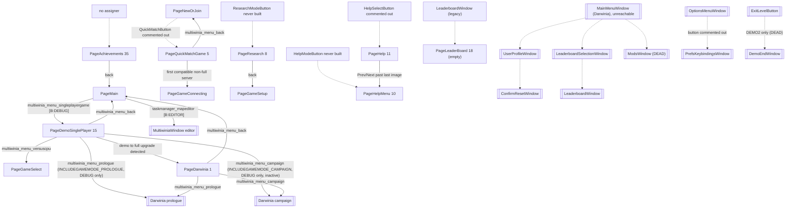

# 09 — Meta systems

> Part A · Baseline build: Release|Win32 (OpenGL) + TARGET_PC_FULLGAME ([B:FULL]); see _work/build_matrix.md.
> Evidence: [C] confirmed · [I] inferred · [U] unknown. Citations are `path:Symbol` relative to the multiwinia/ source root.
> Sources merged: P18_ui_gamemenu, P17b_menus_options, P19_help_tutorial_script, P20_sequences_loaders_bench, P02_game_modes, P15_network, P16_sound, P14_platform_lib, P17a_ui_framework_editor, P12_render_core, P10_input_camera (routed sections in `_work/routed/09.md` and the `_work/routed/_meta_*.md` notes); generated tables from `_work/drafts/P17b_prefs_accesses.csv`, `P14_platform_lib_pref_keys.csv`, `P17b_strings.csv`, `P02_game_modes_strings.csv`; new script `_work/scripts/S_09_lang_coverage.py`.

## Contents

1. [Scope, build reality and reachability of every screen](#1-scope-build-reality-and-reachability-of-every-screen)
2. [Front-end architecture and full screen flow](#2-front-end-architecture-and-full-screen-flow)
3. [Page-by-page and window-by-window specification](#3-page-by-page-and-window-by-window-specification)
4. [Game setup options](#4-game-setup-options)
5. [Multiplayer front end: versus CPU, quick match, LAN/WAN browser, host/join, lobby](#5-multiplayer-front-end-versus-cpu-quick-match-lanwan-browser-hostjoin-lobby)
6. [Demo/full-game gating and the authentication-key UI](#6-demofull-game-gating-and-the-authentication-key-ui)
7. [Achievements, statistics and leaderboards](#7-achievements-statistics-and-leaderboards)
8. [Help system and tutorial content](#8-help-system-and-tutorial-content)
9. [Attract mode, start sequences, loading screens, animated panels and credits](#9-attract-mode-start-sequences-loading-screens-animated-panels-and-credits)
10. [Localisation coverage](#10-localisation-coverage)
11. [Preferences and every user option](#11-preferences-and-every-user-option)
12. [Constants](#12-constants)
13. [Design notes for the new game](#13-design-notes-for-the-new-game)
- [Open questions and unknowns](#open-questions-and-unknowns)
- [Docs-vs-code discrepancies](#docs-vs-code-discrepancies)
- [IP items](#ip-items)
- [Source map](#source-map)
- [Appendix — dead/legacy code](#appendix--deadlegacy-code)

Cross-references: game-mode rules and the in-match HUD are specified in [01](01_game_modes.md); the UI widget framework (Eclipse windows, `GameMenuButton`, navigation, `m_buttonOrder`, page lifecycle internals) in [28](28_ui_framework.md); the tutorial director state machines, script language, Sepulveda and `StartSequence` timeline in [30](30_scripting_tutorial_and_cutscenes.md); the network protocol, metaserver and authentication internals in [22](22_determinism_and_networking.md); sound-option engine effects in [27](27_audio_engine.md); preference-file and language-file grammars in [29](29_data_formats_reference.md); data packaging and localisation builds in [31](31_platform_build_and_tools.md); fonts in [24](24_rendering.md).

---

## 1 Scope, build reality and reachability of every screen

### 1.1 What is live in the shipped product

In the baseline build the player-visible meta layer is [C] (each row of §1.2 cites the evidence):

- **One full-screen front-end window** (`GameMenuWindow`, Eclipse window name `"multiwinia_mainmenu_title"`) that is a page state machine with 38 page slots, of which **18 are live** (§2, §3).
- **Help and Options** (`HelpAndOptionsWindow`) opened on top of the front end or the in-game Esc menu, leading to **How To Play** help pages and **Settings → {Screen, Graphics, Sound, Other} Options** (§3.20, §11).
- **In-game Esc menu** (`LocationWindow` + `ConfirmExitWindow`), in-game **chat input**, and a **controller-unplugged** dialogue (§3.22).
- The **in-match HUD**: grace-period "press SPACE when ready" countdown, scoreboard, timer, game-over results overlay (owned by [01 §3](01_game_modes.md)); summarised in §3.23.
- **Loading screen** on a background worker thread, and **animated game-mode panels** shown while waiting for players to ready up (§9).
- **Two tutorials** implemented as a help-tab director in `MultiwiniaHelp` running on King-of-the-Hill maps `mp_koth_2P_1` / `mp_koth_3P_1` (§8.4; mechanics in [30 §2](30_scripting_tutorial_and_cutscenes.md)).
- A runtime **demo/full gate** driven by the authentication key (`IS_DEMO`), with a key-entry page, a buy-now page and metaserver-supplied demo limits (§6).

Compiled but never reachable by a player: achievements (all twelve are computed then discarded by a stub), the Achievements page, leaderboards (stub, no backend), quick match (button commented out), user profiles, mods, key rebinding, demo-end screen, the Darwinia main menu, `StartSequence` intro, boot-loader mini-programs, attract mode, benchmark (§1.2, §7, §9, Appendix).

### 1.2 Reachability table of every screen and window

Status vocabulary: **live** = reachable by a player in [B:FULL]; **unreachable** = compiled into [B:FULL] but no call chain from the shipped loop reaches it ([B:LEGACY]); **debug** = only `TARGET_DEBUG` ([B:DEBUG]); **editor** = only `LOCATION_EDITOR` ([B:EDITOR]); **dead** = not compiled in any PC configuration ([B:DEAD]); **gap** = page slot with no enum constant.

#### 1.2.1 `GameMenuWindow` page slots (`code/UI/GameMenuWindow.h` anonymous page enum, `code/game_menu.cpp:s_pageNames`)

`NumPages = 38`; the debug-name table `s_pageNames[38]` has one string per slot including the gaps (removed Xbox Live Arcade, PDLC and Darwinia+ pages); the constructor release-asserts that the two sizes match [C] `code/UI/GameMenuWindow.cpp:GameMenuWindow::GameMenuWindow`.

| Slot | Enum | `s_pageNames` | Status | Evidence | Spec |
|---|---|---|---|---|---|
| 0 | `PageMain` | "Main" | live (default page) | `GameMenuWindow::GameMenuWindow` sets `m_newPage = PageMain` | §3.1 |
| 1 | `PageDarwinia` | "Darwinia" | debug | only entered from `PageDemoSinglePlayer` when the demo→full status changes (`GameMenuWindow::Update`, L548–550); `PageDemoSinglePlayer` is itself debug-only (`code/UI/DarwiniaModeButton.h:DarwiniaModeButton::MouseUp` `#ifdef TARGET_DEBUG`) | §3.19 |
| 2 | `PageGameSelect` | "GameSelect" | live | `DarwiniaModeButton` (non-debug branch), `NewServerButton` | §3.4 |
| 3 | `PageNewOrJoin` | "NewOrJoin" | live | `NewOrJoinButton` | §3.3 |
| 4 | `PageJoinGame` | "JoinGame" | live | `JoinGameButton` | §3.9 |
| 5 | `PageQuickMatchGame` | "QuickMatchGame" | unreachable | `QuickMatchButton` creation commented out in `GameMenuWindow::SetupNewOrJoinPage` with "Removed by Chris. It doesn't work." (L3671–3673) | §5.9 |
| 6 | `PageGameSetup` | "GameSetup" | live (the lobby) | `LevelSelectButton::MouseUp`, `UpdateGameConnectingPage` | §3.6 |
| 7 | `PageGameConnecting` | "GameConnecting" | live | `GameMenuWindow::JoinServer` | §3.12 |
| 8 | `PageResearch` | "Research" | unreachable | `ResearchModeButton` never instantiated | §3.19 |
| 9 | `PageMapSelect` | "MapSelect" | live | `GameTypeButton::MouseUp` | §3.5 |
| 10 | `PageHelpMenu` | "HelpMenu" | unreachable | `HelpModeButton` never instantiated | §3.19 |
| 11 | `PageHelp` | "Help" | unreachable | `HelpSelectButton` creation commented out | §3.19 |
| 12 | `PageAdvancedOptions` | "AdvancedOptions" | live (host with full key) | `AdvancedOptionsModeButton` | §3.7 |
| 13 | — | "XBLASelectSessionType" | gap | no enum constant | — |
| 14 | `PageXBLASignIn` | "XBLASignIn" | dead | no setup function: `SetupNewPage` default case release-asserts "Game menu invalid page" | Appendix |
| 15 | `PageDemoSinglePlayer` | "DemoSinglePlayer" | debug | `DarwiniaModeButton` targets it only under `TARGET_DEBUG` [C] | §3.19 |
| 16 | `PageBuyMeNow` | "BuyMeNow" | live with a demo key ([B:DEMO] runtime) | `BuyNowModeButton`, demo-restricted mode/map/server clicks, inactive Multiplayer button | §6.6 |
| 17 | `PageLeaderBoardSelect` | "LeaderBoardSelect" | unreachable (setup is `return;`) | `GameMenuWindow::SetupLeaderBoardSelectPage` | §7.5 |
| 18 | `PageLeaderBoard` | "Leaderboards" | unreachable (setup is `return;`) | `GameMenuWindow::SetupLeaderboardPage`; only requested by `LeaderboardWindow`, itself unreachable | §7.5 |
| 19 | — | "XBLASelectGameType" | gap | — | — |
| 20 | — | "XBLASelectCustomMatchtype" | gap | — | — |
| 21 | — | "Downloaded PDLC" | gap | — | — |
| 22 | — | "PDLC Upsell" | gap | — | — |
| 23 | `PageAuthKeyEntry` | "AuthKeyEntry" | live | constructor auth gate; `AuthPageButton` in Help and Options | §6.4 |
| 24 | `PagePlayerOptions` | "PlayerOptions" | live | own gamer-tag click in the lobby | §3.8 |
| 25 | `PageSearchFilters` | "SearcHFilters" (sic) | live | `FiltersPageButton` | §3.10 |
| 26 | — | "DarwiniaPlus SP Page" | gap | — | — |
| 27 | — | "DarwiniaPlus MP Page" | gap | — | — |
| 28 | — | "DarwiniaPlus Darwinia Page" | gap | — | — |
| 29 | — | "DarwiniaPlus Darwinia SP Page" | gap | — | — |
| 30 | — | "DarwiniaPlus Darwinia MP Page" | gap | — | — |
| 31 | `PageUpdateAvailable` | "Updates Available Page" | live (only when the metaserver reports a different version) | `UpdatePageButton` | §3.17 |
| 32 | `PageCredits` | "Credits Page" | live | `CreditsButton` | §3.18 |
| 33 | `PageTutorials` | "Tutorial Page" | live (`INCLUDE_TUTORIAL`) | `TutorialPageButton`; `GameMenu::CreateMenu` after a tutorial | §3.2 |
| 34 | `PageError` | "Error Page" | live | `GameMenuWindow::CreateErrorDialogue` | §3.14 |
| 35 | `PageAchievements` | "Achievements Page" | unreachable | no code assigns `m_newPage = PageAchievements`; no `AchievementButton` constructed [C] grep of `code/` | §7.2 |
| 36 | `PageEnterPassword` | "Password Entry" | live | `GameServerButton::MouseUp` on a passworded server | §3.11 |
| 37 | `PageWaitForGameToStart` | "Wait for Game to Start" | live (host only) | `GameMenuWindow::UpdateMultiplayerPage` after `RequestStartGame` | §3.13 |

Counts [C]: **18 live** (0, 2, 3, 4, 6, 7, 9, 12, 16, 23, 24, 25, 31, 32, 33, 34, 36, 37); **10 compiled-but-unreachable** (1, 5, 8, 10, 11, 14, 15, 17, 18, 35 — of which 1 and 15 are debug-reachable and 14 has no setup); **10 gap slots** (13, 19, 20, 21, 22, 26, 27, 28, 29, 30). 18 + 10 + 10 = 38.

Resolved: P20 described `PageDarwinia` (and hence `CampaignButton`) as "edge-reachable in FULL"; the code shows its only entry is from `PageDemoSinglePlayer`, which `DarwiniaModeButton::MouseUp` selects only `#ifdef TARGET_DEBUG` (the non-debug branch goes straight to `PageGameSelect`) [C] `code/UI/DarwiniaModeButton.h`, `code/UI/GameMenuWindow.cpp:GameMenuWindow::Update`. `PageDarwinia` is therefore [B:DEBUG], and the `RequestBootloaderSequence` fade-out bug of §9.2.6 is latent, not player-visible, in [B:FULL].

#### 1.2.2 Eclipse windows other than `GameMenuWindow`

"Reachable" = there is a call chain from the shipped game loop to `EclRegisterWindow(new X)`; each entry was traced with a grep for `new X` over `code/` [C].

| Window class (Eclipse name) | File | Opened from | Status | Spec |
|---|---|---|---|---|
| `GameMenu` (controller object, not a window) | `code/game_menu.cpp` | `App::Initialise` (`m_gameMenu = new GameMenu()`); `MainMenuLoop` calls `CreateMenu()` | live | §2.1 |
| `GameOptionsWindow` (base of full-screen menu windows) | `code/interface/mainmenus.cpp` | base class | live | [28](28_ui_framework.md) |
| `HelpAndOptionsWindow` ("multiwinia_menu_helpandoptions") | `code/interface/helpandoptions_windows.cpp` | `HelpAndOptionsButton::MouseUp`, instantiated by `GameMenuWindow::SetupMainPage` and `LocationWindow::Create` | live | §3.20 |
| `SelectHelpWindow` ("multiwinia_menu_selecthelp", "How To Play") | `code/interface/helpandoptions_windows.cpp` | `HelpWindowButton` | live | §3.20, §8.1 |
| `GeneralHelpWindow` ("multiwinia_help_general") | same | `HelpTypeButton` with `m_helpType == -1` | live | §8.1 |
| `GameTypeHelpWindow` (name = game-type blueprint name) | same | `HelpTypeButton` with `m_helpType = i` | live | §8.1 |
| `CrateHelpWindow` ("Crate Information") | same | `CrateHelpWindowButton`, created only `#ifdef INCLUDE_CRATE_HELP_WINDOW` (defined only by `TARGET_DEBUG`) | debug | §3.20 |
| `OptionsMenuWindow` ("dialog_options", "Settings") | `code/interface/mainmenus.cpp` | `OptionsButton::MouseUp` in `HelpAndOptionsWindow`; re-created by `SetScreenButton::MouseUp` | live | §11.4 |
| `PrefsScreenWindow` ("dialog_screenoptions") | `code/interface/prefs_screen_window.cpp` | `ScreenOptionsButton` | live | §11.5 |
| `PrefsGraphicsWindow` ("dialog_graphicsoptions") | `code/interface/prefs_graphics_window.cpp` | `GraphicsOptionsButton` | live | §11.6 |
| `PrefsSoundWindow` ("dialog_soundoptions") | `code/interface/prefs_sound_window.cpp` | `SoundOptionsButton` | live | §11.7 |
| `PrefsOtherWindow` ("dialog_otheroptions") | `code/interface/prefs_other_window.cpp` | `OtherOptionsButton` | live | §11.8 |
| `PrefsKeybindingsWindow` ("dialog_inputoptions", "Control Options") | `code/interface/prefs_keybindings_window.cpp` | `KeybindingsOptionsButton`, whose only instantiation in `OptionsMenuWindow::Create` is commented out | unreachable | §11.9 |
| `LocationWindow` ("dialog_locationmenu", in-game Esc menu) | `code/interface/mainmenus.cpp` | `LocationGameLoop` on `ControlMenuEscape`; re-created by Other/Screen Options apply when not at the main menu | live | §3.22 |
| `ConfirmExitWindow` ("multiwinia_confirmexit") | same | `ConfirmExitButton` in `LocationWindow` while the game is not over | live | §3.22 |
| `ChatInputWindow` ("location_chat") | `code/interface/chatinput_window.cpp` | `LocationInput::Advance` on `ControlLobbyChat` (Enter) with no windows open and keyboard input mode | live | §5.13 |
| `ChatInputField` (button) | same | inside `ChatInputWindow`; embedded in the lobby page | live | §5.13 |
| `ControllerUnpluggedWindow` ("controller_unplugged") | `code/interface/controllerunplugged_window.cpp` | `HandleCommonConditions` on `ControlControllerUnplugged` (XInput unplug), `#ifdef TARGET_MSVC` | live | §3.22 |
| `MultiwiniaWindow` (map editor front page) | `code/interface/multiwinia_window.cpp` | `MultiwiniaEditorButton` (`LOCATION_EDITOR` only) and the unreachable `MainMenuWindow` | editor | [08](08_levels_and_level_design.md) |
| `MultiwiniaOptionsWindow` ("multiwiniaoptions_window") | `code/interface/multiwiniaoptions_window.cpp` | `LocationEditor` mode; whole file `#ifdef LOCATION_EDITOR` | editor | [08](08_levels_and_level_design.md) |
| `MainMenuWindow` ("dialog_mainmenu", Darwinia global-world Esc menu) | `code/interface/mainmenus.cpp` | `GlobalWorldGameLoop` on Esc — that loop sets `m_atMainMenu = true` and `break`s on its first iteration | unreachable | Appendix A.5 |
| `UserProfileWindow` ("dialog_profile") | `code/interface/userprofile_window.cpp` | `MainMenuUserProfileButton` in `MainMenuWindow` | unreachable | Appendix A.6 |
| `NewUserProfileWindow` ("dialog_newprofile") | same | `NewProfileWindowButton`, only instantiation commented out | unreachable | Appendix A.6 |
| `ConfirmResetWindow` ("multiwinia_confirmreset") | `code/interface/mainmenus.cpp` | `ConfirmResetButton` in `UserProfileWindow` | unreachable | Appendix A.6 |
| `LeaderboardSelectionWindow` ("leaderboardselection") | `code/interface/leaderboards_window.cpp` | `LeaderBoardButton` in `MainMenuWindow`, created `m_inactive = true`; `MouseUp` returns when inactive | unreachable (doubly) | §7.5 |
| `LeaderboardWindow` ("leaderboards") | same | `LeaderBoardTypeButton` in `LeaderboardSelectionWindow` | unreachable (stub, no data source) | §7.5 |
| `ResetLocationWindow` ("dialog_resetlocation") | `code/interface/mainmenus.cpp` | `ResetLevelButton`, never instantiated | unreachable | Appendix A.5 |
| `AboutDarwiniaWindow` ("about_darwinia") | same | `AboutDarwiniaButton`, only `#ifdef OBERONBUILD` | dead | Appendix A.5 |
| `ModsWindow` ("dialog_mods"), `NewModWindow` ("dialog_createnewmod") | `code/interface/mods_window.cpp` | file body `#ifdef USE_DARWINIA_MOD_SYSTEM` + pref `ModSystemEnabled` | dead | Appendix A.7 |
| `DemoEndWindow` ("DemoEnd") | `code/interface/demoend_window.cpp` | `ExitLevelButton::MouseUp` only `#ifdef DEMO2` | dead (compiled, never instantiated) | §6.6, Appendix A.8 |
| `ReallyQuitWindow` ("Really Quit?") | `code/interface/reallyquit_window.cpp` | `DebugKeyBindings::ReallyQuitButton` — no caller | unreachable | Appendix A.5 |
| `SaveOnQuitWindow` ("editor_savesettings") | `code/interface/save_on_quit_window.cpp` | `SoundSystem::AreBlueprintsModified` after an unconditional `return false;`, inside `#ifdef SOUND_EDITOR` | dead | Appendix A.5 |
| `ProfileWindow` ("Profiler", CPU profiler) | `code/interface/profilewindow.cpp` | `DebugKeyBindings::ProfileButton` from `CheatWindow` (`CHEATMENU_ENABLED`) and `DebugMenu` | debug | [32](32_debug_test_and_performance.md) |

#### 1.2.3 Full-screen sequences and overlays (not Eclipse windows)

| Screen | Implementation | Status | Evidence | Spec |
|---|---|---|---|---|
| Loading screen (spinner, first-run publisher logo, rating notice) | `code/loading_screen.cpp:LoadingScreen` | live | created in `code/main.cpp:Initialise`; used at start-up, every level load, map-select thumbnail preload | §9.2 |
| Animated game-mode panel | `code/animatedpanel*.cpp`, `code/multiwiniahelp.cpp:MultiwiniaHelp::RenderAnimatedPanel` | live | grace period, not in a tutorial | §9.3 |
| Grace-period ready/countdown overlay | `code/multiwinia.cpp:Multiwinia::RenderOverlay_GracePeriod` | live | every match | §3.23, [01 §3.7](01_game_modes.md) |
| In-match HUD and game-over results overlay | `code/multiwinia.cpp:Multiwinia::Render` | live | every match | §3.23, [01 §3.10](01_game_modes.md) |
| Rocket Riot status panel | `code/rocket_status_panel.cpp:RocketStatusPanel` | live (Rocket Riot) | `Multiwinia::RenderRocketStatusPanel` | §7.4.2 |
| In-game contextual help messages | `code/multiwiniahelp.cpp:MultiwiniaHelp::Render` | live (pref `HelpEnabled`) | — | §8.2 |
| Tutorial instruction tabs | `MultiwiniaHelp::RenderTutorialHelp` | live (tutorials only) | `INCLUDE_TUTORIAL` | §8.4 |
| Objective tabs (non-tutorial) | `MultiwiniaHelp::Render` | unreachable (renderer under a never-defined macro) | §8.3 | §8.3 |
| Gamepad control prompts | `code/control_help.cpp:ControlHelpSystem` | live in gamepad mode only (pref `ControlHelpEnabled`) | — | [06](06_player_control_and_input.md) |
| Overlay error dialogue inside `GameMenuWindow` (`RenderErrorDialogue`) | `code/UI/GameMenuWindow.cpp` | unreachable (`m_showingErrorDialogue` assignments commented out) | — | §3.14 |
| `StartSequence` first-time intro | `code/startsequence.cpp` | unreachable (only constructed in `RunBootloader`, which is `#ifdef USE_LOADERS`) | `code/main.cpp:RunBootloader` | §9.4.2, [30 §6](30_scripting_tutorial_and_cutscenes.md) |
| Boot-loader mini-programs (Spectrum, Matrix, Fodder, Raytrace, Soul, Game of Life ×2, Amiga) | `code/loaders/*` | dead (`USE_LOADERS` commented out) | `code/lib/universal_include.h` L68 | §9.5, Appendix A.1 |
| Credits roll with carrier sprites | `code/loaders/credits_loader.cpp:CreditsLoader` | unreachable (Darwinia ending and script op only) | §9.6.2 | §9.6.2 |
| Front-end credits page | `GameMenuWindow::SetupCreditsPage` | live | — | §3.18 |
| Attract mode | `code/attract.cpp:AttractMode` | dead (`ATTRACTMODE_ENABLED` defined nowhere) | `code/app.cpp:App::App` L394–396 | §9.7 |
| Demo end sequence (prologue) | `code/demoendsequence.cpp` | dead (`USE_SEPULVEDA_HELP_TUTORIAL`) | — | [30 §7](30_scripting_tutorial_and_cutscenes.md) |
| Distributor splashes (`EgamesLoader`, `OberonLoader`) | `code/loaders/egames_loader.cpp`, `code/loaders/oberon_loader.cpp` | dead | — | Appendix A.1 |
| Benchmark recorder / FTP upload | `code/benchmark.cpp` | dead (`BENCHMARK_AND_FTP` commented out) | — | [32](32_debug_test_and_performance.md) |
| Darwinia context help (`HelpSystem`) | `code/helpsystem.cpp` | dead (`USE_SEPULVEDA_HELP_TUTORIAL`) | — | Appendix A.4 |

**Key consequence for the new game.** The only live option screens are Settings → {Screen, Graphics, Sound, Other}, reached through *Help and Options* from both the front end and the in-game Esc menu. Everything that would need a persistent online service (achievements, leaderboards, statistics, profiles) is absent or stubbed in this source release.

---
## 2 Front-end architecture and full screen flow

### 2.1 Lifecycle: `GameMenu` (controller) and `GameMenuWindow` (the screen)

`GameMenu` is a persistent controller object owned by `App` (`g_app->m_gameMenu`, created once in `App::Initialise`) — **not a window** [C] `code/app.cpp:App::Initialise`. It owns the map catalogue, the 3D backdrop and creation/destruction of the one front-end window, `GameMenuWindow` ("multiwinia_mainmenu_title", the name doubles as the phrase id of the title) [C] `code/game_menu.cpp`, `code/UI/GameMenuWindow.cpp`. Everything else (pages, transitions, lobby logic, browser) lives in `GameMenuWindow`.

| Step | Behaviour | Ref |
|---|---|---|
| Main loop | `MainMenuLoop` runs while `g_app->m_atMainMenu`; whenever `!m_gameMenu->m_menuCreated` and the renderer fade is complete it calls `GameMenu::CreateMenu()` | [C] `code/main.cpp:MainMenuLoop` |
| `GameMenu::GameMenu()` | zero `m_numDemoMaps[7]`; `CreateMapList()` (§2.4); `m_clouds = new Clouds(); m_clouds->Advance()` | [C] `code/game_menu.cpp:GameMenu::GameMenu` |
| `GameMenu::CreateMenu()` | `Renderer::StartFadeIn(0.25)`; `RemoveAllWindows()`; `g_app->m_multiwinia->Reset()`; `EclRegisterWindow(new GameMenuWindow())`; camera `RequestMode(ModeSphereWorldFocus)`, `SetTarget((-900, 3000, 3970), front (0, 0.5, -1))`, `CutToTarget()`, `SetDebugMode(0)`; `g_app->m_gameMode = GameModeNone`; if `g_app->m_multiwiniaTutorial` is set (returning from a tutorial) the new window's `m_newPage = PageTutorials`; clear the flag; `m_menuCreated = true` | [C] `code/game_menu.cpp:GameMenu::CreateMenu` |
| `GameMenuWindow` constructor | full screen (0, 0, ScreenW, ScreenH), not resizable / movable / closeable; `m_currentPage = -1`, `m_newPage = PageMain`; **auth gate**: `Authentication_GetKey`, `Authentication_SimpleKeyCheck(key, METASERVER_GAMETYPE_MULTIWINIA)`; if not `AuthenticationAccepted` → `m_newPage = PageAuthKeyEntry` (a stored value `"authkey not found"` is blanked) — gate compiled out under `MULTIWINIA_DEMOONLY`; player name from pref `PlayerName` (default token `multiwina_playername_default` → localised "NewPlayer"), every `%` replaced by a space, stored through `PlayerNameString::Set` (which also writes the pref and saves the prefs file); browser filters from prefs `FilterShowDemos`, `FilterShowIncompatible`, `FilterShowFullGames`, `FilterShowCustomMaps`, `FilterShowPassworded` (all default 1) | [C] `code/UI/GameMenuWindow.cpp:GameMenuWindow::GameMenuWindow` |
| First `Update` | page −1 → `SetupNewPage(m_newPage)`; on the first update after the sound system is ready the window triggers interface sound `LobbyAmbience` | [C] `GameMenuWindow::Update` |
| Leaving to a game | the server's sequenced `NET_DARWINIA_START_GAME` sets `m_loadingLocation = true`, `m_requestedLocationId = 999`, `m_gameMode = GameModeMultiwinia`, `m_atMainMenu = false`, `m_hideInterface = false`, `m_atLobby = false`, `g_gameTimer.Reset()`; `MainMenuLoop` exits, stops sound `"MultiwiniaInterface LobbyAmbience"`, calls `GameMenu::DestroyMenu()` (removes the window, fade out) | [C] `code/network/clienttoserver.cpp` (START_GAME handler L2607–2625), `code/main.cpp:MainMenuLoop`, `code/game_menu.cpp:GameMenu::DestroyMenu` |
| Returning | the in-game menu's leave button sets `m_requestedLocationId = -1` and `m_atMainMenu = true`; the main-menu loop re-creates a **fresh** `GameMenuWindow` at `PageMain` (or `PageTutorials` after a tutorial, or `PageAuthKeyEntry` if the key has become invalid). No lobby state survives except preferences | [C] `code/interface/mainmenus.cpp:ExitLevelButton::MouseUp`; [I] fresh object ⇒ no carried state |
| Results | the end-of-game results are an **in-game overlay** drawn by `Multiwinia::Render` (§3.23); the front end has no results page | [C] absence of a results page in the `GameMenuWindow.h` enum |

Resolved: P02 described "game over → press `ControlToggleReady` → lobby" as the way back to the menu. In [B:FULL] the `GameOver()` block in `LocationInput::Advance` is empty — the `ToggleReady`-to-exit branch exists only `#ifdef TESTBED_ENABLED` (L1232–1262) [C] `code/location_input.cpp:LocationInput::Advance`. The only live exit is Esc → `LocationWindow` → "Exit Game", which in a finished game is the `ExitLevelButton` directly (no confirmation) [C] `code/interface/mainmenus.cpp:LocationWindow::Create`. The on-screen prompt "Press ESC to Exit" (`multiwinia_spacetoexit` / gamepad "Press START to Exit") is therefore accurate for the shipped build.

### 2.2 Shared screen layout (every front-end page and every `GameOptionsWindow`)

[C] `code/game_menu.cpp:GetPositions`, `GetPosition_TitleBar`, `GetPosition_LeftBox`, `GetPosition_RightBox`, `GetFontSizes`, `GetButtonSizes` (W = screen width px, H = screen height px).

| Quantity | Formula |
|---|---|
| `horizSplit` | 0.26·H |
| `vertSplit` | 0.6·W |
| `gap` | 0.05·vertSplit (= 0.03·W) |
| outer edges | left = top = gap; right = W − gap; bottom = H − gap; if W/H > 1.4 (widescreen): left += 0.08·W, right −= 0.08·W |
| Title bar | x = left, y = top, w = right − left, h = horizSplit − 0.5·gap − top |
| Left box | x = left, y = horizSplit + 0.5·gap, w = vertSplit − 0.5·gap − left, h = bottom − y |
| Right box | x = vertSplit + 0.5·gap, y = horizSplit + 0.5·gap, w = right − x, h = bottom − y |
| Fonts | large = 0.095·H, med = 0.04·H, small = 0.022·H |
| Standard button | w = 0.9·leftW, h = 1.3·med (= 0.052·H), gap = 0.1·med (= 0.004·H) |

Standard page skeleton (e.g. `GameMenuWindow::SetupNewOrJoinPage`) [C]: buttons centred in the left box at `buttonX = leftX + (leftW − buttonW)/2`; title `GameMenuTitleButton` "title" at (leftX + 10, leftY + 10, leftW − 20, 1.5·buttonH), med font, rendered upper-cased, shrunk to fit, over a highlight beam (`code/game_menu.cpp:GameMenuTitleButton::Render`); first stacked button at `yPos = leftY + 0.5·buttonH + 1.3·buttonH + (buttonH + gap)`, each further button `+= buttonH + gap`; Back at `leftY + leftH − 2·buttonH`; the right box carries an information panel (image, description, MOTD or chat) outside the navigation order.

Symbols used in the page tables below: `bx` = buttonX, `bw`/`bh` = standard button width/height, `lX/lY/lW/lH`, `rX/rY/rW/rH` = left/right box. "Base MouseUp" = `GameMenuButton::MouseUp`: plays `MenuSelect` (or `MenuCancel` when `m_transitionDirection == -1`) and starts a 1.0 s menu transition in that direction [C] `code/game_menu.cpp:GameMenuButton::MouseUp`. Page building, transitions, `BackPageButton` semantics ("Back(prev)" returns to whatever page was showing before, because `SetupNewPage` assigns `m_currentPage` last) and controller navigation are specified in [28 §12](28_ui_framework.md).

### 2.3 Persistent background behind every page

`GameMenuWindow::Render` draws, in order [C]:

1. **`RenderBigDarwinian()`** (static; also used by other menus, `code/interface/mainmenus.cpp`, `code/game_menu.cpp:GameMenuDropDownWindow::Render`): full-screen additive quad, black at three corners and RGB (1.0, 0.5, 0.1) at the bottom-left vertex (smooth-shaded glow); a giant mascot sprite (`sprites/darwinian.bmp`, nearest filtering, tint (1, 0, 0, 1)) centred at (0.75·W, 0.7·H), half-size `0.3·W + 5·sin(t)` px (breathing), quad rotated 0.2 rad; in high detail 10 echo copies, each `size *= 1.02`, centre shifted (−6, −6) px, tint (1, 0.2, 0.2) alpha `0.2·(1 − i/10)`; a rotating gear (`mwhelp/gear.bmp`) half-size 0.6·W centred on screen, angle `0.2·t` rad, additive white alpha 0.06, drawn 10 times each rotated a further 0.02 rad (0 times in low detail). Detail switch (only evaluated while `Multiwinia::GameInLobby()`): `smoothFps = smoothFps·(1 − k) + fps·k`, `k = g_advanceTime·0.5`; low detail when `smoothFps < 20`, high again when `≥ 60` (hysteresis), initial 60 [C] `GameMenuWindow::RenderBigDarwinian`.
2. **Title bar**: fill box; if the localised `multiwinia_mainmenu_title` equals `"MULTIWINIA"` the bitmap `textures/mwtitle.bmp` is drawn (width = title-font text width for that many characters at large size × 1.1, height = width/5.4, top at titleY + 0.1·titleH), otherwise the text is drawn with outline; subtitle `multiwinia_mainmenu_subtitle` at med size one large line below; logo `icons/mwlogo.bmp` (aspect 277/194, height 0.8·titleH) at x = titleX + 0.05·titleW and mirrored at the right.
3. **Per-page content boxes** (`DrawFillBox`, shadowed panel): GameSetup → left + right; JoinGame and Achievements → one box of title-bar width; GameConnecting → left; GameSelect / MapSelect / LeaderBoardSelect / AdvancedOptions / DemoSinglePlayer / BuyMeNow → left + right; Main → left, plus MOTD box (right, height rightH, or 0.75·rightH when the auth box is shown) once a MOTD has arrived, plus the auth box (rightY + 0.8·rightH, height 0.2·rightH) when `ShowAuthBox()`; all other pages → left only.
4. **Overlays**: JoinGame with an empty list → blinking "requesting list" / "no servers found" caption (§5.8.1); Achievements → blinking "loading achievements" caption (blink: alpha 1.0 for the first 0.5 s of each second, 0.5 otherwise) [C] `RenderRequestingEffect`, `RenderLoadingAchievementsEffect`.
5. **Buttons** (`EclWindow::Render`); if a drop-down list is open (`GameMenuDropDownWindow::s_window`) only the button owning it is drawn.

The 3D backdrop behind the window is `GameMenu::Render()`, called by `Renderer::RenderFrame` when `m_atMainMenu && m_menuCreated` and by the loading screen: `Camera::Advance`; camera at the origin, FOV 90; eye (0, 600, 0), front (0, 0, 1), up (0, 1, 0), each rotated about Y by −1.899 rad then about Z by −1.079 rad; focus = eye + front×100; `m_clouds->Render(−GetHighResTime())` (sky grid + cloud layers; the Sky Detail option applies) [C] `code/game_menu.cpp:GameMenu::Render`, `code/renderer.cpp:Renderer::RenderFrame`.

### 2.4 Map catalogue built at start-up (`GameMenu::CreateMapList`, `GameMenu::AddMap`)

1. `Resource::ListResources("levels/", "mp_*", false)`; each name ending in `.txt` is opened with a `TextReader` and passed to `AddMap` [C] `code/game_menu.cpp:GameMenu::CreateMapList`.
2. `AddMap` creates a `MapData` (`code/UI/MapData.h`) with `m_fileName` and reads tokenised header lines until `MultiwiniaOptions_EndDefinition`:

| Token | Field / effect |
|---|---|
| `Name` | `m_levelName` = rest of line |
| `GameTypes` | each following token compared (`strcmp`, case-sensitive) with each blueprint's `m_name`; on a match the map is appended to `m_maps[j]` and `m_gameTypes[j] = true` |
| `NumPlayers` | `m_numPlayers = atoi(next)` |
| `Author` | `m_author` = rest of line (not displayed) |
| `Description` | `m_description` = rest of line (displayed for custom maps only) |
| `PlayTime` | `m_playTime = atoi(next)` (minutes) |
| `Difficulty` | `m_difficulty` = next token (`basic` / `intermediate` / `advanced`) |
| `CoopMode` | `m_coop = true` |
| `ForceCoop` | `m_forceCoop = true` |
| `OfficialLevel` | `m_officialMap = true` |

3. `MapData::CalculeMapId()` → `m_mapId = LevelFile::CalculeCRC(filename)` (CRC of `levels/<file>`); `−1` (unreadable) marks `m_customMap` [C] `code/UI/MapData.cpp:MapData::CalculeMapId`, `code/level_file.cpp:LevelFile::CalculeCRC`.
4. If `IS_DEMO`: for each game type the map supports, `m_numDemoMaps[j]++` when `App::IsMapAvailableInDemo(j, mapId)` [C].
5. A map with no recognised game type is discarded (log "Discarded map … because it didn't contain a game type"); otherwise added to `m_allMaps`. The count of `OfficialLevel` maps is passed to `AchievementTracker::SetNumLevels(n)` (stored, never used) [C] `code/game_menu.cpp` L757.
6. Per game type, bubble sort: ascending `m_numPlayers`, ties by difficulty rank (substring `basic` = 1, `inter` = 2, `advan` = 3, else 0) [C].
7. `#ifdef LOCATION_EDITOR` [B:EDITOR]: player maps `*.mwm` from `App::GetMapDirectory()` are also loaded through `MapFile`.

Quirk [C]: a map whose `GameTypes` line lists one type twice is appended to `m_maps[j]` twice. The shipped map list per mode is catalogued in [08](08_levels_and_level_design.md).

`MapData` fields: `m_fileName`, `m_levelName`, `m_description`, `m_author`, `m_difficulty` (all `char*`, default NULL, freed by `~MapData`); `m_numPlayers` (int, 0); `m_playTime` (int, 0); `m_coop`, `m_forceCoop`, `m_officialMap`, `m_customMap` (bool, false); `m_mapId` (int, −1); `m_gameTypes[MAX_GAME_TYPES = 7]` (bool) [C] `code/UI/MapData.h`. `CalculeMapId` is re-run before every start/permission check in the lobby [C] `GameMenuWindow::UpdateMultiplayerPage`, `code/UI/PlayGameButton.h`.

### 2.5 Full live screen flow (front end → lobby → game → results → front end)

Edge labels are button caption phrase ids (or the condition). Double-bordered nodes are separate Eclipse windows layered over the page underneath. [C] for every edge (sources: the `Setup*Page` functions and button `MouseUp` handlers cited in §3).

Notes [C] unless stated:

- `GSANY`, `GSSP` and `GSMP` are the same page; single player vs multiplayer is the boolean `m_singlePlayer` (set by `DarwiniaModeButton`, cleared by `SetupMainPage` / `SetupNewOrJoinPage` because LAN/WAN play is compiled in).
- `PageBuyMeNow` "Back(prev)" returns to whichever page opened it (Main, GameSelect, MapSelect or JoinGame); only the Main edge is drawn.
- `PageError` stores its back page in `m_errorBackPage` (default `PageMain`); browser-row errors and "server full" / "bad password" disconnects use `PageJoinGame`; kick, duplicate key and connection errors use `PageMain`; any other disconnect reason sends the window straight to `PageMain` without an error page [C] `code/UI/GameServerButton.h:GameServerButton::MouseUp`, `code/network/clienttoserver.cpp` disconnect handler.
- After a Screen-Options Apply the user lands back on Screen Options (all windows rebuilt); after an Other-Options Apply that changed language or large-menu mode all windows are removed and the user lands on `PageMain` (front end) or a fresh `LocationWindow` (in game) — not back in Other Options [C] `code/interface/prefs_screen_window.cpp:SetScreenButton::MouseUp`, `code/interface/prefs_other_window.cpp:ApplyOtherButton::MouseUp`.
- `ControllerUnpluggedWindow` can appear over any screen (§3.22.4).

### 2.6 Compiled-but-unreachable and non-baseline flow

### 2.7 Back / Esc rules and front-end audio

- Every full-screen window registers a Back `MenuCloseButton` as `m_backButton`; `DarwiniaWindow::Update` invokes it on `ControlMenuClose` (gamepad Back or B) [C] `code/interface/darwinia_window.cpp:DarwiniaWindow::Update`. Keyboard Esc (`ControlMenuEscape`, `key esc down` / `XInput start down`) inside `LocationGameLoop` removes **all** windows at once (and unhides the interface) rather than going back one level [C] `code/main.cpp:LocationGameLoop`, `data/input/input_preferences.txt` L1, L10–12.
- Windows stack: each new window registers on top; closing one reveals the one beneath.
- Front-end interface sound events (all `SoundSourceBlueprint::TypeMultiwiniaInterface`) [C]:

| Event | When | Ref |
|---|---|---|
| `LobbyAmbience` | first update once sounds are ready; stopped (`"MultiwiniaInterface LobbyAmbience"`) when leaving the main-menu loop | `GameMenuWindow::Update`, `code/main.cpp:MainMenuLoop` |
| `MenuSelect` | forward button press (base MouseUp), level-row click, editor button | `code/game_menu.cpp:GameMenuButton::MouseUp`, `code/UI/LevelSelectButton.h` |
| `MenuCancel` | buttons with `m_transitionDirection == -1` that call the base MouseUp (Done, Play Demo) play it instead of `MenuSelect` (Paste and the auth status box set −1 but never call the base, so they are silent); every `BackPageButton` (direction left at +1) plays `MenuSelect` via the base call **and then** `MenuCancel`, and re-initialises the transition with direction −1 | same, `code/game_menu.cpp:BackPageButton::MouseUp` |
| `MenuRollOver` | focus moves to a new button (base render, level rows, colour rows) | `GameMenuButton::Render`, `code/UI/LevelSelectButton.h`, `code/UI/FancyColourButton.h` |
| `ChatMessage` | lobby chat message received (not join notices) | `GameMenuWindow::NewChatMessage` |

---
## 3 Page-by-page and window-by-window specification

Conventions: **#** = position in the controller navigation list `m_buttonOrder` (— = not navigable: decorative/info widget); **Name** = Eclipse button name (unique per page; also the key for `<name>_description` help text); **Caption** = phrase id passed to `LANGUAGEPHRASE` (a missing id renders as the id itself [C] `code/lib/language_table.cpp:LangTable::LookupPhrase`). Geometry symbols per §2.2.

### 3.1 PageMain (0) — title screen

[C] `GameMenuWindow::SetupMainPage`, `GameMenuWindow::UpdateMainPage`. On setup: `m_singlePlayer = false` (LAN/WAN compiled in), `m_settingUpCustomGame = false`, `m_localSelectedLevel = -1`.

| # | Class (file) | Name | Caption | Shown when | Action on click |
|---|---|---|---|---|---|
| — | `GameMenuTitleButton` (`code/game_menu.h`) | `title` | `multiwinia_menu_mainmenutitle` | always | — |
| 1 | `TutorialPageButton` (`code/UI/TutorialButton.h`) | `multiwinia_menu_tutorial_short` | `multiwinia_menu_tutorial_short` ("Tutorials") | `INCLUDE_TUTORIAL` **and demo key** (listed first for demo users) | base MouseUp; → `PageTutorials` |
| 2 | `DarwiniaModeButton` (`code/UI/DarwiniaModeButton.h`) | `multiwinia_menu_singleplayergame` | same | always | base MouseUp; `m_singlePlayer = true`; → `PageGameSelect` ([B:DEBUG]: → `PageDemoSinglePlayer`) |
| 3 | `NewOrJoinButton` (`code/UI/NewOrJoinButton.h`) | `multiwinia_menu_multiplayergame` | same | always; `m_inactive = !App::MultiplayerPermitted()` | base MouseUp; inactive → `PageBuyMeNow`, else → `PageNewOrJoin` (`MULTIPLAYER_DISABLED` builds: inactive click ignored) |
| 4 | `TutorialPageButton` | `multiwinia_menu_tutorial_short` | same | `INCLUDE_TUTORIAL` **and full key** | → `PageTutorials` |
| 5 | `HelpAndOptionsButton` (`code/interface/mainmenus.h`) | `helpandoptions` | `multiwinia_menu_helpandoptions` | always | base MouseUp; opens `HelpAndOptionsWindow` as child; `m_doMenuTransition = true` |
| (6) | `StartTestbedButton` ×2 (`code/UI/TestBedButtons.h`) | `start_testbed_server` | `start_testbed_server`, `start_testbed_client` | `TESTBED_ENABLED` [B:DEAD] | Appendix |
| (7) | `MultiwiniaEditorButton` (`code/UI/MultiwiniaEditorButton.h`) | `editor` | `taskmanager_mapeditor` | `LOCATION_EDITOR` [B:EDITOR]; inactive with a demo key | inactive → `PageBuyMeNow`; else sound `MenuSelect`, transition, open `MultiwiniaWindow` |
| 8 | `UpdatePageButton` (`code/UI/update_page_buttons.h`) | `multiwinia_update` | `multiwinia_update_available` | metaserver datum `LatestVersion` present and ≠ `APP_VERSION` | base MouseUp; → `PageUpdateAvailable` |
| 9 | `CreditsButton` (`code/UI/credits_button.h`) | `credits_button` | `dialog_credits` | always | base MouseUp; → `PageCredits` |
| 10 | `BuyNowModeButton` (`code/UI/BuyNowModeButton.h`) | `multiwinia_menu_buyfullgame` | same | `IS_DEMO` | base MouseUp; → `PageBuyMeNow` |
| 11 | `QuitButton` (`code/UI/QuitButton.h`) | `multiwinia_menu_quit` | same | always, at `lY + lH − 2bh` | `g_app->m_requestQuit = true` (no sound, no transition) |
| — | `MOTDButton` (`code/UI/motdButton.h`) | `multiwinia_motd` | — | right box (rX + 0.05rW, rY + 0.05rH, 0.9rW, 0.675rH), small font | §5.15 |
| — | `AuthStatusButton` (`code/UI/AuthStatusButton.h`) | `multiwinia_authStatus` | — | right box (rX + 0.05rW, rY + 0.85rH, 0.9rW, 0.18rH), med font; drawn only if `ShowAuthBox()` | none (`MouseUp` empty) — §6.5 |

`UpdateMainPage` (also run on `PageTutorials`, and on `PageDemoSinglePlayer` during a tutorial): (a) if `m_singlePlayer` and no local server → `App::StartMultiPlayerServer()`; (b) once per process (function-static flag) polls `MetaServer_RequestData(NET_METASERVER_DATA_LATESTVERSION)`; when it first arrives and differs from `APP_VERSION` the main page is rebuilt so the Update button appears [C].

### 3.2 PageTutorials (33) [B:FULL] (`INCLUDE_TUTORIAL`)

[C] `GameMenuWindow::SetupTutorialPage`, `code/UI/TutorialButton.h`. On setup also `g_app->m_multiwiniaHelp->m_currentTutorialHelp = -1`.

| # | Class | Name | Caption → English | Condition | Action |
|---|---|---|---|---|---|
| — | `GameMenuTitleButton` | `title` | `multiwinia_menu_tutorial_short` "Tutorials" | | |
| 1 | `TutorialButton` (`m_tutorialType = App::MultiwiniaTutorial1`) | `multiwinia_menu_tutorial1` | "Part 1: The Basics" | inactive if map `MAPID_MP_KOTH_2P_1` is not in the KOTH list or not permitted (always inactive under `TARGET_PC_HARDWARECOMPAT`) | ignore if inactive or `m_quickStart`; base MouseUp; `m_singlePlayer = true`, `m_quickStart = true`, `g_app->m_multiwiniaTutorial = true`, `g_app->m_multiwiniaTutorialType = type`, `m_lockMenu = true` (freezes navigation) |
| 2 | `TutorialButton` (`MultiwiniaTutorial2`) | `multiwinia_menu_tutorial2` | "Part 2: Advanced Concepts" | needs `MAPID_MP_KOTH_3P_1` | same |
| 3 | `BackPageButton(PageMain)` | `multiwinia_menu_back` | | | → Main |

Launch sequence: §5.1.3. Tutorial content: §8.4.

### 3.3 PageNewOrJoin (3) — host or join

[C] `GameMenuWindow::SetupNewOrJoinPage`. Sets `m_xblaSessionType = -1`, `m_singlePlayer = false`, `m_settingUpCustomGame = false`.

| # | Class | Name | Caption | Condition | Action |
|---|---|---|---|---|---|
| — | `GameMenuTitleButton` | `title` | `multiwinia_neworjoin_title` | | |
| 1 | `NewServerButton` (`code/UI/NewServerButton.h`) | `multiwinia_menu_hostgame` | same | `m_disabled = !App::HostGamePermitted()` | base MouseUp; → `PageGameSelect` (whose setup starts the advertised server) |
| 2 | `JoinGameButton` (`code/UI/JoinGameButton.h`) | `multiwinia_menu_joingame` | same | always | base MouseUp; → `PageJoinGame` |
| — | (`QuickMatchButton`, `quickmatch`, `multiwinia_menu_quickmatch`) | | | **commented out** "It doesn't work" | [B:LEGACY], §5.9 |
| 3 | `BackPageButton(PageMain)` | `multiwinia_menu_back` | | | |

### 3.4 PageGameSelect (2) — game-mode select

[C] `GameMenuWindow::SetupGameSelectPage`, `code/UI/GameTypeButton.h`, `code/UI/GameTypeImageButton.h`, `code/UI/GameTypeInfoButton.h`.

- **Server start**: if there is no local server: single player → `App::StartSinglePlayerServer()` (reachable on 127.0.0.1 only; the local client joins over loopback); multiplayer → `App::StartMultiPlayerServer()` (listens on the local host IP and the listener port; created with `m_noAdvertise = true`, cleared when a non-null map is chosen). Both reset the AI type to `AITypeStandard` unless a tutorial is running [C] `code/app.cpp:App::StartSinglePlayerServer`, `App::StartMultiPlayerServer`, `App::StartNetwork`.
- One `GameTypeButton` per entry of `Multiwinia::s_gameBlueprints` (loaded from `data/multiwinia.txt` in file order: Domination 0, KingOfTheHill 1, CaptureTheStatue 2, Assault 3, RocketRiot 4, Blitzkrieg 5, TankBattle 6). Name = caption = `MultiwiniaGameBlueprint::GetName()` = `multiwinia_gametype_<lower-case name>` if that phrase exists, else the raw name.
  - A button whose *name* is literally `"TankBattle"` (phrase `multiwinia_gametype_tankbattle` is absent from all nine language files) is flagged inactive and **never registered** → Tank Battle is invisible [C].
  - Every other button is registered; afterwards, if `!App::IsGameModePermitted(i)` it is marked inactive (visible greyed, skipped by pad navigation). `HIDE_INVALID_GAMETYPES` builds skip non-permitted modes entirely (not baseline).
- A `GameTypeButton` renders **only after the local client has a team** (`myTeamId != 255`, or spectator) — the list appears once the just-started local server has accepted the local player [C] `GameTypeButton::Render`. Complexity icon at the right edge (0.1·w × 0.05·w): `icons/menu_basic.bmp` (Domination, KOTH), `icons/menu_intermediate.bmp` (CTS, Assault, TankBattle), `icons/menu_advanced.bmp` (Rocket Riot, Blitzkrieg) from `MultiwiniaGameBlueprint::GetDifficulty` [C] `code/multiwinia.cpp`. Focus sets `m_highlightedGameType`.
- `GameTypeButton::MouseUp`: demo key and mode not permitted → base MouseUp, → `PageBuyMeNow`; inactive → ignore; if a team is assigned: → `PageMapSelect`, `m_gameType = type` (network request), `m_uiGameType = -1`, `m_clickGameType = type`, every parameter of that blueprint reset to its default (network requests) [C].

| # | Class | Name | Caption | Notes |
|---|---|---|---|---|
| — | `GameMenuTitleButton` | `title` | `multiwinia_gameselect_title` | |
| 1–6 | `GameTypeButton` | `multiwinia_gametype_domination`, `_kingofthehill`, `_capturethestatue`, `_assault`, `_rocketriot`, `_blitzkrieg` | same as name | see above |
| 7 | `FinishMultiwiniaButton(page)` (`code/UI/FinishMultiwiniaButton.h`) | `multiwinia_menu_back` | same | page = `PageMain` (single player) or `PageNewOrJoin`; shuts the local game/server down (§5.12.5) |
| — | `GameTypeImageButton` | `gametype` | — | right box (rX + 0.1rW, rY + 0.1rW, 0.8rW, 0.8rW·2/3): `mwhelp/mode_<lower name>.bmp` of the highlighted mode, alpha 0.8, outline alpha 0.5; "Full Game Only" (`dialog_fullonly`) overlay for non-permitted modes on demo |
| — | `GameTypeInfoButton` | `gametypeinfo` | — | below the image (height 0.85rH − imageH), small font; auto-scrolling text `multiwinia_help_<lower name>` |

All `mwhelp/mode_*.bmp` textures are pre-loaded at setup "to avoid laggy interface" [C].

### 3.5 PageMapSelect (9) — map list

[C] `GameMenuWindow::SetupMapSelectPage`, `GameMenuWindow::UpdateMapSelectPage`, `code/UI/LevelSelectButton.h`, `code/UI/LevelSelectButtonBase.h`, `code/UI/MapListTitlesButton.h`, `code/UI/MapImageButton.h`, `code/UI/MapInfoButton.h`.

- Thumbnails of the current mode are preloaded on the loading-screen worker (`g_loadingScreen->m_workQueue->Add(&PreloadThumbnails)` then `g_loadingScreen->Render()`; the loading screen spinner is shown over the menu while caching) [C].
- **Network echo wait**: if `m_clickGameType != -1` and the networked `m_gameType` has not yet changed to it, setup returns with an empty page; `UpdateMapSelectPage` re-runs setup every frame until they match [C].
- Rows: one `LevelSelectButton` per map of the mode (`g_app->m_gameMenu->m_maps[gameType]`, pre-sorted §2.4). Row height 0.7·bh, row step 0.7·(bh + gap), width bw, small font. Button name = map `Name` field or file name; inactive if `!App::IsMapPermitted(mode, crc)`.

| # | Class | Name | Caption | Notes |
|---|---|---|---|---|
| — | `GameMenuTitleButton` | `title` | `multiwinia_gametype_<mode>` | |
| — | `MapListTitlesButton` (`m_screenId = PageMapSelect`) | `Titles` | — | header strip at (bx, lY + 10 + 1.8bh, bw, 0.7bh), black 50 %: columns `multiwinia_mapname` / `multiwinia_playtime` / `multiwinia_players` (grey 0.6) |
| (1) | `AnyLevelSelectButton` (`code/UI/AnyLevelSelectButton.h`) | `multiwinia_level_any` | same | only when `m_settingUpCustomGame` — never true [B:LEGACY] |
| 1..n | `LevelSelectButton` | `<map name or file>` | localised `<file-without-ext>_name` | row rendering below |
| n+1 | `BackPageButton(PageGameSelect)` | `multiwinia_menu_back` | | always to GameSelect |
| — | `MapImageButton` | `MapThumbnail` | — | right (rX + 0.1rW, rY + 0.1rW, 0.8rW, 0.6rW) |
| — | `MapInfoButton` | `MapInfo` | — | below the thumbnail (height 0.85rH − thumbH), font 1.1·small |

Row rendering [C] `LevelSelectButton::Render`, `LevelSelectButtonBase::GetColumnPositions`, `LevelSelectButtonBase::RenderMapName`:
- Columns: name at x + 0.025w, play time at x + 0.65w, players at x + 0.83w (co-op x + 0.93w and difficulty x + 1.03w are computed but unused).
- Name: localised `<file>_name` (custom maps: raw level name); green (0.65, 1, 0.4), red (1, 0.3, 0.3) when focused, dark grey (0.3) when demo-restricted; the currently requested map is drawn "clicked".
- Play time: map `PlayTime` (minutes) or, if 0, the mode's `TimeLimit` default, printed `"0:%02d"` (10 → "0:10"); "-" if still 0.
- Players: up to 4 player icons (`textures/darwinian.bmp`, height 0.9·rowH, spacing 0.55·iconW, rotated −π/8), coloured `Multiwinia::GetColour(i)`; for `ForceCoop` maps colour index = i/2 (3-player: icon 1 uses index 1); grey (75, 75, 75) when demo-restricted.
- Slide-in: each row appears `1.0·rowY/H` s after creation, sliding from `−0.1·W·(remaining s)` with an additive white flash of alpha = remaining s.
- Rollover sound `MenuRollOver` when focus moves onto a row; focus sets `m_highlightedLevel` (drives thumbnail and description).

`LevelSelectButton::MouseUp` [C]: start transition (+1); reject invalid indices; sound `MenuSelect`; demo-restricted → `PageBuyMeNow`; (custom-game branch dead); `m_requestedMapId = index` (network), `m_localSelectedLevel = index`; → `PageGameSetup`; if co-op is on and the map is not `CoopMode` → co-op off; if the map is `ForceCoop` → co-op on; if the mode has a `TimeLimit` parameter it is set to the map's `PlayTime` if non-zero, else to the blueprint default (but see §4.5).

Thumbnail [C] `MapImageButton::Render`: map index = focused row, else requested map; texture `thumbnails/<file-without-ext>.bmp` (lower-cased), drawn only if it exists (fallback name `thumbnails/default.bmp` computed but used only if loading an existing file fails); demo-restricted maps get a centred "Full Game Only" (`dialog_fullonly`, font w/10) overlay; white outline. Description [C] `MapInfoButton::Render`: custom maps → the file's `Description` text; official maps → phrase `<file-without-ext>_description`, auto-scrolling.

### 3.6 PageGameSetup (6) — the lobby (single-player setup, host lobby and client lobby share one page)

[C] `GameMenuWindow::SetupMultiplayerPage`, `GameMenuWindow::UpdateMultiplayerPage`, `code/UI/PlayGameButton.h`, `code/UI/GamerTagButton.h`, `code/UI/KickPlayerButton.h`, `code/UI/MapSelectModeButton.h`, `code/UI/AdvancedOptionsModeButton.h`, `code/UI/FinishMultiwiniaButton.h`.

#### 3.6.1 Preconditions and state on entry

1. `_gameType == -1` → nothing is built.
2. `mapId = m_localSelectedLevel` (or the networked `m_requestedMapId` if −1). If `mapId == -1` **or** the local player has no team yet (`myTeamId == 255` and not spectator) → `m_waitingForTeamID = true`, remember the type, return with an empty page; `UpdateMultiplayerPage` calls setup again once a team id (or spectator flag) arrives.
3. Coming from MapSelect with a different `m_uiGameType` → rebuild MapSelect instead. Coming from any page other than Research / AdvancedOptions / PlayerOptions (and not MapSelect): `m_uiGameType = _gameType` and, **on the host**, `m_requestedMapId = 0` [C]; [I] in practice this branch is reached only by the game-type-changed rebuild of the lobby, because every normal entry comes from MapSelect, PlayerOptions, AdvancedOptions or (clients) GameConnecting.
4. `g_app->m_atLobby = true`.
5. Returning from PlayerOptions with an empty name → name reset to the localised default.
6. Unless returning from PlayerOptions / AdvancedOptions: colour request initialised — Assault or co-op: remember the old request in `m_previousRequestedColour`, request −1 (no colour; side chosen later); otherwise request pref `PlayerPreferedColour` if that colour is free, else `Multiwinia::GetNextAvailableColour()` (lowest id 0–7 not used by any used team) [C] `code/multiwinia.cpp:Multiwinia::GetNextAvailableColour`.
7. **Host only, unless returning from Research / AdvancedOptions / PlayerOptions**: every blueprint parameter is reset to its default (`m_params[i] = default`, network requests) [C] `SetupMultiplayerPage` (L4055–4090).

#### 3.6.2 Widgets

Stacked controls use the small font; title, Play and Back use med.

| # | Class | Name | Caption | Who sees it | Geometry | Action |
|---|---|---|---|---|---|---|
| — | `GameMenuTitleButton` | `title` | `multiwinia_gametype_<mode>` | all | standard | — |
| 1 (initial focus) | `PlayGameButton` | `Play` | `multiwinia_menu_ready` (MP) / `multiwinia_menu_play` (SP) | all; **not drawn** when demo key and map demo-restricted | (bx, lY + bh + 1.8bh, bw, bh) | §5.12 |
| 2 | `AdvancedOptionsModeButton` | `Advanced Options` | `multiwinia_menu_advanceoptions` | host only (`g_app->m_server`), not in `SPECTATOR_ONLY` builds | height 0.66bh | demo key → ignored (created disabled + inactive); else base MouseUp, → `PageAdvancedOptions` |
| 3 | `GameMenuDropDown` | `multiwinia_menu_aimode` | `multiwinia_menu_aimode` | host only | height 0.66bh; no background; cycle mode (left/right cycles values) | options `dialog_easy_difficulty` = 0 (`AITypeEasy`), `multiwinia_menu_normal` = 1 (`AITypeStandard`), `multiwinia_menu_hard` = 2 (`AITypeHard`); bound to networked `m_aiMode` (`GAMEOPTION_AIMODE`); disabled + inactive with a demo key |
| 4.. | `GamertagButton` × `numPlayers` | `tag0` … `tag<n-1>` | dynamic (§5.11.1) | all | column at (bx, lY + 6bh), w = 0.45bw, h = 0.75bh, row step 1.125bh | own row → `PagePlayerOptions` (base MouseUp); other rows no-op |
| (interleaved) | `KickPlayerButton` | `kick1` … `kick<n-1>` (none for slot 0) | — | host in multiplayer only | (bx + 1.05·0.45bw, rowY, 0.75bh, 0.75bh) | visible only while that slot is a `TeamTypeRemotePlayer`; click → `Server::KickClient(team.m_clientId)` if not disconnected |
| last | `FinishSinglePlayerButton(PageMapSelect)` (SP) / `FinishMultiwiniaButton(PageGameSelect)` (MP host) / `FinishMultiwiniaButton(PageNewOrJoin)` (MP client) | `multiwinia_menu_back` | same | all | (bx, lY + lH − 2bh) | §5.12.5 |
| — | `GameTypeImageButton` | `gametype` | — | all | (lX + lW − 0.45bw − (lW − bw)/2, lY + 6bh, 0.45bw, 0.3bw) beside the gamer tags | mode picture |
| — | `MapImageButton` | `MapThumbnail` | — | all | right (rX + 0.1rW, rY + 0.1rW, 0.8rW, 0.6rW) | thumbnail |
| — | `MapSelectModeButton` | `Map` | " " | all | under the thumbnail, height 0.66bh, small font | shows the requested map's localised name over a highlight beam; **click does nothing** (`MouseUp` returns immediately — the in-lobby map change is disabled) |
| — | `MapInfoButton` (SP) **or** `GameMenuChatButton` (MP, font 0.8·small) | `chat_button` (both) | — | all | under the map name; height = rH − thumbH − 0.5·small − 2(bh + gap) − gap | SP: map description; MP: chat log (§5.13) |
| — | `ChatInputField` | `chat_input` | — | MP only | (rX + 0.1rW, rY + 0.95rH, 0.8rW, 1.2·small) | bound to `m_currentChatMessage` (§5.13) |
| (dead) | `CSpectatorButton` × n (`code/UI/CSpectatorButton.h`) | `tag` | `teamtype_2` | `#ifdef TESTBED` (never defined) [B:DEAD] | second column + 280 px | register as spectator |
| (dead) | `MapDetailsButton` (`code/UI/mapDetailsButton.h`) | `MapDetails` | — | commented out | | Appendix |

### 3.7 PageAdvancedOptions (12) — host-only mode parameters

[C] `GameMenuWindow::SetupAdvancedOptionsPage`, `GameMenuWindow::UpdateAdvancedOptionsPage`, `code/UI/OptionDetailsButton.h`. Control height 0.65·bh, small font.

| # | Widget | Name | Caption | Created when | Binding |
|---|---|---|---|---|---|
| — | `GameMenuTitleButton` | `title` | `multiwinia_menu_advanceoptions` | always | |
| 1..k | one control per blueprint parameter *i* (type chosen by the parameter's `Change` column, §4.1) | `multiwinia_param_<lower name>` | checkbox: `multiwinia_param_<name>`; drop-down: `LANGUAGEPHRASE(<raw name>)` (§4.1 note); numeric: translated `multiwinia_param_<name>` | `m_gameType != -1` | `m_params[i]` (network) |
| k+1 | `GameMenuCheckBox` | `multiwinia_param_basiccrates` | same | `INCLUDE_CRATES_ADVANCED` (on in FULL) | `m_basicCrates` (`GAMEOPTION_BASICCRATES`) |
| k+2 | `GameMenuCheckBox` | `multiwinia_menu_coop` | same | map has `CoopMode` **and** full key | `m_coopMode` (`GAMEOPTION_COOPMODE`) |
| k+3 | `GameMenuInputField` (text) | `multiwinia_menu_serverpassword` | same | host and **not** single player (one blank row before it) | `m_serverPassword` (≤ 16 chars; setting it on the host calls `Server::SetPassword`) [C] `code/UI/GameMenuWindow.h:ServerPasswordString` |
| last | `BackPageButton(PageGameSetup)` | `multiwinia_menu_back` | | always | |
| — | `OptionDetailsButton` | `option_details` | — | right box (5 % inset, 90 % size), small font | help text for the focused control: `<focused button name>_description_<gameType>` if it exists, else `<name>_description`; auto-scrolling |

Per-frame rule (`UpdateAdvancedOptionsPage`): the `SuddenDeath` control is inactive whenever `GetGameOption("TimeLimit") == 0`; on each change of that inactive state the control is **forced** to 0 (becoming inactive) or 1 (becoming active) — checkbox via `Set`, drop-down via `SelectOption` [C] (L2133–2161).

### 3.8 PagePlayerOptions (24) — name and colour / side

[C] `GameMenuWindow::SetupPlayerOptionsPage`, `code/UI/FancyColourButton.h`, `code/UI/ApplyNameButton.h`, `GameMenuWindow::SetTeamNameAndColour`. Height 0.65·bh, small font (title also small).

| # | Widget | Name | Caption | When | Action |
|---|---|---|---|---|---|
| — | `GameMenuTitleButton` | `title` | `multiwinia_playeroptions` | | |
| 1 | `GameMenuInputField` (text, ≤ 16 chars) | `multiwinia_player_name` | same | always | `m_teamName` — `PlayerNameString::Set` truncates to 16, stores the truncated name (or the localised default if empty) in pref `PlayerName`, saves the prefs file and sends `ReliableSetTeamName` [C] `code/game_menu.cpp:PlayerNameString::Set` |
| 2–4 | `FancyColourButton(-1)`, `(1)`, `(0)` | `multiwinia_random`, `multiwinia_attackers`, `multiwinia_defenders` | `multiwinia_option_0_7_0` ("Random"), `multiwinia_attackers`, `multiwinia_defenders` | Assault (`ASSAULT_ATTACKER_COLOURID = 1`, `ASSAULT_DEFENDER_COLOURID = 0`) | choose side |
| 2–9 | `FancyColourButton(i)`, i = 0..7 | `multiwinia_colour_green, _red, _yellow, _blue, _orange, _cyan, _purple, _pink` (by i) | `multiwinia_colour_green, _red, _yellow, _blue, _orange, _purple, _cyan, _pink` (by i) | all other modes (`MULTIWINIA_NUM_TEAMCOLOURS = 8`) | choose colour |
| last | `ApplyNameButton(prev)` | `multiwinia_menu_back` | | | saves pref `PlayerName` + prefs file, then Back to the lobby |

Resolved: P17b stated the persisted name is the untruncated input; `PlayerNameString::Set` assigns `name = m_name` after `m_name.Truncate(m_maxLength)`, so the stored pref is the truncated name [C].

Colour selection rules: §5.11.

### 3.9 PageJoinGame (4) — LAN/WAN server browser

Fully specified in §5.8.

### 3.10 PageSearchFilters (25) — browser filters

Fully specified in §5.8.6.

### 3.11 PageEnterPassword (36)

[C] `GameMenuWindow::SetupPageEnterPassword`, `code/UI/ConnectButton.h`.

| # | Widget | Name | Caption | Notes |
|---|---|---|---|---|
| — | title | `title` | `multiwinia_enterpassword` | |
| — | `TextButton` (`code/interface/helpandoptions_windows.h`) | `passrequired_text` | `multiwinia_passwordrequired` | small, centred, shadow |
| 1 | `GameMenuInputField` (text, style 2, height 0.65bh) | `multiwinia_enterpassword` | same | bound to `m_serverPassword` (≤ 16); text edit starts immediately |
| 2 | `ServerConnectButton` | `multiwinia_menu_connect` | same | at lY + lH − 3bh; inactive while the password is empty; click → `JoinServer(m_serverIndex)` (no sound) |
| 3 | `BackPageButton(PageJoinGame)` | `multiwinia_menu_back` | | |

A wrong password returns as disconnect reason `Disconnect_BadPassword` → `PageError` "multiwinia_error_badpass", back → JoinGame [C] `code/network/clienttoserver.cpp`.

### 3.12 PageGameConnecting (7)

[C] `GameMenuWindow::SetupGameConnectingPage`, `GameMenuWindow::UpdateGameConnectingPage`, `GameMenuWindow::ShutdownGameConnectingPage`, `code/UI/WaitingButton.h`.

- Title `multiwinia_menu_joining`; `WaitingButton("multiwinia_menu_connecting")` named `connecting` (med font); `FinishMultiwiniaButton(page)` back, page = JoinGame if arriving from JoinGame, otherwise NewOrJoin (e.g. from the password page).
- `WaitingButton` text by `ClientToServer::m_connectionState`: Connecting → `multiwinia_menu_connecting` + 0–3 dots (`(int)(t·2) mod 4`, one step per 0.5 s), second line (0.6× font) `multiwinia_menu_attempts` with flag `T` = `m_connectionAttempts`; Handshaking / Connected → `multiwinia_menu_connected`, second line `multiwinia_menu_resyncing` with `T` = `100·lastProcessedSequenceId / serverSequenceId` formatted `"%2.0f"`; Disconnected → blank. If `m_joinServer` is set, a details block (0.5× font, rows 0.7× font apart, values at x + 200 px): `multiwinia_join_host` name; `multiwinia_join_address` `"<ip>, port <port>"` (actual target); `multiwinia_gametype` full mode name; `multiwinia_join_map` map name; `multiwinia_join_players` `"n/max"`. Text drawn twice (outline then fill).
- Transition: state Connected **and** networked `m_gameType != -1` → `PageGameSetup` (which may then wait for a team id, §3.6.1). **No timeout** in [B:FULL] (a 10 s timeout exists only under `TESTBED_ENABLED`).
- Leaving the page stops public-address identification.

### 3.13 PageWaitForGameToStart (37)

Empty page (no buttons; default left fill box) shown on the host between `RequestStartGame()` and the server's start broadcast; it prevents the auto-start block from firing twice [C] `GameMenuWindow::UpdateMultiplayerPage`, `GameMenuWindow::SetupNewPage`.

### 3.14 PageError (34)

[C] `GameMenuWindow::CreateErrorDialogue`, `GameMenuWindow::SetupErrorPage`. `CreateErrorDialogue(msg, back = PageMain)` stores message and back page, sets `m_newPage = PageError`, clears `m_atLobby` and the chat log. Page: title `error`; `TextButton(message)` `error_text` (small, centred) at lY + 0.5bh + 2bh; `BackPageButton(m_errorBackPage)`; back page then reset to −1.

| Trigger | Message | Back page | Ref |
|---|---|---|---|
| browser row: protocol mismatch | `multiwinia_error_incompatible` | JoinGame | `GameServerButton::MouseUp` |
| browser row: full | `multiwinia_error_serverfull` | JoinGame | same |
| browser row: map not installed | `multiwinia_error_missingmap` | JoinGame | same |
| disconnect `Disconnect_ServerFull` | `multiwinia_error_serverfull` | JoinGame | `code/network/clienttoserver.cpp` |
| disconnect `Disconnect_DuplicateKey` | `dialog_duplicate_key` | Main | same |
| disconnect `Disconnect_KickedByServer` | `multiwinia_error_kickedbyserver` | Main | same |
| disconnect `Disconnect_BadPassword` | `multiwinia_error_badpass` | JoinGame | same |
| client id received twice | `multiwinia_error_connection` | Main | same |
| joined as spectator when not allowed / server-side removal of our client id | `multiwinia_error_serverfull` | JoinGame / Main | same |
| any other disconnect reason | (no error page) | → Main directly | same |

A second, overlay-style error dialogue (`m_showingErrorDialogue`, `RenderErrorDialogue`: centred box W/3 × H/3, `error` title, word-wrapped text, dismissed with `ControlCloseTaskHelp`) is never switched on (assignments commented out) [B:LEGACY] [C].

### 3.15 PageAuthKeyEntry (23)

Specified in §6.4.

### 3.16 PageBuyMeNow (16)

Specified in §6.6.

### 3.17 PageUpdateAvailable (31)

[C] `GameMenuWindow::SetupUpdatePage`, `code/UI/update_page_buttons.h`. Title `multiwinia_update_available`; `RunAutoPatcherButton` `multiwinia_menu_autopatch` with a **hard-coded caption "Update"** ("FIXME: localize"; macOS uses `RunSparkleButton` with the phrase) — click (Win32): `CreateProcess("autopatch.exe")` then `exit(0)`; `VisitWebsiteButton` `dialog_visitwebsite` — lazily fetches metaserver datum `UpdateURL` while rendering and opens it on click (no-op until fetched); `BackPageButton(prev)`.

### 3.18 PageCredits (32) — the live credits

[C] `GameMenuWindow::SetupCreditsPage`, `GameMenuWindow::ReadCredits`, `GameMenuWindow::ReadMultiwiniaBetaTesters`, `code/UI/ScrollingTextButton.h`. Title `dialog_credits`; one `ScrollingTextButton` `credits_box` (small font) at (bx, lY + 1.8bh, bw, lH − 1.5bh − 1.3bh − bh − 2gap); text = phrases `multiwinia_credits_1`, `_2`, … concatenated with `" \n"` until the first missing index; a phrase whose text is exactly `*BETATESTERS` is replaced by every line of `data/multiwinia_betatesters.txt`. Lines starting with `-` render 1.25× larger without the dash (section headings). `BackPageButton(prev)`. Scrolling behaviour of `ScrollingTextButton`: [28 §12.6](28_ui_framework.md). Structure of the shipped English credits [C] `data/language/english.txt` L3051–3116: 66 consecutive phrases `multiwinia_credits_1..66`, 11 of them `-` section headings; phrase 55 is `*BETATESTERS`, expanded to the 69 lines of `data/multiwinia_betatesters.txt`. (Names are real people — IP/personal data, §IP items.)

### 3.19 Compiled-but-unreachable pages (behaviour if revived)

| Page | Contents [C] | Why unreachable |
|---|---|---|
| `PageDarwinia` (1) | `PrologueButton` `prologue`/`multiwinia_menu_prologue`; `CampaignButton` `campaign`/`multiwinia_menu_campaign`; `BackPageButton(PageMain)` | only entered from `PageDemoSinglePlayer` [B:DEBUG] |
| `PageDemoSinglePlayer` (15) | title `multiwinia_singleplayer_title`; `MultiwiniaVersusCpuButton` `versus`/`multiwinia_menu_versuscpu` (→ GameSelect, transition +1); Prologue (`INCLUDEGAMEMODE_PROLOGUE`); Campaign (`INCLUDEGAMEMODE_CAMPAIGN`, created inactive, navigable only with a full key); `FinishMultiwiniaButton(PageMain)`; right: `GameTypeImageButton` + `GameTypeInfoButton` (1.2·small) | `DarwiniaModeButton` targets it only under `TARGET_DEBUG` |
| `PageQuickMatchGame` (5) | §5.9 | button commented out |
| `PageResearch` (8) | one numeric `InputField` per `GlobalResearch` item (range 0–4, step 1); Back → GameSetup | `ResearchModeButton` never instantiated (Darwinia research) |
| `PageHelpMenu` (10) | only `BackPageButton(m_currentPage)` (the per-topic `HelpSelectButton` loop over `multiwinia_helppage_1..5` is commented out) | `HelpModeButton` never instantiated |
| `PageHelp` (11) | `HelpImageButton` 600 × 400 px centred showing `mwhelp/helppage_<helpPage>_<image>.bmp`; `PrevHelpButton` (caption `multiwinia_menu_back`) / `NextHelpButton` (`dialog_next`) step the image while the next file exists, else return to HelpMenu. Help sub-enum `HelpPageGeneral = 1, HelpPageSkirmish = 2, HelpPageKoth = 3, HelpPageCts = 4, HelpPageRR = 5, NumHelpPages = 6` | no live entry; no `helppage_*` image exists |
| `PageAchievements` (35) | §7.2 | no assigner |
| `PageLeaderBoardSelect` (17), `PageLeaderBoard` (18) | setup functions are empty `return;` | leaderboards unimplemented on PC |
| `PageXBLASignIn` (14) | none (would release-assert) | Xbox remnant |

### 3.20 Help and Options branch

All are full-screen `GameOptionsWindow`s laid out with the left box (§2.2); button order top-to-bottom; Back at `leftY + leftH − 2×buttonH` [C] `code/interface/helpandoptions_windows.cpp`.

| Window | Buttons / content |
|---|---|
| `HelpAndOptionsWindow` | title "Help and Options"; **How To Play** (`multiwinia_menu_howtoplay`) → `SelectHelpWindow`; (**Crate Information** `multiwinia_menu_cratehelp` → `CrateHelpWindow`, `INCLUDE_CRATE_HELP_WINDOW` only — [B:DEBUG]); **Settings** (`multiwinia_menu_settings`) → `OptionsMenuWindow` (if not already open); **Authentication** (`multiwinia_auth`, `AuthPageButton` → `PageAuthKeyEntry`) only `#if !defined MULTIWINIA_DEMOONLY` and only if `g_app->m_atMainMenu`; **Back** |
| `SelectHelpWindow` | title "How To Play"; **General** (`multiwinia_helppage_1`) → `GeneralHelpWindow`; then one button per blueprint `i = 0 … Size() − 2` (the last blueprint, TankBattle, excluded) captioned with the blueprint name — Domination, King Of The Hill, Capture The Statue, Assault, Rocket Riot, Blitzkrieg; skipped if `!IsGameModePermitted(i)` only under `HIDE_INVALID_GAMETYPES` / `MULTIWINIA_DEMOONLY` → `GameTypeHelpWindow(i)`; **Back** |
| `GeneralHelpWindow` | full width (`m_renderWholeScreen`); title "General Help"; page `m_page` ∈ 1 … `MAX_PAGES` = 5; content §8.1; **Previous** / **Next** (half width each) change page by ∓1 via `Remove()` + `Create()`; leaving the range 1…5 closes the window; **Back** |
| `GameTypeHelpWindow` | title `multiwinia_help_gametypetitle_<t>` ("How to play Domination" …); content §8.1; a page exists iff its text phrase exists (`LangTable::DoesPhraseExist`), otherwise the window closes itself |
| `CrateHelpWindow` [B:DEBUG] | title "Crate Info"; one `CrateButton` per `Crate::NumCrateRewards`, built in reverse order with icon `icons/icon_<crate name>.bmp` (fallback `icons/icon_template.bmp`), caption = `cratename_<n>` + newline + `crate_tooltip_<n>` + optional `crate_hint_message` with `*H` replaced by `crate_hint_<n>`; rows slide in at 750 px/s, clipped to a scroll region with a `ScrollBar` (rows ÷ 4 units) |

`GameTypeHelpWindow::GetLabelPos(gameType, labelId)` holds hard-coded pixel positions for overlay labels on help images but has **no caller** [C grep]: Assault {0: (175, 65), 1: (530, 125), 2: (60, 225), 3: (350, 400)}; Blitzkrieg {0: (170, 140), 1: (360, 345)}; CTS {0: (260, 120), 1: (320, 105), 2: (365, 295)}; KOTH {0: (385, 130), 1: (420, 200)}; Rocket Riot {0: (200, 50), 1: (460, 50), 2: (70, 300), 3: (455, 350)}; Domination {0: (370, 100), 1: (430, 195), 2: (160, 270)}.

`OptionsMenuWindow` ("Settings") and the four option windows: §11.4–§11.8.

### 3.21 Widget look shared by these pages

`GameMenuButton`, `GameMenuTitleButton`, `GameMenuInputField`/`InputScroller`, `GameMenuDropDown` (cycle mode or full-screen list), `GameMenuCheckBox`, `BackPageButton` (gamepad B glyph), `MenuCloseButton`, `TextButton`, `ScrollingTextButton`, `ImageButton` — rendering, palette and input handling are specified in [28](28_ui_framework.md).

### 3.22 In-game menus and dialogues

#### 3.22.1 `LocationWindow` — in-game Esc menu [B:FULL]

Opened by `LocationGameLoop` on `ControlMenuEscape` once the fade is complete and no script is running, when no Eclipse window is open and the task-manager overlay is hidden; it sets camera `DebugModeAuto` and `m_hideInterface = true` [C] `code/main.cpp:LocationGameLoop`. `LocationWindow` does **not** pause a multiplayer game (pause happens only on lost focus in single player, `App::GamePaused`).

| Button (id → English) | Action [C] `code/interface/mainmenus.cpp:LocationWindow::Create` |
|---|---|
| title `dialog_locationmenu` "Location Menu" | `GameMenuTitleButton` |
| `multiwinia_menu_helpandoptions` "Help and Options" | `HelpAndOptionsButton` → `HelpAndOptionsWindow` |
| `multiwinia_menu_leavegame` "Exit Game" | if `g_app->m_multiwinia->GameOver()` → `ExitLevelButton` immediately; else `ConfirmExitButton` → `ConfirmExitWindow` |
| `multiwinia_menu_back` "Back" (`MainCloseButton`) | if in a location, warp the mouse to screen centre; remove the window; `m_hideInterface = false` |

#### 3.22.2 `ConfirmExitWindow` and `ExitLevelButton`

`ConfirmExitWindow`: title "Quit This Game?"; **Yes** (`ExitLevelButton`), **No** (`MenuCloseButton`). `ExitLevelButton::MouseUp`: `RemoveAllWindows()`; `g_app->m_requestedLocationId = -1` (`DEMO2`: show `DemoEndWindow` instead — dead); Vista thumbnail flag (dead); if `m_gameMode != GameModeCampaign` → `m_atMainMenu = true` [C] `code/interface/mainmenus.cpp:ExitLevelButton::MouseUp`. Network/game teardown happens when the main loop sees the request (`App::ShutdownCurrentGame`, [01](01_game_modes.md)/[20](20_architecture.md)) [I].

#### 3.22.3 Chat input (in game)

§5.13.

#### 3.22.4 `ControllerUnpluggedWindow`

`HandleCommonConditions` (every loop) on `ControlControllerUnplugged` (`XInput plug up`) while the static flag `controllerPlugged` is true → register the window and clear the flag; on `ControlControllerPlugged` (`XInput plug down`) → remove `"controller_unplugged"` and set the flag. While unplugged **and** input mode is gamepad the app treats the window as unfocused → `m_lostFocusPause = true` (pauses single player only) [C] `code/main.cpp:HandleCommonConditions`, `code/app.cpp:App::GamePaused`, `data/input/input_preferences.txt` L303–304. On its first `Update` the window calls `CreateErrorDialogue("dialog_unplugged_pc")` ("Your control pad has been unplugged. Please plug it back in or press Esc to continue."); it removes itself when the dialogue is dismissed (`ControlCloseTaskHelp`: mouse left / space / enter / esc / pad A) or on `ControlMenuEscape`; it renders only the dialogue box [C] `code/interface/controllerunplugged_window.cpp:ControllerUnpluggedWindow::Update`.

### 3.23 In-match screens: ready-up, countdown and results (owned by 01)

The match itself provides the "game → results" part of the flow; full specification in [01 §3.5–3.10](01_game_modes.md). Player-facing summary [C] `code/multiwinia.cpp:Multiwinia::AdvanceGracePeriod`, `Multiwinia::RenderOverlay_GracePeriod`, `Multiwinia::DeclareWinner`, `Multiwinia::Render`:

| Phase | What the player sees | Exit condition |
|---|---|---|
| Grace (not all humans ready) | centre-top red text "PRESS SPACE WHEN READY" (gamepad "PRESS A WHEN READY"), or "WAITING FOR PLAYERS (n/m)" once ready, blinking (alpha 1.0 for 0.3 s of each real second, else 0.2); score lines show "READY" for CPU teams and ready humans; the **animated game-mode panel** at the bottom (§9.3) or, in a tutorial, the camera-controls picture (§8.4) | every LocalPlayer/RemotePlayer/Spectator team ready (`ControlToggleReady` = `key space down` / XInput a/b → `RequestToggleReady`) |
| Countdown | "GAME STARTING IN n" (125 % size, solid), `CountdownTick` sounds; the timer counts 3.0 s down in 0.1 s steps per tick | timer ≤ 0 → `CountdownZeroTick`, game speed 1.0, `AchievementTracker::AddVisitedLevel` |
| Running | scoreboard (top-left), timer (top-centre), reinforcement/retribution counters, crate timers, Rocket Riot status panel (§7.4.2) | `DeclareWinner` |
| Game over | time freezes (speed decays ×0.8 per tick to 0, locked); sounds `GameOver` then `YouWon`/`YouLost`; "GAME OVER", "*T is the WINNER" or "It's a DRAW!", final score list at 73 % screen height; blinking "Press ESC to Exit" / "Press START to Exit" | Esc → `LocationWindow` → "Exit Game" (§2.1 resolution) |

---
## 4 Game setup options

### 4.1 Source table and widget mapping

Mode parameters come from `data/multiwinia.txt` (`GAMETYPE <name>` blocks of `Name Min Max Default Change` lines terminated by `END`), parsed into `MultiwiniaGameBlueprint::m_params` and stored per game in `int Multiwinia::m_params[MULTIWINIA_MAXPARAMS = 64]` [C] `code/multiwinia.cpp:Multiwinia::LoadBlueprints` (reads `multiwinia-testbed.txt` instead only under `TESTBED_ENABLED`, which adds `TimeLimit 0 60 10 1` to Rocket Riot [B:DEAD]). Rule semantics: [01 §2](01_game_modes.md). The **Change** column selects the lobby widget [C] `GameMenuWindow::SetupAdvancedOptionsPage`:

| Change | Widget | Caption | Values |
|---|---|---|---|
| −1 | `GameMenuCheckBox` | `multiwinia_param_<lower name>` | 0/1 |
| 0 | `GameMenuDropDown` (cycle mode) | `LANGUAGEPHRASE(<raw Name>)` — raw names such as `ScoreMode` are not phrase ids and a missing id renders as itself, so the caption reads literally `ScoreMode` / `CrateDropMode` [C] `code/lib/language_table.cpp:LangTable::LookupPhrase` | one entry per integer p in [Min, Max], labelled `multiwinia_option_<gameType>_<paramIndex>_
` |
| > 0 | `GameMenuInputField` (int) with `<` and `>` scroller glyphs | translated `multiwinia_param_<lower name>` | clamped to [Min, Max] (`SetBounds`); `<`/`>` step ±Change; holding a glyph repeats every 0.1 s (`INTEGER_INCREMENT_PERIOD`), ×5 while `ControlScrollSpeedup` is held [C] `code/interface/input_field.cpp:InputScroller::CheckInput` |

Help text per control: `multiwinia_param_<name>_description_<gameType>` if present, else `multiwinia_param_<name>_description` (§3.7).

### 4.2 Parameters by game type (verified against `data/multiwinia.txt`)

All are shown on the host's Advanced Options page in this order. Index *i* = position in the block = index into `m_params[]` = network `GAMEOPTION_GAME_PARAM` element = middle index of `multiwinia_option_<g>_<i>_
`. **Who can change**: host only, from the lobby's Advanced Options page (full key) — but see §4.4 for enforcement. Defaults are re-applied on every mode click, on every host lobby entry from MapSelect, and by tutorial setup (§3.4, §3.6.1).

**Domination** (game type 0, short `DOM`)

| i | Name | Min | Max | Default | Change → widget | Labels / meaning ([01 §2.2](01_game_modes.md)) |
|---|---|---|---|---|---|---|
| 0 | ScoreMode | 0 | 1 | 0 | 0 → drop-down | 0 `multiwinia_option_0_0_0` "Total Spawn Points", 1 `_0_0_1` "Spawn Points per Second" |
| 1 | TimeLimit | 0 | 60 | 10 | 1 → numeric (minutes) | 0 = unlimited; requested from map PlayTime on map click (§4.5) |
| 2 | Handicap | 0 | 90 | 90 | 10 → numeric (%) | maximum spawn-rate bonus for losing teams |
| 3 | CrateDropRate | 0 | 300 | 40 | 10 → numeric (s, "Crate Drop Period") | 0 = no crates |
| 4 | StartingPowerups | 0 | 3 | 0 | 1 → numeric | random power-ups per team at start |
| 5 | RetributionMode | 0 | 1 | 1 | −1 → checkbox | eliminated players keep attacking |
| 6 | SuddenDeath | 0 | 1 | 1 | −1 → checkbox | inactive and forced 0 while TimeLimit = 0 |
| 7 | CrateDropMode | 0 | 1 | 1 | 0 → drop-down | 0 `multiwinia_option_0_7_0` "Random", 1 `_0_7_1` "Weighted" |

**King of the Hill** (1, `KOTH`)

| i | Name | Min | Max | Default | Change → widget | Labels / meaning |
|---|---|---|---|---|---|---|
| 0 | ScoreMode | 0 | 3 | 0 | 0 → drop-down | `multiwinia_option_1_0_0` "Zones controlled per second", `_1_0_1` "Zone Population per second", `_1_0_2` "Final Zone population", `_1_0_3` "Total zone control" |
| 1 | TimeLimit | 1 | 60 | 5 | 1 → numeric (min) | min 1 ⇒ cannot be unlimited, SuddenDeath never auto-disabled |
| 2 | Handicap | 0 | 90 | 90 | 10 → numeric (%) | |
| 3 | CrateDropRate | 0 | 300 | 40 | 10 → numeric (s) | |
| 4 | StartingPowerups | 0 | 3 | 0 | 1 → numeric | |
| 5 | RetributionMode | 0 | 1 | 1 | −1 → checkbox | |
| 6 | SuddenDeath | 0 | 1 | 1 | −1 → checkbox | |
| 7 | CrateDropMode | 0 | 1 | 1 | 0 → drop-down | `multiwinia_option_1_7_0` "Random", `_1_7_1` "Weighted" |

**Capture the Statue** (2, `CTS`)

| i | Name | Min | Max | Default | Change → widget | Labels / meaning |
|---|---|---|---|---|---|---|
| 0 | TimeLimit | 1 | 60 | 10 | 1 → numeric (min) | |
| 1 | CrateDropRate | 0 | 300 | 40 | 10 → numeric (s) | |
| 2 | RetributionMode | 0 | 1 | 1 | −1 → checkbox | |
| 3 | SuddenDeath | 0 | 1 | 1 | −1 → checkbox | |
| 4 | CrateDropMode | 0 | 1 | 1 | 0 → drop-down | `multiwinia_option_2_4_0` "Random", `_2_4_1` "Weighted" |

**Assault** (3, `ASLT`)

| i | Name | Min | Max | Default | Change → widget |
|---|---|---|---|---|---|
| 0 | Handicap | 0 | 90 | 90 | 10 → numeric (%) |
| 1 | CrateDropRate | 0 | 300 | 40 | 10 → numeric (s) |

No TimeLimit ⇒ `GetTimeOption()` = −1 and the map PlayTime is ignored; the colour page offers Random / Attackers / Defenders; the networked "single assault round" option has no UI (multi-round Assault unreachable, [01 §2.5](01_game_modes.md)).

**Rocket Riot** (4, `ROCKET`)

| i | Name | Min | Max | Default | Change → widget | Meaning |
|---|---|---|---|---|---|---|
| 0 | CrateDropRate | 0 | 300 | 40 | 10 → numeric (s) | |
| 1 | ReinforcementTimer | 10 | 300 | 60 | 10 → numeric (s) | mode-seconds between trunk-port waves |
| 2 | ReinforcementCount | 1 | 100 | 40 | 1 → numeric | units per trunk port per wave |
| 3 | MaxArmour | 1 | 10 | 2 | 1 → numeric | max simultaneous Armour tasks |
| 4 | TurretFrequency | 0 | 10 | 7 | 1 → numeric | a turret every Nth wave (0 = never) |
| 5 | MaxTurrets | 0 | 5 | 3 | 1 → numeric | max simultaneous turret tasks |

**Blitzkrieg** (5, `BLITZ`)

| i | Name | Min | Max | Default | Change → widget | Meaning |
|---|---|---|---|---|---|---|
| 0 | TimeLimit | 0 | 60 | 15 | 1 → numeric (min) | 0 = unlimited |
| 1 | CrateDropRate | 0 | 300 | 40 | 10 → numeric (s) | |
| 2 | ReinforcementTimer | 10 | 300 | 60 | 10 → numeric (s) | |
| 3 | ReinforcementCount | 1 | 100 | 40 | 1 → numeric | |
| 4 | MaxArmour | 1 | 10 | 2 | 1 → numeric | |
| 5 | TurretFrequency | 0 | 10 | 2 | 1 → numeric | |
| 6 | RetributionMode | 0 | 1 | 1 | −1 → checkbox | |
| 7 | SuddenDeath | 0 | 1 | 1 | −1 → checkbox | forced 0 / inactive while TimeLimit = 0 |
| 8 | MaxTurrets | 0 | 5 | 2 | 1 → numeric | |

`english.txt` also contains `multiwinia_option_0_5_*`, `0_6_*`, `1_5_*`, `1_6_*`, `2_2_*`, `2_3_*`, `5_6_*`, `5_7_*` (No/Yes) and `5_8_*` (Random/Weighted) — stale labels from an older parameter order; no drop-down uses them [C].

**Tank Battle** (6) — `NumTanks` 3 / 10 / 3 / 1. Mode compiled out of [B:FULL] (`INCLUDEGAMEMODE_TANKBATTLE` off) and its button never registered (§3.4) [B:DEBUG].

### 4.3 Lobby-level options outside the blueprint

| Option | Widget / page | Values / default | Who (UI) | Condition | Network option |
|---|---|---|---|---|---|
| AI difficulty | drop-down `multiwinia_menu_aimode` (lobby) | Easy 0 / Standard 1 / Hard 2; server start resets to Standard (tutorials: Easy) | host | full key | `GAMEOPTION_AIMODE` (4) |
| Basic crates only | checkbox `multiwinia_param_basiccrates` (Advanced) | 0/1, default false | host | `INCLUDE_CRATES_ADVANCED` | `GAMEOPTION_BASICCRATES` (7) |
| Co-op | checkbox `multiwinia_menu_coop` (Advanced) | 0/1; auto-on for `ForceCoop` maps, auto-off when a non-`CoopMode` map is picked | host | map `CoopMode` and full key | `GAMEOPTION_COOPMODE` (5) |
| Server password | text field `multiwinia_menu_serverpassword` (Advanced) | ≤ 16 chars, default empty | host | multiplayer host | not a game option: `Server::SetPassword` (server-side check at join) |
| Single assault round | — (no control) | default **true** (ctor only) | nobody | — | `GAMEOPTION_SINGLEASSAULT` (6) |
| Map | MapSelect page (not changeable inside the lobby) | maps of the mode | host | permitted | `GAMEOPTION_MAPNAME` (3) |
| Game mode | GameSelect page | 6 live modes | host | permitted | `GAMEOPTION_GAME_TYPE` (0) |
| Player name | text field `multiwinia_player_name` (PlayerOptions); chat `/name` or `/rename` | ≤ 16 chars (chat path ≤ 15) | each player | | reliable team-name request |
| Colour / side | PlayerOptions rows | 8 colours, or Random / Attackers / Defenders | each player | taken rules §5.11 | reliable team-colour request |
| Research levels | `PageResearch` (unreachable) | 0–4 per item | — | — | `GAMEOPTION_GAME_RESEARCH_LEVEL` (2) |

### 4.4 Who can change what — and what is actually enforced

| Setting | Host | Client | UI mechanism |
|---|---|---|---|
| Game mode, map | GameSelect / MapSelect pages (before the lobby) | no page offered | `m_gameType`, `m_requestedMapId` |
| AI difficulty | lobby drop-down (full key) | control not created | `m_aiMode` |
| Mode parameters, basic crates, co-op, password | Advanced Options (full key) | button not created | `m_params[]`, `m_basicCrates`, `m_coopMode`, `m_serverPassword` |
| Own name and colour/side | PlayerOptions | PlayerOptions | team name / colour reliable requests |
| Ready | yes (required) | yes | `RequestToggleReady` |
| Kick | yes | no | `Server::KickClient` (host-local object) |
| Start | automatic when all humans are ready | no | `RequestStartGame` |

**Enforcement (resolved — previously P18 U1 / P15 U3):** restriction is UI-only. The option setters (`ClientToServer::RequestSetGameOptionInt`, `RequestSetGameOptionArrayElementInt`, `RequestSetGameOptionsArrayInt`, `RequestSetGameOptionString`) build letters with no team id and no host marker; `Server::Advance` relays every command not handled specially (join, leave, team request, spectator, sync, file send) whenever `teamId != 255 && clientId != -1`, and a missing `NET_DARWINIA_TEAMID` reads as `DIRECTORY_SAFECHAR` `'?'` (63) ≠ 255, so any connected client's option change is sequenced to everybody; each client's handler applies it if `version > GameOptionVersion(...)` with no check of the sender [C] `code/network/server.cpp:Server::Advance` (L1061–1085), `code/network/clienttoserver.cpp` (L1287–1329, L2411–2600), `contrib/systemiv/lib/tosser/directory.cpp:Directory::GetDataChar`. Likewise `NET_DARWINIA_START_GAME` is accepted from any client (only the *second* start message is dropped, `SecondMessage`), and `NET_DARWINIA_TOGGLE_READY` flips whatever team id the letter names [C] same files. Consequences: a modified client can change mode, map, parameters, AI difficulty, start the game or toggle another player's ready flag. Only kicking is truly host-only (it calls the host's local `Server` object). The new game must validate lobby commands server-side (sender is host; team ids belong to the sender).

### 4.5 Ordering issue with map PlayTime (design note)

`LevelSelectButton::MouseUp` requests `TimeLimit = map PlayTime`; on the next frame the host's `SetupMultiplayerPage` (entered from MapSelect, which is not in its exclusion list) requests every parameter back to the blueprint default [C both calls]. Each request is stamped `GameOptionVersion(option, index) + 1`, where the version is the **local mirror's** version, updated only when the server's echo is processed; receivers apply an update only if `version > current` [C] `code/network/networkvalue.cpp:NetworkGameParam::Set`, `code/network/clienttoserver.cpp:ClientToServer::GameOptionVersion`, `ClientToServer::RequestSetGameOptionArrayElementInt`, SETGAMEOPTIONARRAYELEMENTINT handler (L2411–2450). Two outcomes are therefore possible [I]:

- the lobby is set up **before** the PlayTime request has been echoed (the server ticks at 10 Hz while the menu runs at frame rate, so this is the usual case): both TimeLimit requests carry the same version, every receiver applies the first and drops the second → the lobby keeps the map's **PlayTime**;
- the echo arrives first: the default request carries a higher version → the lobby ends with the blueprint **default** TimeLimit while the map row displayed the PlayTime.

Resolved in part: P18 inferred that the default always wins; the version rule makes the result timing-dependent (normally PlayTime). Recorded as 09-U3. A new game should send the map choice and its time limit as one atomic lobby command.

### 4.6 Networked option model held by `GameMenuWindow`

Assigning to these members sends a request to the (local or remote) server; reading returns the local mirror that the server's echo updates [C] `code/network/networkvalue.cpp:NetworkGameOptionInt::Set`, `NetworkGameParam::Set`, `NetworkGameOptionBool::Set`, `NetworkGameOptionMapId::Set`, `code/network/network_defines.h`.

| Member | Class | Option id (value) | Mirror | Set by |
|---|---|---|---|---|
| `m_gameType` | `NetworkGameOptionInt` | `GAMEOPTION_GAME_TYPE` (0) | `Multiwinia::m_gameType` | `GameTypeButton`, tutorial setup |
| `m_params[64]` | `NetworkIntArray` of `NetworkGameParam` | `GAMEOPTION_GAME_PARAM` (1) [index] | `Multiwinia::m_params[i]` | mode click (defaults), map click (TimeLimit), host lobby entry (defaults), Advanced Options, tutorials |
| `m_researchLevel[]` | `NetworkIntArray` of `NetworkGameResearchLevel` | `GAMEOPTION_GAME_RESEARCH_LEVEL` (2) | `GlobalWorld::m_research->m_researchLevel[i]` | Research page (unreachable) |
| `m_requestedMapId` | `NetworkGameOptionMapId` | `GAMEOPTION_MAPNAME` (3) (stored by file name, converted to an index for the current mode) | `g_app->m_requestedMap` | map click, tutorial, host lobby reset to 0, Finish (−1) |
| `m_aiMode` | `NetworkGameOptionInt` | `GAMEOPTION_AIMODE` (4) | `Multiwinia::m_aiType` | lobby drop-down, tutorial (Easy) |
| `m_coopMode` | `NetworkGameOptionBool` | `GAMEOPTION_COOPMODE` (5) | `Multiwinia::m_coopMode` | Advanced checkbox; map click |
| `m_singleAssaultRound` | `NetworkGameOptionBool` | `GAMEOPTION_SINGLEASSAULT` (6) | `Multiwinia::m_assaultSingleRound` | no UI |
| `m_basicCrates` | `NetworkGameOptionBool` | `GAMEOPTION_BASICCRATES` (7) | `Multiwinia::m_basicCratesOnly` | Advanced checkbox |
| (team status) | — | `GAMEOPTION_TEAMSSTATUS_LBOUND` 8 … `_UBOUND` 13; `GAMEOPTION_NUMGAMEOPTIONS` = 14 | `Multiwinia::m_teamsStatus[6]` (written, never read) | not touched by the front end |

When the server echoes co-op on, each client clears all team colours and the window's requested colour (remembering the previous one); co-op off restores it [C] `code/network/clienttoserver.cpp` (GAMEOPTION_COOPMODE handler). On `GAMEOPTION_GAME_TYPE` receipt the client zeroes params and research before the parameters are re-sent [C]. AI-mode range check is `value < 0 || value > NumAITypes` (off by one: 3 would be accepted) [C] (L~2492).

---
