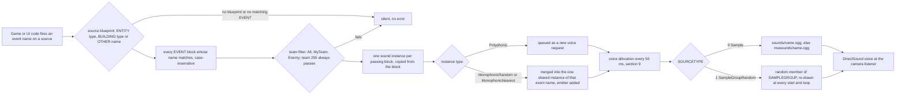

# 10 — Audio design

> Part A · Baseline build: Release|Win32 (OpenGL) + TARGET_PC_FULLGAME ([B:FULL]); see _work/build_matrix.md.
> Evidence: [C] confirmed · [I] inferred · [U] unknown. Citations are `path:Symbol` relative to the multiwinia/ source root.
> Sources merged: P16_sound (routed §10.1–10.11, §09.1 sound options, determinism notes, IP register, appendix), X2b_asset_catalogue_audio (routed §10.A–10.K and its generated tables `_work/drafts/X2b_sound_events.csv` (469 rows), `X2b_callsites.csv` (285 rows), `X2b_samples.csv` (1332 rows), `X2b_summary.txt`), P05_entities_creatures (creature sound events), X1b_asset_formats (grammar cross-reference), the audio notes in `_work/routed/_meta_*.md` (from P01, P02, P08, P16, P17b, P18, P19, P20, X2b) and `_work/phase2_log.md`. Engine internals are in the final [27_audio_engine](27_audio_engine.md) and are linked, not repeated. New generator/verification script: `_work/scripts/S_10_audio_tables.py` (independent re-parse of `data/sounds.txt` and `data/effects.txt`, cross-check against both drafts' CSVs, renders every catalogue table in §3.4, §4, §5, §10.4 and the call-site part of the Source map).

Conventions (same as 27): **vol units** = the 0.0–10.0 logarithmic volume scale of the data (5 dB per unit on the shipped DirectSound path, §11.2); **wu** = world units (the code calls them metres); **tick** = one 50 ms pass of the 20 Hz sound update; **voice** = **channel**; a **source** is a sound-blueprint owner (`ENTITY <type>`, `BUILDING <type>`, `OTHER <name>`); a **pair** is one (source, event name); a **block** is one `EVENT … END` in `data/sounds.txt` (a pair can have several blocks).

## Contents

1. [Audio design overview and what is actually audible](#1-audio-design-overview-and-what-is-actually-audible)
2. [The binding model: object types × event names → blueprint → samples](#2-the-binding-model-object-types--event-names--blueprint--samples)
3. [The `sounds.txt` content model: every instance parameter](#3-the-soundstxt-content-model-every-instance-parameter)
4. [Complete event catalogue (every bound object type × event)](#4-complete-event-catalogue-every-bound-object-type--event)
5. [Coverage gaps: events fired with no data, data never fired](#5-coverage-gaps-events-fired-with-no-data-data-never-fired)
6. [Music system](#6-music-system)
7. [Front-end, UI, HUD, voice and ambience](#7-front-end-ui-hud-voice-and-ambience)
8. [Positional rules](#8-positional-rules)
9. [Priorities and voice limits](#9-priorities-and-voice-limits)
10. [Filters / DSP](#10-filters--dsp)
11. [Mix groups, volume categories and sound options](#11-mix-groups-volume-categories-and-sound-options)
12. [Audio asset statistics (summary; per-file catalogue in 25)](#12-audio-asset-statistics-summary-per-file-catalogue-in-25)
13. [Bugs and quirks that shape the shipped audio](#13-bugs-and-quirks-that-shape-the-shipped-audio)
14. [Sound-design brief for the new game](#14-sound-design-brief-for-the-new-game)
- [Open questions and unknowns](#open-questions-and-unknowns)
- [Docs-vs-code discrepancies](#docs-vs-code-discrepancies)
- [IP items](#ip-items)
- [Source map](#source-map)
- [Appendix — dead/legacy code](#appendix--deadlegacy-code)

## 1 Audio design overview and what is actually audible

### 1.1 The design in one paragraph

Multiwinia's audio is a **data-bound, event-driven** design [C] `code/sound/soundsystem.cpp:SoundSystem::TriggerEntityEvent`, `TriggerBuildingEvent`, `TriggerOtherEvent`. Game and UI code never name a sound file: it fires a named **event** on a **source** (an entity type, a building type, or one of 12 fixed "Other" sources) and the designer-authored file `data/sounds.txt` decides what, if anything, plays — one or more layered `EVENT` blocks per event, each naming a sample or a random sample group plus a full voice description (2D / world-fixed / object-attached position, one-shot / loop / re-triggering ADSR loop, polyphonic or one-shared-voice, friend/foe filter, full-volume radius, and six modulatable parameters: volume, pitch, attack, sustain, release, loop delay). The listener is the game camera; loudness falls off as `minDistance / d`; at most 31 effect voices play, chosen every 50 ms by loudness at the camera with a 0.75 penalty per louder copy of the same event; there is a single master volume and no buses, no ducking, no authored priorities; DSP chains exist in data but are switched off; and the music engine, although present, has no reachable trigger and no shipped tracks in Multiwinia. What the player hears is therefore: generative ambience beds (front end and match), a large set of unit barks and combat effects, team-filtered announcer stings for objectives and crates, and a handful of UI clicks and beeps.

### 1.2 What is actually audible, in order of a session [B:FULL]

| Phase | What plays | Ref |
|---|---|---|
| Start-up and loading screens | Nothing. Every trigger is dropped until `sounds.dat` and `sounds2.dat` are parsed (`App::m_soundsLoaded`) and while a loading screen renders; the early `menusounds.dat` buys nothing audible (§2.6) | [C] `code/sound/soundsystem.cpp:SoundSystem::NotReadyForGameSoundsYet`, `code/app.cpp:App::LoadSounds` |
| Front end, lobby, options | `MultiwiniaInterface LobbyAmbience` — three endless 2D beds (a slow random pad sequence from 10 `MultiLobbyAmb` pads, a low drone group, a half-speed heartbeat), started on the first `GameMenuWindow::Update` after the gate opens and restarted each time the front end is rebuilt; menu roll-over / select / cancel clicks; chat blip. **No music track** | [C] `code/UI/GameMenuWindow.cpp:GameMenuWindow::Update`, `code/main.cpp:MainMenuLoop`; §7.5 |
| Leaving the front end | `StopAllSounds(…, "MultiwiniaInterface LobbyAmbience")` → the two pad beds fade over their RELEASE (10.84 s and 10.26 s); the heartbeat has no RELEASE and stops on the next tick; the loading screen that follows drops all new triggers | [C] `code/main.cpp:MainMenuLoop` |
| Match start | `Ambience EnterLocation` — three 2D beds whose levels follow the **camera altitude** (ground rumble fades out above ≈ 232 wu, a high-altitude wind/"angelic" bed and white noise fade in as the camera climbs to ≈ 990 wu) for the whole match | [C] `code/main.cpp:LocationGameLoop`; §7.5 |
| Grace period (ready-up countdown, `GRACE_TIME` = 3.0 s) | `CountdownTick` beeps at ≈ 3, 2, 1 and 0 s, and `CountdownZeroTick` (same beep, pitch × 2.0) at 0 when the game starts; world sounds are not pitch-bent during the grace period | [C] `code/multiwinia.cpp:Multiwinia::AdvanceGracePeriod`; §7.2 |
| Match | 182 live (source, event) pairs (§4): Darwinian barks (spawn chatter, battle cries, retreat, pain, death, acknowledgements), lasers and impacts, grenades, air strikes, nukes, creature and vehicle loops, building hums, crate fall / capture progress / reward stings, KotH zone and statue stings filtered by friend/foe, spawn-point on/off stings, Rocket Riot rocket and fuel sounds, the Assault pulse-bomb choir; UI selection clicks and the 3D unit-highlight tick; timer `CountdownTick` at every whole minute and each of the last 10 s of a timed game (render-driven) | §4, §7 |
| Match end (`Multiwinia::DeclareWinner`) | `GameOver`, `YouWon` / `YouLost` are fired but **silent** (no data, although recorded samples exist); the game speed is driven to 0, so every playing 3D world sound bends down in pitch toward 0.1× ("tape stop", 2D sounds unaffected) [I audible effect]; the ambience keeps playing; the timer's zero tick does not sound (§7.2) | [C] `code/multiwinia.cpp:Multiwinia::DeclareWinner`, `code/sound/sound_instance.cpp:GetFrequencyModifier` |
| Exit to front end | `StopAllSounds(…, "Ambience EnterLocation")` (the two pad beds release over 10.00 s and 10.45 s, `white_noise` has no RELEASE and stops at once), `Ambience ExitLocation` fired (silent); attached sounds are hard-cut when the location is torn down; **world-fixed looping sounds are never stopped** (the pulse-bomb choir, §13 #2) [I]; lobby ambience restarts | [C] `code/main.cpp:LocationGameLoop` |

### 1.3 Headline numbers

All [C] from the independent re-parse in `_work/scripts/S_10_audio_tables.py` and the X2b tables (cross-checked: 0 mismatches against both drafts at block level).

| Quantity | Value |
|---|---|
| Sound sources with data | 68 = 21 ENTITY + 35 BUILDING + 12 OTHER |
| `EVENT` blocks | 296 = 108 ENTITY + 96 BUILDING + 92 OTHER |
| Bound (source, event) pairs | 256, of which **182 sound in a FULL match** (30 more are on live code paths for object types that never exist in Multiwinia, 3 are Tank-only [B:DEBUG], 41 are never fired) |
| Pairs fired by code with **no** data (silent) | 213, of which 98 are fired in a FULL match |
| Trigger call sites in code | 285 in 77 files (126 `TriggerOtherEvent`, 96 `TriggerEntityEvent`, 63 `TriggerBuildingEvent`); 257 active in FULL, 16 commented out, 12 compiled out |
| Object types with no blueprint at all | 44 (5 entity types, 39 building types) — §4.2 |
| `SAMPLEGROUP` definitions | 131 (130 distinct names — `officercreate` is defined twice with identical content, first wins), 1126 `SAMPLE` lines (1120 distinct), 2–43 members; 12 groups never referenced |
| Audio files | 1332 Ogg Vorbis mono (954 `data/sounds/`, 378 `data/mwsounds/`), 93.9 min; **898 can play in FULL** (43.9 min); 192 unused; 11 music files not shipped |
| DSP effect uses in data | 22 (in 22 blocks) — **not applied** in the shipped configuration |
| Voices | 31 effect voices + 1 music voice at default settings |
| Music tracks | 11 in the tree, 0 shipped, 0 reachable triggers |

### 1.4 Build reality of every audio feature

| Feature | Tag | Note / ref |
|---|---|---|
| Event-bound SFX through the DirectSound back-end | [B:FULL] [B:D3D] | the shipped path; [27 §1.2](27_audio_engine.md#12-back-end-selection-and-what-is-live) |
| Software mixer back-end | [B:FULL], non-default | reachable only by hand-editing pref `SoundLibrary`; probable crash (27-U3) |
| Per-event DSP chains | compiled [B:FULL]; runtime off (pref `SoundDSP` = 0) | the options toggle is [B:DEAD] (`USE_SOUND_DSPEFFECTS`); §10.1 |
| Hardware-3D and memory-usage options | UI [B:DEAD] (`USE_SOUND_HW3D`, `USE_SOUND_MEMORY`); prefs still read | §11.4 |
| Master-volume slider, mix-rate, voice-count, swap-stereo options | [B:FULL] | §11.4 |
| Music channel | engine [B:FULL]; every trigger [B:LEGACY] (Darwinia scripts, credits) or [B:DEAD] (`USE_LOADERS`) | §6 |
| `Ambience EnterGlobalWorld` beds | [B:LEGACY] (Darwinia world map) | §7.5 |
| `OTHER Sepulveda` sounds | [B:DEAD] (`USE_SEPULVEDA_HELP_TUTORIAL`) | §4 |
| `Interface Show/Hide/Slide`, `Gesture GestureFail/GestureEnd` | [B:LEGACY] (Darwinia task-manager UIs; Show/Hide commented out in the Multiwinia one) | §7.1 |
| Blueprints of Darwinia-only object types (14 buildings, `LaserTroop`, `Tripod`) | [B:LEGACY] | §5.3 |
| `Tank` blueprints | [B:DEBUG] (Tank Battle mode is `TARGET_DEBUG` only; Tank crate commented out) | §4 |
| Sound editor, stats, profile windows, `EffectProcessor` | [B:DEBUG] (`SOUND_EDITOR`) | [27 §13](27_audio_engine.md#13-profiles-statistics-debug-and-editor-tooling) |
| XAudio and SDL back-ends | [B:DEAD] | [27 Appendix](27_audio_engine.md#appendix--deadlegacy-code) |

### 1.5 What lives where

This document is the **design** layer: what each event means and when it fires, the content model of `sounds.txt` and what every field does to the listener's experience, the complete catalogue, music/UI/voice/ambience design, and the positional, priority, DSP and mix rules as design rules. [27_audio_engine](27_audio_engine.md) holds the engine mechanics (threads, the 20 Hz tick step by step, instance state machine and exact envelope, PCM callbacks, sample cache, decoder, device back-ends, DSP implementation defects, tooling). The formal EBNF of `sounds.txt` and `effects.txt` is in [29_data_formats_reference](29_data_formats_reference.md); the one-row-per-file audio catalogue is in [25_textures_and_assets](25_textures_and_assets.md); the sound-options screen in the menu flow is in [09_meta_systems](09_meta_systems.md); entity and building behaviour that raises each event is in [02](02_units_and_entities.md), [03](03_buildings_and_world_objects.md) and [04](04_crates_powerups_and_weapons.md).

### 1.6 Contradictions resolved in this document

| # | Drafts / documents said | Code / data shows (re-read for this document) |
|---|---|---|
| R1 | P16 §27.10 and [27 §8](27_audio_engine.md#8-music-channel): "the shipped music blocks all have RELEASE 0 → immediate cut" | 14 of the 17 `OTHER Music` blocks have a fixed RELEASE of 3.29–20.71 s (Cutscene1–4 20.13 s, Demo2Mid 20.71 s, Cutscene5 15.48 s, LoaderGameOfLife 10.26 s, LoaderRaytrace / LoaderSoul / Credits / StartSequence / LoaderAmiga 10.06 s, LoaderMatrix 7.55 s, EndSequence 3.29 s); only LoaderFodder, LoaderSpeccy and Demo2Intro have none [C] `data/sounds.txt` `OTHER Music`. The authored music change is therefore "release the old track, then attack the new one" (§6.1). **Conflict with 27 noted**; moot for Multiwinia because music is unreachable |
| R2 | P16 §10.7 and [27 §12.1](27_audio_engine.md#121-gating--dsp-is-off-in-the-shipped-configuration): "22 effect uses in 21 blocks" | 22 uses in **22** blocks, one effect each (P16's own per-event list enumerates 22 blocks) [C] `data/sounds.txt`, §10.4 |
| R3 | P16: 130 sample groups, 1120 entries; X2b: 131 definitions, 1126 lines | Both true: `SAMPLEGROUP officercreate` appears twice (lines 3858 and 4101) with identical members; the first definition wins at lookup [C] `data/sounds.txt`, `code/sound/soundsystem.cpp:SoundSystem::GetSampleGroup` |
| R4 | P17b/P18: master-volume slider class `code/UI/soundsliderbutton.h` "not in the vcproj and not included → dead" | It is header-only and included as `"UI/SoundSliderButton.h"` from `code/interface/prefs_sound_window.h` (case differs; Windows file names are case-insensitive); `PrefsSoundWindow::Create` constructs `VolumeControl` — **live** [C]. Agrees with 27 |
| R5 | P16 §10.5: a smoothed parameter "starts from 0 on a fresh instance" | Adopting 27's resolution: FREQUENCY starts from 1.0, ATTACK/SUSTAIN/RELEASE/LOOPDELAY from 0, VOLUME and DSP parameters from the prototype's last output [C] `code/sound/sound_parameter.cpp:SoundParameter::Copy` ([27 §6.7](27_audio_engine.md#67-soundparameter-evaluation-engine-semantics)) |
| R6 | P16 §10.10 / X2b §10.G: `CountdownZeroTick` also sounds "when a timed game reaches 0" (`Multiwinia::Render`) | The zero-tick branch is nested inside `if( m_timeRemaining > 0 && … )` and tests `m_timeRemaining == 0` (an `int`) — unreachable; only the grace-period zero tick plays [C] `code/multiwinia.cpp:Multiwinia::Render`, `code/multiwinia.h:Multiwinia::m_timeRemaining` |
| R7 | P16 §10.10: in-game `CountdownTick` only "in the last 10 s" | It fires once per change of the displayed time whenever `secondsRemaining == 0 || m_timeRemaining <= 10`: at every whole minute and at 10, 9, …, 1 s [C] `code/multiwinia.cpp:Multiwinia::Render` (agrees with X2b) |
| R8 | P16 §10.10 lists `Interface Show/Hide/Slide` and `Gesture GestureFail` as task-manager UI sounds | Unreachable in Multiwinia: `TaskManagerInterfaceIcons` / `TaskManagerInterfaceGestures` are created only when `!App::Multiplayer()`; Show/Hide are commented out in the Multiwinia interface [C] `code/taskmanager_interface.cpp:TaskManagerInterface::CreateTaskManager`, `code/taskmanager_interface_multiwinia.cpp` (agrees with X2b) |
| R9 | P16 §10.11 "data no code fires" list | Six more pairs are dead data: `CratePowerup FlameTurret`, `GunTurret Damage`, `Egg Die`, `Officer Attack`, `Incubator Reprogramming`, `Generator ReprogramComplete` [C] (X2b §10.A, re-checked in the §5.3 table) |
| R10 | P16 §10.4: SUSTAIN "10 blocks, 0.97–16.45 s" vs this re-parse "fixed 0.97–10.84" | Both true: 6 fixed (0.97–10.84 s) + 4 ranged-random blocks whose upper bound reaches 16.45 s [C] §3.4 |

## 2 The binding model: object types × event names → blueprint → samples

### 2.1 Pipeline



### 2.2 The four trigger entry points

[C] `code/sound/soundsystem.cpp:SoundSystem::TriggerEntityEvent`, `TriggerBuildingEvent`, `TriggerOtherEvent` (two overloads); engine detail in [27 §4](27_audio_engine.md#4-triggering-from-game-event-to-queued-instance):

| Call | Source key | Initial position / emitter | Team used for the friend/foe filter |
|---|---|---|---|
| `TriggerEntityEvent(Entity*, "Event")` | `ENTITY <Entity::GetTypeName(type)>` | entity `m_pos` and `m_vel`; the entity becomes the emitter | the entity's team |
| `TriggerBuildingEvent(Building*, "Event")` | `BUILDING <Building::GetTypeName(type)>` | building `m_pos` (attached sounds then follow `m_centrePos`); velocity 0 | the building's team |
| `TriggerOtherEvent(WorldObject* or NULL, "Event", OtherType)` | `OTHER <name>` (12 names, §4.3) | object `m_pos` and emitter if an object is passed, else none. The `Music` source is diverted to the music slot (§6) | the object's team, or 255 (always passes) when NULL |
| `TriggerOtherEvent(Vector3 pos, "Event", OtherType, teamId)` | `OTHER <name>` | the given position, no emitter (music is **not** diverted on this overload) | the given team |

### 2.3 Matching and layering rules

| Rule | Behaviour | Ref |
|---|---|---|
| Name match | case-insensitive (`stricmp`) on the event name, within the source's blueprint only | [C] `SoundSystem::TriggerEntityEvent` |
| Layering | **every** matching block whose team filter passes produces its own instance. Several blocks with the same name are how the data layers a body sound with a voice (e.g. `Darwinian Die` = body + voice) or provides friend/foe variants. 23 pairs have 2 blocks, 5 have 3, 1 has 4, 1 has 5 (`OTHER Ambience EnterGlobalWorld`) | [C] `data/sounds.txt`; X2b CSV `blocks` column |
| Friend/foe filter (`TEAMMATCHTYPE`) | evaluated **at trigger time** on the local machine: 0 All → always; 1 MyTeamOnly → `team == local player's team`; 2 EnemyTeamOnly → `team != local player's team`; both false when no global world exists. **Team 255 passes every filter**, so a neutral object (or a building that becomes neutral) plays the "mine" and the "enemy" variant together | [C] `code/sound/soundsystem.cpp:SoundEventBlueprint::TeamMatch` |
| Consequence for zone stings | `BUILDING MultiwiniaZone ChangeTeam` (fired by `Building::SetTeamId` on any owner change) plays `koh_zone_captured` for MyTeam and `koh_zone_lost` for Enemy: "lost" means "now owned by someone else", also when the zone passes between two enemies; a Blitzkrieg flag that is neutralised (`SetTeamId(255)`) plays both [C mechanism] `code/worldobject/multiwiniazone.cpp:MultiwiniaZone::Advance`, `code/worldobject/building.cpp:Building::SetTeamId`; [I audible] |
| Missing data | an event with no matching block, or a type with no blueprint, is silently ignored; unknown names in `sounds.txt` are only debug-asserted | [C] `SoundSystem::LoadBlueprints` |
| Event identifier | each live instance is named `"<SourceName> <EventName>"` (e.g. `"Darwinian Attack"`); this full name is the key for the per-event priority penalty, for monophonic merging and for stopping by (sub)string | [C] `code/sound/sound_instance.cpp:SoundInstance::SetEventName` |
| Monophonic merge | an instance whose `INSTANCETYPE` is 1 or 2 merges into an existing non-polyphonic instance of the same full name (adds its emitter) instead of creating a voice | [C] `SoundSystem::InitialiseSound` |
| Determinism | sound never writes simulation state; friend/foe variants, camera-dependent selection and voice stealing differ between peers by design; audio randomness uses the shared non-synced `AppRandom` LCG | [C] [27 §15](27_audio_engine.md#15-determinism-boundary) |

### 2.4 Event names built at run time

[C] unless noted:

| Source | Built name | Rule | Ref |
|---|---|---|---|
| `BUILDING Crate` | `Capturing_<n>pc` | while the owner holds the majority: `postIntCaptured = int(5 × captureTimer / CRATE_CAPTURE_TIME)` with `CRATE_CAPTURE_TIME` = 2.5 s; on each change of that integer the previous progress tone is stopped and `sprintf("Capturing_%dpc", postIntCaptured × 20)` fires → `Capturing_20pc`, `_40pc`, `_60pc`, `_80pc` (bound, `LoopADSR`) and `Capturing_100pc` (unbound). `Capturing_0pc` is fired with `BeginCapture` when a new team takes the majority. The **decay** branch (owner lost the majority, timer falling) formats `"Capturing_%pc"` — `%p` is the pointer conversion, so the name becomes e.g. `Capturing_00000003c` [I: exact digits] and never matches: falling progress is silent (bug §13 #1) | `code/worldobject/crate.cpp:Crate::AdvanceOnGround` |
| `BUILDING EscapeRocket` | state sound | `EscapeRocket::SetupSounds` chooses one of `Refueling` (unbound), `Unhappy`, `Malfunction` (damage ≥ 75), `Happy`, `Flight` from the rocket state, stops the other four and re-triggers the chosen one whenever `NumInstances(m_id, "EscapeRocket <name>")` reads 0 | `code/worldobject/rocket.cpp:EscapeRocket::SetupSounds` |
| `OTHER Grenade` / `OTHER AirStrikeBomb` | `Create`, `Bounce`, `Flash`, `Explode` | `ThrowableWeapon::TriggerSoundEvent` routes `EffectThrowableGrenade`, `AirstrikeMarker` and `ControllerGrenade` to `OTHER Grenade`, and `EffectThrowableAirstrikeBomb` / `EffectFlameGrenade` to `OTHER AirStrikeBomb`; bomber bombs are created without `Initialise()`, so they never fire `Create`; `Flash` fires from `ThrowableWeapon::Render` (render-rate dependent) | `code/worldobject/weapons.cpp:ThrowableWeapon::TriggerSoundEvent`, `code/worldobject/airstrike.cpp:SpaceInvader::Advance` |
| `OTHER CratePowerup` | `Crate::GetName(reward)` | `Crate::TriggerSoundEvent(type, pos, team)` → `TriggerOtherEvent(pos, name, TypeCratePowerup, team)` at the crate position with the collecting team (friend/foe filter applies). `RunGunTurret` always passes `CrateRewardGunTurret` (so the `FlameTurret` block is dead); `Engineer`, `RocketTurret`, `NapalmStrike` (uses `Airstrike`), `SlowDown`, `SpeedUp` are never passed | `code/worldobject/crate.cpp:Crate::TriggerSoundEvent`, `code/taskmanager.cpp` |
| `OTHER Music` | script word | `Script::RunCommand_TriggerSound(word)` plays `Music <word>` unless `NumInstancesPlaying(-, "Music <word>") > 0` (always 0, music never occupies an effect channel) | `code/script.cpp:Script::RunCommand_TriggerSound` |

### 2.5 Stopping, querying and keeping loops alive

`StopAllSounds(objectId, partialName)` stops every instance whose current emitter equals `objectId` (an invalid id matches instances without emitter: all 2D and world-fixed sounds) and whose full event name **contains** `partialName` (or all of that emitter's sounds when NULL): playing ones get a final release, queued ones are destroyed; a name containing `"Music"` releases the music instead [C] `code/sound/soundsystem.cpp:SoundSystem::StopAllSounds`. Queries `NumInstancesPlaying(id, name)` (on voices), `NumInstances(id, name)` (queued + playing) and `IsSoundPlaying(id)` exist for game code [C].

Every stop site outside `code/sound/` [C] (X2b §10.E, spot-checked in `crate.cpp`, `main.cpp`, `location_input.cpp`):

| Partial name stopped | Emitter | When | Ref |
|---|---|---|---|
| `MultiwiniaInterface SelectionCircle` | none | selection circle released | `code/location_input.cpp:LocationInput::AdvanceTeamControl` |
| `MultiwiniaInterface LobbyAmbience` | none | `MainMenuLoop` exits | `code/main.cpp:MainMenuLoop` |
| `Ambience EnterLocation` | none | `LocationGameLoop` exits (then `Ambience ExitLocation` fires, unbound) | `code/main.cpp:LocationGameLoop` |
| `Ambience EnterGlobalWorld` | none | world loop exit / script [B:LEGACY] | `code/main.cpp:GlobalWorldGameLoop`, `code/script.cpp:Script::RunCommand_StopSound` |
| `Music`, `Music <event>` | none | cutscene escape / script `StopSound` [B:LEGACY]; each loader stops its own track [B:DEAD]; `CreditsLoader` stops `Music Cutscene3` although it started `Credits` | `code/script.cpp:Script::RunCommand_StopSound`, `code/loaders/credits_loader.cpp:CreditsLoader::Run`, `code/startsequence.cpp:StartSequence::Advance` |
| `Tree Burn` | tree | fire out / tree destroyed | `code/worldobject/tree.cpp:Tree::Advance` |
| `RadarDish BeginRotation` | dish | before re-aiming; on alignment | `code/worldobject/radardish.cpp:RadarDish::Advance` |
| `RadarDish ConnectionEstablished` | dish | link lost | `code/worldobject/radardish.cpp:RadarDish::Advance` |
| `SolarPanel Operate` | panel | occupancy ≤ 60 % while operating | `code/worldobject/generator.cpp:SolarPanel::Advance` |
| `SpaceShip TractorBeam` | ship | abduction ends | `code/worldobject/spaceship.cpp:SpaceShip::Advance` |
| `Officer SetOrderNone/Goto/Follow/Absorb/Formation` | officer | `Officer::CancelOrderSounds` before every new order sound | `code/worldobject/officer.cpp:Officer::CancelOrderSounds` |
| `Crate Falling` | crate | lands | `code/worldobject/crate.cpp:Crate::Advance` |
| `Crate Capturing_` (all progress tones) | crate | `Crate::StopCaptureSounds` before each new tone, on capture and on loss | `code/worldobject/crate.cpp:Crate::StopCaptureSounds` |
| `Crate BeginCapture` | crate | captured or lost | `code/worldobject/crate.cpp:Crate::AdvanceOnGround` |
| `Engineer BeginReprogramming` | engineer | reprogramming ends [B:LEGACY] (7 sites) | `code/worldobject/engineer.cpp:Engineer::Advance` |
| `GodDish ConnectToGod` | dish | deactivated [B:LEGACY] | `code/worldobject/goddish.cpp:GodDish::Deactivate` |
| `Spam Create` | spam | becomes research [B:LEGACY] | `code/worldobject/spam.cpp:Spam::Advance` |
| `Rocket Create` | rocket | explodes | `code/worldobject/weapons.cpp:Rocket::Advance` |
| `Darwinian SeenThreat` | Darwinian | threat cleared / state change | `code/worldobject/darwinian.cpp:Darwinian::SearchForThreats` |
| `Darwinian TakenControl` | Darwinian | released (both unbound) | `code/worldobject/darwinian.cpp:Darwinian::LoseControl` |
| `FuelPipe PumpFuel` | pipe | fuel level ≤ 0.2 | `code/worldobject/rocket.cpp:FuelPipe::Advance` |
| `EscapeRocket Refueling/Happy/Unhappy/Malfunction/Flight` | rocket | the wrong state sound is playing | `code/worldobject/rocket.cpp:EscapeRocket::SetupSounds` |
| `EscapeRocket EngineBurn` | rocket | engines off | `code/worldobject/rocket.cpp:EscapeRocket::Advance` |
| `Statue Carry` | statue | dropped (`Carry` is unbound) | `code/worldobject/carryablebuilding.cpp:CarryableBuilding::Advance` |
| all sounds of the tank | tank | tank dies [B:DEBUG] | `code/worldobject/tank.cpp:Tank::ChangeHealth` |

Looping blocks without a stop site end only when their attached emitter disappears (hard cut, §8.4): `Engineer Create`, `Squadie Create`, `SporeGenerator Create`, `Centipede Create`, `SpaceInvader Create`, `Spider Create`, `ArmyAnt Create`, `Armour Create`, `SoulDestroyer Create`, `SoulDestroyer EnemySighted`, `Harvester Create` (3 blocks), `Nuke Create`, `Meteor Create` (2), `Tank Create`, `SpaceShip Create` (4), `LaserFence Create`, `Tree CreateNormal`, `Tree CreateMagic`, `Tree CreateEvil`, `Triffid Burn`, `MultiwiniaZone Create`, `ControlStation Create`, `Grenade ExplodeController`, `Rocket Create` (stopped by explode), and the legacy `Powerstation`, `TrunkPort ReprogramComplete`, `ResearchItem`, `Refinery`, `Yard`, `SpiritReceiver`, `SpiritProcessor`, `BlueprintStore`, `BlueprintConsole`, `BlueprintRelay`, `Spam`, `GodDish Create` loops [C]. **World-fixed loops cannot be stopped at all**: `BUILDING PulseBomb Create` (group of `choir1`–`choir6`, `POSITIONTYPE 1`, Loop) and the legacy `Generator ReprogramComplete` never get an emitter id, so no `StopAllSounds(m_id, …)` reaches them and the orphan cull only applies to attached sounds → the Assault pulse-bomb choir keeps looping at its world position after the bomb is destroyed and after the match ends [I from `code/sound/soundsystem.cpp:SoundSystem::Advance`, `StopAllSounds`; not observed] (10-U4).

Keep-alive caveat [C/I]: the emitter id used by stops and queries is filled in only during the first sound tick after triggering and never for 2D / world-fixed sounds, so the per-tick polling in `EscapeRocket::SetupSounds` and `FuelPipe::Advance` can re-trigger a loop that already exists (several simulation ticks between two sound ticks) [I] ([27 §4](27_audio_engine.md#4-triggering-from-game-event-to-queued-instance), 27-U14). A new engine must record the emitter at trigger time.

### 2.6 From a sample name to a file

[C] (X2b §10.B, steps re-read in `code/sound/sample_cache.cpp:CachedSample::CachedSample`, `code/lib/resource.cpp:Resource::GetSoundStreamDecoder`):

| Step | Rule | Ref |
|---|---|---|
| 1 | `SOUNDNAME x` / `SAMPLE x` is lower-cased and cut at its last `.`; no shipped name has an extension | `code/sound/soundsystem.cpp:SoundSystem::ParseSoundEvent`, `ParseSampleGroup` |
| 2 | `SOURCETYPE 1`: linear, case-insensitive search of the group list, first definition wins; not found → `AppReleaseAssert("Failed to find Sample Group")` (**fatal**) | `code/sound/sound_instance.cpp:SoundInstance::OpenStream` |
| 3 | group member chosen `AppRandom() % n` at every start and loop restart (n halved / quartered by pref `SoundMemoryUsage` 2 / 3 — only the first ½ or ¼ of each group is then ever used) | `SoundInstance::OpenStream` |
| 4 | the cache opens `sounds/<name>`, then `mwsounds/<name>`; both failing → `AppReleaseAssert("Failed to open sound stream decoder : …")` (**fatal**) | `code/sound/sample_cache.cpp:CachedSample::CachedSample` |
| 5 | `.ogg` is appended unconditionally (the WAV decoder is unreachable) | `code/lib/resource.cpp:Resource::GetSoundStreamDecoder` |
| 6 | loose file under `data/` first, then the archive table; lookups are case-insensitive (359 of the 1332 file names contain capitals and all resolve) | `code/lib/resource.cpp:Resource::GetBinaryReader`, `contrib/systemiv/lib/tosser/hash_table.cpp:HashTable::HashFunc` |

Packaging [C] `tools/build_multiwinia_data.bat`: `menusounds.dat` (18 files from `tools/menu_sounds.txt` = exactly the samples of `LobbyAmbience`, `MenuRollOver`, `MenuSelect`, `MenuCancel`; parsed in the App constructor), `sounds.dat` (1297 from `tools/sounds.txt`), `sounds2.dat` (the 6 late UI samples `beep_harsh_malfunction`, `chat`, `mouseclick1`, `rollover1a`, `rollover1b`, `rollover1c` never added to `tools/sounds.txt`); 11 music files excluded by `tools/multiwinia_exclusions.txt`. Later archives override earlier ones; loose files override archives. Full archive rules: [31](31_platform_build_and_tools.md), [29](29_data_formats_reference.md).

Design consequences [C/I]: (1) a blueprint that names a missing sample is a **crash**, not silence — in the shipped data only the 11 unshipped music files are such references, and their events are unreachable (§6); (2) the early front-end bank (`menusounds.dat`) cannot be heard early, because every trigger waits for `sounds.dat` + `sounds2.dat` (`App::m_soundsLoaded`) [I: remnant of an earlier "ambience during load" path — the commented-out `LobbyAmbience` trigger in `code/app.cpp:App::CheckSounds`]; (3) there is **no localised audio**: no `.ogg` exists outside `data/sounds/` and `data/mwsounds/` and the sound system has no locale switch [C].

## 3 The `sounds.txt` content model: every instance parameter

### 3.1 File structure (semantic summary; formal EBNF in 29)

Line- and token-oriented, `#` comments, keywords case-insensitive, CRLF in the shipped file [C] `code/sound/soundsystem.cpp:SoundSystem::LoadBlueprints`, `ParseSoundEvent`, `ParseSoundEffect`, `ParseSampleGroup`, `code/sound/sound_parameter.cpp:SoundParameter::Read`. Shape (not source code; field order inside an EVENT is free):

```
ENTITY|BUILDING|OTHER <TypeName>
    EVENT <EventName>
        SOUNDNAME <sample-or-group>  SOURCETYPE <0|1>  POSITIONTYPE <0..3>  INSTANCETYPE <0..2>
        LOOPTYPE <0..2>  TEAMMATCHTYPE <0..2>  MINDISTANCE <float>  [PRIORITY <int> (ignored)]
        VOLUME    PARAMETER <param-spec>
        [FREQUENCY | ATTACK | SUSTAIN | RELEASE | LOOPDELAY  PARAMETER <param-spec>]
        [EFFECT <EffectName>  (one "<ParamName> PARAMETER <param-spec>" line per effect parameter, by position)  END]...
    END
END
SAMPLEGROUP <GroupName>  (SAMPLE <name>)...  END
param-spec := TypeFixedValue v | TypeRangedRandom lo hi smooth | TypeLinked inLo outLo inHi outHi smooth LinkName,
              optionally followed by UpdateConstantly | UpdateOncePerLoop (absent = UpdateConstantly)
```

Loader rules that matter to authors [C] (X1b cross-reference): effect parameters are matched **by position**, the name token is not checked; `data/effects.txt` defaults are **not** applied to omitted effect parameters (the editor seeds new effects with each parameter's minimum); blank lines inside `EVENT` / `EFFECT` / `SAMPLEGROUP` blocks crash the loader; unknown field names are only debug-asserted; the writer omits FREQUENCY when it is fixed 1.0 and ATTACK / SUSTAIN / RELEASE / LOOPDELAY when fixed 0.0; the object-name buffer is 128 characters. Grammar, value domains and the `effects.txt` table: [29](29_data_formats_reference.md).

### 3.2 Semantic field table — every instance parameter

Defaults are the `SoundInstance` constructor values used when a field is absent [C] `code/sound/sound_instance.cpp:SoundInstance::SoundInstance`; domains from the parser, the device asserts and the editor ranges [C] `code/interface/soundeditor_window.cpp:SoundEditorWindow::CreateInstanceEditor`; shipped usage from §3.4.

| Field (file) | Member | Domain / values | Default | Design semantics | Shipped usage (296 blocks) |
|---|---|---|---|---|---|
| `SOUNDNAME` | `m_soundName[256]` | file stem under `sounds/` or `mwsounds/`, or a `SAMPLEGROUP` name (when SOURCETYPE = 1) | `"[???]"` — never plays | What to play | 143 single samples, 153 groups |
| `SOURCETYPE` | `m_sourceType` | 0 `Sample`, 1 `SampleGroupRandom` | 0 | 1 = uniform random group member at every start and every restart (Loop: each loop; LoopADSR: each new note) — the variety mechanism | 0: 143, 1: 153 |
| `POSITIONTYPE` | `m_positionType` | 0 `Type2D`, 1 `Type3DStationary`, 2 `Type3DAttachedToObject`, 3 `TypeInEditor` | 2 | 0: at the listener, centred, unattenuated, never pitch-bent by game speed, always ranks as loudest; 1: fixed at the trigger position, outlives its emitter (use for deaths, explosions, impacts); 2: follows the emitter every tick, **hard-cut** when it disappears (use for loops and bodies); 3: editor preview only (§8.4) | 2D 83, Stat 42, Att 169, Ed 2 |
| `INSTANCETYPE` | `m_instanceType` | 0 `Polyphonic`, 1 `MonophonicRandom`, 2 `MonophonicNearest` | 0 | 0: one voice per trigger; 1 / 2: one shared voice per event name for all emitters — emitter picked at random per (re)start, or the one nearest the camera continuously (only within ≈ 316 wu, §8.7) — the crowd-limiting mechanism | Poly 290, MonoRandom 3 (`Squadie Create`, `Squadie WeaponReturns`, `Yard Create`), MonoNearest 3 (`Darwinian Create`, one `Darwinian Attack` block, `EscapeRocket Unhappy`) |
| `LOOPTYPE` | `m_loopType` | 0 `SinglePlay` ("PlayOnce"), 1 `Looped` ("Loop"), 2 `LoopedADSR` ("LoopADSR") | 0 | 0: play once (one-shot, expires if no voice within 3 ticks); 1: loop the sample (a group draws a new member each loop), LOOPDELAY of silence between loops; 2: re-triggering note: at each release a new copy starts (after LOOPDELAY) and cross-fades with the fading old one — the generative-pad mechanism (§7.5) | Once 210, Loop 70, LoopADSR 16 |
| `TEAMMATCHTYPE` | `m_teamMatchType` | 0 `AllTeams`, 1 `MyTeamOnly`, 2 `EnemyTeamOnly` | 0 | Friend/foe audience filter at trigger time, relative to the local player; team 255 always passes (§2.3) | All 284, MyTeam 8, Enemy 4 |
| `MINDISTANCE` | `m_minDistance` | float wu; editor 1–10000; DirectSound release-asserts 1 ≤ d ≤ 1e9 | 100.0 | Full-volume radius; beyond it amplitude × `min/d` (§8.2); also scales priority | 5.98–10000; 100.00 × 170, 200.00 × 39 |
| `PRIORITY` | — | int | — | **Ignored** (read and discarded "for backwards compatibility") | 0 blocks |
| `VOLUME` | `m_volume` | parameter, 0–10 vol units (log, 5 dB / unit) | fixed 7.0 | Peak level = envelope target; base of the priority ranking | fixed 282 (3.00–10.00, mean 9.00), linked 12, random 2 |
| `FREQUENCY` | `m_freq` | parameter, multiplier of the sample's native rate; editor 0–3; device window 0–144000 Hz | fixed 1.0 | Pitch and speed together (no time-stretch); re-evaluated every tick unless `UpdateOncePerLoop` | absent 177, random 63, fixed 45 (0.30–2.00), linked 11 |
| `ATTACK` | `m_attack` | parameter, s; editor 0–60 | 0 | Linear fade-in in vol units (= linear in dB), timed from the **trigger** moment | 27 blocks (0.19–10.84 s) |
| `SUSTAIN` | `m_sustain` | parameter, s; editor 0–300 | 0 | **Hold duration** after the attack, then automatic release; 0 = hold until stopped or the sample ends (there is no decay stage and no sustain level) | 10 blocks (fixed 0.97–10.84 s, random up to 16.45 s) |
| `RELEASE` | `m_release` | parameter, s; editor 0–60 | 0 | Linear fade-out (in vol units) once released (stop, sustain timeout, or one-shot end) | 64 blocks (0.39–20.71 s) |
| `LOOPDELAY` | `m_loopDelay` | parameter, s; editor 0–60 | 0 | Silence between loops (Loop) or the delay before the next note (LoopADSR) | 18 blocks (fixed 0.10–5.03 s, random, linked) |
| `EFFECT … END` | `m_dspFX` (`DspHandle`s) | 0..n effects from the 14 types (§10) | none | DSP chain; instantiated only if pref `SoundDSP` ≠ 0 | 22 uses in 22 blocks (inactive) |

Exact envelope arithmetic, loop logic and the instance state machine: [27 §6.2–6.4](27_audio_engine.md#62-instance-state-machine).

### 3.3 `SoundParameter` — the universal modulatable value

Every one of the six instance parameters and every DSP parameter is a `SoundParameter` [C] `code/sound/sound_parameter.cpp:SoundParameter::Recalculate`, `code/sound/sound_instance.cpp:SoundInstance::UpdateParameter`:

| Type (file token) | Inputs | Output at each evaluation |
|---|---|---|
| 0 `TypeFixedValue` | `v` | `v` |
| 1 `TypeRangedRandom` | `lo hi smooth` | `target = lo + frand(hi − lo)` (uniform, non-synced RNG, can equal `hi`); `out = target·(1 − √smooth) + out_prev·√smooth` |
| 2 `TypeLinked` | `inLo outLo inHi outHi smooth link` | input `x` from `link`; clamped linear map: `x` at or beyond the lower input end → the matching output end, at or beyond the upper → the other end, else `outLo + (x − inLo)/(inHi − inLo)·(outHi − outLo)` (decreasing input ranges work); smoothed as above |

Link inputs, evaluated at the instance position (2D sounds use the camera position and velocity) [C]:

| # | Link (file) | Input `x` | Design use in shipped data |
|---|---|---|---|
| 0 | `Nothing` | 0 | — |
| 1 | `HeightAboveGround` | `pos.y − landscape height(pos.x, pos.z)` (0 height without a location) | flyers' pitch (Harvester, SpaceShip engines: 0 → 984 wu ↦ pitch 0.32 → 2.47), SporeGenerator loop delay |
| 2 | `Xpos` | `pos.x` | — |
| 3 | `Ypos` | `pos.y` (absolute altitude) | level ambience by camera altitude (2D, so the camera's y) |
| 4 | `Zpos` | `pos.z` | — |
| 5 | `Velocity` | `|vel|` (wu/s of the emitter) | vehicle engines (`Armour Create` 8.39 → 10 vol, `Tank Create` 9.55 → 10 vol and pitch 1.10 → 1.68 as speed goes 0 → 2.4 / 22.4 wu/s), Spider footfall volume, bomber engine pitch, creature loop delays |
| 6 | `CameraDistance` | `|camera − pos|` | `Meteor Land` volume 0 → 9.9 over 100 → 320 wu (close/far layers), echo wet/dry on two blocks |

Update types: 0 `UpdateConstantly` — re-evaluated every 20 Hz tick (ranged-random values jitter every tick, filtered by `smooth`); 1 `UpdateOncePerLoop` (enum `UpdateOnceEveryRestart`) — evaluated at trigger, at start and after each loop restart only, i.e. "one random value per note" [C]. Smoothing `smooth` ∈ [0, 0.99] (editor) is a per-tick retention of `√smooth` (0.6 → 0.775 per 50 ms). The smoothing start state compresses authored random pitch ranges toward 1.0 on the first note (e.g. 0.75–1.35 becomes ≈ 0.88–1.16) [I] (R5, 27-U10). 10 shipped parameter definitions use smoothing > 0 [C] §3.4.

### 3.4 Shipped usage of every field

Generated by `_work/scripts/S_10_audio_tables.py` (independent parser; agrees with P16's per-block CSV and X2b's per-pair CSV on every block):

<!-- S10:FIELDS:BEGIN -->
| Field | Shipped usage over all 296 EVENT blocks (independent re-parse of `data/sounds.txt`) |
|---|---|
| SOURCETYPE | Group 153, Sample 143 |
| POSITIONTYPE | Att 169, 2D 83, Stat 42, Ed 2 |
| INSTANCETYPE | Poly 290, MonoRandom 3, MonoNearest 3 |
| LOOPTYPE | Once 210, Loop 70, LoopADSR 16 |
| TEAMMATCHTYPE | All 284, MyTeam 8, Enemy 4 |
| MINDISTANCE | range 5.98–10000.00; 100.00 ×170, 200.00 ×39, 65 distinct values |
| PRIORITY | present in 0 blocks |
| VOLUME | fixed 282, linked 12, random 2; UpdateOncePerLoop on 21; links: Velocity 7, Ypos 3, HeightAboveGround 1, CameraDistance 1; fixed values 3.00–10.00 |
| FREQUENCY | absent 177, random 63, fixed 45, linked 11; UpdateOncePerLoop on 64; links: Velocity 5, HeightAboveGround 5, CameraDistance 1; fixed values 0.30–2.00 |
| ATTACK | absent 269, fixed 26, random 1; UpdateOncePerLoop on 5; links: none; fixed values 0.19–10.84 |
| SUSTAIN | absent 286, fixed 6, random 4; UpdateOncePerLoop on 4; links: none; fixed values 0.97–10.84 |
| RELEASE | absent 232, fixed 64; UpdateOncePerLoop on 4; links: none; fixed values 0.39–20.71 |
| LOOPDELAY | absent 278, random 7, fixed 7, linked 4; UpdateOncePerLoop on 9; links: Velocity 3, HeightAboveGround 1; fixed values 0.10–5.03 |
| EFFECT | 22 uses in 22 blocks: Echo 12, DSound_Echo 5, Gargle 3, DSound_I3DL2Reverb 1, DSound_WavesReverb 1 |
<!-- S10:FIELDS:END -->

### 3.5 Sample groups

| Fact | Value | Ref |
|---|---|---|
| Definitions / distinct names | 131 / 130 (duplicate `officercreate`, identical, first wins) | [C] `data/sounds.txt` |
| `SAMPLE` lines / distinct entries | 1126 / 1120 | [C] |
| Size range | 2–43 members (largest: `TrackLink CogTurn` 43, legacy; live: `Darwinian SeenThreatAttack` 37, `Laser InjuredEntity` 36, `Darwinian SeenThreatRunAway` 36 over 2 groups, `Virii ChangeDirection` 29, `Darwinian Attack` 29 over 2 groups) | [C] X2b |
| Never referenced (12) | `aye`, `darwinnianonfire`, `lasercock`, `laserhitbuild`, `laserhitentity`, `laserhitgnd`, `laserricochet`, `offciersetordergoto` (misspelt; its members are used elsewhere), `officerabsorb`, `officerselected`, `officersetorderfollow`, `officersetorderformation` — recorded officer acknowledgements, laser cock / hit / ricochet variations and burning cries that were never wired | [C] |
| Selection | uniform `AppRandom() % n` on each start/restart, no "avoid repeat" rule; pref `SoundMemoryUsage` 2/3 restricts it to the first ½ / ¼ of the members | [C] `code/sound/sound_instance.cpp:SoundInstance::OpenStream` |
| Deliberate silences | group `darwinnianburncry` mixes 6 burn cries with 7 `silence1`–`silence7` files, so about half of the `Darwinian OnFire` screams are silent | [C] X2b §10.H |

### 3.6 Authoring conventions visible in the shipped data

[C] from the §4 table unless noted:

- **Deaths, explosions, impacts are world-fixed** (`Stat`) so they survive the object's removal: e.g. `Darwinian Die` (both layers), `Engineer Die`, `SporeGenerator Die`, `Centipede Die`, `Nuke Explode`, `Grenade Explode`, `AirStrikeBomb Explode`, `Meteor Land`, `Crate Captured`. Some deaths are nevertheless attached (`Virii Die`, `Spider Die`, `Squadie Die`, `Officer Die`, `ArmyAnt Die`, `SoulDestroyer Die`) and are therefore cut on the first tick after the object is deleted [C mechanism; I audible: most entities linger a few ticks after death].
- **Bodies, engines and hums are attached loops** with no stop site — the object's lifetime is the sound's lifetime.
- **Crowd sounds use one shared voice**: `Darwinian Create` (MonophonicNearest), `Squadie Create` chatter (MonophonicRandom), one `Darwinian Attack` layer (MonophonicNearest reload click).
- **Owner-only feedback** uses `MyTeamOnly` 2D blocks (`Officer Create`, `Officer Selected`) or `MyTeamOnly` attached blocks (officer order confirmations); **friend/foe stings** use MyTeam/Enemy pairs (`Crate BeginCapture`, `Statue ChangeTeam`, `MultiwiniaZone ChangeTeam`, `MultiwiniaZone CaptureStatue`).
- **Variety by pitch**: 63 blocks randomise FREQUENCY, mostly ±5–20 % with `UpdateOncePerLoop`.
- **Long releases on echoing sounds**: many one-shots carry RELEASE ≈ 10 s to let a DSP echo tail ring — with DSP off they only keep a voice busy while the (already ended) sample is silent; the engine compensates by ranking playing voices by their current envelope level ([27 §5.2](27_audio_engine.md#52-perceived-volume)).
- **Volume is authored near the top of the scale** (mean fixed VOLUME 9.00; 10.0 common), so loudness differences come mostly from MINDISTANCE and distance.

## 4 Complete event catalogue (every bound object type × event)

### 4.1 Legend

Rows are generated from `_work/drafts/X2b_sound_events.csv` by `_work/scripts/S_10_audio_tables.py`; the bound-pair rows (§4.4) plus the code-only rows (§5.1) are **all 469 rows** of that CSV (256 + 213). Every block was re-checked against an independent parse of `data/sounds.txt` (0 mismatches in source, event, block count, SOUNDNAME, POSITIONTYPE, LOOPTYPE).

- **Blueprint** — one line per `EVENT` block: `[Sample|Group name]` (SOURCETYPE), position `2D` / `Stat` (3D world-fixed) / `Att` (3D attached) / `Ed` (editor), loop `Once` / `Loop` / `LoopADSR`, instance `MonoRandom` / `MonoNearest` (polyphonic omitted), team `MyTeam` / `Enemy` (all omitted); `md` MINDISTANCE (wu); `v` VOLUME (vol units); `f` FREQUENCY multiplier; `a`/`s`/`r`/`ld` ATTACK / SUSTAIN / RELEASE / LOOPDELAY (s). Parameter forms: number = fixed; `rnd lo..hi` = ranged random; `<Link> inLo..inHi->outLo..outHi` = linked; `sN` = smoothing; `/once` = `UpdateOncePerLoop`; `fx=` the DSP chain (inactive in the shipped configuration, §10).
- **Samples** — the distinct files the event can play, by folder (`sounds/` = `data/sounds/`, `mwsounds/` = `data/mwsounds/`), numbered runs compressed (`laser1–24`); the count in brackets. Per-file details (duration, size, encoder, archive): [25](25_textures_and_assets.md).
- **Fired in FULL** — `yes` = a live, reachable call site exists and the object type exists in a Multiwinia match; `site-live/type-LEGACY` or `site-live/type-DEBUG` = the code path is live but the object type never appears in a FULL match; `no(…)` = every site is LEGACY / not compiled / commented out / absent (`no-site`) / unreachable / DEAD.
- **Where the object exists** — how the object type reaches a FULL match (map placements, crate outcome, task) or why it cannot.
- **Ed** — whether the object class lists the event in its `ListSoundEvents` (what the sound editor offers; `—` for OTHER sources, whose lists are in §4.3).
- **Code trigger site(s)** — every call site, `path:Function:Lline`, with its status tag when not live in FULL.

### 4.2 Per-source summary

68 sources with data, in file order:

<!-- S10:SOURCES:BEGIN -->
| # | Source | EVENT blocks | Bound events | Bound & fired in FULL | Fired with no data | Where the object exists |
|---|---|---|---|---|---|---|
| 1 | ENTITY LaserTroop | 2 | 2 | 0 | 3 | LEGACY: blocked; only spawned by Lander (blocked) |
| 2 | ENTITY Engineer | 5 | 5 | 3 | 3 | FULL: Engineer crate / task (Task::TargetEngineer) |
| 3 | ENTITY Virii | 4 | 4 | 4 | 1 | FULL: TriffidEgg/Egg hatch, Infection crate |
| 4 | ENTITY Squadie | 8 | 8 | 7 | 4 | FULL: Squad crate / task (Task::TargetSquad) |
| 5 | ENTITY Egg | 1 | 1 | 0 | 1 | FULL: laid by SporeGenerator/Spider, TriffidEgg SpawnEggs |
| 6 | ENTITY SporeGenerator | 4 | 4 | 4 | 0 | FULL: TriffidEgg spawn (Eggs/Triffids crates) |
| 7 | ENTITY Tripod | 4 | 4 | 0 | 0 | LEGACY: blocked, no runtime spawner |
| 8 | ENTITY Centipede | 4 | 4 | 4 | 3 | FULL: TriffidEgg spawn |
| 9 | ENTITY SpaceInvader | 2 | 2 | 2 | 2 | FULL: airstrike bomber (Airstrike/Napalm crate, AirStrikeMarker) |
| 10 | ENTITY Spider | 7 | 7 | 7 | 1 | FULL: TriffidEgg spawn, Infection crate |
| 11 | ENTITY Darwinian | 17 | 13 | 13 | 4 | FULL: core unit |
| 12 | ENTITY Officer | 11 | 8 | 7 | 4 | FULL: promotion task (Task::TargetOfficer) |
| 13 | ENTITY ArmyAnt | 4 | 4 | 4 | 0 | FULL: AntNest crate (AntHill), TriffidEgg SpawnAnts |
| 14 | ENTITY Armour | 5 | 4 | 4 | 3 | FULL: Armour crate / task |
| 15 | ENTITY SoulDestroyer | 6 | 5 | 5 | 1 | FULL: TriffidEgg spawn (max 2, not Assault) |
| 16 | ENTITY TriffidEgg | 4 | 4 | 4 | 1 | FULL: Triffid launch, Eggs crate |
| 17 | ENTITY Harvester | 4 | 2 | 2 | 3 | FULL: Harvester crate / task |
| 18 | ENTITY Nuke | 3 | 2 | 2 | 2 | FULL: Nuke crate |
| 19 | ENTITY Meteor | 4 | 2 | 2 | 2 | FULL: Meteor crate (meteor shower) |
| 20 | ENTITY Tank | 4 | 3 | 0 | 0 | DEBUG: no FULL spawner (Tank Battle mode is TARGET_DEBUG only; Tank crate commented out) |
| 21 | ENTITY SpaceShip | 5 | 2 | 2 | 0 | FULL: SpaceShip crate (uncaptured-crate outcome) |
| 22 | BUILDING RadarDish | 6 | 5 | 4 | 4 | FULL: placed in 7 MW maps |
| 23 | BUILDING LaserFence | 3 | 3 | 3 | 4 | FULL: placed in 14 MW maps |
| 24 | BUILDING GunTurret | 5 | 5 | 4 | 6 | FULL: 13 MW maps + GunTurret/RocketTurret/FlameTurret crates |
| 25 | BUILDING Powerstation | 1 | 1 | 0 | 4 | LEGACY: blocked, Darwinia maps only |
| 26 | BUILDING Tree | 5 | 5 | 5 | 4 | FULL: 39 MW maps + MagicalForest/DarkForest crates |
| 27 | BUILDING TrunkPort | 1 | 1 | 0 | 5 | FULL: placed in 28 MW maps (decorative/online) |
| 28 | BUILDING ResearchItem | 2 | 2 | 0 | 4 | LEGACY: blocked |
| 29 | BUILDING Library | 1 | 1 | 0 | 4 | LEGACY: Darwinia maps only |
| 30 | BUILDING Generator | 2 | 2 | 0 | 5 | LEGACY: blocked |
| 31 | BUILDING Pylon | 1 | 1 | 1 | 5 | FULL: 16 MW maps (solar power chain) |
| 32 | BUILDING SolarPanel | 2 | 2 | 2 | 5 | FULL: 16 MW maps |
| 33 | BUILDING TrackLink | 1 | 1 | 0 | 5 | LEGACY: blocked |
| 34 | BUILDING Refinery | 2 | 2 | 0 | 4 | LEGACY: blocked |
| 35 | BUILDING Mine | 1 | 1 | 0 | 5 | LEGACY: blocked |
| 36 | BUILDING Yard | 1 | 1 | 0 | 4 | LEGACY: blocked |
| 37 | BUILDING Incubator | 3 | 3 | 0 | 5 | LEGACY: only mp_sandbox dev maps / Darwinia |
| 38 | BUILDING AntHill | 2 | 2 | 2 | 3 | FULL: AntNest crate |
| 39 | BUILDING Triffid | 2 | 2 | 2 | 5 | FULL: Triffids crate (uncaptured outcome) |
| 40 | BUILDING SpiritReceiver | 1 | 1 | 0 | 5 | LEGACY: blocked |
| 41 | BUILDING SpiritProcessor | 1 | 1 | 0 | 5 | LEGACY: blocked |
| 42 | BUILDING SpawnPoint | 2 | 2 | 2 | 5 | FULL: 32 MW maps |
| 43 | BUILDING BlueprintStore | 1 | 1 | 0 | 4 | LEGACY: blocked |
| 44 | BUILDING BlueprintConsole | 1 | 1 | 0 | 4 | LEGACY: blocked |
| 45 | BUILDING BlueprintRelay | 1 | 1 | 0 | 4 | LEGACY: blocked |
| 46 | BUILDING Spam | 5 | 5 | 0 | 2 | LEGACY: blocked (Infection crate uses SpamInfection effects, not Spam buildings) |
| 47 | BUILDING GodDish | 3 | 3 | 0 | 4 | LEGACY: blocked |
| 48 | BUILDING FuelGenerator | 4 | 2 | 2 | 5 | FULL: Rocket Riot maps (7) |
| 49 | BUILDING FuelPipe | 1 | 1 | 1 | 5 | FULL: Rocket Riot maps (7) |
| 50 | BUILDING FuelStation | 1 | 1 | 1 | 5 | FULL: Rocket Riot maps (7) |
| 51 | BUILDING EscapeRocket | 10 | 7 | 7 | 4 | FULL: Rocket Riot maps (7) |
| 52 | BUILDING MultiwiniaZone | 6 | 3 | 3 | 3 | FULL: KotH / CTS zones (25 maps) |
| 53 | BUILDING ControlStation | 1 | 1 | 1 | 4 | FULL: Assault maps (9) |
| 54 | BUILDING Crate | 12 | 10 | 10 | 8 | FULL: spawned at runtime by every mode with crates (blocked only for level files) |
| 55 | BUILDING Statue | 4 | 3 | 3 | 4 | FULL: spawned at runtime by Capture the Statue (blocked only for level files) |
| 56 | BUILDING PulseBomb | 1 | 1 | 1 | 3 | FULL: Assault maps (8) |
| 57 | OTHER Laser | 1 | 1 | 1 | 4 | FULL: every laser shot (Darwinians, squads, turrets) |
| 58 | OTHER Grenade | 5 | 5 | 4 | 0 | FULL: squad grenades, airstrike markers |
| 59 | OTHER Rocket | 3 | 2 | 2 | 0 | FULL: RocketTurret, Rocketwinians |
| 60 | OTHER AirStrikeBomb | 2 | 2 | 2 | 1 | FULL: airstrike/napalm bombs |
| 61 | OTHER Spirit | 1 | 1 | 1 | 5 | FULL: spirits |
| 62 | OTHER Sepulveda | 3 | 3 | 0 | 0 | DEAD: all call sites inside USE_SEPULVEDA_HELP_TUTORIAL |
| 63 | OTHER Gesture | 3 | 3 | 2 | 1 | FULL: Multiwinia task-manager feedback (GestureFail only in Darwinia gesture UI) |
| 64 | OTHER Ambience | 8 | 2 | 1 | 1 | FULL: EnterLocation; EnterGlobalWorld is LEGACY |
| 65 | OTHER Music | 17 | 17 | 0 | 0 | LEGACY/DEAD: no reachable trigger; tracks not packaged |
| 66 | OTHER Interface | 5 | 5 | 2 | 5 | FULL: MouseOverIcon/DeleteTask only; Show/Hide/Slide LEGACY |
| 67 | OTHER CratePowerup | 29 | 29 | 25 | 0 | FULL: crate rewards |
| 68 | OTHER MultiwiniaInterface | 15 | 12 | 12 | 3 | FULL: menus, HUD, selection |
<!-- S10:SOURCES:END -->

Object types with **no blueprint** (every event they fire is silent) [C] `code/worldobject/entity.cpp:Entity::GetTypeName`, `code/worldobject/building.cpp:Building::GetTypeName` vs `data/sounds.txt`: ENTITY `Lander`, `AI`, `Shaman`, `Tentacle`, `DropShip`; BUILDING `Factory`, `Cave`, `ControlTower`, `Bridge`, `Wall`, `PylonStart`, `PylonEnd`, `PowerSplitter`, `TrackJunction`, `TrackStart`, `TrackEnd`, `DisplayScreen`, `UpgradePort`, `PrimaryUpgrade`, `SafeArea`, `ReceiverLink`, `SpiritSpawner`, `SpawnPopulationLock`, `SpawnPointMaster`, `SpawnLink`, `AITarget`, `AISpawnPoint`, `ScriptTrigger`, `StaticShape`, `FenceSwitch`, `DynamicHub`, `DynamicNode`, `FeedingTube`, `ChessPiece`, `ChessBase`, `CloneLab`, `Portal`, `WallBuster`, `RestrictionZone`, `JumpPad`, `AIObjective`, `AIObjectiveMarker`, `EruptionMarker`, `SmokeMarker` (39 of the 74 building type names, `Invalid` not counted; the other 35 have blueprints). Live MW types among them whose silence matters: `JumpPad`, `Portal`, `Wall`, `Bridge` (teleport events go to the travelling entity), `SpawnPointMaster`, `AITarget`.

### 4.3 The 12 OTHER sources

Enum order = name used in the file [C] `code/sound/soundsystem.h:SoundSourceBlueprint`, `code/sound/soundsystem.cpp:SoundSourceBlueprint::GetSoundSourceName`, `SoundSourceBlueprint::ListSoundEvents`:

| # | Enum | Name in file | Events offered by the editor (`ListSoundEvents`) | Build |
|---|---|---|---|---|
| 0 | `TypeLaser` | `Laser` | Create, Richochet, HitGround, HitEntity, KilledEntity, InjuredEntity, HitBuilding | [B:FULL] |
| 1 | `TypeGrenade` | `Grenade` | Create, Bounce, Flash, Explode, ExplodeController | [B:FULL] |
| 2 | `TypeRocket` | `Rocket` | Create, Explode | [B:FULL] |
| 3 | `TypeAirstrikeBomb` | `AirStrikeBomb` | Create, Bounce, Flash, Explode | [B:FULL] |
| 4 | `TypeSpirit` | `Spirit` | Create, PickedUp, Dropped, PlacedIntoEgg, EggDestroyed, BeginAscent | [B:FULL] (only PickedUp fires) |
| 5 | `TypeSepulveda` | `Sepulveda` | Appear, Disappear, TextAppear | [B:DEAD] |
| 6 | `TypeGesture` | `Gesture` | GestureBegin, GestureEnd, GestureSuccess, GestureFail | [B:FULL] (Begin, Success) |
| 7 | `TypeAmbience` | `Ambience` | EnterLocation, ExitLocation, EnterGlobalWorld | [B:FULL] (EnterLocation, ExitLocation) |
| 8 | `TypeMusic` | `Music` | Cutscene1, Cutscene2, Cutscene3, Cutscene4, Cutscene5, LoaderRaytrace, LoaderSoul, LoaderFodder, LoaderSpeccy, LoaderMatrix, LoaderGameOfLife, StartSequence, EndSequence, Credits, Demo2Intro, Demo2Mid (the data also has `LoaderAmiga`, missing from this list) | [B:LEGACY] / [B:DEAD] |
| 9 | `TypeInterface` | `Interface` | Show, Hide, Slide, DeleteTask, MouseOverIcon, ShowLogo | [B:FULL] (DeleteTask, MouseOverIcon) |
| 10 | `TypeCratePowerup` | `CratePowerup` | one per crate reward: `Crate::GetName(i)` for i in 0..`NumCrateRewards` − 1 | [B:FULL] |
| 11 | `TypeMultiwiniaInterface` | `MultiwiniaInterface` | CountdownTick, CountdownZeroTick, GameOver, YouWon, YouLost, SelectionCircle, SelectUnit, ToggleUnitState, LobbyAmbience, MenuRollOver, MenuSelect, MenuCancel, MouseError, ChatMessage (the data also has `UnitHighlight`) | [B:FULL] |

Data observations [C]: `PRIORITY` appears in no block; `OTHER Sepulveda Appear` / `Disappear` are the only `TypeInEditor` blocks (a legacy data error — they would play head-relative at the editor position); `OTHER Sepulveda TextAppear` still has the placeholder name `[???]` and can never start.

### 4.4 Every bound (source, event) pair — 256 rows

<!-- S10:EVENTS:BEGIN -->
| # | Source | Event | Blueprint (one line per EVENT block) | Samples that can play | Fired in FULL | Where the object exists | Ed | Gameplay trigger | Code trigger site(s) |
|---|---|---|---|---|---|---|---|---|---|
| 1 | ENTITY LaserTroop | Attack | [Group 0lasers] Stat/Once md100.00 v=8.10 f=rnd 0.93..1.03 | `sounds/`{laser1–24} (24) | site-live/type-LEGACY | LEGACY: blocked; only spawned by Lander (blocked) | no | Laser trooper fires (Entity::Attack via Unit::Attack). Type unreachable in MW. | `code/worldobject/entity.cpp:Entity::Attack:L225` |
| 2 | ENTITY LaserTroop | Die | [Group darwiniandie] Stat/Once md100.00 v=8.50 f=rnd 0.83..1.09/once | `sounds/`{darwin_death, darwin_death2–7, darwin_death9} (8) | site-live/type-LEGACY | LEGACY: blocked; only spawned by Lander (blocked) | no | Laser trooper killed (Entity::ChangeHealth, health reaches 0). Type unreachable in MW. | `code/worldobject/entity.cpp:Entity::ChangeHealth:L189` |
| 3 | ENTITY Engineer | Create | [Sample engineer_hover] Att/Loop md100.00 v=9.03 | `sounds/`{engineer_hover} (1) | yes | FULL: Engineer crate / task (Task::TargetEngineer) | yes | Engineer spawned (Entity::Begin); looping hover hum that follows it until it is removed. | `code/worldobject/entity.cpp:Entity::Begin:L379` |
| 4 | ENTITY Engineer | BeginReprogramming | [Sample engineer_reprog_radar_loop] Att/Loop md100.00 v=9.00 | `sounds/`{engineer_reprog_radar_loop} (1) | no(LEGACY) | FULL: Engineer crate / task (Task::TargetEngineer) | yes | Engineer arrives at a ControlTower / ResearchItem and starts reprogramming (loop, stopped by StopAllSounds "Engineer BeginReprogramming"). Unreachable in MW (no towers/research items). | `code/worldobject/engineer.cpp:Engineer::AdvanceToControlTower:L814` [LEGACY(needs ControlTower)]<br>`code/worldobject/engineer.cpp:Engineer::AdvanceToResearchItem:L1127` [LEGACY(needs ResearchItem)] |
| 5 | ENTITY Engineer | EndReprogramming | [Sample engineer_repog_radar_loop_end] Stat/Once md100.00 v=6.48 | `sounds/`{engineer_repog_radar_loop_end} (1) | no(LEGACY,commented-out) | FULL: Engineer crate / task (Task::TargetEngineer) | yes | Engineer leaves/finishes/loses its ControlTower (Engineer::Advance, AdvanceReprogramming). Unreachable in MW. | `code/worldobject/engineer.cpp:Engineer::Advance:L376` [LEGACY(needs ControlTower)]<br>`code/worldobject/engineer.cpp:Engineer::Advance:L384` [LEGACY(needs ControlTower)]<br>`code/worldobject/engineer.cpp:Engineer::Advance:L448` [LEGACY(needs ControlTower)]<br>`code/worldobject/engineer.cpp:Engineer::Advance:L466` [commented-out]<br>`code/worldobject/engineer.cpp:Engineer::AdvanceReprogramming:L934` [LEGACY(needs ControlTower)] |
| 6 | ENTITY Engineer | LoseHealth | [Group engineerinjury] Stat/Once md200.00 v=10.00 f=rnd 1.58..1.89/once r=5.03 | `sounds/`{engineer_losehealth, engineer_losehealth2–9} (9) | yes | FULL: Engineer crate / task (Task::TargetEngineer) | yes | Engineer takes non-laser damage (Engineer::ChangeHealth ignores DamageTypeLaser). | `code/worldobject/engineer.cpp:Engineer::ChangeHealth:L295` |
| 7 | ENTITY Engineer | Die | [Group engineerdie] Stat/Once md200.00 v=10.00 f=rnd 0.95..1.05/once | `sounds/`{engineer_die, engineer_die2–5} (5) | yes | FULL: Engineer crate / task (Task::TargetEngineer) | yes | Engineer health drops below 0 (Engineer::ChangeHealth). | `code/worldobject/engineer.cpp:Engineer::ChangeHealth:L302` |
| 8 | ENTITY Virii | Attack | [Group virusattack] Att/Once md200.00 v=9.03 f=rnd 0.91..1.12/once | `sounds/`{virus_attack, virus_attack2–8} (8) | yes | FULL: TriffidEgg/Egg hatch, Infection crate | yes | A Virii reaches its target entity and bites it for 20 damage (Virii::AdvanceAttacking). | `code/worldobject/virii.cpp:Virii::AdvanceAttacking:L447` |
| 9 | ENTITY Virii | LoseHealth | [Group viruspain] Stat/Once md200.00 v=10.00 f=rnd 0.81..1.01/once r=2.71 fx=Echo | `sounds/`{virus_lose_health, virus_lose_health2, virus_lose_health3} (3) | yes | FULL: TriffidEgg/Egg hatch, Infection crate | yes | Virii damaged (Entity::ChangeHealth, amount < 0). | `code/worldobject/entity.cpp:Entity::ChangeHealth:L182` |
| 10 | ENTITY Virii | ChangeDirection | [Group newsamplegroup11] Att/Once md50.00 v=6.55 f=rnd 1.70..2.17/once | `sounds/`{virus_cd2–30} (29) | yes | FULL: TriffidEgg/Egg hatch, Infection crate | yes | Idle Virii picks a new wander direction (Virii::SearchForIdleDirection) - frequent ambient chirp per worm. | `code/worldobject/virii.cpp:Virii::SearchForIdleDirection:L741`<br>`code/worldobject/virii.cpp:Virii::SearchForIdleDirection:L765` |
| 11 | ENTITY Virii | Die | [Group newsamplegroup9] Att/Once md175.00 v=10.00 f=rnd 1.54..1.79/once r=10.06/once fx=Echo | `sounds/`{redvirus_death, redvirus_death3, redvirus_losehealth, redvirus_losehealth2–4, redvirus_losehealth7} (7) | yes | FULL: TriffidEgg/Egg hatch, Infection crate | yes | Virii killed (Entity::ChangeHealth). | `code/worldobject/entity.cpp:Entity::ChangeHealth:L189` |
| 12 | ENTITY Squadie | Create | [Group newsamplegroup1] Att/Loop/MonoRandom md100.00 v=9.00/once r=5.23/once ld=Velocity 6.80..0.00->0.00..2.90/once fx=Echo | `sounds/`{squaddie_chatter1–16, squaddie_chatter18–21} (20) | yes | FULL: Squad crate / task (Task::TargetSquad) | yes | Squad member spawned (Entity::Begin via Squadie::Begin): one shared looping chatter voice for all squadies (MonophonicRandom). | `code/worldobject/entity.cpp:Entity::Begin:L379` |
| 13 | ENTITY Squadie | LoseHealth | [Group newsamplegroup5] Att/Once md100.00 v=9.00 f=0.91/once r=4.06/once fx=Echo | `sounds/`{squad_lose_health1, squad_lose_health3, squad_lose_health4, squad_lose_health6} (4) | yes | FULL: Squad crate / task (Task::TargetSquad) | yes | Squadie damaged (Squadie::ChangeHealth). | `code/worldobject/insertion_squad.cpp:Squadie::ChangeHealth:L625` |
| 14 | ENTITY Squadie | WeaponReturns | [Sample grenade_return3] Att/Once/MonoRandom md100.00 v=9.00/once | `sounds/`{grenade_return3} (1) | yes | FULL: Squad crate / task (Task::TargetSquad) | yes | Secondary-weapon (grenade) reload timer expires (Squadie::Advance, m_secondaryTimer <= 0); one shared voice (MonophonicRandom). | `code/worldobject/insertion_squad.cpp:Squadie::Advance:L663` |
| 15 | ENTITY Squadie | ThrowAirStrike | [Sample airstrike_alarm] Att/Once md100.00 v=10.00 | `sounds/`{airstrike_alarm} (1) | no(LEGACY) | FULL: Squad crate / task (Task::TargetSquad) | yes | Squadie throws an air-strike marker as secondary weapon (Squadie::FireSecondaryWeapon). Unreachable in MW (secondary is always Grenade; ThrowGrenade has no data). | `code/worldobject/insertion_squad.cpp:Squadie::FireSecondaryWeapon:L987` [LEGACY(squad secondary is always Grenade in MW)] |
| 16 | ENTITY Squadie | FireLaser | [Group turretfire] Att/Once md100.00 v=8.77/once f=rnd 0.90..1.05/once | `sounds/`{gun_turret_fire, gun_turret_fire2–6} (6) | yes | FULL: Squad crate / task (Task::TargetSquad) | yes | Every squadie laser shot (Squadie::Attack, alongside the silent "Attack"). | `code/worldobject/insertion_squad.cpp:Squadie::Attack:L954` |
| 17 | ENTITY Squadie | Die | [Group squaddiedeath] Att/Once md100.00 v=8.97 f=rnd 0.76..1.05/once | `sounds/`{squad_death, squad_death2–5} (5) | yes | FULL: Squad crate / task (Task::TargetSquad) | yes | Squadie killed (Squadie::ChangeHealth). | `code/worldobject/insertion_squad.cpp:Squadie::ChangeHealth:L632` |
| 18 | ENTITY Squadie | EnterTeleport | [Group enterteleport] Stat/Once md100.00 v=9.00 | `sounds/`{enter_teleport, enter_teleport2–6} (6) | yes | FULL: Squad crate / task (Task::TargetSquad) | yes | Squadie enters a RadarDish/Bridge teleport (Entity::EnterTeleports from Squadie::Advance). | `code/worldobject/entity.cpp:Entity::EnterTeleports:L278`<br>`code/worldobject/entity.cpp:Entity::EnterTeleports:L295` |
| 19 | ENTITY Squadie | ExitTeleport | [Group exitteleport] Att/Once md100.00 v=9.10 | `sounds/`{exit_teleport, exit_teleport2–6} (6) | yes | FULL: Squad crate / task (Task::TargetSquad) | yes | Squadie arrives at the far RadarDish (RadarDish::UpdateEntityInTransit fires on any exiting entity). | `code/worldobject/radardish.cpp:RadarDish::UpdateEntityInTransit:L705` |
| 20 | ENTITY Egg | Die | [Group eggsplat] Stat/Once md100.00 v=3.90 | `sounds/`{eggsplat, eggsplat2–7} (7) | no(no-site) | FULL: laid by SporeGenerator/Spider, TriffidEgg SpawnEggs | no | No code fires Egg "Die" (Egg::ChangeHealth overrides without a sound) - dead data. | — |
| 21 | ENTITY SporeGenerator | Create | [Group sporegengroan] Att/Loop md100.00 v=8.32 ld=HeightAboveGround 4.00..164.00->0.19..5.81 | `sounds/`{spore_gen_groan2–4} (3) | yes | FULL: TriffidEgg spawn (Eggs/Triffids crates) | yes | Spore generator spawned (Entity::Begin); looping body hum. | `code/worldobject/entity.cpp:Entity::Begin:L379` |
| 22 | ENTITY SporeGenerator | LoseHealth | [Group sporegenlosehealt] Att/Once md150.00 v=10.00 | `sounds/`{spore_gen_pain, spore_gen_pain2–6} (6) | yes | FULL: TriffidEgg spawn (Eggs/Triffids crates) | yes | Spore generator damaged (Entity::ChangeHealth). | `code/worldobject/entity.cpp:Entity::ChangeHealth:L182` |
| 23 | ENTITY SporeGenerator | Die | [Group sporegeneratordie] Stat/Once md150.00 v=10.00/once f=rnd 0.86..1.10/once r=10.45 fx=Echo | `sounds/`{spore_gen_death, spore_gen_death2–6} (6) | yes | FULL: TriffidEgg spawn (Eggs/Triffids crates) | yes | Spore generator killed (Entity::ChangeHealth). | `code/worldobject/entity.cpp:Entity::ChangeHealth:L189` |
| 24 | ENTITY SporeGenerator | LayEgg | [Group spideregglay] Att/Once md100.00 v=9.03 | `sounds/`{spider_egg_lay, spider_egg_lay2–10} (10) | yes | FULL: TriffidEgg spawn (Eggs/Triffids crates) | yes | Spore generator lays a Virii Egg (SporeGenerator::AdvanceEggLaying). | `code/worldobject/sporegenerator.cpp:SporeGenerator::AdvanceEggLaying:L301` |
| 25 | ENTITY Tripod | Create | [Group tripodcreate] Att/Once md100.00 v=8.50 f=rnd 0.84..1.14/once | `sounds/`{tripod_create, tripod_create2, tripod_create3} (3) | site-live/type-LEGACY | LEGACY: blocked, no runtime spawner | no | Tripod spawned. Type unreachable in MW. | `code/worldobject/entity.cpp:Entity::Begin:L379` |
| 26 | ENTITY Tripod | Attack | [Group tprdattac] Att/Once md100.00 v=8.50 f=rnd 0.98..1.15/once | `sounds/`{tripod_attack1–5} (5) | no(no-site) | LEGACY: blocked, no runtime spawner | no | Mapped to Entity::Attack but Tripod fires its own lasers without calling it - effectively silent; type unreachable. | — |
| 27 | ENTITY Tripod | LoseHealth | [Group trpodlosehealth] Att/Once md100.00 v=8.50 f=rnd 0.68..1.05/once | `sounds/`{tripod_lose_health, tripod_lose_health2–7} (7) | site-live/type-LEGACY | LEGACY: blocked, no runtime spawner | no | Tripod damaged. Type unreachable. | `code/worldobject/entity.cpp:Entity::ChangeHealth:L182` |
| 28 | ENTITY Tripod | Die | [Group ttripoddie] Att/Once md100.00 v=8.50 f=rnd 0.81..1.02/once | `sounds/`{tripod_death1–4} (4) | site-live/type-LEGACY | LEGACY: blocked, no runtime spawner | no | Tripod killed. Type unreachable. | `code/worldobject/entity.cpp:Entity::ChangeHealth:L189` |
| 29 | ENTITY Centipede | Attack | [Group newsamplegroup25] Att/Once md100.00 v=10.00 f=rnd 0.88..1.08/once | `sounds/`{centipede_attack, centipede_attack2–8} (8) | yes | FULL: TriffidEgg spawn | yes | A centipede segment touches an enemy within its radius (Centipede::Attack, per enemy hit each tick). | `code/worldobject/centipede.cpp:Centipede::Attack:L391` |
| 30 | ENTITY Centipede | Create | [Group newsamplegroup26] Att/LoopADSR md80.09 v=8.00 f=rnd 0.95..1.05/once | `sounds/`{centipede_create, centipede_create2–4} (4) | yes | FULL: TriffidEgg spawn | yes | Each centipede segment spawned (Entity::Begin, incl. growth segments); LoopADSR crawl texture per segment. | `code/worldobject/entity.cpp:Entity::Begin:L379` |
| 31 | ENTITY Centipede | Die | [Group newsamplegroup27] Stat/Once md150.00 v=10.00 f=0.94 r=10.00 fx=Echo | `sounds/`{centipede_death, centipede_death2–4} (4) | yes | FULL: TriffidEgg spawn | yes | Centipede segment killed (Entity::ChangeHealth). | `code/worldobject/entity.cpp:Entity::ChangeHealth:L189` |
| 32 | ENTITY Centipede | LoseHealth | [Group newsamplegroup28] Att/Once md100.00 v=9.03 f=rnd 0.58..1.59 s0.56/once ld=Velocity 11.20..0.00->0.58..4.84/once | `sounds/`{centipede_losehealth, centipede_losehealth2–5} (5) | yes | FULL: TriffidEgg spawn | yes | Centipede segment damaged. | `code/worldobject/entity.cpp:Entity::ChangeHealth:L182` |
| 33 | ENTITY SpaceInvader | DropGrenade | [Sample airstrike_drop] Att/Once md200.00 v=10.00 | `sounds/`{airstrike_drop} (1) | yes | FULL: airstrike bomber (Airstrike/Napalm crate, AirStrikeMarker) | yes | Air-strike bomber releases a bomb when within 90 wu of the target (SpaceInvader::Advance). | `code/worldobject/airstrike.cpp:SpaceInvader::Advance:L257` |
| 34 | ENTITY SpaceInvader | Create | [Sample airstrike_hover2] Att/Loop md200.00 v=10.00 f=Velocity 13.20..74.40->0.91..1.96 | `sounds/`{airstrike_hover2} (1) | yes | FULL: airstrike bomber (Airstrike/Napalm crate, AirStrikeMarker) | yes | Air-strike bomber spawned (Entity::Begin); looping engine. | `code/worldobject/entity.cpp:Entity::Begin:L379` |
| 35 | ENTITY Spider | Create | [Group spidercreate] Att/Loop md100.00 v=8.93 f=rnd 0.77..1.21/once ld=Velocity 4.80..0.00->0.00..3.10 | `sounds/`{spider_create, spider_create2–9, spider_create1e, spider_create2e, spider_create4e, spider_create5e, spider_create6e, spider_create7e, spider_create8e, spider_create9e} (17) | yes | FULL: TriffidEgg spawn, Infection crate | yes | Spider spawned (Entity::Begin); looping body sound. | `code/worldobject/entity.cpp:Entity::Begin:L379` |
| 36 | ENTITY Spider | Die | [Group newsamplegroup13] Att/Once md200.00 v=10.00 f=Velocity 1.20..34.40->0.58..0.82 r=16.65 fx=DSound_Echo | `sounds/`{spider_death, spider_death2–7} (7) | yes | FULL: TriffidEgg spawn, Infection crate | yes | Spider killed (Entity::ChangeHealth). | `code/worldobject/entity.cpp:Entity::ChangeHealth:L189` |
| 37 | ENTITY Spider | Attack | [Group spiderpounce] Att/Once md100.00 v=9.03 f=rnd 0.74..1.03/once | `sounds/`{spider_pounce, spider_pounce2–6} (6) | yes | FULL: TriffidEgg spawn, Infection crate | yes | Spider starts a pounce at an enemy (Spider::AdvanceAttack; fired together with Pounce). | `code/worldobject/spider.cpp:Spider::AdvanceAttack:L493` |
| 38 | ENTITY Spider | Pounce | [Group spiderpounce] Att/Once md100.00 v=9.03 f=rnd 0.89..1.22/once | `sounds/`{spider_pounce, spider_pounce2–6} (6) | yes | FULL: TriffidEgg spawn, Infection crate | yes | Spider leaps (Spider::AdvanceAttack). | `code/worldobject/spider.cpp:Spider::AdvanceAttack:L494` |
| 39 | ENTITY Spider | LayEgg | [Group spideregglay] Att/Once md100.00 v=9.03 | `sounds/`{spider_egg_lay, spider_egg_lay2–10} (10) | yes | FULL: TriffidEgg spawn, Infection crate | yes | Spider lays a Virii Egg next to a spirit (Spider::AdvanceEggLaying). | `code/worldobject/spider.cpp:Spider::AdvanceEggLaying:L708` |
| 40 | ENTITY Spider | LoseHealth | [Group spiderdeath] Att/Once md100.00 v=9.00 | `sounds/`{spider_death, spider_death2} (2) | yes | FULL: TriffidEgg spawn, Infection crate | yes | Spider damaged (Entity::ChangeHealth). | `code/worldobject/entity.cpp:Entity::ChangeHealth:L182` |
| 41 | ENTITY Spider | FootFall | [Group spiderfeet] Att/Once md62.63 v=Velocity 0.00..27.20->4.71..8.06 | `sounds/`{spider_foot, spider_foot2–13} (13) | yes | FULL: TriffidEgg spawn, Infection crate | yes | Each time one of the 8 legs plants its foot (Spider::UpdateLegs). | `code/worldobject/spider.cpp:Spider::UpdateLegs:L298` |
| 42 | ENTITY Darwinian | Die | [Group darwiniandie] Stat/Once md100.00 v=10.00 r=10.00<br>[Group laserhitdarwinian] Stat/Once md100.00 v=10.00 | `sounds/`{darwin_death, darwin_death2–7, darwin_death9}<br>`mwsounds/`{LaserHitDarwinian1–12} (20) | yes | FULL: core unit | yes | Darwinian killed (Entity::ChangeHealth, health <= 0); two layered blocks (body + voice). | `code/worldobject/entity.cpp:Entity::ChangeHealth:L189` |
| 43 | ENTITY Darwinian | LoseHealth | [Group darwinianlosehealth] Att/Once md100.00 v=8.00 f=1.06 r=10.00 fx=Echo<br>[Group darwinianlosehealth] Att/Once md100.00 v=8.00 f=0.91 | `sounds/`{darwin_losehealth, darwin_losehealth2–18} (18) | yes | FULL: core unit | yes | Darwinian damaged (Entity::ChangeHealth); two layered blocks. | `code/worldobject/entity.cpp:Entity::ChangeHealth:L182` |
| 44 | ENTITY Darwinian | Create | [Group darwiniancreate] Att/Once/MonoNearest md100.00 v=8.50 f=rnd 0.58..1.59 s0.56/once r=1.16 ld=rnd 0.87..4.84/once fx=Echo | `sounds/`{darwin_create, darwin_create2–13, darwin_create16, darwin_create18} (15) | yes | FULL: core unit | yes | Darwinian spawned (Darwinian::Begin -> Entity::Begin): one shared voice for all Darwinians, emitted from the one nearest the camera (MonophonicNearest). | `code/worldobject/entity.cpp:Entity::Begin:L379` |
| 45 | ENTITY Darwinian | GivenOrders | [Group officercreate] Att/Once md100.00 v=8.00 f=rnd 1.51..1.85/once | `sounds/`{officer_create4–6, officer_create9–11} (6) | yes | FULL: core unit | yes | Darwinian picks up an Officer's goto order and starts following it (Darwinian::SearchForOfficers). | `code/worldobject/darwinian.cpp:Darwinian::SearchForOfficers:L2441`<br>`code/worldobject/darwinian.cpp:Darwinian::SearchForOfficers:L2464` [commented-out]<br>`code/worldobject/darwinian.cpp:Darwinian::GiveOrders:L2623` [commented-out] |
| 46 | ENTITY Darwinian | SeenThreatRunAway | [Group darwinrunaway] Att/Once md100.00 v=9.00/once f=rnd 0.90..1.09/once<br>[Group combatvoxretreat] Att/Once md100.00 v=9.00 | `sounds/`{darwinian_threat_run, darwinian_threat_run2–10}<br>`mwsounds/`{Retreat1–26} (36) | yes | FULL: core unit | yes | Darwinian becomes scared: grenade/air-strike marker nearby, burning tree within 2x burn range, or scared by enemies (Darwinian::SearchForThreats; once per new threat). | `code/worldobject/darwinian.cpp:Darwinian::SearchForThreats:L2764`<br>`code/worldobject/darwinian.cpp:Darwinian::SearchForThreats:L2793`<br>`code/worldobject/darwinian.cpp:Darwinian::SearchForThreats:L3008` |
| 47 | ENTITY Darwinian | Attack | [Group 0lasers] Att/Once md85.90 v=9.00<br>[Group laserreload] Att/Once/MonoNearest md60.34 v=9.10 ld=5.03 | `sounds/`{laser1–24}<br>`mwsounds/`{Laser_Reload1–5} (29) | yes | FULL: core unit | yes | Darwinian fires a laser (Entity::Attack from Darwinian::AdvanceCombat) or a subversion/futurewinian bolt (Darwinian::FireSubversion); 2 blocks, one MonophonicNearest. | `code/worldobject/darwinian.cpp:Darwinian::FireSubversion:L5004`<br>`code/worldobject/entity.cpp:Entity::Attack:L225` |
| 48 | ENTITY Darwinian | VictoryJump | [Group victoryjum] Att/Once md10.12 v=8.00 f=rnd 0.96..1.21/once | `sounds/`{darwin_jump, darwin_jump2–9} (9) | yes | FULL: core unit | yes | Team-0 idle Darwinian above y=10 jumps when all level primary objectives are true (Darwinian::BeginVictoryDance, 1-in-5 per retarget). MW maps use NeverTrue objectives; 10 maps define none, where the empty list evaluates as victory [I]. | `code/worldobject/darwinian.cpp:Darwinian::BeginVictoryDance:L3243` |
| 49 | ENTITY Darwinian | OnFire | [Group darwinnianburncry] Stat/Once md101.16 v=9.35 ld=0.58 | `sounds/`{darwin_burn_death1–6, silence1–7} (13) | yes | FULL: core unit | yes | Burning Darwinian screams: 1-in-30 chance per sim tick while on fire (Darwinian::AdvanceOnFire). | `code/worldobject/darwinian.cpp:Darwinian::AdvanceOnFire:L3591`<br>`code/worldobject/darwinian.cpp:Darwinian::AdvanceSacraficing:L3668` [LEGACY(sacrifice = Darwinia)] |
| 50 | ENTITY Darwinian | Selected | [Group dselect] Att/Once md100.00 v=8.00 f=rnd 0.92..1.25/once | `mwsounds/`{DSelect1–10} (10) | yes | FULL: core unit | yes | Local player selects Darwinians (Location::SelectDarwinians, myTeam only) or a Darwinian entity (Team::SelectUnit). | `code/location.cpp:Location::SelectDarwinians:L3615`<br>`code/team.cpp:Team::SelectUnit:L215` |
| 51 | ENTITY Darwinian | GivenOrdersFromPlayer | [Group dselect] Att/Once md100.00 v=8.03 f=1.03 | `mwsounds/`{DSelect1–10} (10) | yes | FULL: core unit | yes | Player issues a direct move order to selected Darwinians (Location::IssueDarwinianOrders) and, while carrying a statue/building, alternating with LiftBuilding (Darwinian::AdvanceCarryingBuilding). | `code/location.cpp:Location::IssueDarwinianOrders:L3733`<br>`code/worldobject/darwinian.cpp:Darwinian::AdvanceCarryingBuilding:L843` |
| 52 | ENTITY Darwinian | LiftBuilding | [Group carrystatue] Att/Once md100.00 v=8.00 f=rnd 0.93..1.21/once | `mwsounds/`{Carrying3a, Carrying3b, Carrying3c, Carrying3d} (4) | yes | FULL: core unit | yes | Lifting chant while carrying a CarryableBuilding (statue): every soundFrequency = 15 + 20*(1 - lifters/maxLifters) sequence ids (Darwinian::AdvanceCarryingBuilding). | `code/worldobject/darwinian.cpp:Darwinian::AdvanceCarryingBuilding:L839` |
| 53 | ENTITY Darwinian | SeenThreatAttack | [Group combatvoxattack] Att/Once md100.00 v=9.00 | `mwsounds/`{Attack1–21, Attack23, Attack32–46} (37) | yes | FULL: core unit | yes | Darwinian sees an enemy and is not scared -> battle cry, once per threat (Darwinian::SearchForThreats). | `code/worldobject/darwinian.cpp:Darwinian::SearchForThreats:L3016` |
| 54 | ENTITY Darwinian | SeenThreatAttackHorn | [Group darwinseethreatattack] Att/Once md125.13 v=9.00 | `sounds/`{darwinian_threat_attack, darwinian_threat_attack2, darwinian_threat_attack3} (3) | yes | FULL: core unit | yes | Random war horn: frand(200) < 1, not already shouting, and >= 4 s game time since the last horn of any Darwinian (Darwinian::SearchForThreats). | `code/worldobject/darwinian.cpp:Darwinian::SearchForThreats:L3026` |
| 55 | ENTITY Officer | Create | [Group officercreate] Att/Once md200.00 v=8.00<br>[Group officercreate] 2D/Once/MyTeam md100.00 v=8.58 | `sounds/`{officer_create4–6, officer_create9–11} (6) | yes | FULL: promotion task (Task::TargetOfficer) | yes | Officer created by promotion (Officer::Begin -> Entity::Begin): 2D voice for the owner (MyTeamOnly) + attached sound for everybody. | `code/worldobject/entity.cpp:Entity::Begin:L379` |
| 56 | ENTITY Officer | LoseHealth | [Group darwinianlosehealth] Att/Once md100.03 v=9.71 | `sounds/`{darwin_losehealth, darwin_losehealth2–18} (18) | yes | FULL: promotion task (Task::TargetOfficer) | yes | Officer damaged (Entity::ChangeHealth). | `code/worldobject/entity.cpp:Entity::ChangeHealth:L182` |
| 57 | ENTITY Officer | Die | [Group darwiniandie] Att/Once md200.00 v=9.03 | `sounds/`{darwin_death, darwin_death2–7, darwin_death9} (8) | yes | FULL: promotion task (Task::TargetOfficer) | yes | Officer killed (Entity::ChangeHealth). | `code/worldobject/entity.cpp:Entity::ChangeHealth:L189` |
| 58 | ENTITY Officer | Attack | [Group darwinseethreatattack] Att/Once md200.00 v=9.03 | `sounds/`{darwinian_threat_attack, darwinian_threat_attack2, darwinian_threat_attack3} (3) | no(no-site) | FULL: promotion task (Task::TargetOfficer) | yes | Officers never call Entity::Attack - effectively silent (dead data). | — |
| 59 | ENTITY Officer | EnterTeleport | [Group enterteleport] Att/Once md200.00 v=9.16 | `sounds/`{enter_teleport, enter_teleport2–6} (6) | yes | FULL: promotion task (Task::TargetOfficer) | yes | Officer walks into a RadarDish/Bridge (Entity::EnterTeleports from Officer). | `code/worldobject/entity.cpp:Entity::EnterTeleports:L278`<br>`code/worldobject/entity.cpp:Entity::EnterTeleports:L295` |
| 60 | ENTITY Officer | SetOrderGoto | [Group officerleftright] Att/Loop md100.00 v=8.03<br>[Group officercreate] Att/Once/MyTeam md173.77 v=9.13 | `sounds/`{officer_create4–6, officer_create9–11, officer_order, officer_order2–17} (23) | yes | FULL: promotion task (Task::TargetOfficer) | yes | Officer given a goto order (Officer::SetOrders) or cycled to Goto mode (SetNextMode/SetPreviousMode via network toggle): looping order hum + owner-only confirmation. | `code/worldobject/officer.cpp:Officer::SetOrders:L1497`<br>`code/worldobject/officer.cpp:Officer::SetNextMode:L1712`<br>`code/worldobject/officer.cpp:Officer::SetPreviousMode:L1875` |
| 61 | ENTITY Officer | Selected | [Group officercreate] 2D/Once/MyTeam md100.00 v=8.06 | `sounds/`{officer_create4–6, officer_create9–11} (6) | yes | FULL: promotion task (Task::TargetOfficer) | yes | Local player selects an Officer (Team::SelectUnit, owner only - 2D/MyTeamOnly). | `code/team.cpp:Team::SelectUnit:L215` |
| 62 | ENTITY Officer | SetOrderFormation | [Group officerleftright] Att/Loop md100.00 v=8.06<br>[Group officercreate] Att/Once/MyTeam md173.77 v=9.13 | `sounds/`{officer_create4–6, officer_create9–11, officer_order, officer_order2–17} (23) | yes | FULL: promotion task (Task::TargetOfficer) | yes | Officer switched to formation mode (Officer::SetFormation): looping hum + owner-only confirmation. | `code/worldobject/officer.cpp:Officer::SetFormation:L1578` |
| 63 | ENTITY ArmyAnt | Attack | [Group antatack] Att/Once md100.00 v=8.50 f=rnd 0.81..1.38/once | `sounds/`{ant_attack, ant_attack2–6} (6) | yes | FULL: AntNest crate (AntHill), TriffidEgg SpawnAnts | no | Army ant reaches an enemy and bites it (ArmyAnt::AdvanceAttackEnemy). | `code/worldobject/armyant.cpp:ArmyAnt::AdvanceAttackEnemy:L329` |
| 64 | ENTITY ArmyAnt | Create | [Group antcreat] Att/Loop md61.12 v=rnd 5.52..8.00 s0.60 f=rnd 0.67..1.34 s0.45 ld=0.10 | `sounds/`{ants_create, ants_create2–8} (8) | yes | FULL: AntNest crate (AntHill), TriffidEgg SpawnAnts | no | Army ant spawned (Entity::Begin); looping skitter. | `code/worldobject/entity.cpp:Entity::Begin:L379` |
| 65 | ENTITY ArmyAnt | LoseHealth | [Group antlosehealth] Att/Once md100.00 v=8.03 f=rnd 0.85..1.23/once | `sounds/`{ant_lose_health, ant_lose_health2–7} (7) | yes | FULL: AntNest crate (AntHill), TriffidEgg SpawnAnts | no | Army ant damaged. | `code/worldobject/entity.cpp:Entity::ChangeHealth:L182` |
| 66 | ENTITY ArmyAnt | Die | [Group antdeath] Att/Once md100.00 v=8.06 f=rnd 0.70..1.28/once | `sounds/`{ant_death, ant_death2–6} (6) | yes | FULL: AntNest crate (AntHill), TriffidEgg SpawnAnts | no | Army ant killed. | `code/worldobject/entity.cpp:Entity::ChangeHealth:L189` |
| 67 | ENTITY Armour | Create | [Sample tank_hover] Att/Loop md218.81 v=Velocity 0.00..2.40->9.55..10.00 f=Velocity 0.00..22.40->1.10..1.68 fx=Gargle<br>[Group tankcreate] Att/Once md100.00 v=9.35 | `sounds/`{tank_create, tank_create2–6, tank_hover} (7) | yes | FULL: Armour crate / task | yes | Armour spawned (Entity::Begin): start-up one-shot + looping engine, volume 9.55 -> 10 over speed 0 -> 2.4 and pitch 1.10 -> 1.68 over speed 0 -> 22.4 wu/s. | `code/worldobject/entity.cpp:Entity::Begin:L379` |
| 68 | ENTITY Armour | LoseHealth | [Group tankloseheath] Att/Once md141.42 v=10.00 f=rnd 0.88..1.05/once | `sounds/`{tank_damage, tank_damage2–10} (10) | yes | FULL: Armour crate / task | yes | Armour damaged (Armour::ChangeHealth). | `code/worldobject/armour.cpp:Armour::ChangeHealth:L178` |
| 69 | ENTITY Armour | Die | [Group tankdeath] Stat/Once md222.43 v=10.00/once f=rnd 0.89..1.09/once | `sounds/`{tank_death2–10} (9) | yes | FULL: Armour crate / task | yes | Armour destroyed (Armour::ChangeHealth, new health 0). | `code/worldobject/armour.cpp:Armour::ChangeHealth:L214` |
| 70 | ENTITY Armour | SetOrders | [Group officerordergoto] Att/Once md162.69 v=9.03 | `sounds/`{officer_order_goto, officer_order_goto2–4} (4) | yes | FULL: Armour crate / task | yes | Player orders an Armour to move/deploy (LocationInput::AdvanceTeamControl). | `code/location.cpp:Location::UpdateTeam:L3940` [commented-out]<br>`code/location_input.cpp:LocationInput::AdvanceTeamControl:L1032` |
| 71 | ENTITY SoulDestroyer | Create | [Group souldestroycreate] Att/Loop md100.00 v=9.71/once f=HeightAboveGround 0.00..300.00->1.01..1.65 a=0.19/once r=0.39/once<br>[Group souldestpain] Att/Once md204.25 v=10.00 | `sounds/`{soul_dest_create, soul_dest_create2–11, soulpain, soulpain2–10} (21) | yes | FULL: TriffidEgg spawn (max 2, not Assault) | yes | Soul destroyer spawned: one-shot + looping body sound. | `code/worldobject/entity.cpp:Entity::Begin:L379` |
| 72 | ENTITY SoulDestroyer | LoseHealth | [Group souldestpain] Att/Once md200.00 v=10.00 | `sounds/`{soulpain, soulpain2–10} (10) | yes | FULL: TriffidEgg spawn (max 2, not Assault) | yes | Soul destroyer damaged. | `code/worldobject/entity.cpp:Entity::ChangeHealth:L182` |
| 73 | ENTITY SoulDestroyer | Die | [Group souldestdeath] Att/Once md200.00 v=10.00 f=rnd 0.78..1.05/once | `sounds/`{souldeath, souldeath2–10} (10) | yes | FULL: TriffidEgg spawn (max 2, not Assault) | yes | Soul destroyer killed. | `code/worldobject/entity.cpp:Entity::ChangeHealth:L189` |
| 74 | ENTITY SoulDestroyer | Attack | [Group soulattack] Att/Once md200.00 v=10.00 f=rnd 0.78..1.01/once | `sounds/`{soul_attack, soul_attack2–7} (7) | yes | FULL: TriffidEgg spawn (max 2, not Assault) | yes | Soul destroyer passes through an enemy within damage range (SoulDestroyer::Attack, per victim). | `code/worldobject/souldestroyer.cpp:SoulDestroyer::Attack:L249` |
| 75 | ENTITY SoulDestroyer | EnemySighted | [Group soulenemysighted] Att/Loop md100.00 v=HeightAboveGround 812.00..0.00->0.00..8.68 f=HeightAboveGround 72.00..0.00->0.37..0.76 s0.69 a=0.58/once r=10.45 | `sounds/`{soul_enemy_sighted1–9} (9) | yes | FULL: TriffidEgg spawn (max 2, not Assault) | yes | Soul destroyer acquires a target (SoulDestroyer::SearchForTargetEnemy); looping. | `code/worldobject/souldestroyer.cpp:SoulDestroyer::SearchForTargetEnemy:L364` |
| 76 | ENTITY TriffidEgg | Create | [Group triffidegglaunc] Att/Once md100.00 v=9.10 f=rnd 0.89..1.19/once | `sounds/`{triffid_egg_launch, triffid_egg_launch2–5} (5) | yes | FULL: Triffid launch, Eggs crate | yes | Triffid egg launched/spawned (Entity::Begin). | `code/worldobject/entity.cpp:Entity::Begin:L379` |
| 77 | ENTITY TriffidEgg | Bounce | [Group triffideggbounce] Stat/Once md100.00 v=Velocity 0.00..7.60->0.16..9.84 f=Velocity 0.00..8.80->0.60..1.11/once | `sounds/`{triffid_egg_bounce, triffid_egg_bounce2–5} (5) | yes | FULL: Triffid launch, Eggs crate | yes | Egg hits the ground with force > 0.1 (TriffidEgg::Advance). | `code/worldobject/triffid.cpp:TriffidEgg::Advance:L811` |
| 78 | ENTITY TriffidEgg | BurstOpen | [Group triffeggbursts] Stat/Once md100.00 v=9.55 f=rnd 0.91..0.99/once | `sounds/`{triffid_egg_burst, triffid_egg_burst2–10} (10) | yes | FULL: Triffid launch, Eggs crate | yes | Egg timer expires and it spawns its creatures (TriffidEgg::Advance). | `code/worldobject/triffid.cpp:TriffidEgg::Advance:L834` |
| 79 | ENTITY TriffidEgg | Die | [Group souldestdeath] Stat/Once md100.00 v=10.00 | `sounds/`{souldeath, souldeath2–10} (10) | yes | FULL: Triffid launch, Eggs crate | yes | Egg destroyed by damage (Entity::ChangeHealth). | `code/worldobject/entity.cpp:Entity::ChangeHealth:L189` |
| 80 | ENTITY Harvester | Create | [Sample ufo_engine2] Att/Loop md96.11 v=8.00 f=HeightAboveGround 0.00..984.00->0.32..2.47<br>[Sample ufo_engine1] Att/Loop md89.81 v=Velocity 3.60..1.60->8.06..8.90<br>[Sample rumble2_loop] Att/Loop md150.84 v=9.00 f=1.29 | `mwsounds/`{Rumble2_Loop, UFO_Engine1, UFO_Engine2} (3) | yes | FULL: Harvester crate / task | yes | Harvester spawned: three layered loops - engine pitched 0.32 -> 2.47 by height above ground 0 -> 984, engine whose volume follows speed, low rumble at pitch 1.29. | `code/worldobject/entity.cpp:Entity::Begin:L379` |
| 81 | ENTITY Harvester | DropSpirit | [Group incubatoraddspirit] Stat/Once md150.00 v=9.00 f=rnd 0.38..0.52/once r=15.10 fx=Gargle | `sounds/`{incubator_addspirit, incubator_addspirit2–6} (6) | yes | FULL: Harvester crate / task | no | Harvester delivers a spirit to a spawn point (Harvester::AdvanceToSpawnPoint). | `code/worldobject/harvester.cpp:Harvester::AdvanceToSpawnPoint:L875` |
| 82 | ENTITY Nuke | Create | [Sample rocketthrustloop] Att/Loop md104.86 v=9.00 f=CameraDistance 100.00..60.00->0.41..1.00 | `mwsounds/`{RocketThrustLoop} (1) | yes | FULL: Nuke crate | yes | Nuke spawned; looping flight roar. | `code/worldobject/entity.cpp:Entity::Begin:L379` |
| 83 | ENTITY Nuke | Explode | [Sample nukedetonatenear] Stat/Once md217.86 v=10.00 f=rnd 0.45..0.99/once<br>[Sample nukedetonatefar] Stat/Once md338.76 v=9.77 f=rnd 0.45..0.74/once a=rnd 0.19..2.13/once | `mwsounds/`{NukeDetonateFar, NukeDetonateNear} (2) | yes | FULL: Nuke crate | yes | Nuke reaches its target and detonates (Nuke::AdvanceToTarget): stationary near (md 217.86) and far (md 338.76) detonation layers. | `code/worldobject/nuke.cpp:Nuke::AdvanceToTarget:L225` |
| 84 | ENTITY Meteor | Land | [Sample meteorhitclose1] Stat/Once md200.00 v=10.00 f=1.03<br>[Sample meteorhitfar1] Stat/Once md450.00 v=CameraDistance 100.00..320.00->0.00..9.90 | `mwsounds/`{MeteorHitClose1, MeteorHitFar1} (2) | yes | FULL: Meteor crate (meteor shower) | yes | Meteor impacts its target (Meteor::Advance; game speed was already ramped to 0.4 within 200 wu of the target): near-impact layer + distant-boom layer whose volume rises 0 -> 9.9 as camera distance goes 100 -> 320 wu (near/far crossfade by distance). | `code/worldobject/meteor.cpp:Meteor::Advance:L84` |
| 85 | ENTITY Meteor | Create | [Sample rocketthrust2loop] Att/Loop md97.96 v=10.00 f=HeightAboveGround 24.00..996.00->0.89..1.80<br>[Sample rumble2_loop] Att/Loop md18.52 v=9.00 | `mwsounds/`{RocketThrust2Loop, Rumble2_Loop} (2) | yes | FULL: Meteor crate (meteor shower) | yes | Meteor spawned; two looping fall sounds. | `code/worldobject/entity.cpp:Entity::Begin:L379` |
| 86 | ENTITY Tank | Create | [Sample tankenginefar] Att/Loop md100.00 v=Velocity 0.00..2.40->8.39..10.00 f=Velocity 0.00..22.40->1.10..1.68<br>[Group tankcreate] Att/Once md100.00 v=9.35 | `mwsounds/`{TankEngineFar}<br>`sounds/`{tank_create, tank_create2–6} (7) | site-live/type-DEBUG | DEBUG: no FULL spawner (Tank Battle mode is TARGET_DEBUG only; Tank crate commented out) | no | Tank spawned (debug-only). | `code/worldobject/entity.cpp:Entity::Begin:L379` |
| 87 | ENTITY Tank | LoseHealth | [Group tankloseheath] Att/Once md100.00 v=9.00 f=rnd 0.88..1.05/once | `sounds/`{tank_damage, tank_damage2–10} (10) | site-live/type-DEBUG | DEBUG: no FULL spawner (Tank Battle mode is TARGET_DEBUG only; Tank crate commented out) | no | Tank damaged (debug-only). | `code/worldobject/tank.cpp:Tank::ChangeHealth:L142` |
| 88 | ENTITY Tank | Die | [Group tankdeath] Stat/Once md100.00 v=10.00/once f=rnd 0.73..0.94/once | `sounds/`{tank_death2–10} (9) | site-live/type-DEBUG | DEBUG: no FULL spawner (Tank Battle mode is TARGET_DEBUG only; Tank crate commented out) | no | Tank destroyed (debug-only). | `code/worldobject/tank.cpp:Tank::ChangeHealth:L150` |
| 89 | ENTITY SpaceShip | Create | [Group theramins] Att/Loop md329.40 v=10.00 ld=rnd 0.00..5.81/once<br>[Sample ufo_engine2] Att/Loop md208.04 v=10.00 f=HeightAboveGround 0.00..984.00->0.32..2.47<br>[Sample ufo_engine1] Att/Loop md144.99 v=Velocity 3.60..1.60->8.06..9.90<br>[Sample rumble2_loop] Att/Loop md300.84 v=10.00 f=1.29 | `mwsounds/`{Rumble2_Loop, theramin1–9, UFO_Engine1, UFO_Engine2} (12) | yes | FULL: SpaceShip crate (uncaptured-crate outcome) | yes | Space ship spawned: four layered loops (theremin group, height-pitched engine, speed-volume engine, rumble). | `code/worldobject/entity.cpp:Entity::Begin:L379` |
| 90 | ENTITY SpaceShip | TractorBeam | [Sample tractorbeam2] Att/Loop md100.00 v=10.00 | `mwsounds/`{TractorBeam2} (1) | yes | FULL: SpaceShip crate (uncaptured-crate outcome) | yes | Ship reaches its target and begins abducting Darwinians (SpaceShip::Advance, ShipStateIdle -> ShipStateAbducting); looping. | `code/worldobject/spaceship.cpp:SpaceShip::Advance:L188` |
| 91 | BUILDING RadarDish | BeginRotation | [Sample radar_start_turn] Att/Once md100.00 v=9.03<br>[Sample radar_motor_run] Att/Loop md100.00 v=8.97 | `sounds/`{radar_motor_run, radar_start_turn} (2) | yes | FULL: placed in 7 MW maps | yes | Dish is aimed (RadarDish::Aim from player order / AI): stops any running rotation sound and restarts; one-shot + loop. | `code/worldobject/radardish.cpp:RadarDish::Aim:L380` |
| 92 | BUILDING RadarDish | EndRotation | [Sample radar_stop_turn] Att/Once md100.00 v=9.00 | `sounds/`{radar_stop_turn} (1) | yes | FULL: placed in 7 MW maps | yes | Dish finishes turning (horizontally aligned, angular velocity < 0.05) (RadarDish::Advance). | `code/worldobject/radardish.cpp:RadarDish::Advance:L231` |
| 93 | BUILDING RadarDish | ReprogramComplete | [Sample radar_reprog_complete] Att/Once md200.00 v=8.97 r=17.61 | `sounds/`{radar_reprog_complete} (1) | no(LEGACY) | FULL: placed in 7 MW maps | yes | Building::ReprogramComplete - only via ControlTower/script; unreachable in MW. | `code/worldobject/building.cpp:Building::ReprogramComplete:L272` [LEGACY(Building::ReprogramComplete only via ControlTower::Reprogram / script)] |
| 94 | BUILDING RadarDish | ConnectionEstablished | [Group radarconnect] Att/Loop md50.00 v=8.16 | `sounds/`{radar_transmission, radar_transmission2–4} (4) | yes | FULL: placed in 7 MW maps | yes | Dish locks onto a receiving dish (RadarDish::Advance); looping link hum. | `code/worldobject/radardish.cpp:RadarDish::Advance:L297` |
| 95 | BUILDING RadarDish | ConnectionLost | [Group radarlose] Att/Once md150.00 v=8.94 r=14.32 fx=Echo | `sounds/`{radar_lose_connection, radar_lose_connection2–4} (4) | yes | FULL: placed in 7 MW maps | yes | Link broken (dish re-aimed / receiver lost) (RadarDish::Advance). | `code/worldobject/radardish.cpp:RadarDish::Advance:L289` |
| 96 | BUILDING LaserFence | Create | [Sample fence_hum] Att/Loop md20.00 v=10.00/once | `sounds/`{fence_hum} (1) | yes | FULL: placed in 14 MW maps | yes | Fence initialised (Building::Initialise); looping hum. | `code/worldobject/building.cpp:Building::Initialise:L157` |
| 97 | BUILDING LaserFence | Spark | [Group elec_cackle] Att/Once md100.00 v=7.00 f=rnd 0.84..1.40/once | `sounds/`{elec_cackle, elec_cackle2–6} (6) | yes | FULL: placed in 14 MW maps | yes | Every 8-12 s while not disabled (LaserFence::Advance -> Spark). | `code/worldobject/laserfence.cpp:LaserFence::Spark:L106` |
| 98 | BUILDING LaserFence | Damage | [Group elecfence@damage] Att/Once md100.00 v=10.00 f=rnd 0.94..1.09/once | `sounds/`{fence_damage, fence_damage2–16} (16) | yes | FULL: placed in 14 MW maps | yes | Fence damaged by an explosion (Building::Damage via Location::Bang). | `code/worldobject/building.cpp:Building::Damage:L582` |
| 99 | BUILDING GunTurret | FireShell | [Group turretfire] Att/Once md91.92 v=10.00/once f=rnd 0.94..1.16/once | `sounds/`{gun_turret_fire, gun_turret_fire2–6} (6) | yes | FULL: 13 MW maps + GunTurret/RocketTurret/FlameTurret crates | yes | Standard turret fires (GunTurret::PrimaryFire). | `code/worldobject/gunturret.cpp:GunTurret::PrimaryFire:L577` |
| 100 | BUILDING GunTurret | Damage | [Group battlecannondamage] Att/Once md100.00 v=9.03/once f=rnd 0.75..0.93/once | `sounds/`{battle_cannon_damage, battle_cannon_damage2–10} (10) | no(no-site) | FULL: 13 MW maps + GunTurret/RocketTurret/FlameTurret crates | yes | GunTurret::Damage overrides Building::Damage without a sound - dead data. | — |
| 101 | BUILDING GunTurret | Create | [Group armourtransform] Stat/Once md100.00 v=10.00 | `sounds/`{armour_to_turret, armour_to_turret2–6} (6) | yes | FULL: 13 MW maps + GunTurret/RocketTurret/FlameTurret crates | yes | Turret initialised (Building::Initialise). | `code/worldobject/building.cpp:Building::Initialise:L157` |
| 102 | BUILDING GunTurret | FireFlame | [Group flameturretfire] Stat/Once md100.00 v=10.00 f=rnd 0.92..1.55/once | `mwsounds/`{FlameTurret1–10} (10) | yes | FULL: 13 MW maps + GunTurret/RocketTurret/FlameTurret crates | yes | Flame turret fires (GunTurret::PrimaryFire). | `code/worldobject/gunturret.cpp:GunTurret::PrimaryFire:L578` |
| 103 | BUILDING GunTurret | RegisterKill | [Sample countdownbeep3] Att/Once md50.78 v=10.00/once f=1.20/once | `mwsounds/`{CountdownBeep3} (1) | yes | FULL: 13 MW maps + GunTurret/RocketTurret/FlameTurret crates | no | Turret credited with a kill (GunTurret::RegisterKill). | `code/worldobject/gunturret.cpp:GunTurret::RegisterKill:L209` |
| 104 | BUILDING Powerstation | Create | [Sample power_station_online] Att/Loop md100.00 v=10.00 | `sounds/`{power_station_online} (1) | site-live/type-LEGACY | LEGACY: blocked, Darwinia maps only | no | Building::Initialise. Type unreachable in MW. | `code/worldobject/building.cpp:Building::Initialise:L157` |
| 105 | BUILDING Tree | CreateNormal | [Group treeatmos] Att/LoopADSR md5.98 v=10.00 a=2.55/once s=rnd 5.81..9.68/once r=2.55 | `sounds/`{tree_atmos1–8} (8) | yes | FULL: 39 MW maps + MagicalForest/DarkForest crates | yes | Ordinary tree created (Tree::Initialise); LoopADSR rustle. | `code/worldobject/tree.cpp:Tree::Initialise:L101` |
| 106 | BUILDING Tree | CreateMagic | [Group treeatmos] Att/LoopADSR md5.98 v=10.00 a=2.55/once s=rnd 5.81..9.68/once r=2.55 | `sounds/`{tree_atmos1–8} (8) | yes | FULL: 39 MW maps + MagicalForest/DarkForest crates | yes | Tree with spirit drop rate > 0 (MagicalForest) created (Tree::Initialise); LoopADSR shimmer. | `code/worldobject/tree.cpp:Tree::Initialise:L100` |
| 107 | BUILDING Tree | Burn | [Group treeonfire] Att/Loop md145.75 v=10.00 r=9.68 | `sounds/`{tree_fire, tree_fire2–14, tree_on_fire} (15) | yes | FULL: 39 MW maps + MagicalForest/DarkForest crates | yes | Tree catches fire (Tree::Damage, once until it stops burning); looping. | `code/worldobject/tree.cpp:Tree::Damage:L893` |
| 108 | BUILDING Tree | Create | [Sample cratereward_forest2] Att/Once md90.83 v=9.03 f=0.32 | `mwsounds/`{CrateReward_Forest2} (1) | yes | FULL: 39 MW maps + MagicalForest/DarkForest crates | yes | Every tree (Building::Initialise) in addition to the Create* variant. | `code/worldobject/building.cpp:Building::Initialise:L157` |
| 109 | BUILDING Tree | CreateEvil | [Group gdspeechgroup] Att/Loop md19.12 v=10.00 ld=rnd 0.00..23.61/once | `mwsounds/`{GDSpeech2–18} (17) | yes | FULL: 39 MW maps + MagicalForest/DarkForest crates | yes | Evil tree (DarkForest) created (Tree::Initialise); looping. | `code/worldobject/tree.cpp:Tree::Initialise:L99` |
| 110 | BUILDING TrunkPort | ReprogramComplete | [Group portcreate] Att/Loop md100.00 v=7.00 | `sounds/`{trunk_create, trunk_create2–5} (5) | no(LEGACY) | FULL: placed in 28 MW maps (decorative/online) | yes | TrunkPort::ReprogramComplete - only via ControlTower/script; unreachable in MW. | `code/worldobject/building.cpp:Building::ReprogramComplete:L272` [LEGACY(Building::ReprogramComplete only via ControlTower::Reprogram / script)] |
| 111 | BUILDING ResearchItem | Create | [Group researchcreate] Att/Loop md100.00 v=7.00 | `sounds/`{research_create, research_create3–10} (9) | site-live/type-LEGACY | LEGACY: blocked | yes | Type unreachable in MW. | `code/worldobject/building.cpp:Building::Initialise:L157` |
| 112 | BUILDING ResearchItem | AquireResearch | [Group aquireresearch] Stat/Once md150.00 v=10.00 | `sounds/`{aquire_research, aquire_research2–7} (7) | site-live/type-LEGACY | LEGACY: blocked | yes | Research item fully reprogrammed (ResearchItem::Advance). Unreachable. | `code/worldobject/researchitem.cpp:ResearchItem::Advance:L110` |
| 113 | BUILDING Library | Create | [Sample ablaster] Att/Once md30.00 v=3.00 | `sounds/`{ablaster} (1) | site-live/type-LEGACY | LEGACY: Darwinia maps only | no | Type unreachable in MW. | `code/worldobject/building.cpp:Building::Initialise:L157` |
| 114 | BUILDING Generator | ReprogramComplete | [Sample generator_online] Stat/Loop md100.00 v=9.84/once | `sounds/`{generator_online} (1) | no(no-site) | LEGACY: blocked | yes | Generator::ReprogramComplete overrides without this event (fires "Enable") - dead data. | — |
| 115 | BUILDING Generator | TriggerSurge | [Group generatorburst] Att/Once md100.00 v=7.00 f=rnd 0.86..1.21/once | `sounds/`{generator_burst, generator_burst2–5} (5) | site-live/type-LEGACY | LEGACY: blocked | yes | Power surge passes through (PowerBuilding::TriggerSurge). Type unreachable. | `code/worldobject/generator.cpp:PowerBuilding::TriggerSurge:L299` |
| 116 | BUILDING Pylon | TriggerSurge | [Group ylonelecsurge] Att/Once md50.00 v=7.10 f=rnd 0.94..1.55/once | `sounds/`{pylon_surge, pylon_surge2–22} (22) | yes | FULL: 16 MW maps (solar power chain) | no | A power surge reaches this pylon (PowerBuilding::TriggerSurge, propagated SolarPanel -> Pylon chain -> PylonEnd). | `code/worldobject/generator.cpp:PowerBuilding::TriggerSurge:L299` |
| 117 | BUILDING SolarPanel | TriggerSurge | [Group solarpanelenable] Att/Once md50.00 v=7.06/once f=rnd 0.89..1.24/once | `sounds/`{solar_panel, solar_panel2–5} (5) | yes | FULL: 16 MW maps | yes | Solar panel emits a surge: chance fractionOccupied/20 per tick (SolarPanel::Advance -> TriggerSurge). | `code/worldobject/generator.cpp:PowerBuilding::TriggerSurge:L299` |
| 118 | BUILDING SolarPanel | Operate | [Sample solarcharge] Att/Loop md100.00 v=8.00 f=rnd 1.15..1.18 s0.24/once a=4.06 | `sounds/`{solarcharge} (1) | yes | FULL: 16 MW maps | yes | Occupancy rises above 60 % while not yet operating (SolarPanel::Advance); looping. | `code/worldobject/generator.cpp:SolarPanel::Advance:L753` |
| 119 | BUILDING TrackLink | CogTurn | [Group minecartcreak] Stat/Once md150.00 v=rnd 8.19..9.74/once | `sounds/`{mine_cart_creak, mine_cart_creak2–42, spore_gen_groan4} (43) | site-live/type-LEGACY | LEGACY: blocked | no | Mine-cart line speed rises above 0.1 (MineBuilding::Advance). Unreachable. | `code/worldobject/mine.cpp:MineBuilding::Advance:L338` |
| 120 | BUILDING Refinery | CogTurn | [Group refineryrun] Att/Once md200.00 v=10.00/once | `sounds/`{refinery_cog, refinery_cog2–8} (8) | site-live/type-LEGACY | LEGACY: blocked | no | As TrackLink. Unreachable. | `code/worldobject/mine.cpp:MineBuilding::Advance:L338` |
| 121 | BUILDING Refinery | Create | [Group mineambience] Att/Loop md500.00 v=9.00 f=0.62 | `sounds/`{chug1–6} (6) | site-live/type-LEGACY | LEGACY: blocked | no | Unreachable. | `code/worldobject/building.cpp:Building::Initialise:L157` |
| 122 | BUILDING Mine | CogTurn | [Group minerun] Att/Once md150.00 v=8.97 f=0.95/once fx=DSound_I3DL2Reverb | `sounds/`{mine_cog, mine_cog2–7} (7) | site-live/type-LEGACY | LEGACY: blocked | no | As TrackLink. Unreachable. | `code/worldobject/mine.cpp:MineBuilding::Advance:L338` |
| 123 | BUILDING Yard | Create | [Sample yard] Att/Loop/MonoRandom md200.00 v=10.00 f=1.50 | `sounds/`{yard} (1) | site-live/type-LEGACY | LEGACY: blocked | no | Unreachable. | `code/worldobject/building.cpp:Building::Initialise:L157` |
| 124 | BUILDING Incubator | Reprogramming | [Sample engineer_reprog_radar_loop] Att/Once md200.00 v=8.06 | `sounds/`{engineer_reprog_radar_loop} (1) | no(no-site) | LEGACY: only mp_sandbox dev maps / Darwinia | yes | No code fires it - dead data. | — |
| 125 | BUILDING Incubator | SpawnEntity | [Group incubatorspawn] Stat/Once md200.00 v=8.61 f=rnd 0.90..1.02/once r=7.16 | `sounds/`{incubator_birth, incubator_birth2–6} (6) | site-live/type-LEGACY | LEGACY: only mp_sandbox dev maps / Darwinia | yes | Incubator hatches a Darwinian (Incubator::SpawnEntity). Dev maps only. | `code/worldobject/incubator.cpp:Incubator::SpawnEntity:L245` |
| 126 | BUILDING Incubator | AddSpirit | [Group incubatoraddspirit] Att/Once md150.00 v=9.00 f=rnd 0.38..0.52/once r=15.10 fx=Gargle | `sounds/`{incubator_addspirit, incubator_addspirit2–6} (6) | site-live/type-LEGACY | LEGACY: only mp_sandbox dev maps / Darwinia | yes | Spirit added to the incubator (Incubator::AddSpirit). Dev maps only. | `code/worldobject/incubator.cpp:Incubator::AddSpirit:L265` |
| 127 | BUILDING AntHill | Damage | [Group 1anthilldamage] Att/Once md100.00 v=9.03 | `sounds/`{anthill_damage, anthill_damage2–10} (10) | yes | FULL: AntNest crate | yes | Ant hill damaged (AntHill::Damage on each 20-point health band, plus Building::Damage). | `code/worldobject/anthill.cpp:AntHill::Damage:L78`<br>`code/worldobject/building.cpp:Building::Damage:L582` |
| 128 | BUILDING AntHill | Explode | [Group newsamplegroup3] Stat/Once md200.00 v=10.00 f=0.31 r=12.19 | `sounds/`{gren_boom1–5} (5) | yes | FULL: AntNest crate | yes | Ant hill destroyed (AntHill::Damage, health reaches 0; spirits released). | `code/worldobject/anthill.cpp:AntHill::Damage:L101`<br>`code/worldobject/building.cpp:Building::Destroy:L597` [LEGACY(Building::Destroy only via Script::RunCommand_DestroyBuilding)] |
| 129 | BUILDING Triffid | Damage | [Group sporegenlosehealt] Stat/Once md100.00 v=10.00 f=1.67 r=12.00 | `sounds/`{spore_gen_pain, spore_gen_pain2–6} (6) | yes | FULL: Triffids crate (uncaptured outcome) | yes | Triffid damaged (Building::Damage via Triffid::Damage). | `code/worldobject/building.cpp:Building::Damage:L582` |
| 130 | BUILDING Triffid | Burn | [Group triffidburn] Att/Loop md124.17 v=10.00 | `sounds/`{triffid_burn, triffid_burn2, triffid_burn3} (3) | yes | FULL: Triffids crate (uncaptured outcome) | yes | Triffid killed (Triffid::Damage, damage crosses 0); looping burn. | `code/worldobject/triffid.cpp:Triffid::Damage:L291` |
| 131 | BUILDING SpiritReceiver | Create | [Group spiritdescent] Att/LoopADSR md50.00 v=8.00 a=3.29 s=8.71 r=6.39 ld=3.87 | `sounds/`{spirit_descent, spirit_descent2–25} (25) | site-live/type-LEGACY | LEGACY: blocked | no | Unreachable. | `code/worldobject/building.cpp:Building::Initialise:L157` |
| 132 | BUILDING SpiritProcessor | Create | [Group spiritdescent] Att/LoopADSR md100.00 v=8.00 a=3.29 s=7.74 r=8.32 ld=3.10 | `sounds/`{spirit_descent, spirit_descent2–25} (25) | site-live/type-LEGACY | LEGACY: blocked | no | Unreachable. | `code/worldobject/building.cpp:Building::Initialise:L157` |
| 133 | BUILDING SpawnPoint | TurnOn | [Sample spawnpoint_playerturnson2] Att/Once md100.00 v=10.00 | `mwsounds/`{SpawnPoint_PlayerTurnsOn2} (1) | yes | FULL: 32 MW maps | yes | Spawn point captured by a team (SpawnPoint::RecalculateOwnership, team changed to non-neutral). | `code/worldobject/spawnpoint.cpp:SpawnPoint::RecalculateOwnership:L883` |
| 134 | BUILDING SpawnPoint | TurnOff | [Sample spawnpoint_playerturnsoff2] Att/Once md100.00 v=9.10 | `mwsounds/`{SpawnPoint_PlayerTurnsOff2} (1) | yes | FULL: 32 MW maps | yes | Spawn point becomes neutral (winningTeam 255). | `code/worldobject/spawnpoint.cpp:SpawnPoint::RecalculateOwnership:L882` |
| 135 | BUILDING BlueprintStore | Create | [Group elec_cackle] Att/Loop md100.00 v=9.00 f=0.42 fx=DSound_Echo | `sounds/`{elec_cackle, elec_cackle2–6} (6) | site-live/type-LEGACY | LEGACY: blocked | no | Unreachable. | `code/worldobject/building.cpp:Building::Initialise:L157` |
| 136 | BUILDING BlueprintConsole | Create | [Group relayhover] Att/Loop md100.00 v=10.00 f=0.30 | `sounds/`{blueprint_sateilte, blueprint_sateilte2–4} (4) | site-live/type-LEGACY | LEGACY: blocked | no | Unreachable. | `code/worldobject/building.cpp:Building::Initialise:L157` |
| 137 | BUILDING BlueprintRelay | Create | [Group relayhover] Att/Loop md50.00 v=8.48/once | `sounds/`{blueprint_sateilte, blueprint_sateilte2–4} (4) | site-live/type-LEGACY | LEGACY: blocked | no | Unreachable. | `code/worldobject/building.cpp:Building::Initialise:L157` |
| 138 | BUILDING Spam | Create | [Group samcreate] Att/Loop md100.00 v=9.03 | `sounds/`{spam_create, spam_create2–8} (8) | site-live/type-LEGACY | LEGACY: blocked (Infection crate uses SpamInfection effects, not Spam buildings) | no | Unreachable (Spam building is Darwinia-only). | `code/worldobject/building.cpp:Building::Initialise:L157` |
| 139 | BUILDING Spam | Damage | [Group emaildamage] Att/Once md150.00 v=10.00 f=1.67 r=13.16 fx=DSound_Echo | `sounds/`{spam_damage, spam_damage2–7} (7) | site-live/type-LEGACY | LEGACY: blocked (Infection crate uses SpamInfection effects, not Spam buildings) | no | Unreachable. | `code/worldobject/building.cpp:Building::Damage:L582` |
| 140 | BUILDING Spam | Attack | [Group spamattack] Stat/Once md100.00 v=10.00 f=rnd 1.00..1.28/once | `sounds/`{spam_attack, spam_attack2–7} (7) | site-live/type-LEGACY | LEGACY: blocked (Infection crate uses SpamInfection effects, not Spam buildings) | yes | Spam spawns infection (Spam::SpawnInfection). Unreachable. | `code/worldobject/spam.cpp:Spam::SpawnInfection:L243` |
| 141 | BUILDING Spam | Explode | [Group spamboom] Stat/Once md200.00 v=10.00 f=rnd 0.92..1.21/once fx=DSound_Echo | `sounds/`{spam_death, spam_death2–6} (6) | site-live/type-LEGACY | LEGACY: blocked (Infection crate uses SpamInfection effects, not Spam buildings) | yes | Spam destroyed (Spam::Damage). Unreachable. | `code/worldobject/building.cpp:Building::Destroy:L597` [LEGACY(Building::Destroy only via Script::RunCommand_DestroyBuilding)]<br>`code/worldobject/spam.cpp:Spam::Damage:L94` |
| 142 | BUILDING Spam | CreateResearch | [Group researchcreate] Att/Loop md100.00 v=7.00 | `sounds/`{research_create, research_create3–10} (9) | site-live/type-LEGACY | LEGACY: blocked (Infection crate uses SpamInfection effects, not Spam buildings) | yes | Spam::SetAsResearch. Unreachable. | `code/worldobject/spam.cpp:Spam::SetAsResearch:L343` |
| 143 | BUILDING GodDish | ConnectToGod | [Group connectgod] Att/Loop md200.00 v=9.87 f=0.56 r=12.00 | `sounds/`{god_dishconnect, god_dishconnect2, god_dishconnect3} (3) | site-live/type-LEGACY | LEGACY: blocked | yes | GodDish::Activate. Unreachable. | `code/worldobject/goddish.cpp:GodDish::Activate:L186` |
| 144 | BUILDING GodDish | DisconnectFromGod | [Group disconnectgod] Att/Once md250.00 v=10.00 | `sounds/`{god_dish_disconnect, god_dish_disconnect2, god_dish_disconnect3} (3) | site-live/type-LEGACY | LEGACY: blocked | yes | GodDish::DeActivate. Unreachable. | `code/worldobject/goddish.cpp:GodDish::DeActivate:L199` |
| 145 | BUILDING GodDish | Create | [Group goddishcreate] Att/Loop md200.00 v=10.00 f=1.11 | `sounds/`{goddish_create, goddish_create2–5} (5) | site-live/type-LEGACY | LEGACY: blocked | yes | Unreachable. | `code/worldobject/building.cpp:Building::Initialise:L157` |
| 146 | BUILDING FuelGenerator | PumpUp | [Sample fuelpumpexhale1] Att/Once md202.34 v=8.45 f=1.03<br>[Group bigmetalgroan] Att/Once md100.00 v=8.87 f=1.02 | `sounds/`{bigmetal1–5, fuelpumpexhale1} (6) | yes | FULL: Rocket Riot maps (7) | yes | Pump-head position crosses the 0.1 threshold (FuelGenerator::Advance compares previous/new m_previousPumpPos); two layered blocks. | `code/worldobject/rocket.cpp:FuelGenerator::Advance:L367` |
| 147 | BUILDING FuelGenerator | PumpDown | [Sample fuelpumpup1] Att/Once md100.00 v=8.77 f=0.98<br>[Group kickverb] Att/Once md195.22 v=10.00 f=0.99 | `sounds/`{fuelpumpup1, kickverb1–3} (4) | yes | FULL: Rocket Riot maps (7) | yes | Pump-head position crosses the 0.9 threshold (FuelGenerator::Advance); two layered blocks. | `code/worldobject/rocket.cpp:FuelGenerator::Advance:L371` |
| 148 | BUILDING FuelPipe | PumpFuel | [Sample fuelpipe2_loop] Att/Loop md100.00 v=10.00 f=0.57 a=5.23 | `sounds/`{fuelpipe2_loop} (1) | yes | FULL: Rocket Riot maps (7) | yes | Kept alive while pipe fuel level > 0.2 (FuelPipe::Advance polls NumInstances each tick), stopped when <= 0.2; looping. | `code/worldobject/rocket.cpp:FuelPipe::Advance:L458` |
| 149 | BUILDING FuelStation | LoadPassenger | [Group loadpassenger] Stat/Once md75.41 v=9.06 r=4.65 | `sounds/`{fuel_load_passenger, fuel_load_passenger2–5} (5) | yes | FULL: Rocket Riot maps (7) | yes | A Darwinian boards the escape rocket (FuelStation::BoardRocket). | `code/worldobject/rocket.cpp:FuelStation::BoardRocket:L618` |
| 150 | BUILDING EscapeRocket | Happy | [Group shiphappy] Att/Loop md100.00 v=6.94 f=rnd 0.60..0.99/once ld=4.65<br>[Sample shipheartbeat1] Att/Loop md200.10 v=10.00 f=rnd 0.72..0.82 s0.59/once | `sounds/`{shipheartbeat1, shippurr1–5} (6) | yes | FULL: Rocket Riot maps (7) | yes | State Loading/Ignition/Ready/Countdown with damage < 75 (EscapeRocket::SetupSounds keeps exactly one instance alive); 2 looping blocks. | `code/worldobject/rocket.cpp:EscapeRocket::SetupSounds:L957` |
| 151 | BUILDING EscapeRocket | Malfunction | [Sample shipmalfunction1] Att/Loop md163.95 v=9.55 | `sounds/`{shipmalfunction1} (1) | yes | FULL: Rocket Riot maps (7) | yes | Damage >= 75 in Refueling..Countdown, or Exploding with fuel left (EscapeRocket::SetupSounds); looping. | `code/worldobject/rocket.cpp:EscapeRocket::SetupSounds:L957` |
| 152 | BUILDING EscapeRocket | Explode | [Sample engineexplode] Att/Once md318.60 v=10.00 r=13.35<br>[Group newsamplegroup27] Att/Once md190.11 v=10.00 f=0.62 | `sounds/`{centipede_death, centipede_death2–4, engineexplode} (5) | yes | FULL: Rocket Riot maps (7) | yes | Rocket damage exceeds 100 -> StateExploding (EscapeRocket::Damage); 2 blocks. | `code/worldobject/building.cpp:Building::Destroy:L597` [LEGACY(Building::Destroy only via Script::RunCommand_DestroyBuilding)]<br>`code/worldobject/rocket.cpp:EscapeRocket::Damage:L1556` |
| 153 | BUILDING EscapeRocket | Damage | [Group shipscream] Stat/Once md200.00 v=10.00 f=1.05 | `sounds/`{shipscream1, shipscream2} (2) | yes | FULL: Rocket Riot maps (7) | no | Rocket damaged (Building::Damage from EscapeRocket::Damage). | `code/worldobject/building.cpp:Building::Damage:L582` |
| 154 | BUILDING EscapeRocket | EngineBurn | [Sample engineburn] Att/Loop md150.25 v=10.00<br>[Sample ignitionzap1] Att/Once md100.00 v=7.00 f=0.50 r=6.39 | `sounds/`{engineburn, ignitionzap1} (2) | yes | FULL: Rocket Riot maps (7) | yes | Engines on in Ready/Countdown/Flight (EscapeRocket::SetupSounds keeps it alive, stops otherwise); one-shot + loop. | `code/worldobject/rocket.cpp:EscapeRocket::SetupSounds:L972` |
| 155 | BUILDING EscapeRocket | Unhappy | [Group shiphungry] Att/Loop/MonoNearest md200.00 v=9.35 ld=rnd 4.06..16.06/once | `sounds/`{shiphungry1–7} (7) | yes | FULL: Rocket Riot maps (7) | yes | Refueling with fuel level <= 0.2, or Exploding with no fuel (EscapeRocket::SetupSounds); MonophonicNearest loop. | `code/worldobject/rocket.cpp:EscapeRocket::SetupSounds:L957` |
| 156 | BUILDING EscapeRocket | Flight | [Group choir1] Att/Loop md10000.00 v=10.00 r=12.00 ld=rnd 0.00..3.48/once | `sounds/`{choir1–6} (6) | yes | FULL: Rocket Riot maps (7) | yes | Rocket launched (StateFlight); looping. | `code/worldobject/rocket.cpp:EscapeRocket::SetupSounds:L957` |
| 157 | BUILDING MultiwiniaZone | CaptureStatue | [Sample player_capture_statue] 2D/Once md200.00 v=10.00<br>[Sample playercapturebugle5] 2D/Once/MyTeam md200.00 v=9.29<br>[Sample enemycapturebugle1] 2D/Once/Enemy md200.00 v=10.00 | `mwsounds/`{EnemyCaptureBugle1, Player_Capture_Statue, PlayerCaptureBugle5} (3) | yes | FULL: KotH / CTS zones (25 maps) | yes | A statue is delivered into this CTS zone (MultiwiniaZone::Advance_CaptureTheStatue): 2D sting for all + team-specific sting. | `code/worldobject/multiwiniazone.cpp:MultiwiniaZone::Advance_CaptureTheStatue:L415` |
| 158 | BUILDING MultiwiniaZone | ChangeTeam | [Sample koh_zone_captured] Att/Once/MyTeam md300.00 v=10.00<br>[Sample koh_zone_lost] Att/Once/Enemy md300.00 v=10.00 | `mwsounds/`{KOH_Zone_Captured, KOH_Zone_Lost} (2) | yes | FULL: KotH / CTS zones (25 maps) | yes | Zone owner changes (Building::SetTeamId, KotH): different sounds for my team / enemy. | `code/worldobject/building.cpp:Building::SetTeamId:L293` |
| 159 | BUILDING MultiwiniaZone | Create | [Sample koh_zoneactive] Att/Loop md47.91 v=9.00 | `mwsounds/`{KOH_ZoneActive} (1) | yes | FULL: KotH / CTS zones (25 maps) | yes | Zone initialised; looping hum. | `code/worldobject/building.cpp:Building::Initialise:L157` |
| 160 | BUILDING ControlStation | Create | [Group relayhover] Att/Loop md70.89 v=8.84/once | `sounds/`{blueprint_sateilte, blueprint_sateilte2–4} (4) | yes | FULL: Assault maps (9) | no | Assault control station initialised; looping hum. | `code/worldobject/building.cpp:Building::Initialise:L157` |
| 161 | BUILDING Crate | Land | [Sample crateland1] Att/Once md150.00 v=9.00 f=rnd 0.89..1.42/once | `mwsounds/`{CrateLand1} (1) | yes | FULL: spawned at runtime by every mode with crates (blocked only for level files) | yes | Crate touches ground (Crate::AdvanceFloating; stops "Crate Falling"). | `code/worldobject/crate.cpp:Crate::AdvanceFloating:L119` |
| 162 | BUILDING Crate | BeginCapture | [Sample crate_capturemyteam] Att/Once/MyTeam md100.00 v=10.00<br>[Sample engineer_reprog_radar_loop] Att/Loop md64.40 v=6.94<br>[Sample crate_captureotherteam] Att/Once/Enemy md100.00 v=10.00 | `mwsounds/`{Crate_CaptureMyTeam, Crate_CaptureOtherTeam}<br>`sounds/`{engineer_reprog_radar_loop} (3) | yes | FULL: spawned at runtime by every mode with crates (blocked only for level files) | yes | Neutral crate gains a majority team (Crate::AdvanceOnGround after timer reaches 0): looping capture bed + my-team / enemy stings. | `code/worldobject/crate.cpp:Crate::AdvanceOnGround:L693` |
| 163 | BUILDING Crate | LostCapture | [Sample crate_lostcapture] Att/Once md100.00 v=10.00 | `mwsounds/`{Crate_LostCapture} (1) | yes | FULL: spawned at runtime by every mode with crates (blocked only for level files) | yes | Capture abandoned, crate returns to neutral (Crate::AdvanceOnGround). | `code/worldobject/crate.cpp:Crate::AdvanceOnGround:L689` |
| 164 | BUILDING Crate | Capturing_0pc | [Sample cratecapture_10a] Att/LoopADSR md150.00 v=9.00 a=1.16 r=11.81 | `mwsounds/`{CrateCapture_10a} (1) | yes | FULL: spawned at runtime by every mode with crates (blocked only for level files) | no | Capture starts (fired with BeginCapture); LoopADSR progress tone. | `code/worldobject/crate.cpp:Crate::AdvanceOnGround:L694` |
| 165 | BUILDING Crate | Capturing_20pc | [Sample cratecapture_20a] Att/LoopADSR md150.00 v=9.00 a=1.16 r=12.00 | `mwsounds/`{CrateCapture_20a} (1) | yes | FULL: spawned at runtime by every mode with crates (blocked only for level files) | no | Capture progress crosses 20 % (sprintf "Capturing_%dpc" in Crate::AdvanceOnGround); previous tone stopped by StopCaptureSounds. | `code/worldobject/crate.cpp:Crate::AdvanceOnGround:L623` |
| 166 | BUILDING Crate | Capturing_40pc | [Sample cratecapture_30a] Att/LoopADSR md157.70 v=9.48 a=1.16 r=12.39 | `mwsounds/`{CrateCapture_30a} (1) | yes | FULL: spawned at runtime by every mode with crates (blocked only for level files) | no | Progress crosses 40 %. | `code/worldobject/crate.cpp:Crate::AdvanceOnGround:L623` |
| 167 | BUILDING Crate | Capturing_60pc | [Sample cratecapture_40a] Att/LoopADSR md200.03 v=9.52 a=0.97 r=12.19 | `mwsounds/`{CrateCapture_40a} (1) | yes | FULL: spawned at runtime by every mode with crates (blocked only for level files) | no | Progress crosses 60 %. | `code/worldobject/crate.cpp:Crate::AdvanceOnGround:L623` |
| 168 | BUILDING Crate | Capturing_80pc | [Sample cratecapture_50a] Att/LoopADSR md218.95 v=10.00 a=1.16 r=12.58 | `mwsounds/`{CrateCapture_50a} (1) | yes | FULL: spawned at runtime by every mode with crates (blocked only for level files) | no | Progress crosses 80 % (100 % fires "Capturing_100pc" which has no data). | `code/worldobject/crate.cpp:Crate::AdvanceOnGround:L623` |
| 169 | BUILDING Crate | Captured | [Sample cratecapturedaccent] Stat/Once md200.00 v=10.00 | `mwsounds/`{CrateCapturedAccent} (1) | yes | FULL: spawned at runtime by every mode with crates (blocked only for level files) | yes | Capture timer reaches CRATE_CAPTURE_TIME and the reward runs (Crate::AdvanceOnGround). | `code/worldobject/crate.cpp:Crate::AdvanceOnGround:L648` |
| 170 | BUILDING Crate | Falling | [Group cratefalling] Att/LoopADSR md100.00 v=8.58 a=4.26 s=rnd 0.97..12.58/once r=4.65 fx=DSound_Echo | `mwsounds/`{CrateFall1–7} (7) | yes | FULL: spawned at runtime by every mode with crates (blocked only for level files) | yes | Crate created in the sky (Crate::Initialise); LoopADSR whistle until Land. | `code/worldobject/crate.cpp:Crate::Initialise:L79` |
| 171 | BUILDING Statue | ChangeTeam | [Sample player_capture_statue] 2D/Once/MyTeam md100.00 v=7.97<br>[Sample enemy_capture_statue] 2D/Once/Enemy md100.00 v=7.97 | `mwsounds/`{Enemy_Capture_Statue, Player_Capture_Statue} (2) | yes | FULL: spawned at runtime by Capture the Statue (blocked only for level files) | no | Statue owner changes (Building::SetTeamId): my-team / enemy 2D stings. | `code/worldobject/building.cpp:Building::SetTeamId:L293` |
| 172 | BUILDING Statue | Drop | [Sample statuedrop3] Att/Once md250.14 v=10.00 | `mwsounds/`{StatueDrop3} (1) | yes | FULL: spawned at runtime by Capture the Statue (blocked only for level files) | no | Statue put down (CarryableBuilding::Advance, lifted -> not lifted). | `code/worldobject/carryablebuilding.cpp:CarryableBuilding::Advance:L250` |
| 173 | BUILDING Statue | Create | [Sample statuespawn1] Stat/Once md249.31 v=10.00 | `mwsounds/`{StatueSpawn1} (1) | yes | FULL: spawned at runtime by Capture the Statue (blocked only for level files) | no | Statue spawned (Building::Initialise). | `code/worldobject/building.cpp:Building::Initialise:L157` |
| 174 | BUILDING PulseBomb | Create | [Group choir1] Stat/Loop md100.00 v=9.32 f=0.50 | `sounds/`{choir1–6} (6) | yes | FULL: Assault maps (8) | no | Assault pulse bomb initialised; looping tick. | `code/worldobject/building.cpp:Building::Initialise:L157` |
| 175 | OTHER Laser | InjuredEntity | [Group combatvoxinjured] Att/Once md100.00 v=9.55 | `mwsounds/`{Hit1–36} (36) | yes | FULL: every laser shot (Darwinians, squads, turrets) | — | A laser wounds (not kills) a Darwinian; plays at the victim position with the shooter's team (Laser::Advance). | `code/worldobject/weapons.cpp:Laser::Advance:L772` |
| 176 | OTHER Grenade | Explode | [Group newsamplegroup3] Stat/Once md200.00 v=10.00 r=10.00 fx=DSound_WavesReverb | `sounds/`{gren_boom1–5} (5) | yes | FULL: squad grenades, airstrike markers | — | Grenade detonates (Grenade::Advance via ThrowableWeapon::TriggerSoundEvent). | `code/worldobject/weapons.cpp:Grenade::Advance:L254` -> TriggerSoundEvent |
| 177 | OTHER Grenade | Create | [Group newsamplegroup4] Att/Once md100.00 v=9.55 f=rnd 0.74..1.54 s0.84 | `sounds/`{gren_fire1–5} (5) | yes | FULL: squad grenades, airstrike markers | — | Grenade or air-strike marker thrown (ThrowableWeapon::Initialise from Location::ThrowWeapon). | `code/worldobject/weapons.cpp:ThrowableWeapon::Initialise:L73` -> TriggerSoundEvent (Grenade/AirStrikeMarker via Location::ThrowWeapon) |
| 178 | OTHER Grenade | Flash | [Sample grenade_beep] Att/Once md100.00 v=7.90 | `sounds/`{grenade_beep} (1) | yes | FULL: squad grenades, airstrike markers | — | Once per whole second since the throw, during rendering (ThrowableWeapon::Render) - render-rate dependent. | `code/worldobject/weapons.cpp:ThrowableWeapon::Render:L159` -> TriggerSoundEvent (render-driven) |
| 179 | OTHER Grenade | ExplodeController | [Sample hypno_loop_run] Att/Loop md100.00 v=10.00 | `sounds/`{hypno_loop_run} (1) | no(LEGACY) | FULL: squad grenades, airstrike markers | — | Controller grenade activates 3 s after the throw (ControllerGrenade::Advance). Unreachable in MW. | `code/worldobject/weapons.cpp:ControllerGrenade::Advance:L354` [LEGACY(controller grenade unreachable in MW)] |
| 180 | OTHER Grenade | Bounce | [Group newsamplegroup6] Att/Once md74.60 v=Velocity 0.00..10.00->6.97..9.00/once f=rnd 0.96..1.56 s0.66/once | `sounds/`{gren_bounce1–6} (6) | yes | FULL: squad grenades, airstrike markers | — | Grenade/marker bounces off the landscape (ThrowableWeapon::Advance); volume follows speed. | `code/worldobject/weapons.cpp:ThrowableWeapon::Advance:L122` -> TriggerSoundEvent |
| 181 | OTHER Rocket | Explode | [Group newsamplegroup7] Stat/Once md200.00 v=10.00 f=rnd 0.80..1.20 | `sounds/`{rocket_boom1–4} (4) | yes | FULL: RocketTurret, Rocketwinians | — | Rocket explodes (Rocket::Explode; stops "Rocket Create"). | `code/worldobject/weapons.cpp:Rocket::Explode:L539` |
| 182 | OTHER Rocket | Create | [Sample rocket_fire4_run] Att/Loop md100.00 v=10.00<br>[Sample rocketlauncher] Att/Once md150.00 v=10.00 f=0.94/once | `sounds/`{rocket_fire4_run, rocketlauncher} (2) | yes | FULL: RocketTurret, Rocketwinians | — | Rocket launched (Rocket::Initialise from Location::FireRocket): launch one-shot + looping motor (stopped by Rocket::Explode). | `code/worldobject/weapons.cpp:Rocket::Initialise:L422` |
| 183 | OTHER AirStrikeBomb | Explode | [Group airstrikeexplode] Stat/Once md200.00 v=9.23 | `sounds/`{airstrike_boom1–5} (5) | yes | FULL: airstrike/napalm bombs | — | Bomber bomb / napalm bomb explodes (Grenade::Advance / FlameGrenade::Advance). | `code/worldobject/weapons.cpp:Grenade::Advance:L254` / `code/worldobject/weapons.cpp:FlameGrenade::Advance:L2016` -> TriggerSoundEvent |
| 184 | OTHER AirStrikeBomb | Flash | [Sample grenade_beep] Att/Once md100.00 v=8.00 | `sounds/`{grenade_beep} (1) | yes | FULL: airstrike/napalm bombs | — | Bomb render flash once per second (ThrowableWeapon::Render). | `code/worldobject/weapons.cpp:ThrowableWeapon::Render:L159` -> TriggerSoundEvent |
| 185 | OTHER Spirit | PickedUp | [Sample sonar] Att/Once md100.00 v=9.00 | `sounds/`{sonar} (1) | yes | FULL: spirits | — | Engineer/Harvester picks up a spirit (Spirit::CollectorArrives). | `code/worldobject/spirit.cpp:Spirit::CollectorArrives:L286` |
| 186 | OTHER Sepulveda | Appear | [Sample sepulveda_appear] Ed/Once md100.00 v=8.00/once | `sounds/`{sepulveda_appear} (1) | no(not-compiled) | DEAD: all call sites inside USE_SEPULVEDA_HELP_TUTORIAL | — | Sepulveda help avatar appears. Dead (USE_SEPULVEDA_HELP_TUTORIAL). | `code/sepulveda.cpp:Sepulveda::Advance:L199` [not-compiled(#if USE_SEPULVEDA_HELP_TUTORIAL)] |
| 187 | OTHER Sepulveda | Disappear | [Sample sepulveda_disappear] Ed/Once md100.00 v=7.97/once r=7.94 | `sounds/`{sepulveda_disappear} (1) | no(not-compiled) | DEAD: all call sites inside USE_SEPULVEDA_HELP_TUTORIAL | — | Dead (USE_SEPULVEDA_HELP_TUTORIAL). | `code/sepulveda.cpp:Sepulveda::Advance:L207` [not-compiled(#if USE_SEPULVEDA_HELP_TUTORIAL)] |
| 188 | OTHER Sepulveda | TextAppear | [Sample [???]] Att/Once md100.00 v=7.00 | — (0) | no(not-compiled) | DEAD: all call sites inside USE_SEPULVEDA_HELP_TUTORIAL | — | Dead; also has SOUNDNAME "[???]" so it could never start. | `code/sepulveda.cpp:Sepulveda::RenderTextBoxCutsceneMode:L699` [not-compiled(#if USE_SEPULVEDA_HELP_TUTORIAL)]<br>`code/sepulveda.cpp:Sepulveda::RenderTextBoxTaskManagerMode:L864` [not-compiled(#if USE_SEPULVEDA_HELP_TUTORIAL)]<br>`code/sepulveda.cpp:Sepulveda::RenderTextBox:L1124` [not-compiled(#if USE_SEPULVEDA_HELP_TUTORIAL)] |
| 189 | OTHER Gesture | GestureBegin | [Sample filtersweep] 2D/Once md100.00 v=6.97 r=0.39 | `mwsounds/`{FilterSweep} (1) | yes | FULL: Multiwinia task-manager feedback (GestureFail only in Darwinia gesture UI) | — | Player starts a task from the Multiwinia task manager (TaskManagerInterfaceMultiwinia::RunScreenZone RunProgram / SelectWeapon). | `code/location_input.cpp:LocationInput::AdvanceTeamControl:L1137` [commented-out]<br>`code/taskmanager_interface_gestures.cpp:TaskManagerInterfaceGestures::AdvanceGestures:L175` [LEGACY(TaskManagerInterfaceGestures: single-player only)]<br>`code/taskmanager_interface_gestures.cpp:TaskManagerInterfaceGestures::RunScreenZone:L678` [LEGACY(TaskManagerInterfaceGestures)]<br>`code/taskmanager_interface_gestures.cpp:TaskManagerInterfaceGestures::RunScreenZone:L712` [LEGACY(TaskManagerInterfaceGestures)]<br>`code/taskmanager_interface_icons.cpp:TaskManagerInterfaceIcons::RunScreenZone:L1264` [LEGACY(TaskManagerInterfaceIcons)]<br>`code/taskmanager_interface_icons.cpp:TaskManagerInterfaceIcons::RunScreenZone:L1327` [LEGACY(TaskManagerInterfaceIcons)]<br>`code/taskmanager_interface_multiwinia.cpp:TaskManagerInterfaceMultiwinia::RunScreenZone:L817`<br>`code/taskmanager_interface_multiwinia.cpp:TaskManagerInterfaceMultiwinia::RunScreenZone:L883` |
| 190 | OTHER Gesture | GestureSuccess | [Sample gesturesuccess] 2D/Once md100.00 v=10.00 | `sounds/`{gesturesuccess} (1) | yes | FULL: Multiwinia task-manager feedback (GestureFail only in Darwinia gesture UI) | — | Officer promotion succeeds (Task::TargetOfficer), Engineer deployed (Task::TargetEngineer), weapon selected in the task manager. | `code/location_input.cpp:LocationInput::AdvanceTeamControl:L1138` [commented-out]<br>`code/taskmanager.cpp:Task::TargetSquad:L211` [LEGACY(else-branch of g_app->Multiplayer())]<br>`code/taskmanager.cpp:Task::TargetEngineer:L224`<br>`code/taskmanager.cpp:Task::TargetShaman:L234` [LEGACY(Shaman task)]<br>`code/taskmanager.cpp:Task::TargetArmour:L252` [LEGACY(else-branch of g_app->Multiplayer())]<br>`code/taskmanager.cpp:Task::TargetHarvester:L272` [LEGACY(else-branch of g_app->Multiplayer())]<br>`code/taskmanager.cpp:Task::TargetOfficer:L420`<br>`code/taskmanager_interface_gestures.cpp:TaskManagerInterfaceGestures::AdvanceGestures:L209` [LEGACY(TaskManagerInterfaceGestures)]<br>`code/taskmanager_interface_gestures.cpp:TaskManagerInterfaceGestures::RunScreenZone:L713` [LEGACY(TaskManagerInterfaceGestures)]<br>`code/taskmanager_interface_icons.cpp:TaskManagerInterfaceIcons::RunScreenZone:L1328` [LEGACY(TaskManagerInterfaceIcons)]<br>`code/taskmanager_interface_multiwinia.cpp:TaskManagerInterfaceMultiwinia::RunScreenZone:L884` |
| 191 | OTHER Gesture | GestureFail | [Sample gesturefail] 2D/Once md100.00 v=10.00 | `sounds/`{gesturefail} (1) | no(LEGACY) | FULL: Multiwinia task-manager feedback (GestureFail only in Darwinia gesture UI) | — | Darwinia gesture recognition failed. Unreachable in MW. | `code/taskmanager_interface_gestures.cpp:TaskManagerInterfaceGestures::AdvanceGestures:L222` [LEGACY(TaskManagerInterfaceGestures)] |
| 192 | OTHER Ambience | EnterLocation | [Group newsamplegroup8] 2D/LoopADSR md100.00 v=Ypos 736.00..232.00->0.10..9.58 a=10.00 s=10.84 r=10.00<br>[Sample white_noise] 2D/Loop md500.00 v=Ypos 0.00..992.00->3.03..7.03 fx=Echo<br>[Group highaltitude] 2D/LoopADSR md100.00 v=Ypos 0.00..988.00->0.06..5.97 f=rnd 0.75..1.35 s0.66/once a=10.84 s=rnd 1.94..16.45/once r=10.45 | `sounds/`{alien_lands3, evil, rumble1, white_noise}<br>`mwsounds/`{High1–7} (11) | yes | FULL: EnterLocation; EnterGlobalWorld is LEGACY | — | Start of every match (LocationGameLoop); stopped when the loop exits. 3 layered 2D beds driven by camera altitude. | `code/main.cpp:LocationGameLoop:L424` |
| 193 | OTHER Ambience | EnterGlobalWorld | [Group worldviewdry] 2D/Loop md100.00 v=6.84 r=8.32 ld=rnd 0.00..2.71/once fx=Echo<br>[Group worldviewwet] 2D/Loop md100.00 v=6.10 ld=rnd 0.19..2.52/once<br>[Group worldamb] 2D/LoopADSR md100.00 v=6.00 f=0.37 a=9.68 s=0.97 r=11.03 ld=0.39 fx=Echo<br>[Sample altitude1] 2D/Loop md100.00 v=5.23 f=0.70 a=6.19 r=11.23<br>[Sample rumble1] 2D/Loop md100.00 v=7.74 f=0.60 a=5.42 r=6.00 | `sounds/`{alien_lands1, alien_lands3, altitude1, evil, ocean1, rumble1, world1–8, worlddry1–8} (22) | no(LEGACY) | FULL: EnterLocation; EnterGlobalWorld is LEGACY | — | Darwinia world-map loop. Unreachable in MW. | `code/main.cpp:GlobalWorldGameLoop:L705` [LEGACY(GlobalWorldGameLoop = Darwinia world map)] |
| 194 | OTHER Music | Cutscene1 | [Sample tresk_-_excuses] 2D/Loop md100.00 v=10.00 r=20.13 | `sounds/`{tresk_-_excuses} (1) | no(LEGACY) | LEGACY/DEAD: no reachable trigger; tracks not packaged | — | Script TriggerSound cutscene1 (Darwinia). Unreachable; track not shipped. | `code/script.cpp:Script::RunCommand_TriggerSound:L362` [LEGACY(no Multiwinia path runs a script, data/scripts excluded from PC build)] |
| 195 | OTHER Music | Cutscene2 | [Sample tresk_-_faces-of-a-fashion] 2D/Loop md100.00 v=10.00 r=20.13 | `sounds/`{tresk_-_faces-of-a-fashion} (1) | no(LEGACY) | LEGACY/DEAD: no reachable trigger; tracks not packaged | — | Script TriggerSound cutscene2. Unreachable; not shipped. | `code/script.cpp:Script::RunCommand_TriggerSound:L362` [LEGACY(no Multiwinia path runs a script, data/scripts excluded from PC build)] |
| 196 | OTHER Music | Cutscene3 | [Sample trash80_-_pain-fade-down] 2D/Loop md100.00 v=10.00 a=5.23 r=20.13 | `sounds/`{trash80_-_pain-fade-down} (1) | no(LEGACY) | LEGACY/DEAD: no reachable trigger; tracks not packaged | — | Script TriggerSound cutscene3. Unreachable; not shipped. | `code/script.cpp:Script::RunCommand_TriggerSound:L362` [LEGACY(no Multiwinia path runs a script, data/scripts excluded from PC build)] |
| 197 | OTHER Music | Cutscene4 | [Sample tresk_-_impact-of-silence] 2D/Loop md100.00 v=10.00 a=2.90 r=20.13 | `sounds/`{tresk_-_impact-of-silence} (1) | no(LEGACY) | LEGACY/DEAD: no reachable trigger; tracks not packaged | — | Script TriggerSound cutscene4. Unreachable; not shipped. | `code/script.cpp:Script::RunCommand_TriggerSound:L362` [LEGACY(no Multiwinia path runs a script, data/scripts excluded from PC build)] |
| 198 | OTHER Music | LoaderRaytrace | [Sample dma_sc-visitors_from_dreams] 2D/Loop md100.00 v=9.00 r=10.06 | `sounds/`{dma_sc-visitors_from_dreams} (1) | no(not-compiled) | LEGACY/DEAD: no reachable trigger; tracks not packaged | — | Raytrace loader (USE_LOADERS off). Dead; not shipped. | `code/loaders/raytrace_loader.cpp:RayTraceLoader::Run:L675` [not-compiled(#if USE_LOADERS)] |
| 199 | OTHER Music | LoaderFodder | [Sample fodder] 2D/Once md100.00 v=9.03 | `sounds/`{fodder} (1) | no(not-compiled) | LEGACY/DEAD: no reachable trigger; tracks not packaged | — | Fodder loader (USE_LOADERS off). Dead; not shipped. | `code/loaders/fodder_loader.cpp:FodderLoader::Run:L34` [not-compiled(#if USE_LOADERS)] |
| 200 | OTHER Music | LoaderSoul | [Sample tresk_-weeklies-_schroeders-failure] 2D/Loop md100.00 v=10.00 r=10.06 | `sounds/`{tresk_-weeklies-_schroeders-failure} (1) | no(not-compiled) | LEGACY/DEAD: no reachable trigger; tracks not packaged | — | Soul loader (USE_LOADERS off). Dead; not shipped. | `code/loaders/soul_loader.cpp:SoulLoader::Run:L207` [not-compiled(#if USE_LOADERS)] |
| 201 | OTHER Music | EndSequence | [Sample tresk_-_faces-of-a-fashion] 2D/Once md100.00 v=10.00 a=5.23 r=3.29 | `sounds/`{tresk_-_faces-of-a-fashion} (1) | no(LEGACY) | LEGACY/DEAD: no reachable trigger; tracks not packaged | — | Script gameover.txt (Darwinia). Unreachable; not shipped. | `code/script.cpp:Script::RunCommand_TriggerSound:L362` [LEGACY(no Multiwinia path runs a script, data/scripts excluded from PC build)] |
| 202 | OTHER Music | Credits | [Sample trash80_-_pain-fade-down] 2D/Once md100.00 v=10.00 a=2.71 r=10.06 | `sounds/`{trash80_-_pain-fade-down} (1) | no(LEGACY) | LEGACY/DEAD: no reachable trigger; tracks not packaged | — | Credits loader via Darwinia outro camera / script. Unreachable; not shipped. | `code/loaders/credits_loader.cpp:CreditsLoader::Run:L519` [LEGACY(Camera::AdvanceSphereWorldOutroMode / Script::RunCommand_RunCredits only)] |
| 203 | OTHER Music | StartSequence | [Sample dma_sc-visitors_from_dreams] 2D/Once md100.00 v=9.00 r=10.06 | `sounds/`{dma_sc-visitors_from_dreams} (1) | no(DEAD) | LEGACY/DEAD: no reachable trigger; tracks not packaged | — | First-run boot sequence (USE_LOADERS). Dead; not shipped. | `code/startsequence.cpp:StartSequence::Advance:L76` [DEAD(StartSequence only built in RunBootloader under USE_LOADERS)] |
| 204 | OTHER Music | Cutscene5 | [Sample tresk_-_excuses] 2D/Once md100.00 v=10.00 a=3.10 r=15.48 | `sounds/`{tresk_-_excuses} (1) | no(LEGACY) | LEGACY/DEAD: no reachable trigger; tracks not packaged | — | Script TriggerSound cutscene5. Unreachable; not shipped. | `code/script.cpp:Script::RunCommand_TriggerSound:L362` [LEGACY(no Multiwinia path runs a script, data/scripts excluded from PC build)] |
| 205 | OTHER Music | LoaderSpeccy | [Sample speccyloader] 2D/Once md100.00 v=9.00 | `sounds/`{speccyloader} (1) | no(not-compiled) | LEGACY/DEAD: no reachable trigger; tracks not packaged | — | USE_LOADERS off. Dead; not shipped. | `code/loaders/speccy_loader.cpp:SpeccyLoader::Run:L347` [not-compiled(#if USE_LOADERS)] |
| 206 | OTHER Music | LoaderAmiga | [Sample pang] 2D/Once md100.00 v=9.00 r=10.06 | `sounds/`{pang} (1) | no(not-compiled) | LEGACY/DEAD: no reachable trigger; tracks not packaged | — | USE_LOADERS off. Dead; not shipped. | `code/loaders/amiga_loader.cpp:AmigaLoader::Run:L221` [not-compiled(#if USE_LOADERS)] |
| 207 | OTHER Music | LoaderMatrix | [Sample matrix] 2D/Once md100.00 v=9.03 r=7.55 | `sounds/`{matrix} (1) | no(not-compiled) | LEGACY/DEAD: no reachable trigger; tracks not packaged | — | USE_LOADERS off. Dead; not shipped. | `code/loaders/matrix_loader.cpp:MatrixLoader::Run:L75` [not-compiled(#if USE_LOADERS)] |
| 208 | OTHER Music | LoaderGameOfLife | [Sample twoataris] 2D/Once md100.00 v=9.00 r=10.26 | `sounds/`{twoataris} (1) | no(not-compiled) | LEGACY/DEAD: no reachable trigger; tracks not packaged | — | USE_LOADERS off. Dead; not shipped. | `code/loaders/gameoflife_loader.cpp:GameOfLifeLoader::Run:L320` [not-compiled(#if USE_LOADERS)] |
| 209 | OTHER Music | Demo2Intro | [Sample trash80_-_pain-fade-down] 2D/Once md100.00 v=9.03 | `sounds/`{trash80_-_pain-fade-down} (1) | no(LEGACY) | LEGACY/DEAD: no reachable trigger; tracks not packaged | — | Darwinia demo 2 script. Unreachable; not shipped. | `code/script.cpp:Script::RunCommand_TriggerSound:L362` [LEGACY(no Multiwinia path runs a script, data/scripts excluded from PC build)] |
| 210 | OTHER Music | Demo2Mid | [Sample tresk_-_faces-of-a-fashion] 2D/Once md100.00 v=9.00 r=20.71 | `sounds/`{tresk_-_faces-of-a-fashion} (1) | no(LEGACY) | LEGACY/DEAD: no reachable trigger; tracks not packaged | — | Darwinia demo 2 script. Unreachable; not shipped. | `code/script.cpp:Script::RunCommand_TriggerSound:L362` [LEGACY(no Multiwinia path runs a script, data/scripts excluded from PC build)] |
| 211 | OTHER Interface | Show | [Sample taskin] 2D/Once md100.00 v=8.48 f=1.05 | `sounds/`{taskin} (1) | no(LEGACY,commented-out) | FULL: MouseOverIcon/DeleteTask only; Show/Hide/Slide LEGACY | — | Darwinia task-manager open (TaskManagerInterfaceIcons); commented out in the Multiwinia interface. | `code/taskmanager_interface_icons.cpp:TaskManagerInterfaceIcons::Advance:L245` [LEGACY(TaskManagerInterfaceIcons)]<br>`code/taskmanager_interface_multiwinia.cpp:TaskManagerInterfaceMultiwinia::Advance:L225` [commented-out] |
| 212 | OTHER Interface | Hide | [Sample taskout] 2D/Once md100.00 v=8.52 f=0.72 | `sounds/`{taskout} (1) | no(LEGACY,commented-out) | FULL: MouseOverIcon/DeleteTask only; Show/Hide/Slide LEGACY | — | Darwinia task-manager close; commented out in the Multiwinia interface. | `code/taskmanager_interface_icons.cpp:TaskManagerInterfaceIcons::HideTaskManager:L206` [LEGACY(TaskManagerInterfaceIcons: never created when Multiplayer())]<br>`code/taskmanager_interface_multiwinia.cpp:TaskManagerInterfaceMultiwinia::HideTaskManager:L191` [commented-out] |
| 213 | OTHER Interface | Slide | [Sample menuscroll2] 2D/Once md100.00 v=9.48 | `sounds/`{menuscroll2} (1) | no(LEGACY) | FULL: MouseOverIcon/DeleteTask only; Show/Hide/Slide LEGACY | — | Darwinia icon interface scroll. Unreachable in MW. | `code/taskmanager_interface_icons.cpp:TaskManagerInterfaceIcons::AdvanceScreenEdges:L560` [LEGACY(TaskManagerInterfaceIcons)]<br>`code/taskmanager_interface_icons.cpp:TaskManagerInterfaceIcons::RunScreenZone:L1361` [LEGACY(TaskManagerInterfaceIcons)] |
| 214 | OTHER Interface | DeleteTask | [Sample deselect1] 2D/Once md100.00 v=9.13 | `sounds/`{deselect1} (1) | yes | FULL: MouseOverIcon/DeleteTask only; Show/Hide/Slide LEGACY | — | Player terminates a task (TaskManagerInterfaceMultiwinia::RunScreenZone "DeleteTask"). | `code/taskmanager_interface_icons.cpp:TaskManagerInterfaceIcons::RunScreenZone:L1315` [LEGACY(TaskManagerInterfaceIcons)]<br>`code/taskmanager_interface_multiwinia.cpp:TaskManagerInterfaceMultiwinia::RunScreenZone:L871` |
| 215 | OTHER Interface | MouseOverIcon | [Group mouseovericon] 2D/Once md100.00 v=7.00 | `sounds/`{mouse2, mouse3} (2) | yes | FULL: MouseOverIcon/DeleteTask only; Show/Hide/Slide LEGACY | — | Task-manager highlight moves to another screen zone / task tab (TaskManagerInterfaceMultiwinia::AdvanceScreenZones, TaskManagerInterface::AdvanceTab). | `code/shaman_interface.cpp:ShamanInterface::AdvanceMouseInIcon:L79` [LEGACY(Shaman interface)]<br>`code/shaman_interface.cpp:ShamanInterface::AdvanceSelectionInput:L108` [LEGACY(Shaman interface)]<br>`code/taskmanager_interface.cpp:TaskManagerInterface::AdvanceTab:L274`<br>`code/taskmanager_interface_icons.cpp:TaskManagerInterfaceIcons::AdvanceScreenZones:L983` [LEGACY(TaskManagerInterfaceIcons)]<br>`code/taskmanager_interface_icons.cpp:TaskManagerInterfaceIcons::AdvanceScreenZones:L994` [LEGACY(TaskManagerInterfaceIcons)]<br>`code/taskmanager_interface_icons.cpp:TaskManagerInterfaceIcons::AdvanceScreenZones:L1011` [LEGACY(TaskManagerInterfaceIcons)]<br>`code/taskmanager_interface_icons.cpp:TaskManagerInterfaceIcons::AdvanceScreenZones:L1102` [LEGACY(TaskManagerInterfaceIcons)]<br>`code/taskmanager_interface_multiwinia.cpp:TaskManagerInterfaceMultiwinia::AdvanceScreenZones:L555`<br>`code/taskmanager_interface_multiwinia.cpp:TaskManagerInterfaceMultiwinia::AdvanceScreenZones:L566`<br>`code/taskmanager_interface_multiwinia.cpp:TaskManagerInterfaceMultiwinia::AdvanceScreenZones:L583`<br>`code/taskmanager_interface_multiwinia.cpp:TaskManagerInterfaceMultiwinia::AdvanceScreenZones:L671` |
| 216 | OTHER CratePowerup | Squad | [Sample cratereward_squaddies4] 2D/Once md200.35 v=10.00 f=1.21 | `mwsounds/`{CrateReward_Squaddies4} (1) | yes | FULL: crate rewards | — | Squad crate reward deployed (Task::TargetSquad, Multiplayer branch) - announcer voice. | `code/taskmanager.cpp:Task::TargetSquad:L207` -> Crate::TriggerSoundEvent |
| 217 | OTHER CratePowerup | Harvester | [Sample cratereward_harvester2] 2D/Once md100.00 v=9.13 | `mwsounds/`{CrateReward_Harvester2} (1) | yes | FULL: crate rewards | — | Harvester deployed (Task::TargetHarvester). | `code/taskmanager.cpp:Task::TargetHarvester:L268` -> Crate::TriggerSoundEvent |
| 218 | OTHER CratePowerup | Armour | [Sample cratereward_armour1] 2D/Once md100.00 v=9.06 | `mwsounds/`{CrateReward_Armour1} (1) | yes | FULL: crate rewards | — | Armour deployed (Task::TargetArmour). | `code/taskmanager.cpp:Task::TargetArmour:L248` -> Crate::TriggerSoundEvent |
| 219 | OTHER CratePowerup | Darwinians | [Sample craterewrad_darwinians2] 2D/Once md100.00 v=10.00 | `mwsounds/`{CrateRewrad_Darwinians2} (1) | yes | FULL: crate rewards | — | Darwinians reward (Crate::RunDarwinians). | `code/worldobject/crate.cpp:Crate::RunDarwinians:L1976` |
| 220 | OTHER CratePowerup | AntNest | [Sample cratereward_antsnest1] 2D/Once md100.00 v=10.00 f=0.75 | `mwsounds/`{CrateReward_AntsNest1} (1) | yes | FULL: crate rewards | — | Ant nest reward (Crate::RunAntNest). | `code/worldobject/crate.cpp:Crate::RunAntNest:L1807` |
| 221 | OTHER CratePowerup | Eggs | [Sample cratereward_egg4] 2D/Once md199.97 v=9.55 | `mwsounds/`{CrateReward_Egg4} (1) | yes | FULL: crate rewards | — | Eggs reward (Crate::RunEggs). | `code/worldobject/crate.cpp:Crate::RunEggs:L1895` |
| 222 | OTHER CratePowerup | Airstrike | [Sample cratereward_airstrike1] 2D/Once md200.35 v=10.00 | `mwsounds/`{CrateReward_Airstrike1} (1) | yes | FULL: crate rewards | — | Air strike or napalm strike (Crate::RunAirStrike). | `code/worldobject/crate.cpp:Crate::RunAirStrike:L1488` (also NapalmStrike) -> Crate::TriggerSoundEvent |
| 223 | OTHER CratePowerup | MagicalForest | [Sample cratereward_forest1] 2D/Once md200.00 v=9.00 f=0.51 | `mwsounds/`{CrateReward_Forest1} (1) | yes | FULL: crate rewards | — | Magical forest (Crate::RunMagicalForest). | `code/worldobject/crate.cpp:Crate::RunMagicalForest:L1716` |
| 224 | OTHER CratePowerup | DarkForest | [Sample cratereward_darkforest1] 2D/Once md200.00 v=9.52 | `mwsounds/`{CrateReward_DarkForest1} (1) | yes | FULL: crate rewards | — | Dark forest (Crate::RunDarkForest). | `code/worldobject/crate.cpp:Crate::RunDarkForest:L1747` |
| 225 | OTHER CratePowerup | CrateMania | [Sample cratereward_cratemania3] 2D/Once md200.00 v=9.55 f=0.81 | `mwsounds/`{CrateReward_CrateMania3} (1) | yes | FULL: crate rewards | — | Crate mania (Crate::RunCrateMania, team 255). | `code/worldobject/crate.cpp:Crate::RunCrateMania:L2102` (team 255) |
| 226 | OTHER CratePowerup | GunTurret | [Sample cratereward_gunturret1] 2D/Once md200.00 v=9.16 | `mwsounds/`{CrateReward_GunTurret1} (1) | yes | FULL: crate rewards | — | Any turret reward: gun/rocket/flame (Crate::RunGunTurret). | `code/worldobject/crate.cpp:Crate::RunGunTurret:L1672` (GunTurret, RocketTurret and FlameTurret rewards) |
| 227 | OTHER CratePowerup | Meteor | [Sample cratereward_meteor4] 2D/Once md200.00 v=9.39 | `mwsounds/`{CrateReward_Meteor4} (1) | yes | FULL: crate rewards | — | Meteor shower (Crate::RunMeteorShower). | `code/worldobject/crate.cpp:Crate::RunMeteorShower:L1942` |
| 228 | OTHER CratePowerup | HotFeet | [Sample cratereward_hotfeet1] 2D/Once md100.00 v=9.06 | `mwsounds/`{CrateReward_HotFeet1} (1) | yes | FULL: crate rewards | — | Hot feet (Crate::RunHotFeet). | `code/worldobject/crate.cpp:Crate::RunHotFeet:L1640` |
| 229 | OTHER CratePowerup | Nuke | [Sample cratereward_nuke] 2D/Once md100.00 v=9.06 | `mwsounds/`{CrateReward_Nuke} (1) | yes | FULL: crate rewards | — | Nuke (Crate::RunNuke). | `code/worldobject/crate.cpp:Crate::RunNuke:L1546` |
| 230 | OTHER CratePowerup | Plague | [Sample cratereward_plague] 2D/Once md100.00 v=9.06 | `mwsounds/`{CrateReward_Plague} (1) | yes | FULL: crate rewards | — | Plague (Crate::RunPlague). | `code/worldobject/crate.cpp:Crate::RunPlague:L1830` |
| 231 | OTHER CratePowerup | Randomiser | [Sample cratereward_randomiser] 2D/Once md100.00 v=9.00 | `mwsounds/`{CrateReward_Randomiser} (1) | yes | FULL: crate rewards | — | Randomiser (Crate::RunRandomiser). | `code/worldobject/crate.cpp:Crate::RunRandomiser:L1992` |
| 232 | OTHER CratePowerup | PersonalShield | [Sample cratereward_shield] 2D/Once md100.00 v=10.00 | `mwsounds/`{CrateReward_Shield} (1) | yes | FULL: crate rewards | — | Personal shield / booster (Crate::RunBooster). | `code/worldobject/crate.cpp:Crate::RunBooster:L1609` |
| 233 | OTHER CratePowerup | Subversion | [Sample cratereward_subversion2] 2D/Once md200.00 v=8.94 | `mwsounds/`{CrateReward_Subversion2} (1) | yes | FULL: crate rewards | — | Subversion (Crate::RunSubversion). | `code/worldobject/crate.cpp:Crate::RunSubversion:L1578` |
| 234 | OTHER CratePowerup | SpawnMania | [Sample cratereward_spawnmania] 2D/Once md100.00 v=8.97 | `mwsounds/`{CrateReward_SpawnMania} (1) | yes | FULL: crate rewards | — | Spawn mania (Crate::RunSpawnMania, team 255). | `code/worldobject/crate.cpp:Crate::RunSpawnMania:L2064` (team 255) |
| 235 | OTHER CratePowerup | Bitzkreig | [Sample cratereward_bitzkrieg] 2D/Once md100.00 v=9.00 | `mwsounds/`{CrateReward_Bitzkrieg} (1) | yes | FULL: crate rewards | — | Blitzkrieg reward (Crate::RunBitzkreig, team 255). | `code/worldobject/crate.cpp:Crate::RunBitzkreig:L2080` (team 255) |
| 236 | OTHER CratePowerup | FormationBooster | [Sample cratereward_formation2] 2D/Once md100.00 v=9.00 | `mwsounds/`{CrateReward_Formation2} (1) | no(commented-out) | FULL: crate rewards | — | Never fired (reward code commented out) - dead data. | `code/worldobject/crate.cpp:Crate::RunFormtationIncrease:L2120` (inside /* */<br>`GetName` case commented out) [commented-out] |
| 237 | OTHER CratePowerup | Rocketwinians | [Sample cratereward_rocketwinians] 2D/Once md100.00 v=9.10 | `mwsounds/`{CrateReward_Rocketwinians} (1) | yes | FULL: crate rewards | — | Rocket Darwinians (Crate::RunRocketDarwinians, team 255). | `code/worldobject/crate.cpp:Crate::RunRocketDarwinians:L2134` (team 255) |
| 238 | OTHER CratePowerup | FireExtinguisher | [Sample cratereward_extinguisher] 2D/Once md100.00 v=9.00 | `mwsounds/`{CrateReward_Extinguisher} (1) | no(commented-out) | FULL: crate rewards | — | Never fired (commented out) - dead data. | `code/taskmanager.cpp:Task::TargetExtinguisher:L585` (inside /* */<br>`GetName` case commented out) [commented-out] |
| 239 | OTHER CratePowerup | Infection | [Sample cratereward_infection] 2D/Once md100.00 v=9.00 | `mwsounds/`{Cratereward_Infection} (1) | yes | FULL: crate rewards | — | Infection (Crate::RunInfection). | `code/worldobject/crate.cpp:Crate::RunInfection:L1698` |
| 240 | OTHER CratePowerup | Rage | [Sample cratereward_rage4] 2D/Once md100.00 v=9.06 | `mwsounds/`{CrateReward_Rage4} (1) | yes | FULL: crate rewards | — | Rage (Crate::RunRage, team 255). | `code/worldobject/crate.cpp:Crate::RunRage:L2165` (team 255) |
| 241 | OTHER CratePowerup | Tank | [Sample cratereward_tank] 2D/Once md100.00 v=8.97 | `mwsounds/`{CrateReward_Tank} (1) | no(commented-out) | FULL: crate rewards | — | Never fired (commented out) - dead data. | `code/taskmanager.cpp:Task::TargetTank:L595` (inside /* */<br>`GetName` case commented out) [commented-out] |
| 242 | OTHER CratePowerup | FlameTurret | [Sample cratereward_gunturret1] 2D/Once md100.00 v=9.03 | `mwsounds/`{CrateReward_GunTurret1} (1) | no(no-site) | FULL: crate rewards | — | Never fired: RunGunTurret always fires "GunTurret" - dead data. | — |
| 243 | OTHER CratePowerup | Triffids | [Sample cratereward_triffid] 2D/Once md100.00 v=9.10 | `mwsounds/`{CrateReward_Triffid} (1) | yes | FULL: crate rewards | — | Triffids (Crate::RunTriffids, team 255). | `code/worldobject/crate.cpp:Crate::RunTriffids:L2236` (team 255) |
| 244 | OTHER CratePowerup | SpaceShip | [Sample cratereward_futurewinians] 2D/Once md100.00 v=10.00 | `mwsounds/`{CrateReward_Futurewinians} (1) | yes | FULL: crate rewards | — | Space ship (Crate::RunSpaceShip, team 255). | `code/worldobject/crate.cpp:Crate::RunSpaceShip:L2184` (team 255) |
| 245 | OTHER MultiwiniaInterface | CountdownTick | [Sample countdownbeep3] 2D/Once md100.00 v=7.03 | `mwsounds/`{CountdownBeep3} (1) | yes | FULL: menus, HUD, selection | — | Pre-game countdown: first tick when all players ready, then each whole second of the grace period (Multiwinia::AdvanceGracePeriod); in-game timer at every whole minute and each of the last 10 s (Multiwinia::Render - render-driven). | `code/multiwinia.cpp:Multiwinia::AdvanceGracePeriod:L2385`<br>`code/multiwinia.cpp:Multiwinia::AdvanceGracePeriod:L2399`<br>`code/multiwinia.cpp:Multiwinia::Render:L3660` |
| 246 | OTHER MultiwiniaInterface | CountdownZeroTick | [Sample countdownbeep3] 2D/Once md100.00 v=7.10 f=2.00 | `mwsounds/`{CountdownBeep3} (1) | yes | FULL: menus, HUD, selection | — | Grace period reaches 0 (game starts) and timed game reaches 0 (Multiwinia::Render). | `code/multiwinia.cpp:Multiwinia::AdvanceGracePeriod:L2412`<br>`code/multiwinia.cpp:Multiwinia::Render:L3664` |
| 247 | OTHER MultiwiniaInterface | SelectionCircle | [Sample filtersweep] 2D/Once md100.00 v=7.00 r=0.58<br>[Sample droneloop] 2D/Loop md100.00 v=8.84 a=1.35 r=0.97 | `mwsounds/`{DroneLoop, FilterSweep} (2) | yes | FULL: menus, HUD, selection | — | Player begins growing a selection circle (LocationInput::AdvanceTeamControl, not in grace period): sweep + looping drone, stopped by StopAllSounds "MultiwiniaInterface SelectionCircle" when the circle ends (location_input.cpp L739). | `code/location_input.cpp:LocationInput::AdvanceTeamControl:L707` |
| 248 | OTHER MultiwiniaInterface | LobbyAmbience | [Group newsamplegroup8] 2D/LoopADSR md100.00 v=8.00 a=9.29 s=10.65 r=10.84<br>[Sample shipheartbeat1] 2D/Loop md200.10 v=8.50 f=0.50<br>[Group multilobbyambiences] 2D/LoopADSR md100.00 v=9.00 f=rnd 0.67..1.01/once s=10.65 r=10.26 | `sounds/`{alien_lands3, evil, rumble1, shipheartbeat1}<br>`mwsounds/`{MultiLobbyAmb1–10} (14) | yes | FULL: menus, HUD, selection | — | Front-end ambience, started once by GameMenuWindow::Update when sounds are ready; stopped when MainMenuLoop exits. | `code/UI/GameMenuWindow.cpp:GameMenuWindow::Update:L507`<br>`code/app.cpp:App::CheckSounds:L526` [commented-out] |
| 249 | OTHER MultiwiniaInterface | MenuRollOver | [Group mouseovericon] 2D/Once md100.00 v=5.03 | `sounds/`{mouse2, mouse3} (2) | yes | FULL: menus, HUD, selection | — | Mouse moves onto a menu button/control (GameMenuButton/InputField/DropDown/CheckBox::Render, FancyColourButton, LevelSelectButton, leaderboards). | `code/UI/FancyColourButton.h:FancyColourButton::Render:L231`<br>`code/UI/LevelSelectButton.h:LevelSelectButton::Render:L328`<br>`code/game_menu.cpp:GameMenuButton::Render:L361`<br>`code/game_menu.cpp:GameMenuInputField::Render:L1339`<br>`code/game_menu.cpp:GameMenuDropDown::Render:L1722`<br>`code/game_menu.cpp:GameMenuCheckBox::Render:L1942`<br>`code/interface/leaderboards_window.cpp:LeaderboardSmallFontRenderingButton::Render:L146` |
| 250 | OTHER MultiwiniaInterface | MenuSelect | [Sample menuscroll2] 2D/Once md100.00 v=9.00 | `sounds/`{menuscroll2} (1) | yes | FULL: menus, HUD, selection | — | Menu button activated (GameMenuButton::MouseUp and option windows). | `code/UI/LevelSelectButton.h:LevelSelectButton::MouseUp:L25`<br>`code/UI/MultiwiniaEditorButton.h:MultiwiniaEditorButton::MouseUp:L23`<br>`code/game_menu.cpp:GameMenuButton::MouseUp:L222`<br>`code/interface/helpandoptions_windows.cpp:HelpWindowButton::MouseUp:L33`<br>`code/interface/helpandoptions_windows.cpp:CrateHelpWindowButton::MouseUp:L50`<br>`code/interface/helpandoptions_windows.cpp:OptionsButton::MouseUp:L69`<br>`code/interface/helpandoptions_windows.cpp:HelpAndOptionsWindow::Create:L258`<br>`code/interface/mainmenus.cpp:GameOptionsWindow::CreateMenuControl:L368`<br>`code/interface/mainmenus.cpp:GameOptionsWindow::CreateMenuControl:L389`<br>`code/interface/mainmenus.cpp:GameOptionsWindow::CreateMenuControl:L410`<br>`code/interface/mainmenus.cpp:GameOptionsWindow::CreateMenuControl:L430`<br>`code/interface/mainmenus.cpp:ConfirmExitWindow::Create:L745`<br>`code/interface/multiwinia_window.cpp:SelectMapButton::MouseUp:L153`<br>`code/interface/multiwinia_window.cpp:NewMapWindowButton::MouseUp:L171` |
| 251 | OTHER MultiwiniaInterface | MenuCancel | [Sample menuscroll1] 2D/Once md100.00 v=8.00 | `sounds/`{menuscroll1} (1) | yes | FULL: menus, HUD, selection | — | Back/close button (BackPageButton, MenuCloseButton, GameMenuButton cancel). | `code/game_menu.cpp:GameMenuButton::MouseUp:L226`<br>`code/game_menu.cpp:BackPageButton::MouseUp:L377`<br>`code/interface/mainmenus.h:MenuCloseButton::MouseUp:L114` |
| 252 | OTHER MultiwiniaInterface | UnitHighlight | [Group unithighlight] Stat/Once md100.00 v=7.00 f=0.90 | `mwsounds/`{rollover1a, rollover1c} (2) | yes | FULL: menus, HUD, selection | — | Cursor highlight moves to a new object, max every 0.2 s, 3D at the object (GameCursor::GetHighlightedObject). | `code/gamecursor.cpp:GameCursor::GetHighlightedObject:L316` |
| 253 | OTHER MultiwiniaInterface | SelectUnit | [Sample mouseclick1] 2D/Once md100.00 v=6.97 f=0.33 | `mwsounds/`{mouseclick1} (1) | yes | FULL: menus, HUD, selection | — | Unit selected by clicking, max every 0.5 s (LocationInput::SelectObjectUnderMouse). | `code/location_input.cpp:LocationInput::SelectObjectUnderMouse:L313` |
| 254 | OTHER MultiwiniaInterface | MouseError | [Sample beep_harsh_malfunction] 2D/Once md100.00 v=8.55 f=0.62 | `mwsounds/`{beep_harsh_malfunction} (1) | yes | FULL: menus, HUD, selection | — | Invalid click: click on nothing while something is selected, or right-click while placing a task (LocationInput). | `code/location_input.cpp:LocationInput::SelectObjectUnderMouse:L338`<br>`code/location_input.cpp:LocationInput::AdvanceTeamControl:L832` |
| 255 | OTHER MultiwiniaInterface | ToggleUnitState | [Sample mouseclick1] 2D/Once md100.00 v=9.03 f=0.58 | `mwsounds/`{mouseclick1} (1) | yes | FULL: menus, HUD, selection | — | Click on own selected Armour (toggle deploy/conversion) or Officer (cycle mode) (LocationInput::AdvanceTeamControl). | `code/location_input.cpp:LocationInput::AdvanceTeamControl:L512`<br>`code/location_input.cpp:LocationInput::AdvanceTeamControl:L526` |
| 256 | OTHER MultiwiniaInterface | ChatMessage | [Sample chat] 2D/Once md100.00 v=8.00 | `mwsounds/`{chat} (1) | yes | FULL: menus, HUD, selection | — | Chat line received in lobby (GameMenuWindow::NewChatMessage, not for PLAYERJOIN) or in game (Location::NewChatMessage). | `code/UI/GameMenuWindow.cpp:GameMenuWindow::NewChatMessage:L1374`<br>`code/location.cpp:Location::NewChatMessage:L4965` |
<!-- S10:EVENTS:END -->

### 4.5 Totals

| Status of the 256 bound pairs | Pairs |
|---|---|
| `yes` — sounds in a FULL match | 182 |
| `site-live/type-LEGACY` — live code path, object type absent from Multiwinia (Darwinia buildings, `LaserTroop`, `Tripod`) | 30 |
| `site-live/type-DEBUG` — Tank only | 3 |
| `no(LEGACY)` | 17 |
| `no(LEGACY,commented-out)` | 3 |
| `no(commented-out)` | 3 |
| `no(not-compiled)` | 10 |
| `no(no-site)` — no call site at all | 7 |
| `no(DEAD)` | 1 |

[C] `_work/drafts/X2b_sound_events.csv`, recounted by `S_10_audio_tables.py`.

## 5 Coverage gaps: events fired with no data, data never fired

### 5.1 Events fired by code with no data — all 213 pairs

Each row is one object type × event that the code fires (or would fire) but `data/sounds.txt` does not bind; the event is silent. Pairs are expanded to the concrete types that inherit a base-class call (`Entity::Begin`, `Entity::ChangeHealth`, `Entity::Attack`, `Entity::EnterTeleports`, `Building::Initialise`, `Building::Damage`, `Building::SetTeamId`, `Building::Destroy`, `Building::ReprogramComplete`, `PowerBuilding::TriggerSurge`, `MineBuilding::Advance`, `CarryableBuilding::Advance`, `ReceiverBuilding::TriggerSpirit`) unless the subclass overrides the method without chaining (X2b method) — only types that have a blueprint appear; types with no blueprint at all are listed in §4.2. Status of the 213: `yes` 98, `no(LEGACY)` 67, `site-live/type-LEGACY` 41, `no(commented-out)` 6, `no(UNREACHABLE)` 1 [C].

<!-- S10:CODEONLY:BEGIN -->
| # | Source | Event (fired, no data → silent) | Fired in FULL | Where the object exists | Ed | Meaning | Code trigger site(s) |
|---|---|---|---|---|---|---|---|
| 1 | OTHER Interface | SetOrderGoto | yes | FULL: MouseOverIcon/DeleteTask only; Show/Hide/Slide LEGACY | — | Player sends selected Darwinians somewhere (LocationInput::AdvanceTeamControl) - no data (the Darwinians' own GivenOrdersFromPlayer voice plays). | `code/location_input.cpp:LocationInput::AdvanceTeamControl:L690` |
| 2 | OTHER Ambience | ExitLocation | yes | FULL: EnterLocation; EnterGlobalWorld is LEGACY | — | Fired after the match loop exits (LocationGameLoop) - no data. | `code/main.cpp:LocationGameLoop:L609` |
| 3 | OTHER MultiwiniaInterface | GameOver | yes | FULL: menus, HUD, selection | — | Multiwinia::DeclareWinner - no data: the match end is silent. | `code/multiwinia.cpp:Multiwinia::DeclareWinner:L4233` |
| 4 | OTHER MultiwiniaInterface | YouWon | yes | FULL: menus, HUD, selection | — | Multiwinia::DeclareWinner for the local winner - no data. | `code/multiwinia.cpp:Multiwinia::DeclareWinner:L4237` |
| 5 | OTHER MultiwiniaInterface | YouLost | yes | FULL: menus, HUD, selection | — | Multiwinia::DeclareWinner for losers - no data. | `code/multiwinia.cpp:Multiwinia::DeclareWinner:L4241` |
| 6 | OTHER Interface | ShowLogo | no(LEGACY) | FULL: MouseOverIcon/DeleteTask only; Show/Hide/Slide LEGACY | — | Script ShowDarwinLogo - legacy, no data. | `code/script.cpp:Script::RunCommand_ShowDarwinLogo:L551` [LEGACY(script command)] |
| 7 | OTHER Gesture | GestureEnd | no(LEGACY) | FULL: Multiwinia task-manager feedback (GestureFail only in Darwinia gesture UI) | — | Darwinia gesture end - legacy, no data. | `code/taskmanager_interface_gestures.cpp:TaskManagerInterfaceGestures::AdvanceGestures:L199` [LEGACY(TaskManagerInterfaceGestures)] |
| 8 | OTHER Interface | SelectTask | yes | FULL: MouseOverIcon/DeleteTask only; Show/Hide/Slide LEGACY | — | Task selected in the task manager - no data. | `code/taskmanager_interface_icons.cpp:TaskManagerInterfaceIcons::RunScreenZone:L1293` [LEGACY(TaskManagerInterfaceIcons)]<br>`code/taskmanager_interface_multiwinia.cpp:TaskManagerInterfaceMultiwinia::RunScreenZone:L848` |
| 9 | ENTITY Armour | Selected | yes | FULL: Armour crate / task | yes | Team::SelectUnit of an entity in the team's m_others list by the local player (click-select, LocationInput::SelectObjectUnderMouse) - no data for this type: silent. | `code/team.cpp:Team::SelectUnit:L215` |
| 10 | ENTITY Engineer | Selected | yes | FULL: Engineer crate / task (Task::TargetEngineer) | yes | Team::SelectUnit of an entity in the team's m_others list by the local player (click-select, LocationInput::SelectObjectUnderMouse) - no data for this type: silent. | `code/team.cpp:Team::SelectUnit:L215` |
| 11 | ENTITY Harvester | Selected | yes | FULL: Harvester crate / task | yes | Team::SelectUnit of an entity in the team's m_others list by the local player (click-select, LocationInput::SelectObjectUnderMouse) - no data for this type: silent. | `code/team.cpp:Team::SelectUnit:L215` |
| 12 | OTHER Interface | TaskManagerDeselectTask | yes | FULL: MouseOverIcon/DeleteTask only; Show/Hide/Slide LEGACY | — | Team::SelectUnit(-1,-1,-1) - no data. | `code/team.cpp:Team::SelectUnit:L244` |
| 13 | OTHER Interface | TaskManagerSelectTask | yes | FULL: MouseOverIcon/DeleteTask only; Show/Hide/Slide LEGACY | — | Team::SelectUnit of something - no data. | `code/team.cpp:Team::SelectUnit:L248` |
| 14 | ENTITY SpaceInvader | LoseHealth | yes | FULL: airstrike bomber (Airstrike/Napalm crate, AirStrikeMarker) | yes | ChangeHealth damage - no data for this type: silent. | `code/worldobject/airstrike.cpp:SpaceInvader::ChangeHealth:L304` |
| 15 | ENTITY SpaceInvader | Die | yes | FULL: airstrike bomber (Airstrike/Napalm crate, AirStrikeMarker) | yes | ChangeHealth death - no data for this type: silent. | `code/worldobject/airstrike.cpp:SpaceInvader::ChangeHealth:L311` |
| 16 | ENTITY Armour | LoadDarwinian | yes | FULL: Armour crate / task | yes | Darwinian boards an Armour (Armour::AddPassenger) - no data. | `code/worldobject/armour.cpp:Armour::AddPassenger:L1646` |
| 17 | ENTITY Armour | UnloadDarwinian | yes | FULL: Armour crate / task | yes | Darwinian leaves an Armour (Armour::RemovePassenger) - no data. | `code/worldobject/armour.cpp:Armour::RemovePassenger:L1655` |
| 18 | BUILDING RadarDish | Create | yes | FULL: placed in 7 MW maps | yes | Building::Initialise - no data for this type: silent. | `code/worldobject/building.cpp:Building::Initialise:L157` |
| 19 | BUILDING TrunkPort | Create | yes | FULL: placed in 28 MW maps (decorative/online) | yes | Building::Initialise - no data for this type: silent. | `code/worldobject/building.cpp:Building::Initialise:L157` |
| 20 | BUILDING Generator | Create | site-live/type-LEGACY | LEGACY: blocked | yes | Building::Initialise - no data for this type: silent. | `code/worldobject/building.cpp:Building::Initialise:L157` |
| 21 | BUILDING Pylon | Create | yes | FULL: 16 MW maps (solar power chain) | no | Building::Initialise - no data for this type: silent. | `code/worldobject/building.cpp:Building::Initialise:L157` |
| 22 | BUILDING SolarPanel | Create | yes | FULL: 16 MW maps | yes | Building::Initialise - no data for this type: silent. | `code/worldobject/building.cpp:Building::Initialise:L157` |
| 23 | BUILDING TrackLink | Create | site-live/type-LEGACY | LEGACY: blocked | no | Building::Initialise - no data for this type: silent. | `code/worldobject/building.cpp:Building::Initialise:L157` |
| 24 | BUILDING Mine | Create | site-live/type-LEGACY | LEGACY: blocked | no | Building::Initialise - no data for this type: silent. | `code/worldobject/building.cpp:Building::Initialise:L157` |
| 25 | BUILDING Incubator | Create | site-live/type-LEGACY | LEGACY: only mp_sandbox dev maps / Darwinia | yes | Building::Initialise - no data for this type: silent. | `code/worldobject/building.cpp:Building::Initialise:L157` |
| 26 | BUILDING AntHill | Create | yes | FULL: AntNest crate | yes | Building::Initialise - no data for this type: silent. | `code/worldobject/building.cpp:Building::Initialise:L157` |
| 27 | BUILDING Triffid | Create | yes | FULL: Triffids crate (uncaptured outcome) | yes | Building::Initialise - no data for this type: silent. | `code/worldobject/building.cpp:Building::Initialise:L157` |
| 28 | BUILDING SpawnPoint | Create | yes | FULL: 32 MW maps | no | Building::Initialise - no data for this type: silent. | `code/worldobject/building.cpp:Building::Initialise:L157` |
| 29 | BUILDING FuelGenerator | Create | yes | FULL: Rocket Riot maps (7) | no | Building::Initialise - no data for this type: silent. | `code/worldobject/building.cpp:Building::Initialise:L157` |
| 30 | BUILDING FuelPipe | Create | yes | FULL: Rocket Riot maps (7) | no | Building::Initialise - no data for this type: silent. | `code/worldobject/building.cpp:Building::Initialise:L157` |
| 31 | BUILDING FuelStation | Create | yes | FULL: Rocket Riot maps (7) | no | Building::Initialise - no data for this type: silent. | `code/worldobject/building.cpp:Building::Initialise:L157` |
| 32 | BUILDING EscapeRocket | Create | yes | FULL: Rocket Riot maps (7) | no | Building::Initialise - no data for this type: silent. | `code/worldobject/building.cpp:Building::Initialise:L157` |
| 33 | BUILDING Crate | Create | yes | FULL: spawned at runtime by every mode with crates (blocked only for level files) | yes | Building::Initialise - no data for this type: silent. | `code/worldobject/building.cpp:Building::Initialise:L157` |
| 34 | BUILDING LaserFence | ReprogramComplete | no(LEGACY) | FULL: placed in 14 MW maps | yes | Building::ReprogramComplete - legacy; silent. | `code/worldobject/building.cpp:Building::ReprogramComplete:L272` [LEGACY(Building::ReprogramComplete only via ControlTower::Reprogram / script)] |
| 35 | BUILDING GunTurret | ReprogramComplete | no(LEGACY) | FULL: 13 MW maps + GunTurret/RocketTurret/FlameTurret crates | yes | Building::ReprogramComplete - legacy; silent. | `code/worldobject/building.cpp:Building::ReprogramComplete:L272` [LEGACY(Building::ReprogramComplete only via ControlTower::Reprogram / script)] |
| 36 | BUILDING Powerstation | ReprogramComplete | no(LEGACY) | LEGACY: blocked, Darwinia maps only | no | Building::ReprogramComplete - legacy; silent. | `code/worldobject/building.cpp:Building::ReprogramComplete:L272` [LEGACY(Building::ReprogramComplete only via ControlTower::Reprogram / script)] |
| 37 | BUILDING Tree | ReprogramComplete | no(LEGACY) | FULL: 39 MW maps + MagicalForest/DarkForest crates | yes | Building::ReprogramComplete - legacy; silent. | `code/worldobject/building.cpp:Building::ReprogramComplete:L272` [LEGACY(Building::ReprogramComplete only via ControlTower::Reprogram / script)] |
| 38 | BUILDING ResearchItem | ReprogramComplete | no(LEGACY) | LEGACY: blocked | yes | Building::ReprogramComplete - legacy; silent. | `code/worldobject/building.cpp:Building::ReprogramComplete:L272` [LEGACY(Building::ReprogramComplete only via ControlTower::Reprogram / script)] |
| 39 | BUILDING Library | ReprogramComplete | no(LEGACY) | LEGACY: Darwinia maps only | no | Building::ReprogramComplete - legacy; silent. | `code/worldobject/building.cpp:Building::ReprogramComplete:L272` [LEGACY(Building::ReprogramComplete only via ControlTower::Reprogram / script)] |
| 40 | BUILDING Pylon | ReprogramComplete | no(LEGACY) | FULL: 16 MW maps (solar power chain) | no | Building::ReprogramComplete - legacy; silent. | `code/worldobject/building.cpp:Building::ReprogramComplete:L272` [LEGACY(Building::ReprogramComplete only via ControlTower::Reprogram / script)] |
| 41 | BUILDING SolarPanel | ReprogramComplete | no(LEGACY) | FULL: 16 MW maps | yes | Building::ReprogramComplete - legacy; silent. | `code/worldobject/building.cpp:Building::ReprogramComplete:L272` [LEGACY(Building::ReprogramComplete only via ControlTower::Reprogram / script)] |
| 42 | BUILDING TrackLink | ReprogramComplete | no(LEGACY) | LEGACY: blocked | no | Building::ReprogramComplete - legacy; silent. | `code/worldobject/building.cpp:Building::ReprogramComplete:L272` [LEGACY(Building::ReprogramComplete only via ControlTower::Reprogram / script)] |
| 43 | BUILDING Refinery | ReprogramComplete | no(LEGACY) | LEGACY: blocked | no | Building::ReprogramComplete - legacy; silent. | `code/worldobject/building.cpp:Building::ReprogramComplete:L272` [LEGACY(Building::ReprogramComplete only via ControlTower::Reprogram / script)] |
| 44 | BUILDING Mine | ReprogramComplete | no(LEGACY) | LEGACY: blocked | no | Building::ReprogramComplete - legacy; silent. | `code/worldobject/building.cpp:Building::ReprogramComplete:L272` [LEGACY(Building::ReprogramComplete only via ControlTower::Reprogram / script)] |
| 45 | BUILDING Yard | ReprogramComplete | no(LEGACY) | LEGACY: blocked | no | Building::ReprogramComplete - legacy; silent. | `code/worldobject/building.cpp:Building::ReprogramComplete:L272` [LEGACY(Building::ReprogramComplete only via ControlTower::Reprogram / script)] |
| 46 | BUILDING Incubator | ReprogramComplete | no(LEGACY) | LEGACY: only mp_sandbox dev maps / Darwinia | yes | Building::ReprogramComplete - legacy; silent. | `code/worldobject/building.cpp:Building::ReprogramComplete:L272` [LEGACY(Building::ReprogramComplete only via ControlTower::Reprogram / script)] |
| 47 | BUILDING AntHill | ReprogramComplete | no(LEGACY) | FULL: AntNest crate | yes | Building::ReprogramComplete - legacy; silent. | `code/worldobject/building.cpp:Building::ReprogramComplete:L272` [LEGACY(Building::ReprogramComplete only via ControlTower::Reprogram / script)] |
| 48 | BUILDING Triffid | ReprogramComplete | no(LEGACY) | FULL: Triffids crate (uncaptured outcome) | yes | Building::ReprogramComplete - legacy; silent. | `code/worldobject/building.cpp:Building::ReprogramComplete:L272` [LEGACY(Building::ReprogramComplete only via ControlTower::Reprogram / script)] |
| 49 | BUILDING SpiritReceiver | ReprogramComplete | no(LEGACY) | LEGACY: blocked | no | Building::ReprogramComplete - legacy; silent. | `code/worldobject/building.cpp:Building::ReprogramComplete:L272` [LEGACY(Building::ReprogramComplete only via ControlTower::Reprogram / script)] |
| 50 | BUILDING SpiritProcessor | ReprogramComplete | no(LEGACY) | LEGACY: blocked | no | Building::ReprogramComplete - legacy; silent. | `code/worldobject/building.cpp:Building::ReprogramComplete:L272` [LEGACY(Building::ReprogramComplete only via ControlTower::Reprogram / script)] |
| 51 | BUILDING SpawnPoint | ReprogramComplete | no(LEGACY) | FULL: 32 MW maps | no | Building::ReprogramComplete - legacy; silent. | `code/worldobject/building.cpp:Building::ReprogramComplete:L272` [LEGACY(Building::ReprogramComplete only via ControlTower::Reprogram / script)] |
| 52 | BUILDING BlueprintStore | ReprogramComplete | no(LEGACY) | LEGACY: blocked | no | Building::ReprogramComplete - legacy; silent. | `code/worldobject/building.cpp:Building::ReprogramComplete:L272` [LEGACY(Building::ReprogramComplete only via ControlTower::Reprogram / script)] |
| 53 | BUILDING BlueprintConsole | ReprogramComplete | no(LEGACY) | LEGACY: blocked | no | Building::ReprogramComplete - legacy; silent. | `code/worldobject/building.cpp:Building::ReprogramComplete:L272` [LEGACY(Building::ReprogramComplete only via ControlTower::Reprogram / script)] |
| 54 | BUILDING BlueprintRelay | ReprogramComplete | no(LEGACY) | LEGACY: blocked | no | Building::ReprogramComplete - legacy; silent. | `code/worldobject/building.cpp:Building::ReprogramComplete:L272` [LEGACY(Building::ReprogramComplete only via ControlTower::Reprogram / script)] |
| 55 | BUILDING Spam | ReprogramComplete | no(LEGACY) | LEGACY: blocked (Infection crate uses SpamInfection effects, not Spam buildings) | no | Building::ReprogramComplete - legacy; silent. | `code/worldobject/building.cpp:Building::ReprogramComplete:L272` [LEGACY(Building::ReprogramComplete only via ControlTower::Reprogram / script)] |
| 56 | BUILDING GodDish | ReprogramComplete | no(LEGACY) | LEGACY: blocked | yes | Building::ReprogramComplete - legacy; silent. | `code/worldobject/building.cpp:Building::ReprogramComplete:L272` [LEGACY(Building::ReprogramComplete only via ControlTower::Reprogram / script)] |
| 57 | BUILDING FuelGenerator | ReprogramComplete | no(LEGACY) | FULL: Rocket Riot maps (7) | no | Building::ReprogramComplete - legacy; silent. | `code/worldobject/building.cpp:Building::ReprogramComplete:L272` [LEGACY(Building::ReprogramComplete only via ControlTower::Reprogram / script)] |
| 58 | BUILDING FuelPipe | ReprogramComplete | no(LEGACY) | FULL: Rocket Riot maps (7) | no | Building::ReprogramComplete - legacy; silent. | `code/worldobject/building.cpp:Building::ReprogramComplete:L272` [LEGACY(Building::ReprogramComplete only via ControlTower::Reprogram / script)] |
| 59 | BUILDING FuelStation | ReprogramComplete | no(LEGACY) | FULL: Rocket Riot maps (7) | no | Building::ReprogramComplete - legacy; silent. | `code/worldobject/building.cpp:Building::ReprogramComplete:L272` [LEGACY(Building::ReprogramComplete only via ControlTower::Reprogram / script)] |
| 60 | BUILDING EscapeRocket | ReprogramComplete | no(LEGACY) | FULL: Rocket Riot maps (7) | no | Building::ReprogramComplete - legacy; silent. | `code/worldobject/building.cpp:Building::ReprogramComplete:L272` [LEGACY(Building::ReprogramComplete only via ControlTower::Reprogram / script)] |
| 61 | BUILDING MultiwiniaZone | ReprogramComplete | no(LEGACY) | FULL: KotH / CTS zones (25 maps) | yes | Building::ReprogramComplete - legacy; silent. | `code/worldobject/building.cpp:Building::ReprogramComplete:L272` [LEGACY(Building::ReprogramComplete only via ControlTower::Reprogram / script)] |
| 62 | BUILDING ControlStation | ReprogramComplete | no(LEGACY) | FULL: Assault maps (9) | no | Building::ReprogramComplete - legacy; silent. | `code/worldobject/building.cpp:Building::ReprogramComplete:L272` [LEGACY(Building::ReprogramComplete only via ControlTower::Reprogram / script)] |
| 63 | BUILDING Crate | ReprogramComplete | no(LEGACY) | FULL: spawned at runtime by every mode with crates (blocked only for level files) | yes | Building::ReprogramComplete - legacy; silent. | `code/worldobject/building.cpp:Building::ReprogramComplete:L272` [LEGACY(Building::ReprogramComplete only via ControlTower::Reprogram / script)] |
| 64 | BUILDING Statue | ReprogramComplete | no(LEGACY) | FULL: spawned at runtime by Capture the Statue (blocked only for level files) | no | Building::ReprogramComplete - legacy; silent. | `code/worldobject/building.cpp:Building::ReprogramComplete:L272` [LEGACY(Building::ReprogramComplete only via ControlTower::Reprogram / script)] |
| 65 | BUILDING PulseBomb | ReprogramComplete | no(LEGACY) | FULL: Assault maps (8) | no | Building::ReprogramComplete - legacy; silent. | `code/worldobject/building.cpp:Building::ReprogramComplete:L272` [LEGACY(Building::ReprogramComplete only via ControlTower::Reprogram / script)] |
| 66 | BUILDING RadarDish | ChangeTeam | yes | FULL: placed in 7 MW maps | yes | Building::SetTeamId on owner change - no data for this type: silent. | `code/worldobject/building.cpp:Building::SetTeamId:L293` |
| 67 | BUILDING LaserFence | ChangeTeam | yes | FULL: placed in 14 MW maps | yes | Building::SetTeamId on owner change - no data for this type: silent. | `code/worldobject/building.cpp:Building::SetTeamId:L293` |
| 68 | BUILDING GunTurret | ChangeTeam | yes | FULL: 13 MW maps + GunTurret/RocketTurret/FlameTurret crates | yes | Building::SetTeamId on owner change - no data for this type: silent. | `code/worldobject/building.cpp:Building::SetTeamId:L293` |
| 69 | BUILDING Powerstation | ChangeTeam | site-live/type-LEGACY | LEGACY: blocked, Darwinia maps only | no | Building::SetTeamId on owner change - no data for this type: silent. | `code/worldobject/building.cpp:Building::SetTeamId:L293` |
| 70 | BUILDING Tree | ChangeTeam | yes | FULL: 39 MW maps + MagicalForest/DarkForest crates | yes | Building::SetTeamId on owner change - no data for this type: silent. | `code/worldobject/building.cpp:Building::SetTeamId:L293` |
| 71 | BUILDING TrunkPort | ChangeTeam | yes | FULL: placed in 28 MW maps (decorative/online) | yes | Building::SetTeamId on owner change - no data for this type: silent. | `code/worldobject/building.cpp:Building::SetTeamId:L293` |
| 72 | BUILDING ResearchItem | ChangeTeam | site-live/type-LEGACY | LEGACY: blocked | yes | Building::SetTeamId on owner change - no data for this type: silent. | `code/worldobject/building.cpp:Building::SetTeamId:L293` |
| 73 | BUILDING Library | ChangeTeam | site-live/type-LEGACY | LEGACY: Darwinia maps only | no | Building::SetTeamId on owner change - no data for this type: silent. | `code/worldobject/building.cpp:Building::SetTeamId:L293` |
| 74 | BUILDING Generator | ChangeTeam | site-live/type-LEGACY | LEGACY: blocked | yes | Building::SetTeamId on owner change - no data for this type: silent. | `code/worldobject/building.cpp:Building::SetTeamId:L293` |
| 75 | BUILDING Pylon | ChangeTeam | yes | FULL: 16 MW maps (solar power chain) | no | Building::SetTeamId on owner change - no data for this type: silent. | `code/worldobject/building.cpp:Building::SetTeamId:L293` |
| 76 | BUILDING SolarPanel | ChangeTeam | yes | FULL: 16 MW maps | yes | Building::SetTeamId on owner change - no data for this type: silent. | `code/worldobject/building.cpp:Building::SetTeamId:L293` |
| 77 | BUILDING TrackLink | ChangeTeam | site-live/type-LEGACY | LEGACY: blocked | no | Building::SetTeamId on owner change - no data for this type: silent. | `code/worldobject/building.cpp:Building::SetTeamId:L293` |
| 78 | BUILDING Refinery | ChangeTeam | site-live/type-LEGACY | LEGACY: blocked | no | Building::SetTeamId on owner change - no data for this type: silent. | `code/worldobject/building.cpp:Building::SetTeamId:L293` |
| 79 | BUILDING Mine | ChangeTeam | site-live/type-LEGACY | LEGACY: blocked | no | Building::SetTeamId on owner change - no data for this type: silent. | `code/worldobject/building.cpp:Building::SetTeamId:L293` |
| 80 | BUILDING Yard | ChangeTeam | site-live/type-LEGACY | LEGACY: blocked | no | Building::SetTeamId on owner change - no data for this type: silent. | `code/worldobject/building.cpp:Building::SetTeamId:L293` |
| 81 | BUILDING Incubator | ChangeTeam | site-live/type-LEGACY | LEGACY: only mp_sandbox dev maps / Darwinia | yes | Building::SetTeamId on owner change - no data for this type: silent. | `code/worldobject/building.cpp:Building::SetTeamId:L293` |
| 82 | BUILDING AntHill | ChangeTeam | yes | FULL: AntNest crate | yes | Building::SetTeamId on owner change - no data for this type: silent. | `code/worldobject/building.cpp:Building::SetTeamId:L293` |
| 83 | BUILDING Triffid | ChangeTeam | yes | FULL: Triffids crate (uncaptured outcome) | yes | Building::SetTeamId on owner change - no data for this type: silent. | `code/worldobject/building.cpp:Building::SetTeamId:L293` |
| 84 | BUILDING SpiritReceiver | ChangeTeam | site-live/type-LEGACY | LEGACY: blocked | no | Building::SetTeamId on owner change - no data for this type: silent. | `code/worldobject/building.cpp:Building::SetTeamId:L293` |
| 85 | BUILDING SpiritProcessor | ChangeTeam | site-live/type-LEGACY | LEGACY: blocked | no | Building::SetTeamId on owner change - no data for this type: silent. | `code/worldobject/building.cpp:Building::SetTeamId:L293` |
| 86 | BUILDING SpawnPoint | ChangeTeam | yes | FULL: 32 MW maps | no | Building::SetTeamId on owner change - no data for this type: silent. | `code/worldobject/building.cpp:Building::SetTeamId:L293` |
| 87 | BUILDING BlueprintStore | ChangeTeam | site-live/type-LEGACY | LEGACY: blocked | no | Building::SetTeamId on owner change - no data for this type: silent. | `code/worldobject/building.cpp:Building::SetTeamId:L293` |
| 88 | BUILDING BlueprintConsole | ChangeTeam | site-live/type-LEGACY | LEGACY: blocked | no | Building::SetTeamId on owner change - no data for this type: silent. | `code/worldobject/building.cpp:Building::SetTeamId:L293` |
| 89 | BUILDING BlueprintRelay | ChangeTeam | site-live/type-LEGACY | LEGACY: blocked | no | Building::SetTeamId on owner change - no data for this type: silent. | `code/worldobject/building.cpp:Building::SetTeamId:L293` |
| 90 | BUILDING Spam | ChangeTeam | site-live/type-LEGACY | LEGACY: blocked (Infection crate uses SpamInfection effects, not Spam buildings) | no | Building::SetTeamId on owner change - no data for this type: silent. | `code/worldobject/building.cpp:Building::SetTeamId:L293` |
| 91 | BUILDING GodDish | ChangeTeam | site-live/type-LEGACY | LEGACY: blocked | yes | Building::SetTeamId on owner change - no data for this type: silent. | `code/worldobject/building.cpp:Building::SetTeamId:L293` |
| 92 | BUILDING FuelGenerator | ChangeTeam | yes | FULL: Rocket Riot maps (7) | no | Building::SetTeamId on owner change - no data for this type: silent. | `code/worldobject/building.cpp:Building::SetTeamId:L293` |
| 93 | BUILDING FuelPipe | ChangeTeam | yes | FULL: Rocket Riot maps (7) | no | Building::SetTeamId on owner change - no data for this type: silent. | `code/worldobject/building.cpp:Building::SetTeamId:L293` |
| 94 | BUILDING FuelStation | ChangeTeam | yes | FULL: Rocket Riot maps (7) | no | Building::SetTeamId on owner change - no data for this type: silent. | `code/worldobject/building.cpp:Building::SetTeamId:L293` |
| 95 | BUILDING EscapeRocket | ChangeTeam | yes | FULL: Rocket Riot maps (7) | no | Building::SetTeamId on owner change - no data for this type: silent. | `code/worldobject/building.cpp:Building::SetTeamId:L293` |
| 96 | BUILDING ControlStation | ChangeTeam | yes | FULL: Assault maps (9) | no | Building::SetTeamId on owner change - no data for this type: silent. | `code/worldobject/building.cpp:Building::SetTeamId:L293` |
| 97 | BUILDING Crate | ChangeTeam | yes | FULL: spawned at runtime by every mode with crates (blocked only for level files) | yes | Building::SetTeamId on owner change - no data for this type: silent. | `code/worldobject/building.cpp:Building::SetTeamId:L293` |
| 98 | BUILDING PulseBomb | ChangeTeam | yes | FULL: Assault maps (8) | no | Building::SetTeamId on owner change - no data for this type: silent. | `code/worldobject/building.cpp:Building::SetTeamId:L293` |
| 99 | BUILDING RadarDish | Damage | yes | FULL: placed in 7 MW maps | yes | Building::Damage (explosions, fire, lasers) - no data for this type: silent. | `code/worldobject/building.cpp:Building::Damage:L582` |
| 100 | BUILDING Powerstation | Damage | site-live/type-LEGACY | LEGACY: blocked, Darwinia maps only | no | Building::Damage (explosions, fire, lasers) - no data for this type: silent. | `code/worldobject/building.cpp:Building::Damage:L582` |
| 101 | BUILDING Tree | Damage | yes | FULL: 39 MW maps + MagicalForest/DarkForest crates | yes | Building::Damage (explosions, fire, lasers) - no data for this type: silent. | `code/worldobject/building.cpp:Building::Damage:L582` |
| 102 | BUILDING TrunkPort | Damage | yes | FULL: placed in 28 MW maps (decorative/online) | yes | Building::Damage (explosions, fire, lasers) - no data for this type: silent. | `code/worldobject/building.cpp:Building::Damage:L582` |
| 103 | BUILDING ResearchItem | Damage | site-live/type-LEGACY | LEGACY: blocked | yes | Building::Damage (explosions, fire, lasers) - no data for this type: silent. | `code/worldobject/building.cpp:Building::Damage:L582` |
| 104 | BUILDING Library | Damage | site-live/type-LEGACY | LEGACY: Darwinia maps only | no | Building::Damage (explosions, fire, lasers) - no data for this type: silent. | `code/worldobject/building.cpp:Building::Damage:L582` |
| 105 | BUILDING Generator | Damage | site-live/type-LEGACY | LEGACY: blocked | yes | Building::Damage (explosions, fire, lasers) - no data for this type: silent. | `code/worldobject/building.cpp:Building::Damage:L582` |
| 106 | BUILDING Pylon | Damage | yes | FULL: 16 MW maps (solar power chain) | no | Building::Damage (explosions, fire, lasers) - no data for this type: silent. | `code/worldobject/building.cpp:Building::Damage:L582` |
| 107 | BUILDING SolarPanel | Damage | yes | FULL: 16 MW maps | yes | Building::Damage (explosions, fire, lasers) - no data for this type: silent. | `code/worldobject/building.cpp:Building::Damage:L582` |
| 108 | BUILDING TrackLink | Damage | site-live/type-LEGACY | LEGACY: blocked | no | Building::Damage (explosions, fire, lasers) - no data for this type: silent. | `code/worldobject/building.cpp:Building::Damage:L582` |
| 109 | BUILDING Refinery | Damage | site-live/type-LEGACY | LEGACY: blocked | no | Building::Damage (explosions, fire, lasers) - no data for this type: silent. | `code/worldobject/building.cpp:Building::Damage:L582` |
| 110 | BUILDING Mine | Damage | site-live/type-LEGACY | LEGACY: blocked | no | Building::Damage (explosions, fire, lasers) - no data for this type: silent. | `code/worldobject/building.cpp:Building::Damage:L582` |
| 111 | BUILDING Yard | Damage | site-live/type-LEGACY | LEGACY: blocked | no | Building::Damage (explosions, fire, lasers) - no data for this type: silent. | `code/worldobject/building.cpp:Building::Damage:L582` |
| 112 | BUILDING Incubator | Damage | site-live/type-LEGACY | LEGACY: only mp_sandbox dev maps / Darwinia | yes | Building::Damage (explosions, fire, lasers) - no data for this type: silent. | `code/worldobject/building.cpp:Building::Damage:L582` |
| 113 | BUILDING SpiritReceiver | Damage | site-live/type-LEGACY | LEGACY: blocked | no | Building::Damage (explosions, fire, lasers) - no data for this type: silent. | `code/worldobject/building.cpp:Building::Damage:L582` |
| 114 | BUILDING SpiritProcessor | Damage | site-live/type-LEGACY | LEGACY: blocked | no | Building::Damage (explosions, fire, lasers) - no data for this type: silent. | `code/worldobject/building.cpp:Building::Damage:L582` |
| 115 | BUILDING SpawnPoint | Damage | yes | FULL: 32 MW maps | no | Building::Damage (explosions, fire, lasers) - no data for this type: silent. | `code/worldobject/building.cpp:Building::Damage:L582` |
| 116 | BUILDING BlueprintStore | Damage | site-live/type-LEGACY | LEGACY: blocked | no | Building::Damage (explosions, fire, lasers) - no data for this type: silent. | `code/worldobject/building.cpp:Building::Damage:L582` |
| 117 | BUILDING BlueprintConsole | Damage | site-live/type-LEGACY | LEGACY: blocked | no | Building::Damage (explosions, fire, lasers) - no data for this type: silent. | `code/worldobject/building.cpp:Building::Damage:L582` |
| 118 | BUILDING BlueprintRelay | Damage | site-live/type-LEGACY | LEGACY: blocked | no | Building::Damage (explosions, fire, lasers) - no data for this type: silent. | `code/worldobject/building.cpp:Building::Damage:L582` |
| 119 | BUILDING GodDish | Damage | site-live/type-LEGACY | LEGACY: blocked | yes | Building::Damage (explosions, fire, lasers) - no data for this type: silent. | `code/worldobject/building.cpp:Building::Damage:L582` |
| 120 | BUILDING FuelGenerator | Damage | yes | FULL: Rocket Riot maps (7) | no | Building::Damage (explosions, fire, lasers) - no data for this type: silent. | `code/worldobject/building.cpp:Building::Damage:L582` |
| 121 | BUILDING FuelPipe | Damage | yes | FULL: Rocket Riot maps (7) | no | Building::Damage (explosions, fire, lasers) - no data for this type: silent. | `code/worldobject/building.cpp:Building::Damage:L582` |
| 122 | BUILDING FuelStation | Damage | yes | FULL: Rocket Riot maps (7) | no | Building::Damage (explosions, fire, lasers) - no data for this type: silent. | `code/worldobject/building.cpp:Building::Damage:L582` |
| 123 | BUILDING MultiwiniaZone | Damage | yes | FULL: KotH / CTS zones (25 maps) | yes | Building::Damage (explosions, fire, lasers) - no data for this type: silent. | `code/worldobject/building.cpp:Building::Damage:L582` |
| 124 | BUILDING ControlStation | Damage | yes | FULL: Assault maps (9) | no | Building::Damage (explosions, fire, lasers) - no data for this type: silent. | `code/worldobject/building.cpp:Building::Damage:L582` |
| 125 | BUILDING Crate | Damage | yes | FULL: spawned at runtime by every mode with crates (blocked only for level files) | yes | Building::Damage (explosions, fire, lasers) - no data for this type: silent. | `code/worldobject/building.cpp:Building::Damage:L582` |
| 126 | BUILDING Statue | Damage | yes | FULL: spawned at runtime by Capture the Statue (blocked only for level files) | no | Building::Damage (explosions, fire, lasers) - no data for this type: silent. | `code/worldobject/building.cpp:Building::Damage:L582` |
| 127 | BUILDING PulseBomb | Damage | yes | FULL: Assault maps (8) | no | Building::Damage (explosions, fire, lasers) - no data for this type: silent. | `code/worldobject/building.cpp:Building::Damage:L582` |
| 128 | BUILDING RadarDish | Explode | no(LEGACY) | FULL: placed in 7 MW maps | no | Building::Destroy - script-only (legacy); silent. | `code/worldobject/building.cpp:Building::Destroy:L597` [LEGACY(Building::Destroy only via Script::RunCommand_DestroyBuilding)] |
| 129 | BUILDING LaserFence | Explode | no(LEGACY) | FULL: placed in 14 MW maps | no | Building::Destroy - script-only (legacy); silent. | `code/worldobject/building.cpp:Building::Destroy:L597` [LEGACY(Building::Destroy only via Script::RunCommand_DestroyBuilding)] |
| 130 | BUILDING GunTurret | Explode | no(LEGACY) | FULL: 13 MW maps + GunTurret/RocketTurret/FlameTurret crates | no | Building::Destroy - script-only (legacy); silent. | `code/worldobject/building.cpp:Building::Destroy:L597` [LEGACY(Building::Destroy only via Script::RunCommand_DestroyBuilding)] |
| 131 | BUILDING Powerstation | Explode | no(LEGACY) | LEGACY: blocked, Darwinia maps only | no | Building::Destroy - script-only (legacy); silent. | `code/worldobject/building.cpp:Building::Destroy:L597` [LEGACY(Building::Destroy only via Script::RunCommand_DestroyBuilding)] |
| 132 | BUILDING Tree | Explode | no(LEGACY) | FULL: 39 MW maps + MagicalForest/DarkForest crates | no | Building::Destroy - script-only (legacy); silent. | `code/worldobject/building.cpp:Building::Destroy:L597` [LEGACY(Building::Destroy only via Script::RunCommand_DestroyBuilding)] |
| 133 | BUILDING TrunkPort | Explode | no(LEGACY) | FULL: placed in 28 MW maps (decorative/online) | no | Building::Destroy - script-only (legacy); silent. | `code/worldobject/building.cpp:Building::Destroy:L597` [LEGACY(Building::Destroy only via Script::RunCommand_DestroyBuilding)] |
| 134 | BUILDING ResearchItem | Explode | no(LEGACY) | LEGACY: blocked | no | Building::Destroy - script-only (legacy); silent. | `code/worldobject/building.cpp:Building::Destroy:L597` [LEGACY(Building::Destroy only via Script::RunCommand_DestroyBuilding)] |
| 135 | BUILDING Library | Explode | no(LEGACY) | LEGACY: Darwinia maps only | no | Building::Destroy - script-only (legacy); silent. | `code/worldobject/building.cpp:Building::Destroy:L597` [LEGACY(Building::Destroy only via Script::RunCommand_DestroyBuilding)] |
| 136 | BUILDING Generator | Explode | no(LEGACY) | LEGACY: blocked | no | Building::Destroy - script-only (legacy); silent. | `code/worldobject/building.cpp:Building::Destroy:L597` [LEGACY(Building::Destroy only via Script::RunCommand_DestroyBuilding)] |
| 137 | BUILDING Pylon | Explode | no(LEGACY) | FULL: 16 MW maps (solar power chain) | no | Building::Destroy - script-only (legacy); silent. | `code/worldobject/building.cpp:Building::Destroy:L597` [LEGACY(Building::Destroy only via Script::RunCommand_DestroyBuilding)] |
| 138 | BUILDING SolarPanel | Explode | no(LEGACY) | FULL: 16 MW maps | no | Building::Destroy - script-only (legacy); silent. | `code/worldobject/building.cpp:Building::Destroy:L597` [LEGACY(Building::Destroy only via Script::RunCommand_DestroyBuilding)] |
| 139 | BUILDING TrackLink | Explode | no(LEGACY) | LEGACY: blocked | no | Building::Destroy - script-only (legacy); silent. | `code/worldobject/building.cpp:Building::Destroy:L597` [LEGACY(Building::Destroy only via Script::RunCommand_DestroyBuilding)] |
| 140 | BUILDING Refinery | Explode | no(LEGACY) | LEGACY: blocked | no | Building::Destroy - script-only (legacy); silent. | `code/worldobject/building.cpp:Building::Destroy:L597` [LEGACY(Building::Destroy only via Script::RunCommand_DestroyBuilding)] |
| 141 | BUILDING Mine | Explode | no(LEGACY) | LEGACY: blocked | no | Building::Destroy - script-only (legacy); silent. | `code/worldobject/building.cpp:Building::Destroy:L597` [LEGACY(Building::Destroy only via Script::RunCommand_DestroyBuilding)] |
| 142 | BUILDING Yard | Explode | no(LEGACY) | LEGACY: blocked | no | Building::Destroy - script-only (legacy); silent. | `code/worldobject/building.cpp:Building::Destroy:L597` [LEGACY(Building::Destroy only via Script::RunCommand_DestroyBuilding)] |
| 143 | BUILDING Incubator | Explode | no(LEGACY) | LEGACY: only mp_sandbox dev maps / Darwinia | no | Building::Destroy - script-only (legacy); silent. | `code/worldobject/building.cpp:Building::Destroy:L597` [LEGACY(Building::Destroy only via Script::RunCommand_DestroyBuilding)] |
| 144 | BUILDING Triffid | Explode | no(LEGACY) | FULL: Triffids crate (uncaptured outcome) | no | Building::Destroy - script-only (legacy); silent. | `code/worldobject/building.cpp:Building::Destroy:L597` [LEGACY(Building::Destroy only via Script::RunCommand_DestroyBuilding)] |
| 145 | BUILDING SpiritReceiver | Explode | no(LEGACY) | LEGACY: blocked | no | Building::Destroy - script-only (legacy); silent. | `code/worldobject/building.cpp:Building::Destroy:L597` [LEGACY(Building::Destroy only via Script::RunCommand_DestroyBuilding)] |
| 146 | BUILDING SpiritProcessor | Explode | no(LEGACY) | LEGACY: blocked | no | Building::Destroy - script-only (legacy); silent. | `code/worldobject/building.cpp:Building::Destroy:L597` [LEGACY(Building::Destroy only via Script::RunCommand_DestroyBuilding)] |
| 147 | BUILDING SpawnPoint | Explode | no(LEGACY) | FULL: 32 MW maps | no | Building::Destroy - script-only (legacy); silent. | `code/worldobject/building.cpp:Building::Destroy:L597` [LEGACY(Building::Destroy only via Script::RunCommand_DestroyBuilding)] |
| 148 | BUILDING BlueprintStore | Explode | no(LEGACY) | LEGACY: blocked | no | Building::Destroy - script-only (legacy); silent. | `code/worldobject/building.cpp:Building::Destroy:L597` [LEGACY(Building::Destroy only via Script::RunCommand_DestroyBuilding)] |
| 149 | BUILDING BlueprintConsole | Explode | no(LEGACY) | LEGACY: blocked | no | Building::Destroy - script-only (legacy); silent. | `code/worldobject/building.cpp:Building::Destroy:L597` [LEGACY(Building::Destroy only via Script::RunCommand_DestroyBuilding)] |
| 150 | BUILDING BlueprintRelay | Explode | no(LEGACY) | LEGACY: blocked | no | Building::Destroy - script-only (legacy); silent. | `code/worldobject/building.cpp:Building::Destroy:L597` [LEGACY(Building::Destroy only via Script::RunCommand_DestroyBuilding)] |
| 151 | BUILDING GodDish | Explode | no(LEGACY) | LEGACY: blocked | no | Building::Destroy - script-only (legacy); silent. | `code/worldobject/building.cpp:Building::Destroy:L597` [LEGACY(Building::Destroy only via Script::RunCommand_DestroyBuilding)] |
| 152 | BUILDING FuelGenerator | Explode | no(LEGACY) | FULL: Rocket Riot maps (7) | no | Building::Destroy - script-only (legacy); silent. | `code/worldobject/building.cpp:Building::Destroy:L597` [LEGACY(Building::Destroy only via Script::RunCommand_DestroyBuilding)] |
| 153 | BUILDING FuelPipe | Explode | no(LEGACY) | FULL: Rocket Riot maps (7) | no | Building::Destroy - script-only (legacy); silent. | `code/worldobject/building.cpp:Building::Destroy:L597` [LEGACY(Building::Destroy only via Script::RunCommand_DestroyBuilding)] |
| 154 | BUILDING FuelStation | Explode | no(LEGACY) | FULL: Rocket Riot maps (7) | no | Building::Destroy - script-only (legacy); silent. | `code/worldobject/building.cpp:Building::Destroy:L597` [LEGACY(Building::Destroy only via Script::RunCommand_DestroyBuilding)] |
| 155 | BUILDING MultiwiniaZone | Explode | no(LEGACY) | FULL: KotH / CTS zones (25 maps) | no | Building::Destroy - script-only (legacy); silent. | `code/worldobject/building.cpp:Building::Destroy:L597` [LEGACY(Building::Destroy only via Script::RunCommand_DestroyBuilding)] |
| 156 | BUILDING ControlStation | Explode | no(LEGACY) | FULL: Assault maps (9) | no | Building::Destroy - script-only (legacy); silent. | `code/worldobject/building.cpp:Building::Destroy:L597` [LEGACY(Building::Destroy only via Script::RunCommand_DestroyBuilding)] |
| 157 | BUILDING Crate | Explode | no(LEGACY) | FULL: spawned at runtime by every mode with crates (blocked only for level files) | no | Building::Destroy - script-only (legacy); silent. | `code/worldobject/building.cpp:Building::Destroy:L597` [LEGACY(Building::Destroy only via Script::RunCommand_DestroyBuilding)] |
| 158 | BUILDING Statue | Lift | yes | FULL: spawned at runtime by Capture the Statue (blocked only for level files) | no | CarryableBuilding lifted - no data: silent. | `code/worldobject/carryablebuilding.cpp:CarryableBuilding::Advance:L240` |
| 159 | BUILDING Statue | Carry | yes | FULL: spawned at runtime by Capture the Statue (blocked only for level files) | no | CarryableBuilding lifted (with Lift) - no data: silent. | `code/worldobject/carryablebuilding.cpp:CarryableBuilding::Advance:L241` |
| 160 | ENTITY Centipede | Panic | yes | FULL: TriffidEgg spawn | yes | Centipede/SoulDestroyer starts panicking - no data. | `code/worldobject/centipede.cpp:Centipede::Panic:L189` |
| 161 | ENTITY Centipede | Grow | yes | FULL: TriffidEgg spawn | yes | Centipede grows a segment (Centipede::EatSpirits) - no data. | `code/worldobject/centipede.cpp:Centipede::EatSpirits:L520` |
| 162 | ENTITY Centipede | EnemySighted | yes | FULL: TriffidEgg spawn | yes | Centipede acquires a target - no data: silent. | `code/worldobject/centipede.cpp:Centipede::SearchForTargetEnemy:L582` |
| 163 | BUILDING Crate | Capturing_100pc | yes | FULL: spawned at runtime by every mode with crates (blocked only for level files) | no | Crate capture reaches 100 % - no data: silent. | `code/worldobject/crate.cpp:Crate::AdvanceOnGround:L623` |
| 164 | BUILDING Crate | Capturing_%pc(bug) | yes | FULL: spawned at runtime by every mode with crates (blocked only for level files) | no | Decay branch builds "Capturing_%pc" with %p (pointer format) -> e.g. "Capturing_00000003c": never matches data, so falling progress is silent (bug). | `code/worldobject/crate.cpp:Crate::AdvanceOnGround:L677` |
| 165 | BUILDING Crate | Expired | yes | FULL: spawned at runtime by every mode with crates (blocked only for level files) | yes | Uncaptured crate decays after 60 s (Crate::AdvanceOnGround) - no data: silent (docs requested it). | `code/worldobject/crate.cpp:Crate::AdvanceOnGround:L711` |
| 166 | ENTITY Darwinian | TakenControl | yes | FULL: core unit | yes | Darwinian taken over by a controller (Darwinian::TakeControl) - no data. | `code/worldobject/darwinian.cpp:Darwinian::TakeControl:L3531` |
| 167 | ENTITY Darwinian | EscapedControl | yes | FULL: core unit | yes | Darwinian released from controller (Darwinian::LoseControl) - no data. | `code/worldobject/darwinian.cpp:Darwinian::LoseControl:L3549` |
| 168 | ENTITY Engineer | DropSpirit | yes | FULL: Engineer crate / task (Task::TargetEngineer) | yes | Engineer delivers a spirit to a spawn point (Engineer::AdvanceToIncubator) - no data: silent. | `code/worldobject/engineer.cpp:Engineer::AdvanceToIncubator:L767` |
| 169 | ENTITY Engineer | ReprogrammingComplete | no(LEGACY) | FULL: Engineer crate / task (Task::TargetEngineer) | yes | Engineer finishes reprogramming - legacy, no data. | `code/worldobject/engineer.cpp:Engineer::AdvanceResearching:L879` [LEGACY(needs ResearchItem)]<br>`code/worldobject/engineer.cpp:Engineer::AdvanceReprogramming:L946` [LEGACY(needs ControlTower)] |
| 170 | ENTITY LaserTroop | LoseHealth | site-live/type-LEGACY | LEGACY: blocked; only spawned by Lander (blocked) | no | ChangeHealth damage - no data for this type: silent. | `code/worldobject/entity.cpp:Entity::ChangeHealth:L182` |
| 171 | ENTITY TriffidEgg | LoseHealth | yes | FULL: Triffid launch, Eggs crate | yes | ChangeHealth damage - no data for this type: silent. | `code/worldobject/entity.cpp:Entity::ChangeHealth:L182` |
| 172 | ENTITY Nuke | LoseHealth | yes | FULL: Nuke crate | yes | ChangeHealth damage - no data for this type: silent. | `code/worldobject/entity.cpp:Entity::ChangeHealth:L182` |
| 173 | ENTITY Meteor | LoseHealth | yes | FULL: Meteor crate (meteor shower) | yes | ChangeHealth damage - no data for this type: silent. | `code/worldobject/entity.cpp:Entity::ChangeHealth:L182` |
| 174 | ENTITY Nuke | Die | yes | FULL: Nuke crate | yes | ChangeHealth death - no data for this type: silent. | `code/worldobject/entity.cpp:Entity::ChangeHealth:L189` |
| 175 | ENTITY Meteor | Die | yes | FULL: Meteor crate (meteor shower) | yes | ChangeHealth death - no data for this type: silent. | `code/worldobject/entity.cpp:Entity::ChangeHealth:L189` |
| 176 | ENTITY LaserTroop | EnterTeleport | site-live/type-LEGACY | LEGACY: blocked; only spawned by Lander (blocked) | no | Entity::EnterTeleports - no data for this type: silent. | `code/worldobject/entity.cpp:Entity::EnterTeleports:L278`<br>`code/worldobject/entity.cpp:Entity::EnterTeleports:L295` |
| 177 | ENTITY Darwinian | EnterTeleport | yes | FULL: core unit | yes | Entity::EnterTeleports - no data for this type: silent. | `code/worldobject/entity.cpp:Entity::EnterTeleports:L278`<br>`code/worldobject/entity.cpp:Entity::EnterTeleports:L295` |
| 178 | ENTITY LaserTroop | Create | site-live/type-LEGACY | LEGACY: blocked; only spawned by Lander (blocked) | no | Entity::Begin - no data for this type: silent. | `code/worldobject/entity.cpp:Entity::Begin:L379` |
| 179 | ENTITY Virii | Create | yes | FULL: TriffidEgg/Egg hatch, Infection crate | yes | Entity::Begin - no data for this type: silent. | `code/worldobject/entity.cpp:Entity::Begin:L379` |
| 180 | ENTITY Egg | Create | yes | FULL: laid by SporeGenerator/Spider, TriffidEgg SpawnEggs | no | Entity::Begin - no data for this type: silent. | `code/worldobject/entity.cpp:Entity::Begin:L379` |
| 181 | BUILDING Generator | Enable | site-live/type-LEGACY | LEGACY: blocked | yes | Generator/DynamicHub reprogrammed - legacy; silent. | `code/worldobject/generator.cpp:Generator::ReprogramComplete:L378` |
| 182 | BUILDING GunTurret | TargetSighted | yes | FULL: 13 MW maps + GunTurret/RocketTurret/FlameTurret crates | yes | GunTurret acquires a new target (GunTurret::SearchForTargets) - no data: silent. | `code/worldobject/gunturret.cpp:GunTurret::SearchForTargets:L327` |
| 183 | BUILDING GunTurret | FireGrenade | no(UNREACHABLE) | FULL: 13 MW maps + GunTurret/RocketTurret/FlameTurret crates | yes | Mortar turret fire - no data, no mortar turret in MW. | `code/worldobject/gunturret.cpp:GunTurret::PrimaryFire:L579` [UNREACHABLE(no Mortar turret is ever created in MW)] |
| 184 | BUILDING GunTurret | FireRocket | yes | FULL: 13 MW maps + GunTurret/RocketTurret/FlameTurret crates | yes | Rocket turret fire (RocketTurret crate) - no data: silent (the Rocket projectile has its own Create sound). | `code/worldobject/gunturret.cpp:GunTurret::PrimaryFire:L580` |
| 185 | ENTITY Harvester | LoseHealth | yes | FULL: Harvester crate / task | yes | ChangeHealth damage - no data for this type: silent. | `code/worldobject/harvester.cpp:Harvester::ChangeHealth:L165` |
| 186 | ENTITY Harvester | Die | yes | FULL: Harvester crate / task | yes | ChangeHealth death - no data for this type: silent. | `code/worldobject/harvester.cpp:Harvester::ChangeHealth:L172` |
| 187 | ENTITY Squadie | Attack | yes | FULL: Squad crate / task (Task::TargetSquad) | yes | Attack event from the type's own attack code (Squadie::Attack fires it with FireLaser) - no data for this type: silent. | `code/worldobject/insertion_squad.cpp:Squadie::Attack:L953` |
| 188 | ENTITY Squadie | ThrowGrenade | yes | FULL: Squad crate / task (Task::TargetSquad) | yes | Squad throws its grenade (the only MW secondary) - no data: silent (the grenade itself has Create/Bounce/Explode). | `code/worldobject/insertion_squad.cpp:Squadie::FireSecondaryWeapon:L978` |
| 189 | ENTITY Squadie | ThrowController | no(LEGACY) | FULL: Squad crate / task (Task::TargetSquad) | yes | Squad controller secondary - legacy, no data. | `code/worldobject/insertion_squad.cpp:Squadie::FireSecondaryWeapon:L993` [LEGACY(squad secondary is always Grenade in MW)] |
| 190 | ENTITY Squadie | FireRocket | no(LEGACY) | FULL: Squad crate / task (Task::TargetSquad) | yes | Squad rocket secondary - legacy, no data. | `code/worldobject/insertion_squad.cpp:Squadie::FireSecondaryWeapon:L999` [LEGACY(squad secondary is always Grenade in MW)] |
| 191 | BUILDING LaserFence | Electrocute | yes | FULL: placed in 14 MW maps | yes | Entity touches an active fence (LaserFence::Electrocute) - no data: silent. | `code/worldobject/laserfence.cpp:LaserFence::Electrocute:L568` |
| 192 | ENTITY Officer | SetOrderFollow | yes | FULL: promotion task (Task::TargetOfficer) | yes | Officer switched to follow mode - no data. | `code/worldobject/officer.cpp:Officer::SetOrders:L1400`<br>`code/worldobject/officer.cpp:Officer::SetNextMode:L1715`<br>`code/worldobject/officer.cpp:Officer::SetPreviousMode:L1878` |
| 193 | ENTITY Officer | SetOrderNone | yes | FULL: promotion task (Task::TargetOfficer) | yes | Officer orders cleared - no data. | `code/worldobject/officer.cpp:Officer::SetNextMode:L1711`<br>`code/worldobject/officer.cpp:Officer::SetPreviousMode:L1874` |
| 194 | ENTITY Officer | SetOrderAbsorb | yes | FULL: promotion task (Task::TargetOfficer) | yes | Officer switched to absorb mode - no data. | `code/worldobject/officer.cpp:Officer::SetNextMode:L1714`<br>`code/worldobject/officer.cpp:Officer::SetPreviousMode:L1877` |
| 195 | ENTITY Darwinian | ExitTeleport | yes | FULL: core unit | yes | RadarDish::UpdateEntityInTransit for an entity arriving at the far dish (entities that use Entity::EnterTeleports in MW: Squadie, Officer, Darwinian) - no data for this type: silent. | `code/worldobject/radardish.cpp:RadarDish::UpdateEntityInTransit:L705` |
| 196 | ENTITY Officer | ExitTeleport | yes | FULL: promotion task (Task::TargetOfficer) | yes | RadarDish::UpdateEntityInTransit for an entity arriving at the far dish (entities that use Entity::EnterTeleports in MW: Squadie, Officer, Darwinian) - no data for this type: silent. | `code/worldobject/radardish.cpp:RadarDish::UpdateEntityInTransit:L705` |
| 197 | BUILDING EscapeRocket | Refueling | yes | FULL: Rocket Riot maps (7) | yes | EscapeRocket refuelling bed (SetupSounds) - no data: silent. | `code/worldobject/rocket.cpp:EscapeRocket::SetupSounds:L957` |
| 198 | ENTITY SoulDestroyer | Panic | yes | FULL: TriffidEgg spawn (max 2, not Assault) | yes | Centipede/SoulDestroyer starts panicking - no data. | `code/worldobject/souldestroyer.cpp:SoulDestroyer::Panic:L304` |
| 199 | ENTITY Spider | PounceLand | yes | FULL: TriffidEgg spawn, Infection crate | yes | Spider lands after a pounce - no data. | `code/worldobject/spider.cpp:Spider::AdvancePouncing:L525` |
| 200 | OTHER Spirit | Create | no(commented-out) | FULL: spirits | — | Spirit::Begin (commented out) / Laser::Initialise (every laser bolt) - no data: silent. | `code/worldobject/spirit.cpp:Spirit::Begin:L65` [commented-out] |
| 201 | OTHER Spirit | BeginAscent | no(commented-out) | FULL: spirits | — | Commented out in Spirit::Advance. | `code/worldobject/spirit.cpp:Spirit::Advance:L123` [commented-out] |
| 202 | OTHER Spirit | Dropped | no(commented-out) | FULL: spirits | — | Commented out in Spirit::CollectorDrops. | `code/worldobject/spirit.cpp:Spirit::CollectorDrops:L298` [commented-out] |
| 203 | OTHER Spirit | PlacedInEgg | no(commented-out) | FULL: spirits | — | Commented out in Spirit::InEgg. | `code/worldobject/spirit.cpp:Spirit::InEgg:L313` [commented-out] |
| 204 | OTHER Spirit | EggDestroyed | no(commented-out) | FULL: spirits | — | Commented out in Spirit::EggDestroyed. | `code/worldobject/spirit.cpp:Spirit::EggDestroyed:L324` [commented-out] |
| 205 | BUILDING SpiritReceiver | TriggerSpirit | site-live/type-LEGACY | LEGACY: blocked | no | ReceiverBuilding spirit pulse - legacy; silent. | `code/worldobject/spiritreceiver.cpp:ReceiverBuilding::TriggerSpirit:L235` |
| 206 | BUILDING SpiritProcessor | TriggerSpirit | site-live/type-LEGACY | LEGACY: blocked | no | ReceiverBuilding spirit pulse - legacy; silent. | `code/worldobject/spiritreceiver.cpp:ReceiverBuilding::TriggerSpirit:L235` |
| 207 | BUILDING Triffid | LaunchEgg | yes | FULL: Triffids crate (uncaptured outcome) | yes | Triffid launches an egg (Triffid::Launch) - no data: silent. | `code/worldobject/triffid.cpp:Triffid::Launch:L340` |
| 208 | BUILDING TrunkPort | PowerUp | yes | FULL: placed in 28 MW maps (decorative/online) | yes | TrunkPort goes online (TrunkPort::Advance) - no data: silent. | `code/worldobject/trunkport.cpp:TrunkPort::Advance:L116` |
| 209 | OTHER Laser | Create | yes | FULL: every laser shot (Darwinians, squads, turrets) | — | Spirit::Begin (commented out) / Laser::Initialise (every laser bolt) - no data: silent. | `code/worldobject/weapons.cpp:Laser::Initialise:L599` |
| 210 | OTHER Laser | HitBuilding | yes | FULL: every laser shot (Darwinians, squads, turrets) | — | Laser hits a building (Laser::Advance) - no data. | `code/worldobject/weapons.cpp:Laser::Advance:L678` |
| 211 | OTHER Laser | HitEntity | no(commented-out) | FULL: every laser shot (Darwinians, squads, turrets) | — | Commented out. | `code/worldobject/weapons.cpp:Laser::Advance:L730` [commented-out] |
| 212 | OTHER Laser | KilledEntity | yes | FULL: every laser shot (Darwinians, squads, turrets) | — | Laser/turret shell kills an entity (Laser::Advance, TurretShell::Advance) - no data. | `code/worldobject/weapons.cpp:Laser::Advance:L765`<br>`code/worldobject/weapons.cpp:TurretShell::Advance:L1415` |
| 213 | OTHER AirStrikeBomb | Bounce | yes | FULL: airstrike/napalm bombs | — | Air-strike bomb bounces (ThrowableWeapon::Advance) - no AirStrikeBomb Bounce data: silent. | `code/worldobject/weapons.cpp:ThrowableWeapon::Advance:L122` -> TriggerSoundEvent (bomb Grenade with m_type=EffectThrowableAirstrikeBomb) |
<!-- S10:CODEONLY:END -->

### 5.2 Silent events that matter for gameplay feedback

The ones a player would miss, with the recorded-but-unbound samples that exist for some of them [C] (§5.1 rows; samples from `X2b_samples.csv`):

| Gameplay moment | Event(s) fired, unbound | Recorded samples that exist but are unbound |
|---|---|---|
| Match end | `MultiwiniaInterface GameOver`, `YouWon`, `YouLost` | `data/mwsounds/GameOver1.ogg`, `GameOver2.ogg`, `YouWon.ogg`, `YouLost2.ogg` |
| Crate decays uncaptured after 60 s | `Crate Expired` | — |
| Crate capture completes / falls back | `Crate Capturing_100pc`; decay tones (`Capturing_%pc` bug) | — |
| Every laser bolt fired / hits a building / kills | `Laser Create`, `Laser HitBuilding`, `Laser KilledEntity` | orphan groups `lasercock`, `laserhitbuild`, `laserhitentity`, `laserhitgnd`, `laserricochet` |
| Squad throws its grenade (the only Multiwinia squad secondary) | `Squadie ThrowGrenade` (while the unreachable `ThrowAirStrike` is bound) | — |
| Turret acquires a target / rocket turret fires | `GunTurret TargetSighted`, `GunTurret FireRocket` | — |
| Unit electrocuted by a laser fence | `LaserFence Electrocute` | — |
| Statue lifted / carried | `Statue Lift`, `Statue Carry` (the code even stops `"Statue Carry"` on drop) | `carry1`–`carry4`, `DStrain1`–`DStrain17` |
| Darwinians board / leave an Armour | `Armour LoadDarwinian`, `UnloadDarwinian` | — |
| Officer order modes | `Officer SetOrderFollow`, `SetOrderAbsorb`, `SetOrderNone` | `Marching1`–`5` (`officersetorderfollow`), `Attention1`–`4` (`officerabsorb`), `YesSir1`–`12` (`officerselected`), `Aye1`–`9` (`aye`), `Formation1`–`2` |
| Creature behaviour cues | `Spider PounceLand`, `Centipede Grow`, `Centipede Panic`, `Centipede EnemySighted`, `SoulDestroyer Panic`, `Triffid LaunchEgg` | — |
| Trunk port comes online | `TrunkPort PowerUp` | — |
| Selecting armour / engineers / harvesters | `Armour Selected`, `Engineer Selected`, `Harvester Selected` | — |
| Task manager selection | `Interface SelectTask`, `TaskManagerSelectTask`, `TaskManagerDeselectTask`; player move order `Interface SetOrderGoto` | — |
| Engineer delivers a spirit | `Engineer DropSpirit` | — |
| Harvester / bomber / nuke / meteor damaged or destroyed | `LoseHealth`, `Die` on `Harvester`, `SpaceInvader`, `Nuke`, `Meteor` | — |
| Leaving the match | `Ambience ExitLocation` | — |

### 5.3 Data that never sounds in FULL — 74 bound pairs

<!-- S10:DEADDATA:BEGIN -->
| # | Source | Event | Why it never sounds in FULL | Files |
|---|---|---|---|---|
| 1 | ENTITY LaserTroop | Attack | site-live/type-LEGACY — LEGACY: blocked; only spawned by Lander (blocked) | 24 |
| 2 | ENTITY LaserTroop | Die | site-live/type-LEGACY — LEGACY: blocked; only spawned by Lander (blocked) | 8 |
| 3 | ENTITY Engineer | BeginReprogramming | no(LEGACY) — FULL: Engineer crate / task (Task::TargetEngineer) | 1 |
| 4 | ENTITY Engineer | EndReprogramming | no(LEGACY,commented-out) — FULL: Engineer crate / task (Task::TargetEngineer) | 1 |
| 5 | ENTITY Squadie | ThrowAirStrike | no(LEGACY) — FULL: Squad crate / task (Task::TargetSquad) | 1 |
| 6 | ENTITY Egg | Die | no(no-site) — FULL: laid by SporeGenerator/Spider, TriffidEgg SpawnEggs | 7 |
| 7 | ENTITY Tripod | Create | site-live/type-LEGACY — LEGACY: blocked, no runtime spawner | 3 |
| 8 | ENTITY Tripod | Attack | no(no-site) — LEGACY: blocked, no runtime spawner | 5 |
| 9 | ENTITY Tripod | LoseHealth | site-live/type-LEGACY — LEGACY: blocked, no runtime spawner | 7 |
| 10 | ENTITY Tripod | Die | site-live/type-LEGACY — LEGACY: blocked, no runtime spawner | 4 |
| 11 | ENTITY Officer | Attack | no(no-site) — FULL: promotion task (Task::TargetOfficer) | 3 |
| 12 | ENTITY Tank | Create | site-live/type-DEBUG — DEBUG: no FULL spawner (Tank Battle mode is TARGET_DEBUG only; Tank crate commented out) | 7 |
| 13 | ENTITY Tank | LoseHealth | site-live/type-DEBUG — DEBUG: no FULL spawner (Tank Battle mode is TARGET_DEBUG only; Tank crate commented out) | 10 |
| 14 | ENTITY Tank | Die | site-live/type-DEBUG — DEBUG: no FULL spawner (Tank Battle mode is TARGET_DEBUG only; Tank crate commented out) | 9 |
| 15 | BUILDING RadarDish | ReprogramComplete | no(LEGACY) — FULL: placed in 7 MW maps | 1 |
| 16 | BUILDING GunTurret | Damage | no(no-site) — FULL: 13 MW maps + GunTurret/RocketTurret/FlameTurret crates | 10 |
| 17 | BUILDING Powerstation | Create | site-live/type-LEGACY — LEGACY: blocked, Darwinia maps only | 1 |
| 18 | BUILDING TrunkPort | ReprogramComplete | no(LEGACY) — FULL: placed in 28 MW maps (decorative/online) | 5 |
| 19 | BUILDING ResearchItem | Create | site-live/type-LEGACY — LEGACY: blocked | 9 |
| 20 | BUILDING ResearchItem | AquireResearch | site-live/type-LEGACY — LEGACY: blocked | 7 |
| 21 | BUILDING Library | Create | site-live/type-LEGACY — LEGACY: Darwinia maps only | 1 |
| 22 | BUILDING Generator | ReprogramComplete | no(no-site) — LEGACY: blocked | 1 |
| 23 | BUILDING Generator | TriggerSurge | site-live/type-LEGACY — LEGACY: blocked | 5 |
| 24 | BUILDING TrackLink | CogTurn | site-live/type-LEGACY — LEGACY: blocked | 43 |
| 25 | BUILDING Refinery | CogTurn | site-live/type-LEGACY — LEGACY: blocked | 8 |
| 26 | BUILDING Refinery | Create | site-live/type-LEGACY — LEGACY: blocked | 6 |
| 27 | BUILDING Mine | CogTurn | site-live/type-LEGACY — LEGACY: blocked | 7 |
| 28 | BUILDING Yard | Create | site-live/type-LEGACY — LEGACY: blocked | 1 |
| 29 | BUILDING Incubator | Reprogramming | no(no-site) — LEGACY: only mp_sandbox dev maps / Darwinia | 1 |
| 30 | BUILDING Incubator | SpawnEntity | site-live/type-LEGACY — LEGACY: only mp_sandbox dev maps / Darwinia | 6 |
| 31 | BUILDING Incubator | AddSpirit | site-live/type-LEGACY — LEGACY: only mp_sandbox dev maps / Darwinia | 6 |
| 32 | BUILDING SpiritReceiver | Create | site-live/type-LEGACY — LEGACY: blocked | 25 |
| 33 | BUILDING SpiritProcessor | Create | site-live/type-LEGACY — LEGACY: blocked | 25 |
| 34 | BUILDING BlueprintStore | Create | site-live/type-LEGACY — LEGACY: blocked | 6 |
| 35 | BUILDING BlueprintConsole | Create | site-live/type-LEGACY — LEGACY: blocked | 4 |
| 36 | BUILDING BlueprintRelay | Create | site-live/type-LEGACY — LEGACY: blocked | 4 |
| 37 | BUILDING Spam | Create | site-live/type-LEGACY — LEGACY: blocked (Infection crate uses SpamInfection effects, not Spam buildings) | 8 |
| 38 | BUILDING Spam | Damage | site-live/type-LEGACY — LEGACY: blocked (Infection crate uses SpamInfection effects, not Spam buildings) | 7 |
| 39 | BUILDING Spam | Attack | site-live/type-LEGACY — LEGACY: blocked (Infection crate uses SpamInfection effects, not Spam buildings) | 7 |
| 40 | BUILDING Spam | Explode | site-live/type-LEGACY — LEGACY: blocked (Infection crate uses SpamInfection effects, not Spam buildings) | 6 |
| 41 | BUILDING Spam | CreateResearch | site-live/type-LEGACY — LEGACY: blocked (Infection crate uses SpamInfection effects, not Spam buildings) | 9 |
| 42 | BUILDING GodDish | ConnectToGod | site-live/type-LEGACY — LEGACY: blocked | 3 |
| 43 | BUILDING GodDish | DisconnectFromGod | site-live/type-LEGACY — LEGACY: blocked | 3 |
| 44 | BUILDING GodDish | Create | site-live/type-LEGACY — LEGACY: blocked | 5 |
| 45 | OTHER Grenade | ExplodeController | no(LEGACY) — FULL: squad grenades, airstrike markers | 1 |
| 46 | OTHER Sepulveda | Appear | no(not-compiled) — DEAD: all call sites inside USE_SEPULVEDA_HELP_TUTORIAL | 1 |
| 47 | OTHER Sepulveda | Disappear | no(not-compiled) — DEAD: all call sites inside USE_SEPULVEDA_HELP_TUTORIAL | 1 |
| 48 | OTHER Sepulveda | TextAppear | no(not-compiled) — DEAD: all call sites inside USE_SEPULVEDA_HELP_TUTORIAL | 0 |
| 49 | OTHER Gesture | GestureFail | no(LEGACY) — FULL: Multiwinia task-manager feedback (GestureFail only in Darwinia gesture UI) | 1 |
| 50 | OTHER Ambience | EnterGlobalWorld | no(LEGACY) — FULL: EnterLocation; EnterGlobalWorld is LEGACY | 22 |
| 51 | OTHER Music | Cutscene1 | no(LEGACY) — LEGACY/DEAD: no reachable trigger; tracks not packaged | 1 |
| 52 | OTHER Music | Cutscene2 | no(LEGACY) — LEGACY/DEAD: no reachable trigger; tracks not packaged | 1 |
| 53 | OTHER Music | Cutscene3 | no(LEGACY) — LEGACY/DEAD: no reachable trigger; tracks not packaged | 1 |
| 54 | OTHER Music | Cutscene4 | no(LEGACY) — LEGACY/DEAD: no reachable trigger; tracks not packaged | 1 |
| 55 | OTHER Music | LoaderRaytrace | no(not-compiled) — LEGACY/DEAD: no reachable trigger; tracks not packaged | 1 |
| 56 | OTHER Music | LoaderFodder | no(not-compiled) — LEGACY/DEAD: no reachable trigger; tracks not packaged | 1 |
| 57 | OTHER Music | LoaderSoul | no(not-compiled) — LEGACY/DEAD: no reachable trigger; tracks not packaged | 1 |
| 58 | OTHER Music | EndSequence | no(LEGACY) — LEGACY/DEAD: no reachable trigger; tracks not packaged | 1 |
| 59 | OTHER Music | Credits | no(LEGACY) — LEGACY/DEAD: no reachable trigger; tracks not packaged | 1 |
| 60 | OTHER Music | StartSequence | no(DEAD) — LEGACY/DEAD: no reachable trigger; tracks not packaged | 1 |
| 61 | OTHER Music | Cutscene5 | no(LEGACY) — LEGACY/DEAD: no reachable trigger; tracks not packaged | 1 |
| 62 | OTHER Music | LoaderSpeccy | no(not-compiled) — LEGACY/DEAD: no reachable trigger; tracks not packaged | 1 |
| 63 | OTHER Music | LoaderAmiga | no(not-compiled) — LEGACY/DEAD: no reachable trigger; tracks not packaged | 1 |
| 64 | OTHER Music | LoaderMatrix | no(not-compiled) — LEGACY/DEAD: no reachable trigger; tracks not packaged | 1 |
| 65 | OTHER Music | LoaderGameOfLife | no(not-compiled) — LEGACY/DEAD: no reachable trigger; tracks not packaged | 1 |
| 66 | OTHER Music | Demo2Intro | no(LEGACY) — LEGACY/DEAD: no reachable trigger; tracks not packaged | 1 |
| 67 | OTHER Music | Demo2Mid | no(LEGACY) — LEGACY/DEAD: no reachable trigger; tracks not packaged | 1 |
| 68 | OTHER Interface | Show | no(LEGACY,commented-out) — FULL: MouseOverIcon/DeleteTask only; Show/Hide/Slide LEGACY | 1 |
| 69 | OTHER Interface | Hide | no(LEGACY,commented-out) — FULL: MouseOverIcon/DeleteTask only; Show/Hide/Slide LEGACY | 1 |
| 70 | OTHER Interface | Slide | no(LEGACY) — FULL: MouseOverIcon/DeleteTask only; Show/Hide/Slide LEGACY | 1 |
| 71 | OTHER CratePowerup | FormationBooster | no(commented-out) — FULL: crate rewards | 1 |
| 72 | OTHER CratePowerup | FireExtinguisher | no(commented-out) — FULL: crate rewards | 1 |
| 73 | OTHER CratePowerup | Tank | no(commented-out) — FULL: crate rewards | 1 |
| 74 | OTHER CratePowerup | FlameTurret | no(no-site) — FULL: crate rewards | 1 |
<!-- S10:DEADDATA:END -->

These 74 pairs reference 242 files (2601.4 s) that can never play in a FULL match, plus the 11 music files (§6) [C] X2b §10.J. The largest contributors: `TrackLink CogTurn` 42 files, `SpiritProcessor` / `SpiritReceiver Create` 25, `Ambience EnterGlobalWorld` 19, `GunTurret Damage` 10.

### 5.4 Unused samples and orphan groups

192 files (73 in `data/sounds/`, 119 in `data/mwsounds/`, 402.2 s) are named by no `EVENT` block directly or through a referenced group, yet are shipped (191 in `sounds.dat`, `rollover1b.ogg` in `sounds2.dat`) [C] X2b §10.J; the full list is in [25](25_textures_and_assets.md). They are: the officer acknowledgement takes (`YesSir`, `Aye`, `Attention`, `Marching`, `Formation`), statue strain and carry takes (`DStrain`, `carry`, `Drop_Statue`, `StatueDrop`/`2`/`4`), match-end announcements (`GameOver1/2`, `YouWon`, `YouLost2`), 25 alternate crate-reward takes (including the misspelt `CrateRewrad_Darwinians1` and four `CreateReward_` names) plus `CrateReward_OtherTeam`, laser cock / hit / ricochet sets, extra `LaserHitDarwinian13`–`19`, flag waves, fuel-pipe loops, Darwinia mouse clicks, alternative drones (`DroneLoop2/3`, `PinkNoiseLoop`), spawn-point alternates, flame-turret loops, `TankEngineNear`, `CountdownBeep1`, `CountdownEndBeep`, `Bleep3`, `gesturestart`, `ident1`, `engneignite1`. `tools/unused_samples.sh` and `tools/unused_sample_groups.sh` (Darwinia-era checkers) see only part of this: the first ignores `data/mwsounds/` and orphan-group membership and, with the file's CRLF line ends, matches nothing on a POSIX shell [I]; emulated correctly it lists 27 files; the second lists exactly the 12 orphan groups [C] X2b §10.J.

## 6 Music system

### 6.1 What the engine offers (design view)

Engine mechanics are in [27 §8](27_audio_engine.md#8-music-channel); the design-relevant rules [C] `code/sound/soundsystem.cpp:SoundSystem::TriggerOtherEvent`, `SoundSystem::Advance`, `SoundSystem::StopAllSounds`:

| Rule | Behaviour |
|---|---|
| Content | Music = any `EVENT` of the `OTHER Music` source, triggered through `TriggerOtherEvent(WorldObject* or NULL, …)`. All 17 shipped music blocks are 2D, single-sample, VOLUME 9.0–10.0 |
| Slots | exactly one playing track plus one pending request; music never competes for effect voices, never gets 3D, never gets DSP |
| Re-trigger | requesting the track that is already playing (same file name) does nothing |
| Change | a new request releases the current track (its own RELEASE); the new one starts on the first tick after the old one has finished and fades in by its own ATTACK (whose timer started at the request, so a long release eats into the attack). No cross-fade overlap, no beat or bar sync, no playlist |
| Stop | any `StopAllSounds` whose name contains `"Music"` releases whatever track is playing; `StopAllSounds(…, NULL)` does not stop music |
| Loop | `LOOPTYPE 1` tracks loop seamlessly (Cutscene1–4, LoaderRaytrace, LoaderSoul); `LOOPTYPE 0` tracks play once then release |
| Level | the same 0–10 envelope and the global master volume; **no separate music volume**; never pitch-bent by game speed (2D) |
| Data budget | the music file is decoded into RAM on demand, and its whole PCM buffer is allocated when it opens (29.0 MiB for the longest track) [27 §9](27_audio_engine.md#9-sample-cache) |

Authored transitions (resolution R1): RELEASE values of 3.29–20.71 s on 14 of 17 blocks and ATTACK on five (Cutscene3 5.23 s, Cutscene4 2.90 s, Cutscene5 3.10 s, EndSequence 5.23 s, Credits 2.71 s) mean the Darwinia design was "long fade-out of the old cue, then the new cue fades in" [C] `data/sounds.txt` `OTHER Music`.

### 6.2 Tracks and the blueprints that name them

All in `data/sounds/`, Ogg Vorbis mono 44.1 kHz unless noted [C] X2b §10.F (`X2b_samples.csv`), `data/sounds.txt`:

| File | Duration s | Size KiB | Encoder kbps | `OTHER Music` events (loop, envelope) | Original context | Status |
|---|---|---|---|---|---|---|
| `tresk_-_excuses.ogg` | 344.555 | 2510 | 65 | Cutscene1 (Loop, release 20.13 s), Cutscene5 (Once, attack 3.10 s, release 15.48 s) | Darwinia scripts `data/scripts/music1.txt`, `containment_intro.txt` (Cutscene1), `music5.txt`, `biosphere_intro.txt` (Cutscene5) | [B:LEGACY], not shipped |
| `tresk_-_faces-of-a-fashion.ogg` | 278.648 | 2066 | 65 | Cutscene2 (Loop, r 20.13), EndSequence (Once, a 5.23, r 3.29), Demo2Mid (Once, r 20.71) | `music2.txt`, `containment_end.txt`, `gameover.txt`, `launchpad_purpose.txt` | [B:LEGACY], not shipped |
| `trash80_-_pain-fade-down.ogg` | 213.943 | 1533 | 65 | Cutscene3 (Loop, a 5.23, r 20.13), Credits (Once, a 2.71, r 10.06), Demo2Intro (Once) | `music3.txt`, `yard_intro.txt`, `launchpad_intro.txt`, credits loader | [B:LEGACY], not shipped |
| `tresk_-_impact-of-silence.ogg` | 172.130 | 982 | 65 | Cutscene4 (Loop, a 2.90, r 20.13) | `music4.txt`, `yard_end.txt` | [B:LEGACY], not shipped |
| `tresk_-weeklies-_schroeders-failure.ogg` | 103.579 | 485 | 65 | LoaderSoul (Loop, r 10.06) | soul loader | [B:DEAD], not shipped |
| `dma_sc-visitors_from_dreams.ogg` | 325.251 | 2285 | 65 | LoaderRaytrace (Loop, r 10.06), StartSequence (Once, r 10.06) | raytrace loader, first-run boot sequence | [B:DEAD], not shipped |
| `twoataris.ogg` | 87.484 | 848 | 80 (libVorbis 20030909) | LoaderGameOfLife (Once, r 10.26) | game-of-life loader | [B:DEAD], not shipped |
| `pang.ogg` | 87.121 | 626 | 60 (aoTuV b3) | LoaderAmiga (Once, r 10.06) | Amiga loader | [B:DEAD], not shipped |
| `speccyloader.ogg` | 58.979 | 235 | 65 | LoaderSpeccy (Once) | ZX Spectrum loader | [B:DEAD], not shipped |
| `matrix.ogg` | 24.000 | 188 | 65 | LoaderMatrix (Once, r 7.55) | matrix loader | [B:DEAD], not shipped |
| `fodder.ogg` | 6.315 | 31 | 33 (22 050 Hz) | LoaderFodder (Once) | fodder loader (retro-game homage [I]) | [B:DEAD], not shipped |

Total 1702.0 s, 12 070 545 bytes [C].

### 6.3 Every music trigger and its reachability

| Trigger site | Events | Reachability in FULL |
|---|---|---|
| Script op `TriggerSound <word>` → `Script::RunCommand_TriggerSound` (plays `Music <word>`); `StopSound <word>` → `Script::RunCommand_StopSound`; cutscene escape stops `"Music"` | the 13 Darwinia scripts listed in §6.2 use `cutscene1`–`cutscene5`, `endsequence`, `Demo2Intro`, `Demo2Mid` | [B:LEGACY]: no Multiwinia path runs a script and `data/scripts/*` is excluded from the PC data build ([30](30_scripting_tutorial_and_cutscenes.md)) |
| `CreditsLoader::Run` | Credits (and it stops `Music Cutscene3`, apparently a bug) | [B:LEGACY]: compiled, but created only from `Camera::AdvanceSphereWorldOutroMode` and `Script::RunCommand_RunCredits` (Darwinia world-map outro and scripts) |
| `code/loaders/*_loader.cpp` `Run` methods | LoaderSpeccy, LoaderAmiga, LoaderMatrix, LoaderRaytrace, LoaderGameOfLife, LoaderFodder, LoaderSoul | [B:DEAD]: `USE_LOADERS` off in every target |
| `StartSequence::Advance` | StartSequence | [B:DEAD]: only constructed by `RunBootloader` under `USE_LOADERS` |

### 6.4 Why music is never heard in Multiwinia — and the assert

Three independent lines of evidence [C unless noted]:

1. **No reachable trigger** (§6.3).
2. **No shipped tracks**: all 11 files are excluded from the Multiwinia PC data build by `tools/multiwinia_exclusions.txt` (`sounds/tresk*`, `sounds/trash80*`, `sounds/dma_sc*`, `sounds/twoataris*`, `sounds/pang*`, `sounds/speccyloader.ogg`, `sounds/matrix.ogg`, `sounds/fodder.ogg`) and listed in neither `tools/sounds.txt` nor `tools/menu_sounds.txt`.
3. **It would crash if reached**: promoting a music request opens the sample; the cache looks up `sounds/<name>` then `mwsounds/<name>` and, finding neither in any archive, executes `AppReleaseAssert(m_soundStreamDecoder, "Failed to open sound stream decoder : %s\n", …)` — a fatal release assert, not silence [C] `code/sound/sample_cache.cpp:CachedSample::CachedSample`; [I] that testing would therefore have exposed any reachable music path.

What the player hears instead is the lobby ambience in the front end and the altitude-driven location ambience in a match (§7.5). There is **no in-match music, no victory/defeat cue and no menu music track** [C]. `docs/multiwinia audio.docx` lists "Lobby — Sounds + music ?" as an open question, i.e. lobby music was considered and not done (10-U12). Design note: music support exists in the engine but has no live content or triggers — treat music as a **missing feature to design**, not a feature to port (§14.5).

## 7 Front-end, UI, HUD, voice and ambience

### 7.1 Menu, HUD and UI sounds

All 2D (centred, never pitch-bent) and [B:FULL] unless noted [C] (X2b §10.G; call sites re-checked in `code/game_menu.cpp`, `code/location_input.cpp`, `code/gamecursor.cpp`, `code/taskmanager_interface_multiwinia.cpp`):

| Event | Trigger | File(s) (duration s) | Vol / pitch |
|---|---|---|---|
| `MultiwiniaInterface MenuRollOver` | focus or mouse enters a menu control: `GameMenuButton::Render`, `GameMenuInputField::Render`, `GameMenuDropDown::Render`, `GameMenuCheckBox::Render` (`code/game_menu.cpp`), `FancyColourButton::Render`, `LevelSelectButton::Render`, `LeaderboardSmallFontRenderingButton::Render` (unreachable page) | group `mouseovericon`: `data/sounds/mouse2.ogg` (0.056), `mouse3.ogg` (0.050) | 5.03 |
| `MultiwiniaInterface MenuSelect` | a button is activated: `GameMenuButton::MouseUp`, `LevelSelectButton::MouseUp`, `MultiwiniaEditorButton::MouseUp` [B:EDITOR], `GameOptionsWindow::CreateMenuControl` buttons, `ConfirmExitWindow::Create`, `HelpWindowButton::MouseUp`, `CrateHelpWindowButton::MouseUp`, `OptionsButton::MouseUp`, `HelpAndOptionsWindow::Create`, `SelectMapButton::MouseUp`, `NewMapWindowButton::MouseUp` | `data/sounds/menuscroll2.ogg` (1.862) | 9.00 |
| `MultiwiniaInterface MenuCancel` | back / close: `GameMenuButton::MouseUp` (cancel), `BackPageButton::MouseUp`, `MenuCloseButton::MouseUp` | `data/sounds/menuscroll1.ogg` (2.171) | 8.00 |
| `MultiwiniaInterface ChatMessage` | a chat line arrives in the lobby (`GameMenuWindow::NewChatMessage`, not for the player-join notice) or in a match (`Location::NewChatMessage`) | `data/mwsounds/chat.ogg` (0.216, 22 050 Hz) | 8.00 |
| `MultiwiniaInterface LobbyAmbience` | §7.5 | 14 files | 8.0 / 8.5 / 9.0 |
| `MultiwiniaInterface CountdownTick` / `CountdownZeroTick` | §7.2 | `data/mwsounds/CountdownBeep3.ogg` (0.094) | 7.03 / 7.10 at pitch 2.00 |
| `MultiwiniaInterface SelectionCircle` | the player starts growing a selection circle (not in the grace period): a filter sweep plus a looping drone, both stopped when the circle ends | `data/mwsounds/FilterSweep.ogg` (3.538, release 0.58 s) + `DroneLoop.ogg` (5.957, Loop, attack 1.35 s, release 0.97 s) | 7.00 / 8.84 |
| `MultiwiniaInterface SelectUnit` | unit selected by clicking, at most once per 0.5 s (wall clock) | `data/mwsounds/mouseclick1.ogg` (0.107) | 6.97 / pitch 0.33 |
| `MultiwiniaInterface ToggleUnitState` | click on an own selected Armour (deploy / conversion toggle) or Officer (mode cycle) | `mouseclick1.ogg` | 9.03 / pitch 0.58 |
| `MultiwiniaInterface MouseError` | invalid click: on nothing while something is selected, or right-click while placing a task | `data/mwsounds/beep_harsh_malfunction.ogg` (0.840) | 8.55 / pitch 0.62 |
| `MultiwiniaInterface UnitHighlight` | the cursor highlight moves to another object, at most once per 0.2 s; **3D world-fixed at the object**, team 255 | group `unithighlight`: `data/mwsounds/rollover1a.ogg` (0.018), `rollover1c.ogg` (0.018) | 7.00 / pitch 0.90 |
| `Interface MouseOverIcon` | task-manager highlight moves (`TaskManagerInterfaceMultiwinia::AdvanceScreenZones`, `TaskManagerInterface::AdvanceTab`) | group `mouseovericon` | 7.00 |
| `Interface DeleteTask` | a task is terminated from the task manager | `data/sounds/deselect1.ogg` (2.508) | 9.13 |
| `Gesture GestureBegin` | a task is started from the Multiwinia task manager (run program / select weapon) | `data/mwsounds/FilterSweep.ogg` | 6.97, release 0.39 s |
| `Gesture GestureSuccess` | officer promotion, engineer deployed, weapon selected (`Task::TargetOfficer`, `Task::TargetEngineer`, Multiwinia task manager) | `data/sounds/gesturesuccess.ogg` (2.215) | 10.00 |
| `Interface Show` / `Hide` / `Slide` | Darwinia task-manager open / close / scroll [B:LEGACY] | `taskin.ogg` (3.126) / `taskout.ogg` (0.972) / `menuscroll2.ogg` | 8.48 / 8.52 / 9.48 |
| `Gesture GestureFail` | Darwinia gesture UI [B:LEGACY] | `gesturefail.ogg` (2.215) | 10.00 |
| silent (no data) | `Interface SelectTask`, `TaskManagerSelectTask`, `TaskManagerDeselectTask`, `SetOrderGoto`, `ShowLogo` [B:LEGACY]; `Gesture GestureEnd` [B:LEGACY]; `MultiwiniaInterface GameOver`, `YouWon`, `YouLost` | — | — |

### 7.2 Countdown, timer and match-end audio (verified schedule)

| Moment | Sound | Exact rule | Ref |
|---|---|---|---|
| All players ready (grace period starts) | `CountdownTick` | fired when `m_gracePeriodTimer == GRACE_TIME` (3.0 s) at the first ready tick | [C] `code/multiwinia.cpp:Multiwinia::AdvanceGracePeriod` |
| Each whole second of the grace period | `CountdownTick` | the timer drops 0.1 per 10 Hz simulation tick; when it is within 0.1 of an integer a flag schedules a tick on the next call (comment: needed after the float → double change). Simulated with the same double arithmetic: ticks after 1.0 s, 2.0 s and 3.0 s of countdown, i.e. at displayed 2, 1 and 0 | [C] code; schedule [C] by `python3` re-simulation of the loop |
| Grace period over | `CountdownZeroTick` (same beep, pitch × 2) | timer ≤ 0 → zero tick, game speed requested back to 1.0; it coincides with the last `CountdownTick` | [C] `Multiwinia::AdvanceGracePeriod` |
| Timed game, every whole minute and the last 10 s | `CountdownTick` | in the HUD render: `if (m_timeRemaining > 0 && !grace && !tutorialBlock)` and `secondsRemaining == 0 || m_timeRemaining <= 10`, once per change of `m_timeRemaining` (function-static last value) — render-driven, so it depends on the HUD being drawn [I] | [C] `code/multiwinia.cpp:Multiwinia::Render` |
| Timed game reaches 0 | **nothing** | the `m_timeRemaining == 0` zero-tick branch is inside the `> 0` guard (R6) | [C] `Multiwinia::Render` |
| Winner declared | `GameOver`, then `YouWon` (local team won) or `YouLost` — all **unbound** | then game speed → 0 and locked: 3D world sounds bend toward 0.1× pitch (§8.6) | [C] `code/multiwinia.cpp:Multiwinia::DeclareWinner` |

### 7.3 Objective and reward stings (game-state feedback in the world)

These are not UI-source events but serve as HUD feedback [C] (§4.4 rows):

| Event | Audience | What it tells the player |
|---|---|---|
| `Crate Falling` → `Crate Land` | all | a crate is dropping / has landed (falling sound attached, echo in data) |
| `Crate BeginCapture` (+ `Capturing_0pc`) | 3 blocks: MyTeam sting, Enemy sting, a looping bed for all | a team has started capturing a crate |
| `Crate Capturing_20pc` … `_80pc` | all, LoopADSR | capture progress tones while the majority holds |
| `Crate LostCapture` / `Crate Captured` | all | capture abandoned / completed (`Captured` world-fixed) |
| `CratePowerup <reward>` | 2D; 25 live rewards | which reward the crate gave (one announcer sting per reward, played at the crate position for every listener — the blocks are all-teams) |
| `Statue ChangeTeam` | 2D, MyTeam vs Enemy | my team / an enemy has grabbed the statue (CTS) |
| `Statue Drop`, `Statue Create` | all | statue dropped / spawned |
| `MultiwiniaZone CaptureStatue` | 2D, all + MyTeam bugle + Enemy bugle | a statue was delivered to a zone |
| `MultiwiniaZone ChangeTeam` | attached, MyTeam (`koh_zone_captured`) vs Enemy (`koh_zone_lost`) | a KotH zone or Blitzkrieg flag changed owner (team 255 plays both, §2.3) |
| `MultiwiniaZone Create` | attached loop | the active zone hum |
| `SpawnPoint TurnOn` / `TurnOff` | attached | a spawn point was captured / lost |
| `EscapeRocket Happy/Unhappy/Malfunction/Flight`, `EngineBurn`, `Explode`, `Damage`; `FuelGenerator PumpUp/PumpDown`, `FuelPipe PumpFuel`, `FuelStation LoadPassenger` | all | Rocket Riot state: refuelling progress, damage, launch |
| `PulseBomb Create` | world-fixed loop (choir) | Assault pulse bomb is armed (never stops, §13 #2) |
| `ControlStation Create` | attached loop | Assault control station hum |

### 7.4 Voice and speech content

There is no dialogue system, no subtitles, no lip-sync and no localisation of audio [C] (§2.6). Voiced content consists of short non-lexical or one-word barks bound to events; the file names suggest the content (`YesSir`, `Aye`, `Attention`, `Retreat`, `Attack`), but the recordings were not auditioned (10-U1).

| Voice set | Files | Bound to (live unless tagged) |
|---|---|---|
| Darwinian spawn chatter | `data/sounds/darwin_create*.ogg` (15, group `darwiniancreate`) | `Darwinian Create` (one shared MonophonicNearest voice) |
| Darwinian acknowledgement | `data/mwsounds/DSelect1`–`10.ogg` (group `dselect`) | `Darwinian Selected`, `Darwinian GivenOrdersFromPlayer` |
| Darwinian battle cries | `data/mwsounds/Attack*.ogg` (37, `combatvoxattack`); `darwinian_threat_attack*.ogg` (3, `darwinseethreatattack`) | `Darwinian SeenThreatAttack`; `SeenThreatAttackHorn` (and the dead `Officer Attack`) |
| Darwinian retreat | `data/mwsounds/Retreat*.ogg` (26, `combatvoxretreat`) + `data/sounds/darwinian_threat_run*.ogg` (10, `darwinrunaway`) | `Darwinian SeenThreatRunAway` (two layered blocks) |
| Darwinian pain | `darwin_losehealth*.ogg` (18, `darwinianlosehealth`); `data/mwsounds/Hit1`–`36.ogg` (`combatvoxinjured`) | `Darwinian LoseHealth`, `Officer LoseHealth`; `Laser InjuredEntity` |
| Darwinian death | `darwin_death*.ogg` (8, `darwiniandie`); `LaserHitDarwinian1`–`12.ogg` (`laserhitdarwinian`); `darwin_burn_death1`–`6.ogg` + `silence1`–`7.ogg` (`darwinnianburncry`) | `Darwinian Die` (2 layers), `Officer Die`, legacy `LaserTroop Die`; `Darwinian OnFire` |
| Darwinian effort / joy | `Carrying3a`–`3d.ogg` (`carrystatue`); `darwin_jump*.ogg` (9, `victoryjum`) | `Darwinian LiftBuilding`; `Darwinian VictoryJump` |
| Officer voice | `officer_create4/5/6/9/10/11.ogg` (`officercreate`); `officer_order*.ogg` (17, `officerleftright`) | `Officer Create`, `Officer Selected`, `Darwinian GivenOrders`, owner confirmations of `SetOrderGoto` / `SetOrderFormation`; order loops |
| Squad voice | `squaddie_chatter1`–`16`, `18`–`21` (20, `newsamplegroup1`), `squad_lose_health*.ogg`, `squad_death*.ogg` | `Squadie Create` (shared MonophonicRandom loop), `LoseHealth`, `Die` |
| Evil-tree speech | `data/mwsounds/GDSpeech*.ogg` (17, `gdspeechgroup`) | `Tree CreateEvil` (Dark Forest crate) |
| Announcer stings | `data/mwsounds/CrateReward_*.ogg`, `Crate_CaptureMyTeam.ogg`, `Crate_CaptureOtherTeam.ogg`, `Crate_LostCapture.ogg`, `Player_Capture_Statue.ogg`, `Enemy_Capture_Statue.ogg`, `KOH_Zone_Captured.ogg`, `KOH_Zone_Lost.ogg`, `SpawnPoint_PlayerTurnsOn2.ogg`, `SpawnPoint_PlayerTurnsOff2.ogg` | `CratePowerup *` (25 live; dead: FireExtinguisher, FormationBooster, Tank, FlameTurret), crate / statue / zone / spawn-point events |
| **Unbound** takes | `YesSir1`–`12` (orphan `officerselected`), `Aye1`–`9` (`aye`), `Attention1`–`4` (`officerabsorb`), `Formation1`–`2` (`officersetorderformation`), `Marching1`–`5` (`officersetorderfollow`), `DStrain1`–`17`, `GameOver1`–`2`, `YouWon`, `YouLost2`, `CrateReward_OtherTeam`, 25 alternate crate-reward takes | none — intended officer acknowledgements and match-end announcements never wired, although the matching events are fired (§5.2) |

Behavioural voice rules worth keeping [C] `code/worldobject/darwinian.cpp`:

| Bark | Rule | Ref |
|---|---|---|
| Battle cry (`SeenThreatAttack`) / retreat (`SeenThreatRunAway`) | once per new threat; the threat sounds are stopped when the threat clears or the state changes | `Darwinian::SearchForThreats` |
| War horn (`SeenThreatAttackHorn`) | `frand(200) < 1` per threat check, only if this Darwinian is not already shouting and > 4.0 s of game time have passed since the last horn of **any** Darwinian (function-static) | `Darwinian::SearchForThreats` |
| Burning scream (`OnFire`) | `AppRandom() % 30 == 0` per simulation tick while on fire (1-in-100 in the legacy sacrifice path) | `Darwinian::AdvanceOnFire`, `Darwinian::AdvanceSacraficing` |
| Statue-lifting chant (`LiftBuilding` / `GivenOrdersFromPlayer`) | every `soundFrequency = 15 + int((1 − percentLifted) × 20)` sequence ids the chant plays, and at half that phase the acknowledgement — fewer lifters → slower chant | `Darwinian::AdvanceCarryingBuilding` |
| Victory jump (`VictoryJump`) | team-0 idle Darwinians above y = 10 when all level primary objectives are true; Multiwinia maps use `NeverTrue` objectives, but 10 `mp_*` maps define none, where the empty list may evaluate as victory (10-U8) | `Darwinian::BeginVictoryDance` |

### 7.5 Ambience beds

[C] `data/sounds.txt` (blocks re-read), call sites in `code/main.cpp`, `code/UI/GameMenuWindow.cpp`:

| Bed | Fired by / stopped by | Blocks (all 2D) | Effect on the listener |
|---|---|---|---|
| `MultiwiniaInterface LobbyAmbience` | first `GameMenuWindow::Update` after the sound gate opens (a new `GameMenuWindow` is created each time the front end is built, so it restarts after every match [I from `code/game_menu.cpp:GameMenu::CreateMenu`]); stopped when `MainMenuLoop` exits | (a) group `newsamplegroup8` = `alien_lands3` (30.5 s), `rumble1` (22.1 s), `evil` (53.9 s): LoopADSR, vol 8.0, attack 9.29 s, sustain 10.65 s, release 10.84 s; (b) `shipheartbeat1` (1.4 s): Loop, vol 8.5, pitch 0.5, min distance 200.10; (c) group `multilobbyambiences` = `data/mwsounds/MultiLobbyAmb1`–`10.ogg` (19.4–36.0 s each): LoopADSR, vol 9.0, pitch random 0.67–1.01 per note, no attack, sustain 10.65 s, release 10.26 s | an endless generative pad: every ≈ 10.65 s a new random pad (random pitch) starts at full level while the previous fades over ≈ 10 s, over a slow drone and a half-speed heartbeat |
| `Ambience EnterLocation` | `LocationGameLoop` start (every match); stopped when the loop exits, then `Ambience ExitLocation` (unbound) | (a) group `newsamplegroup8`: LoopADSR, attack 10.00 s, sustain 10.84 s, release 10.00 s, **volume linked to camera altitude** Ypos ≤ 232 → 9.58, ≥ 736 → 0.10; (b) `white_noise` (29.0 s): Loop, volume Ypos 0 → 992 ↦ 3.03 → 7.03, Echo (inactive), min distance 500; (c) group `highaltitude` = `data/mwsounds/High1`–`7.ogg` (15.3–39.6 s): LoopADSR, pitch random 0.75–1.35 per note (smoothing 0.66), attack 10.84 s, sustain random 1.94–16.45 s per note, release 10.45 s, volume Ypos 0 → 988 ↦ 0.06 → 5.97 | ground-level rumble fades out and a high-altitude wind/choir bed plus white noise fade in as the camera climbs — the only "zoom-dependent mix" in the game |
| `Ambience EnterGlobalWorld` [B:LEGACY] | `GlobalWorldGameLoop` start; stopped on exit / script | 5 blocks: group `worldviewdry` (Loop, vol 6.84, release 8.32 s, loop delay random 0–2.71 s, Echo), group `worldviewwet` (Loop, vol 6.10, loop delay random 0.19–2.52 s), group `worldamb` (LoopADSR, vol 6.0, pitch 0.37, attack 9.68 s, sustain 0.97 s, release 11.03 s, loop delay 0.39 s, Echo), `altitude1` (Loop, vol 5.23, pitch 0.70, attack 6.19 s, release 11.23 s), `rumble1` (Loop, vol 7.74, pitch 0.60, attack 5.42 s, release 6.00 s) | Darwinia world-map beds; never heard in Multiwinia |

There are **no per-level ambiences, no weather sounds, no positional ambient emitters** (the level file has no audio fields) [C] `code/level_file.cpp` (no sound keys; P11/X4 found none). Building hums (`MultiwiniaZone Create`, `ControlStation Create`, `LaserFence Create`, `Tree CreateNormal` / `CreateMagic` / `CreateEvil`, `Powerstation Create` [B:LEGACY]) act as the only local ambient emitters.
