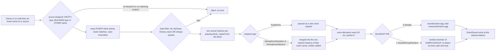

# 10 — Audio design

> Part A · Baseline build: Release|Win32 (OpenGL) + TARGET_PC_FULLGAME ([B:FULL]); see _work/build_matrix.md.
> Evidence: [C] confirmed · [I] inferred · [U] unknown. Citations are `path:Symbol` relative to the multiwinia/ source root.
> Sources merged: P16_sound (routed §10.1–10.11, §09.1 sound options, determinism notes, IP register, appendix), X2b_asset_catalogue_audio (routed §10.A–10.K and its generated tables `_work/drafts/X2b_sound_events.csv` (469 rows), `X2b_callsites.csv` (285 rows), `X2b_samples.csv` (1332 rows), `X2b_summary.txt`), P05_entities_creatures (creature sound events), X1b_asset_formats (grammar cross-reference), the audio notes in `_work/routed/_meta_*.md` (from P01, P02, P08, P16, P17b, P18, P19, P20, X2b) and `_work/phase2_log.md`. Engine internals are in the final [27_audio_engine](27_audio_engine.md) and are linked, not repeated. New generator/verification script: `_work/scripts/S_10_audio_tables.py` (independent re-parse of `data/sounds.txt` and `data/effects.txt`, cross-check against both drafts' CSVs, renders every catalogue table in §3.4, §4, §5, §10.4 and the call-site part of the Source map).

Conventions (same as 27): **vol units** = the 0.0–10.0 logarithmic volume scale of the data (5 dB per unit on the shipped DirectSound path, §11.2); **wu** = world units (the code calls them metres); **tick** = one 50 ms pass of the 20 Hz sound update; **voice** = **channel**; a **source** is a sound-blueprint owner (`ENTITY <type>`, `BUILDING <type>`, `OTHER <name>`); a **pair** is one (source, event name); a **block** is one `EVENT … END` in `data/sounds.txt` (a pair can have several blocks).

## Contents

1. [Audio design overview and what is actually audible](#1-audio-design-overview-and-what-is-actually-audible)
2. [The binding model: object types × event names → blueprint → samples](#2-the-binding-model-object-types--event-names--blueprint--samples)
3. [The `sounds.txt` content model: every instance parameter](#3-the-soundstxt-content-model-every-instance-parameter)
4. [Complete event catalogue (every bound object type × event)](#4-complete-event-catalogue-every-bound-object-type--event)
5. [Coverage gaps: events fired with no data, data never fired](#5-coverage-gaps-events-fired-with-no-data-data-never-fired)
6. [Music system](#6-music-system)
7. [Front-end, UI, HUD, voice and ambience](#7-front-end-ui-hud-voice-and-ambience)
8. [Positional rules](#8-positional-rules)
9. [Priorities and voice limits](#9-priorities-and-voice-limits)
10. [Filters / DSP](#10-filters--dsp)
11. [Mix groups, volume categories and sound options](#11-mix-groups-volume-categories-and-sound-options)
12. [Audio asset statistics (summary; per-file catalogue in 25)](#12-audio-asset-statistics-summary-per-file-catalogue-in-25)
13. [Bugs and quirks that shape the shipped audio](#13-bugs-and-quirks-that-shape-the-shipped-audio)
14. [Sound-design brief for the new game](#14-sound-design-brief-for-the-new-game)
- [Open questions and unknowns](#open-questions-and-unknowns)
- [Docs-vs-code discrepancies](#docs-vs-code-discrepancies)
- [IP items](#ip-items)
- [Source map](#source-map)
- [Appendix — dead/legacy code](#appendix--deadlegacy-code)

## 1 Audio design overview and what is actually audible

### 1.1 The design in one paragraph

Multiwinia's audio is a **data-bound, event-driven** design [C] `code/sound/soundsystem.cpp:SoundSystem::TriggerEntityEvent`, `TriggerBuildingEvent`, `TriggerOtherEvent`. Game and UI code never name a sound file: it fires a named **event** on a **source** (an entity type, a building type, or one of 12 fixed "Other" sources) and the designer-authored file `data/sounds.txt` decides what, if anything, plays — one or more layered `EVENT` blocks per event, each naming a sample or a random sample group plus a full voice description (2D / world-fixed / object-attached position, one-shot / loop / re-triggering ADSR loop, polyphonic or one-shared-voice, friend/foe filter, full-volume radius, and six modulatable parameters: volume, pitch, attack, sustain, release, loop delay). The listener is the game camera; loudness falls off as `minDistance / d`; at most 31 effect voices play, chosen every 50 ms by loudness at the camera with a 0.75 penalty per louder copy of the same event; there is a single master volume and no buses, no ducking, no authored priorities; DSP chains exist in data but are switched off; and the music engine, although present, has no reachable trigger and no shipped tracks in Multiwinia. What the player hears is therefore: generative ambience beds (front end and match), a large set of unit barks and combat effects, team-filtered announcer stings for objectives and crates, and a handful of UI clicks and beeps.

### 1.2 What is actually audible, in order of a session [B:FULL]

| Phase | What plays | Ref |
|---|---|---|
| Start-up and loading screens | Nothing. Every trigger is dropped until `sounds.dat` and `sounds2.dat` are parsed (`App::m_soundsLoaded`) and while a loading screen renders; the early `menusounds.dat` buys nothing audible (§2.6) | [C] `code/sound/soundsystem.cpp:SoundSystem::NotReadyForGameSoundsYet`, `code/app.cpp:App::LoadSounds` |
| Front end, lobby, options | `MultiwiniaInterface LobbyAmbience` — three endless 2D beds (a slow random pad sequence from 10 `MultiLobbyAmb` pads, a low drone group, a half-speed heartbeat), started on the first `GameMenuWindow::Update` after the gate opens and restarted each time the front end is rebuilt; menu roll-over / select / cancel clicks; chat blip. **No music track** | [C] `code/UI/GameMenuWindow.cpp:GameMenuWindow::Update`, `code/main.cpp:MainMenuLoop`; §7.5 |
| Leaving the front end | `StopAllSounds(…, "MultiwiniaInterface LobbyAmbience")` → each bed fades over its RELEASE (≈ 10.3–10.8 s, the heartbeat is cut at its loop end); the loading screen that follows drops all triggers | [C] `code/main.cpp:MainMenuLoop` |
| Match start | `Ambience EnterLocation` — three 2D beds whose levels follow the **camera altitude** (ground rumble fades out above ≈ 232 wu, a high-altitude wind/"angelic" bed and white noise fade in as the camera climbs to ≈ 990 wu) for the whole match | [C] `code/main.cpp:LocationGameLoop`; §7.5 |
| Grace period (ready-up countdown, `GRACE_TIME` = 3.0 s) | `CountdownTick` beeps at ≈ 3, 2, 1 and 0 s, and `CountdownZeroTick` (same beep, pitch × 2.0) at 0 when the game starts; world sounds are not pitch-bent during the grace period | [C] `code/multiwinia.cpp:Multiwinia::AdvanceGracePeriod`; §7.2 |
| Match | 182 live (source, event) pairs (§4): Darwinian barks (spawn chatter, battle cries, retreat, pain, death, acknowledgements), lasers and impacts, grenades, air strikes, nukes, creature and vehicle loops, building hums, crate fall / capture progress / reward stings, KotH zone and statue stings filtered by friend/foe, spawn-point on/off stings, Rocket Riot rocket and fuel sounds, the Assault pulse-bomb choir; UI selection clicks and the 3D unit-highlight tick; timer `CountdownTick` at every whole minute and each of the last 10 s of a timed game (render-driven) | §4, §7 |
| Match end (`Multiwinia::DeclareWinner`) | `GameOver`, `YouWon` / `YouLost` are fired but **silent** (no data, although recorded samples exist); the game speed is driven to 0, so every playing 3D world sound bends down in pitch toward 0.1× ("tape stop", 2D sounds unaffected) [I audible effect]; the ambience keeps playing; the timer's zero tick does not sound (§7.2) | [C] `code/multiwinia.cpp:Multiwinia::DeclareWinner`, `code/sound/sound_instance.cpp:GetFrequencyModifier` |
| Exit to front end | `StopAllSounds(…, "Ambience EnterLocation")` (beds release over ≈ 10 s), `Ambience ExitLocation` fired (silent); attached sounds are hard-cut when the location is torn down; **world-fixed looping sounds are never stopped** (the pulse-bomb choir, §13 #2) [I]; lobby ambience restarts | [C] `code/main.cpp:LocationGameLoop` |

### 1.3 Headline numbers

All [C] from the independent re-parse in `_work/scripts/S_10_audio_tables.py` and the X2b tables (cross-checked: 0 mismatches against both drafts at block level).

| Quantity | Value |
|---|---|
| Sound sources with data | 68 = 21 ENTITY + 35 BUILDING + 12 OTHER |
| `EVENT` blocks | 296 = 108 ENTITY + 96 BUILDING + 92 OTHER |
| Bound (source, event) pairs | 256, of which **182 sound in a FULL match** (30 more are on live code paths for object types that never exist in Multiwinia, 3 are Tank-only [B:DEBUG], 41 are never fired) |
| Pairs fired by code with **no** data (silent) | 213, of which 98 are fired in a FULL match |
| Trigger call sites in code | 285 in 77 files (126 `TriggerOtherEvent`, 96 `TriggerEntityEvent`, 63 `TriggerBuildingEvent`); 257 active in FULL, 16 commented out, 12 compiled out |
| Object types with no blueprint at all | 44 (5 entity types, 39 building types) — §4.2 |
| `SAMPLEGROUP` definitions | 131 (130 distinct names — `officercreate` is defined twice with identical content, first wins), 1126 `SAMPLE` lines (1120 distinct), 2–43 members; 12 groups never referenced |
| Audio files | 1332 Ogg Vorbis mono (954 `data/sounds/`, 378 `data/mwsounds/`), 93.9 min; **898 can play in FULL** (43.9 min); 192 unused; 11 music files not shipped |
| DSP effect uses in data | 22 (in 22 blocks) — **not applied** in the shipped configuration |
| Voices | 31 effect voices + 1 music voice at default settings |
| Music tracks | 11 in the tree, 0 shipped, 0 reachable triggers |

### 1.4 Build reality of every audio feature

| Feature | Tag | Note / ref |
|---|---|---|
| Event-bound SFX through the DirectSound back-end | [B:FULL] [B:D3D] | the shipped path; [27 §1.2](27_audio_engine.md#12-back-end-selection-and-what-is-live) |
| Software mixer back-end | [B:FULL], non-default | reachable only by hand-editing pref `SoundLibrary`; probable crash (27-U3) |
| Per-event DSP chains | compiled [B:FULL]; runtime off (pref `SoundDSP` = 0) | the options toggle is [B:DEAD] (`USE_SOUND_DSPEFFECTS`); §10.1 |
| Hardware-3D and memory-usage options | UI [B:DEAD] (`USE_SOUND_HW3D`, `USE_SOUND_MEMORY`); prefs still read | §11.4 |
| Master-volume slider, mix-rate, voice-count, swap-stereo options | [B:FULL] | §11.4 |
| Music channel | engine [B:FULL]; every trigger [B:LEGACY] (Darwinia scripts, credits) or [B:DEAD] (`USE_LOADERS`) | §6 |
| `Ambience EnterGlobalWorld` beds | [B:LEGACY] (Darwinia world map) | §7.5 |
| `OTHER Sepulveda` sounds | [B:DEAD] (`USE_SEPULVEDA_HELP_TUTORIAL`) | §4 |
| `Interface Show/Hide/Slide`, `Gesture GestureFail/GestureEnd` | [B:LEGACY] (Darwinia task-manager UIs; Show/Hide commented out in the Multiwinia one) | §7.1 |
| Blueprints of Darwinia-only object types (14 buildings, `LaserTroop`, `Tripod`) | [B:LEGACY] | §5.3 |
| `Tank` blueprints | [B:DEBUG] (Tank Battle mode is `TARGET_DEBUG` only; Tank crate commented out) | §4 |
| Sound editor, stats, profile windows, `EffectProcessor` | [B:DEBUG] (`SOUND_EDITOR`) | [27 §13](27_audio_engine.md#13-profiles-statistics-debug-and-editor-tooling) |
| XAudio and SDL back-ends | [B:DEAD] | [27 Appendix](27_audio_engine.md#appendix--deadlegacy-code) |

### 1.5 What lives where

This document is the **design** layer: what each event means and when it fires, the content model of `sounds.txt` and what every field does to the listener's experience, the complete catalogue, music/UI/voice/ambience design, and the positional, priority, DSP and mix rules as design rules. [27_audio_engine](27_audio_engine.md) holds the engine mechanics (threads, the 20 Hz tick step by step, instance state machine and exact envelope, PCM callbacks, sample cache, decoder, device back-ends, DSP implementation defects, tooling). The formal EBNF of `sounds.txt` and `effects.txt` is in [29_data_formats_reference](29_data_formats_reference.md); the one-row-per-file audio catalogue is in [25_textures_and_assets](25_textures_and_assets.md); the sound-options screen in the menu flow is in [09_meta_systems](09_meta_systems.md); entity and building behaviour that raises each event is in [02](02_units_and_entities.md), [03](03_buildings_and_world_objects.md) and [04](04_crates_powerups_and_weapons.md).

### 1.6 Contradictions resolved in this document

| # | Drafts / documents said | Code / data shows (re-read for this document) |
|---|---|---|
| R1 | P16 §27.10 and [27 §8](27_audio_engine.md#8-music-channel): "the shipped music blocks all have RELEASE 0 → immediate cut" | 14 of the 17 `OTHER Music` blocks have a fixed RELEASE of 3.29–20.71 s (Cutscene1–4 20.13 s, Demo2Mid 20.71 s, Cutscene5 15.48 s, LoaderGameOfLife 10.26 s, LoaderRaytrace / LoaderSoul / Credits / StartSequence / LoaderAmiga 10.06 s, LoaderMatrix 7.55 s, EndSequence 3.29 s); only LoaderFodder, LoaderSpeccy and Demo2Intro have none [C] `data/sounds.txt` `OTHER Music`. The authored music change is therefore "release the old track, then attack the new one" (§6.1). **Conflict with 27 noted**; moot for Multiwinia because music is unreachable |
| R2 | P16 §10.7 and [27 §12.1](27_audio_engine.md#121-gating--dsp-is-off-in-the-shipped-configuration): "22 effect uses in 21 blocks" | 22 uses in **22** blocks, one effect each (P16's own per-event list enumerates 22 blocks) [C] `data/sounds.txt`, §10.4 |
| R3 | P16: 130 sample groups, 1120 entries; X2b: 131 definitions, 1126 lines | Both true: `SAMPLEGROUP officercreate` appears twice (lines 3858 and 4101) with identical members; the first definition wins at lookup [C] `data/sounds.txt`, `code/sound/soundsystem.cpp:SoundSystem::GetSampleGroup` |
| R4 | P17b/P18: master-volume slider class `code/UI/soundsliderbutton.h` "not in the vcproj and not included → dead" | It is header-only and included as `"UI/SoundSliderButton.h"` from `code/interface/prefs_sound_window.h` (case differs; Windows file names are case-insensitive); `PrefsSoundWindow::Create` constructs `VolumeControl` — **live** [C]. Agrees with 27 |
| R5 | P16 §10.5: a smoothed parameter "starts from 0 on a fresh instance" | Adopting 27's resolution: FREQUENCY starts from 1.0, ATTACK/SUSTAIN/RELEASE/LOOPDELAY from 0, VOLUME and DSP parameters from the prototype's last output [C] `code/sound/sound_parameter.cpp:SoundParameter::Copy` ([27 §6.7](27_audio_engine.md#67-soundparameter-evaluation-engine-semantics)) |
| R6 | P16 §10.10 / X2b §10.G: `CountdownZeroTick` also sounds "when a timed game reaches 0" (`Multiwinia::Render`) | The zero-tick branch is nested inside `if( m_timeRemaining > 0 && … )` and tests `m_timeRemaining == 0` (an `int`) — unreachable; only the grace-period zero tick plays [C] `code/multiwinia.cpp:Multiwinia::Render`, `code/multiwinia.h:Multiwinia::m_timeRemaining` |
| R7 | P16 §10.10: in-game `CountdownTick` only "in the last 10 s" | It fires once per change of the displayed time whenever `secondsRemaining == 0 || m_timeRemaining <= 10`: at every whole minute and at 10, 9, …, 1 s [C] `code/multiwinia.cpp:Multiwinia::Render` (agrees with X2b) |
| R8 | P16 §10.10 lists `Interface Show/Hide/Slide` and `Gesture GestureFail` as task-manager UI sounds | Unreachable in Multiwinia: `TaskManagerInterfaceIcons` / `TaskManagerInterfaceGestures` are created only when `!App::Multiplayer()`; Show/Hide are commented out in the Multiwinia interface [C] `code/taskmanager_interface.cpp:TaskManagerInterface::CreateTaskManager`, `code/taskmanager_interface_multiwinia.cpp` (agrees with X2b) |
| R9 | P16 §10.11 "data no code fires" list | Six more pairs are dead data: `CratePowerup FlameTurret`, `GunTurret Damage`, `Egg Die`, `Officer Attack`, `Incubator Reprogramming`, `Generator ReprogramComplete` [C] (X2b §10.A, re-checked in the §5.3 table) |
| R10 | P16 §10.4: SUSTAIN "10 blocks, 0.97–16.45 s" vs this re-parse "fixed 0.97–10.84" | Both true: 6 fixed (0.97–10.84 s) + 4 ranged-random blocks whose upper bound reaches 16.45 s [C] §3.4 |

## 2 The binding model: object types × event names → blueprint → samples

### 2.1 Pipeline



### 2.2 The four trigger entry points

[C] `code/sound/soundsystem.cpp:SoundSystem::TriggerEntityEvent`, `TriggerBuildingEvent`, `TriggerOtherEvent` (two overloads); engine detail in [27 §4](27_audio_engine.md#4-triggering-from-game-event-to-queued-instance):

| Call | Source key | Initial position / emitter | Team used for the friend/foe filter |
|---|---|---|---|
| `TriggerEntityEvent(Entity*, "Event")` | `ENTITY <Entity::GetTypeName(type)>` | entity `m_pos` and `m_vel`; the entity becomes the emitter | the entity's team |
| `TriggerBuildingEvent(Building*, "Event")` | `BUILDING <Building::GetTypeName(type)>` | building `m_pos` (attached sounds then follow `m_centrePos`); velocity 0 | the building's team |
| `TriggerOtherEvent(WorldObject* or NULL, "Event", OtherType)` | `OTHER <name>` (12 names, §4.3) | object `m_pos` and emitter if an object is passed, else none. The `Music` source is diverted to the music slot (§6) | the object's team, or 255 (always passes) when NULL |
| `TriggerOtherEvent(Vector3 pos, "Event", OtherType, teamId)` | `OTHER <name>` | the given position, no emitter (music is **not** diverted on this overload) | the given team |

### 2.3 Matching and layering rules

| Rule | Behaviour | Ref |
|---|---|---|
| Name match | case-insensitive (`stricmp`) on the event name, within the source's blueprint only | [C] `SoundSystem::TriggerEntityEvent` |
| Layering | **every** matching block whose team filter passes produces its own instance. Several blocks with the same name are how the data layers a body sound with a voice (e.g. `Darwinian Die` = body + voice) or provides friend/foe variants. 23 pairs have 2 blocks, 5 have 3, 1 has 4, 1 has 5 (`OTHER Ambience EnterGlobalWorld`) | [C] `data/sounds.txt`; X2b CSV `blocks` column |
| Friend/foe filter (`TEAMMATCHTYPE`) | evaluated **at trigger time** on the local machine: 0 All → always; 1 MyTeamOnly → `team == local player's team`; 2 EnemyTeamOnly → `team != local player's team`; both false when no global world exists. **Team 255 passes every filter**, so a neutral object (or a building that becomes neutral) plays the "mine" and the "enemy" variant together | [C] `code/sound/soundsystem.cpp:SoundEventBlueprint::TeamMatch` |
| Consequence for zone stings | `BUILDING MultiwiniaZone ChangeTeam` (fired by `Building::SetTeamId` on any owner change) plays `koh_zone_captured` for MyTeam and `koh_zone_lost` for Enemy: "lost" means "now owned by someone else", also when the zone passes between two enemies; a Blitzkrieg flag that is neutralised (`SetTeamId(255)`) plays both [C mechanism] `code/worldobject/multiwiniazone.cpp:MultiwiniaZone::Advance`, `code/worldobject/building.cpp:Building::SetTeamId`; [I audible] |
| Missing data | an event with no matching block, or a type with no blueprint, is silently ignored; unknown names in `sounds.txt` are only debug-asserted | [C] `SoundSystem::LoadBlueprints` |
| Event identifier | each live instance is named `"<SourceName> <EventName>"` (e.g. `"Darwinian Attack"`); this full name is the key for the per-event priority penalty, for monophonic merging and for stopping by (sub)string | [C] `code/sound/sound_instance.cpp:SoundInstance::SetEventName` |
| Monophonic merge | an instance whose `INSTANCETYPE` is 1 or 2 merges into an existing non-polyphonic instance of the same full name (adds its emitter) instead of creating a voice | [C] `SoundSystem::InitialiseSound` |
| Determinism | sound never writes simulation state; friend/foe variants, camera-dependent selection and voice stealing differ between peers by design; audio randomness uses the shared non-synced `AppRandom` LCG | [C] [27 §15](27_audio_engine.md#15-determinism-boundary) |

### 2.4 Event names built at run time

[C] unless noted:

| Source | Built name | Rule | Ref |
|---|---|---|---|
| `BUILDING Crate` | `Capturing_<n>pc` | while the owner holds the majority: `postIntCaptured = int(5 × captureTimer / CRATE_CAPTURE_TIME)` with `CRATE_CAPTURE_TIME` = 2.5 s; on each change of that integer the previous progress tone is stopped and `sprintf("Capturing_%dpc", postIntCaptured × 20)` fires → `Capturing_20pc`, `_40pc`, `_60pc`, `_80pc` (bound, `LoopADSR`) and `Capturing_100pc` (unbound). `Capturing_0pc` is fired with `BeginCapture` when a new team takes the majority. The **decay** branch (owner lost the majority, timer falling) formats `"Capturing_%pc"` — `%p` is the pointer conversion, so the name becomes e.g. `Capturing_00000003c` [I: exact digits] and never matches: falling progress is silent (bug §13 #1) | `code/worldobject/crate.cpp:Crate::AdvanceOnGround` |
| `BUILDING EscapeRocket` | state sound | `EscapeRocket::SetupSounds` chooses one of `Refueling` (unbound), `Unhappy`, `Malfunction` (damage ≥ 75), `Happy`, `Flight` from the rocket state, stops the other four and re-triggers the chosen one whenever `NumInstances(m_id, "EscapeRocket <name>")` reads 0 | `code/worldobject/rocket.cpp:EscapeRocket::SetupSounds` |
| `OTHER Grenade` / `OTHER AirStrikeBomb` | `Create`, `Bounce`, `Flash`, `Explode` | `ThrowableWeapon::TriggerSoundEvent` routes `EffectThrowableGrenade`, `AirstrikeMarker` and `ControllerGrenade` to `OTHER Grenade`, and `EffectThrowableAirstrikeBomb` / `EffectFlameGrenade` to `OTHER AirStrikeBomb`; bomber bombs are created without `Initialise()`, so they never fire `Create`; `Flash` fires from `ThrowableWeapon::Render` (render-rate dependent) | `code/worldobject/weapons.cpp:ThrowableWeapon::TriggerSoundEvent`, `code/worldobject/airstrike.cpp:SpaceInvader::Advance` |
| `OTHER CratePowerup` | `Crate::GetName(reward)` | `Crate::TriggerSoundEvent(type, pos, team)` → `TriggerOtherEvent(pos, name, TypeCratePowerup, team)` at the crate position with the collecting team (friend/foe filter applies). `RunGunTurret` always passes `CrateRewardGunTurret` (so the `FlameTurret` block is dead); `Engineer`, `RocketTurret`, `NapalmStrike` (uses `Airstrike`), `SlowDown`, `SpeedUp` are never passed | `code/worldobject/crate.cpp:Crate::TriggerSoundEvent`, `code/taskmanager.cpp` |
| `OTHER Music` | script word | `Script::RunCommand_TriggerSound(word)` plays `Music <word>` unless `NumInstancesPlaying(-, "Music <word>") > 0` (always 0, music never occupies an effect channel) | `code/script.cpp:Script::RunCommand_TriggerSound` |

### 2.5 Stopping, querying and keeping loops alive

`StopAllSounds(objectId, partialName)` stops every instance whose current emitter equals `objectId` (an invalid id matches instances without emitter: all 2D and world-fixed sounds) and whose full event name **contains** `partialName` (or all of that emitter's sounds when NULL): playing ones get a final release, queued ones are destroyed; a name containing `"Music"` releases the music instead [C] `code/sound/soundsystem.cpp:SoundSystem::StopAllSounds`. Queries `NumInstancesPlaying(id, name)` (on voices), `NumInstances(id, name)` (queued + playing) and `IsSoundPlaying(id)` exist for game code [C].

Every stop site outside `code/sound/` [C] (X2b §10.E, spot-checked in `crate.cpp`, `main.cpp`, `location_input.cpp`):

| Partial name stopped | Emitter | When | Ref |
|---|---|---|---|
| `MultiwiniaInterface SelectionCircle` | none | selection circle released | `code/location_input.cpp:LocationInput::AdvanceTeamControl` |
| `MultiwiniaInterface LobbyAmbience` | none | `MainMenuLoop` exits | `code/main.cpp:MainMenuLoop` |
| `Ambience EnterLocation` | none | `LocationGameLoop` exits (then `Ambience ExitLocation` fires, unbound) | `code/main.cpp:LocationGameLoop` |
| `Ambience EnterGlobalWorld` | none | world loop exit / script [B:LEGACY] | `code/main.cpp:GlobalWorldGameLoop`, `code/script.cpp:Script::RunCommand_StopSound` |
| `Music`, `Music <event>` | none | cutscene escape / script `StopSound` [B:LEGACY]; each loader stops its own track [B:DEAD]; `CreditsLoader` stops `Music Cutscene3` although it started `Credits` | `code/script.cpp:Script::RunCommand_StopSound`, `code/loaders/credits_loader.cpp:CreditsLoader::Run`, `code/startsequence.cpp:StartSequence::Advance` |
| `Tree Burn` | tree | fire out / tree destroyed | `code/worldobject/tree.cpp:Tree::Advance` |
| `RadarDish BeginRotation` | dish | before re-aiming; on alignment | `code/worldobject/radardish.cpp:RadarDish::Advance` |
| `RadarDish ConnectionEstablished` | dish | link lost | `code/worldobject/radardish.cpp:RadarDish::Advance` |
| `SolarPanel Operate` | panel | occupancy ≤ 60 % while operating | `code/worldobject/generator.cpp:SolarPanel::Advance` |
| `SpaceShip TractorBeam` | ship | abduction ends | `code/worldobject/spaceship.cpp:SpaceShip::Advance` |
| `Officer SetOrderNone/Goto/Follow/Absorb/Formation` | officer | `Officer::CancelOrderSounds` before every new order sound | `code/worldobject/officer.cpp:Officer::CancelOrderSounds` |
| `Crate Falling` | crate | lands | `code/worldobject/crate.cpp:Crate::Advance` |
| `Crate Capturing_` (all progress tones) | crate | `Crate::StopCaptureSounds` before each new tone, on capture and on loss | `code/worldobject/crate.cpp:Crate::StopCaptureSounds` |
| `Crate BeginCapture` | crate | captured or lost | `code/worldobject/crate.cpp:Crate::AdvanceOnGround` |
| `Engineer BeginReprogramming` | engineer | reprogramming ends [B:LEGACY] (7 sites) | `code/worldobject/engineer.cpp:Engineer::Advance` |
| `GodDish ConnectToGod` | dish | deactivated [B:LEGACY] | `code/worldobject/goddish.cpp:GodDish::Deactivate` |
| `Spam Create` | spam | becomes research [B:LEGACY] | `code/worldobject/spam.cpp:Spam::Advance` |
| `Rocket Create` | rocket | explodes | `code/worldobject/weapons.cpp:Rocket::Advance` |
| `Darwinian SeenThreat` | Darwinian | threat cleared / state change | `code/worldobject/darwinian.cpp:Darwinian::SearchForThreats` |
| `Darwinian TakenControl` | Darwinian | released (both unbound) | `code/worldobject/darwinian.cpp:Darwinian::LoseControl` |
| `FuelPipe PumpFuel` | pipe | fuel level ≤ 0.2 | `code/worldobject/rocket.cpp:FuelPipe::Advance` |
| `EscapeRocket Refueling/Happy/Unhappy/Malfunction/Flight` | rocket | the wrong state sound is playing | `code/worldobject/rocket.cpp:EscapeRocket::SetupSounds` |
| `EscapeRocket EngineBurn` | rocket | engines off | `code/worldobject/rocket.cpp:EscapeRocket::Advance` |
| `Statue Carry` | statue | dropped (`Carry` is unbound) | `code/worldobject/carryablebuilding.cpp:CarryableBuilding::Advance` |
| all sounds of the tank | tank | tank dies [B:DEBUG] | `code/worldobject/tank.cpp:Tank::ChangeHealth` |

Looping blocks without a stop site end only when their attached emitter disappears (hard cut, §8.4): `Engineer Create`, `Squadie Create`, `SporeGenerator Create`, `Centipede Create`, `SpaceInvader Create`, `Spider Create`, `ArmyAnt Create`, `Armour Create`, `SoulDestroyer Create`, `SoulDestroyer EnemySighted`, `Harvester Create` (3 blocks), `Nuke Create`, `Meteor Create` (2), `Tank Create`, `SpaceShip Create` (4), `LaserFence Create`, `Tree CreateNormal`, `Tree CreateMagic`, `Tree CreateEvil`, `Triffid Burn`, `MultiwiniaZone Create`, `ControlStation Create`, `Grenade ExplodeController`, `Rocket Create` (stopped by explode), and the legacy `Powerstation`, `TrunkPort ReprogramComplete`, `ResearchItem`, `Refinery`, `Yard`, `SpiritReceiver`, `SpiritProcessor`, `BlueprintStore`, `BlueprintConsole`, `BlueprintRelay`, `Spam`, `GodDish Create` loops [C]. **World-fixed loops cannot be stopped at all**: `BUILDING PulseBomb Create` (group of `choir1`–`choir6`, `POSITIONTYPE 1`, Loop) and the legacy `Generator ReprogramComplete` never get an emitter id, so no `StopAllSounds(m_id, …)` reaches them and the orphan cull only applies to attached sounds → the Assault pulse-bomb choir keeps looping at its world position after the bomb is destroyed and after the match ends [I from `code/sound/soundsystem.cpp:SoundSystem::Advance`, `StopAllSounds`; not observed] (10-U4).

Keep-alive caveat [C/I]: the emitter id used by stops and queries is filled in only during the first sound tick after triggering and never for 2D / world-fixed sounds, so the per-tick polling in `EscapeRocket::SetupSounds` and `FuelPipe::Advance` can re-trigger a loop that already exists (several simulation ticks between two sound ticks) [I] ([27 §4](27_audio_engine.md#4-triggering-from-game-event-to-queued-instance), 27-U14). A new engine must record the emitter at trigger time.

### 2.6 From a sample name to a file

[C] (X2b §10.B, steps re-read in `code/sound/sample_cache.cpp:CachedSample::CachedSample`, `code/lib/resource.cpp:Resource::GetSoundStreamDecoder`):

| Step | Rule | Ref |
|---|---|---|
| 1 | `SOUNDNAME x` / `SAMPLE x` is lower-cased and cut at its last `.`; no shipped name has an extension | `code/sound/soundsystem.cpp:SoundSystem::ParseSoundEvent`, `ParseSampleGroup` |
| 2 | `SOURCETYPE 1`: linear, case-insensitive search of the group list, first definition wins; not found → `AppReleaseAssert("Failed to find Sample Group")` (**fatal**) | `code/sound/sound_instance.cpp:SoundInstance::OpenStream` |
| 3 | group member chosen `AppRandom() % n` at every start and loop restart (n halved / quartered by pref `SoundMemoryUsage` 2 / 3 — only the first ½ or ¼ of each group is then ever used) | `SoundInstance::OpenStream` |
| 4 | the cache opens `sounds/<name>`, then `mwsounds/<name>`; both failing → `AppReleaseAssert("Failed to open sound stream decoder : …")` (**fatal**) | `code/sound/sample_cache.cpp:CachedSample::CachedSample` |
| 5 | `.ogg` is appended unconditionally (the WAV decoder is unreachable) | `code/lib/resource.cpp:Resource::GetSoundStreamDecoder` |
| 6 | loose file under `data/` first, then the archive table; lookups are case-insensitive (359 of the 1332 file names contain capitals and all resolve) | `code/lib/resource.cpp:Resource::GetBinaryReader`, `contrib/systemiv/lib/tosser/hash_table.cpp:HashTable::HashFunc` |

Packaging [C] `tools/build_multiwinia_data.bat`: `menusounds.dat` (18 files from `tools/menu_sounds.txt` = exactly the samples of `LobbyAmbience`, `MenuRollOver`, `MenuSelect`, `MenuCancel`; parsed in the App constructor), `sounds.dat` (1297 from `tools/sounds.txt`), `sounds2.dat` (the 6 late UI samples `beep_harsh_malfunction`, `chat`, `mouseclick1`, `rollover1a`, `rollover1b`, `rollover1c` never added to `tools/sounds.txt`); 11 music files excluded by `tools/multiwinia_exclusions.txt`. Later archives override earlier ones; loose files override archives. Full archive rules: [31](31_platform_build_and_tools.md), [29](29_data_formats_reference.md).

Design consequences [C/I]: (1) a blueprint that names a missing sample is a **crash**, not silence — in the shipped data only the 11 unshipped music files are such references, and their events are unreachable (§6); (2) the early front-end bank (`menusounds.dat`) cannot be heard early, because every trigger waits for `sounds.dat` + `sounds2.dat` (`App::m_soundsLoaded`) [I: remnant of an earlier "ambience during load" path — the commented-out `LobbyAmbience` trigger in `code/app.cpp:App::CheckSounds`]; (3) there is **no localised audio**: no `.ogg` exists outside `data/sounds/` and `data/mwsounds/` and the sound system has no locale switch [C].

## 3 The `sounds.txt` content model: every instance parameter

### 3.1 File structure (semantic summary; formal EBNF in 29)

Line- and token-oriented, `#` comments, keywords case-insensitive, CRLF in the shipped file [C] `code/sound/soundsystem.cpp:SoundSystem::LoadBlueprints`, `ParseSoundEvent`, `ParseSoundEffect`, `ParseSampleGroup`, `code/sound/sound_parameter.cpp:SoundParameter::Read`. Shape (not source code; field order inside an EVENT is free):

```
ENTITY|BUILDING|OTHER <TypeName>
    EVENT <EventName>
        SOUNDNAME <sample-or-group>  SOURCETYPE <0|1>  POSITIONTYPE <0..3>  INSTANCETYPE <0..2>
        LOOPTYPE <0..2>  TEAMMATCHTYPE <0..2>  MINDISTANCE <float>  [PRIORITY <int> (ignored)]
        VOLUME    PARAMETER <param-spec>
        [FREQUENCY | ATTACK | SUSTAIN | RELEASE | LOOPDELAY  PARAMETER <param-spec>]
        [EFFECT <EffectName>  (one "<ParamName> PARAMETER <param-spec>" line per effect parameter, by position)  END]...
    END
END
SAMPLEGROUP <GroupName>  (SAMPLE <name>)...  END
param-spec := TypeFixedValue v | TypeRangedRandom lo hi smooth | TypeLinked inLo outLo inHi outHi smooth LinkName,
              optionally followed by UpdateConstantly | UpdateOncePerLoop (absent = UpdateConstantly)
```

Loader rules that matter to authors [C] (X1b cross-reference): effect parameters are matched **by position**, the name token is not checked; `data/effects.txt` defaults are **not** applied to omitted effect parameters (the editor seeds new effects with each parameter's minimum); blank lines inside `EVENT` / `EFFECT` / `SAMPLEGROUP` blocks crash the loader; unknown field names are only debug-asserted; the writer omits FREQUENCY when it is fixed 1.0 and ATTACK / SUSTAIN / RELEASE / LOOPDELAY when fixed 0.0; the object-name buffer is 128 characters. Grammar, value domains and the `effects.txt` table: [29](29_data_formats_reference.md).

### 3.2 Semantic field table — every instance parameter

Defaults are the `SoundInstance` constructor values used when a field is absent [C] `code/sound/sound_instance.cpp:SoundInstance::SoundInstance`; domains from the parser, the device asserts and the editor ranges [C] `code/interface/soundeditor_window.cpp:SoundEditorWindow::CreateInstanceEditor`; shipped usage from §3.4.

| Field (file) | Member | Domain / values | Default | Design semantics | Shipped usage (296 blocks) |
|---|---|---|---|---|---|
| `SOUNDNAME` | `m_soundName[256]` | file stem under `sounds/` or `mwsounds/`, or a `SAMPLEGROUP` name (when SOURCETYPE = 1) | `"[???]"` — never plays | What to play | 143 single samples, 153 groups |
| `SOURCETYPE` | `m_sourceType` | 0 `Sample`, 1 `SampleGroupRandom` | 0 | 1 = uniform random group member at every start and every restart (Loop: each loop; LoopADSR: each new note) — the variety mechanism | 0: 143, 1: 153 |
| `POSITIONTYPE` | `m_positionType` | 0 `Type2D`, 1 `Type3DStationary`, 2 `Type3DAttachedToObject`, 3 `TypeInEditor` | 2 | 0: at the listener, centred, unattenuated, never pitch-bent by game speed, always ranks as loudest; 1: fixed at the trigger position, outlives its emitter (use for deaths, explosions, impacts); 2: follows the emitter every tick, **hard-cut** when it disappears (use for loops and bodies); 3: editor preview only (§8.4) | 2D 83, Stat 42, Att 169, Ed 2 |
| `INSTANCETYPE` | `m_instanceType` | 0 `Polyphonic`, 1 `MonophonicRandom`, 2 `MonophonicNearest` | 0 | 0: one voice per trigger; 1 / 2: one shared voice per event name for all emitters — emitter picked at random per (re)start, or the one nearest the camera continuously (only within ≈ 316 wu, §8.7) — the crowd-limiting mechanism | Poly 290, MonoRandom 3 (`Squadie Create`, `Squadie WeaponReturns`, `Yard Create`), MonoNearest 3 (`Darwinian Create`, one `Darwinian Attack` block, `EscapeRocket Unhappy`) |
| `LOOPTYPE` | `m_loopType` | 0 `SinglePlay` ("PlayOnce"), 1 `Looped` ("Loop"), 2 `LoopedADSR` ("LoopADSR") | 0 | 0: play once (one-shot, expires if no voice within 3 ticks); 1: loop the sample (a group draws a new member each loop), LOOPDELAY of silence between loops; 2: re-triggering note: at each release a new copy starts (after LOOPDELAY) and cross-fades with the fading old one — the generative-pad mechanism (§7.5) | Once 210, Loop 70, LoopADSR 16 |
| `TEAMMATCHTYPE` | `m_teamMatchType` | 0 `AllTeams`, 1 `MyTeamOnly`, 2 `EnemyTeamOnly` | 0 | Friend/foe audience filter at trigger time, relative to the local player; team 255 always passes (§2.3) | All 284, MyTeam 8, Enemy 4 |
| `MINDISTANCE` | `m_minDistance` | float wu; editor 1–10000; DirectSound release-asserts 1 ≤ d ≤ 1e9 | 100.0 | Full-volume radius; beyond it amplitude × `min/d` (§8.2); also scales priority | 5.98–10000; 100.00 × 170, 200.00 × 39 |
| `PRIORITY` | — | int | — | **Ignored** (read and discarded "for backwards compatibility") | 0 blocks |
| `VOLUME` | `m_volume` | parameter, 0–10 vol units (log, 5 dB / unit) | fixed 7.0 | Peak level = envelope target; base of the priority ranking | fixed 282 (3.00–10.00, mean 9.00), linked 12, random 2 |
| `FREQUENCY` | `m_freq` | parameter, multiplier of the sample's native rate; editor 0–3; device window 0–144000 Hz | fixed 1.0 | Pitch and speed together (no time-stretch); re-evaluated every tick unless `UpdateOncePerLoop` | absent 177, random 63, fixed 45 (0.30–2.00), linked 11 |
| `ATTACK` | `m_attack` | parameter, s; editor 0–60 | 0 | Linear fade-in in vol units (= linear in dB), timed from the **trigger** moment | 27 blocks (0.19–10.84 s) |
| `SUSTAIN` | `m_sustain` | parameter, s; editor 0–300 | 0 | **Hold duration** after the attack, then automatic release; 0 = hold until stopped or the sample ends (there is no decay stage and no sustain level) | 10 blocks (fixed 0.97–10.84 s, random up to 16.45 s) |
| `RELEASE` | `m_release` | parameter, s; editor 0–60 | 0 | Linear fade-out (in vol units) once released (stop, sustain timeout, or one-shot end) | 64 blocks (0.39–20.71 s) |
| `LOOPDELAY` | `m_loopDelay` | parameter, s; editor 0–60 | 0 | Silence between loops (Loop) or the delay before the next note (LoopADSR) | 18 blocks (fixed 0.10–5.03 s, random, linked) |
| `EFFECT … END` | `m_dspFX` (`DspHandle`s) | 0..n effects from the 14 types (§10) | none | DSP chain; instantiated only if pref `SoundDSP` ≠ 0 | 22 uses in 22 blocks (inactive) |

Exact envelope arithmetic, loop logic and the instance state machine: [27 §6.2–6.4](27_audio_engine.md#62-instance-state-machine).

### 3.3 `SoundParameter` — the universal modulatable value

Every one of the six instance parameters and every DSP parameter is a `SoundParameter` [C] `code/sound/sound_parameter.cpp:SoundParameter::Recalculate`, `code/sound/sound_instance.cpp:SoundInstance::UpdateParameter`:

| Type (file token) | Inputs | Output at each evaluation |
|---|---|---|
| 0 `TypeFixedValue` | `v` | `v` |
| 1 `TypeRangedRandom` | `lo hi smooth` | `target = lo + frand(hi − lo)` (uniform, non-synced RNG, can equal `hi`); `out = target·(1 − √smooth) + out_prev·√smooth` |
| 2 `TypeLinked` | `inLo outLo inHi outHi smooth link` | input `x` from `link`; clamped linear map: `x` at or beyond the lower input end → the matching output end, at or beyond the upper → the other end, else `outLo + (x − inLo)/(inHi − inLo)·(outHi − outLo)` (decreasing input ranges work); smoothed as above |

Link inputs, evaluated at the instance position (2D sounds use the camera position and velocity) [C]:

| # | Link (file) | Input `x` | Design use in shipped data |
|---|---|---|---|
| 0 | `Nothing` | 0 | — |
| 1 | `HeightAboveGround` | `pos.y − landscape height(pos.x, pos.z)` (0 height without a location) | flyers' pitch (Harvester, SpaceShip engines: 0 → 984 wu ↦ pitch 0.32 → 2.47), SporeGenerator loop delay |
| 2 | `Xpos` | `pos.x` | — |
| 3 | `Ypos` | `pos.y` (absolute altitude) | level ambience by camera altitude (2D, so the camera's y) |
| 4 | `Zpos` | `pos.z` | — |
| 5 | `Velocity` | `|vel|` (wu/s of the emitter) | vehicle engines (`Armour Create` 8.39 → 10 vol, `Tank Create` 9.55 → 10 vol and pitch 1.10 → 1.68 as speed goes 0 → 2.4 / 22.4 wu/s), Spider footfall volume, bomber engine pitch, creature loop delays |
| 6 | `CameraDistance` | `|camera − pos|` | `Meteor Land` volume 0 → 9.9 over 100 → 320 wu (close/far layers), echo wet/dry on two blocks |

Update types: 0 `UpdateConstantly` — re-evaluated every 20 Hz tick (ranged-random values jitter every tick, filtered by `smooth`); 1 `UpdateOncePerLoop` (enum `UpdateOnceEveryRestart`) — evaluated at trigger, at start and after each loop restart only, i.e. "one random value per note" [C]. Smoothing `smooth` ∈ [0, 0.99] (editor) is a per-tick retention of `√smooth` (0.6 → 0.775 per 50 ms). The smoothing start state compresses authored random pitch ranges toward 1.0 on the first note (e.g. 0.75–1.35 becomes ≈ 0.88–1.16) [I] (R5, 27-U10). 10 shipped parameter definitions use smoothing > 0 [C] §3.4.

### 3.4 Shipped usage of every field

Generated by `_work/scripts/S_10_audio_tables.py` (independent parser; agrees with P16's per-block CSV and X2b's per-pair CSV on every block):

<!-- S10:FIELDS:BEGIN -->
<!-- S10:FIELDS:END -->

### 3.5 Sample groups

| Fact | Value | Ref |
|---|---|---|
| Definitions / distinct names | 131 / 130 (duplicate `officercreate`, identical, first wins) | [C] `data/sounds.txt` |
| `SAMPLE` lines / distinct entries | 1126 / 1120 | [C] |
| Size range | 2–43 members (largest: `TrackLink CogTurn` 43, legacy; live: `Darwinian SeenThreatAttack` 37, `Laser InjuredEntity` 36, `Darwinian SeenThreatRunAway` 36 over 2 groups, `Virii ChangeDirection` 29, `Darwinian Attack` 29 over 2 groups) | [C] X2b |
| Never referenced (12) | `aye`, `darwinnianonfire`, `lasercock`, `laserhitbuild`, `laserhitentity`, `laserhitgnd`, `laserricochet`, `offciersetordergoto` (misspelt; its members are used elsewhere), `officerabsorb`, `officerselected`, `officersetorderfollow`, `officersetorderformation` — recorded officer acknowledgements, laser cock / hit / ricochet variations and burning cries that were never wired | [C] |
| Selection | uniform `AppRandom() % n` on each start/restart, no "avoid repeat" rule; pref `SoundMemoryUsage` 2/3 restricts it to the first ½ / ¼ of the members | [C] `code/sound/sound_instance.cpp:SoundInstance::OpenStream` |
| Deliberate silences | group `darwinnianburncry` mixes 6 burn cries with 7 `silence1`–`silence7` files, so about half of the `Darwinian OnFire` screams are silent | [C] X2b §10.H |

### 3.6 Authoring conventions visible in the shipped data

[C] from the §4 table unless noted:

- **Deaths, explosions, impacts are world-fixed** (`Stat`) so they survive the object's removal: e.g. `Darwinian Die` (both layers), `Engineer Die`, `SporeGenerator Die`, `Centipede Die`, `Nuke Explode`, `Grenade Explode`, `AirStrikeBomb Explode`, `Meteor Land`, `Crate Captured`. Some deaths are nevertheless attached (`Virii Die`, `Spider Die`, `Squadie Die`, `Officer Die`, `ArmyAnt Die`, `SoulDestroyer Die`) and are therefore cut on the first tick after the object is deleted [C mechanism; I audible: most entities linger a few ticks after death].
- **Bodies, engines and hums are attached loops** with no stop site — the object's lifetime is the sound's lifetime.
- **Crowd sounds use one shared voice**: `Darwinian Create` (MonophonicNearest), `Squadie Create` chatter (MonophonicRandom), one `Darwinian Attack` layer (MonophonicNearest reload click).
- **Owner-only feedback** uses `MyTeamOnly` 2D blocks (`Officer Create`, `Officer Selected`) or `MyTeamOnly` attached blocks (officer order confirmations); **friend/foe stings** use MyTeam/Enemy pairs (`Crate BeginCapture`, `Statue ChangeTeam`, `MultiwiniaZone ChangeTeam`, `MultiwiniaZone CaptureStatue`).
- **Variety by pitch**: 63 blocks randomise FREQUENCY, mostly ±5–20 % with `UpdateOncePerLoop`.
- **Long releases on echoing sounds**: many one-shots carry RELEASE ≈ 10 s to let a DSP echo tail ring — with DSP off they only keep a voice busy while the (already ended) sample is silent; the engine compensates by ranking playing voices by their current envelope level ([27 §5.2](27_audio_engine.md#52-perceived-volume)).
- **Volume is authored near the top of the scale** (mean fixed VOLUME 9.00; 10.0 common), so loudness differences come mostly from MINDISTANCE and distance.
