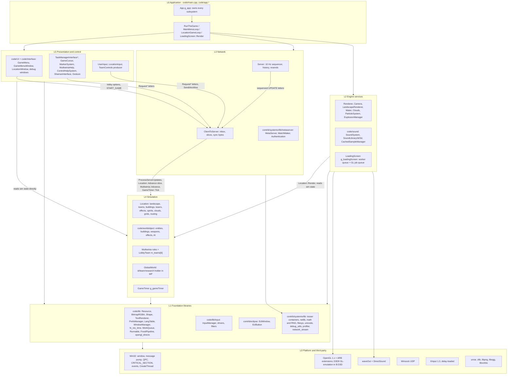
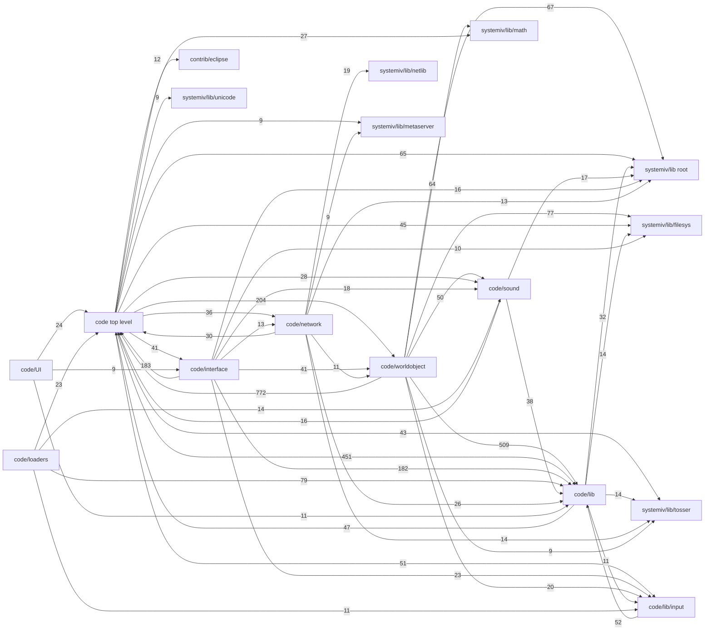
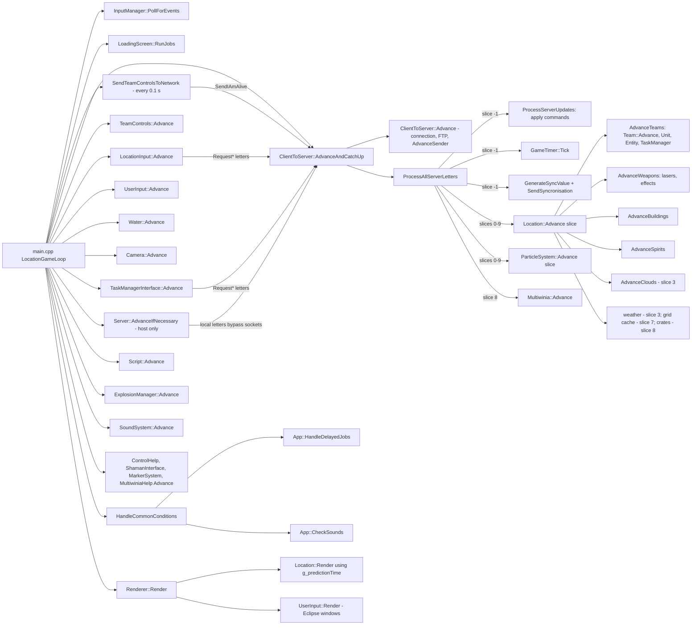
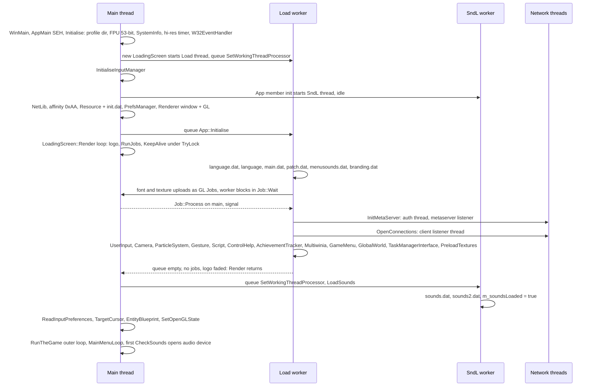
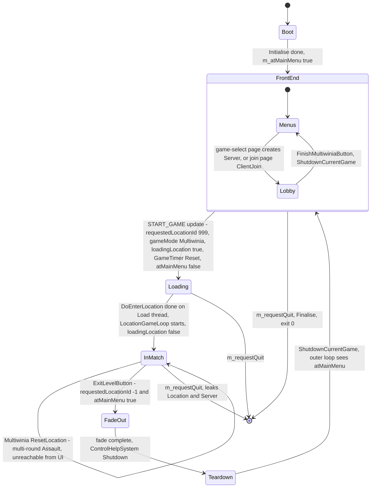
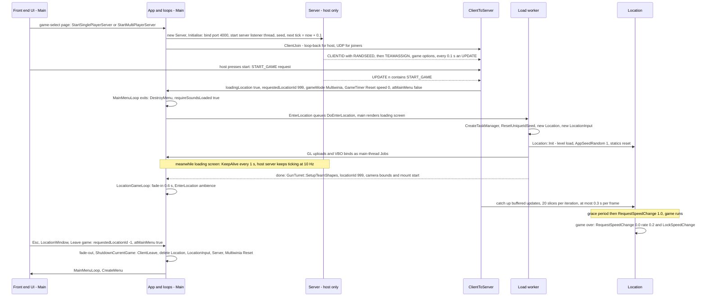
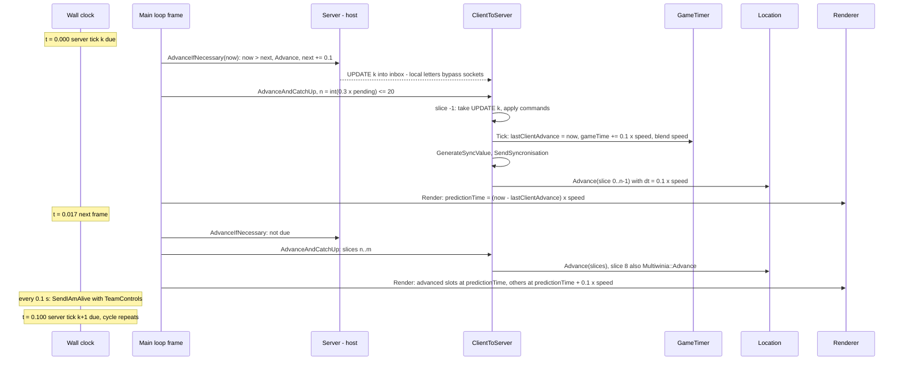

# 20 — Architecture

> Part B · Baseline build: Release|Win32 (OpenGL) + TARGET_PC_FULLGAME ([B:FULL]); see _work/build_matrix.md.
> Evidence: [C] confirmed · [I] inferred · [U] unknown. Citations are `path:Symbol` relative to the multiwinia/ source root.
> Sources merged: P01_app_core (§1 App, §2 loops/timing/threads, §7 constants), P14_platform_lib (§20.T threading primitives and thread map, §31.2–31.3 platform/timing), P15_network (§2 timing model, §13 threads and locking), P16_sound (§27.3 lifecycle/threading), P20_sequences_loaders_bench (§1 loading screen threading), P12_render_core (§24.8 prediction convention), P13_gfx_backend_math (vsync/Flip), routed `_meta_*` notes, `phase2_log.md`. Every claim below was re-checked against `code/app.*`, `code/main.cpp`, `code/gametimer.*`, `code/lib/work_queue.*`, `code/lib/runnable.*`, `code/loading_screen.*`, `code/network/clienttoserver.cpp`, `code/network/server.cpp` and the SystemIV netlib/metaserver sources; where the drafts disagreed the resolution is noted in place.

## Contents

- [1 Scope and reading guide](#1-scope-and-reading-guide)
- [2 Layered architecture](#2-layered-architecture)
- [3 Module dependency graph](#3-module-dependency-graph)
- [4 The App class](#4-the-app-class)
- [5 Global singletons and process-wide state](#5-global-singletons-and-process-wide-state)
- [6 Start-up sequence](#6-start-up-sequence)
- [7 Shutdown and teardown](#7-shutdown-and-teardown)
- [8 Lifetimes: process, session, match](#8-lifetimes-process-session-match)
- [9 Main loops](#9-main-loops)
- [10 Frame timing](#10-frame-timing)
- [11 Threading model](#11-threading-model)
- [12 Constants](#12-constants)
- [13 Architecture for the new game](#13-architecture-for-the-new-game)
- [Open questions and unknowns](#open-questions-and-unknowns)
- [Docs-vs-code discrepancies](#docs-vs-code-discrepancies)
- [IP items](#ip-items)
- [Source map](#source-map)
- [Appendix — dead/legacy code](#appendix--deadlegacy-code)

## 1 Scope and reading guide

This document describes how the Multiwinia executable is put together: which layers and modules exist and how they depend on each other, who owns every long-lived object, when each object is created and destroyed, which threads run, and how one frame is scheduled (fixed 10 Hz simulation ticks spread over variable-rate render frames, with render-time extrapolation).

It deliberately stops at the boundary of three neighbouring documents:

| Topic | Owner document |
|---|---|
| WorldObject/Entity/Building hierarchy, `Location` containers, per-slice update order inside `Location::Advance`, spatial grids, teams and units | [21 — Simulation and entity model](21_simulation_and_entity_model.md) |
| Lockstep protocol, letters, sequence ids, sync hashing, desync handling, RNG discipline, float determinism | [22 — Determinism and networking](22_determinism_and_networking.md) |
| Render pass order, GL/D3D state, the prediction convention as used by each renderer | [24 — Rendering](24_rendering.md) |
| Sound engine internals (voices, mixer, DirectSound) | [27 — Audio engine](27_audio_engine.md) |
| Eclipse window framework, menus | [28 — UI framework](28_ui_framework.md), [09 — Meta systems](09_meta_systems.md) |
| Build configurations, platform layer, timers, file locations | [31 — Platform, build and tools](31_platform_build_and_tools.md) |
| Carry-forward decisions for each subsystem | [40 — Carry-forward assessment](40_carry_forward_assessment.md) |

Three facts dominate the architecture and are worth stating up front [C]:

1. **Everything that matters runs on one thread.** Input, the network pump, the whole simulation, rendering and sound mixing all run on the main thread inside one busy loop (`code/main.cpp:LocationGameLoop`). Worker threads only load data and receive UDP packets.
2. **The simulation is driven by the network, even offline.** A `Server` object (also for single-player games against the CPU, on loop-back) emits one sequenced update every 0.1 s of real time; the client executes each update as 10 *slices* of `Location::Advance`, and `GameTimer` advances game time by `0.1 × gameSpeed` per update. There is no other source of simulation time.
3. **One global root object.** `App` (`g_app`) owns raw pointers to every subsystem; there are no interfaces, no dependency injection and no reference counting. About forty further `g_*` globals and many class-static variables hold the rest of the process state.

## 2 Layered architecture

### 2.1 Layer diagram

The layering below is the *intended* structure as visible in directory names and call direction; §2.3 lists every place the code is known to break it. Arrows mean "calls into / depends on" [C] for the module placement (directory and include analysis, §3.2), [I] for the layer names (they are this document's names, not the code's).



### 2.2 Layer responsibilities

| Layer | Modules (directories) | Key classes / globals | Responsibility | Threads that execute it |
|---|---|---|---|---|
| L6 Application | `code/main.cpp`, `code/main.h`, `code/app.*`, `code/globals.h`, `code/lib/window_manager_win32.cpp:WinMain` | `App`, `g_app`, `RunTheGame`, `MainMenuLoop`, `LocationGameLoop`, `EnterLocation`, `DoEnterLocation`, `Initialise`, `Finalise` | process start/stop, ownership of all subsystems, mode switching between front end and match, frame scheduling | main; `App::Initialise` and `DoEnterLocation` run on the loading-screen worker |
| L5 Presentation and control | `code/UI`, `code/interface`, top-level `code/user_input.*`, `location_input.*`, `taskmanager_interface*.*`, `gamecursor*.*`, `markersystem.*`, `multiwiniahelp.*`, `control_help.*`, `shaman_interface.*`, `gesture*.*` | `GameMenu`, `GameMenuWindow`, `LocationWindow`, `UserInput`, `LocationInput`, `TaskManagerInterfaceMultiwinia`, `GameCursor`, `MarkerSystem`, `MultiwiniaHelp` | menus and lobby; HUD; turns local input into network requests; never supposed to write simulation state (see §2.3) | main |
| L4 Simulation | `code/worldobject`, top-level `code/location.*`, `landscape.*`, `team.*`, `unit.*`, `taskmanager.*`, `entity_grid*.*`, `obstruction_grid.*`, `routing_system.*`, `multiwinia.*`, `global_world.*`, `gametimer.*`, `level_file.*` | `Location`, `Team`, `Unit`, `WorldObject` tree, `Multiwinia`, `GlobalWorld`, `GameTimer`, synced RNG (`syncrand`) | deterministic game state; advanced only by `ClientToServer::ProcessAllServerLetters` (§10.3) | main (level load on loading-screen worker) |
| L3 Network | `code/network`, `contrib/systemiv/lib/metaserver`, `contrib/systemiv/lib/netlib` | `Server`, `ClientToServer`, `ServerToClientLetter`, `IFrame`, `FTPManager`, `NetworkValue*`, `MetaServer_*`, `MatchMaker_*`, `Authentication_*` | relay-lockstep command sequencing at 10 Hz, join/leave, sync checks, lobby discovery and NAT punch-through ([22](22_determinism_and_networking.md)) | main (all sending and sequencing); listener threads receive; metaserver helper threads (§11.2) |
| L2 Engine services | `code/sound`, top-level `code/renderer.*`, `camera.*`, `landscape_renderer.*`, `water*.*`, `clouds.*`, `particle_system.*`, `explosion.*`, `deform.*`, `loading_screen.*` | `Renderer`, `Camera`, `SoundSystem`, `ParticleSystem`, `g_explosionManager`, `g_loadingScreen` | rendering, audio, cosmetic effects, loading-screen pump | main (sound fill callback is pulled on main; waveOut notifies from an OS thread) |
| L1 Foundation | `code/lib`, `code/lib/input`, `code/unicode`, `contrib/eclipse`, `contrib/systemiv/lib` (compiled subset: `debug_utils`, `memory_leak`, `network_stream`, `profiler`, `string_utils`, `filesys`, `math` 8 of 30 files, `metaserver` 6 of 12, `netlib` 16 of 20, `tosser` 9 of 17, `unicode`) | `Resource`, `PrefsManager`, `LangTable`, `TextRenderer`, `InputManager`, `WorkQueue`, `LList`/`DArray`/`FastDArray`/`SliceDArray`, `NetMutex`, `NetEvent`, `Directory` | data access, containers, threading primitives, input abstraction, window framework | any |
| L0 Platform | Win32, OpenGL/GLU, D3D9 [B:D3D], DirectSound, waveOut, Winsock, XInput; `contrib/unrar`, `contrib/zlib`/`contrib/lpng1215`, `contrib/libogg-1.1.3`, `contrib/libvorbis-1.1.2` | — | OS services and codecs | any |

Build status per module is in §3.1 and [build_matrix §6](_work/build_matrix.md).

### 2.3 Observed layering rules and their violations

Rules the code follows almost everywhere [C]:

1. **Control enters the simulation only through the network layer.** Local input produces `TeamControls` (sent as `ALIVE` every 0.1 s, `code/main.cpp:SendTeamControlsToNetwork`) or `ClientToServer::Request*` letters; the simulation applies them when the sequenced update arrives (`code/network/clienttoserver.cpp:ClientToServer::ProcessServerUpdates`).
2. **The simulation never reads the wall clock** for game rules; it uses `GetNetworkTime()` ≡ `g_gameTimer.GetGameTime()` and `SERVER_ADVANCE_PERIOD` ≡ `0.1 × gameSpeed` (`code/gametimer.h`).
3. **Presentation reads simulation state directly** (no snapshot, no double buffering); rendering extrapolates positions with `g_predictionTime` (§10.6).

Known violations (each is documented in detail in the owning document) [C] unless marked:

| # | Violation | Direction | Ref | Consequence |
|---|---|---|---|---|
| V1 | `ClientToServer` (network) calls `Location::Advance`, `ParticleSystem::Advance`, `Multiwinia::Advance`, `GameTimer::Tick` | L3 → L4 (network owns the sim clock) | `code/network/clienttoserver.cpp:ClientToServer::ProcessAllServerLetters` | simulation cannot be stepped without the network object; offline play needs a loop-back `Server` |
| V2 | Simulation calls HUD/UI singletons: `TaskManager::SelectTask` → `GameCursor::BoostSelectionArrows`; `Task` code → `TaskManagerInterface::SetCurrentMessage`, camera requests, `Location::SetCurrentMessage` (guarded by `m_teamId == m_myTeamId` or cosmetic) | L4 → L5 | `code/taskmanager.cpp` (see [22](22_determinism_and_networking.md), item D5 of the determinism register) | deterministic only because the calls are local-only side effects |
| V3 | Simulation triggers sounds synchronously (`SoundSystem::Trigger*Event` from `Advance`) | L4 → L2 | `code/sound/soundsystem.cpp:SoundSystem::NotReadyForGameSoundsYet` | allowed because it runs on the main thread; triggers from any other thread are silently dropped |
| V4 | `InsertionSquad::DirectControl` reads the local camera (`m_camLookAround`) while applying networked controls | L4 reads L2 local state | `code/worldobject/insertion_squad.cpp:InsertionSquad::DirectControl` | confirmed desync path ([06](06_player_control_and_input.md), [22](22_determinism_and_networking.md)) |
| V5 | `LocationInput::SelectObjectUnderMouse` calls `FenceSwitch::Switch()` directly (no network message) | L5 → L4 write | `code/location_input.cpp:LocationInput::SelectObjectUnderMouse`, `code/worldobject/switch.cpp:FenceSwitch::Switch` | desync hazard if a map contains a fence switch ([03](03_buildings_and_world_objects.md)) |
| V6 | Task-manager UI writes `TaskManager::m_mostRecentTaskId = -1` (local-only reset); the cursor's crosshair test is written `building->m_type = Building::TypeRadarDish` (assignment), overwriting the selected building's type on the local client (a no-op in practice in MP, see [06](06_player_control_and_input.md)) | L5 → L4 write | `code/taskmanager_interface_multiwinia.cpp:TaskManagerInterfaceMultiwinia::Advance` (L287), `code/gamecursor.cpp:GameCursor::RenderCrosshair` (L602) | local divergence |
| V7 | Tree collision spheres are produced as a by-product of display-list compilation using the unsynced RNG | L2 (render) → L4 | `code/worldobject/tree.cpp:Tree::Generate` (resets `m_hitcheckRadius`, then `CreateDisplayListAsync` with `Tree::GenerateLeaves` as the compile callback) via `code/lib/resource.cpp:Resource::CreateDisplayListAsync` | simulation data depends on render path ([03](03_buildings_and_world_objects.md)) |
| V8 | `code/lib` (engine library) includes and calls game-layer headers: `Resource` calls `g_loadingScreen->QueueJob` and reads `g_app->m_mainThreadId`; `PrefsManager`/`TargetCursor` include `code/interface` | L1 → L6/L5 | `code/lib/resource.cpp:Resource::CreateDisplayListAsync`, `code/lib/preferences.cpp`, `code/lib/targetcursor.cpp` | 47 include pairs from `code/lib` into top-level `code` (§3.2) |
| V9 | SystemIV library sources include `lib/universal_include.h`, which resolves to **`code/lib`** (not SystemIV) because `..\..\code` precedes `..\..\contrib\SystemIV` on the include path | L1 (third-party-ish) → game config | `targets/vs2005/Common.vsprops` (AdditionalIncludeDirectories) | SystemIV is compiled with Multiwinia's build switches; two `Vector3` classes coexist ([31](31_platform_build_and_tools.md)) |
| V10 | The `NET_DARWINIA_TOGGLEENTITY` update handler calls `RequestSelectUnit` from inside update processing on every client | L3 → L5 → L3 | `code/network/clienttoserver.cpp:ClientToServer::ProcessServerUpdates` | duplicate (idempotent) select requests from every peer |
| V11 | `GameTimer::Tick` and `GetPredictionTime` call `g_app->GamePaused()`, which reads `ClientToServer::m_outOfSyncClients` and the local `m_lostFocusPause` | L4 → L3/L6 | `code/gametimer.cpp:GameTimer::Tick`, `code/app.cpp:App::GamePaused` | game time stops per client when that client sees an out-of-sync peer ([22](22_determinism_and_networking.md)) |

## 3 Module dependency graph

### 3.1 Module inventory

One row per top-level module/directory of the source tree. "Source files" counts `source/*` rows in `_work/manifest.csv`; "in vcproj" = listed and built in all four configurations of `targets/vs2005/Darwinia.vcproj`. Sub-projects of `targets/vs2005/Darwinia.sln` are compiled as separate static libraries and are therefore "not in vcproj" but **linked** [C] `targets/vs2005/Darwinia.sln`.

| Module | Role | Source files (in vcproj / not) | .cpp built | Build status | Main documents |
|---|---|---|---|---|---|
| `code/` (top level) | application, simulation core (`Location`, `Team`, `Unit`, grids, routing, `Multiwinia`), renderer, camera, effects, task manager, menus root (`game_menu`), loading screen | 123 (122 / 1) | 62 of 63 | [B:FULL] (the one excluded file is a platform variant) | 20, 21, 24, 05 |
| `code/worldobject/` | every simulated object: entities, buildings, weapons, effects, crates, AI | 170 (170 / 0) | 85 of 85 | [B:FULL]; many classes [B:LEGACY] via `BLOCK_OLD_DARWINIA_OBJECTS` | 02, 03, 04, 07, 21 |
| `code/network/` | `Server`, `ClientToServer`, letters, iframes/sync diff, FTP manager, network values, bandwidth, demo limitations | 29 (27 / 2) | 12 of 12 | [B:FULL] | 22 |
| `code/sound/` | `SoundSystem`, 2-D/3-D libraries (waveOut, DirectSound, software), sample cache, Ogg decoder, filters | 26 (24 / 2) | 12 of 13 | [B:FULL]; SDL back-end [B:DEAD] | 27, 10 |
| `code/interface/` | Darwinia-style windows: in-game menu (`LocationWindow`), options, debug/cheat/profiler/network windows, editor windows | 94 (90 / 4) | 45 of 47 | [B:FULL]; editor windows [B:EDITOR]; sound-editor windows [B:DEBUG] | 28, 09, 32, 08 |
| `code/UI/` | Multiwinia front end and lobby (`GameMenuWindow` and its buttons, map data) | 75 (72 / 3) | 3 of 4 | [B:FULL] (most files are header-only button classes) | 09, 28 |
| `code/loaders/` | loading-screen mini-programs and credits | 22 (22 / 0) | 11 of 11 | compiled; dispatcher `RunBootloader` [B:DEAD] (`USE_LOADERS` off); credits [B:LEGACY] | 09 |
| `code/lib/` | engine library: resources, bitmaps/textures, shapes, text, preferences, language, window managers, timing, work queue, GL extension loading, D3D9 GL-emulation, fixed-function shader emulation | 122 (101 / 21) | 48 of 62 | [B:FULL]; `opengl_directx*`/`FixedPipeline` live only in [B:D3D]; SDL/Mac/Linux variants [B:DEAD] | 31, 24, 25, 29 |
| `code/lib/input/` | input manager, driver/filter graph, bindings | 70 (61 / 9) | 27 of 32 | [B:FULL]; `xbox_eventhandler.cpp` excluded in all configs; SDL drivers [B:DEAD] | 06 |
| `code/unicode/` | Unicode text-file writer; old copies of sound-library headers | 8 (2 / 6) | 1 of 4 | mostly [B:DEAD] | 29 |
| `contrib/eclipse/` | Introversion's in-house window/button framework (`EclWindow`, `EclButton`, `eclipse.cpp`) | 6 (sub-project) | 3 | **linked** (`eclipse.vcproj`) [B:FULL] | 28 |
| `contrib/systemiv/lib/` (root files) | `debug_utils`, `memory_leak`, `network_stream`, `profiler`, `string_utils` | 19 (10 / 9) | 5 of 9 | [B:FULL] subset | 31, 32, 22 |
| `contrib/systemiv/lib/tosser/` | containers: `LList`, `DArray`, `FastDArray`, `BTree`, `HashTable`, `Directory` | 17 (9 / 8) | 1 of 8 (templates are included via headers) | [B:FULL] subset | 21, 29 |
| `contrib/systemiv/lib/netlib/` | sockets, listener, `NetMutex`, `NetEvent`, `NetStartThread` | 20 (16 / 4) | 7 of 9 | [B:FULL]; `*_linux.cpp` [B:DEAD] | 22, 20 §11 |
| `contrib/systemiv/lib/metaserver/` | metaserver client, matchmaker (NAT), authentication | 12 (6 / 6) | 3 of 5 | [B:FULL]; `steamauth_client.cpp`, `steamauth_server.cpp` [B:DEAD] | 22, 09 |
| `contrib/systemiv/lib/math/` | RNG (`random_number`), `hash`, `filecrc`, `math_stubs` (`iv_*`), vectors/matrices | 30 (8 / 22) | 4 of 14 | [B:FULL] subset | 22, 29 |
| `contrib/systemiv/lib/filesys/` | file utilities, text/binary readers and writers, `FileSystem` | 10 (10 / 0) | 5 of 5 | [B:FULL] (`FileSystem` compiled but unused) | 29, 31 |
| `contrib/systemiv/lib/unicode/` | `UnicodeString` | 4 (4 / 0) | 2 of 2 | [B:FULL] | 29 |
| `contrib/systemiv/lib/{eclipse,gucci,render,resource,sound}` and `contrib/systemiv` interface/template/tools/contrib | SystemIV's own UI, input, renderer, resource and sound layers | 6 + 12 + 6 + 8 + 30 + 821 (0 in vcproj) | 0 | **not compiled**; headers occasionally reached by include resolution (e.g. `contrib/systemiv/lib/render` from `code/animatedpanel.cpp`, `code/water.cpp`) | appendix |
| `contrib/unrar/` | RAR decompression for `.dat` archives (`MemMappedFile`) | 114 (sub-project) | 55 | **linked** (`Unrar.vcproj`); "not thread safe" comment drives the sound-loading serialisation (§11) | 31 |
| `contrib/libogg-1.1.3/`, `contrib/libvorbis-1.1.2/` | Ogg/Vorbis decoding for streamed samples | 6 + 85 | 3 + 40 | **linked** (`ogg_static`, `vorbis_static`, `vorbisfile_static`) | 27 |
| `contrib/lpng1215/`, `contrib/zlib/` | PNG writing (thumbnails/screenshots) and zlib | 118 | 72 | **linked** (`libpng.vcproj`, `zlib.vcproj` under `contrib/lpng1215/projects/visualc71`) | 25 |
| `contrib/XCrashReport/`, `contrib/linux/`, `contrib/macosx/`, `contrib/loki_setup*/`, `contrib/oggvorbis-macosx-libs-1.0/`, `contrib/GLEXT.h` | crash-report sample, Linux/Mac SDKs, Loki installer | 51 + 36 + 38 + 89 + 6 + 1 | — | not linked in the PC baseline | 31 |
| `targets/vs2005/` | solution, project, property sheets, resource script | — | — | build definition | 31 |

### 3.2 Compile-time include graph

Generated by `_work/scripts/S_20_module_graph.py` (run `python3 -I S_20_module_graph.py <SRC> _work/manifest.csv <out>`): the seed set is every `.cpp`/`.c` that `Darwinia.vcproj` builds plus the Eclipse sources; includes are resolved like MSVC (including file's directory, then `Common.vsprops` include directories in order) and followed transitively (858 files in the closure); the weight of an edge A→B is the number of distinct (including file in A, included file in B) pairs. Conditional compilation is **not** evaluated, so a few edges come from dead `#ifdef` blocks [I]. The diagram shows first-party edges with weight ≥ 9; the table after it lists every edge.



Reading the graph [C] (counts) / [I] (interpretation):

- `code/` top level and `code/worldobject` are mutually dependent (772 / 204 pairs): every object includes `app.h`, `location.h`, `team.h`; `Location` includes every building/entity header it constructs. There is no simulation "kernel" that could be compiled without the application layer.
- `code/lib` is not a leaf: 47 include pairs reach back into top-level `code` (e.g. `code/lib/resource.cpp` → `app.h`, `loading_screen.h`), 2 into `code/interface` and 2 into `code/sound`.
- SystemIV is used as a utility layer (containers, sockets, RNG, file readers) by everything; its own sources include `code/lib/universal_include.h` (resolved by include order), so it is not an independent library in this build.
- `code/network` depends on `code/worldobject` (11 pairs) and `code/UI` (3 pairs: `clienttoserver.cpp`, `networkvalue.cpp`, `server.cpp` include `UI/` headers to post error dialogues and update lobby buttons).
- `code/worldobject` depends on `code/network` (5 pairs: `building.cpp`, `controlstation.cpp`, `controltower.cpp`, `laserfence.cpp`, `switch.cpp`) and on `code/sound` (50 pairs).

Full edge table (from the script; "OS:" and "C/C++ standard library" are buckets for headers not found in the tree):

| From module | To module | Include pairs |
|---|---|---|
| code (top level) | code/lib | 451 |
| code (top level) | code/worldobject | 204 |
| code (top level) | contrib/systemiv/lib (root files) | 65 |
| code (top level) | C/C++ standard library | 62 |
| code (top level) | code/lib/input | 51 |
| code (top level) | contrib/systemiv/lib/filesys | 45 |
| code (top level) | contrib/systemiv/lib/tosser | 43 |
| code (top level) | code/interface | 41 |
| code (top level) | code/network | 36 |
| code (top level) | code/sound | 28 |
| code (top level) | contrib/systemiv/lib/math | 27 |
| code (top level) | OS: Win32 / CRT | 22 |
| code (top level) | contrib/eclipse | 12 |
| code (top level) | contrib/systemiv/lib/metaserver | 9 |
| code (top level) | contrib/systemiv/lib/unicode | 9 |
| code (top level) | code/UI | 7 |
| code (top level) | code/loaders | 5 |
| code (top level) | contrib/systemiv/lib/netlib | 5 |
| code (top level) | OS: SDL/POSIX/Mac (non-baseline) | 1 |
| code (top level) | contrib/systemiv/lib/render | 1 |
| code (top level) | third-party: libpng/zlib | 1 |
| code/UI | code (top level) | 24 |
| code/UI | code/lib | 11 |
| code/UI | code/interface | 9 |
| code/UI | code/network | 5 |
| code/UI | contrib/systemiv/lib/metaserver | 5 |
| code/UI | code/lib/input | 3 |
| code/UI | C/C++ standard library | 2 |
| code/UI | code/sound | 2 |
| code/UI | OS: SDL/POSIX/Mac (non-baseline) | 1 |
| code/UI | OS: Win32 / CRT | 1 |
| code/UI | contrib/systemiv/lib/unicode | 1 |
| code/interface | code (top level) | 183 |
| code/interface | code/lib | 182 |
| code/interface | code/worldobject | 41 |
| code/interface | C/C++ standard library | 28 |
| code/interface | code/lib/input | 23 |
| code/interface | code/sound | 18 |
| code/interface | contrib/systemiv/lib (root files) | 16 |
| code/interface | code/network | 13 |
| code/interface | contrib/systemiv/lib/filesys | 10 |
| code/interface | code/UI | 7 |
| code/interface | contrib/systemiv/lib/math | 7 |
| code/interface | contrib/eclipse | 4 |
| code/interface | contrib/systemiv/lib/tosser | 4 |
| code/interface | contrib/systemiv/lib/unicode | 3 |
| code/interface | OS: Win32 / CRT | 1 |
| code/lib | C/C++ standard library | 77 |
| code/lib | code (top level) | 47 |
| code/lib | contrib/systemiv/lib (root files) | 32 |
| code/lib | OS: Win32 / CRT | 21 |
| code/lib | contrib/systemiv/lib/filesys | 14 |
| code/lib | contrib/systemiv/lib/tosser | 14 |
| code/lib | code/lib/input | 11 |
| code/lib | OS: DirectX (D3D9/DSound/XInput) | 9 |
| code/lib | contrib/systemiv/lib/unicode | 8 |
| code/lib | contrib/systemiv/lib/netlib | 5 |
| code/lib | OS: OpenGL/GLU | 4 |
| code/lib | code/interface | 2 |
| code/lib | code/sound | 2 |
| code/lib | code/unicode | 2 |
| code/lib | contrib/unrar | 2 |
| code/lib | OS: SDL/POSIX/Mac (non-baseline) | 1 |
| code/lib | contrib/eclipse | 1 |
| code/lib | contrib/systemiv/lib/math | 1 |
| code/lib | third-party: libpng/zlib | 1 |
| code/lib/input | C/C++ standard library | 54 |
| code/lib/input | code/lib | 52 |
| code/lib/input | code (top level) | 5 |
| code/lib/input | contrib/systemiv/lib (root files) | 3 |
| code/lib/input | OS: SDL/POSIX/Mac (non-baseline) | 2 |
| code/lib/input | contrib/systemiv/lib/filesys | 2 |
| code/lib/input | OS: DirectX (D3D9/DSound/XInput) | 1 |
| code/lib/input | OS: Win32 / CRT | 1 |
| code/lib/input | contrib/eclipse | 1 |
| code/loaders | code/lib | 79 |
| code/loaders | code (top level) | 23 |
| code/loaders | code/sound | 14 |
| code/loaders | code/lib/input | 11 |
| code/loaders | contrib/systemiv/lib/math | 7 |
| code/loaders | C/C++ standard library | 2 |
| code/loaders | OS: Win32 / CRT | 2 |
| code/loaders | contrib/systemiv/lib/tosser | 2 |
| code/loaders | code/worldobject | 1 |
| code/loaders | contrib/systemiv/lib (root files) | 1 |
| code/loaders | contrib/systemiv/lib/filesys | 1 |
| code/loaders | contrib/systemiv/lib/unicode | 1 |
| code/network | code (top level) | 30 |
| code/network | code/lib | 26 |
| code/network | contrib/systemiv/lib/netlib | 19 |
| code/network | contrib/systemiv/lib/tosser | 14 |
| code/network | contrib/systemiv/lib (root files) | 13 |
| code/network | code/worldobject | 11 |
| code/network | C/C++ standard library | 9 |
| code/network | contrib/systemiv/lib/metaserver | 9 |
| code/network | contrib/systemiv/lib/math | 5 |
| code/network | code/UI | 3 |
| code/network | OS: Win32 / CRT | 2 |
| code/network | contrib/systemiv/lib/unicode | 2 |
| code/network | contrib/unrar | 2 |
| code/network | code/lib/input | 1 |
| code/network | code/sound | 1 |
| code/sound | code/lib | 38 |
| code/sound | contrib/systemiv/lib (root files) | 17 |
| code/sound | code (top level) | 16 |
| code/sound | C/C++ standard library | 13 |
| code/sound | contrib/systemiv/lib/filesys | 8 |
| code/sound | OS: Win32 / CRT | 4 |
| code/sound | code/worldobject | 4 |
| code/sound | OS: DirectX (D3D9/DSound/XInput) | 2 |
| code/sound | code/interface | 2 |
| code/sound | contrib/systemiv/lib/math | 2 |
| code/sound | contrib/systemiv/lib/netlib | 2 |
| code/sound | contrib/systemiv/lib/tosser | 2 |
| code/sound | third-party: libvorbis | 2 |
| code/sound | OS: SDL/POSIX/Mac (non-baseline) | 1 |
| code/unicode | C/C++ standard library | 4 |
| code/unicode | contrib/systemiv/lib/filesys | 2 |
| code/unicode | OS: Win32 / CRT | 1 |
| code/unicode | code/lib | 1 |
| code/unicode | contrib/systemiv/lib (root files) | 1 |
| code/unicode | contrib/systemiv/lib/unicode | 1 |
| code/worldobject | code (top level) | 772 |
| code/worldobject | code/lib | 509 |
| code/worldobject | contrib/systemiv/lib/filesys | 77 |
| code/worldobject | contrib/systemiv/lib (root files) | 67 |
| code/worldobject | contrib/systemiv/lib/math | 64 |
| code/worldobject | code/sound | 50 |
| code/worldobject | C/C++ standard library | 27 |
| code/worldobject | code/lib/input | 20 |
| code/worldobject | contrib/systemiv/lib/tosser | 9 |
| code/worldobject | code/network | 5 |
| code/worldobject | contrib/systemiv/lib/unicode | 3 |
| code/worldobject | OS: Win32 / CRT | 2 |
| code/worldobject | targets/vs2005 (resources) | 2 |
| contrib/eclipse | C/C++ standard library | 9 |
| contrib/eclipse | OS: SDL/POSIX/Mac (non-baseline) | 2 |
| contrib/eclipse | OS: Win32 / CRT | 2 |
| contrib/eclipse | contrib/systemiv/lib/tosser | 2 |
| contrib/eclipse | contrib/systemiv/lib/unicode | 2 |
| contrib/eclipse | code/lib | 1 |
| contrib/eclipse | contrib/systemiv/lib (root files) | 1 |
| contrib/eclipse | contrib/systemiv/lib/math | 1 |
| contrib/systemiv/lib (root files) | C/C++ standard library | 30 |
| contrib/systemiv/lib (root files) | OS: Win32 / CRT | 5 |
| contrib/systemiv/lib (root files) | code/lib | 5 |
| contrib/systemiv/lib (root files) | contrib/systemiv/lib/tosser | 5 |
| contrib/systemiv/lib (root files) | contrib/systemiv/lib/math | 4 |
| contrib/systemiv/lib (root files) | OS: SDL/POSIX/Mac (non-baseline) | 2 |
| contrib/systemiv/lib (root files) | contrib/systemiv/lib/filesys | 2 |
| contrib/systemiv/lib (root files) | contrib/unrar | 2 |
| contrib/systemiv/lib (root files) | contrib/systemiv/lib/netlib | 1 |
| contrib/systemiv/lib (root files) | contrib/systemiv/lib/unicode | 1 |
| contrib/systemiv/lib/filesys | C/C++ standard library | 19 |
| contrib/systemiv/lib/filesys | OS: Win32 / CRT | 7 |
| contrib/systemiv/lib/filesys | code/lib | 5 |
| contrib/systemiv/lib/filesys | contrib/systemiv/lib (root files) | 5 |
| contrib/systemiv/lib/filesys | contrib/systemiv/lib/tosser | 3 |
| contrib/systemiv/lib/filesys | OS: SDL/POSIX/Mac (non-baseline) | 1 |
| contrib/systemiv/lib/filesys | contrib/systemiv/lib/unicode | 1 |
| contrib/systemiv/lib/filesys | contrib/unrar | 1 |
| contrib/systemiv/lib/math | C/C++ standard library | 10 |
| contrib/systemiv/lib/math | code/lib | 5 |
| contrib/systemiv/lib/math | contrib/unrar | 3 |
| contrib/systemiv/lib/math | contrib/systemiv/lib (root files) | 1 |
| contrib/systemiv/lib/math | contrib/systemiv/lib/filesys | 1 |
| contrib/systemiv/lib/math | contrib/systemiv/lib/tosser | 1 |
| contrib/systemiv/lib/metaserver | code/lib | 6 |
| contrib/systemiv/lib/metaserver | contrib/systemiv/lib/tosser | 6 |
| contrib/systemiv/lib/metaserver | contrib/systemiv/lib (root files) | 3 |
| contrib/systemiv/lib/metaserver | contrib/systemiv/lib/math | 3 |
| contrib/systemiv/lib/metaserver | contrib/systemiv/lib/netlib | 3 |
| contrib/systemiv/lib/metaserver | OS: Win32 / CRT | 1 |
| contrib/systemiv/lib/netlib | C/C++ standard library | 11 |
| contrib/systemiv/lib/netlib | code/lib | 7 |
| contrib/systemiv/lib/netlib | OS: SDL/POSIX/Mac (non-baseline) | 5 |
| contrib/systemiv/lib/netlib | OS: Win32 / CRT | 5 |
| contrib/systemiv/lib/netlib | contrib/systemiv/lib (root files) | 2 |
| contrib/systemiv/lib/tosser | C/C++ standard library | 13 |
| contrib/systemiv/lib/tosser | contrib/systemiv/lib (root files) | 9 |
| contrib/systemiv/lib/tosser | code/lib | 4 |
| contrib/systemiv/lib/tosser | contrib/systemiv/lib/math | 1 |
| contrib/systemiv/lib/tosser | contrib/systemiv/lib/unicode | 1 |
| contrib/systemiv/lib/unicode | C/C++ standard library | 7 |
| contrib/systemiv/lib/unicode | contrib/systemiv/lib (root files) | 3 |
| contrib/systemiv/lib/unicode | code/lib | 2 |
| contrib/systemiv/lib/unicode | contrib/systemiv/lib/filesys | 2 |
| contrib/unrar | C/C++ standard library | 27 |
| contrib/unrar | OS: Win32 / CRT | 7 |
| contrib/unrar | OS: SDL/POSIX/Mac (non-baseline) | 5 |
| third-party: libogg | C/C++ standard library | 3 |
| third-party: libogg | OS: Win32 / CRT | 1 |
| third-party: libpng/zlib | C/C++ standard library | 14 |
| third-party: libpng/zlib | OS: Win32 / CRT | 7 |
| third-party: libpng/zlib | OS: SDL/POSIX/Mac (non-baseline) | 1 |
| third-party: libvorbis | C/C++ standard library | 1 |
| third-party: libvorbis | third-party: libogg | 1 |

Files reached per module in the compiled closure: code top level 122, `code/UI` 66, `code/interface` 91, `code/lib` 109, `code/lib/input` 66, `code/loaders` 22, `code/network` 26, `code/sound` 25, `code/unicode` 2, `code/worldobject` 170, `contrib/eclipse` 6, SystemIV lib root 14, `filesys` 10, `math` 16, `metaserver` 7, `netlib` 17, `render` 2 (headers only), `tosser` 16, `unicode` 4, `contrib/unrar` 58 (headers), `targets/vs2005` 1 (`resource.h`), libogg 2, libpng/zlib 4, libvorbis 2 (headers).

Note on the bucket "OS: OpenGL/GLU" (only 4 pairs): GL headers are pulled in centrally by `code/lib/universal_include.h`, so almost every file depends on OpenGL transitively [C] `code/lib/universal_include.h`.

### 3.3 Run-time call graph of one in-match frame

Arrows mean "calls during one iteration of `LocationGameLoop`" [C] `code/main.cpp:LocationGameLoop`, `code/network/clienttoserver.cpp:ClientToServer::ProcessAllServerLetters`, `code/location.cpp:Location::Advance`.



The inner order of `Location::Advance` and of each container is specified in [21](21_simulation_and_entity_model.md).

### 3.4 Third-party libraries and OS APIs

| Library / API | How linked | Used by | Purpose | Ref |
|---|---|---|---|---|
| unrar (`contrib/unrar`) | static lib, sub-project `Unrar.vcproj` | `code/lib/resource.cpp:Resource::ParseArchive` (`MemMappedFile`) | read `.dat` RAR archives into memory; not thread-safe → archive loads are serialised (§11.3) | [C] `code/app.cpp:App::App` comment, `targets/vs2005/Darwinia.sln` |
| zlib + libpng 1.2.15 | static libs `zlib.vcproj`, `libpng.vcproj` | `code/lib/bitmap.cpp:BitmapRGBA::WritePng` (screenshots/thumbnails) | PNG encoding (`Z_BEST_SPEED`) | [C] `targets/vs2005/Darwinia.sln`, `code/lib/bitmap.cpp` |
| libogg 1.1.3, libvorbis 1.1.2 (+ vorbisfile) | static libs | `code/sound/sound_stream_decoder.cpp` | Ogg Vorbis sample decoding | [C] sln; [27](27_audio_engine.md) |
| Eclipse (`contrib/eclipse`) | static lib `eclipse.vcproj` | `code/user_input.cpp:UserInput::UserInput` (`EclInitialise`), all windows | window/button framework | [C] |
| OpenGL 1.x + GLU | `opengl32.lib glu32.lib` (`OpenGL.vsprops`) | renderer, all drawing | baseline renderer | [C] `targets/vs2005/OpenGL.vsprops` |
| Direct3D 9 + D3DX | `d3d9.lib d3dx9.lib d3dxof.lib` (`Direct3D.vsprops`) | `code/lib/opengl_directx*.cpp` | [B:D3D] GL emulation | [C] `targets/vs2005/Direct3D.vsprops` |
| DirectSound, waveOut | `dsound.lib`, `winmm.lib` | `code/sound/sound_library_3d_dsound.cpp`, `sound_library_2d_win32.cpp` | audio output | [C] `targets/vs2005/Common.vsprops` |
| Winsock 1 | `wsock32.lib` | `contrib/systemiv/lib/netlib` | UDP sockets | [C] |
| XInput 1.3 | `xinput.lib`, delay-loaded `xinput1_3.dll`; driver registered only if `LoadLibrary("XINPUT1_3")` succeeds | `code/lib/input/inputdriver_xinput.cpp` | gamepad | [C] `code/main.cpp:InitialiseInputManager` |
| DbgHelp | `dbghelp.lib` | `code/lib/exception_handler.cpp` (`RecordExceptionInfo`) | crash minidumps ([31](31_platform_build_and_tools.md)) | [C] |
| Video for Windows | `vfw32.lib` | `code/lib/avi_generator.cpp` | AVI capture, [B:DEBUG] (`AVI_GENERATOR`) | [C] |
| DirectX error/GUID | `dxerr9.lib`, `dxguid.lib` | sound and D3D paths | error strings, GUIDs | [C] |
| Steam SDK | include path `..\..\contrib\steam\` only; directory absent; `steamauth_*.cpp` not compiled | — | [B:DEAD] | [C] `targets/vs2005/Common.vsprops` |

## 4 The App class

### 4.1 Role and design

`App` (`code/app.h:App`, `code/app.cpp`) is a plain aggregate with public data members: one instance, created by `code/main.cpp:Initialise` as `g_app = new App()` (the constructor already sets `g_app = this` as its first statement), owns raw pointers to every long-lived subsystem. It has no virtual functions and no explicit state machine; the program "state" is the set of flags `m_atMainMenu`, `m_atLobby`, `m_requestedLocationId` / `m_locationId`, `m_loadingLocation`, `m_gameMode`, `m_editing`, `m_requestToggleEditing`, `m_requestQuit` consulted by the loops in `code/main.cpp` (§9) [C].

Two construction phases [C] `code/app.cpp:App::App`, `App::Initialise`:

- **Main-thread phase (`App::App`)**: NetLib, thread affinity, `Resource` + `init.dat`, `PrefsManager`, `Renderer` (window + GL context). Everything that needs the GL context's thread is created here.
- **Worker phase (`App::Initialise`)**, queued on the loading-screen work queue while the main thread animates the loading screen: archives, language, and construction of every other subsystem. GL work requested by these constructors is marshalled back to the main thread (§11.4).

C++ note [C]: data members are initialised in declaration order, not initialiser-list order, so `m_mainThreadId(NetGetCurrentThreadId())` and `m_soundsWorkQueue(new WorkQueue)` run **before** the constructor body; the sound-loader thread therefore exists (idle) before `NetLib` is initialised. Pointer members not in the initialiser list (`m_gameCursor`, `m_markerSystem`, `m_multiwiniaHelp`, `m_achievementTracker`, `m_backgroundColour`, `m_userProfileName`, `m_requestedMission`, `m_requestedMap`, `m_gameDataFile`) are indeterminate until `App::Initialise` assigns them [C] `code/app.cpp:App::App`.

### 4.2 Subsystem pointer members — owner and lifetime

Every pointer member, in declaration order. "Thread" = thread that runs the constructor call. Lifetime classes: **process** (boot → `~App`), **session** (one hosted/joined network session, lobby → end of match), **match** (one `Location`), **mode** (re-created on an input-mode or game-mode change).

| Member | Type | Created (where, thread) | Destroyed | Lifetime | Build | Notes [C] `code/app.cpp` unless stated |
|---|---|---|---|---|---|---|
| `m_userInput` | `UserInput*` | `App::Initialise` (worker) — ctor calls `EclInitialise(ScreenW, ScreenH)` | `~App` | process | FULL | mouse picking, Eclipse pump (`EclUpdateMouse`, `EclUpdate`), calls `InputManager::Advance` [C] `code/user_input.cpp:UserInput::Advance` |
| `m_resource` | `Resource*` | `App::App` (main), immediately `ParseArchive("init.dat")` | `~App` (second-to-last group) | process | FULL | archive/texture/shape/display-list cache; `m_mutex` guards archive insertion and lookups [C] `code/lib/resource.cpp` |
| `m_soundSystem` | `SoundSystem*` | `App::Initialise` (worker) — constructor only allocates profilers and `m_initializedEvent` | `~App` | process | FULL | device opened lazily on the main thread by the first `App::CheckSounds` (§6) |
| `m_particleSystem` | `ParticleSystem*` | `App::Initialise` (worker) | `~App` | process | FULL | `Empty()` in `ShutdownCurrentGame`; advanced in sim slices |
| `m_langTable` | `LangTable*` | `App::SetLanguage` via `InitLanguage` (worker at boot; main thread when the player changes language) | `~App`; a replaced table is moved to `m_oldLangTable` and deleted by `DelayedJob(Method<App>(&App::DeleteOldLangTable), 5)` | process | FULL | the delayed job runs on the 6th `HandleDelayedJobs` poll in which it is at the queue head [C] `code/lib/runnable.cpp:DelayedJob::ReadyToRun` |
| `m_aviGenerator` | `AVIGenerator*` | never assigned in the baseline (init NULL) | — | — | [B:DEBUG] `AVI_GENERATOR` | |
| `m_globalWorld` | `GlobalWorld*` | `App::Initialise` (worker); re-created by `LoadProfile` / `ResetLevel(true)` [B:LEGACY] | `~App` | process | FULL | in Multiwinia only a holder of `m_myTeamId`, research levels, `s_nextUniqueBuildingId`, `TransferSpirits`, `EvaluateEvents` (§8.4) |
| `m_location` | `Location*` | `DoEnterLocation` (worker) — assigned **before** `Location::Init` runs; also re-created on the main thread by `Multiwinia::ResetLocation` | `App::ShutdownCurrentGame` (main) | match | FULL | [21](21_simulation_and_entity_model.md) |
| `m_locationId` | `int` | `DoEnterLocation`: `= m_requestedLocationId` | `ShutdownCurrentGame` → -1 | match | FULL | Multiwinia always uses id **999** (`code/network/clienttoserver.cpp` START_GAME handler) |
| `m_camera` | `Camera*` | `App::Initialise` (worker) | `~App` | process | FULL | |
| `m_server` | `Server*` | `App::StartNetwork(true, …)` — in Multiwinia called from the lobby UI on the main thread (`GameMenuWindow::SetupGameSelectPage`, `GameMenuWindow::UpdateMainPage`); `StartNetwork` deletes any previous instance first | `ShutdownCurrentGame` (`delete m_server`) | session | FULL | NULL on joining clients; exists (loop-back) for games against the CPU |
| `m_clientToServer` | `ClientToServer*` | `App::Initialise` (worker); `OpenConnections()` binds the client socket and starts the client listener thread right after `InitMetaServer` | `~App` (destructor busy-waits until `m_outbox` is empty, stops the listener, deletes its work queue) | process | FULL | connection state is per session (§8.6) |
| `m_networkMutex` | `NetMutex` | member | — | process | FULL | taken by `StartSinglePlayerServer`, `ClientToServer::ClientLeave` (flush), and try-locked by the loading screen before pumping the network (§11.3) |
| `m_delayedJobListMutex` | `NetMutex` | member | — | process | FULL | guards `m_delayedJobs` |
| `m_originVersion` | `char*` | literal `"unknown"`, replaced by `strdup` of the first line of the file `origin` if present | never freed | process | FULL | reported to the metaserver |
| 24 testbed members (`m_eTestBedMode` … `m_iTerminationSequenceID`) | various | | | | [B:DEAD] `TESTBED_ENABLED` | Appendix |
| `m_netLib` | `NetLib*` | `App::App` (main) first statement after `g_app = this`; `Initialise()` = Winsock start-up | `~App` (second to last) | process | FULL | |
| `m_mainThreadId` | `NetThreadId` | member initialiser `NetGetCurrentThreadId()` | — | process | FULL | compared by every GL-job producer and by the sound trigger gate (§11.4) |
| `m_renderer` | `Renderer*` | `App::App` (main); `Initialise()` creates the window and GL context, `SetOpenGLState()` | `~App` | process | FULL | the GL context is bound to the main thread for the whole run |
| `m_locationInput` | `LocationInput*` | `DoEnterLocation` (worker) | `ShutdownCurrentGame` | match | FULL | |
| `m_locationEditor` | `LocationEditor*` | `EnterLocation` when `m_editing` | end of `LocationEditorLoop` | editor session | [B:EDITOR] | |
| `m_helpSystem`, `m_tutorial`, `m_sepulveda`, `m_demoEndSequence` | | | | | [B:DEAD] `USE_SEPULVEDA_HELP_TUTORIAL` | members not even declared in the baseline |
| `m_effectProcessor` | `EffectProcessor*` | `App::Initialise` under `SOUND_EDITOR` | `~App` | | [B:DEBUG] | NULL in FULL |
| `m_taskManagerInterface` | `TaskManagerInterface*` | `TaskManagerInterface::CreateTaskManager()` (static; deletes the previous instance, assigns the member): at boot (`App::Initialise`), in `DoEnterLocation`, and by `SwitchTaskManagerForX360Controller` when the input mode changes between gamepad and keyboard while the task manager is hidden | `~App` | mode | FULL | variant: `TaskManagerInterfaceGestures` if not gamepad, `IsSinglePlayer()` and pref `ControlMethod == 0`; else `TaskManagerInterfaceMultiwinia` if `Multiplayer()`; else `TaskManagerInterfaceIcons` [C] `code/taskmanager_interface.cpp:TaskManagerInterface::CreateTaskManager`. At boot and in the lobby `m_gameMode == GameModeNone`, so the Icons variant exists until `DoEnterLocation` |
| `m_gesture` | `Gesture*` | `App::Initialise`: `new Gesture("gestures.txt")` | `~App` | process | FULL | |
| `m_script` | `Script*` | `App::Initialise` | `~App` | process | FULL | advanced every frame; scripts cannot run in Multiwinia ([30](30_scripting_tutorial_and_cutscenes.md)) |
| `m_testHarness` | `TestHarness*` | `RunTheGame` under `TEST_HARNESS_ENABLED` | — | | [B:DEAD] | |
| `m_gameCursor` | `GameCursor*` | `App::Initialise` (first object created there) | `~App` | process | FULL | |
| `m_startSequence` | `StartSequence*` | `RunBootloader` (`USE_LOADERS`) | same | | [B:DEAD] | |
| `m_attractMode` | `AttractMode*` | `App::Initialise` under `ATTRACTMODE_ENABLED` | `~App` | | [B:DEAD] | NULL in FULL |
| `m_controlHelpSystem` | `ControlHelpSystem*` | `App::Initialise` | `~App` | process | FULL | `Shutdown()` when a match's fade-out completes |
| `m_gameMenu` | `GameMenu*` | `App::Initialise` | `~App` (first deleted) | process | FULL | `CreateMenu`/`DestroyMenu` bracket each front-end visit; owns `m_maps[gameType]` |
| `m_multiwinia` | `Multiwinia*` | `App::Initialise` | `~App` | process | FULL | game rules + `LobbyTeam m_teams[NUM_TEAMS]`; `Reset()` in `GameMenu::CreateMenu` and `ShutdownCurrentGame` |
| `m_shamanInterface` | `ShamanInterface*` | `App::Initialise` | `~App` | process | FULL | Darwinia-era UI still advanced every frame |
| `m_markerSystem` | `MarkerSystem*` | `App::Initialise` | `~App` | process | FULL | `ClearAllMarkers()` per match |
| `m_multiwiniaHelp` | `MultiwiniaHelp*` | `App::Initialise` | `~App` | process | FULL | `Reset()` per match |
| `m_benchMark` | `BenchMark*` | `App::Initialise` under `BENCHMARK_AND_FTP` | `~App` | | [B:DEAD] | member declared only under the macro |
| `m_achievementTracker` | `AchievementTracker*` | `App::Initialise` | `~App` (last) | process | FULL | `Load()` polled by `MainMenuLoop` until loaded |
| `m_soundsWorkQueue` (private) | `WorkQueue*` | member initialiser (spawns the sound-loader thread) | `~App` (joins the thread) | process | FULL | runs `SetWorkingThreadProcessor` then `App::LoadSounds` |
| `m_delayedJobs` (private) | `LList<DelayedJob*>` | member | — | process | FULL | at most one job run per `HandleDelayedJobs` |
| `m_oldLangTable` (private) | `LangTable*` | `SetLanguage` | `DeleteOldLangTable` (delayed job) | transient | FULL | |
| `m_thumbnailScreenshot`, `m_saveThumbnail` | | | | | [B:DEAD] `TARGET_OS_VISTA` | |

### 4.3 Scalar and state members

| Member | Type | Initial | Meaning [C] `code/app.h:App`, `code/app.cpp:App::App` |
|---|---|---|---|
| `m_negativeRenderer` | bool | false; then pref `RenderNegative` in `Initialise` | inverted colours; sets `m_backgroundColour` to (255,255,255,255), else (0,0,0,0) |
| `m_difficultyLevel` | int | 0 | `UpdateDifficultyFromPreferences` hard-codes 0 (pref read commented out); `Location::Init` overwrites from/to `LevelFile::m_levelDifficulty` |
| `m_largeMenus` | bool | false | true iff pref `OTHER_LARGEMENUS` == 2 |
| `m_usingFontCopies` | bool | false | CJK languages alias the game/editor fonts to the title font |
| `m_steamInited` | bool | false | never read or written elsewhere [C] grep — dead flag |
| `m_userRequestsPause` | bool | false | toggled by the network `NET_DARWINIA_PAUSE` command; reset in `ShutdownCurrentGame`; used by `Renderer::Render` to draw the paused banner |
| `m_lostFocusPause` | bool | false | `!window has focus` (forced false-focus when a controller is unplugged in gamepad mode), recomputed every `HandleCommonConditions`; pauses only `IsSinglePlayer()` games (never Multiwinia) |
| `m_editing` | bool | false | editor mode ([B:EDITOR] paths only) |
| `m_requestedLocationId` | int | -1 | -1 = no match / global world; 999 = Multiwinia match (set by the START_GAME update) |
| `m_requestToggleEditing` | bool | false | |
| `m_requestQuit` | bool | false | seen by `HandleCommonConditions` → `Finalise(); exit(0)` |
| `m_userProfileName[256]` | char | via `SetProfileName(pref UserProfile, default "none")` | special names `AccessAllAreas`, `AttractMode` [B:LEGACY] |
| `m_requestedMission[256]`, `m_requestedMap[256]` | char | `"null"` | map filename set by the `GAMEOPTION_MAPNAME` network option |
| `m_levelReset` | bool | false | suppresses one mission save [B:LEGACY] |
| `m_gameDataFile[256]` | char | `"game.txt"` | Darwinia campaign save [B:LEGACY] |
| `m_backgroundColour` | RGBAColour | see `m_negativeRenderer` | clear colour, fog colour |
| `m_atMainMenu` | bool | **true** | front end visible; cleared by START_GAME |
| `m_atLobby` | bool | false | lobby page shown; cleared by START_GAME |
| `m_gameMode` | int | `GameModeNone` | `GameModeNone` in front end and lobby (`GameMenu::CreateMenu` resets it), `GameModeMultiwinia` from START_GAME on; Prologue/Campaign [B:LEGACY] |
| `m_loadingLocation` | bool | false | true from the START_GAME update until `LocationGameLoop` starts; while true `ClientToServer::AdvanceAndCatchUp` only sends keep-alives |
| `m_spectator` | bool | false (true under `SPECTATOR_ONLY`) | |
| `m_multiwiniaTutorial` | bool | false | tutorial match; suppresses the `m_aiType` reset |
| `m_multiwiniaTutorialType` | int | `MultiwiniaTutorial1` | |
| `m_hideInterface` | bool | false | toggled by `ControlToggleInterface`; set when the in-game menu opens |
| `m_soundsLoaded` | bool | false | set by the sound-loader thread at the end of `LoadSounds` (plain bool, no barrier) |
| `m_requireSoundsLoaded` | bool | false | set at the end of `MainMenuLoop`; makes the next loading screen wait for `m_soundsLoaded` |
| `m_doMenuTransition` | bool | false | menu transition request (UI) |
| `m_checkedForPDLC` | bool | false | `DoCheckForPDLC` is declared but has no definition [C] grep |

### 4.4 Enumerations declared in App

| Enum | Values |
|---|---|
| tutorial type (anonymous) | `MultiwiniaTutorial1 = 0`, `MultiwiniaTutorial2 = 1` |
| achievements (anonymous) | `DarwiniaAchievementDominator = 0`, `DarwiniaAchievementHoarder = 1`, `DarwiniaAchievementHailToTheKing = 2`, `DarwiniaAchievementUncladSkies = 3`, `DarwiniaAchievementAggravatedAssault = 4`, `DarwiniaAchievementMasterPlayer = 5`, `DarwiniaAchievementMasterOfMultiwinia = 6`, `DarwiniaAchievementExplorer = 7`, `DarwiniaAchievementCarnage = 8`, `DarwiniaAchievementBlitzMaster = 9`, `DarwiniaAchievementWrongGame = 10`, `DarwiniaAchievementGenocide = 11`, `NumAchievements = 12` (achievements are a no-op in `App`, see [09](09_meta_systems.md)) |
| game mode (anonymous) | `GameModeNone = 0`, `GameModePrologue = 1`, `GameModeCampaign = 2`, `GameModeMultiwinia = 3`, `NumGameModes = 4` |
| `TESTBED_MODE`, `TESTBED_TYPE`, `TESTBED_STATE` | [B:DEAD] — Appendix |

### 4.5 Methods

| Method | Semantics [C] `code/app.cpp` |
|---|---|
| `App()` | `g_app = this`; `new NetLib` + `Initialise()`; `SetThreadAffinityMask(main, 0x02\|0x08\|0x20\|0x80)` (logical CPUs 1,3,5,7; the source comment says "Even processors"); `new Resource` + `ParseArchive("init.dat")`; `g_prefsManager = new PrefsManager(GetPreferencesPath())`; `SetPreferenceOverrides()` (empty body in the baseline: both branches need `FOG_LOGGING`/`FOG_PREFERENCE`); `new Renderer` + `Initialise()` + `SetOpenGLState()`; `glGetIntegerv(GL_MAX_TEXTURE_SIZE)` → `BitmapRGBA::SetMaxTextureSize`; `SPECTATOR_ONLY` → `m_spectator`; `g_loadingScreen->m_workQueue->Add(&App::Initialise, this)`; `g_loadingScreen->Render()` (blocks until done); then `m_soundsWorkQueue->Add(&SetWorkingThreadProcessor)` and `Add(&App::LoadSounds, this)` |
| `Initialise()` (private; loading-screen worker) | §6.1 step 7 |
| `SetProfileName(name)` | copy; unless `"AttractMode"`, write pref `UserProfile` and save prefs |
| `LoadProfile()` | re-creates `m_globalWorld`; profiles `AccessAllAreas`/`AttractMode` load `game_unlockall.txt` [B:LEGACY] |
| `SaveProfile(global, local)` | only if full version, `IsSinglePlayer()` and a real profile → **no-op in Multiwinia** |
| `ResetLevel(global)` | deletes saved mission/game files and re-creates `m_globalWorld` [B:LEGACY] |
| `HandleDelayedJobs()` | `TryLock(m_delayedJobListMutex)`; if the head job's `ReadyToRun()` (decrements its counter) → `Run()`, remove, delete; at most one job per call |
| `AddDelayedJob(job)` | locked append |
| `StartNetwork(server, ip, port)` | ignored while editing; if `server`: `delete m_server; m_server = new Server; m_server->Initialise(); m_noAdvertise = true`; `port != -1` → real local IP (`GetLocalHostIP`) and the server listener's port, else `"127.0.0.1"`; then `m_clientToServer->ClientJoin(ip, port)` |
| `StartSinglePlayerServer()` | `m_aiType = AITypeStandard` unless tutorial; `g_gameTimer.Reset()`; lock `m_networkMutex`; `StartNetwork(true, NULL, -1)` (loop-back); returns true |
| `StartMultiPlayerServer()` | `m_aiType = AITypeStandard` unless tutorial; `StartNetwork(true, NULL, NULL)` — the port argument `NULL` is 0 ≠ -1, so the real IP and listener port are used; returns 0 (`S_OK`) |
| `ShutdownCurrentGame()` | per-match teardown, §7.3 |
| `GetFirstAvailableLanguage()` | first file in `language/` minus extension, else `"unknown"` |
| `GetDefaultLanguage()` | `g_systemInfo->m_localeInfo.m_language` |
| `InitLanguage()` | tries pref `TextLanguage` (not on macOS), OS locale, `"english"`, first available; `AppReleaseAssert` that one succeeds |
| `TrySetLanguage(lang)` | if `language/<lang>.txt` exists: save pref `TextLanguage`, `SetLanguage(lang, pref TextLanguageTest)` |
| `SetLanguage(lang, test)` | builds `LangTable("language/<lang>.txt")`, optional `TestAgainstEnglish`; `setlocale(LC_CTYPE, lang)`; merges `strings_<lang>.txt` or `strings_default.txt`; first call initialises fonts `speccy` (game), `editor`, `square` (title) with horizontal spacing editor 0.91, title 1.03; for `chinese-trad`, `chinese-simp`, `korean`, `japanese`: horizontal scale 1.0 and game + editor fonts := title font; otherwise scale 0.6 for all three; `RebuildTables()` if `g_inputManager` exists; the old table is deleted by a `DelayedJob(…, 5)` |
| `InitMetaServer()` (worker at boot) | loads `<profile>authkey.dev`; `Authentication_SetKey`; `Authentication_RequestStatus(key, METASERVER_GAMETYPE_MULTIWINIA)` (starts the authentication thread); `MetaServer_Initialise`; `MetaServer_Connect("metaserver-mwdev.introversion.co.uk", PORT_METASERVER_CLIENT_LISTEN = 5009)` (starts the metaserver listener thread); `MatchMaker_LocateService(same host, PORT_METASERVER_LISTEN = 5113)` |
| `Multiplayer()` | `m_gameMode == GameModeMultiwinia` — true for **every** Multiwinia match, including games against the CPU |
| `IsSinglePlayer()` | `m_gameMode ∈ {Campaign, Prologue}` |
| `UseProfileDirectory(b)` (static) | toggles profile-directory use (`--NoProfile`) |
| `GetProfileDirectory()` (static) | Win32, not `TARGET_DEBUG`, ≥ Windows 2000: `SHGetFolderPath(CSIDL_LOCAL_APPDATA)` + `\Introversion\Multiwinia\` (directories created); else `""` ([31](31_platform_build_and_tools.md)) |
| `GetPreferencesPath()` (static, cached) | `<profile>preferences.txt` |
| `GetScreenshotDirectory()` (static, cached) | `<profile>screenshots/` |
| `GetMapDirectory()` (static, cached) | `<profile>maps/` (user `.mwm` maps) |
| `UpdateDifficultyFromPreferences()` | `m_difficultyLevel = 0` |
| `ToggleGamePaused()` | allowed only if no `LobbyTeam` is `TeamTypeRemotePlayer`, not in grace period, not game over → `m_clientToServer->RequestPause()`; returns whether allowed |
| `GamePaused() const` | `m_location && (g_gameTimer.IsPaused() \|\| m_clientToServer->m_outOfSyncClients.Size() > 0 \|\| (m_lostFocusPause && IsSinglePlayer()))` (`m_userRequestsPause` is commented out of the expression) |
| `EarnedAchievement(id)` | returns false (stub) |
| `CheckMasterAchievement()` | empty |
| `GiveAchievement(id)` | for ids other than MasterPlayer/Carnage/Genocide: return if any of the level's first `m_numPlayers` teams is CPU; then `EarnedAchievement` (no effect) |
| `IsFullVersion()` | `!Authentication_IsDemoKey(key)`; false under `MULTIWINIA_DEMOONLY`, true under `GIVE_ALL_LEVELS` |
| `MultiplayerPermitted()` | false under `MULTIPLAYER_DISABLED`; full → true; else demo limits `m_maxDemoPlayers > 0` |
| `HostGamePermitted()` | false under `MULTIPLAYER_DISABLED`; full → true; else `m_allowDemoServers > 0` |
| `IsMapAvailableInDemo(mode, map)` | demo limits permit both |
| `IsGameModePermitted(mode)` | demo limits (if not full) AND mode compiled in (`INCLUDEGAMEMODE_*`) |
| `IsMapPermitted(mode, map)` | mode permitted && map permitted |
| `IsMapPermitted(mapId)` | `PERMITTED_MAPS` list (map CRC ids) if defined; else demo limits when not full; else true |
| `GetMapID(mode, crc)` | index in `m_gameMenu->m_maps[mode]` whose `m_mapId == crc`, else -1 (also -1 if `mode ∉ [0, MAX_GAME_TYPES)`) |
| `GetBuyNowURL()` | `"http://store.introversion.co.uk"` |
| `CheckSounds()` | if `!m_soundSystem->IsInitialized()` → `SoundSystem::Initialise()` (PC: `LoadEffects`, `LoadBlueprints`, `RestartSoundLibraryInternal` → opens the device and sets `m_isInitialized = true`, so the first call succeeds); then, once initialised, `g_cachedSampleManager.CleanUp()` on every call [C] `code/sound/soundsystem.cpp:SoundSystem::Initialise` |
| `GetMaxNumberofPlayers()` | `m_numPlayers` of the `MapData` in `m_gameMenu->m_maps[m_gameType]` whose filename == `m_requestedMap`; else 0 |
| `UseChristmasMode()` | false while editing; true only on 24, 25, 26 December local time (`CHRISTMAS_DEMO`: 27 Nov–31 Dec); `DEMOBUILD` → false |
| `LoadSounds()` (private; sound-loader thread) | `ParseArchive("sounds.dat")`, `ParseArchive("sounds2.dat")`; `m_soundsLoaded = true`; `m_soundSystem->TriggerInitialize()` (signals `m_initializedEvent`, which only `SoundSystem::WaitIsInitialized` waits on) |
| `DeleteOldLangTable()` (private) | deletes `m_oldLangTable` |
| `DoStartServer()`, `DoCheckForPDLC()` (private) | declared, never defined or called [C] |
| `SaveRichHeader()`, `SaveThumbnailScreenshot()` | [B:DEAD] `TARGET_OS_VISTA` |
| testbed accessors (24) | [B:DEAD] |

## 5 Global singletons and process-wide state

None of these objects is reference-counted or protected by a lock unless the table says so. "Threads" names the threads that touch the object in the baseline (Main = main thread; Load = loading-screen worker; SndL = sound-loader worker; CL = client listener; SL = server listener; MS = metaserver/auth/matchmaker threads; WO = winmm waveOut callback thread). Thread inventory: §11.2.

### 5.1 `g_*` globals compiled into the baseline

Complete list of file-scope `g_*` definitions in files that `Darwinia.vcproj` compiles for Release|Win32 (generated by scanning every compiled `.cpp` for file-scope `g_` definitions and every header for `extern g_` declarations, then checking each defining file's build status) [C].

| Global | Type | Defined in | Created → destroyed | Threads | Role / notes |
|---|---|---|---|---|---|
| `g_app` | `App*` | `code/app.cpp` | `code/main.cpp:Initialise` (`new App`; the ctor sets `g_app = this` first) → `code/main.cpp:Finalise` (`delete g_app; g_app = NULL`) | Main, Load, SndL, CL, SL | root object (§4). `Initialise` and `AppMain` call the static `g_app->UseProfileDirectory`/`GetProfileDirectory` while `g_app` is still NULL (legal only because the methods are static) [C] `code/main.cpp:Initialise`, `AppMain` |
| `g_gameTimer` | `GameTimer` (static object) | `code/gametimer.cpp` | static initialisation → static destruction; `Reset()` at START_GAME, `StartSinglePlayerServer`, `Multiwinia::ResetLocation` | Main (all logic); CL writes `m_estimatedServerStartTime` without a lock in `ClientToServer::ReceiveLetter` | simulation clock (§10.7) |
| `g_gameTime` | `double` (= 0.0) | `code/main.cpp` | `UpdateAdvanceTime` each frame | Main | wall-clock time of the last rendered frame (seconds, `GetHighResTime`), **not** simulation time |
| `g_advanceTime` | `double` (zero-initialised static storage) | `code/main.cpp` | `UpdateAdvanceTime` | Main | real seconds since the previous frame, clamped ≤ 0.25; unchanged while paused |
| `g_lastProcessedSequenceId` | `int` (= -1) | `code/main.cpp` | written by `ClientToServer::ProcessAllServerLetters` (main); -1 on receiving CLIENTID, -2 in `ClientLeave` | Main | last executed server sequence id |
| `g_sliceNum` | `int` (zero-initialised) | `code/main.cpp` | `ProcessAllServerLetters` (0..9, -1 = need next update); forced to -1 every `ClientToServer::Advance` while disconnected | Main | current slice of the current tick |
| `g_RenderingFirstTimeBL`, `requestBootloader` | `bool` | `code/main.cpp` | `RequestBootloaderSequence()` | Main | boot-loader request; the consumer `RunBootloader` is [B:DEAD]; `g_RenderingFirstTimeBL` is never cleared again in FULL, which suppresses fade-outs ([09](09_meta_systems.md)) |
| `g_xInputDriver` | `XInputDriver*` | `code/main.cpp` (`TARGET_MSVC`) | `InitialiseInputManager` (only if `LoadLibrary("XINPUT1_3")` succeeds) → owned by `g_inputManager` [I] | Main | |
| `g_prefsManager` | `PrefsManager*` | `code/lib/preferences.cpp` | `App::App` → `~App` | Main, Load (reads during `App::Initialise`, `DoEnterLocation`), SndL none | preferences; unsynchronised |
| `g_inputManager` | `InputManager*` | `code/lib/input/input.cpp` | `code/main.cpp:InitialiseInputManager` (before `App`) → `Finalise` | Main; Load reads `getInputMode()` in `TaskManagerInterface::CreateTaskManager` and calls `RebuildTables` paths via `SetLanguage` | input driver graph ([06](06_player_control_and_input.md)) |
| `g_inputFilterManager` | `InputFilterManager*` | `code/lib/input/inputfiltermanager.cpp` | **never created** (stays NULL; the only call site in `InputManager::Advance` is commented out) [C] | — | dead |
| `g_eventHandler` | `EventHandler*` (`W32EventHandler`) | `code/lib/input/eventhandler.cpp` | `code/main.cpp:Initialise` → `Finalise` | Main | Win32 window procedure, focus |
| `g_win32InputDriver` | `W32InputDriver*` | `code/lib/input/inputdriver_win32.cpp` | set by the `W32InputDriver` constructor | Main | |
| `g_keys[KEY_MAX]`, `g_keyDeltas[KEY_MAX]` | `signed char[]` | `code/lib/input/inputdriver_win32.cpp` | static | Main | raw key state |
| `g_windowHasFocus`, `g_altTabBound`, `g_hwnd` | `bool`, `bool`, `HWND` | `code/lib/input/win32_eventhandler.cpp` | static | Main | |
| `g_windowManager` | `WindowManager*` (`WindowManagerWin32`; D3D: `WindowManagerDirectX`) | `code/lib/window_manager.cpp` | `code/lib/window_manager_win32.cpp:WinMain` (before `AppMain`) → `Finalise` | Main | window, `Flip`, message pump `NastyPollForMessages` |
| `g_hInstance` | `static HINSTANCE` | `code/lib/window_manager_win32.cpp` | `WinMain` | Main | |
| `g_target` | `TargetCursor*` | `code/lib/targetcursor.cpp` | `Initialise` (after `App`) → `Finalise` | Main | mouse position abstraction; advanced by `InputManager::Advance` |
| `g_systemInfo` | `SystemInfo*` | `code/lib/system_info.cpp` | `Initialise` (first object) → `Finalise` | Main, Load (`GetDefaultLanguage`) | locale, audio devices, OS ([31](31_platform_build_and_tools.md)) |
| `g_loadingScreen` | `LoadingScreen*` | `code/loading_screen.cpp` | `Initialise` (before `App`) → **never deleted** (its worker thread lives until process exit) [C] `code/main.cpp:Finalise` | Main; every worker (`QueueJob`, `IsRendering`) | loading-screen loop, loader work queue, GL job queue (§9.5, §11.4) |
| `g_explosionManager` | `ExplosionManager` (static object) | `code/explosion.cpp` | static; `Reset()` per match | Main | shattered-shape debris ([26](26_animation_and_vfx.md)) |
| `g_cachedSampleManager` | `CachedSampleManager` (static object) | `code/sound/sample_cache.cpp` | static; `CleanUp()` every `CheckSounds`; `EmptyCache()` in `Finalise` | Main (its `m_lock` exists for the Mac preloader) | decoded-sample cache ([27](27_audio_engine.md)) |
| `g_deletingCachedSampleHandle` | `bool` | `code/sound/sample_cache.cpp` | static | Main | |
| `g_soundLibrary2d` | `SoundLibrary2d*` (`SoundLibrary2dWin32` or `SoundLibrary2dNoSound`) | `code/sound/sound_library_2d.cpp` | `SoundSystem::RestartSoundLibraryInternal` (main, first `CheckSounds`) → `Finalise` (`Stop`, delete) | Main; WO reads it in `WaveOutProc` | waveOut ring buffers |
| `g_soundLibrary3d` | `SoundLibrary3d*` (`SoundLibrary3dDirectSound`, `SoundLibrary3dSoftware` or `NoSound`) | `code/sound/sound_library_3d.cpp` | same | Main | channel mixing |
| `g_gameFont`, `g_editorFont`, `g_titleFont`, `g_oldGameFont`, `g_oldEditorFont` | `TextRenderer` (static objects) | `code/lib/text_renderer.cpp` | `Initialise("speccy"/"editor"/"square")` on the first `App::SetLanguage` (Load thread; textures via GL jobs) → `Shutdown()` in `Finalise` | Main, Load | bitmap fonts ([24](24_rendering.md)) |
| `g_deformEffect`, `g_waterReflectionEffect` | `DeformEffect*`, `WaterReflectionEffect*` | `code/deform.cpp`, `code/water_reflection.cpp` | created only in `code/lib/opengl_directx.cpp` (inside `#ifdef USE_DIRECT3D`) → **NULL in the GL baseline** [C] | Main | [B:D3D] post effects |
| `g_debugRenderer` | `PersistingDebugRenderer` (static object) | `code/lib/persisting_debug_render.cpp` | static | Main | debug overlay (`DEBUG_RENDER_ENABLED` is on in all targets) |
| `g_colourBlack`, `g_colourWhite` | `RGBAColour` (mutable) | `code/lib/rgb_colour.cpp` | static | any | constants by convention only |
| `g_upVector`, `g_zeroVector` | `const Vector3` | `code/lib/vector3.cpp` | static | any | |
| `g_identityMatrix34` | `const Matrix34` | `code/lib/matrix34.cpp` | static | any | |
| `g_openGLMutex` | `NetMutex` | `code/lib/safegl.cpp` | static | Main (and any thread that calls `glNewList`) | held by `LoadingScreen::RenderFrame` for a whole frame and between `safeGlNewList`/`safeGlEndList`; `safeGlNewList` logs "called from non-mainthread" when used off the main thread [C] |
| `g_tracingOpenGL` | `bool` | `code/lib/opengl_trace.cpp` | static | Main | GL call tracing switch |
| `gglActiveTextureARB`, `gglMultiTexCoord2fARB`, `gglBindBufferARB`, `gglDeleteBuffersARB`, `gglGenBuffersARB`, `gglIsBufferARB`, `gglBufferDataARB`, `gglBufferSubDataARB`, `gglGetBufferSubDataARB`, `gglMapBufferARB`, `gglUnmapBufferARB`, `gglGetBufferParameterivARB`, `gglGetBufferPointervARB`, `gglChoosePixelFormatARB` | GL extension function pointers | `code/lib/ogl_extensions.cpp` | `InitialiseOGLExtensions()` from `Renderer::Initialise` (`code/renderer.cpp` L225) | Main | ([24](24_rendering.md)) |
| `g_fixedPipeline` | `FixedPipeline*` | `code/lib/FixedPipeline.cpp` | `CreateD3dPoolDefaultResources` | Main | [B:D3D] |
| `g_pd3dDevice`, `g_pd3dDeviceActual`, `g_d3dpp`, `g_currentVertexBuffer`, `g_supportsHwVertexProcessing` | D3D9 device state | `code/lib/opengl_directx.cpp` | `Direct3DInit` | Main | [B:D3D] |
| `g_creditsLoader` | `CreditsLoader*` | `code/loaders/credits_loader.cpp` | credits loader | Main | [B:LEGACY] |
| `g_counter` | `unsigned int` | `code/entity_grid.cpp` | static | Main | entity-grid query stamp ([21](21_simulation_and_entity_model.md)) |
| `g_profiler` | `Profiler*` (= NULL) | `contrib/systemiv/lib/profiler.cpp` | `Profiler::Start()` — called only when the profiler window opens (`code/interface/profilewindow.cpp`) → `Profiler::Stop()` in `Finalise` | Main | `START_PROFILE`/`END_PROFILE` are no-ops while NULL ([32](32_debug_test_and_performance.md)) |
| `g_fileSystem` | `FileSystem*` (= NULL) | `contrib/systemiv/lib/filesys/file_system.cpp` | never created in the baseline [I] (P14: compiled, unused) | — | |

### 5.2 Module-private singletons (file-static state)

| State | Defined in | Lifetime / reset | Threads | Lock |
|---|---|---|---|---|
| high-resolution clock: `g_ticksPerSec`, `g_tickInterval`, `g_lastGetHighResTime`, `g_timeShift`, `g_usingFakeTimeMode`, `g_fakeTime` | `code/lib/hi_res_time.cpp` (file `static`) | `InitialiseHighResTime` in `Initialise`; fake-time mode for demo/AVI capture ([31](31_platform_build_and_tools.md)) | all threads call `GetHighResTime` | none (QPC is thread-safe; the first-call latch is a benign race) |
| synced RNG (Mersenne Twister `mt[N]`, `mti`, `mag01`, `s_randseed`) and app RNG (`holdrand`, `s_callCount`), sync-rand log `s_syncrandlog` | `contrib/systemiv/lib/math/random_number.cpp` | sync seed set at join (`NET_DARWINIA_RANDSEED`), not per match; app RNG re-seeded with `AppSeedRandom(1)` at the start of every `Location::Init` [C] `code/location.cpp:Location::Init` | Main (sync stream); the app stream (`frand`/`sfrand`/`AppRandom`) is also used by the WAN-registration thread (`sfrand(3.0)` in `ServerRegisterWANThread`) → unsynchronised concurrent use of the cosmetic stream [C] | none ([22](22_determinism_and_networking.md)) |
| `s_profileDirectory` | `code/app.cpp` | `--NoProfile` | Main | none |
| metaserver client: `s_socketListener`, `s_socketToWAN`, `s_socketToLAN`, `s_connectedToWAN`, `s_registeringOverWAN`, `s_registeringOverLAN`, `s_serverProperties`, `s_clientProperties`, server list, data cache | `contrib/systemiv/lib/metaserver/metaserver.cpp` | `MetaServer_Initialise`/`MetaServer_Connect` in `App::InitMetaServer` → `MetaServer_Disconnect` in `Finalise` | Main, MS | `s_socketToLANMutex`, `s_serverPropertiesMutex`, `s_clientPropertiesMutex`, `s_serverListMutex`, `s_metaServerDataMutex`; events `s_wanRegisterEvent`, `s_lanRegisterEvent` |
| authentication results, `s_authThreadRunning` | `contrib/systemiv/lib/metaserver/authentication.cpp` | first `Authentication_RequestStatus` | Main, MS, SL (server checks client keys) | `s_authResultsMutex` |
| matchmaker listeners table | `contrib/systemiv/lib/metaserver/matchmaker.cpp` | `MatchMaker_StartRequestingIdentity` / `StopRequestingIdentity` | Main, MS, CL, SL | `s_listenersMutex`, `s_uniqueRequestMutex` |
| debug output | `contrib/systemiv/lib/debug_utils.cpp` | process | all | `s_appDebugOutMutex` |
| `s_numMultiwiniaZones` | `code/multiwinia.cpp` (file `static int`) | reset to 0 at the start of the zone-scoring pass (`code/multiwinia.cpp` L609) and recounted there; the cross-session hazard reported by P02 is adjudicated in [22](22_determinism_and_networking.md) | Main | none |

### 5.3 Class-static mutable state

Class statics survive from one match to the next; the column "Reset" says where (if anywhere) they are cleared. `Location::Init` resets a fixed list at the start of every level load [C] `code/location.cpp:Location::Init` (L183–L210). Simulation-relevant entries matter for determinism (all peers must reset identically) and for any rewrite (they become fields of a per-match world object).

| Static | Defined in | Reset | Kind |
|---|---|---|---|
| `WorldObjectId::s_nextUniqueId` | `code/worldobject/worldobject.cpp` | `WorldObjectId::ResetUniqueIdSeed()` in `DoEnterLocation`; **not** in `Multiwinia::ResetLocation` | sim (object identity) |
| `GlobalWorld::s_nextUniqueBuildingId` | `code/global_world.cpp` | `Location::Init` (0, later `highestId + 1`) | sim |
| `Crate::s_crates`, `Crate::s_spaceShipUsed` | `code/worldobject/crate.cpp` | `Location::Init` | sim |
| `Entity::s_entityPopulation` | `code/worldobject/entity.cpp` | `Location::~Location` | stats/debug |
| `SpawnPoint::s_numSpawnPoints[NUM_TEAMS+1]` (index = team id + 1; 0 = neutral) | `code/worldobject/spawnpoint.cpp` | `Location::Init` loop `for i < NUM_TEAMS` clears indices 0–5 only; **index 6 (team 5) is never reset** [C] `code/location.cpp:Location::Init` L205 — impact on the spawn handicap of a team-5 owner in a later match [I] ([05](05_economy_and_population.md)) | sim |
| `MasterSpawnPoint::s_masterSpawnPointId` | `code/worldobject/spawnpoint.cpp` | set when a master spawn point initialises; never cleared | sim [B:LEGACY] |
| `SpawnPopulationLock::s_overpopulation`, `s_overpopulationTimer` | `code/worldobject/spawnpoint.cpp` | `SpawnPopulationLock::Reset()` from `Location::Init` | sim |
| `Virii::s_viriiPopulation[NUM_TEAMS]` | `code/worldobject/virii.cpp` | ++ in constructor, -- in destructor (self-balancing while `Location::Empty` deletes every object) [I] | sim |
| `SoulDestroyer::s_numSoulDestroyers` | `code/worldobject/souldestroyer.cpp` | `Location::Init` | sim |
| `DustBall::s_vortexTimer`, `DustBall::s_vortexPos` | `code/worldobject/dustball.cpp` | `Location::Init` | sim |
| `AI::s_ai[NUM_TEAMS]` | `code/worldobject/ai.cpp` | `Location::Init` (NULL) | sim |
| `AIObjective::s_objectivesInitialised` | `code/worldobject/aiobjective.cpp` | `Location::Init` | sim |
| `Armour::s_armourObjectives` | `code/worldobject/armour.cpp` | `Location::Init` | sim |
| `Engineer::s_buildingIds`, `Engineer::s_researchIds` | `code/worldobject/engineer.cpp` | `Location::Init` | sim [B:LEGACY] |
| `PulseBomb::s_pulseBombs[NUM_TEAMS]` | `code/worldobject/pulsebomb.cpp` | `Location::Init` (-1) | sim |
| `PulseBomb::s_defaultTime` | `code/worldobject/pulsebomb.cpp` | `Multiwinia::Reset` (0.0) | sim |
| `MultiwiniaZone::s_blitzkriegBaseZone[NUM_TEAMS]` | `code/worldobject/multiwiniazone.cpp` | `Location::Init` (-1) | sim |
| `PulseWave::s_pulseWave` | `code/worldobject/weapons.cpp` | set in constructor, NULL in destructor | sim |
| `RestrictionZone::s_restrictionZones` | `code/worldobject/restrictionzone.cpp` | added in constructor, removed in destructor | sim |
| `Teleport::m_teleportMap` | `code/worldobject/teleport.cpp` | entries pruned in `Teleport` code; no per-match clear found [I] | sim |
| `MineBuilding::s_refineryPopulation`, `s_refineryRecalculateTimer` | `code/worldobject/mine.cpp` | recomputed periodically | sim [B:LEGACY] |
| `Unit::s_offsets` | `code/unit.cpp` | deleted in `Location::Init`, rebuilt lazily | sim (formation jitter table) |
| `HistoricWayPoint::s_lastId` | `code/worldobject/insertion_squad.cpp` | never | local ids |
| `SoundInstanceId::m_nextUniqueId` | `code/sound/sound_instance.cpp` | never (monotonic) | audio |
| `Multiwinia::s_gameBlueprints` | `code/multiwinia.cpp` | loaded once; `EmptyAndDelete` in `~Multiwinia` | rules data |
| `EntityBlueprint::m_names[]`, `EntityBlueprint::m_stats[][]` | `code/worldobject/entity.cpp` | `EntityBlueprint::Initialise()` once in `code/main.cpp:Initialise` (from `stats.txt`) | data |
| `Particle::m_types[TypeNumTypes]` | `code/particle_system.cpp` | static table | data |
| shape caches: `Building::s_controlPad`, `s_controlPadStatus`; `Centipede::s_shapeBody/s_shapeHead[NUM_TEAMS]`; `ControlTower::s_dishShape`; `MineBuilding::s_wheelShape`, `s_cartShape`, `s_cartMarker1`, `s_cartMarker2`, `s_cartContents[]`, `s_polygon1`, `s_primitive1`; `FuelBuilding::s_fuelPipe`; `SoulDestroyer::s_shapeHead/s_shapeTail/s_tailMarker[NUM_TEAMS]`; `Tentacle::s_shapeBody/s_shapeHead[NUM_TEAMS]` | respective `code/worldobject/*.cpp` | lazily loaded, process lifetime | render resources |
| scratch neighbour buffers: `Location::s_neighbours` (+ `s_neighboursInUse`), `Entity::s_neighbours`, `Building::s_neighbours`, `Camera::s_neighbours`, `MultiwiniaHelp::s_neighbours` | `code/location.cpp`, `code/worldobject/entity.cpp`, `code/worldobject/building.cpp`, `code/camera.cpp`, `code/multiwiniahelp.cpp` | reused per call (not re-entrant; main thread only) | scratch |
| `Matrix33::m_openGLFormat[16]`, `Matrix34::m_openGLFormat[16]` | `code/lib/matrix33.cpp`, `code/lib/matrix34.cpp` | scratch for `ConvertToOpenGLFormat` | scratch |
| `Sphere::s_regenerateDisplayList` | `code/lib/sphere_renderer.cpp` | set by `Resource` on GL state regeneration | render |
| `GameMenuButton::s_previousHighlightButton`, `DropDownWindow::s_window`, `NewModWindow::s_modName`, `NewUserProfileWindow::s_profileName` | `code/game_menu.cpp`, `code/interface/drop_down_menu.cpp`, `code/interface/mods_window.cpp`, `code/interface/userprofile_window.cpp` | UI | UI |
| `NetworkGameOptionInt::m_dataEmpty` | `code/network/networkvalue.cpp` | static | network |
| `DirectSoundData::m_hwDescription`, `m_hwNumDevices` | `code/sound/sound_library_3d_dsound.cpp` | device enumeration | audio |
| `MatrixLoader::s_highlights[]` | `code/loaders/matrix_loader.cpp` | static table | [B:DEAD] loader |
| `Demo2Tutorial::s_playerBusyTimer` | `code/tutorial_demo2.cpp` | static | [B:DEAD] |

### 5.4 Declared but not defined in the baseline

Correction to P01's singleton list [C]: `g_log` (`DarwiniaLogBuffer`, `code/lib/debug_logging.cpp`) and `g_fogLogging`, `g_fogEnabled` (`code/lib/debug_fog_logging.cpp`) are declared in headers but defined only in files that `Darwinia.vcproj` does not build; they do not exist in the shipped executable. `g_sdlMouseDriver` (`code/lib/window_manager_sdl.h`) is Mac-only. Every SystemIV global declared under the non-compiled SystemIV layers (`g_resource`, `g_renderer`, `g_styleTable`, `g_soundSystem`, `g_soundSampleBank`, `g_preferences`, `g_languageTable`, SystemIV's own `g_inputManager`/`g_windowManager`/`g_keys`/`g_keyDeltas`/`g_keyDownTime`, `g_identityMatrix33`) is absent [C] `contrib/systemiv/lib/{resource,render,sound,gucci}`, build_matrix §6. The `TESTBED_ENABLED` globals in `code/UI/GameMenuWindow.cpp` (`g_vGameEntries`, `g_eTestBedProgression`, `g_vGameSequence`, `g_iGameSequenceIndex`, `g_CurrentGameSequence`, `g_iSelectedRandSeed`) and `g_saveFile`, `g_mediaCenter` (`TARGET_OS_VISTA`) are [B:DEAD].

## 6 Start-up sequence

### 6.1 Numbered order

Verified line by line against `code/lib/window_manager_win32.cpp:WinMain`, `code/main.cpp:AppMain`, `RunTheGame`, `Initialise`, `code/app.cpp:App::App`, `App::Initialise`, `code/loading_screen.cpp:LoadingScreen::LoadingScreen`, `LoadingScreen::Render` [C]. Thread in brackets.

1. **`WinMain`** [Main] (`code/lib/window_manager_win32.cpp`, compiled when `USE_DIRECT3D` is not defined; the D3D build has its own `WinMain` in `code/lib/window_manager_directx.cpp`): store `g_hInstance`; `g_windowManager = new WindowManagerWin32()` (no window yet); `AppMain(cmdLine)`; return `WM_QUIT`.
2. **`AppMain`** [Main]: whole body inside SEH `__try { … } __except(RecordExceptionInfo(GetExceptionInformation(), profile, "AppMain", "0B9432AF", DARWINIA_VERSION))` (`USE_CRASHREPORTING && TARGET_MSVC`). `--write-version` → write file `version` containing `DARWINIA_VERSION` and return. Copy `GetProfileDirectory()` into the crash handler's buffer. Call `RunTheGame(cmdLine)`.
3. **`RunTheGame` → `Initialise(cmdLine)`** [Main]:
   1. `--NoProfile` → `UseProfileDirectory(false)`. Resolve the profile directory; if non-empty create it recursively and set it as the debug-log path prefix (empty prefix when `--NoProfile`).
   2. `DUMP_DEBUG_LOG` (defined in FULL) → `AppDebugOutRedirect("debug.txt")`; log `APP_NAME APP_VERSION built __DATE__`.
   3. `StandardiseCPUPrecision()` → `_control87(_PC_53, _MCW_PC)`: x87 53-bit mantissa for the main thread (determinism, [22](22_determinism_and_networking.md)).
   4. `g_systemInfo = new SystemInfo`; `InitialiseHighResTime()`.
   5. `g_eventHandler = new W32EventHandler()`.
   6. `g_loadingScreen = new LoadingScreen()` → `new WorkQueue` (**Load thread starts**) and queues `SetWorkingThreadProcessor` (affinity mask `0x01|0x04|0x10|0x40`, CPUs 0,2,4,6).
   7. `InitialiseInputManager()` → `g_inputManager` with drivers in this order: `ConjoinInputDriver`, `ChordInputDriver`, `InvertInputDriver`, `IdleInputDriver`, `W32InputDriver`, `XInputDriver` (only if `LoadLibrary("XINPUT1_3")` succeeds; also stored in `g_xInputDriver`), `PrefsInputDriver`, `ValueInputDriver`, `AliasInputDriver` (semantics: [06](06_player_control_and_input.md)).
   8. **`g_app = new App()`**:
      1. member initialisers: `m_mainThreadId = NetGetCurrentThreadId()`; `m_soundsWorkQueue = new WorkQueue` (**SndL thread starts, idle**).
      2. `g_app = this`; `m_netLib = new NetLib; m_netLib->Initialise()`.
      3. `SetThreadAffinityMask(main, 0x02|0x08|0x20|0x80)` (CPUs 1,3,5,7).
      4. `m_resource = new Resource; ParseArchive("init.dat")`.
      5. `g_prefsManager = new PrefsManager(GetPreferencesPath())`; `SetPreferenceOverrides()` (no-op in FULL). Note: `default_preferences.txt` lives in `main.dat`, which is not loaded yet ([31](31_platform_build_and_tools.md)).
      6. `m_renderer = new Renderer; Initialise()` (creates the window and the GL context on the main thread, with the resolution fallback chain of [24](24_rendering.md)); `SetOpenGLState()`.
      7. `glGetIntegerv(GL_MAX_TEXTURE_SIZE)` → `BitmapRGBA::SetMaxTextureSize`.
      8. `SPECTATOR_ONLY` → `m_spectator = true` (not in FULL).
      9. `g_loadingScreen->m_workQueue->Add(&App::Initialise, this)` then **`g_loadingScreen->Render()`**: the main thread loops (§9.5) — publisher logo fades in over 1.0 s, GL jobs from the worker are executed, the network is pumped under `TryLock` — while the **Load thread runs `App::Initialise`**:
         1. `m_requestedMission = m_requestedMap = "null"`; read the first line of file `origin` into `m_originVersion`.
         2. `ParseArchive("language.dat")`; `InitLanguage()` → `SetLanguage` (language table; fonts `speccy`, `editor`, `square` initialised; their textures are uploaded through main-thread GL jobs).
         3. `ParseArchive` `main.dat`, `patch.dat`, `menusounds.dat`, `branding.dat`.
         4. pref `RenderNegative` → `m_negativeRenderer`, `m_backgroundColour`; `UpdateDifficultyFromPreferences()`.
         5. `new GameCursor`, `new MarkerSystem`, `new MultiwiniaHelp`, `new SoundSystem` (no device yet), `new ClientToServer`.
         6. `InitMetaServer()` → `Authentication_RequestStatus` (**authentication thread starts**), `MetaServer_Initialise`, `MetaServer_Connect` (**metaserver listener thread starts**, UDP port 5009 or any free port), `MatchMaker_LocateService`.
         7. `m_clientToServer->OpenConnections()` → bind the client UDP listener (pref `NetworkClientPort`, default 4001, else any free port) and queue `ListenThread` on a new `WorkQueue` (**client listener thread starts** and blocks in `NetSocketListener::StartListening`).
         8. `new UserInput` (calls `EclInitialise(ScreenW, ScreenH)`), `new Camera`.
         9. `m_gameDataFile = "game.txt"`; `SOUND_EDITOR` → `new EffectProcessor` [B:DEBUG].
         10. `SetProfileName(pref UserProfile, default "none")` (saves preferences).
         11. `new ParticleSystem`, `new Gesture("gestures.txt")`, `new Script`, `new ShamanInterface`, (`ATTRACTMODE_ENABLED`: `new AttractMode` [B:DEAD]), `new ControlHelpSystem`.
         12. pref `OTHER_LARGEMENUS` == 2 → `m_largeMenus`.
         13. `new AchievementTracker`, `new Multiwinia`, `new GameMenu`.
         14. (`BENCHMARK_AND_FTP`: `new BenchMark` [B:DEAD]); (`USE_DARWINIA_MOD_SYSTEM`: load mod [B:DEAD]).
         15. `m_globalWorld = new GlobalWorld`.
         16. `TaskManagerInterface::CreateTaskManager()` (Icons variant, game mode is None).
         17. `GameMenuWindow::PreloadTextures()`.
      10. `Render()` returns when the Load queue is idle, no GL job is pending and the logo has faded out (1.0 s fade after the queue empties). `m_requireSoundsLoaded` is still false, so sounds are not awaited.
      11. `m_soundsWorkQueue->Add(&SetWorkingThreadProcessor)`, `Add(&App::LoadSounds, this)` → the **SndL thread** parses `sounds.dat` then `sounds2.dat`, sets `m_soundsLoaded = true` and signals `SoundSystem::m_initializedEvent`. Queued only after `App::Initialise` finished so that two unrar decompressions never overlap ("unrar not thread safe" comment).
   9. `ReadInputPreferences()` [Main]: system input prefs from resources (`AppReleaseAssert` that it opens), then the locale file (override), then the user file (Unicode reader, falling back to ANSI; override).
   10. `TARGET_OS_VISTA` checks [B:DEAD].
   11. `g_target = new TargetCursor()`; `EntityBlueprint::Initialise()` (entity stats); `g_windowManager->HideMousePointer()`.
   12. pref `StartMap` → `m_requestedLocationId = GetLocationId(name)` and copy map/mission names [B:LEGACY developer path].
   13. `m_renderer->SetOpenGLState()`.
4. `g_loadingScreen->m_initialLoad = false`; (`TEST_HARNESS_ENABLED` branch [B:DEAD]); enter the outer loop (§9.1). The first `MainMenuLoop` iteration's `HandleCommonConditions` → `App::CheckSounds` opens the audio device on the main thread (`SoundSystem::Initialise`: `LoadEffects`, `LoadBlueprints`, `RestartSoundLibraryInternal`), usually **before** `sounds.dat` has finished loading; until `m_soundsLoaded` becomes true every game-sound trigger is dropped by `SoundSystem::NotReadyForGameSoundsYet` [C] `code/sound/soundsystem.cpp`.

Resolved: P16 §27.3 states that the `App` constructor parses `menusounds.dat`, `main.dat`, `patch.dat`, `language.dat`, `branding.dat` on the main thread; the code shows these `ParseArchive` calls are in `App::Initialise`, which runs on the loading-screen worker thread [C] `code/app.cpp:App::Initialise`, `App::App`.

### 6.2 Start-up sequence diagram



## 7 Shutdown and teardown

### 7.1 Process shutdown (`Finalise`)

The process ends only through `HandleCommonConditions` seeing `g_app->m_requestQuit` → `Finalise(); exit(0)` [C] `code/main.cpp:HandleCommonConditions`. `m_requestQuit` is set by: the `ControlGameDebugQuit` control (`code/main.cpp:HandleCommonConditions`), `WM_CLOSE` (`code/lib/input/win32_eventhandler.cpp:W32EventHandler::WndProc`), Alt+F4 (`code/lib/input/inputdriver_win32.cpp:W32InputDriver::WndProc`), the front-end quit buttons `QuitButton` and `QuitAuthKeyButton` (`code/UI/QuitButton.h`, `code/UI/QuitAuthKeyButton.h`), and `SaveOnQuitWindow` buttons (`code/interface/save_on_quit_window.cpp`, [B:LEGACY]) [C]. Because `HandleCommonConditions` is called from every loop (menu, match, global-world stub), a quit can happen mid-match. Paths that call `exit(0)` **without** `Finalise`: `RunAutoPatcherButton::MouseUp` (launches `autopatch.exe`, `code/UI/update_page_buttons.h`; reachability in [09](09_meta_systems.md)), the Vista check [B:DEAD], `DemoEndWindow` [B:DEAD], `Script` quit opcode [B:LEGACY] [C].

`Finalise` order [C] `code/main.cpp:Finalise`:

1. `m_clientToServer->ClientLeave()` — if connected: queue 3 `CLIENT_LEAVE` letters, lock `m_networkMutex`, `AdvanceSender()`, unlock, `NetSleep(100)` (the main thread blocks 100 ms); then reset the client's session state.
2. `MetaServer_Disconnect()`.
3. (macOS only: `Empty()`/`Wait()` the loading-screen queue and the sound preload queue.)
4. If the sound system is initialised and `g_soundLibrary2d` exists: `g_soundLibrary2d->Stop()`; delete `g_soundLibrary3d`, `g_soundLibrary2d`; set both NULL.
5. `EclShutdown()`.
6. Fonts: `Shutdown()` of `g_gameFont` (or `g_oldGameFont` when CJK aliasing is active), `g_editorFont` (or `g_oldEditorFont`), `g_titleFont`.
7. `delete g_windowManager` (destroys the window and GL context **before** the subsystems that own GL resources are deleted — their GL handles are simply abandoned) [C]/[I].
8. `delete g_target`; `delete g_systemInfo`; **`delete g_app`** (§7.2).
9. `g_cachedSampleManager.EmptyCache()`; `delete g_inputManager`; `delete g_eventHandler`; `Profiler::Stop()`.
10. `exit(0)` (in the caller). `g_loadingScreen` is never deleted; its worker thread, the metaserver/authentication threads and (if a match was quit) the server listener thread are torn down by process exit [C] (no join code exists).

### 7.2 `~App` deletion order

[C] `code/app.cpp:App::~App`: `m_benchMark` ([B:DEAD]) → `m_gameMenu` → `m_multiwinia` → `m_globalWorld` → `m_langTable` → (`m_tutorial`, demo build only) → `m_taskManagerInterface` → `m_shamanInterface` → `m_controlHelpSystem` → (`m_attractMode`, [B:DEAD]) → `m_script` → (`m_sepulveda`, [B:DEAD]) → `m_gesture` → `m_particleSystem` → `m_markerSystem` → (`m_helpSystem`, [B:DEAD]) → `m_multiwiniaHelp` → (`m_effectProcessor`, [B:DEBUG]) → `m_camera` → `m_userInput` → `m_clientToServer` (busy-waits for an empty outbox, stops the listener, joins its work queue) → `m_soundSystem` → `m_gameCursor` → `m_renderer` → `g_prefsManager` → `m_soundsWorkQueue` (joins the SndL thread; it drains any queued item first) → `m_resource` → `m_netLib` → `m_achievementTracker`.

`m_location`, `m_locationInput` and `m_server` are **not** deleted by `~App`; they are expected to be NULL. Quitting from inside a match (Alt+F4 / `WM_CLOSE`) therefore leaks the live `Location`, `LocationInput` and `Server` objects (the process exits immediately afterwards) [C] for the missing deletes / [I] for the practical effect.

### 7.3 Per-match teardown (`App::ShutdownCurrentGame`)

Called once at the end of `LocationGameLoop`, after the fade-out completed and the "Ambience EnterLocation" sounds were stopped and "ExitLocation" was triggered [C] `code/main.cpp:LocationGameLoop`. Order [C] `code/app.cpp:App::ShutdownCurrentGame`:

1. `SaveProfile(false, true)` — no-op in Multiwinia.
2. pref `RecordDemo` == 1 and hosting → `m_server->SaveHistory("serverHistory.dat")` (command-stream recording, [22](22_determinism_and_networking.md)).
3. `g_explosionManager.Reset()`.
4. if a location exists: `m_globalWorld->TransferSpirits(m_locationId)` [B:LEGACY semantics].
5. `m_clientToServer->ClientLeave()` (3 × `CLIENT_LEAVE`, flush under `m_networkMutex`, `NetSleep(100)`, session state reset, `g_lastProcessedSequenceId = -2`, `m_globalWorld->m_myTeamId = 255`, `m_requestedMap = "null"`).
6. `m_location->Empty()`.
7. `m_particleSystem->Empty()`.
8. `m_markerSystem->ClearAllMarkers()`.
9. `m_multiwiniaHelp->Reset()`.
10. `delete m_location; m_location = NULL; m_locationId = -1`.
11. `delete m_locationInput; m_locationInput = NULL`.
12. `delete m_server; m_server = NULL` (`~Server` stops LAN/WAN registration and matchmaker identification for its listener, stops the listener, empties history/clients/teams/inbox/outbox).
13. `m_multiwinia->Reset()`.
14. `m_globalWorld->m_myTeamId = 255`; `m_globalWorld->EvaluateEvents()`.
15. `m_userRequestsPause = false`.
16. `SaveProfile(true, false)` — no-op in Multiwinia.

The network session is therefore strictly **one match long**: after a match every peer leaves and the host's `Server` is destroyed; a rematch goes back through the lobby and a new session (§8.6) [C].

## 8 Lifetimes: process, session, match

### 8.1 Lifetime classes

| Lifetime | Begins | Ends | Objects [C] |
|---|---|---|---|
| **Process** | `WinMain` / `Initialise` / `App::Initialise` | `Finalise` / process exit | `g_app` and every member marked "process" in §4.2 (`Resource`, `Renderer`, `SoundSystem`, `ClientToServer` + client listener, `Camera`, `UserInput`, `ParticleSystem`, `GameMenu`, `Multiwinia` + `LobbyTeam[6]`, `GlobalWorld`, `MarkerSystem`, `MultiwiniaHelp`, `ControlHelpSystem`, `GameCursor`, `Gesture`, `Script`, `ShamanInterface`, `AchievementTracker`), all `g_*` globals of §5.1, metaserver and authentication threads, `g_loadingScreen` and its worker |
| **Front-end visit** | `GameMenu::CreateMenu` (first `MainMenuLoop` iteration whose fade is complete) | `GameMenu::DestroyMenu` (exit of `MainMenuLoop`) | `GameMenuWindow` ("multiwinia_mainmenu_title") and its child pages; `m_gameMode = GameModeNone`; `Multiwinia::Reset()` on entry; camera in `ModeSphereWorldFocus` at (-900, 3000, 3970) looking (0, 0.5, -1) [C] `code/game_menu.cpp:GameMenu::CreateMenu` |
| **Session** | host: `App::StartSinglePlayerServer` / `StartMultiPlayerServer` from the lobby UI (`GameMenuWindow::SetupGameSelectPage`, `UpdateMainPage`); joiner: `App::StartNetwork(false, ip, port)` from the join page (`code/UI/GameMenuWindow.cpp` L2039, L2083) → `ClientToServer::ClientJoin` | `App::ShutdownCurrentGame` — after a match, or when the player backs out of the lobby (`FinishMultiwiniaButton::MouseUp`, `GameMenuWindow::UpdateMultiplayerPage`) | `Server` + server listener thread (host), client connection state, client id, sync-RNG seed (`NET_DARWINIA_RANDSEED` delivered with CLIENTID), `m_iframeHistory`, `m_outOfSyncClients`, `g_lastProcessedSequenceId` (-1 at CLIENTID, -2 at leave), LAN/WAN registration threads (while advertised), matchmaker identity threads |
| **Match** | START_GAME update (flags), `DoEnterLocation` (objects) | `ShutdownCurrentGame` | `Location` (and everything it owns: landscape, teams, units, all world objects, grids, routing, water, clouds), `LocationInput`, `Multiwinia` per-match state (reset by `Multiwinia::Reset`), class statics reset by `Location::Init` (§5.3), `GameTimer` state (reset at START_GAME) |
| **Mode** | `TaskManagerInterface::CreateTaskManager` | next `CreateTaskManager` | `TaskManagerInterface*` variant (boot, `DoEnterLocation`, gamepad ↔ keyboard switch) |
| **Load** | `g_loadingScreen->Render()` | queue idle and job list empty | loading-screen overlay, `IsRendering() == true` (sounds muted, `Resource` texture lookups locked) |
| **Frame** | top of a loop iteration | bottom | `TeamControls` accumulation (sent every 0.1 s), Eclipse event processing, per-frame advance of UI/camera/sound |

### 8.2 Program state machine

Resolved: P01 §2.1 described the return from a match as "`m_requestedLocationId = -1` only, then `EnterGlobalWorld` → `GlobalWorldGameLoop` sets `m_atMainMenu = true`". The code shows the in-match exit button sets **both** `m_requestedLocationId = -1` and `m_atMainMenu = true` (`code/interface/mainmenus.cpp:ExitLevelButton::MouseUp`, used by `LocationWindow::Create` directly after game over and by `ConfirmExitWindow` before it), so the next outer-loop iteration goes straight to `MainMenuLoop`; the `GlobalWorldGameLoop` stub is reached only if something clears `m_requestedLocationId` without setting `m_atMainMenu` (no such path in a Multiwinia match) [C]. This also resolves P01 U7 ("who sets `m_requestedLocationId = -1`").



### 8.3 One match, end to end



### 8.4 Location, GlobalWorld and Multiwinia

| Object | Created | Destroyed | Per-match behaviour [C] |
|---|---|---|---|
| `Location` | `DoEnterLocation` on the Load thread: `g_app->m_location = new Location()` is assigned **before** `Location::Init(m_requestedMission, m_requestedMap)` runs, so code called during `Init` can already reach the new location through `g_app->m_location` (resolves the `_meta_unknowns` question about monster/Futurewinian AI spawn ordering) | `ShutdownCurrentGame` (`Empty()` then `delete`); `~Location` also zeroes `Entity::s_entityPopulation` | `Location::Init` begins with `LoadLevel`, then `AppSeedRandom(1)` (the **unsynced** app RNG is reseeded identically every match) and resets the class statics listed in §5.3; level loading, container set-up and update order are in [21](21_simulation_and_entity_model.md) |
| `Location` (rebuild) | `Multiwinia::ResetLocation` on the **main** thread, called from `LocationGameLoop` right after `AdvanceAndCatchUp` when `m_multiwinia->m_resetLevel` is set (multi-round Assault: set at the end of a round when further rounds remain, `code/multiwinia.cpp` L1862) | same | rotates team positions, `delete` + `new Location` + `Init`, restores the last processed slice index, `GameTimer::Reset()`, grace timer = `GRACE_TIME`; no loading screen and no `WorldObjectId::ResetUniqueIdSeed`. Because the flag is raised inside slice 8 but acted on only after `AdvanceAndCatchUp` returns, peers may have processed different numbers of further slices before the rebuild [I] → desync risk; unreachable from the shipped UI according to [01](01_game_modes.md) |
| `GlobalWorld` | `App::Initialise` | `~App` | Darwinia's campaign world; in Multiwinia it only carries `m_myTeamId` (255 = none; set by `Multiwinia::InitialiseTeam`), research levels (forced in `Location::Init` for MP), `GenerateBuildingId`/`s_nextUniqueBuildingId`, and `EvaluateEvents()` (called every frame with a "DELETEME: debug" comment and after each match) |
| `Multiwinia` | `App::Initialise` | `~App` | rules engine and `LobbyTeam m_teams[NUM_TEAMS]` (lobby-visible team data that `Team` objects reference); `Reset()` in `GameMenu::CreateMenu` and `ShutdownCurrentGame`; advanced at slice 8 of every tick, **even while paused** (`ClientToServer::ProcessAllServerLetters` calls it outside the `!GamePaused()` guard, but only when a location exists) |
| `LocationInput` | `DoEnterLocation` | `ShutdownCurrentGame` | in-match discrete input → network requests ([06](06_player_control_and_input.md)) |
| `ParticleSystem`, `MarkerSystem`, `MultiwiniaHelp`, `ExplosionManager` | process | process | emptied/reset in `ShutdownCurrentGame` (`Empty`, `ClearAllMarkers`, `Reset`, `g_explosionManager.Reset`) |

### 8.5 UI layers

| Layer | Created | Destroyed | Notes [C] |
|---|---|---|---|
| Eclipse window system | `EclInitialise(ScreenW, ScreenH)` in `UserInput::UserInput` (Load thread at boot); re-initialised on resolution change (`code/interface/prefs_screen_window.cpp`) | `EclShutdown()` in `Finalise` | windows are registered ad hoc with `EclRegisterWindow`, removed by name with `EclRemoveWindow`; `RemoveAllWindows()` (`code/main.cpp`) removes them all and re-centres the mouse when a location exists; pumped by `UserInput::Advance` (`EclUpdateMouse`, `EclUpdate`) and drawn by `UserInput::Render` (`EclRender`) ([28](28_ui_framework.md)) |
| `GameMenu` | `App::Initialise` | `~App` | owns map lists `m_maps[gameType]` (process lifetime) |
| `GameMenuWindow` (front end + lobby) | `GameMenu::CreateMenu` (after the fade completes; also `RemoveAllWindows()` and `Multiwinia::Reset()`) | `GameMenu::DestroyMenu` at `MainMenuLoop` exit (`EclRemoveWindow("multiwinia_mainmenu_title")`, `StartFadeOut()`) | page state machine: [09](09_meta_systems.md) |
| `LocationWindow` (in-match menu) | `ControlMenuEscape` in `LocationGameLoop` when no window is open and the task manager is hidden (sets `m_hideInterface = true`, camera `DebugModeAuto`) | next `ControlMenuEscape` (`RemoveAllWindows`), its buttons, or `RemoveAllWindows` on match exit | contains `ExitLevelButton` (after game over) or `ConfirmExitButton` |
| `ControllerUnpluggedWindow` | `HandleCommonConditions` on `ControlControllerUnplugged` | `EclRemoveWindow("controller_unplugged")` on `ControlControllerPlugged` | |
| Chat input, debug and network windows | their key bindings | user | network stats window ships in FULL ([32](32_debug_test_and_performance.md)) |
| HUD: `TaskManagerInterface*`, `GameCursor`, `MarkerSystem`, `MultiwiniaHelp`, `ControlHelpSystem`, `ShamanInterface` | §4.2 | §4.2 | advanced every in-match frame after the simulation step (§9.4); `m_hideInterface` hides them |
| Loading-screen overlay | each `g_loadingScreen->Render()` | when its loop ends | on non-initial loads with `m_atMainMenu` still true (e.g. thumbnail preload) the menu is drawn under the spinner ([09](09_meta_systems.md)) |

### 8.6 Network objects

| Object | Lifetime | Created | Destroyed | Threads |
|---|---|---|---|---|
| `NetLib` (Winsock) | process | `App::App` | `~App` | — |
| `ClientToServer` object, client listener socket and its `WorkQueue` thread | process | `App::Initialise`, `OpenConnections` | `~App` → `~ClientToServer` | CL (receive), Main |
| client connection (`m_connectionState`, `m_clientId`, `m_sendSocket`, inbox/outbox contents, `m_iframeHistory`, `m_outOfSyncClients`) | session | `ClientJoin` (creates `m_sendSocket` only when not hosting — the host's client talks to its own `Server` without sockets) | `ClientLeave` | Main, CL |
| `Server` object (history, clients, teams, inbox/outbox) | session (host only) | `StartNetwork(true, …)` | `ShutdownCurrentGame` | Main (all sequencing and sending), SL (receive) |
| server listener thread | session (host only) | `Server::Initialise` → `NetStartThread(ListenThread)` (port pref `NetworkServerPort`, default 4000; a failed bind is not reported — TODO comment) | `~Server` → `m_listener->StopListening()` | SL |
| LAN / WAN registration threads | while advertised | `Server::Advertise` (every server tick) starts `MetaServer_StartRegisteringOverLAN` / `MatchMaker_StartRequestingIdentity` + `MetaServer_StartRegisteringOverWAN` when permitted and not a single-player server | `Server::Advertise` stop calls, `~Server` | MS |
| matchmaker identity thread | per identified listener | `MatchMaker_StartRequestingIdentity(listener)` (server: WAN advertising; client: `ClientToServer::StartIdentifying` from the join page) | `MatchMaker_StopRequestingIdentity` (`~Server`, `ClientLeave` → `StopIdentifying`) | MS |
| metaserver connection and listener thread, authentication thread | process | `App::InitMetaServer` | `MetaServer_Disconnect` in `Finalise` (threads end with the process) | MS |
| `FTPManager` (client) | process | `ClientToServer::ClientToServer` | `~ClientToServer`; `Reset()` in `ClientLeave` | Main |

Protocol semantics of all of these are in [22](22_determinism_and_networking.md).

## 9 Main loops

All loops are busy loops on the main thread; none sleeps or yields (the only `Sleep` in a frame path is the loading screen's 60 Hz cap, §9.5) [C] grep of `Sleep(`/`NetSleep(` in `code/`.

### 9.1 Outer loop (`RunTheGame`)

```
after Initialise:
    loadingScreen.initialLoad = false
    loop forever:
        if requestBootloader:                 # RunBootloader is compiled out (USE_LOADERS off)
            requestBootloader = false
        if app.atMainMenu:            MainMenuLoop()
        elif app.requestedLocationId != -1:  EnterLocation()      # Multiwinia: id 999
        else:                         EnterGlobalWorld()   # Darwinia world stub, returns at once
        inputManager.Advance()
```
[C] `code/main.cpp:RunTheGame`. The loop never returns; the process ends inside `HandleCommonConditions` (§7.1).

### 9.2 `MainMenuLoop` — front end and lobby

While `m_atMainMenu && !m_requestToggleEditing`, each iteration [C] `code/main.cpp:MainMenuLoop`:

1. `UpdateAdvanceTime()` (§10.1).
2. `m_renderer->Render()` — draws the menu backdrop (clouds/sphere world) and the Eclipse windows.
3. `m_userInput->Advance()` — `InputManager::Advance` (which pumps Win32 messages through `W32InputDriver::Advance` → `PollForEvents` → `WindowManagerWin32::NastyPollForMessages`), then Eclipse mouse/update.
4. `m_soundSystem->Advance()` if initialised.
5. `HandleCommonConditions()` (one delayed job, controller dialog, focus, memory log, quit, `CheckSounds`).
6. `m_achievementTracker->Load()` until `HasLoaded()`.
7. If `!m_gameMenu->m_menuCreated` and the renderer's fade is complete → `m_gameMenu->CreateMenu()`.
8. If hosting: `m_server->AdvanceIfNecessary(GetHighResTime())` — the lobby runs the same 10 Hz server tick as a match.
9. `m_clientToServer->AdvanceAndCatchUp()` — lobby commands (team assignment, options, chat, START_GAME) are executed as sequenced updates exactly like in-match commands; `GameTimer::Tick` and the sync byte are produced for every update even here.

On exit: `m_requestToggleEditing` → `m_editing = true`, `m_atMainMenu = false` [B:EDITOR]; stop sound `"MultiwiniaInterface LobbyAmbience"`; `m_gameMenu->DestroyMenu()`; `m_requireSoundsLoaded = true`.

### 9.3 Entering a match (`EnterLocation` → `DoEnterLocation`)

[C] `code/main.cpp:EnterLocation`, `DoEnterLocation`:

1. `m_loadingLocation = true` (already set by the START_GAME update; while true `ClientToServer::AdvanceAndCatchUp` only calls `KeepAlive()`, so buffered updates wait in the inbox).
2. `g_loadingScreen->m_workQueue->Add(&DoEnterLocation)`; `g_loadingScreen->Render()` — the main thread runs the loading-screen loop (§9.5); because `m_requireSoundsLoaded` is now true it also waits for `m_soundsLoaded`. On the Load thread, `DoEnterLocation`:
   1. if `!Multiplayer()` → `StartSinglePlayerServer()` (Darwinia campaign path [B:LEGACY]; Multiwinia already has its session).
   2. `TaskManagerInterface::CreateTaskManager()` (now the Multiwinia variant).
   3. `WorldObjectId::ResetUniqueIdSeed()` (object ids restart at 0 — determinism).
   4. `m_location = new Location()`; `m_locationInput = new LocationInput()`.
   5. (`PERMITTED_MAPS` targets: CRC check of `m_requestedMap`.)
   6. `m_location->Init(m_requestedMission, m_requestedMap)`.
   7. `GunTurret::SetupTeamShapes()`.
   8. `m_locationId = m_requestedLocationId` (999).
   9. `m_camera->UpdateEntityTrackingMode()`.
   10. pref `RecordDemo` == 2 and hosting → `m_server->LoadHistory("ServerHistory.dat")` (replay).
   11. camera bounds `[-200, worldSizeX + 200]` on both axes (`borderSize = 200.0`); fallback target position (maxX, 1000, maxX) looking (-1, -0.7, -1); then mount `"start"`; `CutToTarget()`.
   12. (`PERMITTED_MAPS` failure: `m_requestedLocationId = -1`, `m_atMainMenu = true` unless campaign.)
3. Back on the main thread: not editing → camera `DebugModeAuto`, `RequestMode(ModeFreeMovement)`, `LocationGameLoop()` (editing → `LocationEditorLoop` [B:EDITOR]).

### 9.4 `LocationGameLoop` — the in-match frame

Set-up [C] `code/main.cpp:LocationGameLoop`: `m_loadingLocation = false`; `m_hideInterface = false`; `iAmAClient = true`; `iAmAServer = (m_server != NULL)`; `nextIAmAliveMessage = lastRenderTime = GetHighResTime()`; local `TeamControls teamControls`; `m_renderer->StartFadeIn(0.6)`; trigger sound `"EnterLocation"` (Ambience).

Per iteration, in exact order [C]:

1. **Exit check**: if not fading and `m_requestedLocationId != m_locationId` → `StartFadeOut()`; if fading and `IsFadeComplete()` → `m_controlHelpSystem->Shutdown()` and leave the loop.
2. **Player camera**: in Multiwinia, once `m_location->GetMyTeam()` exists (first frame after team initialisation) → camera target mount `"player<N>"` with N = `GetTeamPosition(m_myTeamId)`, `CutToTarget()`, once.
3. `g_inputManager->PollForEvents()` (Win32 message pump).
4. `ControlToggleInterface` → toggle `m_hideInterface`.
5. `ControlMenuEscape` (only when the fade is complete): if a script is running → (Sepulveda skip, dead); else if any Eclipse window is open → `RemoveAllWindows()`, `m_hideInterface = false`; else if the task manager is visible → hide it; else camera `DebugModeAuto`, `EclRegisterWindow(new LocationWindow())`, `m_hideInterface = true`. In all cases then `m_userInput->Advance()`.
6. `g_loadingScreen->RunJobs()` — executes GL jobs queued by worker threads ("Clear out any display lists wanting to be created").
7. `HandleCommonConditions()` (returns false in every path; the `continue` is dead): `App::HandleDelayedJobs()`; controller unplugged → `ControllerUnpluggedWindow`, replugged → remove it; `m_lostFocusPause = !focus` (forced unfocused when the controller is unplugged in gamepad mode); memory log every 60 s; `ControlGameDebugQuit` → `m_requestQuit`; `App::CheckSounds()`; quit → `Finalise(); exit(0)`.
8. `timeNow = GetHighResTime()`.
9. Host only: `m_server->AdvanceIfNecessary(timeNow)` — at most one server tick.
10. If no Eclipse window is open: `teamControls.Advance()` (accumulates continuous input, [06](06_player_control_and_input.md)).
11. Client part (always):
    1. if `timeNow > nextIAmAliveMessage`: `SendTeamControlsToNetwork(teamControls)` (fills mouse target from the object under the cursor, clears flags if the task manager, a window or the chat log is visible, `SendIAmAlive(m_myTeamId, teamControls)`, `teamControls.Clear()`); `nextIAmAliveMessage += IAMALIVE_PERIOD` (0.1 s); if still behind → `nextIAmAliveMessage = timeNow + 0.1` (no burst catch-up).
    2. `m_clientToServer->AdvanceAndCatchUp()` — network pump and **the whole simulation step** (§10.3–10.4).
    3. if `m_multiwinia->m_resetLevel` → `Multiwinia::ResetLocation()` (§8.4) and re-arm step 2.
    4. `UpdateAdvanceTime()`; `lastRenderTime = GetHighResTime()`; `g_profiler->Advance()` if a profiler exists.
    5. `m_userInput->Advance()`.
    6. `SwitchTaskManagerForX360Controller()` (re-create the task-manager UI on a keyboard ↔ gamepad switch while it is hidden).
    7. `m_location->m_water->Advance()`.
    8. `g_soundLibrary2d->TopupBuffer()` if the sound system is initialised (fills pending waveOut buffers — the mixer runs here, on the main thread).
    9. `m_camera->Advance()` only if the window has focus.
    10. `m_locationInput->Advance()`.
    11. `m_taskManagerInterface->Advance()`.
    12. `m_script->Advance()`.
    13. `g_explosionManager.Advance()`.
    14. `m_soundSystem->Advance()` if initialised.
    15. `m_controlHelpSystem->Advance()`, `m_shamanInterface->Advance()`, `m_markerSystem->Advance()`, `m_multiwiniaHelp->Advance()`.
    16. `m_globalWorld->EvaluateEvents()` ("DELETEME: for debug purposes only").
    17. `m_renderer->Render()` (uses `g_predictionTime`, §10.6; ends with `g_windowManager->Flip()`).
    18. if `m_renderer->m_fps < 15` → one extra `m_soundSystem->Advance()` (the sound system processes at most one 50 ms update per call, so it would otherwise fall behind below 20 fps; §10.1).

After the loop: stop `"Ambience EnterLocation"`, trigger `"ExitLocation"` (Ambience), `ShutdownCurrentGame()`.

Note the order consequence [C]/[I]: input sampled in steps 3–5 and 10 is sent (step 11.1) before the simulation step; the camera and HUD advance (11.5–11.15) **after** the simulation step, so they always see the newest state; rendering happens last with an extrapolation time measured from the last `GameTimer::Tick`.

### 9.5 `LoadingScreen::Render` — the loading loop

[C] `code/loading_screen.cpp:LoadingScreen::Render` (full behaviour and visuals: [09](09_meta_systems.md)):

1. `m_rendering = true`; `m_fadeOutLogo = m_initialLoad`; `m_startFadeOutTime = 0`.
2. Loop while any of: Load queue not `Empty()` (the running item counts); `m_jobs` not empty; `m_requireSoundsLoaded && !m_soundsLoaded`; `m_fadeOutLogo`; [B:D3D] `GeneratingMipmaps()`:
   1. `UpdateAdvanceTime()`; `frameStart = GetHighResTime()`.
   2. `g_inputManager->PollForEvents()` (messages pumped, but input is not `Advance`d — no control events fire).
   3. if `g_app`, `m_resource` and `m_renderer` exist: `RenderFrame()` (holds `g_openGLMutex`; logo/spinner; `Flip`); `SoundSystem::Advance()` if initialised; if `m_networkMutex.TryLock()` succeeds → `m_clientToServer->KeepAlive()` (a SYNCHRONISE letter at most once per 1.0 s once a sequence id has been processed) and `m_server->AdvanceIfNecessary(now)` (the host keeps ticking at 10 Hz, so remote clients do not time out); unlock.
   4. run one queued main-thread `Job`; keep running jobs until `frameStart + 1/60 s`; `Sleep()` the remainder → loading screen capped at **60 Hz**.
3. `m_rendering = false`; `m_startTime = 0`.

`m_rendering` is not initialised by the constructor (it is set before first use by `Render`, but `IsRendering()` called before the first `Render` would read an indeterminate value) [C].

### 9.6 `GlobalWorldGameLoop` stub [B:LEGACY]

`EnterGlobalWorld` puts the camera in `ModeSphereWorld` at height 50 and calls `GlobalWorldGameLoop`, which starts a 0.25 s fade-in, triggers `"EnterGlobalWorld"`, sets `m_atMainMenu = true` and then breaks out of its loop on the first check, stopping `"Ambience EnterGlobalWorld"` [C] `code/main.cpp:GlobalWorldGameLoop`. Its loop body (input, `HandleCommonConditions`, server/client advance, `Script`, `GlobalWorld::Advance`, camera, sound, render) is unreachable. `GlobalWorldEditorLoop` returns immediately (`if (true) { m_editing = false; return; }`) [C]. `LocationEditorLoop` is [B:EDITOR] (Appendix).

## 10 Frame timing

### 10.1 Clocks

| Clock | Definition | Unit | Advances | Used for | Network-safe |
|---|---|---|---|---|---|
| `GetHighResTime()` | `QueryPerformanceCounter` relative to its first call (or a fake clock in demo/AVI capture) [C] `code/lib/hi_res_time.cpp` | real s | continuously | every wall-clock schedule: server tick, ALIVE sends, keep-alive, UI timers, sound envelopes, prediction | no |
| `g_gameTime` | last value of `GetHighResTime()` taken by `UpdateAdvanceTime`; frozen while `GamePaused()` | real s | once per frame | render-time animation; legacy objects misuse it in sim (e.g. `Tripod`, [22](22_determinism_and_networking.md)) | no |
| `g_advanceTime` | `now − g_gameTime`, clamped to **≤ 0.25 s**; unchanged while paused; `1 / DemoFrameRate` (pref, default 25) and `IncrementFakeTime` while pref `RecordDemo` ∈ {1, 2} [C] `code/main.cpp:UpdateAdvanceTime` | real s | once per frame | ~99 call sites of per-frame cosmetic animation: camera, UI, water, sound accumulator | no |
| `GetNetworkTime()` ≡ `g_gameTimer.GetGameTime()` (macro) | `GameTimer::m_gameTime` | game s | `+= 0.1 × gameSpeed` per processed UPDATE, unless `GamePaused()` | all simulation timing | **yes** |
| `SERVER_ADVANCE_PERIOD` ≡ `g_gameTimer.GetServerAdvancePeriod()` (macro) | `0.1 × m_gameSpeed` | game s per tick | changes with game speed | simulation dt of one tick | **yes** |
| `g_predictionTime` ≡ `g_gameTimer.GetPredictionTime()` (macro) | `0` if paused, else `min(now − m_lastClientAdvance, 1.0) × m_gameSpeed` | game s | continuously | render extrapolation (§10.6) | no |
| `GameTimer::GetAccurateTime()` | `m_accurateTime += (now − m_lastCallToAccurateTime) × m_gameSpeed` | game-speed-scaled real s | per call (14 call sites) | smooth cosmetic time; "NOT net-safe, NOT thread-safe"; `GetAccurateTime(futureTime)` is a side-effect-free projection | no |
| `Server::m_nextServerAdvanceTime` | `start + 0.1`, then `+= 0.1` per tick | real s | per server tick | server tick schedule (§10.2) | n/a |
| `SoundSystem::m_timeSync` | `+= g_advanceTime`; one update of `SOUNDSYSTEM_UPDATEPERIOD = 0.05 s` per `Advance` call when ≥ 0.05 [C] `code/sound/soundsystem.cpp:SoundSystem::Advance` | real s | per `SoundSystem::Advance` | 20 Hz sound logic; below 20 fps it falls behind, hence the extra `Advance` when `m_fps < 15` | no |
| loading-screen frame | `frameStart + 1/60 s` then `Sleep` | real s | per loading frame | 60 Hz cap during loads only | n/a |

Resolved (`_meta_unknowns` U2 "whether `GetNetworkTime()` and `g_gameTimer.GetGameTime()` are the same synced clock"): `GetNetworkTime` is literally `#define GetNetworkTime g_gameTimer.GetGameTime` [C] `code/gametimer.h`. Resolved (`_meta_unknowns` "exact semantics of `g_predictionTime`"): see the table above and §10.6 [C] `code/gametimer.cpp:GameTimer::GetPredictionTime`.

### 10.2 Server tick — 10 Hz of real time

[C] `code/network/server.cpp:Server::Initialise`, `Server::AdvanceIfNecessary`:

- `Server::Initialise` sets `m_nextServerAdvanceTime = GetHighResTime() + 0.1`.
- `AdvanceIfNecessary(now)`: if `now > m_nextServerAdvanceTime` → `Server::Advance()` once, then `m_nextServerAdvanceTime += 0.1`. At most **one** tick per call. The schedule is additive (`+= 0.1`, not `now + 0.1`): after a stall the server owes ticks and emits one per call until the schedule has caught up — it never skips a tick and never emits two in one call. `Server::SkipToTime(now)` would re-anchor the schedule but has no caller. (`TESTBED_ENABLED` adds an extra `+= 0.1` "10 times faster" path [B:DEAD].)
- Callers: `MainMenuLoop`, `LocationGameLoop`, `GlobalWorldGameLoop` (stub) and `LoadingScreen::Render` (under `m_networkMutex.TryLock()`). Because each caller invokes it once per frame, **the effective tick rate is min(10 Hz, host frame rate)**; a host rendering below 10 fps slows the whole session [C] for one-tick-per-call, [I] for the consequence.
- The tick rate does not depend on game speed or pause: pause and speed crates change only the dt of each tick (§10.7).
- Each tick `Server::Advance` drains the server inbox into one sequenced `NET_DARWINIA_UPDATE` letter (`m_sequenceId++`), stores it in the history, sends it (plus resends of un-acknowledged letters) synchronously on the main thread, authenticates clients and refreshes the advertisement ([22](22_determinism_and_networking.md)).

Docs-vs-code: `docs/Network.txt` says the server "ticks at 25 FPS" and sleeps until `lastFrameTimeStamp + 1/25`; the code ticks at 10 Hz and never sleeps (see the discrepancy table).

### 10.3 Client tick and slices

One UPDATE letter = one simulation tick, executed as `NUM_SLICES_PER_FRAME = 10` slices [C] `code/globals.h`, `code/network/clienttoserver.cpp:ClientToServer::ProcessAllServerLetters`. Pseudocode in this document's own words:

```
ProcessAllServerLetters(catchUp):
    n = GetNumSlicesToAdvance(catchUp)                  # §10.4
    for i in 1..n:
        if sliceNum == -1:                               # need the next tick
            letter = GetNextLetter()                     # in-order only; seq -1 letters any time
            if letter:
                handled = ProcessServerLetters(letter)   # connection-level letters
                if letter.seq != -1:
                    isUpdate = (not handled) and ProcessServerUpdates(letter)   # apply all commands
                    lastProcessedSeq = letter.seq
                    if isUpdate:
                        sliceNum = 0
                        gameTimer.Tick()                 # game time and speed (10.7)
                        GenerateSyncValue(); SendSyncronisation()
                if app.loadingLocation: return           # START_GAME just processed
        if sliceNum != -1:
            if location exists:
                if not app.GamePaused():
                    location.Advance(sliceNum); particleSystem.Advance(sliceNum)
                if app.Multiplayer() and sliceNum == 8:
                    multiwinia.Advance()                 # also while paused
            sliceNum = sliceNum + 1 if sliceNum < 9 else -1
```

Rules that follow [C]:

- The sync byte is generated immediately after the tick's commands are applied and **before** slice 0 runs, i.e. it hashes the state at the end of the previous tick plus this tick's command effects ([22](22_determinism_and_networking.md)).
- Sequenced non-UPDATE letters (CLIENTHELLO, CLIENTGOODBYE, TEAMASSIGN, NETSYNCERROR, …) consume a sequence id and one loop iteration but start no tick, do not tick the timer and produce no sync byte.
- While paused, slices are still consumed (and `Multiwinia::Advance` still runs at slice 8, which is how the grace countdown runs at game speed 0), but `Location::Advance` and `ParticleSystem::Advance` are skipped.
- Inside `Location::Advance(slice)` every slice-partitioned container advances one tenth of its slots: `SliceDArray::GetNextSliceBounds` gives slice `s` the index range `[s == 0 ? 0 : lastUpdated + 1, s == 9 ? Size − 1 : lower + int(Size / 10)]`, so slices 0–8 each cover `int(Size/10) + 1` slots and slice 9 the remainder (possibly empty) [C] `code/lib/slice_darray.cpp:SliceDArray::GetNextSliceBounds`. Every object present for the whole tick is therefore advanced **exactly once per tick with dt = `SERVER_ADVANCE_PERIOD`**; objects created mid-tick in a slot above the current bound are advanced later in the same tick, those placed in a lower (re-used) slot wait for the next tick [C]/[I]. This resolves the `_meta_unknowns` questions U5 ("each building advances exactly once per 0.1-s tick") and "exact `Location::Advance` slice cadence". Which work runs on which slice (teams/weapons/buildings/spirits every slice; clouds and weather on slice 3; entity-grid cache on slice 7; crates and Multiwinia timers on slice 8) is specified in [21](21_simulation_and_entity_model.md).
- `Location::Advance` wraps its five sub-steps in `#pragma omp parallel for schedule(dynamic)`. OpenMP is not enabled for the baseline: `Release|Win32` sets no `OpenMP` attribute (Visual Studio default: off) and `ReleaseDirect3D|Win32` sets `OpenMP="false"`, so the loop runs serially in step order 0 (teams), 1 (weapons), 2 (buildings), 3 (spirits), 4 (clouds) [C] `targets/vs2005/Darwinia.vcproj`. Resolved: P01 cited `OpenMP="false"` as the baseline setting; that attribute exists only in the `ReleaseDirect3D` block. A port must keep the serial order.

### 10.4 Pacing: how many slices per render frame

[C] `code/network/clienttoserver.cpp:ClientToServer::GetNumSlicesToAdvance`, `AdvanceAndCatchUp`:

```
GetNumSlicesToAdvance(catchUp):
    if catchUp: return 20
    pending = (lastValidSeqFromServer - lastProcessedSeq) * 10
    if sliceNum != -1: pending += 10 - sliceNum
    n = int(pending * 0.3)
    # a branch for pending <= 10 computes a time-based count into a shadowed local variable: no effect
    return clamp(n, 0, 20)

AdvanceAndCatchUp():
    if app.loadingLocation: KeepAlive(); return
    start = now
    repeat:
        catchUp = lastProcessedSeq < lastValidSeqFromServer - 20 and clientId != -1
        Advance()                                    # connection logic, FTP, send outbox
        ProcessAllServerLetters(catchUp)
        if app.loadingLocation: return
    while catchUp and now - start <= 0.3            # comment says "every 500 iterations"; it is every iteration
```

Consequences:

- Normal play: about 30 % of the backlog per frame, never more than 2 ticks' worth (20 slices); a backlog of ≤ 3 slices yields `int(0.9) = 0` and is not drained until the next letter arrives [C].
- More than 20 ticks behind (late join, after a load, after a stall): 20 slices per iteration, iterating for up to 0.3 s of real time per frame — the renderer then runs at roughly 3 fps until caught up [C]/[I].
- Steady-state behaviour, simulated by `_work/scripts/S_20_slice_pacing_sim.py` (zero network latency, one letter per 0.1 s) [I]:

| Render rate | Slices run per frame (share of frames) | Mean delay letter arrival → its 10th slice | Max delay |
|---|---|---|---|
| 15 fps | 5 slices: 33%, 7 slices: 33%, 8 slices: 33% | 217 ms | 233 ms |
| 20 fps | 4 slices: 50%, 6 slices: 50% | 150 ms | 150 ms |
| 30 fps | 2 slices: 33%, 3 slices: 33%, 5 slices: 33% | 133 ms | 133 ms |
| 60 fps | 0 slices: 17%, 1 slices: 33%, 2 slices: 17%, 3 slices: 33% | 100 ms | 100 ms |
| 120 fps | 0 slices: 58%, 1 slices: 17%, 2 slices: 8%, 3 slices: 17% | 100 ms | 100 ms |
| 144 fps | 0 slices: 65%, 1 slices: 14%, 2 slices: 7%, 3 slices: 14% | 103 ms | 106 ms |

  At ≥ 60 fps the last three slices of every tick (7, 8, 9 — including `Multiwinia::Advance` and crate drops at slice 8) wait for the next letter, so each tick completes about one tick period after it arrives; total command latency ≈ wait for the next server tick (0–100 ms) + network round trip + this pacing delay ([22](22_determinism_and_networking.md) gives the input-latency budget).

### 10.5 Render rate

- One `Renderer::Render()` per loop iteration; the loops never sleep, so the frame rate is limited only by `SwapBuffers` (`WindowManagerWin32::Flip`) [C] `code/main.cpp`, `code/renderer.cpp:Renderer::Render`.
- OpenGL baseline: no `wglSwapIntervalEXT` call exists, and `WindowManagerWin32::CreateWin` accepts `_waitVRT` but never uses it, so vsync is whatever the driver default/control panel says; the `WaitVerticalRetrace` preference has no effect [C] `code/lib/window_manager_win32.cpp:WindowManagerWin32::CreateWin`, grep. [B:D3D]: `PresentationInterval = waitVRT ? D3DPRESENT_INTERVAL_ONE : D3DPRESENT_INTERVAL_IMMEDIATE`, and `Renderer::Initialise` passes a literal `true` on its first two `CreateWin` attempts ([24](24_rendering.md)). This resolves P01 U1 ("whether anything throttles the frame loop").
- `Renderer::m_fps` = frames counted in the last 1-s window (initial 60); used for the debug overlay and the low-fps sound rule [C] `code/renderer.cpp`.
- `MINIMUM_RENDER_PERIOD = 1.0` ("Render at least this frequently") and `TARGET_FRAME_RATE_INCREMENT = 0.25` are defined but unused [C] `code/globals.h`, `code/main.cpp`.

### 10.6 Prediction: render-time extrapolation

- `m_lastClientAdvance` is the wall-clock time of the last `GameTimer::Tick`, i.e. the moment the client **took** the current tick's letter (before its slices ran) [C] `code/gametimer.cpp:GameTimer::Tick`.
- `g_predictionTime = min(now − m_lastClientAdvance, 1.0) × gameSpeed`, or 0 when paused [C].
- Every renderer draws an object at `pos + vel × t` (fragments also `angVel × t`). For slice-partitioned containers the renderer compares the slot index with `GetLastUpdated()`: slots already advanced in the current tick get `t = g_predictionTime`; slots not yet advanced get `t = g_predictionTime + SERVER_ADVANCE_PERIOD` [C] `code/location.cpp:Location::RenderBuildings`, `Location::RenderSpirits`, `Team::RenderOthers`, `Unit::Render`. Both halves of a half-advanced container are therefore shown at the same nominal time: the end of the current tick plus `g_predictionTime`.
- This is **extrapolation (dead reckoning), not interpolation** between two stored states; there is no previous-state copy anywhere. When a new tick is taken, `g_predictionTime` drops back to 0; any extrapolation error (turns, stops, collisions) appears as a small snap. The 1.0-s clamp limits runaway extrapolation when updates stop arriving [C]/[I]. Renderer-side details: [24](24_rendering.md).

### 10.7 GameTimer API and semantics

`GameTimer` (`code/gametimer.h`, `code/gametimer.cpp`; single global `g_gameTimer`) — the header describes it as "a network-safe timer … allows the rate of time to change (eg proper pause support, 1/2 speed, 2x speed etc)" and as replacing `g_gameTime`, `GetNetworkTime`, `SERVER_ADVANCE_PERIOD`.

Fields [C]:

| Field | Access | Initial (ctor) | `Reset()` | Meaning |
|---|---|---|---|---|
| `m_gameSpeed` | public | 0.0 | `Multiplayer() ? 0.0 : 1.0` | current speed (1 = normal, 0 = stopped) |
| `m_gameTime` | public | 0.0 | 0.0 | simulation time (game s) |
| `m_accurateTime` | public | 0.0 | **not reset** | smooth speed-scaled time for `GetAccurateTime` |
| `m_lastClientAdvance` | public | 0.0 | 0.0 | wall time of the last `Tick` |
| `m_estimatedServerStartTime` | public | 0.0 | `GetHighResTime()` | written also by the client listener thread (min over received letters of `now − seqId × 0.1`); used only for the latency statistics |
| `m_requestedSpeed` | protected | -1 | -1 | target speed; < 0 = none |
| `m_requestedSpeedOfChange` | protected | -1 | -1 | blend factor per tick (1 = immediate) |
| `m_requestedSpeedLength` | protected | -1 | **not reset** | hold duration in seconds after the target is reached (< 0 = forever) |
| `m_lastCallToAccurateTime` | protected | 0.0 | **not reset** | |
| `m_lockSpeedChange` | protected | false | false | when true `RequestSpeedChange` is ignored |

Functions [C]:

| Function | Semantics |
|---|---|
| `Reset()` | as in the table above; called by the START_GAME update, `App::StartSinglePlayerServer`, `Multiwinia::ResetLocation` |
| `Tick()` | called once per processed UPDATE (§10.3). 1) `m_lastClientAdvance = now`. 2) if `!g_app->GamePaused()`: `m_gameTime += 0.1 × m_gameSpeed` (speed **before** this tick's blend). 3) if `m_requestedSpeed ≥ 0`: `m_gameSpeed += (m_requestedSpeed − m_gameSpeed) × m_requestedSpeedOfChange`; if `|m_gameSpeed − m_requestedSpeed| < 0.01` → snap to the target and clear the request (-1). 4) if no request is pending (or it has just been reached) and `m_requestedSpeedLength ≥ 0`: `m_requestedSpeedLength −= 0.1`; when it becomes ≤ 0 → length = -1 and request speed 1.0 **keeping the previous rate** |
| `GetGameSpeed()`, `GetRequestedGameSpeed()`, `GetGameTime()` | accessors (`GetGameTime` inline) |
| `GetAccurateTime()` / `GetAccurateTime(future)` | see §10.1 |
| `GetServerAdvancePeriod()` | `0.1 × m_gameSpeed` |
| `GetPredictionTime()` | §10.6 |
| `IsPaused()` | `m_gameSpeed < 0.01` |
| `RequestSpeedChange(speed, rate, length)` | ignored when locked; otherwise overwrites all three request fields (a new request replaces any running one) |
| `LockSpeedChange()` | sets the lock (game over) |
| `DebugRender()` | returns immediately (body dead) |

Semantics that a re-implementation must reproduce or consciously change:

1. **Game time vs real time.** Ticks are fixed at 10 per real second; game speed scales only the per-tick dt. Every "seconds" constant in simulation code is game seconds if it is decremented by `SERVER_ADVANCE_PERIOD`, but **ticks** if it is decremented by a literal 0.1 or counted per call (e.g. the grace countdown, Multiwinia "one-second" timers, many creature timers — [22](22_determinism_and_networking.md), [02](02_units_and_entities.md)). Hold durations of speed requests (`m_requestedSpeedLength`) are decremented by 0.1 per tick and are therefore **real seconds**. Resolves `_meta_unknowns` "real-time vs game-time behaviour of `GameTimer::Tick` cadence while game speed ≠ 1" [C].
2. **Pause.** `App::GamePaused()` is true while a location exists and (speed < 0.01, or this client has at least one out-of-sync peer, or it lost focus in a Darwinia single-player mode). Paused ⇒ game time frozen, `Location`/`ParticleSystem` not advanced, `g_predictionTime = 0`, `g_gameTime`/`g_advanceTime` frozen; ticks, the speed blend, `Multiwinia::Advance` and all UI keep running. User pause is not instantaneous: it is a 0.2-rate blend to 0 (about 2.1 s of slow-down, during which ≈ 0.5 game s elapse) [C] code / [I] numbers from the simulation below. Pause is only allowed when no `LobbyTeam` is a remote human, outside the grace period and before game over (`App::ToggleGamePaused`).
3. **Game start.** In Multiwinia `Reset()` leaves speed 0, so the world is frozen (paused) until `Multiwinia::AdvanceGracePeriod` reaches 0 and requests `(1.0, 1.0, -1)` — speed 1 on the next tick [C] `code/multiwinia.cpp` L2414.
4. **Game over.** `(0.0, 0.2, -1)` then `LockSpeedChange()`: a 2.1-s slow-motion to a halt; later requests (crates, meteors, pause) are ignored [C] `code/multiwinia.cpp` L4226.
5. **Speed crates and meteors** — all requested from simulation code, therefore identical on all peers [C] `code/worldobject/crate.cpp:Crate::RunSlowDownTime`, `Crate::RunSpeedUpTime` (`INCLUDE_CRATES_ADVANCED`, both return early after game over), `code/worldobject/meteor.cpp` (meteor within 200 units of its target).

Speed requests and their real durations, computed by `_work/scripts/S_20_gametimer_sim.py` (exact re-implementation of `Tick` in IEEE double, one tick per 0.1 s, out-of-sync/focus pause ignored) [C] for the request parameters, [I] for the computed durations:

| Request | Speed change | Rate | Hold | Reaches target after | Back at 1.0 after | Game time elapsed |
|---|---|---|---|---|---|---|
| grace period end | 0.00 → 1.00 | 1.00 | none | 1 tick (0.1 s) | — | 0.000 game s over 0.1 real s |
| user pause (`NET_DARWINIA_PAUSE`) | 1.00 → 0.00 | 0.20 | none | 21 ticks (2.1 s) | — | 0.495 game s over 2.1 real s |
| user unpause | 0.00 → 1.00 | 0.20 | none | 21 ticks (2.1 s) | — | 1.605 game s over 2.1 real s |
| game won (then locked) | 1.00 → 0.00 | 0.20 | none | 21 ticks (2.1 s) | — | 0.495 game s over 2.1 real s |
| slow-down crate, target 0.2 (range 0.2 + syncfrand(0.2)) | 1.00 → 0.20 | 0.05 | 15.0 s | 86 ticks (8.6 s) | 322 ticks (32.2 s) | 13.320 game s over 32.2 real s |
| slow-down crate, target 0.3 | 1.00 → 0.30 | 0.05 | 15.0 s | 83 ticks (8.3 s) | 316 ticks (31.6 s) | 15.290 game s over 31.6 real s |
| slow-down crate, target 0.4 | 1.00 → 0.40 | 0.05 | 15.0 s | 80 ticks (8.0 s) | 310 ticks (31.0 s) | 17.200 game s over 31.0 real s |
| speed-up crate, target 1.30 (range 1.3 + syncfrand(0.7)) | 1.00 → 1.30 | 0.05 | 15.0 s | 67 ticks (6.7 s) | 284 ticks (28.4 s) | 34.910 game s over 28.4 real s |
| speed-up crate, target 1.65 | 1.00 → 1.65 | 0.05 | 15.0 s | 82 ticks (8.2 s) | 314 ticks (31.4 s) | 46.480 game s over 31.4 real s |
| speed-up crate, target 2.00 | 1.00 → 2.00 | 0.05 | 15.0 s | 90 ticks (9.0 s) | 330 ticks (33.0 s) | 57.000 game s over 33.0 real s |
| meteor within 200 of target | 1.00 → 0.40 | 0.10 | 4.0 s | 39 ticks (3.9 s) | 117 ticks (11.7 s) | 7.020 game s over 11.7 real s |

6. **Residue across matches** [C] for the missing resets, [I] for reachability: `Reset()` restores the request fields to -1 but leaves `m_requestedSpeedLength` untouched and sets the rate to -1. If a match is left while a crate hold is still counting down and the next START_GAME arrives before the remaining hold has expired (the hold keeps counting only while updates are being processed), the expiry in the new match issues "speed 1.0" with rate **-1**: `speed ← speed + (1 − speed) × (−1) = 2·speed − 1`, which runs away from 0 to −1, −3, −7, … and reaches −∞ after about 1 090 ticks; the game stays "paused" because the speed is below 0.01. If the grace period ends before that, the `(1.0, 1.0, -1)` request repairs the speed within two ticks; if the players take longer than ≈ 110 s to ready up, `−∞ + ∞` yields **NaN** game speed at grace end (reproduced with `S_20_gametimer_sim.py`). Earlier drafts (P01 contradiction 6) judged the residue harmless; it is harmless only in the common cases. The new design should reset every timer field per match (item 20-U6).

### 10.8 Frame-timing diagram



### 10.9 Worked example (60 fps host, normal speed)

[I] from §10.2–10.6 and the pacing simulation: at t = 0 the host's server emits UPDATE k; the same frame the host's client takes it (`Tick`, `g_predictionTime` restarts at 0), runs 3 slices (pending = 10 → 3) — actually the backlog also contains the 3 unrun slices of tick k−1, which run first; over the next five frames it runs 1, 2, 3, 1, 0 slices; the remaining slices of tick k run after UPDATE k+1 arrives at t = 0.1. Rendering in each frame uses `g_predictionTime` = 0.000, 0.017, 0.033, 0.050, 0.067, 0.083 s; ALIVE (team controls) leaves once per 0.1 s; the sound system processes one 50-ms update every third frame; `g_advanceTime` ≈ 0.0167 s drives camera and UI.

## 11 Threading model

<!-- S11 -->

## 12 Constants

<!-- S12 -->

## 13 Architecture for the new game

<!-- S13 -->

## Open questions and unknowns

<!-- SU -->

## Docs-vs-code discrepancies

<!-- SD -->

## IP items

<!-- SIP -->

## Source map

<!-- SSM -->

## Appendix — dead/legacy code

<!-- SAPP -->
